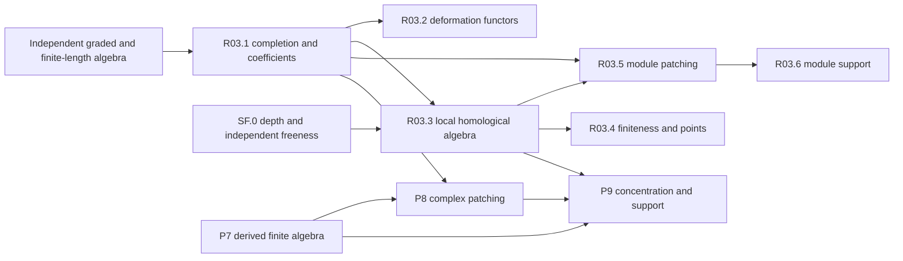

# Commutative algebra for deformation theory and patching

This roadmap supplies the commutative and derived algebra behind deformation rings and Taylor–Wiles patching. Marked complete local coefficients give deformation functors and presentations. Finite module patching or bounded perfect-complex patching then produces an object whose depth, support and multiplicity can be compared with the deformation algebra. The endpoints distinguish a faithful action, a nilpotent kernel, equality of reduced supports, an isomorphism after inverting a uniformizer, and an integral ring isomorphism. Each requires its own hypotheses.

The arithmetic consumers construct the residual representations, local conditions, auxiliary levels, Hecke operators and dimension calculations. This roadmap takes those as explicit inputs. It supplies no automorphy theorem and does not infer a derived deformation action from an action on cohomology or from a map into a nilpotent quotient.

The [suggested Lean file](../suggested/DeformationAndDerivedPatchingAlgebra.lean) states a compact selection of milestones on existing library carriers. This reader gives the full specifications, proof routes, definition APIs and discriminatory tests. A target is proposed mathematics, not a declaration claimed to exist in Lean. The full development has 1,096 separately addressable contracts; broad endpoint contracts and their finer proof interfaces are distinguished below.

## Conventions

All rings are commutative with identity. Local rings are nonzero; Noetherianity, completeness, flatness and finite residue fields are imposed where stated. A finite module means finitely generated. Finite cardinality is written explicitly in the selection and compactness arguments. Write O for a complete DVR, π for a uniformizer, k for its residue field and E for its fraction field. The more general coefficient base Λ is complete Noetherian local with a specified surjection Λ→k. The residue field may be infinite or imperfect unless a theorem restricts it.

A coefficient object carries its actual Λ-algebra structure and a specified residue map to k with maximal-ideal kernel. Morphisms preserve that map. They are consequently local and continuous in the maximal-adic topologies. Artinian and complete coefficient categories use those same arrows. A small extension has nonzero principal kernel killed by the source maximal ideal. An elementary socle extension can have a kernel of any finite k-dimension, including zero. Square-zero alone is weaker than either condition involving maximal-ideal annihilation.

Complexes are integer cochain complexes, with differential raising degree. The convention is C[n]^i=C^(i+n); a module in degree b is M[-b]. Tensor differentials have sign (−1)^p on the second factor in source degree p, and the Koszul braid has sign (−1)^(pq). Linear Hom has differential δ(f)=d_target f−(−1)^degree(f) f d_source. A perfect dual has degree-n term Dual(C^(−n)) and differential (−1)^(n+1) times the transpose. Its bidual chain evaluation in degree n includes (−1)^n.

A finite projective term interval, Tor-amplitude, and a cohomological interval are separate conditions. Tor-amplitude quantifies over all degree-zero coefficient modules. The interval [a,b] has width b−a, while a ghost-nilpotence bound counts its b−a+1 degrees. Native Tor indexed by n≥0 compares with cochain degree −n; its two derived-variable conventions must be identified before using the coefficient spectral sequence.

Depth is extended-natural and depth(0)=∞. Support dimension is `Module.supportDim`, with the empty support at bottom. Native projective dimension also has a bottom value at zero. Finite numerical depth, projective-dimension and codimension equalities therefore state nonzero hypotheses. A finite CM module has depth equal to the dimension of its support. Maximal depth compares instead with the dimension of the ring; CM alone does not imply full support. The zero module is CM under the imported convention.

The intrinsic Hilbert–Samuel multiplicity of a nonzero finite M uses d=dim Supp(M), with cumulative function length(M/I^(n+1)M), eventual polynomial of degree d, and coefficient d! times its leading coefficient. Set multiplicity of zero to zero. In additive cycle formulas fix an ambient degree D; a module of smaller support dimension contributes zero in degree D. Graded-piece lengths have degree d−1 and factorial (d−1)!, a different normalization.

A derived ring action lands in End_D(C). A strict chain action is additional data. Cohomology actions alone give neither. Patching fixes one ultrafilter refining the cofinite filter; paired systems use the same filter, coefficient map, framings and residual identifications. Comparisons between unrelated choices are not implicit. Inverse systems in an ordinary triangulated category are not silently assigned enhanced homotopy limits.

## Scope and neighbouring owners

| Existing owner | Interface imported here; added work in this roadmap |
|---|---|
| Mathlib and Tau Ceti | Native modules, tensor products, complexes, derived localization, K-projectivity, regular lists, support, length, projective dimension and adic completion are reused. New work is the finite local algebra and the comparisons specified below. |
| [SchemeAndStackFoundations](SchemeAndStackFoundations.md), SF.0 and SF.4 | Generic depth, CM/Serre predicates, Cohen structure, catenarity/excellence, independent maximal-depth freeness, and general formal deformation functors remain their contracts. R03.1–R03.3 give marked coefficient comparisons, presentation obstructions and the patching-specific algebra. Definition snapshots below specify compatibility with those owners. |
| [EnhancedDerivedSheaves](EnhancedDerivedSheaves.md) and [DerivedDeRhamCohomology](DerivedDeRhamCohomology.md) | Enhancements, generic derived tensor/Hom, inverse limits, full cotangent and Koszul complexes, and generic derived completion retain their owners. P7 gives native module-category realizations, finite/minimal models, strict quotient towers and the coefficient spectral sequence. |
| [SmoothRepresentationsOfLocalGroups, SR.0d](https://github.com/TauCetiProject/TauCetiRoadmap/tree/main/TauCetiRoadmap/SmoothRepresentationsOfLocalGroups) | Generic unbounded derived tensor/Hom are already planned upstream. P7 needs transport at the trivial group to native module complexes and the signed tensor–Hom comparison. |
| [ModularCurves, 4D and 7D](https://github.com/TauCetiProject/TauCetiRoadmap/tree/main/TauCetiRoadmap/ModularCurves) | Completion regularity and the Witt-coefficient elliptic deformation category are existing contracts. R03.1 generalizes marked coefficient algebra and compares its Witt specialization; elliptic deformation theory stays upstream. The [coefficient-category overlap](../links/tauceti_TauCetiRoadmap_ModularCurves.json) requires this comparison, including infinite residue fields. |
| [AlgebraicVectorBundles, L0B–L0C](https://github.com/TauCetiProject/TauCetiRoadmap/tree/main/TauCetiRoadmap/AlgebraicVectorBundles) | Finite locally free modules/sheaves, duals, exterior powers and determinant objects are imported. R03.3 adds the finite-free-resolution trivialization comparison, not another vector-bundle determinant theory. |
| [GrothendieckEulerForms, Layer 5](https://github.com/TauCetiProject/TauCetiRoadmap/tree/main/TauCetiRoadmap/GrothendieckEulerForms) and [DGAInfinity](https://github.com/TauCetiProject/TauCetiRoadmap/tree/main/TauCetiRoadmap/DGAInfinity) | Generic finite-support Euler–Poincaré and perfect DG envelopes retain their owners. P9 specializes length and derived actions. General bounded finite-cohomology idempotent splitting needs a further native comparison beyond the perfect envelope. |
| [IntegralHeckeAndGaloisDeterminants, Layer 2](https://github.com/TauCetiProject/TauCetiRoadmap/tree/main/TauCetiRoadmap/IntegralHeckeAndGaloisDeterminants) | Derived Hecke images and their chain/homotopy comparison are existing arithmetic infrastructure. P7/P9 record the underlying algebraic action contracts; P8 consumes the Hecke images without reconstructing operators. |
| [LocalFieldsRamification, Layer 0](https://github.com/TauCetiProject/TauCetiRoadmap/tree/main/TauCetiRoadmap/LocalFieldsRamification) | Finite-extension valuations, topologies, completeness and integer-ring/integral-closure comparisons remain upstream. R03.4 first constructs an algebraic integral point, then uses those actual structures to obtain continuity. |
| [AdicSpacesPartII](AdicSpacesPartII.md), F0, and [PadicMeasuresIwasawaAlgebras](PadicMeasuresIwasawaAlgebras.md), L0–L1 | Generic adic tensor products and completed group rings retain their owners. R03.1 supplies their marked local coproduct API. The requested infinite-rank complete-local topological basis extends the existing DVR Banach direction and is not an unrestricted product basis. |
| [Part II: Cohen–Macaulay blowups](../packages/DeformationAndDerivedPatchingAlgebraPartII/README.md) | Part II owns CM-secant and p-standard sequences, local-cohomology annihilator applications, Huneke/Kawasaki conditions, Rees modules for blowups, strict transforms and Macaulayfication. Part I supplies regular-sequence, depth, ring duality and ordinary adic graded quotient inputs. The two Rees uses have distinct roles. |

Ring dualizing complexes, finite affine duality and completed-Ext local duality are R03.3 contracts. Scheme-level coherent duality stays with SF.2. Part II's normalized module-duality annihilator calculation consumes the ring interface and is not repeated here. P7's elementary coefficient dual Hom_O(−,E/O) is the lower algebraic supplier for patching; topological Pontryagin and codifferent normalization remain with completed-cohomology owners.

## Sources and reading order

The principal algebra sources are the Stacks chapters *Commutative Algebra*, *More on Algebra*, *Formal Deformation Theory* and *Dualizing Complexes*. Every target below carries its own theorem or lemma number, section, stable tag and page where its cited version is paginated. Tags refer to unpaginated HTML when no PDF page is given. The bibliography preserves different versions rather than identifying preprint and published numbering.

The main patching sources are Calegari–Geraghty, Definitions 2.1–2.2, Proposition 2.3 and §6; Kisin, Proposition 3.3.1 and Lemma 3.3.4, printed pp. 1157–1159; Khare–Wintenberger II, §10; Khare–Thorne, Lemmas 2.13–2.14, pp. 11–12; and the ten-author *Potential automorphy over CM fields*, §§6.3.4–6.4, especially Proposition 6.4.12 and Remark 6.4.14, printed pp. 1058–1060. The finer targets also retain the André, Bhatt, Pilloni, Boxer–Calegari–Gee–Pilloni, Iyengar–Khare–Manning and component-cycle sources needed by their specific comparisons.

Start with marked coefficients and infinitesimal extensions in R03.1–R03.2. The independent graded and finite-length portion of R03.3 can be developed before completion Noetherianity. Its depth and complete-intersection portion then supports finiteness and module patching. R03.6 states module support consequences. P7 provides the derived finite algebra, P8 patches complexes, and P9 proves concentration and paired support transport. The order of exposition is not a claim that entire layers form one linear dependency chain: each target below lists its precise suppliers.

| Layer | Output | Main consumer |
|---|---|---|
| [R03.1](#r03-1) | Marked coefficient categories, quotients, continuous series maps, completion and tensor comparisons | Deformation functors, finite jets and scalar lifting |
| [R03.2](#r03-2) | Hulls, prorepresentability, tangent/relation spaces and obstruction bounds | Presentations of deformation rings |
| [R03.3](#r03-3) | Adic graded algebra, multiplicity, depth, complete intersections and ring duality | Numerical patching and finite support calculations |
| [R03.4](#r03-4) | Residual-fibre finiteness, faithful-action finiteness and characteristic-zero points | Unframed rings and specialization |
| [R03.5](#r03-5) | Finite decorated module patching, balance and Kisin patching | Patched modules with explicit depth hypotheses |
| [R03.6](#r03-6) | Near faithfulness, component support, cycles and quotient identification | Integral versus rational ring conclusions |
| [P7](#p7) | Minimal finite models, derived coefficients/duals, complete flat models, strict towers and Tor spectral sequence | Complex patching and specialization |
| [P8](#p8) | Finite-coefficient selection, perfect limits, Hecke quotient maps and paired residual comparisons | P9 and arithmetic patching consumers |
| [P9](#p9) | Codimension, concentration, derived length and top-component transport | Ihara avoidance and support conclusions |



The elementary graded prefix must not depend on completed coefficient rings; likewise the requested coheight-one field prefix must precede its R03.1 coefficient comparison. The unresolved initial-ideal, regular-coordinate and completed-map interfaces are stated under the consuming targets. An exact internal node graph can be acyclic while these supplier obligations remain open.

## Worked calculations


### Hilbert–Samuel normalization and curve order

For A=k[[x,y]], monomials of total degree at most n give

```math
H_{m,A}(n)=\binom{n+2}{2}=\tfrac12n^2+\tfrac32n+1,
\qquad h_{m,A}(n)=n+1.
```

Thus intrinsic multiplicity is 2!·(1/2)=1. Multiplying the leading coefficient of h by 2! would give two, detecting the wrong convention. For M=A/(x), H(n)=n+1, so intrinsic multiplicity is one and ambient degree-two multiplicity is zero. The exact sequence 0→(x)→k[[x]]→k→0 has intrinsic multiplicities 1,1,1; at ambient dimension one the last contribution becomes zero and additivity holds.

For a nonzero plane equation f of order r in the regular local plane, the initial form is a nonzerodivisor in k[x,y]. The associated-graded quotient has Hilbert series (1−t^r)/(1−t)^2. Its cumulative polynomial has linear leading coefficient r. The smooth equation y has e=1; the cusp y²−x³ and ordinary node y²−x²(x+1) have e=2; x³−y³ in characteristic zero has e=3, with three distinct branches over an algebraically closed field. For the cubic, H(n)=3n for n≥1, while H(0)=1. These examples test eventual equality rather than equality of the polynomial at every index. Compare Hochster12, January 27, pp. 33–35, and the ambient convention used in LLHLM20 §3.5.1, p. 38.

Multiplicity one does not imply regularity without an unmixedness hypothesis. In k[[x,y]]/(xy,y²), the cumulative function is n+2 for n≥1, so e=1, but m/m² has dimension two. The embedded associated prime contributes only in lower dimension. The corresponding regularity target requires formal unmixedness and records its unresolved mixed-characteristic primary proof source.

### Regularity in the associated graded ring

For A=k[[t^6,t^7,t^15]], the element t^6 is regular because A is a domain. Yet t^15 belongs to m but not m², and t^6t^15=t^21=(t^7)^3 belongs to m³. Its degree-one initial class is therefore annihilated by the initial class of t^6. This prevents the local Hilbert-series equality which would follow from regularity of the initial form. The criterion below uses that stronger condition, matching the explanation after CG18 Lemma 4.4, pp. 357–358.

### The smallest balanced patching model

Let q=1, S∞=O[[t]] and R∞=O=S∞/(t), with H=O. For Δ_N=Z/p^N and M_N=O with trivial Δ_N action, the minimal presentation over O[Δ_N] has one generator and one relation, so its defect is zero. The augmentation of each M_N is H. The S∞-module O has projective dimension one and depth one, exactly dim S∞−1=dim R∞. The numerical equality forces the patched module to be CM over R∞ and hence free over the regular ring R∞. Omitting the one relation or using dim S∞ in place of dim R∞ would fail this model. The general balance and common-map conditions are stated in R03.5; compare CG18 Proposition 2.3 and proof, pp. 308–310.

### Codimension needs Tor amplitude and a nonzero complex

For regular S=k[[x,y]], the two-term complex [S —x→ S] in degrees [0,1] has only H¹=S/(x), codimension one. It has a minimal finite free model of length one; H¹ has depth one and projective dimension one. It realizes equality in the codimension/amplitude lemma. By contrast, the contractible complex [S —1→ S] has zero cohomology and empty support. The numerical conclusion cannot be applied to it. Concentration of arbitrary cohomology in [0,1] alone also gives no bound on its projective representative. These are explicit Checks for P9, following the proof mechanism of CG18 Lemma 6.2, p. 385, and CI21 Proposition 6, author p. 5.

### Finite action images and derived augmentation

For perfect C over complete Noetherian S, End_D(S)(C) is a finite S-module. The image R′ of a compatible R∞ action is therefore finite over S. This gives a finite local algebra on which CM and finite duality can be applied. The same reasoning does not prove that the surjecting whole ring R∞ is finite over S. IKM24 p. 47 explicitly invokes BKM Lemmas 3.6–3.7 to adjust a coefficient lift through an action image. The remaining refinement is that this adjustment preserves the coefficient map through Q for every patched object and morphism. No later target silently assumes that comparison.

If C∞≃M[-b], then its derived augmentation is M[-b]⊗^L_S Λ. Ordinary augmentation M/aM gives only top degree b; lower augmented cohomology can be nonzero Tor. For S=k[[x]], M=S/(x) and Λ=k, derived tensor has a second nonzero term even though the ordinary tensor is k. Dual systems use the same ultrafilter and the same S∞→R∞ map, with finite-level pairings constructed before taking a limit. See IKM24 Theorem 10.6 and §11, arXiv v3 pp. 43–51, and BKM Lemmas 3.6–3.7, arXiv:2108.09729v2 pp. 11–12.

### Six-variable component calculation

In k[[a,b,c,d,e,f]], take I=(ab,ac,ae,bc,bd,cf). Its minimal coordinate primes are (a,b,c), (a,b,f), (a,c,d) and (b,c,e): each is a minimal vertex cover of the six monomial supports. Their intersection is I, each has height three, and each generic quotient has length one. The ring is reduced and equidimensional of dimension three and has multiplicity four. In the LLHLM20 instance use a=c₁₂−c₁₃c₃₂, b=κc₃₁−c₂₁c₃₂, c=c₂₃, d=c₁₃, e=c₂₁, f=c₃₂, with κ≠0, before reading off those primes. The count is a worked instance of the cycle target, not a claim that every square-free monomial quotient is CM. Compare LLHLM20 Lemma 3.6.13 proof, pp. 70–71.


### Derived specialization and torsion


The acceptance suite computes both derived specialization and support after uniformizer inversion.

* **Integral torsion over a DVR.** In degrees $0,1$, $K=[\mathcal O\xrightarrow{\pi}\mathcal O]$ has $H^0=0$ and $H^1=k$. Its support is $V(\pi)$; its Tor-amplitude has width one while its ordinary cohomology has width zero. Derived reduction modulo $\pi$ has two adjacent copies of $k$. Rationalization is zero. This tests integral versus rational concentration and the sign cancellation of derived reduction.
* **Two-term Koszul over a power series ring.** For $S=\mathcal O[[x]]$, $K=[S\xrightarrow{x}S]$ in degrees $0,1$ has only $H^1=\mathcal O$, support $V(x)$, codimension one, projective dimension one and depth one. Derived augmentation at $x=0$ has $\mathcal O$ in both degrees. Inverting $\pi$ preserves the component $V(x)$ in $S[1/\pi]$. This ring is not identified with the entire $E[[x]]$: uniform denominator bounds need not hold for a general series over $E$.
* **One component of a reducible local ring.** In $B=k[[x,y]]/(xy)$, the finite free complex $[B\xrightarrow{x}B]$ has $H^0=(y)$ and $H^1=B/(x)$, both supported on $V(x)$. It is perfect and its support misses the other component. Derived specialization at the closed point gives $k$ in both degrees. This example checks that a singular reducible local base is not allowed in the regular-local concentration theorem. The module $B/(x)$ alone is not used as a perfect object. The separate projective-factor test over $k[\varepsilon]/(\varepsilon^2)\times k$ checks selection by an idempotent.
* **One-degree Taylor–Wiles algebra.** For $S=\mathcal O[[z_1,\ldots,z_r]]$ and $m>0$, $S^m[0]$ has Tor-amplitude $[0,0]$, full support and faithful scalar action. Derived augmentation, residual change and inversion give free stalks over $\mathcal O$, $k[[z_1,\ldots,z_r]]$ and $S[1/\pi]$, respectively. This is a genuine one-degree algebraic specialization; construction of an arithmetic patched system is a separate input.

A further test retains non-Cohen–Macaulay cohomology. Over $S=k[[x,y]]$, put $M=S/(x)\oplus S/(x,y)$. The stalk $M[0]$ is perfect with Tor-amplitude $[-2,0]$, support $V(x)$, depth zero, support dimension one and projective dimension two. The codimension–amplitude inequality is strict. Its derived closed fibre has dimensions $1,3,2$ in degrees $-2,-1,0$. It would invalidate a definition equating perfectness with Cohen–Macaulay cohomology, or ordinary width with Tor width.


### Finite jets, residue extension and framing

For a finite local O-algebra, surviving π is equivalent to positive dimension and hence to the existence of an algebraic characteristic-zero integral point. O/π² is nonzero but has no such point; O[ε]/ε² has a point despite its nilpotents. In O[t]/(t(t−π)), the two points t=0 and t=π coincide residually. These cases separate generic nonemptiness from reducedness and from uniqueness.

Residue extension can be necessary. In A=Z₃[t]/(t²−18), the special fibre is F₃[t]/t², so A is local. At a characteristic-zero integral point, u=t/3 has u²=2; it is an integral unit. Its residue cannot lie in F₃. The finite extension containing the point must therefore be allowed a larger residue field. See R03.4/integer-ring-point-with-topology and its coefficient-base-change obligation.

A positive framing does not preserve module finiteness: if A is a nontrivial O-algebra, A[[X₁,…,X_d]] with d>0 cannot be finite over O. A monic relation for X₁ would have coefficient 1 at its highest X₁ degree and zero contributions there from every lower term. Framed points instead extend by a supplied series presentation or by compatible infinitesimal lifts. The d=0 and zero-ring cases must be separated.

For S=k[[x]], ordinary cohomology does not commute with quotienting coefficients: the complex [S —x→ S] becomes [k —0→ k] modulo x. Its reduced H⁰ is k, although H⁰ before reduction is zero. Finite patch data must carry cohomology actions at all required subquotients; the missing action cannot be manufactured by a nonflat base-change identity. See the P8 cohomology-action input and CG's corrected finite-data argument.

### Minimality, completed bases and signs

A unit disk [R —1→ R] is contractible and is removed by minimalization. A minimal finite-free local complex has zero differential over the residue field, so its term ranks are residual cohomology dimensions. Homotopic maps between minimal models agree residually; an invertible residual comparison yields a strict chain isomorphism by degreewise Nakayama. It does not make every homotopy between those maps equal to zero over R.

For infinite rank, the π-adic completion of ⊕_I O has residue ⊕_I k. The product ∏_I O has residue ∏_I k instead. Replacing the completed direct sum by the unrestricted product changes the object. Lifting residue bases of complete flat modules therefore requires the completed-direct-sum and column-null-matrix interface, beyond finite free Nakayama.

For a nonzero differential, an unsigned transpose or unsigned bidual evaluation can fail the chain equation. The dual differential and the degree-n bidual factor (−1)^n are part of the P7 perfect-dual contract. Over a field H⁰ of the dual identifies with the dual of the specialized degree-zero kernel under the stated term bounds; over a DVR the corresponding integral formula uses the E/O coefficient complex and its continuous O-linear dual.

### Adic graded boundary suite 1


GradedInductionTests.polynomial_finite_generators (compatibility): The polynomial ring (Z/4)[X] as a finite module over itself has a finite homogeneous spanning family. This uses polynomial-ring finiteness without asserting finiteness over Z/4.

GradedInductionTests.delayed_tail (non-example): For Z/4 concentrated in degree7, that degree is nonzero and the bounded-generator theorem kills every component n≥8. Replacing the threshold by zero is false.

GradedInductionTests.empty_variables (degenerate): For any finite module over (Z/4)[X_j | j∈PEmpty] with an internal coefficient grading, the zero rational polynomial equals the eventually finite component length.

GradedInductionTests.nilpotent_monomial_action (computation): In (Z/4)[X], p=2X^3 is nonzero and square-zero, and p acting on X belongs to degree4. Neither domain assumptions nor killing nilpotent coefficients are valid.

GradedInductionTests.zero_polynomial_any_degree (degenerate): For arbitrary k,n, the zero polynomial viewed as homogeneous of degree k sends an actual x∈G_n into G_(k+n).

GradedInductionTests.inhomogeneous_polynomial (non-example): The actual polynomial 1+X over Z/4 is not homogeneous of degree1.

GradedInductionTests.power_zero (degenerate): The zero power of a variable acts within G_n for every actual x∈G_n, with no scalar-tower hypothesis needed for this variable-only assertion.

GradedInductionTests.zero_module_empty_generators (degenerate): For a zero module with any internal grading, the empty A-spanning set and B=0 prove every component zero, including degree0.


### Adic graded boundary suite 2


AdicRemainingTests.coefficient_and_variable (computation): The remaining-generator map evaluates C(c)+X_i to the actual coefficient image plus the quotient class of b_i.

AdicRemainingTests.eliminated_generator (non-example): If the remaining family repeats a itself, every corresponding variable maps to zero in S/(a). A map into S or an identity substitute fails.

AdicRemainingTests.empty_family (degenerate): If a alone generates S as an A/q-algebra, the map from polynomials with the empty variable type is still surjective onto S/(a). No positive number of remaining generators is assumed.

AdicRemainingTests.unit_ideal (degenerate): For q=A, every polynomial evaluates to zero in the actual remaining-generator quotient, over the zero coefficient ring.

AdicRemainingTests.surviving_nilpotent (non-example): For A=Z/4, q=(2), a=0, the degree-one class of2 supplies a remaining generator whose variable image is nonzero and has square zero in the actual quotient. Neither killing all positive degrees nor assuming a reduced quotient is allowed.

AdicRemainingTests.kernel_two_scalars (compatibility): For actual b in Q_i, c in Q_j and x in K_n, the nested descended product b·(c·x) is fixed by the native kernel decomposition at i+(j+n).

AdicRemainingTests.cokernel_two_scalars (compatibility): For actual b in Q_i, c in Q_j and x in C_n, the nested descended product b·(c·x) is fixed by the existing cokernel projection at i+(j+n).

AdicRemainingTests.quotient_mixed_coordinates (compatibility): For a quotient class of an original degree-zero plus degree-one scalar, the native quotient coordinate at0 is exactly the class of its degree-zero term and its coordinate at2 vanishes.


### Adic graded boundary suite 3


AdicCokernelGradingTests.mixed_degrees (compatibility): For the quotient class of a sum of original degree-zero and degree-one terms, the new projections recover the corresponding quotient classes; degree two projects to zero.

AdicCokernelGradingTests.wrong_degree (non-example): For every actual x in C_n and m≠n, its native quotient projection to degree m is zero. Repeating C as every component fails this test.

AdicCokernelGradingTests.image_is_killed (compatibility): For every original homogeneous x in L_n, the quotient class of the actual product a·x has every quotient projection zero. The old component multiplication and new grading use exactly the same quotient.

AdicCokernelGradingTests.homogeneous_scalar (compatibility): For b in S_i and x in L_j, b times the quotient class of x belongs to C_(i+j) and is fixed by its degree-(i+j) projection, using the original quotient S action.

AdicCokernelGradingTests.finite_reconstruction (characterisation): Every possibly inhomogeneous actual quotient element is recovered by native finite recomposition. If all its quotient projections vanish, the element is zero; recomposition is proved, not assumed.

AdicCokernelGradingTests.unit_ideal (degenerate): For q=A, every actual quotient element is zero, lies in every component as zero, and has every projection zero, for arbitrary A-modules.

AdicCokernelGradingTests.nonfree_constant (non-example): For A=Z, M=Z/4, q=0 and a=0, the class of the constant 1 is nonzero in C_0 and fixed by the new degree-zero projection. No freeness assumption or zero cokernel substitution is allowed.

AdicCokernelGradingTests.zero_multiplier_positive_degree (non-example): For A=M=Z/4, q=(2) and a=0, the class of2 in the original degree-one piece survives nonzero in C_1, is fixed by its quotient projection and is recovered by finite recomposition. A quotient grading concentrated in degree zero fails this nilpotent-ring example.


### Adic graded boundary suite 4


AdicRestrictionTests.zero_multiplier_kernel (compatibility): For a=0, every y in the actual L_n defines x in the full native kernel K with ambient value y; x lies in K_n and its degree-n restricted projection equals x.

AdicRestrictionTests.kernel_wrong_degree (non-example): For every actual x in K_n and m≠n, the degree-m restricted kernel projection is zero. Copying the same kernel into every degree fails this test.

AdicRestrictionTests.nilpotent_nonzero_kernel (non-example): For A=M=Z/4 and q=(2), the nonzero degree-one class a of2 has a nonzero x in the actual K_1. Its restricted degree-one projection fixes x and finite native recomposition recovers x. The kernel cannot be replaced by zero or restricted to regular multipliers.

AdicRestrictionTests.zero_multiplier_range (degenerate): For a=0, every element of the actual range is zero, belongs to every range component as zero, and its native finite recomposition is zero.

AdicRestrictionTests.range_degree_zero (non-example): For every degree-one a, an actual range element lying in degree zero is zero; its restricted degree-zero projection is zero. Treating the range grading as an unshifted copy of L fails this boundary.

AdicRestrictionTests.range_successor (compatibility): For every actual y in L_n, the element a·y of R lies in R_(n+1), has exactly that ambient value, and is fixed by its restricted degree-(n+1) projection.

AdicRestrictionTests.range_finite_reconstruction (characterisation): For every possibly inhomogeneous actual x in R, native finite recomposition recovers x and each restricted coordinate, included into L, equals the original native ambient projection of x.


### Adic graded boundary suite 5


AdicLengthTests.negative_difference (non-example): For A=M=Q and q=0, the actual component lengths in degrees0 and1 are1 and0, and their signed integer difference is−1. Natural subtraction would lose this value.

AdicLengthTests.infinite_component (non-example): For A=Q,q=0,M=the countable direct sum of Q, the degree-zero component has infinite native length while its toNat is0. The finite-length premise cannot be discarded.

AdicLengthTests.unit_ideal (degenerate): For every A-module M and n, the actual degree-n component at q=A has native length0, without nontriviality hypotheses.

AdicLengthTests.zero_multiplier_kernel (compatibility): For the zero degree-one multiplier, the actual component kernel length equals the entire source component length, without a finite-length assumption.

AdicLengthTests.nonreduced_kernel_correction (non-example): For A=M=Z/4 and q=(2), choose the nonzero degree-one class of2. Its degree-one multiplication component has a kernel of strictly positive finite native length, witnessed by the nonzero class of2. The kernel correction cannot be dropped.

AdicLengthTests.zero_degree_quotient (compatibility): For arbitrary A,q,M and a∈S_1, the degree-zero quotient component length equals the length of the native adic piece M/qM, whether finite or infinite.


## Library boundary and suggested statements

The elaboration baseline is Mathlib `082e2d37e8b0463410cdb532e111cd43d5a66174` and Tau Ceti `f790474821cf4256814db967cb154e7af3d0c369`. The declaration ledger at the end records exact library leaves used by the contracts. Existing adic completion, tensor complexes, K-projectivity, support and projective dimension are interfaces to reuse, not targets to redevelop.

Current TauCetiRoadmap main `0d144d044dacebca17b654695b6f1ad58f159b27` and current Tau Ceti `a91d3aafa8cd3e6bc33dfde0d7677ed0f1625039` have also been inspected. In the latter, `TauCeti.IsRegularLocalRing.isDomain`, `quotient_span_singleton` and `isDiscreteValuationRing_iff_ringKrullDim_eq_one` already give regular-local domain, parameter-quotient regularity and the dimension-one DVR criterion. `IsPrecomplete.of_finite` and `IsAdicComplete.of_finite` already give the finite-module completeness results under their native hypotheses. These current-library portions of the reader's contracts should be imported when moving to current pins; they are not new implementation assignments. Statements checked at the historical pins do not thereby claim these newer declarations are present there.

The suggested file uses light, real-bodied predicates and native modules/complexes. Heavy coefficient categories, Schlessinger functors, dualizing objects, enhanced scalar operations and decorated patching systems remain reader targets. The finite coefficient selection milestone is stated on native germs, and the P9 support and concentration milestones use native derived homology and explicit bounded projective representatives. There is no invented carrier filled by a proof placeholder.

<a id="r03-1"></a>

## R03.1 — Marked coefficients and completion

Build actual residue-preserving coefficient objects before their infinitesimal lifting and completion comparisons.

### Endpoint contracts

<a id="target-r03-1-artinian-coefficient-category-and-small-extensions"></a>

#### Artinian coefficients and small extensions

`R03.1/artinian-coefficient-category-and-small-extensions` · definition

Fix a complete Noetherian local coefficient ring Λ with a specified residue field k. Art_Λ has Artinian local Λ-algebras A, a chosen Λ-compatible A/m_A ≅ k, and local Λ-maps inducing identity on k. A small extension is a surjection B→A with a nonzero principal kernel annihilated by m_B. An elementary extension only requires m_B ker=0 and permits any finite k-dimension, including zero. A square-zero extension has kernel I with I²=0, a weaker condition.

**Hypotheses.** Fix a complete Noetherian local coefficient ring Λ with a specified residue field k.

**Prerequisites.** Existing ring and module carriers.

**Sources.**

- [S1](#source-1), Definitions 3.1–3.2, Lemma 3.3, pp. 4–5; §10, p. 26. This locator supplies the stated construction and its comparison maps.

**Proof route.**

1. Use the existing local/Artinian ring structures with a specified residue identification. Restrict morphisms; identity and composition preserve the residue identification.
2. Identify an elementary kernel as a finite k-vector space. In the nonzero principal case its dimension is exactly one.

**Planning API.**

- `TauCeti.ArtinianCoefficientsAndSmallExtensions.hom` (data): Morphisms preserve Λ and the chosen residue-field identification.
- `TauCeti.ArtinianCoefficientsAndSmallExtensions.small_iff` (characterisation): Small means surjective, m_B ker=0 and dim_k ker=1.
- `TauCeti.ArtinianCoefficientsAndSmallExtensions.small_is_square_zero` (relation): Every small extension is square-zero; elementary extensions need not be principal.
- `TauCeti.ArtinianCoefficientsAndSmallExtensions.base_change` (functoriality): Pull back a small extension along A′→A; the resulting kernel is identified with the original kernel.
- `TauCeti.ArtinianCoefficientsAndSmallExtensions.factor_surjection` (compatibility): A nonisomorphic surjection factors into finitely many small extensions.

**Unit tests.**

- `TauCeti.ArtinianCoefficientsAndSmallExtensions.dual_numbers` (computation): k[ε]/ε²→k is small, with kernel kε.
- `TauCeti.ArtinianCoefficientsAndSmallExtensions.reject_two_dimensional` (non-example): k[x,y]/(x,y)²→k is elementary and square-zero, but not small.
- `TauCeti.ArtinianCoefficientsAndSmallExtensions.reject_square_zero_only` (non-example): k[t]/t⁴→k[t]/t² has square-zero kernel but m_B ker ≠0.
- `TauCeti.ArtinianCoefficientsAndSmallExtensions.reject_identity` (non-example): The identity of k has zero kernel and is not small.

**Uses.**

- Schlessinger criterion in R03.2: Its lifting tests quantify over exactly the small extensions.
- P8 finite ring truncations: Surjections are reduced to elementary lifting steps.

**Check.**

- k[ε]/ε²→k is small, with kernel kε.
- k[x,y]/(x,y)²→k is elementary and square-zero, but not small.
- k[t]/t⁴→k[t]/t² has square-zero kernel but m_B ker ≠0.
- The identity of k has zero kernel and is not small.

<a id="target-r03-1-complete-local-coefficient-category"></a>

#### Complete local coefficients

`R03.1/complete-local-coefficient-category` · definition

CNL_Λ consists of complete separated Noetherian local Λ-algebras with specified residue k; morphisms are continuous local Λ-maps inducing identity on k. The topology is m-adic. No finite residue-field assumption is built into CNL_Λ; compactness through finite underlying quotients later adds it explicitly. Every object defines a compatible tower A/m_A^n, n≥1.

**Hypotheses.** CNL_Λ consists of complete separated Noetherian local Λ-algebras with specified residue k; morphisms are continuous local Λ-maps inducing identity on k.

**Prerequisites.** [`R03.1/artinian-coefficient-category-and-small-extensions`](#target-r03-1-artinian-coefficient-category-and-small-extensions), `mathlib:AdicCompletion.map_exact`

**Sources.**

- [S1](#source-1), Definition 4.1, p. 9; Lemmas 4.2–4.6, pp. 10–11; Lemmas 4.7–4.8, p. 12. This locator supplies the stated construction and its comparison maps.

**Proof route.**

1. Restrict rings and maps by completeness and Noetherianity, using existing adic completion.
2. Identify maps with compatible quotient maps; continuity follows from locality for the m-adic topologies.

**Planning API.**

- `TauCeti.CompleteLocalCoefficients.quotient` (projection): A→A/m_A^n is a local continuous quotient with residue k.
- `TauCeti.CompleteLocalCoefficients.from_tower` (constructor): A surjective Artinian tower with uniformly bounded cotangent dimension has a CNL_Λ limit.
- `TauCeti.CompleteLocalCoefficients.hom_limit` (universal-property): A continuous map into a complete coefficient ring is equivalent to compatible maps into all its Artinian quotients.
- `TauCeti.CompleteLocalCoefficients.quotient_complete` (instance): A/I is complete Noetherian for every ideal I of A.
- `TauCeti.CompleteLocalCoefficients.iso_quotients` (extensionality): A morphism inducing isomorphisms at every Artinian quotient is an isomorphism.

**Unit tests.**

- `TauCeti.CompleteLocalCoefficients.dvr` (computation): O and O[[x_1,…,x_r]] belong to CNL_O.
- `TauCeti.CompleteLocalCoefficients.reject_infinite_variables` (non-example): The completion of an Artinian tower with unbounded cotangent dimension need not be Noetherian; it is not admitted by from_tower.
- `TauCeti.CompleteLocalCoefficients.reject_polynomials` (non-example): k[x]_(x) is local Noetherian but is not x-adically complete.

**Uses.**

- BCGP25 §1.8.1, p. 8: Coefficient categories organize all finite patching quotients.
- Schlessinger hulls: Prorepresenting objects live in CNL_Λ.

**Check.**

- O and O[[x_1,…,x_r]] belong to CNL_O.
- The completion of an Artinian tower with unbounded cotangent dimension need not be Noetherian; it is not admitted by from_tower.
- k[x]_(x) is local Noetherian but is not x-adically complete.

<a id="target-r03-1-artinian-fibre-products"></a>

#### Fibre products of coefficient rings

`R03.1/artinian-fibre-products` · theorem

For A→C←B in Art_Λ the fibre product A×_C B is an Artinian local Λ-algebra with the specified residue k. If B→C is surjective, its projection to A is surjective with kernel ker(B→C), and pulling back a small extension again gives a small extension. The surjective-leg hypothesis controls this projection and kernel; locality follows already from the fixed residue maps.

**Hypotheses.** If A→C←B are in Art_Λ and B→C is surjective, then A×_C B is in Art_Λ; projection to A is surjective with kernel ker(B→C).

**Prerequisites.** [`R03.1/artinian-coefficient-category-and-small-extensions`](#target-r03-1-artinian-coefficient-category-and-small-extensions)

**Sources.**

- [S1](#source-1), Lemma 3.8 and Example 3.7, pp. 6–7. This locator supplies the stated local algebra result; the proof steps specify its use.

**Proof route.**

1. Describe pairs with equal image. The maximal ideal consists of pairs whose residues vanish.
2. Use the surjective leg to lift every element of A, identify its kernel and compute the residue field and Artinian length.

**Check.**

- Compute k[ε]×_k k[δ]; its maximal ideal has k-dimension two, with both squares and their product zero.

<a id="target-r03-1-artinian-limit-and-quotient-cofinality"></a>

#### Artinian limits and cofinal parameter quotients

`R03.1/artinian-limit-and-quotient-cofinality` · theorem

Every A in CNL_Λ is lim A/m^n. Conversely a surjective Artinian local tower with fixed residue and a uniform bound on dim_k m_n/m_n² has a complete Noetherian local limit. For an m-primary parameter ideal (x_1,…,x_d), the ideals (x_1^n,…,x_d^n) are cofinal with powers of m: I^{d(n−1)+1}⊆(x_i^n)⊆I^n and m^c⊆I for some c.

**Hypotheses.** Every A in CNL_Λ is lim A/m^n.

**Prerequisites.** [`R03.1/complete-local-coefficient-category`](#target-r03-1-complete-local-coefficient-category)

**Sources.**

- [S1](#source-1), Lemmas 4.7–4.8, p. 12; André §3.4, printed p. 84. This locator supplies the stated local algebra result; the proof steps specify its use.

**Proof route.**

1. Lift a bounded set of cotangent generators inductively and map a finite-variable formal power-series ring onto the inverse limit.
2. Use the complete topology to show surjectivity, obtaining Noetherianity as a quotient. For parameter quotients apply the pigeonhole bound on monomials and compare I-adic and m-adic powers.

**Check.**

- Finite residue k makes every finite-length Artinian quotient a finite set; infinite k does not.

<a id="target-r03-1-continuous-power-series-evaluation"></a>

#### Continuous formal evaluation

`R03.1/continuous-power-series-evaluation` · construction

For a complete separated local Λ-algebra A and a finite list a_i∈m_A, evaluation defines a unique continuous Λ-map Λ[[X_1,…,X_r]]→A sending X_i to a_i. More generally use an ideal J and J-adically topologically nilpotent entries; arbitrary entries need not admit evaluation.

**Hypotheses.** For a complete separated local Λ-algebra A and a finite list a_i∈m_A, evaluation defines a unique continuous Λ-map Λ[[X_1,…,X_r]]→A sending X_i to a_i.

**Prerequisites.** [`R03.1/complete-local-coefficient-category`](#target-r03-1-complete-local-coefficient-category), `mathlib:MvPowerSeries.eval₂Hom`, `mathlib:MvPowerSeries.eval₂_unique`

**Sources.**

- [S1](#source-1), Lemma 4.8 and proof, p. 12; Stacks Algebra §97. This locator supplies the stated construction and its comparison maps.

**Proof route.**

1. Supply the adic uniform/topological instances and prove HasEval for the finite tuple in the maximal ideal. Reuse MvPowerSeries.eval₂Hom rather than constructing evaluation again.
2. Use MvPowerSeries.eval₂_unique for uniqueness. The additional local adapter proves surjectivity from the chosen relative cotangent generators using successive Artinian approximations.

**Planning API.**

- `TauCeti.ContinuousFormalEvaluation.eval_X` (simp): Evaluation sends X_i to a_i and coefficients by the given Λ-map.
- `TauCeti.ContinuousFormalEvaluation.eval_comp` (functoriality): Continuous local base change commutes with evaluation.
- `TauCeti.ContinuousFormalEvaluation.eval_ext` (extensionality): Continuous Λ-maps agreeing on all variables are equal.
- `TauCeti.ContinuousFormalEvaluation.eval_surjective` (universal-property): If the a_i generate the relative cotangent space and A has residue k, evaluation is surjective.

**Unit tests.**

- `TauCeti.ContinuousFormalEvaluation.zero` (computation): Sending every variable to zero is the constant-coefficient map.
- `TauCeti.ContinuousFormalEvaluation.nilpotent` (computation): Evaluation at ε in k[ε]/ε² sends a series to c_0+c_1ε.
- `TauCeti.ContinuousFormalEvaluation.reject_unit` (non-example): The series ΣX^n cannot be evaluated at X=1 in the discrete field k by this construction.

**Uses.**

- R03.2 relation presentations: Chooses the map from the minimal formal power-series ring.
- P8 common scalar map: Continuous evaluation lifts the chosen patching parameters.

**Check.**

- Sending every variable to zero is the constant-coefficient map.
- Evaluation at ε in k[ε]/ε² sends a series to c_0+c_1ε.
- The series ΣX^n cannot be evaluated at X=1 in the discrete field k by this construction.

<a id="target-r03-1-relative-cotangent-space"></a>

#### Relative tangent and cotangent spaces

`R03.1/relative-cotangent-space` · definition

For A in CNL_Λ define cot_Λ(A)=m_A/(m_A²+m_Λ A), a finite k-vector space; t_Λ(A)=Hom_k(cot_Λ(A),k) identifies with local Λ-maps A→k[ε] reducing to the fixed residue map. For general residue extension use Der_Λ(A,k) and retain Der_Λ(k,k); do not silently replace it by this classical formula.

**Hypotheses.** For A in CNL_Λ define cot_Λ(A)=m_A/(m_A²+m_Λ A), a finite k-vector space; t_Λ(A)=Hom_k(cot_Λ(A),k) identifies with local Λ-maps A→k[ε] reducing to the fixed residue map.

**Prerequisites.** [`R03.1/complete-local-coefficient-category`](#target-r03-1-complete-local-coefficient-category)

**Sources.**

- [S11](#source-11), §2.1, p. 6; Stacks Formal deformation theory Example 11.11, pp. 31–32. This locator supplies the stated construction and its comparison maps.

**Proof route.**

1. The difference from the residue map is a derivation annihilating Λ, m² and m_Λ A.
2. Conversely a cotangent functional defines a map to dual numbers. Verify both constructions are inverse.

**Planning API.**

- `TauCeti.RelativeTangentAndCotangentSpaces.tangent_dual` (equivalence): Local maps to k[ε] identify naturally with the k-dual of the relative cotangent space.
- `TauCeti.RelativeTangentAndCotangentSpaces.cot_map` (functoriality): A local Λ-map induces a forward linear map on cotangent spaces and a backward map on tangents.
- `TauCeti.RelativeTangentAndCotangentSpaces.cot_power_series` (compatibility): Adjoining r variables adds k^r to relative cotangent space.
- `TauCeti.RelativeTangentAndCotangentSpaces.cot_quotient` (characterisation): For A/I with I⊆m_A, cot_Λ(A/I) is cot_Λ(A) modulo the image of I.

**Unit tests.**

- `TauCeti.RelativeTangentAndCotangentSpaces.formal_variables` (computation): cot_O(O[[x,y]]) has dimension two.
- `TauCeti.RelativeTangentAndCotangentSpaces.coefficient_direction` (computation): cot_O(O)=0, though m_O/m_O² has dimension one.
- `TauCeti.RelativeTangentAndCotangentSpaces.quadratic_relation` (computation): cot_k(k[[x]]/(x²)) is one-dimensional; a quadratic relation does not kill tangent directions.

**Uses.**

- KWII §2.1: Counts the formal variables in ring presentations and tensor products.
- Schlessinger H3: Finiteness of tangent space bounds the number of formal generators.

**Check.**

- cot_O(O[[x,y]]) has dimension two.
- cot_O(O)=0, though m_O/m_O² has dimension one.
- cot_k(k[[x]]/(x²)) is one-dimensional; a quadratic relation does not kill tangent directions.

<a id="target-r03-1-cohen-structure-and-compatible-coefficients"></a>

#### Cohen structure and compatible coefficients

`R03.1/cohen-structure-and-compatible-coefficients` · theorem

Every complete Noetherian local A is a quotient of a complete regular local Q with the same residue field. In equal characteristic Q=k[[x_1,…,x_e]] after choosing a coefficient field. For perfect residue k and mixed characteristic, an unramified regular local A of dimension d is W(k)[[x_1,…,x_{d−1}]]. A ramified regular A has A≅W(k)[[x_1,…,x_d]]/(p−f), f in (p,x_1,…,x_d)^2, with p nonzero in the quotient and p−f a nonzerodivisor in the regular ambient ring. For imperfect k use a Cohen ring, not W(k). A separable residue extension admits compatible choices of coefficient maps; no uniqueness is asserted.

**Hypotheses.** Every complete Noetherian local A is a quotient of a complete regular local Q with the same residue field.

**Prerequisites.** [`R03.1/continuous-power-series-evaluation`](#target-r03-1-continuous-power-series-evaluation), [`R03.1/relative-cotangent-space`](#target-r03-1-relative-cotangent-space)

**Sources.**

- [S6](#source-6), §4.2 and §4.4(1), printed pp. 86–88. This locator supplies the stated local algebra result; the proof steps specify its use.

**Proof route.**

1. Construct a coefficient ring/field and lift a finite cotangent basis. Surjectivity of formal evaluation gives the presentation.
2. For a separable extension lift the coefficient embedding through the Cohen rings, then lift the remaining parameters. For imperfect residue fields retain Cohen rings instead of substituting Witt vectors.

**Check.**

- An O-presentation relative to a specified O-map is not the same as a freely chosen coefficient presentation.

<a id="target-r03-1-finite-parameter-subring"></a>

#### Finite parameter subrings

`R03.1/finite-parameter-subring` · theorem

Let B be a complete local Noetherian p-torsion-free ring of mixed characteristic with perfect residue k and dim B=d. Choose a system of parameters beginning with p². Then B is finite over W(k)[[T_1,…,T_{d−1}]] via the remaining parameters. The map is injective when B is a domain; finite generation follows from the finite-length parameter quotient, and injectivity follows from the dimension comparison.

**Hypotheses.** Let B be a complete local Noetherian p-torsion-free ring of mixed characteristic with perfect residue k and dim B=d.

**Prerequisites.** [`R03.1/cohen-structure-and-compatible-coefficients`](#target-r03-1-cohen-structure-and-compatible-coefficients), [`R03.3/systems-of-parameters`](#target-r03-3-systems-of-parameters), [`R03.4/finiteness-of-deformation-rings-criteria`](#target-r03-4-finiteness-of-deformation-rings-criteria), `tauceti:TauCeti.ringKrullDim_eq_of_isIntegral_of_faithfulSMul`

**Sources.**

- [S6](#source-6), §4.2, printed p. 86. This locator supplies the stated local algebra result; the proof steps specify its use.

**Proof route.**

1. Extend p² to parameters using nonzerodivisorness and prime avoidance.
2. Lift a finite residue basis modulo the parameter ideal by successive approximations. A nonzero kernel in the regular domain would lower the dimension of its finite extension.

**Check.**

- The assertion excludes p=0 in B; it does not choose parameters functorially.

<a id="target-r03-1-perfect-residue-extension"></a>

#### Perfect residue-field change

`R03.1/perfect-residue-extension` · theorem

From a complete local Noetherian ring with coefficient ring and residue k, extend coefficients to a compatible Cohen ring of a separable algebraic extension k′/k and complete. The map is faithfully flat local and Noetherian, and carries finite presentations to their completed scalar extensions. In characteristic p the passage k→k^perf may be built as a filtered coefficient extension followed by completion; its presentation over a Cohen ring proves Noetherianity despite the possibly infinite field extension.

**Hypotheses.** From a complete local Noetherian ring with coefficient ring and residue k, extend coefficients to a compatible Cohen ring of a separable algebraic extension k′/k and complete.

**Prerequisites.** [`R03.1/cohen-structure-and-compatible-coefficients`](#target-r03-1-cohen-structure-and-compatible-coefficients), [`R03.1/flat-completion-and-finite-module-comparison`](#target-r03-1-flat-completion-and-finite-module-comparison)

**Sources.**

- [S6](#source-6), §4.2 and §4.4(1), printed pp. 86–88. This locator supplies the stated local algebra result; the proof steps specify its use.

**Proof route.**

1. Choose compatible coefficient rings and extend the finite-variable presentation, preserving relation generators.
2. Flatness of coefficient extension and flat-completion comparison yield flatness; residue extension proves faithful locality. For perfection use the appropriate coefficient-extension construction rather than claiming perfection is separable.

**Check.**

- CM ascent here uses the field closed fibre; arbitrary faithfully flat maps need not preserve CM.

<a id="target-r03-1-completed-tensor-products"></a>

#### Completed tensor products

`R03.1/completed-tensor-products` · construction

For A,B in CNL_O with common residue k and finite formal presentations, A⊗̂_O B is the completion of A⊗_O B for m_A⊗B+A⊗m_B. It is a complete Noetherian local ring with residue k, presented by adjoining both sets of variables and both ideals of relations. Finite modules use the same completed tensor construction. Ring flatness and component formulas require their separate hypotheses.

**Hypotheses.** For A,B in CNL_O with common residue k and finite formal presentations, A⊗̂_O B is the completion of A⊗_O B for m_A⊗B+A⊗m_B.

**Prerequisites.** [`R03.1/cohen-structure-and-compatible-coefficients`](#target-r03-1-cohen-structure-and-compatible-coefficients), [`R03.1/artinian-limit-and-quotient-cofinality`](#target-r03-1-artinian-limit-and-quotient-cofinality)

**Sources.**

- [S11](#source-11), §2.1–2.3, pp. 6–10; CG18 Lemma 4.2, p. 355. This locator supplies the stated construction and its comparison maps.

**Proof route.**

1. Compute modulo the combined open ideals, where ordinary tensor products have finite presentation.
2. Use the formal presentation to prove locality and Noetherianity. Take compatible limits, and prove the universal property for continuous maps whose coefficient maps agree.

**Planning API.**

- `TauCeti.CompletedTensorProducts.include_left` (constructor): Continuous maps A→A⊗̂_O B and B→A⊗̂_O B agree on O.
- `TauCeti.CompletedTensorProducts.lift` (universal-property): Commuting continuous maps to a complete target produce a unique continuous map from the completed tensor product.
- `TauCeti.CompletedTensorProducts.assoc_comm` (equivalence): Associativity and symmetry are natural topological algebra equivalences.
- `TauCeti.CompletedTensorProducts.quotient` (compatibility): Quotienting by closed ideals I,J gives (A/I)⊗̂_O(B/J).
- `TauCeti.CompletedTensorProducts.cotangent` (compatibility): Relative cotangent space is the direct sum of the two relative cotangent spaces.
- `TauCeti.CompletedTensorProducts.finite_modules` (functoriality): Maps between finite modules induce compatible completed tensor maps.

**Unit tests.**

- `TauCeti.CompletedTensorProducts.coefficient_unit` (computation): A⊗̂_O O ≅ A.
- `TauCeti.CompletedTensorProducts.variables` (computation): O[[x]]⊗̂_O O[[y]] ≅ O[[x,y]].
- `TauCeti.CompletedTensorProducts.reject_uncompleted` (non-example): k[[x]]⊗_k k[[y]] is not substituted for k[[x,y]]; infinite diagonal series require completion.

**Uses.**

- KWII Proposition 2.2(ii): Controls domains after coefficient gluing.
- LLHLM20 §3.5.1: Forms patched products of local rings.

**Check.**

- A⊗̂_O O ≅ A.
- O[[x]]⊗̂_O O[[y]] ≅ O[[x,y]].
- k[[x]]⊗_k k[[y]] is not substituted for k[[x,y]]; infinite diagonal series require completion.

<a id="target-r03-1-flat-completion-and-finite-module-comparison"></a>

#### Completion of arbitrary flat algebras

`R03.1/flat-completion-and-finite-module-comparison` · theorem

Let R be Noetherian, I⊂R an ideal and S a flat R-algebra, with S allowed non-Noetherian. Its IS-adic completion Ŝ is flat over R and over R̂. For every finite R-module M, M⊗_R Ŝ ≅ lim_n(M⊗_R S/I^nS). If S is faithfully flat and IS lies in Jac(S), then Ŝ is faithfully flat over R; equivalently nonzero residue fibres must survive. Do not assert faithfulness of completion for an arbitrary ideal.

**Hypotheses.** Let R be Noetherian, I⊂R an ideal and S a flat R-algebra, with S allowed non-Noetherian.

**Prerequisites.** `mathlib:AdicCompletion.map_exact`, `tauceti:TauCeti.ArtinRees.exists_controlled_lift`, [`R03.1/flat-algebra-completion`](#target-r03-1-flat-algebra-completion)

**Sources.**

- [S6](#source-6), Lemma 1.1.1 and proof, printed pp. 75–76. This locator supplies the stated local algebra result; the proof steps specify its use.

**Proof route.**

1. Use Artin–Rees to control completion of kernels in finite presentations after flat base change.
2. Verify the finite ideal injection criterion for flatness. Compare finite-module tensors by the same presentation argument. For faithfulness test proper ideals/residue fibres and use the Jacobson hypothesis.

**Check.**

- R=Z, I=(2), S=Z[1/2] is flat but has zero I-adic completion.

<a id="target-r03-1-quotient-completion-noetherian-limit"></a>

#### Completing quotients

`R03.1/quotient-completion-noetherian-limit` · theorem

Let (A,m) be a local ring whose m-adic completion  is Noetherian, and let J⊂A be finitely generated. Then the maximal-adic completion of A/J is naturally Â/(JÂ). A itself need not be Noetherian. For Noetherian local A, every J is finitely generated, so this includes every quotient. This is not an assertion of exactness for arbitrary adic completion.

**Hypotheses.** A is local, its maximal-adic completion  is Noetherian, and J⊂A is finitely generated.

**Prerequisites.** [`R03.1/flat-completion-and-finite-module-comparison`](#target-r03-1-flat-completion-and-finite-module-comparison)

**Sources.**

- [S10](#source-10), Lemma 5.15, p. 34. This locator supplies the stated local algebra result; the proof steps specify its use.

**Proof route.**

1. Noetherianity of  makes each A/m^n Artinian. Finite generators of J give finite kernels (J+m^n)/m^n, with the Mittag–Leffler property.
2. Take the exact inverse limit of the quotient sequences. Apply the same finite-generator comparison to identify the kernel with JÂ, as in PQ26 Lemma 5.15.

**Check.**

- For a complete Noetherian A the map A/J→its completion is an isomorphism.

<a id="target-r03-1-adic-pro-comparison"></a>

#### Adic pro-isomorphisms

`R03.1/adic-pro-comparison` · definition

For an N-indexed inverse tower, a pro-map is a pro-isomorphism when its kernel and cokernel towers are pro-zero: for every n some later transition to n is zero. For finite modules M,N over Noetherian R, Hom_R(M,N)/I^n maps to Hom_R(M,N/I^nN); the associated towers are pro-isomorphic, although individual level maps need not be isomorphisms.

**Hypotheses.** For an N-indexed inverse tower, a pro-map is a pro-isomorphism when its kernel and cokernel towers are pro-zero: for every n some later transition to n is zero.

**Prerequisites.** `tauceti:TauCeti.ArtinRees.exists_controlled_lift`

**Sources.**

- [S7](#source-7), Lemma 5.3, PDF pp. 9–10. This locator supplies the stated construction and its comparison maps.

**Proof route.**

1. Choose a finite presentation of M and apply Artin–Rees to its finite relation image in N^r.
2. Use a uniform shift to prove the cokernel tower pro-zero and to compare kernels; this proves a statement in the pro-category, not degreewise.

**Planning API.**

- `TauCeti.AdicProIsomorphisms.pro_zero` (characterisation): A tower is pro-zero iff all maps to each fixed stage eventually vanish.
- `TauCeti.AdicProIsomorphisms.reindex` (compatibility): Passing to a cofinal subsequence preserves pro-isomorphisms.
- `TauCeti.AdicProIsomorphisms.hom_comparison` (data): The comparison sends a functional modulo I^n to its reduction on N/I^nN.
- `TauCeti.AdicProIsomorphisms.limit` (functoriality): A pro-isomorphism induces an isomorphism on inverse limits and derived inverse limits of these countable towers.

**Unit tests.**

- `TauCeti.AdicProIsomorphisms.free_source` (computation): For finite free M the comparison is an isomorphism at every level.
- `TauCeti.AdicProIsomorphisms.torsion_source` (computation): R=k[[t]], M=k, N=R: Hom(M,R)=0, while Hom(M,R/t^n) has a nonzero socle, whose transition becomes zero.
- `TauCeti.AdicProIsomorphisms.reject_levelwise` (non-example): The preceding example is a pro-isomorphism but not a levelwise isomorphism.

**Uses.**

- Bhatt Lemma 5.3: Eliminates lim¹ only after a genuine pro-comparison.
- P7 limits of morphisms: Preserves maps, not merely cohomology groups.

**Check.**

- For finite free M the comparison is an isomorphism at every level.
- R=k[[t]], M=k, N=R: Hom(M,R)=0, while Hom(M,R/t^n) has a nonzero socle, whose transition becomes zero.
- The preceding example is a pro-isomorphism but not a levelwise isomorphism.

<a id="target-r03-1-adic-hom-completion-and-limit"></a>

#### Adic Hom and vanishing lim-one

`R03.1/adic-hom-completion-and-limit` · theorem

For finite M,N over a Noetherian ring R, the tower Hom_R(M,N/I^nN) has lim¹=0, and its limit identifies with the I-adic completion of Hom_R(M,N). When N is complete this is Hom_R(M,N). The vanishing follows from pro-isomorphism to a surjective quotient tower.

**Hypotheses.** For finite M,N over a Noetherian ring R, the tower Hom_R(M,N/I^nN) has lim¹=0, and its limit identifies with the I-adic completion of Hom_R(M,N).

**Prerequisites.** [`R03.1/adic-pro-comparison`](#target-r03-1-adic-pro-comparison), [`EnhancedDerivedSheaves:E1/enhanced-derived-category`](EnhancedDerivedSheaves.md), [`R03.1/adic-hom-lim-one`](#target-r03-1-adic-hom-lim-one)

**Sources.**

- [S7](#source-7), Lemma 5.3, PDF pp. 9–10. This locator supplies the stated local algebra result; the proof steps specify its use.

**Proof route.**

1. Replace the tower by Hom(M,N)/I^n using the pro-isomorphism.
2. Apply the countable Mittag–Leffler calculation to the surjective quotient tower; use the universal property of completion for the limit.

**Check.**

- Do not infer lim¹=0 for a tower of arbitrary modules from boundedness alone.

<a id="target-r03-1-chevalley-topology-comparison"></a>

#### Chevalley comparison of topologies

`R03.1/chevalley-topology-comparison` · theorem

For a complete Noetherian local A and a decreasing sequence of ideals J_n with intersection zero, for every r there is n such that J_n⊆m_A^r. For a finite A-module the same holds for decreasing submodules with zero intersection. Completeness and finite generation are essential.

**Hypotheses.** For a complete Noetherian local A and a decreasing sequence of ideals J_n with intersection zero, for every r there is n such that J_n⊆m_A^r.

**Prerequisites.** [`R03.1/complete-local-coefficient-category`](#target-r03-1-complete-local-coefficient-category), [`R03.3/matlis-duality`](#target-r03-3-matlis-duality)

**Sources.**

- [S11](#source-11), Proof of Proposition 2.2(ii), p. 9; Hochster11 Matlis duality §5. This locator supplies the stated local algebra result; the proof steps specify its use.

**Proof route.**

1. Reduce modulo m^r and dualize the finite-length quotients.
2. The ascending dual submodules exhaust the full dual precisely when the original intersection is zero; Noetherianity of the finite dual layers gives eventual stabilization at each precision.

**Check.**

- In Z_(p), a decreasing sequence can fail the complete-ring conclusion; retain the completion hypothesis.

### Detailed marked coefficients and completion interfaces

<a id="target-r03-1-labelled-local-algebra"></a>

#### Local algebras with a labelled residue field

`R03.1/labelled-local-algebra` · definition

Local_Λ(k) consists of local commutative Λ-algebras A with a surjective ring map q_A:A→k, ker q_A=m_A and q_A∘Λ→A=ρ. The map q_A is actual quotient data, equivalently an isomorphism A/m_A≃k.

**Hypotheses.** Λ is a complete Noetherian local commutative ring with a specified surjective residue map ρ:Λ→k, ker ρ=m_Λ; k is a field, with no cardinality restriction.

**Prerequisites.** `mathlib:IsLocalRing.maximalIdeal`

**Sources.**

- [S42](#source-42), Definition 90.3.1, object and morphism convention. The common fixed-residue data are separated from the Artinian condition; the surjective-base specialization eliminates the inseparable-fibre-product counterexample of 90.3.7.

**Proof route.**

1. Bundle the existing local ring, algebra and ring homomorphism structures and the three residue compatibilities.
2. For the residue object use k with Λ-action through ρ; for unit lifting apply surjectivity and the local nonunit ideal characterization.

**Planning API.**

- `TauCeti.Coeff.Local.residueObject` (constructor): The residue field k itself, with Λ-action ρ and identity residue map.
- `TauCeti.Coeff.Local.residue_ne_zero_iff_isUnit` (characterisation): q_A(a)≠0 if and only if a is a unit.
- `TauCeti.Coeff.Local.residue` (projection): The actual surjective ring map A→k with the stated kernel and base compatibility.

**Unit tests.**

- `TauCeti.Coeff.Local.test_zero_excluded` (non-example): Every labelled local algebra is nontrivial, so the zero ring is excluded.
- `TauCeti.Coeff.Local.test_residue_kernel` (characterisation): q_A(a)=0 if and only if a belongs to m_A.
- `TauCeti.Coeff.Local.test_unit_lift` (computation): Every nonzero c∈k lifts to a unit in A.

**Uses.**

- Stacks 90.3.1 and BCGP25 §1.8.2: Fixes the actual residue maps that all coefficient morphisms preserve.
- GlobalGaloisDeformations:R04.1: Carries the residual representation over its specified field.

**Check.**

- Every labelled local algebra is nontrivial, so the zero ring is excluded.
- q_A(a)=0 if and only if a belongs to m_A.
- Every nonzero c∈k lifts to a unit in A.

**Proposed organization.** module: TauCeti/RingTheory/Deformation/Coefficients; namespace: TauCeti.Coeff.

**Suggested names.** `TauCeti.Coeff.Local`.

<a id="target-r03-1-residue-preserving-morphism"></a>

#### Coefficient morphisms

`R03.1/residue-preserving-morphism` · definition

For A,B in Local_Λ(k), Hom(A,B) consists of Λ-algebra homomorphisms f with q_B∘f=q_A. Identity and composition give the category of labelled local algebras and its Artinian and complete full subcategories. Locality and maximal-ideal continuity are consequences, not extra choices.

**Hypotheses.** Λ is a complete Noetherian local commutative ring with a specified surjective residue map ρ:Λ→k, ker ρ=m_Λ; k is a field, with no cardinality restriction.

**Prerequisites.** [`R03.1/labelled-local-algebra`](#target-r03-1-labelled-local-algebra)

**Sources.**

- [S42](#source-42), Definition 90.3.1, morphisms. Because both residue maps have maximal kernels, preserving the labelled residue map forces locality.

**Proof route.**

1. Identity and composition preserve the residue equation by substitution.
2. The category laws follow from algebra-homomorphism extensionality.

**Planning API.**

- `TauCeti.Coeff.Hom.id` (constructor): Identity coefficient morphism.
- `TauCeti.Coeff.Hom.comp` (functoriality): Composition of coefficient morphisms.
- `TauCeti.Coeff.Hom.ext` (extensionality): Equality of underlying algebra homomorphisms implies equality of coefficient morphisms.

**Unit tests.**

- `TauCeti.Coeff.Hom.test_id_residue` (degenerate): Identity acts as identity on the labelled residue field.
- `TauCeti.Coeff.Hom.test_comp_residue` (compatibility): Composites preserve the same residue map.
- `TauCeti.Coeff.Hom.test_no_variable_to_one` (non-example): A morphism cannot send an element of the source maximal ideal to 1.

**Uses.**

- Stacks 90.3–90.4: Defines the arrows on which deformation functors and complete representing objects act.
- LocalGaloisDeformationRings:R08.1: Preserves the marked residue representation under coefficient maps.

**Check.**

- Identity acts as identity on the labelled residue field.
- Composites preserve the same residue map.
- A morphism cannot send an element of the source maximal ideal to 1.

**Proposed organization.** module: TauCeti/RingTheory/Deformation/Coefficients; namespace: TauCeti.Coeff.

**Suggested names.** `TauCeti.Coeff.Hom`.

<a id="target-r03-1-morphism-is-local"></a>

#### Residue preservation forces locality

`R03.1/morphism-is-local` · lemma

Every coefficient morphism f:A→B reflects units and is a local ring homomorphism.

**Hypotheses.** Λ is a complete Noetherian local commutative ring with a specified surjective residue map ρ:Λ→k, ker ρ=m_Λ; k is a field, with no cardinality restriction.

**Prerequisites.** [`R03.1/residue-preserving-morphism`](#target-r03-1-residue-preserving-morphism), `mathlib:IsLocalHom`

**Sources.**

- [S43](#source-43), Definition 90.4.1, morphisms. The lemma proves the local condition from the genuine fixed-residue data.

**Proof route.**

1. If f(a) is a unit, its residue is nonzero; the residue equation makes q_A(a) nonzero.
2. Use the local nonunit-ideal characterization to conclude a is a unit.

**Check.**

- Check every displayed hypothesis; the proposed declaration has exactly the indicated source and target.

**Proposed organization.** module: TauCeti/RingTheory/Deformation/Coefficients; namespace: TauCeti.Coeff.

**Suggested names.** `TauCeti.Coeff.Hom.isLocalHom`.

<a id="target-r03-1-morphism-maximal-comap"></a>

#### Maximal ideals under coefficient morphisms

`R03.1/morphism-maximal-comap` · lemma

For a coefficient morphism f:A→B, f⁻¹(m_B)=m_A.

**Hypotheses.** Λ is a complete Noetherian local commutative ring with a specified surjective residue map ρ:Λ→k, ker ρ=m_Λ; k is a field, with no cardinality restriction.

**Prerequisites.** [`R03.1/morphism-is-local`](#target-r03-1-morphism-is-local), `mathlib:IsLocalRing.maximalIdeal_comap`

**Sources.**

- [S43](#source-43), Definition 90.4.1, morphisms. A category-specific wrapper of the native theorem.

**Proof route.**

1. Apply the native maximal-ideal comap theorem to the local homomorphism.

**Check.**

- Check every displayed hypothesis; the proposed declaration has exactly the indicated source and target.

**Proposed organization.** module: TauCeti/RingTheory/Deformation/Coefficients; namespace: TauCeti.Coeff.

**Suggested names.** `TauCeti.Coeff.Hom.comap_maximalIdeal`.

<a id="target-r03-1-morphism-continuous"></a>

#### Maximal-ideal continuity

`R03.1/morphism-continuous` · lemma

Every coefficient morphism is continuous for the source and target maximal-ideal adic topologies.

**Hypotheses.** Λ is a complete Noetherian local commutative ring with a specified surjective residue map ρ:Λ→k, ker ρ=m_Λ; k is a field, with no cardinality restriction.

**Prerequisites.** [`R03.1/morphism-maximal-comap`](#target-r03-1-morphism-maximal-comap), `mathlib:Ideal.hasBasis_nhds_zero_adic`

**Sources.**

- [S44](#source-44), Section 90.4, topology convention. Records the continuity used in representing functors and power-series evaluation.

**Proof route.**

1. The residue equation gives f(m_A)⊂m_B, hence f(m_A^n)⊂m_B^n for every n.
2. Use the native neighbourhood basis and translation to check continuity.

**Check.**

- Check every displayed hypothesis; the proposed declaration has exactly the indicated source and target.

**Proposed organization.** module: TauCeti/RingTheory/Deformation/Coefficients; namespace: TauCeti.Coeff.

**Suggested names.** `TauCeti.Coeff.Hom.continuous`.

<a id="target-r03-1-artinian-coefficient-category"></a>

#### Artinian coefficient algebras

`R03.1/artinian-coefficient-category` · definition

Art_Λ(k) is the full subcategory of Local_Λ(k) whose underlying rings are Artinian. The integrated ID is retained only for this one object declaration; small extensions are separate declarations.

**Hypotheses.** Λ is a complete Noetherian local commutative ring with a specified surjective residue map ρ:Λ→k, ker ρ=m_Λ; k is a field, with no cardinality restriction.

**Prerequisites.** [`R03.1/labelled-local-algebra`](#target-r03-1-labelled-local-algebra), `mathlib:IsArtinianRing`, `mathlib:IsAdicComplete`

**Sources.**

- [S42](#source-42), Definition 90.3.1. Uses the fixed-residue specialization of the source category, without adding finiteness of k.

**Proof route.**

1. Add the native Artinian-ring condition to the labelled local algebra.
2. Use the existing Artinian⇒Noetherian theorem and native maximal-ideal completeness instance for the inclusion into complete objects.

**Planning API.**

- `TauCeti.Coeff.Artinian.toComplete` (coercion): The fully faithful inclusion into complete coefficient algebras uses native Noetherianity and completeness.
- `TauCeti.Coeff.Artinian.toLocal` (projection): Underlying labelled local algebra.
- `TauCeti.Coeff.Artinian.split` (constructor): The native trivial square-zero extension k⊕kⁿ as an Artinian coefficient object.

**Unit tests.**

- `TauCeti.Coeff.Artinian.test_field` (degenerate): The residue field object, including zero-dimensional maximal ideal, is Artinian and complete.
- `TauCeti.Coeff.Artinian.test_nilpotent` (characterisation): The maximal ideal of every Artinian coefficient object is nilpotent.
- `TauCeti.Coeff.Artinian.test_noetherian` (compatibility): Its native IsNoetherianRing instance is available.

**Uses.**

- Stacks 90.3.1; Schlessinger input at R03.2: Artinian test objects and infinitesimal lifting.
- GlobalGaloisDeformations:R04.1: Finite-level representation and determinant deformations.

**Check.**

- The residue field object, including zero-dimensional maximal ideal, is Artinian and complete.
- The maximal ideal of every Artinian coefficient object is nilpotent.
- Its native IsNoetherianRing instance is available.

**Proposed organization.** module: TauCeti/RingTheory/Deformation/Coefficients; namespace: TauCeti.Coeff.

**Suggested names.** `TauCeti.Coeff.Artinian`.

<a id="target-r03-1-complete-noetherian-local-coefficient-category"></a>

#### Complete local coefficient algebras

`R03.1/complete-noetherian-local-coefficient-category` · definition

CNL_Λ(k) is the full subcategory of Local_Λ(k) with a native Noetherian-ring instance and native m_A-adic completeness, including separatedness. No Artinianity, flatness over Λ, or finite residue-field assumption is imposed.

**Hypotheses.** Λ is a complete Noetherian local commutative ring with a specified surjective residue map ρ:Λ→k, ker ρ=m_Λ; k is a field, with no cardinality restriction.

**Prerequisites.** [`R03.1/labelled-local-algebra`](#target-r03-1-labelled-local-algebra), `mathlib:IsNoetherianRing`, `mathlib:IsAdicComplete`

**Sources.**

- [S43](#source-43), Definition 90.4.1. The integrated object ID is preserved; all its previously bundled theorems are split.
- [S75](#source-75), §1.8.2, PDF p.8. BCGP uses a finite-p-adic base and finite residue field. The arbitrary-residue and arbitrary complete Noetherian base extension is supplied by Stacks 90.3–90.4; it is not attributed to BCGP.

**Proof route.**

1. Bundle native Noetherianity and maximal-ideal completeness.
2. The completion comparison is the existing native algebra equivalence; prove the field and one-variable field-series examples via the power-series constructor.

**Planning API.**

- `TauCeti.Coeff.Complete.completionEquiv` (equivalence): The canonical A-algebra equivalence A≃the m_A-adic completion of A.
- `TauCeti.Coeff.Complete.toLocal` (projection): Underlying labelled local algebra.
- `TauCeti.Coeff.Complete.adicComplete` (compatibility): Native IsAdicComplete m_A A, carrying both completeness and separatedness.

**Unit tests.**

- `TauCeti.Coeff.Complete.test_separated` (characterisation): An element belonging to all maximal-ideal powers is zero.
- `TauCeti.Coeff.Complete.test_dvr_allowed` (non-example): k[[X]] is an allowed complete coefficient algebra and is not Artinian.
- `TauCeti.Coeff.Complete.test_completion_comparison` (compatibility): The completion equivalence agrees with the native canonical map on every a∈A.

**Uses.**

- BCGP25 §1.8.2; KW II §2.1: Representing rings, power-series frames and tensor products.
- R03.4: Source and target objects for compatible Artinian lifts.

**Check.**

- An element belonging to all maximal-ideal powers is zero.
- k[[X]] is an allowed complete coefficient algebra and is not Artinian.
- The completion equivalence agrees with the native canonical map on every a∈A.

**Proposed organization.** module: TauCeti/RingTheory/Deformation/Coefficients; namespace: TauCeti.Coeff.

**Suggested names.** `TauCeti.Coeff.Complete`.

<a id="target-r03-1-split-square-zero-object"></a>

#### Split infinitesimal coefficient objects

`R03.1/split-square-zero-object` · construction

For n≥0, package the native ring TrivSqZeroExt k (Fin n→k) as a labelled local Λ-algebra with Λ-action through ρ and residue the first projection. It is the underlying object of Artinian.split n.

**Hypotheses.** Λ is a complete Noetherian local commutative ring with a specified surjective residue map ρ:Λ→k, ker ρ=m_Λ; k is a field, with no cardinality restriction.

**Prerequisites.** [`R03.1/labelled-local-algebra`](#target-r03-1-labelled-local-algebra), `mathlib:TrivSqZeroExt`, `mathlib:TrivSqZeroExt.fstHom`, `mathlib:TrivSqZeroExt.isUnit_iff_isUnit_fst`

**Sources.**

- [S45](#source-45), Example 90.3.7, dual-number ring. Supplies concrete split test objects through the existing native square-zero ring, without redefining its multiplication.

**Proof route.**

1. Use the native first-projection algebra homomorphism.
2. Its kernel is 0⊕kⁿ, whose products vanish; the unit characterization proves locality.
3. Finite dimensionality over k gives native Artinianity.

**Planning API.**

- `TauCeti.Coeff.Local.split` (constructor): The labelled native split square-zero object.
- `TauCeti.Coeff.Local.splitAugmentation` (projection): The first projection to the residue object as a coefficient morphism.
- `TauCeti.Coeff.Local.split_residue` (simp): Residue of (c,v) is c.

**Unit tests.**

- `TauCeti.Coeff.Local.split_test_zero` (degenerate): At n=0 the augmentation is bijective.
- `TauCeti.Coeff.Local.split_test_product` (computation): The product of any two pure infinitesimal vectors is zero.
- `TauCeti.Coeff.Local.split_test_unit` (compatibility): (c,v) is a unit if and only if c≠0.

**Uses.**

- Stacks 90.3.2; KW II §2.1 tangent functor: Dual numbers and higher-dimensional split square-zero kernels.

**Check.**

- At n=0 the augmentation is bijective.
- The product of any two pure infinitesimal vectors is zero.
- (c,v) is a unit if and only if c≠0.

**Proposed organization.** module: TauCeti/RingTheory/Deformation/Coefficients; namespace: TauCeti.Coeff.

**Suggested names.** `TauCeti.Coeff.Local.split`.

<a id="target-r03-1-nilpotent-extension"></a>

#### Nilpotent coefficient extensions

`R03.1/nilpotent-extension` · definition

For a coefficient morphism f:A→B, Nilpotent(f) means f is surjective and its kernel is nilpotent.

**Hypotheses.** Λ is a complete Noetherian local commutative ring with a specified surjective residue map ρ:Λ→k, ker ρ=m_Λ; k is a field, with no cardinality restriction.

**Prerequisites.** [`R03.1/residue-preserving-morphism`](#target-r03-1-residue-preserving-morphism)

**Sources.**

- [S45](#source-45), Definition 90.3.2 and Lemma 90.3.3. The conditions are genuine conditions on an actual residue-preserving algebra homomorphism; smallness includes a nonzero kernel.

**Proof route.**

1. Take the displayed conjunction of native surjectivity and ideal conditions.
2. The API implications use the separately promoted lemmas; split test objects use the native multiplication.

**Planning API.**

- `TauCeti.Coeff.Extension.Nilpotent.surjective` (projection): A nilpotent extension is surjective.
- `TauCeti.Coeff.Extension.Nilpotent.ker_nilpotent` (projection): Its kernel has a vanishing power.
- `TauCeti.Coeff.Extension.Nilpotent.comp` (functoriality): A composite of nilpotent extensions is nilpotent.

**Unit tests.**

- `TauCeti.Coeff.Extension.Nilpotent.test_identity` (degenerate): Every identity is a nilpotent extension.
- `TauCeti.Coeff.Extension.Nilpotent.test_square_zero` (compatibility): Every square-zero extension is nilpotent.
- `TauCeti.Coeff.Extension.Nilpotent.test_not_surjective` (non-example): A nonsurjective morphism is not a nilpotent extension. The surjective augmentation k[[X]]→k is also not nilpotent: its kernel (X) has no vanishing power.

**Uses.**

- Stacks 90.3.2–90.3.3: Separates nilpotent, square-zero and one-dimensional lifting tests.
- R03.2; GlobalGaloisDeformations:R04.1: Hypotheses of the deformation-functor lifting and obstruction APIs.

**Check.**

- Every identity is a nilpotent extension.
- Every square-zero extension is nilpotent.
- A nonsurjective morphism is not a nilpotent extension. The surjective augmentation k[[X]]→k is also not nilpotent: its kernel (X) has no vanishing power.

**Proposed organization.** module: TauCeti/RingTheory/Deformation/Coefficients; namespace: TauCeti.Coeff.

**Suggested names.** `TauCeti.Coeff.Extension.Nilpotent`.

<a id="target-r03-1-square-zero-extension"></a>

#### Square-zero coefficient extensions

`R03.1/square-zero-extension` · definition

For a coefficient morphism f:A→B, SquareZero(f) means f is surjective and (ker f)²=0.

**Hypotheses.** Λ is a complete Noetherian local commutative ring with a specified surjective residue map ρ:Λ→k, ker ρ=m_Λ; k is a field, with no cardinality restriction.

**Prerequisites.** [`R03.1/residue-preserving-morphism`](#target-r03-1-residue-preserving-morphism)

**Sources.**

- [S45](#source-45), Definition 90.3.2 and Lemma 90.3.3. The conditions are genuine conditions on an actual residue-preserving algebra homomorphism; smallness includes a nonzero kernel.

**Proof route.**

1. Take the displayed conjunction of native surjectivity and ideal conditions.
2. The API implications use the separately promoted lemmas; split test objects use the native multiplication.

**Planning API.**

- `TauCeti.Coeff.Extension.SquareZero.surjective` (projection): A square-zero extension is surjective.
- `TauCeti.Coeff.Extension.SquareZero.nilpotent` (compatibility): A square-zero extension is nilpotent.
- `TauCeti.Coeff.Extension.SquareZero.split` (constructor): Every split augmentation k⊕kⁿ→k is square-zero.

**Unit tests.**

- `TauCeti.Coeff.Extension.SquareZero.test_identity` (degenerate): Every identity is square-zero.
- `TauCeti.Coeff.Extension.SquareZero.test_small` (compatibility): Every small extension is square-zero.
- `TauCeti.Coeff.Extension.SquareZero.test_cube_not_square` (non-example): The augmentation k[X]/(X³)→k is nilpotent but not square-zero.

**Uses.**

- Stacks 90.3.2–90.3.3: Separates nilpotent, square-zero and one-dimensional lifting tests.
- R03.2; GlobalGaloisDeformations:R04.1: Hypotheses of the deformation-functor lifting and obstruction APIs.

**Check.**

- Every identity is square-zero.
- Every small extension is square-zero.
- The augmentation k[X]/(X³)→k is nilpotent but not square-zero.

**Proposed organization.** module: TauCeti/RingTheory/Deformation/Coefficients; namespace: TauCeti.Coeff.

**Suggested names.** `TauCeti.Coeff.Extension.SquareZero`.

<a id="target-r03-1-small-extension"></a>

#### Small coefficient extensions

`R03.1/small-extension` · definition

For a coefficient morphism f:A→B, Small(f) means f is surjective, ker f is nonzero principal, and m_A·ker f=0.

**Hypotheses.** Λ is a complete Noetherian local commutative ring with a specified surjective residue map ρ:Λ→k, ker ρ=m_Λ; k is a field, with no cardinality restriction.

**Prerequisites.** [`R03.1/residue-preserving-morphism`](#target-r03-1-residue-preserving-morphism)

**Sources.**

- [S46](#source-46), Definition 90.3.2 and Lemma 90.3.3. The conditions are genuine conditions on an actual residue-preserving algebra homomorphism; smallness includes a nonzero kernel.

**Proof route.**

1. Take the displayed conjunction of native surjectivity and ideal conditions.
2. The API implications use the separately promoted lemmas; split test objects use the native multiplication.

**Planning API.**

- `TauCeti.Coeff.Extension.Small.squareZero` (compatibility): Every small extension is square-zero.
- `TauCeti.Coeff.Extension.Small.ker_le_maximalIdeal` (projection): Its kernel lies in the maximal ideal of its source.
- `TauCeti.Coeff.Extension.Small.ker_finrank_one` (characterisation): Its kernel is a one-dimensional k-vector space via the labelled residue action.

**Unit tests.**

- `TauCeti.Coeff.Extension.Small.test_identity` (non-example): An identity is not small: the nonzero-kernel condition is essential.
- `TauCeti.Coeff.Extension.Small.test_principal_required` (non-example): The square-zero augmentation k⊕k²→k is not small.
- `TauCeti.Coeff.Extension.Small.test_annihilator_required` (computation): The dual-number augmentation k⊕k→k is small; the augmentation k[X]/(X³)→k is not small.

**Uses.**

- Stacks 90.3.2–90.3.3: Separates nilpotent, square-zero and one-dimensional lifting tests.
- R03.2; GlobalGaloisDeformations:R04.1: Hypotheses of the deformation-functor lifting and obstruction APIs.

**Check.**

- An identity is not small: the nonzero-kernel condition is essential.
- The square-zero augmentation k⊕k²→k is not small.
- The dual-number augmentation k⊕k→k is small; the augmentation k[X]/(X³)→k is not small.

**Proposed organization.** module: TauCeti/RingTheory/Deformation/Coefficients; namespace: TauCeti.Coeff.

**Suggested names.** `TauCeti.Coeff.Extension.Small`.

<a id="target-r03-1-small-kernel-in-maximal"></a>

#### A small kernel lies in the maximal ideal

`R03.1/small-kernel-in-maximal` · lemma

For a small coefficient extension f:A→B, ker f⊂m_A.

**Hypotheses.** Λ is a complete Noetherian local commutative ring with a specified surjective residue map ρ:Λ→k, ker ρ=m_Λ; k is a field, with no cardinality restriction.

**Prerequisites.** [`R03.1/small-extension`](#target-r03-1-small-extension), [`R03.1/morphism-maximal-comap`](#target-r03-1-morphism-maximal-comap)

**Sources.**

- [S46](#source-46), Definition 90.3.2. The kernel containment needed for the square-zero implication is derived from the actual morphism.

**Proof route.**

1. The target is nonzero and its residue kills zero; use the maximal-ideal comap equality.

**Check.**

- Check every displayed hypothesis; the proposed declaration has exactly the indicated source and target.

**Proposed organization.** module: TauCeti/RingTheory/Deformation/Coefficients; namespace: TauCeti.Coeff.

**Suggested names.** `TauCeti.Coeff.Extension.Small.ker_le_maximalIdeal`.

<a id="target-r03-1-small-square-zero"></a>

#### Small extensions are square-zero

`R03.1/small-square-zero` · lemma

For a small coefficient extension f:A→B, (ker f)²=0; hence f is square-zero.

**Hypotheses.** Λ is a complete Noetherian local commutative ring with a specified surjective residue map ρ:Λ→k, ker ρ=m_Λ; k is a field, with no cardinality restriction.

**Prerequisites.** [`R03.1/small-kernel-in-maximal`](#target-r03-1-small-kernel-in-maximal), [`R03.1/square-zero-extension`](#target-r03-1-square-zero-extension)

**Sources.**

- [S46](#source-46), Definition 90.3.2. The two kernel factors are not conflated: kernel containment supplies the first.

**Proof route.**

1. Multiply ker f⊂m_A by ker f and use the annihilation condition in Small.

**Check.**

- Check every displayed hypothesis; the proposed declaration has exactly the indicated source and target.

**Proposed organization.** module: TauCeti/RingTheory/Deformation/Coefficients; namespace: TauCeti.Coeff.

**Suggested names.** `TauCeti.Coeff.Extension.Small.squareZero`.

<a id="target-r03-1-square-zero-nilpotent"></a>

#### Square-zero extensions are nilpotent

`R03.1/square-zero-nilpotent` · lemma

Every square-zero coefficient extension is nilpotent.

**Hypotheses.** Λ is a complete Noetherian local commutative ring with a specified surjective residue map ρ:Λ→k, ker ρ=m_Λ; k is a field, with no cardinality restriction.

**Prerequisites.** [`R03.1/square-zero-extension`](#target-r03-1-square-zero-extension), [`R03.1/nilpotent-extension`](#target-r03-1-nilpotent-extension)

**Sources.**

- [S47](#source-47), Lemma 90.3.3, maximal-ideal-annihilated kernels. The square-zero predicate is weaker than smallness.

**Proof route.**

1. Use exponent two as a witness for nilpotence; retain surjectivity.

**Check.**

- Check every displayed hypothesis; the proposed declaration has exactly the indicated source and target.

**Proposed organization.** module: TauCeti/RingTheory/Deformation/Coefficients; namespace: TauCeti.Coeff.

**Suggested names.** `TauCeti.Coeff.Extension.SquareZero.nilpotent`.

<a id="target-r03-1-artinian-surjection-nilpotent"></a>

#### Artinian surjections are nilpotent extensions

`R03.1/artinian-surjection-nilpotent` · lemma

Every surjective coefficient morphism from an Artinian object has nilpotent kernel.

**Hypotheses.** Λ is a complete Noetherian local commutative ring with a specified surjective residue map ρ:Λ→k, ker ρ=m_Λ; k is a field, with no cardinality restriction.

**Prerequisites.** [`R03.1/artinian-coefficient-category`](#target-r03-1-artinian-coefficient-category), [`R03.1/nilpotent-extension`](#target-r03-1-nilpotent-extension), [`R03.1/morphism-maximal-comap`](#target-r03-1-morphism-maximal-comap), `mathlib:isArtinianRing_iff_isNilpotent_maximalIdeal`

**Sources.**

- [S47](#source-47), Lemma 90.3.3, first paragraph. Retains the source Artinian hypothesis and the zero-kernel case.

**Proof route.**

1. The kernel is contained in the source maximal ideal.
2. The native Artinian-local nilpotence theorem gives a vanishing maximal-ideal power, and monotonicity gives the same kernel-power bound.

**Check.**

- Check every displayed hypothesis; the proposed declaration has exactly the indicated source and target.

**Proposed organization.** module: TauCeti/RingTheory/Deformation/Coefficients; namespace: TauCeti.Coeff.

**Suggested names.** `TauCeti.Coeff.Artinian.surjection_nilpotent`.

<a id="target-r03-1-artinian-simple-restriction"></a>

#### Restriction of simple modules to the coefficient base

`R03.1/artinian-simple-restriction` · lemma

If A∈Art_Λ(k) and M is a simple A-module, then its restricted Λ-module is simple, since A/m_A≃k and Λ→k is surjective.

**Hypotheses.** Λ is a complete Noetherian local commutative ring with a specified surjective residue map ρ:Λ→k, ker ρ=m_Λ; k is a field, with no cardinality restriction.

**Prerequisites.** [`R03.1/artinian-coefficient-category`](#target-r03-1-artinian-coefficient-category), `mathlib:isSimpleModule_iff_quot_maximal`

**Sources.**

- [S48](#source-48), Lemma 90.3.4, simple-module paragraph. The degree is one in the classical fixed-residue case; the reversed degree in the source proof is recorded separately.

**Proof route.**

1. Apply the native quotient characterization of a simple module and uniqueness of the local maximal ideal.
2. Identify M with k; every Λ-submodule of k is a k-subspace because Λ→k is surjective.

**Check.**

- Check every displayed hypothesis; the proposed declaration has exactly the indicated source and target.

**Proposed organization.** module: TauCeti/RingTheory/Deformation/Coefficients; namespace: TauCeti.Coeff.

**Suggested names.** `TauCeti.Coeff.Artinian.simple_restrict`.

<a id="target-r03-1-artinian-finite-base-length"></a>

#### Artinian objects have finite coefficient-base length

`R03.1/artinian-finite-base-length` · lemma

For A∈Art_Λ(k), the restricted Λ-module A has finite length. In particular it is Noetherian and Artinian over Λ.

**Hypotheses.** Λ is a complete Noetherian local commutative ring with a specified surjective residue map ρ:Λ→k, ker ρ=m_Λ; k is a field, with no cardinality restriction.

**Prerequisites.** [`R03.1/artinian-simple-restriction`](#target-r03-1-artinian-simple-restriction), `mathlib:isFiniteLength_iff_isNoetherian_isArtinian`, `mathlib:exists_compositionSeries_of_isNoetherian_isArtinian`

**Sources.**

- [S48](#source-48), Lemma 90.3.4, finite-filtration paragraph. Provides the precise finite-length input used in the pullback proof.

**Proof route.**

1. Take a native A-module composition series for A.
2. Its simple factors remain simple after restriction by the preceding lemma; use the native finite-length induction.

**Check.**

- Check every displayed hypothesis; the proposed declaration has exactly the indicated source and target.

**Proposed organization.** module: TauCeti/RingTheory/Deformation/Coefficients; namespace: TauCeti.Coeff.

**Suggested names.** `TauCeti.Coeff.Artinian.finite_base_length`.

<a id="target-r03-1-small-kernel-dimension"></a>

#### Small kernels have dimension one

`R03.1/small-kernel-dimension` · lemma

For Small(f), ker f is canonically a k-vector space, via the source residue map, and has dimension one. Conversely a surjective coefficient morphism with maximal-ideal-annihilated nonzero one-dimensional kernel is small.

**Hypotheses.** Λ is a complete Noetherian local commutative ring with a specified surjective residue map ρ:Λ→k, ker ρ=m_Λ; k is a field, with no cardinality restriction.

**Prerequisites.** [`R03.1/small-extension`](#target-r03-1-small-extension), [`R03.1/small-kernel-in-maximal`](#target-r03-1-small-kernel-in-maximal), [`R03.1/labelled-residue-module`](#target-r03-1-labelled-residue-module)

**Sources.**

- [S49](#source-49), Lemma 90.3.8(2), same-kernel paragraph. An exact characterization using the residue scalar action, not an arbitrary chosen k-action.

**Proof route.**

1. Descend the source action along A→k because m_A annihilates the kernel.
2. A nonzero principal kernel is spanned by one nonzero vector; conversely a one-vector k-basis lifts its coefficients to A by residue surjectivity.

**Check.**

- Check every displayed hypothesis; the proposed declaration has exactly the indicated source and target.

**Proposed organization.** module: TauCeti/RingTheory/Deformation/Coefficients; namespace: TauCeti.Coeff.

**Suggested names.** `TauCeti.Coeff.Extension.Small.ker_finrank_one`.

<a id="target-r03-1-surjection-socle-filtration"></a>

#### Surjections factor through annihilated kernels

`R03.1/surjection-socle-filtration` · lemma

Let f:A→B be a surjective Artinian coefficient morphism with kernel I, and let m_A^r=0. The quotient chain A/(m_A^r I)→A/(m_A^(r−1)I)→…→A/I≃B factors f; every step has kernel annihilated by its source maximal ideal. Zero-kernel steps may be omitted.

**Hypotheses.** Λ is a complete Noetherian local commutative ring with a specified surjective residue map ρ:Λ→k, ker ρ=m_Λ; k is a field, with no cardinality restriction.

**Prerequisites.** [`R03.1/artinian-surjection-nilpotent`](#target-r03-1-artinian-surjection-nilpotent)

**Sources.**

- [S47](#source-47), Lemma 90.3.3, first factorization. Uses r rather than an unbound variable; the identity is represented by an empty chain.

**Proof route.**

1. Use the quotient ideals m_A^j I, whose consecutive quotient kernel is m_A^j I/m_A^(j+1)I.
2. The source maximal ideal multiplies this kernel into the next denominator.
3. The endpoints are A and A/I, and the usual first-isomorphism theorem identifies A/I with B.

**Check.**

- Check every displayed hypothesis; the proposed declaration has exactly the indicated source and target.

**Proposed organization.** module: TauCeti/RingTheory/Deformation/Coefficients; namespace: TauCeti.Coeff.

**Suggested names.** `TauCeti.Coeff.Artinian.socle_factorization`.

<a id="target-r03-1-socle-basis-small-refinement"></a>

#### An annihilated kernel has a small-extension flag

`R03.1/socle-basis-small-refinement` · lemma

A surjective Artinian coefficient morphism whose kernel I is annihilated by m_A factors through a flag of quotient ideals obtained from a finite k-basis of I, with each nonzero consecutive step small.

**Hypotheses.** Λ is a complete Noetherian local commutative ring with a specified surjective residue map ρ:Λ→k, ker ρ=m_Λ; k is a field, with no cardinality restriction.

**Prerequisites.** [`R03.1/small-kernel-dimension`](#target-r03-1-small-kernel-dimension), [`R03.1/artinian-finite-base-length`](#target-r03-1-artinian-finite-base-length)

**Sources.**

- [S47](#source-47), Lemma 90.3.3, second paragraph. Separates finite-dimensionality and flag construction from the maximal-power filtration.

**Proof route.**

1. The annihilator condition descends the action to k.
2. The finite-length input makes this vector space finite dimensional.
3. For a basis v_1,…,v_s, quotient successively by the spans of the first j vectors; each consecutive kernel has dimension one.

**Check.**

- Check every displayed hypothesis; the proposed declaration has exactly the indicated source and target.

**Proposed organization.** module: TauCeti/RingTheory/Deformation/Coefficients; namespace: TauCeti.Coeff.

**Suggested names.** `TauCeti.Coeff.Artinian.socle_small_refinement`.

<a id="target-r03-1-surjection-small-factorization"></a>

#### Small-extension factorization

`R03.1/surjection-small-factorization` · theorem

Every surjective morphism in Art_Λ(k) is a finite composite of small extensions followed by the canonical endpoint isomorphism; an isomorphism permits a chain of length zero.

**Hypotheses.** Λ is a complete Noetherian local commutative ring with a specified surjective residue map ρ:Λ→k, ker ρ=m_Λ; k is a field, with no cardinality restriction.

**Prerequisites.** [`R03.1/surjection-socle-filtration`](#target-r03-1-surjection-socle-filtration), [`R03.1/socle-basis-small-refinement`](#target-r03-1-socle-basis-small-refinement)

**Sources.**

- [S47](#source-47), Lemma 90.3.3. The factorization is over the specified residue field and base, so it applies to coefficient lifting predicates.

**Proof route.**

1. Apply the annihilated-kernel refinement to each step of the maximal-power filtration.
2. Concatenate the finite chains and retain the actual quotient endpoint isomorphism.

**Check.**

- Check every displayed hypothesis; the proposed declaration has exactly the indicated source and target.

**Proposed organization.** module: TauCeti/RingTheory/Deformation/Coefficients; namespace: TauCeti.Coeff.

**Suggested names.** `TauCeti.Coeff.Artinian.small_factorization`.

<a id="target-r03-1-artinian-pullback-locality"></a>

#### Locality of the algebraic pullback

`R03.1/artinian-pullback-locality` · lemma

For A→C←B in Art_Λ(k), the native equalizer subalgebra P⊂A×B of pairs with equal images is local; its nonunits are exactly the pairs whose two residues vanish, and its map to k is surjective.

**Hypotheses.** Λ is a complete Noetherian local commutative ring with a specified surjective residue map ρ:Λ→k, ker ρ=m_Λ; k is a field, with no cardinality restriction.

**Prerequisites.** [`R03.1/residue-preserving-morphism`](#target-r03-1-residue-preserving-morphism), `mathlib:AlgHom.equalizer`, `mathlib:AlgHom.fst`, `mathlib:AlgHom.snd`

**Sources.**

- [S49](#source-49), Lemma 90.3.8, first paragraph. The classical base residue map is surjective, so no extra surjectivity of either arrow or separability hypothesis is required.

**Proof route.**

1. The residues of a compatible pair agree. If that common residue is nonzero both coordinates are units, and the inverse pair is compatible.
2. If the residue is zero the pair cannot be a unit.
3. For c∈k choose λ∈Λ with ρ(λ)=c; the two coefficient images of λ give a compatible lift.

**Check.**

- Check every displayed hypothesis; the proposed declaration has exactly the indicated source and target.

**Proposed organization.** module: TauCeti/RingTheory/Deformation/Coefficients; namespace: TauCeti.Coeff.

**Suggested names.** `TauCeti.Coeff.Artinian.pullback_local`.

<a id="target-r03-1-artinian-pullback-artinian"></a>

#### Artinianity of the algebraic pullback

`R03.1/artinian-pullback-artinian` · lemma

The equalizer P⊂A×B in the previous lemma is an Artinian ring.

**Hypotheses.** Λ is a complete Noetherian local commutative ring with a specified surjective residue map ρ:Λ→k, ker ρ=m_Λ; k is a field, with no cardinality restriction.

**Prerequisites.** [`R03.1/artinian-finite-base-length`](#target-r03-1-artinian-finite-base-length), [`R03.1/artinian-pullback-locality`](#target-r03-1-artinian-pullback-locality), `mathlib:isArtinian_of_tower`

**Sources.**

- [S49](#source-49), Lemma 90.3.8, length paragraph. This uses module finite length, not the false claim that an arbitrary subring of an Artinian ring is Artinian.

**Proof route.**

1. The product A×B has finite Λ-length, and its equalizer Λ-submodule has finite length.
2. In particular P is Artinian as a Λ-module; apply the native scalar-tower theorem to obtain Artinianity as a ring.

**Check.**

- Check every displayed hypothesis; the proposed declaration has exactly the indicated source and target.

**Proposed organization.** module: TauCeti/RingTheory/Deformation/Coefficients; namespace: TauCeti.Coeff.

**Suggested names.** `TauCeti.Coeff.Artinian.pullback_artinian`.

<a id="target-r03-1-artinian-pullback"></a>

#### Artinian coefficient pullbacks

`R03.1/artinian-pullback` · construction

Package the native algebraic equalizer P={(a,b)∈A×B:f(a)=g(b)} as Art_Λ(k), with residue q_A(a)=q_B(b), its two coefficient projections, and its categorical pullback property.

**Hypotheses.** Λ is a complete Noetherian local commutative ring with a specified surjective residue map ρ:Λ→k, ker ρ=m_Λ; k is a field, with no cardinality restriction.

**Prerequisites.** [`R03.1/artinian-pullback-locality`](#target-r03-1-artinian-pullback-locality), [`R03.1/artinian-pullback-artinian`](#target-r03-1-artinian-pullback-artinian)

**Sources.**

- [S49](#source-49), Lemma 90.3.8. The algebraic construction is native; only its coefficient-category packing and universal property are new.

**Proof route.**

1. Keep the actual equalizer ring and the inherited Λ-algebra structure.
2. Use the preceding two lemmas to fill locality, labelled residue and Artinianity.
3. Projection and pairing maps are the restrictions of the native product maps, with uniqueness by coordinate extensionality.

**Planning API.**

- `TauCeti.Coeff.Artinian.pullbackFst` (projection): The coefficient morphism P→A.
- `TauCeti.Coeff.Artinian.pullbackSnd` (projection): The coefficient morphism P→B.
- `TauCeti.Coeff.Artinian.pullbackLift` (universal-property): Given h:D→A and i:D→B with f∘h=g∘i, their unique paired coefficient morphism D→P.
- `TauCeti.Coeff.Artinian.pullback_ext` (extensionality): Maps to P are equal when both projections agree.
- `TauCeti.Coeff.Artinian.pullbackLift_fst` (simp): Composing the paired lift with the first projection returns its first given morphism.
- `TauCeti.Coeff.Artinian.pullbackLift_snd` (simp): Composing the paired lift with the second projection returns its second given morphism.

**Unit tests.**

- `TauCeti.Coeff.Artinian.pullback_test_identity` (degenerate): The pullback of A→B along id_B is A, via the first projection.
- `TauCeti.Coeff.Artinian.pullback_test_dual` (computation): (k⊕k)×_k(k⊕k) has a two-dimensional square-zero maximal ideal.
- `TauCeti.Coeff.Artinian.pullback_test_residue` (compatibility): The residue of a compatible pair equals the common coordinate residue and has kernel the maximal ideal.

**Uses.**

- Stacks 90.3.8–90.3.9; R03.2: The ring-side pullbacks on which Schlessinger conditions are evaluated.
- GlobalGaloisDeformations:R04.1: Base changes of small extensions.

**Check.**

- The pullback of A→B along id_B is A, via the first projection.
- (k⊕k)×_k(k⊕k) has a two-dimensional square-zero maximal ideal.
- The residue of a compatible pair equals the common coordinate residue and has kernel the maximal ideal.

**Proposed organization.** module: TauCeti/RingTheory/Deformation/Coefficients; namespace: TauCeti.Coeff.

**Suggested names.** `TauCeti.Coeff.Artinian.pullback`.

<a id="target-r03-1-pullback-small-extension"></a>

#### Smallness survives Artinian pullback

`R03.1/pullback-small-extension` · lemma

If g:B→C is small and f:A→C is any Artinian coefficient morphism, then P=A×_C B→A is small.

**Hypotheses.** Λ is a complete Noetherian local commutative ring with a specified surjective residue map ρ:Λ→k, ker ρ=m_Λ; k is a field, with no cardinality restriction.

**Prerequisites.** [`R03.1/artinian-pullback`](#target-r03-1-artinian-pullback), [`R03.1/small-kernel-dimension`](#target-r03-1-small-kernel-dimension)

**Sources.**

- [S49](#source-49), Lemma 90.3.8(2). Provides the exact morphism and its inherited kernel action.

**Proof route.**

1. Surjectivity follows by lifting f(a) along g.
2. The kernel consists of (0,b) with b∈ker g; this is an actual residue-linear identification with ker g.
3. The maximal ideal annihilates it coordinatewise; apply the dimension-one characterization.

**Check.**

- Check every displayed hypothesis; the proposed declaration has exactly the indicated source and target.

**Proposed organization.** module: TauCeti/RingTheory/Deformation/Coefficients; namespace: TauCeti.Coeff.

**Suggested names.** `TauCeti.Coeff.Artinian.pullback_small`.

<a id="target-r03-1-complete-quotient-completeness"></a>

#### Completeness of coefficient quotients

`R03.1/complete-quotient-completeness` · lemma

For A∈CNL_Λ(k) and any ideal I⊂m_A, A/I is complete and separated for its maximal ideal m_A/I.

**Hypotheses.** Λ is a complete Noetherian local commutative ring with a specified surjective residue map ρ:Λ→k, ker ρ=m_Λ; k is a field, with no cardinality restriction.

**Prerequisites.** [`R03.1/complete-noetherian-local-coefficient-category`](#target-r03-1-complete-noetherian-local-coefficient-category), `mathlib:AdicCompletion.ofTensorProductEquivOfFiniteNoetherian`, `mathlib:IsAdicComplete.map_algebraMap_iff`, `mathlib:AdicCompletion.ofAlgEquiv`

**Sources.**

- [S50](#source-50), Lemma 10.97.1 and Lemma 10.97.4. This is a coefficient-category quotient adapter; finite-module completion and exactness themselves remain baseline results.

**Proof route.**

1. A/I is a finite A-module. The native finite-module completion equivalence and the complete-base equivalence identify it with its m_A-adic completion.
2. The maximal ideal of the proper local quotient is the image of m_A; use the native image-ideal comparison.

**Check.**

- Check every displayed hypothesis; the proposed declaration has exactly the indicated source and target.

**Proposed organization.** module: TauCeti/RingTheory/Deformation/Coefficients; namespace: TauCeti.Coeff.

**Suggested names.** `TauCeti.Coeff.Complete.quotient_complete`.

<a id="target-r03-1-complete-quotient"></a>

#### Quotients in the complete coefficient category

`R03.1/complete-quotient` · construction

For A∈CNL_Λ(k) and I⊂m_A, package the native ring A/I in CNL_Λ(k), with residue induced by q_A and the coefficient quotient map. The top ideal is excluded.

**Hypotheses.** Λ is a complete Noetherian local commutative ring with a specified surjective residue map ρ:Λ→k, ker ρ=m_Λ; k is a field, with no cardinality restriction.

**Prerequisites.** [`R03.1/complete-quotient-completeness`](#target-r03-1-complete-quotient-completeness), [`R03.1/morphism-is-local`](#target-r03-1-morphism-is-local), `mathlib:Ideal.Quotient.lift`

**Sources.**

- [S44](#source-44), Section 90.4, quotient objects and their topology. An actual ideal quotient with its fixed residue, not an unlabelled completion.

**Proof route.**

1. Retain the native ideal quotient as the carrier.
2. Factor the genuine residue map through I, and use its kernel and surjectivity to fix the quotient residue.
3. Use native quotient Noetherianity and locality, and the preceding completeness lemma.

**Planning API.**

- `TauCeti.Coeff.Complete.quotientMk` (projection): The surjective coefficient morphism A→A/I.
- `TauCeti.Coeff.Complete.quotient_residue` (simp): Residue of the quotient class of a is q_A(a).
- `TauCeti.Coeff.Complete.quotientLift` (universal-property): A coefficient morphism killing I factors uniquely through A/I.
- `TauCeti.Coeff.Complete.quotientLift_mk` (simp): The factor map evaluated on the quotient class of a is the original map evaluated on a.
- `TauCeti.Coeff.Complete.quotientLift_unique` (universal-property): Any quotient morphism whose composite with quotientMk is the given morphism equals quotientLift.

**Unit tests.**

- `TauCeti.Coeff.Complete.quotient_test_zero` (degenerate): Quotient by zero recovers A through the canonical equivalence.
- `TauCeti.Coeff.Complete.quotient_test_maximal` (computation): Quotient by m_A is the labelled residue field k.
- `TauCeti.Coeff.Complete.quotient_test_proper` (non-example): There is no labelled k-residue quotient by the top ideal.

**Uses.**

- Stacks 90.4; KW II §2.1: Closed ideals in presentations and quotient representing rings.
- LocalGaloisDeformationRings:R08.1: Imposing deformation conditions by closed coefficient ideals.

**Check.**

- Quotient by zero recovers A through the canonical equivalence.
- Quotient by m_A is the labelled residue field k.
- There is no labelled k-residue quotient by the top ideal.

**Proposed organization.** module: TauCeti/RingTheory/Deformation/Coefficients; namespace: TauCeti.Coeff.

**Suggested names.** `TauCeti.Coeff.Complete.quotient`.

<a id="target-r03-1-positive-truncation-artinian"></a>

#### Positive maximal-ideal quotients are Artinian

`R03.1/positive-truncation-artinian` · lemma

For A∈CNL_Λ(k) and n≥0, A/m_A^(n+1) is Artinian. Its maximal ideal has vanishing (n+1)-st power.

**Hypotheses.** Λ is a complete Noetherian local commutative ring with a specified surjective residue map ρ:Λ→k, ker ρ=m_Λ; k is a field, with no cardinality restriction.

**Prerequisites.** [`R03.1/complete-quotient`](#target-r03-1-complete-quotient), [`R03.1/artinian-coefficient-category`](#target-r03-1-artinian-coefficient-category), `mathlib:isArtinianRing_iff_isNilpotent_maximalIdeal`

**Sources.**

- [S43](#source-43), Definition 90.4.1, completed category. The proof uses only native local quotient algebra; the positive exponent keeps the residue field at level zero.

**Proof route.**

1. Use quotient Noetherianity, the image description of its maximal ideal, and the vanishing maximal power.
2. Apply the native Artinian/nilpotent maximal-ideal equivalence.

**Check.**

- Check every displayed hypothesis; the proposed declaration has exactly the indicated source and target.

**Proposed organization.** module: TauCeti/RingTheory/Deformation/Coefficients; namespace: TauCeti.Coeff.

**Suggested names.** `TauCeti.Coeff.Complete.truncation_artinian`.

<a id="target-r03-1-positive-truncation"></a>

#### Artinian truncations of a complete object

`R03.1/positive-truncation` · construction

Define A_n=A/m_A^(n+1), n≥0, as an actual Art_Λ(k) object, with the canonical coefficient maps A→A_n and A_j→A_i for i≤j. These form the positive-power Artinian quotient tower.

**Hypotheses.** Λ is a complete Noetherian local commutative ring with a specified surjective residue map ρ:Λ→k, ker ρ=m_Λ; k is a field, with no cardinality restriction.

**Prerequisites.** [`R03.1/positive-truncation-artinian`](#target-r03-1-positive-truncation-artinian), [`R03.1/complete-quotient`](#target-r03-1-complete-quotient)

**Sources.**

- [S44](#source-44), Section 90.4, compatible quotient systems. The native completion internally also has exponent zero, a zero ring, which is not an Artinian coefficient object; this tower omits it.

**Proof route.**

1. Use the actual complete quotient carrier and add the Artinian proof.
2. The inequality m_A^(j+1)⊂m_A^(i+1) supplies the native quotient transition map.
3. The transition identity and composition laws follow by evaluating on quotient classes.

**Planning API.**

- `TauCeti.Coeff.Complete.truncationMk` (projection): The coefficient map A→A_n.
- `TauCeti.Coeff.Complete.truncationTransition` (functoriality): For i≤j the surjective residue-preserving map A_j→A_i.
- `TauCeti.Coeff.Complete.truncationTransition_comp` (simp): Transition maps compose according to the order on indices.

**Unit tests.**

- `TauCeti.Coeff.Complete.truncation_test_zero` (degenerate): A_0 is k, rather than the zero ring.
- `TauCeti.Coeff.Complete.truncation_test_artinian` (compatibility): Every A_n has its native Artinian-ring structure.
- `TauCeti.Coeff.Complete.truncation_test_square_zero` (computation): The kernel of A_(n+1)→A_n is square-zero for all n≥0; it need not be one-dimensional.

**Uses.**

- Stacks 90.4.1–90.4.2: Recover complete objects and morphisms from Artinian quotients.
- GlobalGaloisDeformations:R04.1; R03.4: Compatible representation lifts and power-series framing lifts.

**Check.**

- A_0 is k, rather than the zero ring.
- Every A_n has its native Artinian-ring structure.
- The kernel of A_(n+1)→A_n is square-zero for all n≥0; it need not be one-dimensional.

**Proposed organization.** module: TauCeti/RingTheory/Deformation/Coefficients; namespace: TauCeti.Coeff.

**Suggested names.** `TauCeti.Coeff.Complete.truncation`.

<a id="target-r03-1-artinian-quotient-limit"></a>

#### Complete rings as inverse limits of Artinian quotients

`R03.1/artinian-quotient-limit` · theorem

For A∈CNL_Λ(k), the canonical map A→lim_n A/m_A^(n+1) is an isomorphism of labelled Λ-algebras and a homeomorphism for the maximal-ideal topology. The inverse limit is the actual compatible-sequence ring.

**Hypotheses.** Λ is a complete Noetherian local commutative ring with a specified surjective residue map ρ:Λ→k, ker ρ=m_Λ; k is a field, with no cardinality restriction.

**Prerequisites.** [`R03.1/positive-truncation`](#target-r03-1-positive-truncation), `mathlib:AdicCompletion.of_bijective`, `mathlib:AdicCompletion.ofAlgEquiv`, `mathlib:Ideal.hasBasis_nhds_zero_adic`

**Sources.**

- [S43](#source-43), Definition 90.4.1 and complete-ring convention. A coefficient-specific Artinian-tower comparison, retaining the existing native inverse-limit implementation.

**Proof route.**

1. Use the native completion equivalence, whose data are compatible quotient sequences.
2. Adding or removing its initial zero-ring coordinate is uniquely determined and does not affect the limit.
3. The preimages of quotient kernels are exactly m_A^(n+1), so the equivalence identifies the topology bases.

**Check.**

- Check every displayed hypothesis; the proposed declaration has exactly the indicated source and target.

**Proposed organization.** module: TauCeti/RingTheory/Deformation/Coefficients; namespace: TauCeti.Coeff.

**Suggested names.** `TauCeti.Coeff.Complete.truncation_limit`.

<a id="target-r03-1-quotient-factor-artinian"></a>

#### Maps to Artinian rings factor through a truncation

`R03.1/quotient-factor-artinian` · lemma

Every coefficient morphism A→B with A complete and B Artinian factors through some A_n, and this factor is unique once n is fixed and m_A^(n+1) lies in its kernel.

**Hypotheses.** Λ is a complete Noetherian local commutative ring with a specified surjective residue map ρ:Λ→k, ker ρ=m_Λ; k is a field, with no cardinality restriction.

**Prerequisites.** [`R03.1/morphism-continuous`](#target-r03-1-morphism-continuous), [`R03.1/positive-truncation`](#target-r03-1-positive-truncation), [`R03.1/artinian-surjection-nilpotent`](#target-r03-1-artinian-surjection-nilpotent)

**Sources.**

- [S44](#source-44), Section 90.4, finite-level maps. The source can be complete of positive dimension; a finite-level factorization does not imply it is Artinian.

**Proof route.**

1. The target maximal ideal is nilpotent; the coefficient morphism sends each source maximal-ideal power into the matching target power.
2. Choose a vanishing target power and apply the actual quotient universal property.

**Check.**

- Check every displayed hypothesis; the proposed declaration has exactly the indicated source and target.

**Proposed organization.** module: TauCeti/RingTheory/Deformation/Coefficients; namespace: TauCeti.Coeff.

**Suggested names.** `TauCeti.Coeff.Complete.factor_artinian`.

<a id="target-r03-1-labelled-residue-module"></a>

#### The labelled residue action on annihilated modules

`R03.1/labelled-residue-module` · construction

If A∈Local_Λ(k), M is an A-module and m_A M=0, descend the action along the actual labelled quotient q_A to a k-module: c·v=a·v for any lift a with q_A(a)=c. This agrees with the native A/m_A quotient action transported through A/m_A≃k.

**Hypotheses.** Λ is a complete Noetherian local commutative ring with a specified surjective residue map ρ:Λ→k, ker ρ=m_Λ; k is a field, with no cardinality restriction.

**Prerequisites.** [`R03.1/labelled-local-algebra`](#target-r03-1-labelled-local-algebra), `mathlib:RingHom.quotientKerEquivOfSurjective`

**Sources.**

- [S47](#source-47), Lemma 90.3.3, annihilated kernel. Only the labelled coefficient adapter is planned; the general quotient-module action is native.

**Proof route.**

1. Use a residue lift to define the scalar action; any two lifts differ by m_A and therefore act equally.
2. The module identities follow by lifting sums, products and one and using the existing A-module identities.
3. The labelled quotient equivalence identifies this construction with the native quotient scalar action.

**Planning API.**

- `TauCeti.Coeff.Local.residueModule_smul` (simp): If q_A(a)=c then c·v=a·v.
- `TauCeti.Coeff.Local.residueModule_independent` (characterisation): Changing the chosen residue lift does not change the scalar action.
- `TauCeti.Coeff.Local.residueModule_tower` (compatibility): The original A-action and the k-action form a scalar tower through q_A.

**Unit tests.**

- `TauCeti.Coeff.Local.residueModule_test_zero` (degenerate): The zero module receives its unique scalar action.
- `TauCeti.Coeff.Local.residueModule_test_residue` (compatibility): For M=k with the q_A action, the descended action is ordinary field multiplication.
- `TauCeti.Coeff.Local.residueModule_test_difference` (characterisation): Two lifts of the same residue act equally on M.

**Uses.**

- Stacks 90.3.3 and KW II §2.1: Kernel dimensions, relative cotangent duals and derivations.

**Check.**

- The zero module receives its unique scalar action.
- For M=k with the q_A action, the descended action is ordinary field multiplication.
- Two lifts of the same residue act equally on M.

**Proposed organization.** module: TauCeti/RingTheory/Deformation/Coefficients; namespace: TauCeti.Coeff.

**Suggested names.** `TauCeti.Coeff.Local.residueModule`.

<a id="target-r03-1-relative-cotangent"></a>

#### Relative coefficient cotangent spaces

`R03.1/relative-cotangent` · definition

For a coefficient morphism f:A→B, define t*_(B/A)=m_B/(f(m_A)B+m_B²), meaning the quotient of the B-submodule m_B by the preimage of the displayed ideal. Its k-action is descended through q_B. This is the relative local cotangent space, not the full algebraic differential module for an arbitrary residue extension.

**Hypotheses.** Λ is a complete Noetherian local commutative ring with a specified surjective residue map ρ:Λ→k, ker ρ=m_Λ; k is a field, with no cardinality restriction.

**Prerequisites.** [`R03.1/morphism-maximal-comap`](#target-r03-1-morphism-maximal-comap), [`R03.1/labelled-residue-module`](#target-r03-1-labelled-residue-module), `mathlib:Ideal.Cotangent`

**Sources.**

- [S45](#source-45), Definition 90.3.6, corrected orientation. Uses the displayed formula for S over R; the source reverses the words in that phrase.

**Proof route.**

1. Use the actual native submodule quotient of m_B, with denominator pulled back along its inclusion in B.
2. Multiplication by m_B kills this quotient, so the preceding labelled action applies.
3. Map the native absolute cotangent space of B onto the relative quotient.

**Planning API.**

- `TauCeti.Coeff.RelativeCotangent.mk` (constructor): The relative class of an element of m_B.
- `TauCeti.Coeff.RelativeCotangent.mk_eq_zero` (characterisation): The class of b vanishes exactly when b lies in f(m_A)B+m_B².
- `TauCeti.Coeff.RelativeCotangent.map` (functoriality): A commuting square of coefficient morphisms defines a specified k-linear map on the relative quotients, with generator, identity and composition laws.
- `TauCeti.Coeff.RelativeCotangent.map_mk` (simp): The map induced by a commuting square sends the class of x to the class of its target-side image.
- `TauCeti.Coeff.RelativeCotangent.map_id` (functoriality): The identity square induces the identity linear map.
- `TauCeti.Coeff.RelativeCotangent.map_comp` (functoriality): The map of a composite of commuting squares is the composite of their linear maps.

**Unit tests.**

- `TauCeti.Coeff.RelativeCotangent.test_identity` (degenerate): t*_(A/A)=0.
- `TauCeti.Coeff.RelativeCotangent.test_split` (computation): t*_(k⊕kⁿ/k)=kⁿ, with the induced coordinate classes.
- `TauCeti.Coeff.RelativeCotangent.test_base_parameter` (non-example): For the identity Λ→Λ, a base uniformizer contributes no relative tangent direction although the absolute cotangent need not vanish.

**Uses.**

- KW II §2.1; Stacks 90.4.2–90.4.5: Minimal presentations and the tangent-space description of maps to dual numbers.
- R03.2: Finite tangent spaces of represented deformation functors.

**Check.**

- t*_(A/A)=0.
- t*_(k⊕kⁿ/k)=kⁿ, with the induced coordinate classes.
- For the identity Λ→Λ, a base uniformizer contributes no relative tangent direction although the absolute cotangent need not vanish.

**Proposed organization.** module: TauCeti/RingTheory/Deformation/Coefficients; namespace: TauCeti.Coeff.

**Suggested names.** `TauCeti.Coeff.RelativeCotangent`.

<a id="target-r03-1-relative-cotangent-finite"></a>

#### Relative cotangent finiteness

`R03.1/relative-cotangent-finite` · lemma

For a coefficient morphism with Noetherian local target B, the labelled relative cotangent space is finite dimensional over k.

**Hypotheses.** Λ is a complete Noetherian local commutative ring with a specified surjective residue map ρ:Λ→k, ker ρ=m_Λ; k is a field, with no cardinality restriction.

**Prerequisites.** [`R03.1/relative-cotangent`](#target-r03-1-relative-cotangent), `mathlib:IsLocalRing.CotangentSpace`

**Sources.**

- [S51](#source-51), Lemma 90.4.5, finite basis paragraph. The source proof requires congruence modulo the denominator; that correction is made explicit in the derivation node.

**Proof route.**

1. The relative space is the quotient of the native absolute cotangent of B by the image of the base maximal ideal.
2. Transport the native residue-field scalar structure along the labelled residue equivalence and use quotient finiteness.

**Check.**

- Check every displayed hypothesis; the proposed declaration has exactly the indicated source and target.

**Proposed organization.** module: TauCeti/RingTheory/Deformation/Coefficients; namespace: TauCeti.Coeff.

**Suggested names.** `TauCeti.Coeff.RelativeCotangent.finite`.

<a id="target-r03-1-relative-cotangent-surjectivity"></a>

#### Cotangent criterion for surjectivity

`R03.1/relative-cotangent-surjectivity` · theorem

For f:A→B in CNL_Λ(k), f is surjective if and only if its induced map t*_(A/Λ)→t*_(B/Λ) is surjective. Equivalently, m_B=f(m_A)B.

**Hypotheses.** Λ is a complete Noetherian local commutative ring with a specified surjective residue map ρ:Λ→k, ker ρ=m_Λ; k is a field, with no cardinality restriction.

**Prerequisites.** [`R03.1/relative-cotangent-finite`](#target-r03-1-relative-cotangent-finite), [`R03.1/complete-noetherian-local-coefficient-category`](#target-r03-1-complete-noetherian-local-coefficient-category), `mathlib:IsLocalRing.CotangentSpace.span_image_eq_top_iff`, `mathlib:surjective_of_mk_map_comp_surjective`, `mathlib:IsHausdorff.of_isLocalRing`

**Sources.**

- [S52](#source-52), Lemma 90.4.2. The proof records the exact source completeness and target separation needed by the native surjectivity result.

**Proof route.**

1. Relative cotangent surjectivity gives m_B=f(m_A)B+m_B²; finite generation of m_B and Nakayama remove m_B².
2. The residue labels identify B/f(m_A)B with k and make the induced map A→this quotient surjective.
3. Use native adic surjectivity with source ideal m_A: A is precomplete and B is separated for the proper ideal f(m_A)B.
4. The converse follows by lifting representatives of maximal-ideal and cotangent classes.

**Check.**

- Check every displayed hypothesis; the proposed declaration has exactly the indicated source and target.

**Proposed organization.** module: TauCeti/RingTheory/Deformation/Coefficients; namespace: TauCeti.Coeff.

**Suggested names.** `TauCeti.Coeff.Hom.surjective_iff_relative`.

<a id="target-r03-1-maximal-series-ideal"></a>

#### The maximal ideal of a coefficient power-series ring

`R03.1/maximal-series-ideal` · lemma

For A∈CNL_Λ(k) and finite n, m_(A[[X_1,…,X_n]])=m_A·A[[X]]+(X_1,…,X_n), with residue ρ_A∘constantCoeff.

**Hypotheses.** Λ is a complete Noetherian local commutative ring with a specified surjective residue map ρ:Λ→k, ker ρ=m_Λ; k is a field, with no cardinality restriction.

**Prerequisites.** [`R03.1/complete-noetherian-local-coefficient-category`](#target-r03-1-complete-noetherian-local-coefficient-category), `mathlib:MvPowerSeries.isUnit_iff_constantCoeff`, `mathlib:MvPowerSeries.mem_map_C_iff_of_fg`

**Sources.**

- [S53](#source-53), Lemma 90.8.6, polynomial-series presentation. The coefficient maximal ideal is retained; the variable ideal alone is insufficient in mixed characteristic.

**Proof route.**

1. Use the native power-series unit criterion to identify the nonunit maximal ideal as series with constant coefficient in m_A.
2. Subtract the constant series; a series with constant coefficient zero is in the ideal generated by the finitely many variables.
3. Conversely both displayed summands have residue zero.

**Check.**

- Check every displayed hypothesis; the proposed declaration has exactly the indicated source and target.

**Proposed organization.** module: TauCeti/RingTheory/Deformation/Coefficients; namespace: TauCeti.Coeff.

**Suggested names.** `TauCeti.Coeff.Complete.powerSeries_maximalIdeal`.

<a id="target-r03-1-maximal-series-topology"></a>

#### Coefficientwise and maximal-ideal series topologies

`R03.1/maximal-series-topology` · lemma

For A∈CNL_Λ(k) and finite n, the maximal-ideal adic topology on A[[X_1,…,X_n]] equals the native coefficientwise product topology with each coefficient carrying the m_A-adic topology. Thus the series ring is complete and separated for its maximal ideal.

**Hypotheses.** Λ is a complete Noetherian local commutative ring with a specified surjective residue map ρ:Λ→k, ker ρ=m_Λ; k is a field, with no cardinality restriction.

**Prerequisites.** [`R03.1/maximal-series-ideal`](#target-r03-1-maximal-series-ideal), `mathlib:Ideal.hasBasis_nhds_zero_adic`, `mathlib:MvPowerSeries.WithPiTopology.continuous_coeff`, `mathlib:IsAdicComplete`, [`R03.1/mixed-adic-series-membership`](#target-r03-1-mixed-adic-series-membership)

**Sources.**

- [S53](#source-53), Lemma 90.8.6, completion and inverse-limit proof. The two finite-variable topologies are compared explicitly before native evaluation is used.

**Proof route.**

1. Modulo m_series^r only coefficients of total degree less than r matter, and the coefficient of degree d<r is constrained modulo m_A^(r−d).
2. There are finitely many such monomials for finite n; these constraints give a product-topology neighbourhood.
3. For a finite collection of coefficient congruences choose r larger than their degree-plus-required-exponent bounds to obtain the reverse neighbourhood containment.
4. Native products of complete separated coefficient spaces are complete; translate this into adic completeness.

**Check.**

- Check every displayed hypothesis; the proposed declaration has exactly the indicated source and target.

**Proposed organization.** module: TauCeti/RingTheory/Deformation/Coefficients; namespace: TauCeti.Coeff.

**Suggested names.** `TauCeti.Coeff.Complete.powerSeries_topology`.

<a id="target-r03-1-coefficient-power-series"></a>

#### Coefficient power-series algebras

`R03.1/coefficient-power-series` · construction

For A∈CNL_Λ(k) and n≥0, package the native finite-variable power-series ring A[[Fin n]] as CNL_Λ(k), with its genuine constant-coefficient residue and inherited Λ-action.

**Hypotheses.** Λ is a complete Noetherian local commutative ring with a specified surjective residue map ρ:Λ→k, ker ρ=m_Λ; k is a field, with no cardinality restriction.

**Prerequisites.** [`R03.1/maximal-series-ideal`](#target-r03-1-maximal-series-ideal), [`R03.1/maximal-series-topology`](#target-r03-1-maximal-series-topology)

**Sources.**

- [S53](#source-53), Lemma 90.8.6. The construction specializes the existing finite-variable series ring; its coefficient-category structure is new.

**Proof route.**

1. Keep the native MvPowerSeries carrier, Noetherianity and local ring structure.
2. Compose constantCoeff with the actual residue map; the maximal-ideal formula verifies its kernel.
3. Use the preceding topology/completeness comparison.

**Planning API.**

- `TauCeti.Coeff.Complete.powerSeriesC` (constructor): The local coefficient inclusion A→A[[X]].
- `TauCeti.Coeff.Complete.powerSeriesX` (data): The n variable elements, each in the maximal ideal.
- `TauCeti.Coeff.Complete.powerSeries_residue` (simp): Residue is the labelled residue of constantCoeff.

**Unit tests.**

- `TauCeti.Coeff.Complete.powerSeries_test_empty` (degenerate): At n=0 the coefficient inclusion is an isomorphism.
- `TauCeti.Coeff.Complete.powerSeries_test_variable` (computation): Every variable has residue zero; the constant series 1 has residue 1.
- `TauCeti.Coeff.Complete.powerSeries_test_nonartinian` (non-example): For coefficient field k and n=1, the object is complete and Noetherian but not Artinian.

**Uses.**

- KW II §2.1; LLHLM20 patching rings; BCGP25 §1.8.2: Finite-variable presentations and framing variables.
- R03.4: Power-series enlargement of a finite unframed ring.

**Check.**

- At n=0 the coefficient inclusion is an isomorphism.
- Every variable has residue zero; the constant series 1 has residue 1.
- For coefficient field k and n=1, the object is complete and Noetherian but not Artinian.

**Proposed organization.** module: TauCeti/RingTheory/Deformation/Coefficients; namespace: TauCeti.Coeff.

**Suggested names.** `TauCeti.Coeff.Complete.powerSeries`.

<a id="target-r03-1-local-series-evaluation"></a>

#### Local continuous power-series evaluation

`R03.1/local-series-evaluation` · construction

For f:A→B in CNL_Λ(k) and x:Fin n→m_B, define the unique continuous coefficient morphism A[[Fin n]]→B restricting to f and sending X_i to x_i. Native evaluation uses the coefficientwise topology just identified with the maximal-ideal topology.

**Hypotheses.** Λ is a complete Noetherian local commutative ring with a specified surjective residue map ρ:Λ→k, ker ρ=m_Λ; k is a field, with no cardinality restriction.

**Prerequisites.** [`R03.1/coefficient-power-series`](#target-r03-1-coefficient-power-series), [`R03.1/morphism-continuous`](#target-r03-1-morphism-continuous), `mathlib:MvPowerSeries.eval₂Hom`, `mathlib:MvPowerSeries.aeval_unique`, `tauceti:MvPowerSeries.hasEval_of_mem`, `tauceti:MvPowerSeries.eval₂_sub_constantCoeff_mem`

**Sources.**

- [S53](#source-53), Lemma 90.8.6, chosen variables and lift. The maximal-ideal condition and continuity exclude algebraic maps obtained by an unsupported infinite summation.

**Proof route.**

1. For x_i∈m_B, the powers x_i^r tend to zero; finite n makes the cofinite-family condition automatic.
2. Apply the native evaluation ring homomorphism to the continuous underlying f; its base compatibility follows on constant series.
3. The residue of each variable is zero, so the evaluation preserves the labelled residue; uniqueness follows from the native density theorem.

**Planning API.**

- `TauCeti.Coeff.Complete.powerSeriesEval_C` (simp): Evaluation of a constant series is f(a).
- `TauCeti.Coeff.Complete.powerSeriesEval_X` (simp): Evaluation of X_i is x_i.
- `TauCeti.Coeff.Complete.powerSeriesEval_unique` (universal-property): A continuous coefficient morphism with the same restriction and variable values equals this evaluation.

**Unit tests.**

- `TauCeti.Coeff.Complete.powerSeriesEval_test_empty` (degenerate): Evaluation with no variables is f under the zero-variable coefficient equivalence.
- `TauCeti.Coeff.Complete.powerSeriesEval_test_zero` (computation): Evaluation of all variables at zero is f composed with constantCoeff.
- `TauCeti.Coeff.Complete.powerSeriesEval_test_one_excluded` (non-example): No local coefficient evaluation can send a variable to 1.

**Uses.**

- Stacks 90.8.6; KW II §2.1: Complete presentations and inductively compatible Artinian maps.
- R03.4: Continuous framing maps for characteristic-zero-point constructions.

**Check.**

- Evaluation with no variables is f under the zero-variable coefficient equivalence.
- Evaluation of all variables at zero is f composed with constantCoeff.
- No local coefficient evaluation can send a variable to 1.

**Proposed organization.** module: TauCeti/RingTheory/Deformation/Coefficients; namespace: TauCeti.Coeff.

**Suggested names.** `TauCeti.Coeff.Complete.powerSeriesEval`.

<a id="target-r03-1-series-cotangent-basis"></a>

#### Relative cotangent coordinates of a series ring

`R03.1/series-cotangent-basis` · lemma

For A∈CNL_Λ(k), the relative cotangent t*_(A[[Fin n]]/A) has the basis given by the variable classes and is canonically kⁿ.

**Hypotheses.** Λ is a complete Noetherian local commutative ring with a specified surjective residue map ρ:Λ→k, ker ρ=m_Λ; k is a field, with no cardinality restriction.

**Prerequisites.** [`R03.1/coefficient-power-series`](#target-r03-1-coefficient-power-series), [`R03.1/relative-cotangent`](#target-r03-1-relative-cotangent), [`R03.1/maximal-series-ideal`](#target-r03-1-maximal-series-ideal)

**Sources.**

- [S53](#source-53), Lemma 90.8.6, relative cotangent basis. The statement is relative to the full coefficient object A, rather than forgetting its maximal ideal.

**Proof route.**

1. The maximal-ideal formula kills the coefficient part in the relative quotient.
2. All monomials of degree at least two vanish in the quotient.
3. The degree-one coefficient maps modulo m_A are inverse to the variable-class coordinate map.

**Check.**

- Check every displayed hypothesis; the proposed declaration has exactly the indicated source and target.

**Proposed organization.** module: TauCeti/RingTheory/Deformation/Coefficients; namespace: TauCeti.Coeff.

**Suggested names.** `TauCeti.Coeff.Complete.powerSeries_cotangent`.

<a id="target-r03-1-series-presentation"></a>

#### Finite power-series presentations

`R03.1/series-presentation` · theorem

For f:A→B in CNL_Λ(k), choose finitely many x_i∈m_B whose classes span t*_(B/A). Then the continuous evaluation A[[X_1,…,X_n]]→B is surjective. In particular every B has a finite Λ-power-series quotient presentation.

**Hypotheses.** Λ is a complete Noetherian local commutative ring with a specified surjective residue map ρ:Λ→k, ker ρ=m_Λ; k is a field, with no cardinality restriction.

**Prerequisites.** [`R03.1/local-series-evaluation`](#target-r03-1-local-series-evaluation), [`R03.1/series-cotangent-basis`](#target-r03-1-series-cotangent-basis), [`R03.1/relative-cotangent-surjectivity`](#target-r03-1-relative-cotangent-surjectivity), [`R03.1/relative-cotangent-finite`](#target-r03-1-relative-cotangent-finite)

**Sources.**

- [S54](#source-54), Theorem 10.160.8, final paragraph. The relative version over a specified coefficient base uses the preceding cotangent criterion; no regularity or dimension assertion is added.

**Proof route.**

1. The source relative cotangent basis maps to the chosen spanning classes.
2. Apply the cotangent criterion to the evaluation morphism.
3. For the final assertion use the base coefficient object Λ and finite dimensionality of the relative cotangent.

**Check.**

- Check every displayed hypothesis; the proposed declaration has exactly the indicated source and target.

**Proposed organization.** module: TauCeti/RingTheory/Deformation/Coefficients; namespace: TauCeti.Coeff.

**Suggested names.** `TauCeti.Coeff.Complete.powerSeries_presentation`.

<a id="target-r03-1-mixed-adic-series-membership"></a>

#### Weighted coefficient membership in maximal powers

`R03.1/mixed-adic-series-membership` · lemma

For A∈CNL_Λ(k), n,r≥0 and F∈A[[Fin n]], F belongs to m_series^r if and only if each coefficient of total degree d<r belongs to m_A^(r−d). Coefficients of degree at least r are unrestricted.

**Hypotheses.** Λ is a complete Noetherian local commutative ring with a specified surjective residue map ρ:Λ→k, ker ρ=m_Λ; k is a field, with no cardinality restriction.

**Prerequisites.** [`R03.1/maximal-series-ideal`](#target-r03-1-maximal-series-ideal), `mathlib:MvPowerSeries.mem_map_C_iff_of_fg`, [`R03.3/variable-ideal-power-order`](#target-r03-3-variable-ideal-power-order)

**Sources.**

- [S53](#source-53), Lemma 90.8.6, finite power-series rings. This explicit coefficient calculation supplies the nonroutine topology comparison step.

**Proof route.**

1. Expand (m_A·A[[X]]+(X))^r by the binomial formula for commuting ideals.
2. Use the native finitely-generated coefficient-ideal membership theorem for m_A^j.
3. Use the imported variable-ideal-power/order comparison for the degree cutoff, and group the finitely many low-degree terms.

**Check.**

- Check every displayed hypothesis; the proposed declaration has exactly the indicated source and target.

**Proposed organization.** module: TauCeti/RingTheory/Deformation/Coefficients; namespace: TauCeti.Coeff.

**Suggested names.** `TauCeti.Coeff.Complete.powerSeries_pow_membership`.

<a id="target-r03-1-graded-noetherian-from-finite-ideal"></a>

#### Noetherianity of the associated graded ring

`R03.1/graded-noetherian-from-finite-ideal` · lemma

Let R be any commutative ring and I a finitely generated ideal with R/I Noetherian. The imported associated graded ring Gr_I(R) is Noetherian. R itself need not be Noetherian.

**Hypotheses.** R is a commutative ring; I is finitely generated; R/I is Noetherian.

**Prerequisites.** [`R03.3/adic-graded-ring`](#target-r03-3-adic-graded-ring), [`R03.3/adic-chosen-degree-one-generation`](#target-r03-3-adic-chosen-degree-one-generation)

**Sources.**

- [S55](#source-55), Lemma 10.97.5, associated-graded paragraph. This is the hypothesis-specific Noetherianity corollary, not a second construction of Gr.

**Proof route.**

1. Choose finitely many ideal generators of I.
2. The imported degree-one-generation theorem gives a surjection from a finite-variable polynomial ring over R/I to Gr_I(R).
3. Use native Hilbert basis and quotient Noetherianity.

**Check.**

- Check every displayed hypothesis; the proposed declaration has exactly the indicated source and target.

**Proposed organization.** module: TauCeti/RingTheory/Deformation/Coefficients; namespace: TauCeti.Coeff.

**Suggested names.** `TauCeti.Coeff.Completion.graded_noetherian`.

<a id="target-r03-1-completion-correction-sequence"></a>

#### Coefficient correction from finite initial generators

`R03.1/completion-correction-sequence` · lemma

Let T be complete and separated for J, and let g_1,…,g_s∈T with orders d_i≥0. Suppose an ideal K has the following approximation property: for every r≥0 and z∈K∩J^r, there are a_i∈J^max(r−d_i,0) such that z−Σa_i g_i∈K∩J^(r+1). Then each z∈K admits sequences a_i(r) with corrections a_i(r+1)−a_i(r)∈J^max(r−d_i,0) and z−Σa_i(r)g_i∈J^r.

**Hypotheses.** T is a commutative ring; J is an ideal; T is J-adically complete and separated; the displayed approximation property is given.

**Prerequisites.** `mathlib:IsAdicComplete`

**Sources.**

- [S55](#source-55), Lemma 10.97.5, successive approximation proof. A genuine finite-generator correction lemma; the initial-ideal statement supplying its hypothesis is an explicit requested interface.

**Proof route.**

1. Start with zero coefficients and residual z at level zero.
2. At each stage apply the stated approximation property to the current residual and add its finite correction to the coefficients.
3. The stated approximation property keeps the next residual in K and in the next ideal power; use that property for the induction invariant.

**Check.**

- Check every displayed hypothesis; the proposed declaration has exactly the indicated source and target.

**Proposed organization.** module: TauCeti/RingTheory/Deformation/Coefficients; namespace: TauCeti.Coeff.

**Suggested names.** `TauCeti.Coeff.Completion.correction_sequence`.

<a id="target-r03-1-completion-correction-limit"></a>

#### Convergent corrections generate the ideal

`R03.1/completion-correction-limit` · lemma

Under the preceding approximation property, K is the ideal generated by the g_i, provided g_i∈K.

**Hypotheses.** The hypotheses of completion-correction-sequence hold and every chosen generator belongs to K.

**Prerequisites.** [`R03.1/completion-correction-sequence`](#target-r03-1-completion-correction-sequence), `mathlib:IsAdicComplete`

**Sources.**

- [S55](#source-55), Lemma 10.97.5, coefficient limits. The limit is a finite linear combination of the chosen generators, so it proves algebraic finite generation, not merely density.

**Proof route.**

1. For fixed i and exponent e, all sufficiently late coefficient increments lie in J^e, so the coefficients form J-adic Cauchy sequences.
2. Completeness gives their limits b_i. Multiplication by each fixed g_i and the finite sum preserve congruences.
3. The residual lies in every J-power; separatedness gives z=Σb_i g_i. The opposite ideal containment uses g_i∈K.

**Check.**

- Check every displayed hypothesis; the proposed declaration has exactly the indicated source and target.

**Proposed organization.** module: TauCeti/RingTheory/Deformation/Coefficients; namespace: TauCeti.Coeff.

**Suggested names.** `TauCeti.Coeff.Completion.generated_of_corrections`.

<a id="target-r03-1-completion-noetherian"></a>

#### Noetherian completion from a finite ideal

`R03.1/completion-noetherian` · theorem

For any commutative R and finitely generated I with R/I Noetherian, the native I-adic completion of R is a Noetherian ring. No Noetherianity or separatedness is assumed on R.

**Hypotheses.** R is commutative; I is finitely generated; R/I is Noetherian.

**Prerequisites.** [`R03.1/graded-noetherian-from-finite-ideal`](#target-r03-1-graded-noetherian-from-finite-ideal), [`R03.1/completion-correction-limit`](#target-r03-1-completion-correction-limit), `mathlib:AdicCompletion.isAdicComplete`, [`DeformationAndDerivedPatchingAlgebra:R03.3`](DeformationAndDerivedPatchingAlgebra.md)

**Sources.**

- [S55](#source-55), Lemma 10.97.5. The strengthened source theorem is needed because uncompleted tensor products and flat residue-extension intermediate rings can be non-Noetherian.

**Proof route.**

1. Native completion preserves the finite-power quotients, so its associated graded ring is Gr_I(R).
2. By the requested homogeneous-initial-ideal interface, every ideal of the completed ring has finitely many lifted initial generators with the approximation property.
3. Apply the coefficient-correction limit lemma to prove that every ideal is finitely generated.

**Check.**

- Check every displayed hypothesis; the proposed declaration has exactly the indicated source and target.

**Required proof interfaces.** [Homogeneous initial-ideal lifting interface](#obligation-r03-1-1), [Unresolved exact supplier from R03.3](#obligation-r03-1-8).

**Proposed organization.** module: TauCeti/RingTheory/Deformation/Coefficients; namespace: TauCeti.Coeff.

**Suggested names.** `TauCeti.Coeff.Completion.noetherian`.

<a id="target-r03-1-tensor-residue-quotient"></a>

#### The residue quotient of the ordinary tensor product

`R03.1/tensor-residue-quotient` · lemma

For A,B∈CNL_Λ(k), let T=A⊗_Λ B and J=m_A·T+m_B·T using the two native inclusions. Then T/J≃k as labelled Λ-algebras, through a⊗b↦q_A(a)q_B(b); J is finitely generated and maximal.

**Hypotheses.** Λ is a complete Noetherian local commutative ring with a specified surjective residue map ρ:Λ→k, ker ρ=m_Λ; k is a field, with no cardinality restriction.

**Prerequisites.** [`R03.1/complete-noetherian-local-coefficient-category`](#target-r03-1-complete-noetherian-local-coefficient-category), [`R03.1/morphism-continuous`](#target-r03-1-morphism-continuous), `mathlib:Algebra.TensorProduct.lift`

**Sources.**

- [S56](#source-56), Lemma 90.4.4, completed tensor product. The ordinary tensor ring can have other maximal ideals; only the explicit J quotient and its completion are used.

**Proof route.**

1. The two residue algebra maps give the displayed tensor homomorphism to k.
2. Quotient by the two maximal-ideal images identifies T/J with k⊗_Λ k; since Λ→k is surjective the multiplication map is an isomorphism.
3. Transport finitely many generators of each maximal ideal through the two tensor inclusions to prove finite generation of J.

**Check.**

- Check every displayed hypothesis; the proposed declaration has exactly the indicated source and target.

**Proposed organization.** module: TauCeti/RingTheory/Deformation/Coefficients; namespace: TauCeti.Coeff.

**Suggested names.** `TauCeti.Coeff.Complete.tensor_residue`.

<a id="target-r03-1-tensor-local-noetherian"></a>

#### Local Noetherianity of the completed coefficient tensor

`R03.1/tensor-local-noetherian` · lemma

The imported adic completed tensor product of A,B∈CNL_Λ(k), completed for J=m_A T+m_B T, is Noetherian, local, and complete for its maximal ideal J times the completed ring, with residue k. No Λ-flatness is required.

**Hypotheses.** Λ is a complete Noetherian local commutative ring with a specified surjective residue map ρ:Λ→k, ker ρ=m_Λ; k is a field, with no cardinality restriction.

**Prerequisites.** [`R03.1/tensor-residue-quotient`](#target-r03-1-tensor-residue-quotient), [`R03.1/completion-noetherian`](#target-r03-1-completion-noetherian), [`AdicSpacesPartII:F0/completed-tensor-product-adic`](AdicSpacesPartII.md), `mathlib:isLocalRing_of_isAdicComplete_maximal`

**Sources.**

- [S56](#source-56), Lemma 90.4.4. The fixed common residue quotient is the reason this local specialization is Noetherian; the generic adic result does not assert it unconditionally.

**Proof route.**

1. The residue quotient is the field k and J is finitely generated.
2. Apply the generic completion-Noetherian theorem with T/J=k; its hypothesis is weaker than T Noetherian.
3. Use native completion quotient comparison, J-completeness and the complete-maximal-ideal local criterion.

**Check.**

- Check every displayed hypothesis; the proposed declaration has exactly the indicated source and target.

**Proposed organization.** module: TauCeti/RingTheory/Deformation/Coefficients; namespace: TauCeti.Coeff.

**Suggested names.** `TauCeti.Coeff.Complete.tensor_local_noetherian`.

<a id="target-r03-1-complete-coefficient-tensor"></a>

#### Completed coefficient tensor products

`R03.1/complete-coefficient-tensor` · construction

For A,B∈CNL_Λ(k), package the existing AdicSpacesPartII:F0 completed tensor product for the two maximal ideals as CNL_Λ(k). Its actual underlying ring is the native J-adic completion of A⊗_Λ B; its residue is the extension of q_A(a)q_B(b).

**Hypotheses.** Λ is a complete Noetherian local commutative ring with a specified surjective residue map ρ:Λ→k, ker ρ=m_Λ; k is a field, with no cardinality restriction.

**Prerequisites.** [`R03.1/tensor-local-noetherian`](#target-r03-1-tensor-local-noetherian), [`AdicSpacesPartII:F0/completed-tensor-product-adic`](AdicSpacesPartII.md)

**Sources.**

- [S56](#source-56), Lemma 90.4.4. Plans only the fixed-residue local coefficient packing of the separately owned generic adic completed tensor.

**Proof route.**

1. Use the imported adic construction without changing its ring or topology.
2. Fill the coefficient object fields with the preceding local, Noetherian and residue calculations.
3. The two imported canonical inclusions become coefficient morphisms because their residue maps are the chosen q_A and q_B.

**Planning API.**

- `TauCeti.Coeff.Complete.tensorInl` (constructor): The coefficient inclusion A→A⊗̂_Λ B.
- `TauCeti.Coeff.Complete.tensorInr` (constructor): The coefficient inclusion B→A⊗̂_Λ B.
- `TauCeti.Coeff.Complete.tensorLift` (universal-property): A pair of coefficient maps A→D←B gives its unique coefficient map from the completed tensor.
- `TauCeti.Coeff.Complete.tensor_residue_tmul` (simp): Residue of the completed image of a⊗b is q_A(a)q_B(b).

**Unit tests.**

- `TauCeti.Coeff.Complete.tensor_test_base` (degenerate): Λ⊗̂_Λ A≃A as labelled complete coefficient objects.
- `TauCeti.Coeff.Complete.tensor_test_series` (computation): Λ[[X]]⊗̂_Λ Λ[[Y]]≃Λ[[X,Y]], with maximal ideal (m_Λ,X,Y).
- `TauCeti.Coeff.Complete.tensor_test_artinian` (compatibility): For Artinian A,B the completion is the ordinary tensor product, since the sum maximal ideal is nilpotent.

**Uses.**

- KW II §2.1; Stacks 90.4.4; LLHLM20/23 and BCGP patching coefficient rings: Fixed-residue local coproducts and finite families of local deformation factors.
- LocalGaloisDeformationRings:R08.1; GlobalGaloisDeformations:R04.1: Local-to-global coefficient constructions.

**Check.**

- Λ⊗̂_Λ A≃A as labelled complete coefficient objects.
- Λ[[X]]⊗̂_Λ Λ[[Y]]≃Λ[[X,Y]], with maximal ideal (m_Λ,X,Y).
- For Artinian A,B the completion is the ordinary tensor product, since the sum maximal ideal is nilpotent.

**Proposed organization.** module: TauCeti/RingTheory/Deformation/Coefficients; namespace: TauCeti.Coeff.

**Suggested names.** `TauCeti.Coeff.Complete.tensor`.

<a id="target-r03-1-tensor-coefficient-pushout"></a>

#### The coefficient-category coproduct property

`R03.1/tensor-coefficient-pushout` · theorem

For A,B,D∈CNL_Λ(k), coefficient maps A⊗̂_Λ B→D are in natural bijection with pairs of coefficient maps A→D and B→D. This proves the tensor is their coproduct in CNL_Λ(k).

**Hypotheses.** Λ is a complete Noetherian local commutative ring with a specified surjective residue map ρ:Λ→k, ker ρ=m_Λ; k is a field, with no cardinality restriction.

**Prerequisites.** [`R03.1/complete-coefficient-tensor`](#target-r03-1-complete-coefficient-tensor), [`R03.1/morphism-continuous`](#target-r03-1-morphism-continuous), [`AdicSpacesPartII:F0/completed-tensor-product-adic`](AdicSpacesPartII.md)

**Sources.**

- [S56](#source-56), Lemma 90.4.4. The coproduct is in the fixed-base category; the corresponding geometric construction is a fibre product.

**Proof route.**

1. Apply the imported continuous universal property.
2. A paired local residue-preserving map sends J into m_D and induces multiplication on the common residue field, so its completed extension is a coefficient morphism.
3. Uniqueness in the imported adic universal property gives uniqueness in the coefficient category.

**Check.**

- Check every displayed hypothesis; the proposed declaration has exactly the indicated source and target.

**Proposed organization.** module: TauCeti/RingTheory/Deformation/Coefficients; namespace: TauCeti.Coeff.

**Suggested names.** `TauCeti.Coeff.Complete.tensor_pushout`.

<a id="target-r03-1-tensor-symmetry"></a>

#### Symmetry of completed coefficient tensors

`R03.1/tensor-symmetry` · lemma

There is a canonical residue-preserving continuous Λ-algebra equivalence A⊗̂_Λ B≃B⊗̂_Λ A interchanging the two inclusions.

**Hypotheses.** Λ is a complete Noetherian local commutative ring with a specified surjective residue map ρ:Λ→k, ker ρ=m_Λ; k is a field, with no cardinality restriction.

**Prerequisites.** [`R03.1/tensor-coefficient-pushout`](#target-r03-1-tensor-coefficient-pushout)

**Sources.**

- [S56](#source-56), Lemma 90.4.4, coproduct property. Derived from the local universal property rather than an unsupported associativity of module completions.

**Proof route.**

1. Construct both maps from the two exchanged pairs of inclusions.
2. Their composites fix both inclusions; coproduct uniqueness makes them identities.

**Check.**

- Check every displayed hypothesis; the proposed declaration has exactly the indicated source and target.

**Proposed organization.** module: TauCeti/RingTheory/Deformation/Coefficients; namespace: TauCeti.Coeff.

**Suggested names.** `TauCeti.Coeff.Complete.tensor_symm`.

<a id="target-r03-1-tensor-associativity"></a>

#### Associativity of completed coefficient tensors

`R03.1/tensor-associativity` · lemma

There is a canonical residue-preserving continuous Λ-algebra equivalence (A⊗̂_Λ B)⊗̂_Λ C≃A⊗̂_Λ(B⊗̂_Λ C), compatible with all three inclusions. Together with the unit Λ it defines unambiguous finite iterated tensor products.

**Hypotheses.** Λ is a complete Noetherian local commutative ring with a specified surjective residue map ρ:Λ→k, ker ρ=m_Λ; k is a field, with no cardinality restriction.

**Prerequisites.** [`R03.1/tensor-coefficient-pushout`](#target-r03-1-tensor-coefficient-pushout)

**Sources.**

- [S56](#source-56), Lemma 90.4.4, coproduct property. Supports finite local deformation products, including the empty product Λ.

**Proof route.**

1. Apply the coproduct property twice to both parenthesizations: each represents triples of coefficient maps.
2. The two induced maps are inverse by uniqueness on the three inclusions.

**Check.**

- Check every displayed hypothesis; the proposed declaration has exactly the indicated source and target.

**Proposed organization.** module: TauCeti/RingTheory/Deformation/Coefficients; namespace: TauCeti.Coeff.

**Suggested names.** `TauCeti.Coeff.Complete.tensor_assoc`.

<a id="target-r03-1-tensor-presentation"></a>

#### Joint-variable presentations of completed tensors

`R03.1/tensor-presentation` · theorem

If A≃Λ[[X_1,…,X_r]]/I and B≃Λ[[Y_1,…,Y_s]]/K as labelled coefficient quotients, then A⊗̂_Λ B≃Λ[[X,Y]]/(I·Λ[[X,Y]]+K·Λ[[X,Y]]) with the joint maximal-ideal topology.

**Hypotheses.** Λ is a complete Noetherian local commutative ring with a specified surjective residue map ρ:Λ→k, ker ρ=m_Λ; k is a field, with no cardinality restriction.

**Prerequisites.** [`R03.1/series-presentation`](#target-r03-1-series-presentation), [`R03.1/complete-quotient`](#target-r03-1-complete-quotient), [`R03.1/local-series-evaluation`](#target-r03-1-local-series-evaluation), [`R03.1/tensor-coefficient-pushout`](#target-r03-1-tensor-coefficient-pushout)

**Sources.**

- [S57](#source-57), Lemma 90.4.3, pushouts. An explicit CNL presentation consequence of the imported generic tensor, with both quotient ideals extended to the joint ring.

**Proof route.**

1. Use local series evaluation to send the joint variables into the two tensor factors.
2. The two displayed ideals vanish, so the map factors through the actual complete quotient.
3. Conversely the joint-variable quotient receives compatible maps from both factors; apply the tensor universal property.
4. Check the composites on coefficients and every variable, using evaluation uniqueness and the two inclusions.

**Check.**

- Check every displayed hypothesis; the proposed declaration has exactly the indicated source and target.

**Proposed organization.** module: TauCeti/RingTheory/Deformation/Coefficients; namespace: TauCeti.Coeff.

**Suggested names.** `TauCeti.Coeff.Complete.tensor_presentation`.

<a id="target-r03-1-flat-tensor-artin-rees-cofinality"></a>

#### Artin–Rees after flat tensoring

`R03.1/flat-tensor-artin-rees-cofinality` · lemma

Let R be Noetherian, I an ideal, S any flat R-algebra and 0→M₁→M₂→M₃→0 an exact sequence of finite R-modules. There is c≥0 such that, for n≥c, the sequence 0→(M₁/I^(n−c)N)⊗_R S→(M₂/I^nM₂)⊗_R S→(M₃/I^nM₃)⊗_R S→0 is exact, where N=M₁∩I^cM₂; I^nM₁⊆I^(n−c)N⊆I^(n−c)M₁.

**Hypotheses.** R is Noetherian; S is an R-flat commutative R-algebra; the displayed finite-module short exact sequence is given.

**Prerequisites.** `mathlib:Ideal.exists_pow_inf_eq_pow_smul`, `mathlib:Module.Finite`, `mathlib:Module.Flat.lTensor_preserves_injective_linearMap`

**Sources.**

- [S58](#source-58), Lemma 1.1.1, printed p.75. The shifted submodule N is retained exactly; a claim that the same-level quotients are left exact would be false.

**Proof route.**

1. Apply the native Artin–Rees theorem to the finite submodule M₁ of M₂ to obtain equality M₁∩I^nM₂=I^(n−c)(M₁∩I^cM₂) for n≥c.
2. The quotient sequence with the induced intersection filtration is exact. Tensor it with flat S.
3. The two power containments follow from N⊆M₁ and I^cM₁⊆N; thus its left-hand filtration is cofinal with the usual I-adic one.

**Check.**

- Check every displayed hypothesis; the proposed declaration has exactly the indicated source and target.

**Proposed organization.** module: TauCeti/RingTheory/Deformation/Coefficients; namespace: TauCeti.Coeff.

**Suggested names.** `TauCeti.Coeff.Completion.flat_artin_rees`.

<a id="target-r03-1-flat-completion-finite-exact"></a>

#### Exactness of completion after flat base change

`R03.1/flat-completion-finite-exact` · lemma

Under the preceding hypotheses, I-adic completion of the tensor sequence is short exact: 0→completion(M₁⊗_R S)→completion(M₂⊗_R S)→completion(M₃⊗_R S)→0. S need not be Noetherian or separated.

**Hypotheses.** The hypotheses of flat-tensor-artin-rees-cofinality.

**Prerequisites.** [`R03.1/flat-tensor-artin-rees-cofinality`](#target-r03-1-flat-tensor-artin-rees-cofinality), [`EnhancedDerivedSheaves:E2`](EnhancedDerivedSheaves.md)

**Sources.**

- [S58](#source-58), Lemma 1.1.1, printed pp.75–76. The general inverse-limit exactness theorem belongs to the existing derived-sheaf supplier; this node is its concrete algebraic application.

**Proof route.**

1. The inverse systems from the shifted Artin–Rees sequence have surjective transitions.
2. Apply the requested countable Mittag–Leffler exactness interface.
3. Cofinality identifies the shifted first limit with the native completion of M₁⊗S.

**Check.**

- Check every displayed hypothesis; the proposed declaration has exactly the indicated source and target.

**Required proof interfaces.** [Countable Mittag–Leffler exactness interface](#obligation-r03-1-2).

**Proposed organization.** module: TauCeti/RingTheory/Deformation/Coefficients; namespace: TauCeti.Coeff.

**Suggested names.** `TauCeti.Coeff.Completion.flat_finite_exact`.

<a id="target-r03-1-flat-completion-finite-comparison"></a>

#### Finite modules commute with flat-algebra completion

`R03.1/flat-completion-finite-comparison` · theorem

Let R be Noetherian, I an ideal and S an arbitrary flat R-algebra. For finite M, the canonical S-linear map M⊗_R completion_I(S)→completion_I(M⊗_R S) is bijective. No finiteness, Noetherianity or separatedness is assumed on S.

**Hypotheses.** R is Noetherian; S is R-flat; M is finite over R.

**Prerequisites.** [`R03.1/flat-completion-finite-exact`](#target-r03-1-flat-completion-finite-exact), `mathlib:AdicCompletion.ofTensorProductEquivOfFiniteNoetherian`

**Sources.**

- [S58](#source-58), Lemma 1.1.1, printed p.76. The native finite-module comparison over a Noetherian base S cannot be applied to arbitrary S; this is the extra routed theorem.

**Proof route.**

1. Choose a finite presentation of M over Noetherian R.
2. Finite free tensor modules commute with completion by the native finite-product completion equivalence.
3. Apply the exactness lemma to the presentation and identify both cokernels; the canonical map is the resulting comparison.

**Check.**

- Check every displayed hypothesis; the proposed declaration has exactly the indicated source and target.

**Proposed organization.** module: TauCeti/RingTheory/Deformation/Coefficients; namespace: TauCeti.Coeff.

**Suggested names.** `TauCeti.Coeff.Completion.flat_finite_compare`.

<a id="target-r03-1-flat-algebra-completion"></a>

#### Completion of an arbitrary flat algebra

`R03.1/flat-algebra-completion` · theorem

For R Noetherian, I an ideal and S any R-flat R-algebra, the native I-adic completion of the R-module S is R-flat; its ring structure is the completion for I·S. S need not be Noetherian, finite, complete or separated.

**Hypotheses.** R is Noetherian; I is an ideal; S is any flat R-algebra.

**Prerequisites.** [`R03.1/flat-completion-finite-exact`](#target-r03-1-flat-completion-finite-exact), [`R03.1/flat-completion-finite-comparison`](#target-r03-1-flat-completion-finite-comparison), `mathlib:Module.Flat.iff_lTensor_injective'`

**Sources.**

- [S58](#source-58), Lemma 1.1.1, printed pp.75–76. Exactly the missing arbitrary-flat-algebra case, distinguished from native flatness of completion of R.

**Proof route.**

1. Apply the finite-module comparison to a finite ideal of R and to R.
2. Completed tensor exactness preserves the inclusion of that ideal into R.
3. The native finite-ideal tensor criterion proves flatness. The I-module and I·S-ring quotients are identical.

**Check.**

- Check every displayed hypothesis; the proposed declaration has exactly the indicated source and target.

**Proposed organization.** module: TauCeti/RingTheory/Deformation/Coefficients; namespace: TauCeti.Coeff.

**Suggested names.** `TauCeti.Coeff.Completion.flat_algebra`.

<a id="target-r03-1-faithful-flat-algebra-completion"></a>

#### Faithful flatness after completion

`R03.1/faithful-flat-algebra-completion` · theorem

Under flat-algebra-completion, if S is faithfully flat and I⊆Jac(R), then completion_I(S) is faithfully flat over R.

**Hypotheses.** R is Noetherian; S is faithfully flat over R; I⊆Jac(R).

**Prerequisites.** [`R03.1/flat-algebra-completion`](#target-r03-1-flat-algebra-completion), `mathlib:Module.FaithfullyFlat.iff_flat_and_proper_ideal`, `mathlib:AdicCompletion.isAdicComplete`, [`R03.1/flat-completion-finite-comparison`](#target-r03-1-flat-completion-finite-comparison)

**Sources.**

- [S58](#source-58), Lemma 1.1.1, printed p.76. Jacobson containment is essential: completion of a faithfully flat ring at a unit ideal is zero.

**Proof route.**

1. For every maximal ideal m⊇I, completion_I(S)/m completion_I(S)≃S/mS, using finite-module comparison and the completion quotient calculation.
2. S/mS is nonzero by faithfulness.
3. The native proper-ideal criterion, with the established flatness, proves faithfulness.

**Check.**

- Check every displayed hypothesis; the proposed declaration has exactly the indicated source and target.

**Proposed organization.** module: TauCeti/RingTheory/Deformation/Coefficients; namespace: TauCeti.Coeff.

**Suggested names.** `TauCeti.Coeff.Completion.faithful_algebra`.

<a id="target-r03-1-finite-factor-tensor-comparison"></a>

#### A finite factor needs no tensor completion

`R03.1/finite-factor-tensor-comparison` · theorem

For A,B∈CNL_Λ(k), if A is finite as a Λ-module, the canonical map A⊗_Λ B→A⊗̂_Λ B is an isomorphism. No Λ-flatness is needed.

**Hypotheses.** A,B∈CNL_Λ(k); A is finite over Λ.

**Prerequisites.** [`R03.1/complete-coefficient-tensor`](#target-r03-1-complete-coefficient-tensor), `mathlib:AdicCompletion.ofTensorProductEquivOfFiniteNoetherian`

**Sources.**

- [S50](#source-50), Lemmas 10.97.1 and 10.97.4, finite-module completion. Applies finite-module completion over B and the nilpotent closed fibre, not an assertion that all tensor products of complete rings are complete.

**Proof route.**

1. A⊗_Λ B is a finite B-module and therefore complete for m_B.
2. The closed fibre A/m_ΛA is finite-dimensional local over k, so its maximal ideal is nilpotent.
3. Hence J=m_AT+m_BT and m_BT have cofinal powers. Completeness and separatedness identify the imported completion with T.

**Check.**

- Check every displayed hypothesis; the proposed declaration has exactly the indicated source and target.

**Proposed organization.** module: TauCeti/RingTheory/Deformation/Coefficients; namespace: TauCeti.Coeff.

**Suggested names.** `TauCeti.Coeff.Complete.tensor_finite_factor`.

<a id="target-r03-1-completed-tensor-finite-exactness"></a>

#### Exact tensoring of finite coefficient modules

`R03.1/completed-tensor-finite-exactness` · theorem

Let B∈CNL_Λ(k) be Λ-flat. For a short exact sequence of finite Λ-modules, tensoring with B remains short exact and produces finite B-modules, already complete for m_B. Thus finite-factor completed tensoring is exact.

**Hypotheses.** Λ is complete Noetherian local; B∈CNL_Λ(k) is Λ-flat; all three modules are finite over Λ.

**Prerequisites.** [`R03.1/finite-factor-tensor-comparison`](#target-r03-1-finite-factor-tensor-comparison), `mathlib:Module.Finite.base_change`, `mathlib:Module.Flat.lTensor_preserves_injective_linearMap`

**Sources.**

- [S50](#source-50), Lemma 10.97.2, exactness and flatness. The result is deliberately restricted to finite modules and a flat tensor factor; arbitrary completed tensors are not asserted exact.

**Proof route.**

1. Native tensor right exactness and the flat injectivity theorem give the short exact sequence.
2. Finite generation ascends natively.
3. Finite modules over the complete Noetherian local B are complete; use the preceding finite-factor comparison in ring examples.

**Check.**

- Check every displayed hypothesis; the proposed declaration has exactly the indicated source and target.

**Proposed organization.** module: TauCeti/RingTheory/Deformation/Coefficients; namespace: TauCeti.Coeff.

**Suggested names.** `TauCeti.Coeff.Complete.tensor_finite_exact`.

<a id="target-r03-1-monogenic-residue-extension"></a>

#### Flat local extension for one residue generator

`R03.1/monogenic-residue-extension` · lemma

For any local commutative R with a specified residue field k and any α in an extension K/k, there is a flat local R-algebra S with maximal ideal m_R S and residue k(α). If α is transcendental use R[T] localized at m_R R[T]; if α is algebraic use R[T]/F for a monic lift F of its minimal polynomial. No separability assumption is made.

**Hypotheses.** R is a local commutative ring with residue k; K/k is a field extension; α∈K.

**Prerequisites.** [`R03.1/labelled-local-algebra`](#target-r03-1-labelled-local-algebra)

**Sources.**

- [S59](#source-59), Lemma 10.159.1, first paragraph. The algebraic monic lift works for inseparable generators as well; Hensel or étale assumptions are not inserted.

**Proof route.**

1. In the transcendental case, the prime m_R R[T] has quotient k[T], and its localization has residue k(T); polynomial extension and localization are flat.
2. In the algebraic case, the monic quotient is finite free of positive rank over R. Its residue is the field k[T]/minpoly(α), and finiteness over the local base makes every maximal ideal lie over m_R, so the lifted ideal is its unique maximal ideal.
3. The quotient map is the actual given inclusion of k(α) into K.

**Check.**

- Check every displayed hypothesis; the proposed declaration has exactly the indicated source and target.

**Proposed organization.** module: TauCeti/RingTheory/Deformation/Coefficients; namespace: TauCeti.Coeff.

**Suggested names.** `TauCeti.Coeff.ResidueExtension.monogenic`.

<a id="target-r03-1-transfinite-residue-extension"></a>

#### Flat local realization of an arbitrary residue extension

`R03.1/transfinite-residue-extension` · theorem

For any local R with residue k and field extension ι:k→K, there exists a flat local map f:R→S with m_S=m_R S and a specified residue map q_S:S→K extending ι∘q_R. S is not asserted Noetherian.

**Hypotheses.** R is local with specified residue k; ι:k→K is an arbitrary field embedding.

**Prerequisites.** [`R03.1/monogenic-residue-extension`](#target-r03-1-monogenic-residue-extension)

**Sources.**

- [S59](#source-59), Lemma 10.159.1, directed colimit and transfinite proof. The arbitrary residue field and the possibly non-Noetherian intermediate ring are kept explicit.

**Proof route.**

1. Well-order a generating set of K over k; at successor stages apply the monogenic extension lemma.
2. At a limit stage take the native directed colimit: local units are detected at a finite stage, the maximal ideal is the extended m_R, and the residue is the union of the preceding subfields.
3. Flatness is preserved by the directed colimit; this avoids a Zorn argument on a proper class of all rings.

**Check.**

- Check every displayed hypothesis; the proposed declaration has exactly the indicated source and target.

**Proposed organization.** module: TauCeti/RingTheory/Deformation/Coefficients; namespace: TauCeti.Coeff.

**Suggested names.** `TauCeti.Coeff.ResidueExtension.uncompleted_exists`.

<a id="target-r03-1-completed-residue-extension-exists"></a>

#### Complete Noetherian residue extensions

`R03.1/completed-residue-extension-exists` · theorem

If R is Noetherian local with residue k and ι:k→K any field extension, there exists a complete Noetherian local R-algebra R′, faithfully flat over R, with m_R′=m_R R′ and labelled residue K. For complete R this is the required coefficient-field extension; it is a choice, not a canonical functor.

**Hypotheses.** R is Noetherian local with residue k; ι:k→K is any field extension.

**Prerequisites.** [`R03.1/transfinite-residue-extension`](#target-r03-1-transfinite-residue-extension), [`R03.1/completion-noetherian`](#target-r03-1-completion-noetherian), [`R03.1/faithful-flat-algebra-completion`](#target-r03-1-faithful-flat-algebra-completion), `mathlib:Module.FaithfullyFlat.of_flat_of_isLocalHom`

**Sources.**

- [S59](#source-59), Lemma 10.159.1 and comment 7831. Completes the source construction using the independently specified Noetherian and faithful-flat completion lemmas.
- [S55](#source-55), Lemma 10.97.5. The intermediate S is allowed to be non-Noetherian.

**Proof route.**

1. Apply the uncompleted flat local realization S. Since m_R S is proper, the flat local map is faithfully flat.
2. Complete S for m_R. This is the same ring completion as for m_R S; that ideal is finitely generated and S/m_R S=K is Noetherian.
3. Apply completion Noetherianity, faithful flat completion over the Noetherian base R, and the maximal-ideal local criterion.

**Check.**

- Check every displayed hypothesis; the proposed declaration has exactly the indicated source and target.

**Proposed organization.** module: TauCeti/RingTheory/Deformation/Coefficients; namespace: TauCeti.Coeff.

**Suggested names.** `TauCeti.Coeff.ResidueExtension.exists`.

<a id="target-r03-1-residue-extension-data"></a>

#### Specified residue-extension data

`R03.1/residue-extension-data` · definition

A residue extension of a labelled complete local R along ι:k→K consists of an actual complete Noetherian local ring R′, a local ring map f:R→R′, a surjective q′:R′→K with kernel m_R′, q′∘f=ι∘q_R, m_R′=m_R R′, and faithful flatness over R via f. No uniqueness is included.

**Hypotheses.** R is a complete Noetherian local ring with labelled residue k; ι:k→K is any field embedding.

**Prerequisites.** [`R03.1/completed-residue-extension-exists`](#target-r03-1-completed-residue-extension-exists)

**Sources.**

- [S59](#source-59), Lemma 10.159.1, specification of extension isomorphism. The label commutes with the original field embedding. It does not identify the new object with CNL_Λ(K) in the classical surjective-base convention.

**Proof route.**

1. Bundle the underlying ring and maps and these proven conditions.
2. If R is a Λ-algebra, give R′ the transported Λ-action; its base residue map is ι∘ρ, which need not be surjective onto K.
3. Use identity data for ι=id and the existence theorem for an arbitrary extension.

**Planning API.**

- `TauCeti.Coeff.ResidueExtension.map` (projection): The actual local, faithfully flat ring homomorphism R→R′.
- `TauCeti.Coeff.ResidueExtension.residue_commutes` (compatibility): q′(f(r))=ι(q_R(r)).
- `TauCeti.Coeff.ResidueExtension.maximal_map` (characterisation): m_R′=m_R R′.
- `TauCeti.Coeff.ResidueExtension.identity` (constructor): Identity extension data for ι=id_k.

**Unit tests.**

- `TauCeti.Coeff.ResidueExtension.test_identity` (degenerate): The identity extension data have carrier R, map id and the original residue.
- `TauCeti.Coeff.ResidueExtension.test_series` (computation): Given k⊂K, k[[X]]→K[[X]] with coefficient inclusion satisfies the extension data and maximal ideal (X).
- `TauCeti.Coeff.ResidueExtension.test_ramified` (non-example): A ramified extension of DVRs with π_R=uπ_R′^e, e>1, fails m_R R′=m_R′ and is not residue-extension data of this kind.

**Uses.**

- André §4.4; DeformationAndDerivedPatchingAlgebra:R03.6: Provides a faithfully flat coefficient change with the closed fibre exactly the new residue field.
- GlobalGaloisDeformations:R04.1 and LocalGaloisDeformationRings:R08.1: Permits enlarging the residual field while retaining the chosen embedding and coefficient maps.

**Check.**

- The identity extension data have carrier R, map id and the original residue.
- Given k⊂K, k[[X]]→K[[X]] with coefficient inclusion satisfies the extension data and maximal ideal (X).
- A ramified extension of DVRs with π_R=uπ_R′^e, e>1, fails m_R R′=m_R′ and is not residue-extension data of this kind.

**Proposed organization.** module: TauCeti/RingTheory/Deformation/Coefficients; namespace: TauCeti.Coeff.

**Suggested names.** `TauCeti.Coeff.ResidueExtension`.

<a id="target-r03-1-residue-extension-finite-generation"></a>

#### Finite generation across residue extension

`R03.1/residue-extension-finite-generation` · theorem

For residue-extension data R→R′ and any R-module M, M is finite over R if and only if R′⊗_R M is finite over R′. This is the native ascent/descent theorem specialized to the actual chosen map; no completeness of M is required.

**Hypotheses.** R→R′ is specified residue-extension data; M is any R-module.

**Prerequisites.** [`R03.1/residue-extension-data`](#target-r03-1-residue-extension-data), `mathlib:Module.Finite.base_change`, `mathlib:Module.Finite.of_finite_tensorProduct_of_faithfullyFlat`

**Sources.**

- [S60](#source-60), Completion and flatness, finite-module comparison. The mathematical coefficient-change application imports the native finiteness assertions and never substitutes dimension of a residue fibre for finite generation.

**Proof route.**

1. Apply native finite-generation ascent to the underlying algebra.
2. Apply native faithfully flat finite-generation descent for the reverse implication.

**Check.**

- Check every displayed hypothesis; the proposed declaration has exactly the indicated source and target.

**Proposed organization.** module: TauCeti/RingTheory/Deformation/Coefficients; namespace: TauCeti.Coeff.

**Suggested names.** `TauCeti.Coeff.ResidueExtension.finite_iff`.

<a id="target-r03-1-strict-cohen-ring"></a>

#### Strict Cohen rings with a labelled residue

`R03.1/strict-cohen-ring` · definition

For prime p and a field k of characteristic p, a strict Cohen ring C(k) is a characteristic-zero complete DVR C with maximal ideal generated by p and a specified surjective residue map C→k with that kernel. Imperfect k is allowed; no Frobenius lift or canonical representative system is part of the data.

**Hypotheses.** p is prime; k is a field of characteristic p.

**Prerequisites.** `mathlib:IsDiscreteValuationRing`, `mathlib:IsAdicComplete`, [`R03.1/labelled-local-algebra`](#target-r03-1-labelled-local-algebra), `mathlib:WittVector.p_nonzero`

**Sources.**

- [S61](#source-61), Definition 10.160.5. This is the strict, characteristic-zero Cohen ring convention; Artinian quotients are handled separately.

**Proof route.**

1. Bundle the native DVR, characteristic-zero, completeness and residue structures.
2. The displayed ideal (p) is the uniformizer ideal; quotient data retain the prescribed field label.
3. Witt vectors instantiate this structure only for perfect residue fields.

**Planning API.**

- `TauCeti.Coeff.CohenRing.maximal_eq_span_p` (characterisation): m_C=(p).
- `TauCeti.Coeff.CohenRing.residueEquiv` (compatibility): The labelled quotient C/(p)≃k.
- `TauCeti.Coeff.CohenRing.toComplete` (constructor): C becomes a complete local coefficient base with residue k.
- `TauCeti.Coeff.CohenRing.witt` (constructor): For perfect k, the native Witt vector ring is a strict Cohen ring with residue its zeroth coefficient.

**Unit tests.**

- `TauCeti.Coeff.CohenRing.test_witt` (compatibility): For perfect k, the constructor has underlying ring the existing WittVector p k and maximal ideal (p).
- `TauCeti.Coeff.CohenRing.test_truncated` (non-example): C/(p²) is Artinian with nonzero p-torsion and is not a strict Cohen ring.
- `TauCeti.Coeff.CohenRing.test_ramified` (non-example): A mixed-characteristic complete DVR whose ramification index over p is greater than one is not a Cohen ring: (p)≠m.

**Uses.**

- Stacks 10.160.6–8; André §4.4: Supplies coefficient bases for arbitrary characteristic-p residue fields.
- PadicDifferentialEquationsAndRigidCohomology:RD.0: Separates Cohen coefficient rings from the additional Frobenius lift used by analytic rings.

**Check.**

- For perfect k, the constructor has underlying ring the existing WittVector p k and maximal ideal (p).
- C/(p²) is Artinian with nonzero p-torsion and is not a strict Cohen ring.
- A mixed-characteristic complete DVR whose ramification index over p is greater than one is not a Cohen ring: (p)≠m.

**Proposed organization.** module: TauCeti/RingTheory/Deformation/Coefficients; namespace: TauCeti.Coeff.

**Suggested names.** `TauCeti.Coeff.CohenRing`.

<a id="target-r03-1-strict-cohen-existence"></a>

#### Existence of Cohen rings

`R03.1/strict-cohen-existence` · theorem

For any prime p and any field k of characteristic p, there exists a strict Cohen ring with labelled residue k.

**Hypotheses.** p is prime; k is a field of characteristic p.

**Prerequisites.** [`R03.1/strict-cohen-ring`](#target-r03-1-strict-cohen-ring), [`R03.1/completed-residue-extension-exists`](#target-r03-1-completed-residue-extension-exists)

**Sources.**

- [S62](#source-62), Lemma 10.160.6, corrected current proof. Completing first is essential: the uncompleted arbitrary field-extension ring is not known Noetherian.

**Proof route.**

1. Apply completed residue extension to the native p-adic integers with residue F_p⊂k.
2. Faithful flatness makes multiplication by p injective, and the maximal ideal is generated by p.
3. Use the native Noetherian local principal-maximal-ideal DVR criterion. Completion gives the required p-adic completeness.

**Check.**

- Check every displayed hypothesis; the proposed declaration has exactly the indicated source and target.

**Proposed organization.** module: TauCeti/RingTheory/Deformation/Coefficients; namespace: TauCeti.Coeff.

**Suggested names.** `TauCeti.Coeff.CohenRing.exists`.

<a id="target-r03-1-cohen-truncated-smooth"></a>

#### Formal smoothness of truncated Cohen rings

`R03.1/cohen-truncated-smooth` · lemma

For a strict Cohen ring C with residue k and n≥1, Z/p^nZ→C/p^nC is algebraically formally smooth. No essential finite-type hypothesis is imposed on k.

**Hypotheses.** C is a strict Cohen ring at prime p; n≥1.

**Prerequisites.** [`R03.1/strict-cohen-ring`](#target-r03-1-strict-cohen-ring), `mathlib:RingHom.FormallySmooth.of_flat_of_ker_eq_map_of_square_zero`

**Sources.**

- [S63](#source-63), Lemma 10.160.7. The arbitrary-prime-field smoothness input is separately recorded as a source-checked gap, rather than misusing the native essential-finite-type perfect-field instance.

**Proof route.**

1. The residue field k is formally smooth over F_p, including arbitrary imperfect or infinitely generated k.
2. C/p^nC is flat over Z/p^nZ because C is torsion-free over the DVR Z_p.
3. Induct on n using the square-zero ideal (p^(n−1)) for n≥2 and the native square-zero formal-smoothness lift.

**Check.**

- Check every displayed hypothesis; the proposed declaration has exactly the indicated source and target.

**Required proof interfaces.** [Arbitrary fields are formally smooth over their prime field](#obligation-r03-1-3).

**Proposed organization.** module: TauCeti/RingTheory/Deformation/Coefficients; namespace: TauCeti.Coeff.

**Suggested names.** `TauCeti.Coeff.CohenRing.truncated_formallySmooth`.

<a id="target-r03-1-cohen-compatible-tower"></a>

#### Compatible coefficient lifts through Artinian quotients

`R03.1/cohen-compatible-tower` · lemma

Let R be a complete Noetherian local ring with labelled residue k of characteristic p, and C a strict Cohen ring for k. There is a sequence φ_n:C/p^(n+1)C→R/m_R^(n+1), inducing the chosen residue identification, such that reduction∘φ_(n+1)=φ_n∘reduction for every n.

**Hypotheses.** R is complete Noetherian local with residue k of characteristic p; C is a strict Cohen ring with the same labelled residue.

**Prerequisites.** [`R03.1/cohen-truncated-smooth`](#target-r03-1-cohen-truncated-smooth), [`R03.1/positive-truncation`](#target-r03-1-positive-truncation), [`R03.1/artinian-quotient-limit`](#target-r03-1-artinian-quotient-limit)

**Sources.**

- [S54](#source-54), Theorem 10.160.8, positive residue characteristic proof. The source diagram explicitly forces compatibility with the previous map. No gap is claimed in this induction.

**Proof route.**

1. Start with the specified residue isomorphism at n=0.
2. For each n use algebraic formal smoothness of C/p^(n+2) over Z/p^(n+2) to lift the previous map across R/m^(n+2)→R/m^(n+1), whose kernel is square-zero.
3. Choose the lift within the commuting diagram, so compatibility is part of the induction invariant, not a uniqueness claim.

**Check.**

- Check every displayed hypothesis; the proposed declaration has exactly the indicated source and target.

**Proposed organization.** module: TauCeti/RingTheory/Deformation/Coefficients; namespace: TauCeti.Coeff.

**Suggested names.** `TauCeti.Coeff.CohenRing.compatible_tower`.

<a id="target-r03-1-cohen-coefficient-map"></a>

#### Coefficient maps into complete local rings

`R03.1/cohen-coefficient-map` · theorem

For R complete Noetherian local with residue k of characteristic p and a strict Cohen ring C for k, there exists a continuous local ring map C→R inducing the chosen identity on k. It is not asserted injective when R has p-torsion; if R is p-torsion-free it is injective.

**Hypotheses.** R is complete Noetherian local with residue k of characteristic p; C is a strict Cohen ring for k.

**Prerequisites.** [`R03.1/cohen-compatible-tower`](#target-r03-1-cohen-compatible-tower), [`R03.1/artinian-quotient-limit`](#target-r03-1-artinian-quotient-limit)

**Sources.**

- [S54](#source-54), Theorem 10.160.8, limit of the coefficient maps. The map, not an embedded subring, is the uniform formulation; injectivity needs the stated additional hypothesis.

**Proof route.**

1. Take the inverse limit of the compatible truncation maps and use completeness of C and R.
2. The residue identity makes the map local and sends p to p, giving continuity.
3. Every nonzero ideal of a DVR contains a power of p; a nonzero kernel would contradict p-torsion-freeness of R.

**Check.**

- Check every displayed hypothesis; the proposed declaration has exactly the indicated source and target.

**Proposed organization.** module: TauCeti/RingTheory/Deformation/Coefficients; namespace: TauCeti.Coeff.

**Suggested names.** `TauCeti.Coeff.CohenRing.coefficient_map_exists`.

<a id="target-r03-1-cohen-series-presentation"></a>

#### Cohen power-series presentations

`R03.1/cohen-series-presentation` · theorem

If R is complete Noetherian local with residue field k of characteristic p, then for a strict Cohen ring C(k) and finitely many lifts of a basis of m_R/(pR+m_R²), local continuous evaluation gives a surjection C(k)[[X₁,…,X_d]]→R inducing the residue identity. Its kernel is an actual finitely generated ideal.

**Hypotheses.** R is a complete Noetherian local commutative ring with residue characteristic p>0.

**Prerequisites.** [`R03.1/strict-cohen-existence`](#target-r03-1-strict-cohen-existence), [`R03.1/cohen-coefficient-map`](#target-r03-1-cohen-coefficient-map), [`R03.1/series-presentation`](#target-r03-1-series-presentation)

**Sources.**

- [S54](#source-54), Theorem 10.160.8, final statement. This is an existence presentation with arbitrary k. Regularity, injective parameter presentations and complete-intersection conclusions remain R03.3 consumers.

**Proof route.**

1. Regard R as a complete coefficient object over C via the coefficient map.
2. Choose the finite relative cotangent basis and apply the previously planned local power-series presentation theorem.
3. Noetherianity of the power-series source makes its kernel finitely generated.

**Check.**

- Check every displayed hypothesis; the proposed declaration has exactly the indicated source and target.

**Proposed organization.** module: TauCeti/RingTheory/Deformation/Coefficients; namespace: TauCeti.Coeff.

**Suggested names.** `TauCeti.Coeff.CohenRing.presentation`.

<a id="target-r03-1-cohen-relative-separable-compatibility"></a>

#### Compatible coefficient rings under separable residue change

`R03.1/cohen-relative-separable-compatibility` · theorem

For β:R→R′ a local map of complete Noetherian local rings of characteristic (0,p) inducing a separable residue extension k→k′, and a specified coefficient embedding C(k)→R, there is a coefficient embedding C(k′)→R′ and a continuous Cohen map C(k)→C(k′) making the square with β commute. Choices of representatives of a p-basis must be retained; no canonical map is claimed.

**Hypotheses.** R,R′ are complete Noetherian local of characteristic (0,p); β is local; its residue extension is separable; a coefficient embedding C(k)→R is specified.

**Prerequisites.** [`R03.1/cohen-coefficient-map`](#target-r03-1-cohen-coefficient-map), [`R03.1/strict-cohen-ring`](#target-r03-1-strict-cohen-ring), `mathlib:Algebra.IsGeometricallyReduced`

**Sources.**

- [S58](#source-58), §4.4(1), printed p.87. André cites Matsumura 29.5–29.6 for the arbitrary-target compatibility. The public substitute read here does not prove the full target statement.

**Proof route.**

1. For maps between Cohen rings, use the source Cohen homomorphism theorem with a specified p-basis and its lifts.
2. To embed the extended Cohen ring into arbitrary R′ while preserving β on the given coefficient ring, a relative Cohen-structure theorem with prescribed representatives is needed.
3. This last exact input is recorded as a gap: the public Cohen homomorphism theorem only has Cohen-ring targets.

**Check.**

- Check every displayed hypothesis; the proposed declaration has exactly the indicated source and target.

**Required proof interfaces.** [Relative Cohen structure with prescribed representatives in an arbitrary complete target](#obligation-r03-1-4).

**Proposed organization.** module: TauCeti/RingTheory/Deformation/Coefficients; namespace: TauCeti.Coeff.

**Suggested names.** `TauCeti.Coeff.CohenRing.compatible_over_separable`.

<a id="target-r03-1-continuous-formal-smoothness"></a>

#### Continuous formal smoothness of local maps

`R03.1/continuous-formal-smoothness` · definition

A coefficient map f:A→B between complete Noetherian local objects is continuously formally smooth if for every small extension e:D→E of Artinian coefficient objects and every pair u:A→D, v:B→E with e∘u=v∘f, there exists w:B→D with e∘w=v and w∘f=u. All maps preserve the fixed residue label; continuity is automatic from locality.

**Hypotheses.** Λ is a complete Noetherian local commutative ring with a specified surjective residue map ρ:Λ→k, ker ρ=m_Λ; k is a field, with no cardinality restriction.

**Prerequisites.** [`R03.1/small-extension`](#target-r03-1-small-extension), [`R03.1/residue-preserving-morphism`](#target-r03-1-residue-preserving-morphism), [`R03.1/surjection-small-factorization`](#target-r03-1-surjection-small-factorization)

**Sources.**

- [S53](#source-53), Lemma 90.8.6 and Remark 90.8.4. This is the ring-side predicate of the represented deformation functor, not a new general definition of smooth functor.

**Proof route.**

1. Define the displayed lifting predicate on actual coefficient morphisms.
2. Expose the lift with both equations; do not replace it by surjectivity on cotangent spaces.
3. Use factorization into small extensions for the API equivalence with lifting over every Artinian surjection.

**Planning API.**

- `TauCeti.Coeff.Hom.FormallySmooth.lift` (universal-property): For a small Artinian extension and a commuting coefficient diagram, obtain an actual lift satisfying both equations.
- `TauCeti.Coeff.Hom.formallySmooth_iff_surjections` (characterisation): The same lifting property holds for all Artinian surjections if and only if it holds for small ones.
- `TauCeti.Coeff.Hom.FormallySmooth.comp` (functoriality): Composites of continuously formally smooth coefficient maps are continuously formally smooth.

**Unit tests.**

- `TauCeti.Coeff.Hom.formallySmooth_test_identity` (degenerate): The identity map on each complete coefficient object is formally smooth.
- `TauCeti.Coeff.Hom.formallySmooth_test_series` (computation): A→A[[X₁,…,X_n]] is formally smooth, including n=0.
- `TauCeti.Coeff.Hom.formallySmooth_test_dual` (non-example): For Λ=k, k→k[ε]/ε² is not formally smooth: the identity cannot lift through k[t]/t³→k[t]/t².

**Uses.**

- DeformationAndDerivedPatchingAlgebra:R03.4: Supplies continuous ring lifting for the finite-over-a-subring argument and preserves the previous quotient lift.
- DeformationAndDerivedPatchingAlgebra:R03.2; Stacks90.8.6: Matches smoothness of the contravariantly represented coefficient functor.

**Check.**

- The identity map on each complete coefficient object is formally smooth.
- A→A[[X₁,…,X_n]] is formally smooth, including n=0.
- For Λ=k, k→k[ε]/ε² is not formally smooth: the identity cannot lift through k[t]/t³→k[t]/t².

**Proposed organization.** module: TauCeti/RingTheory/Deformation/Coefficients; namespace: TauCeti.Coeff.

**Suggested names.** `TauCeti.Coeff.Hom.FormallySmooth`.

<a id="target-r03-1-series-small-lifting"></a>

#### Power-series variables lift across small extensions

`R03.1/series-small-lifting` · lemma

For complete A and n finite, the coefficient inclusion A→A[[X₁,…,X_n]] has the small Artinian diagram-lifting property.

**Hypotheses.** Λ is a complete Noetherian local commutative ring with a specified surjective residue map ρ:Λ→k, ker ρ=m_Λ; k is a field, with no cardinality restriction.

**Prerequisites.** [`R03.1/continuous-formal-smoothness`](#target-r03-1-continuous-formal-smoothness), [`R03.1/local-series-evaluation`](#target-r03-1-local-series-evaluation)

**Sources.**

- [S53](#source-53), Lemma 90.8.6, forward proof. The variables must lie in the maximal ideal, not arbitrary elements of the complete target.

**Proof route.**

1. Lift each image of a variable through the surjection D→E.
2. Residue compatibility forces every lifted variable into m_D.
3. Native continuous evaluation gives the actual lift; equality on the base and variables yields the two diagram equations.

**Check.**

- Check every displayed hypothesis; the proposed declaration has exactly the indicated source and target.

**Proposed organization.** module: TauCeti/RingTheory/Deformation/Coefficients; namespace: TauCeti.Coeff.

**Suggested names.** `TauCeti.Coeff.Complete.series_small_lifting`.

<a id="target-r03-1-cotangent-truncation-identification"></a>

#### The first relative truncation from a cotangent basis

`R03.1/cotangent-truncation-identification` · lemma

For f:A→B complete coefficient objects and a basis x₁,…,x_n of m_B/(m_AB+m_B²), the induced A-algebra map A[[X₁,…,X_n]]/(m_A·A[[X]]+m_(A[[X]])²)→B/(m_AB+m_B²) is an isomorphism sending X_i to x_i.

**Hypotheses.** Λ is a complete Noetherian local commutative ring with a specified surjective residue map ρ:Λ→k, ker ρ=m_Λ; k is a field, with no cardinality restriction.

**Prerequisites.** [`R03.1/relative-cotangent`](#target-r03-1-relative-cotangent), [`R03.1/series-cotangent-basis`](#target-r03-1-series-cotangent-basis), [`R03.1/local-series-evaluation`](#target-r03-1-local-series-evaluation), [`R03.1/complete-quotient`](#target-r03-1-complete-quotient)

**Sources.**

- [S53](#source-53), Lemma 90.8.6, reverse proof. The coefficient residue map is surjective; thus the square-zero quotient really is k plus its relative cotangent space.

**Proof route.**

1. Both quotients have residue k and square-zero maximal ideal.
2. The structural A-map factors through k in both quotients.
3. A ring homomorphism with identity residue and a bijection on the square-zero maximal ideals is an isomorphism; the prescribed cotangent basis supplies that bijection.

**Check.**

- Check every displayed hypothesis; the proposed declaration has exactly the indicated source and target.

**Proposed organization.** module: TauCeti/RingTheory/Deformation/Coefficients; namespace: TauCeti.Coeff.

**Suggested names.** `TauCeti.Coeff.Complete.first_relative_truncation`.

<a id="target-r03-1-compatible-lift-tower"></a>

#### Compatible lifts along a quotient tower

`R03.1/compatible-lift-tower` · lemma

Let f:A→B be continuously formally smooth. For a complete coefficient object D, a coefficient map u:A→D and a lift v₀:B→D/m_D^(N+1) compatible with u, there are v_n:B→D/m_D^(N+n+1) extending v₀, compatible with every transition and with the reductions of u.

**Hypotheses.** Λ is a complete Noetherian local commutative ring with a specified surjective residue map ρ:Λ→k, ker ρ=m_Λ; k is a field, with no cardinality restriction.

**Prerequisites.** [`R03.1/continuous-formal-smoothness`](#target-r03-1-continuous-formal-smoothness), [`R03.1/positive-truncation`](#target-r03-1-positive-truncation), [`R03.1/surjection-small-factorization`](#target-r03-1-surjection-small-factorization)

**Sources.**

- [S53](#source-53), Lemma 90.8.6, reverse proof. Provides actual compatible morphisms, not unrelated existence assertions at each finite level.

**Proof route.**

1. Each successive truncation map is surjective, with square-zero kernel; factor it into finitely many small extensions when the kernel has dimension greater than one.
2. Apply the all-surjection lifting API to the preceding lift and the next reduction of u.
3. Choose recursively in the fibre over that preceding map, so compatibility is an invariant of the chosen sequence.

**Check.**

- Check every displayed hypothesis; the proposed declaration has exactly the indicated source and target.

**Proposed organization.** module: TauCeti/RingTheory/Deformation/Coefficients; namespace: TauCeti.Coeff.

**Suggested names.** `TauCeti.Coeff.Hom.compatible_truncation_lifts`.

<a id="target-r03-1-continuous-formally-smooth-series"></a>

#### Formal smoothness and power-series presentations

`R03.1/continuous-formally-smooth-series` · theorem

For f:A→B in CNL_Λ(k), continuous formal smoothness is equivalent to the existence of some finite n and a continuous residue-preserving A-algebra isomorphism A[[X₁,…,X_n]]≃B whose restriction to A is f.

**Hypotheses.** Λ is a complete Noetherian local commutative ring with a specified surjective residue map ρ:Λ→k, ker ρ=m_Λ; k is a field, with no cardinality restriction.

**Prerequisites.** [`R03.1/series-small-lifting`](#target-r03-1-series-small-lifting), [`R03.1/cotangent-truncation-identification`](#target-r03-1-cotangent-truncation-identification), [`R03.1/compatible-lift-tower`](#target-r03-1-compatible-lift-tower), [`R03.1/artinian-quotient-limit`](#target-r03-1-artinian-quotient-limit), [`R03.1/relative-cotangent-surjectivity`](#target-r03-1-relative-cotangent-surjectivity), [`R03.1/local-series-evaluation`](#target-r03-1-local-series-evaluation)

**Sources.**

- [S53](#source-53), Lemma 90.8.6, entire reverse proof. The theorem uses ring-side continuous formal smoothness, not finite-type algebraic smoothness of A[[X]]/A.

**Proof route.**

1. Choose a relative cotangent basis and identify the first relative square-zero quotients.
2. Use compatible lifting into the positive Artinian truncations of T=A[[X]] to construct a coefficient map B→T inducing the inverse cotangent map.
3. Relative cotangent surjectivity makes B→T surjective. Choose preimages of the variables and evaluate T→B.
4. The composite on T is identity on coefficients and variables. The reverse map induces a cotangent isomorphism, so it is surjective as well; the two maps are inverse.

**Check.**

- Check every displayed hypothesis; the proposed declaration has exactly the indicated source and target.

**Proposed organization.** module: TauCeti/RingTheory/Deformation/Coefficients; namespace: TauCeti.Coeff.

**Suggested names.** `TauCeti.Coeff.Hom.formallySmooth_iff_series`.

<a id="target-r03-1-quotient-fibre-surjectivity"></a>

#### Surjectivity of the compatible quotient fibre map

`R03.1/quotient-fibre-surjectivity` · lemma

Let e:D→E be a surjective coefficient map between complete objects. For n≥1, the natural map D/m_D^(n+1)→(D/m_D^n)×_(E/m_E^n)(E/m_E^(n+1)) is surjective in the Artinian coefficient category.

**Hypotheses.** Λ is a complete Noetherian local commutative ring with a specified surjective residue map ρ:Λ→k, ker ρ=m_Λ; k is a field, with no cardinality restriction.

**Prerequisites.** [`R03.1/artinian-pullback`](#target-r03-1-artinian-pullback), [`R03.1/positive-truncation`](#target-r03-1-positive-truncation)

**Sources.**

- [S53](#source-53), Lemma 90.8.8, compatible lifting diagrams. Worker algebraic fibre-product calculation supplying the compatibility step needed when a prescribed map to E must be retained.

**Proof route.**

1. A surjective local map sends m_D onto m_E, and hence every power onto the corresponding power.
2. Lift the first coordinate to D. The difference from the second coordinate lies in m_E^n; lift that difference from m_D^n and add it.
3. The resulting class has both prescribed coordinates; the two maps are genuine coefficient maps.

**Check.**

- Check every displayed hypothesis; the proposed declaration has exactly the indicated source and target.

**Proposed organization.** module: TauCeti/RingTheory/Deformation/Coefficients; namespace: TauCeti.Coeff.

**Suggested names.** `TauCeti.Coeff.Complete.quotient_fibre_surjective`.

<a id="target-r03-1-compatible-complete-lifting"></a>

#### Lifting over complete local surjections

`R03.1/compatible-complete-lifting` · theorem

For continuously formally smooth f:A→B and a commuting coefficient diagram A→D→E←B with D→E surjective and D,E complete Noetherian local, there is a coefficient map B→D making both triangles commute. A prescribed compatible lift B→D/m_D^N, N≥1, can be retained.

**Hypotheses.** Λ is a complete Noetherian local commutative ring with a specified surjective residue map ρ:Λ→k, ker ρ=m_Λ; k is a field, with no cardinality restriction.

**Prerequisites.** [`R03.1/quotient-fibre-surjectivity`](#target-r03-1-quotient-fibre-surjectivity), [`R03.1/compatible-lift-tower`](#target-r03-1-compatible-lift-tower), [`R03.1/artinian-quotient-limit`](#target-r03-1-artinian-quotient-limit), [`R03.1/continuous-formal-smoothness`](#target-r03-1-continuous-formal-smoothness)

**Sources.**

- [S53](#source-53), Lemma 90.8.8, final proof. Concrete complete-ring specialization of the source compatible-lifting method; no general functor/groupoid theorem is duplicated.

**Proof route.**

1. At each exponent combine the previous D-truncation lift with the prescribed B→E map in the Artinian fibre product of the preceding lemma.
2. Its surjective source is the next D-truncation; apply Artinian diagram lifting to obtain the next compatible lift.
3. Take the inverse limit and check both equations at every quotient. The construction begins at the prescribed finite lift when one is provided.

**Check.**

- Check every displayed hypothesis; the proposed declaration has exactly the indicated source and target.

**Proposed organization.** module: TauCeti/RingTheory/Deformation/Coefficients; namespace: TauCeti.Coeff.

**Suggested names.** `TauCeti.Coeff.Hom.lift_complete_surjection`.

<a id="target-r03-1-modular-curves-coefficient-comparison"></a>

#### The Witt coefficient-category specialization

`R03.1/modular-curves-coefficient-comparison` · theorem

For k algebraically closed of characteristic p>0, the complete and Artinian fixed-residue categories with base the native WittVector p k agree with the coefficient categories imported from ModularCurves7D: identity on underlying rings, local maps and labelled residue isomorphisms. Elliptic universal deformation rings and their W(k)[[T]] representation remain entirely ModularCurves-owned.

**Hypotheses.** p is prime; k is algebraically closed of characteristic p; the base is native WittVector p k.

**Prerequisites.** [`R03.1/complete-noetherian-local-coefficient-category`](#target-r03-1-complete-noetherian-local-coefficient-category), [`R03.1/artinian-coefficient-category`](#target-r03-1-artinian-coefficient-category), [`R03.1/strict-cohen-ring`](#target-r03-1-strict-cohen-ring), [`tauceti:TauCetiRoadmap/ModularCurves#7d-universal-deformations-of-elliptic-curves`](https://github.com/TauCetiProject/TauCetiRoadmap/tree/main/TauCetiRoadmap/ModularCurves), `mathlib:WittVector.quotientPEquiv`

**Sources.**

- [S42](#source-42), Definition90.3.1, classical coefficient category. The source supplies the general category convention; the specialized moduli category and elliptic deformation problem are imported from the upstream owner.

**Proof route.**

1. Use the algebraically closed field perfectness instance and the native Witt complete-DVR structures.
2. Reuse the upstream ArtinianTestAlgebra data: its actual Witt algebra map, residue surjection and maximal-kernel equation match the general Artinian objects. For the complete category, import the type and arrows promised in the upstream README when exposed; do not create a second Witt-specialized category.
3. The forgetful object and morphism assignments are inverse. This is the RS08 boundary comparison, without redefining an elliptic deformation problem.

**Check.**

- Check every displayed hypothesis; the proposed declaration has exactly the indicated source and target.

**Proposed organization.** module: TauCeti/RingTheory/Deformation/Coefficients; namespace: TauCeti.Coeff.

**Suggested names.** `TauCeti.Coeff.Complete.modularCurves_witt_comparison`.

<a id="target-r03-1-cofinal-parameter-powers"></a>

#### Cofinality of mixed parameter quotients

`R03.1/cofinal-parameter-powers` · lemma

For A=W(k)[[T₁,…,T_n]], k perfect of characteristic p and m≥1, put I_m=(p^m,T₁^(p^m),…,T_n^(p^m)). Then I_(m+1)⊆I_m and m_A^(m+n(p^m−1))⊆I_m⊆m_A^m. Hence A/I_m is Artinian and A is the inverse limit of these quotients.

**Hypotheses.** p is prime; k is perfect of characteristic p; n is finite; m≥1.

**Prerequisites.** [`R03.1/maximal-series-ideal`](#target-r03-1-maximal-series-ideal), [`R03.1/artinian-quotient-limit`](#target-r03-1-artinian-quotient-limit)

**Sources.**

- [S58](#source-58), §3.4, printed p.84. Worker explicit pigeonhole bound for the source Artinian parameter quotients; maximal-adic cofinality is what justifies replacing the quotient tower.

**Proof route.**

1. Each generator of I_m has maximal-ideal order at least m; this gives the right inclusion.
2. A monomial of total degree at least m+n(p^m−1) in the generators p,T_i either has p-exponent at least m or some variable exponent at least p^m; otherwise the sum is smaller than the bound.
3. This gives cofinality with maximal powers and the Artinian inverse-limit identification; monotonicity is checked on generators.

**Check.**

- Check every displayed hypothesis; the proposed declaration has exactly the indicated source and target.

**Proposed organization.** module: TauCeti/RingTheory/Deformation/Coefficients; namespace: TauCeti.Coeff.

**Suggested names.** `TauCeti.Coeff.Complete.parameter_quotients_cofinal`.

<a id="target-r03-1-noetherian-completion-artinian-quotients"></a>

#### Artinian quotients from a Noetherian completion

`R03.1/noetherian-completion-artinian-quotients` · lemma

Let A be a local ring, not necessarily Noetherian, whose m_A-adic completion is Noetherian. For every n≥1, A/m_A^n is Artinian. No finite generation of m_A is assumed.

**Hypotheses.** A is local; its maximal-adic completion is Noetherian; n≥1.

**Prerequisites.** `mathlib:IsNoetherianRing`, `mathlib:IsArtinianRing`, `mathlib:AdicCompletion.surjective_evalₐ`

**Sources.**

- [S64](#source-64), Lemma5.15, first proof paragraph; printed pp.38–39. The source assumption is on the completion, not on A or on finite generation of its maximal ideal.

**Proof route.**

1. The nth projection of the completion onto A/m_A^n is surjective because every quotient class has a representative in A.
2. Hence A/m_A^n is Noetherian. Its maximal ideal is nilpotent, so all prime ideals are maximal.
3. Apply the native Noetherian dimension-zero Artinian criterion.

**Check.**

- Check every displayed hypothesis; the proposed declaration has exactly the indicated source and target.

**Proposed organization.** module: TauCeti/RingTheory/Deformation/Coefficients; namespace: TauCeti.Coeff.

**Suggested names.** `TauCeti.Coeff.Completion.artinian_quotients_of_noetherian`.

<a id="target-r03-1-finite-ideal-quotient-after-completion"></a>

#### Finite-ideal quotient commutes with Noetherian completion

`R03.1/finite-ideal-quotient-after-completion` · theorem

Let A be a local, possibly non-Noetherian ring with Noetherian m_A-adic completion Â. For every finitely generated ideal I of A, the canonical ring map Â→completion_(m_A/I)(A/I) induces an isomorphism Â/IÂ≃completion(A/I). If I=A both sides are zero; for proper I the quotient is local. No finite generation of m_A is assumed.

**Hypotheses.** A is local; Â is Noetherian; I is finitely generated.

**Prerequisites.** [`R03.1/noetherian-completion-artinian-quotients`](#target-r03-1-noetherian-completion-artinian-quotients), [`EnhancedDerivedSheaves:E2`](EnhancedDerivedSheaves.md), `mathlib:AdicCompletion.map_surjective`

**Sources.**

- [S64](#source-64), Lemma5.15, printed pp.38–39. The finite ideal is essential to the finite Artinian kernel system; native completion exactness for finite modules over a Noetherian A does not prove this case.

**Proof route.**

1. For generators a₁,…,a_s of I, the kernels K_n of (A/m_A^n)^s→(I+m_A^n)/m_A^n are Artinian. Their images in each fixed level stabilize, so the system is Mittag–Leffler.
2. Requested inverse-limit exactness gives surjectivity Â^s→lim_n (I+m_A^n)/m_A^n; its image is precisely IÂ.
3. Completion of the surjection A→A/I is surjective. The quotient limit kernel is the displayed inverse limit, giving the actual induced quotient isomorphism.

**Check.**

- Check every displayed hypothesis; the proposed declaration has exactly the indicated source and target.

**Required proof interfaces.** [Countable Mittag–Leffler exactness interface](#obligation-r03-1-2).

**Proposed organization.** module: TauCeti/RingTheory/Deformation/Coefficients; namespace: TauCeti.Coeff.

**Suggested names.** `TauCeti.Coeff.Completion.quotient_finite_ideal`.

<a id="target-r03-1-cotangent-dual-derivations"></a>

#### Relative derivations from the labelled cotangent space

`R03.1/cotangent-dual-derivations` · theorem

For A→B in CNL_Λ(k), restriction to m_B gives a k-linear equivalence Der_A(B,k)≃Hom_k(m_B/(m_AB+m_B²),k). The B-action on k is the labelled residue map. No exact formula a=Σa_ix_i in B is used: only congruence modulo m_AB+m_B² is needed.

**Hypotheses.** Λ is a complete Noetherian local commutative ring with a specified surjective residue map ρ:Λ→k, ker ρ=m_Λ; k is a field, with no cardinality restriction.

**Prerequisites.** [`R03.1/relative-cotangent`](#target-r03-1-relative-cotangent), [`R03.1/labelled-residue-module`](#target-r03-1-labelled-residue-module), `mathlib:Derivation`

**Sources.**

- [S65](#source-65), Lemma90.4.6, derivation construction in the proof. Classical surjective-base specialization; derivation continuity into k is automatic.

**Proof route.**

1. An A-derivation kills m_AB and m_B² because its target has the residue action.
2. For the reverse map, use the surjective base residue map to subtract a coefficient lift from b, and apply the functional to the remaining maximal-ideal class.
3. Independence of the coefficient lift and the Leibniz rule follow modulo the displayed ideal.

**Check.**

- Check every displayed hypothesis; the proposed declaration has exactly the indicated source and target.

**Proposed organization.** module: TauCeti/RingTheory/Deformation/Coefficients; namespace: TauCeti.Coeff.

**Suggested names.** `TauCeti.Coeff.RelativeCotangent.dual_derivations`.

<a id="target-r03-1-tensor-cotangent-direct-sum"></a>

#### Cotangent spaces of a completed tensor product

`R03.1/tensor-cotangent-direct-sum` · theorem

For B,C in CNL_Λ(k), the inclusions induce a k-linear isomorphism t*_(B/Λ)⊕t*_(C/Λ)≃t*_((B completedTensor_Λ C)/Λ). Its dual identifies relative derivations with pairs of relative derivations.

**Hypotheses.** Λ is a complete Noetherian local commutative ring with a specified surjective residue map ρ:Λ→k, ker ρ=m_Λ; k is a field, with no cardinality restriction.

**Prerequisites.** [`R03.1/tensor-coefficient-pushout`](#target-r03-1-tensor-coefficient-pushout), [`R03.1/cotangent-dual-derivations`](#target-r03-1-cotangent-dual-derivations), [`R03.1/relative-cotangent`](#target-r03-1-relative-cotangent), [`R03.1/relative-cotangent-finite`](#target-r03-1-relative-cotangent-finite)

**Sources.**

- [S66](#source-66), §2.1, p.6, tensor tangent paragraph. The topology does not create extra first-order tangent directions.

**Proof route.**

1. A derivation to k is equivalently a lift of the residue map to the native dual-number object over k.
2. Apply the local tensor pushout to identify such lifts with the two factor lifts over Λ.
3. Finite dimensionality of the three cotangent spaces turns the dual comparison into the asserted direct-sum isomorphism.

**Check.**

- Check every displayed hypothesis; the proposed declaration has exactly the indicated source and target.

**Proposed organization.** module: TauCeti/RingTheory/Deformation/Coefficients; namespace: TauCeti.Coeff.

**Suggested names.** `TauCeti.Coeff.Complete.tensor_cotangent`.

<a id="target-r03-1-module-chevalley"></a>

#### Chevalley cofinality for finite modules

`R03.1/module-chevalley` · lemma

For a finite module M over a complete Noetherian local ring R and a decreasing sequence N_n of submodules with intersection zero, for every q there exists n such that N_n⊆m_R^qM. More generally the induced filtration on M/(intersection N_n) is maximal-adically cofinal.

**Hypotheses.** R is complete Noetherian local; M is finite over R; N_n decrease.

**Prerequisites.** [`R03.1/flat-completion-finite-comparison`](#target-r03-1-flat-completion-finite-comparison), [`EnhancedDerivedSheaves:E2`](EnhancedDerivedSheaves.md), `mathlib:IsHausdorff`, `mathlib:IsHausdorff.of_isLocalRing`, `mathlib:AdicCompletion.ofTensorProductEquivOfFiniteNoetherian`

**Sources.**

- [S67](#source-67), Lemma90.4.7, proof via stable Artinian images. Worker module generalization of the source proof. It does not assume m^nM⊆N_n.

**Proof route.**

1. M and every finite quotient are complete and separated by native finite-module completion comparison.
2. In each Artinian quotient M/m^qM the decreasing images stabilize; the stable images form a surjective inverse system.
3. The requested inverse-limit interface lifts any stable image to an element of every N_n, using separatedness of M/N_n. If their intersection is zero, every stable image is zero.

**Check.**

- Check every displayed hypothesis; the proposed declaration has exactly the indicated source and target.

**Required proof interfaces.** [Countable Mittag–Leffler exactness interface](#obligation-r03-1-2).

**Proposed organization.** module: TauCeti/RingTheory/Deformation/Coefficients; namespace: TauCeti.Coeff.

**Suggested names.** `TauCeti.Coeff.Module.chevalley`.

<a id="target-r03-1-embedded-subring-topology"></a>

#### The induced topology on a complete embedded subring

`R03.1/embedded-subring-topology` · lemma

If f:S→R is an injective local ring homomorphism between complete Noetherian local rings, then the m_S-adic topology equals the topology induced from the m_R-adic topology: for each q some n has f⁻¹(m_R^n)⊆m_S^q, while m_S^n⊆f⁻¹(m_R^n).

**Hypotheses.** S,R are complete Noetherian local; f is injective and local.

**Prerequisites.** [`R03.1/module-chevalley`](#target-r03-1-module-chevalley)

**Sources.**

- [S67](#source-67), Lemma90.4.7, stabilized-image proof. Specialization to the intersection-zero preimage filtration, not an assertion that every local map is a closed embedding.

**Proof route.**

1. Apply Chevalley to the decreasing ideals f⁻¹(m_R^n) of S; their intersection is zero by injectivity and separatedness of R.
2. Locality supplies the reverse inclusions.

**Check.**

- Check every displayed hypothesis; the proposed declaration has exactly the indicated source and target.

**Proposed organization.** module: TauCeti/RingTheory/Deformation/Coefficients; namespace: TauCeti.Coeff.

**Suggested names.** `TauCeti.Coeff.Complete.embedded_topology`.

<a id="target-r03-1-saturated-point-jets"></a>

#### Saturated quotients at a coefficient point

`R03.1/saturated-point-jets` · lemma

Let O be a complete DVR with uniformizer π, K=Frac(O), R a complete Noetherian local O-domain, and ε:R→O an O-algebra retraction. Put P=ker ε and J_n=R∩(P R[1/π])^n, n≥1. Then R/J_n is finite free over O, its augmentation ideal is nilpotent, the J_n decrease with intersection zero, and they are cofinal downward with m_R powers.

**Hypotheses.** O is a complete DVR; R is a CNL O-domain with labelled residue equal to O’s; ε is an O-algebra retraction.

**Prerequisites.** [`R03.1/module-chevalley`](#target-r03-1-module-chevalley), [`R03.1/flat-completion-finite-comparison`](#target-r03-1-flat-completion-finite-comparison), [`R03.1/series-presentation`](#target-r03-1-series-presentation), `mathlib:surjective_of_mkQ_comp_surjective`

**Sources.**

- [S66](#source-66), Proposition2.2(ii), proof pp.9–10. The hypotheses include an actual O-valued point. Saturation is taken after inverting π, not just an ordinary ideal power.

**Proof route.**

1. The localized point ideal is maximal with quotient K; Krull intersection in its local ring and domain injectivity give intersection J_n=0. Chevalley then gives maximal-adic cofinality.
2. P^n⊆J_n and R/P=O; finite generation of P shows R/(P^n,π) is finite dimensional over the residue field.
3. The augmentation ideal in R/J_n is nilpotent. Its maximal topology is cofinal with π-adic topology; finite quotient completeness and topological Nakayama make it finite over O.
4. Saturation gives π-torsion-freeness; a finite torsion-free module over a DVR is free.

**Check.**

- Check every displayed hypothesis; the proposed declaration has exactly the indicated source and target.

**Proposed organization.** module: TauCeti/RingTheory/Deformation/Coefficients; namespace: TauCeti.Coeff.

**Suggested names.** `TauCeti.Coeff.Complete.saturated_point_jets`.

<a id="target-r03-1-generic-point-jets"></a>

#### Generic saturated jets are point-local jets

`R03.1/generic-point-jets` · lemma

In the preceding notation, (R/J_n)⊗_O K≃R[1/π]/q^n≃(R[1/π])_q/q^n, where q=P R[1/π]. The isomorphisms commute with the transition maps and the coefficient K-map.

**Hypotheses.** The DVR point and saturated-jet hypotheses of saturated-point-jets hold; n≥1.

**Prerequisites.** [`R03.1/saturated-point-jets`](#target-r03-1-saturated-point-jets)

**Sources.**

- [S66](#source-66), Proposition2.2(ii), generic quotient calculation; printed pp.9–10. Worker explicit finite-jet identification preceding the regular-coordinate comparison.

**Proof route.**

1. Localization is exact, and the defining contraction J_n has localized image q^n.
2. The quotient R[1/π]/q^n is local with nilpotent maximal ideal; elements outside q are units, so localization does not change it.

**Check.**

- Check every displayed hypothesis; the proposed declaration has exactly the indicated source and target.

**Proposed organization.** module: TauCeti/RingTheory/Deformation/Coefficients; namespace: TauCeti.Coeff.

**Suggested names.** `TauCeti.Coeff.Complete.generic_point_jets`.

<a id="target-r03-1-tensor-point-jets"></a>

#### Finite tensor quotients at coefficient points

`R03.1/tensor-point-jets` · lemma

For finitely many rings R_i as above, C=completedTensor_O R_i and H_n=Σ_i J_(i,n)C, one has C/H_n≃tensor_O(R_i/J_(i,n)). These quotients are finite free O-modules and their augmentation ideal has nilpotence bound h(n−1)+1 for h factors. The H_n decrease with zero intersection.

**Hypotheses.** There are finitely many complete Noetherian local O-domain factors with O-valued points.

**Prerequisites.** [`R03.1/saturated-point-jets`](#target-r03-1-saturated-point-jets), [`R03.1/finite-factor-tensor-comparison`](#target-r03-1-finite-factor-tensor-comparison), [`R03.1/tensor-presentation`](#target-r03-1-tensor-presentation), [`R03.1/completed-tensor-finite-exactness`](#target-r03-1-completed-tensor-finite-exactness)

**Sources.**

- [S66](#source-66), Proposition2.2(ii), finite free tensor quotients; printed pp.9–10. This argument uses maximal-adic cofinality of saturated jets; it does not silently replace it by P-adic cofinality.

**Proof route.**

1. Use the finite-factor comparison and quotient tensor universal properties for the displayed canonical quotient map.
2. A finite tensor product of finite free O-modules is finite free; a product of h(n−1)+1 augmentation factors contains n from one factor.
3. For each maximal power of C choose n so all J_(i,n) are inside the corresponding powers of R_i; the sum H_n is then inside that maximal power of C. Separatedness gives the zero intersection.

**Check.**

- Check every displayed hypothesis; the proposed declaration has exactly the indicated source and target.

**Proposed organization.** module: TauCeti/RingTheory/Deformation/Coefficients; namespace: TauCeti.Coeff.

**Suggested names.** `TauCeti.Coeff.Complete.tensor_point_jets`.

<a id="target-r03-1-tensor-domain-point"></a>

#### Tensor domains from a regular coefficient point

`R03.1/tensor-domain-point` · theorem

For finitely many CNL O-domains R_i with O-valued retractions, suppose every (R_i[1/π])_(ker ε_i[1/π]) is regular. Then completedTensor_O R_i is a domain. This statement allows an arbitrary complete DVR O. It asserts no global generic-fibre regularity for that general base.

**Hypotheses.** O is a complete DVR; every R_i is a CNL O-domain with an O-valued point; each generic point-local ring is regular.

**Prerequisites.** [`R03.1/tensor-point-jets`](#target-r03-1-tensor-point-jets), [`R03.1/generic-point-jets`](#target-r03-1-generic-point-jets), [`DeformationAndDerivedPatchingAlgebra:R03.3`](DeformationAndDerivedPatchingAlgebra.md)

**Sources.**

- [S66](#source-66), Proposition2.2(ii), domain assertion; printed pp.9–10. The worker extends only the point-based domain argument. The full finite-p-adic generic regularity conclusion is an R03.4 consumer.

**Proof route.**

1. A regular point-local K-algebra with residue K has completion K[[X₁,…,X_d]], using the requested independent equal-characteristic regular-coordinate interface.
2. After tensoring the finite jets with K, their inverse limit is the multivariable series ring in all factor variables; box and total-degree filtrations are cofinal.
3. C embeds in the product-compatible inverse limit of its finite free quotients, and each quotient embeds after inverting π. Thus C embeds into that series-domain inverse limit.

**Check.**

- Check every displayed hypothesis; the proposed declaration has exactly the indicated source and target.

**Required proof interfaces.** [Regular point coordinates and tensor generic-fibre interfaces](#obligation-r03-1-5), [Unresolved exact supplier from R03.3](#obligation-r03-1-8).

**Proposed organization.** module: TauCeti/RingTheory/Deformation/Coefficients; namespace: TauCeti.Coeff.

**Suggested names.** `TauCeti.Coeff.Complete.tensor_isDomain_at_regular_point`.

<a id="target-r03-1-adic-hom-pro-comparison"></a>

#### The finite adic Hom comparison

`R03.1/adic-hom-pro-comparison` · theorem

For a Noetherian ring R, ideal I, and finite R-modules M,N, the canonical maps Hom_R(M,N)/I^nHom_R(M,N)→Hom_R(M,N/I^nN) form a pro-isomorphism. This is not a claim that each finite-level map is an isomorphism.

**Hypotheses.** R is Noetherian; I is an ideal; M,N are finite R-modules.

**Prerequisites.** `mathlib:Ideal.exists_pow_inf_eq_pow_smul`, [`EnhancedDerivedSheaves:E2`](EnhancedDerivedSheaves.md)

**Sources.**

- [S68](#source-68), Lemma5.3, pp.9–10. Finite M,N and Noetherian R are essential. E2 owns pro-objects and pro-isomorphisms.

**Proof route.**

1. Choose a finite presentation R^a→R^b→M→0 and identify Hom(M,N) with the kernel of N^b→N^a.
2. Artin–Rees compares the intrinsic I-adic filtration on that kernel with its induced filtration in N^b.
3. Apply the requested E2 kernel/cokernel criterion for a pro-isomorphism to the resulting quotient-kernel systems.

**Check.**

- Check every displayed hypothesis; the proposed declaration has exactly the indicated source and target.

**Required proof interfaces.** [Countable Mittag–Leffler exactness interface](#obligation-r03-1-2).

**Proposed organization.** module: TauCeti/RingTheory/Deformation/Coefficients; namespace: TauCeti.Coeff.

**Suggested names.** `TauCeti.Coeff.Completion.hom_pro_comparison`.

<a id="target-r03-1-adic-hom-lim-one"></a>

#### Derived-limit vanishing for finite adic Hom

`R03.1/adic-hom-lim-one` · theorem

Under the same hypotheses, lim¹_n Hom_R(M,N/I^nN)=0. Transition maps in this Hom tower need not be surjective; vanishing follows from its pro-isomorphism with a surjective quotient tower.

**Hypotheses.** R is Noetherian; I is an ideal; M,N are finite R-modules.

**Prerequisites.** [`R03.1/adic-hom-pro-comparison`](#target-r03-1-adic-hom-pro-comparison), [`EnhancedDerivedSheaves:E2`](EnhancedDerivedSheaves.md)

**Sources.**

- [S68](#source-68), Lemma5.3, last sentence. This is a module-theoretic inverse-limit application, not new derived-limit infrastructure.

**Proof route.**

1. The transition maps of Hom(M,N)/I^nHom(M,N) are surjective.
2. Use the E2 vanishing of lim¹ for surjective countable module towers and its invariance under pro-isomorphism.

**Check.**

- Check every displayed hypothesis; the proposed declaration has exactly the indicated source and target.

**Required proof interfaces.** [Countable Mittag–Leffler exactness interface](#obligation-r03-1-2).

**Proposed organization.** module: TauCeti/RingTheory/Deformation/Coefficients; namespace: TauCeti.Coeff.

**Suggested names.** `TauCeti.Coeff.Completion.hom_lim_one_zero`.

<a id="target-r03-1-cohen-perfect-hull-map"></a>

#### Cohen maps to the perfect residue hull

`R03.1/cohen-perfect-hull-map` · theorem

For a strict Cohen ring C with residue k of characteristic p, there is a continuous injective local ring map C→W(k^perf) inducing k→k^perf and taking p to p. The map is faithfully flat and the extended maximal ideal is (p). It is not canonical for imperfect k.

**Hypotheses.** C is a strict Cohen ring for k of characteristic p; k may be imperfect.

**Prerequisites.** [`R03.1/strict-cohen-ring`](#target-r03-1-strict-cohen-ring), `mathlib:WittVector.isDiscreteValuationRing`, [`R03.1/flat-algebra-completion`](#target-r03-1-flat-algebra-completion), `mathlib:PerfectClosure.of`, `mathlib:Module.Flat.flat_iff_torsion_eq_bot_of_isBezout`

**Sources.**

- [S69](#source-69), Theorem 4.1, printed pp.8–9; Corollary 6.5, printed p.14. Purely inseparable perfect-hull change uses the embedding process, not the separable Cohen homomorphism theorem6.2.

**Proof route.**

1. Choose a p-basis and representatives in C; the Teichmüller embedding process adjoins compatible p-power roots through finite free pre-Cohen rings and takes a directed union.
2. Complete that pre-Cohen ring; its residue is the perfect hull, its maximal ideal is generated by p and its characteristic is zero.
3. Identify the resulting perfect-residue Cohen ring with the native Witt ring, using the Cohen-ring isomorphism theorem with the unique empty p-basis representative data.
4. The map is local and torsion-free over the DVR C; DVR flatness and locality give faithful flatness.

**Check.**

- Check every displayed hypothesis; the proposed declaration has exactly the indicated source and target.

**Required proof interfaces.** [Teichmüller embedding-process algebra and perfect Cohen comparison](#obligation-r03-1-6).

**Proposed organization.** module: TauCeti/RingTheory/Deformation/Coefficients; namespace: TauCeti.Coeff.

**Suggested names.** `TauCeti.Coeff.CohenRing.perfect_hull_map`.

<a id="target-r03-1-perfect-residue-completed-basechange"></a>

#### Faithful completed change to perfect residue

`R03.1/perfect-residue-completed-basechange` · theorem

Let R be complete Noetherian local of residue characteristic p, with a chosen Cohen coefficient map C(k)→R. Along a chosen Cohen embedding C(k)→W(k^perf), the completion R′ of R⊗_C W(k^perf) at m_R is complete Noetherian local, faithfully flat over R, with residue k^perf and m_R′=m_RR′. If R is reduced and p-torsion-free, preservation of reducedness is a separate R03.3 supplier, not a consequence of flatness.

**Hypotheses.** R is complete Noetherian local with residue k of characteristic p; a Cohen coefficient map is chosen.

**Prerequisites.** [`R03.1/cohen-perfect-hull-map`](#target-r03-1-cohen-perfect-hull-map), [`R03.1/cohen-coefficient-map`](#target-r03-1-cohen-coefficient-map), [`R03.1/faithful-flat-algebra-completion`](#target-r03-1-faithful-flat-algebra-completion), [`R03.1/completion-noetherian`](#target-r03-1-completion-noetherian), [`R03.1/completed-residue-extension-exists`](#target-r03-1-completed-residue-extension-exists)

**Sources.**

- [S58](#source-58), §4.2 and §4.4(1), pp.86–88. This spells out André’s completed coefficient change; reducedness is not inferred from faithful flatness alone.

**Proof route.**

1. The ordinary base change is R-flat and faithful; its reduction modulo m_R is k^perf.
2. Apply flat algebra completion and its finite-module comparison, obtaining faithful flatness and the equality of the extended maximal ideal.
3. The completion ideal is finitely generated and its quotient is a field, so the completion-Noetherian and local-ring criteria apply.

**Check.**

- Check every displayed hypothesis; the proposed declaration has exactly the indicated source and target.

**Proposed organization.** module: TauCeti/RingTheory/Deformation/Coefficients; namespace: TauCeti.Coeff.

**Suggested names.** `TauCeti.Coeff.CohenRing.perfect_residue_basechange`.

<a id="target-r03-1-cofinal-ideal-completions"></a>

#### Canonical comparison of cofinal completions

`R03.1/cofinal-ideal-completions` · theorem

For ideals I,J of a commutative ring R whose power filtrations are mutually cofinal, the identity of R induces a canonical ring equivalence between their native completions. It commutes with the canonical maps from R and with quotient maps after passing to cofinal indices.

**Hypotheses.** R is commutative; the powers of I and J are mutually cofinal.

**Prerequisites.** `mathlib:IsAdicComplete`

**Sources.**

- [S70](#source-70), Lemma10.96.9. The source uses I^n⊆J and J^m⊆I, which suffice for the stated mutual power cofinality.

**Proof route.**

1. At each quotient choose a containing power from the other filtration; compatible refinement makes the induced limit map independent of that choice.
2. Construct maps in both directions and check the composites at every quotient.
3. Use native completion extensionality. No Noetherian hypothesis is needed for this inverse-limit comparison.

**Check.**

- Check every displayed hypothesis; the proposed declaration has exactly the indicated source and target.

**Proposed organization.** module: TauCeti/RingTheory/Deformation/Coefficients; namespace: TauCeti.Coeff.

**Suggested names.** `TauCeti.Coeff.Completion.cofinal_ideals`.

<a id="target-r03-1-finite-local-completion"></a>

#### Finite local algebra completion

`R03.1/finite-local-completion` · lemma

For a finite local map R→S of Noetherian local rings, the n_S-adic completion of S is canonically its m_R-adic completion and is finite over the completion of R.

**Hypotheses.** R→S is finite and local; R,S are Noetherian local.

**Prerequisites.** [`R03.1/cofinal-ideal-completions`](#target-r03-1-cofinal-ideal-completions), `mathlib:AdicCompletion.ofTensorProductEquivOfFiniteNoetherian`

**Sources.**

- [S71](#source-71), Lemma10.97.7. The displayed finite local specialization meets both finite-generation hypotheses of the more general source lemma.

**Proof route.**

1. The finite closed fibre S/m_RS is Artinian local, so n_S is the radical of m_RS; finite generation supplies n_S^c⊆m_RS.
2. Use the cofinal-completion comparison and the native finite-module tensor/completion equivalence.

**Check.**

- Check every displayed hypothesis; the proposed declaration has exactly the indicated source and target.

**Proposed organization.** module: TauCeti/RingTheory/Deformation/Coefficients; namespace: TauCeti.Coeff.

**Suggested names.** `TauCeti.Coeff.Completion.finite_local`.

<a id="target-r03-1-finite-algebra-artinian-factors"></a>

#### Compatible local factors of finite algebra quotients

`R03.1/finite-algebra-artinian-factors` · lemma

For a finite algebra S over a Noetherian local ring (R,m), the maximal ideals q_i of S form a fixed finite set, all lie over m, and for n≥1 the canonical quotient algebra S/m^nS is the product of S_(q_i)/m^nS_(q_i). The native localization-product equivalences commute with reduction in n.

**Hypotheses.** R is Noetherian local; S is a finite commutative R-algebra; n≥1.

**Prerequisites.** `mathlib:IsArtinianRing`, `mathlib:MaximalSpectrum.toPiLocalizationEquiv`

**Sources.**

- [S72](#source-72), Lemma10.97.8, Artinian quotient product paragraph. This is a fixed-index compatible comparison, not a choice of unrelated product decompositions.

**Proof route.**

1. A finite integral map contracts maximal ideals to m and has finitely many primes in the closed fibre.
2. S/m^nS is finite over the Artinian ring R/m^n, hence Artinian; its prime spectrum is discrete. Apply the native localization-product equivalence.
3. Identify its maximal ideals with the q_i and check transition compatibility on the original S-elements, which surject onto each quotient.

**Check.**

- Check every displayed hypothesis; the proposed declaration has exactly the indicated source and target.

**Proposed organization.** module: TauCeti/RingTheory/Deformation/Coefficients; namespace: TauCeti.Coeff.

**Suggested names.** `TauCeti.Coeff.Completion.finite_algebra_quotient_factors`.

<a id="target-r03-1-finite-algebra-completion-product"></a>

#### Completion of a finite algebra over a prime

`R03.1/finite-algebra-completion-product` · theorem

For R Noetherian, S a finite R-algebra and p a prime of R, let q₁,…,q_h be the primes of S over p. There is a canonical R-algebra equivalence completion(R_p)⊗_R S≃∏_i completion(S_(q_i)); each local completion is maximal-adic. For h=1 this is the single-prime local completion comparison.

**Hypotheses.** R is Noetherian; S is finite over R; p is prime.

**Prerequisites.** [`R03.1/finite-algebra-artinian-factors`](#target-r03-1-finite-algebra-artinian-factors), [`R03.1/finite-local-completion`](#target-r03-1-finite-local-completion), [`EnhancedDerivedSheaves:E2`](EnhancedDerivedSheaves.md), `mathlib:AdicCompletion.ofTensorProductEquivOfFiniteNoetherian`

**Sources.**

- [S72](#source-72), Lemma10.97.8. This theorem and its one-prime specialization preserve the actual algebra maps; no generic infinite-product interchange is asserted.

**Proof route.**

1. Localize R at p and S at R minus p; finite algebra structure and the set of primes over p are preserved.
2. Take the limit of the compatible finite products from the quotient-factor lemma, using the requested fixed-finite-product/limit comparison.
3. Identify each factor’s topology by finite-local completion and the left side by the native finite tensor/completion equivalence.

**Check.**

- Check every displayed hypothesis; the proposed declaration has exactly the indicated source and target.

**Required proof interfaces.** [Countable Mittag–Leffler exactness interface](#obligation-r03-1-2).

**Proposed organization.** module: TauCeti/RingTheory/Deformation/Coefficients; namespace: TauCeti.Coeff.

**Suggested names.** `TauCeti.Coeff.Completion.finite_algebra_product`.

<a id="target-r03-1-finite-domain-algebra-local"></a>

#### Finite domain algebras over complete local bases

`R03.1/finite-domain-algebra-local` · theorem

If R is complete Noetherian local and S is a nonzero finite R-algebra that is a domain, then S is local and complete for its maximal ideal. The domain hypothesis is essential: a finite algebra can instead be a product of local rings.

**Hypotheses.** R is complete Noetherian local; S is a nonzero finite commutative R-algebra and a domain.

**Prerequisites.** [`R03.1/finite-algebra-completion-product`](#target-r03-1-finite-algebra-completion-product), [`R03.1/finite-local-completion`](#target-r03-1-finite-local-completion)

**Sources.**

- [S72](#source-72), Lemma10.97.8, specialization to an already complete base. Worker domain specialization; the proof is by the finite product comparison, not by asserting locality of every finite algebra.

**Proof route.**

1. Finite-module completeness identifies S with its m_R-adic completion.
2. The preceding product theorem decomposes S into its nonzero completed local factors at the finitely many primes over m_R.
3. A domain has no nontrivial idempotents, so exactly one factor occurs. This gives locality and maximal-adic completeness.

**Check.**

- Check every displayed hypothesis; the proposed declaration has exactly the indicated source and target.

**Proposed organization.** module: TauCeti/RingTheory/Deformation/Coefficients; namespace: TauCeti.Coeff.

**Suggested names.** `TauCeti.Coeff.Completion.finite_domain_local`.

<a id="target-r03-1-equal-characteristic-section"></a>

#### Coefficient sections in equal positive characteristic

`R03.1/equal-characteristic-section` · theorem

For a local ring R complete and separated for its maximal ideal, with labelled residue field k and equal characteristic p>0, there exists a ring section k→R of the residue map. No Noetherian hypothesis is required. The section is a choice and need not commute with a previously specified k-algebra structure.

**Hypotheses.** R is local and maximal-adically complete and separated, of equal characteristic p>0; residue is labelled k.

**Prerequisites.** [`R03.1/strict-cohen-existence`](#target-r03-1-strict-cohen-existence), [`R03.1/cohen-truncated-smooth`](#target-r03-1-cohen-truncated-smooth)

**Sources.**

- [S54](#source-54), Theorem10.160.8, coefficient construction in positive residue characteristic. Worker extension of the coefficient-map proof to an arbitrary separated complete local ring in equal characteristic, retaining the prime-field formal-smoothness gap.

**Proof route.**

1. The chosen Cohen ring maps compatibly to every R/m^n by the same formal-smoothness induction as coefficient-map existence; no finite length is needed in that induction.
2. Since p=0 in R, the limit map factors through C/p≃k.
3. The residue equation makes the factor a section and injective.

**Check.**

- Check every displayed hypothesis; the proposed declaration has exactly the indicated source and target.

**Proposed organization.** module: TauCeti/RingTheory/Deformation/Coefficients; namespace: TauCeti.Coeff.

**Suggested names.** `TauCeti.Coeff.CohenRing.equal_characteristic_section`.

<a id="target-r03-1-primary-quotient-finite"></a>

#### Finite quotients over a coefficient field

`R03.1/primary-quotient-finite` · lemma

For a Noetherian local R with a specified coefficient-field section k→R, if I is maximal-primary then R/I is finite dimensional over k. The R-action and k-action use that section.

**Hypotheses.** R is Noetherian local; a coefficient-field section k→R is specified; I is maximal-primary.

**Prerequisites.** [`R03.3/finite-length-of-maximal-power-annihilation`](#target-r03-3-finite-length-of-maximal-power-annihilation)

**Sources.**

- [S73](#source-73), Lemma10.160.11, finite parameter quotient. Regularity is unnecessary for this finite-quotient step.

**Proof route.**

1. Finite generation of m_R and radical I=m_R supply a positive q with m_R^q⊆I.
2. The quotient is a finite R-module killed by that maximal power, so the imported finite-length theorem applies.
3. Every simple factor is the labelled residue field; restricting scalars through the coefficient section gives finite k-dimension.

**Check.**

- Check every displayed hypothesis; the proposed declaration has exactly the indicated source and target.

**Proposed organization.** module: TauCeti/RingTheory/Deformation/Coefficients; namespace: TauCeti.Coeff.

**Suggested names.** `TauCeti.Coeff.Complete.primary_quotient_finite`.

<a id="target-r03-1-parameter-evaluation-finite"></a>

#### Finite parameter evaluation with a coefficient field

`R03.1/parameter-evaluation-finite` · lemma

If R is complete Noetherian local with a chosen coefficient field k and I=(x₁,…,x_d) maximal-primary, evaluation k[[X₁,…,X_d]]→R at x_i makes R finite over the power-series source. This is not a surjective presentation unless the chosen x_i generate the maximal ideal.

**Hypotheses.** R is complete Noetherian local with coefficient field k; the finite family x_i generates a maximal-primary ideal.

**Prerequisites.** [`R03.1/primary-quotient-finite`](#target-r03-1-primary-quotient-finite), [`R03.1/cofinal-ideal-completions`](#target-r03-1-cofinal-ideal-completions), [`R03.1/local-series-evaluation`](#target-r03-1-local-series-evaluation), `mathlib:surjective_of_mkQ_comp_surjective`

**Sources.**

- [S73](#source-73), Lemma10.160.11, module finiteness step. The separate R03.3 dimension argument supplies injectivity of the parameter evaluation when the dimension count applies.

**Proof route.**

1. Choose a finite k-basis of R/I and lift its elements to R.
2. The associated linear map from a finite free power-series module to R is surjective modulo the variable ideal.
3. I and m_R have cofinal powers, so R is separated for I; native linear topological Nakayama gives the actual module surjection.

**Check.**

- Check every displayed hypothesis; the proposed declaration has exactly the indicated source and target.

**Proposed organization.** module: TauCeti/RingTheory/Deformation/Coefficients; namespace: TauCeti.Coeff.

**Suggested names.** `TauCeti.Coeff.Complete.parameter_evaluation_finite`.

<a id="target-r03-1-local-field-coefficient-completion"></a>

#### Completion after characteristic-p local-field base change

`R03.1/local-field-coefficient-completion` · theorem

Let k be finite, R a complete Noetherian local k-algebra with residue k, A a finite-type R-algebra and p a prime of A whose image p₀ in R satisfies dim(R/p₀)=1. Assume additionally that κ(p)/κ(p₀) is finite. Put κ=κ(p), B=κ⊗_k A and q=ker(B→κ). Then the maximal-adic completion of B_q is isomorphic to completion(A_p)[[T]] as completion(A_p)-algebras. The finite base field and coheight-one condition are retained.

**Hypotheses.** k is finite; R is CNL_k(k); A is finite type over R; p contracts to a coheight-one prime p₀ of R.; The residue field extension κ(p)/κ(p₀) is finite (for example p is a closed point of the indicated finite-type fibre). Finite type alone does not imply this.

**Prerequisites.** [`R03.1/local-series-evaluation`](#target-r03-1-local-series-evaluation), [`R03.1/completion-noetherian`](#target-r03-1-completion-noetherian), [`EnhancedDerivedSheaves:E2`](EnhancedDerivedSheaves.md), [`DeformationAndDerivedPatchingAlgebra:R03.4`](DeformationAndDerivedPatchingAlgebra.md)

**Sources.**

- [S74](#source-74), Lemma3.35, printed p.24. Corrected form of the published Lemma3.35, adding its necessary finite-residue-extension hypothesis; the atlas has already recorded this as PAPER-BOCKLE-IYENGAR-PASKUNAS-23/E11.

**Proof route.**

1. Use the explicitly assumed finite residue extension. The coheight-one complete-local field theorem makes κ(p₀), hence κ(p), a characteristic-p local field; this independent input belongs to the generic R03.4 prefix.
2. The diagonal completion of κ⊗_k κ at multiplication is κ[[T]], using the one-element differential p-basis of a characteristic-p local field.
3. The comparison of the completed base-change algebra with completion(A_p)[[T]] uses the compatible coefficient lift and pseudocompact module Nakayama argument; the exact missing interfaces are recorded as a gap.

**Check.**

- Check every displayed hypothesis; the proposed declaration has exactly the indicated source and target.

**Required proof interfaces.** [Local-field diagonal completions and pseudocompact coefficient comparison](#obligation-r03-1-7), [Unresolved exact supplier from R03.4](#obligation-r03-1-9).

**Proposed organization.** module: TauCeti/RingTheory/Deformation/Coefficients; namespace: TauCeti.Coeff.

**Suggested names.** `TauCeti.Coeff.Completion.local_field_basechange`.

<a id="target-r03-1-ocohen-coefficient-completion"></a>

#### Completion after O-Cohen coefficient change

`R03.1/ocohen-coefficient-completion` · theorem

Let O be the integers of a finite extension of Q_p, R∈CNL_O(k), A finite type over R and p a prime with κ(p) a local field of characteristic p. Let Λ be an O-Cohen complete DVR with uniformizer the image of O’s uniformizer and labelled residue κ(p), as in BIP23 §3.10. For B=Λ⊗_O A and q=ker(B→κ(p)), completion(B_q)≃completion(A_p)[[T]] as completion(A_p)-algebras. Λ need not be an absolute strict Cohen ring when O is ramified.

**Hypotheses.** O is a finite-p-adic integer ring; R is CNL_O(k); A is finite type over R; κ(p) is a characteristic-p local field; Λ is the specified O-Cohen ring.

**Prerequisites.** [`R03.1/flat-algebra-completion`](#target-r03-1-flat-algebra-completion), [`R03.1/local-series-evaluation`](#target-r03-1-local-series-evaluation), [`EnhancedDerivedSheaves:E2`](EnhancedDerivedSheaves.md)

**Sources.**

- [S74](#source-74), Lemma3.36, printed pp.24–25. The term O-Cohen is relative: no unsupported strict-Cohen identification is made for a ramified base.

**Proof route.**

1. O-flatness of Λ and localization give a flat map A_p→B_q before completion. The flatness and coefficient compatibility after q-adic completion are part of the required diagonal-completion interface; native Noetherian completion flatness alone cannot be applied before its base hypotheses are verified.
2. Reduce modulo the O-uniformizer. Use the general diagonal comparison for a Noetherian local k-algebra with specified characteristic-p local-field residue κ, without assuming the coheight-one contraction hypotheses of local-field-coefficient-completion. This precise additional input remains in the recorded comparison gap.
3. Lift the diagonal variable and construct the coefficient-compatible map completion(A_p)[[T]]→completion(B_q). Pseudocompact Nakayama requires completeness of its kernel and cokernel and the needed tensor exactness; these are included in the same gap, rather than replaced by finite-module Nakayama.

**Check.**

- Check every displayed hypothesis; the proposed declaration has exactly the indicated source and target.

**Required proof interfaces.** [Local-field diagonal completions and pseudocompact coefficient comparison](#obligation-r03-1-7).

**Proposed organization.** module: TauCeti/RingTheory/Deformation/Coefficients; namespace: TauCeti.Coeff.

**Suggested names.** `TauCeti.Coeff.Completion.ocohen_basechange`.

<a id="target-r03-1-finite-residue-coefficient-completion"></a>

#### Completion after finite coefficient-field change

`R03.1/finite-residue-coefficient-completion` · theorem

In the same finite-p-adic setting, suppose κ(p) is a finite extension of k or of L=Frac(O). Take Λ to be the unramified O-extension with residue κ(p) in the former case and Λ=κ(p) in the latter. For B=Λ⊗_O A and the multiplication-residue kernel q, completion(B_q)≃completion(A_p). There is no additional power-series variable.

**Hypotheses.** O is a finite-p-adic integer ring; R is CNL_O(k); A is finite type over R; κ(p) is finite over k or L; Λ is chosen as stated.

**Prerequisites.** [`R03.1/finite-algebra-completion-product`](#target-r03-1-finite-algebra-completion-product), [`R03.1/local-series-evaluation`](#target-r03-1-local-series-evaluation), [`EnhancedDerivedSheaves:E2`](EnhancedDerivedSheaves.md)

**Sources.**

- [S74](#source-74), Lemma3.37, printed p.25. The statement distinguishes the finite-residue and finite-characteristic-zero cases from local fields in characteristic p.

**Proof route.**

1. The diagonal completion of Λ⊗_O Λ at multiplication is Λ, using the unramified finite extension or the finite separable characteristic-zero field extension.
2. Use the coefficient-completion comparison method with this zero-dimensional diagonal factor.
3. Retain the actual algebra maps in the isomorphism; the comparison interface shared with local-field-basechange remains a recorded gap.

**Check.**

- Check every displayed hypothesis; the proposed declaration has exactly the indicated source and target.

**Required proof interfaces.** [Local-field diagonal completions and pseudocompact coefficient comparison](#obligation-r03-1-7).

**Proposed organization.** module: TauCeti/RingTheory/Deformation/Coefficients; namespace: TauCeti.Coeff.

**Suggested names.** `TauCeti.Coeff.Completion.finite_residue_basechange`.

### Remaining proof and supplier obligations

<a id="obligation-r03-1-1"></a>

- **Homogeneous initial-ideal lifting interface.** The associated graded ring and finite homogeneous generators are already planned in P7. The exact initial-ideal construction and filtered lifting of chosen homogeneous generators were not found there. The precise requested R03.3 interface above remains unestablished; Noetherian completion, hence the local tensor and arbitrary residue-extension packings, depend on it. Consumers: [`R03.1/completion-noetherian`](#target-r03-1-completion-noetherian).

<a id="obligation-r03-1-2"></a>

- **Countable Mittag–Leffler exactness interface.** The mathematical proof is read in Stacks 0598 and André 1.1.1. No exact usable E2 node or native countable short-exact limit theorem was found; the requested module-level interface is the unresolved supplier input. Consumers: [`R03.1/flat-completion-finite-exact`](#target-r03-1-flat-completion-finite-exact), [`R03.1/finite-ideal-quotient-after-completion`](#target-r03-1-finite-ideal-quotient-after-completion), [`R03.1/module-chevalley`](#target-r03-1-module-chevalley), [`R03.1/adic-hom-pro-comparison`](#target-r03-1-adic-hom-pro-comparison), [`R03.1/adic-hom-lim-one`](#target-r03-1-adic-hom-lim-one), [`R03.1/finite-algebra-completion-product`](#target-r03-1-finite-algebra-completion-product).

<a id="obligation-r03-1-3"></a>

- **Arbitrary fields are formally smooth over their prime field.** Stacks 0322 gives arbitrary-field formal smoothness over F_p (and Q); its proof calls the differential p-basis and geometrically-reduced field lemmas. The pinned native perfect-field instance needs EssFiniteType, and the separably-generated theorem does not cover all perfect closures. A complete baseline-to-p-basis proof was not established here. This exact mathematical input is retained, without silently restricting the residue field. Consumers: [`R03.1/cohen-truncated-smooth`](#target-r03-1-cohen-truncated-smooth).

<a id="obligation-r03-1-4"></a>

- **Relative Cohen structure with prescribed representatives in an arbitrary complete target.** André §4.4(1) invokes Matsumura Theorems29.5–29.6. Anscombe–Jahnke Theorem6.2 and6.7 give Cohen-to-Cohen maps with p-basis representatives, not embeddings into an arbitrary complete Noetherian local R′ containing the prescribed image of C(k). This precise relative embedding theorem is unestablished; no claim that Cohen-to-Cohen homomorphisms alone supply it. Consumers: [`R03.1/cohen-relative-separable-compatibility`](#target-r03-1-cohen-relative-separable-compatibility).

<a id="obligation-r03-1-5"></a>

- **Regular point coordinates and tensor generic-fibre interfaces.** The complete point-based domain proof reduces to an independent regular-coordinate theorem in R03.3. Its exact node was not found in P7; the request records variables and quotient compatibility. KW Proposition2.2(i) and global regularity of the generic fibre for finite Q_p bases belong to R03.4 and are not supplied by the arbitrary-DVR point argument. Consumers: [`R03.1/tensor-domain-point`](#target-r03-1-tensor-domain-point).

<a id="obligation-r03-1-6"></a>

- **Teichmüller embedding-process algebra and perfect Cohen comparison.** Anscombe–Jahnke Theorem4.1 and Corollary6.5 supply the exact mathematical statements, freshly read. Their p-basis, representative and pre-Cohen directed-union infrastructure has no native interface found at the pins and has not been decomposed to lemmas here. This is an explicit refinement gap for the perfect-hull map, not a use of separable lifting across a purely inseparable extension. Consumers: [`R03.1/cohen-perfect-hull-map`](#target-r03-1-cohen-perfect-hull-map).

<a id="obligation-r03-1-7"></a>

- **Local-field diagonal completions and pseudocompact coefficient comparison.** BIP23 Lemmas3.35–3.37, pp.24–25, are read in the published version. The proof imports [9,Lemmas3.3.4–3.3.5], the one-element differential p-basis diagonal calculation, and topological Nakayama for pseudocompact modules. The finite-type native smooth-field theorem and finite-module Nakayama do not provide these interfaces. Their exact relative coefficient-completion comparison, including separated kernel and actual maps, remains unestablished here. In the O-Cohen case, reduction needs the general comparison for a Noetherian local k-algebra with labelled local-field residue; coheight one of a contraction is not an assumed hypothesis. Establish completed coefficient-map flatness (including any Noetherianity premise), completeness of kernel and cokernel, and tensor exactness before applying pseudocompact Nakayama. Do not infer this reduction directly from the narrower coheight-one statement. Consumers: [`R03.1/local-field-coefficient-completion`](#target-r03-1-local-field-coefficient-completion), [`R03.1/ocohen-coefficient-completion`](#target-r03-1-ocohen-coefficient-completion), [`R03.1/finite-residue-coefficient-completion`](#target-r03-1-finite-residue-coefficient-completion).

<a id="obligation-r03-1-8"></a>

- **Unresolved exact supplier from R03.3.** The required exact supplier interface is specified in the request below. The stage reference routes this additional interface to its owner; it does not assert that a listed target already supplies it. Consumers require: Noetherian completion from a finite ideal; Tensor domains from a regular coefficient point. Consumers: [`R03.1/completion-noetherian`](#target-r03-1-completion-noetherian), [`R03.1/tensor-domain-point`](#target-r03-1-tensor-domain-point).

<a id="obligation-r03-1-9"></a>

- **Unresolved exact supplier from R03.4.** The required exact supplier interface is specified in the request below. The stage reference routes this additional interface to its owner; it does not assert that a listed target already supplies it. Consumers require: Completion after characteristic-p local-field base change. Consumers: [`R03.1/local-field-coefficient-completion`](#target-r03-1-local-field-coefficient-completion).

<a id="r03-2"></a>

## R03.2 — Deformation functors and presentation obstructions

Import the general functor criteria from SF.4; distinguish hulls from prorepresenting pairs and minimal relation spaces from conormal modules.

### Endpoint contracts

<a id="target-r03-2-schlessinger-conditions-and-tangent-spaces"></a>

#### Schlessinger conditions

`R03.2/schlessinger-conditions-and-tangent-spaces` · definition

Let F:Art_Λ→Sets with F(k) a singleton and assume Λ has residue k (classical case). Define T_F=F(k[ε]). H1 requires F(A×_C B)→F(A)×_{F(C)}F(B) surjective for every small B→C. H2 requires bijectivity for C=k, B=k[ε] and arbitrary A→k. H3 requires finite-dimensional T_F, with vector-space operations induced by square-zero algebras. H4 requires bijectivity for A=B and a small extension B→C. All fibre products use the surjective leg.

**Hypotheses.** Let F:Art_Λ→Sets with F(k) a singleton and assume Λ has residue k (classical case).

**Prerequisites.** [`R03.1/artinian-fibre-products`](#target-r03-1-artinian-fibre-products), [`R03.1/relative-cotangent-space`](#target-r03-1-relative-cotangent-space)

**Sources.**

- [S1](#source-1), §10, pp. 26–28; §12, pp. 32–35; Remark 13.5, p. 41; Remark 15.6, p. 47. This locator supplies the stated construction and its comparison maps.

**Proof route.**

1. Define comparison maps from functoriality. Use H2 on k[V] to construct addition and scalar multiplication on T_F.
2. Check vector-space identities on finite square-zero algebras, whose addition/multiplication maps already specify the required relations.

**Planning API.**

- `TauCeti.SchlessingerConditions.comparison` (data): The comparison is induced by the two fibre-product projections.
- `TauCeti.SchlessingerConditions.tangent_add` (structure): Addition is induced by k[ε_1,ε_2]/(ε_1,ε_2)²→k[ε] sending both ε_i to ε.
- `TauCeti.SchlessingerConditions.tangent_scalar` (simp): Scaling ε by a∈k gives scalar multiplication by a.
- `TauCeti.SchlessingerConditions.tangent_natural` (functoriality): A natural transformation of functors induces a k-linear tangent map.
- `TauCeti.SchlessingerConditions.representable` (compatibility): For h_R, T_F identifies with t_Λ(R) and H1,H2,H4 hold.

**Unit tests.**

- `TauCeti.SchlessingerConditions.formal_smooth` (computation): h_{Λ[[x_1,…,x_r]]} has tangent dimension r and satisfies H1–H4.
- `TauCeti.SchlessingerConditions.quadratic_ring` (computation): h_{k[[x]]/(x²)} has tangent dimension one but is obstructed: H1–H4 do not mean smoothness.
- `TauCeti.SchlessingerConditions.reject_infinite_tangent` (non-example): The functor A↦∏_{n≥0}m_A has an infinite-dimensional tangent space and fails H3.

**Uses.**

- Schlessinger hull theorem: H1–H3 give a finite-generator hull; H4 supplies uniqueness of lifts.
- KWII Proposition 2.1: Frames remove the automorphism ambiguity while retaining tangent directions.

**Check.**

- h_{Λ[[x_1,…,x_r]]} has tangent dimension r and satisfies H1–H4.
- h_{k[[x]]/(x²)} has tangent dimension one but is obstructed: H1–H4 do not mean smoothness.
- The functor A↦∏_{n≥0}m_A has an infinite-dimensional tangent space and fails H3.

<a id="target-r03-2-versal-minimal-versal-objects-and-hulls"></a>

#### Hulls and prorepresenting objects

`R03.2/versal-minimal-versal-objects-and-hulls` · definition

A formal object ξ=(ξ_n∈F(R/m_R^n)) over R∈CNL_Λ defines h_R→F. It is versal if that transformation is smooth: h_R(B)→h_R(A)×_{F(A)}F(B) is surjective for every small B→A. A hull is versal with an isomorphism t_Λ(R)→T_F. Prorepresentation means h_R→F is an isomorphism on every Artinian algebra. A hull need not prorepresent, and its ring is unique only up to a generally noncanonical isomorphism.

**Hypotheses.** A formal object ξ=(ξ_n∈F(R/m_R^n)) over R∈CNL_Λ defines h_R→F.

**Prerequisites.** [`R03.2/schlessinger-conditions-and-tangent-spaces`](#target-r03-2-schlessinger-conditions-and-tangent-spaces), [`R03.1/complete-local-coefficient-category`](#target-r03-1-complete-local-coefficient-category)

**Sources.**

- [S1](#source-1), Definitions 8.9 and 14.4, pp. 23 and 44; Lemma 14.5, p. 44; Remark 15.6, p. 47. This locator supplies the stated construction and its comparison maps.

**Proof route.**

1. Use compatible quotient values to evaluate a formal object under a continuous map.
2. Define smoothness by the explicit lifting square; isolate tangent bijectivity from pointwise bijectivity.

**Planning API.**

- `TauCeti.HullsAndProrepresentingObjects.evaluate` (data): ξ and a map R→A produce F(A) by factoring through a quotient R/m^n.
- `TauCeti.HullsAndProrepresentingObjects.smooth_small` (characterisation): Versality may be tested only on small extensions, since all surjections factor into them.
- `TauCeti.HullsAndProrepresentingObjects.hull_tangent` (projection): A hull has tangent isomorphism; it does not supply injectivity on all A.
- `TauCeti.HullsAndProrepresentingObjects.unique_hull` (equivalence): Two hulls are isomorphic as formal objects, without a chosen canonical ring isomorphism.
- `TauCeti.HullsAndProrepresentingObjects.prorep_unique` (extensionality): A representing pair is unique by a unique isomorphism compatible with the universal element.

**Unit tests.**

- `TauCeti.HullsAndProrepresentingObjects.representable_hull` (computation): A representable finite-tangent functor has a hull given by its universal element.
- `TauCeti.HullsAndProrepresentingObjects.smooth_versal_not_hull` (computation): h_{Λ[[x,y]]}→h_{Λ[[x]]} induced by adjoining y is versal but its tangent map is not an isomorphism.
- `TauCeti.HullsAndProrepresentingObjects.reject_tangent_only` (non-example): h_{k[[x]]}→h_{k[[x]]/(x²)} cannot be declared a hull from tangent dimension alone; the direction and smooth lifting square must exist.

**Uses.**

- R03.2 prorepresentability: Uses a hull first and then H4 to prove it represents.
- GlobalGaloisDeformations: Automorphisms make the hull/representing distinction necessary.

**Check.**

- A representable finite-tangent functor has a hull given by its universal element.
- h_{Λ[[x,y]]}→h_{Λ[[x]]} induced by adjoining y is versal but its tangent map is not an isomorphism.
- h_{k[[x]]}→h_{k[[x]]/(x²)} cannot be declared a hull from tangent dimension alone; the direction and smooth lifting square must exist.

<a id="target-r03-2-schlessinger-hull-theorem"></a>

#### Schlessinger hull theorem

`R03.2/schlessinger-hull-theorem` · theorem

In the classical fixed-residue case, F has a hull iff H1,H2,H3 hold. Its hull ring is a quotient of Λ[[x_1,…,x_t]] for t=dim_k T_F. Every versal ring is a formal power-series enlargement of a minimal versal ring. When residue extension is not separable, use tangent maps modulo Der_Λ(k,k)-orbits instead of this classical equivalence.

**Hypotheses.** In the classical fixed-residue case, F has a hull iff H1,H2,H3 hold.

**Prerequisites.** [`R03.2/versal-minimal-versal-objects-and-hulls`](#target-r03-2-versal-minimal-versal-objects-and-hulls), [`R03.1/continuous-power-series-evaluation`](#target-r03-1-continuous-power-series-evaluation)

**Sources.**

- [S1](#source-1), Lemma 13.4 and Remark 13.5, pp. 39–41; Theorem 15.5, pp. 46–47. This locator supplies the stated local algebra result; the proof steps specify its use.

**Proof route.**

1. Induct on Artinian length, enlarging quotients of a finite formal power-series ring to realize all permitted lifts. H1 glues chosen finite-level objects.
2. Use H2 to control tangent directions and the uniform bound t to apply the Artinian-limit Noetherian criterion. Remove excess formal directions by minimal versality.

**Check.**

- The nonseparable coefficient case requires the derivation correction; no classical hull assertion is made there.

<a id="target-r03-2-rim-schlessinger-condition-and-prorepresentability"></a>

#### Prorepresentability and automorphisms

`R03.2/rim-schlessinger-condition-and-prorepresentability` · theorem

In the classical case F is prorepresentable iff H1–H4 hold. More generally a set-valued deformation functor preserving all fibre products with a surjective leg is prorepresentable iff T_F is finite and Der_Λ(k,k)→T_F is injective. For a groupoid-valued deformation category satisfying the Rim–Schlessinger fibre-product equivalence, its isomorphism-class functor preserves these fibre products iff automorphisms lift along every small extension.

**Hypotheses.** In the classical case F is prorepresentable iff H1–H4 hold.

**Prerequisites.** [`R03.2/schlessinger-hull-theorem`](#target-r03-2-schlessinger-hull-theorem), [`R03.1/artinian-fibre-products`](#target-r03-1-artinian-fibre-products)

**Sources.**

- [S1](#source-1), Lemmas 16.3 and 16.7, pp. 48–51; Lemma 18.1 and Theorem 18.2, pp. 54–55. This locator supplies the stated local algebra result; the proof steps specify its use.

**Proof route.**

1. H4 upgrades a smooth tangent-isomorphism map from a hull to a bijection by induction on length: each nonempty lifting fibre is a tangent torsor.
2. For groupoids compare two descent identifications; their difference is an automorphism. Surjectivity of automorphism reduction is exactly what identifies their isomorphism classes.

**Check.**

- An equivalence of groupoid fibre products does not by itself make the isomorphism-class functor representable.

<a id="target-r03-2-obstruction-theory"></a>

#### Complete obstruction theories

`R03.2/obstruction-theory` · definition

A complete linear obstruction theory for F assigns a finite k-vector space V and, functorially for elementary extensions B→A with kernel I and x∈F(A), an obstruction o(x,B)∈V⊗_k I whose vanishing is equivalent to existence of a lift. If F preserves the surjective-leg fibre products (the prorepresentable set-valued case), nonempty lift sets are torsors under T_F⊗I. A nonzero chosen V does not imply that F is obstructed; redundant obstruction spaces are allowed.

**Hypotheses.** A complete linear obstruction theory for F assigns a finite k-vector space V and, functorially for elementary extensions B→A with kernel I and x∈F(A), an obstruction o(x,B)∈V⊗_k I whose vanishing is equivalent to existence of a lift.

**Prerequisites.** [`R03.2/schlessinger-conditions-and-tangent-spaces`](#target-r03-2-schlessinger-conditions-and-tangent-spaces), [`R03.1/artinian-coefficient-category-and-small-extensions`](#target-r03-1-artinian-coefficient-category-and-small-extensions), [`DerivedDeRhamCohomology:DD.0/cotangent-complex`](DerivedDeRhamCohomology.md)

**Sources.**

- [S1](#source-1), Lemma 17.5 and Remark 17.6, pp. 53–54; Definition 9.1 and warning, p. 24. This locator supplies the stated construction and its comparison maps.

**Proof route.**

1. Make the obstruction map, extension kernel action and naturality part of the data.
2. Derive the tangent torsor from B×_A B≅B×_k k[I]. State relation bounds only for a complete, functorial linear obstruction theory.

**Planning API.**

- `TauCeti.CompleteObstructionTheories.obstruction` (data): Every extension and base object has a specified obstruction value.
- `TauCeti.CompleteObstructionTheories.lift_iff` (characterisation): A lift exists exactly when the obstruction vanishes.
- `TauCeti.CompleteObstructionTheories.naturality` (functoriality): Maps of extensions push forward obstruction values through the kernel map.
- `TauCeti.CompleteObstructionTheories.torsor` (structure): If the lifting fibre is nonempty, T_F⊗I acts freely and transitively under the deformation condition.
- `TauCeti.CompleteObstructionTheories.zero_space` (compatibility): A complete theory with V=0 makes F unobstructed.

**Unit tests.**

- `TauCeti.CompleteObstructionTheories.smooth` (computation): For h_{Λ[[x]]}, V=0 is complete and every elementary lifting fibre is an affine k-space of dimension dim_k I.
- `TauCeti.CompleteObstructionTheories.quadratic_obstruction` (computation): For k[[x]]/(x²), the image of x in k[ε]/ε² cannot lift to k[ε]/ε³ with square zero; the obstruction is the ε² class.
- `TauCeti.CompleteObstructionTheories.reject_redundancy` (non-example): The smooth functor can also be assigned a larger V with identically zero obstruction: dim V is only an upper bound on relation count.

**Uses.**

- Relation bound in R03.2: Identifies dual minimal relations as independent obstructions.
- Galois deformation consumers: They supply cohomological V and arithmetic tangent dimensions; this roadmap only proves the algebraic inference.

**Check.**

- For h_{Λ[[x]]}, V=0 is complete and every elementary lifting fibre is an affine k-space of dimension dim_k I.
- For k[[x]]/(x²), the image of x in k[ε]/ε² cannot lift to k[ε]/ε³ with square zero; the obstruction is the ε² class.
- The smooth functor can also be assigned a larger V with identically zero obstruction: dim V is only an upper bound on relation count.

<a id="target-r03-2-presentation-relations-and-dual-selmer-bound"></a>

#### Relations bounded by obstruction spaces

`R03.2/presentation-relations-and-dual-selmer-bound` · theorem

For a prorepresentable F with tangent dimension t and a finite complete linear obstruction space V of dimension v, choose a minimal surjection P=Λ[[x_1,…,x_t]]→R. Its kernel J has at most v minimal generators, so R has a presentation with t variables and at most v relations. Consequently dim R≥dim Λ+t−v when the coefficient/parameter dimension formula applies. The name of the retained node reflects its old consumer; no Galois or Selmer calculation is proved here.

**Hypotheses.** For a prorepresentable F with tangent dimension t and a finite complete linear obstruction space V of dimension v, choose a minimal surjection P=Λ[[x_1,…,x_t]]→R.

**Prerequisites.** [`R03.2/obstruction-theory`](#target-r03-2-obstruction-theory), [`R03.2/rim-schlessinger-condition-and-prorepresentability`](#target-r03-2-rim-schlessinger-condition-and-prorepresentability), [`R03.3/krull-parameter-dimension-bounds`](#target-r03-3-krull-parameter-dimension-bounds)

**Sources.**

- [S1](#source-1), §§13 and 17, pp. 39–41 and 53–54; KWII §2.2, pp. 7–8. This locator supplies the stated local algebra result; the proof steps specify its use.

**Proof route.**

1. Use minimal tangent generators to obtain P→R. Apply the obstruction theory to the universal elementary relation quotient to map dual minimal relations into V.
2. Completeness of obstruction theory forces injectivity of the dual relation map; Nakayama bounds the number of relation generators. Apply the generalized principal ideal dimension bound.

**Check.**

- The proof requires a genuine complete obstruction theory, not merely a vector space called an obstruction space.

**Required proof interfaces.** [Complete obstruction-space relation bound](#obligation-base-2).

<a id="target-r03-2-formally-smooth-hull-framing"></a>

#### Formally smooth framing of a hull

`R03.2/formally-smooth-hull-framing` · theorem

Suppose a groupoid-valued deformation problem has a hull R and a rigidified set-valued functor G which preserves surjective-leg fibre products, has finite tangent space and maps smoothly to the groupoid. If the relative tangent dimension is r and relative automorphisms are removed, then G is prorepresented by a ring isomorphic, noncanonically, to R[[u_1,…,u_r]]. A deformation condition pulls back to the same framed enlargement only when its compatibility under forgetting frames is supplied.

**Hypotheses.** Suppose a groupoid-valued deformation problem has a hull R and a rigidified set-valued functor G which preserves surjective-leg fibre products, has finite tangent space and maps smoothly to the groupoid.

**Prerequisites.** [`R03.2/rim-schlessinger-condition-and-prorepresentability`](#target-r03-2-rim-schlessinger-condition-and-prorepresentability), [`R03.2/schlessinger-hull-theorem`](#target-r03-2-schlessinger-hull-theorem)

**Sources.**

- [S11](#source-11), Proposition 2.1 and following discussion, pp. 7–8; Stacks Lemma 14.5, p. 44. This locator supplies the stated local algebra result; the proof steps specify its use.

**Proof route.**

1. Apply the prorepresentability criterion to the rigidified set-valued functor.
2. Compare its versal object with the original hull; formal smoothness and a chosen relative tangent basis give a power-series extension. Treat all representation-specific matrix frames as consumer inputs.

**Check.**

- A finite tangent space alone does not prove that a framed functor preserves fibre products.

### Detailed deformation functors and presentation obstructions interfaces

<a id="target-r03-2-coefficient-and-functor-comparison"></a>

#### Coefficient categories and the imported representability criterion

`R03.2/coefficient-and-functor-comparison` · comparison

In the classical residue-field setting, the R03.1 categories Coeff.Artinian and Coeff.Complete are equivalent to the classical specializations of SF.4 ArtinLocalAlg and CompleteLocalAlg. A labelled ring map A→k becomes the corresponding surjective Λ-algebra augmentation; its kernel is m_A. The equivalences preserve small extensions, split square-zero objects, Artinian fibre products along a surjection, and positive quotient towers. Transport identifies h_R(A) with the residue-preserving Λ-algebra maps R→A, T(h_R) with Der_Λ(R,k) and with the k-dual of m_R/(m_R²+m_ΛR). Thus this relative tangent is finite for every complete coefficient object. Under this transport, SF.4 supplies H1–H4, the hull criterion H1+H2+finite tangent, the prorepresentability criterion adding H4, hull uniqueness by an isomorphism preserving the formal element, and the unique such isomorphism for prorepresenting pairs. These are imports, not additional Schlessinger theorems.

**Hypotheses.** Λ is a complete Noetherian commutative local ring with specified surjective residue map ρ:Λ→k, ker ρ=m_Λ; k is an arbitrary field.; All coefficient objects and maps use the labelled residue convention of R03.1; complete objects are Noetherian and maximal-ideal complete and separated.

**Prerequisites.** [`R03.1/labelled-local-algebra`](#target-r03-1-labelled-local-algebra), [`R03.1/residue-preserving-morphism`](#target-r03-1-residue-preserving-morphism), [`R03.1/artinian-coefficient-category`](#target-r03-1-artinian-coefficient-category), [`R03.1/complete-noetherian-local-coefficient-category`](#target-r03-1-complete-noetherian-local-coefficient-category), [`R03.1/artinian-pullback`](#target-r03-1-artinian-pullback), [`R03.1/artinian-quotient-limit`](#target-r03-1-artinian-quotient-limit), [`R03.1/cotangent-dual-derivations`](#target-r03-1-cotangent-dual-derivations), [`R03.1/relative-cotangent-finite`](#target-r03-1-relative-cotangent-finite), [`SchemeAndStackFoundations:SF.4/artinian-coefficient-category`](SchemeAndStackFoundations.md), [`SchemeAndStackFoundations:SF.4/deformation-functor`](SchemeAndStackFoundations.md), [`SchemeAndStackFoundations:SF.4/hull`](SchemeAndStackFoundations.md), [`SchemeAndStackFoundations:SF.4/schlessinger-theorem`](SchemeAndStackFoundations.md), `tauceti:TauCeti.derivationToDualNumberEquivLift`

**Sources.**

- [S78](#source-78), §1 pp. 208–210; §2 Notation 2.6, Definition 2.7 and Proposition 2.9 pp. 211–212; Lemma 2.10 and Theorem 2.11 with proof pp. 212–215. Classical coefficient categories, tangent identification, hulls and both representability criteria, including the compatible-isomorphism distinction.
- [S79](#source-79), §§3–4 pp. 4–13; §7 pp. 15–20; Lemma 12.2 (06IH) p. 35; Theorem 15.5 (06IX) pp. 46–47; Remark 15.6 (06IY) p. 47; Theorem 18.2 (06JM) p. 55. Augmented categories and the functor criteria in the classical specialization. Since Λ→k is surjective, Der_Λ(k,k)=0; the injectivity condition in Theorem 18.2(c) is automatic, and miniversality on derivation orbits becomes tangent bijectivity.

**Proof route.**

1. Convert a labelled quotient into an algebra augmentation by residue_algebraMap. Conversely the kernel of a surjection from a local ring to a field is its unique maximal ideal. Both composites preserve actual ring carriers and maps, giving category equivalences.
2. Use the universal property of the actual equalizer fibre product in R03.1, not a product of underlying functor values. Preservation of the augmentation makes the same pullback supply SF.4 comparison maps.
3. Transport h_R and the dual-number object. Tau Ceti derivationToDualNumberEquivLift identifies the actual fibre of the projection on algebra homomorphisms with derivations; R03.1 cotangent-dual-derivations identifies this with the relative cotangent dual. Do not substitute the absolute Mathlib CotangentSpace in mixed characteristic. Use the supplier’s congruence argument modulo m_ΛR+m_R²; Stacks Lemma 4.5 (06SC) has an incorrect exact-generator step, already recorded as DeformationAndDerivedPatchingAlgebra/E5.
4. Import Schlessinger Theorem 2.11 through SF.4/schlessinger-theorem. The finite tangent hypothesis is on F; it cannot be deduced from an arbitrary functor having values in sets. Hull maps need not be injective. In the broader Stacks residue-field setting one also needs injectivity of Der_Λ(k,k)→T_F. Here Λ→k is surjective, so every Λ-derivation of k is zero and that condition is automatic.
5. For a prorepresenting pair, use the formal-element Yoneda correspondence and the positive Artinian quotient tower for uniqueness of the compatible map. For hulls use SF.4/hull, which only gives existence of a compatible isomorphism.

**Check.**

- For Λ=Z_p and R=Λ, the relative tangent is zero although m_R/m_R² has k-dimension one.
- For R=Λ[[X₁,…,X_d]], T(h_R) is k^d.
- No finite-residue-field assumption enters the criterion.
- An equivalence of coefficient categories must preserve the formal elements as well as the isomorphism class of each ring.

**Proposed organization.** module: TauCeti/RingTheory/Deformation/Presentation; namespace: TauCeti.DeformationAlgebra.

**Suggested names.** `TauCeti.DeformationAlgebra.coefficientEquivalence`, `TauCeti.DeformationAlgebra.completeCoefficientEquivalence`, `TauCeti.DeformationAlgebra.tangentEquivRelativeDual`.

<a id="target-r03-2-minimal-deformation-presentation"></a>

#### Minimal power-series presentations of hull rings

`R03.2/minimal-deformation-presentation` · construction

For a complete coefficient object R, put d=dim_k T(h_R). Choosing a basis of m_R/(m_R²+m_ΛR) and lifts gives a surjection q:S=Λ[[X₁,…,X_d]]→R of labelled coefficient algebras. It induces an isomorphism on relative cotangent spaces, and J=ker q is contained in m_S²+m_ΛS. Conversely a surjective map from this S is relative-tangent minimal exactly when J⊆m_S²+m_ΛS. For a hull h_R→F, d=dim_k T_F; the number of variables is determined, while q and its generators are choices. No assertion J⊆m_S² is made over a general coefficient base.

**Hypotheses.** Λ is a complete Noetherian commutative local ring with specified surjective residue map ρ:Λ→k, ker ρ=m_Λ; k is an arbitrary field.; All coefficient objects and maps use the labelled residue convention of R03.1; complete objects are Noetherian and maximal-ideal complete and separated.; R is a complete coefficient object; for the hull specialization the imported hull map is smooth and tangent bijective.

**Prerequisites.** [`R03.2/coefficient-and-functor-comparison`](#target-r03-2-coefficient-and-functor-comparison), [`R03.1/relative-cotangent`](#target-r03-1-relative-cotangent), [`R03.1/relative-cotangent-finite`](#target-r03-1-relative-cotangent-finite), [`R03.1/series-cotangent-basis`](#target-r03-1-series-cotangent-basis), [`R03.1/series-presentation`](#target-r03-1-series-presentation), [`R03.1/local-series-evaluation`](#target-r03-1-local-series-evaluation)

**Sources.**

- [S78](#source-78), Notation 2.6 p. 211; proof of Theorem 2.11 pp. 213–214, initial quotient S/(m_S²+m_ΛS). The tangent-dual choice of variables and the initial minimal presentation.
- [S83](#source-83), Lemma 4.4 pp. 41–42 and opening of Lemma 4.6 p. 43. The relative-tangent-minimal presentation used before counting relations; arithmetic computations are not imported.

**Proof route.**

1. Use the finite relative cotangent and its dual identification from R03.1 and the preceding comparison to choose d lifts of a basis.
2. Apply R03.1/series-presentation to these lifts. Its actual continuous evaluation map is surjective.
3. Modulo m_S²+m_ΛS the classes of X_i form a k-basis. The kernel of the induced relative cotangent map is the image of J; this proves the minimality criterion.
4. A hull identifies its tangent with T_F, hence the same d works. Minimality is a property of the selected surjection, not a claim that every presentation has this number of variables.

**Planning API.**

- `TauCeti.DeformationAlgebra.minimalPresentation` (constructor): Given lifts of a basis of the relative cotangent of R, return the chosen labelled surjection q:Λ[[X₁,…,X_d]]→R with tangent isomorphism.
- `TauCeti.DeformationAlgebra.minimalPresentation_X` (simp): q(X_i) is the selected lift of the i-th relative cotangent basis vector.
- `TauCeti.DeformationAlgebra.minimalPresentation_surjective` (universal-property): The selected evaluation map q is surjective; R is isomorphic as a labelled coefficient algebra to S/ker q.
- `TauCeti.DeformationAlgebra.minimalPresentation_ker_le` (characterisation): For a surjective q:S→R, relative tangent minimality is equivalent to ker q⊆m_S²+m_ΛS.
- `TauCeti.DeformationAlgebra.minimalPresentation_variable_count` (compatibility): For a hull h_R→F, the presentation has exactly dim_k T_F variables.

**Unit tests.**

- `TauCeti.DeformationAlgebra.minimalPresentation_base` (degenerate): For R=Λ and its identity residue convention, d=0 and the selected q is an isomorphism.
- `TauCeti.DeformationAlgebra.minimalPresentation_residue` (computation): For a complete DVR Λ with nonzero uniformiser π and R=k, d=0, q=ρ and J=(π); J is not contained in m_Λ².
- `TauCeti.DeformationAlgebra.minimalPresentation_extra_variable` (non-example): Over a field k, q:k[[X,Y]]→k[[X]], q(X)=X, q(Y)=0, is surjective but fails tangent minimality: its kernel contains Y∉(X,Y)².

**Uses.**

- R03.2/minimal-relation-space and R03.2/relation-bound: The relations are counted in the selected tangent-minimal presentation.
- Khare–Wintenberger II Lemmas 4.4 and 4.6: The relative variable count and the relation count use distinct vector spaces.

**Check.**

- The presentation of R=Λ uses zero variables and zero kernel.
- For R=k as a Λ-algebra, zero variables still suffice, but J=m_Λ can have nonzero linear coefficient-base part.
- The surjection Λ[[X,Y]]→Λ[[X]] killing Y is not minimal.

**Proposed organization.** module: TauCeti/RingTheory/Deformation/Presentation; namespace: TauCeti.DeformationAlgebra.

**Suggested names.** `TauCeti.DeformationAlgebra.minimalPresentation`.

<a id="target-r03-2-framed-matrix-equations"></a>

#### Framed matrix equations and their representing ring

`R03.2/framed-matrix-equations` · construction

Fix d,n≥0, lifts L_i∈GL_n(Λ), i∈Fin d, and a set W of words in the native free group on Fin d such that w(ρ(L_i))=1 for every w∈W. Put S=Λ[[X_{i,a,b}]] with d n² variables. Each U_i=L_i+(X_{i,a,b}) is invertible in S. Let J_W be the ideal generated by all entries of w(U)-1 for w∈W, and R_W=S/J_W. The residual-word hypothesis implies J_W⊆m_S, so R_W is a complete coefficient object. For every Artinian coefficient object A, maps R_W→A are naturally in bijection with tuples M_i∈GL_n(A) with residue ρ(L_i) and w(M)=1 for all w∈W. The tuple is retained in its fixed basis, without dividing by conjugation. Hence this formal matrix-equation functor is prorepresented, has finite relative tangent of dimension at most d n², and has a unique compatible representing-ring isomorphism. No finiteness of W is necessary: S is Noetherian. No continuity assertion for an arbitrary profinite group follows from finite-word equations alone.

**Hypotheses.** Λ is a complete Noetherian commutative local ring with specified surjective residue map ρ:Λ→k, ker ρ=m_Λ; k is an arbitrary field.; All coefficient objects and maps use the labelled residue convention of R03.1; complete objects are Noetherian and maximal-ideal complete and separated.; d,n are finite natural numbers. W is a set of finite words; the chosen residual matrices satisfy every word equation.

**Prerequisites.** [`R03.1/coefficient-power-series`](#target-r03-1-coefficient-power-series), [`R03.1/local-series-evaluation`](#target-r03-1-local-series-evaluation), [`R03.1/complete-quotient`](#target-r03-1-complete-quotient), [`R03.1/series-cotangent-basis`](#target-r03-1-series-cotangent-basis), [`R03.2/coefficient-and-functor-comparison`](#target-r03-2-coefficient-and-functor-comparison), `mathlib:Matrix.GeneralLinearGroup`, `mathlib:Matrix.GeneralLinearGroup.map`, `mathlib:FreeGroup`, `mathlib:FreeGroup.lift`, `mathlib:MvPowerSeries`, `mathlib:MvPowerSeries.X`

**Sources.**

- [S81](#source-81), Proposition (1.2.1)(1) and its proof p. 2; Remark (1.1.2)(1) p. 1. The fixed-basis matrix-variable construction. This node extracts its finite-word algebraic part; Kisin separately reduces continuous profinite lifts using Φ_p.
- [S82](#source-82), Lemma 3.2 and Definition 3.3 p. 12; Exercise 3.11 and Corollary 3.12 p. 13. The framed versus conjugacy-class distinction and the use of finite tangent variables; no Galois cohomology calculation is restated.

**Proof route.**

1. Use the native finite-variable MvPowerSeries carrier and GL as units of the matrix ring. The determinant of U_i has constant term det L_i, a unit. The local-series unit criterion makes it invertible.
2. Extend U_i uniquely to a group homomorphism from FreeGroup (Fin d), using FreeGroup.lift. Generate the ideal by the entries of w(U)-1. Reduction to k kills all those entries.
3. Use R03.1/coefficient-power-series and complete-quotient to give S/J_W its labelled complete local structure. Noetherianity makes J_W finitely generated and closed even for infinitely many finite-word relations.
4. R03.1/local-series-evaluation maps the variables to M_i−L_i, whose entries lie in m_A. It factors through R_W exactly when the word equations hold. Conversely a map from the quotient supplies such matrices. Uniqueness of evaluation proves the natural bijection.
5. The relative cotangent of the quotient is a quotient of the d n²-dimensional series cotangent. The continuous-framed-representability node supplies closed profinite relations and the generic maximal-pro-p reduction; the Galois owners verify their arithmetic finiteness hypotheses. Finite-word relations alone do not supply a continuous profinite representing functor.

**Planning API.**

- `TauCeti.DeformationAlgebra.framedMatrixRing` (constructor): Form the quotient S/J_W with its labelled complete local coefficient structure from L and the residual-word hypothesis.
- `TauCeti.DeformationAlgebra.framedUniversalMatrix` (data): U_i is the universal invertible matrix with entries L_i(a,b)+X_{i,a,b}, and its image in R_W satisfies every word equation.
- `TauCeti.DeformationAlgebra.framedUniversalMatrix_entry` (simp): The (a,b)-entry of U_i is C(L_i(a,b))+X_{i,a,b}.
- `TauCeti.DeformationAlgebra.framedMatrixPointsEquiv` (universal-property): Evaluation gives a natural bijection between labelled maps R_W→A and fixed-basis tuples satisfying the prescribed residual and word conditions.
- `TauCeti.DeformationAlgebra.framedMatrixPointsEquiv_natural` (functoriality): For a coefficient map A→B, the points equivalence carries composition on ring maps to entrywise transport of the matrices.
- `TauCeti.DeformationAlgebra.framedMatrixRing_empty_relations` (characterisation): For W empty, J_W=0 and R_W is labelled-isomorphic to S.
- `TauCeti.DeformationAlgebra.framedMatrixRing_tangent_le` (compatibility): The relative tangent dimension of R_W is at most d n², with equality when W is empty.

**Unit tests.**

- `TauCeti.DeformationAlgebra.framedMatrixRing_free` (computation): For W empty, the representing ring is Λ[[X_{i,a,b}]], with relative tangent dimension d n².
- `TauCeti.DeformationAlgebra.framedMatrixRing_no_generators` (degenerate): For d=0 and W empty, the unique empty tuple is represented by Λ.
- `TauCeti.DeformationAlgebra.framedMatrixRing_involution_char_two` (computation): Over a field k of characteristic 2, one scalar matrix with residue 1 and word g²=1 is represented by k[[X]]/(X²), rather than a smooth one-variable ring.
- `TauCeti.DeformationAlgebra.framedMatrixRing_involution_char_ne_two` (non-example): Over a field k of characteristic different from 2, the same scalar equation is represented by k, rather than k[[X]]/(X²).

**Uses.**

- Kisin Lecture 1 proof of Proposition (1.2.1)(1): Matrix coordinates with fixed basis supply the algebraic representing quotient.
- GlobalGaloisDeformations R04.2 and LocalGaloisDeformationRings R08.1: Consume the generic continuous-framed construction of this stage after verifying arithmetic finiteness hypotheses; its finite coordinates use this matrix algebra.

**Check.**

- With W empty, R_W is the full d n²-variable power-series ring.
- With d=0 and W empty, R_W is Λ.
- For n=d=1, L=1, W={g²} and Λ=k of characteristic 2, R_W=k[[X]]/(X²).
- For the same word over a field of characteristic different from 2, R_W=k since (1+X)²−1=X(2+X) and 2+X is a unit.

**Proposed organization.** module: TauCeti/RingTheory/Deformation/Presentation; namespace: TauCeti.DeformationAlgebra.

**Suggested names.** `TauCeti.DeformationAlgebra.framedMatrixRing`, `TauCeti.DeformationAlgebra.framedMatrixPointsEquiv`.

<a id="target-r03-2-smooth-functor-ring-comparison"></a>

#### Smooth transformations and coefficient-ring lifting

`R03.2/smooth-functor-ring-comparison` · comparison

For a labelled coefficient map f:R→S between complete objects, the induced transformation h_S→h_R is smooth in SF.4 exactly when f is FormallySmooth in the small-Artinian-diagram sense of R03.1. Equivalently S is a finite-variable power-series algebra over R, by a labelled R-algebra isomorphism commuting with f. The number of variables is dim_k m_S/(m_S²+f(m_R)S). If h_R→F is a hull, F takes all Artinian surjections to surjections exactly when Λ→R is formally smooth; then R is a d-variable power-series ring over Λ, d=dim_k T_F. The chosen power-series isomorphism is not canonical.

**Hypotheses.** Λ is a complete Noetherian commutative local ring with specified surjective residue map ρ:Λ→k, ker ρ=m_Λ; k is an arbitrary field.; All coefficient objects and maps use the labelled residue convention of R03.1; complete objects are Noetherian and maximal-ideal complete and separated.

**Prerequisites.** [`R03.2/coefficient-and-functor-comparison`](#target-r03-2-coefficient-and-functor-comparison), [`R03.1/continuous-formal-smoothness`](#target-r03-1-continuous-formal-smoothness), [`R03.1/surjection-small-factorization`](#target-r03-1-surjection-small-factorization), [`R03.1/continuous-formally-smooth-series`](#target-r03-1-continuous-formally-smooth-series), [`R03.1/series-cotangent-basis`](#target-r03-1-series-cotangent-basis), [`SchemeAndStackFoundations:SF.4/hull`](SchemeAndStackFoundations.md)

**Sources.**

- [S78](#source-78), Definition 2.2 and Remark 2.3 pp. 210–211; Proposition 2.5 p. 211; Remark 2.10 p. 212. Smooth functor transformations, power-series morphisms, and unobstructed hulls.
- [S79](#source-79), Definition 8.1 (06HG) p. 20; Lemma 8.2 (06HH) pp. 20–21; Lemma 8.6 (06HL) pp. 21–22; Lemma 8.7 (06HM) pp. 22–23; Definition 9.1 (06HP), Remark 9.2 (06HQ) and Lemma 9.3 (0DYL) p. 24; Lemma 9.4 (0DZK) pp. 24–25. Small-extension testing and smoothness composition; Lemma 8.6 gives the represented ring/power-series criterion, and Lemma 9.3 specializes smooth objects to power-series rings in the classical case.

**Proof route.**

1. Expand smoothness of h_S→h_R: the elements and their compatibility are precisely the two coefficient maps in a lifting square for f. Artinian-target maps are continuous automatically.
2. Use the R03.1 factorization into small extensions to compare all-surjection and small-surjection lifting. This is an equivalence of two existing predicates, not a new formal-smoothness definition.
3. Apply R03.1/continuous-formally-smooth-series, which supplies an R-algebra power-series comparison; compute its relative variable count using series-cotangent-basis.
4. For a hull, its smoothness and pointwise surjectivity permit smoothness of F→h_Λ to be compared with h_R→h_Λ by Schlessinger Proposition 2.5(ii),(iii). Apply the represented comparison.

**Check.**

- h_{R[[Y]]}→h_R is smooth with one relative variable.
- h_{k[[X]]/(X²)}→h_k fails the lifting test at k[t]/(t³)→k[t]/(t²).
- For a complete DVR Λ, h_k→h_Λ is not smooth, although T(h_k)=0.

**Proposed organization.** module: TauCeti/RingTheory/Deformation/Presentation; namespace: TauCeti.DeformationAlgebra.

**Suggested names.** `TauCeti.DeformationAlgebra.smooth_prorep_iff`, `TauCeti.DeformationAlgebra.smooth_prorep_series_iff`, `TauCeti.DeformationAlgebra.unobstructed_hull_iff`.

<a id="target-r03-2-minimal-relation-space"></a>

#### The minimal relation space

`R03.2/minimal-relation-space` · definition

For a chosen surjection q:S=Λ[[X₁,…,X_d]]→R with J=ker q and maximal ideal m=m_S, define E(q)=J/mJ, where mJ is the S-submodule m•J inside the module J. The S-action factors through S/m and the specified residue isomorphism S/m≅k supplies its k-vector-space structure. E is finite dimensional. Its dimension is the minimal number of generators of the ideal J. For every k-vector space I, regarded as an S-module through the residue, restriction gives a natural equivalence Hom_k(E,I)≅Hom_S(J,I). This is not the conormal R-module J/J². The relation space belongs to a chosen presentation; minimality is needed only for its obstruction interpretation.

**Hypotheses.** Λ is a complete Noetherian commutative local ring with specified surjective residue map ρ:Λ→k, ker ρ=m_Λ; k is an arbitrary field.; All coefficient objects and maps use the labelled residue convention of R03.1; complete objects are Noetherian and maximal-ideal complete and separated.; q is a surjective labelled coefficient map from a finite-variable power-series ring S.

**Prerequisites.** [`R03.2/minimal-deformation-presentation`](#target-r03-2-minimal-deformation-presentation), `mathlib:Submodule.hasQuotient`, `mathlib:Submodule.exists_injOn_mkQ_image_span_eq_of_span_eq_map_mkQ_of_le_jacobson_bot`, [`R03.1/coefficient-power-series`](#target-r03-1-coefficient-power-series)

**Sources.**

- [S83](#source-83), §4.2, immediately before Lemma 4.6 p. 43; final paragraph after its proof p. 45. The relation count is dim_k J/mJ and basis lifts generate J.
- [S82](#source-82), Lemma 3.13 p. 13 and its preceding power-series presentation. Uses the dual of the same minimal relation space, not J/J².

**Proof route.**

1. Use the actual Submodule.Quotient of the ideal J by m•⊤ inside J. Every element of m acts as zero, so descend the S-action to S/m and transport it through the labelled residue isomorphism.
2. Noetherianity of S makes J a finite S-module. Its quotient is a finite S/m-module and hence a finite k-vector space.
3. An S-linear map J→I kills mJ; the quotient universal property supplies the displayed k-linear map. Conversely compose with the quotient map. These operations are inverse and natural in I.
4. Nakayama identifies a tuple generating J with a tuple spanning E when J is finite. Lifts of a k-basis generate J, and every generating tuple spans E; this proves the minimal-generator formula.

**Planning API.**

- `TauCeti.DeformationAlgebra.RelationSpace` (data): The actual quotient J/(m_S•⊤ inside J), with its labelled k-action.
- `TauCeti.DeformationAlgebra.relationClass` (constructor): The S-linear quotient map J→E(q).
- `TauCeti.DeformationAlgebra.relationClass_eq_zero` (characterisation): The class of j∈J is zero exactly when j∈m_S J.
- `TauCeti.DeformationAlgebra.relationLinearEquiv` (universal-property): Hom_k(E(q),I) is naturally equivalent to Hom_S(J,I) for I acted on through the residue.
- `TauCeti.DeformationAlgebra.relationSpace_finite` (compatibility): E(q) is a finite k-vector space.
- `TauCeti.DeformationAlgebra.relation_basis_generates` (compatibility): Lifts in J of a basis of E(q) generate the ideal J; conversely every ideal generating tuple spans E(q).

**Unit tests.**

- `TauCeti.DeformationAlgebra.RelationSpace_zero` (degenerate): J=0 has zero-dimensional relation space.
- `TauCeti.DeformationAlgebra.RelationSpace_square` (computation): For S=k[[X]], J=(X²), the class of X² is a basis of E and its finrank is one.
- `TauCeti.DeformationAlgebra.RelationSpace_square_maximal` (computation): For S=k[[X,Y]], J=(X,Y)², the classes of X²,XY,Y² are a basis of E and its finrank is three.
- `TauCeti.DeformationAlgebra.RelationSpace_nonminimal` (non-example): The presentation k[[Y]]→k killing Y has finrank E=1, so relation rank is not an invariant of the functor under arbitrary presentations.

**Uses.**

- R03.2/canonical-presentation-obstructions: Evaluation of relations is a map from E to the extension kernel.
- R03.2/relation-bound; Khare–Wintenberger II Lemma 4.6: Its dual injects into the supplied obstruction space, giving a bound on ideal generators.

**Check.**

- For J=0, E=0.
- For J=(X²) in k[[X]], E has dimension one although J/J² is a nontrivial module over k[[X]]/(X²).
- For J=(X²,XY,Y²) in k[[X,Y]], E has dimension three.
- The nonminimal presentation k[[Y]]→k has one relation even though h_k is unobstructed.

**Proposed organization.** module: TauCeti/RingTheory/Deformation/Presentation; namespace: TauCeti.DeformationAlgebra.

<a id="target-r03-2-canonical-presentation-obstructions"></a>

#### Obstructions obtained by evaluating minimal relations

`R03.2/canonical-presentation-obstructions` · construction

Let q:S→R be a relative-tangent-minimal presentation, E=J/m_SJ. For an Artinian coefficient surjection e:B→A with kernel I killed by m_B, and a labelled point f:R→A, choose lifts in m_B of the images of the X_i. Evaluate S→B at these lifts. Its restriction to J lands in I, kills m_SJ, and defines a k-linear map E→I. This map is independent of the chosen variable lifts. Under the finite-dimensional duality Hom_k(E,I)≅E*⊗_k I it is the canonical obstruction ob_q(e,f). It vanishes exactly when f lifts to R→B. For every commuting square of such extensions the obstruction transports by the induced k-linear map of kernels. Thus E* supplies the full socle-extension obstruction theory requested from SF.4. This construction never evaluates an Artinian-only functor at a non-Artinian quotient.

**Hypotheses.** Λ is a complete Noetherian commutative local ring with specified surjective residue map ρ:Λ→k, ker ρ=m_Λ; k is an arbitrary field.; All coefficient objects and maps use the labelled residue convention of R03.1; complete objects are Noetherian and maximal-ideal complete and separated.; q is the chosen relative-tangent-minimal presentation. Kernels I may have any finite k-dimension, including zero.

**Prerequisites.** [`R03.2/minimal-deformation-presentation`](#target-r03-2-minimal-deformation-presentation), [`R03.2/minimal-relation-space`](#target-r03-2-minimal-relation-space), [`R03.1/local-series-evaluation`](#target-r03-1-local-series-evaluation), [`SchemeAndStackFoundations:SF.4/obstruction-theory`](SchemeAndStackFoundations.md), [`SchemeAndStackFoundations:SF.4`](SchemeAndStackFoundations.md), `mathlib:TensorProduct`

**Sources.**

- [S80](#source-80), Definition 98.22.1 (tag 07YG) and Example 98.22.4 (tag 07YI), online section 98.22, accessed 2026-10-10. Definition 98.22.1 supplies obstruction functors on kernel modules and their naturality and lifting criterion; Example 98.22.4 evaluates polynomial relations modulo changes of variable lifts. Neither asserts a fixed finite tensor obstruction space in general. Here completed evaluation and tangent minimality kill the change terms on socle kernels, giving Hom_k(E,I), and finite duality supplies E*⊗_k I.
- [S82](#source-82), Lemma 3.13 p. 13. The dual relation-space obstruction map; the statement cites the classical construction rather than giving its proof.

**Proof route.**

1. Use R03.1/local-series-evaluation and surjectivity of e to choose and evaluate variable lifts. Since e∘evaluation=f∘q, evaluation sends J into I.
2. The socle condition m_BI=0 makes evaluation kill m_SJ and makes restriction linear over the labelled k. It therefore descends to E.
3. Two choices differ by elements of I in the variables. For any relation in m_S²+m_ΛS, every change term is a product of such a difference with an element of m_B, or with an image of m_Λ. These products are zero. This proves independence, including the coefficient-base term.
4. The obstruction is zero iff every element of J evaluates to zero iff the series evaluation factors through R. This proves both directions of the lifting criterion.
5. Entrywise transport of the selected lifts in a commuting extension square proves kernel naturality; independence removes the choices. Finite-dimensional tensor-dual evaluation converts the Hom-valued obstruction to the supplier tensor convention.

**Planning API.**

- `TauCeti.DeformationAlgebra.presentationObstruction` (constructor): Return the k-linear map E→I from any lifts of the variables; the resulting map is choice independent for a minimal presentation.
- `TauCeti.DeformationAlgebra.presentationObstruction_apply` (simp): For j∈J, ob sends its relation class to the evaluation of j in B, regarded in ker e.
- `TauCeti.DeformationAlgebra.presentationObstruction_independent` (characterisation): Any two choices of variable lifts give the same map E→I.
- `TauCeti.DeformationAlgebra.presentationObstruction_zero_iff` (universal-property): The obstruction vanishes exactly when the specified point R→A admits a labelled lift to B.
- `TauCeti.DeformationAlgebra.presentationObstruction_natural` (compatibility): In a commuting square of socle extensions, composition with the kernel map carries the first obstruction to the second.
- `TauCeti.DeformationAlgebra.presentationObstruction_tensor` (compatibility): The tensor obstruction in E*⊗I corresponds to the relation-evaluation linear map under finite-dimensional duality.

**Unit tests.**

- `TauCeti.DeformationAlgebra.presentationObstruction_zero_relations` (degenerate): For J=0 the map E→I is zero.
- `TauCeti.DeformationAlgebra.presentationObstruction_square` (computation): The point X↦t for the quadratic relation and k[t]/t³→k[t]/t² has nonzero obstruction X²↦t².
- `TauCeti.DeformationAlgebra.presentationObstruction_uniformiser` (computation): For Λ complete DVR, R=k, the extension Λ/(π²)→k has obstruction π↦π mod π².
- `TauCeti.DeformationAlgebra.presentationObstruction_nonminimal` (non-example): For q:k[[Y]]→k, evaluation of Y depends on whether its lift to dual numbers is zero or the square-zero generator.

**Uses.**

- R03.2/universal-artinian-test-extension: On the selected finite universal extension the obstruction is id_E.
- R03.2/relation-bound: It proves that every nonzero contraction of the universal extension is obstructed.

**Check.**

- For J=0, every canonical obstruction is zero and all socle-extension lifts exist.
- For R=k[[X]]/(X²), A=k[t]/(t²), B=k[t]/(t³), f(X)=t, evaluation sends the basis relation to t²≠0.
- For a complete DVR Λ, R=k and B=Λ/(π²)→A=k, the obstruction sends the class of π to π≠0.
- For the nonminimal presentation k[[Y]]→k, choices Y=0 and Y=t in k[t]/(t²) give different evaluations of the linear relation Y; minimality cannot be omitted.

**Required proof interfaces.** [Full natural socle-extension obstruction interface](#obligation-r03-2-1).

**Proposed organization.** module: TauCeti/RingTheory/Deformation/Presentation; namespace: TauCeti.DeformationAlgebra.

<a id="target-r03-2-universal-artinian-test-extension"></a>

#### A finite Artinian extension detecting every relation

`R03.2/universal-artinian-test-extension` · construction

For a minimal presentation q:S→R with kernel J and E=J/m_SJ, choose N≥1 with J∩m_S^N⊆m_SJ. Such N exists by Artin–Rees. Put B_N=S/(m_SJ+m_S^N), A_N=S/(J+m_S^N), and let e_N:B_N→A_N be the quotient map. These are actual Artinian coefficient objects and ker e_N is naturally E, killed by m_B. The induced point f_N:R→A_N has presentation obstruction id_E. For every nonzero λ:E→k, pushing out e_N along λ gives a principal small extension and f_N has no lift to it. The extension e_N itself need not be principal; when E=0 it is an isomorphism. Larger admissible N give compatible extensions with identity kernel map.

**Hypotheses.** Λ is a complete Noetherian commutative local ring with specified surjective residue map ρ:Λ→k, ker ρ=m_Λ; k is an arbitrary field.; All coefficient objects and maps use the labelled residue convention of R03.1; complete objects are Noetherian and maximal-ideal complete and separated.; q is minimal. N is any positive integer satisfying the stated Artin–Rees inclusion.

**Prerequisites.** [`R03.2/minimal-deformation-presentation`](#target-r03-2-minimal-deformation-presentation), [`R03.2/minimal-relation-space`](#target-r03-2-minimal-relation-space), [`R03.2/canonical-presentation-obstructions`](#target-r03-2-canonical-presentation-obstructions), [`R03.1/positive-truncation`](#target-r03-1-positive-truncation), [`R03.1/complete-quotient`](#target-r03-1-complete-quotient), [`R03.1/small-extension`](#target-r03-1-small-extension), `mathlib:Ideal.exists_pow_inf_eq_pow_smul`, [`SchemeAndStackFoundations:SF.4`](SchemeAndStackFoundations.md)

**Sources.**

- [S83](#source-83), Lemma 4.6, construction pp. 43–44 and injectivity argument pp. 44–45. The extension with kernel J/mJ and its one-dimensional pushouts. The node supplies a finite Artinian realization of this method.
- [S78](#source-78), Definition 1.2 p. 209 and proof of Theorem 2.11 pp. 213–214. Principal small extensions and truncation limits; the Artin–Rees truncation here is an explicit additional algebraic argument.

**Proof route.**

1. Apply Ideal.exists_pow_inf_eq_pow_smul to the submodule J⊆S and the ideal m_S. Once the exponent exceeds its Artin–Rees constant by one, the intersection is inside m_SJ.
2. The quotients by ideals containing m_S^N are Artinian by R03.1/positive-truncation and quotient permanence. The residue convention is preserved because both ideals lie in m_S.
3. The kernel is (J+m_S^N)/(m_SJ+m_S^N); the third isomorphism theorem and the Artin–Rees inclusion identify it with J/m_SJ, with the labelled k-action. Multiplication by m_S kills this kernel.
4. The images of X_i in B_N give selected lifts of the point f_N. Evaluating j sends its class to itself in E, so canonical obstruction equals id_E.
5. Push out along λ by quotienting B_N by the inverse image of ker λ in its socle kernel. A nonzero λ is surjective onto k, so the resulting kernel is one-dimensional and gives a principal small extension. Naturality makes its canonical obstruction λ, which is nonzero; the point does not lift.
6. For N′≥N, quotient reduction gives a commuting square of extensions and induces id_E on kernels.

**Planning API.**

- `TauCeti.DeformationAlgebra.relationTestExponent_exists` (constructor): There is N≥1 with J∩m_S^N⊆m_SJ.
- `TauCeti.DeformationAlgebra.relationTestExtension` (constructor): The two finite quotients and their actual surjective labelled map form the selected socle extension.
- `TauCeti.DeformationAlgebra.relationTestKernelEquiv` (compatibility): Its kernel is k-linearly equivalent to E, compatibly with the quotient of j∈J.
- `TauCeti.DeformationAlgebra.relationTestExtension_obstruction` (simp): The canonical obstruction of f_N is the identity of E under the kernel equivalence.
- `TauCeti.DeformationAlgebra.relationTestPushout` (functoriality): For λ:E→k, quotient by ker λ gives the kernel pushout; for nonzero λ it is a principal small extension.
- `TauCeti.DeformationAlgebra.relationTestPushout_no_lift` (universal-property): For nonzero λ, f_N has no lift to the pushout extension.
- `TauCeti.DeformationAlgebra.relationTestExtension_cofinal` (compatibility): If N′≥N are admissible, reduction is a commuting extension square inducing the identity on E.

**Unit tests.**

- `TauCeti.DeformationAlgebra.relationTestExtension_zero` (degenerate): For J=0 its kernel is zero and the quotient map is bijective.
- `TauCeti.DeformationAlgebra.relationTestExtension_quadratic` (computation): For J=(X²) and N=3 the selected extension is the cubic-to-quadratic truncated power-series quotient.
- `TauCeti.DeformationAlgebra.relationTestExtension_three_relations` (non-example): For J=(X,Y)² and N=3 the kernel has dimension three, so this extension is socle but not principal small.
- `TauCeti.DeformationAlgebra.relationTestExtension_nonminimal` (non-example): For J=(Y), N=2, the extension k[t]/t²→k has a coefficient-algebra section, unlike a nonzero pushout of a minimal presentation.

**Uses.**

- R03.2/relation-bound: A single tensor obstruction on this finite extension supplies the linear injection E*→O.

**Check.**

- J=0 gives E=0 and e_N an isomorphism, not a principal small extension.
- For S=k[[X]], J=(X²), N=3, e_N is k[t]/t³→k[t]/t².
- For S=k[[X,Y]], J=(X,Y)², N=3, the kernel has k-dimension three and e_N is not principal small.
- For the nonminimal J=(Y) in k[[Y]], the same construction at N=2 splits; the nonliftability clause applies only to minimal presentations.

**Required proof interfaces.** [Full natural socle-extension obstruction interface](#obligation-r03-2-1).

**Proposed organization.** module: TauCeti/RingTheory/Deformation/Presentation; namespace: TauCeti.DeformationAlgebra.

**Suggested names.** `TauCeti.DeformationAlgebra.relationTestExtension`.

<a id="target-r03-2-relation-bound"></a>

#### The obstruction-space bound on minimal relations

`R03.2/relation-bound` · theorem

Let h_R→F be a hull in the imported classical coefficient category, with chosen minimal presentation q:S=Λ[[X₁,…,X_d]]→R and E=ker(q)/m_Sker(q). Suppose F has a complete natural tensor-valued obstruction theory with finite k-vector space O for all Artinian socle extensions, including naturality for arbitrary k-linear kernel pushouts. Then there is an injective k-linear map E*→O; consequently dim_k E≤dim_k O. Lifting a basis of E gives ideal generators f₁,…,f_r of ker q with r≤dim_k O, hence R≅Λ[[X₁,…,X_d]]/(f₁,…,f_r) and d=dim_k T_F. If O=0 the hull is a power-series ring and F is unobstructed. A merely nonzero chosen obstruction space does not imply F is obstructed. The statement bounds a minimal presentation; it is false for arbitrary presentations.

**Hypotheses.** Λ is a complete Noetherian commutative local ring with specified surjective residue map ρ:Λ→k, ker ρ=m_Λ; k is an arbitrary field.; All coefficient objects and maps use the labelled residue convention of R03.1; complete objects are Noetherian and maximal-ideal complete and separated.; F has H1,H2 and finite tangent, and the supplied hull is smooth and tangent bijective.; The obstruction theory has actual values in O⊗_k ker e, zero iff the specified point lifts, and naturality for commuting squares of finite socle extensions. This is the requested enlargement of SF.4/obstruction-theory, not its current principal-only detector.

**Prerequisites.** [`R03.2/minimal-deformation-presentation`](#target-r03-2-minimal-deformation-presentation), [`R03.2/minimal-relation-space`](#target-r03-2-minimal-relation-space), [`R03.2/canonical-presentation-obstructions`](#target-r03-2-canonical-presentation-obstructions), [`R03.2/universal-artinian-test-extension`](#target-r03-2-universal-artinian-test-extension), [`R03.2/smooth-functor-ring-comparison`](#target-r03-2-smooth-functor-ring-comparison), [`SchemeAndStackFoundations:SF.4/hull`](SchemeAndStackFoundations.md), [`SchemeAndStackFoundations:SF.4/obstruction-theory`](SchemeAndStackFoundations.md), [`SchemeAndStackFoundations:SF.4`](SchemeAndStackFoundations.md)

**Sources.**

- [S83](#source-83), Lemma 4.6 pp. 43–45. Linear relation-dual map and nonzero-pushout nonsplitting; the Galois pairing is not reproduced.
- [S82](#source-82), Lemma 3.13 p. 13; Proposition 3.24(2) p. 18. Lemma 3.13 bounds minimal relations by the arithmetic obstruction space; Proposition 3.24(2) identifies the tangent variable count. Arithmetic finiteness and obstruction calculations are supplied by the Galois owners. The abstract tensor-contraction argument is proved in this node.
- [S80](#source-80), Definition 98.22.1 (tag 07YG). Completeness and kernel naturality of obstruction functors. A fixed finite tensor space for socle kernels is an additional hypothesis here, recorded in the SF.4 request; Definition 98.22.1 alone does not supply it.

**Proof route.**

1. Pull the supplied obstruction theory back along the smooth hull map h_R→F. Completeness holds: a lift of the image of a represented point can be pulled back to a lift of that point by smoothness. Naturality is inherited.
2. Take the universal Artinian extension e_N and the point f_N of the preceding construction. Its obstruction is ω∈O⊗E. Contraction λ↦(id_O⊗λ)(ω) is a k-linear map E*→O.
3. For nonzero λ, the kernel pushout point has no lift by relationTestPushout_no_lift. Completeness makes its obstruction nonzero; naturality identifies it with the contraction of ω. Thus the contraction has zero kernel and is injective.
4. Use finite-dimensional linear algebra for the dimension bound. Use relation_basis_generates to lift a basis of E to a generating tuple for ker q, giving the presentation.
5. If O=0 then E=0 and Nakayama forces J=0; the imported smooth hull comparison proves unobstructedness. The zero- versus nonzero-space distinction follows since any unobstructed functor admits the identically zero theory with a larger O.

**Check.**

- For F=h_{k[[X]]/(X²)}, canonical O=k gives r=1=d.
- For F=h_Λ, canonical O=0 gives d=r=0.
- For h_k over a DVR Λ, d=0 but r=1; relative tangent dimension alone does not bound relations.
- The nonminimal presentation k[[Y]]→k has one relation although O=0 is a complete theory for h_k over k.

**Required proof interfaces.** [Full natural socle-extension obstruction interface](#obligation-r03-2-1).

**Proposed organization.** module: TauCeti/RingTheory/Deformation/Presentation; namespace: TauCeti.DeformationAlgebra.

**Suggested names.** `TauCeti.DeformationAlgebra.relationDualInjection`, `TauCeti.DeformationAlgebra.relation_bound`, `TauCeti.DeformationAlgebra.zero_obstruction_hull_series`, `TauCeti.DeformationAlgebra.relation_bound_generators`.

<a id="target-r03-2-hull-without-prorepresentability"></a>

#### An explicit hull whose functor is not prorepresentable

`R03.2/hull-without-prorepresentability` · construction

Over a field k, let F(A)=m_A/(1+m_A) under multiplication by principal units, for Artinian local k-algebras with residue k. The natural map h_{k[[X]]}(A)=m_A→F(A) is smooth and induces a tangent isomorphism, hence is a hull. It is not a prorepresenting pair and F has no prorepresenting object. For A=k[t]/t³→B=k[t]/t², a principal small extension, the two classes of (t,t) and (t,t+t²) in F(A×_B A) are distinct, but have the same image in F(A)×_{F(B)}F(A). Thus H4 fails. The nonidentity ring automorphism X↦X+X² preserves the formal element in F, so compatible hull isomorphisms need not be unique. This example has finite one-dimensional tangent and distinguishes the two criteria without any Galois-cohomological input.

**Hypotheses.** Λ=k is a field; use the residue-labelled Artinian coefficient category.; The orbit relation is x∼y iff y=u x for a unit u with residue 1; it is transported by coefficient maps.

**Prerequisites.** [`R03.2/coefficient-and-functor-comparison`](#target-r03-2-coefficient-and-functor-comparison), [`R03.1/artinian-pullback`](#target-r03-1-artinian-pullback), [`R03.1/coefficient-power-series`](#target-r03-1-coefficient-power-series), [`R03.1/local-series-evaluation`](#target-r03-1-local-series-evaluation), [`SchemeAndStackFoundations:SF.4/deformation-functor`](SchemeAndStackFoundations.md), [`SchemeAndStackFoundations:SF.4/hull`](SchemeAndStackFoundations.md), [`SchemeAndStackFoundations:SF.4/schlessinger-theorem`](SchemeAndStackFoundations.md)

**Sources.**

- [S78](#source-78), Proposition 2.9 pp. 211–212; Theorem 2.11 pp. 212–213; Remark 2.15 pp. 213–214. The hull/prorepresenting distinction and stabilizers obstructing the self-pullback axiom. The explicit principal-unit example here is independently computed, rather than attributed to the paper.

**Proof route.**

1. A lifting problem for m→F can be solved by choosing a representative upstairs and lifting the correcting principal unit from A to B. Artinian-surjection unit lifting gives smoothness.
2. On dual numbers principal-unit multiplication fixes every element of the maximal ideal, so the tangent map is an isomorphism onto k.
3. In P=A×_B A a principal unit has equal t-coefficients in its two components. Multiplying (t,t) by it changes the t² coefficients by the same scalar; it cannot give (t,t+t²). Componentwise, the second coordinate is obtained by multiplying t by 1+t. This proves the H4 comparison is not injective.
4. Apply the imported prorepresentability criterion to exclude any representing pair. The hull exists from the explicit smooth tangent-bijective map.
5. The substitution X↦X+X² has invertible linear term and hence is a continuous automorphism. At every point x∈m_A, x+x²=(1+x)x lies in its principal-unit orbit, so the hull formal element is fixed.

**Planning API.**

- `TauCeti.DeformationAlgebra.principalUnitOrbitFunctor` (data): The covariant functor A↦m_A/(1+m_A), with transport induced by coefficient maps.
- `TauCeti.DeformationAlgebra.principalUnitOrbitMap` (constructor): The natural orbit map h_{k[[X]]}→F sends the series point X↦x to the orbit of x.
- `TauCeti.DeformationAlgebra.principalUnitOrbit_hull` (characterisation): The orbit map is smooth and tangent bijective, so is a hull.
- `TauCeti.DeformationAlgebra.principalUnitOrbit_not_prorep` (characterisation): The explicit self-pullback pair proves H4 fails; F is not prorepresentable.
- `TauCeti.DeformationAlgebra.principalUnitOrbitAutomorphism` (constructor): The continuous k-algebra automorphism of k[[X]] given by substitution X↦X+X², with invertible linear term.
- `TauCeti.DeformationAlgebra.principalUnitOrbitAutomorphism_X` (simp): The automorphism sends the native series variable X to X+X².
- `TauCeti.DeformationAlgebra.principalUnitOrbitAutomorphismHom` (compatibility): The automorphism as a residue-preserving coefficient endomorphism of the one-variable complete object.
- `TauCeti.DeformationAlgebra.principalUnitOrbitMap_automorphism` (relation): Precomposing any Artinian coefficient point with the automorphism leaves its principal-unit orbit unchanged; it fixes the hull formal element.

**Unit tests.**

- `TauCeti.DeformationAlgebra.principalUnitOrbit_zero` (degenerate): Over k the maximal ideal is zero and F(k) is a singleton.
- `TauCeti.DeformationAlgebra.principalUnitOrbit_dual` (computation): On k[ε], principal-unit orbits of aε are singletons, so the tangent map is the identity of k.
- `TauCeti.DeformationAlgebra.principalUnitOrbit_pullback` (non-example): In k[t]/t³×_{k[t]/t²}k[t]/t³ the orbits of (t,t) and (t,t+t²) are distinct even though both component orbits agree.
- `TauCeti.DeformationAlgebra.principalUnitOrbit_automorphism_nontrivial` (non-example): The compatible automorphism X↦X+X² is not the identity over any field: its degree-two coefficient differs from that of X. Together with orbit-map invariance this rules out a uniqueness assertion for compatible hull isomorphisms.

**Uses.**

- R03.2/coefficient-and-functor-comparison; Schlessinger Theorem 2.11: Tests H4, smooth tangent-bijective hulls and the difference between compatible existence and compatible uniqueness.

**Check.**

- The tangent is k and its dimension is one in every characteristic.
- The self-pullback is A×_B A, rather than A×_k A.
- The displayed two orbits coincide componentwise but not in the pullback.
- Hull automorphisms can preserve the formal element without being the identity.

**Proposed organization.** module: TauCeti/RingTheory/Deformation/Presentation; namespace: TauCeti.DeformationAlgebra.

**Suggested names.** `TauCeti.DeformationAlgebra.principalUnitOrbitFunctor`, `TauCeti.DeformationAlgebra.principalUnitOrbit_hull`, `TauCeti.DeformationAlgebra.principalUnitOrbit_not_prorep`.

<a id="target-r03-2-continuous-framed-representability"></a>

#### The continuous framed matrix construction

`R03.2/continuous-framed-representability` · construction

Assume k is finite of characteristic p, Γ is profinite and a continuous residual representation ρ̄:Γ→GL_n(k) is fixed in a basis. If Γ has d topological generators, the functor of continuous fixed-basis lifts ρ_A:Γ→GL_n(A) on Artinian coefficient objects is prorepresented by a labelled complete Noetherian local quotient of Λ[[d n² variables]]. To construct it choose a surjection P=freeProfiniteGroup(Fin d)→Γ and lifts L_i of the residual generator matrices. The universal matrices define a continuous representation U:P→GL_n(S), with S the series ring, using the inverse limit of finite matrix groups over S/m_S^a. Quotient S by the ideal of entries U(w)−1 for every w in the closed kernel P→Γ. The resulting R□ carries a universal continuous representation and its evaluation equivalence is natural in A. The same conclusion holds without finite generation of Γ if the maximal pro-p quotient of ker ρ̄ is topologically finitely generated: every lift factors through Γ/H, where H is the image of the pro-p kernel of ker ρ̄. This quotient is topologically finitely generated. This is the generic algebraic supplier to the Galois deformation roadmaps; their arithmetic finiteness conditions and cohomology remain there.

**Hypotheses.** Λ is a complete Noetherian commutative local ring with specified surjective residue map ρ:Λ→k, ker ρ=m_Λ; k is an arbitrary field.; All coefficient objects and maps use the labelled residue convention of R03.1; complete objects are Noetherian and maximal-ideal complete and separated.; k is finite with prime characteristic p. Γ is a profinite group and ρ̄ is continuous.; For the direct construction Γ is topologically finitely generated. For the extended conclusion it suffices that the maximal pro-p quotient of ker ρ̄ is topologically finitely generated.

**Prerequisites.** [`R03.2/framed-matrix-equations`](#target-r03-2-framed-matrix-equations), [`R03.2/coefficient-and-functor-comparison`](#target-r03-2-coefficient-and-functor-comparison), [`R03.1/artinian-quotient-limit`](#target-r03-1-artinian-quotient-limit), [`R03.1/positive-truncation`](#target-r03-1-positive-truncation), [`R03.1/complete-quotient`](#target-r03-1-complete-quotient), [`R03.1/relative-cotangent-finite`](#target-r03-1-relative-cotangent-finite), [`tauceti:TauCetiRoadmap/ProfiniteProPGroups#layer-0-profinite-foundations`](https://github.com/TauCetiProject/TauCetiRoadmap/tree/main/TauCetiRoadmap/ProfiniteProPGroups), [`tauceti:TauCetiRoadmap/ProfiniteProPGroups#layer-3-pro-p-groups-the-maximal-pro-p-quotient-frattini-theory-generation`](https://github.com/TauCetiProject/TauCetiRoadmap/tree/main/TauCetiRoadmap/ProfiniteProPGroups), [`tauceti:TauCetiRoadmap/ProfiniteProPGroups#layer-4-free-pro-p-and-pro-c-groups-on-finite-sets`](https://github.com/TauCetiProject/TauCetiRoadmap/tree/main/TauCetiRoadmap/ProfiniteProPGroups), `tauceti:TauCeti.proPKernel`, `tauceti:TauCeti.isClosed_proPKernel`, `tauceti:TauCeti.map_proPKernel_eq`, `tauceti:TauCeti.proPKernel_le_ker`, `tauceti:TauCeti.existsUnique_continuousMonoidHom_maximalProPQuotient`

**Sources.**

- [S81](#source-81), Proposition (1.2.1)(1), proof p. 2; Remark (1.1.2)(1) p. 1. The congruence-kernel reduction and fixed-basis matrix quotient. The node states the closed-profinite-relator and finite-quotient steps explicitly.
- [S78](#source-78), Proposition 2.9 pp. 211–212; Theorem 2.11(2) p. 213. Uniqueness of a prorepresenting pair and its distinction from a hull.

**Proof route.**

1. Lift each residual matrix to GL_n(Λ): arbitrary entry lifts have unit determinant because the residual determinant is nonzero. Use the finite matrix coordinates and invertibility proof of framed-matrix-equations.
2. A complete coefficient object over finite k has finite positive Artinian quotients: each successive maximal-ideal layer is a finite k-vector space. The coefficient quotient-limit theorem identifies GL_n(S) with the compatible inverse limit of finite GL_n(S/m^a), with its adic matrix topology.
3. Apply ProfiniteProPGroups Layer 4, free-profinite universal property, at each finite matrix quotient to extend the chosen generator matrices. Uniqueness makes these extensions compatible. The quotient-limit comparison gives U and its continuity.
4. Generate J by every entry U(w)−1 for w in the actual closed kernel, including profinite relators. Residual compatibility gives J⊆m_S. R03.1/complete-quotient supplies R□. Continuity and the quotient universal property descend U to Γ.
5. For a continuous lift on A, series evaluation from the generator coordinates takes every profinite relation to zero. Conversely any map R□→A supplies the descended continuous representation. Generator uniqueness makes the two operations inverse and proves naturality. The finite tangent bound follows from the series cotangent.
6. For the extended conclusion, filter the finite congruence kernel GL_n(A)→GL_n(k) by powers of m_A. Successive quotients are additive matrix spaces in characteristic p, so the kernel is a finite p-group. Apply the pinned TauCeti.proPKernel_le_ker and the native continuous factorization theorem to kill H in every lift. The pinned map_proPKernel_eq applies to conjugation on ker ρ̄, and isClosed_proPKernel plus compactness makes H closed normal in Γ. The quotient Γ/H is an extension of the finite residual image by the finitely generated maximal pro-p quotient; lift finite kernel generators and finite quotient generators to obtain a finite topological generating set. Apply the direct construction. Import the generating-set calculus from ProfiniteProPGroups Layer 3, without reconstructing the maximal-pro-p kernel.

**Planning API.**

- `TauCeti.DeformationAlgebra.continuousFramedRing` (constructor): Construct the labelled complete coefficient ring for a finite topological generating tuple and chosen residual lifts.
- `TauCeti.DeformationAlgebra.continuousFramedUniversal` (data): The universal continuous fixed-basis lift Γ→GL_n(R□).
- `TauCeti.DeformationAlgebra.continuousFramedPointsEquiv` (universal-property): Labelled maps R□→A are naturally equivalent to actual continuous representations Γ→GL_n(A) reducing to ρ̄.
- `TauCeti.DeformationAlgebra.continuousFramedPointsEquiv_natural` (functoriality): Coefficient transport of matrices agrees with composition of maps out of R□.
- `TauCeti.DeformationAlgebra.continuousFramedRing_tangent_le` (compatibility): Its relative tangent dimension is at most d n².
- `TauCeti.DeformationAlgebra.continuousFramedRing_choice_iso` (characterisation): Two representing constructions admit a unique labelled ring isomorphism carrying one universal representation to the other.
- `TauCeti.DeformationAlgebra.continuousFramed_proP_reduction` (compatibility): Every Artinian fixed-basis lift kills the image in Γ of the native pro-p kernel of ker ρ̄.
- `TauCeti.DeformationAlgebra.continuousFramed_proP_represents` (universal-property): If the native maximal pro-p quotient of ker ρ̄ has a finite topological generating set, construct a complete coefficient ring naturally prorepresenting continuous framed lifts, without assuming Γ itself has a finite generating tuple.

**Unit tests.**

- `TauCeti.DeformationAlgebra.continuousFramedRing_trivial` (degenerate): For Γ trivial, the ring is labelled-isomorphic to Λ.
- `TauCeti.DeformationAlgebra.continuousFramedRing_free` (compatibility): For Γ the free profinite group on d generators, the ring is the full series ring with d n² variables, agreeing with the empty-word matrix construction.
- `TauCeti.DeformationAlgebra.continuousFramedRing_involution` (computation): For Γ=C₂, Λ=k of characteristic 2, n=1 and residual value 1, the ring is k[[X]]/(X²), with its nonzero quadratic obstruction.

**Uses.**

- GlobalGaloisDeformations:R04.2/universal-lifting-ring; LocalGaloisDeformationRings:R08.1: The generic representing algebra is supplied here; those owners establish their arithmetic finite-generation hypotheses and identify cohomological tangents.

**Check.**

- For Γ trivial, R□ is Λ and the universal representation is trivial.
- For the free profinite group on d generators with a prescribed residual tuple, R□ is the full d n²-variable series ring.
- For Γ cyclic of order two, n=1, ρ̄=1 and Λ=k of characteristic two, R□ is k[[X]]/(X²).
- Finite-word relations alone cannot detect an arbitrary closed profinite kernel; the construction uses all its elements.

**Proposed organization.** module: TauCeti/RingTheory/Deformation/Presentation; namespace: TauCeti.DeformationAlgebra.

### Remaining proof and supplier obligations

<a id="obligation-base-2"></a>

- **Complete obstruction-space relation bound.** The abstract hull and complete obstruction setup is planned. A primary proof of the minimal relation bound using the complete obstruction space is still needed; arithmetic dual-Selmer identification belongs to the Galois consumer. Consumers: [`R03.2/presentation-relations-and-dual-selmer-bound`](#target-r03-2-presentation-relations-and-dual-selmer-bound).

<a id="obligation-r03-2-1"></a>

- **Full natural socle-extension obstruction interface.** SF.4 currently plans principal small extensions and prototypes a zero/nonzero lift detector. The relation-bound proof needs one tensor obstruction for a kernel E of arbitrary finite dimension and its linear contractions. This is an explicit supplier-interface gap, not a claim that the principal detector suffices. Consumers: [`R03.2/canonical-presentation-obstructions`](#target-r03-2-canonical-presentation-obstructions), [`R03.2/universal-artinian-test-extension`](#target-r03-2-universal-artinian-test-extension), [`R03.2/relation-bound`](#target-r03-2-relation-bound).

<a id="r03-3"></a>

## R03.3 — Local algebra, multiplicity and duality

The broad endpoint contracts are followed by the independent adic graded proof interfaces and the homological/complete-intersection comparisons. Generic depth, CM and catenarity definitions keep their SF.0 owner.

### Endpoint contracts

<a id="target-r03-3-depth-and-grade"></a>

#### Depth and grade

`R03.3/depth-and-grade` · definition

For Noetherian A, finite M and ideal I, grade(I,M) is the supremum of lengths of M-regular sequences in I; set grade=∞ when IM=M. For nonzero finite M over local (A,m), depth_A M=grade(m,M), a finite nonnegative integer. The zero module has depth ∞. Regular sequences use the existing successive quotient/nonzero-quotient definition; no duplicate regular-sequence carrier is introduced.

**Owner comparison.** The generic notion is imported from [`SchemeAndStackFoundations:SF.0/depth`](SchemeAndStackFoundations.md). This contract fixes the local convention and its use here; it does not assign a second generic owner.

**Hypotheses.** For Noetherian A, finite M and ideal I, grade(I,M) is the supremum of lengths of M-regular sequences in I; set grade=∞ when IM=M.

**Prerequisites.** `mathlib:RingTheory.Sequence.IsRegular`, `mathlib:ModuleCat.exists_isRegular_tfae`

**Sources.**

- [S3](#source-3), Lemma 11.1, pp. 18–19, tag 0AVZ; Stacks Algebra §72. This locator supplies the stated construction and its comparison maps.

**Proof route.**

1. Use the existing regular-sequence predicate and extended natural numbers so the zero-module case is total.
2. The pinned Ext/regular-sequence equivalence gives the grade comparison after matching its support hypotheses; prove finiteness using parameter dimension.

**Planning API.**

- `TauCeti.DepthAndGrade.depth_zero` (simp): depth(0)=∞; a nonzero finite module has depth≤dim Supp M.
- `TauCeti.DepthAndGrade.grade_ext` (characterisation): When IM≠M, grade(I,M)=inf{i:Ext_A^i(A/I,M)≠0}.
- `TauCeti.DepthAndGrade.grade_radical` (compatibility): Grade depends only on √I for finite modules.
- `TauCeti.DepthAndGrade.regular_drop` (relation): If x∈I is M-regular, grade(I,M/xM)=grade(I,M)−1.
- `TauCeti.DepthAndGrade.regular_extend` (constructor): Every regular sequence in I extends to one of maximal grade when IM≠M.
- `TauCeti.DepthAndGrade.depth_iso` (functoriality): Linear isomorphisms preserve depth and grade.

**Unit tests.**

- `TauCeti.DepthAndGrade.field` (computation): depth_k k=0 and depth_{k[[t]]}k=0.
- `TauCeti.DepthAndGrade.regular_ring` (computation): depth_{k[[x,y]]} k[[x,y]]=2.
- `TauCeti.DepthAndGrade.reject_nonmaximal` (non-example): For M=k[[x,y]]/(x), x is not M-regular, while y is; quotienting by x does not lower depth by one.
- `TauCeti.DepthAndGrade.zero` (computation): The zero module has infinite depth, not depth zero.

**Uses.**

- P9 amplitude bounds: Auslander–Buchsbaum converts finite projective dimension to depth.
- IKM24 §3, pp. 17–20: Grade produces regular elements while avoiding specified primes.

**Check.**

- depth_k k=0 and depth_{k[[t]]}k=0.
- depth_{k[[x,y]]} k[[x,y]]=2.
- For M=k[[x,y]]/(x), x is not M-regular, while y is; quotienting by x does not lower depth by one.
- The zero module has infinite depth, not depth zero.

<a id="target-r03-3-systems-of-parameters"></a>

#### Parameters and secant sequences

`R03.3/systems-of-parameters` · definition

For nonzero finite M over Noetherian local A, write d=dim Supp M. A system of parameters is a list of d elements of m with M/(x)M of finite length. A secant list of length r has dim Supp(M/(x)M)=d−r; equivalently it extends to a parameter system. In general parameters need not be regular. For the zero module use a separate trivial convention rather than a dimension d∈N.

**Hypotheses.** For nonzero finite M over Noetherian local A, write d=dim Supp M.

**Prerequisites.** `mathlib:Module.supportDim_eq_ringKrullDim_quotient_annihilator`, `mathlib:RingTheory.Sequence.IsRegular`, `mathlib:Module.support_quotient`

**Sources.**

- [S26](#source-26), Definition 3.1 and Remark 3.2, PDF pp. 9–10; André §0.1, printed p. 72. This locator supplies the stated construction and its comparison maps.

**Proof route.**

1. Use finite-module support dimension and prime avoidance to choose elements cutting each top-dimensional component.
2. Iterate dimension drops and apply the principal ideal bound to prove the extension characterization.

**Planning API.**

- `TauCeti.ParametersAndSecantSequences.sop_iff_length` (characterisation): A d-list is a parameter system iff its quotient has finite length.
- `TauCeti.ParametersAndSecantSequences.prefix` (projection): Every parameter prefix is secant.
- `TauCeti.ParametersAndSecantSequences.extend` (constructor): Every secant list extends to a full parameter system.
- `TauCeti.ParametersAndSecantSequences.powers` (compatibility): Replacing parameter entries by positive powers preserves the parameter property.
- `TauCeti.ParametersAndSecantSequences.cm_regular` (relation): On a CM module every parameter system is regular.

**Unit tests.**

- `TauCeti.ParametersAndSecantSequences.power_series` (computation): x,y form parameters for k[[x,y]].
- `TauCeti.ParametersAndSecantSequences.powers` (computation): x²,y³ also form parameters, with quotient length six.
- `TauCeti.ParametersAndSecantSequences.reject_regular` (non-example): In k[[x,y]]/(x²,xy), y is a parameter but kills the nonzero class x; parameter does not mean regular.

**Uses.**

- André §4.2: A parameter system supplies a finite regular subring.
- Hilbert–Samuel parameter comparison: Computes length versus multiplicity.

**Check.**

- x,y form parameters for k[[x,y]].
- x²,y³ also form parameters, with quotient length six.
- In k[[x,y]]/(x²,xy), y is a parameter but kills the nonzero class x; parameter does not mean regular.

<a id="target-r03-3-krull-parameter-dimension-bounds"></a>

#### Height and parameter dimension bounds

`R03.3/krull-parameter-dimension-bounds` · theorem

For Noetherian local A and finite nonzero M, an r-generated ideal cuts support dimension by at most r. A secant r-list cuts it by exactly r. In a CM local ring, grade(I,A)=height I, and dim A/I=dim A−height I for a proper ideal I. In arbitrary rings state catenarity/equidimensionality separately before using dimension as coheight.

**Hypotheses.** For Noetherian local A and finite nonzero M, an r-generated ideal cuts support dimension by at most r.

**Prerequisites.** [`R03.3/systems-of-parameters`](#target-r03-3-systems-of-parameters), [`R03.3/depth-and-grade`](#target-r03-3-depth-and-grade)

**Sources.**

- [S2](#source-2), §60 (dimension), §103 (CM), pp. 140–145 and 246–251; IKM24 Lemma 3.1, p. 17. This locator supplies the stated local algebra result; the proof steps specify its use.

**Proof route.**

1. Apply generalized principal ideal height bounds after quotienting by the annihilator.
2. In the CM case extend a maximal regular list to parameters and compare quotient dimension by the regular dimension-drop theorem.

**Check.**

- The equality for CM rings does not license dim A/p=dim A−height p for an arbitrary noncatenary A.

<a id="target-r03-3-cohen-macaulay-and-full-support"></a>

#### CM, maximal CM and full support

`R03.3/cohen-macaulay-and-full-support` · definition

For finite nonzero M over a Noetherian local A, CM(M) means depth_A M=dim Supp M; MCM_A(M) means depth_A M=dim A. Define full support separately by Supp_A M=Spec A. A is CM when A as a module is CM. Admit the zero module as CM/MCM by a separate convention when convenient, but never use it to infer nonzero support. These predicates are not identified with each other.

**Owner comparison.** The generic notion is imported from [`SchemeAndStackFoundations:SF.0/cohen-macaulay`](SchemeAndStackFoundations.md). This contract fixes the local convention and its use here; it does not assign a second generic owner.

**Hypotheses.** For finite nonzero M over a Noetherian local A, CM(M) means depth_A M=dim Supp M;

**Prerequisites.** [`R03.3/depth-and-grade`](#target-r03-3-depth-and-grade), `mathlib:Module.supportDim_eq_ringKrullDim_quotient_annihilator`, `mathlib:Module.support_eq_zeroLocus`

**Sources.**

- [S2](#source-2), Definitions 103.1 and 103.8, pp. 246 and 248, tags 00N3 and 00NF; LLHLM20 Definition 3.5.1, p. 37. This locator supplies the stated construction and its comparison maps.

**Proof route.**

1. Define the two dimension equalities with explicit nonzero and zero conventions.
2. Use associated primes to analyze the actual support; do not add full support as an automatic CM axiom.

**Planning API.**

- `TauCeti.CmMaximalCmAndFullSupport.ring` (compatibility): CM(A) is the ordinary CM local-ring property.
- `TauCeti.CmMaximalCmAndFullSupport.parameters` (characterisation): A nonzero finite M is CM iff every system of parameters for M is M-regular.
- `TauCeti.CmMaximalCmAndFullSupport.localization` (functoriality): A CM module remains CM at primes in its support; full-support MCM localizes to MCM at every prime.
- `TauCeti.CmMaximalCmAndFullSupport.quotient_regular` (relation): Quotient by an M-regular parameter preserves CM and lowers dimension by one.
- `TauCeti.CmMaximalCmAndFullSupport.support_independent` (characterisation): Full support is equivalent to √ann M=√0 for finite M, separately from MCM.

**Unit tests.**

- `TauCeti.CmMaximalCmAndFullSupport.regular_free` (computation): A finite nonzero free module over a regular local ring is MCM and has full support.
- `TauCeti.CmMaximalCmAndFullSupport.reject_cm_full` (non-example): For A=k[[x,y]] and M=A/(x), M is CM of dimension one but is not MCM_A and lacks full support.
- `TauCeti.CmMaximalCmAndFullSupport.reject_mcm_full` (non-example): For A=k[[x,y]]/(xy), M=A/(x) is MCM of dimension one and is supported on only one component.
- `TauCeti.CmMaximalCmAndFullSupport.reject_zero_support` (non-example): The zero module has empty support whatever the CM convention.

**Uses.**

- LLHLM20 §§5.1–5.2: Requires full support in addition to CM for local freeness on a regular locus.
- CG18 and P9: Depth provides concentration; a separate component argument provides nearly faithfulness.

**Check.**

- A finite nonzero free module over a regular local ring is MCM and has full support.
- For A=k[[x,y]] and M=A/(x), M is CM of dimension one but is not MCM_A and lacks full support.
- For A=k[[x,y]]/(xy), M=A/(x) is MCM of dimension one and is supported on only one component.
- The zero module has empty support whatever the CM convention.

<a id="target-r03-3-depth-lemma-and-associated-primes"></a>

#### Depth lemma and CM associated primes

`R03.3/depth-lemma-and-associated-primes` · theorem

For an exact sequence 0→M′→M→M″→0 of finite modules over Noetherian local A, depth M≥min(depth M′,depth M″), depth M′≥min(depth M,depth M″+1), and depth M″≥min(depth M,depth M′−1), using ∞ conventions for zero modules. For nonzero CM M, every associated prime p satisfies dim A/p=dim Supp M; in particular there are no embedded associated primes.

**Hypotheses.** For an exact sequence 0→M′→M→M″→0 of finite modules over Noetherian local A, depth M≥min(depth M′,depth M″), depth M′≥min(depth M,depth M″+1), and depth M″≥min(depth M,depth M′−1), using ∞ conventions for zero modules.

**Prerequisites.** [`R03.3/depth-and-grade`](#target-r03-3-depth-and-grade), [`R03.3/cohen-macaulay-and-full-support`](#target-r03-3-cohen-macaulay-and-full-support)

**Sources.**

- [S3](#source-3), Lemma 11.2, p. 19, tag 0BUV; Stacks Algebra Lemma 103.7, pp. 247–248, tag 0BUS. This locator supplies the stated local algebra result; the proof steps specify its use.

**Proof route.**

1. Read depth as the first nonzero Ext degree; use the long exact sequence for the three inequalities.
2. For associated primes apply regular-sequence dimension drops and prime avoidance to show any smaller-dimensional associated prime would obstruct a parameter sequence.

**Check.**

- A=k[[x,y]]/(x²,xy) has an embedded maximal prime and is not CM.

<a id="target-r03-3-depth-auslander-buchsbaum-and-dimension-bounds"></a>

#### Auslander–Buchsbaum and regular local freeness

`R03.3/depth-auslander-buchsbaum-and-dimension-bounds` · theorem

For nonzero finite M of finite projective dimension over Noetherian local A, pd_A M+depth_A M=depth A. A Noetherian local A is regular iff pd_A k is finite; then its global dimension is dim A and every finite M has pd_A M=dim A−depth_A M. Therefore MCM finite modules over a regular local ring are free, without assuming they already have a free resolution of a chosen length.

**Hypotheses.** For nonzero finite M of finite projective dimension over Noetherian local A, pd_A M+depth_A M=depth A.

**Prerequisites.** [`R03.3/depth-lemma-and-associated-primes`](#target-r03-3-depth-lemma-and-associated-primes), `mathlib:ModuleCat.projectiveDimension_quotient_eq_length`, [`DerivedDeRhamCohomology:DD.1/koszul-complex`](DerivedDeRhamCohomology.md)

**Sources.**

- [S2](#source-2), Propositions 110.1 and 110.5, pp. 265–266, tags 00O7 and 00OC; Proposition 111.1, pp. 267–268, tag 090V. This locator supplies the stated local algebra result; the proof steps specify its use.

**Proof route.**

1. Use a minimal free resolution and the depth lemma, inducting on the projective dimension; at the last step minimality controls the exceptional equal-depth case.
2. Resolve k by the parameter Koszul complex in the regular case. For the converse reduce the acyclic finite residue resolution to show a minimal set of generators is regular.
3. A finite projective module over a local ring is finite free; combine with pd=0.

**Check.**

- M=A/(x) over k[[x,y]] has depth one and pd one; it is not free.

<a id="target-r03-3-finite-projective-dimension-rank"></a>

#### Rank of finite-projective-dimension modules

`R03.3/finite-projective-dimension-rank` · theorem

A finite module M of finite projective dimension over a Noetherian local A has a rank defined by the alternating ranks of a finite free resolution. At every associated prime of A, its localization is free of that rank. The integer is independent of the resolution. This is not a claim that every finite module has rank on all components, or that finite projective dimension implies projectivity globally.

**Hypotheses.** A finite module M of finite projective dimension over a Noetherian local A has a rank defined by the alternating ranks of a finite free resolution.

**Prerequisites.** [`R03.3/depth-auslander-buchsbaum-and-dimension-bounds`](#target-r03-3-depth-auslander-buchsbaum-and-dimension-bounds), [`tauceti:TauCetiRoadmap/GrothendieckEulerForms#layer-5-finite-support-euler-characteristics-and-ext-euler-descent`](https://github.com/TauCetiProject/TauCetiRoadmap/tree/main/TauCetiRoadmap/GrothendieckEulerForms)

**Sources.**

- [S6](#source-6), §0.1, footnote 1, printed p. 72. This locator supplies the stated local algebra result; the proof steps specify its use.

**Proof route.**

1. Localize at an associated prime, whose local ring has depth zero. AB forces localized pd zero, hence freeness.
2. Use the existing resolution/Grothendieck-group comparison to prove independence of the alternating rank.

**Check.**

- The torsion module A/(x) over a domain has finite pd and rank zero although it is nonzero.

<a id="target-r03-3-serre-conditions"></a>

#### Serre conditions and formal unmixedness

`R03.3/serre-conditions` · definition

For finite M over Noetherian A, S_n means depth_{A_p}M_p≥min(n,dim Supp_{A_p} M_p) at every p∈Supp M. For the ring itself R_n means A_p is regular for every prime of height≤n. A local A is formally unmixed if every p∈Ass(Â) satisfies dim Â/p=dim A; quantification is over all associated primes, including embedded ones.

**Owner comparison.** The generic notion is imported from [`SchemeAndStackFoundations:SF.0/serre-condition-sn`](SchemeAndStackFoundations.md). This contract fixes the local convention and its use here; it does not assign a second generic owner.

**Hypotheses.** For finite M over Noetherian A, S_n means depth_{A_p}M_p≥min(n,dim Supp_{A_p} M_p) at every p∈Supp M.

**Prerequisites.** [`R03.3/depth-and-grade`](#target-r03-3-depth-and-grade), [`tauceti:TauCetiRoadmap/ModularCurves#4d-regularity-of-a-moduli-problem`](https://github.com/TauCetiProject/TauCetiRoadmap/tree/main/TauCetiRoadmap/ModularCurves)

**Sources.**

- [S31](#source-31), §6.4, printed pp. 141–142; Stone Theorem 16, p. 20. This locator supplies the stated construction and its comparison maps.

**Proof route.**

1. Define module S_n using support dimension at the localizations rather than always dim A_p.
2. Record formal unmixedness through the completion and the full associated-prime set; this is the hypothesis in the multiplicity-one criterion.

**Planning API.**

- `TauCeti.SerreConditionsAndFormalUnmixedness.monotone` (relation): S_{n+1} implies S_n; R_{n+1} implies R_n.
- `TauCeti.SerreConditionsAndFormalUnmixedness.cm_all` (characterisation): Finite modules are locally CM iff they satisfy S_n for every n.
- `TauCeti.SerreConditionsAndFormalUnmixedness.s1` (characterisation): A ring is S_1 iff it has no embedded associated primes.
- `TauCeti.SerreConditionsAndFormalUnmixedness.formal_unmixed` (data): Formal unmixedness tests all associated primes of Â, not just minimal primes.
- `TauCeti.SerreConditionsAndFormalUnmixedness.localize` (functoriality): S_n and R_n are stable under localization.

**Unit tests.**

- `TauCeti.SerreConditionsAndFormalUnmixedness.regular` (computation): A regular local ring satisfies every S_n and R_n.
- `TauCeti.SerreConditionsAndFormalUnmixedness.reject_minimal_only` (non-example): A=k[[x,y]]/(xy,y²) has one minimal prime of full dimension, but the embedded maximal prime prevents formal unmixedness.
- `TauCeti.SerreConditionsAndFormalUnmixedness.module_dimension` (computation): M=A/(x) over A=k[[x,y]] is S_n for every n as a module despite dim Supp M<dim A.

**Uses.**

- Serre normality criterion: Separates codimension-one regularity and depth.
- Hilbert–Samuel multiplicity-one theorem: Formal unmixedness excludes embedded-component counterexamples.

**Check.**

- A regular local ring satisfies every S_n and R_n.
- A=k[[x,y]]/(xy,y²) has one minimal prime of full dimension, but the embedded maximal prime prevents formal unmixedness.
- M=A/(x) over A=k[[x,y]] is S_n for every n as a module despite dim Supp M<dim A.

<a id="target-r03-3-complete-intersections"></a>

#### Local complete intersections

`R03.3/complete-intersections` · definition

A Noetherian local ring A is a complete intersection if its completion is Q/(f_1,…,f_c) for a complete regular local Q and a Q-regular sequence in its maximal ideal. An lci local map is locally a regular-sequence quotient of a smooth algebra (or the corresponding continuous formal presentation in the complete local setting); distinguish the map property from the absolute CI ring property.

**Hypotheses.** A Noetherian local ring A is a complete intersection if its completion is Q/(f_1,…,f_c) for a complete regular local Q and a Q-regular sequence in its maximal ideal.

**Prerequisites.** [`R03.3/cohen-macaulay-and-full-support`](#target-r03-3-cohen-macaulay-and-full-support), [`R03.1/cohen-structure-and-compatible-coefficients`](#target-r03-1-cohen-structure-and-compatible-coefficients), `mathlib:RingTheory.Sequence.IsRegular`, [`DerivedDeRhamCohomology:DD.1/koszul-complex`](DerivedDeRhamCohomology.md)

**Sources.**

- [S15](#source-15), §9, p. 40; PQ26 Lemma 3.9, p. 22; Ces19 Corollary 2.5, p. 5. This locator supplies the stated construction and its comparison maps.

**Proof route.**

1. Define the absolute predicate on a completion using existing regular sequences.
2. Match relative presentations to the generic lci/cotangent supplier instead of constructing a second cotangent complex.

**Planning API.**

- `TauCeti.LocalCompleteIntersections.regular` (constructor): Regular local rings are CI with an empty relation list.
- `TauCeti.LocalCompleteIntersections.presentation_independent` (characterisation): The CI property is independent of the chosen Cohen presentation.
- `TauCeti.LocalCompleteIntersections.dimension` (relation): For a complete regular Q and a c-term regular sequence, dim A=dim Q−c.
- `TauCeti.LocalCompleteIntersections.quotient_regular` (compatibility): Quotienting a CI by a regular element preserves CI; conversely a local ring with a regular element and CI quotient is CI.
- `TauCeti.LocalCompleteIntersections.flat_base_change` (functoriality): Relative lci maps are preserved under flat base change.
- `TauCeti.LocalCompleteIntersections.gorenstein` (relation): Local CI rings are Gorenstein.

**Unit tests.**

- `TauCeti.LocalCompleteIntersections.hypersurface` (computation): k[[x,y]]/(xy) is a one-dimensional CI with two components.
- `TauCeti.LocalCompleteIntersections.artinian_ci` (computation): k[[x,y]]/(x²,y³) is Artinian CI of length six.
- `TauCeti.LocalCompleteIntersections.reject_generator_count` (non-example): k[[x,y]]/(x²,xy,y²) has three displayed relations but codimension two; it is not CI.

**Uses.**

- PQ26 Lemma 3.9: Dimension bounds force a relation sequence to be regular.
- IKM24 §§9–11: CI implies the Gorenstein duality used in patching.

**Check.**

- k[[x,y]]/(xy) is a one-dimensional CI with two components.
- k[[x,y]]/(x²,y³) is Artinian CI of length six.
- k[[x,y]]/(x²,xy,y²) has three displayed relations but codimension two; it is not CI.

<a id="target-r03-3-dimension-count-ci-flatness"></a>

#### Complete intersection and flatness by dimensions

`R03.3/dimension-count-ci-flatness` · theorem

Let A be complete Noetherian local CI and B=A[[x_1,…,x_r]]/(f_1,…,f_t). If dim B≤dim A+r−t, then the f_i form a regular sequence and equality holds; B is CI. If additionally dim(B/m_A B)≤r−t, then B is flat over A. Assume B≠0 and all relations lie in the maximal ideal.

**Hypotheses.** Let A be complete Noetherian local CI and B=A[[x_1,…,x_r]]/(f_1,…,f_t).

**Prerequisites.** [`R03.3/complete-intersections`](#target-r03-3-complete-intersections), [`R03.3/krull-parameter-dimension-bounds`](#target-r03-3-krull-parameter-dimension-bounds), [`R03.3/flatness-by-fibres`](#target-r03-3-flatness-by-fibres), `tauceti:Module.Flat.quotient_span_singleton_of_lTensor_mulLeft_injective`

**Sources.**

- [S10](#source-10), Lemma 3.9, p. 22. This locator supplies the stated local algebra result; the proof steps specify its use.

**Proof route.**

1. The opposite dimension inequality is the principal ideal bound. The resulting exact codimension in a CM power-series ring forces regularity of the relation sequence.
2. Apply the same argument to the closed fibre. Quotient flatness along the regular sequence follows inductively from the fibrewise criterion and the pinned principal-quotient flatness theorem.

**Check.**

- Without the closed-fibre dimension bound, quotienting O[[x]] by π is CI but not O-flat.

<a id="target-r03-3-flat-depth-dimension-formulas"></a>

#### Flat depth and dimension formulas

`R03.3/flat-depth-dimension-formulas` · theorem

For a flat local map A→B of Noetherian local rings and a nonzero finite B-module M flat over A, depth_B M=depth A+depth_{B/m_A B}(M/m_A M). Also dim B=dim A+dim(B/m_A B). Flat maps descend CM/S_n by faithful locality and ascend S_n when base and every fibre satisfy the required S_n condition; a condition only on the closed fibre is not an ascent theorem for every point.

**Hypotheses.** For a flat local map A→B of Noetherian local rings and a nonzero finite B-module M flat over A, depth_B M=depth A+depth_{B/m_A B}(M/m_A M).

**Prerequisites.** [`R03.3/depth-and-grade`](#target-r03-3-depth-and-grade), [`R03.3/serre-conditions`](#target-r03-3-serre-conditions), [`R03.3/cohen-macaulay-and-full-support`](#target-r03-3-cohen-macaulay-and-full-support)

**Sources.**

- [S31](#source-31), 6.4.1–6.4.2, printed pp. 141–142; Stacks Algebra Lemma 112.7, p. 269, tag 00ON. This locator supplies the stated local algebra result; the proof steps specify its use.

**Proof route.**

1. Lift regular sequences from the base using flatness, then lift regular elements from the closed fibre using the local flatness criterion.
2. Localize to derive S_n at each point, invoking its fibre there. Use the flat dimension theorem for prime chains to prove dimension additivity.

**Check.**

- The map k→k[[x,y]]/(xy) has CM fibre and CM target; k→k[[x,y]]/(x²,xy) does not.

<a id="target-r03-3-flatness-by-fibres"></a>

#### Fibrewise flatness for finite modules

`R03.3/flatness-by-fibres` · theorem

For local maps A→B→C of Noetherian local rings and a nonzero finite C-module M, the following are equivalent: (M is A-flat and M/m_A M is B/m_A B-flat); (B is A-flat and M is B-flat). The finite C-module and nonzero hypotheses are essential. Geometric local-finite-presentation variants are imported from SF.4.

**Hypotheses.** For local maps A→B→C of Noetherian local rings and a nonzero finite C-module M, the following are equivalent: (M is A-flat and M/m_A M is B/m_A B-flat); (B is A-flat and M is B-flat).

**Prerequisites.** [`R03.3/flat-depth-dimension-formulas`](#target-r03-3-flat-depth-dimension-formulas), [`SchemeAndStackFoundations:SF.4`](SchemeAndStackFoundations.md)

**Sources.**

- [S32](#source-32), Theorem 11.3.10 and Lemma 11.3.10.1, printed pp. 138–140; Pilloni20 Lemma 10.1.1, p. 57. This locator supplies the stated local algebra result; the proof steps specify its use.

**Proof route.**

1. Apply the local flatness criterion to ideals of the base; residual flatness forces exactness after successive m_A-power quotients.
2. The nonzero finite module is faithfully flat over the local intermediate ring once flat, so flatness descends to B. Noetherian finite presentation controls passage to the limit.

**Check.**

- With M=0 and B=A/(π), the left side would hold while B is not A-flat; this is why M≠0 is stated.

<a id="target-r03-3-miracle-flatness-finite-modules"></a>

#### Miracle flatness for finite modules

`R03.3/miracle-flatness-finite-modules` · theorem

Let A→B be a local map of Noetherian local rings, with A regular, and let M be a nonzero finite B-module which is CM. If dim Supp_B M=dim A+dim Supp_{B/m_A B}(M/m_A M), then M is flat over A. Apply this with M=B for the ring theorem. Existing finite-map, equal-dimension regular cases are supplied by ModularCurves 4D.

**Hypotheses.** Let A→B be a local map of Noetherian local rings, with A regular, and let M be a nonzero finite B-module which is CM.

**Prerequisites.** [`R03.3/flatness-by-fibres`](#target-r03-3-flatness-by-fibres), [`R03.3/cohen-macaulay-and-full-support`](#target-r03-3-cohen-macaulay-and-full-support), [`tauceti:TauCetiRoadmap/ModularCurves#4d-regularity-of-a-moduli-problem`](https://github.com/TauCetiProject/TauCetiRoadmap/tree/main/TauCetiRoadmap/ModularCurves)

**Sources.**

- [S29](#source-29), Proof of Lemma 10.3.1, p. 60; Stacks Algebra §128 (miracle flatness). This locator supplies the stated local algebra result; the proof steps specify its use.

**Proof route.**

1. Choose regular parameters in A. The dimension equality makes their images a secant sequence on the CM module M, hence M-regular.
2. Use induction on dim A and the local criterion for flatness, reducing at each parameter.

**Check.**

- A=O, B=k has too small a dimension and is not flat; no nonzero-only miracle assertion is made.

<a id="target-r03-3-finite-map-cm-transfer"></a>

#### CM under a finite action image

`R03.3/finite-map-cm-transfer` · theorem

Let A→B be a local map of Noetherian rings, M≠0 finite over A and B, with the action image B/ann_B M finite over A. Then depth_A M=depth_B M when the maximal ideals have the same radical on M, and dim_A M=dim_B M. For a semilocal B use the minimum of depths and maximum of dimensions over closed-fibre maximal ideals; equivalence of CM at every such localization also requires equal support dimensions among them.

**Hypotheses.** Let A→B be a local map of Noetherian rings, M≠0 finite over A and B, with the action image B/ann_B M finite over A.

**Prerequisites.** [`R03.3/cohen-macaulay-and-full-support`](#target-r03-3-cohen-macaulay-and-full-support), `tauceti:TauCeti.ringKrullDim_eq_of_isIntegral_of_faithfulSMul`

**Sources.**

- [S31](#source-31), Proposition 5.7.9 and Corollary 5.7.10, printed pp. 106–107. This locator supplies the stated local algebra result; the proof steps specify its use.

**Proof route.**

1. Replace B by its finite image in End_A(M). Its maximal ideals over m_A form Artinian closed-fibre blocks.
2. Use equality of radical support ideals to identify grade; use integral dimension invariance. The min/max formulas show why semilocal dimensions must agree for the stated CM equivalence.

**Check.**

- This target applies when R∞ itself is not finite over S∞ but its image on the patched finite module is finite.

<a id="target-r03-3-regularity-localization-and-descent"></a>

#### Regularity under local maps

`R03.3/regularity-localization-and-descent` · theorem

Regular Noetherian local rings have regular localizations. Regularity descends along faithfully flat local maps of Noetherian local rings; it ascends when the base and the closed fibre are regular and the map is flat. Completion regularity/dimension comparisons are imported from ModularCurves 4D. A regular local ring is a domain and a UFD.

**Hypotheses.** Regular Noetherian local rings have regular localizations.

**Prerequisites.** [`R03.3/depth-auslander-buchsbaum-and-dimension-bounds`](#target-r03-3-depth-auslander-buchsbaum-and-dimension-bounds), [`R03.3/flat-depth-dimension-formulas`](#target-r03-3-flat-depth-dimension-formulas), [`tauceti:TauCetiRoadmap/ModularCurves#4d-regularity-of-a-moduli-problem`](https://github.com/TauCetiProject/TauCetiRoadmap/tree/main/TauCetiRoadmap/ModularCurves), [`SchemeAndStackFoundations:SF.3`](SchemeAndStackFoundations.md)

**Sources.**

- [S2](#source-2), Lemma 110.6, p. 267, tag 0AFS; Lemma 110.9, p. 267, tag 00OF; Ces19 Corollary 2.5 and SGA2 XI 3.13(i), pp. 5–6. This locator supplies the stated local algebra result; the proof steps specify its use.

**Proof route.**

1. Localize finite resolutions to prove regularity of localizations. Compare finite residue projective dimension under flat local maps for descent/ascent.
2. Use the existing determinant/Picard supplier for the factoriality argument from finite free resolutions; do not plan determinants again.

**Check.**

- Flat descent permits general faithfully flat maps, extending the existing finite faithfully flat case.

<a id="target-r03-3-lescot-regularity-criterion"></a>

#### Lescot regularity criterion

`R03.3/lescot-regularity-criterion` · theorem

A Noetherian local ring A is regular iff the map Ext_A^n(k,A)→Ext_A^n(k,k) induced by A→k is nonzero for some n. In the regular case n=dim A works; conversely any nonzero such map forces regularity. More generally a nonzero map Ext_A^n(k,M)→Ext_A^n(k,M/mM) for M of finite pd forces regularity.

**Hypotheses.** A Noetherian local ring A is regular iff the map Ext_A^n(k,A)→Ext_A^n(k,k) induced by A→k is nonzero for some n.

**Prerequisites.** [`R03.3/depth-auslander-buchsbaum-and-dimension-bounds`](#target-r03-3-depth-auslander-buchsbaum-and-dimension-bounds), [`EnhancedDerivedSheaves:E1/enhanced-derived-category`](EnhancedDerivedSheaves.md)

**Sources.**

- [S24](#source-24), Theorems 2.1 and 2.4, PDF pp. 2–4; IKM24 Theorem 2.5 proof, p. 14. This locator supplies the stated local algebra result; the proof steps specify its use.

**Proof route.**

1. Use a minimal resolution of k and the map to its reduction. The free-summand criterion on the relevant syzygy converts a nonzero Ext map into a minimal-resolution obstruction.
2. Apply Avramov–Iyengar’s finite-pd annihilation theorem, whose proof is a separate nontrivial prerequisite within this target; the regular direction is computed by the parameter Koszul resolution.

**Check.**

- The mere nonvanishing of Ext_A^n(k,A) is not the criterion: the induced map must be nonzero.

**Required proof interfaces.** [Stable Ext injectivity used by Lescot’s criterion](#obligation-base-3).

<a id="target-r03-3-symbolic-square"></a>

#### Second symbolic power

`R03.3/symbolic-square` · definition

For a prime p in a Noetherian ring A define p^(2)=p²A_p∩A, the inverse image of the extended ideal under A→A_p. Thus p^(2)={a:∃s∉p, sa∈p²}. This is distinct from ordinary square p²; no normality or domain assumption is built into the definition.

**Hypotheses.** For a prime p in a Noetherian ring A define p^(2)=p²A_p∩A, the inverse image of the extended ideal under A→A_p.

**Prerequisites.** Existing ring and module carriers.

**Sources.**

- [S15](#source-15), Before Lemma 3.4, p. 18. This locator supplies the stated construction and its comparison maps.

**Proof route.**

1. Use existing ideal extension/contraction and localization.
2. The localization membership criterion gives the denominator characterization and immediately proves the definition is an ideal.

**Planning API.**

- `TauCeti.SecondSymbolicPower.mem` (characterisation): a∈p^(2) iff some s∉p has sa∈p².
- `TauCeti.SecondSymbolicPower.square_le` (relation): p²⊆p^(2)⊆p.
- `TauCeti.SecondSymbolicPower.localize` (compatibility): p^(2)A_p=p²A_p.
- `TauCeti.SecondSymbolicPower.principal_regular` (simp): If p is principal generated by a prime element in a domain, p^(2)=p².
- `TauCeti.SecondSymbolicPower.equiv` (functoriality): Ring isomorphisms transport symbolic squares.

**Unit tests.**

- `TauCeti.SecondSymbolicPower.coordinate` (computation): For p=(x)⊂k[x,y], p^(2)=(x²).
- `TauCeti.SecondSymbolicPower.zero_prime` (computation): For the zero prime of a domain, p^(2)=0.
- `TauCeti.SecondSymbolicPower.reject_ordinary` (non-example): For A=k[x,y,z]/(xz−y²), p=(x,y), x∉p² but zx=y²∈p² with z∉p; hence x∈p^(2).

**Uses.**

- IKM24 Lemma 3.4: Chooses elements of p outside p^(2), which remain regular parameters after localization.

**Check.**

- For p=(x)⊂k[x,y], p^(2)=(x²).
- For the zero prime of a domain, p^(2)=0.
- For A=k[x,y,z]/(xz−y²), p=(x,y), x∉p² but zx=y²∈p² with z∉p; hence x∈p^(2).

<a id="target-r03-3-associated-prime-localization-detection"></a>

#### Associated primes detect elements

`R03.3/associated-prime-localization-detection` · theorem

For any module M over a Noetherian ring A and any element z∈M, if z maps to zero in M_p for every p∈Ass_A M, then z=0. For finite M,N, Ass_A Hom_A(M,N)=Supp_A M∩Ass_A N. For a normal Noetherian domain and nonzero a, every associated prime of A/(a) has height one.

**Hypotheses.** For any module M over a Noetherian ring A and any element z∈M, if z maps to zero in M_p for every p∈Ass_A M, then z=0.

**Prerequisites.** [`R03.3/depth-lemma-and-associated-primes`](#target-r03-3-depth-lemma-and-associated-primes)

**Sources.**

- [S28](#source-28), Proposition 5.1, PDF p. 16;  Stacks tags 0311 and 031T(1); IKM24 Lemma 7.5 proof, p. 33. This locator supplies the stated local algebra result; the proof steps specify its use.

**Proof route.**

1. If z≠0, the finite cyclic submodule Az has an associated prime p, also associated to M. Localizing its associated-prime witness shows z survives at p.
2. For finite M, localization commutes with Hom. At p∈Ass N and p∈Supp M, compose a nonzero functional M_p→κ(p) with κ(p)↪N_p. Conversely associated-prime witnesses in Hom force p in both sets.
3. Normality gives S_2. At an associated localization of A/(a), quotienting by the regular element drops depth to zero, so S_2 forces local dimension one.

**Check.**

- This is an elementwise intersection-of-kernels result, not a claim that all localized modules vanish.

<a id="target-r03-3-normal-height-one-intersection"></a>

#### Normal domains as height-one intersections

`R03.3/normal-height-one-intersection` · theorem

Let A be a normal Noetherian domain with fraction field K. Each height-one A_p is a DVR and A=∩_{ht p=1}A_p inside K; for a field the empty intersection is K=A. Equivalently a fraction b/a with a≠0 belongs to A iff it belongs to every height-one localization.

**Hypotheses.** Let A be a normal Noetherian domain with fraction field K.

**Prerequisites.** [`R03.3/associated-prime-localization-detection`](#target-r03-3-associated-prime-localization-detection), [`R03.3/serre-normality`](#target-r03-3-serre-normality)

**Sources.**

- [S28](#source-28), Proposition 5.1, PDF p. 16; Stacks tags 0311 and 031T. This locator supplies the stated local algebra result; the proof steps specify its use.

**Proof route.**

1. If b/a∉A then the class of b in A/(a) is nonzero. An associated-prime localization detects it, and that prime has height one.
2. Normality plus Noetherian dimension one identifies A_p as a DVR. The reverse inclusion follows from A⊂A_p.

**Check.**

- The field convention avoids treating an empty intersection as the empty set.

<a id="target-r03-3-serre-normality"></a>

#### Serre normality criterion

`R03.3/serre-normality` · theorem

A Noetherian ring is normal iff it satisfies R_1 and S_2. In particular CM plus regularity in codimension one gives normality, with the local-domain conclusion built into normality; a reduced equidimensional ring is not automatically normal.

**Hypotheses.** A Noetherian ring is normal iff it satisfies R_1 and S_2.

**Prerequisites.** [`R03.3/serre-conditions`](#target-r03-3-serre-conditions), [`R03.3/associated-prime-localization-detection`](#target-r03-3-associated-prime-localization-detection)

**Sources.**

- [S9](#source-9), Corollary 3.40 and proofs of Propositions 4.14, 4.17, PDF pp. 43–44; Stacks Algebra §157. This locator supplies the stated local algebra result; the proof steps specify its use.

**Proof route.**

1. Use S_2 to identify the ring with its height-one local data and R_1 to make those localizations integrally closed.
2. Conversely normal local domains have depth at least min(2,dimension) and normal dimension-one localizations are DVRs.

**Check.**

- The node k[[x,y]]/(xy) is CM and reduced but fails R_1 at its singular maximal point.

<a id="target-r03-3-residue-injective-hull"></a>

#### Residue-field injective hull

`R03.3/residue-injective-hull` · construction

For a Noetherian local ring A with residue k, construct an injective envelope k↪E_A using the existing TauCeti envelope predicate. Its residue socle is k and is essential; every element of E_A is killed by a power of m. Â acts uniquely on E_A extending A. Envelope uniqueness is imported rather than reproved.

**Hypotheses.** For a Noetherian local ring A with residue k, construct an injective envelope k↪E_A using the existing TauCeti envelope predicate.

**Prerequisites.** `tauceti:TauCeti.IsInjectiveEnvelope`, [`EnhancedDerivedSheaves:E1/enhanced-derived-category`](EnhancedDerivedSheaves.md)

**Sources.**

- [S21](#source-21), Proposition 1.6 and following paragraph, pp. 7–8; Theorem 5.1, p. 19. This locator supplies the stated construction and its comparison maps.

**Proof route.**

1. Embed k into an injective module and choose a maximal essential extension inside it. Show that extension is injective by the maximality argument.
2. Noetherian associated-prime/localization arguments show every cyclic submodule has m-primary annihilator, giving the Â-action.

**Planning API.**

- `TauCeti.ResidueFieldInjectiveHull.embed` (constructor): The specified embedding k→E_A is essential.
- `TauCeti.ResidueFieldInjectiveHull.injective` (instance): E_A is an injective A-module.
- `TauCeti.ResidueFieldInjectiveHull.socle` (characterisation): ann_{E_A}(m) is exactly the image of k.
- `TauCeti.ResidueFieldInjectiveHull.completion_action` (structure): Each m-power torsion element receives an unambiguous Â-action.
- `TauCeti.ResidueFieldInjectiveHull.unique` (equivalence): Reuse TauCeti’s equivalence between any two injective envelopes under k.

**Unit tests.**

- `TauCeti.ResidueFieldInjectiveHull.field` (computation): For A=k, E_A=k.
- `TauCeti.ResidueFieldInjectiveHull.dvr` (computation): For a complete DVR O with fraction field E, E_O=E/O, with socle π^{-1}O/O.
- `TauCeti.ResidueFieldInjectiveHull.reject_residue` (non-example): For k[[t]], k itself is not injective: the nonzero functional (t)→k sending t to 1 cannot extend to A→k.

**Uses.**

- Matlis duality: Provides the exact faithful dual functor on arbitrary modules.
- Local duality: RΓ_m of a normalized ring dualizing complex identifies with E_A.

**Check.**

- For A=k, E_A=k.
- For a complete DVR O with fraction field E, E_O=E/O, with socle π^{-1}O/O.
- For k[[t]], k itself is not injective: the nonzero functional (t)→k sending t to 1 cannot extend to A→k.

<a id="target-r03-3-matlis-duality"></a>

#### Matlis duality

`R03.3/matlis-duality` · definition

For Noetherian local A and its residue injective hull E_A, set D_A(M)=Hom_A(M,E_A). This is an exact faithful contravariant functor on all modules, with End_A(E_A)≅Â. For finite M, evaluation M→D_A D_A M identifies the latter with M̂; for complete A it is an isomorphism. Over complete A it interchanges finite and Artinian modules. No finite-generation assumption is used for faithfulness.

**Hypotheses.** For Noetherian local A and its residue injective hull E_A, set D_A(M)=Hom_A(M,E_A).

**Prerequisites.** [`R03.3/residue-injective-hull`](#target-r03-3-residue-injective-hull)

**Sources.**

- [S21](#source-21), Theorem 5.1 and following paragraph, p. 19; BMP23 §2.1, pp. 10–11. This locator supplies the stated construction and its comparison maps.

**Proof route.**

1. Injectivity of E makes Hom exact. A nonzero cyclic submodule has a nonzero quotient map to k; extend that map to all of M using injectivity.
2. Compute End(E) by the compatible action on its finite annihilator layers. Finite presentations and exactness identify biduals with completion, then prove the finite/Artinian anti-equivalence.

**Planning API.**

- `TauCeti.MatlisDuality.dual_map` (functoriality): f:M→N induces D(f):D(N)→D(M), reversing composition.
- `TauCeti.MatlisDuality.exact` (structure): D takes short exact sequences to reversed short exact sequences.
- `TauCeti.MatlisDuality.detect_zero` (characterisation): D(M)=0 iff M=0 for every module M.
- `TauCeti.MatlisDuality.endomorphism` (compatibility): Â≅End_A(E_A), extending scalar multiplication.
- `TauCeti.MatlisDuality.evaluation` (data): The bidual map sends m to (φ↦φ(m)).
- `TauCeti.MatlisDuality.bidual_finite` (equivalence): For finite M, D D M≅M̂; for complete A, M≅D D M.

**Unit tests.**

- `TauCeti.MatlisDuality.residue` (computation): D_A(k)≅k.
- `TauCeti.MatlisDuality.dvr_bidirection` (computation): Over complete O, D(O)=E/O and D(E/O)=O.
- `TauCeti.MatlisDuality.reject_noncomplete` (non-example): For A=Z_(p), D D A≅Z_p; the evaluation A→D D A is not an isomorphism.
- `TauCeti.MatlisDuality.arbitrary_module` (computation): D of a nonzero infinite direct sum is nonzero; do not restrict zero detection to finite modules.

**Uses.**

- André arbitrary-module top duality: Detects vanishing for possibly infinite modules.
- BMP23 Lemma 4.10: Turns cofiltered finite limits into filtered colimits of Artinian duals.

**Check.**

- D_A(k)≅k.
- Over complete O, D(O)=E/O and D(E/O)=O.
- For A=Z_(p), D D A≅Z_p; the evaluation A→D D A is not an isomorphism.
- D of a nonzero infinite direct sum is nonzero; do not restrict zero detection to finite modules.

<a id="target-r03-3-supported-derived-cohomology"></a>

#### Derived supported cohomology and Čech comparison

`R03.3/supported-derived-cohomology` · construction

For Noetherian A and I=(f_1,…,f_r), RΓ_I(M) is the right-derived I-power torsion functor, naturally represented by M→⊕M_{f_i}→⊕M_{f_if_j}→… in degrees 0,…,r. Its H^i identifies with the existing localCohomology I i(M). Extend to complexes using the enhanced derived supplier. Include support triangles, localization, flat base change and independence of generators; radical invariance of the existing H^i carrier is imported.

**Hypotheses.** For Noetherian A and I=(f_1,…,f_r), RΓ_I(M) is the right-derived I-power torsion functor, naturally represented by M→⊕M_{f_i}→⊕M_{f_if_j}→… in degrees 0,…,r.

**Prerequisites.** `mathlib:localCohomology`, `mathlib:localCohomology.isoOfSameRadical`, [`EnhancedDerivedSheaves:E1/enhanced-derived-category`](EnhancedDerivedSheaves.md), [`DerivedDeRhamCohomology:DD.1/koszul-complex`](DerivedDeRhamCohomology.md)

**Sources.**

- [S3](#source-3), Lemmas 10.1–10.3, pp. 17–18, tags 0955–0957; Ces21 §3, PDF pp. 13–17. This locator supplies the stated construction and its comparison maps.

**Proof route.**

1. Injective resolutions of I-power torsion modules remain torsion, proving the derived torsion comparison over Noetherian A.
2. Compare with the finite localization Čech complex and with the direct limit of dual Koszul complexes; cofinality identifies the existing Ext-colimit carrier.

**Planning API.**

- `TauCeti.DerivedSupportedCohomologyAndechComparison.cohomology` (compatibility): H^i(RΓ_I M)≅localCohomology I i(M).
- `TauCeti.DerivedSupportedCohomologyAndechComparison.radical` (compatibility): The derived comparison agrees with the pinned radical-invariance isomorphism on cohomology.
- `TauCeti.DerivedSupportedCohomologyAndechComparison.support_triangle` (relation): RΓ_{I+J}→RΓ_I⊕RΓ_J→RΓ_{I∩J}→ is the Mayer–Vietoris triangle.
- `TauCeti.DerivedSupportedCohomologyAndechComparison.flat_base_change` (functoriality): For a flat A→B, RΓ_I(M)⊗_A B≅RΓ_{IB}(M⊗_A B).
- `TauCeti.DerivedSupportedCohomologyAndechComparison.cech` (characterisation): The generator Čech complex computes RΓ_I; different generating lists give natural comparisons.
- `TauCeti.DerivedSupportedCohomologyAndechComparison.torsion` (simp): If M is I-power torsion, RΓ_I(M)≅M in degree zero.

**Unit tests.**

- `TauCeti.DerivedSupportedCohomologyAndechComparison.principal_dvr` (computation): For O and I=(π), H^0=0 and H^1=E/O.
- `TauCeti.DerivedSupportedCohomologyAndechComparison.residue` (computation): For M=k supported at m, H_m^0(k)=k and higher H vanish.
- `TauCeti.DerivedSupportedCohomologyAndechComparison.reject_degree` (non-example): For k[[x,y]], H_m^1(A)=0 and H_m^2(A)≠0; the Čech complex includes the initial A term in degree zero.

**Uses.**

- Ces21 §§3–4: Uses Mayer–Vietoris and local depth detection.
- P9 and ring local duality: Relates depth and dimensions to dual cohomology.

**Check.**

- For O and I=(π), H^0=0 and H^1=E/O.
- For M=k supported at m, H_m^0(k)=k and higher H vanish.
- For k[[x,y]], H_m^1(A)=0 and H_m^2(A)≠0; the Čech complex includes the initial A term in degree zero.

<a id="target-r03-3-local-cohomology-depth-and-top-tensor"></a>

#### Depth, vanishing and top local cohomology

`R03.3/local-cohomology-depth-and-top-tensor` · theorem

For finite nonzero M over Noetherian local A and IM≠M, grade(I,M)=min{i:H_I^i(M)≠0}; H_m^i(M)=0 above dim Supp M and H_m^{dim Supp M}(M)≠0. Thus CM iff local cohomology is concentrated at its support dimension. If x_1,…,x_d are parameters of A, then for any A-module N, H_m^d(N)≅H_m^d(A)⊗_A N, without requiring N finite. For Gorenstein A of dimension d, H_m^d(A)≅E_A and D_A H_m^d(N)≅Hom_A(N,Â).

**Hypotheses.** For finite nonzero M over Noetherian local A and IM≠M, grade(I,M)=min{i:H_I^i(M)≠0};

**Prerequisites.** [`R03.3/supported-derived-cohomology`](#target-r03-3-supported-derived-cohomology), [`R03.3/depth-and-grade`](#target-r03-3-depth-and-grade), [`R03.3/matlis-duality`](#target-r03-3-matlis-duality), [`R03.3/gorenstein-local-rings`](#target-r03-3-gorenstein-local-rings)

**Sources.**

- [S21](#source-21), Theorem 11.5 and Remark 11.6, pp. 40–41; Stacks tag 0AVZ, pp. 18–19. This locator supplies the stated local algebra result; the proof steps specify its use.

**Proof route.**

1. Use the existing Ext-grade theorem plus the Ext-colimit comparison to detect the first nonzero degree. Use the parameter Čech model for the upper bound and top nonvanishing.
2. Top cohomology is the cokernel of the last Čech differential, hence tensor commutes for arbitrary N. Combine H_m^d(A)=E and tensor–Hom adjunction with End(E)=Â.

**Check.**

- The correct arbitrary-module statement is D(H_top(N))=Hom(N,Â), not H_top(N)=D(Hom(N,Â)).

<a id="target-r03-3-grade-two-and-local-regular-sequences"></a>

#### Depth two along a support ideal

`R03.3/grade-two-and-local-regular-sequences` · theorem

For Noetherian A, finite M and ideal I, if depth_{A_p}M_p≥2 for every p∈Supp M∩V(I), then grade(I,M)≥2, H_I^0(M)=H_I^1(M)=0, and there is an M-regular two-term sequence in I when IM≠M. More generally grade(I,M)=inf_{p∈Supp M∩V(I)}depth_{A_p}M_p.

**Hypotheses.** For Noetherian A, finite M and ideal I, if depth_{A_p}M_p≥2 for every p∈Supp M∩V(I), then grade(I,M)≥2, H_I^0(M)=H_I^1(M)=0, and there is an M-regular two-term sequence in I when IM≠M.

**Prerequisites.** [`R03.3/local-cohomology-depth-and-top-tensor`](#target-r03-3-local-cohomology-depth-and-top-tensor), `mathlib:ModuleCat.exists_isRegular_tfae`

**Sources.**

- [S3](#source-3), Lemma 11.1, pp. 18–19; Ces21 §3.14, PDF p. 16; LLHLM20 Theorem 5.2.3 proof, p. 120. This locator supplies the stated local algebra result; the proof steps specify its use.

**Proof route.**

1. At each associated localization, prime avoidance finds an I-element regular on M.
2. Repeat after quotienting by it; local depth drops by one. The local-cohomology depth comparison then gives the two vanishings.

**Check.**

- For I=m in k[[x,y]], x,y work; codimension≥2 alone without local depth assumptions is insufficient.

<a id="target-r03-3-normalized-ring-dualizing-complex"></a>

#### Normalized ring dualizing complexes

`R03.3/normalized-ring-dualizing-complex` · definition

A dualizing complex ω_A for Noetherian A has bounded finite cohomology, finite injective dimension and homothety A→RHom_A(ω_A,ω_A) an isomorphism. Its duality functor is D^ω_A(K)=RHom_A(K,ω_A), a bidual anti-equivalence on D^b_fg(A). For local A normalize by RHom_A(k,ω_A)≅k[0]; normalized means ω_A≅A[d] for a d-dimensional Gorenstein A. This normalization does not set ω_A in degree zero.

**Hypotheses.** A dualizing complex ω_A for Noetherian A has bounded finite cohomology, finite injective dimension and homothety A→RHom_A(ω_A,ω_A) an isomorphism.

**Prerequisites.** [`EnhancedDerivedSheaves:E1/enhanced-derived-category`](EnhancedDerivedSheaves.md), [`R03.3/residue-injective-hull`](#target-r03-3-residue-injective-hull), [`EnhancedDerivedSheaves:E1/derived-internal-hom`](EnhancedDerivedSheaves.md)

**Sources.**

- [S3](#source-3), Definition 15.1 and Lemma 15.3, pp. 26–27, tags 0A7B and 0A7C; §16, p. 29; IKM24 §4, p. 21. This locator supplies the stated construction and its comparison maps.

**Proof route.**

1. Define the three ring conditions using the supplier’s genuine derived Hom and injective-dimension carrier.
2. Construct evaluation/biduality through the homothety and derived adjunction. In the local case choose the shift detected by RHom(k,ω).

**Planning API.**

- `TauCeti.NormalizedRingDualizingComplexes.homothety` (projection): The map A→RHom(ω,ω) is scalar action and is an isomorphism.
- `TauCeti.NormalizedRingDualizingComplexes.dual` (constructor): D^ω sends bounded finite complexes contravariantly to bounded finite complexes.
- `TauCeti.NormalizedRingDualizingComplexes.bidual` (equivalence): K→D^ω D^ω K is a natural isomorphism for K∈D^b_fg(A).
- `TauCeti.NormalizedRingDualizingComplexes.normalized` (characterisation): RHom(k,ω_A)=k in degree zero fixes the local shift.
- `TauCeti.NormalizedRingDualizingComplexes.localize` (functoriality): Localization of a dualizing complex is dualizing; renormalize at a prime by its local dimension shift.
- `TauCeti.NormalizedRingDualizingComplexes.finite_map` (compatibility): For finite A→B, ω_B=RHom_A(B,ω_A); for a finite local map normalized complexes remain normalized.

**Unit tests.**

- `TauCeti.NormalizedRingDualizingComplexes.field` (computation): ω_k=k[0].
- `TauCeti.NormalizedRingDualizingComplexes.dvr_shift` (computation): ω_O=O[1], with H^{-1}=O and H^0=0.
- `TauCeti.NormalizedRingDualizingComplexes.reject_unshifted` (non-example): For k[[x,y]], the normalized complex is A[2], not A[0].
- `TauCeti.NormalizedRingDualizingComplexes.quotient` (computation): For a regular f in Gorenstein A of dimension d, RHom_A(A/f,A[d])≅(A/f)[d−1].

**Uses.**

- Ces21 §3.5 and Lemma 3.6: Controls CM loci and local duality.
- IKM24 §11: Finite-map transitivity compares duality with patching.

**Check.**

- ω_k=k[0].
- ω_O=O[1], with H^{-1}=O and H^0=0.
- For k[[x,y]], the normalized complex is A[2], not A[0].
- For a regular f in Gorenstein A of dimension d, RHom_A(A/f,A[d])≅(A/f)[d−1].

<a id="target-r03-3-dualizing-existence-and-finite-transitivity"></a>

#### Existence and finite transitivity of duality

`R03.3/dualizing-existence-and-finite-transitivity` · theorem

Complete Noetherian local rings possess normalized dualizing complexes by a Cohen presentation Q→A, ω_A=RHom_Q(A,Q[dim Q]). Finite local maps A→B give ω_B=RHom_A(B,ω_A), naturally normalized. For finite A→B→C, the duals are canonically compatible by transitivity. Essentially finite-type A-algebras have dualizing complexes when A does; localization preserves dualizing complexes but normalization shifts at primes.

**Hypotheses.** Complete Noetherian local rings possess normalized dualizing complexes by a Cohen presentation Q→A, ω_A=RHom_Q(A,Q[dim Q]).

**Prerequisites.** [`R03.3/normalized-ring-dualizing-complex`](#target-r03-3-normalized-ring-dualizing-complex), [`R03.1/cohen-structure-and-compatible-coefficients`](#target-r03-1-cohen-structure-and-compatible-coefficients), [`R03.3/depth-auslander-buchsbaum-and-dimension-bounds`](#target-r03-3-depth-auslander-buchsbaum-and-dimension-bounds), [`EnhancedDerivedSheaves:E1/derived-internal-hom`](EnhancedDerivedSheaves.md)

**Sources.**

- [S3](#source-3), Lemmas 15.6, 15.8–15.10 and Proposition 15.11, pp. 28–29; Lemma 16.1, p. 29; Lemma 22.4, p. 41, tags 0A7G, 0AX0, 0A7K, 0AX1 and 0BFR. This locator supplies the stated local algebra result; the proof steps specify its use.

**Proof route.**

1. A regular Q has finite global dimension and Q[dim Q] is normalized dualizing. Transfer through the finite quotient map.
2. Use the right adjoint of restriction for finite maps; compose right adjoints to obtain transitivity. Localization and polynomial extension verify the three dualizing axioms.

**Check.**

- Transitivity applies to a finite image ring R′ even when a proposed S→R∞ is not finite.

<a id="target-r03-3-local-duality-completed-ext"></a>

#### Local duality with completed Ext

`R03.3/local-duality-completed-ext` · theorem

For Noetherian local A with normalized ω_A and K∈D^b_fg(A), RHom_A(K,ω_A)^derived m-completion≅RHom_A(RΓ_m K,E_A). In particular D_A(H_m^i(M))≅H^{-i}(RHom_A(M,ω_A))^hat for finite M. Equivalently RΓ_m K≅RHom_A(RHom_A(K,ω_A),E_A) in the bounded finite setting. Over complete A the completion on the finite dual cohomology can be omitted.

**Hypotheses.** For Noetherian local A with normalized ω_A and K∈D^b_fg(A), RHom_A(K,ω_A)^derived m-completion≅RHom_A(RΓ_m K,E_A).

**Prerequisites.** [`R03.3/dualizing-existence-and-finite-transitivity`](#target-r03-3-dualizing-existence-and-finite-transitivity), [`R03.3/supported-derived-cohomology`](#target-r03-3-supported-derived-cohomology), [`R03.3/matlis-duality`](#target-r03-3-matlis-duality), [`DerivedDeRhamCohomology:DD.1/derived-completion`](DerivedDeRhamCohomology.md), [`EnhancedDerivedSheaves:E1/derived-internal-hom`](EnhancedDerivedSheaves.md)

**Sources.**

- [S3](#source-3), Lemma 18.1, Theorem 18.3 and Lemma 18.4, pp. 34–35, tags 0A82, 0A84 and 0AAK; Ces21 Lemma 3.6(a), PDF p. 11. This locator supplies the stated local algebra result; the proof steps specify its use.

**Proof route.**

1. Compute RΓ_m ω_A=E_A from normalization and the injective resolution.
2. Combine tensor/Hom adjunction with the derived-completion formula, then take cohomology using exact Matlis duality. The reverse formula follows by biduality and the torsion/complete comparison.

**Check.**

- For A=Z_(p), D(H_m^1(A))=Z_p, while the uncompleted dual Ext is A; completion cannot be suppressed.

<a id="target-r03-3-canonical-module-and-cm-dual"></a>

#### Canonical modules and CM duals

`R03.3/canonical-module-and-cm-dual` · definition

For local A of dimension d with normalized ω_A set K_A=H^{-d}(ω_A). For a finite CM module M of support dimension s define M^∨=H^{-s}(RHom_A(M,ω_A)); local duality proves the entire complex is M^∨[s]. The canonical module of a CM A is MCM; its biduality is natural. Duality is exact on short exact sequences of CM modules of the same dimension s.

**Hypotheses.** For local A of dimension d with normalized ω_A set K_A=H^{-d}(ω_A).

**Prerequisites.** [`R03.3/local-duality-completed-ext`](#target-r03-3-local-duality-completed-ext), [`R03.3/cohen-macaulay-and-full-support`](#target-r03-3-cohen-macaulay-and-full-support), [`EnhancedDerivedSheaves:E1/derived-internal-hom`](EnhancedDerivedSheaves.md)

**Sources.**

- [S3](#source-3), §19 and Lemmas 20.1–20.2, pp. 35–36, tags 0AWR and 0AWS; IKM24 (4.2)–(4.3), p. 21, Proposition 4.4 proof, p. 22. This locator supplies the stated construction and its comparison maps.

**Proof route.**

1. Use local cohomology to identify the first and last nonzero dual degrees with depth and support dimension. CM forces one degree.
2. Take the long exact dual sequence; equal concentration degree makes it a reversed short exact sequence. Biduality comes from the dualizing-complex evaluation.

**Planning API.**

- `TauCeti.CanonicalModulesAndCmDuals.dual_complex` (characterisation): RHom_A(M,ω_A)≅M^∨[s] iff nonzero M is CM of dimension s.
- `TauCeti.CanonicalModulesAndCmDuals.bidual_cm` (equivalence): M→(M^∨)^∨ is an isomorphism.
- `TauCeti.CanonicalModulesAndCmDuals.exact_cm` (structure): Equal-dimensional CM short exact sequences dualize exactly in the reverse direction.
- `TauCeti.CanonicalModulesAndCmDuals.regular_quotient` (compatibility): For CM A and an A-regular list f, K_{A/(f)}≅K_A/(f)K_A.
- `TauCeti.CanonicalModulesAndCmDuals.gorenstein_mcm` (compatibility): Over Gorenstein A, an MCM module has M^∨=Hom_A(M,A) and Ext_A^{>0}(M,A)=0.
- `TauCeti.CanonicalModulesAndCmDuals.finite_gorenstein_base` (compatibility): For finite local Gorenstein R→A with A CM and dim A=dim R, K_A≅Hom_R(A,R).

**Unit tests.**

- `TauCeti.CanonicalModulesAndCmDuals.regular` (computation): K_{k[[x,y]]}≅k[[x,y]].
- `TauCeti.CanonicalModulesAndCmDuals.dimension_shift` (computation): For M=A/(x) over A=k[[x,y]], M^∨≅M and RHom_A(M,A[2])≅M[1].
- `TauCeti.CanonicalModulesAndCmDuals.reject_missing_dimension` (non-example): For finite R→A with dim A<dim R, Hom_R(A,R) need not be canonical: R=O,A=k gives Hom_O(k,O)=0 but K_k=k.

**Uses.**

- CG18 §4.1: Canonical-module generators measure Artinian socles.
- IKM24 §4 and §11: Concentration and equal-dimensional exactness control patching duals.

**Check.**

- K_{k[[x,y]]}≅k[[x,y]].
- For M=A/(x) over A=k[[x,y]], M^∨≅M and RHom_A(M,A[2])≅M[1].
- For finite R→A with dim A<dim R, Hom_R(A,R) need not be canonical: R=O,A=k gives Hom_O(k,O)=0 but K_k=k.

<a id="target-r03-3-gorenstein-local-rings"></a>

#### Gorenstein local rings

`R03.3/gorenstein-local-rings` · definition

A Noetherian local ring A is Gorenstein if A has finite injective dimension as a module over itself; equivalently it admits a normalized dualizing complex A[dim A]. It is CM, with K_A≅A. For an Artinian local ring this means its socle has k-dimension one and A is self-injective. Do not conflate this with the separate Gorenstein projective-module roadmap.

**Hypotheses.** A Noetherian local ring A is Gorenstein if A has finite injective dimension as a module over itself; equivalently it admits a normalized dualizing complex A[dim A].

**Prerequisites.** [`R03.3/normalized-ring-dualizing-complex`](#target-r03-3-normalized-ring-dualizing-complex), [`R03.3/cohen-macaulay-and-full-support`](#target-r03-3-cohen-macaulay-and-full-support)

**Sources.**

- [S3](#source-3), §21, pp. 37–39, tags 0DW7, 0AWX, 0BJJ and 0DWA; IKM24 §9, pp. 38–40. This locator supplies the stated construction and its comparison maps.

**Proof route.**

1. Use finite self-injective dimension and normalized duality to obtain CM concentration and the canonical identification.
2. Reduce along a regular parameter sequence to the Artinian case; exact Matlis duality identifies the one-dimensional essential socle with self-injectivity.

**Planning API.**

- `TauCeti.GorensteinLocalRings.regular` (constructor): Every regular Noetherian local ring is Gorenstein.
- `TauCeti.GorensteinLocalRings.ci` (compatibility): Every local complete intersection is Gorenstein.
- `TauCeti.GorensteinLocalRings.quotient_regular` (characterisation): For regular f∈m, A is Gorenstein iff A/f is Gorenstein.
- `TauCeti.GorensteinLocalRings.artinian` (characterisation): An Artinian local A is Gorenstein iff dim_k Soc(A)=1 iff A is self-injective.
- `TauCeti.GorensteinLocalRings.mcm_ext` (relation): Finite MCM M has Ext_A^i(M,A)=0 for i>0 and Hom_A(M,A) is MCM.
- `TauCeti.GorensteinLocalRings.flat_local` (compatibility): For a flat Noetherian local A→B, B is Gorenstein iff A and its closed fibre are Gorenstein.

**Unit tests.**

- `TauCeti.GorensteinLocalRings.artinian_hypersurface` (computation): k[t]/t^r is Gorenstein, with socle kt^{r−1}.
- `TauCeti.GorensteinLocalRings.reject_nonci_socle` (non-example): k[x,y]/(x,y)² has a two-dimensional socle and is not Gorenstein.
- `TauCeti.GorensteinLocalRings.reducible_gorenstein` (computation): k[[x,y]]/(xy) is Gorenstein although it is not a domain.

**Uses.**

- CG18 §4.1: Canonical modules and group-ring examples.
- IKM24 §11: Identifies normalized duals with shifted ordinary Hom.

**Check.**

- k[t]/t^r is Gorenstein, with socle kt^{r−1}.
- k[x,y]/(x,y)² has a two-dimensional socle and is not Gorenstein.
- k[[x,y]]/(xy) is Gorenstein although it is not a domain.

<a id="target-r03-3-canonical-type-and-base-change"></a>

#### Canonical type along parameters and power series

`R03.3/canonical-type-and-base-change` · theorem

For CM local A with K_A and an A-regular parameter list f of length dim A, μ_A(K_A)=dim_k Soc(A/(f)). Adjoining formal variables preserves this type. For complete local CM O-algebra B and complete local CI O-algebra C, B⊗̂_O C is CM with the same type as B when B or C is O-flat; under these hypotheses the defining regular sequence remains regular after base change. For a finite flat local O-order A, finite transitivity gives K_A≅Hom_O(A,O); A is Gorenstein iff this dual is free of rank one over A. For finite group rings, use L6’s coefficient-of-identity pairing Hom_O(O[G],O)≅O[G]. General finite-order duality is not claimed to exist in L6.

**Hypotheses.** For CM local A with K_A and an A-regular parameter list f of length dim A, μ_A(K_A)=dim_k Soc(A/(f)).

**Prerequisites.** [`R03.3/canonical-module-and-cm-dual`](#target-r03-3-canonical-module-and-cm-dual), [`R03.3/gorenstein-local-rings`](#target-r03-3-gorenstein-local-rings), [`R03.1/completed-tensor-products`](#target-r03-1-completed-tensor-products), [`PadicMeasuresIwasawaAlgebras:L6`](PadicMeasuresIwasawaAlgebras.md), [`R03.3/dualizing-existence-and-finite-transitivity`](#target-r03-3-dualizing-existence-and-finite-transitivity)

**Sources.**

- [S4](#source-4), §4.1, Lemmas 4.1–4.2, printed pp. 355–356. This locator supplies the stated local algebra result; the proof steps specify its use.

**Proof route.**

1. Reduce K along regular parameters and use Artinian Matlis duality to identify its residue generators with the dual socle.
2. For the tensor product use Tor independence from O-flatness to preserve the Koszul resolution. Parameters and their reductions then identify canonical modules and type.

**Check.**

- B=C=k as O-algebras cannot justify a general tensor CI argument via Tor independence; state at least one O-flatness hypothesis.

<a id="target-r03-3-abelian-group-ring-ci"></a>

#### Abelian p-group rings are complete intersections

`R03.3/abelian-group-ring-ci` · theorem

For O a complete DVR of residue characteristic p and Δ=∏_{i=1}^r Z/p^{n_i}, O[Δ]≅O[[T_1,…,T_r]]/((1+T_i)^{p^{n_i}}−1)_i is finite free over O and a local CI of dimension one. For a complete local CM O-algebra B, B[Δ] is CM of the same canonical type as B. The CI assertion is restricted to finite abelian Δ, while balanced-module theory later permits arbitrary finite p-groups.

**Hypotheses.** For O a complete DVR of residue characteristic p and Δ=∏_{i=1}^r Z/p^{n_i}, O[Δ]≅O[[T_1,…,T_r]]/((1+T_i)^{p^{n_i}}−1)_i is finite free over O and a local CI of dimension one.

**Prerequisites.** [`R03.3/complete-intersections`](#target-r03-3-complete-intersections), [`R03.3/canonical-type-and-base-change`](#target-r03-3-canonical-type-and-base-change), [`PadicMeasuresIwasawaAlgebras:L1`](PadicMeasuresIwasawaAlgebras.md)

**Sources.**

- [S4](#source-4), §4.1, p. 356; Lemma 4.11 proof, p. 364. This locator supplies the stated local algebra result; the proof steps specify its use.

**Proof route.**

1. Use the abelian generator relations, each monic and distinguished in its own variable. Successive quotients are free over the remaining coefficient ring, so the sequence is regular.
2. Finite p-group augmentation over k makes the group algebra local; identify completion with the finite ring, then apply type preservation.

**Check.**

- The presentation for cyclic p^n has basis 1,g,…,g^{p^n−1}; no analogous commutative CI assertion is made for a nonabelian group.

<a id="target-r03-3-trace-ideal"></a>

#### Trace ideals and free summands

`R03.3/trace-ideal` · definition

For a finite module M over commutative A define tr_A(M) as the ideal generated by {φ(m):m∈M, φ∈Hom_A(M,A)}. Over a local A, tr_A(M)=A iff M has a direct summand isomorphic to A. Define the evaluation M⊗_A Hom_A(M,A)→A, whose image is the trace ideal; no perfectness is assumed.

**Hypotheses.** For a finite module M over commutative A define tr_A(M) as the ideal generated by {φ(m):m∈M, φ∈Hom_A(M,A)}.

**Prerequisites.** Existing ring and module carriers.

**Sources.**

- [S15](#source-15), Lemma 9.3 proof, p. 38. This locator supplies the stated construction and its comparison maps.

**Proof route.**

1. Use existing linear maps, tensor product and ideal span of evaluation values.
2. If the trace contains a unit, one evaluation is a unit by locality; rescale its functional and split the resulting map A→M. The converse uses projection onto a free summand.

**Planning API.**

- `TauCeti.TraceIdealsAndFreeSummands.evaluation` (data): m⊗φ maps to φ(m), bilinearly.
- `TauCeti.TraceIdealsAndFreeSummands.image` (characterisation): Trace is the image ideal of evaluation.
- `TauCeti.TraceIdealsAndFreeSummands.free_summand` (characterisation): For local A and finite M, tr M=A iff A is a direct summand of M.
- `TauCeti.TraceIdealsAndFreeSummands.sum` (simp): tr(M⊕N)=tr M+tr N.
- `TauCeti.TraceIdealsAndFreeSummands.iso` (functoriality): Linear equivalences preserve trace ideals.
- `TauCeti.TraceIdealsAndFreeSummands.rank_one` (simp): tr A=A; tr 0=0.

**Unit tests.**

- `TauCeti.TraceIdealsAndFreeSummands.free` (computation): A^r for r≥1 has trace A.
- `TauCeti.TraceIdealsAndFreeSummands.torsion_domain` (computation): Over a domain A, A/(a) with a≠0 has trace zero.
- `TauCeti.TraceIdealsAndFreeSummands.artinian_nonfree` (computation): For A=k[t]/t², tr_A(k)=(t), a proper nonzero ideal.

**Uses.**

- IKM24 Lemma 9.3: Detects a free summand by surjectivity of the trace pairing.

**Check.**

- A^r for r≥1 has trace A.
- Over a domain A, A/(a) with a≠0 has trace zero.
- For A=k[t]/t², tr_A(k)=(t), a proper nonzero ideal.

<a id="target-r03-3-hilbert-samuel-additivity-and-associativity"></a>

#### Multiplicity additivity and associativity

`R03.3/hilbert-samuel-additivity-and-associativity` · theorem

Fix D bounding the support dimensions of finite modules in 0→M′→M→M″→0. Then e_I^{[D]}(M)=e_I^{[D]}(M′)+e_I^{[D]}(M″). For nonzero M of intrinsic dimension d, e_I(M)=Σ_{p∈Supp M, dim A/p=d} length_{A_p}(M_p)·e_I(A/p); only the finitely many top-dimensional minimal support primes contribute. Intrinsic multiplicity is not additive when dimensions differ.

**Hypotheses.** Fix D bounding the support dimensions of finite modules in 0→M′→M→M″→0.

**Prerequisites.** [`key/hilbert-samuel-multiplicity`](#target-key-hilbert-samuel-multiplicity), `mathlib:Module.length_eq_add_of_exact`, `tauceti:TauCeti.ArtinRees.exists_controlled_lift`

**Sources.**

- [S23](#source-23), Lemma 8 and Theorem 10, pp. 9–10 and 13–14; EG14 Lemma 2.2.8, p. 6. This locator supplies the stated local algebra result; the proof steps specify its use.

**Proof route.**

1. Compare induced and intrinsic filtrations on M′ by Artin–Rees; the shift changes only lower polynomial coefficients.
2. Use a finite prime filtration. Fixed-D additivity kills lower-dimensional quotients, and localization counts occurrences of each top prime by module length.

**Check.**

- The cyclic quotient k of k[[t]] has intrinsic e=1 but contributes zero to the dimension-one associativity formula.

<a id="target-r03-3-multiplicity-completion-and-scalar-change"></a>

#### Completion and coefficient multiplicity comparisons

`R03.3/multiplicity-completion-and-scalar-change` · theorem

Completion of finite local modules preserves Hilbert–Samuel functions and multiplicities. For flat local A→B with n_B=m_A B and residue extension a field, H_{m_B,M⊗B}=H_{m_A,M}; hence intrinsic and fixed-dimensional multiplicities agree. For a finite local map A→B and finite B-module N, length_A L=[k_B:k_A]length_B L for finite-length B-modules L; multiplicities for m_A and m_A B obey the same residue factor. Do not replace m_A B by m_B unless they are equal.

**Hypotheses.** Completion of finite local modules preserves Hilbert–Samuel functions and multiplicities.

**Prerequisites.** [`key/hilbert-samuel-multiplicity`](#target-key-hilbert-samuel-multiplicity), `mathlib:AdicCompletion.map_exact`

**Sources.**

- [S23](#source-23), §2 and Proposition 14, pp. 8–20; Stacks Algebra §52 (length) and §97 (completion). This locator supplies the stated local algebra result; the proof steps specify its use.

**Proof route.**

1. Identify every finite quotient after completion; flat scalar extension preserves the composition factors by extending the residue field.
2. For finite maps each residue B-factor has A-length [k_B:k_A], so sum composition lengths at each quotient precision and compare leading terms.

**Check.**

- For O⊂O′ ramified of index e, πO′=(π′)^e; e_{πO′}(O′)=e while e_{π′}(O′)=1.

<a id="target-r03-3-parameter-length-and-serre-euler"></a>

#### Parameter length and Serre Euler characteristic

`R03.3/parameter-length-and-serre-euler` · theorem

For nonzero finite M of dimension d over Noetherian local A and a parameter list x of length d, all Koszul homologies H_i(x;M) have finite length and e_{(x)}(M)=Σ_i(−1)^i length H_i(x;M). Thus length(M/(x)M)≥e_{(x)}(M), with equality iff M is CM (equivalently x is M-regular). State this for the parameter ideal, not automatically for m.

**Hypotheses.** For nonzero finite M of dimension d over Noetherian local A and a parameter list x of length d, all Koszul homologies H_i(x;M) have finite length and e_{(x)}(M)=Σ_i(−1)^i length H_i(x;M).

**Prerequisites.** [`key/hilbert-samuel-multiplicity`](#target-key-hilbert-samuel-multiplicity), [`R03.3/cohen-macaulay-and-full-support`](#target-r03-3-cohen-macaulay-and-full-support), [`DerivedDeRhamCohomology:DD.1/koszul-complex`](DerivedDeRhamCohomology.md), [`tauceti:TauCetiRoadmap/GrothendieckEulerForms#layer-5-finite-support-euler-characteristics-and-ext-euler-descent`](https://github.com/TauCetiProject/TauCetiRoadmap/tree/main/TauCetiRoadmap/GrothendieckEulerForms)

**Sources.**

- [S22](#source-22), April 17–18 lectures, pp. 165–169 (Koszul partial Euler characteristics). This locator supplies the stated local algebra result; the proof steps specify its use.

**Proof route.**

1. Compute parameter multiplicity by successive powers and the Koszul Euler formula.
2. The first partial Euler characteristic χ_1=length(M/(x)M)−e_{(x)}(M) is nonnegative and vanishes exactly when all positive Koszul homologies vanish. Use the supplier’s regular-sequence criterion.

**Check.**

- For k[[t]], the parameter t² gives length two and e_{(t²)}=2, whereas e_m=1.

<a id="target-r03-3-multiplicity-one-regularity"></a>

#### Multiplicity one and regularity

`R03.3/multiplicity-one-regularity` · theorem

For a formally unmixed Noetherian local ring A, e_m(A)=1 iff A is regular. Formal unmixedness quantifies over every associated prime of  and requires dim Â/p=dim A. For a regular local ring e_m(A)=1 without an extra unmixedness assumption. The converse in equal characteristic follows by completion, infinite residue extension and a minimal reduction; the general mixed-characteristic proof is a recorded source gap.

**Hypotheses.** For a formally unmixed Noetherian local ring A, e_m(A)=1 iff A is regular.

**Prerequisites.** [`key/hilbert-samuel-multiplicity`](#target-key-hilbert-samuel-multiplicity), [`R03.3/serre-conditions`](#target-r03-3-serre-conditions), [`R03.3/hilbert-samuel-additivity-and-associativity`](#target-r03-3-hilbert-samuel-additivity-and-associativity), [`R03.1/cohen-structure-and-compatible-coefficients`](#target-r03-1-cohen-structure-and-compatible-coefficients), [`R03.3/regularity-localization-and-descent`](#target-r03-3-regularity-localization-and-descent)

**Sources.**

- [S23](#source-23), Theorem 16 and proof, p. 20 (proof explicitly restricted to rings containing a field). This locator supplies the stated local algebra result; the proof steps specify its use.

**Proof route.**

1. Associativity and e=1 force one top associated prime with generic length one. Formal unmixedness removes all other associated primes and yields a domain.
2. In equal characteristic choose a minimal reduction, get a finite extension of a regular power-series ring of rank one, and use normality to identify the two rings. The general-characteristic extension is not supplied by the proof read.

**Check.**

- k[[x,y]]/(xy,y²) has e=1 and is not regular; looking only at full-dimensional minimal primes misses its embedded prime.

**Required proof interfaces.** [Full mixed-characteristic multiplicity-one proof](#obligation-base-1).

<a id="target-r03-3-local-hilbert-series"></a>

#### Local Hilbert series

`R03.3/local-hilbert-series` · definition

For Noetherian local A with residue k define h_A(n)=dim_k m^n/m^{n+1} and H_A(t)=Σ_{n≥0}h_A(n)t^n∈Z[[t]]. Use the cumulative series H_A(t)/(1−t) and coefficientwise order in Z[[t]]. This formal series need not be a polynomial; identify it with the rational Hilbert expression only after proving the Hilbert–Serre theorem.

**Hypotheses.** For Noetherian local A with residue k define h_A(n)=dim_k m^n/m^{n+1} and H_A(t)=Σ_{n≥0}h_A(n)t^n∈Z[[t]].

**Prerequisites.** [`key/hilbert-samuel-multiplicity`](#target-key-hilbert-samuel-multiplicity)

**Sources.**

- [S4](#source-4), §4.1 before Lemma 4.4, pp. 356–357; Stone §1.2, pp. 4–7. This locator supplies the stated construction and its comparison maps.

**Proof route.**

1. Form successive finite-length graded quotients.
2. Summing their dimensions gives the formal power series; cumulative coefficient identities follow by finite sums and do not require analytic convergence.

**Planning API.**

- `TauCeti.LocalHilbertSeries.coeff` (simp): The coefficient of t^n is dim_k m^n/m^{n+1}.
- `TauCeti.LocalHilbertSeries.constant` (simp): For a nonzero local ring, the constant coefficient is one.
- `TauCeti.LocalHilbertSeries.cumulative` (compatibility): The coefficient of t^n in H_A/(1−t) is length A/m^{n+1}.
- `TauCeti.LocalHilbertSeries.order` (structure): Coefficientwise order is a partial order and is preserved by multiplying by a nonnegative-coefficient series.
- `TauCeti.LocalHilbertSeries.associated_graded` (compatibility): H_A equals the graded Hilbert series of gr_m A.

**Unit tests.**

- `TauCeti.LocalHilbertSeries.field` (computation): H_k(t)=1.
- `TauCeti.LocalHilbertSeries.dvr` (computation): H_{k[[x]]}(t)=1/(1−t).
- `TauCeti.LocalHilbertSeries.truncated` (computation): H_{k[x]/x^r}(t)=1+t+…+t^{r−1}; unlike the DVR series this is a polynomial.

**Uses.**

- CG18 Lemma 4.4: Compares quotient and original Hilbert coefficients.
- HS normalization: Successive differences distinguish degree d−1 from cumulative degree d.

**Check.**

- H_k(t)=1.
- H_{k[[x]]}(t)=1/(1−t).
- H_{k[x]/x^r}(t)=1+t+…+t^{r−1}; unlike the DVR series this is a polynomial.

<a id="target-r03-3-hilbert-series-regular-initial-form"></a>

#### Hilbert series and initial-form regularity

`R03.3/hilbert-series-regular-initial-form` · theorem

For x∈m^r, r≥1, H_{A/(x)}(t)/(1−t)≥H_A(t)(1−t^r)/(1−t) coefficientwise. Equality in every degree implies x is A-regular; x being A-regular alone does not imply equality. Equality holds iff multiplication by x has the exact m-adic filtration condition; when x has order exactly r it is equivalent to its degree-r initial form being regular on gr_m A. For a genuinely graded ring and homogeneous x of degree r, equality is equivalent to x-regularity.

**Hypotheses.** For x∈m^r, r≥1, H_{A/(x)}(t)/(1−t)≥H_A(t)(1−t^r)/(1−t) coefficientwise.

**Prerequisites.** [`R03.3/local-hilbert-series`](#target-r03-3-local-hilbert-series), `mathlib:RingTheory.Sequence.IsRegular`

**Sources.**

- [S4](#source-4), Lemma 4.4 and counterexample, pp. 357–358 (corrected first equivalence). This locator supplies the stated local algebra result; the proof steps specify its use.

**Proof route.**

1. At each n compare the kernel of multiplication by x on A/m^{n+r}; it contains m^n/m^{n+r}.
2. Equality is the sharp kernel condition at every n. Krull intersection shows a nonzero annihilator of x makes some inequality strict. In the homogeneous case the grading makes the sharp condition equivalent to injectivity; in general compare with the associated graded initial form.

**Check.**

- In A=k[[t^6,t^7,t^15]], x=t^6 is regular, but t^15∈m∖m² and xt^15=t^21=(t^7)^3∈m³. Thus the initial class of x kills a nonzero degree-one class and the Hilbert inequality is strict.

<a id="target-r03-3-graded-cm-linear-parameters"></a>

#### Linear parameters on standard graded CM rings

`R03.3/graded-cm-linear-parameters` · theorem

If A is a finitely generated standard graded k-algebra which is CM of dimension d, then after extending k to an infinite field it has a homogeneous regular system of parameters of degree one. The Hilbert series of the quotient is (1−t)^dH_A(t). Extension is needed when k is finite; no claim of linear parameters over every finite k is made.

**Hypotheses.** If A is a finitely generated standard graded k-algebra which is CM of dimension d, then after extending k to an infinite field it has a homogeneous regular system of parameters of degree one.

**Prerequisites.** [`R03.3/hilbert-series-regular-initial-form`](#target-r03-3-hilbert-series-regular-initial-form), [`R03.3/cohen-macaulay-and-full-support`](#target-r03-3-cohen-macaulay-and-full-support)

**Sources.**

- [S4](#source-4), Lemma 4.6 proof, pp. 359–360. This locator supplies the stated local algebra result; the proof steps specify its use.

**Proof route.**

1. Avoid finitely many associated primes inside the degree-one space over an infinite field.
2. Quotient by the chosen regular linear form and induct on the dimension. Homogeneous regularity gives the exact Hilbert-series factor at every step.

**Check.**

- A standard grading is essential; weights two and three need not have any nonzero degree-one forms.

<a id="target-r03-3-excellence-normalization-and-formal-fibres"></a>

#### Excellence and finite normalization

`R03.3/excellence-normalization-and-formal-fibres` · theorem

Complete Noetherian local rings are excellent; localization and finite-type extension preserve excellence. An excellent reduced ring has finite normalization, and its local completion is reduced; normal excellent local rings have normal completions. Formal fibres of excellent rings are geometrically regular. Quasi-excellence is the G-ring plus J_2 condition, while excellence also includes universal catenarity. Ascent of formal-fibre S_n/CM conditions under finite type uses the corresponding quasi-excellence assumptions.

**Hypotheses.** Complete Noetherian local rings are excellent; localization and finite-type extension preserve excellence.

**Prerequisites.** [`R03.1/cohen-structure-and-compatible-coefficients`](#target-r03-1-cohen-structure-and-compatible-coefficients), [`tauceti:TauCetiRoadmap/ModularCurves#4d-regularity-of-a-moduli-problem`](https://github.com/TauCetiProject/TauCetiRoadmap/tree/main/TauCetiRoadmap/ModularCurves), [`R03.3/serre-conditions`](#target-r03-3-serre-conditions)

**Sources.**

- [S31](#source-31), 7.4.4, printed pp. 199–202; 7.8.2–7.8.6, printed pp. 214–218; Ces21 Remark 1.5 and §2.10, PDF pp. 3–8. This locator supplies the stated local algebra result; the proof steps specify its use.

**Proof route.**

1. Use the Cohen presentation and the excellence theorem for complete local rings, then stability under localization and finite type.
2. Apply the Nagata finiteness consequence to normalization. Use regular formal fibres for reduced/normal completion transfer; the finite-type formal-fibre statements factor through these fibre properties.

**Check.**

- Noetherianity alone does not imply finite normalization or reduced completion.

<a id="target-r03-3-cm-completion-and-equidimensionality"></a>

#### CM completion and catenary equidimensionality

`R03.3/cm-completion-and-equidimensionality` · theorem

Finite M over Noetherian local A is CM iff its completion is CM; depth and support dimension are unchanged. A catenary S_2 Noetherian local ring is equidimensional. Excellence ensures universal catenarity and controls equidimensional completions. The finite normalization of a complete local reduced ring is a finite product of complete normal local domains.

**Hypotheses.** Finite M over Noetherian local A is CM iff its completion is CM; depth and support dimension are unchanged.

**Prerequisites.** [`R03.3/flat-depth-dimension-formulas`](#target-r03-3-flat-depth-dimension-formulas), [`R03.3/excellence-normalization-and-formal-fibres`](#target-r03-3-excellence-normalization-and-formal-fibres), [`R03.3/serre-conditions`](#target-r03-3-serre-conditions), [`tauceti:TauCetiRoadmap/ModularCurves#4d-regularity-of-a-moduli-problem`](https://github.com/TauCetiProject/TauCetiRoadmap/tree/main/TauCetiRoadmap/ModularCurves)

**Sources.**

- [S26](#source-26), Lemma 2.5 proof, PDF p. 6; André §4.3–4.4, printed pp. 87–88; Stacks tags 07NX and 07NZ. This locator supplies the stated local algebra result; the proof steps specify its use.

**Proof route.**

1. Completion is faithfully flat with zero-dimensional field closed fibre; apply depth and dimension formulas.
2. Use the S_2 depth condition and catenary saturated chains to rule out different dimensions of local components. Finite algebras over a henselian complete ring split into their finitely many local factors.

**Check.**

- Equidimensionality of a Noetherian local ring must not be inferred without the catenary S_2 or explicit CM hypotheses.

<a id="target-r03-3-cm-locus-openness"></a>

#### CM and depth loci with dualizing complexes

`R03.3/cm-locus-openness` · theorem

If a Noetherian ring A admits a dualizing complex, the set of primes p where a finite A-module M_p is Cohen–Macaulay is open in Supp M. More generally, depth conditions can be tested by the vanishing of the appropriate localized dual cohomology. For a flat map of Noetherian local rings, the S_n ascent target requires the base and every relevant fibre to satisfy S_n; descent holds for faithfully flat maps. Regular-locus openness over an excellent base is consumed from the existing ModularCurves target.

**Hypotheses.** If a Noetherian ring A admits a dualizing complex, the set of primes p where a finite A-module M_p is Cohen–Macaulay is open in Supp M.

**Prerequisites.** [`R03.3/dualizing-existence-and-finite-transitivity`](#target-r03-3-dualizing-existence-and-finite-transitivity), [`R03.3/canonical-module-and-cm-dual`](#target-r03-3-canonical-module-and-cm-dual), [`R03.3/excellence-normalization-and-formal-fibres`](#target-r03-3-excellence-normalization-and-formal-fibres), [`tauceti:TauCetiRoadmap/ModularCurves#4d-regularity-of-a-moduli-problem`](https://github.com/TauCetiProject/TauCetiRoadmap/tree/main/TauCetiRoadmap/ModularCurves)

**Sources.**

- [S3](#source-3), Lemma 20.4, p. 37, tag 0EHS; Ces21 §3.5, PDF p. 10. This locator supplies the stated local algebra result; the proof steps specify its use.

**Proof route.**

1. Use the bounded finite dual RHom_A(M,ω_A). Local duality identifies the CM condition with concentration in its local normalization degree.
2. Supports of finitely many unwanted dual cohomology modules are closed; stratify by the dimension/normalization degree and apply the dualizing dimension function to obtain openness on Supp M.
3. For S_n ascent and descent use the flat local depth and dimension formulas, checking all fibres at the primes in question.

**Check.**

- The theorem is not an unconditional CM-openness statement for every Noetherian ring without dualizing/formal-fibre input.

<a id="target-r03-3-f-finite-rings"></a>

#### F-finite rings

`R03.3/f-finite-rings` · definition

For a ring A of characteristic p>0, F-finite means the Frobenius map F:A→A, a↦a^p, makes its target a finite A-module. The characteristic-p hypothesis and module-finite meaning are part of the definition. For a field this is [k:k^p]<∞. Preserve F-finiteness under quotients, localization, finite-type extension and finite-variable formal power series over a Noetherian F-finite base.

**Hypotheses.** For a ring A of characteristic p>0, F-finite means the Frobenius map F:A→A, a↦a^p, makes its target a finite A-module.

**Prerequisites.** Existing ring and module carriers.

**Sources.**

- [S25](#source-25), Definition 5.1, p. 38; Example 6.7, p. 53; BM23 §4.4, Corollary 4.20 and proof, PDF pp. 20–21. This locator supplies the stated construction and its comparison maps.

**Proof route.**

1. Use the existing Frobenius ring homomorphism, with scalar restriction to define finiteness.
2. For power series use p-residue monomial classes and generators for the coefficient Frobenius module. Localization and quotient inherit generators.

**Planning API.**

- `TauCeti.FFiniteRings.field` (characterisation): A characteristic-p field is F-finite iff its degree over the pth-power subfield is finite.
- `TauCeti.FFiniteRings.finite_field` (example): Every finite field is F-finite.
- `TauCeti.FFiniteRings.localize` (functoriality): Localization of an F-finite ring is F-finite.
- `TauCeti.FFiniteRings.quotient` (compatibility): Every quotient of an F-finite ring is F-finite.
- `TauCeti.FFiniteRings.power_series` (instance): Noetherian F-finite A gives F-finite A[[x_1,…,x_r]].

**Unit tests.**

- `TauCeti.FFiniteRings.finite_field` (computation): F_p and F_{p^r} are F-finite.
- `TauCeti.FFiniteRings.series_rank` (computation): For perfect k, Frobenius on k[[x_1,…,x_d]] has rank p^d.
- `TauCeti.FFiniteRings.reject_infinite_imperfection` (non-example): k=F_p(t_1,t_2,…) is not F-finite, since arbitrarily many independent p-residue monomials occur.

**Uses.**

- CMM21 §5: Bounds Frobenius coefficients in henselian algebra.
- BM23 regular-ring applications: Kunz’s criterion converts Frobenius flatness to regularity.

**Check.**

- F_p and F_{p^r} are F-finite.
- For perfect k, Frobenius on k[[x_1,…,x_d]] has rank p^d.
- k=F_p(t_1,t_2,…) is not F-finite, since arbitrarily many independent p-residue monomials occur.

<a id="target-r03-3-kunz-and-henselian-f-finite"></a>

#### Kunz criterion and henselian F-finiteness

`R03.3/kunz-and-henselian-f-finite` · theorem

For a Noetherian ring A of characteristic p>0, A is regular iff Frobenius is flat. Under F-finiteness this is finite flatness, locally of rank p^{dim A} when the residue field is perfect. Henselization and strict henselization of an F-finite Noetherian ring remain F-finite; complete local rings with F-finite residue field are F-finite by a Cohen presentation.

**Hypotheses.** For a Noetherian ring A of characteristic p>0, A is regular iff Frobenius is flat.

**Prerequisites.** [`R03.3/f-finite-rings`](#target-r03-3-f-finite-rings), [`R03.3/regularity-localization-and-descent`](#target-r03-3-regularity-localization-and-descent), [`R03.1/cohen-structure-and-compatible-coefficients`](#target-r03-1-cohen-structure-and-compatible-coefficients)

**Sources.**

- [S25](#source-25), Example 6.7, p. 53 and Lemma 5.29 proof, p. 46; BM23 §4.4 before Corollary 4.20, PDF pp. 20–21. This locator supplies the stated local algebra result; the proof steps specify its use.
- [S38](#source-38), §17, Lemma 17.6, tag 0EC0, pp. 36–37 (online Lemma 51.17.6). This supplies the characteristic-p Noetherian regularity equivalence without an F-finite assumption.

**Proof route.**

1. Work locally. Regular parameters and their pth powers give Frobenius flatness by the finite-module flatness criterion, with arbitrary residue-field Frobenius handled separately. Conversely Frobenius flatness makes a minimal generating set of m a regular sequence after Frobenius base change; the length comparison between F(m^n)A and m^{pn}, including the embedding-dimension shift, forces embedding dimension to equal dimension. Follow Stacks Local Cohomology 17.6.
2. For henselization use Frobenius base change along étale algebras and the filtered limit; a fixed Frobenius generating set survives. Complete rings reduce to finite-variable coefficient presentations.

**Check.**

- For imperfect residue k the rank includes [k:k^p]; it is not simply p^{dim A}.

<a id="target-r03-3-lci-syntomic-fibre-criterion"></a>

#### Local complete-intersection maps and fibres

`R03.3/lci-syntomic-fibre-criterion` · theorem

Local maps between regular Noetherian local rings are lci in the appropriate essentially-finite-type or continuous formal presentation setting. Relative lci maps are stable under flat base change. A locally finitely presented map is syntomic iff flat and lci; a flat Noetherian local map is lci when its closed fibre is a complete intersection under the usual local presentation hypotheses. These are affine adapters to the generic SF.4 definitions.

**Hypotheses.** Local maps between regular Noetherian local rings are lci in the appropriate essentially-finite-type or continuous formal presentation setting.

**Prerequisites.** [`R03.3/complete-intersections`](#target-r03-3-complete-intersections), [`R03.3/flatness-by-fibres`](#target-r03-3-flatness-by-fibres), [`SchemeAndStackFoundations:SF.4`](SchemeAndStackFoundations.md), [`DerivedDeRhamCohomology:DD.1/koszul-complex`](DerivedDeRhamCohomology.md)

**Sources.**

- [S33](#source-33), Corollary 2.5, pp. 5–6; Stacks tags 0E9K, 069I, 07D3 and 09Q7. This locator supplies the stated local algebra result; the proof steps specify its use.

**Proof route.**

1. Compare a regular presentation with the relative cotangent/regular-sequence criterion.
2. Use flatness to lift the closed-fibre regular sequence and preserve it under base change. Relate the resulting relative lci condition to the supplier’s syntomic predicate.

**Check.**

- The absolute CI property of a target alone does not make an arbitrary morphism syntomic; flatness and local finite presentation are separate.

<a id="target-r03-3-regular-parameters-and-ext-algebra"></a>

#### Regular parameters and residue Ext

`R03.3/regular-parameters-and-ext-algebra` · theorem

For Noetherian regular local A of dimension d, a nonzero f∈m has regular quotient iff f∉m², then the quotient has dimension d−1. RHom_A(k,A)≅k[−d], and Ext_A^*(k,k) is the exterior algebra on the k-dual of m/m² in degree one. Tensor–Hom with k commutes with all coefficient modules because k has a finite free Koszul resolution.

**Hypotheses.** For Noetherian regular local A of dimension d, a nonzero f∈m has regular quotient iff f∉m², then the quotient has dimension d−1.

**Prerequisites.** [`R03.3/depth-auslander-buchsbaum-and-dimension-bounds`](#target-r03-3-depth-auslander-buchsbaum-and-dimension-bounds), [`DerivedDeRhamCohomology:DD.1/koszul-complex`](DerivedDeRhamCohomology.md), [`EnhancedDerivedSheaves:E1/enhanced-derived-category`](EnhancedDerivedSheaves.md), [`EnhancedDerivedSheaves:E1/derived-internal-hom`](EnhancedDerivedSheaves.md)

**Sources.**

- [S15](#source-15), Lemma 2.6 proof, pp. 15–16; §§3 and 6.6, pp. 18–19 and 29; Stacks Algebra §110. This locator supplies the stated local algebra result; the proof steps specify its use.

**Proof route.**

1. Compute the dual and reduction of the parameter Koszul complex, including its wedge multiplication and signs.
2. A class outside m² extends to a minimal parameter generating list; if f lies in m², embedding dimension is unchanged while dimension drops.

**Check.**

- For k[[x,y]], quotient by x is regular; quotient by x² has the same embedding dimension but smaller dimension.

<a id="target-r03-3-coset-prime-avoidance"></a>

#### Coset prime avoidance

`R03.3/coset-prime-avoidance` · theorem

For a finite list of prime ideals p_i of any commutative ring A, if (x)+J is contained in none of them, there is j∈J with x+j outside their union. Ordinary finite prime avoidance is imported. At an augmentation prime p with A/p≅O, dim A≥ht p+1; no catenary equality is asserted.

**Hypotheses.** For a finite list of prime ideals p_i of any commutative ring A, if (x)+J is contained in none of them, there is j∈J with x+j outside their union.

**Prerequisites.** [`R03.3/krull-parameter-dimension-bounds`](#target-r03-3-krull-parameter-dimension-bounds)

**Sources.**

- [S15](#source-15), Proofs of Theorem 5.6, Lemma 9.4 and Theorem 9.6, pp. 25 and 39–41; §2.2, p. 13. This locator supplies the stated local algebra result; the proof steps specify its use.

**Proof route.**

1. Remove contained primes. For each remaining prime choose an element of J avoiding it when x lies there, and combine choices using products that lie in all other primes.
2. For the augmentation inequality concatenate a chain ending in p with the one-dimensional chain above it.

**Check.**

- Ordinary ideal prime avoidance alone does not assert that the fixed coset x+J contains such a choice.

<a id="target-r03-3-finite-free-resolution-determinant-trivialization"></a>

#### Determinant trivialization from a finite free resolution

`R03.3/finite-free-resolution-determinant-trivialization` · theorem

Let U be a ringed scheme and L a finite locally free O_U-module admitting a finite resolution by finite free O_U-modules. Then det(L) is isomorphic to O_U. Use the determinant of finite locally free modules supplied by AlgebraicVectorBundles; no determinant functor on arbitrary perfect complexes is being defined. On a punctured regular local spectrum, a line bundle extended to a finite module has such a resolution, so its restriction is trivial.

**Hypotheses.** All resolution terms have finite rank; the resolution is exact and terminates.; For the punctured-spectrum application the ambient local ring is Noetherian regular and the coherent extension exists.

**Prerequisites.** [`SchemeAndStackFoundations:SF.0`](SchemeAndStackFoundations.md), [`R03.3/depth-auslander-buchsbaum-and-dimension-bounds`](#target-r03-3-depth-auslander-buchsbaum-and-dimension-bounds)

**Sources.**

- [S37](#source-37), Exposé XI, Lemma 3.15, new-edition p. 106 (old p. 134); Theorem 3.13(i), pp. 105–106 (old pp. 133–134). The exact-resolution determinant identity and its punctured-spectrum application supply this adapter to the existing finite-bundle determinant.

**Proof route.**

1. Apply the determinant short-exact-sequence identity successively to the resolution kernels. Alternating tensor factors cancel; determinants of free terms are trivial.
2. In the regular local application, extend the line bundle coherently, resolve the extension by finite free modules, and restrict the exact resolution to the punctured spectrum.

**Check.**

- A finite projective module with nontrivial determinant does not admit a finite free resolution; omitting free in the resolution would make the conclusion false.

### Detailed local algebra, multiplicity and duality interfaces

<a id="target-r03-3-regular-sequence-ideal"></a>

#### Regular-sequence ideals

`R03.3/regular-sequence-ideal` · definition

For an ideal I of R, IsRegularSequenceIdeal I means that there is a finite list f of elements of R with Ideal.ofList f = I and RingTheory.Sequence.IsRegular R f. This is a property of the ideal, not of a chosen presentation. No Noetherian assumption is built into the predicate. The final quotient is nonzero, so the unit ideal is excluded; over a nonzero ring the zero ideal is represented by the empty list.

**Hypotheses.** All rings are commutative with identity; module actions and scalar towers are compatible.; Finiteness, localness, nonzero conditions and map hypotheses are exactly those in the statement.

**Prerequisites.** `mathlib:RingTheory.Sequence.IsRegular`, `mathlib:Ideal.ofList`

**Sources.**

- [S85](#source-85), §15.31, Lemmas15.31.7 and15.31.15, tags09CC and066A, pp.78–81. Local minimal generators preserve the regular-sequence property; this motivates an ideal-level predicate.
- [S86](#source-86), §23.8, Lemma23.8.3, tag09Q1, p.20. The kernel ideal, rather than a selected list, enters the local CI criterion.

**Proof route.**

1. Use the native list regularity predicate and the native generated ideal; quantify over lists.

**Planning API.**

- `TauCeti.PatchingAlgebra.IsRegularSequenceIdeal.exists_list` (characterisation): A regular-sequence ideal supplies a native regular list generating that exact ideal.
- `TauCeti.PatchingAlgebra.IsRegularSequenceIdeal.of_list` (constructor): A native regular list f supplies IsRegularSequenceIdeal (Ideal.ofList f).
- `TauCeti.PatchingAlgebra.IsRegularSequenceIdeal.ne_top` (characterisation): Every regular-sequence ideal is proper.
- `TauCeti.PatchingAlgebra.IsRegularSequenceIdeal.map_equiv` (functoriality): A ring equivalence carries regular-sequence ideals to regular-sequence ideals.
- `TauCeti.PatchingAlgebra.IsRegularSequenceIdeal.bot` (example): The zero ideal of a nonzero ring is a regular-sequence ideal.

**Unit tests.**

- `TauCeti.PatchingAlgebra.IsRegularSequenceIdeal.test_empty` (degenerate): The zero ideal of any nonzero ring satisfies the predicate.
- `TauCeti.PatchingAlgebra.IsRegularSequenceIdeal.test_unit` (non-example): The unit ideal never satisfies the predicate.
- `TauCeti.PatchingAlgebra.IsRegularSequenceIdeal.test_polynomial` (computation): In k[X], the ideal generated by X is regular; the singleton zero list is not regular.

**Uses.**

- DPA23.8.3 and R03.4 presentations: Recognize the kernel of a regular local presentation independently of its generators.
- R03.6 quotient modules: Apply a finite regular sequence as a specialization ideal.

**Check.**

- The unit ideal is false, including in the zero ring.

**Proposed organization.** module: TauCeti/RingTheory/Patching/DepthAndCompleteIntersection; namespace: TauCeti.PatchingAlgebra.

**Suggested names.** `TauCeti.PatchingAlgebra.IsRegularSequenceIdeal`.

<a id="target-r03-3-regular-generators-iff-dimension-drop"></a>

#### Regular generators and codimension

`R03.3/regular-generators-iff-dimension-drop` · lemma

Let R be a Noetherian Cohen–Macaulay local ring, f a list in its maximal ideal and c=f.length. Then f is R-regular iff dim(R/Ideal.ofList f)+c=dim R. Equality is in extended dimension, with the finite local dimensions and proper ideal understood.

**Hypotheses.** All rings are commutative with identity; module actions and scalar towers are compatible.; Finiteness, localness, nonzero conditions and map hypotheses are exactly those in the statement.

**Prerequisites.** [`SchemeAndStackFoundations:SF.0/cohen-macaulay`](SchemeAndStackFoundations.md), `mathlib:RingTheory.Sequence.IsRegular`, `mathlib:Module.supportDim`, [`R03.3/cm-parameter-element`](#target-r03-3-cm-parameter-element), `mathlib:Module.supportDim_quotSMulTop_succ_eq_supportDim`, `mathlib:Module.supportDim_le_supportDim_quotSMulTop_succ`

**Sources.**

- [S84](#source-84), §10.103, Proposition10.103.4, tag00N6, pp.247–248; §10.104, Lemma10.104.2, tag02JN, p.250. Full codimension in a CM module forces regularity; the ring specialization gives the criterion.

**Proof route.**

1. The principal dimension bound forces every intermediate quotient to drop by exactly one when total drop is c.
2. Apply cm-parameter-element inductively; the reverse implication is the native regular-sequence dimension drop.

**Check.**

- No assertion is made for a non-CM ring or a list containing a unit.

**Required proof interfaces.** [Imported depth and independent maximal-depth freeness](#obligation-r03-3-3).

**Proposed organization.** module: TauCeti/RingTheory/Patching/DepthAndCompleteIntersection; namespace: TauCeti.PatchingAlgebra.

**Suggested names.** `TauCeti.PatchingAlgebra.regular_generators_iff_dimension_drop`.

<a id="target-r03-3-cm-parameter-element"></a>

#### CM parameter elements

`R03.3/cm-parameter-element` · lemma

Let M be a nonzero finite Cohen–Macaulay module over a Noetherian local R. If x lies in the maximal ideal and dim Supp(M/xM)+1=dim Supp M, then multiplication by x on M is injective.

**Hypotheses.** All rings are commutative with identity; module actions and scalar towers are compatible.; Finiteness, localness, nonzero conditions and map hypotheses are exactly those in the statement.

**Prerequisites.** [`SchemeAndStackFoundations:SF.0/cohen-macaulay`](SchemeAndStackFoundations.md), [`SchemeAndStackFoundations:SF.0/depth`](SchemeAndStackFoundations.md), `mathlib:RingTheory.Sequence.IsRegular`, `mathlib:Module.support_quotSMulTop`, `mathlib:biUnion_associatedPrimes_eq_zero_divisors`

**Sources.**

- [S84](#source-84), §10.103, Lemmas10.103.2–10.103.3, tags00N4 and00N5, pp.246–247. The dimension drop makes x regular; the induction exchanges two parameter elements.

**Proof route.**

1. Every associated prime of CM M has quotient dimension dim Supp M by the supplier CM contract. If x were in such a prime, native support_quotSMulTop would put its full-dimensional closed support in Supp(M/xM), contradicting the dimension drop.
2. The native union-of-associated-primes characterization of zero divisors therefore makes x injective.

**Check.**

- For a zero-dimensional nonzero M no such x exists.

**Required proof interfaces.** [Imported depth and independent maximal-depth freeness](#obligation-r03-3-3).

**Proposed organization.** module: TauCeti/RingTheory/Patching/DepthAndCompleteIntersection; namespace: TauCeti.PatchingAlgebra.

**Suggested names.** `TauCeti.PatchingAlgebra.cm_parameter_element`.

<a id="target-r03-3-regular-sequence-ideal-minimal-generators"></a>

#### Minimal generators of regular ideals

`R03.3/regular-sequence-ideal-minimal-generators` · lemma

Over a Noetherian local R, suppose I is a regular-sequence ideal and f is a list of elements of I generating I whose residue classes form a basis of I/mI over the residue field. Then f is R-regular.

**Hypotheses.** All rings are commutative with identity; module actions and scalar towers are compatible.; Finiteness, localness, nonzero conditions and map hypotheses are exactly those in the statement.

**Prerequisites.** [`R03.3/regular-sequence-ideal`](#target-r03-3-regular-sequence-ideal), [`AdicEtaleGeometry:A3/koszul-regular-sequence-fpd`](AdicEtaleGeometry.md), `mathlib:RingTheory.Sequence.IsRegular`, [`AdicEtaleGeometry:A3`](AdicEtaleGeometry.md), `mathlib:Submodule.le_of_le_smul_of_le_jacobson_bot`

**Sources.**

- [S85](#source-85), §15.31, Lemmas15.31.7 and15.31.15, tags09CC and066A, pp.78–81. The local equivalence and invariance under changing generators prove this statement.

**Proof route.**

1. A regular list gives a basis of I/I² by the supplier Koszul/conormal result, and hence of I/mI.
2. The change matrix between two minimal generating lists is invertible over R by Nakayama; transport Koszul exactness under its exterior-power automorphism.
3. Use the local equivalence between regularity and Koszul acyclicity from the same supplier contract; its precise comparison is requested.

**Check.**

- Redundant generators are deliberately excluded.
- In the suggested signature, generation together with list length equal to the native ideal spanFinrank expresses the same residue-basis condition.

**Proposed organization.** module: TauCeti/RingTheory/Patching/DepthAndCompleteIntersection; namespace: TauCeti.PatchingAlgebra.

**Suggested names.** `TauCeti.PatchingAlgebra.regular_sequence_ideal_minimal_generators`.

<a id="target-r03-3-regular-sequence-ideal-faithfully-flat"></a>

#### Faithfully flat descent of regular ideals

`R03.3/regular-sequence-ideal-faithfully-flat` · lemma

For a flat local map of Noetherian local rings R→S and proper ideal I of R, I is a regular-sequence ideal iff IS is a regular-sequence ideal.

**Hypotheses.** All rings are commutative with identity; module actions and scalar towers are compatible.; Finiteness, localness, nonzero conditions and map hypotheses are exactly those in the statement.

**Prerequisites.** [`R03.3/regular-sequence-ideal-minimal-generators`](#target-r03-3-regular-sequence-ideal-minimal-generators), `mathlib:RingTheory.Sequence.IsRegular.of_faithfullyFlat`, [`R03.3/regular-sequence-reflects-faithfully-flat`](#target-r03-3-regular-sequence-reflects-faithfully-flat), `mathlib:Module.FaithfullyFlat.of_flat_of_isLocalHom`

**Sources.**

- [S84](#source-84), §10.68, Lemma10.68.5, tag00LM, p.161. Regularity of a fixed list is reflected and preserved by a flat local map.
- [S86](#source-86), §23.7, Lemma23.7.6, tag09PX, pp.18–19, final descent step. A minimal generating list stays minimal under a flat local map, reducing descent of the ideal property to descent of list regularity.

**Proof route.**

1. Extend a minimal generating list of I; residue-field extension keeps it minimal for IS.
2. Use regular-sequence-ideal-minimal-generators and faithful reflection for the reverse direction; native faithful-flat ascent proves the forward direction.

**Check.**

- The adjective local is needed to turn flatness into faithful flatness here.

**Proposed organization.** module: TauCeti/RingTheory/Patching/DepthAndCompleteIntersection; namespace: TauCeti.PatchingAlgebra.

**Suggested names.** `TauCeti.PatchingAlgebra.regular_sequence_ideal_faithfully_flat`.

<a id="target-r03-3-regular-sequence-reflects-faithfully-flat"></a>

#### Reflection of regular sequences

`R03.3/regular-sequence-reflects-faithfully-flat` · lemma

If S is faithfully flat over R, then for any R-module M and list f, f is M-regular iff its image list is regular on S⊗R M.

**Hypotheses.** All rings are commutative with identity; module actions and scalar towers are compatible.; Finiteness, localness, nonzero conditions and map hypotheses are exactly those in the statement.

**Prerequisites.** `mathlib:RingTheory.Sequence.IsRegular.of_faithfullyFlat_of_isBaseChange`, `mathlib:RingTheory.Sequence.IsRegular`, `mathlib:Module.FaithfullyFlat.lTensor_injective_iff_injective`, `mathlib:Module.FaithfullyFlat.nontrivial_tensorProduct_iff_right`

**Sources.**

- [S84](#source-84), §10.68, Lemma10.68.5, tag00LM; §10.39, faithful flatness criterion. This adds the converse to the pinned ascent API without redefining regularity.

**Proof route.**

1. Successive quotient modules commute with tensor product.
2. Faithful flatness reflects the zero kernel of each multiplication map and the nonzero final quotient.

**Check.**

- For M=0 both regularity assertions are false.

**Proposed organization.** module: TauCeti/RingTheory/Patching/DepthAndCompleteIntersection; namespace: TauCeti.PatchingAlgebra.

**Suggested names.** `TauCeti.PatchingAlgebra.regular_sequence_reflects_faithfully_flat`.

<a id="target-r03-3-regular-surjection-kernel"></a>

#### Kernels between regular local rings

`R03.3/regular-surjection-kernel` · lemma

If φ:R→S is a surjection of regular local rings, then ker φ is generated by a prefix of a regular system of parameters of R. In particular it is a regular-sequence ideal of length dim R−dim S.

**Hypotheses.** All rings are commutative with identity; module actions and scalar towers are compatible.; Finiteness, localness, nonzero conditions and map hypotheses are exactly those in the statement.

**Prerequisites.** [`R03.3/regular-local-cohen-macaulay`](#target-r03-3-regular-local-cohen-macaulay), [`R03.3/regular-local-domain`](#target-r03-3-regular-local-domain), [`R03.3/regular-sequence-ideal`](#target-r03-3-regular-sequence-ideal), `mathlib:Ideal.Cotangent`

**Sources.**

- [S84](#source-84), §10.106, Lemma10.106.4, tag00NR, pp.253–254. Cotangent-space counting puts the kernel inside a regular parameter system.

**Proof route.**

1. Lift a basis of the kernel of m_R/m_R²→m_S/m_S² and extend it to a basis of the source.
2. The quotient by that prefix is regular of the same dimension as S, using the imported regular-parameter theorem.
3. A nonzero kernel in a regular local domain strictly lowers dimension, so the remaining surjection is an isomorphism.

**Check.**

- A surjection between equal-dimensional regular local rings is an isomorphism.

**Proposed organization.** module: TauCeti/RingTheory/Patching/DepthAndCompleteIntersection; namespace: TauCeti.PatchingAlgebra.

**Suggested names.** `TauCeti.PatchingAlgebra.regular_surjection_kernel`.

<a id="target-r03-3-regular-presentation-change"></a>

#### Changing regular local presentations

`R03.3/regular-presentation-change` · lemma

Given surjections R→S→A with R and S regular local and A nonzero local Noetherian, ker(R→A) is a regular-sequence ideal iff ker(S→A) is.

**Hypotheses.** All rings are commutative with identity; module actions and scalar towers are compatible.; Finiteness, localness, nonzero conditions and map hypotheses are exactly those in the statement.

**Prerequisites.** [`R03.3/regular-surjection-kernel`](#target-r03-3-regular-surjection-kernel), [`R03.3/regular-generators-iff-dimension-drop`](#target-r03-3-regular-generators-iff-dimension-drop), [`R03.3/regular-sequence-ideal-minimal-generators`](#target-r03-3-regular-sequence-ideal-minimal-generators)

**Sources.**

- [S84](#source-84), §10.135, Lemma10.135.6, tag00SE, pp.351–352. This regular-to-regular comparison is the presentation-independence step.

**Proof route.**

1. Choose a regular parameter prefix generating ker(R→S); lift minimal generators of ker(S→A).
2. The concatenated list generates ker(R→A), and the dimension-drop criterion proves the equivalence; the prefix is already regular.

**Check.**

- This comparison does not apply when the intermediate source is merely CM.

**Proposed organization.** module: TauCeti/RingTheory/Patching/DepthAndCompleteIntersection; namespace: TauCeti.PatchingAlgebra.

**Suggested names.** `TauCeti.PatchingAlgebra.regular_presentation_change`.

<a id="target-r03-3-finite-free-resolution"></a>

#### Finite-free resolution bridge

`R03.3/finite-free-resolution` · lemma

For a finite module M over a Noetherian local R and n≥0, pd_R M≤n iff there is a native ProjectiveResolution of ModuleCat.of R M with every term finite free and all terms in degrees i>n zero.

**Hypotheses.** All rings are commutative with identity; module actions and scalar towers are compatible.; Finiteness, localness, nonzero conditions and map hypotheses are exactly those in the statement.

**Prerequisites.** `mathlib:CategoryTheory.projectiveDimension`, `mathlib:CategoryTheory.ProjectiveResolution`, `mathlib:CategoryTheory.projectiveDimension_le_iff`, `mathlib:Module.free_of_flat_of_isLocalRing`, `mathlib:CategoryTheory.ShortComplex.ShortExact.projectiveDimension_X₃_eq_succ_of_not_projective`, `mathlib:IsProjective.iff_projective`, `mathlib:Module.Flat.of_projective`, `mathlib:Module.Finite.exists_fin'`

**Sources.**

- [S84](#source-84), §10.109, Lemmas10.109.6–10.109.7, tags0CXE and0CXF, pp.262–263. Finite syzygies and local freeness replace arbitrary projective terms.

**Proof route.**

1. Repeatedly choose finite free covers; Noetherianity makes the kernels finite.
2. Dimension shifting makes the nth kernel projective; finite projective modules over a local ring are free.
3. Conversely use the exact native resolution and dimension shifting to bound the native projective dimension.

**Check.**

- For the zero module choose the zero complex; native pd is bottom, not zero.

**Proposed organization.** module: TauCeti/RingTheory/Patching/DepthAndCompleteIntersection; namespace: TauCeti.PatchingAlgebra.

**Suggested names.** `TauCeti.PatchingAlgebra.finite_free_resolution`.

<a id="target-r03-3-minimal-finite-resolution"></a>

#### Minimal finite resolutions

`R03.3/minimal-finite-resolution` · lemma

If R is Noetherian local, M finite and pd_R M≤n, there is such a finite-free native ProjectiveResolution with every differential image contained in m times its target.

**Hypotheses.** All rings are commutative with identity; module actions and scalar towers are compatible.; Finiteness, localness, nonzero conditions and map hypotheses are exactly those in the statement.

**Prerequisites.** [`R03.3/finite-free-resolution`](#target-r03-3-finite-free-resolution), [`P7/minimal-representative`](#target-p7-minimal-representative), [`P7/minimal-complex`](#target-p7-minimal-complex)

**Sources.**

- [S84](#source-84), §10.102, Lemma10.102.2, tag00MT, pp.243–244; §10.111, Proposition10.111.1, tag090V, pp.267–268. Cancelling unit pivots yields the minimal resolution used in the depth argument.

**Proof route.**

1. Reindex the finite chain complex as a cochain complex supported in degrees −n through 0.
2. Apply the existing finite minimal representative and transfer its augmentation; the homotopy equivalence preserves H⁰=M.
3. Reindex back to the native resolution, preserving the degree bound.

**Check.**

- A nonzero finite free M has a minimal resolution concentrated in degree zero.

**Proposed organization.** module: TauCeti/RingTheory/Patching/DepthAndCompleteIntersection; namespace: TauCeti.PatchingAlgebra.

**Suggested names.** `TauCeti.PatchingAlgebra.minimal_finite_resolution`.

<a id="target-r03-3-minimal-resolution-pd"></a>

#### Projective dimension from a minimal endpoint

`R03.3/minimal-resolution-pd` · lemma

For a nonzero finite M over a Noetherian local R, if a bounded finite-free minimal native resolution has highest nonzero term in degree n, then pd_R M=n.

**Hypotheses.** All rings are commutative with identity; module actions and scalar towers are compatible.; Finiteness, localness, nonzero conditions and map hypotheses are exactly those in the statement.

**Prerequisites.** [`R03.3/minimal-finite-resolution`](#target-r03-3-minimal-finite-resolution), `mathlib:CategoryTheory.projectiveDimension_le_iff`, `mathlib:CategoryTheory.hasProjectiveDimensionLT_iff`, `mathlib:Submodule.eq_bot_of_le_smul_of_le_jacobson_bot`, `mathlib:CategoryTheory.ProjectiveResolution.extAddEquivCohomologyClass`

**Sources.**

- [S84](#source-84), §10.109, Lemma10.109.8, tag065R, p.263; §10.111, Proposition10.111.1, tag090V, pp.267–268. Ext detects the last term of a minimal finite resolution.

**Proof route.**

1. Use the native projective-resolution Ext/cohomology-class comparison to apply Hom_R(−,κ) to the actual resolution. All differentials vanish by minimality, so Ext^n_R(M,κ) is the dual of its nonzero residual nth term.
2. Nakayama makes this group nonzero. The resolution bound gives pd≤n and the Ext obstruction gives pd≥n.

**Check.**

- A nonminimal resolution can have a nonzero contractible tail and cannot satisfy this conclusion.

**Proposed organization.** module: TauCeti/RingTheory/Patching/DepthAndCompleteIntersection; namespace: TauCeti.PatchingAlgebra.

**Suggested names.** `TauCeti.PatchingAlgebra.minimal_resolution_pd`.

<a id="target-r03-3-depth-finite-free"></a>

#### Depth of nonzero finite free modules

`R03.3/depth-finite-free` · lemma

For a nonzero finite free module F over a Noetherian local R, depth_R F=depth_R R.

**Hypotheses.** All rings are commutative with identity; module actions and scalar towers are compatible.; Finiteness, localness, nonzero conditions and map hypotheses are exactly those in the statement.

**Prerequisites.** [`SchemeAndStackFoundations:SF.0/depth`](SchemeAndStackFoundations.md), `mathlib:RingTheory.Sequence.IsRegular`

**Sources.**

- [S84](#source-84), §10.111, Proposition10.111.1, tag090V, pp.267–268, projective base case. The free base case has the same depth as R.

**Proof route.**

1. Choose a finite basis. A multiplication map on any successive quotient of F is the product of the corresponding multiplication maps on R.
2. A nonempty basis detects injectivity and a nonzero quotient in both directions, so the sets of regular-list lengths agree.

**Check.**

- The nonzero hypothesis prevents depth(0)=infinity.

**Required proof interfaces.** [Imported depth and independent maximal-depth freeness](#obligation-r03-3-3).

**Proposed organization.** module: TauCeti/RingTheory/Patching/DepthAndCompleteIntersection; namespace: TauCeti.PatchingAlgebra.

**Suggested names.** `TauCeti.PatchingAlgebra.depth_finite_free`.

<a id="target-r03-3-ext-residue-annihilated"></a>

#### Residue-field Ext is killed by the maximal ideal

`R03.3/ext-residue-annihilated` · lemma

For local R, any R-module N, i≥0 and a∈m, scalar a kills every element of Ext^i_R(κ,N).

**Hypotheses.** All rings are commutative with identity; module actions and scalar towers are compatible.; Finiteness, localness, nonzero conditions and map hypotheses are exactly those in the statement.

**Prerequisites.** `mathlib:CategoryTheory.Abelian.Ext.smul_eq_comp_mk₀`, `mathlib:CategoryTheory.Abelian.Ext.smul_comp`, `mathlib:CategoryTheory.Abelian.Ext.mk₀_smul`

**Sources.**

- [S84](#source-84), §10.72, Lemma10.72.5, tag00LW, pp.172–173; §10.111, tag090V. This residue action supports the Ext proof of the stated depth formula.

**Proof route.**

1. The scalar action on Ext equals precomposition with multiplication by a on its first argument, using bilinearity and the identity class.
2. Multiplication by a on κ is zero; therefore the induced scalar action is zero.

**Check.**

- No finiteness hypothesis on N is required.

**Proposed organization.** module: TauCeti/RingTheory/Patching/DepthAndCompleteIntersection; namespace: TauCeti.PatchingAlgebra.

**Suggested names.** `TauCeti.PatchingAlgebra.ext_residue_annihilated`.

<a id="target-r03-3-ext-minimal-map-zero"></a>

#### Minimal maps induce zero on residue Ext

`R03.3/ext-minimal-map-zero` · lemma

Let F and G be finite free modules over local R and u:F→G a linear map with image in mG. The induced map Ext^i_R(κ,F)→Ext^i_R(κ,G) is zero for every i.

**Hypotheses.** All rings are commutative with identity; module actions and scalar towers are compatible.; Finiteness, localness, nonzero conditions and map hypotheses are exactly those in the statement.

**Prerequisites.** [`R03.3/ext-residue-annihilated`](#target-r03-3-ext-residue-annihilated), `mathlib:CategoryTheory.Abelian.Ext.postcompOfLinear`

**Sources.**

- [S84](#source-84), §10.111, Proposition10.111.1, tag090V, pp.267–268, minimality argument; §10.72, tag00LW. The source theorem supplies the depth target; this is an alternate Ext-based proof leaf.

**Proof route.**

1. In finite bases every matrix entry belongs to m.
2. Decompose u as a finite sum of a matrix unit times such a scalar. Functor additivity and ext-residue-annihilated kill every summand.

**Check.**

- For the identity on a nonzero free module the assertion is false, so minimality is substantive.

**Proposed organization.** module: TauCeti/RingTheory/Patching/DepthAndCompleteIntersection; namespace: TauCeti.PatchingAlgebra.

**Suggested names.** `TauCeti.PatchingAlgebra.ext_minimal_map_zero`.

<a id="target-r03-3-minimal-free-injection-depth"></a>

#### Depth drop for a minimal free injection

`R03.3/minimal-free-injection-depth` · lemma

Suppose 0→K→F→M→0 is exact over Noetherian local R, K and F are nonzero finite free, and the first map has image in mF. Then depth_R R≥1 and depth_R M+1=depth_R R.

**Hypotheses.** All rings are commutative with identity; module actions and scalar towers are compatible.; Finiteness, localness, nonzero conditions and map hypotheses are exactly those in the statement.

**Prerequisites.** [`R03.3/ext-minimal-map-zero`](#target-r03-3-ext-minimal-map-zero), [`R03.3/depth-finite-free`](#target-r03-3-depth-finite-free), [`SchemeAndStackFoundations:SF.0/depth`](SchemeAndStackFoundations.md), `mathlib:CategoryTheory.Abelian.Ext.covariant_sequence_exact₁'`, `mathlib:CategoryTheory.Abelian.Ext.covariant_sequence_exact₂'`, `mathlib:CategoryTheory.Abelian.Ext.covariant_sequence_exact₃'`

**Sources.**

- [S84](#source-84), §10.72, Lemmas10.72.5–10.72.6, tags00LW and00LX, pp.172–173; §10.111, tag090V. The Ext characterization and the exact sequence prove the pd-one case without a determinantal criterion.

**Proof route.**

1. Let d=depth R, finite by the imported depth bound. For d=0, injectivity of Hom(κ,K)→Hom(κ,F) contradicts its being zero on a nonzero source.
2. For d>0 all Ext groups below d of K and F vanish, and Ext^d(κ,K) is nonzero.
3. The zero map Ext^d(κ,K)→Ext^d(κ,F), together with the long exact sequence, makes Ext^(d−1)(κ,M) nonzero and all lower groups zero.

**Check.**

- An injective minimal map of nonzero finite free modules cannot occur over a depth-zero ring.

**Required proof interfaces.** [Imported depth and independent maximal-depth freeness](#obligation-r03-3-3).

**Proposed organization.** module: TauCeti/RingTheory/Patching/DepthAndCompleteIntersection; namespace: TauCeti.PatchingAlgebra.

**Suggested names.** `TauCeti.PatchingAlgebra.minimal_free_injection_depth`.

<a id="target-r03-3-depth-syzygy-strict"></a>

#### Depth in a short exact sequence with unequal depths

`R03.3/depth-syzygy-strict` · lemma

In an exact sequence 0→K→F→M→0 of nonzero finite modules over a Noetherian local ring, if depth K<depth F, then depth K≥1 and depth M+1=depth K.

**Hypotheses.** All rings are commutative with identity; module actions and scalar towers are compatible.; Finiteness, localness, nonzero conditions and map hypotheses are exactly those in the statement.

**Prerequisites.** [`SchemeAndStackFoundations:SF.0/depth`](SchemeAndStackFoundations.md), `mathlib:CategoryTheory.Abelian.Ext.covariant_sequence_exact₁'`, `mathlib:CategoryTheory.Abelian.Ext.covariant_sequence_exact₃'`, `mathlib:CategoryTheory.Abelian.Ext.covariant_sequence_exact₂'`

**Sources.**

- [S84](#source-84), §10.72, Lemma10.72.6, tag00LX, p.173. This is the equality case extracted from the three depth-lemma inequalities.

**Proof route.**

1. Apply Ext(κ,−). Below depth K−1 both adjacent groups vanish.
2. At that degree the connecting map identifies the first nonzero group of K with one for M; if depth K=0, left exactness gives a contradiction.

**Check.**

- The strict inequality is essential.

**Required proof interfaces.** [Imported depth and independent maximal-depth freeness](#obligation-r03-3-3).

**Proposed organization.** module: TauCeti/RingTheory/Patching/DepthAndCompleteIntersection; namespace: TauCeti.PatchingAlgebra.

**Suggested names.** `TauCeti.PatchingAlgebra.depth_syzygy_strict`.

<a id="target-r03-3-auslander-buchsbaum"></a>

#### Auslander–Buchsbaum formula

`R03.3/auslander-buchsbaum` · theorem

Let R be a Noetherian local ring and M a nonzero finite R-module with finite projective dimension. Then pd_R M+depth_R M=depth_R R, using the native projective dimension and the imported depth. In particular pd_R M≤depth R.

**Hypotheses.** All rings are commutative with identity; module actions and scalar towers are compatible.; Finiteness, localness, nonzero conditions and map hypotheses are exactly those in the statement.

**Prerequisites.** [`R03.3/minimal-finite-resolution`](#target-r03-3-minimal-finite-resolution), [`R03.3/minimal-resolution-pd`](#target-r03-3-minimal-resolution-pd), [`R03.3/minimal-free-injection-depth`](#target-r03-3-minimal-free-injection-depth), [`R03.3/depth-syzygy-strict`](#target-r03-3-depth-syzygy-strict), [`R03.3/depth-finite-free`](#target-r03-3-depth-finite-free), `mathlib:CategoryTheory.ShortComplex.ShortExact.projectiveDimension_X₃_eq_succ_of_not_projective`

**Sources.**

- [S84](#source-84), §10.111, Proposition10.111.1, tag090V, pp.267–268. The source proves the same formula by regular-element reduction; the proof uses the explicitly decomposed Ext proof.

**Proof route.**

1. Induct on the native finite projective dimension p. The projective case is finite free and uses depth-finite-free.
2. Use the first syzygy of a minimal resolution. At p=1 apply minimal-free-injection-depth.
3. At p>1, induction gives depth K=depth R−p+1<depth F; depth-syzygy-strict gives the formula and the necessary nonnegative bound.

**Check.**

- The zero module is excluded: its native projective dimension is bottom and its depth is infinity.
- Over a regular local R, R/(f) for a regular list has pd=f.length and depth=dim R−f.length.

**Proposed organization.** module: TauCeti/RingTheory/Patching/DepthAndCompleteIntersection; namespace: TauCeti.PatchingAlgebra.

**Suggested names.** `TauCeti.PatchingAlgebra.auslander_buchsbaum`.

<a id="target-r03-3-regular-quotient-pd-change"></a>

#### Projective dimension after killing a common regular element

`R03.3/regular-quotient-pd-change` · lemma

Let R be Noetherian local, M nonzero finite with finite pd, and x∈m regular on both R and M. Then pd_(R/xR)(M/xM)=pd_R M.

**Hypotheses.** All rings are commutative with identity; module actions and scalar towers are compatible.; Finiteness, localness, nonzero conditions and map hypotheses are exactly those in the statement.

**Prerequisites.** [`R03.3/minimal-finite-resolution`](#target-r03-3-minimal-finite-resolution), [`R03.3/minimal-resolution-pd`](#target-r03-3-minimal-resolution-pd), `mathlib:RingTheory.Sequence.IsRegular`, [`AdicEtaleGeometry:A3/koszul-regular-sequence-fpd`](AdicEtaleGeometry.md)

**Sources.**

- [S84](#source-84), §10.102, Lemma10.102.2, tag00MT, pp.243–244; §10.111, Proposition10.111.1, tag090V, regular-element reduction in the proof, p.268. Reduction by a common regular element keeps the exact minimal resolution length.

**Proof route.**

1. Tensor a minimal finite free resolution with R/xR. The two-term free resolution of R/xR shows that its positive Tor with M vanishes because x is M-regular.
2. The resulting resolution is minimal and has the same nonzero endpoint by Nakayama. Apply minimal-resolution-pd.

**Check.**

- This differs from pd_R(M/xM)=pd_R M+1, which is already native.

**Proposed organization.** module: TauCeti/RingTheory/Patching/DepthAndCompleteIntersection; namespace: TauCeti.PatchingAlgebra.

**Suggested names.** `TauCeti.PatchingAlgebra.regular_quotient_pd_change`.

<a id="target-r03-3-syzygy-depth-bound"></a>

#### Syzygy depth bounds

`R03.3/syzygy-depth-bound` · lemma

For a finite module M over a Noetherian local R, let K₀=M and let 0→Kⱼ₊₁→Fⱼ→Kⱼ→0 be any sequence of finite-module exact sequences with Fⱼ finite free. Then depth Kⱼ≥min(depth R, depth M+j), allowing Kⱼ=0 with depth infinity. No finite projective dimension or bounded resolution is assumed; any finite segment suffices for its endpoint bound.

**Hypotheses.** All rings are commutative with identity; module actions and scalar towers are compatible.; Finiteness, localness, nonzero conditions and map hypotheses are exactly those in the statement.

**Prerequisites.** [`SchemeAndStackFoundations:SF.0/depth`](SchemeAndStackFoundations.md), [`R03.3/depth-finite-free`](#target-r03-3-depth-finite-free), `mathlib:Module.Finite.exists_fin'`

**Sources.**

- [S84](#source-84), §10.104, Lemmas10.104.8–10.104.9, tags00NE and00NG, pp.250–251. Successive finite free covers improve depth until maximal depth is reached.

**Proof route.**

1. Finite free covers exist for every finite module, and Noetherianity keeps their kernels finite. Iterate only as far as the bound being proved; do not assume termination.
2. Apply the depth-lemma inequality to each finite syzygy exact sequence.
3. Keep zero syzygies separate; their infinite depth satisfies the bound.

**Check.**

- For M with depth0, the first syzygy has depth at least min(depth R,1).

**Required proof interfaces.** [Imported depth and independent maximal-depth freeness](#obligation-r03-3-3).

**Proposed organization.** module: TauCeti/RingTheory/Patching/DepthAndCompleteIntersection; namespace: TauCeti.PatchingAlgebra.

**Suggested names.** `TauCeti.PatchingAlgebra.syzygy_depth_bound`.

<a id="target-r03-3-regular-local-finite-pd"></a>

#### Finite projective dimension over regular local rings

`R03.3/regular-local-finite-pd` · lemma

For a regular local R of dimension d and every finite R-module M, pd_R M≤d.

**Hypotheses.** All rings are commutative with identity; module actions and scalar towers are compatible.; Finiteness, localness, nonzero conditions and map hypotheses are exactly those in the statement.

**Prerequisites.** [`R03.3/syzygy-depth-bound`](#target-r03-3-syzygy-depth-bound), [`R03.3/regular-local-cohen-macaulay`](#target-r03-3-regular-local-cohen-macaulay), [`SchemeAndStackFoundations:SF.0/free-maximal-depth-regular-local`](SchemeAndStackFoundations.md), [`R03.3/finite-free-resolution`](#target-r03-3-finite-free-resolution), `mathlib:Module.Finite.exists_fin'`

**Sources.**

- [S84](#source-84), §10.110, Proposition10.110.1, tag00O7, pp.265–266. Finite MCM syzygies become free over a regular local ring.

**Proof route.**

1. Take d finite free covers. The dth syzygy is zero or has depth at least d, using regular-local CM and the support bound.
2. The imported freeness-at-maximal-depth theorem makes this syzygy free and terminates the resolution. This proof precedes AB and avoids using it circularly.

**Check.**

- The theorem includes M=0, with native pd bottom.

**Proposed organization.** module: TauCeti/RingTheory/Patching/DepthAndCompleteIntersection; namespace: TauCeti.PatchingAlgebra.

**Suggested names.** `TauCeti.PatchingAlgebra.regular_local_finite_pd`.

<a id="target-r03-3-regular-residue-pd"></a>

#### Projective dimension of the residue field

`R03.3/regular-residue-pd` · lemma

If R is regular local of dimension d, then pd_R κ=d.

**Hypotheses.** All rings are commutative with identity; module actions and scalar towers are compatible.; Finiteness, localness, nonzero conditions and map hypotheses are exactly those in the statement.

**Prerequisites.** [`R03.3/regular-local-cohen-macaulay`](#target-r03-3-regular-local-cohen-macaulay), `mathlib:ModuleCat.projectiveDimension_quotient_eq_length`

**Sources.**

- [S84](#source-84), §10.110, Proposition10.110.5, tag00OC, pp.266–267; §10.109, regular quotients. The residue field realizes the dimension bound.

**Proof route.**

1. Choose the regular minimal parameter list of length d provided by P7.
2. The native regular-quotient projective-dimension theorem gives pd of its quotient; identify that quotient with κ.

**Check.**

- For a field d=0 and pd κ=0.

**Proposed organization.** module: TauCeti/RingTheory/Patching/DepthAndCompleteIntersection; namespace: TauCeti.PatchingAlgebra.

**Suggested names.** `TauCeti.PatchingAlgebra.regular_residue_pd`.

<a id="target-r03-3-depth-submodule-bound"></a>

#### Depth bounds for submodules

`R03.3/depth-submodule-bound` · lemma

For a Noetherian local R, a finite module N and nonzero submodule M of N, dim Supp M≥depth N.

**Hypotheses.** All rings are commutative with identity; module actions and scalar towers are compatible.; Finiteness, localness, nonzero conditions and map hypotheses are exactly those in the statement.

**Prerequisites.** [`SchemeAndStackFoundations:SF.0/depth`](SchemeAndStackFoundations.md), `mathlib:associatedPrimes.subset_of_injective`, `mathlib:Module.supportDim`

**Sources.**

- [S87](#source-87), §6, Lemma6.1, PDF pp.88–89. The patching codimension argument uses this inequality; the finite ambient-module hypothesis is made explicit.
- [S84](#source-84), §10.72, Lemma10.72.9, tag0BK4, p.174. The associated-prime bound is the underlying commutative-algebra input.

**Proof route.**

1. Choose an associated prime of M; it is also associated to N by the native inclusion theorem.
2. The imported associated-prime depth bound gives depth N≤dim R/p, and support dimension of M bounds dim R/p.

**Check.**

- A full-dimensional submodule need not have full support over a reducible ring.

**Required proof interfaces.** [Imported depth and independent maximal-depth freeness](#obligation-r03-3-3).

**Proposed organization.** module: TauCeti/RingTheory/Patching/DepthAndCompleteIntersection; namespace: TauCeti.PatchingAlgebra.

**Suggested names.** `TauCeti.PatchingAlgebra.depth_submodule_bound`.

<a id="target-r03-3-depth-surjective-local"></a>

#### Depth under a local quotient

`R03.3/depth-surjective-local` · lemma

For a surjective local map R→S of Noetherian local rings and finite S-module N, depth_R N=depth_S N.

**Hypotheses.** All rings are commutative with identity; module actions and scalar towers are compatible.; Finiteness, localness, nonzero conditions and map hypotheses are exactly those in the statement.

**Prerequisites.** [`SchemeAndStackFoundations:SF.0/depth`](SchemeAndStackFoundations.md), `mathlib:RingTheory.Sequence.IsWeaklyRegular`

**Sources.**

- [S84](#source-84), §10.72, Definition10.72.1, tag00LI, pp.172–173; §10.103, Lemma10.103.6, tag0AAD, p.248. Scalar restriction through a surjection preserves depth and support dimension.

**Proof route.**

1. Lift every list in m_S to m_R. The successive quotient modules and multiplication maps agree under scalar restriction.
2. Every list in m_R maps to one in m_S; compare the same sets of possible lengths, including infinity for N=0.

**Check.**

- The same formula applies to the quotient through which an action factors.

**Required proof interfaces.** [Imported depth and independent maximal-depth freeness](#obligation-r03-3-3).

**Proposed organization.** module: TauCeti/RingTheory/Patching/DepthAndCompleteIntersection; namespace: TauCeti.PatchingAlgebra.

**Suggested names.** `TauCeti.PatchingAlgebra.depth_surjective_local`.

<a id="target-r03-3-depth-finite-local"></a>

#### Depth under a finite local map

`R03.3/depth-finite-local` · lemma

For a finite local map R→S of Noetherian local rings and a finite S-module N, depth_R N=depth_S N.

**Hypotheses.** All rings are commutative with identity; module actions and scalar towers are compatible.; Finiteness, localness, nonzero conditions and map hypotheses are exactly those in the statement.

**Prerequisites.** [`SchemeAndStackFoundations:SF.0/depth`](SchemeAndStackFoundations.md), [`R03.3/depth-finite-semilocal`](#target-r03-3-depth-finite-semilocal)

**Sources.**

- [S84](#source-84), §10.72, Lemma10.72.11, tag0AUK, p.174. The finite semilocal formula specializes to a finite local map.

**Proof route.**

1. A finite algebra over a local ring is semilocal and every maximal ideal lies over m_R.
2. In the local case there is one maximal ideal, so the finite semilocal formula has one term.

**Check.**

- Flatness of R→S is not required.

**Required proof interfaces.** [Imported depth and independent maximal-depth freeness](#obligation-r03-3-3).

**Proposed organization.** module: TauCeti/RingTheory/Patching/DepthAndCompleteIntersection; namespace: TauCeti.PatchingAlgebra.

**Suggested names.** `TauCeti.PatchingAlgebra.depth_finite_local`.

<a id="target-r03-3-depth-finite-semilocal"></a>

#### Depth over a finite semilocal algebra

`R03.3/depth-finite-semilocal` · lemma

Let R be Noetherian local, S a nonzero finite commutative R-algebra, and N a finite S-module. Then depth_(m_R)(N)=min over maximal q of S of depth_(S_q)(N_q), with infinity allowed at zero localizations.

**Hypotheses.** All rings are commutative with identity; module actions and scalar towers are compatible.; Finiteness, localness, nonzero conditions and map hypotheses are exactly those in the statement.

**Prerequisites.** [`SchemeAndStackFoundations:SF.0/depth`](SchemeAndStackFoundations.md), `mathlib:associatedPrimes.finite`, `mathlib:biUnion_associatedPrimes_eq_zero_divisors`, [`R03.3/associated-primes-scalar-restriction`](#target-r03-3-associated-primes-scalar-restriction), `mathlib:Module.associatedPrimes.preimage_comap_associatedPrimes_eq_associatedPrimes_of_isLocalizedModule`, `mathlib:Ideal.subset_union_prime_finite`

**Sources.**

- [S84](#source-84), §10.72, Lemma10.72.11, tag0AUK, p.174. The proof uses contraction of associated primes and simultaneous regular elements.

**Proof route.**

1. Contraction of associated primes detects depth zero on both sides.
2. If the minimum is positive, finite prime avoidance chooses an element of m_R regular on N; quotient and induct on the finite minimum.
3. If N=0 all depths are infinity. Localizations and quotient maps commute with the induction.

**Check.**

- For S a product of two finite local algebras the smaller localized depth is selected.

**Required proof interfaces.** [Imported depth and independent maximal-depth freeness](#obligation-r03-3-3).

**Proposed organization.** module: TauCeti/RingTheory/Patching/DepthAndCompleteIntersection; namespace: TauCeti.PatchingAlgebra.

**Suggested names.** `TauCeti.PatchingAlgebra.depth_finite_semilocal`.

<a id="target-r03-3-finite-action-image"></a>

#### Finite image of a compatible ring action

`R03.3/finite-action-image` · lemma

Let S be Noetherian, M finite over S, and R an S-algebra acting on M compatibly. The image of the action R→End_S(M) is a finite S-algebra, canonically isomorphic to R/Ann_R M.

**Hypotheses.** All rings are commutative with identity; module actions and scalar towers are compatible.; Finiteness, localness, nonzero conditions and map hypotheses are exactly those in the statement.

**Prerequisites.** `mathlib:isNoetherian_linearMap`, `mathlib:Module.annihilator`

**Sources.**

- [S88](#source-88), §3.3, Lemma3.3.4, printed p.1159. The action image in an endomorphism ring is finite over the smaller ring.
- [S89](#source-89), §9.1.2, proof of Proposition9.2(II), author PDF p.83. This finite action image is the dimension-counting step in ordinary patching.

**Proof route.**

1. The native Noetherian instance makes End_S(M) a finite S-module.
2. The image is an S-submodule, so it is finite. The kernel of the action is exactly the native annihilator; apply the first isomorphism theorem.

**Check.**

- R itself need not be finite over S unless its action is faithful.

**Proposed organization.** module: TauCeti/RingTheory/Patching/DepthAndCompleteIntersection; namespace: TauCeti.PatchingAlgebra.

**Suggested names.** `TauCeti.PatchingAlgebra.finite_action_image`.

<a id="target-r03-3-depth-finite-action"></a>

#### Depth under a finite action

`R03.3/depth-finite-action` · lemma

Let S→R be a local map of Noetherian local rings and M a nonzero R-module finite over S, with compatible actions. Then depth_S M=depth_R M.

**Hypotheses.** All rings are commutative with identity; module actions and scalar towers are compatible.; Finiteness, localness, nonzero conditions and map hypotheses are exactly those in the statement.

**Prerequisites.** [`R03.3/finite-action-image`](#target-r03-3-finite-action-image), [`R03.3/depth-finite-local`](#target-r03-3-depth-finite-local), [`R03.3/depth-surjective-local`](#target-r03-3-depth-surjective-local)

**Sources.**

- [S88](#source-88), §3.3, Lemma3.3.4, printed p.1159. The finite action image supplies the finite algebra needed to compare depths.
- [S84](#source-84), §10.72, Lemma10.72.11, tag0AUK, p.174. Apply the finite local specialization to the action quotient, then compare depths through the surjection.

**Proof route.**

1. Put T=R/Ann_R M. It is local, finite over S and acts faithfully on M.
2. Apply depth-finite-local to S→T and depth-surjective-local to R→T.

**Check.**

- The proof first passes to the action image; finiteness of the whole ring R is not assumed.

**Proposed organization.** module: TauCeti/RingTheory/Patching/DepthAndCompleteIntersection; namespace: TauCeti.PatchingAlgebra.

**Suggested names.** `TauCeti.PatchingAlgebra.depth_finite_action`.

<a id="target-r03-3-support-dimension-finite-action"></a>

#### Support dimension under a finite action

`R03.3/support-dimension-finite-action` · lemma

Under the hypotheses of depth-finite-action, dim Supp_S M=dim Supp_R M.

**Hypotheses.** All rings are commutative with identity; module actions and scalar towers are compatible.; Finiteness, localness, nonzero conditions and map hypotheses are exactly those in the statement.

**Prerequisites.** [`R03.3/finite-action-image`](#target-r03-3-finite-action-image), `mathlib:Module.supportDim_eq_ringKrullDim_quotient_annihilator`, `mathlib:Ideal.IsIntegral.comap_lt_comap`, `mathlib:Ideal.exists_ltSeries_of_hasGoingUp`, `mathlib:Ideal.exists_ideal_over_prime_of_isIntegral`, `mathlib:Order.krullDim_le_of_strictMono`

**Sources.**

- [S88](#source-88), §3.3, Lemma3.3.4, printed p.1159. The proof compares dimension through the finite faithful action image.
- [S84](#source-84), §10.112, Lemma10.112.4, tag00OK, p.269. An injective integral extension preserves Krull dimension; apply this to the base modulo the module annihilator and its action image.

**Proof route.**

1. The faithful finite action image T has support dimension dim T on the R side.
2. The induced S/Ann_S M→T is injective integral finite. Integral dimension comparison identifies its dimension with dim T.

**Check.**

- Both sides concern support, not the dimension of R.

**Proposed organization.** module: TauCeti/RingTheory/Patching/DepthAndCompleteIntersection; namespace: TauCeti.PatchingAlgebra.

**Suggested names.** `TauCeti.PatchingAlgebra.support_dimension_finite_action`.

<a id="target-r03-3-module-miracle-flatness"></a>

#### Freeness from a finite CM action

`R03.3/module-miracle-flatness` · theorem

Let S be regular local and S→R a local map to Noetherian local R. If M is nonzero, finite over S, Cohen–Macaulay over R, and dim Supp_R M=dim S, then M is free over S.

**Hypotheses.** All rings are commutative with identity; module actions and scalar towers are compatible.; Finiteness, localness, nonzero conditions and map hypotheses are exactly those in the statement.

**Prerequisites.** [`R03.3/depth-finite-action`](#target-r03-3-depth-finite-action), [`R03.3/auslander-buchsbaum`](#target-r03-3-auslander-buchsbaum), [`R03.3/regular-local-finite-pd`](#target-r03-3-regular-local-finite-pd), [`SchemeAndStackFoundations:SF.0/cohen-macaulay`](SchemeAndStackFoundations.md), `mathlib:Module.free_of_flat_of_isLocalRing`, `mathlib:IsProjective.iff_projective`, `mathlib:CategoryTheory.projectiveDimension_eq_zero_iff`

**Sources.**

- [S88](#source-88), §3.3, Lemma3.3.4, printed p.1159. This is the module freeness step isolated from the finite-map and faithfulness steps.
- [S87](#source-87), §6, Lemmas6.1–6.2, PDF pp.88–89. Depth and codimension enter derived patching separately.

**Proof route.**

1. CM and the dimension hypothesis give depth_R M=dim S. The finite action formula gives the same depth over S.
2. AB over the regular local S gives pd_S M=0; convert native categorical projectivity to module projectivity, then local finite freeness.

**Check.**

- This does not require R to be regular or finite over S.

**Required proof interfaces.** [Imported depth and independent maximal-depth freeness](#obligation-r03-3-3).

**Proposed organization.** module: TauCeti/RingTheory/Patching/DepthAndCompleteIntersection; namespace: TauCeti.PatchingAlgebra.

**Suggested names.** `TauCeti.PatchingAlgebra.module_miracle_flatness`.

<a id="target-r03-3-equal-dimension-action-faithful"></a>

#### Faithfulness from an equal-dimensional action

`R03.3/equal-dimension-action-faithful` · lemma

Let S and R be Noetherian domains of the same finite Krull dimension d, and M a nonzero R-module finite and faithful over S under a compatible S→R action. Then the R action is faithful, and R is finite over S.

**Hypotheses.** All rings are commutative with identity; module actions and scalar towers are compatible.; Finiteness, localness, nonzero conditions and map hypotheses are exactly those in the statement.

**Prerequisites.** [`R03.3/finite-action-image`](#target-r03-3-finite-action-image), `mathlib:Ideal.IsIntegral.comap_lt_comap`, `mathlib:Ideal.exists_ltSeries_of_hasGoingUp`, `mathlib:Ideal.exists_ideal_over_prime_of_isIntegral`, `mathlib:Order.krullDim_le_of_strictMono`

**Sources.**

- [S88](#source-88), §3.3, Lemma3.3.4, printed p.1159. A finite action image with the full dimension cannot be a proper quotient of the domain.
- [S89](#source-89), §9.1.2, Proposition9.2(II), author PDF p.83. The patching ring is identified with its faithful action image by this count.

**Proof route.**

1. The finite action image T contains S faithfully, so integral dimension comparison gives dim T=dim S=d.
2. If ker(R→T) were nonzero, every prime chain in R/ker could be enlarged below by the zero prime of R, forcing dim T<dim R.
3. Thus R→T is an isomorphism and R is finite over S.

**Check.**

- The domain hypothesis cannot be replaced by equidimensionality alone.

**Proposed organization.** module: TauCeti/RingTheory/Patching/DepthAndCompleteIntersection; namespace: TauCeti.PatchingAlgebra.

**Suggested names.** `TauCeti.PatchingAlgebra.equal_dimension_action_faithful`.

<a id="target-r03-3-kisin-projective-module"></a>

#### Kisin’s projective module lemma

`R03.3/kisin-projective-module` · lemma

Let S and R be regular Noetherian domains of the same finite Krull dimension d and φ:S→R a ring map. A nonzero R-module M finite projective over S is finite projective and faithful over R; φ is finite.

**Hypotheses.** All rings are commutative with identity; module actions and scalar towers are compatible.; Finiteness, localness, nonzero conditions and map hypotheses are exactly those in the statement.

**Prerequisites.** [`R03.3/equal-dimension-action-faithful`](#target-r03-3-equal-dimension-action-faithful), [`R03.3/depth-finite-local`](#target-r03-3-depth-finite-local), [`R03.3/auslander-buchsbaum`](#target-r03-3-auslander-buchsbaum), [`R03.3/regular-local-finite-pd`](#target-r03-3-regular-local-finite-pd), [`SchemeAndStackFoundations:SF.0/depth`](SchemeAndStackFoundations.md), [`R03.1/finite-algebra-completion-product`](#target-r03-1-finite-algebra-completion-product), [`tauceti:TauCetiRoadmap/ModularCurves#4d-regularity-of-a-moduli-problem`](https://github.com/TauCetiProject/TauCetiRoadmap/tree/main/TauCetiRoadmap/ModularCurves), [`R03.3/regular-local-domain`](#target-r03-3-regular-local-domain), [`R03.3/depth-finite-free`](#target-r03-3-depth-finite-free), `mathlib:Ideal.IsIntegral.comap_lt_comap`, `mathlib:Ideal.exists_ltSeries_of_hasGoingUp`

**Sources.**

- [S88](#source-88), §3.3, Lemma3.3.4, printed p.1159. The proof uses completions to isolate the q factor, followed by the depth formula and AB.
- [S89](#source-89), §9.1.2, Proposition9.2(III), author PDF p.83. Kisin is applied after inverting p; it does not assert integral regularity.

**Proof route.**

1. A nonzero projective module over a domain is faithful. The equal-dimensional action theorem makes R finite over S and its action faithful.
2. At q of R over p of S, use the finite completed-algebra product decomposition requested from R03.2: the completed q-localized module is a direct summand of the completed p-localized S-free module.
3. The isolated completed module is nonzero (M was faithful over R) and finite projective, hence free, over the completed local base. That base is a regular local domain, so it acts faithfully on this module and injects into the finite completed target. Integral dimension comparison equates their local dimensions. Depth-finite-local and AB give freeness over the completed target; descent and local projectivity conclude.

**Check.**

- Apply only to the regular rings occurring after the source’s scalar inversion.

**Required proof interfaces.** [Imported depth and independent maximal-depth freeness](#obligation-r03-3-3).

**Proposed organization.** module: TauCeti/RingTheory/Patching/DepthAndCompleteIntersection; namespace: TauCeti.PatchingAlgebra.

**Suggested names.** `TauCeti.PatchingAlgebra.kisin_projective_module`.

<a id="target-r03-3-flat-fibre-regular-lift"></a>

#### Lifting a fibre nonzerodivisor

`R03.3/flat-fibre-regular-lift` · lemma

Let R→S be a local map of Noetherian local rings, N finite over S and flat over R. If y∈m_S is injective on N/m_R N, then y is injective on N and N/yN is R-flat.

**Hypotheses.** All rings are commutative with identity; module actions and scalar towers are compatible.; Finiteness, localness, nonzero conditions and map hypotheses are exactly those in the statement.

**Prerequisites.** `mathlib:IsHausdorff.of_isLocalRing`, [`SchemeAndStackFoundations:SF.0/depth`](SchemeAndStackFoundations.md), `mathlib:Module.Flat`, [`R03.3/flat-fibre-injection-cokernel`](#target-r03-3-flat-fibre-injection-cokernel)

**Sources.**

- [S84](#source-84), §10.99, Lemmas10.99.1–10.99.2, tags00ME–00MF, pp.231–232; §10.163, Lemma10.163.1, tag0338, pp.452–453. This is the regular-element lift used in the flat depth induction.

**Proof route.**

1. Use the local flatness criterion for the map N→N: injectivity on the closed fibre lifts through all m_R-adic quotients.
2. The separatedness supplied by the native Krull intersection theorem makes the kernel zero. The same criterion identifies its cokernel as R-flat.

**Check.**

- Finiteness over S is required; arbitrary flat R-modules do not suffice.

**Required proof interfaces.** [Imported depth and independent maximal-depth freeness](#obligation-r03-3-3).

**Proposed organization.** module: TauCeti/RingTheory/Patching/DepthAndCompleteIntersection; namespace: TauCeti.PatchingAlgebra.

**Suggested names.** `TauCeti.PatchingAlgebra.flat_fibre_regular_lift`.

<a id="target-r03-3-flat-depth-zero-fibre"></a>

#### Depth comparison for a depth-zero flat fibre

`R03.3/flat-depth-zero-fibre` · lemma

For local Noetherian R→S, finite R-module M and finite S-module N flat over R, assume M,N nonzero and depth_(S/m_R S)(N/m_R N)=0. Then depth_S(M⊗R N)=depth_R M.

**Hypotheses.** All rings are commutative with identity; module actions and scalar towers are compatible.; Finiteness, localness, nonzero conditions and map hypotheses are exactly those in the statement.

**Prerequisites.** [`R03.3/flat-fibre-regular-lift`](#target-r03-3-flat-fibre-regular-lift), [`SchemeAndStackFoundations:SF.0/depth`](SchemeAndStackFoundations.md), `mathlib:biUnion_associatedPrimes_eq_zero_divisors`, `mathlib:Module.Flat`

**Sources.**

- [S84](#source-84), §10.163, Lemma10.163.1, tag0338, pp.452–453, depth-zero fibre case. A socle injection supplies the base case of the tensor depth formula.

**Proof route.**

1. Induct on depth_R M by a regular element of m_R; R-flatness makes it regular on the tensor product, and both depths fall by one.
2. At depth_R M=0 embed κ_R into M using its socle. Tensor injectivity embeds N/m_R N, whose depth-zero socle gives depth zero of the tensor product.

**Check.**

- The tensor product is nonzero by localness, fibre nonvanishing and Nakayama.

**Required proof interfaces.** [Imported depth and independent maximal-depth freeness](#obligation-r03-3-3).

**Proposed organization.** module: TauCeti/RingTheory/Patching/DepthAndCompleteIntersection; namespace: TauCeti.PatchingAlgebra.

**Suggested names.** `TauCeti.PatchingAlgebra.flat_depth_zero_fibre`.

<a id="target-r03-3-flat-local-tensor-depth"></a>

#### Depth formula for flat tensor products

`R03.3/flat-local-tensor-depth` · theorem

Let R→S be a local map of Noetherian local rings, M a nonzero finite R-module and N a nonzero finite S-module flat over R. Then depth_S(M⊗R N)=depth_R M+depth_(S/m_R S)(N/m_R N).

**Hypotheses.** All rings are commutative with identity; module actions and scalar towers are compatible.; Finiteness, localness, nonzero conditions and map hypotheses are exactly those in the statement.

**Prerequisites.** [`R03.3/flat-fibre-regular-lift`](#target-r03-3-flat-fibre-regular-lift), [`R03.3/flat-depth-zero-fibre`](#target-r03-3-flat-depth-zero-fibre), [`SchemeAndStackFoundations:SF.0/depth`](SchemeAndStackFoundations.md), [`R03.3/depth-surjective-local`](#target-r03-3-depth-surjective-local), `mathlib:Module.Flat`

**Sources.**

- [S84](#source-84), §10.163, Lemma10.163.1, tag0338, pp.452–453. The statement keeps both coefficient modules and the closed-fibre module explicit.

**Proof route.**

1. Induct on the finite depth of N/m_R N. Lift a first fibre regular element with flat-fibre-regular-lift.
2. The local flatness criterion makes the same y regular on M⊗N and identifies its quotient with M⊗(N/yN).
3. Apply induction and the regular-element depth drop.

**Check.**

- Taking M=R and N=S gives the ring depth formula; this is not a formula for arbitrary nonflat maps.

**Required proof interfaces.** [Imported depth and independent maximal-depth freeness](#obligation-r03-3-3).

**Proposed organization.** module: TauCeti/RingTheory/Patching/DepthAndCompleteIntersection; namespace: TauCeti.PatchingAlgebra.

**Suggested names.** `TauCeti.PatchingAlgebra.flat_local_tensor_depth`.

<a id="target-r03-3-flat-local-ring-depth"></a>

#### Depth of a flat local ring map

`R03.3/flat-local-ring-depth` · lemma

For a flat local map of Noetherian local rings R→S, depth S=depth R+depth(S/m_R S).

**Hypotheses.** All rings are commutative with identity; module actions and scalar towers are compatible.; Finiteness, localness, nonzero conditions and map hypotheses are exactly those in the statement.

**Prerequisites.** [`R03.3/flat-local-tensor-depth`](#target-r03-3-flat-local-tensor-depth)

**Sources.**

- [S84](#source-84), §10.163, Lemma10.163.2, tag0337, p.453. This is the ring specialization of the tensor formula.

**Proof route.**

1. Set M=R, N=S, and use the unit tensor equivalence.

**Check.**

- If the closed fibre is a field, the two ring depths agree.

**Proposed organization.** module: TauCeti/RingTheory/Patching/DepthAndCompleteIntersection; namespace: TauCeti.PatchingAlgebra.

**Suggested names.** `TauCeti.PatchingAlgebra.flat_local_ring_depth`.

<a id="target-r03-3-flat-local-cm"></a>

#### Cohen–Macaulayness under a flat local map

`R03.3/flat-local-cm` · lemma

For a flat local map of Noetherian local rings R→S, S is Cohen–Macaulay iff R and S/m_R S are Cohen–Macaulay.

**Hypotheses.** All rings are commutative with identity; module actions and scalar towers are compatible.; Finiteness, localness, nonzero conditions and map hypotheses are exactly those in the statement.

**Prerequisites.** [`R03.3/flat-local-ring-depth`](#target-r03-3-flat-local-ring-depth), [`SchemeAndStackFoundations:SF.0/cohen-macaulay`](SchemeAndStackFoundations.md), `mathlib:Ideal.height_eq_height_add_of_liesOver_of_hasGoingDown`, `mathlib:IsLocalRing.maximalIdeal_height_eq_ringKrullDim`

**Sources.**

- [S84](#source-84), §10.163, Lemma10.163.3, tag045J, p.453; §10.112, Lemma10.112.7, tag00ON, p.269. Flatness supplies the dimension equality; no excellence hypothesis is needed.

**Proof route.**

1. The two depths add by flat-local-ring-depth; the two dimensions add by the native going-down height formula at the maximal ideals.
2. Each depth is at most its dimension. Equality of the sums holds exactly when equality holds in both factors.

**Check.**

- A base CM ring does not make S CM without the fibre condition.

**Required proof interfaces.** [Imported depth and independent maximal-depth freeness](#obligation-r03-3-3).

**Proposed organization.** module: TauCeti/RingTheory/Patching/DepthAndCompleteIntersection; namespace: TauCeti.PatchingAlgebra.

**Suggested names.** `TauCeti.PatchingAlgebra.flat_local_cm`.

<a id="target-r03-3-completion-depth"></a>

#### Depth under local completion

`R03.3/completion-depth` · lemma

For Noetherian local R and nonzero finite module M, depth_(R̂)(M̂)=depth_R M, for maximal-ideal adic ring and module completions.

**Hypotheses.** All rings are commutative with identity; module actions and scalar towers are compatible.; Finiteness, localness, nonzero conditions and map hypotheses are exactly those in the statement.

**Prerequisites.** [`R03.3/flat-local-tensor-depth`](#target-r03-3-flat-local-tensor-depth), [`R03.1/completion-noetherian`](#target-r03-1-completion-noetherian), [`R03.1/finite-ideal-quotient-after-completion`](#target-r03-1-finite-ideal-quotient-after-completion), `mathlib:AdicCompletion.ofTensorProductEquivOfFiniteNoetherian`, `mathlib:AdicCompletion.flat_of_isNoetherian`, `mathlib:AdicCompletion.residueField_map_bijective`

**Sources.**

- [S85](#source-85), §15.44, Lemma15.44.2, tag07NW, p.111. The ring depth comparison is the special case M=R.
- [S84](#source-84), §10.163, Lemma10.163.1, tag0338, pp.452–453; §10.97, Lemmas10.97.1–10.97.3, tags00MA–00MC, pp.226–227. Finite-module completion is tensor base change along a flat local completion map with residue-field closed fibre; the tensor depth formula gives the module statement.

**Proof route.**

1. Use native ofTensorProductEquivOfFiniteNoetherian, native flat_of_isNoetherian, and the native local completion map. Only Noetherianity of the completed ring remains a supplier request.
2. The closed fibre of the completed ring is κ_R of depth zero; the tensor formula proves equality.

**Check.**

- The theorem compares depths over different rings; it does not use a bare identification of carriers.

**Proposed organization.** module: TauCeti/RingTheory/Patching/DepthAndCompleteIntersection; namespace: TauCeti.PatchingAlgebra.

**Suggested names.** `TauCeti.PatchingAlgebra.completion_depth`.

<a id="target-r03-3-has-regular-sequence-presentation"></a>

#### Regular local presentations

`R03.3/has-regular-sequence-presentation` · definition

For a commutative ring A, HasRegularSequencePresentation A means that there exist a commutative ring S in the same universe, an IsRegularLocalRing S instance and a surjective ring homomorphism S→A whose kernel is a regular-sequence ideal. The source is not required to be complete.

**Hypotheses.** All rings are commutative with identity; module actions and scalar towers are compatible.; Finiteness, localness, nonzero conditions and map hypotheses are exactly those in the statement.

**Prerequisites.** [`R03.3/regular-sequence-ideal`](#target-r03-3-regular-sequence-ideal), `mathlib:IsRegularLocalRing`

**Sources.**

- [S86](#source-86), §23.8, introduction and Lemma23.8.1, tag09PZ, pp.19–20. The complete ring admits a regular presentation whose kernel is the CI condition.

**Proof route.**

1. Quantify over actual bundled commutative rings and actual ring maps; retain the regularity instance, surjectivity and exact kernel.

**Planning API.**

- `TauCeti.PatchingAlgebra.HasRegularSequencePresentation.of_surjective` (constructor): A surjection from an actual regular local source whose kernel is a regular-sequence ideal supplies the presentation predicate.
- `TauCeti.PatchingAlgebra.HasRegularSequencePresentation.isNoetherian` (structure): A regular-sequence presentation gives Noetherianity of its target by the surjective image of the Noetherian source.
- `TauCeti.PatchingAlgebra.HasRegularSequencePresentation.isLocalRing` (structure): A regular-sequence presentation gives a local target because its kernel is proper and its source is local.
- `TauCeti.PatchingAlgebra.HasRegularSequencePresentation.of_regular` (constructor): Every regular local ring has the identity regular presentation.
- `TauCeti.PatchingAlgebra.HasRegularSequencePresentation.nontrivial` (instance): A ring with such a presentation is nonzero.
- `TauCeti.PatchingAlgebra.HasRegularSequencePresentation.congr` (functoriality): Ring equivalences preserve existence of a regular presentation.

**Unit tests.**

- `TauCeti.PatchingAlgebra.HasRegularSequencePresentation.test_field` (degenerate): Every field has such a presentation with empty regular list.
- `TauCeti.PatchingAlgebra.HasRegularSequencePresentation.test_dual_numbers` (computation): k[[X]]/(X²) has such a presentation, although it is not regular.
- `TauCeti.PatchingAlgebra.HasRegularSequencePresentation.test_zero_ring` (non-example): A zero ring has no such presentation.

**Uses.**

- DPA23.8.1: Express existence before proving independence of the regular presentation.
- R03.4 complete deformation rings: Separate regular source, presentation map and equation ideal.

**Check.**

- The empty kernel of an identity presentation is included.

**Proposed organization.** module: TauCeti/RingTheory/Patching/DepthAndCompleteIntersection; namespace: TauCeti.PatchingAlgebra.

**Suggested names.** `TauCeti.PatchingAlgebra.HasRegularSequencePresentation`.

<a id="target-r03-3-complete-intersection-local"></a>

#### Absolute local complete intersections

`R03.3/complete-intersection-local` · definition

For a local commutative ring A, IsCompleteIntersection A means IsNoetherianRing A and HasRegularSequencePresentation (AdicCompletion m_A A). This absolute local notion places no regularity requirement on a prescribed coefficient map.

**Hypotheses.** All rings are commutative with identity; module actions and scalar towers are compatible.; Finiteness, localness, nonzero conditions and map hypotheses are exactly those in the statement.

**Prerequisites.** [`R03.3/has-regular-sequence-presentation`](#target-r03-3-has-regular-sequence-presentation), `mathlib:AdicCompletion`

**Sources.**

- [S86](#source-86), §23.8, Definition23.8.5, tag09Q3, pp.21–22. Local CI is defined through a regular presentation of the completion.

**Proof route.**

1. Use the actual maximal-ideal completion, not A itself, in the existence predicate.

**Planning API.**

- `TauCeti.PatchingAlgebra.IsCompleteIntersection.isNoetherian` (projection): Local CI includes Noetherianity.
- `TauCeti.PatchingAlgebra.IsCompleteIntersection.completion_presentation` (projection): Local CI supplies a regular presentation of the actual completion.
- `TauCeti.PatchingAlgebra.IsCompleteIntersection.congr` (functoriality): A ring equivalence between local rings preserves local CI.

**Unit tests.**

- `TauCeti.PatchingAlgebra.IsCompleteIntersection.test_field` (degenerate): A field is local CI.
- `TauCeti.PatchingAlgebra.IsCompleteIntersection.test_hypersurface` (computation): k[[X]]/(X²) is local CI and is not regular.
- `TauCeti.PatchingAlgebra.IsCompleteIntersection.test_non_ci_artin` (non-example): k[[X,Y]]/(X,Y)² is CM of dimension zero but is not local CI.

**Uses.**

- DPA23.8.3–23.8.9: Make local criteria independent of the chosen regular presentation.
- R03.4 and R03.6: Supply CM quotients and flat base/fibre tests for patching rings.

**Check.**

- The completion clause is retained even when a particular deformation ring is already complete.

**Proposed organization.** module: TauCeti/RingTheory/Patching/DepthAndCompleteIntersection; namespace: TauCeti.PatchingAlgebra.

**Suggested names.** `TauCeti.PatchingAlgebra.IsCompleteIntersection`.

<a id="target-r03-3-locally-complete-intersection"></a>

#### Local CI for a ring

`R03.3/locally-complete-intersection` · definition

For a commutative ring A, IsLocallyCompleteIntersection A means IsNoetherianRing A and, for every prime p, IsCompleteIntersection (Localization.AtPrime p). This is an absolute ring predicate, distinct from an lci morphism relative to a base.

**Hypotheses.** All rings are commutative with identity; module actions and scalar towers are compatible.; Finiteness, localness, nonzero conditions and map hypotheses are exactly those in the statement.

**Prerequisites.** [`R03.3/complete-intersection-local`](#target-r03-3-complete-intersection-local), `mathlib:Localization.AtPrime`

**Sources.**

- [S86](#source-86), §23.8, Definition23.8.5, tag09Q3, pp.21–22. The global predicate asks for local CI at every prime.

**Proof route.**

1. Quantify over native PrimeSpectrum and its native localizations, keeping the Noetherian condition explicit.

**Planning API.**

- `TauCeti.PatchingAlgebra.IsLocallyCompleteIntersection.isNoetherian` (projection): The predicate includes Noetherianity.
- `TauCeti.PatchingAlgebra.IsLocallyCompleteIntersection.atPrime` (projection): Every prime localization is local CI.
- `TauCeti.PatchingAlgebra.IsLocallyCompleteIntersection.congr` (functoriality): Ring equivalences preserve the global predicate.

**Unit tests.**

- `TauCeti.PatchingAlgebra.IsLocallyCompleteIntersection.test_zero_ring` (degenerate): The zero ring is globally local CI, as it has no primes.
- `TauCeti.PatchingAlgebra.IsLocallyCompleteIntersection.test_polynomial` (computation): A polynomial ring k[X] is globally local CI.
- `TauCeti.PatchingAlgebra.IsLocallyCompleteIntersection.test_bad_factor` (non-example): The product k × k[[X,Y]]/(X,Y)² is not globally local CI; one field factor does not suffice.

**Uses.**

- DPA23.8.7–23.8.8: Use maximal-prime detection and finite-type compatibility.
- Patching after scalar inversion: Treat nonlocal generic-fibre rings prime by prime.

**Check.**

- The zero ring satisfies the global predicate vacuously; it is not a local ring.

**Proposed organization.** module: TauCeti/RingTheory/Patching/DepthAndCompleteIntersection; namespace: TauCeti.PatchingAlgebra.

**Suggested names.** `TauCeti.PatchingAlgebra.IsLocallyCompleteIntersection`.

<a id="target-r03-3-complete-presentation-independence"></a>

#### Independence of a regular presentation

`R03.3/complete-presentation-independence` · lemma

For a complete Noetherian local A and any surjection φ:S→A from a regular local S, HasRegularSequencePresentation A iff ker φ is a regular-sequence ideal.

**Hypotheses.** All rings are commutative with identity; module actions and scalar towers are compatible.; Finiteness, localness, nonzero conditions and map hypotheses are exactly those in the statement.

**Prerequisites.** [`R03.3/has-regular-sequence-presentation`](#target-r03-3-has-regular-sequence-presentation), [`R03.3/regular-presentation-change`](#target-r03-3-regular-presentation-change), [`R03.3/regular-sequence-ideal-faithfully-flat`](#target-r03-3-regular-sequence-ideal-faithfully-flat), [`SchemeAndStackFoundations:SF.0/cohen-structure`](SchemeAndStackFoundations.md), [`DeformationAndDerivedPatchingAlgebra:R03.1`](DeformationAndDerivedPatchingAlgebra.md), [`R03.1/completion-noetherian`](#target-r03-1-completion-noetherian), [`R03.1/finite-ideal-quotient-after-completion`](#target-r03-1-finite-ideal-quotient-after-completion), [`tauceti:TauCetiRoadmap/ModularCurves#4d-regularity-of-a-moduli-problem`](https://github.com/TauCetiProject/TauCetiRoadmap/tree/main/TauCetiRoadmap/ModularCurves)

**Sources.**

- [S86](#source-86), §23.8, Lemma23.8.1, tag09PZ, pp.19–20. Completion plus a common formally smooth regular presentation proves independence.

**Proof route.**

1. Complete S and compare kernels under finite-module exact completion and faithful regular-sequence descent.
2. Choose a Cohen power-series presentation of A and lift it to Ŝ using the requested formal lifting theorem; add variables mapping to generators of ker(Ŝ→A).
3. Apply regular-presentation-change to the resulting common regular source and its two regular quotients.

**Check.**

- The source S need not be complete; the target A must be complete for this statement.

**Required proof interfaces.** [Completion maps and flat regular-source squares](#obligation-r03-3-9), [Unresolved exact supplier from R03.1](#obligation-r03-3-10).

**Proposed organization.** module: TauCeti/RingTheory/Patching/DepthAndCompleteIntersection; namespace: TauCeti.PatchingAlgebra.

**Suggested names.** `TauCeti.PatchingAlgebra.complete_presentation_independence`.

<a id="target-r03-3-ci-regular-quotient"></a>

#### CI criterion for a regular local presentation

`R03.3/ci-regular-quotient` · lemma

For regular local R and ideal I⊆m_R, the quotient R/I is local CI iff I is a regular-sequence ideal.

**Hypotheses.** All rings are commutative with identity; module actions and scalar towers are compatible.; Finiteness, localness, nonzero conditions and map hypotheses are exactly those in the statement.

**Prerequisites.** [`R03.3/complete-presentation-independence`](#target-r03-3-complete-presentation-independence), [`R03.3/regular-sequence-ideal-faithfully-flat`](#target-r03-3-regular-sequence-ideal-faithfully-flat), [`R03.3/complete-intersection-local`](#target-r03-3-complete-intersection-local), [`R03.1/completion-noetherian`](#target-r03-1-completion-noetherian), [`R03.1/finite-ideal-quotient-after-completion`](#target-r03-1-finite-ideal-quotient-after-completion), [`tauceti:TauCetiRoadmap/ModularCurves#4d-regularity-of-a-moduli-problem`](https://github.com/TauCetiProject/TauCetiRoadmap/tree/main/TauCetiRoadmap/ModularCurves)

**Sources.**

- [S86](#source-86), §23.8, Lemmas23.8.2–23.8.3, tags09Q0 and09Q1, p.20. The regular quotient criterion is the precise equation test needed in patching.

**Proof route.**

1. Identify completion of R/I with R̂/I R̂ and use regularity of R̂ from upstream ModularCurves4D.
2. Apply complete-presentation-independence to that actual quotient map and faithful-flat descent of regular ideals.

**Check.**

- The condition I⊆m makes the quotient nonzero.

**Proposed organization.** module: TauCeti/RingTheory/Patching/DepthAndCompleteIntersection; namespace: TauCeti.PatchingAlgebra.

**Suggested names.** `TauCeti.PatchingAlgebra.ci_regular_quotient`.

<a id="target-r03-3-conormal-generators-lift"></a>

#### Lifting conormal generators

`R03.3/conormal-generators-lift` · lemma

For Noetherian local R, I⊆m_R, and elements f₁,…,f_c in I, if their classes generate the native conormal I/I² over R/I, then they generate I.

**Hypotheses.** All rings are commutative with identity; module actions and scalar towers are compatible.; Finiteness, localness, nonzero conditions and map hypotheses are exactly those in the statement.

**Prerequisites.** `mathlib:Ideal.Cotangent`, `mathlib:Ideal.toCotangent_surjective`, `mathlib:Submodule.eq_bot_of_le_smul_of_le_jacobson_bot`, `mathlib:Submodule.le_of_le_smul_of_le_jacobson_bot`

**Sources.**

- [S86](#source-86), §23.8, Lemma23.8.3, tag09Q1, p.20. Nakayama lifts conormal generators to equations of the ideal.

**Proof route.**

1. Surjectivity onto the conormal says I=(f)+I². Since I⊆m, I²⊆mI.
2. Apply Nakayama to the finite module I/(f).

**Check.**

- The analogous claim for an arbitrary nonlocal ideal is false.

**Proposed organization.** module: TauCeti/RingTheory/Patching/DepthAndCompleteIntersection; namespace: TauCeti.PatchingAlgebra.

**Suggested names.** `TauCeti.PatchingAlgebra.conormal_generators_lift`.

<a id="target-r03-3-ci-conormal-criterion"></a>

#### The conormal generator criterion

`R03.3/ci-conormal-criterion` · theorem

Let R be regular local, I⊆m_R, and c≥0 with dim(R/I)+c=dim R. Then R/I is local CI iff its native conormal I/I² can be generated by at most c elements over R/I.

**Hypotheses.** All rings are commutative with identity; module actions and scalar towers are compatible.; Finiteness, localness, nonzero conditions and map hypotheses are exactly those in the statement.

**Prerequisites.** [`R03.3/ci-regular-quotient`](#target-r03-3-ci-regular-quotient), [`R03.3/conormal-generators-lift`](#target-r03-3-conormal-generators-lift), [`R03.3/regular-generators-iff-dimension-drop`](#target-r03-3-regular-generators-iff-dimension-drop), [`AdicEtaleGeometry:A3/koszul-regular-sequence-fpd`](AdicEtaleGeometry.md)

**Sources.**

- [S86](#source-86), §23.8, Lemma23.8.3, tag09Q1, p.20, mathematical conditions(1)–(3). Only the three stated mathematical conditions are used; the editorial fourth item is not a criterion.

**Proof route.**

1. Use conormal-generators-lift to get at most c equations; the dimension bound forces exactly c for a minimal list.
2. Use regular-generators-iff-dimension-drop for that list. Conversely the imported Koszul conormal basis of a regular list has rank c.

**Check.**

- Freeness of an arbitrary conormal module, without this regular source and codimension, is not the assertion.

**Proposed organization.** module: TauCeti/RingTheory/Patching/DepthAndCompleteIntersection; namespace: TauCeti.PatchingAlgebra.

**Suggested names.** `TauCeti.PatchingAlgebra.ci_conormal_criterion`.

<a id="target-r03-3-finite-tor-conormal-injection"></a>

#### Conormal injection from finite Tor dimension

`R03.3/finite-tor-conormal-injection` · lemma

Let R be Noetherian local and I⊆J⊆m_R. If R/J has finite projective dimension over R/I, then I∩m_R J=m_R I, equivalently I/m_R I→J/m_R J is injective.

**Hypotheses.** All rings are commutative with identity; module actions and scalar towers are compatible.; Finiteness, localness, nonzero conditions and map hypotheses are exactly those in the statement.

**Prerequisites.** `mathlib:Ideal.Cotangent`

**Sources.**

- [S86](#source-86), §23.7, Lemmas23.7.3–23.7.4, tags09PU and09PV, pp.17–18. The square-zero obstruction forces unbounded even Tor if the conormal map is not injective.

**Proof route.**

1. If a nonzero class f in I/mI maps to zero, choose I′ containing mI with I/I′ spanned by f.
2. R/I′→R/I is a principal square-zero extension; writing f as a relation in mJ gives a nonnilpotent obstruction class.
3. The exact missing Tate-resolution obstruction is recorded as a gap, not assumed as an unproved generic vanishing theorem.

**Check.**

- For the finite module R/J over Noetherian local R/I, finite Tor dimension and finite pd agree. This finite-pd formulation uses the native dimension carrier.

**Required proof interfaces.** [Tate divided-power obstruction for conormal injection](#obligation-r03-3-1).

**Proposed organization.** module: TauCeti/RingTheory/Patching/DepthAndCompleteIntersection; namespace: TauCeti.PatchingAlgebra.

**Suggested names.** `TauCeti.PatchingAlgebra.finite_tor_conormal_injection`.

<a id="target-r03-3-nested-regular-ideals"></a>

#### Nested ideals of finite Tor dimension

`R03.3/nested-regular-ideals` · lemma

Let R be Noetherian local, I⊆J⊆m_R, J a regular-sequence ideal, and R/J of finite projective dimension over R/I. Then I is a regular-sequence ideal and J/I is a regular-sequence ideal in R/I.

**Hypotheses.** All rings are commutative with identity; module actions and scalar towers are compatible.; Finiteness, localness, nonzero conditions and map hypotheses are exactly those in the statement.

**Prerequisites.** [`R03.3/finite-tor-conormal-injection`](#target-r03-3-finite-tor-conormal-injection), [`R03.3/regular-sequence-ideal-minimal-generators`](#target-r03-3-regular-sequence-ideal-minimal-generators), [`R03.3/regular-sequence-ideal`](#target-r03-3-regular-sequence-ideal), `mathlib:Submodule.eq_bot_of_le_smul_of_le_jacobson_bot`

**Sources.**

- [S86](#source-86), §23.7, Lemma23.7.5, tag09PW, p.18. The conormal injection permits a minimal generator list with the desired prefix.

**Proof route.**

1. Extend a residue basis of I/mI to one of J/mJ, using the injection. Lift the basis so its prefix generates I.
2. The full list is regular by regular-sequence-ideal-minimal-generators; its prefix and the quotient tail are regular by the native list recursion.

**Check.**

- Both ideals are proper and the quotient ideal is the actual image.

**Proposed organization.** module: TauCeti/RingTheory/Patching/DepthAndCompleteIntersection; namespace: TauCeti.PatchingAlgebra.

**Suggested names.** `TauCeti.PatchingAlgebra.nested_regular_ideals`.

<a id="target-r03-3-flat-regular-fibre-ideals"></a>

#### Regular ideals across a flat regular fibre

`R03.3/flat-regular-fibre-ideals` · lemma

Let R→S be flat local Noetherian with regular closed fibre, I⊆m_R, J⊆m_S and IS⊆J. Assume the induced quotient map R/I→S/J is flat. Then J is a regular-sequence ideal iff I is a regular-sequence ideal and J/IS is one in S/IS.

**Hypotheses.** All rings are commutative with identity; module actions and scalar towers are compatible.; Finiteness, localness, nonzero conditions and map hypotheses are exactly those in the statement.

**Prerequisites.** [`R03.3/nested-regular-ideals`](#target-r03-3-nested-regular-ideals), [`R03.3/regular-sequence-ideal-faithfully-flat`](#target-r03-3-regular-sequence-ideal-faithfully-flat), [`AdicEtaleGeometry:A3/koszul-regular-sequence-fpd`](AdicEtaleGeometry.md), [`R03.3/relative-flat-module-pd`](#target-r03-3-relative-flat-module-pd)

**Sources.**

- [S86](#source-86), §23.7, Lemma23.7.6, tag09PX, pp.18–19. The Tor transfer and nested-ideal lemma give the two regular ideals.

**Proof route.**

1. Apply relative-flat-module-pd to R/I→S/IS and N=S/J: the hypothesis is flatness of the actual induced quotient map, and the closed fibre is the same regular ring.
2. Use nested-regular-ideals in S with IS⊆J. Faithful-flat descent gives regularity of I.
3. In the converse direction concatenate a regular generator list of IS and a lifted regular list for J/IS.

**Check.**

- The closed fibre must be regular; CM alone does not supply this transfer.

**Proposed organization.** module: TauCeti/RingTheory/Patching/DepthAndCompleteIntersection; namespace: TauCeti.PatchingAlgebra.

**Suggested names.** `TauCeti.PatchingAlgebra.flat_regular_fibre_ideals`.

<a id="target-r03-3-flat-local-ci"></a>

#### Avramov’s flat local CI criterion

`R03.3/flat-local-ci` · lemma

For a flat local map R→S of Noetherian local rings, S is local CI iff R and S/m_R S are local CI.

**Hypotheses.** All rings are commutative with identity; module actions and scalar towers are compatible.; Finiteness, localness, nonzero conditions and map hypotheses are exactly those in the statement.

**Prerequisites.** [`R03.3/flat-regular-fibre-ideals`](#target-r03-3-flat-regular-fibre-ideals), [`R03.3/ci-regular-quotient`](#target-r03-3-ci-regular-quotient), [`R03.3/flat-fibre-regular-lift`](#target-r03-3-flat-fibre-regular-lift), [`R03.3/complete-intersection-local`](#target-r03-3-complete-intersection-local), [`DeformationAndDerivedPatchingAlgebra:R03.1`](DeformationAndDerivedPatchingAlgebra.md), [`R03.1/completion-noetherian`](#target-r03-1-completion-noetherian), [`R03.1/finite-ideal-quotient-after-completion`](#target-r03-1-finite-ideal-quotient-after-completion), `mathlib:Ideal.height_eq_height_add_of_liesOver_of_hasGoingDown`, [`R03.3/ci-conormal-criterion`](#target-r03-3-ci-conormal-criterion)

**Sources.**

- [S86](#source-86), §23.8, Proposition23.8.4 and Lemma23.8.9, tags09Q2 and09Q7, pp.21–22. The base and fibre equivalence is Avramov’s theorem, not an elementary consequence of depth.

**Proof route.**

1. Complete both rings and use the requested regular presentation diagram R₀→S₀ with flat regular closed fibre and horizontal quotient maps.
2. For kernels I and J use flat-regular-fibre-ideals; flatness of R→S provides Tor dimension zero.
3. Identify the minimal generators of J/IS₀ with those of the closed-fibre kernel. Native dimension addition and the conormal criterion give the forward implication; lifting fibre regular elements gives the reverse.

**Check.**

- No excellence hypothesis is required for this absolute ring theorem.

**Required proof interfaces.** [Completion maps and flat regular-source squares](#obligation-r03-3-9), [Unresolved exact supplier from R03.1](#obligation-r03-3-10).

**Proposed organization.** module: TauCeti/RingTheory/Patching/DepthAndCompleteIntersection; namespace: TauCeti.PatchingAlgebra.

**Suggested names.** `TauCeti.PatchingAlgebra.flat_local_ci`.

<a id="target-r03-3-ci-localization"></a>

#### Localization of local CI rings

`R03.3/ci-localization` · lemma

If R is Noetherian local CI and p a prime ideal, then R_p is local CI.

**Hypotheses.** All rings are commutative with identity; module actions and scalar towers are compatible.; Finiteness, localness, nonzero conditions and map hypotheses are exactly those in the statement.

**Prerequisites.** [`R03.3/flat-local-ci`](#target-r03-3-flat-local-ci), [`R03.3/ci-regular-quotient`](#target-r03-3-ci-regular-quotient), `mathlib:RingTheory.Sequence.IsWeaklyRegular.isRegular_of_isLocalization_of_mem`, [`R03.1/completion-noetherian`](#target-r03-1-completion-noetherian), [`R03.1/finite-ideal-quotient-after-completion`](#target-r03-1-finite-ideal-quotient-after-completion)

**Sources.**

- [S86](#source-86), §23.8, Lemma23.8.6, tag09Q4, p.22. Descent from a prime of the completion reduces to localizing the regular quotient presentation.

**Proof route.**

1. Choose a prime of R̂ lying over p by faithful flatness. The flat local CI criterion descends along R_p→(R̂)_q.
2. For the complete case use a regular presentation and localize its regular list inside the prime. Regularity of the localized source is the explicit regular-local prime-localization gap; the current upstream4D text does not itself supply that general ring theorem.

**Check.**

- Do not infer a corresponding localization statement for arbitrary completed lci morphisms.

**Required proof interfaces.** [Regularity under prime localization](#obligation-r03-3-8), [Completion maps and flat regular-source squares](#obligation-r03-3-9).

**Proposed organization.** module: TauCeti/RingTheory/Patching/DepthAndCompleteIntersection; namespace: TauCeti.PatchingAlgebra.

**Suggested names.** `TauCeti.PatchingAlgebra.ci_localization`.

<a id="target-r03-3-ci-maximal-detection"></a>

#### Detection of global local CI at maximal ideals

`R03.3/ci-maximal-detection` · lemma

For Noetherian R, IsLocallyCompleteIntersection R iff R_m is local CI for every maximal ideal m.

**Hypotheses.** All rings are commutative with identity; module actions and scalar towers are compatible.; Finiteness, localness, nonzero conditions and map hypotheses are exactly those in the statement.

**Prerequisites.** [`R03.3/locally-complete-intersection`](#target-r03-3-locally-complete-intersection), [`R03.3/ci-localization`](#target-r03-3-ci-localization)

**Sources.**

- [S86](#source-86), §23.8, Lemma23.8.7, tag09Q5, p.22. Localization stability reduces the global quantifier to maximal ideals.

**Proof route.**

1. A prime lies below a maximal ideal. Localize the local CI maximal localization once more and identify the resulting ring with R_p.

**Check.**

- The global zero-ring case is vacuous on both sides.

**Proposed organization.** module: TauCeti/RingTheory/Patching/DepthAndCompleteIntersection; namespace: TauCeti.PatchingAlgebra.

**Suggested names.** `TauCeti.PatchingAlgebra.ci_maximal_detection`.

<a id="target-r03-3-ci-cohen-macaulay"></a>

#### Local CI rings are Cohen–Macaulay

`R03.3/ci-cohen-macaulay` · lemma

Every Noetherian local CI ring R is Cohen–Macaulay.

**Hypotheses.** All rings are commutative with identity; module actions and scalar towers are compatible.; Finiteness, localness, nonzero conditions and map hypotheses are exactly those in the statement.

**Prerequisites.** [`R03.3/complete-intersection-local`](#target-r03-3-complete-intersection-local), [`R03.3/complete-presentation-independence`](#target-r03-3-complete-presentation-independence), [`R03.3/regular-local-cohen-macaulay`](#target-r03-3-regular-local-cohen-macaulay), [`SchemeAndStackFoundations:SF.0/cohen-macaulay`](SchemeAndStackFoundations.md), [`R03.3/flat-local-cm`](#target-r03-3-flat-local-cm), [`R03.1/completion-noetherian`](#target-r03-1-completion-noetherian), [`R03.1/finite-ideal-quotient-after-completion`](#target-r03-1-finite-ideal-quotient-after-completion)

**Sources.**

- [S86](#source-86), §23.8, Definition23.8.5, tag09Q3, pp.21–22. Use a regular-sequence presentation of the completion in the absolute CI definition.
- [S84](#source-84), §10.104, Lemma10.104.2, tag02JN, p.250; §10.163, Lemma10.163.3, tag045J, p.453. A regular-sequence quotient of a regular local ring is CM, and flat-local CM descent applies to the completion map.

**Proof route.**

1. The completion is a regular local ring modulo a regular sequence, hence CM by iterated regular-quotient CM invariance.
2. Its closed fibre over R is the residue field. Descend CM by the flat local CM equivalence.

**Check.**

- CM does not imply CI: k[[X,Y]]/(X,Y)² is a zero-dimensional counterexample.

**Required proof interfaces.** [Imported depth and independent maximal-depth freeness](#obligation-r03-3-3).

**Proposed organization.** module: TauCeti/RingTheory/Patching/DepthAndCompleteIntersection; namespace: TauCeti.PatchingAlgebra.

**Suggested names.** `TauCeti.PatchingAlgebra.ci_cohen_macaulay`.

<a id="target-r03-3-regular-local-graded-polynomial"></a>

#### The tangent cone of a regular local ring

`R03.3/regular-local-graded-polynomial` · lemma

Let R be regular local of dimension d and f:Fin d→m_R a minimal generator family. The existing P7 polynomial map ε_f:(R/m_R)[X₁,…,X_d]→Gr_m R is an isomorphism of graded algebras; it sends X_i to the existing degree-one class of f_i.

**Hypotheses.** All rings are commutative with identity; module actions and scalar towers are compatible.; Finiteness, localness, nonzero conditions and map hypotheses are exactly those in the statement.

**Prerequisites.** [`R03.3/adic-generator-polynomial-map`](#target-r03-3-adic-generator-polynomial-map), [`R03.3/adic-generator-polynomial-surjective`](#target-r03-3-adic-generator-polynomial-surjective), [`R03.3/adic-ring-homogeneous-decomposition`](#target-r03-3-adic-ring-homogeneous-decomposition), [`R03.3/hilbert-samuel-degree`](#target-r03-3-hilbert-samuel-degree)

**Sources.**

- [S84](#source-84), §10.106, Lemma10.106.1, tag00NO, p.253; §10.58, Lemma10.58.10, tag00K3, pp.137–138. The proof compares Hilbert growth to rule out any homogeneous relation.

**Proof route.**

1. Use the existing surjective graded polynomial map on the ordinary Rees quotient.
2. The Hilbert–Samuel dimension comparison gives degree d−1 for graded-piece growth when d>0. A nonzero homogeneous kernel relation would force smaller growth; the exact polynomial-quotient counting leaf remains a gap.
3. Handle d=0 separately: m=0 and the degree-zero field map is an isomorphism.

**Check.**

- The source is not merely a polynomial surjection; injectivity is what supplies the domain proof.

**Required proof interfaces.** [Polynomial relation growth for the regular tangent cone](#obligation-r03-3-2), [Inherited graded-module and numerical-polynomial induction](#obligation-r03-3-4), [Inherited Hilbert–Samuel degree and leading coefficient bridges](#obligation-r03-3-5).

**Proposed organization.** module: TauCeti/RingTheory/Patching/DepthAndCompleteIntersection; namespace: TauCeti.PatchingAlgebra.

**Suggested names.** `TauCeti.PatchingAlgebra.regular_local_graded_polynomial`.

<a id="target-r03-3-regular-local-domain"></a>

#### Regular local rings are domains

`R03.3/regular-local-domain` · lemma

Every regular local ring R is a domain.

**Hypotheses.** All rings are commutative with identity; module actions and scalar towers are compatible.; Finiteness, localness, nonzero conditions and map hypotheses are exactly those in the statement.

**Prerequisites.** [`R03.3/regular-local-graded-polynomial`](#target-r03-3-regular-local-graded-polynomial), `mathlib:IsHausdorff.of_isLocalRing`

**Sources.**

- [S84](#source-84), §10.106, Lemma10.106.2, tag00NP, p.253. Separatedness and the polynomial tangent cone prove absence of zero divisors.

**Proof route.**

1. For nonzero a and b, native Krull intersection gives finite maximal m-adic orders.
2. Their initial forms in the actual P7 tangent cone are nonzero. The polynomial-algebra comparison makes their product nonzero, so ab cannot vanish.

**Check.**

- This closes the statement inventory of the precise domain leaf recorded by P7, without asserting its Hilbert–Samuel proof is closed.

**Proposed organization.** module: TauCeti/RingTheory/Patching/DepthAndCompleteIntersection; namespace: TauCeti.PatchingAlgebra.

**Suggested names.** `TauCeti.PatchingAlgebra.regular_local_domain`.

<a id="target-r03-3-relative-flat-module-free"></a>

#### Freeness from a free closed fibre

`R03.3/relative-flat-module-free` · lemma

Let R→S be a flat local map of Noetherian local rings, N a finite S-module flat over R. If N/m_R N is free over S/m_R S, then N is free over S.

**Hypotheses.** All rings are commutative with identity; module actions and scalar towers are compatible.; Finiteness, localness, nonzero conditions and map hypotheses are exactly those in the statement.

**Prerequisites.** `mathlib:Module.Finite.exists_fin'`, `mathlib:Module.Flat`, `mathlib:Submodule.eq_bot_of_le_smul_of_le_jacobson_bot`, `mathlib:Submodule.le_of_le_smul_of_le_jacobson_bot`

**Sources.**

- [S84](#source-84), §10.99, Lemma10.99.4, tag00MH, p.232; §10.20, Nakayama. The finite cover and exact fibre comparison give the module form of the local flatness argument.

**Proof route.**

1. Lift a finite fibre basis to N. Nakayama gives a surjection S^r→N with finite kernel K.
2. R-flatness of N preserves the kernel exact sequence on tensoring with κ_R. The fibre map is an isomorphism, so K/m_R K=0.
3. Since m_R S⊆m_S, Nakayama gives K=0.

**Check.**

- N=0 is permitted and is free with empty basis.

**Proposed organization.** module: TauCeti/RingTheory/Patching/DepthAndCompleteIntersection; namespace: TauCeti.PatchingAlgebra.

**Suggested names.** `TauCeti.PatchingAlgebra.relative_flat_module_free`.

<a id="target-r03-3-relative-flat-module-pd"></a>

#### Finite pd across a regular closed fibre

`R03.3/relative-flat-module-pd` · lemma

For a flat local Noetherian map R→S with regular closed fibre of dimension d, every finite S-module N flat over R has pd_S N≤d.

**Hypotheses.** All rings are commutative with identity; module actions and scalar towers are compatible.; Finiteness, localness, nonzero conditions and map hypotheses are exactly those in the statement.

**Prerequisites.** [`R03.3/relative-flat-module-free`](#target-r03-3-relative-flat-module-free), [`R03.3/regular-local-finite-pd`](#target-r03-3-regular-local-finite-pd), [`R03.3/finite-free-resolution`](#target-r03-3-finite-free-resolution), `mathlib:Module.Flat`, `mathlib:Module.Finite.exists_fin'`

**Sources.**

- [S85](#source-85), §15.79, Lemma15.79.6, tag09PC, pp.203–204, tor-amplitude[0,0] module case. This isolates the flat-module case used by the CI proof and avoids a general Tor transfer predicate.

**Proof route.**

1. Take d finite S-free covers. Their kernels stay R-flat, since the successive quotient modules are R-flat.
2. On the closed fibre these become an exact free resolution; its dth syzygy is free over the regular local closed fibre.
3. Apply relative-flat-module-free to the dth syzygy and terminate.

**Check.**

- The dimension bound is the closed-fibre dimension, not dim R.

**Proposed organization.** module: TauCeti/RingTheory/Patching/DepthAndCompleteIntersection; namespace: TauCeti.PatchingAlgebra.

**Suggested names.** `TauCeti.PatchingAlgebra.relative_flat_module_pd`.

<a id="target-r03-3-associated-primes-scalar-restriction"></a>

#### Associated primes under scalar restriction

`R03.3/associated-primes-scalar-restriction` · lemma

Let R→S be a ring map with S Noetherian and N an S-module, with the induced compatible R action. The R-associated primes of N are exactly the contractions of its S-associated primes. Neither a finite map nor a finite module is required. Here associated primes means the native Mathlib radical-annihilator predicate; for Noetherian rings it agrees with the usual annihilator definition.

**Hypotheses.** All rings are commutative with identity; module actions and scalar towers are compatible.; Finiteness, localness, nonzero conditions and map hypotheses are exactly those in the statement.

**Prerequisites.** `mathlib:Ideal.exists_minimalPrimes_comap_eq`, `mathlib:Module.associatedPrimes.minimalPrimes_annihilator_subset_associatedPrimes`, `mathlib:associatedPrimes.subset_of_injective`

**Sources.**

- [S84](#source-84), §10.63, Lemmas10.63.11–10.63.13, tags05BW–05DZ, pp.149–150. The cyclic-submodule and minimal-prime argument proves the stated comparison. With non-Noetherian R the proof uses the native radical-annihilator variant; the same argument starts from a minimal prime over the contracted annihilator.

**Proof route.**

1. Contraction of the radical annihilator of an element commutes with scalar restriction, giving one inclusion.
2. For an R-associated element z, let L be its cyclic S-submodule and I its S-annihilator. Its R-annihilator has the associated prime as radical. The native minimal-prime lifting theorem finds a minimal prime over I contracting to that prime.
3. The Noetherian cyclic module S/I has that minimal prime associated; its injection into N and native associated-prime inclusion give the reverse inclusion.

**Check.**

- Noetherianity of S supplies association of minimal primes in the cyclic S-module used in the reverse inclusion. The statement makes no claim for an arbitrary non-Noetherian S.
- When R is non-Noetherian, use the literal native radical-annihilator convention; the source’s example with infinitely many square-zero variables is not a counterexample for that convention.

**Proposed organization.** module: TauCeti/RingTheory/Patching/DepthAndCompleteIntersection; namespace: TauCeti.PatchingAlgebra.

**Suggested names.** `TauCeti.PatchingAlgebra.associated_primes_scalar_restriction`.

<a id="target-r03-3-flat-fibre-injection-cokernel"></a>

#### The fibre injection criterion

`R03.3/flat-fibre-injection-cokernel` · lemma

Let R→S be a local map of Noetherian local rings, N a finite S-module and P a flat R-module. For an R-linear map u:N→P, injectivity of its actual reduction N/m_R N→P/m_R P implies injectivity of u and R-flatness of coker u. P need not be finite or an S-module.

**Hypotheses.** All rings are commutative with identity; module actions and scalar towers are compatible.; Finiteness, localness, nonzero conditions and map hypotheses are exactly those in the statement.

**Prerequisites.** `mathlib:IsHausdorff.of_isLocalRing`, `mathlib:Module.Flat`

**Sources.**

- [S84](#source-84), §10.99, Lemma10.99.1, tag00ME, pp.231–232. Adic separatedness lifts fibre injectivity, and reduction by every ideal tests cokernel flatness.

**Proof route.**

1. R-flatness of P identifies its m_R-adic graded pieces with the corresponding coefficient pieces tensored with its closed fibre. Fibre injectivity therefore places ker(u) in every m_R-adic power of N.
2. The native separatedness theorem for the finite S-module N kills this kernel, since m_R S lies inside m_S.
3. Repeat the injectivity argument over R/a for each ideal a: P/aP is flat, the closed fibre map is unchanged, and N/aN is finite over S/aS. The resulting injection N/aN→P/aP makes the cokernel R-flat by the ideal tensor criterion.

**Check.**

- The finite S-module and local-map conditions supply separatedness; injectivity on a fibre alone does not suffice for arbitrary modules.

**Proposed organization.** module: TauCeti/RingTheory/Patching/DepthAndCompleteIntersection; namespace: TauCeti.PatchingAlgebra.

**Suggested names.** `TauCeti.PatchingAlgebra.flat_fibre_injection_cokernel`.

### Adic graded and finite-length proof interfaces

<a id="target-r03-3-catenary"></a>

#### Catenary rings

`R03.3/catenary` · definition

A commutative ring R is catenary if for all prime ideals p ⊆ q (i) there is an integer bounding the lengths of all chains of primes p = p_0 ⊊ p_1 ⊊ ... ⊊ p_e = q, and (ii) any two saturated chains from p to q (chains in which each step p_i ⊊ p_{i+1} is a covering relation, no prime strictly between) have the same length. Chains are LTSeries in the poset PrimeSpectrum R; a saturated chain has every step a covering relation ⋖.

**Owner comparison.** The generic notion is imported from [`SchemeAndStackFoundations:SF.0/cohen-macaulay-universally-catenary`](SchemeAndStackFoundations.md). This contract fixes the local convention and its use here; it does not assign a second generic owner.

**Hypotheses.** No Noetherian or local hypothesis in the definition.; The boundedness clause is part of the definition (Stacks 00NI); for a Noetherian ring it is automatic, since chains from p to q have length at most ht q < ∞.

**Prerequisites.** `mathlib:LTSeries`, `mathlib:CovBy`, `mathlib:PrimeSpectrum.zeroLocus`

**Sources.**

- [S211](#source-211), Algebra, Definition 10.105.1, tag 00NI. The definition, verbatim in content; 'maximal chain' is a saturated chain.
- [S212](#source-212), Examples, §110.19, tag 02JE. The non-example test.

**Proof route.**

1. Definition: Ring.IsCatenary R := for all p ≤ q in PrimeSpectrum R, (∃ n, every LTSeries from p to q has length ≤ n) ∧ (any two LTSeries from p to q whose steps are all covering relations have equal length).

**Planning API.**

- `Ring.IsCatenary.chainLengthBound` (projection): For p <= q, a catenary ring supplies a natural-number upper bound for every strict prime chain with head p and last q.
- `Ring.IsCatenary.saturated_length_eq` (projection): Two strict prime chains with the same specified endpoints and covering relations at every step have equal lengths in a catenary ring.
- `Ring.IsCatenary.of_ringEquiv` (compatibility): If R ≃+* S and R is catenary, then S is catenary.
- `Ring.IsCatenary.quotient` (functoriality): A quotient R ⧸ I of a catenary ring is catenary (Stacks 00NK).
- `Ring.IsCatenary.localization` (functoriality): A localization of a catenary ring at any submonoid is catenary (Stacks 00NJ).
- `Ring.isCatenary_of_ringKrullDim_le_one` (constructor): A ring of Krull dimension at most one is catenary: every chain of primes has length at most one.
- `Ring.isCatenary_iff_ringKrullDim_quotient_covBy` (characterisation): For a Noetherian local ring A, A is catenary iff dim A/p = dim A/q + 1 whenever p ⋖ q in Spec A (node catenary-iff-dimension-function).

**Unit tests.**

- `isCatenary_test_field` (characterisation): A field is catenary: its only prime is 0.
- `isCatenary_test_int` (characterisation): ℤ is catenary: every chain of primes has length at most one.
- `isCatenary_test_mvPolynomial_two` (characterisation): k[x, y] = MvPolynomial (Fin 2) k is catenary, although it has non-saturated chains 0 ⊂ (x, y) of length 1 besides saturated ones of length 2.
- `isCatenary_test_nagata` (non-example): There is a Noetherian local domain that is not catenary (Nagata; Stacks 02JE).

**Uses.**

- DeformationAndDerivedPatchingAlgebra:R03.6/nearly-faithful-lift-from-special-fibre: Taylor's Lemma 2.2(2) assumes A catenary; R03.6 states it in the dimension-function form, which catenary-iff-dimension-function identifies with this predicate for Noetherian local rings.
- RS-08, R03.3 keeps: 'explicit catenarity and excellence hypotheses rather than geometric conclusions for arbitrary local rings'.

**Check.**

- Saturation matters: k[x, y] is catenary although 0 ⊂ (x, y) and 0 ⊂ (x) ⊂ (x, y) have different lengths; only the second is saturated.
- The equal-length clause is not automatic for Noetherian local domains: Nagata's ring A[x]_{m'} (Stacks 02JE) has dimension 3 and a maximal chain (0) ⊂ pA[x]_{m'} ⊂ m' of length 2.
- Boundedness is part of the definition: for Noetherian rings it holds by finiteness of heights, so the clause only restricts non-Noetherian rings.

**Proposed organization.** module: TauCeti/RingTheory/Catenary; namespace: Ring.

<a id="target-r03-3-catenary-iff-dimension-function"></a>

#### Catenarity of a Noetherian local ring as a dimension function

`R03.3/catenary-iff-dimension-function` · lemma

Let (A, m) be a Noetherian local ring. Then A is catenary if and only if dim A/p = dim A/q + 1 for all primes p ⋖ q of A (q covers p: p ⊊ q with no prime strictly between). Here dim is ringKrullDim of the quotient ring.

**Hypotheses.** A Noetherian and local, so dim A is finite.; The right-hand side is exactly the hypothesis hcat of R03.6's NearlyFaithful.of_quotient_of_isSMulRegular.

**Prerequisites.** [`R03.3/catenary`](#target-r03-3-catenary), `mathlib:ringKrullDim_quotient`, `mathlib:ringKrullDim_quotient_le`, `mathlib:ringKrullDim_lt_top`, `mathlib:Order.krullDim`, `mathlib:Order.LTSeries.length_le_krullDim`, `mathlib:RelSeries.insertNth`, `mathlib:PrimeSpectrum.zeroLocus`, `mathlib:CovBy`, `mathlib:Order.le_krullDim_iff`, `mathlib:RelSeries.cons`, `mathlib:RelSeries.snoc`, `mathlib:IsLocalRing.le_maximalIdeal_of_isPrime`

**Sources.**

- [S213](#source-213), Algebra, Lemma 10.105.10, tag 0ECF. Exactly this equivalence; for p ↦ dim A/p the strict-decrease clause of a dimension function is automatic, so (2) is the covering condition stated here. Stacks proves it through Topology Lemmas 5.20.2 and 5.20.4; the proof here is the direct chain argument.

**Proof route.**

1. For a prime p, dim A/p is the Krull dimension of V(p), the poset of primes containing p (Mathlib ringKrullDim_quotient). It is finite by ringKrullDim_quotient_le and ringKrullDim_lt_top, using the existing FiniteRingKrullDim instance for Noetherian local rings. Order.LTSeries.length_le_krullDim bounds all such chains. Order.le_krullDim_iff attains the finite dimension by an LTSeries in V(p). Its head must be p: otherwise RelSeries.cons prepends p and exceeds the dimension bound. Its last must be m: every prime lies below m by IsLocalRing.le_maximalIdeal_of_isPrime, and otherwise RelSeries.snoc appends m and again exceeds the bound. These endpoint extensions stay in V(p).
2. A chain of maximal length between two primes is saturated: otherwise inserting a prime strictly between two consecutive terms (Mathlib RelSeries.insertNth) gives a longer chain. Hence there is a saturated chain from p to m of length dim A/p.
3. (⇒) Let p ⋖ q. By the second step there is a saturated chain from q to m of length dim A/q; putting p in front gives a saturated chain from p to m of length dim A/q + 1. There is also a saturated chain from p to m of length dim A/p. By the equal-length clause of catenary, dim A/p = dim A/q + 1.
4. (⇐) Boundedness: by the first step, any chain from p to q has length at most dim A/p < ∞. Equal lengths: along a saturated chain p = p_0 ⋖ p_1 ⋖ ... ⋖ p_e = q the hypothesis gives dim A/p_i = dim A/p_{i+1} + 1, so e = dim A/p − dim A/q, which does not depend on the chain.

**Uses.**

- DeformationAndDerivedPatchingAlgebra:R03.6/nearly-faithful-lift-from-special-fibre: R03.6 requested this equivalence (its request to R03.3, Stacks 0ECF) so that Taylor's catenarity hypothesis can be stated as a predicate; its Lean hypothesis hcat is the right-hand side.

**Check.**

- Locality is needed: let A be k[x, y] localized at the complement of (x, y) ∪ (x − 1). By prime avoidance its primes are those of k[x, y] inside (x, y) or inside (x − 1), so A is a catenary Noetherian domain (a localization of k[x, y], Stacks 00NJ) with maximal ideals (x, y)A of height 2 and (x − 1)A of height 1. Then (0) ⋖ (x − 1)A, but dim A/(0) = 2 while dim A/(x − 1)A = 0.
- Catenary does not give equidimensional: A = k⟦x, y, z⟧/(xz, yz) (a plane and a line through the closed point) satisfies the dimension-function condition, e.g. (x, y) ⋖ m with 1 = 0 + 1 and (z) ⋖ (x, z) with 2 = 1 + 1, yet its minimal primes have dimensions 2 and 1. R03.6's lifting lemma therefore keeps its separate equidimensionality hypothesis.
- On Nagata's ring A[x]_{m'} (Stacks 02JE) the condition fails along (0) ⋖ pA[x]_{m'} ⋖ m': dim of the ring is 3, so dim A/(0) = 3, while dim along the saturated chain is 2.

**Proposed organization.** module: TauCeti/RingTheory/Catenary; namespace: Ring.

<a id="target-r03-3-regular-local-cohen-macaulay"></a>

#### A regular local ring has a regular sequence of length its dimension

`R03.3/regular-local-cohen-macaulay` · lemma

Let A be a regular local ring of dimension d. Then every minimal set of generators x_1, ..., x_d of the maximal ideal is an A-regular sequence; in particular A has an A-regular sequence in m of length d = ringKrullDim A, so A is Cohen–Macaulay (depth A = dim A).

**Hypotheses.** A regular local: Noetherian local with m generated by dim A elements (Mathlib IsRegularLocalRing).

**Prerequisites.** `mathlib:IsRegularLocalRing`, `mathlib:isRegularLocalRing_iff`, `mathlib:ringKrullDim_quotient_span_singleton_succ_eq_ringKrullDim_of_mem_nonZeroDivisors`, `mathlib:RingTheory.Sequence.IsRegular`, `mathlib:IsLocalRing.maximalIdeal`, `mathlib:IsRegularLocalRing.of_spanFinrank_maximalIdeal_le`, `mathlib:RingTheory.Sequence.isRegular_cons_iff'`

**Sources.**

- [S214](#source-214), Algebra, Lemma 10.106.3, tag 00NQ. The statement; the domain property it uses is Lemma 10.106.2 (00NP), recorded as a gap.

**Proof route.**

1. Induction on d. For d = 0 the empty sequence works.
2. For d > 0, A is a domain (existing gap: Stacks 00NP, via the associated graded ring of 00NO). Minimality of the generating list implies x_1 is nonzero; hence it is a nonzerodivisor, and x_1 belongs to m.
3. Mathlib ringKrullDim_quotient_span_singleton_succ_eq_ringKrullDim_of_mem_nonZeroDivisors gives dim A/(x_1) = d - 1. The images of the remaining generators generate the quotient maximal ideal, so its spanFinrank is at most d - 1. Apply IsRegularLocalRing.of_spanFinrank_maximalIdeal_le to conclude regularity, rather than assuming that this generating bound is already an equality. Induction gives regularity of the image list over A/(x_1). RingTheory.Sequence.isRegular_cons_iff' supplies the explicit quotient-base-ring comparison, then regularity of the whole list over A. The regular-local-domain gap is unchanged.

**Uses.**

- DeformationAndDerivedPatchingAlgebra:R03.3/free-of-maximal-depth-regular-local: depth A = dim A enters the Auslander–Buchsbaum computation pd M = depth A − depth M = 0.

**Check.**

- Regularity is needed: A = k⟦x, y⟧/(x², xy) is Noetherian local of dimension 1, but the nonzero element x is killed by the whole maximal ideal (x, y), so every element of m is a zero divisor and A has no regular sequence of length 1.
- The converse fails: k⟦x, y⟧/(xy) has dimension 1 and the regular element x + y, so it is Cohen–Macaulay, but its maximal ideal needs two generators, so it is not regular.
- Dimension one: for a discrete valuation ring with uniformizer ϖ, the sequence (ϖ) is regular of length 1.

**Required proof interfaces.** [Historical regular-local domain and graded comparison](#obligation-p7-4).

**Proposed organization.** module: TauCeti/RingTheory/RegularLocalRing/MaximalDepth; namespace: Module.

**Suggested names.** `RingTheory.Sequence.isRegular_of_generators_maximalIdeal`.

<a id="target-r03-3-free-of-maximal-depth-regular-local"></a>

#### Maximal-depth modules over a regular local ring are free

`R03.3/free-of-maximal-depth-regular-local` · lemma

Let A be a regular local ring and M a finite A-module that has an M-regular sequence r_1, ..., r_n in the maximal ideal of length n = dim A (that is, M ≠ 0 and depth M ≥ dim A: M is maximal Cohen–Macaulay). Then M is free.

**Hypotheses.** A regular local ring (Mathlib IsRegularLocalRing).; M finite over A; the regular sequence lies in m and has length ringKrullDim A. RingTheory.Sequence.IsRegular includes M/(r)M ≠ 0, so M ≠ 0.; Stated with a regular sequence because the pinned Mathlib has no module depth; this is the form R03.6 uses.

**Prerequisites.** [`R03.3/regular-local-cohen-macaulay`](#target-r03-3-regular-local-cohen-macaulay), `mathlib:IsRegularLocalRing`, `mathlib:RingTheory.Sequence.IsRegular`, `mathlib:RingTheory.Sequence.IsRegular.nontrivial`, `mathlib:Module.Flat.of_projective`, `mathlib:Module.free_of_flat_of_isLocalRing`, `mathlib:Module.Projective`, `mathlib:Module.Free`, [`SchemeAndStackFoundations:SF.0/depth`](SchemeAndStackFoundations.md), [`SchemeAndStackFoundations:SF.0/free-maximal-depth-regular-local`](SchemeAndStackFoundations.md)

**Sources.**

- [S215](#source-215), Algebra, Lemma 10.106.6, tag 00NT. The maximal-depth freeness theorem and its parameter-induction proof, through the regular parameter quotient and basis lifting of Lemma 10.106.5; imported from SF.0 rather than deduced from finite global dimension.
- [S216](#source-216), Algebra, Proposition 10.110.1, tag 00O7. The case e = d, the form in which R03.6 requested it.

**Proof route.**

1. The given maximal-length regular sequence and the imported SF.0 depth/support bound give depth_A M=dim A. Apply SchemeAndStackFoundations:SF.0/free-maximal-depth-regular-local, whose parameter induction and basis lifting do not use Auslander–Buchsbaum or finite global dimension. The zero module is separately free.

**Uses.**

- DeformationAndDerivedPatchingAlgebra:R03.6/patching-free-conclusion: R03.6 requested this (Stacks 00O7 with e = d) for freeness of the finite-level module H over the patched regular local ring.
- DeformationAndDerivedPatchingAlgebra:R03.6/patching-kernel-equals-ideal: freeness of M∞ over R∞ in the kernel computation ker φ∞ = 𝔞R∞.

**Check.**

- Regularity of A is needed: over the dual numbers k[ε] (dimension 0) the empty sequence has length 0 = dim, but k = k[ε]/(ε) is not free.
- Maximal depth is needed: over k⟦x⟧ (regular, dimension 1), k = k⟦x⟧/(x) has depth 0 and is not free.
- Compatibility with ModularCurves 4D (required by RS-08): for a finite local homomorphism A → B of regular local rings of the same dimension d, a regular system of parameters of B is a B-regular sequence of length d (regular-local-cohen-macaulay); together with a system of parameters of A it shows depth_A B = d, so B is free over A. This recovers 4D's miracle flatness for finite maps of regular local rings of equal dimension rather than restating it.

**Proposed organization.** module: TauCeti/RingTheory/RegularLocalRing/MaximalDepth; namespace: Module.

<a id="target-r03-3-hilbert-samuel-function"></a>

#### Hilbert–Samuel quotient-length function

`R03.3/hilbert-samuel-function` · definition

For any commutative ring A, module M and ideal q, define H(q,M,n)=length_A(M/(q^(n+1)·M)) in ℕ∞. Here q^(n+1)·M is the existing ideal action on the top submodule. For the local Noetherian finite-module regime, finite-adic-quotient-length proves that these values are finite; only then read them in ℕ or ℚ.

**Hypotheses.** A is a commutative ring and M an A-module for this raw extended-natural-valued definition; q is any ideal.

**Prerequisites.** `mathlib:Module.length`, `mathlib:Submodule.smul_eq_map₂`

**Sources.**

- [S142](#source-142), §10.59 opening formulas and ideal-of-definition variant. The cumulative n+1 convention is read from section 10.59; graded and cumulative polynomials are not identified.

**Proof route.**

1. Use the actual quotient of M by (q^(n+1))·top, with its induced A action. Use Module.length directly, not the number of elements, a residue-field dimension of the whole quotient, or an unproved length-toNat conversion.

**Planning API.**

- `TauCeti.HilbertSamuel.function_eq_length` (characterisation): H(q,M,n) is exactly the A-length of M/q^(n+1)M.
- `TauCeti.HilbertSamuel.function_zero` (simp): For a zero module H(q,0,n)=0 for every n and q.
- `TauCeti.HilbertSamuel.function_congr` (compatibility): An A-linear equivalence M≃N induces equality of quotient-length functions for the same q.
- `TauCeti.HilbertSamuel.function_top` (simp): For q=A the raw function is zero; the ideal-of-definition hypotheses reject q=A over a nontrivial local ring.
- `TauCeti.HilbertSamuel.function_ringQuotient` (compatibility): For B=A/I and q=image(J), H(q,B,n)=length_A(A/(I+J^(n+1))) for every n≥0. The left side is length over B and the right side is length over A.
- `TauCeti.HilbertSamuel.function_ringQuotient_of_le` (simp): If I⊆J^(n+1), then H(image(J),A/I,n)=length_A(A/J^(n+1)). Thus an equation ideal already contained in the cutoff denominator leaves this actual jet length unchanged.
- `TauCeti.HilbertSamuel.function_ringQuotient_antitone` (functoriality): If I⊆I′, then H(image(J),A/I′,n)≤H(image(J),A/I,n), with each ideal image formed in its own actual quotient ring. This is an inequality in extended naturals and may be strict.
- `TauCeti.HilbertSamuel.function_eq_length_of_power_annihilation` (characterisation): For any A, M and q, if q^r M=0 and r≤n+1, then H(q;M,n)=length_A(M) in extended naturals.
- `TauCeti.HilbertSamuel.function_eventually_eq_length` (characterisation): For any commutative local A, finite-length M and q⊆m, there is N≥0 such that H(q;M,n)=length_A(M) for every n≥N.

**Unit tests.**

- `HilbertSamuelTest.function_field_rank` (computation): For a field k, q=0 and M=k^r, H(q,M,n)=r for all n, including n=0 and r=0.
- `HilbertSamuelTest.function_dvr_power` (computation): For a DVR O, q=m^s, s>0, and M=O, H(q,M,n)=s(n+1).
- `HilbertSamuelTest.function_infinite` (non-example): For A=ℤ, q=0 and M=ℤ, the raw length is ∞ for all n. Applying ENat.toNat would misleadingly give zero; do not export a polynomial here.
- `HilbertSamuelTest.function_zero` (degenerate): For the zero A-module and any ideal q the function is identically zero.
- `HilbertSamuelQuotientTest.unit_equation` (degenerate): For every commutative A, ideal J and n≥0, H(image(J),A/A,n)=0, including a zero quotient ring.
- `HilbertSamuelQuotientTest.zero_equation` (compatibility): For every commutative A, ideal J and n≥0, H(image(J),A/0,n)=H(J,A,n) in extended naturals.
- `HilbertSamuelQuotientTest.field_one` (computation): For A=F₂, I=J=0 and every n≥0, H(image(J),A/I,n)=1, including the zeroth jet.
- `HilbertSamuelQuotientTest.strict_quotient` (non-example): For A=F₂, J=0, n=0, I=0 and I′=A, H(image(J),A/I′,0)<H(image(J),A/I,0): the values are 0<1. Reversing quotient antitonicity is false.
- `HilbertSamuelQuotientTest.nonreduced_coefficients` (compatibility): For A=(Z/4)[[x,y]], J=(x,y), I=(x³) and n=0, H(image(J),A/I,0)=length_A(A/J¹). No coefficient-domain hypothesis is available.
- `HilbertSamuelQuotientTest.nonsurjective_coefficients` (non-example): For the native coefficient inclusion ℝ→ℂ, length_ℝ(ℂ)=2 while length_ℂ(ℂ)=1. Dropping the surjectivity premise from scalar-length equality is false.
- `FiniteLengthTests.infinite_residue_field` (compatibility): For A=ℚ, q=0 and M=ℚ³, H(q;M,n) is finite for every n although the residue field is infinite.
- `FiniteLengthTests.zeroth_power_zero_module` (degenerate): The zero ℚ-module ℚ⁰ has finite length, and the maximal-power annihilation test allows r=0.
- `FiniteLengthTests.cumulative_boundary` (computation): For A=ℚ, q=0 and M=ℚ³, H(q;M,0)=3.
- `FiniteLengthTests.infinite_sum_finiteness_required` (non-example): The infinite direct sum of ℚ indexed by ℕ has infinite ℚ-length although the maximal ideal 0 annihilates it; finite generation is required in the reverse criterion.
- `FiniteLengthTests.unit_ideal_stabilization_rejected` (non-example): For A=M=ℚ, q=A and n=0, H(A;ℚ,0)=0 differs from length_ℚ(ℚ)=1; the proper-ideal premise in stabilization is necessary.

**Uses.**

- Stacks 10.59 and 43.15: Build finite adic quotient lengths and the eventual polynomial before extracting multiplicity.
- PAPER-IYENGAR-KHARE-MANNING-24/multiplicity; arXiv v3, Theorem 9.2 and its proof, printed pp. 38–40: The free-summand argument uses additivity and positivity for maximal Cohen–Macaulay modules; its other congruence and depth inputs are not proved by multiplicity.
- PAPER-CARO-PASTEN-23/multiplicity, maintained key brief: The geometric consumer specializes the general module construction to O_C,x; the curve-order comparison remains a separate open application, not the definition.
- DeformationAndDerivedPatchingAlgebra:R03.3/plane-curve-jet-length: Specialize the general quotient-ring formula to A=k[[x,y]], I=(f) and J=(x,y); it isolates the quotient/scalar comparison from numerical jet counts.
- DeformationAndDerivedPatchingAlgebra:R03.3/jet-below-equation-order and quotient-ring-function-below-ideal: After the independent ideal-power/order theorem supplies containment, rewrite the low-index curve jet denominator. The general containment adapter itself does not assume or prove that theorem.
- DeformationAndDerivedPatchingAlgebra:R03.3/quotient-ring-function-antitone: Compare extra equations by the existing surjective map of ambient jets; the inequality direction and strict boundary test detect a reversed quotient map.
- Stacks 10.52.4, 10.52.8 and 10.59; finite-length modules in R03.3: Establish finite values on genuine quotients, separate the cumulative and graded annihilation cutoffs, and identify their stable values before any polynomial or multiplicity argument.

**Check.**

- At n=0 take M/qM, not the zero quotient M/M.
- A finite quotient over an infinite residue field can still have finite length.

**Proposed organization.** module: TauCeti/RingTheory/HilbertSamuel; namespace: TauCeti.HilbertSamuel.

**Suggested names.** `TauCeti.HilbertSamuel.function`.

<a id="target-r03-3-finite-length-of-maximal-power-annihilation"></a>

#### Finite length under maximal-ideal-power annihilation

`R03.3/finite-length-of-maximal-power-annihilation` · lemma

For a Noetherian local A and finite A-module N, if m^r·N=0 for some r:ℕ, then length_A(N)≠∞, including r=0 and N=0.

**Hypotheses.** A is a commutative Noetherian local ring, N a finite A-module.; There is r:ℕ such that m^r·top_N=bottom.

**Prerequisites.** [`R03.3/finite-length-of-primary-annihilation`](#target-r03-3-finite-length-of-primary-annihilation), `mathlib:Ideal.radical_pow`, `mathlib:IsLocalRing.maximalIdeal.isMaximal`, `mathlib:Ideal.IsPrime.isRadical`, `mathlib:Module.length_ne_top_iff`, `mathlib:Module.length_eq_zero`

**Sources.**

- [S144](#source-144), Lemma 10.52.8, statement and proof. Maximal-ideal-power annihilation and finite generation give the finite filtration used here.

**Proof route.**

1. At r=0 the hypothesis gives top_M=bottom, so M is zero and its length is zero.
2. For positive r use radical(m^r)=m and finite-length-of-primary-annihilation with q=m^r. Convert native finite length to extended length not equal to infinity.

**Check.**

- The module k[ε]/(ε²) has length 2 over itself although the filtration need not split.
- Without finite generation an infinite direct sum of k has mN=0 but infinite length.

**Proposed organization.** module: TauCeti/RingTheory/HilbertSamuel; namespace: TauCeti.HilbertSamuel.

**Suggested names.** `TauCeti.HilbertSamuel.finite_length_of_maximal_power`.

<a id="target-r03-3-finite-adic-quotient-length"></a>

#### Finite adic quotient lengths

`R03.3/finite-adic-quotient-length` · lemma

Under the common hypotheses, H(q,M,n)≠∞ for every n:ℕ.

**Hypotheses.** A is a commutative Noetherian local ring with maximal ideal m; q is an ideal with radical q = m.; M is a finite A-module; no field, DVR, equidimensionality, completeness, freeness or nonzero hypothesis unless explicitly stated.

**Prerequisites.** [`R03.3/hilbert-samuel-function`](#target-r03-3-hilbert-samuel-function), [`R03.3/finite-length-of-primary-annihilation`](#target-r03-3-finite-length-of-primary-annihilation), `mathlib:Ideal.radical_pow`, `mathlib:Module.isTorsionBySet_quotient_ideal_smul`, `mathlib:Module.isTorsionBySet_iff_subset_annihilator`, `mathlib:Submodule.annihilator_top`, `mathlib:Submodule.le_annihilator_iff`, `mathlib:Module.length_ne_top_iff`

**Sources.**

- [S142](#source-142), §10.59, immediately after Definition 10.59.1. The cumulative n+1 convention is read from section 10.59; graded and cumulative polynomials are not identified.

**Proof route.**

1. The actual quotient M/q^(n+1)M is finite and annihilated by q^(n+1), using the native quotient ideal-action torsion theorem.
2. Since n+1 is positive, radical(q^(n+1))=m. Apply finite-length-of-primary-annihilation to this same quotient module and Module.length_ne_top_iff.
3. This supplies finiteness before H.toNat is interpreted as genuine length; no residue-field cardinality assumption is used.

**Check.**

- For a field and q=0 the lengths of finite-dimensional modules are finite.
- For k[[x,y]], q=(x) is rejected: its radical is not m, and A/q^(n+1) has infinite length.

**Proposed organization.** module: TauCeti/RingTheory/HilbertSamuel; namespace: TauCeti.HilbertSamuel.

**Suggested names.** `TauCeti.HilbertSamuel.function_ne_top`.

<a id="target-r03-3-eventual-hilbert-samuel-polynomial"></a>

#### Existence and uniqueness of the cumulative polynomial

`R03.3/eventual-hilbert-samuel-polynomial` · theorem

Under the common hypotheses there is exactly one P∈ℚ[T] such that P(n)=H(q,M,n).toNat for all n≥N for some N:ℕ. The polynomial interpolates the cumulative function, not the degree-n graded piece.

**Hypotheses.** A is a commutative Noetherian local ring with maximal ideal m; q is an ideal with radical q = m.; M is a finite A-module; no field, DVR, equidimensionality, completeness, freeness or nonzero hypothesis unless explicitly stated.

**Prerequisites.** [`R03.3/finite-adic-quotient-length`](#target-r03-3-finite-adic-quotient-length), [`R03.3/finite-graded-piece-length`](#target-r03-3-finite-graded-piece-length), [`R03.3/cumulative-polynomial-from-graded-tail`](#target-r03-3-cumulative-polynomial-from-graded-tail), `mathlib:Polynomial.eq_of_infinite_eval_eq`

**Sources.**

- [S142](#source-142), Proposition 10.59.5; compare Definition 10.59.6. The cumulative n+1 convention is read from section 10.59; graded and cumulative polynomials are not identified.
- [S143](#source-143), Proposition 10.58.7, complete proof. The proof is inspected but its graded-module hypotheses and induction interfaces still require the named gaps.
- [S145](#source-145), Lemma 10.58.5, complete proof. The initial constant survives summation; this is not the assertion that the polynomial vanishes at zero.
- [S164](#source-164), BernoulliPolynomials.lean, bernoulli, bernoulli_eval_zero, sum_range_pow_eq_bernoulli_sub. The proposed rational summation adapter uses the pinned Bernoulli convention and the existing power-sum theorem, rather than planning Bernoulli polynomials again.

**Proof route.**

1. The associated-graded ring/module gap supplies gr_q(A), gr_q(M), multiplication, Noetherianity, degree-one ring generation and finite graded-module generation. Its degree-n carrier is the native G_n in graded-hilbert-function; no increasing word-filtration carrier is substituted.
2. The remaining graded numerical-polynomial theorem follows the inspected induction of Stacks 10.58.7: stabilize the largest x-power-torsion submodule, terminate its nilpotent filtration, and prove the shifted degree-one multiplication exact sequences before induction on generators. This supplies Q∈ℚ[T] and N with Q(i)=φ(q,M,i).toNat for i≥N. These are still recorded gaps, not consequences of Polynomial.hilbertPoly.
3. Finite-graded-piece-length validates every coefficient conversion. Apply cumulative-polynomial-from-graded-tail to Q,N: P=S(Q)+Σ_{i<N}(φ(i).toNat−Q(i)) is the cumulative polynomial on n≥N. The new cumulative length and rational summation nodes account for this entire step; the finite initial constant is retained.
4. Uniqueness uses Polynomial.eq_of_infinite_eval_eq on the infinite tail of distinct rational natural-number casts. Finite-adic-quotient-length validates the cumulative values.

**Check.**

- For O a DVR and q=m, P=T+1, not T and not the constant 1.
- For the embedded-prime example P=T+2 agrees only for n≥1; P(0)=2 is not the actual H(0)=1.

**Required proof interfaces.** [Inherited graded-module and numerical-polynomial induction](#obligation-r03-3-4), [Associated-graded module comparison, scalar transport and graded-module finiteness](#obligation-p7-5), [Graded numerical-polynomial induction](#obligation-p7-6).

**Proposed organization.** module: TauCeti/RingTheory/HilbertSamuel; namespace: TauCeti.HilbertSamuel.

**Suggested names.** `TauCeti.HilbertSamuel.existsUnique_polynomial`.

<a id="target-r03-3-hilbert-samuel-polynomial"></a>

#### Cumulative Hilbert–Samuel polynomial

`R03.3/hilbert-samuel-polynomial` · construction

For a Noetherian local A, ideal q with radical q=m and finite M, define P(q,M) to be the unique polynomial of eventual-hilbert-samuel-polynomial. Its coefficient field is ℚ. It is chosen from the theorem on the actual quotient lengths, not accepted as extra data supplied by a caller.

**Hypotheses.** A is a commutative Noetherian local ring with maximal ideal m; q is an ideal with radical q = m.; M is a finite A-module; no field, DVR, equidimensionality, completeness, freeness or nonzero hypothesis unless explicitly stated.

**Prerequisites.** [`R03.3/eventual-hilbert-samuel-polynomial`](#target-r03-3-eventual-hilbert-samuel-polynomial)

**Sources.**

- [S142](#source-142), Proposition 10.59.5 and cumulative function in the opening formulas. The cumulative n+1 convention is read from section 10.59; graded and cumulative polynomials are not identified.

**Proof route.**

1. Choose the polynomial from eventual-hilbert-samuel-polynomial; uniqueness makes the choice independent of the threshold and of every existence witness.
2. The evaluation API is an eventual assertion with a threshold; it is not an equality for every n. Polynomial.degree returns −∞ for the zero polynomial and is retained in the zero-module case.

**Planning API.**

- `TauCeti.HilbertSamuel.polynomial_eventually` (characterisation): There is N with P(q,M).eval(n)=H(q,M,n).toNat for all n≥N.
- `TauCeti.HilbertSamuel.polynomial_unique` (extensionality): Any Q∈ℚ[T] eventually evaluating to the same quotient lengths equals P(q,M).
- `TauCeti.HilbertSamuel.polynomial_zero` (simp): For a zero module P(q,0)=0.
- `TauCeti.HilbertSamuel.polynomial_congr` (compatibility): An A-linear equivalence M≃N gives P(q,M)=P(q,N), by the quotient comparison and uniqueness.
- `TauCeti.HilbertSamuel.polynomial_degree_eq_bot` (simp): For a zero module, the cumulative polynomial has degree −∞. This is polynomial degree, not natDegree(0)=0.

**Unit tests.**

- `HilbertSamuelTest.polynomial_field` (computation): For q=0 on a field and M=k^r, P=C(r).
- `HilbertSamuelTest.polynomial_dvr` (computation): For q=m^s on a DVR, s>0, P=C(s)(T+1).
- `HilbertSamuelTest.polynomial_embedded` (computation): For A=k[[x,y]]/(xy,y²), q=m, P=T+2 while H(0)=1; an all-n evaluation API fails.
- `HilbertSamuelTest.polynomial_zero` (degenerate): For a zero module P=0, polynomial degree = −∞, and Module.supportDim A M=−∞. No dimension-zero convention is imposed.

**Uses.**

- Stacks 10.59 and 43.15: Build finite adic quotient lengths and the eventual polynomial before extracting multiplicity.
- PAPER-IYENGAR-KHARE-MANNING-24/multiplicity; arXiv v3, Theorem 9.2 and its proof, printed pp. 38–40: The free-summand argument uses additivity and positivity for maximal Cohen–Macaulay modules; its other congruence and depth inputs are not proved by multiplicity.
- PAPER-CARO-PASTEN-23/multiplicity, maintained key brief: The geometric consumer specializes the general module construction to O_C,x; the curve-order comparison remains a separate open application, not the definition.

**Check.**

- For finite length M the eventual polynomial is the constant length M.
- The zero polynomial has degree −∞, not the support dimension zero.

**Proposed organization.** module: TauCeti/RingTheory/HilbertSamuel; namespace: TauCeti.HilbertSamuel.

**Suggested names.** `TauCeti.HilbertSamuel.polynomial`.

<a id="target-r03-3-hilbert-samuel-degree"></a>

#### Polynomial degree equals support dimension

`R03.3/hilbert-samuel-degree` · lemma

For a nonzero finite M and radical q=m, P(q,M)≠0 and the natural degree d of P satisfies Module.supportDim A M=d (in WithBot ℕ∞). For M=0, P=0 and both polynomial degree and support dimension are −∞; no artificial dimension-zero convention is imposed.

**Hypotheses.** A is a commutative Noetherian local ring with maximal ideal m; q is an ideal with radical q = m.; M is a finite A-module; no field, DVR, equidimensionality, completeness, freeness or nonzero hypothesis unless explicitly stated.

**Prerequisites.** [`R03.3/hilbert-samuel-polynomial`](#target-r03-3-hilbert-samuel-polynomial), `mathlib:IsNoetherianRing.exists_relSeries_isQuotientEquivQuotientPrime`, `mathlib:Module.supportDim`, `mathlib:Module.supportDim_eq_ringKrullDim_quotient_annihilator`, `mathlib:Module.supportDim_eq_bot_iff_subsingleton`, [`R03.3/nonzero-hilbert-samuel-polynomial`](#target-r03-3-nonzero-hilbert-samuel-polynomial)

**Sources.**

- [S146](#source-146), Lemma 10.62.6, proof. This source is read; the named ring-dimension and exact-sequence inputs have not been decomposed or closed here.
- [S142](#source-142), Lemmas 10.59.4, 10.59.7 and Definition 10.59.8. The cumulative n+1 convention is read from section 10.59; graded and cumulative polynomials are not identified.
- [S210](#source-210), Proposition 10.60.9, complete circular-inequality proof. The ring case identifies dimension, cumulative degree and the minimal number of ideal-of-definition generators. Its prime-avoidance, chain and generator-bound subarguments remain the recorded degree-dimension gap at lemma granularity.

**Proof route.**

1. For q=m the dimension bridge gap supplies the exact-sequence leading-degree comparison of Stacks 10.59.10 and the local-ring degree/dimension theorem 10.60.9. Apply the existing prime-filtration theorem, not a new filtration construction.
2. In a prime filtration, degree equals the maximum degree of its factors and support is the union of their closed supports. Stacks 10.62.6 identifies these maxima. Module.supportDim is the existing dimension carrier, and Module.supportDim_eq_ringKrullDim_quotient_annihilator pins its convention.
3. For another ideal of definition q, compare powers of q and m as in Stacks10.59.4 and10.59.7; polynomial growth in both directions gives the same degree. The nonzero-hilbert-samuel-polynomial node independently rules out the zero polynomial, without using this degree comparison.
4. Use Module.supportDim_eq_bot_iff_subsingleton for the zero branch, not natDegree(0)=0 as a dimension assertion.

**Check.**

- For a DVR O and M=κ(O), degree is zero although dim O=1.
- For M=0 keep bottom support dimension.

**Required proof interfaces.** [Inherited Hilbert–Samuel degree and leading coefficient bridges](#obligation-r03-3-5), [Degree-dimension and Artin–Rees leading-term comparison](#obligation-p7-7).

**Proposed organization.** module: TauCeti/RingTheory/HilbertSamuel; namespace: TauCeti.HilbertSamuel.

**Suggested names.** `TauCeti.HilbertSamuel.polynomial_degree`.

<a id="target-r03-3-top-coefficient-finite-difference"></a>

#### Factorial top coefficient from finite differences

`R03.3/top-coefficient-finite-difference` · lemma

For P∈ℚ[T], d:ℕ with natDegree P≤d, and t∈ℚ, Σ_{i=0}^d (−1)^i binom(d,i)P(t−i)=d!·coeff(P,d). This includes P=0 and the case natDegree P<d.

**Hypotheses.** P is a rational polynomial, d a natural number bounding its natural degree, and t a rational number.

**Prerequisites.** `mathlib:fwdDiff_iter_eq_sum_shift`, `mathlib:Polynomial.fwdDiff_iter_degree_eq_factorial`, `mathlib:Polynomial.fwdDiff_iter_eq_zero_of_degree_lt`, `mathlib:Nat.choose_symm`, `mathlib:Polynomial.coeff_natDegree`, `mathlib:Polynomial.coeff_eq_zero_of_natDegree_lt`

**Sources.**

- [S147](#source-147), Lemma 43.15.4 and its complete finite-difference proof; explicit extension to degree ≤d. General local algebra, not a ring-only or curve-only special case. Section 43.15 uses n rather than n+1; translation preserves the top coefficient.
- [S209](#source-209), fwdDiff_iter_eq_sum_shift and the polynomial forward-difference section. The complete pinned signatures supply the polynomial finite differences. The proposed backward formula is their translated and reindexed specialization; it does not rebuild their proof.

**Proof route.**

1. Use the pinned fwdDiff_iter_eq_sum_shift with h=1, f=P.eval and y=t−d. Reverse range(d+1) by the involutive index change k↦d−k and Nat.choose_symm to obtain exactly the backward binomial sum in the statement; integer scalar multiplication becomes rational multiplication. This is an adapter of an existing operator, not a new finite-difference calculus.
2. If d=natDegree P, evaluate Polynomial.fwdDiff_iter_degree_eq_factorial at t−d and use Polynomial.coeff_natDegree. Reorder the two rational factors. The zero polynomial at d=0 is included.
3. If natDegree P<d, use Polynomial.fwdDiff_iter_eq_zero_of_degree_lt and Polynomial.coeff_eq_zero_of_natDegree_lt. Both sides vanish. Thus the only new work is the change of origin and finite-index reflection; no degree-lowering induction is re-planned.

**Check.**

- For P=(T+1)(T+2)/2 and d=2 the difference equals 1, not 1/2.
- For P=T+1 and d=2 it equals 0.

**Proposed organization.** module: TauCeti/RingTheory/HilbertSamuel; namespace: TauCeti.HilbertSamuel.

**Suggested names.** `TauCeti.HilbertSamuel.top_coefficient_finite_difference`.

<a id="target-key-hilbert-samuel-multiplicity"></a>

#### Intrinsic Hilbert–Samuel multiplicity

`key/hilbert-samuel-multiplicity` · definition

For a Noetherian local A, radical q=m and finite A-module M, define e(q;M)∈ℚ by natDegree(P(q,M))! times the leading coefficient of P(q,M). Set e(M)=e(m;M) and e(A)=e(m;A). This gives e(q;0)=0 without assigning the zero module dimension zero. For nonzero M, hilbert-samuel-degree identifies the factorial index with dim Supp M. A separate theorem proves this rational value is a positive integer.

**Hypotheses.** A is a commutative Noetherian local ring with maximal ideal m; q is an ideal with radical q = m.; M is a finite A-module; no field, DVR, equidimensionality, completeness, freeness or nonzero hypothesis unless explicitly stated.

**Prerequisites.** [`R03.3/hilbert-samuel-polynomial`](#target-r03-3-hilbert-samuel-polynomial), [`R03.3/hilbert-samuel-degree`](#target-r03-3-hilbert-samuel-degree), `mathlib:AdicCompletion`, `mathlib:AdicCompletion.isLocalRing_of_fg`, `mathlib:AdicCompletion.maximalIdeal_eq_map`

**Sources.**

- [S147](#source-147), Definition 43.15.1. General local algebra, not a ring-only or curve-only special case. Section 43.15 uses n rather than n+1; translation preserves the top coefficient.
- [S149](#source-149), Introduction and Theorem 1.4; all-associated-prime unmixedness of the completion. Nagata converse uses this stronger hypothesis. The existing complete embedded-prime example refutes the minimal-prime-only replacement.
- [S219](#source-219), Printed pp. 1–5, Definition and characterization 1.1(1) and Theorem 1.4; global d>0. Parameter-ideal bound and equality iff Cohen–Macaulay, expressed by regularity of the specified parameter list. Dimension-zero extension is separately justified, not attributed to the positive-dimensional source.
- [S220](#source-220), AdicCompletion.isLocalRing_of_fg and maximalIdeal_eq_map; carrier in Basic.lean. Reuse native completion and local-ring structure. Multiplicity invariance and the explicit Noetherian-completion obligation are authored follow-up work.

**Proof route.**

1. Use the actual cumulative polynomial and its top coefficient. The zero polynomial has zero leading coefficient, so the formula is zero even though its natural degree is zero.
2. Do not redefine a curve multiplicity or ambient-normalized module multiplicity here: curve applications specialize to M=A=O_C,x; ambient normalization uses multiplicityInDegree at dim A.
3. The definition is general in the ideal q and finite module M. Its existence theorem and support-degree comparison carry recorded gaps; merely giving the reserved id does not certify key-definition closure.
4. The added sample API is an obligation, not a claim of closed implementation. Reuse the existing dimension-indexed additivity/associativity and plane-curve comparison nodes. For regular multiplicity, decompose gr_m A ≅ κ[X_1,…,X_d], then count monomials. This shares the regular-local-domain prerequisite gap rather than assuming that domain consequence.
5. Nagata’s multiplicity-one converse is retained under all-associated-prime formal unmixedness, as defined in Huneke–Yao’s introduction/Theorem 1.4. Its reduction/superficial-element proof needs further lemma decomposition. The complete embedded-prime example shows why checking only minimal primes is false.
6. Goto Definition and characterization 1.1(1)/Theorem 1.4 supply the positive-dimensional parameter inequality and Cohen–Macaulay equality criterion. Decompose associated-graded parameter maps, regular-sequence polynomial comparison and the converse descent argument; for d=0 use the finite-length empty-parameter branch. Their non-routine proofs remain recorded gaps.
7. For completion, use native AdicCompletion and its existing local-ring/maximal-ideal-map adapters. Prove the completed finite-quotient comparisons and scalar-length equality, then polynomial uniqueness. The Noetherian completion and finite-module extension need actual supplied proofs; do not infer a missing instance from file documentation.

**Planning API.**

- `TauCeti.HilbertSamuel.multiplicity_zero` (simp): e(q;0)=0.
- `TauCeti.HilbertSamuel.multiplicity_eq_factorial_leadingCoeff` (characterisation): e(q;M)=natDegree(P(q,M))!·leadingCoeff(P(q,M)).
- `TauCeti.HilbertSamuel.multiplicity_congr` (compatibility): A-linear equivalence M≃N preserves e(q;M).
- `TauCeti.HilbertSamuel.multiplicity_eq_inDegree` (compatibility): If M≠0 and dim Supp M=d, then e(q;M)=e(q;M,d), the comparison node below.
- `TauCeti.HilbertSamuel.multiplicity_pos_integral` (characterisation): For M≠0 there is a positive natural integer whose rational cast equals e(q;M), the positivity/integrality node below.
- `TauCeti.HilbertSamuel.multiplicity_pow` (compatibility): For s>0, e(q^s;M)=s^dim(M) e(q;M) when M≠0, the power-ideal node below.
- `TauCeti.HilbertSamuel.multiplicityInDegree_additive` (compatibility): Reuse the existing exact-sequence API at a common upper support dimension d; lower-dimensional terms contribute zero in degree d. Intrinsic multiplicity without a common dimension is not additive.
- `TauCeti.HilbertSamuel.multiplicityInDegree_associativity` (compatibility): Reuse the existing finite top-dimensional support sum at a common upper support dimension d. The localized modules have finite length; their lengths multiply e(q;A/p,d).
- `TauCeti.HilbertSamuel.multiplicity_regular` (characterisation): For a regular local ring A, e(m;A)=1. No converse without additional hypotheses.
- `TauCeti.HilbertSamuel.multiplicity_eq_one_iff_regular_of_formally_unmixed` (characterisation): Let Â=AdicCompletion m A. With  Noetherian and every p in associatedPrimes   satisfying dim(Â/p)=dim Â, e(m;A)=1 iff A is regular local. Formal equidimensionality of minimal primes alone is insufficient.
- `TauCeti.HilbertSamuel.multiplicity_parameter_le` (characterisation): For a list x of length d=dim A with q=Ideal.ofList x and radical q=m, e(q;A)≤length_A(A/q). Positive dimension is the source theorem; dimension zero is the separate Artinian empty-list branch.
- `TauCeti.HilbertSamuel.multiplicity_parameter_eq_iff_regular` (characterisation): For the same parameter list x, e(q;A)=length_A(A/q) iff RingTheory.Sequence.IsRegular A x. Over a Noetherian local ring this is the parameter-ideal Cohen–Macaulay criterion; no opaque depth or Cohen–Macaulay predicate substitutes for the native regular-sequence condition.
- `TauCeti.HilbertSamuel.multiplicity_completion` (compatibility): For Â=AdicCompletion m A, assumed Noetherian explicitly, extension q of an m-primary ideal has the same ring multiplicity as q. The native local-ring instance is reused. Finite-module completion invariance and construction of the missing Noetherian instance remain follow-up proof/API gaps.
- `TauCeti.HilbertSamuel.planeCurve_multiplicity` (compatibility): Reuse the actual plane-curve quotient API: over a field, a nonzero equation f of positive finite order d has intrinsic e(k[[x,y]]/(f))=d. Reducedness is unnecessary for this identity; smooth/node/cusp/ordinary-triple examples below use Q, with characteristic zero and the specified equations.

**Unit tests.**

- `HilbertSamuelTest.multiplicity_field` (computation): For a field k, q=0, M=k^r, e(q;M)=r, including r=0.
- `HilbertSamuelTest.multiplicity_dvr_power` (computation): For a DVR O, e(m^s;O)=s for every s>0.
- `HilbertSamuelTest.multiplicity_residue` (computation): For a DVR O, intrinsic e(m;κ(O))=1, not the ambient-normalized value 0.
- `HilbertSamuelTest.multiplicity_embedded` (non-example): A=k[[x,y]]/(xy,y²) has H(n)=n+2 for n≥1 and e(A)=1, but embedding dimension 2 and dimension 1. Its embedded prime forbids omitting unmixedness in Nagata's converse.
- `HilbertSamuelTest.parameter_dvr` (computation): For a DVR O, an irreducible uniformizer π and s>0, q=(π^s) satisfies e(q;O)=length_O(O/q)=s, and [π^s] is O-regular.
- `HilbertSamuelTest.parameter_embedded` (non-example): For A=Q[[x,y]]/(xy,y²) and q=(x), length_A(A/q)=2 but e(q;A)=1; [x] is not regular. Equality cannot be asserted for every parameter ideal.
- `HilbertSamuelTest.completion_field` (computation): For the actual maximal-ideal completion  of Q, e(maximalIdeal Â;Â)=1, with Noetherian  explicit. The completed ring is the native AdicCompletion carrier.
- `ScalarCurveTests.smooth_intrinsic` (computation): For the actual quotient Q[[x,y]]/(x), intrinsic multiplicity is 1.
- `ScalarCurveTests.node_intrinsic` (computation): For the actual quotient Q[[x,y]]/(xy), intrinsic multiplicity is 2.
- `ScalarCurveTests.cusp_intrinsic` (computation): For the actual quotient Q[[x,y]]/(y²−x³), intrinsic multiplicity is 2.
- `ScalarCurveTests.ordinary_triple_intrinsic` (computation): For the actual quotient Q[[x,y]]/(xy(x−y)), a reduced ordinary triple point with three distinct lines in characteristic zero, intrinsic multiplicity is 3. This is distinct from the existing nonreduced x³ test.

**Uses.**

- Stacks 10.59 and 43.15: Build finite adic quotient lengths and the eventual polynomial before extracting multiplicity.
- PAPER-IYENGAR-KHARE-MANNING-24/multiplicity; arXiv v3, Theorem 9.2 and its proof, printed pp. 38–40: The free-summand argument uses additivity and positivity for maximal Cohen–Macaulay modules; its other congruence and depth inputs are not proved by multiplicity.
- PAPER-CARO-PASTEN-23/multiplicity, maintained key brief: The geometric consumer specializes the general module construction to O_C,x; the curve-order comparison remains a separate open application, not the definition.

**Check.**

- The intrinsic multiplicity of κ(O) over a DVR O is 1, while its ambient-normalized multiplicity is 0.
- The embedded-prime example has multiplicity 1 but is not regular.

**Required proof interfaces.** [Remaining discriminating key-definition comparisons](#obligation-p7-9), [Finite-jet implementation and remaining formal-curve comparison](#obligation-p7-15).

**Proposed organization.** module: TauCeti/RingTheory/HilbertSamuel; namespace: TauCeti.HilbertSamuel.

**Suggested names.** `TauCeti.HilbertSamuel.multiplicity`.

<a id="target-r03-3-degree-indexed-multiplicity"></a>

#### Dimension-normalized multiplicity

`R03.3/degree-indexed-multiplicity` · definition

Define e(q;M,d)=d!·coeff(P(q,M),d)∈ℚ for d:ℕ. Its multiplicity theorems require dim Supp M≤d (equivalently natDegree P≤d for nonzero M). If d=dim M it is intrinsic; if d>dim M it is zero. Ambient e_A(M) means d=dim A, not d=dim M. The raw coefficient extractor for smaller d is defined but is not a multiplicity and need not be nonnegative.

**Hypotheses.** A is a commutative Noetherian local ring with maximal ideal m; q is an ideal with radical q = m.; M is a finite A-module; no field, DVR, equidimensionality, completeness, freeness or nonzero hypothesis unless explicitly stated.

**Prerequisites.** [`R03.3/hilbert-samuel-polynomial`](#target-r03-3-hilbert-samuel-polynomial), `mathlib:Module.supportDim_le_ringKrullDim`

**Sources.**

- [S147](#source-147), Definition 43.15.1 and Lemma 43.15.2. General local algebra, not a ring-only or curve-only special case. Section 43.15 uses n rather than n+1; translation preserves the top coefficient.

**Proof route.**

1. Use the coefficient at the requested dimension, not the leading coefficient with a differently sized factorial.
2. Use the existing support-dimension bound to justify d=dim A for any finite M. All zero-module values vanish.
3. Do not convert coefficients to natural numbers before integrality and nonnegativity have been proved under the dimension bound.

**Planning API.**

- `TauCeti.HilbertSamuel.multiplicityInDegree_zero` (simp): For M=0, e(q;M,d)=0 for every d.
- `TauCeti.HilbertSamuel.multiplicityInDegree_eq_coeff` (characterisation): e(q;M,d)=d! coeff(P(q,M),d).
- `TauCeti.HilbertSamuel.multiplicityInDegree_eq_zero_of_lt` (characterisation): If natDegree P(q,M)<d, the indexed value is zero.
- `TauCeti.HilbertSamuel.multiplicityInDegree_additive` (compatibility): For a finite short exact sequence and one d bounding the support dimension of its middle module, the indexed value is additive; see the standalone additivity node.
- `TauCeti.HilbertSamuel.multiplicityInDegree_associativity` (compatibility): For dim M≤d, the finite sum over top-dimensional support primes gives the indexed value; see the standalone associativity node.
- `TauCeti.HilbertSamuel.multiplicityInDegree_congr` (compatibility): For any A-linear equivalence M≃N, every natural d and fixed ideal of definition q, e(q;M,d)=e(q;N,d). This follows from the polynomial-congruence API, without a dimension bound on the raw coefficient extractor.

**Unit tests.**

- `HilbertSamuelTest.inDegree_residue` (computation): For a DVR O and M=κ(O), e(m;M,0)=1 and e(m;M,1)=0.
- `HilbertSamuelTest.inDegree_mixed` (non-example): For O⊕κ(O) over a DVR, P=T+2 and intrinsic e=1. The sum of the two intrinsic multiplicities is 2; at ambient d=1 the identity is 1=1+0.
- `HilbertSamuelTest.inDegree_zero` (degenerate): For a zero module the indexed multiplicity is zero in every dimension.
- `HilbertSamuelTest.inDegree_factorial` (computation): For A=k[[x,y]], P=(T+1)(T+2)/2 and the d=2 value is 1, not 1/2; the plane-polynomial computation is a required open example.
- `HilbertSamuelTest.inDegree_below_support` (non-example): For A=k[[x,y]]/(x⁴), q=m, the cumulative polynomial is 4T−2; intrinsic multiplicity is 4, whereas e(q;A,0)=−2. Index zero is below the one-dimensional support, so the raw extractor must retain negative rational values.

**Uses.**

- Stacks 10.59 and 43.15: Build finite adic quotient lengths and the eventual polynomial before extracting multiplicity.
- PAPER-IYENGAR-KHARE-MANNING-24/multiplicity; arXiv v3, Theorem 9.2 and its proof, printed pp. 38–40: The free-summand argument uses additivity and positivity for maximal Cohen–Macaulay modules; its other congruence and depth inputs are not proved by multiplicity.
- PAPER-CARO-PASTEN-23/multiplicity, maintained key brief: The geometric consumer specializes the general module construction to O_C,x; the curve-order comparison remains a separate open application, not the definition.

**Check.**

- For M=κ(O) over a DVR, d=1 gives zero and d=0 gives one.
- Intrinsic additivity is not asserted across mixed dimensions.

**Proposed organization.** module: TauCeti/RingTheory/HilbertSamuel; namespace: TauCeti.HilbertSamuel.

**Suggested names.** `TauCeti.HilbertSamuel.multiplicityInDegree`.

<a id="target-r03-3-intrinsic-ambient-normalization"></a>

#### Intrinsic and ambient normalization comparison

`R03.3/intrinsic-ambient-normalization` · lemma

If M≠0 and Module.supportDim A M=d, then e(q;M,d)=e(q;M). If d< D, then e(q;M,D)=0. In particular ambient normalization at dim A vanishes for every lower-dimensional M; for M=0 both notions vanish.

**Hypotheses.** A is a commutative Noetherian local ring with maximal ideal m; q is an ideal with radical q = m.; M is a finite A-module; no field, DVR, equidimensionality, completeness, freeness or nonzero hypothesis unless explicitly stated.

**Prerequisites.** [`key/hilbert-samuel-multiplicity`](#target-key-hilbert-samuel-multiplicity), [`R03.3/degree-indexed-multiplicity`](#target-r03-3-degree-indexed-multiplicity), [`R03.3/hilbert-samuel-degree`](#target-r03-3-hilbert-samuel-degree), `mathlib:Polynomial.coeff_natDegree`, `mathlib:Polynomial.coeff_eq_zero_of_natDegree_lt`

**Sources.**

- [S147](#source-147), Definition 43.15.1. General local algebra, not a ring-only or curve-only special case. Section 43.15 uses n rather than n+1; translation preserves the top coefficient.

**Proof route.**

1. Use hilbert-samuel-degree to identify the natural degree of the nonzero cumulative polynomial with d.
2. At d, its coefficient is its leading coefficient. At a larger D the coefficient is zero. Multiply by the indicated factorial.
3. Treat the zero module by P=0, without coercing bottom support dimension to a natural number.

**Check.**

- On κ(O) the two normalizations differ, despite its positive intrinsic multiplicity.

**Proposed organization.** module: TauCeti/RingTheory/HilbertSamuel; namespace: TauCeti.HilbertSamuel.

**Suggested names.** `TauCeti.HilbertSamuel.multiplicity_eq_inDegree`.

<a id="target-r03-3-multiplicity-positive-integer"></a>

#### Positivity and integrality of intrinsic multiplicity

`R03.3/multiplicity-positive-integer` · lemma

For any nonzero finite M under the common hypotheses, e(q;M) is a positive natural integer viewed in ℚ.

**Hypotheses.** A is a commutative Noetherian local ring with maximal ideal m; q is an ideal with radical q = m.; M is a finite A-module; no field, DVR, equidimensionality, completeness, freeness or nonzero hypothesis unless explicitly stated.; M is nonzero.

**Prerequisites.** [`key/hilbert-samuel-multiplicity`](#target-key-hilbert-samuel-multiplicity), [`R03.3/hilbert-samuel-degree`](#target-r03-3-hilbert-samuel-degree), [`R03.3/top-coefficient-finite-difference`](#target-r03-3-top-coefficient-finite-difference), [`R03.3/finite-adic-quotient-length`](#target-r03-3-finite-adic-quotient-length), [`R03.3/positive-hilbert-samuel-leading-coefficient`](#target-r03-3-positive-hilbert-samuel-leading-coefficient)

**Sources.**

- [S147](#source-147), Lemma 43.15.4; positivity is the explicit polynomial-tail argument. General local algebra, not a ring-only or curve-only special case. Section 43.15 uses n rather than n+1; translation preserves the top coefficient.
- [S142](#source-142), Definition 10.59.8 and Lemma 10.59.10 proof, nonnegative leading coefficients. The cumulative n+1 convention is read from section 10.59; graded and cumulative polynomials are not identified.

**Proof route.**

1. Let d=natDegree P. For t a sufficiently large natural integer, all t−i (0≤i≤d) are above the eventual evaluation threshold. top-coefficient-finite-difference expresses e as an integer linear combination of genuine integer quotient lengths, proving integrality.
2. The positive-hilbert-samuel-leading-coefficient node gives a strictly positive leading coefficient via finite positive quotient lengths, nonzero polynomial and the rational natural-tail sign lemma. Multiplication by the positive factorial makes intrinsic multiplicity positive, including the degree-zero case.
3. Combine positive rational value and integrality to obtain a positive natural integer. No primality, reducedness or Cohen–Macaulay hypothesis is introduced.

**Check.**

- A nonzero finite-length module has e=length>0 in dimension zero.
- The zero module is excluded from the positive statement.

**Proposed organization.** module: TauCeti/RingTheory/HilbertSamuel; namespace: TauCeti.HilbertSamuel.

**Suggested names.** `TauCeti.HilbertSamuel.multiplicity_pos_integral`.

<a id="target-r03-3-multiplicity-powers"></a>

#### Multiplicity for powers of an ideal of definition

`R03.3/multiplicity-powers` · lemma

For s>0 and nonzero finite M of support dimension d, e(q^s;M)=s^d e(q;M). For M=0 both sides vanish.

**Hypotheses.** A is a commutative Noetherian local ring with maximal ideal m; q is an ideal with radical q = m.; M is a finite A-module; no field, DVR, equidimensionality, completeness, freeness or nonzero hypothesis unless explicitly stated.

**Prerequisites.** [`key/hilbert-samuel-multiplicity`](#target-key-hilbert-samuel-multiplicity), [`R03.3/hilbert-samuel-function`](#target-r03-3-hilbert-samuel-function), [`R03.3/hilbert-samuel-polynomial`](#target-r03-3-hilbert-samuel-polynomial), [`R03.3/hilbert-samuel-degree`](#target-r03-3-hilbert-samuel-degree), `mathlib:Ideal.radical_pow`

**Sources.**

- [S142](#source-142), Definition 10.59.1 and quotient-length formula; explicit derivation, not a numbered source theorem. The cumulative n+1 convention is read from section 10.59; graded and cumulative polynomials are not identified.

**Proof route.**

1. The actual quotient functions satisfy H(q^s,M,n)=H(q,M,s(n+1)−1) for every n; the exponent identity is s(n+1).
2. For sufficiently large n, polynomial evaluation identifies P(q^s,M) with P(q,M) composed with sT+(s−1), by uniqueness.
3. The coefficient of degree d of this composition is s^d times the original top coefficient by the binomial theorem. Multiply by d!, using hilbert-samuel-degree and radical(q^s)=radical(q) for s>0.

**Check.**

- For a DVR, s=3 changes e from 1 to 3; declaring ideal-independence of multiplicity fails.
- For dimension zero, s^0=1 and multiplicity remains the module length.

**Proposed organization.** module: TauCeti/RingTheory/HilbertSamuel; namespace: TauCeti.HilbertSamuel.

**Suggested names.** `TauCeti.HilbertSamuel.multiplicity_pow`.

<a id="target-r03-3-dimension-normalized-additivity"></a>

#### Additivity at a common dimension

`R03.3/dimension-normalized-additivity` · theorem

For a short exact sequence 0→M'→M→M''→0 of finite A-modules, q with radical q=m, and d:ℕ with Module.supportDim A M≤d, e(q;M,d)=e(q;M',d)+e(q;M'',d). Consequently intrinsic multiplicity is additive if all nonzero terms have the same dimension; it is not asserted additive for mixed dimensions.

**Hypotheses.** A is a commutative Noetherian local ring with maximal ideal m; q is an ideal with radical q = m.; M is a finite A-module; no field, DVR, equidimensionality, completeness, freeness or nonzero hypothesis unless explicitly stated.

**Prerequisites.** [`R03.3/degree-indexed-multiplicity`](#target-r03-3-degree-indexed-multiplicity), [`R03.3/hilbert-samuel-degree`](#target-r03-3-hilbert-samuel-degree), [`R03.3/finite-adic-quotient-length`](#target-r03-3-finite-adic-quotient-length), `mathlib:Module.length_eq_add_of_exact`, `mathlib:Module.supportDim_le_of_injective`, `mathlib:Module.supportDim_le_of_surjective`

**Sources.**

- [S147](#source-147), Lemma 43.15.2. General local algebra, not a ring-only or curve-only special case. Section 43.15 uses n rather than n+1; translation preserves the top coefficient.
- [S142](#source-142), Lemmas 10.59.3, 10.59.9 and 10.59.10, all proofs. The cumulative n+1 convention is read from section 10.59; graded and cumulative polynomials are not identified.

**Proof route.**

1. Use Module.supportDim_le_of_injective on M′→M and Module.supportDim_le_of_surjective on M→M″ to propagate the same upper bound d to both end terms. This support bound is already in Mathlib and is not inferred from unproved polynomial additivity.
2. The Artin–Rees leading-coefficient gap supplies the correctly filtered quotient exact sequence: kernel M'/(M'∩q^(n+1)M), not generally M'/q^(n+1)M'.
3. Use Stacks 10.59.3 to replace the intersection filtration by a shifted q-adic filtration of a finite-colength submodule N⊆M'. The finite-colength comparison 10.59.9 preserves top coefficients in positive dimension.
4. Stacks 10.59.10 shows the discrepancy has strictly smaller degree; when M' has finite length, Artin–Rees makes its intersection with q^nM vanish eventually and the discrepancy becomes exactly length M'. Thus the dimension-zero case is genuine length additivity, not an omitted case.
5. Extract the coefficient of degree d of the eventual polynomials; terms of smaller dimension have zero dth coefficient by hilbert-samuel-degree. Multiply by d!.

**Check.**

- The nonsplit sequence 0→O→O→κ(O)→0 induced by a uniformizer gives 1=1+0 at d=1; the adic quotient sequences are not exact without the induced filtration.

**Required proof interfaces.** [Inherited Hilbert–Samuel degree and leading coefficient bridges](#obligation-r03-3-5), [Degree-dimension and Artin–Rees leading-term comparison](#obligation-p7-7).

**Proposed organization.** module: TauCeti/RingTheory/HilbertSamuel; namespace: TauCeti.HilbertSamuel.

**Suggested names.** `TauCeti.HilbertSamuel.multiplicityInDegree_additive`.

<a id="target-r03-3-multiplicity-associativity"></a>

#### Associativity of multiplicities

`R03.3/multiplicity-associativity` · theorem

For d≥dim Supp M, e(q;M,d)=Σ_p length_{A_p}(M_p) e(q_p;A/p,d), over primes p∈Supp M with dim(A/p)=d, where q_p is the image of q in A/p. The sum is finite; localized lengths are finite. At d=dim M≠−∞ this gives intrinsic associativity. Primes outside Supp M are not assigned ∞·0 terms.

**Hypotheses.** A is a commutative Noetherian local ring with maximal ideal m; q is an ideal with radical q = m.; M is a finite A-module; no field, DVR, equidimensionality, completeness, freeness or nonzero hypothesis unless explicitly stated.

**Prerequisites.** [`R03.3/dimension-normalized-additivity`](#target-r03-3-dimension-normalized-additivity), [`R03.3/hilbert-samuel-degree`](#target-r03-3-hilbert-samuel-degree), `mathlib:IsNoetherianRing.induction_on_isQuotientEquivQuotientPrime`, `mathlib:Module.length_eq_of_surjective`, `mathlib:Module.length_eq_add_of_exact`

**Sources.**

- [S147](#source-147), Lemma 43.15.3, complete prime-filtration proof. General local algebra, not a ring-only or curve-only special case. Section 43.15 uses n rather than n+1; translation preserves the top coefficient.

**Proof route.**

1. The finite top-dimensional support/localization gap identifies these primes with the relevant minimal support primes and proves the lengths of localized modules finite, as in Stacks 10.62.5.
2. Use the existing prime-filtration induction and dimension-normalized-additivity. Do not introduce a new generic filtration. The localized length is additive by the existing length exact-sequence theorem.
3. On a factor A/r, only p=r of dimension d contributes, with local length 1; if dim(A/r)<d both sides are zero. Transport q to the quotient coefficient ring and compare its lengths using Module.length_eq_of_surjective.
4. Sum along the finite filtration. The localization gap supplies exactness and the residue-field/zero dichotomy for every localized factor; no expression with infinite length is coerced to zero.

**Check.**

- The nodal special fiber k[[x,y]]/(xy) must count both one-dimensional branches and give 2; its formal-series comparison is a required remaining example.

**Required proof interfaces.** [Inherited localized lengths and multiplicity associativity](#obligation-r03-3-6), [Top-dimensional support and localization length adapter](#obligation-p7-8).

**Proposed organization.** module: TauCeti/RingTheory/HilbertSamuel; namespace: TauCeti.HilbertSamuel.

**Suggested names.** `TauCeti.HilbertSamuel.multiplicityInDegree_associativity`.

<a id="target-r03-3-positive-leading-coefficient-on-natural-tail"></a>

#### Positive leading coefficient from a natural tail

`R03.3/positive-leading-coefficient-on-natural-tail` · lemma

Let P∈ℚ[T] be nonzero. If there is N∈ℕ such that P(n)≥0 for every natural n≥N, then leadingCoeff(P)>0. The hypothesis is only on the natural tail, not on every real or rational input; constants are included.

**Hypotheses.** P is a rational polynomial with P≠0; N is a natural number and all natural n≥N have P(n)≥0.

**Prerequisites.** `mathlib:Polynomial.tendsto_atBot_of_leadingCoeff_nonpos`, `mathlib:tendsto_natCast_atTop_atTop`, `mathlib:Polynomial.eq_C_of_natDegree_eq_zero`, `mathlib:Polynomial.leadingCoeff_ne_zero`, `mathlib:Polynomial.natDegree_pos_iff_degree_pos`

**Sources.**

- [S160](#source-160), Polynomial/Basic.lean 81–83 and AtTopBot/Archimedean.lean 44–47; Degree/Operations.lean 486–487. An explicit deduction from the actual pinned sign limit and natural-cast limit, with the constant branch treated separately.

**Proof route.**

1. If natDegree P=0, use the pinned constant-polynomial theorem. Evaluation at N makes its constant nonnegative; nonzero leading coefficient makes it positive.
2. For positive natural degree, suppose the leading coefficient is nonpositive. The pinned polynomial theorem gives P(x)→−∞ as rational x→+∞.
3. Compose with the pinned natural-cast limit to get P(n)→−∞. Beyond some natural threshold P(n)<0, contradicting the nonnegative tail at the maximum of the two thresholds.
4. This proves a strict sign, not integrality or an exact evaluation formula. The zero polynomial cannot be admitted.

**Unit tests.**

- `HilbertSamuelPosTest.constant` (computation): P=C(3/2) has leading coefficient3/2>0; positive degree is unnecessary.
- `HilbertSamuelPosTest.delayed` (computation): P=X²−100X has leading coefficient1, P(1)=−99 and P(n)≥0 for all natural n≥100.
- `HilbertSamuelPosTest.zero` (non-example): The zero polynomial has leading coefficient0 and fails strict positivity despite its nonnegative values everywhere.
- `HilbertSamuelPosTest.rational` (non-example): P=(1/3)X+1 has positive leading coefficient1/3, which is not the rational cast of any integer. Positivity alone supplies no integrality.

**Check.**

- Positive constants must pass without assuming positive degree.
- X²−100X is negative at1 but is nonnegative at every natural n≥100; an all-input condition would be too strong.
- A positive rational leading coefficient need not give integral multiplicity without integer-valued tail data.

**Proposed organization.** module: TauCeti/RingTheory/HilbertSamuel; namespace: TauCeti.HilbertSamuel.

**Suggested names.** `TauCeti.HilbertSamuel.leadingCoeff_pos_of_nat_tail_nonneg`.

<a id="target-r03-3-positive-finite-adic-length"></a>

#### Positive finite adic quotient lengths

`R03.3/positive-finite-adic-length` · lemma

For a nonzero finite module M over a Noetherian local A and an ideal q with radical q=m, H(q,M,n).toNat>0 for every n∈ℕ. Both positivity of the actual quotient and its finite length are proved before converting the extended value.

**Hypotheses.** A is a commutative Noetherian local ring with maximal ideal m; q is an ideal with radical q = m.; M is a finite A-module; no field, DVR, equidimensionality, completeness, freeness or nonzero hypothesis unless explicitly stated.; M is nonzero.

**Prerequisites.** [`R03.3/hilbert-samuel-function`](#target-r03-3-hilbert-samuel-function), [`R03.3/finite-adic-quotient-length`](#target-r03-3-finite-adic-quotient-length), `mathlib:Ideal.pow_le_self`, `mathlib:Ideal.le_radical`, `mathlib:Submodule.eq_bot_of_eq_ideal_smul_of_le_jacobson_annihilator`, `mathlib:IsLocalRing.maximalIdeal_le_jacobson`, `mathlib:Submodule.Quotient.nontrivial_iff`, `mathlib:Module.length_pos`, `mathlib:ENat.toNat_pos`

**Sources.**

- [S162](#source-162), Opening quotient-length formulas; Definition10.59.8; leading-coefficient paragraph of Lemma10.59.10. The source observes leading-coefficient nonnegativity. The four-node continuation separates Nakayama, finite positive lengths, nonzero polynomial and the precise tail-sign deduction.
- [S161](#source-161), Lemma10.20.1(2), proof through(1). Apply the already-built local Nakayama theorem to the finite module; no second Nakayama theorem is planned.

**Proof route.**

1. For I=q^(n+1), positive powers satisfy I⊆q⊆m. If I·M=M, the native finite-submodule Nakayama theorem applies to top: I is inside the Jacobson radical of its annihilator by maximalIdeal_le_jacobson. It would make M zero, a contradiction.
2. The native quotient nontriviality criterion makes M/I·M nontrivial. Module.length_pos gives strictly positive extended length.
3. The existing finite-adic-quotient-length node excludes infinity. Only now use ENat.toNat_pos, keeping its two separate premises.

**Check.**

- The zero module is excluded; n=0 still gives M/qM, not M/M.
- Finiteness of M is essential: for a nonfield DVR A and fraction field K, mK=K although K≠0.
- Extended positive length can be infinity. The finite-length hypothesis is required before toNat.

**Proposed organization.** module: TauCeti/RingTheory/HilbertSamuel; namespace: TauCeti.HilbertSamuel.

**Suggested names.** `TauCeti.HilbertSamuel.function_toNat_pos`.

<a id="target-r03-3-nonzero-hilbert-samuel-polynomial"></a>

#### The nonzero cumulative polynomial

`R03.3/nonzero-hilbert-samuel-polynomial` · lemma

For nonzero finite M under the local ideal-of-definition hypotheses, the chosen cumulative Hilbert–Samuel polynomial P(q,M) is nonzero. This conclusion does not use the degree/support-dimension theorem.

**Hypotheses.** A is a commutative Noetherian local ring with maximal ideal m; q is an ideal with radical q = m.; M is a finite A-module; no field, DVR, equidimensionality, completeness, freeness or nonzero hypothesis unless explicitly stated.; M is nonzero.

**Prerequisites.** [`R03.3/hilbert-samuel-polynomial`](#target-r03-3-hilbert-samuel-polynomial), [`R03.3/positive-finite-adic-length`](#target-r03-3-positive-finite-adic-length)

**Sources.**

- [S162](#source-162), Opening quotient-length formulas; Definition10.59.8; leading-coefficient paragraph of Lemma10.59.10. The source observes leading-coefficient nonnegativity. The four-node continuation separates Nakayama, finite positive lengths, nonzero polynomial and the precise tail-sign deduction.

**Proof route.**

1. Take the eventual evaluation threshold supplied by hilbert-samuel-polynomial.
2. Evaluate at that natural threshold. positive-finite-adic-length makes the actual natural quotient length strictly positive; its rational cast is positive.
3. The zero polynomial would evaluate to zero there, a contradiction. No associated-graded or dimension theorem is used in this deduction, but the existing polynomial-existence prerequisite retains its open proof obligations.

**Check.**

- A nonzero finite-length module has a nonzero constant polynomial, so positive degree is not imposed.
- The zero-module polynomial remains zero, with bottom degree/support dimension.

**Proposed organization.** module: TauCeti/RingTheory/HilbertSamuel; namespace: TauCeti.HilbertSamuel.

**Suggested names.** `TauCeti.HilbertSamuel.polynomial_ne_zero`.

<a id="target-r03-3-positive-hilbert-samuel-leading-coefficient"></a>

#### Positive Hilbert–Samuel leading coefficient

`R03.3/positive-hilbert-samuel-leading-coefficient` · lemma

For nonzero finite M under the local ideal-of-definition hypotheses, leadingCoeff(P(q,M))>0. This is the sign input to intrinsic multiplicity; it is not the degree comparison or the integrality theorem.

**Hypotheses.** A is a commutative Noetherian local ring with maximal ideal m; q is an ideal with radical q = m.; M is a finite A-module; no field, DVR, equidimensionality, completeness, freeness or nonzero hypothesis unless explicitly stated.; M is nonzero.

**Prerequisites.** [`R03.3/hilbert-samuel-polynomial`](#target-r03-3-hilbert-samuel-polynomial), [`R03.3/nonzero-hilbert-samuel-polynomial`](#target-r03-3-nonzero-hilbert-samuel-polynomial), [`R03.3/positive-leading-coefficient-on-natural-tail`](#target-r03-3-positive-leading-coefficient-on-natural-tail)

**Sources.**

- [S162](#source-162), Opening quotient-length formulas; Definition10.59.8; leading-coefficient paragraph of Lemma10.59.10. The source observes leading-coefficient nonnegativity. The four-node continuation separates Nakayama, finite positive lengths, nonzero polynomial and the precise tail-sign deduction.
- [S160](#source-160), Polynomial/Basic.lean 81–83 and AtTopBot/Archimedean.lean 44–47; Degree/Operations.lean 486–487. An explicit deduction from the actual pinned sign limit and natural-cast limit, with the constant branch treated separately.

**Proof route.**

1. The nonzero-polynomial node supplies P≠0 without invoking its degree.
2. The eventual evaluation API makes P(n) a cast of a natural length on a common natural tail, hence nonnegative there.
3. Apply positive-leading-coefficient-on-natural-tail. Constants, including all nonzero finite-length modules, use its constant branch.

**Check.**

- Dimension-zero modules are included.
- The ambient multiplicity of a lower-dimensional module may still be zero; this theorem concerns its intrinsic leading coefficient.

**Proposed organization.** module: TauCeti/RingTheory/HilbertSamuel; namespace: TauCeti.HilbertSamuel.

**Suggested names.** `TauCeti.HilbertSamuel.polynomial_leadingCoeff_pos`.

<a id="target-r03-3-graded-hilbert-function"></a>

#### Graded Hilbert quotient-length function

`R03.3/graded-hilbert-function` · definition

For F_n=q^n·top_M, use the native quotient G_n=F_n/(q·top_{F_n}). Define φ(q,M,n)=length_A(G_n) in ℕ∞. The subtype inclusion sends its denominator to q^(n+1)M, so this is the actual length of q^nM/q^(n+1)M. The already existing A/q-module structure on G_n is reused, not newly constructed.

**Hypotheses.** A is a commutative ring, M is an A-module, q is any ideal, and n is a natural number. No finiteness or local hypothesis is imposed unless stated.

**Prerequisites.** `mathlib:Module.length`, `mathlib:Submodule.powSMulQuotInclusion`, `mathlib:Module.isTorsionBySet_quotient_ideal_smul`, `mathlib:Module.Quotient.mk_smul_mk`, `mathlib:Module.length_eq_of_surjective`, `mathlib:Module.IsTorsionBySet.isScalarTower`

**Sources.**

- [S142](#source-142), §10.59 opening formulas, ideal-of-definition variant, and Proposition 10.59.5. Use the actual graded quotient lengths and their cumulative sum; the graded and cumulative polynomials have different indexing.
- [S163](#source-163), PowTransition.lean, powSMulQuotInclusion and factorPowSucc; Length.lean, length_eq_add_of_exact. Native inclusion and quotient-transition maps give a genuine exact sequence; no splitting or associated-graded direct-sum carrier is assumed.

**Proof route.**

1. Take the existing ideal action, subtype module, submodule quotient and Module.length. The native powSMulQuotInclusion with a=n, b=1, c=n+1 identifies G_n with the kernel of M/q^(n+1)M→M/q^nM; its scalar maps are the native ones.
2. Module.isTorsionBySet_quotient_ideal_smul and the existing quotient module instance supply the A/q action. Module.Quotient.mk_smul_mk checks compatibility with A. Module.length_eq_of_surjective identifies the two lengths when the quotient action is used.

**Planning API.**

- `TauCeti.HilbertSamuel.gradedFunction_eq_length` (characterisation): φ(q,M,n)=length_A(F_n/(q·top_{F_n})) with the native subtype and quotient.
- `TauCeti.HilbertSamuel.gradedFunction_zero` (simp): If M=0 then φ(q,M,n)=0 for every q and n.
- `TauCeti.HilbertSamuel.gradedFunction_zero_degree` (compatibility): φ(q,M,0)=H(q,M,0), via F_0=top_M and the induced quotient equivalence.
- `TauCeti.HilbertSamuel.gradedFunction_congr` (functoriality): An A-linear equivalence M≃N preserves φ(q,-,n) for the same ideal q and every n.
- `TauCeti.HilbertSamuel.gradedFunction_top` (simp): For q=A the raw graded function is identically zero.
- `TauCeti.HilbertSamuel.gradedFunction_eq_zero_of_power_annihilation` (characterisation): For any A, M and q, if q^r M=0 and r≤n, then G(q;M,n)=0.
- `TauCeti.HilbertSamuel.gradedFunction_eventually_zero` (characterisation): For any commutative local A, finite-length M and q⊆m, there is N≥0 such that G(q;M,n)=0 for every n≥N.

**Unit tests.**

- `HilbertSamuelGradedTest.field_rank` (computation): For a field k, q=0 and M=k^r, φ(0,M,0)=r and φ(0,M,n+1)=0 for every n, including r=0.
- `HilbertSamuelGradedTest.dvr_power` (computation): For a DVR O and q=m^s with s>0, φ(q,O,n)=s for every n, not s(n+1).
- `HilbertSamuelGradedTest.zero` (degenerate): For the zero A-module, φ(q,0,n)=0 for any q and n.
- `HilbertSamuelGradedTest.infinite` (non-example): For A=ℤ, M=ℤ and q=0, φ(q,M,0)=∞ and φ(q,M,n+1)=0. Its cumulative extended length is still ∞; applying toNat before finiteness would destroy that information.
- `FiniteLengthTests.graded_cutoff` (computation): For A=ℚ, q=0 and M=ℚ, G(q;M,1)=0.
- `FiniteLengthTests.graded_degree_zero_survives` (non-example): For A=ℚ, q=0 and M=ℚ, G(q;M,0)≠0, so replacing the graded cutoff n≥r by n+1≥r is false.

**Uses.**

- Stacks §10.59 opening and Proposition 10.59.5: Distinguish coefficient lengths from the cumulative function and supply the exact-sequence summation.
- R03.3/eventual-hilbert-samuel-polynomial: State the precise remaining graded polynomiality contract on actual quotient modules.
- Stacks 10.52.4, 10.52.8 and 10.59; finite-length modules in R03.3: Establish finite values on genuine quotients, separate the cumulative and graded annihilation cutoffs, and identify their stable values before any polynomial or multiplicity argument.

**Check.**

- Do not replace φ(n) by H(n). Over a DVR they are 1 and n+1 for q=m.
- Keep ∞ as ∞ until finite graded quotient length is established.

**Proposed organization.** module: TauCeti/RingTheory/HilbertSamuel; namespace: TauCeti.HilbertSamuel.

**Suggested names.** `TauCeti.HilbertSamuel.gradedFunction`.

<a id="target-r03-3-adic-quotient-length-step"></a>

#### Length of one adic quotient transition

`R03.3/adic-quotient-length-step` · lemma

Put L_n=length_A(M/q^nM), so L_0=0. For every n, L_(n+1)=φ(q,M,n)+L_n in ℕ∞, with no finite-length hypothesis. This comes from 0→G_n→M/q^(n+1)M→M/q^nM→0.

**Hypotheses.** A is a commutative ring, M is an A-module, q is any ideal, and n is a natural number. No finiteness or local hypothesis is imposed unless stated.

**Prerequisites.** [`R03.3/graded-hilbert-function`](#target-r03-3-graded-hilbert-function), `mathlib:Submodule.powSMulQuotInclusion_injective`, `mathlib:Submodule.range_powSMulQuotInclusion`, `mathlib:Submodule.powSMulQuotInclusion_mk`, `mathlib:Submodule.factorPowSucc`, `mathlib:Submodule.ker_mapQ`, `mathlib:Submodule.factor_surjective`, `mathlib:Module.length_eq_add_of_exact`

**Sources.**

- [S142](#source-142), §10.59 opening formulas, ideal-of-definition variant, and Proposition 10.59.5. Use the actual graded quotient lengths and their cumulative sum; the graded and cumulative polynomials have different indexing.
- [S163](#source-163), PowTransition.lean, powSMulQuotInclusion and factorPowSucc; Length.lean, length_eq_add_of_exact. Native inclusion and quotient-transition maps give a genuine exact sequence; no splitting or associated-graded direct-sum carrier is assumed.

**Proof route.**

1. Set j_n=Submodule.powSMulQuotInclusion for a=n, b=1, c=n+1 and N=top; simplify q^1=q. Set π_n=Submodule.factorPowSucc q M n. The inclusion sends the class of x∈F_n to its class in M/q^(n+1)M.
2. The native inclusion theorem gives injectivity and range(j_n)=F_n.map(mkQ F_(n+1)). Submodule.ker_mapQ applied to the identity map gives this same submodule as ker(π_n). Submodule.factor_surjective gives surjectivity. Hence the range/kernel criterion gives Function.Exact j_n π_n.
3. Apply Module.length_eq_add_of_exact. No section, direct-sum decomposition or finite natural subtraction is used.

**Check.**

- For M=ℤ/4 and q=(2), the n=1 transition has length 2=1+1 but is nonsplit as an ℤ-module sequence.
- At n=0 the right-hand quotient is M/M, and the equation is H(0)=φ(0)+0.

**Proposed organization.** module: TauCeti/RingTheory/HilbertSamuel; namespace: TauCeti.HilbertSamuel.

**Suggested names.** `TauCeti.HilbertSamuel.quotient_length_succ`.

<a id="target-r03-3-cumulative-graded-length"></a>

#### Cumulative length is the sum of graded lengths

`R03.3/cumulative-graded-length` · theorem

For every commutative ring A, A-module M, ideal q and n≥0, H(q,M,n)=Σ_{i=0}^n φ(q,M,i) in ℕ∞. The finite sum includes i=0 and i=n.

**Hypotheses.** A is a commutative ring, M is an A-module, q is any ideal, and n is a natural number. No finiteness or local hypothesis is imposed unless stated.

**Prerequisites.** [`R03.3/graded-hilbert-function`](#target-r03-3-graded-hilbert-function), [`R03.3/adic-quotient-length-step`](#target-r03-3-adic-quotient-length-step), [`R03.3/hilbert-samuel-function`](#target-r03-3-hilbert-samuel-function)

**Sources.**

- [S142](#source-142), §10.59 opening formulas, ideal-of-definition variant, and Proposition 10.59.5. Use the actual graded quotient lengths and their cumulative sum; the graded and cumulative polynomials have different indexing.

**Proof route.**

1. Start at L_0=length(M/M)=0. Induct on n using adic-quotient-length-step and the finite-sum recursion.
2. Identify L_(n+1) with the existing H(q,M,n). Associativity and commutativity of extended-natural addition suffice even when a graded length is infinite.

**Check.**

- For a field and q=0, only degree zero contributes, so the cumulative value is rank(M), not zero.
- For ℤ and q=0 the degree-zero ∞ survives every cumulative sum.

**Proposed organization.** module: TauCeti/RingTheory/HilbertSamuel; namespace: TauCeti.HilbertSamuel.

**Suggested names.** `TauCeti.HilbertSamuel.function_eq_sum_graded`.

<a id="target-r03-3-finite-graded-piece-length"></a>

#### Finiteness of each graded quotient length

`R03.3/finite-graded-piece-length` · lemma

Under the local Noetherian finite-module hypotheses and radical(q)=m, φ(q,M,n)≠∞ for every n.

**Hypotheses.** A is a commutative Noetherian local ring with maximal ideal m, M is a finite A-module, and radical(q)=m.

**Prerequisites.** [`R03.3/graded-hilbert-function`](#target-r03-3-graded-hilbert-function), [`R03.3/finite-adic-quotient-length`](#target-r03-3-finite-adic-quotient-length), `mathlib:Submodule.powSMulQuotInclusion_injective`, `mathlib:Module.length_le_of_injective`

**Sources.**

- [S142](#source-142), §10.59 opening formulas, ideal-of-definition variant, and Proposition 10.59.5. Use the actual graded quotient lengths and their cumulative sum; the graded and cumulative polynomials have different indexing.
- [S163](#source-163), PowTransition.lean, powSMulQuotInclusion and factorPowSucc; Length.lean, length_eq_add_of_exact. Native inclusion and quotient-transition maps give a genuine exact sequence; no splitting or associated-graded direct-sum carrier is assumed.

**Proof route.**

1. The native inclusion j_n:G_n→M/q^(n+1)M is injective. Module.length_le_of_injective bounds φ(n) by H(n).
2. The existing finite-adic-quotient-length node proves H(n)≠∞. The order bound gives φ(n)≠∞. This argument does not require an associated-graded ring, Hilbert–Serre theorem, or polynomial-existence node.

**Check.**

- The zero module is allowed.
- For ℤ with q=0 the local ideal-of-definition hypotheses fail; φ(0)=∞ is not coerced to zero.

**Proposed organization.** module: TauCeti/RingTheory/HilbertSamuel; namespace: TauCeti.HilbertSamuel.

**Suggested names.** `TauCeti.HilbertSamuel.gradedFunction_ne_top`.

<a id="target-r03-3-cumulative-natural-length"></a>

#### Finite cumulative length conversion

`R03.3/cumulative-natural-length` · lemma

If φ(q,M,i)≠∞ for every i, then H(q,M,n).toNat=Σ_{i=0}^n φ(q,M,i).toNat for every n. In particular this applies under the local Noetherian finite-module ideal-of-definition hypotheses, by finite-graded-piece-length.

**Hypotheses.** A is a commutative ring, M is an A-module, q is any ideal, and n is a natural number. No finiteness or local hypothesis is imposed unless stated.; Every graded length is finite; the theorem also accepts this directly as a hypothesis outside the local regime.

**Prerequisites.** [`R03.3/cumulative-graded-length`](#target-r03-3-cumulative-graded-length), `mathlib:ENat.toNat_add`

**Sources.**

- [S142](#source-142), §10.59 opening formulas, ideal-of-definition variant, and Proposition 10.59.5. Use the actual graded quotient lengths and their cumulative sum; the graded and cumulative polynomials have different indexing.

**Proof route.**

1. Use cumulative-graded-length. Inductively each finite partial sum in ℕ∞ is finite.
2. Apply ENat.toNat_add only after proving both summands finite at that step. Iterate the identity; natural and rational cast sums are routine.

**Check.**

- The excluded ℤ,q=0 example has an infinite degree-zero term, so toNat(∞)=0 is not a proof of this finite-length conversion.
- For a DVR with q=m^s, obtain H(n).toNat=(n+1)s.

**Proposed organization.** module: TauCeti/RingTheory/HilbertSamuel; namespace: TauCeti.HilbertSamuel.

**Suggested names.** `TauCeti.HilbertSamuel.function_toNat_eq_sum_graded`.

<a id="target-r03-3-summatory-polynomial"></a>

#### Normalized rational summation polynomial

`R03.3/summatory-polynomial` · construction

For P∈ℚ[T], define S(P)=Σ_{j∈support(P)} (coeff_j(P)/(j+1))·(B_(j+1)(T+1)−B_(j+1)(0)), where B_j is the existing Mathlib Bernoulli polynomial. This normalization sums P(0),…,P(n), not P(1),…,P(n), and has S(P)(−1)=0.

**Hypotheses.** P is a rational polynomial. The positive denominator j+1 is inverted in ℚ, not in a general coefficient ring.

**Prerequisites.** `mathlib:Polynomial.bernoulli`, `mathlib:Polynomial.bernoulli_eval_zero`, `mathlib:Polynomial.bernoulli_comp_one_add_X`, `mathlib:Polynomial.eq_of_infinite_eval_eq`

**Sources.**

- [S164](#source-164), BernoulliPolynomials.lean, bernoulli, bernoulli_eval_zero, sum_range_pow_eq_bernoulli_sub. The proposed rational summation adapter uses the pinned Bernoulli convention and the existing power-sum theorem, rather than planning Bernoulli polynomials again.
- [S145](#source-145), Lemma 10.58.5, complete proof. Retain the constant contributed by the finite initial segment. The rational Bernoulli adapter supplies the polynomial summation needed here; this does not replace the general abelian-group-valued numerical-polynomial theory.

**Proof route.**

1. Use Polynomial.bernoulli, polynomial substitution, rational constants and a finite coefficient-support sum. No Bernoulli object or binomial-polynomial structure is newly planned.
2. The native bernoulli_eval_zero fixes the normalization. The native power-sum theorem and coefficient expansion supply the separately named evaluation lemma. The native bernoulli_comp_one_add_X verifies the forward difference.
3. For uniqueness among polynomials with the same forward difference and value at −1, compare evaluations recursively at 0,1,… and use the pinned infinite-evaluation equality theorem. This is an API characterization, not an assumption used to define S.

**Planning API.**

- `TauCeti.HilbertSamuel.summatoryPolynomial_eq` (characterisation): S(P) is the displayed finite sum of Bernoulli substitutions with coefficient_j(P)/(j+1).
- `TauCeti.HilbertSamuel.summatoryPolynomial_zero` (simp): S(0)=0.
- `TauCeti.HilbertSamuel.summatoryPolynomial_add` (functoriality): S(P+Q)=S(P)+S(Q) for rational polynomials P and Q.
- `TauCeti.HilbertSamuel.summatoryPolynomial_smul` (functoriality): For c∈ℚ and P∈ℚ[T], S(c·P)=c·S(P).
- `TauCeti.HilbertSamuel.summatoryPolynomial_C` (simp): For c∈ℚ, S(c)=c(T+1).
- `TauCeti.HilbertSamuel.summatoryPolynomial_eval_neg_one` (simp): S(P)(−1)=0 for every P.
- `TauCeti.HilbertSamuel.summatoryPolynomial_difference` (relation): S(P)(T+1)−S(P)(T)=P(T+1) as rational polynomials.
- `TauCeti.HilbertSamuel.summatoryPolynomial_unique` (characterisation): If R(−1)=0 and R(T+1)−R(T)=P(T+1), then R=S(P).

**Unit tests.**

- `HilbertSamuelSumTest.zero` (degenerate): S(0)=0, including evaluation at every natural number.
- `HilbertSamuelSumTest.one` (computation): S(1)=T+1 and S(1)(0)=1.
- `HilbertSamuelSumTest.linear` (computation): S(T)=T(T+1)/2; in particular S(T)(3)=6.
- `HilbertSamuelSumTest.normalization` (non-example): For P=1, the polynomial T has the same forward difference as S(P), but T(−1)=−1 and T(0)=0; it is not S(P).

**Uses.**

- Stacks Proposition 10.59.5 and Lemma 10.58.5: Convert eventual rational graded polynomiality into cumulative polynomiality while retaining the initial constant.
- Pinned sum_range_pow_eq_bernoulli_sub: Reuse the existing power-sum theorem for a finite coefficient expansion; do not re-plan Bernoulli arithmetic owned by other consumers.

**Check.**

- S(1)=T+1, S(T)=T(T+1)/2 and S(0)=0.
- S(P)(−1)=0 fixes the arbitrary constant before the actual filtration initial segment is restored.

**Proposed organization.** module: TauCeti/RingTheory/HilbertSamuel; namespace: TauCeti.HilbertSamuel.

**Suggested names.** `TauCeti.HilbertSamuel.summatoryPolynomial`.

<a id="target-r03-3-summatory-polynomial-evaluation"></a>

#### Evaluation of the rational summation polynomial

`R03.3/summatory-polynomial-evaluation` · lemma

For every P∈ℚ[T] and n≥0, S(P)(n)=Σ_{i=0}^n P(i) in ℚ.

**Hypotheses.** P is a rational polynomial and n a natural number.

**Prerequisites.** [`R03.3/summatory-polynomial`](#target-r03-3-summatory-polynomial), `mathlib:Polynomial.as_sum_support_C_mul_X_pow`, `mathlib:Polynomial.sum_range_pow_eq_bernoulli_sub`, `mathlib:Polynomial.bernoulli_eval_zero`, `mathlib:Polynomial.eval_comp`

**Sources.**

- [S164](#source-164), BernoulliPolynomials.lean, bernoulli, bernoulli_eval_zero, sum_range_pow_eq_bernoulli_sub. The proposed rational summation adapter uses the pinned Bernoulli convention and the existing power-sum theorem, rather than planning Bernoulli polynomials again.

**Proof route.**

1. Expand P as Σ_{j∈support(P)} coeff_j(P)T^j using Polynomial.as_sum_support_C_mul_X_pow, and evaluate the finite sum.
2. For each j apply Polynomial.sum_range_pow_eq_bernoulli_sub at n+1. Divide by the nonzero rational j+1 and identify the constant B_(j+1)(0) using bernoulli_eval_zero. Evaluate the substituted polynomial using eval_comp.
3. Interchange the two finite sums and factor the rational coefficients. Recombine the coefficient expansion at each i.

**Check.**

- For P=1 the sum is n+1, including the i=0 term.
- For P=T and n=3 the value is 0+1+2+3=6.

**Proposed organization.** module: TauCeti/RingTheory/HilbertSamuel; namespace: TauCeti.HilbertSamuel.

**Suggested names.** `TauCeti.HilbertSamuel.summatoryPolynomial_eval`.

<a id="target-r03-3-cumulative-polynomial-from-graded-tail"></a>

#### Cumulative polynomial from a graded polynomial tail

`R03.3/cumulative-polynomial-from-graded-tail` · theorem

Assume every φ(q,M,i) is finite, and choose Q∈ℚ[T] and N≥0 such that Q(i)=φ(q,M,i).toNat for all i≥N. Set c_N=Σ_{i=0}^{N−1}(φ(q,M,i).toNat−Q(i)) in ℚ, with the sum empty when N=0. Then for every n≥N, (S(Q)+c_N)(n)=H(q,M,n).toNat. All subtractions in c_N take place after rational casts, never as truncated natural subtraction.

**Hypotheses.** A is a commutative ring, M is an A-module, q is any ideal, and n is a natural number. No finiteness or local hypothesis is imposed unless stated.; All graded lengths are finite. Q is supplied with its eventual graded-value equality from N onwards; existence of such Q is not asserted by this theorem.

**Prerequisites.** [`R03.3/graded-hilbert-function`](#target-r03-3-graded-hilbert-function), [`R03.3/cumulative-natural-length`](#target-r03-3-cumulative-natural-length), [`R03.3/summatory-polynomial-evaluation`](#target-r03-3-summatory-polynomial-evaluation)

**Sources.**

- [S142](#source-142), §10.59 opening formulas, ideal-of-definition variant, and Proposition 10.59.5. Use the actual graded quotient lengths and their cumulative sum; the graded and cumulative polynomials have different indexing.
- [S145](#source-145), Lemma 10.58.5, complete proof. Retain the constant contributed by the finite initial segment. The rational Bernoulli adapter supplies the polynomial summation needed here; this does not replace the general abelian-group-valued numerical-polynomial theory.
- [S164](#source-164), BernoulliPolynomials.lean, bernoulli, bernoulli_eval_zero, sum_range_pow_eq_bernoulli_sub. The proposed rational summation adapter uses the pinned Bernoulli convention and the existing power-sum theorem, rather than planning Bernoulli polynomials again.

**Proof route.**

1. Use cumulative-natural-length and cast its sum to ℚ. Split the sum over 0,…,n into 0,…,N−1 and N,…,n.
2. On the latter interval replace φ(i).toNat by Q(i). The difference of the two full sums is exactly c_N, since n≥N. The finite-range splitting and regrouping are ordinary finite-sum algebra.
3. Apply summatory-polynomial-evaluation to the full sum of Q. Thus S(Q)+c_N has the required eventual cumulative evaluations. No assumption about gr_q(A), graded generation or Hilbert–Serre is hidden here.

**Check.**

- If φ(0)=1, φ(1)=2 and φ(i)=1 for i≥2, take Q=1,N=2,c_N=1: the cumulative polynomial is T+2, not T+1. At n=0 its value 2 is not the actual cumulative length 1.
- For N=0 the correction is zero. For an eventually zero graded function the cumulative polynomial is a constant, not necessarily zero.
- For φ(0)=3 and φ(i)=1 for i≥1, Q=1,N=1 gives c_N=2 and the cumulative polynomial T+3.
- If φ(0)=1 and φ(i)=3 for i≥1, take Q=3,N=1,c_N=−2: the cumulative polynomial is 3T+1. Truncated natural subtraction would incorrectly set the correction to zero.

**Proposed organization.** module: TauCeti/RingTheory/HilbertSamuel; namespace: TauCeti.HilbertSamuel.

**Suggested names.** `TauCeti.HilbertSamuel.cumulativePolynomial_from_graded_tail`.

<a id="target-r03-3-adic-graded-ring"></a>

#### Adic graded ring from the native Rees quotient

`R03.3/adic-graded-ring` · construction

Define Gr_q(A)=Rees(q)/(q.map(algebraMap A Rees(q))), using the existing Rees subalgebra of A[T] and the existing ideal quotient. The coefficient map gives its actual A/q-algebra structure. This ring is identified with the direct sum of q^n/q^(n+1) by the separate comparison nodes, not assumed as a record property.

**Hypotheses.** A is an arbitrary commutative ring with identity, q is any ideal, and degrees are natural numbers. No local, Noetherian, domain or proper-ideal premise is imposed unless explicitly stated.

**Prerequisites.** `mathlib:reesAlgebra`, `mathlib:Ideal.map`, `mathlib:Ideal.Quotient.algebraQuotientOfLEComap`, `mathlib:reesAlgebra.fg`, `mathlib:Ideal.Quotient.isNoetherianRing`

**Sources.**

- [S142](#source-142), Proposition 10.59.5, displayed associated-graded ring in the complete proof. Ordinary q-adic ring; compare its degree pieces with the native Rees quotient by the explicit coefficient derivation, not with completion or a derived cofiber.
- [S165](#source-165), Definition 10.70.1(1), Rees algebra and degree placement. Reuse the pinned ordinary Rees subalgebra. The quotient comparison is derived explicitly; generic filtered/stable-category Rees theory remains with DD.1.

**Proof route.**

1. Use reesAlgebra q, whose coefficient-n condition is a_n∈q^n, and form the mapped coefficient ideal J=q Rees(q). Take the existing quotient ring Rees(q)/J; multiplication and ring laws are inherited.
2. Ideal.le_comap_map and algebraQuotientOfLEComap give the actual A/q scalar structure. For q=0 only constants remain in Rees(q); for q=A the quotient is the zero ring.
3. For a Noetherian A, use the existing Noetherian Rees instance and existing Noetherian quotient instance. This specialization introduces no new general Noetherian theorem.

**Planning API.**

- `TauCeti.HilbertSamuel.adicGradedRing_zero` (compatibility): For q=0 the native Rees quotient is isomorphic to A as an A-algebra.
- `TauCeti.HilbertSamuel.adicGradedRing_top` (simp): For q=A the native Rees quotient is subsingleton.
- `TauCeti.HilbertSamuel.adicGradedRing_noetherian` (compatibility): For Noetherian A, the native quotient is Noetherian, by the existing Rees and ideal-quotient instances.

**Unit tests.**

- `HilbertSamuelAdicTest.field_zero_ideal` (computation): For a field k, Gr_0(k) is k as a k-algebra.
- `HilbertSamuelAdicTest.unit_ideal` (degenerate): For any A and q=A, Gr_q(A) is the zero ring.
- `HilbertSamuelAdicTest.dual_numbers_nonfield` (non-example): For A=Z/4 and q=(2), Gr_q(A) has a nonzero square-zero element, distinguishing it from A/q=F2.

**Uses.**

- R03.3/eventual-hilbert-samuel-polynomial; Stacks 10.59.5: Supply the ordinary adic graded ring needed by the graded Hilbert–Serre input. Its module/action and induction are still separate obligations.
- R03.3 regular-local-domain gap, Stacks 00NO/00NP: Provide the actual graded ring and degree control; this does not establish the regular-local polynomial-ring computation or domain theorem.

**Check.**

- Gr_0(A)≃A, whereas Gr_A(A)=0.
- For A=Z/4 and q=(2), the degree-one class of 2 is nonzero with square zero; the graded ring is not merely A/q.

**Proposed organization.** module: TauCeti/RingTheory/HilbertSamuel; namespace: TauCeti.HilbertSamuel.

**Suggested names.** `TauCeti.HilbertSamuel.adicGradedRing`.

<a id="target-r03-3-rees-coefficient-ideal"></a>

#### Coefficients of the Rees coefficient ideal

`R03.3/rees-coefficient-ideal` · lemma

For p∈Rees(q), p∈q Rees(q) if and only if its coefficient in every degree n belongs to q^(n+1).

**Hypotheses.** A is an arbitrary commutative ring with identity, q is any ideal, and degrees are natural numbers. No local, Noetherian, domain or proper-ideal premise is imposed unless explicitly stated.

**Prerequisites.** [`R03.3/adic-graded-ring`](#target-r03-3-adic-graded-ring), `mathlib:Ideal.map`, `mathlib:Submodule.smul_induction_on`, `mathlib:Ideal.mul_mem_mul`, `mathlib:Polynomial.as_sum_support`, `mathlib:reesAlgebra.monomial_mem`

**Sources.**

- [S142](#source-142), Proposition 10.59.5, displayed associated-graded ring in the complete proof. Ordinary q-adic ring; compare its degree pieces with the native Rees quotient by the explicit coefficient derivation, not with completion or a derived cofiber.
- [S165](#source-165), Definition 10.70.1(1), Rees algebra and degree placement. Reuse the pinned ordinary Rees subalgebra. The quotient comparison is derived explicitly; generic filtered/stable-category Rees theory remains with DD.1.

**Proof route.**

1. The mapped ideal is the span of constant images of elements of q. An ideal-span induction shows each product C(a)p has coefficient a·p_n∈q·q^n=q^(n+1); sums preserve the condition.
2. Conversely expand p into finitely many monomials. For p_n∈q^(n+1)=q·q^n, use smul_induction_on to express it as a finite sum of a·b with a∈q,b∈q^n. Each monomial is C(a) times the native degree-n Rees monomial bT^n. Sum the expressions over the finite polynomial support. This uses no finite generation of q.

**Check.**

- Use q^(n+1), not q^n, in the denominator criterion.
- For q=(2) in Z/4, 2T lies in Rees(q) but not q Rees(q).

**Proposed organization.** module: TauCeti/RingTheory/HilbertSamuel; namespace: TauCeti.HilbertSamuel.

**Suggested names.** `TauCeti.HilbertSamuel.mem_reesCoefficientIdeal_iff`.

<a id="target-r03-3-adic-monomial-map"></a>

#### Monomial map into the adic graded ring

`R03.3/adic-monomial-map` · construction

For n≥0, define an A-linear map μ_n:q^n→Gr_q(A) sending a to the class of aT^n in the native Rees quotient.

**Hypotheses.** A is an arbitrary commutative ring with identity, q is any ideal, and degrees are natural numbers. No local, Noetherian, domain or proper-ideal premise is imposed unless explicitly stated.

**Prerequisites.** [`R03.3/adic-graded-ring`](#target-r03-3-adic-graded-ring), `mathlib:reesAlgebra.monomial_mem`

**Sources.**

- [S142](#source-142), Proposition 10.59.5, displayed associated-graded ring in the complete proof. Ordinary q-adic ring; compare its degree pieces with the native Rees quotient by the explicit coefficient derivation, not with completion or a derived cofiber.
- [S165](#source-165), Definition 10.70.1(1), Rees algebra and degree placement. Reuse the pinned ordinary Rees subalgebra. The quotient comparison is derived explicitly; generic filtered/stable-category Rees theory remains with DD.1.

**Proof route.**

1. Form the actual polynomial monomial with its reesAlgebra.monomial_mem proof. Compose with Ideal.Quotient.mk; the native definition specifies this function exactly.
2. Additivity and A-linearity follow from polynomial monomial linearity, the Rees subtype scalar action and quotient scalar action. The separately named kernel theorem is needed to descend through the native degree quotient.

**Planning API.**

- `TauCeti.HilbertSamuel.adicMonomial_eq` (characterisation): μ_n(a) is exactly the native ideal-quotient class of the native Rees monomial aT^n.
- `TauCeti.HilbertSamuel.adicMonomial_add` (relation): μ_n(a+b)=μ_n(a)+μ_n(b) for elements of q^n.
- `TauCeti.HilbertSamuel.adicMonomial_smul` (compatibility): μ_n(c·a)=c·μ_n(a) for every c∈A and a∈q^n.

**Unit tests.**

- `HilbertSamuelAdicTest.monomial_degree_zero` (compatibility): For q=0, μ_0(a) agrees with algebraMap A Gr_0(A).
- `HilbertSamuelAdicTest.monomial_two_survives` (computation): For q=(2) in Z/4, μ_1(2)≠0.
- `HilbertSamuelAdicTest.monomial_top_zero` (degenerate): For q=A and every n, μ_n(a)=0 for all a∈q^n.
- `AdicCoefficientChange.nonreduced_degree_one_survives` (non-example): For I=(2) in ℤ/4, μ₁(2) is nonzero and has square zero.

**Uses.**

- R03.3/eventual-hilbert-samuel-polynomial; Stacks 10.59.5: Supply the ordinary adic graded ring needed by the graded Hilbert–Serre input. Its module/action and induction are still separate obligations.
- R03.3 regular-local-domain gap, Stacks 00NO/00NP: Provide the actual graded ring and degree control; this does not establish the regular-local polynomial-ring computation or domain theorem.

**Check.**

- For q=0 and n=0 this is the coefficient algebra map.
- For q=(2)⊂Z/4, μ_1(2) survives; for q=A every monomial class vanishes.

**Proposed organization.** module: TauCeti/RingTheory/HilbertSamuel; namespace: TauCeti.HilbertSamuel.

**Suggested names.** `TauCeti.HilbertSamuel.adicMonomial`.

<a id="target-r03-3-adic-monomial-kernel"></a>

#### Kernel of the adic monomial map

`R03.3/adic-monomial-kernel` · lemma

The kernel of μ_n:q^n→Gr_q(A) is q·top_{q^n}, the native submodule of the ideal subtype. Under the subtype inclusion its elements are exactly q^(n+1).

**Hypotheses.** A is an arbitrary commutative ring with identity, q is any ideal, and degrees are natural numbers. No local, Noetherian, domain or proper-ideal premise is imposed unless explicitly stated.

**Prerequisites.** [`R03.3/adic-monomial-map`](#target-r03-3-adic-monomial-map), [`R03.3/rees-coefficient-ideal`](#target-r03-3-rees-coefficient-ideal), `mathlib:Ideal.Quotient.eq_zero_iff_mem`, `mathlib:Submodule.smul_induction_on`

**Sources.**

- [S142](#source-142), Proposition 10.59.5, displayed associated-graded ring in the complete proof. Ordinary q-adic ring; compare its degree pieces with the native Rees quotient by the explicit coefficient derivation, not with completion or a derived cofiber.
- [S165](#source-165), Definition 10.70.1(1), Rees algebra and degree placement. Reuse the pinned ordinary Rees subalgebra. The quotient comparison is derived explicitly; generic filtered/stable-category Rees theory remains with DD.1.

**Proof route.**

1. Use Ideal.Quotient.eq_zero_iff_mem and rees-coefficient-ideal for the single monomial: its only possibly nonzero coefficient is a in degree n.
2. Identify q·top_{q^n} with those a∈q^n lying in q·q^n=q^(n+1). In the forward direction induct on scalar sums; in the reverse direction lift each summand a·b, b∈q^n, to the actual ideal subtype and sum. No ambient quotient of the wrong type is used.

**Check.**

- At n=0 the kernel corresponds to q inside A.
- The degree-one denominator for q=(2)⊂Z/4 is zero.

**Proposed organization.** module: TauCeti/RingTheory/HilbertSamuel; namespace: TauCeti.HilbertSamuel.

**Suggested names.** `TauCeti.HilbertSamuel.adicMonomial_ker`.

<a id="target-r03-3-adic-piece-inclusion"></a>

#### Native degree-piece inclusion

`R03.3/adic-piece-inclusion` · construction

Let G_n=(q^n)/(q·top_{q^n}), using the existing ideal subtype, quotient and A/q action. Descend μ_n to an injective A-linear map ι_n:G_n→Gr_q(A).

**Hypotheses.** A is an arbitrary commutative ring with identity, q is any ideal, and degrees are natural numbers. No local, Noetherian, domain or proper-ideal premise is imposed unless explicitly stated.

**Prerequisites.** [`R03.3/adic-monomial-kernel`](#target-r03-3-adic-monomial-kernel), `mathlib:Submodule.liftQ`

**Sources.**

- [S142](#source-142), Proposition 10.59.5, displayed associated-graded ring in the complete proof. Ordinary q-adic ring; compare its degree pieces with the native Rees quotient by the explicit coefficient derivation, not with completion or a derived cofiber.
- [S165](#source-165), Definition 10.70.1(1), Rees algebra and degree placement. Reuse the pinned ordinary Rees subalgebra. The quotient comparison is derived explicitly; generic filtered/stable-category Rees theory remains with DD.1.

**Proof route.**

1. Use Submodule.liftQ with adic-monomial-kernel. The value on a quotient representative is exactly μ_n(a).
2. If the image is zero, kernel equality places the representative in the denominator, giving injectivity. The inherited graded-function quotient for M=A is canonically linearly equivalent after identifying q^n·top_A with q^n; that scalar-transport adapter is retained as a requirement in the gap, not claimed definitionally equal.

**Planning API.**

- `TauCeti.HilbertSamuel.adicPieceInclusion_mk` (compatibility): ι_n([a])=μ_n(a) on native quotient representatives.
- `TauCeti.HilbertSamuel.adicPieceInclusion_injective` (characterisation): The native piece inclusion is injective for every q and n.
- `TauCeti.HilbertSamuel.adicPieceInclusion_zero` (simp): The native degree-piece inclusion sends zero to zero.

**Unit tests.**

- `HilbertSamuelAdicTest.piece_field_higher_zero` (computation): For a field k and q=0, every G_(n+1) is zero.
- `HilbertSamuelAdicTest.piece_two_injective` (non-example): For q=(2) in Z/4 the degree-one map is injective and takes [2] to a nonzero element.
- `HilbertSamuelAdicTest.piece_unit_zero` (degenerate): For q=A every native degree piece is zero.

**Uses.**

- R03.3/eventual-hilbert-samuel-polynomial; Stacks 10.59.5: Supply the ordinary adic graded ring needed by the graded Hilbert–Serre input. Its module/action and induction are still separate obligations.
- R03.3 regular-local-domain gap, Stacks 00NO/00NP: Provide the actual graded ring and degree control; this does not establish the regular-local polynomial-ring computation or domain theorem.

**Check.**

- Do not use q^n as a denominator in the ambient A rather than as the quotient carrier.
- Positive-degree pieces for a zero ideal vanish; the degree-one Z/4 class survives; all unit-ideal pieces vanish.

**Proposed organization.** module: TauCeti/RingTheory/HilbertSamuel; namespace: TauCeti.HilbertSamuel.

**Suggested names.** `TauCeti.HilbertSamuel.adicPieceInclusion`.

<a id="target-r03-3-adic-homogeneous-product"></a>

#### Multiplication of homogeneous adic classes

`R03.3/adic-homogeneous-product` · lemma

For a∈q^n and b∈q^m, μ_n(a)μ_m(b)=μ_(n+m)(ab), with ab∈q^(n+m). This fixes the multiplicative grading on the quotient ring.

**Hypotheses.** A is an arbitrary commutative ring with identity, q is any ideal, and degrees are natural numbers. No local, Noetherian, domain or proper-ideal premise is imposed unless explicitly stated.

**Prerequisites.** [`R03.3/adic-monomial-map`](#target-r03-3-adic-monomial-map), [`R03.3/adic-monomial-kernel`](#target-r03-3-adic-monomial-kernel), `mathlib:Polynomial.monomial_mul_monomial`, `mathlib:Ideal.mul_mem_mul`

**Sources.**

- [S142](#source-142), Proposition 10.59.5, displayed associated-graded ring in the complete proof. Ordinary q-adic ring; compare its degree pieces with the native Rees quotient by the explicit coefficient derivation, not with completion or a derived cofiber.
- [S165](#source-165), Definition 10.70.1(1), Rees algebra and degree placement. Reuse the pinned ordinary Rees subalgebra. The quotient comparison is derived explicitly; generic filtered/stable-category Rees theory remains with DD.1.

**Proof route.**

1. Use Ideal.mul_mem_mul and pow_add for the degree n+m membership proof. Apply the native Polynomial.monomial_mul_monomial identity in Rees(q), then map it through Ideal.Quotient.mk.
2. Changing either representative by its q^(degree+1) denominator changes the product by q^(n+m+1); kernel equality therefore descends the formula to pieces. Under the direct-sum equivalence the transported ring multiplication has degree addition.

**Check.**

- The exponent is n+m, never max(n,m).
- For Z/4,q=(2), μ_1(2)^2=0 although μ_1(2)≠0.

**Proposed organization.** module: TauCeti/RingTheory/HilbertSamuel; namespace: TauCeti.HilbertSamuel.

**Suggested names.** `TauCeti.HilbertSamuel.adicMonomial_mul`.

<a id="target-r03-3-adic-expansion-bijective"></a>

#### Bijectivity of finite homogeneous expansion

`R03.3/adic-expansion-bijective` · lemma

The existing direct-sum linear map Σ_nι_n:⊕_(n≥0)G_n→Gr_q(A) is bijective. Only finitely supported sums occur.

**Hypotheses.** A is an arbitrary commutative ring with identity, q is any ideal, and degrees are natural numbers. No local, Noetherian, domain or proper-ideal premise is imposed unless explicitly stated.

**Prerequisites.** [`R03.3/adic-piece-inclusion`](#target-r03-3-adic-piece-inclusion), [`R03.3/rees-coefficient-ideal`](#target-r03-3-rees-coefficient-ideal), `mathlib:DirectSum.toModule`, `mathlib:DirectSum.toModule_lof`, `mathlib:Polynomial.as_sum_support`, [`R03.3/adic-expansion-map`](#target-r03-3-adic-expansion-map), [`R03.3/adic-expansion-injective`](#target-r03-3-adic-expansion-injective), [`R03.3/adic-expansion-surjective`](#target-r03-3-adic-expansion-surjective)

**Sources.**

- [S142](#source-142), Proposition 10.59.5, displayed associated-graded ring in the complete proof. Ordinary q-adic ring; compare its degree pieces with the native Rees quotient by the explicit coefficient derivation, not with completion or a derived cofiber.
- [S165](#source-165), Definition 10.70.1(1), Rees algebra and degree placement. Reuse the pinned ordinary Rees subalgebra. The quotient comparison is derived explicitly; generic filtered/stable-category Rees theory remains with DD.1.

**Proof route.**

1. Build adicExpansion by DirectSum.toModule applied to ι_n. Surjectivity: choose a Rees polynomial representing the quotient class and expand its finitely many coefficients by Polynomial.as_sum_support.
2. Injectivity: represent the finitely many nonzero direct-sum coordinates by coefficients a_n∈q^n. If their monomial sum lies in q Rees(q), the coefficient criterion gives each a_n∈q^(n+1); the kernel theorem then kills every quotient coordinate. Choices are finite and only prove the comparison, not a new ring carrier.

**Check.**

- The direct sum must not be replaced by a product permitting infinitely many coefficients.
- The unit ideal gives zero on both sides, so bijectivity requires no nontrivial-ring hypothesis.

**Proposed organization.** module: TauCeti/RingTheory/HilbertSamuel; namespace: TauCeti.HilbertSamuel.

**Suggested names.** `TauCeti.HilbertSamuel.adicExpansion_bijective`.

<a id="target-r03-3-adic-graded-direct-sum"></a>

#### Direct-sum comparison for the adic graded ring

`R03.3/adic-graded-direct-sum` · construction

Define the A-linear equivalence E:⊕_nG_n≃Gr_q(A) from the actual expansion map and its bijectivity. It sends the n-th homogeneous inclusion to ι_n. Transporting ring multiplication through E yields the ordinary adic graded ring of Stacks 10.59.5, with the product law fixed by adic-homogeneous-product.

**Hypotheses.** A is an arbitrary commutative ring with identity, q is any ideal, and degrees are natural numbers. No local, Noetherian, domain or proper-ideal premise is imposed unless explicitly stated.

**Prerequisites.** [`R03.3/adic-expansion-bijective`](#target-r03-3-adic-expansion-bijective), [`R03.3/adic-homogeneous-product`](#target-r03-3-adic-homogeneous-product), `mathlib:LinearEquiv.ofBijective`, `mathlib:DirectSum.toModule_lof`

**Sources.**

- [S142](#source-142), Proposition 10.59.5, displayed associated-graded ring in the complete proof. Ordinary q-adic ring; compare its degree pieces with the native Rees quotient by the explicit coefficient derivation, not with completion or a derived cofiber.
- [S165](#source-165), Definition 10.70.1(1), Rees algebra and degree placement. Reuse the pinned ordinary Rees subalgebra. The quotient comparison is derived explicitly; generic filtered/stable-category Rees theory remains with DD.1.

**Proof route.**

1. Use LinearEquiv.ofBijective on adicExpansion. The comparison is with the already defined Rees quotient, so it does not create a second independent associated-graded carrier.
2. Use DirectSum.toModule_lof for the homogeneous generator law. Transport the native quotient ring structure along E; adic-homogeneous-product gives degree n+m multiplication. The generic DirectSum/graded carrier and generic filtered/Rees theory are imported rather than newly designed.

**Planning API.**

- `TauCeti.HilbertSamuel.adicDirectSumEquiv_lof` (compatibility): E(lofn(x))=ι_n(x) for each native homogeneous quotient class.
- `TauCeti.HilbertSamuel.adicDirectSumEquiv_coe` (characterisation): The underlying linear map of E is exactly the finite homogeneous expansion map.
- `TauCeti.HilbertSamuel.adicDirectSumEquiv_symm_inclusion` (compatibility): E⁻¹(ι_n(x))=lofn(x), fixing the inverse comparison on every homogeneous piece.

**Unit tests.**

- `HilbertSamuelAdicTest.expansion_degree_zero` (compatibility): For q=0, E sends the degree-zero inclusion to ι_0.
- `HilbertSamuelAdicTest.expansion_nilpotent_degree` (non-example): For Z/4,q=(2), some degree-one direct-sum element maps to a nonzero graded-ring element.
- `HilbertSamuelAdicTest.expansion_unit_zero` (degenerate): For q=A the whole ordinary direct sum is zero.

**Uses.**

- R03.3/eventual-hilbert-samuel-polynomial; Stacks 10.59.5: Supply the ordinary adic graded ring needed by the graded Hilbert–Serre input. Its module/action and induction are still separate obligations.
- R03.3 regular-local-domain gap, Stacks 00NO/00NP: Provide the actual graded ring and degree control; this does not establish the regular-local polynomial-ring computation or domain theorem.

**Check.**

- Retain only finite support in the ordinary direct sum.
- The equivalence fixes the representative formula, not merely equality of dimensions or cardinalities.

**Proposed organization.** module: TauCeti/RingTheory/HilbertSamuel; namespace: TauCeti.HilbertSamuel.

**Suggested names.** `TauCeti.HilbertSamuel.adicDirectSumEquiv`.

<a id="target-r03-3-adic-degree-one-generation"></a>

#### Degree-one generation of the adic graded ring

`R03.3/adic-degree-one-generation` · theorem

Gr_q(A), as an A/q-algebra, is generated by the degree-one classes μ_1(a), a∈q, for every ideal q. No finite-generation assumption is made.

**Hypotheses.** A is an arbitrary commutative ring with identity, q is any ideal, and degrees are natural numbers. No local, Noetherian, domain or proper-ideal premise is imposed unless explicitly stated.

**Prerequisites.** [`R03.3/adic-monomial-map`](#target-r03-3-adic-monomial-map), `mathlib:adjoin_monomial_eq_reesAlgebra`, `mathlib:Ideal.Quotient.algebraQuotientOfLEComap`

**Sources.**

- [S142](#source-142), Proposition 10.59.5, displayed associated-graded ring in the complete proof. Ordinary q-adic ring; compare its degree pieces with the native Rees quotient by the explicit coefficient derivation, not with completion or a derived cofiber.
- [S165](#source-165), Definition 10.70.1(1), Rees algebra and degree placement. Reuse the pinned ordinary Rees subalgebra. The quotient comparison is derived explicitly; generic filtered/stable-category Rees theory remains with DD.1.

**Proof route.**

1. The existing adjoin_monomial_eq_reesAlgebra states that the native Rees algebra is generated over A by degree-one monomials. Map this equality through the surjective ideal-quotient map.
2. Each coefficient in A maps through the actual A/q algebra map. Thus a finite algebra expression in native degree-one monomials descends to an expression over A/q in μ_1(q), proving Algebra.adjoin(A/q,range μ_1)=top. This is generation by the whole degree-one set; a finite generating list requires q.FG.

**Check.**

- For q=0 the generator set is zero and the coefficient algebra already supplies everything.
- A Noetherian q has a finite generating list; do not preassume this for arbitrary rings.

**Proposed organization.** module: TauCeti/RingTheory/HilbertSamuel; namespace: TauCeti.HilbertSamuel.

**Suggested names.** `TauCeti.HilbertSamuel.adicGradedRing_generated_degree_one`.

<a id="target-r03-3-adic-graded-module"></a>

#### The ordinary adic graded module as a native quotient

`R03.3/adic-graded-module` · construction

Let Rq be the existing Rees algebra, J=q.map(A→Rq), and Rq(M) the subtype of the native polynomial module attached to stableFiltration(q,top_M). Define Gr_q(M)=Rq(M)/(J·top_Rq(M)), using native submodule quotients. Reuse the native module action by Gr_q(A)=Rq/J. Restriction along A/q→Gr_q(A) gives its residue-ring action; both scalar towers agree with the inherited A-action.

**Hypotheses.** A is any commutative ring with identity, q is any ideal, M is any A-module, and degrees are natural numbers. No locality, Noetherianity, proper-ideal, domain or freeness premise unless explicitly added.

**Prerequisites.** [`R03.3/adic-graded-ring`](#target-r03-3-adic-graded-ring), `mathlib:Ideal.stableFiltration`, `mathlib:Ideal.Filtration.submodule`, `mathlib:Module.isTorsionBySet_quotient_ideal_smul`, `mathlib:Module.Quotient.mk_smul_mk`, `mathlib:Module.compHom`, `mathlib:Submodule.hasQuotient`

**Sources.**

- [S142](#source-142), Proposition 10.59.5, complete proof, displayed associated graded module over its displayed graded ring. The ordinary direct sum of q^nM/q^(n+1)M must be an actual module over the same associated graded ring. The Rees-quotient adapter here is derived explicitly, rather than attributed as a verbatim statement.
- [S165](#source-165), Definition 10.70.1(1), complete definition. The ordinary nonnegative Rees grading supplies the polynomial carrier; no generic filtered or derived Rees theory is reconstructed.
- [S167](#source-167), Filtration: native stableFiltration/submodule and degree-zero span; PolynomialModule: single and monomial_smul_single; Torsion: quotient-ideal action. Use these native carriers and quotient scalar descent; the new declarations specialize their comparison to the actual adic degree pieces.

**Proof route.**

1. Use the existing Filtration.submodule for the stable adic filtration. Its scalar ring is exactly the existing Rees algebra; the denominator is a submodule of this subtype, not of the ambient polynomial module.
2. Reuse Module.isTorsionBySet_quotient_ideal_smul and its quotient-ring module instance for J. Restrict this actual Gr_q(A)-action along the coefficient algebra map using Module.compHom.
3. On quotient representatives the action is [r]·[f]=[r·f]. Quotient induction and the native polynomial scalar tower prove the A/q and A scalar compatibilities; the ideal-map coefficient relation makes different coefficient representatives agree.

**Planning API.**

- `TauCeti.HilbertSamuel.adicGradedModule_mk_smul` (compatibility): [r]·[f]=[r·f] for native Rees representatives.
- `TauCeti.HilbertSamuel.adicGradedModule_residue_smul` (compatibility): [a]·x=a·x for a∈A under the actual A/q action.
- `TauCeti.HilbertSamuel.adicGradedModule_top` (example): Gr_top(M) is zero for every M.
- `TauCeti.HilbertSamuel.adicGradedModule_residueTower` (instance): The A/q→Gr_q(A) scalar tower acts on this same quotient.
- `TauCeti.HilbertSamuel.adicGradedModule_baseTower` (instance): The inherited A-action agrees with restriction of the A/q-action.

**Unit tests.**

- `HilbertSamuelAdicModuleTest.zero_ideal_module` (compatibility): For q=0, Gr_q(M) is A-linearly equivalent to M.
- `HilbertSamuelAdicModuleTest.unit_ideal_module` (degenerate): For q=A, Gr_q(M) is zero.
- `HilbertSamuelAdicModuleTest.residue_module_degree_one_action` (non-example): For A=Z/4,q=(2),M=A/q, the nonzero graded-ring class μ_1(2) annihilates every graded-module element. Thus the graded module is not silently replaced by the graded ring.

**Uses.**

- R03.3/eventual-hilbert-samuel-polynomial; Stacks 10.59.5: Supply the actual associated graded module, its degree pieces, scalar action and finite generation for the still missing graded Hilbert–Serre induction.
- R03.3/graded-hilbert-function and finite-graded-piece-length: Identify the same native quotient carrier whose length defines the graded function. No alternative filtration or presumed Hilbert polynomial is introduced.

**Check.**

- q=top gives the zero module.
- For q=(2) in Z/4 the residue module M=A/q has only degree zero although the graded ring has a nonzero degree-one class.

**Proposed organization.** module: TauCeti/RingTheory/HilbertSamuel; namespace: TauCeti.HilbertSamuel.

**Suggested names.** `TauCeti.HilbertSamuel.adicGradedModule`.

<a id="target-r03-3-rees-module-coefficient-denominator"></a>

#### The coefficient denominator in the adic Rees module

`R03.3/rees-module-coefficient-denominator` · lemma

For f∈Rq(M), membership in J·top_Rq(M) is equivalent to coeff_n(f)∈q^(n+1)M for every n.

**Hypotheses.** A is any commutative ring with identity, q is any ideal, M is any A-module, and degrees are natural numbers. No locality, Noetherianity, proper-ideal, domain or freeness premise unless explicitly added.

**Prerequisites.** [`R03.3/adic-graded-module`](#target-r03-3-adic-graded-module), [`R03.3/rees-coefficient-ideal`](#target-r03-3-rees-coefficient-ideal), `mathlib:PolynomialModule.smul_apply`, `mathlib:PolynomialModule.monomial_smul_single`, `mathlib:Submodule.smul_induction_on`, `mathlib:PolynomialModule.coeffLinearEquiv`, [`R03.3/adic-module-denominator-restriction`](#target-r03-3-adic-module-denominator-restriction), [`R03.3/adic-rees-module-denominator-monomial`](#target-r03-3-adic-rees-module-denominator-monomial), [`R03.3/adic-rees-module-finite-expansion`](#target-r03-3-adic-rees-module-finite-expansion)

**Sources.**

- [S142](#source-142), Proposition 10.59.5, complete proof, displayed associated graded module over its displayed graded ring. The ordinary direct sum of q^nM/q^(n+1)M must be an actual module over the same associated graded ring. The Rees-quotient adapter here is derived explicitly, rather than attributed as a verbatim statement.
- [S165](#source-165), Definition 10.70.1(1), complete definition. The ordinary nonnegative Rees grading supplies the polynomial carrier; no generic filtered or derived Rees theory is reconstructed.
- [S167](#source-167), Filtration: native stableFiltration/submodule and degree-zero span; PolynomialModule: single and monomial_smul_single; Torsion: quotient-ideal action. Use these native carriers and quotient scalar descent; the new declarations specialize their comparison to the actual adic degree pieces.

**Proof route.**

1. For a generator r·g with r∈J, use rees-coefficient-ideal and PolynomialModule.smul_apply: each convolution summand has coefficient in q^(i+1)·q^jM=q^(i+j+1)M. Additive/ideal-action induction gives the forward implication.
2. For the reverse implication expand f as its finite sum of native single_n(coeff_n f). Since q^(n+1)M=q·(q^nM), express each coefficient as a finite sum a·m with a∈q and m∈q^nM using submodule scalar induction. The corresponding polynomial single_n(a·m) equals the constant Rees coefficient a acting on single_n(m), so belongs to J·top. Sum over the finite coefficient support. No finite generating list for q or M is assumed.
3. Native proof refinement: restrict the denominator to q·Rq(M), apply scalar induction coefficientwise for the forward implication, and the actual finite Rees expansion with the new monomial membership lemma for the reverse implication.

**Check.**

- The exponent is n+1, not n.
- For a residue module annihilated by q all positive-degree carriers vanish.

**Proposed organization.** module: TauCeti/RingTheory/HilbertSamuel; namespace: TauCeti.HilbertSamuel.

**Suggested names.** `TauCeti.HilbertSamuel.mem_adicModuleDenominator_iff`.

<a id="target-r03-3-adic-module-monomial-map"></a>

#### Homogeneous classes of actual adic module elements

`R03.3/adic-module-monomial-map` · construction

Define ν_n:q^nM→Gr_q(M), A-linear, by m↦[single_n(m)] using the native subtype q^n·top_M and the actual Rees-module quotient.

**Hypotheses.** A is any commutative ring with identity, q is any ideal, M is any A-module, and degrees are natural numbers. No locality, Noetherianity, proper-ideal, domain or freeness premise unless explicitly added.

**Prerequisites.** [`R03.3/adic-graded-module`](#target-r03-3-adic-graded-module), `mathlib:PolynomialModule.lsingle`, `mathlib:Ideal.Filtration.mem_submodule`

**Sources.**

- [S142](#source-142), Proposition 10.59.5, complete proof, displayed associated graded module over its displayed graded ring. The ordinary direct sum of q^nM/q^(n+1)M must be an actual module over the same associated graded ring. The Rees-quotient adapter here is derived explicitly, rather than attributed as a verbatim statement.
- [S165](#source-165), Definition 10.70.1(1), complete definition. The ordinary nonnegative Rees grading supplies the polynomial carrier; no generic filtered or derived Rees theory is reconstructed.
- [S167](#source-167), Filtration: native stableFiltration/submodule and degree-zero span; PolynomialModule: single and monomial_smul_single; Torsion: quotient-ideal action. Use these native carriers and quotient scalar descent; the new declarations specialize their comparison to the actual adic degree pieces.

**Proof route.**

1. The polynomial single has its coefficient in degree n equal to m and every other coefficient zero. Native Filtration.mem_submodule proves that it lies in Rq(M). Compose this native single map with the quotient map.
2. Native PolynomialModule.lsingle and the quotient map give additivity and A-linearity.

**Planning API.**

- `TauCeti.HilbertSamuel.adicModuleMonomial_eq` (characterisation): ν_n(m) is exactly the native quotient class of single_n(m), with its native filtration membership proof.
- `TauCeti.HilbertSamuel.adicModuleMonomial_add` (relation): ν_n(m+m′)=ν_n(m)+ν_n(m′).
- `TauCeti.HilbertSamuel.adicModuleMonomial_smul` (compatibility): ν_n(a·m)=a·ν_n(m) for every a∈A.

**Unit tests.**

- `HilbertSamuelAdicModuleTest.monomial_zero_degree_injective` (compatibility): For q=0, ν_0 is injective.
- `HilbertSamuelAdicModuleTest.monomial_regular_two_survives` (computation): For A=M=Z/4,q=(2), some degree-one element has nonzero ν_1.
- `HilbertSamuelAdicModuleTest.monomial_residue_degree_one_zero` (non-example): For A=Z/4,q=(2),M=A/q, every ν_1 is zero.

**Uses.**

- R03.3/eventual-hilbert-samuel-polynomial; Stacks 10.59.5: Supply the actual associated graded module, its degree pieces, scalar action and finite generation for the still missing graded Hilbert–Serre induction.
- R03.3/graded-hilbert-function and finite-graded-piece-length: Identify the same native quotient carrier whose length defines the graded function. No alternative filtration or presumed Hilbert polynomial is introduced.

**Check.**

- Degree zero for q=0 gives an injective copy of M.
- For M=A=Z/4 and q=(2), ν_1(2) survives; for M=A/q every degree-one class is zero.

**Proposed organization.** module: TauCeti/RingTheory/HilbertSamuel; namespace: TauCeti.HilbertSamuel.

**Suggested names.** `TauCeti.HilbertSamuel.adicModuleMonomial`.

<a id="target-r03-3-adic-module-monomial-kernel"></a>

#### Kernel of a homogeneous adic module map

`R03.3/adic-module-monomial-kernel` · lemma

The kernel of ν_n on the subtype F_n=q^nM is exactly q·top_F_n. Its image under F_n→M is q^(n+1)M.

**Hypotheses.** A is any commutative ring with identity, q is any ideal, M is any A-module, and degrees are natural numbers. No locality, Noetherianity, proper-ideal, domain or freeness premise unless explicitly added.

**Prerequisites.** [`R03.3/adic-module-monomial-map`](#target-r03-3-adic-module-monomial-map), [`R03.3/rees-module-coefficient-denominator`](#target-r03-3-rees-module-coefficient-denominator), `mathlib:Submodule.Quotient.mk_eq_zero`, `mathlib:Submodule.mem_smul_top_iff`, [`R03.3/adic-module-monomial-zero`](#target-r03-3-adic-module-monomial-zero)

**Sources.**

- [S142](#source-142), Proposition 10.59.5, complete proof, displayed associated graded module over its displayed graded ring. The ordinary direct sum of q^nM/q^(n+1)M must be an actual module over the same associated graded ring. The Rees-quotient adapter here is derived explicitly, rather than attributed as a verbatim statement.
- [S165](#source-165), Definition 10.70.1(1), complete definition. The ordinary nonnegative Rees grading supplies the polynomial carrier; no generic filtered or derived Rees theory is reconstructed.
- [S167](#source-167), Filtration: native stableFiltration/submodule and degree-zero span; PolynomialModule: single and monomial_smul_single; Torsion: quotient-ideal action. Use these native carriers and quotient scalar descent; the new declarations specialize their comparison to the actual adic degree pieces.

**Proof route.**

1. A native quotient class is zero exactly when its representative belongs to its denominator. Apply the coefficient-denominator criterion to single_n(m).
2. Submodule.mem_smul_top_iff identifies membership in q·top_F_n with membership of the underlying element in q·F_n; associativity of ideal action identifies this with q^(n+1)M.
3. The native proof uses the separately named zero criterion, then the existing subtype scalar-membership theorem and q·q^nM=q^(n+1)M.

**Check.**

- At degree zero the kernel is qM.
- No quotient of M by an incorrectly typed subtype denominator is formed.

**Proposed organization.** module: TauCeti/RingTheory/HilbertSamuel; namespace: TauCeti.HilbertSamuel.

**Suggested names.** `TauCeti.HilbertSamuel.adicModuleMonomial_ker`.

<a id="target-r03-3-adic-module-piece-inclusion"></a>

#### Inclusion of the native graded length piece

`R03.3/adic-module-piece-inclusion` · construction

For the inherited G_n=F_n/(q·top_F_n), descend ν_n to an injective A-linear map ι^M_n:G_n→Gr_q(M). It also respects the native A/q-actions. This G_n is exactly the carrier in graded-hilbert-function.

**Hypotheses.** A is any commutative ring with identity, q is any ideal, M is any A-module, and degrees are natural numbers. No locality, Noetherianity, proper-ideal, domain or freeness premise unless explicitly added.

**Prerequisites.** [`R03.3/adic-module-monomial-kernel`](#target-r03-3-adic-module-monomial-kernel), [`R03.3/graded-hilbert-function`](#target-r03-3-graded-hilbert-function), `mathlib:Submodule.liftQ`, `mathlib:Module.Quotient.mk_smul_mk`

**Sources.**

- [S142](#source-142), Proposition 10.59.5, complete proof, displayed associated graded module over its displayed graded ring. The ordinary direct sum of q^nM/q^(n+1)M must be an actual module over the same associated graded ring. The Rees-quotient adapter here is derived explicitly, rather than attributed as a verbatim statement.
- [S165](#source-165), Definition 10.70.1(1), complete definition. The ordinary nonnegative Rees grading supplies the polynomial carrier; no generic filtered or derived Rees theory is reconstructed.
- [S167](#source-167), Filtration: native stableFiltration/submodule and degree-zero span; PolynomialModule: single and monomial_smul_single; Torsion: quotient-ideal action. Use these native carriers and quotient scalar descent; the new declarations specialize their comparison to the actual adic degree pieces.

**Proof route.**

1. Use Submodule.liftQ with the equality adic-module-monomial-kernel. Its formula on quotient representatives is ν_n.
2. The same kernel equality proves injectivity. For residue-ring linearity lift the scalar from A/q to A and use the quotient scalar formula together with ν_n A-linearity.

**Planning API.**

- `TauCeti.HilbertSamuel.adicModulePieceInclusion_mk` (compatibility): ι^M_n([m])=ν_n(m).
- `TauCeti.HilbertSamuel.adicModulePieceInclusion_injective` (characterisation): ι^M_n is injective for every n.
- `TauCeti.HilbertSamuel.adicModulePieceInclusion_residue_smul` (compatibility): ι^M_n(c·x)=c·ι^M_n(x) for every c∈A/q.

**Unit tests.**

- `HilbertSamuelAdicModuleTest.piece_length_same_carrier` (compatibility): gradedFunction(q,M,n) is the length of the very same native adicModulePiece(q,M,n).
- `HilbertSamuelAdicModuleTest.piece_regular_two_injective` (computation): For A=M=Z/4,q=(2), the degree-one inclusion is injective and has a nonzero value.
- `HilbertSamuelAdicModuleTest.piece_residue_higher_zero` (non-example): For A=Z/4,q=(2),M=A/q, every positive-degree native piece is zero.

**Uses.**

- R03.3/eventual-hilbert-samuel-polynomial; Stacks 10.59.5: Supply the actual associated graded module, its degree pieces, scalar action and finite generation for the still missing graded Hilbert–Serre induction.
- R03.3/graded-hilbert-function and finite-graded-piece-length: Identify the same native quotient carrier whose length defines the graded function. No alternative filtration or presumed Hilbert polynomial is introduced.

**Check.**

- The length of this carrier is the already defined gradedFunction.
- The ring/module distinction persists on the actual degree-one quotient.

**Proposed organization.** module: TauCeti/RingTheory/HilbertSamuel; namespace: TauCeti.HilbertSamuel.

**Suggested names.** `TauCeti.HilbertSamuel.adicModulePieceInclusion`.

<a id="target-r03-3-adic-homogeneous-module-action"></a>

#### The same graded ring acts in the sum of degrees

`R03.3/adic-homogeneous-module-action` · lemma

For a∈q^r and m∈q^nM, a·m∈q^(r+n)M and μ_r(a)·ν_n(m)=ν_(r+n)(a·m). The action is the native action of the already defined Gr_q(A), not an independently chosen action on a direct sum.

**Hypotheses.** A is any commutative ring with identity, q is any ideal, M is any A-module, and degrees are natural numbers. No locality, Noetherianity, proper-ideal, domain or freeness premise unless explicitly added.

**Prerequisites.** [`R03.3/adic-module-monomial-map`](#target-r03-3-adic-module-monomial-map), [`R03.3/adic-monomial-map`](#target-r03-3-adic-monomial-map), `mathlib:PolynomialModule.monomial_smul_single`, `mathlib:Module.Quotient.mk_smul_mk`

**Sources.**

- [S142](#source-142), Proposition 10.59.5, complete proof, displayed associated graded module over its displayed graded ring. The ordinary direct sum of q^nM/q^(n+1)M must be an actual module over the same associated graded ring. The Rees-quotient adapter here is derived explicitly, rather than attributed as a verbatim statement.
- [S165](#source-165), Definition 10.70.1(1), complete definition. The ordinary nonnegative Rees grading supplies the polynomial carrier; no generic filtered or derived Rees theory is reconstructed.
- [S167](#source-167), Filtration: native stableFiltration/submodule and degree-zero span; PolynomialModule: single and monomial_smul_single; Torsion: quotient-ideal action. Use these native carriers and quotient scalar descent; the new declarations specialize their comparison to the actual adic degree pieces.

**Proof route.**

1. Use the product of ideal powers and associativity of their action to place a·m in q^(r+n)M.
2. Use the native PolynomialModule.monomial_smul_single at degrees r,n, then Module.Quotient.mk_smul_mk. Both sides use exactly the existing ring quotient and new module quotient.

**Check.**

- Degree index is r+n.
- The nonzero degree-one Z/4 ring class acts by zero on Gr_q(A/q), even though it acts nontrivially on degree zero of Gr_q(A).

**Required proof interfaces.** [Associated-graded module comparison, scalar transport and graded-module finiteness](#obligation-p7-5).

**Proposed organization.** module: TauCeti/RingTheory/HilbertSamuel; namespace: TauCeti.HilbertSamuel.

**Suggested names.** `TauCeti.HilbertSamuel.adicModuleMonomial_smul_monomial`.

<a id="target-r03-3-adic-module-expansion-bijective"></a>

#### Bijective finite homogeneous expansion of the adic module

`R03.3/adic-module-expansion-bijective` · lemma

The native A-linear direct-sum expansion Σ_nι^M_n:⊕_nG_n→Gr_q(M) is bijective.

**Hypotheses.** A is any commutative ring with identity, q is any ideal, M is any A-module, and degrees are natural numbers. No locality, Noetherianity, proper-ideal, domain or freeness premise unless explicitly added.

**Prerequisites.** [`R03.3/adic-module-piece-inclusion`](#target-r03-3-adic-module-piece-inclusion), [`R03.3/rees-module-coefficient-denominator`](#target-r03-3-rees-module-coefficient-denominator), [`R03.3/adic-module-monomial-kernel`](#target-r03-3-adic-module-monomial-kernel), `mathlib:DirectSum.toModule`, `mathlib:PolynomialModule.coeffLinearEquiv`, [`R03.3/adic-module-expansion-injective`](#target-r03-3-adic-module-expansion-injective), [`R03.3/adic-module-expansion-surjective`](#target-r03-3-adic-module-expansion-surjective)

**Sources.**

- [S142](#source-142), Proposition 10.59.5, complete proof, displayed associated graded module over its displayed graded ring. The ordinary direct sum of q^nM/q^(n+1)M must be an actual module over the same associated graded ring. The Rees-quotient adapter here is derived explicitly, rather than attributed as a verbatim statement.
- [S165](#source-165), Definition 10.70.1(1), complete definition. The ordinary nonnegative Rees grading supplies the polynomial carrier; no generic filtered or derived Rees theory is reconstructed.
- [S167](#source-167), Filtration: native stableFiltration/submodule and degree-zero span; PolynomialModule: single and monomial_smul_single; Torsion: quotient-ideal action. Use these native carriers and quotient scalar descent; the new declarations specialize their comparison to the actual adic degree pieces.

**Proof route.**

1. Surjectivity: lift a quotient class to f∈Rq(M), expand its finite coefficient support, and project each single_n(coeff_n f) through ι^M_n.
2. Injectivity: choose representatives for the finitely many nonzero degree classes. If their expansion is zero, its finite polynomial sum belongs to J·top. The coefficient-denominator criterion and monomial kernel theorem put every degree representative in its own denominator, so every coordinate is zero. No infinite product or convergence assertion is used.
3. The native coefficient maps now give injectivity and the actual finite Rees expansion gives surjectivity, as separately named lemmas.

**Check.**

- Only finite support is involved.
- For q=A both sides vanish.

**Proposed organization.** module: TauCeti/RingTheory/HilbertSamuel; namespace: TauCeti.HilbertSamuel.

**Suggested names.** `TauCeti.HilbertSamuel.adicModuleExpansion_bijective`.

<a id="target-r03-3-adic-module-direct-sum"></a>

#### Native direct-sum comparison for the adic module

`R03.3/adic-module-direct-sum` · construction

Define E_M:⊕_nG_n≃_A Gr_q(M) from the actual expansion map and its proved bijectivity. Transport the actual Gr_q(A)-module action across this equivalence. Its homogeneous action is fixed by adic-homogeneous-module-action, and its residue action by the native piece inclusions.

**Hypotheses.** A is any commutative ring with identity, q is any ideal, M is any A-module, and degrees are natural numbers. No locality, Noetherianity, proper-ideal, domain or freeness premise unless explicitly added.

**Prerequisites.** [`R03.3/adic-module-expansion-bijective`](#target-r03-3-adic-module-expansion-bijective), [`R03.3/adic-homogeneous-module-action`](#target-r03-3-adic-homogeneous-module-action), `mathlib:LinearEquiv.ofBijective`, `mathlib:DirectSum.toModule_lof`

**Sources.**

- [S142](#source-142), Proposition 10.59.5, complete proof, displayed associated graded module over its displayed graded ring. The ordinary direct sum of q^nM/q^(n+1)M must be an actual module over the same associated graded ring. The Rees-quotient adapter here is derived explicitly, rather than attributed as a verbatim statement.
- [S165](#source-165), Definition 10.70.1(1), complete definition. The ordinary nonnegative Rees grading supplies the polynomial carrier; no generic filtered or derived Rees theory is reconstructed.
- [S167](#source-167), Filtration: native stableFiltration/submodule and degree-zero span; PolynomialModule: single and monomial_smul_single; Torsion: quotient-ideal action. Use these native carriers and quotient scalar descent; the new declarations specialize their comparison to the actual adic degree pieces.

**Proof route.**

1. Apply LinearEquiv.ofBijective to the existing DirectSum.toModule expansion map. This specifies the forward comparison exactly.
2. The native lof evaluation and inverse identities give the three API formulas. Transport of the existing module structure preserves the homogeneous law by the separately listed action lemma; it does not assume a graded polynomial tail.

**Planning API.**

- `TauCeti.HilbertSamuel.adicModuleDirectSumEquiv_lof` (compatibility): E_M(lofn(x))=ι^M_n(x).
- `TauCeti.HilbertSamuel.adicModuleDirectSumEquiv_coe` (characterisation): The underlying linear map is exactly the finite expansion map.
- `TauCeti.HilbertSamuel.adicModuleDirectSumEquiv_symm_inclusion` (compatibility): E_M inverse sends ι^M_n(x) back to lofn(x).
- `TauCeti.HilbertSamuel.adicModuleCoefficient_directSumEquiv_symm` (compatibility): The degree-n coordinate of the inverse of the existing direct-sum comparison is exactly the actual coefficient map Gr_q(M) → G_n.

**Unit tests.**

- `HilbertSamuelAdicModuleTest.expansion_zero_degree` (compatibility): For q=0, the direct-sum degree-zero inclusion has exactly the native piece-inclusion image.
- `HilbertSamuelAdicModuleTest.expansion_regular_degree_one` (computation): For A=M=Z/4,q=(2), a degree-one direct-sum element has nonzero image.
- `HilbertSamuelAdicModuleTest.expansion_residue_higher_zero` (non-example): For A=Z/4,q=(2),M=A/q, each positive-degree direct-sum inclusion maps to zero.

**Uses.**

- R03.3/eventual-hilbert-samuel-polynomial; Stacks 10.59.5: Supply the actual associated graded module, its degree pieces, scalar action and finite generation for the still missing graded Hilbert–Serre induction.
- R03.3/graded-hilbert-function and finite-graded-piece-length: Identify the same native quotient carrier whose length defines the graded function. No alternative filtration or presumed Hilbert polynomial is introduced.

**Check.**

- The degree-zero comparison for q=0 recovers M.
- M=A/q can have fewer nonzero pieces than the ring.

**Required proof interfaces.** [Associated-graded module comparison, scalar transport and graded-module finiteness](#obligation-p7-5).

**Proposed organization.** module: TauCeti/RingTheory/HilbertSamuel; namespace: TauCeti.HilbertSamuel.

**Suggested names.** `TauCeti.HilbertSamuel.adicModuleDirectSumEquiv`.

<a id="target-r03-3-adic-module-degree-zero-generation"></a>

#### Degree-zero generation descends to the graded module

`R03.3/adic-module-degree-zero-generation` · theorem

For any A,q,M, the Gr_q(A)-submodule spanned by the range of ν_0 is all of Gr_q(M). No finiteness premise is required.

**Hypotheses.** A is any commutative ring with identity, q is any ideal, M is any A-module, and degrees are natural numbers. No locality, Noetherianity, proper-ideal, domain or freeness premise unless explicitly added.

**Prerequisites.** [`R03.3/adic-module-monomial-map`](#target-r03-3-adic-module-monomial-map), `mathlib:Ideal.Filtration.submodule_eq_span_le_iff_stable_ge`, `mathlib:Ideal.stableFiltration_stable`, `mathlib:Module.Quotient.mk_smul_mk`

**Sources.**

- [S142](#source-142), Proposition 10.59.5, complete proof, displayed associated graded module over its displayed graded ring. The ordinary direct sum of q^nM/q^(n+1)M must be an actual module over the same associated graded ring. The Rees-quotient adapter here is derived explicitly, rather than attributed as a verbatim statement.
- [S165](#source-165), Definition 10.70.1(1), complete definition. The ordinary nonnegative Rees grading supplies the polynomial carrier; no generic filtered or derived Rees theory is reconstructed.
- [S167](#source-167), Filtration: native stableFiltration/submodule and degree-zero span; PolynomialModule: single and monomial_smul_single; Torsion: quotient-ideal action. Use these native carriers and quotient scalar descent; the new declarations specialize their comparison to the actual adic degree pieces.

**Proof route.**

1. Apply the native Filtration.submodule_eq_span_le_iff_stable_ge with n₀=0 to the stable adic filtration. Its stability holds in every degree by q·q^nM=q^(n+1)M. F_0=top_M. This existing theorem generates Rq(M) by native degree-zero singles.
2. Project a finite spanning expression through the actual quotient map. Its coefficients descend from Rq to Rq/J and each degree-zero generator maps to ν_0. Surjectivity gives the stated top-submodule equality.

**Check.**

- Zero and unit ideals are included.
- Generation uses the degree-zero module, not the ring degree-one generating set.

**Proposed organization.** module: TauCeti/RingTheory/HilbertSamuel; namespace: TauCeti.HilbertSamuel.

**Suggested names.** `TauCeti.HilbertSamuel.adicGradedModule_generated_degree_zero`.

<a id="target-r03-3-adic-module-finite"></a>

#### Finite generation of the adic graded module

`R03.3/adic-module-finite` · theorem

If M is finite over A, then Gr_q(M) is finite as a module over Gr_q(A), for any q. A need not be Noetherian and q need not be finitely generated.

**Hypotheses.** A is any commutative ring with identity, q is any ideal, M is any A-module, and degrees are natural numbers. No locality, Noetherianity, proper-ideal, domain or freeness premise unless explicitly added.

**Prerequisites.** [`R03.3/adic-module-degree-zero-generation`](#target-r03-3-adic-module-degree-zero-generation), `mathlib:Module.Finite`, `mathlib:Module.Finite.exists_fin`, `mathlib:Submodule.FG.map`

**Sources.**

- [S142](#source-142), Proposition 10.59.5, complete proof, displayed associated graded module over its displayed graded ring. The ordinary direct sum of q^nM/q^(n+1)M must be an actual module over the same associated graded ring. The Rees-quotient adapter here is derived explicitly, rather than attributed as a verbatim statement.
- [S165](#source-165), Definition 10.70.1(1), complete definition. The ordinary nonnegative Rees grading supplies the polynomial carrier; no generic filtered or derived Rees theory is reconstructed.
- [S167](#source-167), Filtration: native stableFiltration/submodule and degree-zero span; PolynomialModule: single and monomial_smul_single; Torsion: quotient-ideal action. Use these native carriers and quotient scalar descent; the new declarations specialize their comparison to the actual adic degree pieces.

**Proof route.**

1. Choose a finite A-spanning set of M from Module.Finite. Since F_0=top_M, A-linearity of ν_0 shows that its full range is in the Gr_q(A)-span of the images of this finite set.
2. Use adic-module-degree-zero-generation to identify that finite span with top. This proves finite generation over Gr_q(A). No claim that each F_n is finite over A is needed; that stronger component finiteness requires separate hypotheses.

**Check.**

- This statement does not need the Noetherian component assumption of the existing general filtration FG criterion.
- A residue module over Z/4 provides a finite nonfree example.

**Proposed organization.** module: TauCeti/RingTheory/HilbertSamuel; namespace: TauCeti.HilbertSamuel.

**Suggested names.** `TauCeti.HilbertSamuel.adicGradedModule_finite`.

<a id="target-r03-3-adic-regular-module-comparison"></a>

#### The regular-module specialization is the same graded ring

`R03.3/adic-regular-module-comparison` · lemma

For M=A there exists a Gr_q(A)-linear equivalence Gr_q(A as module)≃Gr_q(A as ring). It sends ν_n(m) to μ_n(m) under the explicit identification q^n·top_A=q^n, so it is compatible with every homogeneous piece.

**Hypotheses.** A is any commutative ring with identity, q is any ideal, M is any A-module, and degrees are natural numbers. No locality, Noetherianity, proper-ideal, domain or freeness premise unless explicitly added.

**Prerequisites.** [`R03.3/adic-module-monomial-map`](#target-r03-3-adic-module-monomial-map), [`R03.3/adic-monomial-map`](#target-r03-3-adic-monomial-map), `mathlib:PolynomialModule.equivPolynomialSelf`, `mathlib:Ideal.smul_eq_mul`, `mathlib:Ideal.mul_top`, `mathlib:Submodule.Quotient.equiv`, `mathlib:Module.Quotient.mk_smul_mk`

**Sources.**

- [S142](#source-142), Proposition 10.59.5, complete proof, displayed associated graded module over its displayed graded ring. The ordinary direct sum of q^nM/q^(n+1)M must be an actual module over the same associated graded ring. The Rees-quotient adapter here is derived explicitly, rather than attributed as a verbatim statement.
- [S165](#source-165), Definition 10.70.1(1), complete definition. The ordinary nonnegative Rees grading supplies the polynomial carrier; no generic filtered or derived Rees theory is reconstructed.
- [S167](#source-167), Filtration: native stableFiltration/submodule and degree-zero span; PolynomialModule: single and monomial_smul_single; Torsion: quotient-ideal action. Use these native carriers and quotient scalar descent; the new declarations specialize their comparison to the actual adic degree pieces.

**Proof route.**

1. The native PolynomialModule.equivPolynomialSelf identifies the polynomial module on A with A[T]. The equality q^n·top_A=q^n follows from Ideal.smul_eq_mul and Ideal.mul_top. Restrict this native polynomial equivalence to the actual Rees-module and Rees-ring subtypes.
2. This Rees-linear equivalence sends J·top to the ideal J: multiply by 1 for the reverse inclusion, and ideal closure for the forward one. Use Submodule.Quotient.equiv, and the native quotient scalar formula to upgrade the descended equivalence to Rq/J-linearity. Its single-to-monomial formula gives the degree compatibility.

**Check.**

- For Z/4,q=(2), both regular-module and ring degree-one classes survive.
- This comparison is restricted to M=A; it fails for M=A/q when the ring degree-one piece is nonzero.

**Proposed organization.** module: TauCeti/RingTheory/HilbertSamuel; namespace: TauCeti.HilbertSamuel.

**Suggested names.** `TauCeti.HilbertSamuel.adicRegularModuleComparison`.

<a id="target-r03-3-adic-ring-homogeneous-components"></a>

#### Homogeneous submodules of the native adic ring

`R03.3/adic-ring-homogeneous-components` · construction

For the existing quotient S=Rees(q)/(q Rees(q)), define S_n=range(ι_n) as an A-submodule of S. Identify G_n=q^n/(q·top_(q^n)) with S_n by the existing injectivity of ι_n. Compose the inverse finite expansion S→⊕G_n with the direct sum of these range equivalences to obtain the actual A-linear map d:S→⊕S_n.

**Hypotheses.** A is any commutative ring with identity, q any ideal, and degrees natural numbers. No locality, Noetherianity, proper-ideal, domain or finite-generation premise is required.

**Prerequisites.** [`R03.3/adic-piece-inclusion`](#target-r03-3-adic-piece-inclusion), [`R03.3/adic-graded-direct-sum`](#target-r03-3-adic-graded-direct-sum), `mathlib:LinearEquiv.ofInjective`, `mathlib:LinearEquiv.ofInjective_apply`, `mathlib:DirectSum.congrLinearEquiv`

**Sources.**

- [S142](#source-142), Proposition 10.59.5, complete proof, associated graded ring and module. Register the grading of the existing ordinary adic Rees quotients. This is an adapter derivation, not an additional assertion quoted from Stacks.
- [S169](#source-169), GradedAlgebra/Basic, DirectSum/Decomposition and Module/GradedModule: native structures and comparison maps. Use the native internally graded ring/module structures on the same Rees quotient and its image submodules; do not define another generic graded carrier.

**Proof route.**

1. Take LinearMap.range of the existing adicPieceInclusion, not a new quotient or abstract component type. LinearEquiv.ofInjective gives e_n:G_n≃range(ι_n), whose underlying value is ι_n.
2. Define d=(DirectSum.congrLinearEquiv e)∘adicDirectSumEquiv.symm. Both maps use native finitely supported direct sums; no infinite product is allowed. This fixes the candidate decomposition before the native grading is registered.

**Planning API.**

- `TauCeti.HilbertSamuel.adicRingComponentEquiv` (equivalence): The existing degree-n quotient is A-linearly equivalent to the actual image submodule S_n.
- `TauCeti.HilbertSamuel.adicRingComponentEquiv_coe` (compatibility): The ambient value of e_n(x) is exactly ι_n(x).
- `TauCeti.HilbertSamuel.adicRingDecompose` (data): The A-linear map d is the inverse finite expansion followed by the direct sum of range equivalences.

**Unit tests.**

- `HilbertSamuelAdicGradingTest.ring_zero_degree` (compatibility): For q=0, the ambient value of the degree-zero component equivalence equals the existing degree-zero inclusion.
- `HilbertSamuelAdicGradingTest.ring_nonzero_positive` (non-example): For Z/4,q=(2), S_1 contains a nonzero ambient element.
- `HilbertSamuelAdicGradingTest.ring_unit_components` (degenerate): For q=top every S_n is subsingleton.

**Uses.**

- Stacks 10.59.5 and R03.3/eventual-hilbert-samuel-polynomial: Supply actual internally graded adic ring/module inputs to the graded length polynomial theorem. This registration does not prove the polynomial induction.
- Predecessor Hilbert–Serre proof receipt, sections 4–9: Give finite homogeneous projections on the existing carriers before restricting multiplication to degree n→n+1 and constructing its homogeneous kernel and quotient.

**Check.**

- The degree-one class of 2 in gr_(2)(Z/4) survives, while its square vanishes in degree two.
- The residue module over Z/4 has only degree zero although the ring has a nonzero positive-degree component.

**Proposed organization.** module: TauCeti/RingTheory/HilbertSamuel; namespace: TauCeti.HilbertSamuel.

**Suggested names.** `TauCeti.HilbertSamuel.adicRingComponents`.

<a id="target-r03-3-adic-ring-homogeneous-decomposition"></a>

#### The adic ring decomposition on each homogeneous class

`R03.3/adic-ring-homogeneous-decomposition` · lemma

The actual candidate d sends ι_n(x) to lof_n(e_n(x)) for every native quotient class x∈G_n.

**Hypotheses.** A is any commutative ring with identity, q any ideal, and degrees natural numbers. No locality, Noetherianity, proper-ideal, domain or finite-generation premise is required.

**Prerequisites.** [`R03.3/adic-ring-homogeneous-components`](#target-r03-3-adic-ring-homogeneous-components), [`R03.3/adic-graded-direct-sum`](#target-r03-3-adic-graded-direct-sum), `mathlib:DirectSum.congrLinearEquiv`, `mathlib:DirectSum.lmap_lof`

**Sources.**

- [S142](#source-142), Proposition 10.59.5, complete proof, associated graded ring and module. Register the grading of the existing ordinary adic Rees quotients. This is an adapter derivation, not an additional assertion quoted from Stacks.
- [S169](#source-169), GradedAlgebra/Basic, DirectSum/Decomposition and Module/GradedModule: native structures and comparison maps. Use the native internally graded ring/module structures on the same Rees quotient and its image submodules; do not define another generic graded carrier.

**Proof route.**

1. Apply the existing inverse-expansion inclusion formula to ι_n(x).
2. The native direct-sum congruence is its coordinatewise lmap; DirectSum.lmap_lof evaluates it on the homogeneous inclusion. This is the generator identity needed for the canonical recomposition inverse, not an arbitrary chosen bijection.

**Check.**

- The decomposition sends the original degree-n quotient inclusion to that same component in the native direct sum.
- Only finitely supported sums occur, including q=0 and q=top.

**Proposed organization.** module: TauCeti/RingTheory/HilbertSamuel; namespace: TauCeti.HilbertSamuel.

**Suggested names.** `TauCeti.HilbertSamuel.adicRingDecompose_inclusion`.

<a id="target-r03-3-adic-ring-grading-registration"></a>

#### The native grading of the adic Rees quotient

`R03.3/adic-ring-grading-registration` · construction

Register GradedAlgebra(S_n) on the same S. Its native decomposition is exactly d and its canonical inverse is summation of the submodule inclusions. The unit is in S_0 and S_i S_j⊆S_(i+j). Define π_n:S→S using GradedAlgebra.proj; it is A-linear.

**Hypotheses.** A is any commutative ring with identity, q any ideal, and degrees natural numbers. No locality, Noetherianity, proper-ideal, domain or finite-generation premise is required.

**Prerequisites.** [`R03.3/adic-ring-homogeneous-components`](#target-r03-3-adic-ring-homogeneous-components), [`R03.3/adic-ring-homogeneous-decomposition`](#target-r03-3-adic-ring-homogeneous-decomposition), [`R03.3/adic-homogeneous-product`](#target-r03-3-adic-homogeneous-product), `mathlib:GradedAlgebra`, `mathlib:GradedRing`, `mathlib:DirectSum.Decomposition`, `mathlib:GradedAlgebra.proj`, `mathlib:GradedAlgebra.proj_apply`, `mathlib:DirectSum.decompose_coe`, `mathlib:DirectSum.linearMap_ext`, [`R03.3/adic-ring-recomposition-comparison`](#target-r03-3-adic-ring-recomposition-comparison)

**Sources.**

- [S142](#source-142), Proposition 10.59.5, complete proof, associated graded ring and module. Register the grading of the existing ordinary adic Rees quotients. This is an adapter derivation, not an additional assertion quoted from Stacks.
- [S169](#source-169), GradedAlgebra/Basic, DirectSum/Decomposition and Module/GradedModule: native structures and comparison maps. Use the native internally graded ring/module structures on the same Rees quotient and its image submodules; do not define another generic graded carrier.

**Proof route.**

1. For the decomposition inverse laws, compare the canonical recomposition with adicDirectSumEquiv composed with the inverse direct-sum range equivalences. The preceding generator identity, range equivalence evaluation and finite linear-map extensionality identify the maps; the inverse laws of the existing linear equivalences finish.
2. Represent 1 by the constant Rees monomial of coefficient 1∈q^0, hence it belongs to S_0. For multiplication, choose representatives of the two native quotient classes, use adic-homogeneous-product, and descend the representative identity through the quotient. Thus the product belongs to the actual range S_(i+j).
3. Use these four fields to register GradedRing/GradedAlgebra. Reuse GradedAlgebra.proj for projections and its native decomposition formula. The decomposition identity on ι_j fixes π_i(ι_j x) to ι_j x for i=j and zero otherwise. Homogeneous multiplication then gives the displayed projection product law.

**Planning API.**

- `TauCeti.HilbertSamuel.adicRingGrading_decompose` (compatibility): The native DirectSum.decompose map is precisely adicRingDecompose.
- `TauCeti.HilbertSamuel.adicRingProjection` (projection): The projection π_n is the native GradedAlgebra.proj of the actual image submodule grading, bundled as an A-linear endomorphism.
- `TauCeti.HilbertSamuel.adicRingProjection_inclusion` (simp): π_i(ι_j x)=ι_j x if i=j and zero otherwise.
- `TauCeti.HilbertSamuel.adicRingProjection_mul` (relation): For x∈S_i,y∈S_j, π_(i+j)(xy)=xy in the original Rees quotient.

**Unit tests.**

- `HilbertSamuelAdicGradingTest.ring_unit_degree_zero` (computation): π_0(1)=1 for every q.
- `HilbertSamuelAdicGradingTest.ring_positive_projection` (non-example): For Z/4,q=(2), some x has π_1(x)≠0 and π_0(x)=0.
- `HilbertSamuelAdicGradingTest.ring_degree_one_square` (computation): For Z/4,q=(2), some nonzero x∈S_1 has π_2(x²)=0.

**Uses.**

- Stacks 10.59.5 and R03.3/eventual-hilbert-samuel-polynomial: Supply actual internally graded adic ring/module inputs to the graded length polynomial theorem. This registration does not prove the polynomial induction.
- Predecessor Hilbert–Serre proof receipt, sections 4–9: Give finite homogeneous projections on the existing carriers before restricting multiplication to degree n→n+1 and constructing its homogeneous kernel and quotient.

**Check.**

- The degree-one class of 2 in gr_(2)(Z/4) survives, while its square vanishes in degree two.
- The residue module over Z/4 has only degree zero although the ring has a nonzero positive-degree component.

**Proposed organization.** module: TauCeti/RingTheory/HilbertSamuel; namespace: TauCeti.HilbertSamuel.

**Suggested names.** `TauCeti.HilbertSamuel.adicRingGrading`.

<a id="target-r03-3-adic-module-homogeneous-components"></a>

#### Homogeneous submodules of the native adic module

`R03.3/adic-module-homogeneous-components` · construction

For the existing module L=Rq(M)/(q Rq·top), define L_n=range(ι_n^M) as an A-submodule of this same quotient. The native degree quotient G_n(M) is A-linearly equivalent to L_n. Composing inverse finite expansion with direct-sum range equivalences gives d_M:L→⊕L_n.

**Hypotheses.** A is any commutative ring with identity, q any ideal, M any A-module, and degrees natural numbers. No locality, Noetherianity, proper-ideal, domain, finite-generation or free-module premise is required.

**Prerequisites.** [`R03.3/adic-module-piece-inclusion`](#target-r03-3-adic-module-piece-inclusion), [`R03.3/adic-module-direct-sum`](#target-r03-3-adic-module-direct-sum), `mathlib:LinearEquiv.ofInjective`, `mathlib:LinearEquiv.ofInjective_apply`, `mathlib:DirectSum.congrLinearEquiv`

**Sources.**

- [S142](#source-142), Proposition 10.59.5, complete proof, associated graded ring and module. Register the grading of the existing ordinary adic Rees quotients. This is an adapter derivation, not an additional assertion quoted from Stacks.
- [S169](#source-169), GradedAlgebra/Basic, DirectSum/Decomposition and Module/GradedModule: native structures and comparison maps. Use the native internally graded ring/module structures on the same Rees quotient and its image submodules; do not define another generic graded carrier.

**Proof route.**

1. Use the actual range of the existing adicModulePieceInclusion. Apply LinearEquiv.ofInjective to its inherited injectivity to get e_n^M, with ambient value ι_n^M(x).
2. Define d_M=(DirectSum.congrLinearEquiv e^M)∘adicModuleDirectSumEquiv.symm. It retains the original A action and finite support. It does not identify L with the graded ring unless M=A.

**Planning API.**

- `TauCeti.HilbertSamuel.adicModuleComponentEquiv` (equivalence): The existing module degree quotient G_n(M) is A-linearly equivalent to its actual image L_n.
- `TauCeti.HilbertSamuel.adicModuleComponentEquiv_coe` (compatibility): The ambient value of e_n^M(x) is exactly the inherited module piece inclusion.
- `TauCeti.HilbertSamuel.adicModuleDecompose` (data): The A-linear d_M uses the inverse existing finite expansion followed by the direct sum of range equivalences.
- `TauCeti.HilbertSamuel.adicModuleRecompose_componentEquiv` (compatibility): Let L=gr_q(M), G_n=q^nM/q(q^nM), i_n:G_n→L and e_n:G_n≃L_n be the existing maps, where L_n is the actual image of i_n. For every finitely supported x∈⊕G_n, native recomposition c of the componentwise image equivalences satisfies c((⊕e_n)(x))=adicModuleExpansion(x).
- `TauCeti.HilbertSamuel.adicModuleDecompose_leftInverse` (relation): For the actual A-linear d_M:L→⊕L_n and canonical recomposition c:⊕L_n→L, c∘d_M=id_L as A-linear maps.
- `TauCeti.HilbertSamuel.adicModuleDecompose_rightInverse` (relation): For the same native maps, d_M∘c=id_(⊕L_n) as A-linear maps; the identity holds on every finitely supported component vector.
- `TauCeti.HilbertSamuel.adicModulePiece_length_ne_top` (compatibility): If A is Noetherian, M is finite over A and A/q is Artinian, then ℓ_A(q^nM/q^(n+1)M)≠∞ for every n≥0. The exact quotient carrier is adicModulePiece, including zero modules and the unit ideal. Proof: Use DeformationAndDerivedPatchingAlgebra:R03.3/adic-piece-finite-length with its explicit hypotheses.
- `TauCeti.HilbertSamuel.adicModuleComponents_length_ne_top` (compatibility): Under the same Noetherian A, finite M and Artinian A/q hypotheses, ℓ_A(L_n)≠∞ for every n≥0. Proof: Use DeformationAndDerivedPatchingAlgebra:R03.3/adic-image-component-finite-length with its explicit hypotheses.

**Unit tests.**

- `HilbertSamuelAdicGradingTest.module_zero_degree` (compatibility): For q=0 the ambient value of e_0^M agrees with the existing piece inclusion.
- `HilbertSamuelAdicGradingTest.module_regular_positive` (non-example): For Z/4,q=(2),M=A, L_1 contains a nonzero ambient element.
- `HilbertSamuelAdicGradingTest.module_residue_positive_zero` (degenerate): For Z/4,q=(2),M=A/q, every L_(n+1) is subsingleton.

**Uses.**

- Stacks 10.59.5 and R03.3/eventual-hilbert-samuel-polynomial: Supply actual internally graded adic ring/module inputs to the graded length polynomial theorem. This registration does not prove the polynomial induction.
- Predecessor Hilbert–Serre proof receipt, sections 4–9: Give finite homogeneous projections on the existing carriers before restricting multiplication to degree n→n+1 and constructing its homogeneous kernel and quotient.

**Check.**

- The degree-one class of 2 in gr_(2)(Z/4) survives, while its square vanishes in degree two.
- The residue module over Z/4 has only degree zero although the ring has a nonzero positive-degree component.

**Proposed organization.** module: TauCeti/RingTheory/HilbertSamuel; namespace: TauCeti.HilbertSamuel.

**Suggested names.** `TauCeti.HilbertSamuel.adicModuleComponents`.

<a id="target-r03-3-adic-module-homogeneous-decomposition"></a>

#### The adic module decomposition on each homogeneous class

`R03.3/adic-module-homogeneous-decomposition` · lemma

The actual d_M sends ι_n^M(x) to lof_n(e_n^M(x)) for every native module quotient class.

**Hypotheses.** A is any commutative ring with identity, q any ideal, M any A-module, and degrees natural numbers. No locality, Noetherianity, proper-ideal, domain, finite-generation or free-module premise is required.

**Prerequisites.** [`R03.3/adic-module-homogeneous-components`](#target-r03-3-adic-module-homogeneous-components), [`R03.3/adic-module-direct-sum`](#target-r03-3-adic-module-direct-sum), `mathlib:DirectSum.congrLinearEquiv`, `mathlib:DirectSum.lmap_lof`

**Sources.**

- [S142](#source-142), Proposition 10.59.5, complete proof, associated graded ring and module. Register the grading of the existing ordinary adic Rees quotients. This is an adapter derivation, not an additional assertion quoted from Stacks.
- [S169](#source-169), GradedAlgebra/Basic, DirectSum/Decomposition and Module/GradedModule: native structures and comparison maps. Use the native internally graded ring/module structures on the same Rees quotient and its image submodules; do not define another generic graded carrier.

**Proof route.**

1. Use the existing inverse module-expansion formula on the piece inclusion.
2. Evaluate the coordinatewise direct-sum range equivalences with DirectSum.lmap_lof. This pins the native decomposition to the original quotient representatives.

**Check.**

- The decomposition sends the original degree-n quotient inclusion to that same component in the native direct sum.
- Only finitely supported sums occur, including q=0 and q=top.

**Proposed organization.** module: TauCeti/RingTheory/HilbertSamuel; namespace: TauCeti.HilbertSamuel.

**Suggested names.** `TauCeti.HilbertSamuel.adicModuleDecompose_inclusion`.

<a id="target-r03-3-adic-module-homogeneous-scalar-action"></a>

#### The native adic homogeneous scalar action

`R03.3/adic-module-homogeneous-scalar-action` · lemma

For the actual image component families of the native Rees quotients, register SetLike.GradedSMul(S_n,L_n): a∈S_i and x∈L_j imply a·x∈L_(i+j) under the inherited quotient action.

**Hypotheses.** A is any commutative ring with identity, q any ideal, M any A-module, and degrees natural numbers. No locality, Noetherianity, proper-ideal, domain, finite-generation or free-module premise is required.

**Prerequisites.** [`R03.3/adic-ring-homogeneous-components`](#target-r03-3-adic-ring-homogeneous-components), [`R03.3/adic-module-homogeneous-components`](#target-r03-3-adic-module-homogeneous-components), [`R03.3/adic-homogeneous-module-action`](#target-r03-3-adic-homogeneous-module-action), `mathlib:SetLike.GradedSMul`

**Sources.**

- [S142](#source-142), Proposition 10.59.5, complete proof, associated graded ring and module. Register the grading of the existing ordinary adic Rees quotients. This is an adapter derivation, not an additional assertion quoted from Stacks.
- [S169](#source-169), GradedAlgebra/Basic, DirectSum/Decomposition and Module/GradedModule: native structures and comparison maps. Use the native internally graded ring/module structures on the same Rees quotient and its image submodules; do not define another generic graded carrier.

**Proof route.**

1. Choose representatives in the native degree quotients using range membership. Quotient induction reduces to the inherited adic-homogeneous-module-action identity on Rees monomials; that formula supplies membership in the actual degree-(i+j) range.
2. Use this membership as the single field of the native SetLike.GradedSMul instance. No new scalar action or shifted-map definition is introduced.

**Check.**

- For Z/4,q=(2), the nonzero ring degree-one component acts nontrivially on the regular module degree zero.
- That same component annihilates the whole residue graded module when M=A/q.

**Proposed organization.** module: TauCeti/RingTheory/HilbertSamuel; namespace: TauCeti.HilbertSamuel.

**Suggested names.** `TauCeti.HilbertSamuel.adicModuleGradedSMul`.

<a id="target-r03-3-adic-module-grading-registration"></a>

#### The native grading and action of the adic Rees module

`R03.3/adic-module-grading-registration` · construction

Register DirectSum.Decomposition(L_n) using d_M and SetLike.GradedSMul(S_n,L_n) using the existing action of S=gr_q(A) on L=gr_q(M). Thus S_i·L_j⊆L_(i+j) for that same action. With the precise native GradedModule.isModule instance, GradedModule.linearEquiv gives L≃ₗ[S]⊕L_n. Define the A-linear ambient projection π_n^M by native decomposition, DFinsupp.lapply and the image-submodule inclusion.

**Hypotheses.** A is any commutative ring with identity, q any ideal, M any A-module, and degrees natural numbers. No locality, Noetherianity, proper-ideal, domain, finite-generation or free-module premise is required.

**Prerequisites.** [`R03.3/adic-module-homogeneous-components`](#target-r03-3-adic-module-homogeneous-components), [`R03.3/adic-module-homogeneous-decomposition`](#target-r03-3-adic-module-homogeneous-decomposition), [`R03.3/adic-ring-grading-registration`](#target-r03-3-adic-ring-grading-registration), [`R03.3/adic-homogeneous-module-action`](#target-r03-3-adic-homogeneous-module-action), `mathlib:DirectSum.Decomposition.ofLinearMap`, `mathlib:SetLike.GradedSMul`, `mathlib:GradedModule.isModule`, `mathlib:GradedModule.linearEquiv`, `mathlib:DirectSum.decomposeLinearEquiv`, `mathlib:DFinsupp.lapply`, `mathlib:DirectSum.decompose_coe`, [`R03.3/adic-module-homogeneous-scalar-action`](#target-r03-3-adic-module-homogeneous-scalar-action), `mathlib:DirectSum.linearMap_ext`, [`R03.3/adic-module-decompose-left-inverse`](#target-r03-3-adic-module-decompose-left-inverse), [`R03.3/adic-module-decompose-right-inverse`](#target-r03-3-adic-module-decompose-right-inverse), `mathlib:DirectSum.decompose_of_mem_same`

**Sources.**

- [S142](#source-142), Proposition 10.59.5, complete proof, associated graded ring and module. Register the grading of the existing ordinary adic Rees quotients. This is an adapter derivation, not an additional assertion quoted from Stacks.
- [S169](#source-169), GradedAlgebra/Basic, DirectSum/Decomposition and Module/GradedModule: native structures and comparison maps. Use the native internally graded ring/module structures on the same Rees quotient and its image submodules; do not define another generic graded carrier.

**Proof route.**

1. Identify the canonical recomposition with the existing module expansion composed with inverse range equivalences. Check on each lof using the previous homogeneous-decomposition identity and ambient range formula; finite linear extensionality and equivalence inverse laws give both inverse identities required by DirectSum.Decomposition.ofLinearMap.
2. Import the separately registered native homogeneous scalar-action lemma. The existing quotient action, rather than a transported alternative, is the input to the native external graded action.
3. Use GradedModule.isModule explicitly for the external direct sum. The native GradedModule.linearEquiv is S-linear, whereas d_M and the individual ambient projections are A-linear. Individual degree projections are generally not S-linear: positive-degree scalars shift degree.
4. Compose DirectSum.decomposeLinearEquiv with DFinsupp.lapply n and the subtype linear map. The homogeneous inclusion identity gives π_i^M(ι_j^M x)=ι_j^M x if i=j, else zero. The graded scalar law gives π_(i+j)^M(a·x)=a·x for homogeneous inputs.
5. The native proof now uses separately named actual recomposition/decomposition inverse identities before installing the existing DirectSum.Decomposition.ofLinearMap instance; the inherited quotient action supplies the graded scalar instance.

**Planning API.**

- `TauCeti.HilbertSamuel.adicModuleSumModule` (instance): Use precisely GradedModule.isModule(S_n,L_n) on the external direct sum; the suggested file installs this instance locally to make the scalar choice explicit.
- `TauCeti.HilbertSamuel.adicModuleGradedEquiv` (equivalence): The native internally/externally graded comparison is linear over the original graded ring S.
- `TauCeti.HilbertSamuel.adicModuleGradedEquiv_inclusion` (simp): The S-linear equivalence sends the existing degree-n inclusion to the native direct-sum inclusion of e_n^M(x).
- `TauCeti.HilbertSamuel.adicModuleProjection` (projection): π_n^M is an A-linear ambient projection using native decomposition, coordinate evaluation and subtype inclusion.
- `TauCeti.HilbertSamuel.adicModuleProjection_inclusion` (simp): π_i^M(ι_j^M x)=ι_j^M x if i=j, else zero.
- `TauCeti.HilbertSamuel.adicModuleProjection_smul` (relation): For a∈S_i and x∈L_j, π_(i+j)^M(a·x)=a·x for the original quotient action.
- `TauCeti.HilbertSamuel.adicModuleGrading_decompose` (compatibility): For every x∈L, DirectSum.decompose(L_n)(x)=d_M(x). This is the exact native registered decomposition, with its original coefficient coordinates.
- `TauCeti.HilbertSamuel.adicModuleProjection_coefficient` (compatibility): For every n≥0 and x∈L, π_n^M(x)=i_n(c_n^M(x)), where c_n^M is the previously proved quotient coefficient map. This identifies the native ambient projection on every class, including mixed degrees.
- `TauCeti.HilbertSamuel.adicModuleProjection_mem` (characterisation): For every n≥0 and x∈L, π_n^M(x) belongs to the actual submodule L_n=range(i_n).
- `TauCeti.HilbertSamuel.adicModuleProjection_comp` (relation): For every i,j≥0 and x∈L, π_i^M(π_j^M(x))=π_j^M(x) if i=j, and is zero otherwise. Thus every projection is idempotent and distinct projections are orthogonal.
- `TauCeti.HilbertSamuel.adicModuleProjection_eq_self_iff` (characterisation): For every n≥0 and x∈L, π_n^M(x)=x if and only if x∈L_n. This refers to the actual image submodule of the inherited quotient, not a predicate replacing its construction.
- `TauCeti.HilbertSamuel.adicModuleProjection_eq_zero_iff` (characterisation): For every n≥0 and x∈L, π_n^M(x)=0 if and only if c_n^M(x)=0 in the native degree quotient G_n.
- `TauCeti.HilbertSamuel.adicModuleProjection_ext` (extensionality): For x,y∈L, if π_n^M(x)=π_n^M(y) for every n≥0, then x=y. No finite-generation, local-ring or faithful-scalar-extension assumption is required.

**Unit tests.**

- `HilbertSamuelAdicGradingTest.module_zero_higher_projection` (degenerate): For q=0 every positive-degree ambient module projection is zero.
- `HilbertSamuelAdicGradingTest.module_regular_positive_projection` (non-example): For Z/4,q=(2),M=A, some x has π_1^M(x)≠0 and π_0^M(x)=0.
- `HilbertSamuelAdicGradingTest.module_residue_action_zero` (computation): For Z/4,q=(2),M=A/q, every a∈S_1 acts as zero on all of L.
- `AdicModuleProjectionTests.nonfree_constant` (non-example): For A=Z,q=0,M=Z/4, the actual constant class of1 is nonzero and its native degree-zero projection is itself. M need not be free over A.
- `AdicModuleProjectionTests.mixed_degrees` (compatibility): For any A,q,M and degree quotient classes a∈G_0,b∈G_1, the actual class x=i_0(a)+i_1(b) has π_0(x)=i_0(a), π_1(x)=i_1(b) and π_2(x)=0.
- `AdicModuleProjectionTests.nonreduced_degree_one` (computation): For A=M=Z/4 and q=(2), the actual degree-one monomial2 is nonzero, its degree-one projection is itself and its degree-zero projection is zero. The computation retains the nilpotent coefficient2.
- `AdicModuleProjectionTests.unit_ideal` (degenerate): For any A-module M and q=A, every actual ambient projection of every quotient class is zero.

**Uses.**

- Stacks 10.59.5 and R03.3/eventual-hilbert-samuel-polynomial: Supply actual internally graded adic ring/module inputs to the graded length polynomial theorem. This registration does not prove the polynomial induction.
- Predecessor Hilbert–Serre proof receipt, sections 4–9: Give finite homogeneous projections on the existing carriers before restricting multiplication to degree n→n+1 and constructing its homogeneous kernel and quotient.

**Check.**

- The degree-one class of 2 in gr_(2)(Z/4) survives, while its square vanishes in degree two.
- The residue module over Z/4 has only degree zero although the ring has a nonzero positive-degree component.

**Proposed organization.** module: TauCeti/RingTheory/HilbertSamuel; namespace: TauCeti.HilbertSamuel.

**Suggested names.** `TauCeti.HilbertSamuel.adicModuleDecomposition`.

<a id="target-r03-3-variable-ideal-power-order"></a>

#### Variable-ideal powers and total order

`R03.3/variable-ideal-power-order` · lemma

For finite σ, any commutative ring k, R=MvPowerSeries σ k and v=span{X_i | i∈σ}, a series g lies in v^r if and only if (r:ℕ∞)≤order(g), for every r≥0. This includes g=0, r=0, the empty variable set and coefficient rings with zero divisors.

**Hypotheses.** σ is finite, k is any commutative ring, R=MvPowerSeries σ k and v is the algebraically generated ideal span{X_i | i∈σ}. All degrees are natural numbers.

**Prerequisites.** [`R03.3/variable-ideal-power-order-bound`](#target-r03-3-variable-ideal-power-order-bound), [`R03.3/finite-degree-monomial-factorization`](#target-r03-3-finite-degree-monomial-factorization), [`R03.3/monomial-variable-ideal-power`](#target-r03-3-monomial-variable-ideal-power), `mathlib:Ideal.mul_mem_mul`

**Sources.**

- [S170](#source-170), §3, first paragraph; finite-variable allocation extension explicitly derived here. An adapter between algebraic powers of the variable ideal and native total order, not a new order definition.

**Proof route.**

1. Apply variable-ideal-power-order-bound for the forward implication; its proof works even for an infinite variable set.
2. For the reverse implication, use finite-degree-monomial-factorization on the native coefficient carrier. Each summand has a coefficient-one degree-r monomial in v^r by monomial-variable-ideal-power, and multiplication by its series factor stays in the same ideal. Closure under the genuinely finite sum proves membership.
3. No domain, residue-field or local-ring hypothesis is introduced. The zero/zero-power/empty-variable boundaries are handled by the same native proofs. The ideal is algebraically generated; no closure under infinite sums is asserted.
4. Use this equivalence for the degreewise comparison. Shifted multiplication, the total-jet basis/count, curve length and general multiplicity are separate targets.

**Unit tests.**

- `HilbertSamuelVariableIdealTest.zero_series` (regression): For every finite σ and commutative k, the zero series belongs to every v^r.
- `HilbertSamuelVariableIdealTest.empty_variables` (non-example): For empty σ and k=ℚ, g∈v^r iff g=0 whenever r>0.
- `HilbertSamuelVariableIdealTest.variable_not_square` (non-example): Over Z/4 in two variables, X_0 does not belong to v².
- `HilbertSamuelVariableIdealTest.zero_coefficient_ring` (regression): With coefficient ring ZMod 1, every series belongs to every variable-ideal power.

**Check.**

- For σ=Fin 2, k=ℚ, X_0∈v but X_0∉v².
- For k=Z/4 the same membership statement holds although order equality for products can fail.
- For the empty variable set and r>0 the only member of v^r is zero.

**Required proof interfaces.** [Inherited finite-jet and formal tangent-cone proofs](#obligation-r03-3-7), [Finite-jet implementation and remaining formal-curve comparison](#obligation-p7-15).

**Proposed organization.** module: TauCeti/RingTheory/HilbertSamuel; namespace: TauCeti.HilbertSamuel.

**Suggested names.** `TauCeti.HilbertSamuel.mem_variableIdeal_pow_iff`.

<a id="target-r03-3-shifted-jet-denominator"></a>

#### Shifted jet denominator containment

`R03.3/shifted-jet-denominator` · lemma

With finite σ, commutative k and v as above, let d≤N and (d:ℕ∞)≤order(f). Multiplication by f sends v^(N+1−d) into v^(N+1), equivalently the source submodule is contained in the preimage of the target submodule under the native R-linear multiplication map.

**Hypotheses.** σ is finite, k is any commutative ring, R=MvPowerSeries σ k and v is the algebraically generated ideal span{X_i | i∈σ}. All degrees are natural numbers.; d≤N and (d:ℕ∞)≤order(f). The construction deliberately permits f=0 and d=0; injectivity has stricter separate hypotheses.

**Prerequisites.** [`R03.3/variable-ideal-power-order`](#target-r03-3-variable-ideal-power-order), `mathlib:MvPowerSeries.le_order_mul`, `mathlib:LinearMap.mulLeft`, [`R03.3/ideal-power-mul-denominator`](#target-r03-3-ideal-power-mul-denominator)

**Sources.**

- [S170](#source-170), §4, displayed sequence (6) and following well-definedness paragraph. Only the lower order bound is needed; finite exact order and a domain are reserved for injectivity.

**Proof route.**

1. Apply variable-ideal-power-order to a source element g. The native product-order lower bound gives order(fg)≥order(f)+order(g)≥d+(N+1−d)=N+1 in ENat.
2. The equality of natural exponents follows from d≤N, so the natural subtraction is legitimate. The zero representative and f=0 are covered directly by extended-natural inequalities.
3. Apply variable-ideal-power-order to fg. Express the conclusion as Submodule.comap of LinearMap.mulLeft R f, not Ideal.comap: multiplication by f is generally not a ring homomorphism.
4. Retain the separate variable-ideal-power-order adapter to infer f∈v^d from the order bound. Apply ideal-power-mul-denominator with n=N+1; d≤N implies d≤N+1. This imports the actual ideal-power algebra proof; it does not discharge the order-to-algebraic-ideal bridge.
5. The current admission-free native prototype applies the proved ideal-power denominator to f∈v^d, using the checked order-to-ideal adapter. The canonical body remains admitted.

**Check.**

- For d=N the source ideal is v, not v^0.
- No no-zero-divisors hypothesis is needed for well-definedness.

**Required proof interfaces.** [Finite-jet implementation and remaining formal-curve comparison](#obligation-p7-15).

**Proposed organization.** module: TauCeti/RingTheory/HilbertSamuel; namespace: TauCeti.HilbertSamuel.

**Suggested names.** `TauCeti.HilbertSamuel.shiftedJet_denominator`.

<a id="target-r03-3-shifted-jet-map"></a>

#### Shifted multiplication on finite jets

`R03.3/shifted-jet-map` · construction

Under d≤N and (d:ℕ∞)≤order(f), construct the actual R-linear map μ_f:R/v^(N+1−d)→R/v^(N+1), [g]↦[fg], by native Submodule.mapQ of LinearMap.mulLeft R f and shifted-jet-denominator. Its projection API is the native factor π_f:R/v^(N+1)→R/((f)+v^(N+1)), [g]↦[g]. No jet carrier, dimension datum, or algebra-homomorphism multiplication stand-in is introduced.

**Hypotheses.** σ is finite, k is any commutative ring, R=MvPowerSeries σ k and v is the algebraically generated ideal span{X_i | i∈σ}. All degrees are natural numbers.; d≤N and (d:ℕ∞)≤order(f). The construction deliberately permits f=0 and d=0; injectivity has stricter separate hypotheses.

**Prerequisites.** [`R03.3/shifted-jet-denominator`](#target-r03-3-shifted-jet-denominator), `mathlib:Submodule.mapQ`, `mathlib:Submodule.mapQ_apply`, `mathlib:Submodule.factor`, `mathlib:Submodule.factor_mk`, [`R03.3/principal-quotient-multiplication`](#target-r03-3-principal-quotient-multiplication), `mathlib:MvPowerSeries.monomial_pow`, `mathlib:MvPowerSeries.coeff_zero_C`

**Sources.**

- [S170](#source-170), §4, sequence (6) and its two actual maps. The full native quotient construction records the chosen representative maps; this is canonical integration of the handoff, not a new multiplicity definition.

**Proof route.**

1. Take the displayed actual ideal quotients with their native R-module structures. Descend the native multiplication map using the denominator containment, fixing its value, not merely postulating a map with a type.
2. Take Submodule.factor for v^(N+1)≤(f)+v^(N+1) as the canonical quotient projection. Its quotient-representative formula is native factor_mk.
3. Both representative formulas are definitional. Native linearity, map_zero and map_add are inherited from LinearMap; do not re-plan the generic quotient or linear-map APIs. Injectivity, range-kernel identity and small-index behavior are separate lemma nodes below.

**Planning API.**

- `TauCeti.HilbertSamuel.shiftedJetMap_apply` (simp): For every g∈R, μ_f([g]_(v^(N+1−d)))=[fg]_(v^(N+1)).
- `TauCeti.HilbertSamuel.jetProjection` (projection): The canonical R-linear projection π_f:R/v^(N+1)→R/((f)+v^(N+1)) is native Submodule.factor of the displayed ideal inclusion.
- `TauCeti.HilbertSamuel.jetProjection_apply` (simp): For every g∈R, π_f([g]_(v^(N+1)))=[g]_((f)+v^(N+1)).
- `TauCeti.HilbertSamuel.shiftedJetMap_eq_quotientMulMap` (compatibility): For d≤N and d≤order(f), shiftedJetMap is exactly quotientMulMap with J=v^(N+1−d), K=v^(N+1), multiplier f and the actual shifted denominator proof.
- `TauCeti.HilbertSamuel.jetProjection_eq_principalQuotientProjection` (compatibility): For every f and N, jetProjection is exactly principalQuotientProjection for K=v^(N+1); this equality does not require a finite variable set.

**Unit tests.**

- `HilbertSamuelJetTest.linear_equation` (computation): For k=ℚ, σ=Fin 2, f=X_0 and d=N=1, μ_f sends [1] modulo v to the nonzero class [X_0] modulo v².
- `HilbertSamuelJetTest.unit_equation` (degenerate): For k=ℚ, σ=Fin 2, f=1, d=0 and every N, μ_f is the identity of R/v^(N+1), for any proof of the order lower bound. This is an adapter boundary case, not a nontrivial curve.
- `HilbertSamuelJetTest.nonreduced_equation` (computation): For k=F₂, σ=Fin 2, f=X_0^4 and d=N=4, its native order equals 4, μ_f([1] modulo v)=[X_0^4] modulo v^5 is nonzero, and μ_f is injective. The curve equation need not be reduced.
- `HilbertSamuelJetTest.zero_equation` (degenerate): For any finite σ and commutative k, f=0 and admissible d≤N, μ_f is the zero linear map. It satisfies the order lower bound but not the exact finite-order premise of the injectivity lemma.
- `HilbertSamuelShiftedOrderTest.loose_order_bound` (non-example): Over ℚ in two variables, f=X_0² satisfies the lower bound d=1 at N=1, but shiftedJetMap is not injective: the nonzero class of 1 modulo v maps to zero modulo v².
- `HilbertSamuelShiftedOrderTest.exactness_zero_divisors` (compatibility): Over ℤ/4 in two variables, every admissible lower-order-bound shifted multiplication still has range equal to the projection kernel and a surjective projection.

**Uses.**

- Plane-curve handoff §4, exact sequence (6), and §11 J04–J06: Fix the actual shifted jet multiplication and quotient projection used for the jet length computation; distinguish well-definedness from injectivity.
- DeformationAndDerivedPatchingAlgebra:R03.3/hilbert-samuel-function and reserved multiplicity geometric comparison: Eventually identify the projection target with (R/(f))/n^(N+1), then transfer finite lengths. That quotient-of-quotient/scalar comparison is not silently assumed here.

**Check.**

- A zero multiplication stand-in fails the nonzero image tests.
- Replacing the source by R/v^(N+1) fails injectivity in the linear equation test.
- Neither polynomial evaluation nor a rectangular cutoff may replace the actual total-degree ideal quotients.

**Required proof interfaces.** [Finite-jet implementation and remaining formal-curve comparison](#obligation-p7-15).

**Proposed organization.** module: TauCeti/RingTheory/HilbertSamuel; namespace: TauCeti.HilbertSamuel.

**Suggested names.** `TauCeti.HilbertSamuel.shiftedJetMap`.

<a id="target-r03-3-shifted-jet-injective"></a>

#### Injectivity at the exact equation order

`R03.3/shifted-jet-injective` · lemma

If σ is finite, k is a commutative ring with no zero divisors, f has exact native order d∈ℕ and d≤N, then the actual shifted jet map μ_f:R/v^(N+1−d)→R/v^(N+1) is injective. Completeness, finite residue field, irreducibility and characteristic-zero hypotheses are unnecessary.

**Hypotheses.** σ is finite, k is any commutative ring, R=MvPowerSeries σ k and v is the algebraically generated ideal span{X_i | i∈σ}. All degrees are natural numbers.; k has no zero divisors, order(f)=(d:ℕ∞), and d≤N. Exact finite order already excludes f=0; d=0 is allowed.

**Prerequisites.** [`R03.3/variable-ideal-power-order`](#target-r03-3-variable-ideal-power-order), [`R03.3/shifted-jet-map`](#target-r03-3-shifted-jet-map), `mathlib:MvPowerSeries.order_mul`, `mathlib:MvPowerSeries.order_eq_top_iff`, `mathlib:Submodule.ker_mapQ`, [`R03.3/principal-quotient-injectivity`](#target-r03-3-principal-quotient-injectivity), [`R03.3/exact-order-mul-ideal-preimage`](#target-r03-3-exact-order-mul-ideal-preimage), `mathlib:MvPowerSeries.monomial_zero_one`

**Sources.**

- [S170](#source-170), §4, injectivity proof following (6); reuse of the pinned order_mul is a fresh library correction to the worklist. The written proof supplies the kernel argument. General order multiplication is already built at the pin, so only this quotient adapter is planned.

**Proof route.**

1. For a representative g of a kernel class, μ_f([g])=0 means fg∈v^(N+1), by the actual representative formula and native quotient equality.
2. Use the built native MvPowerSeries.order_mul, not a new order-multiplicativity theorem: order(fg)=d+order(g). If g=0 the source class is zero. Otherwise its order is finite and ENat cancellation of the finite d gives order(g)≥N+1−d.
3. Apply variable-ideal-power-order to get g in the source denominator. Thus the kernel is zero, hence the linear map is injective. Equivalently kernel_mapQ transports the same preimage equality.
4. An order lower bound alone is insufficient: a series of order larger than d can kill a nonzero source class, even over a field. Over Z/4 take f=2X_0 and g=2: both relevant low classes are nonzero but fg=0.
5. Apply principal-quotient-injectivity to the actual source and target ideals. Prove its reverse-membership criterion using exact finite order, the built order_mul and the separate variable-ideal-power-order adapter. Right exactness or ambient domain cancellation alone cannot replace this step.
6. The current admission-free native prototype applies exact-order-mul-ideal-preimage with r=N+1−d, rewrites d+(N+1−d)=N+1 under d≤N, and invokes the proved principal quotient injectivity criterion. Zero representatives need no separate finite-order conversion.

**Unit tests.**

- `HilbertSamuelJetTest.zero_divisor_base` (non-example): For k=Z/4, σ=Fin 2, f=2X_0 and d=N=1, the order lower bound holds but μ_f is not injective: it kills the nonzero residue class of 2.
- `HilbertSamuelShiftedOrderTest.wrong_source_field` (non-example): Over ℚ in two variables, unshifted multiplication by X_0 on R/v² is well-defined but not injective: it kills the nonzero class of X_0. Ambient domain cancellation cannot replace the shifted denominator.

**Check.**

- For k=F₂ and f=X_0^4, d=N=4 the map is injective despite a nonreduced equation.
- The coefficient-ring no-zero-divisors assumption rejects f=2X_0 over Z/4.

**Required proof interfaces.** [Finite-jet implementation and remaining formal-curve comparison](#obligation-p7-15).

**Proposed organization.** module: TauCeti/RingTheory/HilbertSamuel; namespace: TauCeti.HilbertSamuel.

**Suggested names.** `TauCeti.HilbertSamuel.shiftedJetMap_injective`.

<a id="target-r03-3-shifted-jet-exact"></a>

#### Range and cokernel of shifted jet multiplication

`R03.3/shifted-jet-exact` · lemma

For finite σ, commutative k, d≤N and (d:ℕ∞)≤order(f), range(μ_f)=ker(π_f) and π_f is surjective, for the exact native maps in shifted-jet-map. Thus R/((f)+v^(N+1)) is their actual cokernel quotient. This right-exact assertion does not require exact finite order or a coefficient domain.

**Hypotheses.** σ is finite, k is any commutative ring, R=MvPowerSeries σ k and v is the algebraically generated ideal span{X_i | i∈σ}. All degrees are natural numbers.; d≤N and (d:ℕ∞)≤order(f). The construction deliberately permits f=0 and d=0; injectivity has stricter separate hypotheses.

**Prerequisites.** [`R03.3/shifted-jet-map`](#target-r03-3-shifted-jet-map), `mathlib:Submodule.range_mapQ`, `mathlib:Submodule.factor_surjective`, [`R03.3/principal-quotient-exact`](#target-r03-3-principal-quotient-exact)

**Sources.**

- [S170](#source-170), §4, paragraph identifying the middle kernel and the cokernel of (6). The principal-image proof works over any commutative coefficient ring; the left injectivity and the eventual A-scalar comparison are kept separate.

**Proof route.**

1. Surjectivity is native factor_surjective. A class [h] in the middle quotient lies in the projection kernel exactly when h belongs to (f)+v^(N+1).
2. For any kernel class choose h=fg+r with r∈v^(N+1), using singleton ideal span membership and the sum-ideal membership criterion. Then [h]=μ_f([g]) for the actual source class, proving kernel⊆range.
3. Conversely the projection kills every fg because fg∈(f). Native range_mapQ records that the range is the image of the principal ideal under the middle quotient map, yielding the reverse inclusion.
4. Only after shifted-jet-injective is added under its stricter hypotheses is this a short exact sequence. The further quotient-of-quotient equivalence with A/n^(N+1) and the length/dimension comparisons remain explicit continuation work; do not assert an A-linear structure on the shifted source.
5. Specialize principal-quotient-exact to A=R,J=v^(N+1−d),K=v^(N+1), using shifted-jet-denominator. The existing shifted map and projection have exactly the same native representative formulas, hence agree by quotient induction. The ring-level exactness proof is now explicit; the series denominator remains the earlier separate prerequisite.
6. The current native prototype proves equality with quotientMulMap and principalQuotientProjection by their actual definitions, then imports the checked principal-quotient exactness proof. It has no domain or exact-order assumption.

**Check.**

- For f=0 both multiplication image and projection kernel are zero.
- For f=1,d=0 the multiplication is the identity and the projection target is zero.

**Required proof interfaces.** [Finite-jet implementation and remaining formal-curve comparison](#obligation-p7-15).

**Proposed organization.** module: TauCeti/RingTheory/HilbertSamuel; namespace: TauCeti.HilbertSamuel.

**Suggested names.** `TauCeti.HilbertSamuel.shiftedJetMap_exact`.

<a id="target-r03-3-jet-below-equation-order"></a>

#### Jets below the equation order

`R03.3/jet-below-equation-order` · lemma

For finite σ, commutative k, N<d and (d:ℕ∞)≤order(f), one has (f)+v^(N+1)=v^(N+1), and the actual projection π_f:R/v^(N+1)→R/((f)+v^(N+1)) is bijective. This is the small-index branch and asserts no shifted injective multiplication sequence.

**Hypotheses.** σ is finite, k is any commutative ring, R=MvPowerSeries σ k and v is the algebraically generated ideal span{X_i | i∈σ}. All degrees are natural numbers.; N<d and (d:ℕ∞)≤order(f); no domain, nonzero or exact-order hypothesis is required.

**Prerequisites.** [`R03.3/variable-ideal-power-order`](#target-r03-3-variable-ideal-power-order), [`R03.3/shifted-jet-map`](#target-r03-3-shifted-jet-map), `mathlib:Submodule.factor_surjective`, [`R03.3/principal-projection-in-ideal`](#target-r03-3-principal-projection-in-ideal)

**Sources.**

- [S170](#source-170), §4, small-index comparison (7) and the f=x^4,N=0 counterexample. No natural-subtraction shortcut is used. This adapts the actual native factor map, not a new jet isomorphism carrier.

**Proof route.**

1. Since N+1≤d≤order(f), variable-ideal-power-order gives f∈v^(N+1). The generated principal ideal lies in this power, so their sum is the same power.
2. The canonical factor under this equality has identical source and target quotient relations. Its representative formula proves injectivity; its native factor_surjective proves surjectivity.
3. For f=X_0^4,N=0 the projection is the residue-jet bijection, while the tempting multiplication R/v→R/v sends everything to zero. Guard the shifted construction with d≤N and never use truncated natural subtraction to extend injectivity to N<d.
4. After the existing order-to-ideal adapter establishes f∈v^(N+1), specialize principal-projection-in-ideal. The already planned projection is definitionally the same native factor. No generic bijection theorem is duplicated and no injective shifted map is asserted at small indices.
5. The current native prototype obtains f∈v^(N+1) from N<d and the order lower bound, then specializes the checked principal projection bijectivity theorem. The small-index example independently rejects a spurious unshifted injection.

**Unit tests.**

- `HilbertSamuelJetTest.small_index_not_shifted` (non-example): For k=ℚ, σ=Fin 2, f=X_0^4 and N=0, π_f is bijective, but multiplication by the class of f on R/v is not injective, since that class is zero and [1]≠0.

**Check.**

- The zeroth jet of f=X_0^4 over ℚ is unaffected by the equation.
- The false unguarded shifted map kills the nonzero class of 1.

**Required proof interfaces.** [Finite-jet implementation and remaining formal-curve comparison](#obligation-p7-15).

**Proposed organization.** module: TauCeti/RingTheory/HilbertSamuel; namespace: TauCeti.HilbertSamuel.

**Suggested names.** `TauCeti.HilbertSamuel.jetProjection_below_order`.

<a id="target-r03-3-total-jet-kernel"></a>

#### Kernel of total-degree truncation

`R03.3/total-jet-kernel` · lemma

For each r≥0, ker(truncTotalAlgHom σ k r)=v^r as actual ideals of R. The target is the native polynomial ideal quotient k[X_i]/p^r; the truncation map itself is already built.

**Hypotheses.** σ is finite, k is a commutative ring, R=MvPowerSeries σ k, v is the algebraic ideal span of its native variables and p=MvPolynomial.idealOfVars σ k. The cutoff r is a natural number; r=0 and the empty variable set are allowed.

**Prerequisites.** [`R03.3/variable-ideal-power-order`](#target-r03-3-variable-ideal-power-order), `mathlib:MvPowerSeries.truncTotalAlgHom`, `mathlib:MvPolynomial.mem_pow_idealOfVars_iff'`, `mathlib:MvPowerSeries.coeff_truncTotal`, `mathlib:MvPowerSeries.nat_le_order`

**Sources.**

- [S170](#source-170), §3, polynomial inclusion kernel and total-jet comparison; J02. Canonical integration of the written finite-jet proof, refined to the pinned quotient and coefficient interfaces.
- [S172](#source-172), Statements and constructions identified in prerequisites, personally read at the exact pin on 2026-10-02. Built generic maps, finiteness and first/third isomorphism theorems are imported rather than planned again.

**Proof route.**

1. Use native quotient vanishing and polynomial ideal-power membership to identify the kernel with vanishing of all truncation coefficients below r.
2. The native coeff_truncTotal formula transfers these to the original series coefficients. Native nat_le_order and its strict coefficient converse identify precisely the order bound r≤order(g).
3. Import the checked variable-ideal-power/order adapter, valid for arbitrary commutative coefficients and finite variables. The r=0 and zero-series branches are included.

**Check.**

- Uses total degree below r, not a rectangular truncation or an unquotiented polynomial algebra map.
- Includes r=0, the empty variable set and rings with zero divisors unless the statement explicitly requires a field.

**Proposed organization.** module: TauCeti/RingTheory/HilbertSamuel; namespace: TauCeti.HilbertSamuel.

**Suggested names.** `TauCeti.HilbertSamuel.truncTotalAlgHom_ker`.

<a id="target-r03-3-total-jet-equivalence"></a>

#### Polynomial and formal total jets

`R03.3/total-jet-equivalence` · construction

Define the canonical k-algebra equivalence E_r:R/v^r ≃ k[X_i]/p^r, by descending the built truncTotalAlgHom. It sends [g] to [truncTotal(r,g)] and its inverse sends the class of a polynomial to the class of its native formal-series inclusion. Both formulas, and multiplication, use the actual ideal quotients.

**Hypotheses.** σ is finite, k is a commutative ring, R=MvPowerSeries σ k, v is the algebraic ideal span of its native variables and p=MvPolynomial.idealOfVars σ k. The cutoff r is a natural number; r=0 and the empty variable set are allowed.

**Prerequisites.** [`R03.3/total-jet-kernel`](#target-r03-3-total-jet-kernel), `mathlib:MvPowerSeries.truncTotalAlgHom`, `mathlib:Ideal.quotientKerAlgEquivOfSurjective`, `mathlib:Ideal.quotientKerAlgEquivOfSurjective_mk`, `mathlib:Ideal.quotientEquivAlgOfEq`, [`R03.3/total-jet-truncation-surjective`](#target-r03-3-total-jet-truncation-surjective)

**Sources.**

- [S170](#source-170), §3, displayed total-jet equivalence; J02. Canonical integration of the written finite-jet proof, refined to the pinned quotient and coefficient interfaces.
- [S172](#source-172), Statements and constructions identified in prerequisites, personally read at the exact pin on 2026-10-02. Built generic maps, finiteness and first/third isomorphism theorems are imported rather than planned again.

**Proof route.**

1. Import the separately named total-jet-kernel and total-jet-truncation-surjective lemmas for the native polynomial-valued quotient map.
2. Restrict its scalar base from the polynomial algebra to k and apply native quotientKerAlgEquivOfSurjective. Transport the denominator through the proved kernel equality using native quotientEquivAlgOfEq.
3. The forward formula is representative evaluation. For the inverse polynomial formula, use injectivity and the native algebra-map commutation with polynomial inclusion. Multiplication is inherited from the actual algebra equivalence.

**Planning API.**

- `TauCeti.HilbertSamuel.totalJetEquiv_mk` (simp): E_r([g])=[truncTotal(r,g)] for every g∈R.
- `TauCeti.HilbertSamuel.totalJetEquiv_symm_mk` (simp): E_r⁻¹([a])=[a viewed as a native formal series] for every polynomial a.
- `TauCeti.HilbertSamuel.totalJetEquiv_mul` (compatibility): E_r(a·b)=E_r(a)·E_r(b) for the actual quotient multiplications.

**Unit tests.**

- `HilbertSamuelTotalJetTest.zero_cutoff` (degenerate): For k=ℚ, σ=Fin 2 and r=0, R/v^0 is zero and the degree<0 exponent index is empty.
- `HilbertSamuelTotalJetTest.residue_cutoff` (computation): For k=ℚ, σ=Fin 2 and r=1, E_1([1])=1 and E_1([X_0])=0.
- `HilbertSamuelTotalJetTest.total_not_rectangular` (non-example): For k=ℚ, σ=Fin 2 and r=2, [X_0X_1]=0 in the total jet. Native rectangular truncation trunc′ with inclusive bound (1,1) retains the nonzero polynomial X_0X_1. A rectangular replacement fails this test.
- `HilbertSamuelJetCoordinatesTest.polynomial_inverse` (comparison): For any polynomial over any commutative coefficient ring, the inverse total-jet equivalence returns its native formal-series quotient class.

**Uses.**

- Plane-curve handoff §3 and J02–J03; shifted-jet length comparison in §4: Replace actual finite series jets by native polynomial ideal quotients with their multiplication and coefficients fixed.
- DeformationAndDerivedPatchingAlgebra:R03.3/hilbert-samuel-function and reserved general multiplicity definition: Supply the finite-jet model used for the plane-curve comparison, without redefining the general Hilbert–Samuel function.

**Check.**

- Uses total degree below r, not a rectangular truncation or an unquotiented polynomial algebra map.
- Includes r=0, the empty variable set and rings with zero divisors unless the statement explicitly requires a field.

**Proposed organization.** module: TauCeti/RingTheory/HilbertSamuel; namespace: TauCeti.HilbertSamuel.

**Suggested names.** `TauCeti.HilbertSamuel.totalJetEquiv`.

<a id="target-r03-3-total-jet-monomial-basis"></a>

#### Total-jet monomial basis

`R03.3/total-jet-monomial-basis` · construction

For each r≥0 define the k-module basis of R/v^r indexed by B_r={α:σ→₀ℕ | degree(α)<r}, whose vector at α is the actual class of monomial(α,1). Its representation of [g] at α is coeff_α(g). In particular the native quotient is finite as a k-module. A field or reduced coefficient ring is unnecessary.

**Hypotheses.** σ is finite, k is a commutative ring, R=MvPowerSeries σ k, v is the algebraic ideal span of its native variables and p=MvPolynomial.idealOfVars σ k. The cutoff r is a natural number; r=0 and the empty variable set are allowed.

**Prerequisites.** [`R03.3/total-jet-equivalence`](#target-r03-3-total-jet-equivalence), [`R03.3/variable-ideal-power-order`](#target-r03-3-variable-ideal-power-order), `mathlib:Finsupp.finite_of_degree_lt`, `mathlib:Finsupp.basisSingleOne`, `mathlib:MvPolynomial.mem_pow_idealOfVars_iff'`, [`R03.3/total-jet-coordinates`](#target-r03-3-total-jet-coordinates), `mathlib:Module.Basis.ofEquivFun`, `mathlib:Module.Basis.ofEquivFun_repr_apply`, `mathlib:Module.Finite.of_basis`

**Sources.**

- [S170](#source-170), §3, monomial basis and triangular jet count; J02–J03. Canonical integration of the written finite-jet proof, refined to the pinned quotient and coefficient interfaces.
- [S172](#source-172), Statements and constructions identified in prerequisites, personally read at the exact pin on 2026-10-02. Built generic maps, finiteness and first/third isomorphism theorems are imported rather than planned again.

**Proof route.**

1. The native exponent set B_r is finite by finite_of_degree_lt. Import the actual low-coefficient linear equivalence total-jet-coordinates.
2. Apply native Basis.ofEquivFun. Its representation agrees with the original low-coefficient map, so the coefficient formula holds on every quotient representative.
3. Compare basis representations to identify the α-th basis vector with the native quotient class of monomial(α,1); all its coordinates are the Kronecker delta. Native Module.Finite.of_basis proves finiteness.
4. All statements include empty B_0, empty variable sets and nonreduced coefficient rings. No independent vector-space or length assumption is used.

**Planning API.**

- `TauCeti.HilbertSamuel.totalJetBasis_apply` (simp): The α-th basis vector is [monomial(α,1)] for α of total degree below r.
- `TauCeti.HilbertSamuel.totalJetBasis_repr_mk` (projection): repr([g])(α)=coeff_α(g), independently of the representative.
- `TauCeti.HilbertSamuel.totalJetBasis_finite` (instance): Module.Finite k (R/v^r), for every finite σ, commutative k and cutoff r.

**Unit tests.**

- `HilbertSamuelTotalJetTest.basis_zero_cutoff` (degenerate): For ℚ and two variables at r=0, every quotient vector has zero coordinate tuple.
- `HilbertSamuelTotalJetTest.basis_dual_variable` (computation): Over F₂ and two variables at r=3, [X_0X_1]≠0 and [X_0³]=0. A basis indexed only by pure powers fails the first assertion; a rectangular basis fails the second.
- `HilbertSamuelTotalJetTest.basis_zero_divisors` (comparison): Over Z/4 at r=1, the constant coefficient 2 of [C(2)] is a basis coordinate and [C(2)]≠0, despite 2²=0. The construction must not assume a coefficient domain.
- `HilbertSamuelJetCoordinatesTest.basis_zero_cutoff` (degenerate): For arbitrary commutative coefficients and finite variables, every native jet at cutoff zero has zero basis representation.
- `HilbertSamuelJetCoordinatesTest.basis_mixed_monomial` (non-example): Over F₂ with two variables at cutoff three, the class of X₀X₁ is nonzero and the class of X₀³ is zero; a pure-power-only or rectangular basis fails.

**Uses.**

- Plane-curve handoff §3 and J02–J03; shifted-jet length comparison in §4: Replace actual finite series jets by native polynomial ideal quotients with their multiplication and coefficients fixed.
- DeformationAndDerivedPatchingAlgebra:R03.3/hilbert-samuel-function and reserved general multiplicity definition: Supply the finite-jet model used for the plane-curve comparison, without redefining the general Hilbert–Samuel function.
- DeformationAndDerivedPatchingAlgebra:R03.3/plane-total-jet-finrank: Certify finiteness and count the actual monomial basis before computing field length.

**Check.**

- Uses total degree below r, not a rectangular truncation or an unquotiented polynomial algebra map.
- Includes r=0, the empty variable set and rings with zero divisors unless the statement explicitly requires a field.

**Proposed organization.** module: TauCeti/RingTheory/HilbertSamuel; namespace: TauCeti.HilbertSamuel.

**Suggested names.** `TauCeti.HilbertSamuel.totalJetBasis`.

<a id="target-r03-3-plane-total-jet-finrank"></a>

#### Dimension of a two-variable total jet

`R03.3/plane-total-jet-finrank` · lemma

For a field k, R=k[[X_0,X_1]], v=(X_0,X_1) and every cutoff r≥0, finrank_k(R/v^r)=binom(r+1,2). Its k-module length is the same finite number by the built length_eq_finrank. This is field length, not yet R-module length.

**Hypotheses.** k is any field, σ=Fin 2 and r≥0. No characteristic, algebraic-closure or perfectness hypothesis.

**Prerequisites.** [`R03.3/total-jet-monomial-basis`](#target-r03-3-total-jet-monomial-basis), `mathlib:Module.finrank_eq_card_basis'`, `mathlib:Module.length_eq_finrank`, [`R03.3/plane-jet-index-card`](#target-r03-3-plane-jet-index-card), `mathlib:Module.finrank_eq_nat_card_basis`

**Sources.**

- [S170](#source-170), §3, two-variable monomial count and §4 ambient jet lengths; J03. Canonical integration of the written finite-jet proof, refined to the pinned quotient and coefficient interfaces.
- [S172](#source-172), Statements and constructions identified in prerequisites, personally read at the exact pin on 2026-10-02. Built generic maps, finiteness and first/third isomorphism theorems are imported rather than planned again.

**Proof route.**

1. The existing actual totalJetBasis supplies a basis of the native two-variable series quotient.
2. Native Module.finrank_eq_nat_card_basis identifies its finrank with the cardinality of its exponent index type.
3. Apply the separate plane-jet-index-card lemma to obtain binom(r+1,2), including r=0. Finite coefficient-field length is a separate application of the built length_eq_finrank theorem after finiteness has been proved; no arbitrary change of scalar length is inferred.

**Unit tests.**

- `HilbertSamuelTotalJetTest.field_length_six` (computation): For k=F₂ and r=3, length_k(R/v³)=6. The rectangular cutoff would give 9 rather than 6.
- `HilbertSamuelJetCoordinatesTest.field_length_six` (computation): Over F₂ in two variables, the native quotient R/v³ has coefficient-field module length 6.

**Check.**

- Uses total degree below r, not a rectangular truncation or an unquotiented polynomial algebra map.
- Includes r=0, the empty variable set and rings with zero divisors unless the statement explicitly requires a field.

**Proposed organization.** module: TauCeti/RingTheory/HilbertSamuel; namespace: TauCeti.HilbertSamuel.

**Suggested names.** `TauCeti.HilbertSamuel.planeTotalJet_finrank`.

<a id="target-r03-3-series-residue-equivalence"></a>

#### Coefficient field of formal series

`R03.3/series-residue-equivalence` · construction

Construct the actual k-algebra equivalence κ(R)≃k descending constantCoeff. Its inverse sends a∈k to the native residue class of C(a). This fixes the native maximal-ideal quotient and coefficient scalar action, rather than supplying an unrelated isomorphic field.

**Hypotheses.** σ is any type, k is a field, R=MvPowerSeries σ k, and κ=IsLocalRing.ResidueField R with the native coefficient k-algebra structure. Neither finite σ nor any characteristic, algebraic-closure, completeness or finite-field assumption is imposed.

**Prerequisites.** `mathlib:IsLocalRing.ResidueField`, `mathlib:IsLocalRing.residue`, `mathlib:IsLocalRing.ResidueField.lift`, `mathlib:IsLocalRing.ResidueField.lift_residue_apply`, `mathlib:MvPowerSeries.constantCoeff`, `mathlib:MvPowerSeries.isUnit_iff_constantCoeff`, `mathlib:RingHom.injective`, `mathlib:AlgEquiv.ofBijective`

**Sources.**

- [S173](#source-173), ResidueField/Basic.lean lift and lift_residue_apply; Inverse.lean isUnit_iff_constantCoeff; native coefficient section. Specialize existing native constructions and theorems to series over a field; no generic residue field, scalar restriction or module-length theorem is replanned.

**Proof route.**

1. The built unit criterion makes constantCoeff:R→k a local ring homomorphism: a unit constant coefficient implies the series is a unit. The native local-ring instance of R and native residue field are reused.
2. Descend constantCoeff through the built ResidueField.lift. It commutes with the coefficient algebra map because lift(residue(C(a)))=constantCoeff(C(a))=a.
3. The lifted map between fields is injective by the built RingHom.injective. It is surjective with preimage residue(C(a)). Apply the built AlgEquiv.ofBijective.
4. The quotient representative formula is the native lift formula. Injectivity and the coefficient-section calculation determine the inverse, while algebra commutation is inherited from the constructed AlgEquiv.

**Planning API.**

- `TauCeti.HilbertSamuel.seriesResidueEquiv_residue` (simp): For every native series g, E(residue(g))=constantCoeff(g).
- `TauCeti.HilbertSamuel.seriesResidueEquiv_symm` (simp): For every coefficient a, E⁻¹(a)=residue(C(a)).
- `TauCeti.HilbertSamuel.seriesResidueEquiv_algebraMap` (compatibility): For every a∈k, E(algebraMap k κ(R) a)=a, with the inherited coefficient algebra on the actual residue field.

**Unit tests.**

- `HilbertSamuelResidueTest.coefficient_section` (compatibility): For every a∈k, E(residue(C(a)))=a and E⁻¹(a)=residue(C(a)); the native coefficient inclusion is the chosen section.
- `HilbertSamuelResidueTest.empty_variables` (degenerate): For σ=Empty and k=ℚ, E(residue(C(3)))=3; the construction requires no inhabited or finite variable type.
- `HilbertSamuelResidueTest.variable_not_identity` (non-example): For every variable i∈σ over any field, E(residue(X_i))=0 while the native series X_i≠0. An identity map on series fails the residue assertion, and a zero replacement fails the coefficient-section assertion.

**Uses.**

- Plane-curve handoff §3 and worklist J03, J06–J07: Fix the actual residue coefficient field and its scalar action when interpreting native R-module length.
- DeformationAndDerivedPatchingAlgebra:R03.3/series-residue-coefficients-surjective and series-module-length: The constructed algebra equivalence supplies injectivity and built algebra commutation; no separate nilpotent-filtration theorem is introduced.

**Check.**

- For every a∈k, E(residue(C(a)))=a and E⁻¹(a)=residue(C(a)); the native coefficient inclusion is the chosen section.
- For σ=Empty and k=ℚ, E(residue(C(3)))=3; the construction requires no inhabited or finite variable type.
- For every variable i∈σ over any field, E(residue(X_i))=0 while the native series X_i≠0. An identity map on series fails the residue assertion, and a zero replacement fails the coefficient-section assertion.

**Proposed organization.** module: TauCeti/RingTheory/HilbertSamuel; namespace: TauCeti.HilbertSamuel.

**Suggested names.** `TauCeti.HilbertSamuel.seriesResidueEquiv`.

<a id="target-r03-3-series-residue-coefficients-surjective"></a>

#### Coefficients surject onto the series residue field

`R03.3/series-residue-coefficients-surjective` · lemma

The native algebraMap k κ(R) is surjective for a formal series ring over a field; the coefficient map k→R itself is not asserted to be surjective.

**Hypotheses.** σ is any type, k is a field, R=MvPowerSeries σ k, and κ=IsLocalRing.ResidueField R with the native coefficient k-algebra structure. Neither finite σ nor any characteristic, algebraic-closure, completeness or finite-field assumption is imposed.

**Prerequisites.** [`R03.3/series-residue-equivalence`](#target-r03-3-series-residue-equivalence)

**Sources.**

- [S173](#source-173), Native AlgEquiv commutation and injectivity after the specialized residue equivalence. Specialize existing native constructions and theorems to series over a field; no generic residue field, scalar restriction or module-length theorem is replanned.

**Proof route.**

1. For x∈κ(R), choose a=seriesResidueEquiv(x). Under the native algebra equivalence, algebraMap(a) and x both map to a by standard algebra commutation.
2. Injectivity of the equivalence proves algebraMap(a)=x. This uses the AlgEquiv structure of the preceding construction; its representative APIs are not extra prerequisites.

**Check.**

- Applies to every variable type and every field; surjectivity is onto the native residue field.

**Proposed organization.** module: TauCeti/RingTheory/HilbertSamuel; namespace: TauCeti.HilbertSamuel.

**Suggested names.** `TauCeti.HilbertSamuel.seriesResidue_coeff_surjective`.

<a id="target-r03-3-series-module-length"></a>

#### Series length equals coefficient-field length

`R03.3/series-module-length` · lemma

For every compatible R-module M, Module.length R M=Module.length k M in extended naturals. Infinite lengths are included. The residue coefficient field has degree one, so no finite generation or nilpotent variable-ideal filtration premise is needed.

**Hypotheses.** σ is any type, k is a field, R=MvPowerSeries σ k, and κ=IsLocalRing.ResidueField R with the native coefficient k-algebra structure. Neither finite σ nor any characteristic, algebraic-closure, completeness or finite-field assumption is imposed.; M is an additive commutative group with R-module and k-module structures and IsScalarTower k R M for the native coefficient algebra k→R.

**Prerequisites.** [`R03.3/series-residue-coefficients-surjective`](#target-r03-3-series-residue-coefficients-surjective), `mathlib:IsLocalRing.residue_surjective`, `mathlib:IsLocalRing.length_restrictScalars`, `mathlib:Module.length_eq_of_surjective`, `mathlib:Module.length_eq_one`

**Sources.**

- [S173](#source-173), LocalRing/Length.lean length_restrictScalars with A=k, B=R; native quotient scalars. Specialize existing native constructions and theorems to series over a field; no generic residue field, scalar restriction or module-length theorem is replanned.
- [S174](#source-174), Lemma 10.52.12, complete statement and composition-factor proof. Finite-length version of the same residue-degree formula. The unrestricted extended-natural statement is justified by the stronger already-built pinned theorem, not attributed verbatim to Stacks.

**Proof route.**

1. By the surjective native coefficient map onto κ(R), the built scalar restriction theorem identifies length_k κ(R) with length_κ(R) κ(R)=1.
2. By surjectivity of the native residue map k→κ(k), the same module length over κ(k) is one. All scalar towers are the inherited quotient/algebra towers, not newly assigned actions.
3. Apply the built IsLocalRing.length_restrictScalars to A=k, B=R and M. The coefficient map is local because its source is a field. Its residue factor is one; multiplication by one in extended naturals gives the stated equality.
4. The built proof handles finite-length composition series and the infinite-length branch. No new generic filtration or local-extension-length theorem is planned. The coefficient inclusion k→R need not be onto.

**Check.**

- No Module.Finite or IsFiniteLength hypothesis occurs in the equality; both lengths can be infinite.

**Proposed organization.** module: TauCeti/RingTheory/HilbertSamuel; namespace: TauCeti.HilbertSamuel.

**Suggested names.** `TauCeti.HilbertSamuel.seriesModule_length_eq_coeff_length`.

<a id="target-r03-3-series-module-finite-length"></a>

#### Finite series-module length from coefficient dimension

`R03.3/series-module-finite-length` · lemma

For any compatible R-module M finite over k, length_R M=(finrank_k M:ℕ∞). Finiteness over R alone is insufficient for this conclusion.

**Hypotheses.** σ is any type, k is a field, R=MvPowerSeries σ k, and κ=IsLocalRing.ResidueField R with the native coefficient k-algebra structure. Neither finite σ nor any characteristic, algebraic-closure, completeness or finite-field assumption is imposed.; M is an additive commutative group with R-module and k-module structures and IsScalarTower k R M for the native coefficient algebra k→R.; Module.Finite k M.

**Prerequisites.** [`R03.3/series-module-length`](#target-r03-3-series-module-length), `mathlib:Module.length_eq_finrank`

**Sources.**

- [S173](#source-173), Length.lean finite field length after the local-ring specialization. Specialize existing native constructions and theorems to series over a field; no generic residue field, scalar restriction or module-length theorem is replanned.

**Proof route.**

1. Apply series-module-length to compare the actual R-module length with k-module length.
2. Use the built Module.length_eq_finrank over the coefficient field with the stated finite k-module hypothesis. The natural finrank is explicitly cast to extended naturals.

**Unit tests.**

- `HilbertSamuelResidueTest.residue_module_length` (computation): For the actual residue R-module κ(R), length_R κ(R)=1.
- `HilbertSamuelResidueTest.zero_module_length` (degenerate): For the native zero module Fin 0→κ(R), length_R(Fin 0→κ(R))=0.
- `HilbertSamuelResidueTest.residue_pair_length` (computation): For the native product κ(R)×κ(R) with componentwise R-action, length_R(κ(R)×κ(R))=2, using its actual finite coefficient module structure.

**Check.**

- Applies in positive characteristic and to any variable type. The finite-k premise is retained.

**Proposed organization.** module: TauCeti/RingTheory/HilbertSamuel; namespace: TauCeti.HilbertSamuel.

**Suggested names.** `TauCeti.HilbertSamuel.seriesModule_length_eq_finrank`.

<a id="target-r03-3-total-jet-finite"></a>

#### Finiteness of the native total jet

`R03.3/total-jet-finite` · lemma

For any finite σ, any commutative k and every r≥0, the actual ideal quotient R/v^r is a finite k-module, where v is the algebraic ideal span of the native variables. Promote the existing totalJetBasis_finite API to a node because the ring-length adapter consumes it.

**Hypotheses.** σ is finite, k is a commutative ring, R=MvPowerSeries σ k, v=span{X_i}, and r is a natural cutoff; r=0 is included.

**Prerequisites.** [`R03.3/total-jet-monomial-basis`](#target-r03-3-total-jet-monomial-basis), `mathlib:Finsupp.finite_of_degree_lt`, `mathlib:Module.Finite.of_basis`

**Sources.**

- [S173](#source-173), Existing totalJetBasis_finite API; same actual quotient and finite basis. Specialize existing native constructions and theorems to series over a field; no generic residue field, scalar restriction or module-length theorem is replanned.

**Proof route.**

1. Use the existing total-jet-monomial-basis construction indexed by exponent vectors of degree<r.
2. The index is finite by the built finite_of_degree_lt. Apply the native Module.Finite.of_basis to this finite actual basis. This is the same existing API declaration, not a second finiteness construction.

**Check.**

- Applies to the actual native quotient, including cutoff zero and zero-divisor coefficient rings.

**Required proof interfaces.** [Finite-jet implementation and remaining formal-curve comparison](#obligation-p7-15).

**Proposed organization.** module: TauCeti/RingTheory/HilbertSamuel; namespace: TauCeti.HilbertSamuel.

**Suggested names.** `TauCeti.HilbertSamuel.totalJetBasis_finite`.

<a id="target-r03-3-total-jet-ring-length"></a>

#### Ring-module length of a total jet

`R03.3/total-jet-ring-length` · lemma

For a field k, finite σ and every r≥0, length_R(R/v^r)=finrank_k(R/v^r), in extended naturals, using the actual quotient R-action. No numerical monomial count is assumed in this statement.

**Hypotheses.** σ is finite, k is a field, R=MvPowerSeries σ k, v=span{X_i}, r∈ℕ; the native coefficient/quotient scalar tower is used.

**Prerequisites.** [`R03.3/total-jet-finite`](#target-r03-3-total-jet-finite), [`R03.3/series-module-finite-length`](#target-r03-3-series-module-finite-length)

**Sources.**

- [S173](#source-173), Native quotient module structure plus the promoted finite-basis API. Specialize existing native constructions and theorems to series over a field; no generic residue field, scalar restriction or module-length theorem is replanned.

**Proof route.**

1. Install exactly the finite k-module instance supplied by the promoted total-jet-finite node.
2. Apply series-module-finite-length to the actual quotient with its native R-action, coefficient k-action and inherited scalar tower. This specializes the generic built length comparison through the explicit residue-degree-one proof.

**Check.**

- At r=0 both lengths are zero; no ambient dimension convention is substituted for the length.

**Required proof interfaces.** [Finite-jet implementation and remaining formal-curve comparison](#obligation-p7-15).

**Proposed organization.** module: TauCeti/RingTheory/HilbertSamuel; namespace: TauCeti.HilbertSamuel.

**Suggested names.** `TauCeti.HilbertSamuel.totalJet_length_eq_finrank`.

<a id="target-r03-3-plane-total-jet-ring-length"></a>

#### Length of a two-variable total jet

`R03.3/plane-total-jet-ring-length` · lemma

For every field k and every r≥0, R=k[[X_0,X_1]] with v=(X_0,X_1) satisfies length_R(R/v^r)=binom(r+1,2), cast to extended naturals. This is the native R-module length, including the zero cutoff.

**Hypotheses.** k is a field, σ=Fin 2, R=MvPowerSeries (Fin 2) k, v=span{X_0,X_1}, and r∈ℕ. No assumption on characteristic, algebraic closure, perfectness or an equation f.

**Prerequisites.** [`R03.3/total-jet-ring-length`](#target-r03-3-total-jet-ring-length), [`R03.3/plane-total-jet-finrank`](#target-r03-3-plane-total-jet-finrank)

**Sources.**

- [S173](#source-173), Inherited two-variable count combined with the residue-aware R-length adapter. Specialize existing native constructions and theorems to series over a field; no generic residue field, scalar restriction or module-length theorem is replanned.

**Proof route.**

1. Apply total-jet-ring-length with σ=Fin 2 to compare the actual ring-module length with coefficient dimension.
2. Use the existing plane-total-jet-finrank node, whose basis count is binom(r+1,2). Cast its natural equality into extended naturals.
3. For Hilbert–Samuel index N use r=N+1, giving binom(N+2,2). This ambient jet length alone does not compute a curve quotient or intrinsic/ambient multiplicity.

**Unit tests.**

- `HilbertSamuelResidueTest.ring_jet_length_six` (computation): For k=F₂, σ=Fin 2 and r=3, length_R(R/v³)=6 using the actual native R-action; a rectangular cutoff gives 9 and fails.

**Check.**

- r=0 gives zero and r=1 gives one; characteristic two is allowed. The inherited basis/count proofs remain unchecked.

**Required proof interfaces.** [Finite-jet implementation and remaining formal-curve comparison](#obligation-p7-15).

**Proposed organization.** module: TauCeti/RingTheory/HilbertSamuel; namespace: TauCeti.HilbertSamuel.

**Suggested names.** `TauCeti.HilbertSamuel.planeTotalJet_length`.

<a id="target-r03-3-plane-equation-jet-length-balance"></a>

#### Length balance for a shifted equation jet

`R03.3/plane-equation-jet-length-balance` · lemma

If d≤N and order(f)=d, length_R(R/v^(N+1)) = length_R(R/v^(N+1−d)) + length_R(R/((f)+v^(N+1))) in extended naturals.

**Hypotheses.** k is any field; R=MvPowerSeries (Fin 2) k, v=span of its two variables, I=(f), A=R/I, q=v.map(R→A), N,d∈ℕ. The equation-order hypothesis order(f)=d in extended naturals excludes f=0 and includes units d=0. No reducedness, irreducibility, perfectness, algebraic-closure or characteristic assumption.

**Prerequisites.** [`R03.3/shifted-jet-map`](#target-r03-3-shifted-jet-map), [`R03.3/shifted-jet-injective`](#target-r03-3-shifted-jet-injective), [`R03.3/shifted-jet-exact`](#target-r03-3-shifted-jet-exact), `mathlib:Module.length_eq_add_of_exact`, `mathlib:LinearMap.exact_iff`

**Sources.**

- [S175](#source-175), §2.2–2.3, equation (1). Register the credited finite-jet proof on native carriers, with the precise branch, scalar action and finiteness obligations exposed.

**Proof route.**

1. Use exactly shiftedJetMap f d N and jetProjection f N, on source cutoff N+1−d and target cutoff N+1. The listed injectivity and exactness nodes supply the three hypotheses of the built length theorem.
2. Apply Module.length_eq_add_of_exact over R before taking natural values. This identity needs no cancellation of an infinite length and asserts no injection in the separate N<d branch.

**Check.**

- d=0 is allowed; N=d is the first shifted cutoff. Never use the same unshifted source and target.

**Required proof interfaces.** [Finite-jet implementation and remaining formal-curve comparison](#obligation-p7-15).

**Proposed organization.** module: TauCeti/RingTheory/HilbertSamuel; namespace: TauCeti.HilbertSamuel.

**Suggested names.** `TauCeti.HilbertSamuel.planeEquationJet_length_balance`.

<a id="target-r03-3-plane-equation-jet-length"></a>

#### All-index length of an equation jet

`R03.3/plane-equation-jet-length` · lemma

If order(f)=d, length_R(R/((f)+v^(N+1))) = binom(N+2,2) − binom(N+2−d,2), with truncated natural subtraction before the extended-natural cast.

**Hypotheses.** k is any field; R=MvPowerSeries (Fin 2) k, v=span of its two variables, I=(f), A=R/I, q=v.map(R→A), N,d∈ℕ. The equation-order hypothesis order(f)=d in extended naturals excludes f=0 and includes units d=0. No reducedness, irreducibility, perfectness, algebraic-closure or characteristic assumption.

**Prerequisites.** [`R03.3/plane-equation-jet-length-balance`](#target-r03-3-plane-equation-jet-length-balance), [`R03.3/plane-total-jet-ring-length`](#target-r03-3-plane-total-jet-ring-length), [`R03.3/jet-below-equation-order`](#target-r03-3-jet-below-equation-order), `mathlib:Module.length_le_of_surjective`, [`R03.3/equation-jet-length-finrank`](#target-r03-3-equation-jet-length-finrank), `mathlib:Nat.choose_eq_zero_of_lt`

**Sources.**

- [S175](#source-175), §2.2–2.3, equations (1)–(2). Register the credited finite-jet proof on native carriers, with the precise branch, scalar action and finiteness obligations exposed.

**Proof route.**

1. Split d≤N from N<d. In the first branch use planeEquationJet_length_balance and the ambient jet length at cutoffs N+1 and N+1−d.
2. Use equation-jet-length-finrank to replace the target length by its actual finite natural dimension. All terms in the extended-natural sum are now natural casts. Apply injectivity of natural casting, identify N+1−d+1=N+2−d under d≤N, and subtract in ℕ. The target dimension is the required difference.
3. In the second branch jetProjection_below_order identifies (f)+v^(N+1) with v^(N+1). Its length is the ambient triangular count, while N+2−d<2 gives a zero second binomial. This includes every cutoff and the d=0 unit boundary.

**Check.**

- Includes unit equations, low cutoffs and nonreduced equations over finite fields. Does not treat the zero equation as order zero.

**Required proof interfaces.** [Finite-jet implementation and remaining formal-curve comparison](#obligation-p7-15).

**Proposed organization.** module: TauCeti/RingTheory/HilbertSamuel; namespace: TauCeti.HilbertSamuel.

**Suggested names.** `TauCeti.HilbertSamuel.planeEquationJet_length`.

<a id="target-r03-3-plane-curve-jet-length"></a>

#### Native curve-jet length comparison

`R03.3/plane-curve-jet-length` · lemma

For every f, including f=0 and units, the actual cumulative function H_q,A(N) equals length_R(R/((f)+v^(N+1))) in extended naturals.

**Hypotheses.** k is any field, R=k[[x,y]], v=(x,y), f is arbitrary, A=R/(f), q is the image of v and N∈ℕ.

**Prerequisites.** [`R03.3/hilbert-samuel-function`](#target-r03-3-hilbert-samuel-function), `mathlib:Ideal.smul_top_eq_map`, `mathlib:Ideal.map_pow`, `mathlib:DoubleQuot.quotQuotEquivQuotSupₐ`, `mathlib:Module.length_eq_of_surjective`, `mathlib:LinearEquiv.length_eq`, [`R03.3/quotient-ring-function`](#target-r03-3-quotient-ring-function)

**Sources.**

- [S175](#source-175), §2.3, actual curve quotient comparison. Register the credited finite-jet proof on native carriers, with the precise branch, scalar action and finiteness obligations exposed.

**Proof route.**

1. Specialize quotient-ring-function to the ambient commutative ring k[[x,y]], the equation ideal (f), the variable ideal v and index N. This is the actual existing function and actual quotient-ring image ideal.
2. The resulting extended-natural identity is exactly the stated native curve-jet comparison. Unit and zero equations are included without a local or finite-length assumption. The built quotient/scalar facts in the inherited prerequisite list supply the generic adapter; no jet count, shifted-map or variable-ideal/order theorem is consumed here.

**Check.**

- No finite-length, Noetherian or nontrivial local-ring hypothesis is needed for this extended-natural identity.

**Required proof interfaces.** [Finite-jet implementation and remaining formal-curve comparison](#obligation-p7-15).

**Proposed organization.** module: TauCeti/RingTheory/HilbertSamuel; namespace: TauCeti.HilbertSamuel.

**Suggested names.** `TauCeti.HilbertSamuel.planeCurve_jet_length`.

<a id="target-r03-3-plane-curve-function"></a>

#### Cumulative function of a formal plane curve

`R03.3/plane-curve-function` · lemma

If order(f)=d, H_q,A(N)=binom(N+2,2)−binom(N+2−d,2) in extended naturals for every N≥0.

**Hypotheses.** k is any field; R=MvPowerSeries (Fin 2) k, v=span of its two variables, I=(f), A=R/I, q=v.map(R→A), N,d∈ℕ. The equation-order hypothesis order(f)=d in extended naturals excludes f=0 and includes units d=0. No reducedness, irreducibility, perfectness, algebraic-closure or characteristic assumption.

**Prerequisites.** [`R03.3/plane-curve-jet-length`](#target-r03-3-plane-curve-jet-length), [`R03.3/plane-equation-jet-length`](#target-r03-3-plane-equation-jet-length)

**Sources.**

- [S175](#source-175), §2.3, equation (2). Register the credited finite-jet proof on native carriers, with the precise branch, scalar action and finiteness obligations exposed.

**Proof route.**

1. Rewrite the actual function using planeCurve_jet_length and apply planeEquationJet_length. The finite natural cast proves each function value is finite before later toNat conversions.

**Unit tests.**

- `PlaneCurveAcceptance.unit_boundary` (degenerate): For k=ℚ, f=1 and every N, the actual curve function is zero.
- `PlaneCurveAcceptance.smooth_linear` (computation): For k=ℚ, f=x and every N, the actual function equals N+1.
- `PlaneCurveAcceptance.nonreduced_cumulative` (non-example): For k=F₂, f=x⁴, H(0)=1, H(1)=3, H(2)=6 and H(4)=14; a formula imposing polynomial agreement at N=0 fails.
- `PlaneCurveAcceptance.below_equation_order` (degenerate): For k=ℚ, f=x¹⁰⁰ and N=2, H(2)=6; unshifted multiplication cannot provide the injective map at this cutoff.

**Check.**

- For f=x, H(N)=N+1. For f=x⁴, H(0),H(1),H(2),H(4)=1,3,6,14. For a unit all values vanish.

**Required proof interfaces.** [Finite-jet implementation and remaining formal-curve comparison](#obligation-p7-15).

**Proposed organization.** module: TauCeti/RingTheory/HilbertSamuel; namespace: TauCeti.HilbertSamuel.

**Suggested names.** `TauCeti.HilbertSamuel.planeCurve_function`.

<a id="target-r03-3-plane-curve-graded-function"></a>

#### Graded function of a formal plane curve

`R03.3/plane-curve-graded-function` · lemma

If order(f)=d, the existing native successive-quotient gradedFunction q N equals min(N+1,d), cast to extended naturals.

**Hypotheses.** k is any field; R=MvPowerSeries (Fin 2) k, v=span of its two variables, I=(f), A=R/I, q=v.map(R→A), N,d∈ℕ. The equation-order hypothesis order(f)=d in extended naturals excludes f=0 and includes units d=0. No reducedness, irreducibility, perfectness, algebraic-closure or characteristic assumption.

**Prerequisites.** [`R03.3/graded-hilbert-function`](#target-r03-3-graded-hilbert-function), [`R03.3/adic-quotient-length-step`](#target-r03-3-adic-quotient-length-step), [`R03.3/plane-curve-function`](#target-r03-3-plane-curve-function), [`R03.3/plane-jet-count-step`](#target-r03-3-plane-jet-count-step)

**Sources.**

- [S175](#source-175), §2.4, equation (3). Register the credited finite-jet proof on native carriers, with the precise branch, scalar action and finiteness obligations exposed.

**Proof route.**

1. Use quotient_length_succ on the actual A-module A. For N≥1 its left term is H(N) and its last term is H(N−1); at N=0 that last quotient is A/top with length zero. This handles the boundary without an undeclared negative index or a separately consumed gradedFunction_zero_degree API.
2. The sum equals finite H(N), so both summands are finite; convert to natural values, then subtract. Apply the all-index binomial formula at the appropriate nonnegative indices.
3. Split N+1≤d and d<N+1; the differences of adjacent triangular numbers give respectively N+1 and d. With d=0 every value is zero. The carrier remains the native quotient inside the actual q^N submodule.
4. Consume the separately checked native plane-jet-count-step arithmetic lemma. The actual quotient/function statement, hypotheses and acceptance conditions are unchanged.

**Unit tests.**

- `PlaneCurveAcceptance.nonreduced_graded` (non-example): For k=F₂, f=x⁴, G(2)=3 and G(3)=4; confusing cumulative and graded stabilization fails.

**Check.**

- Graded stabilization starts at max(0,d−1), one index later than cumulative agreement for d≥2. Over F₂, f=x⁴ gives G(2)=3 and G(3)=4.

**Required proof interfaces.** [Finite-jet implementation and remaining formal-curve comparison](#obligation-p7-15).

**Proposed organization.** module: TauCeti/RingTheory/HilbertSamuel; namespace: TauCeti.HilbertSamuel.

**Suggested names.** `TauCeti.HilbertSamuel.planeCurve_gradedFunction`.

<a id="target-r03-3-plane-curve-postulation-defect"></a>

#### Exact cumulative postulation defect

`R03.3/plane-curve-postulation-defect` · lemma

If order(f)=d, H_q,A(N).toNat − [d(N+1)−d(d−1)/2] = binom(d−N−1,2) in ℚ, where subtraction inside binomial arguments is natural, and all polynomial arithmetic is rational.

**Hypotheses.** k is any field; R=MvPowerSeries (Fin 2) k, v=span of its two variables, I=(f), A=R/I, q=v.map(R→A), N,d∈ℕ. The equation-order hypothesis order(f)=d in extended naturals excludes f=0 and includes units d=0. No reducedness, irreducibility, perfectness, algebraic-closure or characteristic assumption.

**Prerequisites.** [`R03.3/plane-curve-function`](#target-r03-3-plane-curve-function), [`R03.3/plane-jet-binomial-defect`](#target-r03-3-plane-jet-binomial-defect)

**Sources.**

- [S175](#source-175), §3, equation (4) and its two-branch arithmetic proof. Register the credited finite-jet proof on native carriers, with the precise branch, scalar action and finiteness obligations exposed.

**Proof route.**

1. The function formula is a finite natural cast, so its toNat is exactly the binomial difference. Do not use toNat on an unproved infinite length.
2. Split d≤N+2 from N+2<d. In the first case expand the two binomials using choose(n,2)=n(n−1)/2 and the cutoff cases 0,1; the defect is zero. In the second case the source binomial is zero and expanding the ambient triangular number leaves (d−N−1)(d−N−2)/2.
3. Carry the minus signs in ℚ; clearing denominator 2 is valid regardless of the field characteristic because lengths have been converted to rational numbers.
4. Consume the separately checked native plane-jet-binomial-defect arithmetic lemma. The actual quotient/function statement, hypotheses and acceptance conditions are unchanged.

**Check.**

- For d=4, N=0,1,2 the defects are 3,1,0. A negative polynomial value at N=0 does not truncate rational subtraction.

**Required proof interfaces.** [Finite-jet implementation and remaining formal-curve comparison](#obligation-p7-15).

**Proposed organization.** module: TauCeti/RingTheory/HilbertSamuel; namespace: TauCeti.HilbertSamuel.

**Suggested names.** `TauCeti.HilbertSamuel.planeCurve_postulation_defect`.

<a id="target-r03-3-plane-curve-postulation-iff"></a>

#### Sharp cumulative agreement threshold

`R03.3/plane-curve-postulation-iff` · lemma

If order(f)=d, H_q,A(N).toNat = d(N+1)−d(d−1)/2 in ℚ if and only if d≤N+2.

**Hypotheses.** k is any field; R=MvPowerSeries (Fin 2) k, v=span of its two variables, I=(f), A=R/I, q=v.map(R→A), N,d∈ℕ. The equation-order hypothesis order(f)=d in extended naturals excludes f=0 and includes units d=0. No reducedness, irreducibility, perfectness, algebraic-closure or characteristic assumption.

**Prerequisites.** [`R03.3/plane-curve-postulation-defect`](#target-r03-3-plane-curve-postulation-defect)

**Sources.**

- [S175](#source-175), §3, equation (5) and sharpness paragraph. Register the credited finite-jet proof on native carriers, with the precise branch, scalar action and finiteness obligations exposed.

**Proof route.**

1. The defect identity makes agreement equivalent to choose(d−N−1,2)=0. For natural m, choose(m,2)=0 exactly when m≤1; use the 0,1 cases and positivity for m≥2.
2. Natural truncated-subtraction arithmetic identifies d−N−1≤1 with d≤N+2. Thus the least cumulative agreement index is max(0,d−2), including d=0,1,2.

**Check.**

- For f=x⁴, cumulative agreement first holds at N=2, while the graded value at N=2 is still 3.

**Required proof interfaces.** [Finite-jet implementation and remaining formal-curve comparison](#obligation-p7-15).

**Proposed organization.** module: TauCeti/RingTheory/HilbertSamuel; namespace: TauCeti.HilbertSamuel.

**Suggested names.** `TauCeti.HilbertSamuel.planeCurve_postulation_iff`.

<a id="target-r03-3-plane-curve-polynomial"></a>

#### Cumulative polynomial of a formal plane curve

`R03.3/plane-curve-polynomial` · lemma

For the actual A=R/(f) supplied with IsNoetherianRing and IsLocalRing and q.radical=maximalIdeal(A), and order(f)=d, the existing cumulative polynomial q is d(T+1)−d(d−1)/2 in ℚ[T].

**Hypotheses.** k is any field; R=MvPowerSeries (Fin 2) k, v=span of its two variables, I=(f), A=R/I, q=v.map(R→A), N,d∈ℕ. The equation-order hypothesis order(f)=d in extended naturals excludes f=0 and includes units d=0. No reducedness, irreducibility, perfectness, algebraic-closure or characteristic assumption. Additionally A has the stated Noetherian/local instances and q.radical=maximalIdeal(A).

**Prerequisites.** [`R03.3/hilbert-samuel-polynomial`](#target-r03-3-hilbert-samuel-polynomial), [`R03.3/eventual-hilbert-samuel-polynomial`](#target-r03-3-eventual-hilbert-samuel-polynomial), [`R03.3/plane-curve-postulation-iff`](#target-r03-3-plane-curve-postulation-iff), [`R03.3/plane-curve-native-polynomial-existence`](#target-r03-3-plane-curve-native-polynomial-existence)

**Sources.**

- [S175](#source-175), §3, paragraph identifying the existing polynomial. Register the credited finite-jet proof on native carriers, with the precise branch, scalar action and finiteness obligations exposed.

**Proof route.**

1. Form the displayed explicit rational polynomial. Its evaluation is the rational expression in planeCurve_postulation_iff. For N≥d, d≤N+2 supplies an eventual-equality witness (the sharper d−2 witness also works).
2. Use uniqueness directly in existsUnique_polynomial to compare this witness with the Classical.choose witness defining the existing polynomial. No additional polynomial_unique API is consumed or redefined.
3. The local and Noetherian instances and radical equality are explicit assumptions on this actual quotient. The finite-jet formula itself did not require them. A unit equation does not supply a nontrivial IsLocalRing instance on the zero quotient.
4. Consume the independently proved actual plane-curve-native-polynomial-existence node. Its sharp-tail witness and uniqueness require no generic Hilbert–Serre theorem. Equality with the existing general polynomial constructor still consumes that constructor’s proved eventual-value specification; the native prototype does not replace or assume the unfinished general existence node.

**Check.**

- No new polynomial carrier or caller-supplied Hilbert polynomial; this specialization does not prove the general existence node or native curve dimension.

**Required proof interfaces.** [Finite-jet implementation and remaining formal-curve comparison](#obligation-p7-15).

**Proposed organization.** module: TauCeti/RingTheory/HilbertSamuel; namespace: TauCeti.HilbertSamuel.

**Suggested names.** `TauCeti.HilbertSamuel.planeCurve_polynomial`.

<a id="target-r03-3-plane-zero-equation-function"></a>

#### Cumulative function of the zero equation

`R03.3/plane-zero-equation-function` · lemma

For f=0, A=R/(0), q=image(v), the actual H_q,A(N)=binom(N+2,2) in extended naturals.

**Hypotheses.** k is any field, R=k[[x,y]], f=0, A=R/(0), q=image(v), N∈ℕ.

**Prerequisites.** [`R03.3/plane-curve-jet-length`](#target-r03-3-plane-curve-jet-length), [`R03.3/plane-total-jet-ring-length`](#target-r03-3-plane-total-jet-ring-length)

**Sources.**

- [S175](#source-175), §2.3, zero-equation paragraph. Register the credited finite-jet proof on native carriers, with the precise branch, scalar action and finiteness obligations exposed.

**Proof route.**

1. Use planeCurve_jet_length without a finite-order hypothesis. The ideal generated by zero is zero, so its sum with v^(N+1) is v^(N+1). Apply the ambient plane total-jet length.

**Unit tests.**

- `PlaneCurveAcceptance.zero_equation_six` (computation): For k=F₂, f=0 and N=2, the actual function equals 6.

**Check.**

- Over F₂, H(2)=6. Zero has infinite native order and never belongs in the d=0 unit case.

**Required proof interfaces.** [Finite-jet implementation and remaining formal-curve comparison](#obligation-p7-15).

**Proposed organization.** module: TauCeti/RingTheory/HilbertSamuel; namespace: TauCeti.HilbertSamuel.

**Suggested names.** `TauCeti.HilbertSamuel.planeZeroEquation_function`.

<a id="target-r03-3-quotient-ring-function"></a>

#### Quotient-ring Hilbert–Samuel comparison

`R03.3/quotient-ring-function` · lemma

For B=A/I and q=image(J), H(q,B,n)=length_A(A/(I+J^(n+1))) for every n≥0. The left side is length over B and the right side is length over A.

**Hypotheses.** A is any commutative ring with identity, I and J are any ideals, B=A/I with its native quotient algebra structure, q=J.map(A→B), and n is a natural number. All lengths use the native scalar actions and take values in extended naturals. No field, local, Noetherian, proper-ideal or finite-length assumption.

**Prerequisites.** [`R03.3/hilbert-samuel-function`](#target-r03-3-hilbert-samuel-function), `mathlib:Ideal.smul_top_eq_map`, `mathlib:Ideal.map_pow`, `mathlib:Ideal.Quotient.mk_surjective`, `mathlib:DoubleQuot.quotQuotEquivQuotSupₐ`, `mathlib:Module.length_eq_of_surjective`, `mathlib:LinearEquiv.length_eq`

**Sources.**

- [S178](#source-178), Definition 10.52.1 and Lemmas 10.52.3, 10.52.5. Use ordinary extended length and equality under the actual surjective quotient scalar map. The comparison below is a derived mathematical consequence on native quotient carriers.
- [S142](#source-142), Section 10.59 opening cumulative formula and ideal-of-definition variant. Retain the n+1 cumulative indexing. The raw function and this comparison are extended-natural identities beyond the finite local regime of the source.

**Proof route.**

1. Unfold the raw quotient-length function on the regular B-module. The existing ideal action on its top submodule is its actual ideal q^(n+1); transport the quotient along this equality.
2. Use Ideal.map_pow to identify q^(n+1) with the image of J^(n+1) under the native quotient map. Apply DoubleQuot.quotQuotEquivQuotSupₐ with coefficient ring A and ideals I,J^(n+1); its underlying A-linear equivalence identifies the actual double quotient with A/(I+J^(n+1)).
3. Ideal.Quotient.mk_surjective proves that A→B is surjective. Module.length_eq_of_surjective compares the B-length of the double quotient with its restricted A-length. LinearEquiv.length_eq then transports that length through the existing equivalence. No finite-length conversion or coefficient-field comparison is used.

**Check.**

- For I=A the quotient is zero and the function is zero, with no nontrivial local-ring instance.
- For I=0 recover the ambient regular-module function, even when that value is infinite.

**Proposed organization.** module: TauCeti/RingTheory/HilbertSamuel; namespace: TauCeti.HilbertSamuel.

**Suggested names.** `TauCeti.HilbertSamuel.function_ringQuotient`.

<a id="target-r03-3-quotient-ring-function-below-ideal"></a>

#### Equation ideals below a jet cutoff

`R03.3/quotient-ring-function-below-ideal` · lemma

If I⊆J^(n+1), then H(image(J),A/I,n)=length_A(A/J^(n+1)). Thus an equation ideal already contained in the cutoff denominator leaves this actual jet length unchanged.

**Hypotheses.** A is any commutative ring with identity, I and J are any ideals, B=A/I with its native quotient algebra structure, q=J.map(A→B), and n is a natural number. All lengths use the native scalar actions and take values in extended naturals. No field, local, Noetherian, proper-ideal or finite-length assumption.; I⊆J^(n+1).

**Prerequisites.** [`R03.3/quotient-ring-function`](#target-r03-3-quotient-ring-function)

**Sources.**

- [S178](#source-178), Definition 10.52.1 and Lemmas 10.52.3, 10.52.5. Use ordinary extended length and equality under the actual surjective quotient scalar map. The comparison below is a derived mathematical consequence on native quotient carriers.
- [S142](#source-142), Section 10.59 opening cumulative formula and ideal-of-definition variant. Retain the n+1 cumulative indexing. The raw function and this comparison are extended-natural identities beyond the finite local regime of the source.

**Proof route.**

1. Apply quotient-ring-function to the actual quotient and image ideal.
2. The assumed containment gives I+J^(n+1)=J^(n+1). Rewrite only this denominator; no equation-order or basis theorem is required.

**Check.**

- For A=(Z/4)[[x,y]], J=(x,y), I=(x³) and n=0, the same identity holds although the coefficient ring has zero divisors.
- The containment is in the actual ideal power; no asserted order or dimension datum substitutes for it.

**Proposed organization.** module: TauCeti/RingTheory/HilbertSamuel; namespace: TauCeti.HilbertSamuel.

**Suggested names.** `TauCeti.HilbertSamuel.function_ringQuotient_of_le`.

<a id="target-r03-3-quotient-ring-function-antitone"></a>

#### Hilbert–Samuel antitonicity in the equation ideal

`R03.3/quotient-ring-function-antitone` · lemma

If I⊆I′, then H(image(J),A/I′,n)≤H(image(J),A/I,n), with each ideal image formed in its own actual quotient ring. This is an inequality in extended naturals and may be strict.

**Hypotheses.** A is any commutative ring with identity, I and J are any ideals, B=A/I with its native quotient algebra structure, q=J.map(A→B), and n is a natural number. All lengths use the native scalar actions and take values in extended naturals. No field, local, Noetherian, proper-ideal or finite-length assumption.; I′ is another ideal of A and I⊆I′.

**Prerequisites.** [`R03.3/quotient-ring-function`](#target-r03-3-quotient-ring-function), `mathlib:Submodule.factor`, `mathlib:Submodule.factor_surjective`, `mathlib:Module.length_le_of_surjective`

**Sources.**

- [S178](#source-178), Definition 10.52.1 and Lemmas 10.52.3, 10.52.5. Use ordinary extended length and equality under the actual surjective quotient scalar map. The comparison below is a derived mathematical consequence on native quotient carriers.
- [S142](#source-142), Section 10.59 opening cumulative formula and ideal-of-definition variant. Retain the n+1 cumulative indexing. The raw function and this comparison are extended-natural identities beyond the finite local regime of the source.

**Proof route.**

1. Apply quotient-ring-function separately to I and I′.
2. The containment gives I+J^(n+1)⊆I′+J^(n+1). Use the existing A-linear Submodule.factor between these actual quotients, which is surjective by Submodule.factor_surjective.
3. Apply Module.length_le_of_surjective over A. All scalar rings now agree, so no comparison between unrelated quotient-ring module lengths is assumed.

**Check.**

- For A=F₂, J=0, n=0, I=0 and I′=A, the resulting inequality is strictly 0<1.
- Equal equation ideals give equality; reversing the containment reverses the applicable quotient map.

**Proposed organization.** module: TauCeti/RingTheory/HilbertSamuel; namespace: TauCeti.HilbertSamuel.

**Suggested names.** `TauCeti.HilbertSamuel.function_ringQuotient_antitone`.

<a id="target-r03-3-ideal-power-mul-denominator"></a>

#### Ideal-power multiplication denominator

`R03.3/ideal-power-mul-denominator` · lemma

For an ideal q, natural numbers d≤n and f∈q^d, multiplication by f sends q^(n−d) into q^n. This includes d=n, d=0 and n=0; the exponent identity is justified by the displayed inequality.

**Hypotheses.** A is any commutative ring, including the zero ring. J and K are actual ideals of A; their quotients carry the native A-module structures.; d≤n and f∈q^d.

**Prerequisites.** `mathlib:Ideal.mul_mem_mul`, `mathlib:Ideal.IsTwoSided.pow_add`, `mathlib:LinearMap.mulLeft`

**Sources.**

- [S170](#source-170), §4, sequence (6) and the middle-kernel argument. A reusable ring-level adapter for the displayed shifted-jet argument; no order criterion or finite length is assumed as data.
- [S179](#source-179), Selected native declarations in prerequisites; explicit adapter proof derived here. The native carrier, multiplication, quotient and zero-fibre criteria are reused with their actual representatives.

**Proof route.**

1. For g∈q^(n−d), native Ideal.mul_mem_mul gives fg∈q^d q^(n−d).
2. Use the built two-sided ideal power-addition equality, including exponent zero, and d+(n−d)=n. Express containment through the actual linear multiplication map.

**Unit tests.**

- `HilbertSamuelPrincipalJetTest.endpoint_denominator` (degenerate): For every q,f,n with f∈q^n, multiplication sends q^0 into q^n.
- `HilbertSamuelPrincipalJetTest.zero_cutoff` (degenerate): For every q and f, multiplication sends q^0 into q^0.

**Check.**

- At d=n the source is q^0=A.
- At n=d=0 every f is admissible and the target is the whole ring.

**Proposed organization.** module: TauCeti/RingTheory/HilbertSamuel; namespace: TauCeti.HilbertSamuel.

**Suggested names.** `TauCeti.HilbertSamuel.pow_mul_denominator`.

<a id="target-r03-3-principal-quotient-multiplication"></a>

#### Principal multiplication between ideal quotients

`R03.3/principal-quotient-multiplication` · construction

For ideals J,K and f with fJ⊆K, define μ:J-quotient A/J→A/K by [g]↦[fg] using native Submodule.mapQ of LinearMap.mulLeft A f. Its projection API is π:A/K→A/((f)+K), the native factor sending [g] to [g]. These are actual linear maps of ideal quotients.

**Hypotheses.** A is any commutative ring, including the zero ring. J and K are actual ideals of A; their quotients carry the native A-module structures.; Multiplication by f sends J into K: J is contained in the native submodule preimage of K under LinearMap.mulLeft A f. No local, finite, domain, nonzero, Noetherian or topology hypothesis is imposed.

**Prerequisites.** `mathlib:Submodule.mapQ`, `mathlib:Submodule.mapQ_apply`, `mathlib:LinearMap.mulLeft`, `mathlib:Submodule.factor`, `mathlib:Submodule.factor_mk`

**Sources.**

- [S170](#source-170), §4, sequence (6) and the middle-kernel argument. A reusable ring-level adapter for the displayed shifted-jet argument; no order criterion or finite length is assumed as data.
- [S179](#source-179), Selected native declarations in prerequisites; explicit adapter proof derived here. The native carrier, multiplication, quotient and zero-fibre criteria are reused with their actual representatives.

**Proof route.**

1. Descend the existing linear multiplication map using the explicit containment; this chooses the map on every representative.
2. Construct the projection by native Submodule.factor for K⊆(f)+K. Its formula and the multiplication formula are definitional.
3. Do not introduce a new quotient carrier or treat multiplication by f as a ring or algebra homomorphism. Generic quotient-map and linearity APIs are imported.

**Planning API.**

- `TauCeti.HilbertSamuel.quotientMulMap_apply` (simp): For every g∈A, μ([g]_J)=[fg]_K.
- `TauCeti.HilbertSamuel.principalQuotientProjection` (projection): The actual A-linear map π:A/K→A/((f)+K) is native Submodule.factor of K⊆(f)+K.
- `TauCeti.HilbertSamuel.principalQuotientProjection_apply` (simp): For every g∈A, π([g]_K)=[g]_((f)+K).

**Unit tests.**

- `HilbertSamuelPrincipalJetTest.zero_equation` (degenerate): For all J,K, f=0 satisfies the denominator containment, μ=0 and ker π=0.
- `HilbertSamuelPrincipalJetTest.unit_equation` (degenerate): For any K, J=K and f=1 give μ=id and ker π=A/K.
- `HilbertSamuelPrincipalJetTest.zero_divisor_noninjective` (non-example): For A=ℤ/4, J=K=0 and f=2, μ is not injective although range μ=ker π and π is surjective; the class of 2 is a nonzero element killed by μ.
- `HilbertSamuelPrincipalJetTest.nonzero_shift` (computation): For A=ℤ/4, q=(2), d=1,n=2, the shifted map A/q→A/q² sends [1] to the nonzero class [2].
- `HilbertSamuelPrincipalJetTest.wrong_source_domain` (non-example): For the domain A=ℤ, J=K=(4), f=2, the well-defined multiplication A/(4)→A/(4) is not injective: it kills the nonzero class [2].

**Uses.**

- DDPA-JET-HANDOFF §4, sequence (6), and the shifted-jet exactness target: Take J=v^(N+1−d), K=v^(N+1) after the separate series denominator proof. The ring-level principal-image argument then supplies right exactness.
- DDPA-JET-HANDOFF §4, small-index comparison (7): When f∈K, the same projection is bijective without a shifted injective map.

**Check.**

- The nonzero shift over ℤ/4 rules out replacing multiplication by the zero map.
- The domain counterexample rules out inferring injectivity solely from the ambient ring being a domain.

**Proposed organization.** module: TauCeti/RingTheory/HilbertSamuel; namespace: TauCeti.HilbertSamuel.

**Suggested names.** `TauCeti.HilbertSamuel.quotientMulMap`.

<a id="target-r03-3-principal-quotient-exact"></a>

#### Exactness of principal quotient multiplication

`R03.3/principal-quotient-exact` · lemma

For μ and π above, range μ=ker π and π is surjective. The denominator J may be any ideal satisfying fJ⊆K. This asserts right exactness only; no injectivity is claimed.

**Hypotheses.** A is any commutative ring, including the zero ring. J and K are actual ideals of A; their quotients carry the native A-module structures.; Multiplication by f sends J into K: J is contained in the native submodule preimage of K under LinearMap.mulLeft A f. No local, finite, domain, nonzero, Noetherian or topology hypothesis is imposed.

**Prerequisites.** [`R03.3/principal-quotient-multiplication`](#target-r03-3-principal-quotient-multiplication), `mathlib:Submodule.mkQ_surjective`, `mathlib:Submodule.Quotient.mk_eq_zero`, `mathlib:Submodule.Quotient.eq`, `mathlib:Ideal.mem_span_singleton'`, `mathlib:Ideal.mem_span_singleton_sup`, `mathlib:Submodule.factor_surjective`

**Sources.**

- [S170](#source-170), §4, sequence (6) and the middle-kernel argument. A reusable ring-level adapter for the displayed shifted-jet argument; no order criterion or finite length is assumed as data.
- [S179](#source-179), Selected native declarations in prerequisites; explicit adapter proof derived here. The native carrier, multiplication, quotient and zero-fibre criteria are reused with their actual representatives.

**Proof route.**

1. For any source representative g, fg∈(f)⊆(f)+K, so πμ([g])=0.
2. For a middle representative x killed by π, native principal-plus-ideal membership gives x=af+b with b∈K. The actual source class [a]_J maps to [x]_K because fa−x=−b∈K. This proves the reverse inclusion without needing division, regularity or a domain.
3. Use native factor_surjective for π. Its cokernel target is the actual A/((f)+K); the quotient-ring/scalar bridge is supplied by the preceding function_ringQuotient node when lengths are needed.

**Check.**

- The ℤ/4 zero-divisor example satisfies the conclusion and violates injectivity.
- The zero equation has zero image and zero projection kernel.

**Proposed organization.** module: TauCeti/RingTheory/HilbertSamuel; namespace: TauCeti.HilbertSamuel.

**Suggested names.** `TauCeti.HilbertSamuel.quotientMulMap_exact`.

<a id="target-r03-3-principal-quotient-injectivity"></a>

#### Injectivity criterion for quotient multiplication

`R03.3/principal-quotient-injectivity` · lemma

Under fJ⊆K, μ:A/J→A/K is injective if and only if every g∈A with fg∈K belongs to J. Equivalently, the submodule preimage of K under multiplication by f equals J. Exactness alone supplies no reverse containment.

**Hypotheses.** A is any commutative ring, including the zero ring. J and K are actual ideals of A; their quotients carry the native A-module structures.; Multiplication by f sends J into K: J is contained in the native submodule preimage of K under LinearMap.mulLeft A f. No local, finite, domain, nonzero, Noetherian or topology hypothesis is imposed.

**Prerequisites.** [`R03.3/principal-quotient-multiplication`](#target-r03-3-principal-quotient-multiplication), `mathlib:Submodule.mkQ_surjective`, `mathlib:Submodule.Quotient.mk_eq_zero`, `mathlib:LinearMap.ker_eq_bot`, `mathlib:LinearMap.ker_eq_bot'`

**Sources.**

- [S170](#source-170), §4, sequence (6) and the middle-kernel argument. A reusable ring-level adapter for the displayed shifted-jet argument; no order criterion or finite length is assumed as data.
- [S179](#source-179), Selected native declarations in prerequisites; explicit adapter proof derived here. The native carrier, multiplication, quotient and zero-fibre criteria are reused with their actual representatives.

**Proof route.**

1. Apply the native equivalences between injectivity, zero kernel and a trivial zero fibre.
2. Represent every source quotient class by g. Its image is zero exactly when fg∈K, and its source class is zero exactly when g∈J. This gives both implications of the stated criterion.
3. The denominator containment already supplies J⊆preimage; the displayed condition supplies the reverse. The order-additivity proof for series must establish this condition rather than assume it.

**Check.**

- For A=ℤ/4,f=2,J=K=0, the element 2 violates the criterion.
- For A=ℤ,f=2,J=K=(4), ambient domain cancellation cannot imply membership in the unshifted source ideal.

**Proposed organization.** module: TauCeti/RingTheory/HilbertSamuel; namespace: TauCeti.HilbertSamuel.

**Suggested names.** `TauCeti.HilbertSamuel.quotientMulMap_injective_iff`.

<a id="target-r03-3-principal-projection-in-ideal"></a>

#### Projection by an equation already in the ideal

`R03.3/principal-projection-in-ideal` · lemma

If f∈K, then (f)+K=K and the actual π:A/K→A/((f)+K) is bijective. This is the algebraic small-index branch and needs no order assumption or domain.

**Hypotheses.** A is any commutative ring, including the zero ring. J and K are actual ideals of A; their quotients carry the native A-module structures.; f∈K.

**Prerequisites.** [`R03.3/principal-quotient-multiplication`](#target-r03-3-principal-quotient-multiplication), `mathlib:Ideal.span_singleton_le_iff_mem`, `mathlib:Submodule.mkQ_surjective`, `mathlib:Submodule.Quotient.eq`, `mathlib:Submodule.factor_surjective`

**Sources.**

- [S170](#source-170), §4, equation (7) and the warning after it. A reusable ring-level adapter for the displayed shifted-jet argument; no order criterion or finite length is assumed as data.
- [S179](#source-179), Selected native declarations in prerequisites; explicit adapter proof derived here. The native carrier, multiplication, quotient and zero-fibre criteria are reused with their actual representatives.

**Proof route.**

1. Native singleton-span containment gives (f)⊆K; join absorption proves equality of the denominator ideals.
2. For injectivity, lift both source classes to representatives. Their equal projected classes mean their difference lies in (f)+K, hence in K, so the source classes are equal.
3. Surjectivity is the existing factor_surjective. This is a property of the existing projection, not a duplicate construction of a generic quotient equivalence.

**Check.**

- For f=0 the projection is bijective for every K.
- Apply to f=X₀^4,K=v only after establishing f∈v; this does not license an unguarded injective shifted sequence.

**Proposed organization.** module: TauCeti/RingTheory/HilbertSamuel; namespace: TauCeti.HilbertSamuel.

**Suggested names.** `TauCeti.HilbertSamuel.principalQuotientProjection_bijective`.

<a id="target-r03-3-monomial-variable-ideal-power"></a>

#### Monomials in algebraic variable-ideal powers

`R03.3/monomial-variable-ideal-power` · lemma

For any variable set σ, any commutative coefficient ring k, β:σ→₀ℕ and v=Ideal.span(range(X)), the native series monomial β 1 belongs to v^degree(β). No finiteness of σ or domain/nontriviality of k is required.

**Hypotheses.** σ is any type, k is any commutative ring, and β is a finitely supported natural exponent; v is the native algebraic variable ideal.

**Prerequisites.** `mathlib:MvPowerSeries.monomial_one_eq`, `mathlib:Finsupp.degree_apply`, `mathlib:Ideal.subset_span`, `mathlib:Ideal.pow_mem_pow`, `mathlib:Ideal.mul_mem_mul`

**Sources.**

- [S170](#source-170), §3, first paragraph; finite-variable arbitrary-commutative-ring extension derived here. Separate the finite degree-r monomial generators from their formal-series factors; no infinite-sum closure of an ideal is used.
- [S180](#source-180), Selected native declarations listed as prerequisites; explicit adapter proof derived here. Reuse native Finsupp degree, finite degree fibre and sub-exponent selection, native power series and algebraic ideal powers; introduce no replacement carrier or order.

**Proof route.**

1. Use native monomial_one_eq to write monomial β 1 as the product over the finite support of β of X_i^(β_i).
2. Induct over that finite support: the empty product belongs to v^0; each X_i belongs to v by subset_span, so X_i^(β_i) belongs to v^(β_i) by pow_mem_pow. Combine memberships by mul_mem_mul and pow_add.
3. Native degree_apply identifies the sum of coordinate exponents with degree β. There is no enumeration of all variables and no topological ideal closure.

**Unit tests.**

- `HilbertSamuelVariableIdealTest.constant_monomial` (regression): The coefficient-one degree-zero monomial belongs to v^0 over every commutative k.
- `HilbertSamuelVariableIdealTest.mixed_total_degree` (computation): Over Z/4 in two variables, the monomial with exponent 2e_0+3e_1 belongs to v^5.
- `HilbertSamuelVariableIdealTest.variable_membership` (regression): Over Z/4 in two variables, X_0 belongs to v.

**Check.**

- β=0 gives the coefficient-one constant in v^0, including a zero coefficient ring.
- The exponent 2e_0+3e_1 gives a monomial in v^5 over Z/4; this is a total-degree, not a coordinatewise, assertion.

**Proposed organization.** module: TauCeti/RingTheory/HilbertSamuel; namespace: TauCeti.HilbertSamuel.

**Suggested names.** `TauCeti.HilbertSamuel.monomial_mem_variableIdeal_pow_degree`.

<a id="target-r03-3-variable-ideal-power-order-bound"></a>

#### Order bound for algebraic variable-ideal powers

`R03.3/variable-ideal-power-order-bound` · lemma

For any variable set σ, any commutative ring k, series g:MvPowerSeries σ k and r∈ℕ, membership g∈v^r implies (r:ℕ∞)≤g.order, where v=Ideal.span(range(X)). The implication does not require finite σ.

**Hypotheses.** σ is any type; k is any commutative ring, including rings with zero divisors and the zero ring. r is a natural number and g∈v^r.

**Prerequisites.** `mathlib:MvPowerSeries.constantCoeff`, `mathlib:MvPowerSeries.constantCoeff_X`, `mathlib:Ideal.span_le`, `mathlib:MvPowerSeries.one_le_order_iff_constCoeff_eq_zero`, `mathlib:Submodule.mul_induction_on`, `mathlib:MvPowerSeries.le_order_mul`, `mathlib:MvPowerSeries.min_order_le_add`

**Sources.**

- [S170](#source-170), §3, first paragraph; finite-variable arbitrary-commutative-ring extension derived here. Separate the finite degree-r monomial generators from their formal-series factors; no infinite-sum closure of an ideal is used.
- [S180](#source-180), Selected native declarations listed as prerequisites; explicit adapter proof derived here. Reuse native Finsupp degree, finite degree fibre and sub-exponent selection, native power series and algebraic ideal powers; introduce no replacement carrier or order.

**Proof route.**

1. The native constantCoeff ring homomorphism kills every X_i. Native span_le therefore puts v in its kernel; one_le_order_iff_constCoeff_eq_zero gives order at least one on v.
2. Induct on r. The zero-power bound is 0≤order g. For v^(r+1)=v^r*v, use native Submodule.mul_induction_on on the actual algebraic product, not on a topological closure.
3. For a product a*b, combine the induction bound r≤order a and 1≤order b with le_order_mul. For an addition, combine both bounds with min_order_le_add. Keep all inequalities in ℕ∞; never replace order(0)=∞ by zero.

**Unit tests.**

- `HilbertSamuelVariableIdealTest.infinite_variables_forward` (regression): For σ=ℕ,k=Z/4, g∈v^r implies r≤order g.
- `HilbertSamuelVariableIdealTest.zero_power` (regression): Every series lies in v^0 for arbitrary σ and commutative k.

**Check.**

- The implication applies with σ=ℕ and k=Z/4.
- For r=0 every native series belongs to v^0; no nontrivial coefficient-ring assumption is introduced.

**Proposed organization.** module: TauCeti/RingTheory/HilbertSamuel; namespace: TauCeti.HilbertSamuel.

**Suggested names.** `TauCeti.HilbertSamuel.order_lower_bound_of_mem_variableIdeal_pow`.

<a id="target-r03-3-finite-degree-monomial-factorization"></a>

#### Finite degree-monomial factorization

`R03.3/finite-degree-monomial-factorization` · lemma

For finite σ, any commutative ring k, native series g and r∈ℕ with (r:ℕ∞)≤g.order, there is a family h:(σ→₀ℕ)→MvPowerSeries σ k such that g=Σ_{β∈B_r} monomial β 1·h(β), where B_r={β | degree β=r} is the native finite degree fibre. The sum is finite, including r=0 and an empty B_r.

**Hypotheses.** σ is finite; k is any commutative ring, without a domain or nontriviality assumption. g:MvPowerSeries σ k; r∈ℕ; (r:ℕ∞)≤g.order.

**Prerequisites.** `mathlib:Finsupp.degree`, `mathlib:Finsupp.finite_of_degree_eq`, `mathlib:Finsupp.exists_le_degree_eq`, `mathlib:Finsupp.degree_mono`, `mathlib:MvPowerSeries.coeff`, `mathlib:MvPowerSeries.ext`, `mathlib:MvPowerSeries.coeff_monomial_mul`, `mathlib:MvPowerSeries.coeff_of_lt_order`

**Sources.**

- [S170](#source-170), §3, first paragraph; finite-variable arbitrary-commutative-ring extension derived here. Separate the finite degree-r monomial generators from their formal-series factors; no infinite-sum closure of an ideal is used.
- [S180](#source-180), Selected native declarations listed as prerequisites; explicit adapter proof derived here. Reuse native Finsupp degree, finite degree fibre and sub-exponent selection, native power series and algebraic ideal powers; introduce no replacement carrier or order.

**Proof route.**

1. Use baseline finite_of_degree_eq to take the finite sum over B_r. For each exponent α of degree at least r, baseline exists_le_degree_eq supplies pick(α)≤α of degree r; below r choose zero. The choice is internal to the proof, not a new public selector or alternate exponent carrier.
2. On the native coefficient-function carrier define h(β)(γ)=coeff_(β+γ)(g) if pick(β+γ)=β, and zero otherwise. Native ext reduces the asserted finite-sum equality to equality of each coefficient.
3. If degree α≥r, use coeff_monomial_mul and β+(α−β)=α when β≤α. Exactly the summand β=pick(α) contributes coeff_α(g); every other summand vanishes. Use finite sum_eq_single.
4. If degree α<r, coeff_of_lt_order makes coeff_α(g)=0. No β∈B_r can satisfy β≤α, by degree_mono; every coefficient of the finite sum is zero. This also proves the empty-variable and r=0 boundaries without separate infinite-series convergence assertions.

**Unit tests.**

- `HilbertSamuelVariableIdealTest.zero_degree_factorization` (regression): For every finite σ and commutative k, every series has the finite degree-zero factorization.
- `HilbertSamuelVariableIdealTest.sum_factorization` (regression): Over Z/4 in two variables, X_0²+X_1² has a finite degree-two monomial factorization.

**Check.**

- At r=0, every series has the displayed factorization over B_0={0}.
- For σ=Fin 2,k=Z/4,g=X_0²+X_1²,r=2, the displayed finite factorization exists despite zero divisors.
- Empty σ and r>0 force g=0 and allow the empty sum; a zero coefficient ring is permitted.

**Proposed organization.** module: TauCeti/RingTheory/HilbertSamuel; namespace: TauCeti.HilbertSamuel.

**Suggested names.** `TauCeti.HilbertSamuel.exists_degree_monomial_factorization`.

<a id="target-r03-3-jet-coefficient-equality"></a>

#### Equality of total jets by coefficients

`R03.3/jet-coefficient-equality` · lemma

For f,g∈R, their classes in R/v^r are equal exactly when coeff_α(f)=coeff_α(g) for every exponent α with degree α<r.

**Hypotheses.** σ is a finite type and k an arbitrary commutative ring. R is the native MvPowerSeries σ k, v the algebraic ideal spanned by its variables, r a natural cutoff and B_r the native finitely supported exponent vectors of total degree strictly less than r. The zero ring, r=0 and the empty variable set are allowed.

**Prerequisites.** [`R03.3/variable-ideal-power-order`](#target-r03-3-variable-ideal-power-order), `mathlib:Ideal.Quotient.eq`, `mathlib:MvPowerSeries.coeff_of_lt_order`, `mathlib:MvPowerSeries.nat_le_order`

**Sources.**

- [S170](#source-170), §3, polynomial inclusion, total jets and their monomial basis (J02–J03); extension from two variables to finite σ through the displayed coefficient proof. The source argument is specialized to formal plane curves. The stated finite-variable arbitrary-commutative-coefficient extension is proved explicitly by low-coefficient descent and reconstruction.
- [S181](#source-181), Exact pinned native quotient, coefficient, finite-basis and cardinality interfaces listed in prerequisites; fresh statement reads on 2026-10-02. Generic native constructions are baseline imports, with new nodes only for the series-jet adapters.

**Proof route.**

1. Native quotient equality is equivalent to f−g belonging to v^r. Import the preceding finite-variable ideal-power/order equivalence.
2. In the forward direction, the strict low-degree coefficient vanishing theorem applied to f−g gives equality of its two coefficients. In the reverse direction, their equality makes each low coefficient of f−g zero, so nat_le_order gives the required order bound.
3. At cutoff zero the quantifier is empty and v^0 is the full ideal, so the criterion still states the actual quotient equality.

**Check.**

- Use total degree < r and actual native ideal quotients; never replace the cutoff by coordinatewise bounds.
- No domain, field, reducedness, Noetherianity or topological closure premise is introduced.

**Proposed organization.** module: TauCeti/RingTheory/HilbertSamuel; namespace: TauCeti.HilbertSamuel.

**Suggested names.** `TauCeti.HilbertSamuel.jet_mk_eq_iff`.

<a id="target-r03-3-total-jet-truncation-surjective"></a>

#### Surjectivity of total-jet truncation

`R03.3/total-jet-truncation-surjective` · lemma

For every r, the native truncTotalAlgHom from R to k[X_i]/p^r is surjective, where p is the native polynomial variable ideal.

**Hypotheses.** σ is a finite type and k an arbitrary commutative ring. R is the native MvPowerSeries σ k, v the algebraic ideal spanned by its variables, r a natural cutoff and B_r the native finitely supported exponent vectors of total degree strictly less than r. The zero ring, r=0 and the empty variable set are allowed.

**Prerequisites.** `mathlib:Ideal.Quotient.mk_surjective`, `mathlib:MvPowerSeries.truncTotalAlgHom`

**Sources.**

- [S170](#source-170), §3, polynomial inclusion, total jets and their monomial basis (J02–J03); extension from two variables to finite σ through the displayed coefficient proof. The source argument is specialized to formal plane curves. The stated finite-variable arbitrary-commutative-coefficient extension is proved explicitly by low-coefficient descent and reconstruction.
- [S181](#source-181), Exact pinned native quotient, coefficient, finite-basis and cardinality interfaces listed in prerequisites; fresh statement reads on 2026-10-02. Generic native constructions are baseline imports, with new nodes only for the series-jet adapters.

**Proof route.**

1. Choose a polynomial representative of a quotient class using native quotient surjectivity.
2. Include that polynomial into its formal power series ring. The built truncation algebra homomorphism is an algebra map over the polynomial ring, so its commutation with scalars maps the included representative to its original quotient class.
3. This uses quotient multiplication; unquotiented total truncation is not asserted to be multiplicative.

**Check.**

- Use total degree < r and actual native ideal quotients; never replace the cutoff by coordinatewise bounds.
- No domain, field, reducedness, Noetherianity or topological closure premise is introduced.

**Proposed organization.** module: TauCeti/RingTheory/HilbertSamuel; namespace: TauCeti.HilbertSamuel.

**Suggested names.** `TauCeti.HilbertSamuel.truncTotalAlgHom_surjective`.

<a id="target-r03-3-total-jet-coefficients"></a>

#### Low coefficients of total jets

`R03.3/total-jet-coefficients` · construction

Define the k-linear map C_r:R/v^r → (B_r→k) by C_r([g])(α)=coeff_α(g). Its domain is the native algebraic ideal quotient, with scalar action restricted from R to k.

**Hypotheses.** σ is a finite type and k an arbitrary commutative ring. R is the native MvPowerSeries σ k, v the algebraic ideal spanned by its variables, r a natural cutoff and B_r the native finitely supported exponent vectors of total degree strictly less than r. The zero ring, r=0 and the empty variable set are allowed.

**Prerequisites.** [`R03.3/variable-ideal-power-order`](#target-r03-3-variable-ideal-power-order), `mathlib:MvPowerSeries.coeff`, `mathlib:LinearMap.pi`, `mathlib:Submodule.liftQ`, `mathlib:MvPowerSeries.coeff_of_lt_order`

**Sources.**

- [S170](#source-170), §3, polynomial inclusion, total jets and their monomial basis (J02–J03); extension from two variables to finite σ through the displayed coefficient proof. The source argument is specialized to formal plane curves. The stated finite-variable arbitrary-commutative-coefficient extension is proved explicitly by low-coefficient descent and reconstruction.
- [S181](#source-181), Exact pinned native quotient, coefficient, finite-basis and cardinality interfaces listed in prerequisites; fresh statement reads on 2026-10-02. Generic native constructions are baseline imports, with new nodes only for the series-jet adapters.

**Proof route.**

1. Form the native product linear map of the coefficient maps indexed by B_r. Restrict the ideal v^r from R-scalars to k-scalars; its quotient is the same native quotient carrier.
2. For an element of v^r, the ideal-power/order comparison and α.degree<r force each selected coefficient to vanish. Native Submodule.liftQ therefore descends the product coefficient map.
3. The representative and monomial formulas follow from native quotient-lift and monomial-coefficient formulas. The zero criterion imports the separate bijectivity lemma; it does not assume the desired basis.

**Planning API.**

- `TauCeti.HilbertSamuel.totalJetCoefficients_mk` (projection): C_r([g])(α)=coeff_α(g) for α∈B_r.
- `TauCeti.HilbertSamuel.totalJetCoefficients_monomial` (simp): C_r([monomial(β,a)])(α) is a if α=β and zero otherwise, including β outside B_r.
- `TauCeti.HilbertSamuel.totalJetCoefficients_eq_zero_iff` (extensionality): C_r(x)=0 if and only if the actual jet x is zero; this uses the separate coefficient-map bijectivity lemma.

**Unit tests.**

- `HilbertSamuelJetCoordinatesTest.coefficients_zero_cutoff` (degenerate): For arbitrary finite σ and commutative k, the coefficient tuple of every series jet at cutoff zero is zero.
- `HilbertSamuelJetCoordinatesTest.coefficients_constant_nilpotent` (computation): For two variables over Z/4 at cutoff one, the constant coefficient of the jet of C(2) is 2.
- `HilbertSamuelJetCoordinatesTest.coefficients_exact_cutoff` (non-example): For two variables over Z/4 at cutoff two, the coefficient tuple of the degree-two monomial X₀² is zero: the boundary is strict.
- `HilbertSamuelJetCoordinatesTest.representative_independence` (compatibility): Adding any element of v^r to a series does not change its actual low-coefficient tuple.

**Uses.**

- DeformationAndDerivedPatchingAlgebra:R03.3/total-jet-monomial-basis: Supply actual representative-independent low coefficients as the basis representation.
- DeformationAndDerivedPatchingAlgebra:R03.3/total-jet-coordinates and the plane-curve jet length argument: Detect equality and vanishing in the native jet, including mixed monomials and nilpotent coefficient values.

**Check.**

- Use total degree < r and actual native ideal quotients; never replace the cutoff by coordinatewise bounds.
- No domain, field, reducedness, Noetherianity or topological closure premise is introduced.

**Proposed organization.** module: TauCeti/RingTheory/HilbertSamuel; namespace: TauCeti.HilbertSamuel.

**Suggested names.** `TauCeti.HilbertSamuel.totalJetCoefficients`.

<a id="target-r03-3-total-jet-coefficients-bijective"></a>

#### Bijectivity of total-jet coefficients

`R03.3/total-jet-coefficients-bijective` · lemma

For every r, the actual k-linear low-coefficient map C_r:R/v^r → (B_r→k) is bijective.

**Hypotheses.** σ is a finite type and k an arbitrary commutative ring. R is the native MvPowerSeries σ k, v the algebraic ideal spanned by its variables, r a natural cutoff and B_r the native finitely supported exponent vectors of total degree strictly less than r. The zero ring, r=0 and the empty variable set are allowed.

**Prerequisites.** [`R03.3/total-jet-coefficients`](#target-r03-3-total-jet-coefficients), [`R03.3/jet-coefficient-equality`](#target-r03-3-jet-coefficient-equality), `mathlib:Ideal.Quotient.mk_surjective`, `mathlib:MvPowerSeries.coeff`

**Sources.**

- [S170](#source-170), §3, polynomial inclusion, total jets and their monomial basis (J02–J03); extension from two variables to finite σ through the displayed coefficient proof. The source argument is specialized to formal plane curves. The stated finite-variable arbitrary-commutative-coefficient extension is proved explicitly by low-coefficient descent and reconstruction.
- [S181](#source-181), Exact pinned native quotient, coefficient, finite-basis and cardinality interfaces listed in prerequisites; fresh statement reads on 2026-10-02. Generic native constructions are baseline imports, with new nodes only for the series-jet adapters.

**Proof route.**

1. For injectivity choose representatives f,g of two jets and evaluate equality of their coefficient functions at every α∈B_r. The jet-coefficient-equality lemma identifies their quotient classes.
2. For surjectivity, given a tuple c:B_r→k define a native formal series g by g(α)=c(α) when degree α<r and g(α)=0 otherwise. This is an actual series, not an unspecified infinite polynomial sum.
3. Its jet maps to c by the representative formula. The same construction covers the empty index set and zero coefficient ring.

**Check.**

- Use total degree < r and actual native ideal quotients; never replace the cutoff by coordinatewise bounds.
- No domain, field, reducedness, Noetherianity or topological closure premise is introduced.

**Proposed organization.** module: TauCeti/RingTheory/HilbertSamuel; namespace: TauCeti.HilbertSamuel.

**Suggested names.** `TauCeti.HilbertSamuel.totalJetCoefficients_bijective`.

<a id="target-r03-3-total-jet-coordinates"></a>

#### Total-jet coordinate equivalence

`R03.3/total-jet-coordinates` · construction

Define the k-linear equivalence E_r:R/v^r ≃ (B_r→k) from the actual low-coefficient map C_r and its proved bijectivity.

**Hypotheses.** σ is a finite type and k an arbitrary commutative ring. R is the native MvPowerSeries σ k, v the algebraic ideal spanned by its variables, r a natural cutoff and B_r the native finitely supported exponent vectors of total degree strictly less than r. The zero ring, r=0 and the empty variable set are allowed.

**Prerequisites.** [`R03.3/total-jet-coefficients-bijective`](#target-r03-3-total-jet-coefficients-bijective), `mathlib:LinearEquiv.ofBijective`

**Sources.**

- [S170](#source-170), §3, polynomial inclusion, total jets and their monomial basis (J02–J03); extension from two variables to finite σ through the displayed coefficient proof. The source argument is specialized to formal plane curves. The stated finite-variable arbitrary-commutative-coefficient extension is proved explicitly by low-coefficient descent and reconstruction.
- [S181](#source-181), Exact pinned native quotient, coefficient, finite-basis and cardinality interfaces listed in prerequisites; fresh statement reads on 2026-10-02. Generic native constructions are baseline imports, with new nodes only for the series-jet adapters.

**Proof route.**

1. Apply native LinearEquiv.ofBijective to C_r and total-jet-coefficients-bijective; the forward function remains the same map.
2. Its forward representative formula is the coefficient formula. Evaluation after inverse reconstruction returns the supplied tuple; applying the inverse to all low coefficients of any series returns its actual quotient class.
3. Native finite exponent-set finiteness permits Basis.ofEquivFun to turn this equivalence into the existing totalJetBasis. No new jet carrier, standalone dimension or arbitrary chosen abstract equivalence is substituted.

**Planning API.**

- `TauCeti.HilbertSamuel.totalJetCoordinates_mk` (projection): E_r([g])(α)=coeff_α(g).
- `TauCeti.HilbertSamuel.totalJetCoordinates_symm_apply` (simp): For any tuple c and α∈B_r, E_r(E_r⁻¹(c))(α)=c(α).
- `TauCeti.HilbertSamuel.totalJetCoordinates_symm_coeff` (compatibility): E_r⁻¹(α↦coeff_α(g))=[g] in the native quotient for every formal series g.

**Unit tests.**

- `HilbertSamuelJetCoordinatesTest.coordinates_reconstruction` (compatibility): For every series and every cutoff, inverse coordinates of its low coefficients recover its actual native quotient class.
- `HilbertSamuelJetCoordinatesTest.coordinates_empty_variables` (computation): With no variables over Z/4 at cutoff one, the sole coordinate of the class of C(a) is a.
- `HilbertSamuelJetCoordinatesTest.coordinates_zero_ring` (degenerate): Over Z/1, the coordinate tuple of every two-variable jet is zero at every cutoff.

**Uses.**

- DeformationAndDerivedPatchingAlgebra:R03.3/total-jet-monomial-basis: Use the native Basis.ofEquivFun constructor to produce the specified monomial basis with a coefficient-valued representation.
- DeformationAndDerivedPatchingAlgebra:R03.3/total-jet-finite and plane-total-jet-finrank: Provide the finite free coordinate model required before cardinality can be interpreted as module rank or length.

**Check.**

- Use total degree < r and actual native ideal quotients; never replace the cutoff by coordinatewise bounds.
- No domain, field, reducedness, Noetherianity or topological closure premise is introduced.

**Proposed organization.** module: TauCeti/RingTheory/HilbertSamuel; namespace: TauCeti.HilbertSamuel.

**Suggested names.** `TauCeti.HilbertSamuel.totalJetCoordinates`.

<a id="target-r03-3-plane-jet-index-card"></a>

#### Number of plane total-degree monomials

`R03.3/plane-jet-index-card` · lemma

For every natural r, the native exponent subtype {α:Fin 2→₀ℕ | degree α<r} has cardinality binom(r+1,2).

**Hypotheses.** r is any natural number. Exponents are the native finitely supported functions Fin 2→₀ℕ, filtered by strict total degree; r=0 is included.

**Prerequisites.** `mathlib:Finsupp.finite_of_degree_lt`, `mathlib:Finsupp.degree_eq_sum`, `mathlib:Nat.card_congr`, `mathlib:Fintype.card_sigma`, `mathlib:Nat.sum_range_add_choose`

**Sources.**

- [S170](#source-170), §3, polynomial inclusion, total jets and their monomial basis (J02–J03); extension from two variables to finite σ through the displayed coefficient proof. The source argument is specialized to formal plane curves. The stated finite-variable arbitrary-commutative-coefficient extension is proved explicitly by low-coefficient descent and reconstruction.
- [S181](#source-181), Exact pinned native quotient, coefficient, finite-basis and cardinality interfaces listed in prerequisites; fresh statement reads on 2026-10-02. Generic native constructions are baseline imports, with new nodes only for the series-jet adapters.

**Proof route.**

1. Identify an exponent vector α with the pair consisting of t=α(0)+α(1)<r and i=α(0)≤t. The target is the dependent finite sum over t∈Fin r of Fin(t+1).
2. The inverse sends (t,i) to the native finitely supported vector with entries i and t−i. Verify both inverse laws; i≤t is retained before natural subtraction.
3. Use native cardinality invariance under equivalence and cardinality of a dependent finite sum, obtaining Σ_(t<r)(t+1). For r=0 the sum is empty. For r=n+1 apply native sum_range_add_choose at k=1 to get binom(r+1,2).

**Unit tests.**

- `HilbertSamuelJetCoordinatesTest.count_zero` (degenerate): The two-variable exponent index at cutoff zero has cardinality 0.
- `HilbertSamuelJetCoordinatesTest.count_one` (computation): The two-variable exponent index at cutoff one has cardinality 1.
- `HilbertSamuelJetCoordinatesTest.count_three` (non-example): The two-variable exponent index at cutoff three has cardinality 6, not the rectangular count 9.

**Check.**

- Count includes mixed monomials, uses degree<r and gives 0, 1 and 6 at r=0,1,3.
- It is an exponent-set cardinality statement and introduces no coefficient field assumption.

**Proposed organization.** module: TauCeti/RingTheory/HilbertSamuel; namespace: TauCeti.HilbertSamuel.

**Suggested names.** `TauCeti.HilbertSamuel.planeJetIndex_card`.

<a id="target-r03-3-exact-order-mul-ideal-preimage"></a>

#### Exact-order preimage of a variable-ideal power

`R03.3/exact-order-mul-ideal-preimage` · lemma

For finite σ, a commutative coefficient ring k with no zero divisors, R=MvPowerSeries σ k and v=span{X_i}, if native order(f)=(d:ℕ∞), then fg∈v^(d+r) if and only if g∈v^r, for every g∈R and d,r∈ℕ. The zero argument and r=0 are included.

**Hypotheses.** σ is finite; k is a commutative ring with NoZeroDivisors. All ideals and series are the native library objects.; The multiplier has exact finite native order d. No field, nontriviality, completeness, local-ring, irreducibility or reducedness hypothesis is added.

**Prerequisites.** [`R03.3/variable-ideal-power-order`](#target-r03-3-variable-ideal-power-order), `mathlib:MvPowerSeries.order_mul`, `mathlib:ENat.natCast_add`, `mathlib:ENat.add_le_add_iff_left`

**Sources.**

- [S170](#source-170), §4, equation (5) and injectivity argument following (6). The general finite-variable, no-zero-divisors coefficient extension is explicitly derived from the pinned order theorem and the already checked algebraic ideal-power adapter.
- [S182](#source-182), NoZeroDivisors.lean 138–185; ENat/Basic.lean 232–234; exact-order quotient adapter proof. The native order theorem is baseline; this node is only the algebraic ideal-preimage adapter.

**Proof route.**

1. Use variable-ideal-power-order to convert both memberships to inequalities in ℕ∞.
2. Rewrite native order_mul and the exact order of f. Natural addition casts to extended-natural addition.
3. Cancel only the finite left addend d using ENat.add_le_add_iff_left. The other addend order(g) may be infinite; no order.toNat or unjustified truncated subtraction is used.
4. This supplies the reverse-membership condition of principal-quotient-injectivity with r=N+1−d and d≤N. Right exactness uses the weaker lower-order bound separately.

**Unit tests.**

- `HilbertSamuelShiftedOrderTest.zero_multiplier` (non-example): For arbitrary finite σ and commutative k, the zero series times 1 belongs to every v^(1+r), but its order is not the finite value 1; it cannot satisfy the exact-order premise.
- `HilbertSamuelShiftedOrderTest.membership_zero_argument` (degenerate): With no-zero-divisors coefficients and exact order(f)=d, f·0∈v^(d+r) iff 0∈v^r, including the infinite order of the zero argument.
- `HilbertSamuelShiftedOrderTest.membership_zero_cutoff` (degenerate): For exact order(f)=d and every g, f·g∈v^d; the cancellation statement includes r=0.

**Check.**

- With g=0 the proof remains in ℕ∞ and does not cast infinity to a natural number.
- A loose lower-order bound or zero-divisor coefficients must not imply this equivalence.

**Proposed organization.** module: TauCeti/RingTheory/HilbertSamuel; namespace: TauCeti.HilbertSamuel.

**Suggested names.** `TauCeti.HilbertSamuel.mul_mem_variableIdeal_pow_iff`.

<a id="target-r03-3-equation-jet-finite"></a>

#### Finiteness of an equation jet

`R03.3/equation-jet-finite` · lemma

For finite σ, a commutative coefficient ring k, R=MvPowerSeries σ k and v=span{X_i}, every actual quotient R/((f)+v^(N+1)) is a finite k-module.

**Hypotheses.** σ is any finite type, k is any commutative ring, f∈R is arbitrary and N∈ℕ. Empty variables and the zero ring are included.

**Prerequisites.** [`R03.3/total-jet-finite`](#target-r03-3-total-jet-finite), [`R03.3/shifted-jet-map`](#target-r03-3-shifted-jet-map), `mathlib:Submodule.factor_surjective`, `mathlib:Module.Finite.of_surjective`

**Sources.**

- [S175](#source-175), §2.3, finiteness of the actual equation quotient; §2.1 supplies the finite-variable ambient basis. The finite-image argument is extended to arbitrary commutative coefficients; the length/dimension comparison retains its field hypothesis. No generic finite-image or module-length theorem is replanned.
- [S217](#source-217), Module.Finite.of_surjective; apply to the actual surjective equation-piece projection. Reuse the pinned generic theorems through the existing native total-jet basis, projection and residue comparison.

**Proof route.**

1. Use totalJetBasis_finite at cutoff N+1 over the same coefficient ring.
2. Restrict the actual R-linear jetProjection f N to k. Its surjectivity is the built factor_surjective for v^(N+1)≤(f)+v^(N+1).
3. Apply the existing Module.Finite.of_surjective to this actual map. No field, order, reducedness, Noetherian or topology hypothesis is needed.

**Unit tests.**

- `HilbertSamuelEquationJetTest.nilpotent_coefficients_finite` (non-example): For three variables over Z/4 and f=2, the actual quotient by (2)+v³ is finite over Z/4; a field-only or nonzero-divisor restriction would reject it.
- `HilbertSamuelEquationJetTest.zero_coefficients_finite` (degenerate): For no variables and k=Z/1, the actual quotient by (0)+v is finite over the zero ring.

**Check.**

- The equation may be zero, a unit, nonreduced or have nilpotent coefficients where the stated coefficient hypotheses permit them. No exact-order or nonzero-equation premise is assumed.

**Proposed organization.** module: TauCeti/RingTheory/HilbertSamuel; namespace: TauCeti.HilbertSamuel.

**Suggested names.** `TauCeti.HilbertSamuel.equationJet_finite`.

<a id="target-r03-3-equation-jet-length-finrank"></a>

#### Length and dimension of an equation jet

`R03.3/equation-jet-length-finrank` · lemma

For finite σ and a field k, the actual R-module length of R/((f)+v^(N+1)) equals its finite k-dimension cast to extended naturals.

**Hypotheses.** σ is finite, k is a field, R=MvPowerSeries σ k, v=span{X_i}, f∈R and N∈ℕ; use the native quotient actions and scalar tower.

**Prerequisites.** [`R03.3/equation-jet-finite`](#target-r03-3-equation-jet-finite), [`R03.3/series-module-finite-length`](#target-r03-3-series-module-finite-length)

**Sources.**

- [S175](#source-175), §2.3, finiteness of the actual equation quotient; §2.1 supplies the finite-variable ambient basis. The finite-image argument is extended to arbitrary commutative coefficients; the length/dimension comparison retains its field hypothesis. No generic finite-image or module-length theorem is replanned.
- [S173](#source-173), IsLocalRing.length_restrictScalars; apply the scalar-tower and finite quotient hypotheses to the equation piece. Reuse the pinned generic theorems through the existing native total-jet basis, projection and residue comparison.

**Proof route.**

1. Install the actual finite k-module instance from equation-jet-finite.
2. Apply seriesModule_length_eq_finrank through the native coefficient and quotient actions. Its residue-degree-one proof establishes equality of R-length and k-length.
3. The result is a finite natural cast, so subsequent length cancellation can be carried out in natural numbers without applying toNat to an unproved infinite length.

**Unit tests.**

- `HilbertSamuelEquationJetTest.nonreduced_rank` (compatibility): Over F₂, the actual coefficient dimension of k[[x,y]]/((x⁴)+(x,y)^5) is 14, agreeing with the independently derived R-length. This is a coefficient-rank computation on the native quotient, not its definition.

**Check.**

- The equation may be zero, a unit, nonreduced or have nilpotent coefficients where the stated coefficient hypotheses permit them. No exact-order or nonzero-equation premise is assumed.

**Proposed organization.** module: TauCeti/RingTheory/HilbertSamuel; namespace: TauCeti.HilbertSamuel.

**Suggested names.** `TauCeti.HilbertSamuel.equationJet_length_eq_finrank`.

<a id="target-r03-3-plane-jet-binomial-defect"></a>

#### Rational defect of the plane-jet count

`R03.3/plane-jet-binomial-defect` · lemma

For all natural d,N, cast [choose(N+2,2)−choose(N+2−d,2)] to ℚ and subtract d(N+1)−d(d−1)/2 in ℚ. The result is choose(d−N−1,2), cast to ℚ. Every subtraction inside a binomial argument and the first count difference is natural; subtraction in the polynomial and defect is rational.

**Hypotheses.** d,N are arbitrary natural numbers; all rational arithmetic takes place in ℚ independently of any coefficient characteristic.

**Prerequisites.** `mathlib:Nat.cast_choose_two`, `mathlib:Nat.choose_le_choose`, `mathlib:Nat.choose_eq_zero_of_lt`

**Sources.**

- [S175](#source-175), §§2.4–3; authored deductions, not a printed general Hilbert–Serre theorem. The credited native-carrier postulation calculation is checked here against actual Mathlib quotient modules. Selected §§1–3 freshly read on 2026-10-03.
- [S184](#source-184), Native Pascal/choose casts and ENat finite-value statements; exact-pin proof continuation. Built exact-sequence length and finite natural-value conversion are imported. No second length, graded-module or Hilbert-polynomial carrier is planned.

**Proof route.**

1. Use monotonicity to justify casting the natural count difference to a rational difference.
2. When d≤N+2 the opposite defect binomial vanishes. Expand the two native binomials with the rational cast formula and substitute the exact natural-subtraction cast; the polynomial identity follows.
3. When N+2<d, the second source binomial vanishes. Cast d−N−1 using the proved subtraction bounds and expand the remaining two binomials. Rational arithmetic proves the identity without a condition on the coefficient field characteristic.

**Unit tests.**

- `CurvePostulationTests.negative_polynomial` (non-example): For the same actual characteristic-two quartic, H(0).toNat−(−2)=3 in ℚ. Rational polynomial values and rational subtraction are not truncated at zero.
- `CurvePostulationTests.unit_defect` (degenerate): For d=0 and every N, the native natural plane-jet count difference is zero before its rational cast.
- `CurvePostulationTests.small_cutoff_defect` (non-example): For d=100,N=2, the small ambient jet count 6 minus the rational polynomial value equals choose(97,2); the low-cutoff defect is retained.

**Check.**

- For all natural d,N, cast [choose(N+2,2)−choose(N+2−d,2)] to ℚ and subtract d(N+1)−d(d−1)/2 in ℚ. The result is choose(d−N−1,2), cast to ℚ. Every subtraction inside a binomial argument and the first count difference is natural; subtraction in the polynomial and defect is rational.

**Proposed organization.** module: TauCeti/RingTheory/HilbertSamuel; namespace: TauCeti.HilbertSamuel.

**Suggested names.** `TauCeti.HilbertSamuel.planeJetCount_defect`.

<a id="target-r03-3-plane-jet-count-step"></a>

#### Successive plane-jet count difference

`R03.3/plane-jet-count-step` · lemma

For all natural d,N, choose(N+2,2)−choose(N+2−d,2) = min(N+1,d) + [choose(N+1,2)−choose(N+1−d,2)] in ℕ. All subtractions are natural, including the small cutoffs and d=0.

**Hypotheses.** d,N are arbitrary natural numbers; all rational arithmetic takes place in ℚ independently of any coefficient characteristic.

**Prerequisites.** `mathlib:Nat.choose_succ_succ`, `mathlib:Nat.choose_le_choose`, `mathlib:Nat.choose_eq_zero_of_lt`

**Sources.**

- [S175](#source-175), §§2.4–3; authored deductions, not a printed general Hilbert–Serre theorem. The credited native-carrier postulation calculation is checked here against actual Mathlib quotient modules. Selected §§1–3 freshly read on 2026-10-03.
- [S184](#source-184), Native Pascal/choose casts and ENat finite-value statements; exact-pin proof continuation. Built exact-sequence length and finite natural-value conversion are imported. No second length, graded-module or Hilbert-polynomial carrier is planned.

**Proof route.**

1. Apply the existing Pascal recurrence to the ambient triangular number.
2. For d≤N+1, the second triangular argument is also a successor. Monotonicity bounds the subtracted binomial, and the two recurrences give the required equality with min=d.
3. For N+1<d, both subtracted binomials vanish and min=N+1. This separately retains d=0, N=0 and the low-index branch.

**Check.**

- For all natural d,N, choose(N+2,2)−choose(N+2−d,2) = min(N+1,d) + [choose(N+1,2)−choose(N+1−d,2)] in ℕ. All subtractions are natural, including the small cutoffs and d=0.

**Proposed organization.** module: TauCeti/RingTheory/HilbertSamuel; namespace: TauCeti.HilbertSamuel.

**Suggested names.** `TauCeti.HilbertSamuel.planeJetCount_step`.

<a id="target-r03-3-plane-curve-graded-stable"></a>

#### Sharp graded stabilization of a formal plane curve

`R03.3/plane-curve-graded-stable` · lemma

If native order(f)=d, then the actual successive-quotient length G_N of A=k[[x,y]]/(f) at the image q of (x,y) equals d in ℕ∞ if and only if d≤N+1. Hence its first stable index is max(0,d−1), distinct from the cumulative agreement index max(0,d−2).

**Hypotheses.** k is an arbitrary field. All rings, ideals, submodules, quotients, scalar actions, functions and lengths are the actual native carriers in the inherited definitions. No reducedness, irreducibility, algebraic closure, perfection or characteristic-zero assumption is imposed.; For a finite-order statement, f∈MvPowerSeries (Fin 2) k and native order(f)=(d:ℕ∞); this excludes f=0 and includes units d=0. The predecessor-defect theorem additionally requires 3≤d. The zero-equation theorem has f=0 and no finite d.

**Prerequisites.** [`R03.3/plane-curve-graded-function`](#target-r03-3-plane-curve-graded-function)

**Sources.**

- [S175](#source-175), §§2.4–3; authored deductions, not a printed general Hilbert–Serre theorem. The credited native-carrier postulation calculation is checked here against actual Mathlib quotient modules. Selected §§1–3 freshly read on 2026-10-03.
- [S184](#source-184), Native Pascal/choose casts and ENat finite-value statements; exact-pin proof continuation. Built exact-sequence length and finite natural-value conversion are imported. No second length, graded-module or Hilbert-polynomial carrier is planned.

**Proof route.**

1. Apply the proved native graded-function formula G_N=min(N+1,d), without replacing its actual quotient module.
2. The minimum equals the right term exactly when d≤N+1; natural casts preserve and reflect this inequality. Units d=0 remain included without asserting a local-ring instance on their zero quotient.

**Unit tests.**

- `CurvePostulationTests.char_two_thresholds` (non-example): For actual A=F₂[[x,y]]/(x⁴), H(2).toNat=6 while G(2)≠4 and G(3)=4. Cumulative agreement at index two does not imply graded stabilization there.
- `CurvePostulationTests.graded_threshold` (characterisation): For the actual characteristic-two quartic and every N, G(N)=4 if and only if 3≤N.
- `CurvePostulationTests.unit_graded` (degenerate): For actual A=F₂[[x,y]]/(1) and every N, G(N)=0. No nontrivial local-ring instance on this zero ring is assumed.
- `CurvePostulationTests.smooth_graded` (computation): For actual A=F₂[[x,y]]/(x) and every N, G(N)=1.

**Check.**

- If native order(f)=d, then the actual successive-quotient length G_N of A=k[[x,y]]/(f) at the image q of (x,y) equals d in ℕ∞ if and only if d≤N+1. Hence its first stable index is max(0,d−1), distinct from the cumulative agreement index max(0,d−2).

**Proposed organization.** module: TauCeti/RingTheory/HilbertSamuel; namespace: TauCeti.HilbertSamuel.

**Suggested names.** `TauCeti.HilbertSamuel.planeCurve_graded_stable_iff`.

<a id="target-r03-3-plane-curve-postulation-predecessor"></a>

#### Unit postulation defect before sharp agreement

`R03.3/plane-curve-postulation-predecessor` · lemma

If native order(f)=d and 3≤d, then the actual cumulative function at N=d−3, converted to a natural number only after the finite-jet theorem, has rational defect exactly 1 from d(N+1)−d(d−1)/2. Thus agreement cannot begin one index before max(0,d−2).

**Hypotheses.** k is an arbitrary field. All rings, ideals, submodules, quotients, scalar actions, functions and lengths are the actual native carriers in the inherited definitions. No reducedness, irreducibility, algebraic closure, perfection or characteristic-zero assumption is imposed.; For a finite-order statement, f∈MvPowerSeries (Fin 2) k and native order(f)=(d:ℕ∞); this excludes f=0 and includes units d=0. The predecessor-defect theorem additionally requires 3≤d. The zero-equation theorem has f=0 and no finite d.

**Prerequisites.** [`R03.3/plane-curve-postulation-defect`](#target-r03-3-plane-curve-postulation-defect)

**Sources.**

- [S175](#source-175), §§2.4–3; authored deductions, not a printed general Hilbert–Serre theorem. The credited native-carrier postulation calculation is checked here against actual Mathlib quotient modules. Selected §§1–3 freshly read on 2026-10-03.
- [S184](#source-184), Native Pascal/choose casts and ENat finite-value statements; exact-pin proof continuation. Built exact-sequence length and finite natural-value conversion are imported. No second length, graded-module or Hilbert-polynomial carrier is planned.

**Proof route.**

1. Specialize the exact rational postulation-defect formula to N=d−3.
2. The assumption 3≤d gives d−(d−3)−1=2 in natural arithmetic; the native binomial choose(2,2)=1 proves sharpness. The argument uses actual cumulative lengths, not a prescribed numerical function.

**Unit tests.**

- `CurvePostulationTests.sharp_predecessor` (computation): For the actual characteristic-two quartic at N=1, H(1).toNat−2=1, exactly the last nonzero cumulative defect.
- `CurvePostulationTests.cumulative_threshold` (characterisation): For the actual characteristic-two quartic and every N, H(N).toNat=4(N+1)−6 in ℚ if and only if 2≤N.

**Check.**

- If native order(f)=d and 3≤d, then the actual cumulative function at N=d−3, converted to a natural number only after the finite-jet theorem, has rational defect exactly 1 from d(N+1)−d(d−1)/2. Thus agreement cannot begin one index before max(0,d−2).

**Proposed organization.** module: TauCeti/RingTheory/HilbertSamuel; namespace: TauCeti.HilbertSamuel.

**Suggested names.** `TauCeti.HilbertSamuel.planeCurve_postulation_predecessor`.

<a id="target-r03-3-plane-zero-equation-graded"></a>

#### Successive-quotient lengths for the zero equation

`R03.3/plane-zero-equation-graded` · lemma

For every N and the actual A=k[[x,y]]/(0), q=image(x,y), the native gradedFunction q N equals N+1 cast to ℕ∞. The zero equation has infinite native order and belongs to this separate regular-surface branch, rather than the finite-order unit branch.

**Hypotheses.** k is an arbitrary field. All rings, ideals, submodules, quotients, scalar actions, functions and lengths are the actual native carriers in the inherited definitions. No reducedness, irreducibility, algebraic closure, perfection or characteristic-zero assumption is imposed.; For a finite-order statement, f∈MvPowerSeries (Fin 2) k and native order(f)=(d:ℕ∞); this excludes f=0 and includes units d=0. The predecessor-defect theorem additionally requires 3≤d. The zero-equation theorem has f=0 and no finite d.

**Prerequisites.** [`R03.3/plane-zero-equation-function`](#target-r03-3-plane-zero-equation-function), [`R03.3/adic-quotient-length-step`](#target-r03-3-adic-quotient-length-step), `mathlib:Nat.choose_succ_succ`, `mathlib:ENat.toNat_add`, `mathlib:ENat.natCast_toNat_eq_self`, `mathlib:ENat.natCast_ne_top`

**Sources.**

- [S175](#source-175), §§2.4–3; authored deductions, not a printed general Hilbert–Serre theorem. The credited native-carrier postulation calculation is checked here against actual Mathlib quotient modules. Selected §§1–3 freshly read on 2026-10-03.
- [S184](#source-184), Native Pascal/choose casts and ENat finite-value statements; exact-pin proof continuation. Built exact-sequence length and finite natural-value conversion are imported. No second length, graded-module or Hilbert-polynomial carrier is planned.

**Proof route.**

1. Use the actual native quotient-transition exact sequence over A, with cumulative zero-equation lengths choose(N+2,2).
2. At N=0 the right quotient is A/top and has length zero. At a successor the graded summand is finite because the cumulative sum is a finite natural cast; establish this before using toNat.
3. Take the natural values of the extended-natural sum, apply Pascal recurrence to the two triangular counts, and recover the graded extended-natural value N+1.

**Unit tests.**

- `CurvePostulationTests.zero_equation_growth` (non-example): For actual A=F₂[[x,y]]/(0), native order(0)=∞ and G(N)=N+1 for every N. The zero equation cannot be assigned the finite order zero of a unit.

**Check.**

- For every N and the actual A=k[[x,y]]/(0), q=image(x,y), the native gradedFunction q N equals N+1 cast to ℕ∞. The zero equation has infinite native order and belongs to this separate regular-surface branch, rather than the finite-order unit branch.

**Proposed organization.** module: TauCeti/RingTheory/HilbertSamuel; namespace: TauCeti.HilbertSamuel.

**Suggested names.** `TauCeti.HilbertSamuel.planeZeroEquation_gradedFunction`.

<a id="target-r03-3-plane-curve-explicit-polynomial"></a>

#### Explicit cumulative polynomial of equation order

`R03.3/plane-curve-explicit-polynomial` · construction

For every natural d, form P_d=d(T+1)−d(d−1)/2 in the existing rational polynomial ring. Both d casts precede rational subtraction. This is the explicit closed form for the cumulative function of a finite-order plane equation, not a new general Hilbert–Samuel polynomial constructor.

**Hypotheses.** Polynomial arithmetic is in ℚ. All equation coefficient fields are arbitrary; no algebraic closure, perfectness, reducedness, irreducibility or characteristic-zero assumption is imposed. For finite-order statements, native order(f)=(d:ℕ∞), which excludes the zero equation and includes unit equations. Actual rings, ideal images, module actions, quotient lengths and previously proved finite-value conversions are used exactly as in the inherited plan. No curve Krull dimension or general Hilbert–Serre existence theorem is assumed.

**Prerequisites.** Existing ring and module carriers.

**Sources.**

- [S175](#source-175), §§1–3: explicit P_d, actual finite quotient lengths, sharp cumulative cutoff and polynomial identification paragraph. The credited authored finite-jet deduction supplies the actual function and displayed polynomial. Native uniqueness, degree and the zero-equation quadratic are further authored deductions from its formulas and pinned generic polynomial results; they are not alleged to be a separate printed general theorem.
- [S185](#source-185), Roots.lean:166; HilbertPoly.lean:203–215; SmallDegree.lean:80–115; native infinite natural intervals and rational casts. Reuse generic uniqueness, infinite-image and degree/leading-coefficient results on the existing rational polynomial carrier. Its uniqueness proof deliberately uses ℚ even for characteristic-two formal series.

**Proof route.**

1. Form the displayed element of the native polynomial ring over ℚ. The parameter is an arbitrary natural number, including zero. No equation ring or length carrier is defined here.

**Planning API.**

- `TauCeti.HilbertSamuel.planeCurvePolynomial_eval` (simp): For d∈ℕ and t∈ℚ, P_d(t)=d(t+1)−d(d−1)/2 with all arithmetic in ℚ.
- `TauCeti.HilbertSamuel.planeCurvePolynomial_zero` (simp): P_0=0 as a rational polynomial. Its degree is −∞, while native natDegree(0)=0; no dimension-zero interpretation of the zero module follows.
- `TauCeti.HilbertSamuel.planeCurvePolynomial_natDegree` (characterisation): For d≠0, natDegree(P_d)=1. This is a polynomial degree assertion, not a theorem asserting the Krull dimension of k[[x,y]]/(f).
- `TauCeti.HilbertSamuel.planeCurvePolynomial_leadingCoeff` (compatibility): For every d∈ℕ, leadingCoeff(P_d)=d in ℚ, including d=0.
- `TauCeti.HilbertSamuel.planeCurvePolynomial_factorial_leadingCoeff` (compatibility): For all d, natDegree(P_d)!·leadingCoeff(P_d)=d in ℚ. This arithmetic extraction from the explicit polynomial does not redefine multiplicity or certify the general multiplicity object.

**Unit tests.**

- `CurvePolynomialTests.quartic_formula` (computation): For d=4 the explicit rational polynomial is 4T−2, of natural degree one and leading coefficient four.
- `CurvePolynomialTests.unit_zero` (degenerate): At d=0 the explicit polynomial is zero with degree −∞ and factorial-leading-coefficient extraction zero; native natural degree zero is not interpreted as dimension zero.
- `CurvePolynomialTests.smooth_polynomial` (computation): For d=1 the explicit cumulative polynomial is T+1.
- `CurvePolynomialTests.cumulative_not_graded` (non-example): P₄ is not the constant polynomial 4, although the actual graded length of the characteristic-two quartic at index 3 equals 4.
- `CurvePolynomialTests.coefficient_characteristic_is_not_length` (non-example): The expression 4T−2 in F₂[T] vanishes, while the actual quartic quotient has cumulative length one at N=0. Integer quotient lengths cannot be read in the coefficient field.

**Uses.**

- DDPA-CURVE-POSTULATION §§1–3; actual finite-jet quotient lengths: Identify a displayed native rational polynomial with the unique eventual polynomial of the actual cumulative function and make its coefficient normalization available without unfolding it.
- Existing R03.3/plane-curve-polynomial and reserved intrinsic Hilbert–Samuel multiplicity: Provide the explicit native polynomial witness and coefficient arithmetic for a later comparison with the existing general constructor. The general support-degree and curve dimension theorems remain separate obligations.

**Check.**

- For every natural d, form P_d=d(T+1)−d(d−1)/2 in the existing rational polynomial ring. Both d casts precede rational subtraction. This is the explicit closed form for the cumulative function of a finite-order plane equation, not a new general Hilbert–Samuel polynomial constructor.

**Proposed organization.** module: TauCeti/RingTheory/HilbertSamuel; namespace: TauCeti.HilbertSamuel.

**Suggested names.** `TauCeti.HilbertSamuel.planeCurvePolynomial`.

<a id="target-r03-3-plane-curve-explicit-polynomial-eval"></a>

#### Evaluation of the explicit curve polynomial

`R03.3/plane-curve-explicit-polynomial-eval` · lemma

For d∈ℕ and t∈ℚ, P_d(t)=d(t+1)−d(d−1)/2 with all arithmetic in ℚ.

**Hypotheses.** Polynomial arithmetic is in ℚ. All equation coefficient fields are arbitrary; no algebraic closure, perfectness, reducedness, irreducibility or characteristic-zero assumption is imposed. For finite-order statements, native order(f)=(d:ℕ∞), which excludes the zero equation and includes unit equations. Actual rings, ideal images, module actions, quotient lengths and previously proved finite-value conversions are used exactly as in the inherited plan. No curve Krull dimension or general Hilbert–Serre existence theorem is assumed.

**Prerequisites.** [`R03.3/plane-curve-explicit-polynomial`](#target-r03-3-plane-curve-explicit-polynomial)

**Sources.**

- [S175](#source-175), §§1–3: explicit P_d, actual finite quotient lengths, sharp cumulative cutoff and polynomial identification paragraph. The credited authored finite-jet deduction supplies the actual function and displayed polynomial. Native uniqueness, degree and the zero-equation quadratic are further authored deductions from its formulas and pinned generic polynomial results; they are not alleged to be a separate printed general theorem.
- [S185](#source-185), Roots.lean:166; HilbertPoly.lean:203–215; SmallDegree.lean:80–115; native infinite natural intervals and rational casts. Reuse generic uniqueness, infinite-image and degree/leading-coefficient results on the existing rational polynomial carrier. Its uniqueness proof deliberately uses ℚ even for characteristic-two formal series.

**Proof route.**

1. Evaluate native constants, the variable, addition, multiplication and subtraction. This identity is used before comparing with actual quotient lengths.

**Check.**

- For d∈ℕ and t∈ℚ, P_d(t)=d(t+1)−d(d−1)/2 with all arithmetic in ℚ.

**Proposed organization.** module: TauCeti/RingTheory/HilbertSamuel; namespace: TauCeti.HilbertSamuel.

**Suggested names.** `TauCeti.HilbertSamuel.planeCurvePolynomial_eval`.

<a id="target-r03-3-plane-curve-explicit-polynomial-zero"></a>

#### Zero polynomial at unit equation order

`R03.3/plane-curve-explicit-polynomial-zero` · lemma

P_0=0 as a rational polynomial. Its degree is −∞, while native natDegree(0)=0; no dimension-zero interpretation of the zero module follows.

**Hypotheses.** Polynomial arithmetic is in ℚ. All equation coefficient fields are arbitrary; no algebraic closure, perfectness, reducedness, irreducibility or characteristic-zero assumption is imposed. For finite-order statements, native order(f)=(d:ℕ∞), which excludes the zero equation and includes unit equations. Actual rings, ideal images, module actions, quotient lengths and previously proved finite-value conversions are used exactly as in the inherited plan. No curve Krull dimension or general Hilbert–Serre existence theorem is assumed.

**Prerequisites.** [`R03.3/plane-curve-explicit-polynomial`](#target-r03-3-plane-curve-explicit-polynomial)

**Sources.**

- [S175](#source-175), §§1–3: explicit P_d, actual finite quotient lengths, sharp cumulative cutoff and polynomial identification paragraph. The credited authored finite-jet deduction supplies the actual function and displayed polynomial. Native uniqueness, degree and the zero-equation quadratic are further authored deductions from its formulas and pinned generic polynomial results; they are not alleged to be a separate printed general theorem.
- [S185](#source-185), Roots.lean:166; HilbertPoly.lean:203–215; SmallDegree.lean:80–115; native infinite natural intervals and rational casts. Reuse generic uniqueness, infinite-image and degree/leading-coefficient results on the existing rational polynomial carrier. Its uniqueness proof deliberately uses ℚ even for characteristic-two formal series.

**Proof route.**

1. Evaluate the parameter-zero closed form in the native polynomial ring. The native zero-polynomial degree conventions are retained.

**Check.**

- P_0=0 as a rational polynomial. Its degree is −∞, while native natDegree(0)=0; no dimension-zero interpretation of the zero module follows.

**Proposed organization.** module: TauCeti/RingTheory/HilbertSamuel; namespace: TauCeti.HilbertSamuel.

**Suggested names.** `TauCeti.HilbertSamuel.planeCurvePolynomial_zero`.

<a id="target-r03-3-plane-curve-explicit-polynomial-degree"></a>

#### Degree of the positive-order curve polynomial

`R03.3/plane-curve-explicit-polynomial-degree` · lemma

For d≠0, natDegree(P_d)=1. This is a polynomial degree assertion, not a theorem asserting the Krull dimension of k[[x,y]]/(f).

**Hypotheses.** Polynomial arithmetic is in ℚ. All equation coefficient fields are arbitrary; no algebraic closure, perfectness, reducedness, irreducibility or characteristic-zero assumption is imposed. For finite-order statements, native order(f)=(d:ℕ∞), which excludes the zero equation and includes unit equations. Actual rings, ideal images, module actions, quotient lengths and previously proved finite-value conversions are used exactly as in the inherited plan. No curve Krull dimension or general Hilbert–Serre existence theorem is assumed.

**Prerequisites.** [`R03.3/plane-curve-explicit-polynomial`](#target-r03-3-plane-curve-explicit-polynomial), `mathlib:Polynomial.natDegree_linear`

**Sources.**

- [S175](#source-175), §§1–3: explicit P_d, actual finite quotient lengths, sharp cumulative cutoff and polynomial identification paragraph. The credited authored finite-jet deduction supplies the actual function and displayed polynomial. Native uniqueness, degree and the zero-equation quadratic are further authored deductions from its formulas and pinned generic polynomial results; they are not alleged to be a separate printed general theorem.
- [S185](#source-185), Roots.lean:166; HilbertPoly.lean:203–215; SmallDegree.lean:80–115; native infinite natural intervals and rational casts. Reuse generic uniqueness, infinite-image and degree/leading-coefficient results on the existing rational polynomial carrier. Its uniqueness proof deliberately uses ℚ even for characteristic-two formal series.

**Proof route.**

1. Expand P_d as dT+[d−d(d−1)/2]. The coefficient d is nonzero in ℚ. Apply the existing native linear-polynomial degree theorem, without imposing characteristic zero on the equation coefficient field.

**Check.**

- For d≠0, natDegree(P_d)=1. This is a polynomial degree assertion, not a theorem asserting the Krull dimension of k[[x,y]]/(f).

**Proposed organization.** module: TauCeti/RingTheory/HilbertSamuel; namespace: TauCeti.HilbertSamuel.

**Suggested names.** `TauCeti.HilbertSamuel.planeCurvePolynomial_natDegree`.

<a id="target-r03-3-plane-curve-explicit-polynomial-leading-coefficient"></a>

#### Leading coefficient for every equation order

`R03.3/plane-curve-explicit-polynomial-leading-coefficient` · lemma

For every d∈ℕ, leadingCoeff(P_d)=d in ℚ, including d=0.

**Hypotheses.** Polynomial arithmetic is in ℚ. All equation coefficient fields are arbitrary; no algebraic closure, perfectness, reducedness, irreducibility or characteristic-zero assumption is imposed. For finite-order statements, native order(f)=(d:ℕ∞), which excludes the zero equation and includes unit equations. Actual rings, ideal images, module actions, quotient lengths and previously proved finite-value conversions are used exactly as in the inherited plan. No curve Krull dimension or general Hilbert–Serre existence theorem is assumed.

**Prerequisites.** [`R03.3/plane-curve-explicit-polynomial`](#target-r03-3-plane-curve-explicit-polynomial), [`R03.3/plane-curve-explicit-polynomial-zero`](#target-r03-3-plane-curve-explicit-polynomial-zero), `mathlib:Polynomial.leadingCoeff_linear`

**Sources.**

- [S175](#source-175), §§1–3: explicit P_d, actual finite quotient lengths, sharp cumulative cutoff and polynomial identification paragraph. The credited authored finite-jet deduction supplies the actual function and displayed polynomial. Native uniqueness, degree and the zero-equation quadratic are further authored deductions from its formulas and pinned generic polynomial results; they are not alleged to be a separate printed general theorem.
- [S185](#source-185), Roots.lean:166; HilbertPoly.lean:203–215; SmallDegree.lean:80–115; native infinite natural intervals and rational casts. Reuse generic uniqueness, infinite-image and degree/leading-coefficient results on the existing rational polynomial carrier. Its uniqueness proof deliberately uses ℚ even for characteristic-two formal series.

**Proof route.**

1. At d=0 use the zero-polynomial identity. Otherwise expand into the linear normal form and apply the native leading-coefficient theorem with the rational nonzero leading term.

**Check.**

- For every d∈ℕ, leadingCoeff(P_d)=d in ℚ, including d=0.

**Proposed organization.** module: TauCeti/RingTheory/HilbertSamuel; namespace: TauCeti.HilbertSamuel.

**Suggested names.** `TauCeti.HilbertSamuel.planeCurvePolynomial_leadingCoeff`.

<a id="target-r03-3-plane-curve-explicit-polynomial-normalization"></a>

#### Degree factorial normalization of the curve polynomial

`R03.3/plane-curve-explicit-polynomial-normalization` · lemma

For all d, natDegree(P_d)!·leadingCoeff(P_d)=d in ℚ. This arithmetic extraction from the explicit polynomial does not redefine multiplicity or certify the general multiplicity object.

**Hypotheses.** Polynomial arithmetic is in ℚ. All equation coefficient fields are arbitrary; no algebraic closure, perfectness, reducedness, irreducibility or characteristic-zero assumption is imposed. For finite-order statements, native order(f)=(d:ℕ∞), which excludes the zero equation and includes unit equations. Actual rings, ideal images, module actions, quotient lengths and previously proved finite-value conversions are used exactly as in the inherited plan. No curve Krull dimension or general Hilbert–Serre existence theorem is assumed.

**Prerequisites.** [`R03.3/plane-curve-explicit-polynomial-degree`](#target-r03-3-plane-curve-explicit-polynomial-degree), [`R03.3/plane-curve-explicit-polynomial-leading-coefficient`](#target-r03-3-plane-curve-explicit-polynomial-leading-coefficient), [`R03.3/plane-curve-explicit-polynomial-zero`](#target-r03-3-plane-curve-explicit-polynomial-zero)

**Sources.**

- [S175](#source-175), §§1–3: explicit P_d, actual finite quotient lengths, sharp cumulative cutoff and polynomial identification paragraph. The credited authored finite-jet deduction supplies the actual function and displayed polynomial. Native uniqueness, degree and the zero-equation quadratic are further authored deductions from its formulas and pinned generic polynomial results; they are not alleged to be a separate printed general theorem.
- [S185](#source-185), Roots.lean:166; HilbertPoly.lean:203–215; SmallDegree.lean:80–115; native infinite natural intervals and rational casts. Reuse generic uniqueness, infinite-image and degree/leading-coefficient results on the existing rational polynomial carrier. Its uniqueness proof deliberately uses ℚ even for characteristic-two formal series.

**Proof route.**

1. At d=0 the leading coefficient vanishes, including the native 0!=1 convention. At d≠0 use native degree one, 1!=1 and leading coefficient d.

**Check.**

- For all d, natDegree(P_d)!·leadingCoeff(P_d)=d in ℚ. This arithmetic extraction from the explicit polynomial does not redefine multiplicity or certify the general multiplicity object.

**Proposed organization.** module: TauCeti/RingTheory/HilbertSamuel; namespace: TauCeti.HilbertSamuel.

**Suggested names.** `TauCeti.HilbertSamuel.planeCurvePolynomial_factorial_leadingCoeff`.

<a id="target-r03-3-plane-surface-explicit-polynomial"></a>

#### Explicit cumulative polynomial of the zero equation

`R03.3/plane-surface-explicit-polynomial` · construction

Form Q(T)=(T²+3T+2)/2 in the existing rational polynomial ring, equivalently (T+1)(T+2)/2. This is the cumulative polynomial of the actual zero-equation quotient, distinct from P_0.

**Hypotheses.** Polynomial arithmetic is in ℚ. All equation coefficient fields are arbitrary; no algebraic closure, perfectness, reducedness, irreducibility or characteristic-zero assumption is imposed. For finite-order statements, native order(f)=(d:ℕ∞), which excludes the zero equation and includes unit equations. Actual rings, ideal images, module actions, quotient lengths and previously proved finite-value conversions are used exactly as in the inherited plan. No curve Krull dimension or general Hilbert–Serre existence theorem is assumed.

**Prerequisites.** Existing ring and module carriers.

**Sources.**

- [S175](#source-175), §§1–3: explicit P_d, actual finite quotient lengths, sharp cumulative cutoff and polynomial identification paragraph. The credited authored finite-jet deduction supplies the actual function and displayed polynomial. Native uniqueness, degree and the zero-equation quadratic are further authored deductions from its formulas and pinned generic polynomial results; they are not alleged to be a separate printed general theorem.
- [S185](#source-185), Roots.lean:166; HilbertPoly.lean:203–215; SmallDegree.lean:80–115; native infinite natural intervals and rational casts. Reuse generic uniqueness, infinite-image and degree/leading-coefficient results on the existing rational polynomial carrier. Its uniqueness proof deliberately uses ℚ even for characteristic-two formal series.

**Proof route.**

1. Build the native rational polynomial C(1/2)T²+C(3/2)T+1. Rational denominators are used only for integer lengths, never inverted in the coefficient field of a formal series.

**Planning API.**

- `TauCeti.HilbertSamuel.planeSurfacePolynomial_eval` (simp): For every N∈ℕ, Q(N)=choose(N+2,2) cast to ℚ.
- `TauCeti.HilbertSamuel.planeSurfacePolynomial_natDegree` (characterisation): natDegree(Q)=2 in the native rational polynomial ring.
- `TauCeti.HilbertSamuel.planeSurfacePolynomial_leadingCoeff` (compatibility): leadingCoeff(Q)=1/2 in ℚ.
- `TauCeti.HilbertSamuel.planeSurfacePolynomial_factorial_leadingCoeff` (compatibility): natDegree(Q)!·leadingCoeff(Q)=1 in ℚ. This follows from degree two and leading coefficient 1/2 and is only an arithmetic polynomial extraction.

**Unit tests.**

- `CurvePolynomialTests.surface_shape` (compatibility): Q=(T+1)(T+2)/2, with natural degree two and leading coefficient 1/2 in ℚ.
- `CurvePolynomialTests.surface_all_lengths` (compatibility): Over F₂ and for every N, Q(N) equals the actual zero-equation cumulative quotient length and its factorial-leading-coefficient extraction is one.
- `CurvePolynomialTests.zero_and_unit_quotients` (non-example): Actual F₂[[x,y]]/(0) has cumulative value one at N=0, while F₂[[x,y]]/(1) has value zero; Q≠P₀. No nontrivial local-ring instance is imposed on the unit quotient.

**Uses.**

- DDPA-CURVE-POSTULATION §§1–3; actual finite-jet quotient lengths: Identify a displayed native rational polynomial with the unique eventual polynomial of the actual cumulative function and make its coefficient normalization available without unfolding it.
- Existing R03.3/plane-curve-polynomial and reserved intrinsic Hilbert–Samuel multiplicity: Provide the explicit native polynomial witness and coefficient arithmetic for a later comparison with the existing general constructor. The general support-degree and curve dimension theorems remain separate obligations.

**Check.**

- Form Q(T)=(T²+3T+2)/2 in the existing rational polynomial ring, equivalently (T+1)(T+2)/2. This is the cumulative polynomial of the actual zero-equation quotient, distinct from P_0.

**Proposed organization.** module: TauCeti/RingTheory/HilbertSamuel; namespace: TauCeti.HilbertSamuel.

**Suggested names.** `TauCeti.HilbertSamuel.planeSurfacePolynomial`.

<a id="target-r03-3-plane-surface-explicit-polynomial-eval"></a>

#### Binomial evaluations of the surface polynomial

`R03.3/plane-surface-explicit-polynomial-eval` · lemma

For every N∈ℕ, Q(N)=choose(N+2,2) cast to ℚ.

**Hypotheses.** Polynomial arithmetic is in ℚ. All equation coefficient fields are arbitrary; no algebraic closure, perfectness, reducedness, irreducibility or characteristic-zero assumption is imposed. For finite-order statements, native order(f)=(d:ℕ∞), which excludes the zero equation and includes unit equations. Actual rings, ideal images, module actions, quotient lengths and previously proved finite-value conversions are used exactly as in the inherited plan. No curve Krull dimension or general Hilbert–Serre existence theorem is assumed.

**Prerequisites.** [`R03.3/plane-surface-explicit-polynomial`](#target-r03-3-plane-surface-explicit-polynomial), `mathlib:Nat.cast_choose_two`

**Sources.**

- [S175](#source-175), §§1–3: explicit P_d, actual finite quotient lengths, sharp cumulative cutoff and polynomial identification paragraph. The credited authored finite-jet deduction supplies the actual function and displayed polynomial. Native uniqueness, degree and the zero-equation quadratic are further authored deductions from its formulas and pinned generic polynomial results; they are not alleged to be a separate printed general theorem.
- [S185](#source-185), Roots.lean:166; HilbertPoly.lean:203–215; SmallDegree.lean:80–115; native infinite natural intervals and rational casts. Reuse generic uniqueness, infinite-image and degree/leading-coefficient results on the existing rational polynomial carrier. Its uniqueness proof deliberately uses ℚ even for characteristic-two formal series.

**Proof route.**

1. Use the native rational choose-two cast formula and evaluate the actual polynomial. Rational algebra gives (N+2)(N+1)/2, with no subtraction before casts.

**Check.**

- For every N∈ℕ, Q(N)=choose(N+2,2) cast to ℚ.

**Proposed organization.** module: TauCeti/RingTheory/HilbertSamuel; namespace: TauCeti.HilbertSamuel.

**Suggested names.** `TauCeti.HilbertSamuel.planeSurfacePolynomial_eval`.

<a id="target-r03-3-plane-surface-explicit-polynomial-degree"></a>

#### Degree of the surface cumulative polynomial

`R03.3/plane-surface-explicit-polynomial-degree` · lemma

natDegree(Q)=2 in the native rational polynomial ring.

**Hypotheses.** Polynomial arithmetic is in ℚ. All equation coefficient fields are arbitrary; no algebraic closure, perfectness, reducedness, irreducibility or characteristic-zero assumption is imposed. For finite-order statements, native order(f)=(d:ℕ∞), which excludes the zero equation and includes unit equations. Actual rings, ideal images, module actions, quotient lengths and previously proved finite-value conversions are used exactly as in the inherited plan. No curve Krull dimension or general Hilbert–Serre existence theorem is assumed.

**Prerequisites.** [`R03.3/plane-surface-explicit-polynomial`](#target-r03-3-plane-surface-explicit-polynomial), `mathlib:Polynomial.natDegree_quadratic`

**Sources.**

- [S175](#source-175), §§1–3: explicit P_d, actual finite quotient lengths, sharp cumulative cutoff and polynomial identification paragraph. The credited authored finite-jet deduction supplies the actual function and displayed polynomial. Native uniqueness, degree and the zero-equation quadratic are further authored deductions from its formulas and pinned generic polynomial results; they are not alleged to be a separate printed general theorem.
- [S185](#source-185), Roots.lean:166; HilbertPoly.lean:203–215; SmallDegree.lean:80–115; native infinite natural intervals and rational casts. Reuse generic uniqueness, infinite-image and degree/leading-coefficient results on the existing rational polynomial carrier. Its uniqueness proof deliberately uses ℚ even for characteristic-two formal series.

**Proof route.**

1. Its rational quadratic coefficient 1/2 is nonzero. Reuse the pinned quadratic-polynomial degree theorem.

**Check.**

- natDegree(Q)=2 in the native rational polynomial ring.

**Proposed organization.** module: TauCeti/RingTheory/HilbertSamuel; namespace: TauCeti.HilbertSamuel.

**Suggested names.** `TauCeti.HilbertSamuel.planeSurfacePolynomial_natDegree`.

<a id="target-r03-3-plane-surface-explicit-polynomial-leading-coefficient"></a>

#### Leading coefficient of the surface cumulative polynomial

`R03.3/plane-surface-explicit-polynomial-leading-coefficient` · lemma

leadingCoeff(Q)=1/2 in ℚ.

**Hypotheses.** Polynomial arithmetic is in ℚ. All equation coefficient fields are arbitrary; no algebraic closure, perfectness, reducedness, irreducibility or characteristic-zero assumption is imposed. For finite-order statements, native order(f)=(d:ℕ∞), which excludes the zero equation and includes unit equations. Actual rings, ideal images, module actions, quotient lengths and previously proved finite-value conversions are used exactly as in the inherited plan. No curve Krull dimension or general Hilbert–Serre existence theorem is assumed.

**Prerequisites.** [`R03.3/plane-surface-explicit-polynomial`](#target-r03-3-plane-surface-explicit-polynomial), `mathlib:Polynomial.leadingCoeff_quadratic`

**Sources.**

- [S175](#source-175), §§1–3: explicit P_d, actual finite quotient lengths, sharp cumulative cutoff and polynomial identification paragraph. The credited authored finite-jet deduction supplies the actual function and displayed polynomial. Native uniqueness, degree and the zero-equation quadratic are further authored deductions from its formulas and pinned generic polynomial results; they are not alleged to be a separate printed general theorem.
- [S185](#source-185), Roots.lean:166; HilbertPoly.lean:203–215; SmallDegree.lean:80–115; native infinite natural intervals and rational casts. Reuse generic uniqueness, infinite-image and degree/leading-coefficient results on the existing rational polynomial carrier. Its uniqueness proof deliberately uses ℚ even for characteristic-two formal series.

**Proof route.**

1. Its rational quadratic coefficient is nonzero. Reuse the pinned quadratic leading-coefficient theorem; do not use a denominator in the possibly characteristic-two equation field.

**Check.**

- leadingCoeff(Q)=1/2 in ℚ.

**Proposed organization.** module: TauCeti/RingTheory/HilbertSamuel; namespace: TauCeti.HilbertSamuel.

**Suggested names.** `TauCeti.HilbertSamuel.planeSurfacePolynomial_leadingCoeff`.

<a id="target-r03-3-plane-curve-polynomial-eval-iff"></a>

#### Explicit polynomial and actual cumulative agreement

`R03.3/plane-curve-polynomial-eval-iff` · lemma

For any field k, f∈k[[x,y]] with native order(f)=d∈ℕ and every N, P_d(N)=length_A(A/q^(N+1)).toNat in ℚ if and only if d≤N+2, where A=k[[x,y]]/(f) and q is the actual image of the variable ideal.

**Hypotheses.** Polynomial arithmetic is in ℚ. All equation coefficient fields are arbitrary; no algebraic closure, perfectness, reducedness, irreducibility or characteristic-zero assumption is imposed. For finite-order statements, native order(f)=(d:ℕ∞), which excludes the zero equation and includes unit equations. Actual rings, ideal images, module actions, quotient lengths and previously proved finite-value conversions are used exactly as in the inherited plan. No curve Krull dimension or general Hilbert–Serre existence theorem is assumed.

**Prerequisites.** [`R03.3/plane-curve-explicit-polynomial-eval`](#target-r03-3-plane-curve-explicit-polynomial-eval), [`R03.3/plane-curve-postulation-iff`](#target-r03-3-plane-curve-postulation-iff)

**Sources.**

- [S175](#source-175), §§1–3: explicit P_d, actual finite quotient lengths, sharp cumulative cutoff and polynomial identification paragraph. The credited authored finite-jet deduction supplies the actual function and displayed polynomial. Native uniqueness, degree and the zero-equation quadratic are further authored deductions from its formulas and pinned generic polynomial results; they are not alleged to be a separate printed general theorem.
- [S185](#source-185), Roots.lean:166; HilbertPoly.lean:203–215; SmallDegree.lean:80–115; native infinite natural intervals and rational casts. Reuse generic uniqueness, infinite-image and degree/leading-coefficient results on the existing rational polynomial carrier. Its uniqueness proof deliberately uses ℚ even for characteristic-two formal series.

**Proof route.**

1. Evaluate P_d and apply the already proved actual postulation equivalence. Finiteness was established in the inherited plane-curve-function proof before converting lengths to naturals.

**Check.**

- For any field k, f∈k[[x,y]] with native order(f)=d∈ℕ and every N, P_d(N)=length_A(A/q^(N+1)).toNat in ℚ if and only if d≤N+2, where A=k[[x,y]]/(f) and q is the actual image of the variable ideal.

**Proposed organization.** module: TauCeti/RingTheory/HilbertSamuel; namespace: TauCeti.HilbertSamuel.

**Suggested names.** `TauCeti.HilbertSamuel.planeCurvePolynomial_eval_iff`.

<a id="target-r03-3-plane-curve-polynomial-tail"></a>

#### Sharp permanent agreement with actual curve lengths

`R03.3/plane-curve-polynomial-tail` · lemma

With these actual carriers and exact finite order d, for every N≥d−2, P_d(N)=length_A(A/q^(N+1)).toNat in ℚ. The subtraction in the natural cutoff d−2 is truncated.

**Hypotheses.** Polynomial arithmetic is in ℚ. All equation coefficient fields are arbitrary; no algebraic closure, perfectness, reducedness, irreducibility or characteristic-zero assumption is imposed. For finite-order statements, native order(f)=(d:ℕ∞), which excludes the zero equation and includes unit equations. Actual rings, ideal images, module actions, quotient lengths and previously proved finite-value conversions are used exactly as in the inherited plan. No curve Krull dimension or general Hilbert–Serre existence theorem is assumed.

**Prerequisites.** [`R03.3/plane-curve-polynomial-eval-iff`](#target-r03-3-plane-curve-polynomial-eval-iff)

**Sources.**

- [S175](#source-175), §§1–3: explicit P_d, actual finite quotient lengths, sharp cumulative cutoff and polynomial identification paragraph. The credited authored finite-jet deduction supplies the actual function and displayed polynomial. Native uniqueness, degree and the zero-equation quadratic are further authored deductions from its formulas and pinned generic polynomial results; they are not alleged to be a separate printed general theorem.
- [S185](#source-185), Roots.lean:166; HilbertPoly.lean:203–215; SmallDegree.lean:80–115; native infinite natural intervals and rational casts. Reuse generic uniqueness, infinite-image and degree/leading-coefficient results on the existing rational polynomial carrier. Its uniqueness proof deliberately uses ℚ even for characteristic-two formal series.

**Proof route.**

1. Natural arithmetic gives d≤N+2 at precisely this tail. Apply the actual agreement equivalence; small orders d=0,1,2 have cutoff zero.

**Unit tests.**

- `CurvePolynomialTests.sharp_tail` (non-example): For the actual characteristic-two quartic, agreement with P₄ holds at every natural N≥2, but fails at N=1.

**Check.**

- With these actual carriers and exact finite order d, for every N≥d−2, P_d(N)=length_A(A/q^(N+1)).toNat in ℚ. The subtraction in the natural cutoff d−2 is truncated.

**Proposed organization.** module: TauCeti/RingTheory/HilbertSamuel; namespace: TauCeti.HilbertSamuel.

**Suggested names.** `TauCeti.HilbertSamuel.planeCurvePolynomial_tail`.

<a id="target-r03-3-plane-curve-polynomial-unique"></a>

#### Uniqueness from an arbitrary actual curve tail

`R03.3/plane-curve-polynomial-unique` · lemma

For the actual finite-order plane curve, if P∈ℚ[T] agrees with its cumulative quotient lengths for every N≥K for some K∈ℕ, then P=P_d. No degree bound or caller-provided existence hypothesis on the actual function is needed.

**Hypotheses.** Polynomial arithmetic is in ℚ. All equation coefficient fields are arbitrary; no algebraic closure, perfectness, reducedness, irreducibility or characteristic-zero assumption is imposed. For finite-order statements, native order(f)=(d:ℕ∞), which excludes the zero equation and includes unit equations. Actual rings, ideal images, module actions, quotient lengths and previously proved finite-value conversions are used exactly as in the inherited plan. No curve Krull dimension or general Hilbert–Serre existence theorem is assumed.

**Prerequisites.** [`R03.3/plane-curve-polynomial-tail`](#target-r03-3-plane-curve-polynomial-tail), `mathlib:Polynomial.eq_of_infinite_eval_eq`, `mathlib:Set.Ici_infinite`, `mathlib:Set.infinite_image_iff`, `mathlib:Nat.cast_injective`

**Sources.**

- [S175](#source-175), §§1–3: explicit P_d, actual finite quotient lengths, sharp cumulative cutoff and polynomial identification paragraph. The credited authored finite-jet deduction supplies the actual function and displayed polynomial. Native uniqueness, degree and the zero-equation quadratic are further authored deductions from its formulas and pinned generic polynomial results; they are not alleged to be a separate printed general theorem.
- [S185](#source-185), Roots.lean:166; HilbertPoly.lean:203–215; SmallDegree.lean:80–115; native infinite natural intervals and rational casts. Reuse generic uniqueness, infinite-image and degree/leading-coefficient results on the existing rational polynomial carrier. Its uniqueness proof deliberately uses ℚ even for characteristic-two formal series.

**Proof route.**

1. Take the infinite natural interval N≥max(K,d−2). Its image under the injective natural cast to ℚ is infinite. On it, the supplied equality and the proved actual tail give P(N)=P_d(N). Apply the existing native infinite-evaluation uniqueness theorem, following the pinned HilbertPoly uniqueness proof. No new generic polynomial uniqueness theory is planned.

**Unit tests.**

- `CurvePolynomialTests.characteristic_two_unique` (characterisation): For actual A=F₂[[x,y]]/(x⁴), every rational polynomial eventually agreeing with the actual quotient lengths equals 4T−2, even though the coefficient field is finite.

**Check.**

- For the actual finite-order plane curve, if P∈ℚ[T] agrees with its cumulative quotient lengths for every N≥K for some K∈ℕ, then P=P_d. No degree bound or caller-provided existence hypothesis on the actual function is needed.

**Proposed organization.** module: TauCeti/RingTheory/HilbertSamuel; namespace: TauCeti.HilbertSamuel.

**Suggested names.** `TauCeti.HilbertSamuel.planeCurvePolynomial_unique`.

<a id="target-r03-3-plane-curve-native-polynomial-existence"></a>

#### Native existence and uniqueness for plane-curve lengths

`R03.3/plane-curve-native-polynomial-existence` · lemma

For every field k and actual equation f of exact finite order d, there exists exactly one rational polynomial agreeing eventually with N↦length_A(A/q^(N+1)).toNat. It is P_d, with the explicit witness d−2. This includes unit equations and their zero quotient without a nontrivial local-ring instance.

**Hypotheses.** Polynomial arithmetic is in ℚ. All equation coefficient fields are arbitrary; no algebraic closure, perfectness, reducedness, irreducibility or characteristic-zero assumption is imposed. For finite-order statements, native order(f)=(d:ℕ∞), which excludes the zero equation and includes unit equations. Actual rings, ideal images, module actions, quotient lengths and previously proved finite-value conversions are used exactly as in the inherited plan. No curve Krull dimension or general Hilbert–Serre existence theorem is assumed.

**Prerequisites.** [`R03.3/plane-curve-polynomial-tail`](#target-r03-3-plane-curve-polynomial-tail), [`R03.3/plane-curve-polynomial-unique`](#target-r03-3-plane-curve-polynomial-unique)

**Sources.**

- [S175](#source-175), §§1–3: explicit P_d, actual finite quotient lengths, sharp cumulative cutoff and polynomial identification paragraph. The credited authored finite-jet deduction supplies the actual function and displayed polynomial. Native uniqueness, degree and the zero-equation quadratic are further authored deductions from its formulas and pinned generic polynomial results; they are not alleged to be a separate printed general theorem.
- [S185](#source-185), Roots.lean:166; HilbertPoly.lean:203–215; SmallDegree.lean:80–115; native infinite natural intervals and rational casts. Reuse generic uniqueness, infinite-image and degree/leading-coefficient results on the existing rational polynomial carrier. Its uniqueness proof deliberately uses ℚ even for characteristic-two formal series.

**Proof route.**

1. Supply the actual explicit polynomial with the already proved sharp tail as existence witness. Apply the actual tail uniqueness theorem for any competing polynomial. This special-case existence proof uses no general Noetherian/local Hilbert–Serre theorem.

**Check.**

- For every field k and actual equation f of exact finite order d, there exists exactly one rational polynomial agreeing eventually with N↦length_A(A/q^(N+1)).toNat. It is P_d, with the explicit witness d−2. This includes unit equations and their zero quotient without a nontrivial local-ring instance.

**Proposed organization.** module: TauCeti/RingTheory/HilbertSamuel; namespace: TauCeti.HilbertSamuel.

**Suggested names.** `TauCeti.HilbertSamuel.planeCurve_existsUnique_polynomial`.

<a id="target-r03-3-plane-zero-equation-polynomial-eval"></a>

#### Surface polynomial equals every actual zero-equation length

`R03.3/plane-zero-equation-polynomial-eval` · lemma

For any field k, A=k[[x,y]]/(0), q=image(x,y), and every N≥0, Q(N)=length_A(A/q^(N+1)).toNat in ℚ. The zero equation has infinite order and is not the unit-order branch.

**Hypotheses.** Polynomial arithmetic is in ℚ. All equation coefficient fields are arbitrary; no algebraic closure, perfectness, reducedness, irreducibility or characteristic-zero assumption is imposed. For finite-order statements, native order(f)=(d:ℕ∞), which excludes the zero equation and includes unit equations. Actual rings, ideal images, module actions, quotient lengths and previously proved finite-value conversions are used exactly as in the inherited plan. No curve Krull dimension or general Hilbert–Serre existence theorem is assumed.

**Prerequisites.** [`R03.3/plane-surface-explicit-polynomial-eval`](#target-r03-3-plane-surface-explicit-polynomial-eval), [`R03.3/plane-zero-equation-function`](#target-r03-3-plane-zero-equation-function), `mathlib:ENat.toNat_natCast`

**Sources.**

- [S175](#source-175), §§1–3: explicit P_d, actual finite quotient lengths, sharp cumulative cutoff and polynomial identification paragraph. The credited authored finite-jet deduction supplies the actual function and displayed polynomial. Native uniqueness, degree and the zero-equation quadratic are further authored deductions from its formulas and pinned generic polynomial results; they are not alleged to be a separate printed general theorem.
- [S185](#source-185), Roots.lean:166; HilbertPoly.lean:203–215; SmallDegree.lean:80–115; native infinite natural intervals and rational casts. Reuse generic uniqueness, infinite-image and degree/leading-coefficient results on the existing rational polynomial carrier. Its uniqueness proof deliberately uses ℚ even for characteristic-two formal series.

**Proof route.**

1. Apply the inherited actual zero-equation cumulative function theorem, an explicitly finite natural cast. Convert that cast to its natural value and apply the native binomial evaluation of Q.

**Check.**

- For any field k, A=k[[x,y]]/(0), q=image(x,y), and every N≥0, Q(N)=length_A(A/q^(N+1)).toNat in ℚ. The zero equation has infinite order and is not the unit-order branch.

**Proposed organization.** module: TauCeti/RingTheory/HilbertSamuel; namespace: TauCeti.HilbertSamuel.

**Suggested names.** `TauCeti.HilbertSamuel.planeZeroEquation_polynomial_eval`.

<a id="target-r03-3-plane-zero-equation-polynomial-unique"></a>

#### Uniqueness for the zero-equation cumulative function

`R03.3/plane-zero-equation-polynomial-unique` · lemma

For the actual zero-equation quotient over any field, any rational polynomial agreeing with cumulative lengths on an arbitrary natural tail equals Q.

**Hypotheses.** Polynomial arithmetic is in ℚ. All equation coefficient fields are arbitrary; no algebraic closure, perfectness, reducedness, irreducibility or characteristic-zero assumption is imposed. For finite-order statements, native order(f)=(d:ℕ∞), which excludes the zero equation and includes unit equations. Actual rings, ideal images, module actions, quotient lengths and previously proved finite-value conversions are used exactly as in the inherited plan. No curve Krull dimension or general Hilbert–Serre existence theorem is assumed.

**Prerequisites.** [`R03.3/plane-zero-equation-polynomial-eval`](#target-r03-3-plane-zero-equation-polynomial-eval), `mathlib:Polynomial.eq_of_infinite_eval_eq`, `mathlib:Set.Ici_infinite`, `mathlib:Set.infinite_image_iff`, `mathlib:Nat.cast_injective`

**Sources.**

- [S175](#source-175), §§1–3: explicit P_d, actual finite quotient lengths, sharp cumulative cutoff and polynomial identification paragraph. The credited authored finite-jet deduction supplies the actual function and displayed polynomial. Native uniqueness, degree and the zero-equation quadratic are further authored deductions from its formulas and pinned generic polynomial results; they are not alleged to be a separate printed general theorem.
- [S185](#source-185), Roots.lean:166; HilbertPoly.lean:203–215; SmallDegree.lean:80–115; native infinite natural intervals and rational casts. Reuse generic uniqueness, infinite-image and degree/leading-coefficient results on the existing rational polynomial carrier. Its uniqueness proof deliberately uses ℚ even for characteristic-two formal series.

**Proof route.**

1. Use the infinite rational image of the supplied natural tail. The all-index actual length equality identifies both evaluations there. Apply native infinite-evaluation uniqueness. Infinite order of the zero series is retained.

**Unit tests.**

- `CurvePolynomialTests.surface_unique` (characterisation): Any rational polynomial agreeing eventually with the actual zero-equation cumulative quotient lengths over F₂ equals Q.

**Check.**

- For the actual zero-equation quotient over any field, any rational polynomial agreeing with cumulative lengths on an arbitrary natural tail equals Q.

**Proposed organization.** module: TauCeti/RingTheory/HilbertSamuel; namespace: TauCeti.HilbertSamuel.

**Suggested names.** `TauCeti.HilbertSamuel.planeZeroEquation_polynomial_unique`.

<a id="target-r03-3-plane-zero-equation-native-polynomial-existence"></a>

#### Native polynomial existence for the zero equation

`R03.3/plane-zero-equation-native-polynomial-existence` · lemma

The actual cumulative quotient-length function of k[[x,y]]/(0) has a unique eventual rational polynomial Q. The existence witness is zero, since every nonnegative index already agrees.

**Hypotheses.** Polynomial arithmetic is in ℚ. All equation coefficient fields are arbitrary; no algebraic closure, perfectness, reducedness, irreducibility or characteristic-zero assumption is imposed. For finite-order statements, native order(f)=(d:ℕ∞), which excludes the zero equation and includes unit equations. Actual rings, ideal images, module actions, quotient lengths and previously proved finite-value conversions are used exactly as in the inherited plan. No curve Krull dimension or general Hilbert–Serre existence theorem is assumed.

**Prerequisites.** [`R03.3/plane-zero-equation-polynomial-eval`](#target-r03-3-plane-zero-equation-polynomial-eval), [`R03.3/plane-zero-equation-polynomial-unique`](#target-r03-3-plane-zero-equation-polynomial-unique)

**Sources.**

- [S175](#source-175), §§1–3: explicit P_d, actual finite quotient lengths, sharp cumulative cutoff and polynomial identification paragraph. The credited authored finite-jet deduction supplies the actual function and displayed polynomial. Native uniqueness, degree and the zero-equation quadratic are further authored deductions from its formulas and pinned generic polynomial results; they are not alleged to be a separate printed general theorem.
- [S185](#source-185), Roots.lean:166; HilbertPoly.lean:203–215; SmallDegree.lean:80–115; native infinite natural intervals and rational casts. Reuse generic uniqueness, infinite-image and degree/leading-coefficient results on the existing rational polynomial carrier. Its uniqueness proof deliberately uses ℚ even for characteristic-two formal series.

**Proof route.**

1. Supply Q and the proved all-index actual evaluation theorem. Any second eventual witness equals Q by the native uniqueness specialization.

**Check.**

- The actual cumulative quotient-length function of k[[x,y]]/(0) has a unique eventual rational polynomial Q. The existence witness is zero, since every nonnegative index already agrees.

**Proposed organization.** module: TauCeti/RingTheory/HilbertSamuel; namespace: TauCeti.HilbertSamuel.

**Suggested names.** `TauCeti.HilbertSamuel.planeZeroEquation_existsUnique_polynomial`.

<a id="target-r03-3-homogeneous-variable-ideal-membership"></a>

#### Homogeneous series in the matching ideal power

`R03.3/homogeneous-variable-ideal-membership` · lemma

For finite σ, every degree-n homogeneous series g over any commutative ring belongs to the algebraic variable-ideal power v^n, including zero, n=0 and zero-divisor coefficients.

**Hypotheses.** R=MvPowerSeries σ k and v=Ideal.span(range(X)); all carriers, powers, coefficient actions, and quotient modules are native library objects.; Kernel/ideal-order adapters require finite σ and CommRing k. The upper branch additionally requires NoZeroDivisors k and exact finite order(f)=d, with d≤n. No field, irreducibility, reducedness, characteristic, completeness or local-ring hypothesis is imposed.

**Prerequisites.** [`R03.3/variable-ideal-power-order`](#target-r03-3-variable-ideal-power-order), `mathlib:MvPowerSeries.IsHomogeneous.coeff_eq_zero`, `mathlib:MvPowerSeries.nat_le_order`

**Sources.**

- [S170](#source-170), §5, equation (9), degree-wise kernel proof; §4 native lowest-component comparison. Only the actual series/ideal degree relation is integrated and checked here. Full polynomial-valued initial form, graded-ring assembly, dimension and multiplicity comparisons are not claimed completed.
- [S186](#source-186), Order.lean 414–432 and 680–737; native ideal and linear quotient interfaces; authored degree-wise adapter proof. The generic homogeneous-component API is built and reused. The initial relation and actual projection are authored adapters of DDPA-JET-HANDOFF §5, extended to finite variables and no-zero-divisors commutative coefficients by the proved native order adapter; no full graded-ring comparison is inferred.

**Proof route.**

1. Use native IsHomogeneous.coeff_eq_zero to kill every coefficient of degree strictly below n.
2. Apply native nat_le_order, then the existing algebraic variable-ideal-power/order equivalence. No topological closure or infinite ideal sum is introduced.

**Check.**

- For finite σ, every degree-n homogeneous series g over any commutative ring belongs to the algebraic variable-ideal power v^n, including zero, n=0 and zero-divisor coefficients.

**Proposed organization.** module: TauCeti/RingTheory/HilbertSamuel; namespace: TauCeti.HilbertSamuel.

**Suggested names.** `TauCeti.HilbertSamuel.homogeneous_mem_variableIdeal_pow`.

<a id="target-r03-3-degree-component-next-power"></a>

#### Degree component detects the next variable-ideal power

`R03.3/degree-component-next-power` · lemma

For finite σ, any commutative ring k and g∈v^n, HC_n(g)=0 if and only if g∈v^(n+1), where HC is the existing power-series-valued homogeneous-component linear map.

**Hypotheses.** R=MvPowerSeries σ k and v=Ideal.span(range(X)); all carriers, powers, coefficient actions, and quotient modules are native library objects.; Kernel/ideal-order adapters require finite σ and CommRing k. The upper branch additionally requires NoZeroDivisors k and exact finite order(f)=d, with d≤n. No field, irreducibility, reducedness, characteristic, completeness or local-ring hypothesis is imposed.

**Prerequisites.** [`R03.3/variable-ideal-power-order`](#target-r03-3-variable-ideal-power-order), `mathlib:MvPowerSeries.coeff_of_lt_order`, `mathlib:MvPowerSeries.coeff_homogeneousComponent`, `mathlib:MvPowerSeries.homogeneousComponent_of_lt_order_eq_zero`, `mathlib:MvPowerSeries.nat_le_order`

**Sources.**

- [S170](#source-170), §5, equation (9), degree-wise kernel proof; §4 native lowest-component comparison. Only the actual series/ideal degree relation is integrated and checked here. Full polynomial-valued initial form, graded-ring assembly, dimension and multiplicity comparisons are not claimed completed.
- [S186](#source-186), Order.lean 414–432 and 680–737; native ideal and linear quotient interfaces; authored degree-wise adapter proof. The generic homogeneous-component API is built and reused. The initial relation and actual projection are authored adapters of DDPA-JET-HANDOFF §5, extended to finite variables and no-zero-divisors commutative coefficients by the proved native order adapter; no full graded-ring comparison is inferred.

**Proof route.**

1. Convert g∈v^n to its order lower bound. For HC_n(g)=0, coefficients below n vanish by order and degree-n coefficients vanish by the native component coefficient formula.
2. For a coefficient degree below n+1, split strictly below n from degree exactly n; apply native nat_le_order and the existing ideal-power equivalence.
3. Conversely membership in v^(n+1) gives n<order(g), so the already built homogeneous component vanishes. The g∈v^n premise is essential.

**Check.**

- For finite σ, any commutative ring k and g∈v^n, HC_n(g)=0 if and only if g∈v^(n+1), where HC is the existing power-series-valued homogeneous-component linear map.

**Proposed organization.** module: TauCeti/RingTheory/HilbertSamuel; namespace: TauCeti.HilbertSamuel.

**Suggested names.** `TauCeti.HilbertSamuel.homogeneousComponent_eq_zero_iff_mem_next`.

<a id="target-r03-3-principal-degree-initial-relation"></a>

#### Principal equation relation in a fixed degree

`R03.3/principal-degree-initial-relation` · lemma

For finite σ and no-zero-divisors commutative coefficients, if order(f)=d, d≤n and g∈v^n, then g∈(f)+v^(n+1) iff there is a degree-(n−d) homogeneous series w with HC_n(g)=HC_d(f)·w.

**Hypotheses.** R=MvPowerSeries σ k and v=Ideal.span(range(X)); all carriers, powers, coefficient actions, and quotient modules are native library objects.; Kernel/ideal-order adapters require finite σ and CommRing k. The upper branch additionally requires NoZeroDivisors k and exact finite order(f)=d, with d≤n. No field, irreducibility, reducedness, characteristic, completeness or local-ring hypothesis is imposed.

**Prerequisites.** [`R03.3/variable-ideal-power-order`](#target-r03-3-variable-ideal-power-order), [`R03.3/exact-order-mul-ideal-preimage`](#target-r03-3-exact-order-mul-ideal-preimage), [`R03.3/homogeneous-variable-ideal-membership`](#target-r03-3-homogeneous-variable-ideal-membership), [`R03.3/degree-component-next-power`](#target-r03-3-degree-component-next-power), `mathlib:Ideal.mem_span_singleton_sup`, `mathlib:Ideal.pow_le_pow_right`, `mathlib:MvPowerSeries.isHomogeneous_homogeneousComponent`, `mathlib:MvPowerSeries.isHomogeneous_iff_eq_homogeneousComponent`, `mathlib:MvPowerSeries.homogeneousComponent_mul_of_le_order`

**Sources.**

- [S170](#source-170), §5, equation (9), degree-wise kernel proof; §4 native lowest-component comparison. Only the actual series/ideal degree relation is integrated and checked here. Full polynomial-valued initial form, graded-ring assembly, dimension and multiplicity comparisons are not claimed completed.
- [S186](#source-186), Order.lean 414–432 and 680–737; native ideal and linear quotient interfaces; authored degree-wise adapter proof. The generic homogeneous-component API is built and reused. The initial relation and actual projection are authored adapters of DDPA-JET-HANDOFF §5, extended to finite variables and no-zero-divisors commutative coefficients by the proved native order adapter; no full graded-ring comparison is inferred.

**Proof route.**

1. Write g=a·f+b with b∈v^(n+1) using native principal-ideal sum membership. Since g and b lie in v^n, f·a lies in v^n.
2. Use the exact-order ideal preimage to obtain a∈v^(n−d), with d+(n−d)=n justified by d≤n. Select the native homogeneous component w=HC_(n−d)(a).
3. Apply native component multiplicativity at the two order lower bounds, and kill HC_n(b) by the next-power adapter. This proves the forward implication even when a=0.
4. Conversely homogeneity puts w in v^(n−d). Hence f·w∈v^n, and native component multiplicativity identifies its degree-n component with HC_d(f)·w.
5. The assumed component equality makes HC_n(g−f·w)=0. The next-power adapter yields g−f·w∈v^(n+1), supplying an actual witness of principal-ideal sum membership.

**Check.**

- For finite σ and no-zero-divisors commutative coefficients, if order(f)=d, d≤n and g∈v^n, then g∈(f)+v^(n+1) iff there is a degree-(n−d) homogeneous series w with HC_n(g)=HC_d(f)·w.

**Proposed organization.** module: TauCeti/RingTheory/HilbertSamuel; namespace: TauCeti.HilbertSamuel.

**Suggested names.** `TauCeti.HilbertSamuel.mem_principal_add_next_iff_initial`.

<a id="target-r03-3-principal-degree-below-order"></a>

#### Equation invisible strictly below its order

`R03.3/principal-degree-below-order` · lemma

For finite σ and arbitrary commutative k, n<d≤order(f) and g∈v^n imply g∈(f)+v^(n+1) iff HC_n(g)=0. Only an order lower bound is needed; no product-order cancellation or domain hypothesis is used.

**Hypotheses.** R=MvPowerSeries σ k and v=Ideal.span(range(X)); all carriers, powers, coefficient actions, and quotient modules are native library objects.; Kernel/ideal-order adapters require finite σ and CommRing k. The upper branch additionally requires NoZeroDivisors k and exact finite order(f)=d, with d≤n. No field, irreducibility, reducedness, characteristic, completeness or local-ring hypothesis is imposed.

**Prerequisites.** [`R03.3/variable-ideal-power-order`](#target-r03-3-variable-ideal-power-order), [`R03.3/degree-component-next-power`](#target-r03-3-degree-component-next-power), `mathlib:Ideal.span_singleton_le_iff_mem`

**Sources.**

- [S170](#source-170), §5, equation (9), degree-wise kernel proof; §4 native lowest-component comparison. Only the actual series/ideal degree relation is integrated and checked here. Full polynomial-valued initial form, graded-ring assembly, dimension and multiplicity comparisons are not claimed completed.
- [S186](#source-186), Order.lean 414–432 and 680–737; native ideal and linear quotient interfaces; authored degree-wise adapter proof. The generic homogeneous-component API is built and reused. The initial relation and actual projection are authored adapters of DDPA-JET-HANDOFF §5, extended to finite variables and no-zero-divisors commutative coefficients by the proved native order adapter; no full graded-ring comparison is inferred.

**Proof route.**

1. From n<d obtain n+1≤d≤order(f), so f belongs to v^(n+1). Native principal-ideal containment collapses (f)+v^(n+1) to v^(n+1).
2. Apply the next-power component criterion. Do not use truncated n−d to assert the upper-branch witness theorem at a small index.

**Check.**

- For finite σ and arbitrary commutative k, n<d≤order(f) and g∈v^n imply g∈(f)+v^(n+1) iff HC_n(g)=0. Only an order lower bound is needed; no product-order cancellation or domain hypothesis is used.

**Proposed organization.** module: TauCeti/RingTheory/HilbertSamuel; namespace: TauCeti.HilbertSamuel.

**Suggested names.** `TauCeti.HilbertSamuel.mem_principal_add_next_below_order`.

<a id="target-r03-3-curve-degree-projection"></a>

#### Actual degree-n projection into the equation jet

`R03.3/curve-degree-projection` · construction

For every variable type σ and commutative k, φ_f,n:↥(v^n)→ₗ[k]R/((f)+v^(n+1)) sends a native ideal-power element g to its actual quotient class. This is a coefficient-linear map, not an algebra homomorphism or a claimed surjection onto the entire jet.

**Hypotheses.** R=MvPowerSeries σ k and v=Ideal.span(range(X)); all carriers, powers, coefficient actions, and quotient modules are native library objects.; The map and representative/denominator API work for arbitrary σ and every commutative coefficient ring. Finiteness is needed only for the subsequent ideal-power/order kernel comparison.

**Prerequisites.** `mathlib:Submodule.subtype`, `mathlib:Submodule.mkQ`, `mathlib:LinearMap.restrictScalars`, `mathlib:LinearMap.comp`

**Sources.**

- [S170](#source-170), §5, equation (9), degree-wise kernel proof; §4 native lowest-component comparison. Only the actual series/ideal degree relation is integrated and checked here. Full polynomial-valued initial form, graded-ring assembly, dimension and multiplicity comparisons are not claimed completed.
- [S186](#source-186), Order.lean 414–432 and 680–737; native ideal and linear quotient interfaces; authored degree-wise adapter proof. The generic homogeneous-component API is built and reused. The initial relation and actual projection are authored adapters of DDPA-JET-HANDOFF §5, extended to finite variables and no-zero-divisors commutative coefficients by the proved native order adapter; no full graded-ring comparison is inferred.

**Proof route.**

1. Compose the native submodule subtype with the native quotient projection, restricting both scalar structures from R to k.
2. The target is the existing equation-jet quotient, not a prescribed Hilbert function or an alternative definition of the associated graded ring. Constructing its image comparison with the q^n/q^(n+1) layer remains a separate leaf.

**Planning API.**

- `TauCeti.HilbertSamuel.curveDegreeProjection_apply` (simp): For every σ, CommRing k, n and g∈v^n as a native subtype element, φ_f,n(g) is Submodule.mkQ((f)+v^(n+1))(g).
- `TauCeti.HilbertSamuel.curveDegreeProjection_eq_zero_iff` (characterisation): For every σ and commutative k, φ_f,n(g)=0 iff the ambient representative g belongs to the actual ideal (f)+v^(n+1).
- `TauCeti.HilbertSamuel.curveDegreeProjection_kernel` (characterisation): For finite σ and no-zero-divisors commutative k, order(f)=d≤n and g:↥(v^n), φ_f,n(g)=0 iff HC_n(g)=HC_d(f)·w for some degree-(n−d) homogeneous series w.
- `TauCeti.HilbertSamuel.curveDegreeProjection_below_order` (compatibility): For finite σ, arbitrary commutative k, n<d≤order(f) and g:↥(v^n), φ_f,n(g)=0 iff HC_n(g)=0.
- `TauCeti.HilbertSamuel.curveDegreeProjection_zero_equation` (compatibility): For finite σ and every commutative coefficient ring, φ_0,n(g)=0 iff HC_n(g)=0 for every g:↥(v^n). This includes the zero equation of infinite order without order.toNat.

**Unit tests.**

- `InitialRelationTests.zero_input` (degenerate): For every commutative k, equation f and index n, the actual map φ_f,n sends the zero element of the native v^n subtype to zero.
- `InitialRelationTests.unit_equation` (degenerate): For f=1, every actual ideal-power representative maps to zero, for every index, because the equation ideal is top; no IsLocalRing instance on the zero quotient is assumed.
- `InitialRelationTests.zero_equation_survives` (computation): For k=ℚ, f=0 and n=1, the actual class of X₀ from v survives in R/v²; zero equation is not interpreted as a finite-order unit.
- `InitialRelationTests.nonreduced_survives` (non-example): For k=F₂, f=X₀² and n=1, the actual class of X₀ survives in R/(X₀²,v²). Passing to a radical equation ideal would wrongly kill it.
- `InitialRelationTests.nonreduced_square_vanishes` (computation): For k=F₂, f=X₀² and n=2, the actual degree-two representative X₀² belongs to v² and maps to zero in R/(X₀²,v³); both this and the surviving degree-one class are required.
- `InitialRelationTests.equation_order_boundary` (compatibility): For every finite-order equation f over no-zero-divisors commutative k in two variables, at n=d its actual representative maps to zero and HC_d(f) is a homogeneous degree-zero multiple of itself. The boundary is d≤n, not d<n.

**Uses.**

- DDPA-JET-HANDOFF §5, equation (9), and R03.3 formal-curve comparison gap: Certify actual denominator membership in each degree, then feed the remaining polynomial/associated-graded image comparison without replacing any canonical ring.
- Reserved general Hilbert–Samuel multiplicity: Provide a prerequisite for the later tangent-cone and dimension specialization, without redefining multiplicity or closing the general existence/support-degree leaves.

**Check.**

- For every variable type σ and commutative k, φ_f,n:↥(v^n)→ₗ[k]R/((f)+v^(n+1)) sends a native ideal-power element g to its actual quotient class. This is a coefficient-linear map, not an algebra homomorphism or a claimed surjection onto the entire jet.

**Proposed organization.** module: TauCeti/RingTheory/HilbertSamuel; namespace: TauCeti.HilbertSamuel.

**Suggested names.** `TauCeti.HilbertSamuel.curveDegreeProjection`.

<a id="target-r03-3-curve-degree-projection-apply"></a>

#### Projection on its actual representative

`R03.3/curve-degree-projection-apply` · lemma

For every σ, CommRing k, n and g∈v^n as a native subtype element, φ_f,n(g) is Submodule.mkQ((f)+v^(n+1))(g).

**Hypotheses.** R=MvPowerSeries σ k and v=Ideal.span(range(X)); all carriers, powers, coefficient actions, and quotient modules are native library objects.; The map and representative/denominator API work for arbitrary σ and every commutative coefficient ring. Finiteness is needed only for the subsequent ideal-power/order kernel comparison.

**Prerequisites.** [`R03.3/curve-degree-projection`](#target-r03-3-curve-degree-projection)

**Sources.**

- [S170](#source-170), §5, equation (9), degree-wise kernel proof; §4 native lowest-component comparison. Only the actual series/ideal degree relation is integrated and checked here. Full polynomial-valued initial form, graded-ring assembly, dimension and multiplicity comparisons are not claimed completed.
- [S186](#source-186), Order.lean 414–432 and 680–737; native ideal and linear quotient interfaces; authored degree-wise adapter proof. The generic homogeneous-component API is built and reused. The initial relation and actual projection are authored adapters of DDPA-JET-HANDOFF §5, extended to finite variables and no-zero-divisors commutative coefficients by the proved native order adapter; no full graded-ring comparison is inferred.

**Proof route.**

1. Unfold the composition and scalar restriction; both preserve the underlying native functions, so the representative formula is definitional.

**Check.**

- For every σ, CommRing k, n and g∈v^n as a native subtype element, φ_f,n(g) is Submodule.mkQ((f)+v^(n+1))(g).

**Proposed organization.** module: TauCeti/RingTheory/HilbertSamuel; namespace: TauCeti.HilbertSamuel.

**Suggested names.** `TauCeti.HilbertSamuel.curveDegreeProjection_apply`.

<a id="target-r03-3-curve-degree-projection-vanishing"></a>

#### Projection vanishes exactly on the actual denominator

`R03.3/curve-degree-projection-vanishing` · lemma

For every σ and commutative k, φ_f,n(g)=0 iff the ambient representative g belongs to the actual ideal (f)+v^(n+1).

**Hypotheses.** R=MvPowerSeries σ k and v=Ideal.span(range(X)); all carriers, powers, coefficient actions, and quotient modules are native library objects.; The map and representative/denominator API work for arbitrary σ and every commutative coefficient ring. Finiteness is needed only for the subsequent ideal-power/order kernel comparison.

**Prerequisites.** [`R03.3/curve-degree-projection`](#target-r03-3-curve-degree-projection), [`R03.3/curve-degree-projection-apply`](#target-r03-3-curve-degree-projection-apply), `mathlib:Submodule.Quotient.mk_eq_zero`

**Sources.**

- [S170](#source-170), §5, equation (9), degree-wise kernel proof; §4 native lowest-component comparison. Only the actual series/ideal degree relation is integrated and checked here. Full polynomial-valued initial form, graded-ring assembly, dimension and multiplicity comparisons are not claimed completed.
- [S186](#source-186), Order.lean 414–432 and 680–737; native ideal and linear quotient interfaces; authored degree-wise adapter proof. The generic homogeneous-component API is built and reused. The initial relation and actual projection are authored adapters of DDPA-JET-HANDOFF §5, extended to finite variables and no-zero-divisors commutative coefficients by the proved native order adapter; no full graded-ring comparison is inferred.

**Proof route.**

1. Apply the native Submodule.Quotient.mk_eq_zero statement to the actual representative formula; no field or finite-length assumption is needed.

**Check.**

- For every σ and commutative k, φ_f,n(g)=0 iff the ambient representative g belongs to the actual ideal (f)+v^(n+1).

**Proposed organization.** module: TauCeti/RingTheory/HilbertSamuel; namespace: TauCeti.HilbertSamuel.

**Suggested names.** `TauCeti.HilbertSamuel.curveDegreeProjection_eq_zero_iff`.

<a id="target-r03-3-curve-degree-projection-kernel"></a>

#### Actual projection kernel above equation order

`R03.3/curve-degree-projection-kernel` · lemma

For finite σ and no-zero-divisors commutative k, order(f)=d≤n and g:↥(v^n), φ_f,n(g)=0 iff HC_n(g)=HC_d(f)·w for some degree-(n−d) homogeneous series w.

**Hypotheses.** R=MvPowerSeries σ k and v=Ideal.span(range(X)); all carriers, powers, coefficient actions, and quotient modules are native library objects.; Kernel/ideal-order adapters require finite σ and CommRing k. The upper branch additionally requires NoZeroDivisors k and exact finite order(f)=d, with d≤n. No field, irreducibility, reducedness, characteristic, completeness or local-ring hypothesis is imposed.

**Prerequisites.** [`R03.3/curve-degree-projection-vanishing`](#target-r03-3-curve-degree-projection-vanishing), [`R03.3/principal-degree-initial-relation`](#target-r03-3-principal-degree-initial-relation)

**Sources.**

- [S170](#source-170), §5, equation (9), degree-wise kernel proof; §4 native lowest-component comparison. Only the actual series/ideal degree relation is integrated and checked here. Full polynomial-valued initial form, graded-ring assembly, dimension and multiplicity comparisons are not claimed completed.
- [S186](#source-186), Order.lean 414–432 and 680–737; native ideal and linear quotient interfaces; authored degree-wise adapter proof. The generic homogeneous-component API is built and reused. The initial relation and actual projection are authored adapters of DDPA-JET-HANDOFF §5, extended to finite variables and no-zero-divisors commutative coefficients by the proved native order adapter; no full graded-ring comparison is inferred.

**Proof route.**

1. Use the actual quotient vanishing API, then apply the proved principal-degree initial relation to the subtype's own membership proof.
2. This characterizes the full kernel of the specified coefficient-linear degree map. It is not yet ker(k[X_i]→gr_q(R/(f)))=(in(f)); that statement still needs polynomial comparison, assembly, multiplicative compatibility and native graded quotient interfaces.

**Check.**

- For finite σ and no-zero-divisors commutative k, order(f)=d≤n and g:↥(v^n), φ_f,n(g)=0 iff HC_n(g)=HC_d(f)·w for some degree-(n−d) homogeneous series w.

**Proposed organization.** module: TauCeti/RingTheory/HilbertSamuel; namespace: TauCeti.HilbertSamuel.

**Suggested names.** `TauCeti.HilbertSamuel.curveDegreeProjection_kernel`.

<a id="target-r03-3-curve-degree-projection-below-order"></a>

#### Actual projection kernel below equation order

`R03.3/curve-degree-projection-below-order` · lemma

For finite σ, arbitrary commutative k, n<d≤order(f) and g:↥(v^n), φ_f,n(g)=0 iff HC_n(g)=0.

**Hypotheses.** R=MvPowerSeries σ k and v=Ideal.span(range(X)); all carriers, powers, coefficient actions, and quotient modules are native library objects.; Kernel/ideal-order adapters require finite σ and CommRing k. The upper branch additionally requires NoZeroDivisors k and exact finite order(f)=d, with d≤n. No field, irreducibility, reducedness, characteristic, completeness or local-ring hypothesis is imposed.

**Prerequisites.** [`R03.3/curve-degree-projection-vanishing`](#target-r03-3-curve-degree-projection-vanishing), [`R03.3/principal-degree-below-order`](#target-r03-3-principal-degree-below-order)

**Sources.**

- [S170](#source-170), §5, equation (9), degree-wise kernel proof; §4 native lowest-component comparison. Only the actual series/ideal degree relation is integrated and checked here. Full polynomial-valued initial form, graded-ring assembly, dimension and multiplicity comparisons are not claimed completed.
- [S186](#source-186), Order.lean 414–432 and 680–737; native ideal and linear quotient interfaces; authored degree-wise adapter proof. The generic homogeneous-component API is built and reused. The initial relation and actual projection are authored adapters of DDPA-JET-HANDOFF §5, extended to finite variables and no-zero-divisors commutative coefficients by the proved native order adapter; no full graded-ring comparison is inferred.

**Proof route.**

1. Combine the actual quotient vanishing API and the small-index principal-ideal collapse. A weak order bound is sufficient and is kept distinct from exact finite order in the upper branch.

**Check.**

- For finite σ, arbitrary commutative k, n<d≤order(f) and g:↥(v^n), φ_f,n(g)=0 iff HC_n(g)=0.

**Proposed organization.** module: TauCeti/RingTheory/HilbertSamuel; namespace: TauCeti.HilbertSamuel.

**Suggested names.** `TauCeti.HilbertSamuel.curveDegreeProjection_below_order`.

<a id="target-r03-3-curve-degree-projection-zero-equation"></a>

#### Zero-equation degree projection without finite order

`R03.3/curve-degree-projection-zero-equation` · lemma

For finite σ and every commutative coefficient ring, φ_0,n(g)=0 iff HC_n(g)=0 for every g:↥(v^n). This includes the zero equation of infinite order without order.toNat.

**Hypotheses.** R=MvPowerSeries σ k and v=Ideal.span(range(X)); all carriers, powers, coefficient actions, and quotient modules are native library objects.; Kernel/ideal-order adapters require finite σ and CommRing k. The upper branch additionally requires NoZeroDivisors k and exact finite order(f)=d, with d≤n. No field, irreducibility, reducedness, characteristic, completeness or local-ring hypothesis is imposed.

**Prerequisites.** [`R03.3/curve-degree-projection-vanishing`](#target-r03-3-curve-degree-projection-vanishing), [`R03.3/degree-component-next-power`](#target-r03-3-degree-component-next-power), `mathlib:Ideal.span_singleton_eq_bot`

**Sources.**

- [S170](#source-170), §5, equation (9), degree-wise kernel proof; §4 native lowest-component comparison. Only the actual series/ideal degree relation is integrated and checked here. Full polynomial-valued initial form, graded-ring assembly, dimension and multiplicity comparisons are not claimed completed.
- [S186](#source-186), Order.lean 414–432 and 680–737; native ideal and linear quotient interfaces; authored degree-wise adapter proof. The generic homogeneous-component API is built and reused. The initial relation and actual projection are authored adapters of DDPA-JET-HANDOFF §5, extended to finite variables and no-zero-divisors commutative coefficients by the proved native order adapter; no full graded-ring comparison is inferred.

**Proof route.**

1. The actual ideal generated by zero is bottom. Reduce its denominator sum to v^(n+1) and apply the next-power component criterion.
2. Keep this statement separate from the finite-order principal equation argument; no nontrivial local-ring instance on a unit quotient is required.

**Check.**

- For finite σ and every commutative coefficient ring, φ_0,n(g)=0 iff HC_n(g)=0 for every g:↥(v^n). This includes the zero equation of infinite order without order.toNat.

**Proposed organization.** module: TauCeti/RingTheory/HilbertSamuel; namespace: TauCeti.HilbertSamuel.

**Suggested names.** `TauCeti.HilbertSamuel.curveDegreeProjection_zero_equation`.

<a id="target-r03-3-polynomial-homogeneous-component"></a>

#### Polynomial-valued homogeneous component

`R03.3/polynomial-homogeneous-component` · construction

For finite σ and a commutative ring k, H_n:R=k[[X_i]]→k[X_i] is the k-linear composite of native total truncation at n+1 with the native polynomial degree-n component. It keeps exactly the coefficients of total degree n.

**Hypotheses.** σ is finite and k is a commutative ring; R and P are the native multivariate formal-series and polynomial carriers.; All additional order, degree-range and no-zero-divisors hypotheses are exactly those stated; no field, reducedness, irreducibility or characteristic assumption is imposed.

**Prerequisites.** `mathlib:MvPolynomial.homogeneousComponent`, `mathlib:MvPowerSeries.truncTotal`, `mathlib:LinearMap.comp`

**Sources.**

- [S170](#source-170), §4 lowest homogeneous polynomial and §5 equation (9), both degreewise kernel directions. Authored finite-variable commutative-coefficient adapter of the credited coefficient proof; uses native polynomial inclusion. The full graded algebra and dimension comparison remain separate.
- [S187](#source-187), Pinned polynomial Homogeneous.lean 512–575; series Basic.lean 823–910, Trunc.lean 316–337 and Order.lean 683–735; checked adapter homogeneousPolynomial. Native components, truncation and inclusion are reused; this node supplies their cross-carrier comparison or its actual equation-jet application.

**Proof route.**

1. Compose the two native linear maps. Finite σ ensures that each degree has finitely many monomials.
2. Do not identify this map with total truncation on arbitrary series or equip a fixed component projection with a ring-homomorphism structure.

**Planning API.**

- `TauCeti.HilbertSamuel.homogeneousPolynomial_coeff` (characterisation): For every exponent β, coeff_β(H_n(f)) equals coeff_β(f) when totalDegree(β)=n, and zero otherwise.
- `TauCeti.HilbertSamuel.coe_homogeneousPolynomial` (compatibility): Under the native injective polynomial inclusion ι:k[X_i]→k[[X_i]], ι(H_n(f))=HC_n(f), the existing series-valued homogeneous component.
- `TauCeti.HilbertSamuel.homogeneousPolynomial_isHomogeneous` (compatibility): For every f and n, H_n(f) satisfies native MvPolynomial.IsHomogeneous of degree n, including the zero polynomial.
- `TauCeti.HilbertSamuel.homogeneousPolynomial_coe` (compatibility): For every polynomial p, H_n(ι(p)) is exactly its native polynomial homogeneousComponent n p.
- `TauCeti.HilbertSamuel.coe_isHomogeneous_iff` (compatibility): For every polynomial p and n, the included series ι(p) is homogeneous of degree n if and only if p is homogeneous of degree n.
- `TauCeti.HilbertSamuel.homogeneousPolynomial_coe_of_homogeneous` (compatibility): If p is a native homogeneous polynomial of degree n, then H_n(ι(p))=p.
- `TauCeti.HilbertSamuel.homogeneous_existsUnique_polynomial` (characterisation): For every native degree-n homogeneous series f in finitely many variables, there exists a unique polynomial p with native degree-n homogeneity and ι(p)=f. The representative is H_n(f).
- `TauCeti.HilbertSamuel.homogeneousPolynomial_eq_zero_iff` (characterisation): For every n and f, H_n(f)=0 if and only if HC_n(f)=0.
- `TauCeti.HilbertSamuel.homogeneousPolynomial_eq_truncTotal` (compatibility): If n≤order(f), with order in extended naturals, then H_n(f)=truncTotal(n+1,f). This assertion retains its order hypothesis and includes f=0.
- `TauCeti.HilbertSamuel.homogeneousPolynomial_ne_zero_of_order` (compatibility): If order(f)=n in extended naturals, then H_n(f)≠0. No no-zero-divisors assumption is needed for this single-series statement.
- `TauCeti.HilbertSamuel.homogeneousPolynomial_mul_of_le_order` (compatibility): If m≤order(f) and n≤order(g), then H_(m+n)(fg)=H_m(f)H_n(g). This identity holds over arbitrary commutative coefficients; it does not assert that the product is nonzero.
- `TauCeti.HilbertSamuel.homogeneousPolynomial_component` (compatibility): For every m,n,f, H_m(ι(H_n(f))) is H_n(f) when m=n, and zero otherwise.
- `TauCeti.HilbertSamuel.curveDegreeProjection_polynomial_kernel` (compatibility): Let v=(X_i)⊂R, k have no zero divisors, order(f)=d≤n and g∈v^n. Its actual image φ_f,n(g) in R/((f)+v^(n+1)) is zero iff H_n(g)=H_d(f)w for some native homogeneous polynomial w of degree n−d.
- `TauCeti.HilbertSamuel.curveDegreeProjection_polynomial_below_order` (compatibility): For arbitrary commutative k, n<d≤order(f) and g∈v^n, the actual image φ_f,n(g) vanishes if and only if H_n(g)=0. No finite exact order or no-zero-divisors assumption is required.
- `TauCeti.HilbertSamuel.curveDegreeProjection_polynomial_zero_equation` (compatibility): For f=0 and every n and g∈v^n, the actual image φ_0,n(g) vanishes if and only if H_n(g)=0. The zero equation retains its infinite order.

**Unit tests.**

- `HomogeneousPolynomialTests.zero_input` (degenerate): For every finite variable type, commutative coefficient ring and n, H_n(0)=0.
- `HomogeneousPolynomialTests.native_polynomial` (compatibility): For every native degree-n homogeneous polynomial p, H_n(ι(p))=p.
- `HomogeneousPolynomialTests.no_variables` (degenerate): With no variables and coefficient a∈ℚ, H_0(C(a))=C(a) and H_1(C(a))=0.
- `HomogeneousPolynomialTests.exact_degree_not_truncation` (computation): In two variables over F₂, H_1(1+X₀+X₀²)=X₀; the constant term must be discarded as well as the square.
- `HomogeneousPolynomialTests.not_multiplicative_in_fixed_degree` (non-example): In two variables over ℚ, H_1(X₀X₀)=0 differs from H_1(X₀)H_1(X₀)=X₀². A fixed-degree component is not a ring map.
- `HomogeneousPolynomialTests.nilpotent_coefficients` (non-example): In two variables over ℤ/4ℤ, for p=2X₀, H_1(ι(p))≠0 but H_2(ι(p)²)=0. The product identity must not be strengthened to nonzero products for all coefficient rings.

**Uses.**

- DDPA-JET-HANDOFF §§4–5, equation (9): Convert the existing series-valued initial relation into an equality of actual homogeneous polynomials, retaining both kernel directions.
- R03.3 formal-curve and reserved Hilbert–Samuel comparison obligations: Supply polynomial representatives and product coherence for the remaining tangent-cone graded assembly. No dimension or multiplicity theorem is inferred from this comparison alone.

**Check.**

- For finite σ and a commutative ring k, H_n:R=k[[X_i]]→k[X_i] is the k-linear composite of native total truncation at n+1 with the native polynomial degree-n component. It keeps exactly the coefficients of total degree n.

**Proposed organization.** module: TauCeti/RingTheory/HilbertSamuel; namespace: TauCeti.HilbertSamuel.

**Suggested names.** `TauCeti.HilbertSamuel.homogeneousPolynomial`.

<a id="target-r03-3-polynomial-homogeneous-coeff"></a>

#### Coefficients of the polynomial component

`R03.3/polynomial-homogeneous-coeff` · lemma

For every exponent β, coeff_β(H_n(f)) equals coeff_β(f) when totalDegree(β)=n, and zero otherwise.

**Hypotheses.** σ is finite and k is a commutative ring; R and P are the native multivariate formal-series and polynomial carriers.; All additional order, degree-range and no-zero-divisors hypotheses are exactly those stated; no field, reducedness, irreducibility or characteristic assumption is imposed.

**Prerequisites.** [`R03.3/polynomial-homogeneous-component`](#target-r03-3-polynomial-homogeneous-component), `mathlib:MvPolynomial.coeff_homogeneousComponent`, `mathlib:MvPowerSeries.coeff_truncTotal_eq_ite`

**Sources.**

- [S170](#source-170), §4 lowest homogeneous polynomial and §5 equation (9), both degreewise kernel directions. Authored finite-variable commutative-coefficient adapter of the credited coefficient proof; uses native polynomial inclusion. The full graded algebra and dimension comparison remain separate.
- [S187](#source-187), Pinned polynomial Homogeneous.lean 512–575; series Basic.lean 823–910, Trunc.lean 316–337 and Order.lean 683–735; checked adapter homogeneousPolynomial_coeff. Native components, truncation and inclusion are reused; this node supplies their cross-carrier comparison or its actual equation-jet application.

**Proof route.**

1. Apply the polynomial-component and total-truncation coefficient formulas. If degree β=n, the cutoff n+1 retains that coefficient; otherwise the component kills it.

**Check.**

- For every exponent β, coeff_β(H_n(f)) equals coeff_β(f) when totalDegree(β)=n, and zero otherwise.

**Proposed organization.** module: TauCeti/RingTheory/HilbertSamuel; namespace: TauCeti.HilbertSamuel.

**Suggested names.** `TauCeti.HilbertSamuel.homogeneousPolynomial_coeff`.

<a id="target-r03-3-polynomial-homogeneous-series"></a>

#### Polynomial inclusion recovers the native series component

`R03.3/polynomial-homogeneous-series` · lemma

Under the native injective polynomial inclusion ι:k[X_i]→k[[X_i]], ι(H_n(f))=HC_n(f), the existing series-valued homogeneous component.

**Hypotheses.** σ is finite and k is a commutative ring; R and P are the native multivariate formal-series and polynomial carriers.; All additional order, degree-range and no-zero-divisors hypotheses are exactly those stated; no field, reducedness, irreducibility or characteristic assumption is imposed.

**Prerequisites.** [`R03.3/polynomial-homogeneous-coeff`](#target-r03-3-polynomial-homogeneous-coeff), `mathlib:MvPolynomial.coeff_coe`, `mathlib:MvPowerSeries.coeff_homogeneousComponent`

**Sources.**

- [S170](#source-170), §4 lowest homogeneous polynomial and §5 equation (9), both degreewise kernel directions. Authored finite-variable commutative-coefficient adapter of the credited coefficient proof; uses native polynomial inclusion. The full graded algebra and dimension comparison remain separate.
- [S187](#source-187), Pinned polynomial Homogeneous.lean 512–575; series Basic.lean 823–910, Trunc.lean 316–337 and Order.lean 683–735; checked adapter coe_homogeneousPolynomial. Native components, truncation and inclusion are reused; this node supplies their cross-carrier comparison or its actual equation-jet application.

**Proof route.**

1. Compare every coefficient using polynomial inclusion and the two exact degree formulas.

**Check.**

- Under the native injective polynomial inclusion ι:k[X_i]→k[[X_i]], ι(H_n(f))=HC_n(f), the existing series-valued homogeneous component.

**Proposed organization.** module: TauCeti/RingTheory/HilbertSamuel; namespace: TauCeti.HilbertSamuel.

**Suggested names.** `TauCeti.HilbertSamuel.coe_homogeneousPolynomial`.

<a id="target-r03-3-polynomial-homogeneous-degree"></a>

#### Homogeneity of the polynomial component

`R03.3/polynomial-homogeneous-degree` · lemma

For every f and n, H_n(f) satisfies native MvPolynomial.IsHomogeneous of degree n, including the zero polynomial.

**Hypotheses.** σ is finite and k is a commutative ring; R and P are the native multivariate formal-series and polynomial carriers.; All additional order, degree-range and no-zero-divisors hypotheses are exactly those stated; no field, reducedness, irreducibility or characteristic assumption is imposed.

**Prerequisites.** [`R03.3/polynomial-homogeneous-component`](#target-r03-3-polynomial-homogeneous-component), `mathlib:MvPolynomial.homogeneousComponent_isHomogeneous`

**Sources.**

- [S170](#source-170), §4 lowest homogeneous polynomial and §5 equation (9), both degreewise kernel directions. Authored finite-variable commutative-coefficient adapter of the credited coefficient proof; uses native polynomial inclusion. The full graded algebra and dimension comparison remain separate.
- [S187](#source-187), Pinned polynomial Homogeneous.lean 512–575; series Basic.lean 823–910, Trunc.lean 316–337 and Order.lean 683–735; checked adapter homogeneousPolynomial_isHomogeneous. Native components, truncation and inclusion are reused; this node supplies their cross-carrier comparison or its actual equation-jet application.

**Proof route.**

1. Use native homogeneity of a polynomial homogeneous component on the truncated polynomial.

**Check.**

- For every f and n, H_n(f) satisfies native MvPolynomial.IsHomogeneous of degree n, including the zero polynomial.

**Proposed organization.** module: TauCeti/RingTheory/HilbertSamuel; namespace: TauCeti.HilbertSamuel.

**Suggested names.** `TauCeti.HilbertSamuel.homogeneousPolynomial_isHomogeneous`.

<a id="target-r03-3-polynomial-homogeneous-inclusion"></a>

#### Compatibility with the native polynomial component

`R03.3/polynomial-homogeneous-inclusion` · lemma

For every polynomial p, H_n(ι(p)) is exactly its native polynomial homogeneousComponent n p.

**Hypotheses.** σ is finite and k is a commutative ring; R and P are the native multivariate formal-series and polynomial carriers.; All additional order, degree-range and no-zero-divisors hypotheses are exactly those stated; no field, reducedness, irreducibility or characteristic assumption is imposed.

**Prerequisites.** [`R03.3/polynomial-homogeneous-coeff`](#target-r03-3-polynomial-homogeneous-coeff), `mathlib:MvPolynomial.coeff_coe`, `mathlib:MvPolynomial.coeff_homogeneousComponent`

**Sources.**

- [S170](#source-170), §4 lowest homogeneous polynomial and §5 equation (9), both degreewise kernel directions. Authored finite-variable commutative-coefficient adapter of the credited coefficient proof; uses native polynomial inclusion. The full graded algebra and dimension comparison remain separate.
- [S187](#source-187), Pinned polynomial Homogeneous.lean 512–575; series Basic.lean 823–910, Trunc.lean 316–337 and Order.lean 683–735; checked adapter homogeneousPolynomial_coe. Native components, truncation and inclusion are reused; this node supplies their cross-carrier comparison or its actual equation-jet application.

**Proof route.**

1. Compare coefficients; polynomial inclusion preserves each coefficient.

**Check.**

- For every polynomial p, H_n(ι(p)) is exactly its native polynomial homogeneousComponent n p.

**Proposed organization.** module: TauCeti/RingTheory/HilbertSamuel; namespace: TauCeti.HilbertSamuel.

**Suggested names.** `TauCeti.HilbertSamuel.homogeneousPolynomial_coe`.

<a id="target-r03-3-polynomial-series-homogeneity"></a>

#### Polynomial and series homogeneity agree

`R03.3/polynomial-series-homogeneity` · lemma

For every polynomial p and n, the included series ι(p) is homogeneous of degree n if and only if p is homogeneous of degree n.

**Hypotheses.** σ is finite and k is a commutative ring; R and P are the native multivariate formal-series and polynomial carriers.; All additional order, degree-range and no-zero-divisors hypotheses are exactly those stated; no field, reducedness, irreducibility or characteristic assumption is imposed.

**Prerequisites.** [`R03.3/polynomial-homogeneous-series`](#target-r03-3-polynomial-homogeneous-series), [`R03.3/polynomial-homogeneous-inclusion`](#target-r03-3-polynomial-homogeneous-inclusion), `mathlib:MvPolynomial.coe_injective`, `mathlib:MvPowerSeries.isHomogeneous_iff_eq_homogeneousComponent`, `mathlib:MvPolynomial.homogeneousComponent_eq_self`, `mathlib:MvPolynomial.homogeneousComponent_isHomogeneous`

**Sources.**

- [S170](#source-170), §4 lowest homogeneous polynomial and §5 equation (9), both degreewise kernel directions. Authored finite-variable commutative-coefficient adapter of the credited coefficient proof; uses native polynomial inclusion. The full graded algebra and dimension comparison remain separate.
- [S187](#source-187), Pinned polynomial Homogeneous.lean 512–575; series Basic.lean 823–910, Trunc.lean 316–337 and Order.lean 683–735; checked adapter coe_isHomogeneous_iff. Native components, truncation and inclusion are reused; this node supplies their cross-carrier comparison or its actual equation-jet application.

**Proof route.**

1. Translate series homogeneity to equality with HC_n, use the component comparison and injectivity of inclusion, and recover polynomial homogeneity.
2. Conversely a homogeneous polynomial is fixed by its native component; include this equality and use the native series characterization.

**Check.**

- For every polynomial p and n, the included series ι(p) is homogeneous of degree n if and only if p is homogeneous of degree n.

**Proposed organization.** module: TauCeti/RingTheory/HilbertSamuel; namespace: TauCeti.HilbertSamuel.

**Suggested names.** `TauCeti.HilbertSamuel.coe_isHomogeneous_iff`.

<a id="target-r03-3-polynomial-homogeneous-retraction"></a>

#### Retraction on homogeneous polynomials

`R03.3/polynomial-homogeneous-retraction` · lemma

If p is a native homogeneous polynomial of degree n, then H_n(ι(p))=p.

**Hypotheses.** σ is finite and k is a commutative ring; R and P are the native multivariate formal-series and polynomial carriers.; All additional order, degree-range and no-zero-divisors hypotheses are exactly those stated; no field, reducedness, irreducibility or characteristic assumption is imposed.

**Prerequisites.** [`R03.3/polynomial-homogeneous-inclusion`](#target-r03-3-polynomial-homogeneous-inclusion), `mathlib:MvPolynomial.homogeneousComponent_eq_self`

**Sources.**

- [S170](#source-170), §4 lowest homogeneous polynomial and §5 equation (9), both degreewise kernel directions. Authored finite-variable commutative-coefficient adapter of the credited coefficient proof; uses native polynomial inclusion. The full graded algebra and dimension comparison remain separate.
- [S187](#source-187), Pinned polynomial Homogeneous.lean 512–575; series Basic.lean 823–910, Trunc.lean 316–337 and Order.lean 683–735; checked adapter homogeneousPolynomial_coe_of_homogeneous. Native components, truncation and inclusion are reused; this node supplies their cross-carrier comparison or its actual equation-jet application.

**Proof route.**

1. Apply compatibility with the polynomial component and its existing fixed-point theorem.

**Check.**

- If p is a native homogeneous polynomial of degree n, then H_n(ι(p))=p.

**Proposed organization.** module: TauCeti/RingTheory/HilbertSamuel; namespace: TauCeti.HilbertSamuel.

**Suggested names.** `TauCeti.HilbertSamuel.homogeneousPolynomial_coe_of_homogeneous`.

<a id="target-r03-3-homogeneous-series-unique-polynomial"></a>

#### Unique polynomial representative of a homogeneous series

`R03.3/homogeneous-series-unique-polynomial` · lemma

For every native degree-n homogeneous series f in finitely many variables, there exists a unique polynomial p with native degree-n homogeneity and ι(p)=f. The representative is H_n(f).

**Hypotheses.** σ is finite and k is a commutative ring; R and P are the native multivariate formal-series and polynomial carriers.; All additional order, degree-range and no-zero-divisors hypotheses are exactly those stated; no field, reducedness, irreducibility or characteristic assumption is imposed.

**Prerequisites.** [`R03.3/polynomial-homogeneous-degree`](#target-r03-3-polynomial-homogeneous-degree), [`R03.3/polynomial-homogeneous-series`](#target-r03-3-polynomial-homogeneous-series), `mathlib:MvPolynomial.coe_injective`, `mathlib:MvPowerSeries.isHomogeneous_iff_eq_homogeneousComponent`

**Sources.**

- [S170](#source-170), §4 lowest homogeneous polynomial and §5 equation (9), both degreewise kernel directions. Authored finite-variable commutative-coefficient adapter of the credited coefficient proof; uses native polynomial inclusion. The full graded algebra and dimension comparison remain separate.
- [S187](#source-187), Pinned polynomial Homogeneous.lean 512–575; series Basic.lean 823–910, Trunc.lean 316–337 and Order.lean 683–735; checked adapter homogeneous_existsUnique_polynomial. Native components, truncation and inclusion are reused; this node supplies their cross-carrier comparison or its actual equation-jet application.

**Proof route.**

1. Use H_n(f), its homogeneity and the series fixed-point characterization for existence.
2. Injectivity of the native polynomial inclusion proves uniqueness; no new series or polynomial carrier is introduced.

**Check.**

- For every native degree-n homogeneous series f in finitely many variables, there exists a unique polynomial p with native degree-n homogeneity and ι(p)=f. The representative is H_n(f).

**Proposed organization.** module: TauCeti/RingTheory/HilbertSamuel; namespace: TauCeti.HilbertSamuel.

**Suggested names.** `TauCeti.HilbertSamuel.homogeneous_existsUnique_polynomial`.

<a id="target-r03-3-polynomial-homogeneous-vanishing"></a>

#### Vanishing comparison for homogeneous components

`R03.3/polynomial-homogeneous-vanishing` · lemma

For every n and f, H_n(f)=0 if and only if HC_n(f)=0.

**Hypotheses.** σ is finite and k is a commutative ring; R and P are the native multivariate formal-series and polynomial carriers.; All additional order, degree-range and no-zero-divisors hypotheses are exactly those stated; no field, reducedness, irreducibility or characteristic assumption is imposed.

**Prerequisites.** [`R03.3/polynomial-homogeneous-series`](#target-r03-3-polynomial-homogeneous-series), `mathlib:MvPolynomial.coe_eq_zero_iff`

**Sources.**

- [S170](#source-170), §4 lowest homogeneous polynomial and §5 equation (9), both degreewise kernel directions. Authored finite-variable commutative-coefficient adapter of the credited coefficient proof; uses native polynomial inclusion. The full graded algebra and dimension comparison remain separate.
- [S187](#source-187), Pinned polynomial Homogeneous.lean 512–575; series Basic.lean 823–910, Trunc.lean 316–337 and Order.lean 683–735; checked adapter homogeneousPolynomial_eq_zero_iff. Native components, truncation and inclusion are reused; this node supplies their cross-carrier comparison or its actual equation-jet application.

**Proof route.**

1. Include the polynomial and use the native injective inclusion zero criterion.

**Check.**

- For every n and f, H_n(f)=0 if and only if HC_n(f)=0.

**Proposed organization.** module: TauCeti/RingTheory/HilbertSamuel; namespace: TauCeti.HilbertSamuel.

**Suggested names.** `TauCeti.HilbertSamuel.homogeneousPolynomial_eq_zero_iff`.

<a id="target-r03-3-polynomial-initial-truncation"></a>

#### Initial polynomial as total truncation

`R03.3/polynomial-initial-truncation` · lemma

If n≤order(f), with order in extended naturals, then H_n(f)=truncTotal(n+1,f). This assertion retains its order hypothesis and includes f=0.

**Hypotheses.** σ is finite and k is a commutative ring; R and P are the native multivariate formal-series and polynomial carriers.; All additional order, degree-range and no-zero-divisors hypotheses are exactly those stated; no field, reducedness, irreducibility or characteristic assumption is imposed.

**Prerequisites.** [`R03.3/polynomial-homogeneous-coeff`](#target-r03-3-polynomial-homogeneous-coeff), `mathlib:MvPowerSeries.coeff_truncTotal_eq_ite`, `mathlib:MvPowerSeries.coeff_of_lt_order`

**Sources.**

- [S170](#source-170), §4 lowest homogeneous polynomial and §5 equation (9), both degreewise kernel directions. Authored finite-variable commutative-coefficient adapter of the credited coefficient proof; uses native polynomial inclusion. The full graded algebra and dimension comparison remain separate.
- [S187](#source-187), Pinned polynomial Homogeneous.lean 512–575; series Basic.lean 823–910, Trunc.lean 316–337 and Order.lean 683–735; checked adapter homogeneousPolynomial_eq_truncTotal. Native components, truncation and inclusion are reused; this node supplies their cross-carrier comparison or its actual equation-jet application.

**Proof route.**

1. For degree below n, the native order bound kills the coefficient. At degree n both formulas retain it, and above n both vanish.

**Check.**

- If n≤order(f), with order in extended naturals, then H_n(f)=truncTotal(n+1,f). This assertion retains its order hypothesis and includes f=0.

**Proposed organization.** module: TauCeti/RingTheory/HilbertSamuel; namespace: TauCeti.HilbertSamuel.

**Suggested names.** `TauCeti.HilbertSamuel.homogeneousPolynomial_eq_truncTotal`.

<a id="target-r03-3-polynomial-initial-nonzero"></a>

#### Nonzero initial polynomial at exact finite order

`R03.3/polynomial-initial-nonzero` · lemma

If order(f)=n in extended naturals, then H_n(f)≠0. No no-zero-divisors assumption is needed for this single-series statement.

**Hypotheses.** σ is finite and k is a commutative ring; R and P are the native multivariate formal-series and polynomial carriers.; All additional order, degree-range and no-zero-divisors hypotheses are exactly those stated; no field, reducedness, irreducibility or characteristic assumption is imposed.

**Prerequisites.** [`R03.3/polynomial-homogeneous-vanishing`](#target-r03-3-polynomial-homogeneous-vanishing), `mathlib:MvPowerSeries.homogeneousComponent_of_order`

**Sources.**

- [S170](#source-170), §4 lowest homogeneous polynomial and §5 equation (9), both degreewise kernel directions. Authored finite-variable commutative-coefficient adapter of the credited coefficient proof; uses native polynomial inclusion. The full graded algebra and dimension comparison remain separate.
- [S187](#source-187), Pinned polynomial Homogeneous.lean 512–575; series Basic.lean 823–910, Trunc.lean 316–337 and Order.lean 683–735; checked adapter homogeneousPolynomial_ne_zero_of_order. Native components, truncation and inclusion are reused; this node supplies their cross-carrier comparison or its actual equation-jet application.

**Proof route.**

1. Transfer a hypothetical polynomial vanishing to HC_n and contradict the native exact-order nonvanishing theorem.

**Check.**

- If order(f)=n in extended naturals, then H_n(f)≠0. No no-zero-divisors assumption is needed for this single-series statement.

**Proposed organization.** module: TauCeti/RingTheory/HilbertSamuel; namespace: TauCeti.HilbertSamuel.

**Suggested names.** `TauCeti.HilbertSamuel.homogeneousPolynomial_ne_zero_of_order`.

<a id="target-r03-3-polynomial-initial-product"></a>

#### Multiplication of polynomial initial components

`R03.3/polynomial-initial-product` · lemma

If m≤order(f) and n≤order(g), then H_(m+n)(fg)=H_m(f)H_n(g). This identity holds over arbitrary commutative coefficients; it does not assert that the product is nonzero.

**Hypotheses.** σ is finite and k is a commutative ring; R and P are the native multivariate formal-series and polynomial carriers.; All additional order, degree-range and no-zero-divisors hypotheses are exactly those stated; no field, reducedness, irreducibility or characteristic assumption is imposed.

**Prerequisites.** [`R03.3/polynomial-homogeneous-series`](#target-r03-3-polynomial-homogeneous-series), `mathlib:MvPolynomial.coe_injective`, `mathlib:MvPolynomial.coe_mul`, `mathlib:MvPowerSeries.homogeneousComponent_mul_of_le_order`

**Sources.**

- [S170](#source-170), §4 lowest homogeneous polynomial and §5 equation (9), both degreewise kernel directions. Authored finite-variable commutative-coefficient adapter of the credited coefficient proof; uses native polynomial inclusion. The full graded algebra and dimension comparison remain separate.
- [S187](#source-187), Pinned polynomial Homogeneous.lean 512–575; series Basic.lean 823–910, Trunc.lean 316–337 and Order.lean 683–735; checked adapter homogeneousPolynomial_mul_of_le_order. Native components, truncation and inclusion are reused; this node supplies their cross-carrier comparison or its actual equation-jet application.

**Proof route.**

1. Include both sides into series, preserve multiplication under inclusion and apply the existing native homogeneous-component product formula with both order bounds.
2. Use injectivity of polynomial inclusion. Distinguish the identity from additive equality of exact orders in the presence of zero divisors.

**Check.**

- If m≤order(f) and n≤order(g), then H_(m+n)(fg)=H_m(f)H_n(g). This identity holds over arbitrary commutative coefficients; it does not assert that the product is nonzero.

**Proposed organization.** module: TauCeti/RingTheory/HilbertSamuel; namespace: TauCeti.HilbertSamuel.

**Suggested names.** `TauCeti.HilbertSamuel.homogeneousPolynomial_mul_of_le_order`.

<a id="target-r03-3-polynomial-homogeneous-projections"></a>

#### Orthogonality and idempotence of polynomial components

`R03.3/polynomial-homogeneous-projections` · lemma

For every m,n,f, H_m(ι(H_n(f))) is H_n(f) when m=n, and zero otherwise.

**Hypotheses.** σ is finite and k is a commutative ring; R and P are the native multivariate formal-series and polynomial carriers.; All additional order, degree-range and no-zero-divisors hypotheses are exactly those stated; no field, reducedness, irreducibility or characteristic assumption is imposed.

**Prerequisites.** [`R03.3/polynomial-homogeneous-inclusion`](#target-r03-3-polynomial-homogeneous-inclusion), [`R03.3/polynomial-homogeneous-degree`](#target-r03-3-polynomial-homogeneous-degree), `mathlib:MvPolynomial.homogeneousComponent_of_mem`

**Sources.**

- [S170](#source-170), §4 lowest homogeneous polynomial and §5 equation (9), both degreewise kernel directions. Authored finite-variable commutative-coefficient adapter of the credited coefficient proof; uses native polynomial inclusion. The full graded algebra and dimension comparison remain separate.
- [S187](#source-187), Pinned polynomial Homogeneous.lean 512–575; series Basic.lean 823–910, Trunc.lean 316–337 and Order.lean 683–735; checked adapter homogeneousPolynomial_component. Native components, truncation and inclusion are reused; this node supplies their cross-carrier comparison or its actual equation-jet application.

**Proof route.**

1. Use polynomial compatibility and the native component formula on the degree-n homogeneous polynomial H_n(f).

**Check.**

- For every m,n,f, H_m(ι(H_n(f))) is H_n(f) when m=n, and zero otherwise.

**Proposed organization.** module: TauCeti/RingTheory/HilbertSamuel; namespace: TauCeti.HilbertSamuel.

**Suggested names.** `TauCeti.HilbertSamuel.homogeneousPolynomial_component`.

<a id="target-r03-3-curve-polynomial-degree-kernel"></a>

#### Polynomial equation-jet kernel above equation order

`R03.3/curve-polynomial-degree-kernel` · lemma

Let v=(X_i)⊂R, k have no zero divisors, order(f)=d≤n and g∈v^n. Its actual image φ_f,n(g) in R/((f)+v^(n+1)) is zero iff H_n(g)=H_d(f)w for some native homogeneous polynomial w of degree n−d.

**Hypotheses.** σ is finite and k is a commutative ring; R and P are the native multivariate formal-series and polynomial carriers.; All additional order, degree-range and no-zero-divisors hypotheses are exactly those stated; no field, reducedness, irreducibility or characteristic assumption is imposed.

**Prerequisites.** [`R03.3/curve-degree-projection-kernel`](#target-r03-3-curve-degree-projection-kernel), [`R03.3/homogeneous-series-unique-polynomial`](#target-r03-3-homogeneous-series-unique-polynomial), [`R03.3/polynomial-series-homogeneity`](#target-r03-3-polynomial-series-homogeneity), [`R03.3/polynomial-homogeneous-series`](#target-r03-3-polynomial-homogeneous-series), `mathlib:MvPolynomial.coe_injective`, `mathlib:MvPolynomial.coe_mul`

**Sources.**

- [S170](#source-170), §4 lowest homogeneous polynomial and §5 equation (9), both degreewise kernel directions. Authored finite-variable commutative-coefficient adapter of the credited coefficient proof; uses native polynomial inclusion. The full graded algebra and dimension comparison remain separate.
- [S187](#source-187), Pinned polynomial Homogeneous.lean 512–575; series Basic.lean 823–910, Trunc.lean 316–337 and Order.lean 683–735; checked adapter curveDegreeProjection_polynomial_kernel. Native components, truncation and inclusion are reused; this node supplies their cross-carrier comparison or its actual equation-jet application.

**Proof route.**

1. Invoke the existing actual series-valued kernel equivalence.
2. Replace its homogeneous series witness by the unique polynomial representative and reflect the product equality through native polynomial inclusion.
3. Conversely include a polynomial witness, use the homogeneity equivalence and product compatibility, then apply the old kernel theorem. Both directions retain d≤n and exact order.

**Check.**

- Let v=(X_i)⊂R, k have no zero divisors, order(f)=d≤n and g∈v^n. Its actual image φ_f,n(g) in R/((f)+v^(n+1)) is zero iff H_n(g)=H_d(f)w for some native homogeneous polynomial w of degree n−d.

**Proposed organization.** module: TauCeti/RingTheory/HilbertSamuel; namespace: TauCeti.HilbertSamuel.

**Suggested names.** `TauCeti.HilbertSamuel.curveDegreeProjection_polynomial_kernel`.

<a id="target-r03-3-curve-polynomial-degree-below"></a>

#### Polynomial equation-jet kernel below equation order

`R03.3/curve-polynomial-degree-below` · lemma

For arbitrary commutative k, n<d≤order(f) and g∈v^n, the actual image φ_f,n(g) vanishes if and only if H_n(g)=0. No finite exact order or no-zero-divisors assumption is required.

**Hypotheses.** σ is finite and k is a commutative ring; R and P are the native multivariate formal-series and polynomial carriers.; All additional order, degree-range and no-zero-divisors hypotheses are exactly those stated; no field, reducedness, irreducibility or characteristic assumption is imposed.

**Prerequisites.** [`R03.3/curve-degree-projection-below-order`](#target-r03-3-curve-degree-projection-below-order), [`R03.3/polynomial-homogeneous-vanishing`](#target-r03-3-polynomial-homogeneous-vanishing)

**Sources.**

- [S170](#source-170), §4 lowest homogeneous polynomial and §5 equation (9), both degreewise kernel directions. Authored finite-variable commutative-coefficient adapter of the credited coefficient proof; uses native polynomial inclusion. The full graded algebra and dimension comparison remain separate.
- [S187](#source-187), Pinned polynomial Homogeneous.lean 512–575; series Basic.lean 823–910, Trunc.lean 316–337 and Order.lean 683–735; checked adapter curveDegreeProjection_polynomial_below_order. Native components, truncation and inclusion are reused; this node supplies their cross-carrier comparison or its actual equation-jet application.

**Proof route.**

1. Use the existing lower-degree kernel theorem and transfer homogeneous-component vanishing through the native polynomial inclusion.

**Check.**

- For arbitrary commutative k, n<d≤order(f) and g∈v^n, the actual image φ_f,n(g) vanishes if and only if H_n(g)=0. No finite exact order or no-zero-divisors assumption is required.

**Proposed organization.** module: TauCeti/RingTheory/HilbertSamuel; namespace: TauCeti.HilbertSamuel.

**Suggested names.** `TauCeti.HilbertSamuel.curveDegreeProjection_polynomial_below_order`.

<a id="target-r03-3-curve-polynomial-degree-zero"></a>

#### Polynomial kernel for the zero equation

`R03.3/curve-polynomial-degree-zero` · lemma

For f=0 and every n and g∈v^n, the actual image φ_0,n(g) vanishes if and only if H_n(g)=0. The zero equation retains its infinite order.

**Hypotheses.** σ is finite and k is a commutative ring; R and P are the native multivariate formal-series and polynomial carriers.; All additional order, degree-range and no-zero-divisors hypotheses are exactly those stated; no field, reducedness, irreducibility or characteristic assumption is imposed.

**Prerequisites.** [`R03.3/curve-degree-projection-zero-equation`](#target-r03-3-curve-degree-projection-zero-equation), [`R03.3/polynomial-homogeneous-vanishing`](#target-r03-3-polynomial-homogeneous-vanishing)

**Sources.**

- [S170](#source-170), §4 lowest homogeneous polynomial and §5 equation (9), both degreewise kernel directions. Authored finite-variable commutative-coefficient adapter of the credited coefficient proof; uses native polynomial inclusion. The full graded algebra and dimension comparison remain separate.
- [S187](#source-187), Pinned polynomial Homogeneous.lean 512–575; series Basic.lean 823–910, Trunc.lean 316–337 and Order.lean 683–735; checked adapter curveDegreeProjection_polynomial_zero_equation. Native components, truncation and inclusion are reused; this node supplies their cross-carrier comparison or its actual equation-jet application.

**Proof route.**

1. Use the existing zero-equation kernel theorem and the polynomial/series vanishing equivalence, without converting infinite order to a natural number.

**Check.**

- For f=0 and every n and g∈v^n, the actual image φ_0,n(g) vanishes if and only if H_n(g)=0. The zero equation retains its infinite order.

**Proposed organization.** module: TauCeti/RingTheory/HilbertSamuel; namespace: TauCeti.HilbertSamuel.

**Suggested names.** `TauCeti.HilbertSamuel.curveDegreeProjection_polynomial_zero_equation`.

<a id="target-r03-3-homogeneous-polynomial-lift"></a>

#### Homogeneous polynomials in ideal powers

`R03.3/homogeneous-polynomial-lift` · construction

The k-linear map L_n:P_n→v^n sends a native degree-n homogeneous polynomial to its native series inclusion; its ideal membership is part of the data.

**Hypotheses.** σ is a finite type and k is an arbitrary commutative ring. R is the native multivariate power-series ring, v its variable ideal, P the native polynomial ring, and P_n its native homogeneousSubmodule in degree n.; Only the principal kernel statement imposes no zero divisors and exact finite equation order; the strict-below-order statement uses only its stated order lower bound.

**Prerequisites.** [`R03.3/polynomial-series-homogeneity`](#target-r03-3-polynomial-series-homogeneity), [`R03.3/homogeneous-variable-ideal-membership`](#target-r03-3-homogeneous-variable-ideal-membership), `mathlib:MvPolynomial.homogeneousSubmodule`

**Sources.**

- [S170](#source-170), §5, degreewise surjectivity and equation (9); §3, actual ideal-power quotient conventions. Authored finite-variable, arbitrary-commutative-coefficient refinement of the credited degreewise argument. The full graded algebra and quotient-ring comparison are not asserted.
- [S188](#source-188), Native quotient and homogeneous-submodule interfaces; checked adapter homogeneousLift. Reuse the generic isomorphism theorems and native carriers; the proposed node is only their formal-series and equation-jet application.

**Proof route.**

1. Use native polynomial inclusion and its additive and scalar compatibility.
2. The existing homogeneity comparison and ideal-power membership supply the subtype witness.

**Planning API.**

- `TauCeti.HilbertSamuel.homogeneousLift_apply` (simp): For every p∈P_n, the underlying series of L_n(p) is exactly the native inclusion of p.
- `TauCeti.HilbertSamuel.degreePolynomial_lift` (simp): For every p∈P_n, D_n(L_n(p))=p.
- `TauCeti.HilbertSamuel.degreePolynomial_surjective` (simp): D_n is surjective for every n. No field or flatness hypothesis is required.

**Unit tests.**

- `DegreeQuotientTests.lift_zero` (characterisation): For every n, L_n sends the zero homogeneous polynomial to the zero element of v^n.
- `DegreeQuotientTests.lift_variable` (characterisation): The lift of the native degree-one polynomial X_i has underlying series exactly X_i.
- `DegreeQuotientTests.lift_torsion` (computation): Over ℤ/4ℤ in two variables, the lift of the degree-one polynomial 2X has underlying series 2X; nilpotent coefficients are retained.

**Uses.**

- DDPA-JET-HANDOFF §5, degreewise surjectivity and principal kernel: Expose actual representatives and images before assembling the graded map; no dimension inference from Hilbert counts.
- Stacks 10.59.5 and the general Hilbert–Samuel consumer: Compare the actual ideal-power quotients with homogeneous polynomials while keeping graded and cumulative functions distinct.

**Check.**

- The k-linear map L_n:P_n→v^n sends a native degree-n homogeneous polynomial to its native series inclusion; its ideal membership is part of the data.

**Proposed organization.** module: TauCeti/RingTheory/HilbertSamuel; namespace: TauCeti.HilbertSamuel.

**Suggested names.** `TauCeti.HilbertSamuel.homogeneousLift`.

<a id="target-r03-3-homogeneous-polynomial-lift-value"></a>

#### Value of the homogeneous lift

`R03.3/homogeneous-polynomial-lift-value` · lemma

For every p∈P_n, the underlying series of L_n(p) is exactly the native inclusion of p.

**Hypotheses.** σ is a finite type and k is an arbitrary commutative ring. R is the native multivariate power-series ring, v its variable ideal, P the native polynomial ring, and P_n its native homogeneousSubmodule in degree n.; Only the principal kernel statement imposes no zero divisors and exact finite equation order; the strict-below-order statement uses only its stated order lower bound.

**Prerequisites.** [`R03.3/homogeneous-polynomial-lift`](#target-r03-3-homogeneous-polynomial-lift)

**Sources.**

- [S170](#source-170), §5, degreewise surjectivity and equation (9); §3, actual ideal-power quotient conventions. Authored finite-variable, arbitrary-commutative-coefficient refinement of the credited degreewise argument. The full graded algebra and quotient-ring comparison are not asserted.
- [S188](#source-188), Native quotient and homogeneous-submodule interfaces; checked adapter homogeneousLift_apply. Reuse the generic isomorphism theorems and native carriers; the proposed node is only their formal-series and equation-jet application.

**Proof route.**

1. Unfold the constructed map and take its underlying series.

**Check.**

- For every p∈P_n, the underlying series of L_n(p) is exactly the native inclusion of p.

**Proposed organization.** module: TauCeti/RingTheory/HilbertSamuel; namespace: TauCeti.HilbertSamuel.

**Suggested names.** `TauCeti.HilbertSamuel.homogeneousLift_apply`.

<a id="target-r03-3-ideal-power-polynomial-projection"></a>

#### Polynomial projection of an ideal power

`R03.3/ideal-power-polynomial-projection` · construction

The k-linear map D_n:v^n→P_n sends g to H_n(g), with its native degree-n homogeneity witness.

**Hypotheses.** σ is a finite type and k is an arbitrary commutative ring. R is the native multivariate power-series ring, v its variable ideal, P the native polynomial ring, and P_n its native homogeneousSubmodule in degree n.; Only the principal kernel statement imposes no zero divisors and exact finite equation order; the strict-below-order statement uses only its stated order lower bound.

**Prerequisites.** [`R03.3/polynomial-homogeneous-component`](#target-r03-3-polynomial-homogeneous-component), [`R03.3/polynomial-homogeneous-degree`](#target-r03-3-polynomial-homogeneous-degree), `mathlib:MvPolynomial.homogeneousSubmodule`

**Sources.**

- [S170](#source-170), §5, degreewise surjectivity and equation (9); §3, actual ideal-power quotient conventions. Authored finite-variable, arbitrary-commutative-coefficient refinement of the credited degreewise argument. The full graded algebra and quotient-ring comparison are not asserted.
- [S188](#source-188), Native quotient and homogeneous-submodule interfaces; checked adapter degreePolynomial. Reuse the generic isomorphism theorems and native carriers; the proposed node is only their formal-series and equation-jet application.

**Proof route.**

1. Restrict the existing polynomial component to v^n and bundle its native homogeneity witness.
2. Reuse additivity and scalar linearity of H_n.

**Planning API.**

- `TauCeti.HilbertSamuel.degreePolynomial_apply` (simp): For every g∈v^n, the polynomial underlying D_n(g) is H_n(g).
- `TauCeti.HilbertSamuel.degreePolynomial_eq_zero_iff` (simp): For g∈v^n, D_n(g)=0 if and only if the underlying series lies in v^(n+1).
- `TauCeti.HilbertSamuel.degreePolynomial_ker` (characterisation): As k-submodules of v^n, ker(D_n) is the restriction of v·v^n, written v•top on the native ideal-power subtype.

**Unit tests.**

- `DegreeQuotientTests.degree_lift` (characterisation): For every commutative k, finite variable set and p∈P_n, D_n(L_n(p))=p.
- `DegreeQuotientTests.degree_constant` (characterisation): With no variables, degree zero recovers every constant polynomial over any commutative k.
- `DegreeQuotientTests.degree_next` (characterisation): Every element of v^n whose underlying series lies in v^(n+1) has zero degree-n projection.

**Uses.**

- DDPA-JET-HANDOFF §5, degreewise surjectivity and principal kernel: Expose actual representatives and images before assembling the graded map; no dimension inference from Hilbert counts.
- Stacks 10.59.5 and the general Hilbert–Samuel consumer: Compare the actual ideal-power quotients with homogeneous polynomials while keeping graded and cumulative functions distinct.

**Check.**

- The k-linear map D_n:v^n→P_n sends g to H_n(g), with its native degree-n homogeneity witness.

**Proposed organization.** module: TauCeti/RingTheory/HilbertSamuel; namespace: TauCeti.HilbertSamuel.

**Suggested names.** `TauCeti.HilbertSamuel.degreePolynomial`.

<a id="target-r03-3-ideal-power-polynomial-projection-value"></a>

#### Value of the polynomial projection

`R03.3/ideal-power-polynomial-projection-value` · lemma

For every g∈v^n, the polynomial underlying D_n(g) is H_n(g).

**Hypotheses.** σ is a finite type and k is an arbitrary commutative ring. R is the native multivariate power-series ring, v its variable ideal, P the native polynomial ring, and P_n its native homogeneousSubmodule in degree n.; Only the principal kernel statement imposes no zero divisors and exact finite equation order; the strict-below-order statement uses only its stated order lower bound.

**Prerequisites.** [`R03.3/ideal-power-polynomial-projection`](#target-r03-3-ideal-power-polynomial-projection)

**Sources.**

- [S170](#source-170), §5, degreewise surjectivity and equation (9); §3, actual ideal-power quotient conventions. Authored finite-variable, arbitrary-commutative-coefficient refinement of the credited degreewise argument. The full graded algebra and quotient-ring comparison are not asserted.
- [S188](#source-188), Native quotient and homogeneous-submodule interfaces; checked adapter degreePolynomial_apply. Reuse the generic isomorphism theorems and native carriers; the proposed node is only their formal-series and equation-jet application.

**Proof route.**

1. Evaluate the bundled map.

**Check.**

- For every g∈v^n, the polynomial underlying D_n(g) is H_n(g).

**Proposed organization.** module: TauCeti/RingTheory/HilbertSamuel; namespace: TauCeti.HilbertSamuel.

**Suggested names.** `TauCeti.HilbertSamuel.degreePolynomial_apply`.

<a id="target-r03-3-ideal-power-projection-section"></a>

#### Polynomial inclusion is a section

`R03.3/ideal-power-projection-section` · lemma

For every p∈P_n, D_n(L_n(p))=p.

**Hypotheses.** σ is a finite type and k is an arbitrary commutative ring. R is the native multivariate power-series ring, v its variable ideal, P the native polynomial ring, and P_n its native homogeneousSubmodule in degree n.; Only the principal kernel statement imposes no zero divisors and exact finite equation order; the strict-below-order statement uses only its stated order lower bound.

**Prerequisites.** [`R03.3/ideal-power-polynomial-projection-value`](#target-r03-3-ideal-power-polynomial-projection-value), [`R03.3/homogeneous-polynomial-lift-value`](#target-r03-3-homogeneous-polynomial-lift-value), [`R03.3/polynomial-homogeneous-retraction`](#target-r03-3-polynomial-homogeneous-retraction)

**Sources.**

- [S170](#source-170), §5, degreewise surjectivity and equation (9); §3, actual ideal-power quotient conventions. Authored finite-variable, arbitrary-commutative-coefficient refinement of the credited degreewise argument. The full graded algebra and quotient-ring comparison are not asserted.
- [S188](#source-188), Native quotient and homogeneous-submodule interfaces; checked adapter degreePolynomial_lift. Reuse the generic isomorphism theorems and native carriers; the proposed node is only their formal-series and equation-jet application.

**Proof route.**

1. Use the existing component identity on an included homogeneous polynomial and subtype extensionality.

**Check.**

- For every p∈P_n, D_n(L_n(p))=p.

**Proposed organization.** module: TauCeti/RingTheory/HilbertSamuel; namespace: TauCeti.HilbertSamuel.

**Suggested names.** `TauCeti.HilbertSamuel.degreePolynomial_lift`.

<a id="target-r03-3-ideal-power-polynomial-surjectivity"></a>

#### Every homogeneous polynomial is represented

`R03.3/ideal-power-polynomial-surjectivity` · lemma

D_n is surjective for every n. No field or flatness hypothesis is required.

**Hypotheses.** σ is a finite type and k is an arbitrary commutative ring. R is the native multivariate power-series ring, v its variable ideal, P the native polynomial ring, and P_n its native homogeneousSubmodule in degree n.; Only the principal kernel statement imposes no zero divisors and exact finite equation order; the strict-below-order statement uses only its stated order lower bound.

**Prerequisites.** [`R03.3/ideal-power-projection-section`](#target-r03-3-ideal-power-projection-section)

**Sources.**

- [S170](#source-170), §5, degreewise surjectivity and equation (9); §3, actual ideal-power quotient conventions. Authored finite-variable, arbitrary-commutative-coefficient refinement of the credited degreewise argument. The full graded algebra and quotient-ring comparison are not asserted.
- [S188](#source-188), Native quotient and homogeneous-submodule interfaces; checked adapter degreePolynomial_surjective. Reuse the generic isomorphism theorems and native carriers; the proposed node is only their formal-series and equation-jet application.

**Proof route.**

1. Choose L_n(p) as the representative and use the section identity.

**Check.**

- D_n is surjective for every n. No field or flatness hypothesis is required.

**Proposed organization.** module: TauCeti/RingTheory/HilbertSamuel; namespace: TauCeti.HilbertSamuel.

**Suggested names.** `TauCeti.HilbertSamuel.degreePolynomial_surjective`.

<a id="target-r03-3-ideal-power-polynomial-vanishing"></a>

#### The next ideal power is the kernel

`R03.3/ideal-power-polynomial-vanishing` · lemma

For g∈v^n, D_n(g)=0 if and only if the underlying series lies in v^(n+1).

**Hypotheses.** σ is a finite type and k is an arbitrary commutative ring. R is the native multivariate power-series ring, v its variable ideal, P the native polynomial ring, and P_n its native homogeneousSubmodule in degree n.; Only the principal kernel statement imposes no zero divisors and exact finite equation order; the strict-below-order statement uses only its stated order lower bound.

**Prerequisites.** [`R03.3/ideal-power-polynomial-projection-value`](#target-r03-3-ideal-power-polynomial-projection-value), [`R03.3/polynomial-homogeneous-vanishing`](#target-r03-3-polynomial-homogeneous-vanishing), [`R03.3/degree-component-next-power`](#target-r03-3-degree-component-next-power)

**Sources.**

- [S170](#source-170), §5, degreewise surjectivity and equation (9); §3, actual ideal-power quotient conventions. Authored finite-variable, arbitrary-commutative-coefficient refinement of the credited degreewise argument. The full graded algebra and quotient-ring comparison are not asserted.
- [S188](#source-188), Native quotient and homogeneous-submodule interfaces; checked adapter degreePolynomial_eq_zero_iff. Reuse the generic isomorphism theorems and native carriers; the proposed node is only their formal-series and equation-jet application.

**Proof route.**

1. Subtype vanishing is equivalent to underlying polynomial vanishing.
2. Use the polynomial/series vanishing equivalence followed by the existing next-power criterion.

**Check.**

- For g∈v^n, D_n(g)=0 if and only if the underlying series lies in v^(n+1).

**Proposed organization.** module: TauCeti/RingTheory/HilbertSamuel; namespace: TauCeti.HilbertSamuel.

**Suggested names.** `TauCeti.HilbertSamuel.degreePolynomial_eq_zero_iff`.

<a id="target-r03-3-ideal-power-polynomial-kernel-submodule"></a>

#### The actual quotient denominator

`R03.3/ideal-power-polynomial-kernel-submodule` · lemma

As k-submodules of v^n, ker(D_n) is the restriction of v·v^n, written v•top on the native ideal-power subtype.

**Hypotheses.** σ is a finite type and k is an arbitrary commutative ring. R is the native multivariate power-series ring, v its variable ideal, P the native polynomial ring, and P_n its native homogeneousSubmodule in degree n.; Only the principal kernel statement imposes no zero divisors and exact finite equation order; the strict-below-order statement uses only its stated order lower bound.

**Prerequisites.** [`R03.3/ideal-power-polynomial-vanishing`](#target-r03-3-ideal-power-polynomial-vanishing), `mathlib:Submodule.mem_smul_top_iff`, `mathlib:Ideal.smul_eq_mul`

**Sources.**

- [S170](#source-170), §5, degreewise surjectivity and equation (9); §3, actual ideal-power quotient conventions. Authored finite-variable, arbitrary-commutative-coefficient refinement of the credited degreewise argument. The full graded algebra and quotient-ring comparison are not asserted.
- [S188](#source-188), Native quotient and homogeneous-submodule interfaces; checked adapter degreePolynomial_ker. Reuse the generic isomorphism theorems and native carriers; the proposed node is only their formal-series and equation-jet application.

**Proof route.**

1. Apply the pointwise kernel criterion.
2. The native subtype-smul membership lemma converts v•top to v·v^n in R; ideal scalar multiplication and the power identity give v^(n+1).

**Check.**

- As k-submodules of v^n, ker(D_n) is the restriction of v·v^n, written v•top on the native ideal-power subtype.

**Proposed organization.** module: TauCeti/RingTheory/HilbertSamuel; namespace: TauCeti.HilbertSamuel.

**Suggested names.** `TauCeti.HilbertSamuel.degreePolynomial_ker`.

<a id="target-r03-3-ambient-degree-quotient-equivalence"></a>

#### Homogeneous graded pieces

`R03.3/ambient-degree-quotient-equivalence` · construction

For every n, define the k-linear equivalence (v^n/(v•top))≃P_n, using the native ideal-power subtype and restricting its R-submodule denominator to k. This is the actual degree quotient, not a new definition of the associated graded ring.

**Hypotheses.** σ is a finite type and k is an arbitrary commutative ring. R is the native multivariate power-series ring, v its variable ideal, P the native polynomial ring, and P_n its native homogeneousSubmodule in degree n.; Only the principal kernel statement imposes no zero divisors and exact finite equation order; the strict-below-order statement uses only its stated order lower bound.

**Prerequisites.** [`R03.3/ideal-power-polynomial-kernel-submodule`](#target-r03-3-ideal-power-polynomial-kernel-submodule), [`R03.3/ideal-power-polynomial-surjectivity`](#target-r03-3-ideal-power-polynomial-surjectivity), `mathlib:Submodule.quotEquivOfEq`, `mathlib:LinearMap.quotKerEquivOfSurjective`

**Sources.**

- [S170](#source-170), §5, degreewise surjectivity and equation (9); §3, actual ideal-power quotient conventions. Authored finite-variable, arbitrary-commutative-coefficient refinement of the credited degreewise argument. The full graded algebra and quotient-ring comparison are not asserted.
- [S188](#source-188), Native quotient and homogeneous-submodule interfaces; checked adapter ambientDegreeEquiv. Reuse the generic isomorphism theorems and native carriers; the proposed node is only their formal-series and equation-jet application.

**Proof route.**

1. Transport the actual denominator to ker(D_n) using equality of submodules.
2. Apply the existing first isomorphism theorem to the proved surjective D_n.

**Planning API.**

- `TauCeti.HilbertSamuel.ambientDegreeEquiv_mk` (simp): The ambient equivalence sends the class of g∈v^n to D_n(g).
- `TauCeti.HilbertSamuel.ambientDegreeEquiv_symm` (simp): The inverse ambient equivalence sends p∈P_n to the actual quotient class of L_n(p).
- `TauCeti.HilbertSamuel.degreePolynomial_lift` (simp): For every p∈P_n, D_n(L_n(p))=p.

**Unit tests.**

- `DegreeQuotientTests.ambient_roundtrip` (characterisation): For every g∈v^n, the inverse ambient comparison of D_n(g) equals the actual quotient class of g.
- `DegreeQuotientTests.ambient_inverse` (characterisation): For every homogeneous p, applying the ambient equivalence to the quotient class of its native lift returns p.
- `DegreeQuotientTests.ambient_torsion` (computation): Over ℤ/4ℤ, the inverse ambient image of 2X in degree one is nonzero, despite the coefficient 2 being nilpotent.

**Uses.**

- DDPA-JET-HANDOFF §5, degreewise surjectivity and principal kernel: Expose actual representatives and images before assembling the graded map; no dimension inference from Hilbert counts.
- Stacks 10.59.5 and the general Hilbert–Samuel consumer: Compare the actual ideal-power quotients with homogeneous polynomials while keeping graded and cumulative functions distinct.

**Check.**

- For every n, define the k-linear equivalence (v^n/(v•top))≃P_n, using the native ideal-power subtype and restricting its R-submodule denominator to k. This is the actual degree quotient, not a new definition of the associated graded ring.

**Proposed organization.** module: TauCeti/RingTheory/HilbertSamuel; namespace: TauCeti.HilbertSamuel.

**Suggested names.** `TauCeti.HilbertSamuel.ambientDegreeEquiv`.

<a id="target-r03-3-ambient-degree-quotient-representative"></a>

#### The ambient comparison on representatives

`R03.3/ambient-degree-quotient-representative` · lemma

The ambient equivalence sends the class of g∈v^n to D_n(g).

**Hypotheses.** σ is a finite type and k is an arbitrary commutative ring. R is the native multivariate power-series ring, v its variable ideal, P the native polynomial ring, and P_n its native homogeneousSubmodule in degree n.; Only the principal kernel statement imposes no zero divisors and exact finite equation order; the strict-below-order statement uses only its stated order lower bound.

**Prerequisites.** [`R03.3/ambient-degree-quotient-equivalence`](#target-r03-3-ambient-degree-quotient-equivalence), `mathlib:Submodule.quotEquivOfEq_mk`, `mathlib:LinearMap.quotKerEquivOfSurjective_apply_mk`

**Sources.**

- [S170](#source-170), §5, degreewise surjectivity and equation (9); §3, actual ideal-power quotient conventions. Authored finite-variable, arbitrary-commutative-coefficient refinement of the credited degreewise argument. The full graded algebra and quotient-ring comparison are not asserted.
- [S188](#source-188), Native quotient and homogeneous-submodule interfaces; checked adapter ambientDegreeEquiv_mk. Reuse the generic isomorphism theorems and native carriers; the proposed node is only their formal-series and equation-jet application.

**Proof route.**

1. Use the native representative formulas for quotient transport and the first isomorphism equivalence.

**Check.**

- The ambient equivalence sends the class of g∈v^n to D_n(g).

**Proposed organization.** module: TauCeti/RingTheory/HilbertSamuel; namespace: TauCeti.HilbertSamuel.

**Suggested names.** `TauCeti.HilbertSamuel.ambientDegreeEquiv_mk`.

<a id="target-r03-3-ambient-degree-quotient-inverse"></a>

#### The inverse ambient comparison

`R03.3/ambient-degree-quotient-inverse` · lemma

The inverse ambient equivalence sends p∈P_n to the actual quotient class of L_n(p).

**Hypotheses.** σ is a finite type and k is an arbitrary commutative ring. R is the native multivariate power-series ring, v its variable ideal, P the native polynomial ring, and P_n its native homogeneousSubmodule in degree n.; Only the principal kernel statement imposes no zero divisors and exact finite equation order; the strict-below-order statement uses only its stated order lower bound.

**Prerequisites.** [`R03.3/ambient-degree-quotient-representative`](#target-r03-3-ambient-degree-quotient-representative), [`R03.3/ideal-power-projection-section`](#target-r03-3-ideal-power-projection-section)

**Sources.**

- [S170](#source-170), §5, degreewise surjectivity and equation (9); §3, actual ideal-power quotient conventions. Authored finite-variable, arbitrary-commutative-coefficient refinement of the credited degreewise argument. The full graded algebra and quotient-ring comparison are not asserted.
- [S188](#source-188), Native quotient and homogeneous-submodule interfaces; checked adapter ambientDegreeEquiv_symm. Reuse the generic isomorphism theorems and native carriers; the proposed node is only their formal-series and equation-jet application.

**Proof route.**

1. Apply injectivity of the forward equivalence and use its representative formula followed by the section identity.

**Check.**

- The inverse ambient equivalence sends p∈P_n to the actual quotient class of L_n(p).

**Proposed organization.** module: TauCeti/RingTheory/HilbertSamuel; namespace: TauCeti.HilbertSamuel.

**Suggested names.** `TauCeti.HilbertSamuel.ambientDegreeEquiv_symm`.

<a id="target-r03-3-homogeneous-curve-projection"></a>

#### Homogeneous equation-jet projection

`R03.3/homogeneous-curve-projection` · construction

For every equation f∈R and n, define ψ_f,n:P_n→R/((f)+v^(n+1)) as the composite of L_n with the existing actual curve-degree projection φ_f,n.

**Hypotheses.** σ is a finite type and k is an arbitrary commutative ring. R is the native multivariate power-series ring, v its variable ideal, P the native polynomial ring, and P_n its native homogeneousSubmodule in degree n.; Only the principal kernel statement imposes no zero divisors and exact finite equation order; the strict-below-order statement uses only its stated order lower bound.

**Prerequisites.** [`R03.3/curve-degree-projection`](#target-r03-3-curve-degree-projection), [`R03.3/homogeneous-polynomial-lift`](#target-r03-3-homogeneous-polynomial-lift)

**Sources.**

- [S170](#source-170), §5, degreewise surjectivity and equation (9); §3, actual ideal-power quotient conventions. Authored finite-variable, arbitrary-commutative-coefficient refinement of the credited degreewise argument. The full graded algebra and quotient-ring comparison are not asserted.
- [S188](#source-188), Native quotient and homogeneous-submodule interfaces; checked adapter homogeneousCurveProjection. Reuse the generic isomorphism theorems and native carriers; the proposed node is only their formal-series and equation-jet application.

**Proof route.**

1. Compose the two established k-linear maps.
2. The target is the actual equation-jet quotient; do not replace it by a polynomial presentation.

**Planning API.**

- `TauCeti.HilbertSamuel.homogeneousCurveProjection_apply` (simp): For p∈P_n, ψ_f,n(p) is the actual equation-jet class of the native series inclusion of p.
- `TauCeti.HilbertSamuel.curveDegreeProjection_factor` (compatibility): For every f,n and g∈v^n, ψ_f,n(D_n(g))=φ_f,n(g).
- `TauCeti.HilbertSamuel.homogeneousCurveProjection_range` (compatibility): The k-submodule image of ψ_f,n equals the k-submodule image of φ_f,n, inside the same native equation-jet quotient.
- `TauCeti.HilbertSamuel.homogeneousCurveProjection_kernel` (characterisation): Assume k has no zero divisors, order(f)=d is finite and d≤n. For p∈P_n, ψ_f,n(p)=0 if and only if p=H_d(f)w for a native polynomial w homogeneous of degree n−d.
- `TauCeti.HilbertSamuel.homogeneousCurveProjection_below_order` (characterisation): If order(f)≥d and n<d, ψ_f,n(p)=0 if and only if p=0, for every p∈P_n. This lower-degree result holds over arbitrary commutative k.

**Unit tests.**

- `DegreeQuotientTests.curve_unit` (characterisation): For the unit equation f=1, every homogeneous polynomial has zero equation-jet image.
- `DegreeQuotientTests.curve_zero` (characterisation): For the zero equation over any commutative coefficient ring, the homogeneous equation-jet map has zero image exactly on the zero polynomial.
- `DegreeQuotientTests.characteristic_two_killed` (computation): Over 𝔽₂, the degree-two polynomial X² maps to zero for the repeated equation f=x².

**Uses.**

- DDPA-JET-HANDOFF §5, degreewise surjectivity and principal kernel: Expose actual representatives and images before assembling the graded map; no dimension inference from Hilbert counts.
- Stacks 10.59.5 and the general Hilbert–Samuel consumer: Compare the actual ideal-power quotients with homogeneous polynomials while keeping graded and cumulative functions distinct.

**Check.**

- For every equation f∈R and n, define ψ_f,n:P_n→R/((f)+v^(n+1)) as the composite of L_n with the existing actual curve-degree projection φ_f,n.

**Proposed organization.** module: TauCeti/RingTheory/HilbertSamuel; namespace: TauCeti.HilbertSamuel.

**Suggested names.** `TauCeti.HilbertSamuel.homogeneousCurveProjection`.

<a id="target-r03-3-homogeneous-curve-projection-value"></a>

#### The equation-jet class of a polynomial

`R03.3/homogeneous-curve-projection-value` · lemma

For p∈P_n, ψ_f,n(p) is the actual equation-jet class of the native series inclusion of p.

**Hypotheses.** σ is a finite type and k is an arbitrary commutative ring. R is the native multivariate power-series ring, v its variable ideal, P the native polynomial ring, and P_n its native homogeneousSubmodule in degree n.; Only the principal kernel statement imposes no zero divisors and exact finite equation order; the strict-below-order statement uses only its stated order lower bound.

**Prerequisites.** [`R03.3/homogeneous-curve-projection`](#target-r03-3-homogeneous-curve-projection), [`R03.3/homogeneous-polynomial-lift-value`](#target-r03-3-homogeneous-polynomial-lift-value), [`R03.3/curve-degree-projection-apply`](#target-r03-3-curve-degree-projection-apply)

**Sources.**

- [S170](#source-170), §5, degreewise surjectivity and equation (9); §3, actual ideal-power quotient conventions. Authored finite-variable, arbitrary-commutative-coefficient refinement of the credited degreewise argument. The full graded algebra and quotient-ring comparison are not asserted.
- [S188](#source-188), Native quotient and homogeneous-submodule interfaces; checked adapter homogeneousCurveProjection_apply. Reuse the generic isomorphism theorems and native carriers; the proposed node is only their formal-series and equation-jet application.

**Proof route.**

1. Evaluate the composite and the existing quotient projection.

**Check.**

- For p∈P_n, ψ_f,n(p) is the actual equation-jet class of the native series inclusion of p.

**Proposed organization.** module: TauCeti/RingTheory/HilbertSamuel; namespace: TauCeti.HilbertSamuel.

**Suggested names.** `TauCeti.HilbertSamuel.homogeneousCurveProjection_apply`.

<a id="target-r03-3-curve-degree-polynomial-factorization"></a>

#### Keeping the leading component preserves the class

`R03.3/curve-degree-polynomial-factorization` · lemma

For every f,n and g∈v^n, ψ_f,n(D_n(g))=φ_f,n(g).

**Hypotheses.** σ is a finite type and k is an arbitrary commutative ring. R is the native multivariate power-series ring, v its variable ideal, P the native polynomial ring, and P_n its native homogeneousSubmodule in degree n.; Only the principal kernel statement imposes no zero divisors and exact finite equation order; the strict-below-order statement uses only its stated order lower bound.

**Prerequisites.** [`R03.3/homogeneous-curve-projection-value`](#target-r03-3-homogeneous-curve-projection-value), [`R03.3/ideal-power-polynomial-projection-value`](#target-r03-3-ideal-power-polynomial-projection-value), [`R03.3/polynomial-homogeneous-series`](#target-r03-3-polynomial-homogeneous-series), [`R03.3/homogeneous-variable-ideal-membership`](#target-r03-3-homogeneous-variable-ideal-membership), [`R03.3/degree-component-next-power`](#target-r03-3-degree-component-next-power), `mathlib:MvPowerSeries.isHomogeneous_homogeneousComponent`, `mathlib:MvPowerSeries.isHomogeneous_iff_eq_homogeneousComponent`

**Sources.**

- [S170](#source-170), §5, degreewise surjectivity and equation (9); §3, actual ideal-power quotient conventions. Authored finite-variable, arbitrary-commutative-coefficient refinement of the credited degreewise argument. The full graded algebra and quotient-ring comparison are not asserted.
- [S188](#source-188), Native quotient and homogeneous-submodule interfaces; checked adapter curveDegreeProjection_factor. Reuse the generic isomorphism theorems and native carriers; the proposed node is only their formal-series and equation-jet application.

**Proof route.**

1. The degree-n homogeneous component lies in v^n and is fixed by the same component map.
2. Thus g minus its degree-n component has zero degree-n component and lies in v^(n+1).
3. Its negative gives equality of the two actual quotient classes.

**Check.**

- For every f,n and g∈v^n, ψ_f,n(D_n(g))=φ_f,n(g).

**Proposed organization.** module: TauCeti/RingTheory/HilbertSamuel; namespace: TauCeti.HilbertSamuel.

**Suggested names.** `TauCeti.HilbertSamuel.curveDegreeProjection_factor`.

<a id="target-r03-3-homogeneous-curve-projection-image"></a>

#### Equality of the actual degree images

`R03.3/homogeneous-curve-projection-image` · lemma

The k-submodule image of ψ_f,n equals the k-submodule image of φ_f,n, inside the same native equation-jet quotient.

**Hypotheses.** σ is a finite type and k is an arbitrary commutative ring. R is the native multivariate power-series ring, v its variable ideal, P the native polynomial ring, and P_n its native homogeneousSubmodule in degree n.; Only the principal kernel statement imposes no zero divisors and exact finite equation order; the strict-below-order statement uses only its stated order lower bound.

**Prerequisites.** [`R03.3/homogeneous-curve-projection`](#target-r03-3-homogeneous-curve-projection), [`R03.3/curve-degree-polynomial-factorization`](#target-r03-3-curve-degree-polynomial-factorization)

**Sources.**

- [S170](#source-170), §5, degreewise surjectivity and equation (9); §3, actual ideal-power quotient conventions. Authored finite-variable, arbitrary-commutative-coefficient refinement of the credited degreewise argument. The full graded algebra and quotient-ring comparison are not asserted.
- [S188](#source-188), Native quotient and homogeneous-submodule interfaces; checked adapter homogeneousCurveProjection_range. Reuse the generic isomorphism theorems and native carriers; the proposed node is only their formal-series and equation-jet application.

**Proof route.**

1. Every polynomial image is the image of its lift under φ.
2. Every series image is the image of D_n(g) under ψ by the factorization identity.

**Check.**

- The k-submodule image of ψ_f,n equals the k-submodule image of φ_f,n, inside the same native equation-jet quotient.

**Proposed organization.** module: TauCeti/RingTheory/HilbertSamuel; namespace: TauCeti.HilbertSamuel.

**Suggested names.** `TauCeti.HilbertSamuel.homogeneousCurveProjection_range`.

<a id="target-r03-3-homogeneous-curve-principal-kernel"></a>

#### Principal equation kernel on homogeneous polynomials

`R03.3/homogeneous-curve-principal-kernel` · lemma

Assume k has no zero divisors, order(f)=d is finite and d≤n. For p∈P_n, ψ_f,n(p)=0 if and only if p=H_d(f)w for a native polynomial w homogeneous of degree n−d.

**Hypotheses.** σ is a finite type and k is an arbitrary commutative ring. R is the native multivariate power-series ring, v its variable ideal, P the native polynomial ring, and P_n its native homogeneousSubmodule in degree n.; Only the principal kernel statement imposes no zero divisors and exact finite equation order; the strict-below-order statement uses only its stated order lower bound.

**Prerequisites.** [`R03.3/homogeneous-curve-projection`](#target-r03-3-homogeneous-curve-projection), [`R03.3/homogeneous-polynomial-lift-value`](#target-r03-3-homogeneous-polynomial-lift-value), [`R03.3/polynomial-homogeneous-retraction`](#target-r03-3-polynomial-homogeneous-retraction), [`R03.3/curve-polynomial-degree-kernel`](#target-r03-3-curve-polynomial-degree-kernel)

**Sources.**

- [S170](#source-170), §5, degreewise surjectivity and equation (9); §3, actual ideal-power quotient conventions. Authored finite-variable, arbitrary-commutative-coefficient refinement of the credited degreewise argument. The full graded algebra and quotient-ring comparison are not asserted.
- [S188](#source-188), Native quotient and homogeneous-submodule interfaces; checked adapter homogeneousCurveProjection_kernel. Reuse the generic isomorphism theorems and native carriers; the proposed node is only their formal-series and equation-jet application.

**Proof route.**

1. Apply the existing degreewise polynomial kernel theorem to L_n(p).
2. Its polynomial component is p by the homogeneous-inclusion identity. Retain all order and no-zero-divisors hypotheses.

**Check.**

- Assume k has no zero divisors, order(f)=d is finite and d≤n. For p∈P_n, ψ_f,n(p)=0 if and only if p=H_d(f)w for a native polynomial w homogeneous of degree n−d.

**Proposed organization.** module: TauCeti/RingTheory/HilbertSamuel; namespace: TauCeti.HilbertSamuel.

**Suggested names.** `TauCeti.HilbertSamuel.homogeneousCurveProjection_kernel`.

<a id="target-r03-3-homogeneous-curve-low-degree-injectivity"></a>

#### No relations below the equation order

`R03.3/homogeneous-curve-low-degree-injectivity` · lemma

If order(f)≥d and n<d, ψ_f,n(p)=0 if and only if p=0, for every p∈P_n. This lower-degree result holds over arbitrary commutative k.

**Hypotheses.** σ is a finite type and k is an arbitrary commutative ring. R is the native multivariate power-series ring, v its variable ideal, P the native polynomial ring, and P_n its native homogeneousSubmodule in degree n.; Only the principal kernel statement imposes no zero divisors and exact finite equation order; the strict-below-order statement uses only its stated order lower bound.

**Prerequisites.** [`R03.3/homogeneous-curve-projection`](#target-r03-3-homogeneous-curve-projection), [`R03.3/homogeneous-polynomial-lift-value`](#target-r03-3-homogeneous-polynomial-lift-value), [`R03.3/polynomial-homogeneous-retraction`](#target-r03-3-polynomial-homogeneous-retraction), [`R03.3/curve-polynomial-degree-below`](#target-r03-3-curve-polynomial-degree-below)

**Sources.**

- [S170](#source-170), §5, degreewise surjectivity and equation (9); §3, actual ideal-power quotient conventions. Authored finite-variable, arbitrary-commutative-coefficient refinement of the credited degreewise argument. The full graded algebra and quotient-ring comparison are not asserted.
- [S188](#source-188), Native quotient and homogeneous-submodule interfaces; checked adapter homogeneousCurveProjection_below_order. Reuse the generic isomorphism theorems and native carriers; the proposed node is only their formal-series and equation-jet application.

**Proof route.**

1. Use the existing strict-below-order polynomial kernel criterion on L_n(p).
2. Identify its polynomial component with p and use subtype extensionality.

**Check.**

- If order(f)≥d and n<d, ψ_f,n(p)=0 if and only if p=0, for every p∈P_n. This lower-degree result holds over arbitrary commutative k.

**Proposed organization.** module: TauCeti/RingTheory/HilbertSamuel; namespace: TauCeti.HilbertSamuel.

**Suggested names.** `TauCeti.HilbertSamuel.homogeneousCurveProjection_below_order`.

<a id="target-r03-3-homogeneous-curve-quotient-image-equivalence"></a>

#### Degreewise tangent-cone comparison

`R03.3/homogeneous-curve-quotient-image-equivalence` · construction

For every f,n, define (P_n/ker(ψ_f,n))≃ image(φ_f,n) as a k-linear equivalence. The target is the actual image in the equation-jet quotient, without a domain or finite-equation-order hypothesis.

**Hypotheses.** σ is a finite type and k is an arbitrary commutative ring. R is the native multivariate power-series ring, v its variable ideal, P the native polynomial ring, and P_n its native homogeneousSubmodule in degree n.; Only the principal kernel statement imposes no zero divisors and exact finite equation order; the strict-below-order statement uses only its stated order lower bound.

**Prerequisites.** [`R03.3/homogeneous-curve-projection-image`](#target-r03-3-homogeneous-curve-projection-image), `mathlib:LinearMap.quotKerEquivRange`, `mathlib:LinearEquiv.ofEq`

**Sources.**

- [S170](#source-170), §5, degreewise surjectivity and equation (9); §3, actual ideal-power quotient conventions. Authored finite-variable, arbitrary-commutative-coefficient refinement of the credited degreewise argument. The full graded algebra and quotient-ring comparison are not asserted.
- [S188](#source-188), Native quotient and homogeneous-submodule interfaces; checked adapter homogeneousCurveQuotientEquiv. Reuse the generic isomorphism theorems and native carriers; the proposed node is only their formal-series and equation-jet application.

**Proof route.**

1. Use the native first isomorphism theorem for ψ.
2. Transport its image to the actual image of φ by the proved equality, without defining a new target ring.

**Planning API.**

- `TauCeti.HilbertSamuel.homogeneousCurveQuotientEquiv_mk` (simp): After coercion into the actual equation-jet quotient, the quotient-image equivalence sends the class of p to ψ_f,n(p).
- `TauCeti.HilbertSamuel.homogeneousCurveProjection_range` (compatibility): The k-submodule image of ψ_f,n equals the k-submodule image of φ_f,n, inside the same native equation-jet quotient.
- `TauCeti.HilbertSamuel.homogeneousCurveProjection_kernel` (characterisation): Assume k has no zero divisors, order(f)=d is finite and d≤n. For p∈P_n, ψ_f,n(p)=0 if and only if p=H_d(f)w for a native polynomial w homogeneous of degree n−d.

**Unit tests.**

- `DegreeQuotientTests.quotient_value` (characterisation): The homogeneous quotient-image equivalence sends each representative to its actual equation-jet class.
- `DegreeQuotientTests.quotient_inverse` (characterisation): The inverse homogeneous quotient-image equivalence returns the same quotient class on each representative image.
- `DegreeQuotientTests.quotient_zero_equation` (characterisation): For f=0, the quotient-image equivalence of the class of p is zero if and only if p=0, over arbitrary commutative coefficients.

**Uses.**

- DDPA-JET-HANDOFF §5, degreewise surjectivity and principal kernel: Expose actual representatives and images before assembling the graded map; no dimension inference from Hilbert counts.
- Stacks 10.59.5 and the general Hilbert–Samuel consumer: Compare the actual ideal-power quotients with homogeneous polynomials while keeping graded and cumulative functions distinct.

**Check.**

- For every f,n, define (P_n/ker(ψ_f,n))≃ image(φ_f,n) as a k-linear equivalence. The target is the actual image in the equation-jet quotient, without a domain or finite-equation-order hypothesis.

**Proposed organization.** module: TauCeti/RingTheory/HilbertSamuel; namespace: TauCeti.HilbertSamuel.

**Suggested names.** `TauCeti.HilbertSamuel.homogeneousCurveQuotientEquiv`.

<a id="target-r03-3-homogeneous-curve-quotient-representative"></a>

#### The tangent-cone comparison on representatives

`R03.3/homogeneous-curve-quotient-representative` · lemma

After coercion into the actual equation-jet quotient, the quotient-image equivalence sends the class of p to ψ_f,n(p).

**Hypotheses.** σ is a finite type and k is an arbitrary commutative ring. R is the native multivariate power-series ring, v its variable ideal, P the native polynomial ring, and P_n its native homogeneousSubmodule in degree n.; Only the principal kernel statement imposes no zero divisors and exact finite equation order; the strict-below-order statement uses only its stated order lower bound.

**Prerequisites.** [`R03.3/homogeneous-curve-quotient-image-equivalence`](#target-r03-3-homogeneous-curve-quotient-image-equivalence), `mathlib:LinearMap.quotKerEquivRange_apply_mk`, `mathlib:LinearEquiv.coe_ofEq_apply`

**Sources.**

- [S170](#source-170), §5, degreewise surjectivity and equation (9); §3, actual ideal-power quotient conventions. Authored finite-variable, arbitrary-commutative-coefficient refinement of the credited degreewise argument. The full graded algebra and quotient-ring comparison are not asserted.
- [S188](#source-188), Native quotient and homogeneous-submodule interfaces; checked adapter homogeneousCurveQuotientEquiv_mk. Reuse the generic isomorphism theorems and native carriers; the proposed node is only their formal-series and equation-jet application.

**Proof route.**

1. Evaluate the native first-isomorphism equivalence and the equal-submodule transport.

**Check.**

- After coercion into the actual equation-jet quotient, the quotient-image equivalence sends the class of p to ψ_f,n(p).

**Proposed organization.** module: TauCeti/RingTheory/HilbertSamuel; namespace: TauCeti.HilbertSamuel.

**Suggested names.** `TauCeti.HilbertSamuel.homogeneousCurveQuotientEquiv_mk`.

<a id="target-r03-3-curve-adic-ideal-power"></a>

#### Powers of the curve variable ideal

`R03.3/curve-adic-ideal-power` · lemma

For R=k[[σ]], F=(f), A=R/F, π:R→A and q=π(v), q^n=π(v^n) for every n.

**Hypotheses.** k is an arbitrary commutative ring; R is the native power-series ring, v its variable ideal, F the principal equation ideal, A=R/F, π the actual quotient map and q=Ideal.map π v. The scalar action of k comes from these canonical quotient algebra structures.; The homogeneous-polynomial comparisons require finite σ; the ideal-image and ideal-power comparisons themselves work for arbitrary σ. Principal-kernel comparison additionally assumes no zero divisors and exact finite equation order; the strict-below-order branch only assumes the stated lower bound.

**Prerequisites.** `mathlib:Ideal.map_pow`

**Sources.**

- [S170](#source-170), §§3–5: actual quotient conventions, equation (9) and degreewise surjectivity. Authored native quotient comparison extending the credited degreewise proof. Arbitrary commutative coefficients are supported by the pinned ideal quotient APIs; no full graded algebra or curve dimension result is inferred.
- [S189](#source-189), Pinned ideal map powers, third algebra isomorphism and successive-power quotient equivalence; curveAdicIdeal_pow. The generic carrier equivalences already exist in Mathlib. This node specifies their application to the actual formal-series equation quotient.

**Proof route.**

1. Apply the existing ideal-map power theorem to the actual quotient map and reverse the equality.

**Check.**

- For R=k[[σ]], F=(f), A=R/F, π:R→A and q=π(v), q^n=π(v^n) for every n.

**Proposed organization.** module: TauCeti/RingTheory/HilbertSamuel; namespace: TauCeti.HilbertSamuel.

**Suggested names.** `TauCeti.HilbertSamuel.curveAdicIdeal_pow`.

<a id="target-r03-3-curve-adic-jet-equivalence"></a>

#### The actual curve adic jet

`R03.3/curve-adic-jet-equivalence` · construction

Define the canonical k-algebra equivalence A/q^(n+1) ≃ R/(F+v^(n+1)), for every equation f and every n.

**Hypotheses.** k is an arbitrary commutative ring; R is the native power-series ring, v its variable ideal, F the principal equation ideal, A=R/F, π the actual quotient map and q=Ideal.map π v. The scalar action of k comes from these canonical quotient algebra structures.; The homogeneous-polynomial comparisons require finite σ; the ideal-image and ideal-power comparisons themselves work for arbitrary σ. Principal-kernel comparison additionally assumes no zero divisors and exact finite equation order; the strict-below-order branch only assumes the stated lower bound.

**Prerequisites.** [`R03.3/curve-adic-ideal-power`](#target-r03-3-curve-adic-ideal-power), `mathlib:Ideal.quotEquivOfEq`, `mathlib:AlgEquiv.ofRingEquiv`, `mathlib:DoubleQuot.quotQuotEquivQuotSupₐ`

**Sources.**

- [S170](#source-170), §§3–5: actual quotient conventions, equation (9) and degreewise surjectivity. Authored native quotient comparison extending the credited degreewise proof. Arbitrary commutative coefficients are supported by the pinned ideal quotient APIs; no full graded algebra or curve dimension result is inferred.
- [S189](#source-189), Pinned ideal map powers, third algebra isomorphism and successive-power quotient equivalence; curveJetEquiv. The generic carrier equivalences already exist in Mathlib. This node specifies their application to the actual formal-series equation quotient.

**Proof route.**

1. Transport the denominator along q^(n+1)=π(v^(n+1)).
2. Apply the pinned third isomorphism theorem for algebras to F and v^(n+1); no order or domain hypothesis enters.

**Planning API.**

- `TauCeti.HilbertSamuel.curveJetEquiv_mk` (simp): The jet equivalence sends the iterated class of π(g) to the actual class of g modulo F+v^(n+1).
- `TauCeti.HilbertSamuel.curveAdicIdeal_pow` (compatibility): For R=k[[σ]], F=(f), A=R/F, π:R→A and q=π(v), q^n=π(v^n) for every n.
- `TauCeti.HilbertSamuel.curveJetEquiv_image_mem` (compatibility): The curve jet equivalence sends π_n(q^n), an ideal in A/q^(n+1), into the k-linear image of the existing degree projection φ_f,n:v^n→R/(F+v^(n+1)).

**Unit tests.**

- `NativeCurveDegreeTests.jet_zero` (computation): For every f and n, the actual curve jet equivalence preserves zero.
- `NativeCurveDegreeTests.jet_unit` (edge-case): For f=1, every iterated representative maps to zero in the actual equation-jet quotient.
- `NativeCurveDegreeTests.jet_inverse` (characterisation): The inverse actual jet equivalence returns the iterated quotient representative for every g.

**Uses.**

- DDPA-JET-HANDOFF §5, equation (9): Identify degreewise polynomial representatives with actual adic ideal quotients before the multiplicative graded assembly.
- Stacks 10.59.5 and the reserved general Hilbert–Samuel module construction: Use actual successive ideal-power quotients for the graded length function; preserve the distinction from the cumulative function and intrinsic/ambient multiplicities.

**Check.**

- Define the canonical k-algebra equivalence A/q^(n+1) ≃ R/(F+v^(n+1)), for every equation f and every n.

**Proposed organization.** module: TauCeti/RingTheory/HilbertSamuel; namespace: TauCeti.HilbertSamuel.

**Suggested names.** `TauCeti.HilbertSamuel.curveJetEquiv`.

<a id="target-r03-3-curve-adic-jet-representative"></a>

#### The curve jet on representatives

`R03.3/curve-adic-jet-representative` · lemma

The jet equivalence sends the iterated class of π(g) to the actual class of g modulo F+v^(n+1).

**Hypotheses.** k is an arbitrary commutative ring; R is the native power-series ring, v its variable ideal, F the principal equation ideal, A=R/F, π the actual quotient map and q=Ideal.map π v. The scalar action of k comes from these canonical quotient algebra structures.; The homogeneous-polynomial comparisons require finite σ; the ideal-image and ideal-power comparisons themselves work for arbitrary σ. Principal-kernel comparison additionally assumes no zero divisors and exact finite equation order; the strict-below-order branch only assumes the stated lower bound.

**Prerequisites.** [`R03.3/curve-adic-jet-equivalence`](#target-r03-3-curve-adic-jet-equivalence), `mathlib:Ideal.quotEquivOfEq_mk`

**Sources.**

- [S170](#source-170), §§3–5: actual quotient conventions, equation (9) and degreewise surjectivity. Authored native quotient comparison extending the credited degreewise proof. Arbitrary commutative coefficients are supported by the pinned ideal quotient APIs; no full graded algebra or curve dimension result is inferred.
- [S189](#source-189), Pinned ideal map powers, third algebra isomorphism and successive-power quotient equivalence; curveJetEquiv_mk. The generic carrier equivalences already exist in Mathlib. This node specifies their application to the actual formal-series equation quotient.

**Proof route.**

1. Evaluate equal-ideal transport and the native third isomorphism equivalence on the actual quotient representative.

**Check.**

- The jet equivalence sends the iterated class of π(g) to the actual class of g modulo F+v^(n+1).

**Proposed organization.** module: TauCeti/RingTheory/HilbertSamuel; namespace: TauCeti.HilbertSamuel.

**Suggested names.** `TauCeti.HilbertSamuel.curveJetEquiv_mk`.

<a id="target-r03-3-curve-adic-jet-image-membership"></a>

#### The curve jet image lies in the equation-jet image

`R03.3/curve-adic-jet-image-membership` · lemma

The curve jet equivalence sends π_n(q^n), an ideal in A/q^(n+1), into the k-linear image of the existing degree projection φ_f,n:v^n→R/(F+v^(n+1)).

**Hypotheses.** k is an arbitrary commutative ring; R is the native power-series ring, v its variable ideal, F the principal equation ideal, A=R/F, π the actual quotient map and q=Ideal.map π v. The scalar action of k comes from these canonical quotient algebra structures.; The homogeneous-polynomial comparisons require finite σ; the ideal-image and ideal-power comparisons themselves work for arbitrary σ. Principal-kernel comparison additionally assumes no zero divisors and exact finite equation order; the strict-below-order branch only assumes the stated lower bound.

**Prerequisites.** [`R03.3/curve-adic-ideal-power`](#target-r03-3-curve-adic-ideal-power), [`R03.3/curve-adic-jet-representative`](#target-r03-3-curve-adic-jet-representative), [`R03.3/curve-degree-projection`](#target-r03-3-curve-degree-projection), `mathlib:Ideal.mem_map_iff_of_surjective`

**Sources.**

- [S170](#source-170), §§3–5: actual quotient conventions, equation (9) and degreewise surjectivity. Authored native quotient comparison extending the credited degreewise proof. Arbitrary commutative coefficients are supported by the pinned ideal quotient APIs; no full graded algebra or curve dimension result is inferred.
- [S189](#source-189), Pinned ideal map powers, third algebra isomorphism and successive-power quotient equivalence; curveJetEquiv_image_mem. The generic carrier equivalences already exist in Mathlib. This node specifies their application to the actual formal-series equation quotient.

**Proof route.**

1. Use surjectivity of A→A/q^(n+1) to lift an ideal-image element to a∈q^n.
2. Use q^n=π(v^n) and surjectivity of π to lift a to g∈v^n. Evaluate the jet comparison on g to obtain the required image witness.

**Check.**

- The curve jet equivalence sends π_n(q^n), an ideal in A/q^(n+1), into the k-linear image of the existing degree projection φ_f,n:v^n→R/(F+v^(n+1)).

**Proposed organization.** module: TauCeti/RingTheory/HilbertSamuel; namespace: TauCeti.HilbertSamuel.

**Suggested names.** `TauCeti.HilbertSamuel.curveJetEquiv_image_mem`.

<a id="target-r03-3-curve-adic-jet-image-map"></a>

#### The actual curve degree image map

`R03.3/curve-adic-jet-image-map` · construction

Restrict the curve jet k-linear map to π_n(q^n) and corestrict its target to image(φ_f,n).

**Hypotheses.** k is an arbitrary commutative ring; R is the native power-series ring, v its variable ideal, F the principal equation ideal, A=R/F, π the actual quotient map and q=Ideal.map π v. The scalar action of k comes from these canonical quotient algebra structures.; The homogeneous-polynomial comparisons require finite σ; the ideal-image and ideal-power comparisons themselves work for arbitrary σ. Principal-kernel comparison additionally assumes no zero divisors and exact finite equation order; the strict-below-order branch only assumes the stated lower bound.

**Prerequisites.** [`R03.3/curve-adic-jet-image-membership`](#target-r03-3-curve-adic-jet-image-membership), [`R03.3/curve-adic-jet-equivalence`](#target-r03-3-curve-adic-jet-equivalence), `mathlib:LinearMap.codRestrict`, `mathlib:LinearMap.restrictScalars`

**Sources.**

- [S170](#source-170), §§3–5: actual quotient conventions, equation (9) and degreewise surjectivity. Authored native quotient comparison extending the credited degreewise proof. Arbitrary commutative coefficients are supported by the pinned ideal quotient APIs; no full graded algebra or curve dimension result is inferred.
- [S189](#source-189), Pinned ideal map powers, third algebra isomorphism and successive-power quotient equivalence; curveJetImageMap. The generic carrier equivalences already exist in Mathlib. This node specifies their application to the actual formal-series equation quotient.

**Proof route.**

1. Compose the native ideal subtype inclusion with the algebra equivalence viewed as a k-linear map. Corestrict using the proved membership lemma.

**Planning API.**

- `TauCeti.HilbertSamuel.curveJetImageMap_apply` (simp): After coercion, the actual image map agrees with the curve jet equivalence on each element of π_n(q^n).
- `TauCeti.HilbertSamuel.curveJetImageMap_bijective` (characterisation): The k-linear map π_n(q^n)→image(φ_f,n) is bijective.
- `TauCeti.HilbertSamuel.curveJetEquiv_image_mem` (compatibility): The curve jet equivalence sends π_n(q^n), an ideal in A/q^(n+1), into the k-linear image of the existing degree projection φ_f,n:v^n→R/(F+v^(n+1)).

**Unit tests.**

- `NativeCurveDegreeTests.image_zero` (computation): The actual image map sends zero in π_n(q^n) to zero in the equation-jet range.
- `NativeCurveDegreeTests.image_representative` (characterisation): The actual image map sends the quotient representative of π(g), with its proved membership, to φ_f,n(g).
- `NativeCurveDegreeTests.image_inverse` (characterisation): The inverse actual image equivalence returns each original element of π_n(q^n) after the image map.

**Uses.**

- DDPA-JET-HANDOFF §5, equation (9): Identify degreewise polynomial representatives with actual adic ideal quotients before the multiplicative graded assembly.
- Stacks 10.59.5 and the reserved general Hilbert–Samuel module construction: Use actual successive ideal-power quotients for the graded length function; preserve the distinction from the cumulative function and intrinsic/ambient multiplicities.

**Check.**

- Restrict the curve jet k-linear map to π_n(q^n) and corestrict its target to image(φ_f,n).

**Proposed organization.** module: TauCeti/RingTheory/HilbertSamuel; namespace: TauCeti.HilbertSamuel.

**Suggested names.** `TauCeti.HilbertSamuel.curveJetImageMap`.

<a id="target-r03-3-curve-adic-jet-image-value"></a>

#### The curve image map value

`R03.3/curve-adic-jet-image-value` · lemma

After coercion, the actual image map agrees with the curve jet equivalence on each element of π_n(q^n).

**Hypotheses.** k is an arbitrary commutative ring; R is the native power-series ring, v its variable ideal, F the principal equation ideal, A=R/F, π the actual quotient map and q=Ideal.map π v. The scalar action of k comes from these canonical quotient algebra structures.; The homogeneous-polynomial comparisons require finite σ; the ideal-image and ideal-power comparisons themselves work for arbitrary σ. Principal-kernel comparison additionally assumes no zero divisors and exact finite equation order; the strict-below-order branch only assumes the stated lower bound.

**Prerequisites.** [`R03.3/curve-adic-jet-image-map`](#target-r03-3-curve-adic-jet-image-map)

**Sources.**

- [S170](#source-170), §§3–5: actual quotient conventions, equation (9) and degreewise surjectivity. Authored native quotient comparison extending the credited degreewise proof. Arbitrary commutative coefficients are supported by the pinned ideal quotient APIs; no full graded algebra or curve dimension result is inferred.
- [S189](#source-189), Pinned ideal map powers, third algebra isomorphism and successive-power quotient equivalence; curveJetImageMap_apply. The generic carrier equivalences already exist in Mathlib. This node specifies their application to the actual formal-series equation quotient.

**Proof route.**

1. Evaluate subtype composition and corestriction.

**Check.**

- After coercion, the actual image map agrees with the curve jet equivalence on each element of π_n(q^n).

**Proposed organization.** module: TauCeti/RingTheory/HilbertSamuel; namespace: TauCeti.HilbertSamuel.

**Suggested names.** `TauCeti.HilbertSamuel.curveJetImageMap_apply`.

<a id="target-r03-3-curve-adic-jet-image-bijective"></a>

#### The curve image map is bijective

`R03.3/curve-adic-jet-image-bijective` · lemma

The k-linear map π_n(q^n)→image(φ_f,n) is bijective.

**Hypotheses.** k is an arbitrary commutative ring; R is the native power-series ring, v its variable ideal, F the principal equation ideal, A=R/F, π the actual quotient map and q=Ideal.map π v. The scalar action of k comes from these canonical quotient algebra structures.; The homogeneous-polynomial comparisons require finite σ; the ideal-image and ideal-power comparisons themselves work for arbitrary σ. Principal-kernel comparison additionally assumes no zero divisors and exact finite equation order; the strict-below-order branch only assumes the stated lower bound.

**Prerequisites.** [`R03.3/curve-adic-jet-image-map`](#target-r03-3-curve-adic-jet-image-map), [`R03.3/curve-adic-jet-representative`](#target-r03-3-curve-adic-jet-representative), [`R03.3/curve-adic-ideal-power`](#target-r03-3-curve-adic-ideal-power), `mathlib:Ideal.mem_map_of_mem`

**Sources.**

- [S170](#source-170), §§3–5: actual quotient conventions, equation (9) and degreewise surjectivity. Authored native quotient comparison extending the credited degreewise proof. Arbitrary commutative coefficients are supported by the pinned ideal quotient APIs; no full graded algebra or curve dimension result is inferred.
- [S189](#source-189), Pinned ideal map powers, third algebra isomorphism and successive-power quotient equivalence; curveJetImageMap_bijective. The generic carrier equivalences already exist in Mathlib. This node specifies their application to the actual formal-series equation quotient.

**Proof route.**

1. Injectivity follows by coercing an equality and using injectivity of the jet equivalence.
2. For an image witness g∈v^n, use π(g)∈q^n and the class of π(g) as a preimage. The representative formula gives equality.

**Check.**

- The k-linear map π_n(q^n)→image(φ_f,n) is bijective.

**Proposed organization.** module: TauCeti/RingTheory/HilbertSamuel; namespace: TauCeti.HilbertSamuel.

**Suggested names.** `TauCeti.HilbertSamuel.curveJetImageMap_bijective`.

<a id="target-r03-3-curve-adic-jet-image-equivalence"></a>

#### The curve image comparison

`R03.3/curve-adic-jet-image-equivalence` · construction

Upgrade the proved curve image map to a k-linear equivalence π_n(q^n) ≃ image(φ_f,n).

**Hypotheses.** k is an arbitrary commutative ring; R is the native power-series ring, v its variable ideal, F the principal equation ideal, A=R/F, π the actual quotient map and q=Ideal.map π v. The scalar action of k comes from these canonical quotient algebra structures.; The homogeneous-polynomial comparisons require finite σ; the ideal-image and ideal-power comparisons themselves work for arbitrary σ. Principal-kernel comparison additionally assumes no zero divisors and exact finite equation order; the strict-below-order branch only assumes the stated lower bound.

**Prerequisites.** [`R03.3/curve-adic-jet-image-bijective`](#target-r03-3-curve-adic-jet-image-bijective), `mathlib:LinearEquiv.ofBijective`

**Sources.**

- [S170](#source-170), §§3–5: actual quotient conventions, equation (9) and degreewise surjectivity. Authored native quotient comparison extending the credited degreewise proof. Arbitrary commutative coefficients are supported by the pinned ideal quotient APIs; no full graded algebra or curve dimension result is inferred.
- [S189](#source-189), Pinned ideal map powers, third algebra isomorphism and successive-power quotient equivalence; curveJetImageEquiv. The generic carrier equivalences already exist in Mathlib. This node specifies their application to the actual formal-series equation quotient.

**Proof route.**

1. Apply the native equivalence constructor to the actual map and its proved bijectivity.

**Planning API.**

- `TauCeti.HilbertSamuel.curveJetImageEquiv_mk` (simp): For g∈v^n and its proved membership π(g)∈q^n, the image equivalence sends the actual class of π(g) to φ_f,n(g).
- `TauCeti.HilbertSamuel.curveJetImageMap_bijective` (characterisation): The k-linear map π_n(q^n)→image(φ_f,n) is bijective.
- `TauCeti.HilbertSamuel.curveJetImageMap_apply` (coercion): After coercion, the actual image map agrees with the curve jet equivalence on each element of π_n(q^n).

**Unit tests.**

- `NativeCurveDegreeTests.image_zero` (computation): The actual image map sends zero in π_n(q^n) to zero in the equation-jet range.
- `NativeCurveDegreeTests.image_representative` (characterisation): The actual image map sends the quotient representative of π(g), with its proved membership, to φ_f,n(g).
- `NativeCurveDegreeTests.image_inverse` (characterisation): The inverse actual image equivalence returns each original element of π_n(q^n) after the image map.

**Uses.**

- DDPA-JET-HANDOFF §5, equation (9): Identify degreewise polynomial representatives with actual adic ideal quotients before the multiplicative graded assembly.
- Stacks 10.59.5 and the reserved general Hilbert–Samuel module construction: Use actual successive ideal-power quotients for the graded length function; preserve the distinction from the cumulative function and intrinsic/ambient multiplicities.

**Check.**

- Upgrade the proved curve image map to a k-linear equivalence π_n(q^n) ≃ image(φ_f,n).

**Proposed organization.** module: TauCeti/RingTheory/HilbertSamuel; namespace: TauCeti.HilbertSamuel.

**Suggested names.** `TauCeti.HilbertSamuel.curveJetImageEquiv`.

<a id="target-r03-3-curve-adic-jet-image-representative"></a>

#### The curve image equivalence on representatives

`R03.3/curve-adic-jet-image-representative` · lemma

For g∈v^n and its proved membership π(g)∈q^n, the image equivalence sends the actual class of π(g) to φ_f,n(g).

**Hypotheses.** k is an arbitrary commutative ring; R is the native power-series ring, v its variable ideal, F the principal equation ideal, A=R/F, π the actual quotient map and q=Ideal.map π v. The scalar action of k comes from these canonical quotient algebra structures.; The homogeneous-polynomial comparisons require finite σ; the ideal-image and ideal-power comparisons themselves work for arbitrary σ. Principal-kernel comparison additionally assumes no zero divisors and exact finite equation order; the strict-below-order branch only assumes the stated lower bound.

**Prerequisites.** [`R03.3/curve-adic-jet-image-equivalence`](#target-r03-3-curve-adic-jet-image-equivalence), [`R03.3/curve-adic-jet-representative`](#target-r03-3-curve-adic-jet-representative)

**Sources.**

- [S170](#source-170), §§3–5: actual quotient conventions, equation (9) and degreewise surjectivity. Authored native quotient comparison extending the credited degreewise proof. Arbitrary commutative coefficients are supported by the pinned ideal quotient APIs; no full graded algebra or curve dimension result is inferred.
- [S189](#source-189), Pinned ideal map powers, third algebra isomorphism and successive-power quotient equivalence; curveJetImageEquiv_mk. The generic carrier equivalences already exist in Mathlib. This node specifies their application to the actual formal-series equation quotient.

**Proof route.**

1. Evaluate the equivalence constructor on the image representative and use the jet representative formula.

**Check.**

- For g∈v^n and its proved membership π(g)∈q^n, the image equivalence sends the actual class of π(g) to φ_f,n(g).

**Proposed organization.** module: TauCeti/RingTheory/HilbertSamuel; namespace: TauCeti.HilbertSamuel.

**Suggested names.** `TauCeti.HilbertSamuel.curveJetImageEquiv_mk`.

<a id="target-r03-3-native-curve-degree-equivalence"></a>

#### The actual curve graded piece

`R03.3/native-curve-degree-equivalence` · construction

Define the k-linear equivalence (q^n/(q·q^n)) ≃ image(φ_f,n), using the native quotient of the q^n subtype by q • top, with its actual A-module structure restricted to k.

**Hypotheses.** k is an arbitrary commutative ring; R is the native power-series ring, v its variable ideal, F the principal equation ideal, A=R/F, π the actual quotient map and q=Ideal.map π v. The scalar action of k comes from these canonical quotient algebra structures.; The homogeneous-polynomial comparisons require finite σ; the ideal-image and ideal-power comparisons themselves work for arbitrary σ. Principal-kernel comparison additionally assumes no zero divisors and exact finite equation order; the strict-below-order branch only assumes the stated lower bound.

**Prerequisites.** [`R03.3/curve-adic-jet-image-equivalence`](#target-r03-3-curve-adic-jet-image-equivalence), `mathlib:Ideal.powQuotPowSuccLinearEquivMapMkPowSuccPow`, `mathlib:LinearEquiv.restrictScalars`

**Sources.**

- [S170](#source-170), §§3–5: actual quotient conventions, equation (9) and degreewise surjectivity. Authored native quotient comparison extending the credited degreewise proof. Arbitrary commutative coefficients are supported by the pinned ideal quotient APIs; no full graded algebra or curve dimension result is inferred.
- [S189](#source-189), Pinned ideal map powers, third algebra isomorphism and successive-power quotient equivalence; nativeCurveDegreeEquiv. The generic carrier equivalences already exist in Mathlib. This node specifies their application to the actual formal-series equation quotient.

**Proof route.**

1. Reuse the pinned general equivalence from the successive ideal-power quotient to π_n(q^n); it is already in Mathlib and is not re-planned.
2. Restrict this A-linear equivalence to k using the actual scalar tower, then compose with the proved image equivalence.

**Planning API.**

- `TauCeti.HilbertSamuel.nativeCurveDegreeEquiv_mk` (simp): For g∈v^n and π(g)∈q^n, the curve degree equivalence sends the native class of π(g) in q^n/(q·q^n) to φ_f,n(g).
- `TauCeti.HilbertSamuel.nativeCurveDegreeEquiv_symm` (equivalence): The inverse curve degree equivalence sends the image element φ_f,n(g) to the native class of π(g), for every g∈v^n and its membership proof.
- `TauCeti.HilbertSamuel.nativeCurveDegreeEquiv_mk_eq_zero` (characterisation): For g∈v^n, its native class of π(g) in q^n/(q·q^n) is zero if and only if g∈F+v^(n+1).

**Unit tests.**

- `NativeCurveDegreeTests.native_zero` (computation): The actual successive-power quotient equivalence preserves zero for every f and n.
- `NativeCurveDegreeTests.native_roundtrip` (characterisation): Every element of the actual q^n/(q·q^n) carrier survives the forward and inverse comparison unchanged.
- `NativeCurveDegreeTests.zero_equation` (edge-case): For f=0, the actual degree class of p vanishes exactly when the homogeneous polynomial p is zero, including non-domain coefficients.

**Uses.**

- DDPA-JET-HANDOFF §5, equation (9): Identify degreewise polynomial representatives with actual adic ideal quotients before the multiplicative graded assembly.
- Stacks 10.59.5 and the reserved general Hilbert–Samuel module construction: Use actual successive ideal-power quotients for the graded length function; preserve the distinction from the cumulative function and intrinsic/ambient multiplicities.

**Check.**

- Define the k-linear equivalence (q^n/(q·q^n)) ≃ image(φ_f,n), using the native quotient of the q^n subtype by q • top, with its actual A-module structure restricted to k.

**Proposed organization.** module: TauCeti/RingTheory/HilbertSamuel; namespace: TauCeti.HilbertSamuel.

**Suggested names.** `TauCeti.HilbertSamuel.nativeCurveDegreeEquiv`.

<a id="target-r03-3-native-curve-degree-representative"></a>

#### The curve graded piece on representatives

`R03.3/native-curve-degree-representative` · lemma

For g∈v^n and π(g)∈q^n, the curve degree equivalence sends the native class of π(g) in q^n/(q·q^n) to φ_f,n(g).

**Hypotheses.** k is an arbitrary commutative ring; R is the native power-series ring, v its variable ideal, F the principal equation ideal, A=R/F, π the actual quotient map and q=Ideal.map π v. The scalar action of k comes from these canonical quotient algebra structures.; The homogeneous-polynomial comparisons require finite σ; the ideal-image and ideal-power comparisons themselves work for arbitrary σ. Principal-kernel comparison additionally assumes no zero divisors and exact finite equation order; the strict-below-order branch only assumes the stated lower bound.

**Prerequisites.** [`R03.3/native-curve-degree-equivalence`](#target-r03-3-native-curve-degree-equivalence), [`R03.3/curve-adic-jet-representative`](#target-r03-3-curve-adic-jet-representative)

**Sources.**

- [S170](#source-170), §§3–5: actual quotient conventions, equation (9) and degreewise surjectivity. Authored native quotient comparison extending the credited degreewise proof. Arbitrary commutative coefficients are supported by the pinned ideal quotient APIs; no full graded algebra or curve dimension result is inferred.
- [S189](#source-189), Pinned ideal map powers, third algebra isomorphism and successive-power quotient equivalence; nativeCurveDegreeEquiv_mk. The generic carrier equivalences already exist in Mathlib. This node specifies their application to the actual formal-series equation quotient.

**Proof route.**

1. Evaluate the pinned ideal-power quotient equivalence on a subtype representative, then apply the curve jet representative formula.

**Check.**

- For g∈v^n and π(g)∈q^n, the curve degree equivalence sends the native class of π(g) in q^n/(q·q^n) to φ_f,n(g).

**Proposed organization.** module: TauCeti/RingTheory/HilbertSamuel; namespace: TauCeti.HilbertSamuel.

**Suggested names.** `TauCeti.HilbertSamuel.nativeCurveDegreeEquiv_mk`.

<a id="target-r03-3-native-curve-degree-inverse"></a>

#### The inverse curve degree comparison

`R03.3/native-curve-degree-inverse` · lemma

The inverse curve degree equivalence sends the image element φ_f,n(g) to the native class of π(g), for every g∈v^n and its membership proof.

**Hypotheses.** k is an arbitrary commutative ring; R is the native power-series ring, v its variable ideal, F the principal equation ideal, A=R/F, π the actual quotient map and q=Ideal.map π v. The scalar action of k comes from these canonical quotient algebra structures.; The homogeneous-polynomial comparisons require finite σ; the ideal-image and ideal-power comparisons themselves work for arbitrary σ. Principal-kernel comparison additionally assumes no zero divisors and exact finite equation order; the strict-below-order branch only assumes the stated lower bound.

**Prerequisites.** [`R03.3/native-curve-degree-equivalence`](#target-r03-3-native-curve-degree-equivalence), [`R03.3/native-curve-degree-representative`](#target-r03-3-native-curve-degree-representative)

**Sources.**

- [S170](#source-170), §§3–5: actual quotient conventions, equation (9) and degreewise surjectivity. Authored native quotient comparison extending the credited degreewise proof. Arbitrary commutative coefficients are supported by the pinned ideal quotient APIs; no full graded algebra or curve dimension result is inferred.
- [S189](#source-189), Pinned ideal map powers, third algebra isomorphism and successive-power quotient equivalence; nativeCurveDegreeEquiv_symm. The generic carrier equivalences already exist in Mathlib. This node specifies their application to the actual formal-series equation quotient.

**Proof route.**

1. Apply injectivity of the forward equivalence, its right inverse law and the proved representative formula.

**Check.**

- The inverse curve degree equivalence sends the image element φ_f,n(g) to the native class of π(g), for every g∈v^n and its membership proof.

**Proposed organization.** module: TauCeti/RingTheory/HilbertSamuel; namespace: TauCeti.HilbertSamuel.

**Suggested names.** `TauCeti.HilbertSamuel.nativeCurveDegreeEquiv_symm`.

<a id="target-r03-3-homogeneous-native-curve-degree-equivalence"></a>

#### Homogeneous polynomials and the actual curve graded piece

`R03.3/homogeneous-native-curve-degree-equivalence` · construction

For finite σ, compose the existing homogeneous quotient-image equivalence with the inverse curve degree equivalence to obtain P_n/ker(ψ_f,n) ≃ q^n/(q·q^n), k-linearly.

**Hypotheses.** k is an arbitrary commutative ring; R is the native power-series ring, v its variable ideal, F the principal equation ideal, A=R/F, π the actual quotient map and q=Ideal.map π v. The scalar action of k comes from these canonical quotient algebra structures.; The homogeneous-polynomial comparisons require finite σ; the ideal-image and ideal-power comparisons themselves work for arbitrary σ. Principal-kernel comparison additionally assumes no zero divisors and exact finite equation order; the strict-below-order branch only assumes the stated lower bound.

**Prerequisites.** [`R03.3/homogeneous-curve-quotient-image-equivalence`](#target-r03-3-homogeneous-curve-quotient-image-equivalence), [`R03.3/native-curve-degree-equivalence`](#target-r03-3-native-curve-degree-equivalence)

**Sources.**

- [S170](#source-170), §§3–5: actual quotient conventions, equation (9) and degreewise surjectivity. Authored native quotient comparison extending the credited degreewise proof. Arbitrary commutative coefficients are supported by the pinned ideal quotient APIs; no full graded algebra or curve dimension result is inferred.
- [S189](#source-189), Pinned ideal map powers, third algebra isomorphism and successive-power quotient equivalence; homogeneousNativeCurveDegreeEquiv. The generic carrier equivalences already exist in Mathlib. This node specifies their application to the actual formal-series equation quotient.

**Proof route.**

1. Compose the existing equivalence with the inverse of the new actual ideal-power quotient equivalence. Keep both native quotient carriers and their scalar structures.

**Planning API.**

- `TauCeti.HilbertSamuel.homogeneousNativeCurveDegreeEquiv_mk` (simp): The homogeneous comparison sends the class of p∈P_n to the native class of π(p) in q^n/(q·q^n), using polynomial inclusion into R.
- `TauCeti.HilbertSamuel.homogeneousNativeCurveDegreeEquiv_eq_zero` (characterisation): The image of the class of p∈P_n in the actual curve graded piece is zero if and only if ψ_f,n(p)=0.
- `TauCeti.HilbertSamuel.nativeCurveDegree_principal_kernel` (relation): If k has no zero divisors, order(f)=d is finite and d≤n, the image of p∈P_n in q^n/(q·q^n) is zero if and only if p=H_d(f)w for a native homogeneous polynomial w of degree n−d.
- `TauCeti.HilbertSamuel.nativeCurveDegree_below_order` (characterisation): If d≤order(f) and n<d, the image of p∈P_n in q^n/(q·q^n) is zero if and only if p=0; no no-zero-divisors assumption is needed.

**Unit tests.**

- `NativeCurveDegreeTests.homogeneous_roundtrip` (characterisation): A homogeneous polynomial quotient class survives the actual curve comparison and its inverse unchanged.
- `NativeCurveDegreeTests.zero_equation` (edge-case): For f=0, the actual degree class of p vanishes exactly when the homogeneous polynomial p is zero, including non-domain coefficients.
- `NativeCurveDegreeTests.unit_equation` (edge-case): For f=1, every homogeneous polynomial maps to zero in the actual curve degree quotient.
- `NativeCurveDegreeTests.no_variables_constant` (edge-case): Over F₂ with no variables, the degree-zero constant 1 survives in the actual quotient for f=0.
- `NativeCurveDegreeTests.nilpotent_coeff_survives` (non-example): Over Z/4Z and f=0, the homogeneous polynomial 2X has nonzero actual degree-one class, without assuming the coefficient ring is a domain.
- `NativeCurveDegreeTests.characteristic_two_repeated_killed` (computation): Over F₂ with f=X², the homogeneous polynomial X² maps to zero in the actual curve degree-two quotient.
- `NativeCurveDegreeTests.characteristic_two_repeated_survives` (non-example): Over F₂ with the nonreduced equation f=X², the homogeneous polynomial X has nonzero actual degree-one class.

**Uses.**

- DDPA-JET-HANDOFF §5, equation (9): Identify degreewise polynomial representatives with actual adic ideal quotients before the multiplicative graded assembly.
- Stacks 10.59.5 and the reserved general Hilbert–Samuel module construction: Use actual successive ideal-power quotients for the graded length function; preserve the distinction from the cumulative function and intrinsic/ambient multiplicities.

**Check.**

- For finite σ, compose the existing homogeneous quotient-image equivalence with the inverse curve degree equivalence to obtain P_n/ker(ψ_f,n) ≃ q^n/(q·q^n), k-linearly.

**Proposed organization.** module: TauCeti/RingTheory/HilbertSamuel; namespace: TauCeti.HilbertSamuel.

**Suggested names.** `TauCeti.HilbertSamuel.homogeneousNativeCurveDegreeEquiv`.

<a id="target-r03-3-homogeneous-native-curve-degree-representative"></a>

#### The homogeneous comparison on representatives

`R03.3/homogeneous-native-curve-degree-representative` · lemma

The homogeneous comparison sends the class of p∈P_n to the native class of π(p) in q^n/(q·q^n), using polynomial inclusion into R.

**Hypotheses.** k is an arbitrary commutative ring; R is the native power-series ring, v its variable ideal, F the principal equation ideal, A=R/F, π the actual quotient map and q=Ideal.map π v. The scalar action of k comes from these canonical quotient algebra structures.; The homogeneous-polynomial comparisons require finite σ; the ideal-image and ideal-power comparisons themselves work for arbitrary σ. Principal-kernel comparison additionally assumes no zero divisors and exact finite equation order; the strict-below-order branch only assumes the stated lower bound.

**Prerequisites.** [`R03.3/homogeneous-native-curve-degree-equivalence`](#target-r03-3-homogeneous-native-curve-degree-equivalence), [`R03.3/homogeneous-curve-quotient-representative`](#target-r03-3-homogeneous-curve-quotient-representative), [`R03.3/native-curve-degree-representative`](#target-r03-3-native-curve-degree-representative), [`R03.3/homogeneous-polynomial-lift`](#target-r03-3-homogeneous-polynomial-lift)

**Sources.**

- [S170](#source-170), §§3–5: actual quotient conventions, equation (9) and degreewise surjectivity. Authored native quotient comparison extending the credited degreewise proof. Arbitrary commutative coefficients are supported by the pinned ideal quotient APIs; no full graded algebra or curve dimension result is inferred.
- [S189](#source-189), Pinned ideal map powers, third algebra isomorphism and successive-power quotient equivalence; homogeneousNativeCurveDegreeEquiv_mk. The generic carrier equivalences already exist in Mathlib. This node specifies their application to the actual formal-series equation quotient.

**Proof route.**

1. Apply injectivity of the curve degree equivalence and compare both sides in the actual equation-jet quotient using the two representative formulas.

**Check.**

- The homogeneous comparison sends the class of p∈P_n to the native class of π(p) in q^n/(q·q^n), using polynomial inclusion into R.

**Proposed organization.** module: TauCeti/RingTheory/HilbertSamuel; namespace: TauCeti.HilbertSamuel.

**Suggested names.** `TauCeti.HilbertSamuel.homogeneousNativeCurveDegreeEquiv_mk`.

<a id="target-r03-3-native-curve-degree-class-vanishing"></a>

#### Vanishing in the actual curve graded piece

`R03.3/native-curve-degree-class-vanishing` · lemma

For g∈v^n, its native class of π(g) in q^n/(q·q^n) is zero if and only if g∈F+v^(n+1).

**Hypotheses.** k is an arbitrary commutative ring; R is the native power-series ring, v its variable ideal, F the principal equation ideal, A=R/F, π the actual quotient map and q=Ideal.map π v. The scalar action of k comes from these canonical quotient algebra structures.; The homogeneous-polynomial comparisons require finite σ; the ideal-image and ideal-power comparisons themselves work for arbitrary σ. Principal-kernel comparison additionally assumes no zero divisors and exact finite equation order; the strict-below-order branch only assumes the stated lower bound.

**Prerequisites.** [`R03.3/native-curve-degree-equivalence`](#target-r03-3-native-curve-degree-equivalence), [`R03.3/native-curve-degree-representative`](#target-r03-3-native-curve-degree-representative), [`R03.3/curve-degree-projection-vanishing`](#target-r03-3-curve-degree-projection-vanishing)

**Sources.**

- [S170](#source-170), §§3–5: actual quotient conventions, equation (9) and degreewise surjectivity. Authored native quotient comparison extending the credited degreewise proof. Arbitrary commutative coefficients are supported by the pinned ideal quotient APIs; no full graded algebra or curve dimension result is inferred.
- [S189](#source-189), Pinned ideal map powers, third algebra isomorphism and successive-power quotient equivalence; nativeCurveDegreeEquiv_mk_eq_zero. The generic carrier equivalences already exist in Mathlib. This node specifies their application to the actual formal-series equation quotient.

**Proof route.**

1. Use injectivity and preservation of zero for the equivalence to compare vanishing with φ_f,n(g)=0.
2. Apply the existing equation-jet vanishing criterion. This is an actual quotient statement, with no reducedness or equation-order assumption.

**Check.**

- For g∈v^n, its native class of π(g) in q^n/(q·q^n) is zero if and only if g∈F+v^(n+1).

**Proposed organization.** module: TauCeti/RingTheory/HilbertSamuel; namespace: TauCeti.HilbertSamuel.

**Suggested names.** `TauCeti.HilbertSamuel.nativeCurveDegreeEquiv_mk_eq_zero`.

<a id="target-r03-3-homogeneous-native-curve-degree-vanishing"></a>

#### The homogeneous comparison vanishing criterion

`R03.3/homogeneous-native-curve-degree-vanishing` · lemma

The image of the class of p∈P_n in the actual curve graded piece is zero if and only if ψ_f,n(p)=0.

**Hypotheses.** k is an arbitrary commutative ring; R is the native power-series ring, v its variable ideal, F the principal equation ideal, A=R/F, π the actual quotient map and q=Ideal.map π v. The scalar action of k comes from these canonical quotient algebra structures.; The homogeneous-polynomial comparisons require finite σ; the ideal-image and ideal-power comparisons themselves work for arbitrary σ. Principal-kernel comparison additionally assumes no zero divisors and exact finite equation order; the strict-below-order branch only assumes the stated lower bound.

**Prerequisites.** [`R03.3/homogeneous-native-curve-degree-equivalence`](#target-r03-3-homogeneous-native-curve-degree-equivalence), `mathlib:LinearEquiv.map_eq_zero_iff`, `mathlib:Submodule.Quotient.mk_eq_zero`, `mathlib:LinearMap.mem_ker`

**Sources.**

- [S170](#source-170), §§3–5: actual quotient conventions, equation (9) and degreewise surjectivity. Authored native quotient comparison extending the credited degreewise proof. Arbitrary commutative coefficients are supported by the pinned ideal quotient APIs; no full graded algebra or curve dimension result is inferred.
- [S189](#source-189), Pinned ideal map powers, third algebra isomorphism and successive-power quotient equivalence; homogeneousNativeCurveDegreeEquiv_eq_zero. The generic carrier equivalences already exist in Mathlib. This node specifies their application to the actual formal-series equation quotient.

**Proof route.**

1. Injectivity and zero preservation reduce to vanishing of the source quotient class.
2. The native quotient criterion identifies that vanishing with membership in the actual kernel of ψ.

**Check.**

- The image of the class of p∈P_n in the actual curve graded piece is zero if and only if ψ_f,n(p)=0.

**Proposed organization.** module: TauCeti/RingTheory/HilbertSamuel; namespace: TauCeti.HilbertSamuel.

**Suggested names.** `TauCeti.HilbertSamuel.homogeneousNativeCurveDegreeEquiv_eq_zero`.

<a id="target-r03-3-native-curve-degree-principal-kernel"></a>

#### The principal relation in the actual graded piece

`R03.3/native-curve-degree-principal-kernel` · lemma

If k has no zero divisors, order(f)=d is finite and d≤n, the image of p∈P_n in q^n/(q·q^n) is zero if and only if p=H_d(f)w for a native homogeneous polynomial w of degree n−d.

**Hypotheses.** k is an arbitrary commutative ring; R is the native power-series ring, v its variable ideal, F the principal equation ideal, A=R/F, π the actual quotient map and q=Ideal.map π v. The scalar action of k comes from these canonical quotient algebra structures.; The homogeneous-polynomial comparisons require finite σ; the ideal-image and ideal-power comparisons themselves work for arbitrary σ. Principal-kernel comparison additionally assumes no zero divisors and exact finite equation order; the strict-below-order branch only assumes the stated lower bound.

**Prerequisites.** [`R03.3/homogeneous-native-curve-degree-vanishing`](#target-r03-3-homogeneous-native-curve-degree-vanishing), [`R03.3/homogeneous-curve-principal-kernel`](#target-r03-3-homogeneous-curve-principal-kernel)

**Sources.**

- [S170](#source-170), §§3–5: actual quotient conventions, equation (9) and degreewise surjectivity. Authored native quotient comparison extending the credited degreewise proof. Arbitrary commutative coefficients are supported by the pinned ideal quotient APIs; no full graded algebra or curve dimension result is inferred.
- [S189](#source-189), Pinned ideal map powers, third algebra isomorphism and successive-power quotient equivalence; nativeCurveDegree_principal_kernel. The generic carrier equivalences already exist in Mathlib. This node specifies their application to the actual formal-series equation quotient.

**Proof route.**

1. Apply the proved homogeneous vanishing criterion and the existing principal equation-jet kernel theorem. Both directions retain the exact finite-order and no-zero-divisors hypotheses.

**Check.**

- If k has no zero divisors, order(f)=d is finite and d≤n, the image of p∈P_n in q^n/(q·q^n) is zero if and only if p=H_d(f)w for a native homogeneous polynomial w of degree n−d.

**Proposed organization.** module: TauCeti/RingTheory/HilbertSamuel; namespace: TauCeti.HilbertSamuel.

**Suggested names.** `TauCeti.HilbertSamuel.nativeCurveDegree_principal_kernel`.

<a id="target-r03-3-native-curve-degree-below-order"></a>

#### Curve graded pieces below the equation order

`R03.3/native-curve-degree-below-order` · lemma

If d≤order(f) and n<d, the image of p∈P_n in q^n/(q·q^n) is zero if and only if p=0; no no-zero-divisors assumption is needed.

**Hypotheses.** k is an arbitrary commutative ring; R is the native power-series ring, v its variable ideal, F the principal equation ideal, A=R/F, π the actual quotient map and q=Ideal.map π v. The scalar action of k comes from these canonical quotient algebra structures.; The homogeneous-polynomial comparisons require finite σ; the ideal-image and ideal-power comparisons themselves work for arbitrary σ. Principal-kernel comparison additionally assumes no zero divisors and exact finite equation order; the strict-below-order branch only assumes the stated lower bound.

**Prerequisites.** [`R03.3/homogeneous-native-curve-degree-vanishing`](#target-r03-3-homogeneous-native-curve-degree-vanishing), [`R03.3/homogeneous-curve-low-degree-injectivity`](#target-r03-3-homogeneous-curve-low-degree-injectivity)

**Sources.**

- [S170](#source-170), §§3–5: actual quotient conventions, equation (9) and degreewise surjectivity. Authored native quotient comparison extending the credited degreewise proof. Arbitrary commutative coefficients are supported by the pinned ideal quotient APIs; no full graded algebra or curve dimension result is inferred.
- [S189](#source-189), Pinned ideal map powers, third algebra isomorphism and successive-power quotient equivalence; nativeCurveDegree_below_order. The generic carrier equivalences already exist in Mathlib. This node specifies their application to the actual formal-series equation quotient.

**Proof route.**

1. Apply the homogeneous vanishing criterion and the existing strict-below-order equation-jet theorem. The infinite order of the zero equation is not replaced by a finite exact order.

**Check.**

- If d≤order(f) and n<d, the image of p∈P_n in q^n/(q·q^n) is zero if and only if p=0; no no-zero-divisors assumption is needed.

**Proposed organization.** module: TauCeti/RingTheory/HilbertSamuel; namespace: TauCeti.HilbertSamuel.

**Suggested names.** `TauCeti.HilbertSamuel.nativeCurveDegree_below_order`.

<a id="target-r03-3-curve-homogeneous-representative-membership"></a>

#### Homogeneous representatives in the actual curve ideal power

`R03.3/curve-homogeneous-representative-membership` · lemma

For p∈H_n, the actual quotient representative π(p) lies in q^n.

**Hypotheses.** σ is finite and k is a commutative ring. Put R=MvPowerSeries σ k, v=span(range X), F=(f), A=R/F, π the actual quotient map, q=Ideal.map π v and G=adicGradedRing q=(reesAlgebra q)/(q·reesAlgebra q). H_n is the native polynomial homogeneous submodule. All k-actions are the canonical algebra actions.; Only the full principal-kernel and tangent-cone equivalence nodes assume NoZeroDivisors k and exact finite order(f)=d. The polynomial map, surjectivity, component separation and initial-relation inclusion have no domain, field, reducedness or nonunit assumption; the initial-relation inclusion uses its stated order lower bound.

**Prerequisites.** [`R03.3/homogeneous-polynomial-lift`](#target-r03-3-homogeneous-polynomial-lift), [`R03.3/homogeneous-polynomial-lift-value`](#target-r03-3-homogeneous-polynomial-lift-value), [`R03.3/curve-adic-ideal-power`](#target-r03-3-curve-adic-ideal-power), `mathlib:Ideal.mem_map_of_mem`

**Sources.**

- [S170](#source-170), §5, equation (9), homogeneous kernel and finite graded assembly. Build on the credited degreewise argument using the existing actual Rees quotient and native degree comparisons. The arbitrary-coefficient map and no-zero-divisors kernel extension use the inherited exact signatures; they do not assert dimension or multiplicity.
- [S190](#source-190), homogeneousCurveRepresentative_mem; authored proof plan and pinned direct-sum/quotient statements. This is a mathematical blueprint with admitted Lean prototypes. No new admission-free implementation is claimed; historical Rees bodies remain prerequisites.

**Proof route.**

1. The existing homogeneousLift gives p in v^n and its value is the native polynomial inclusion into R. Map its membership along π.
2. Rewrite Ideal.map π (v^n) as q^n using the existing curve power adapter. No chosen degree quotient or synthetic carrier enters the membership proof.

**Check.**

- For p∈H_n, the actual quotient representative π(p) lies in q^n.

**Proposed organization.** module: TauCeti/RingTheory/HilbertSamuel; namespace: TauCeti.HilbertSamuel.

**Suggested names.** `TauCeti.HilbertSamuel.homogeneousCurveRepresentative_mem`.

<a id="target-r03-3-curve-homogeneous-graded-map"></a>

#### Homogeneous polynomial classes in the Rees quotient

`R03.3/curve-homogeneous-graded-map` · construction

Define j_f,n:H_n→ₗ[k]G by the native quotient map H_n→H_n/ker(ψ_f,n), the existing homogeneousNativeCurveDegreeEquiv, and the existing degree-n adicPieceInclusion restricted to k.

**Hypotheses.** σ is finite and k is a commutative ring. Put R=MvPowerSeries σ k, v=span(range X), F=(f), A=R/F, π the actual quotient map, q=Ideal.map π v and G=adicGradedRing q=(reesAlgebra q)/(q·reesAlgebra q). H_n is the native polynomial homogeneous submodule. All k-actions are the canonical algebra actions.; Only the full principal-kernel and tangent-cone equivalence nodes assume NoZeroDivisors k and exact finite order(f)=d. The polynomial map, surjectivity, component separation and initial-relation inclusion have no domain, field, reducedness or nonunit assumption; the initial-relation inclusion uses its stated order lower bound.

**Prerequisites.** [`R03.3/homogeneous-native-curve-degree-equivalence`](#target-r03-3-homogeneous-native-curve-degree-equivalence), [`R03.3/adic-piece-inclusion`](#target-r03-3-adic-piece-inclusion), `mathlib:LinearMap.restrictScalars`

**Sources.**

- [S170](#source-170), §5, equation (9), homogeneous kernel and finite graded assembly. Build on the credited degreewise argument using the existing actual Rees quotient and native degree comparisons. The arbitrary-coefficient map and no-zero-divisors kernel extension use the inherited exact signatures; they do not assert dimension or multiplicity.
- [S190](#source-190), curveHomogeneousToGraded; authored proof plan and pinned direct-sum/quotient statements. This is a mathematical blueprint with admitted Lean prototypes. No new admission-free implementation is claimed; historical Rees bodies remain prerequisites.

**Proof route.**

1. Compose the three specified native linear maps. Restrict the last A-linear inclusion along k→A; the subalgebra and quotient scalar towers supply the same k-action on G.
2. The quotient-of-homogeneous-polynomials source is an intermediate carrier only. The codomain remains the existing Rees/qRees quotient.

**Planning API.**

- `TauCeti.HilbertSamuel.curveHomogeneousToGraded_apply` (characterisation): For p∈H_n, j_f,n(p)=adicMonomial q n ⟨π(p),homogeneousCurveRepresentative_mem f n p⟩.
- `TauCeti.HilbertSamuel.curveHomogeneousToGraded_piece` (compatibility): j_f,n(p)=adicPieceInclusion q n (homogeneousNativeCurveDegreeEquiv f n [p]).
- `TauCeti.HilbertSamuel.curveHomogeneousToGraded_one` (characterisation): j_f,0(1)=1 in the actual Rees quotient, including the zero quotient ring.
- `TauCeti.HilbertSamuel.curveHomogeneousToGraded_mul` (characterisation): For p∈H_n and r∈H_m, j_f,n+m(p·r)=j_f,n(p)·j_f,m(r), where the source product is the native GradedMonoid.GMul product.
- `TauCeti.HilbertSamuel.curveHomogeneousToGraded_eq_zero` (characterisation): j_f,n(p)=0 if and only if homogeneousCurveProjection f n p=0.

**Unit tests.**

- `FullCurveGradedTests.native_representative` (compatibility): For p∈H_n, j_f,n(p) equals adicPieceInclusion applied to the existing homogeneousNativeCurveDegreeEquiv on [p].
- `FullCurveGradedTests.degree_zero_unit` (computation): The homogeneous constant 1 in H_0 maps to 1 in G, even when G is the zero ring.
- `FullCurveGradedTests.mixed_degree_product` (compatibility): In two variables, θ_f(X₀X₁²)=θ_f(X₀)θ_f(X₁)², mixing degrees one and two.

**Uses.**

- DDPA-JET-HANDOFF §5 and the R03.3 plane-curve tangent-cone target: Assemble the already existing degreewise comparison into the actual multiplicative map and full principal kernel.
- Stacks 00K4, Proposition 10.59.5; reserved general Hilbert–Samuel key: Keep the actual associated graded ring and its degree pieces available to the future length/dimension comparison. This checkpoint does not prove general Hilbert–Serre, curve dimension or multiplicity identification.

**Check.**

- Define j_f,n:H_n→ₗ[k]G by the native quotient map H_n→H_n/ker(ψ_f,n), the existing homogeneousNativeCurveDegreeEquiv, and the existing degree-n adicPieceInclusion restricted to k.

**Proposed organization.** module: TauCeti/RingTheory/HilbertSamuel; namespace: TauCeti.HilbertSamuel.

**Suggested names.** `TauCeti.HilbertSamuel.curveHomogeneousToGraded`.

<a id="target-r03-3-curve-homogeneous-graded-representative"></a>

#### The actual Rees monomial representative

`R03.3/curve-homogeneous-graded-representative` · lemma

For p∈H_n, j_f,n(p)=adicMonomial q n ⟨π(p),homogeneousCurveRepresentative_mem f n p⟩.

**Hypotheses.** σ is finite and k is a commutative ring. Put R=MvPowerSeries σ k, v=span(range X), F=(f), A=R/F, π the actual quotient map, q=Ideal.map π v and G=adicGradedRing q=(reesAlgebra q)/(q·reesAlgebra q). H_n is the native polynomial homogeneous submodule. All k-actions are the canonical algebra actions.; Only the full principal-kernel and tangent-cone equivalence nodes assume NoZeroDivisors k and exact finite order(f)=d. The polynomial map, surjectivity, component separation and initial-relation inclusion have no domain, field, reducedness or nonunit assumption; the initial-relation inclusion uses its stated order lower bound.

**Prerequisites.** [`R03.3/curve-homogeneous-graded-map`](#target-r03-3-curve-homogeneous-graded-map), [`R03.3/curve-homogeneous-representative-membership`](#target-r03-3-curve-homogeneous-representative-membership), [`R03.3/homogeneous-native-curve-degree-representative`](#target-r03-3-homogeneous-native-curve-degree-representative), [`R03.3/adic-piece-inclusion`](#target-r03-3-adic-piece-inclusion)

**Sources.**

- [S170](#source-170), §5, equation (9), homogeneous kernel and finite graded assembly. Build on the credited degreewise argument using the existing actual Rees quotient and native degree comparisons. The arbitrary-coefficient map and no-zero-divisors kernel extension use the inherited exact signatures; they do not assert dimension or multiplicity.
- [S190](#source-190), curveHomogeneousToGraded_apply; authored proof plan and pinned direct-sum/quotient statements. This is a mathematical blueprint with admitted Lean prototypes. No new admission-free implementation is claimed; historical Rees bodies remain prerequisites.

**Proof route.**

1. Evaluate the existing homogeneous comparison on the quotient class of p. Apply adicPieceInclusion_mk to obtain the literal Rees monomial of π(p) in degree n.
2. Proof irrelevance reconciles ideal-membership witnesses; no equality is inferred merely from dimensions.

**Check.**

- For p∈H_n, j_f,n(p)=adicMonomial q n ⟨π(p),homogeneousCurveRepresentative_mem f n p⟩.

**Proposed organization.** module: TauCeti/RingTheory/HilbertSamuel; namespace: TauCeti.HilbertSamuel.

**Suggested names.** `TauCeti.HilbertSamuel.curveHomogeneousToGraded_apply`.

<a id="target-r03-3-curve-homogeneous-graded-piece"></a>

#### Compatibility with the existing native degree equivalence

`R03.3/curve-homogeneous-graded-piece` · lemma

j_f,n(p)=adicPieceInclusion q n (homogeneousNativeCurveDegreeEquiv f n [p]).

**Hypotheses.** σ is finite and k is a commutative ring. Put R=MvPowerSeries σ k, v=span(range X), F=(f), A=R/F, π the actual quotient map, q=Ideal.map π v and G=adicGradedRing q=(reesAlgebra q)/(q·reesAlgebra q). H_n is the native polynomial homogeneous submodule. All k-actions are the canonical algebra actions.; Only the full principal-kernel and tangent-cone equivalence nodes assume NoZeroDivisors k and exact finite order(f)=d. The polynomial map, surjectivity, component separation and initial-relation inclusion have no domain, field, reducedness or nonunit assumption; the initial-relation inclusion uses its stated order lower bound.

**Prerequisites.** [`R03.3/curve-homogeneous-graded-map`](#target-r03-3-curve-homogeneous-graded-map)

**Sources.**

- [S170](#source-170), §5, equation (9), homogeneous kernel and finite graded assembly. Build on the credited degreewise argument using the existing actual Rees quotient and native degree comparisons. The arbitrary-coefficient map and no-zero-divisors kernel extension use the inherited exact signatures; they do not assert dimension or multiplicity.
- [S190](#source-190), curveHomogeneousToGraded_piece; authored proof plan and pinned direct-sum/quotient statements. This is a mathematical blueprint with admitted Lean prototypes. No new admission-free implementation is claimed; historical Rees bodies remain prerequisites.

**Proof route.**

1. Unfold the composite defining j and the quotient map. This equality is the bridge to the already planned native ideal-power degree quotient.

**Check.**

- j_f,n(p)=adicPieceInclusion q n (homogeneousNativeCurveDegreeEquiv f n [p]).

**Proposed organization.** module: TauCeti/RingTheory/HilbertSamuel; namespace: TauCeti.HilbertSamuel.

**Suggested names.** `TauCeti.HilbertSamuel.curveHomogeneousToGraded_piece`.

<a id="target-r03-3-curve-homogeneous-graded-one"></a>

#### The homogeneous constant one

`R03.3/curve-homogeneous-graded-one` · lemma

j_f,0(1)=1 in the actual Rees quotient, including the zero quotient ring.

**Hypotheses.** σ is finite and k is a commutative ring. Put R=MvPowerSeries σ k, v=span(range X), F=(f), A=R/F, π the actual quotient map, q=Ideal.map π v and G=adicGradedRing q=(reesAlgebra q)/(q·reesAlgebra q). H_n is the native polynomial homogeneous submodule. All k-actions are the canonical algebra actions.; Only the full principal-kernel and tangent-cone equivalence nodes assume NoZeroDivisors k and exact finite order(f)=d. The polynomial map, surjectivity, component separation and initial-relation inclusion have no domain, field, reducedness or nonunit assumption; the initial-relation inclusion uses its stated order lower bound.

**Prerequisites.** [`R03.3/curve-homogeneous-graded-representative`](#target-r03-3-curve-homogeneous-graded-representative), [`R03.3/adic-monomial-map`](#target-r03-3-adic-monomial-map), `mathlib:MvPolynomial.isHomogeneous_one`

**Sources.**

- [S170](#source-170), §5, equation (9), homogeneous kernel and finite graded assembly. Build on the credited degreewise argument using the existing actual Rees quotient and native degree comparisons. The arbitrary-coefficient map and no-zero-divisors kernel extension use the inherited exact signatures; they do not assert dimension or multiplicity.
- [S190](#source-190), curveHomogeneousToGraded_one; authored proof plan and pinned direct-sum/quotient statements. This is a mathematical blueprint with admitted Lean prototypes. No new admission-free implementation is claimed; historical Rees bodies remain prerequisites.

**Proof route.**

1. Use the representative formula in degree zero. Polynomial.monomial 0 1 is the Rees unit and both quotient maps preserve it.
2. This statement does not infer that 1 is nonzero; f=1 and the zero coefficient ring remain allowed.

**Check.**

- j_f,0(1)=1 in the actual Rees quotient, including the zero quotient ring.

**Proposed organization.** module: TauCeti/RingTheory/HilbertSamuel; namespace: TauCeti.HilbertSamuel.

**Suggested names.** `TauCeti.HilbertSamuel.curveHomogeneousToGraded_one`.

<a id="target-r03-3-curve-homogeneous-graded-product"></a>

#### Multiplication of homogeneous curve classes

`R03.3/curve-homogeneous-graded-product` · lemma

For p∈H_n and r∈H_m, j_f,n+m(p·r)=j_f,n(p)·j_f,m(r), where the source product is the native GradedMonoid.GMul product.

**Hypotheses.** σ is finite and k is a commutative ring. Put R=MvPowerSeries σ k, v=span(range X), F=(f), A=R/F, π the actual quotient map, q=Ideal.map π v and G=adicGradedRing q=(reesAlgebra q)/(q·reesAlgebra q). H_n is the native polynomial homogeneous submodule. All k-actions are the canonical algebra actions.; Only the full principal-kernel and tangent-cone equivalence nodes assume NoZeroDivisors k and exact finite order(f)=d. The polynomial map, surjectivity, component separation and initial-relation inclusion have no domain, field, reducedness or nonunit assumption; the initial-relation inclusion uses its stated order lower bound.

**Prerequisites.** [`R03.3/curve-homogeneous-graded-representative`](#target-r03-3-curve-homogeneous-graded-representative), [`R03.3/adic-homogeneous-product`](#target-r03-3-adic-homogeneous-product), `mathlib:MvPolynomial.gradedAlgebra`

**Sources.**

- [S170](#source-170), §5, equation (9), homogeneous kernel and finite graded assembly. Build on the credited degreewise argument using the existing actual Rees quotient and native degree comparisons. The arbitrary-coefficient map and no-zero-divisors kernel extension use the inherited exact signatures; they do not assert dimension or multiplicity.
- [S190](#source-190), curveHomogeneousToGraded_mul; authored proof plan and pinned direct-sum/quotient statements. This is a mathematical blueprint with admitted Lean prototypes. No new admission-free implementation is claimed; historical Rees bodies remain prerequisites.

**Proof route.**

1. Rewrite all three terms as Rees monomials. The existing adicMonomial_mul gives degree n+m and coefficient π(p)π(r).
2. The polynomial inclusion into power series and π are ring maps, so this coefficient is π(pr). Reconcile the subtype witnesses by extensionality.

**Check.**

- For p∈H_n and r∈H_m, j_f,n+m(p·r)=j_f,n(p)·j_f,m(r), where the source product is the native GradedMonoid.GMul product.

**Proposed organization.** module: TauCeti/RingTheory/HilbertSamuel; namespace: TauCeti.HilbertSamuel.

**Suggested names.** `TauCeti.HilbertSamuel.curveHomogeneousToGraded_mul`.

<a id="target-r03-3-curve-polynomial-graded-map"></a>

#### The polynomial map to the actual tangent cone

`R03.3/curve-polynomial-graded-map` · construction

Construct the k-algebra map θ_f:k[σ]→ₐ[k]G by homogeneous decomposition followed by DirectSum.toAlgebra applied to j_f,n and its unit and multiplication laws.

**Hypotheses.** σ is finite and k is a commutative ring. Put R=MvPowerSeries σ k, v=span(range X), F=(f), A=R/F, π the actual quotient map, q=Ideal.map π v and G=adicGradedRing q=(reesAlgebra q)/(q·reesAlgebra q). H_n is the native polynomial homogeneous submodule. All k-actions are the canonical algebra actions.; Only the full principal-kernel and tangent-cone equivalence nodes assume NoZeroDivisors k and exact finite order(f)=d. The polynomial map, surjectivity, component separation and initial-relation inclusion have no domain, field, reducedness or nonunit assumption; the initial-relation inclusion uses its stated order lower bound.

**Prerequisites.** [`R03.3/curve-homogeneous-graded-map`](#target-r03-3-curve-homogeneous-graded-map), [`R03.3/curve-homogeneous-graded-one`](#target-r03-3-curve-homogeneous-graded-one), [`R03.3/curve-homogeneous-graded-product`](#target-r03-3-curve-homogeneous-graded-product), `mathlib:DirectSum.toAlgebra`, `mathlib:DirectSum.decomposeAlgEquiv`, `mathlib:MvPolynomial.gradedAlgebra`

**Sources.**

- [S170](#source-170), §5, equation (9), homogeneous kernel and finite graded assembly. Build on the credited degreewise argument using the existing actual Rees quotient and native degree comparisons. The arbitrary-coefficient map and no-zero-divisors kernel extension use the inherited exact signatures; they do not assert dimension or multiplicity.
- [S190](#source-190), curveGradedMap; authored proof plan and pinned direct-sum/quotient statements. This is a mathematical blueprint with admitted Lean prototypes. No new admission-free implementation is claimed; historical Rees bodies remain prerequisites.

**Proof route.**

1. Register MvPolynomial.gradedAlgebra locally; it is deliberately not a global instance in the pin.
2. Compose DirectSum.decomposeAlgEquiv for the native homogeneous submodules with DirectSum.toAlgebra. The latter requires exactly j_0(1)=1 and j_(n+m)(pr)=j_n(p)j_m(r), already separate prerequisites.
3. This constructs a multiplicative map on finite polynomial sums. It is not unquotiented truncation of formal series, which need not preserve multiplication.

**Planning API.**

- `TauCeti.HilbertSamuel.curveGradedMap_homogeneous` (compatibility): For p∈H_n, θ_f(p)=j_f,n(p).
- `TauCeti.HilbertSamuel.curveGradedMap_X` (characterisation): θ_f(X_i)=j_f,1(X_i), hence the class of the actual curve coordinate π(X_i) in degree one.
- `TauCeti.HilbertSamuel.curveGradedMap_C` (characterisation): θ_f(C(a))=algebraMap k G a for every a∈k.
- `TauCeti.HilbertSamuel.curveGradedMap_surjective` (characterisation): θ_f is surjective for every f and arbitrary commutative coefficient ring k with finite σ.
- `TauCeti.HilbertSamuel.curveGradedMap_projection` (compatibility): For every polynomial p and n, adicRingProjection q n (θ_f(p))=θ_f(homogeneousComponent n p).
- `TauCeti.HilbertSamuel.curveGradedMap_eq_zero_iff` (characterisation): θ_f(p)=0 if and only if j_f,n(p_n)=0 for every native homogeneous component p_n of p.
- `TauCeti.HilbertSamuel.curveGradedMap_initial` (characterisation): If d≤order(f), then θ_f(H_d(f))=0, including H_d(f)=0 when the order is larger than d.
- `TauCeti.HilbertSamuel.curveGradedMap_ker` (characterisation): If k has no zero divisors and order(f)=d is finite, ker(θ_f)=Ideal.span{H_d(f)} as ideals of the full polynomial ring.

**Unit tests.**

- `FullCurveGradedTests.zero_equation_injective` (degenerate): For f=0, θ_f is injective over every commutative k, including rings with nilpotents. This branch does not assume a fictitious finite order for zero.
- `FullCurveGradedTests.unit_equation` (degenerate): For f=1 every polynomial maps to zero in the actual associated graded ring.
- `FullCurveGradedTests.characteristic_two_repeated_equation` (non-example): Over F₂ with f=X², θ_f(X) is nonzero and θ_f(X²)=0; replacing the cone by its reduction fails this test.
- `FullCurveGradedTests.nilpotent_coefficients_extra_relation` (non-example): Over Z/4Z with f=2+X, θ_f(X²)=0 but X² does not lie in the polynomial ideal (2). A principal initial kernel without the no-zero-divisors hypothesis fails.
- `FullCurveGradedTests.order_zero_nonunit` (non-example): Over ℤ with f=2+X, θ_f(C(2))=0 while θ_f(X) is nonzero. Finite order zero does not imply the equation is a unit over a general domain.
- `FullCurveGradedTests.no_variables` (degenerate): With no variables over ℤ and f=2, θ_f(C(1)) is nonzero; the degree-zero quotient is retained.
- `FullCurveGradedTests.zero_coefficients` (degenerate): Over Z/1Z, θ_f(p)=0 for every polynomial p and equation f.

**Uses.**

- DDPA-JET-HANDOFF §5 and the R03.3 plane-curve tangent-cone target: Assemble the already existing degreewise comparison into the actual multiplicative map and full principal kernel.
- Stacks 00K4, Proposition 10.59.5; reserved general Hilbert–Samuel key: Keep the actual associated graded ring and its degree pieces available to the future length/dimension comparison. This checkpoint does not prove general Hilbert–Serre, curve dimension or multiplicity identification.

**Check.**

- Construct the k-algebra map θ_f:k[σ]→ₐ[k]G by homogeneous decomposition followed by DirectSum.toAlgebra applied to j_f,n and its unit and multiplication laws.

**Proposed organization.** module: TauCeti/RingTheory/HilbertSamuel; namespace: TauCeti.HilbertSamuel.

**Suggested names.** `TauCeti.HilbertSamuel.curveGradedMap`.

<a id="target-r03-3-curve-polynomial-graded-homogeneous"></a>

#### Polynomial map on a homogeneous element

`R03.3/curve-polynomial-graded-homogeneous` · lemma

For p∈H_n, θ_f(p)=j_f,n(p).

**Hypotheses.** σ is finite and k is a commutative ring. Put R=MvPowerSeries σ k, v=span(range X), F=(f), A=R/F, π the actual quotient map, q=Ideal.map π v and G=adicGradedRing q=(reesAlgebra q)/(q·reesAlgebra q). H_n is the native polynomial homogeneous submodule. All k-actions are the canonical algebra actions.; Only the full principal-kernel and tangent-cone equivalence nodes assume NoZeroDivisors k and exact finite order(f)=d. The polynomial map, surjectivity, component separation and initial-relation inclusion have no domain, field, reducedness or nonunit assumption; the initial-relation inclusion uses its stated order lower bound.

**Prerequisites.** [`R03.3/curve-polynomial-graded-map`](#target-r03-3-curve-polynomial-graded-map)

**Sources.**

- [S170](#source-170), §5, equation (9), homogeneous kernel and finite graded assembly. Build on the credited degreewise argument using the existing actual Rees quotient and native degree comparisons. The arbitrary-coefficient map and no-zero-divisors kernel extension use the inherited exact signatures; they do not assert dimension or multiplicity.
- [S190](#source-190), curveGradedMap_homogeneous; authored proof plan and pinned direct-sum/quotient statements. This is a mathematical blueprint with admitted Lean prototypes. No new admission-free implementation is claimed; historical Rees bodies remain prerequisites.

**Proof route.**

1. A homogeneous polynomial decomposes into the single degree-n summand. Evaluate DirectSum.toAlgebra on that summand.

**Check.**

- For p∈H_n, θ_f(p)=j_f,n(p).

**Proposed organization.** module: TauCeti/RingTheory/HilbertSamuel; namespace: TauCeti.HilbertSamuel.

**Suggested names.** `TauCeti.HilbertSamuel.curveGradedMap_homogeneous`.

<a id="target-r03-3-curve-polynomial-graded-generator"></a>

#### The prescribed degree-one generators

`R03.3/curve-polynomial-graded-generator` · lemma

θ_f(X_i)=j_f,1(X_i), hence the class of the actual curve coordinate π(X_i) in degree one.

**Hypotheses.** σ is finite and k is a commutative ring. Put R=MvPowerSeries σ k, v=span(range X), F=(f), A=R/F, π the actual quotient map, q=Ideal.map π v and G=adicGradedRing q=(reesAlgebra q)/(q·reesAlgebra q). H_n is the native polynomial homogeneous submodule. All k-actions are the canonical algebra actions.; Only the full principal-kernel and tangent-cone equivalence nodes assume NoZeroDivisors k and exact finite order(f)=d. The polynomial map, surjectivity, component separation and initial-relation inclusion have no domain, field, reducedness or nonunit assumption; the initial-relation inclusion uses its stated order lower bound.

**Prerequisites.** [`R03.3/curve-polynomial-graded-homogeneous`](#target-r03-3-curve-polynomial-graded-homogeneous), [`R03.3/curve-homogeneous-graded-representative`](#target-r03-3-curve-homogeneous-graded-representative), `mathlib:MvPolynomial.isHomogeneous_X`

**Sources.**

- [S170](#source-170), §5, equation (9), homogeneous kernel and finite graded assembly. Build on the credited degreewise argument using the existing actual Rees quotient and native degree comparisons. The arbitrary-coefficient map and no-zero-divisors kernel extension use the inherited exact signatures; they do not assert dimension or multiplicity.
- [S190](#source-190), curveGradedMap_X; authored proof plan and pinned direct-sum/quotient statements. This is a mathematical blueprint with admitted Lean prototypes. No new admission-free implementation is claimed; historical Rees bodies remain prerequisites.

**Proof route.**

1. Apply the homogeneous formula to the native degree-one proof for X_i, then the actual Rees representative formula.

**Check.**

- θ_f(X_i)=j_f,1(X_i), hence the class of the actual curve coordinate π(X_i) in degree one.

**Proposed organization.** module: TauCeti/RingTheory/HilbertSamuel; namespace: TauCeti.HilbertSamuel.

**Suggested names.** `TauCeti.HilbertSamuel.curveGradedMap_X`.

<a id="target-r03-3-curve-polynomial-graded-coefficient"></a>

#### Coefficients in degree zero

`R03.3/curve-polynomial-graded-coefficient` · lemma

θ_f(C(a))=algebraMap k G a for every a∈k.

**Hypotheses.** σ is finite and k is a commutative ring. Put R=MvPowerSeries σ k, v=span(range X), F=(f), A=R/F, π the actual quotient map, q=Ideal.map π v and G=adicGradedRing q=(reesAlgebra q)/(q·reesAlgebra q). H_n is the native polynomial homogeneous submodule. All k-actions are the canonical algebra actions.; Only the full principal-kernel and tangent-cone equivalence nodes assume NoZeroDivisors k and exact finite order(f)=d. The polynomial map, surjectivity, component separation and initial-relation inclusion have no domain, field, reducedness or nonunit assumption; the initial-relation inclusion uses its stated order lower bound.

**Prerequisites.** [`R03.3/curve-polynomial-graded-map`](#target-r03-3-curve-polynomial-graded-map)

**Sources.**

- [S170](#source-170), §5, equation (9), homogeneous kernel and finite graded assembly. Build on the credited degreewise argument using the existing actual Rees quotient and native degree comparisons. The arbitrary-coefficient map and no-zero-divisors kernel extension use the inherited exact signatures; they do not assert dimension or multiplicity.
- [S190](#source-190), curveGradedMap_C; authored proof plan and pinned direct-sum/quotient statements. This is a mathematical blueprint with admitted Lean prototypes. No new admission-free implementation is claimed; historical Rees bodies remain prerequisites.

**Proof route.**

1. Use the AlgHom commutation law and the native coefficient algebra map. This preserves coefficients even when their images in A/q are zero or nilpotent.

**Check.**

- θ_f(C(a))=algebraMap k G a for every a∈k.

**Proposed organization.** module: TauCeti/RingTheory/HilbertSamuel; namespace: TauCeti.HilbertSamuel.

**Suggested names.** `TauCeti.HilbertSamuel.curveGradedMap_C`.

<a id="target-r03-3-curve-polynomial-graded-surjective"></a>

#### Surjectivity onto the actual graded ring

`R03.3/curve-polynomial-graded-surjective` · lemma

θ_f is surjective for every f and arbitrary commutative coefficient ring k with finite σ.

**Hypotheses.** σ is finite and k is a commutative ring. Put R=MvPowerSeries σ k, v=span(range X), F=(f), A=R/F, π the actual quotient map, q=Ideal.map π v and G=adicGradedRing q=(reesAlgebra q)/(q·reesAlgebra q). H_n is the native polynomial homogeneous submodule. All k-actions are the canonical algebra actions.; Only the full principal-kernel and tangent-cone equivalence nodes assume NoZeroDivisors k and exact finite order(f)=d. The polynomial map, surjectivity, component separation and initial-relation inclusion have no domain, field, reducedness or nonunit assumption; the initial-relation inclusion uses its stated order lower bound.

**Prerequisites.** [`R03.3/curve-polynomial-graded-homogeneous`](#target-r03-3-curve-polynomial-graded-homogeneous), [`R03.3/curve-homogeneous-graded-piece`](#target-r03-3-curve-homogeneous-graded-piece), [`R03.3/homogeneous-native-curve-degree-equivalence`](#target-r03-3-homogeneous-native-curve-degree-equivalence), [`R03.3/adic-expansion-bijective`](#target-r03-3-adic-expansion-bijective)

**Sources.**

- [S170](#source-170), §5, equation (9), homogeneous kernel and finite graded assembly. Build on the credited degreewise argument using the existing actual Rees quotient and native degree comparisons. The arbitrary-coefficient map and no-zero-divisors kernel extension use the inherited exact signatures; they do not assert dimension or multiplicity.
- [S190](#source-190), curveGradedMap_surjective; authored proof plan and pinned direct-sum/quotient statements. This is a mathematical blueprint with admitted Lean prototypes. No new admission-free implementation is claimed; historical Rees bodies remain prerequisites.

**Proof route.**

1. Use adicExpansion_bijective to express an element of G as a finite sum of images of actual ideal-power quotient classes.
2. For each class, invert homogeneousNativeCurveDegreeEquiv and choose a representative in H_n of its source quotient. The piece compatibility and homogeneous formula show θ maps that polynomial to the required summand.
3. Sum only the finitely many representatives from the direct-sum support. Neither Noetherianity nor an equation-order hypothesis is used.

**Check.**

- θ_f is surjective for every f and arbitrary commutative coefficient ring k with finite σ.

**Proposed organization.** module: TauCeti/RingTheory/HilbertSamuel; namespace: TauCeti.HilbertSamuel.

**Suggested names.** `TauCeti.HilbertSamuel.curveGradedMap_surjective`.

<a id="target-r03-3-curve-polynomial-graded-projection"></a>

#### Compatibility with homogeneous projections

`R03.3/curve-polynomial-graded-projection` · lemma

For every polynomial p and n, adicRingProjection q n (θ_f(p))=θ_f(homogeneousComponent n p).

**Hypotheses.** σ is finite and k is a commutative ring. Put R=MvPowerSeries σ k, v=span(range X), F=(f), A=R/F, π the actual quotient map, q=Ideal.map π v and G=adicGradedRing q=(reesAlgebra q)/(q·reesAlgebra q). H_n is the native polynomial homogeneous submodule. All k-actions are the canonical algebra actions.; Only the full principal-kernel and tangent-cone equivalence nodes assume NoZeroDivisors k and exact finite order(f)=d. The polynomial map, surjectivity, component separation and initial-relation inclusion have no domain, field, reducedness or nonunit assumption; the initial-relation inclusion uses its stated order lower bound.

**Prerequisites.** [`R03.3/curve-polynomial-graded-homogeneous`](#target-r03-3-curve-polynomial-graded-homogeneous), [`R03.3/curve-homogeneous-graded-piece`](#target-r03-3-curve-homogeneous-graded-piece), [`R03.3/adic-ring-grading-registration`](#target-r03-3-adic-ring-grading-registration), `mathlib:MvPolynomial.sum_homogeneousComponent`, `mathlib:MvPolynomial.homogeneousComponent_mem`

**Sources.**

- [S170](#source-170), §5, equation (9), homogeneous kernel and finite graded assembly. Build on the credited degreewise argument using the existing actual Rees quotient and native degree comparisons. The arbitrary-coefficient map and no-zero-divisors kernel extension use the inherited exact signatures; they do not assert dimension or multiplicity.
- [S190](#source-190), curveGradedMap_projection; authored proof plan and pinned direct-sum/quotient statements. This is a mathematical blueprint with admitted Lean prototypes. No new admission-free implementation is claimed; historical Rees bodies remain prerequisites.

**Proof route.**

1. Expand p as the finite sum of its native homogeneous components, then use linearity of θ and the native adic projection.
2. adicRingProjection_inclusion kills each degree other than n and fixes degree n. This is degree separation in the actual Rees quotient, not an assumed grading on a new carrier.

**Check.**

- For every polynomial p and n, adicRingProjection q n (θ_f(p))=θ_f(homogeneousComponent n p).

**Proposed organization.** module: TauCeti/RingTheory/HilbertSamuel; namespace: TauCeti.HilbertSamuel.

**Suggested names.** `TauCeti.HilbertSamuel.curveGradedMap_projection`.

<a id="target-r03-3-curve-polynomial-graded-vanishing"></a>

#### Separation of the full kernel by degrees

`R03.3/curve-polynomial-graded-vanishing` · lemma

θ_f(p)=0 if and only if j_f,n(p_n)=0 for every native homogeneous component p_n of p.

**Hypotheses.** σ is finite and k is a commutative ring. Put R=MvPowerSeries σ k, v=span(range X), F=(f), A=R/F, π the actual quotient map, q=Ideal.map π v and G=adicGradedRing q=(reesAlgebra q)/(q·reesAlgebra q). H_n is the native polynomial homogeneous submodule. All k-actions are the canonical algebra actions.; Only the full principal-kernel and tangent-cone equivalence nodes assume NoZeroDivisors k and exact finite order(f)=d. The polynomial map, surjectivity, component separation and initial-relation inclusion have no domain, field, reducedness or nonunit assumption; the initial-relation inclusion uses its stated order lower bound.

**Prerequisites.** [`R03.3/curve-polynomial-graded-projection`](#target-r03-3-curve-polynomial-graded-projection), [`R03.3/curve-polynomial-graded-homogeneous`](#target-r03-3-curve-polynomial-graded-homogeneous), `mathlib:MvPolynomial.sum_homogeneousComponent`

**Sources.**

- [S170](#source-170), §5, equation (9), homogeneous kernel and finite graded assembly. Build on the credited degreewise argument using the existing actual Rees quotient and native degree comparisons. The arbitrary-coefficient map and no-zero-divisors kernel extension use the inherited exact signatures; they do not assert dimension or multiplicity.
- [S190](#source-190), curveGradedMap_eq_zero_iff; authored proof plan and pinned direct-sum/quotient statements. This is a mathematical blueprint with admitted Lean prototypes. No new admission-free implementation is claimed; historical Rees bodies remain prerequisites.

**Proof route.**

1. Forward, apply every adic projection to θ(p)=0 and use the projection compatibility.
2. Backward, write p as the finite sum over n≤totalDegree p. Each summand maps to zero by the hypothesis, so θ(p)=0. This avoids an invalid cancellation argument between different degrees.

**Check.**

- θ_f(p)=0 if and only if j_f,n(p_n)=0 for every native homogeneous component p_n of p.

**Proposed organization.** module: TauCeti/RingTheory/HilbertSamuel; namespace: TauCeti.HilbertSamuel.

**Suggested names.** `TauCeti.HilbertSamuel.curveGradedMap_eq_zero_iff`.

<a id="target-r03-3-curve-homogeneous-graded-vanishing"></a>

#### The existing degree kernel inside the graded ring

`R03.3/curve-homogeneous-graded-vanishing` · lemma

j_f,n(p)=0 if and only if homogeneousCurveProjection f n p=0.

**Hypotheses.** σ is finite and k is a commutative ring. Put R=MvPowerSeries σ k, v=span(range X), F=(f), A=R/F, π the actual quotient map, q=Ideal.map π v and G=adicGradedRing q=(reesAlgebra q)/(q·reesAlgebra q). H_n is the native polynomial homogeneous submodule. All k-actions are the canonical algebra actions.; Only the full principal-kernel and tangent-cone equivalence nodes assume NoZeroDivisors k and exact finite order(f)=d. The polynomial map, surjectivity, component separation and initial-relation inclusion have no domain, field, reducedness or nonunit assumption; the initial-relation inclusion uses its stated order lower bound.

**Prerequisites.** [`R03.3/curve-homogeneous-graded-piece`](#target-r03-3-curve-homogeneous-graded-piece), [`R03.3/adic-piece-inclusion`](#target-r03-3-adic-piece-inclusion), [`R03.3/homogeneous-native-curve-degree-vanishing`](#target-r03-3-homogeneous-native-curve-degree-vanishing)

**Sources.**

- [S170](#source-170), §5, equation (9), homogeneous kernel and finite graded assembly. Build on the credited degreewise argument using the existing actual Rees quotient and native degree comparisons. The arbitrary-coefficient map and no-zero-divisors kernel extension use the inherited exact signatures; they do not assert dimension or multiplicity.
- [S190](#source-190), curveHomogeneousToGraded_eq_zero; authored proof plan and pinned direct-sum/quotient statements. This is a mathematical blueprint with admitted Lean prototypes. No new admission-free implementation is claimed; historical Rees bodies remain prerequisites.

**Proof route.**

1. Use injectivity and preservation of zero for adicPieceInclusion, then the existing homogeneous-native comparison vanishing criterion.

**Check.**

- j_f,n(p)=0 if and only if homogeneousCurveProjection f n p=0.

**Proposed organization.** module: TauCeti/RingTheory/HilbertSamuel; namespace: TauCeti.HilbertSamuel.

**Suggested names.** `TauCeti.HilbertSamuel.curveHomogeneousToGraded_eq_zero`.

<a id="target-r03-3-curve-polynomial-graded-initial-relation"></a>

#### The initial form vanishes

`R03.3/curve-polynomial-graded-initial-relation` · lemma

If d≤order(f), then θ_f(H_d(f))=0, including H_d(f)=0 when the order is larger than d.

**Hypotheses.** σ is finite and k is a commutative ring. Put R=MvPowerSeries σ k, v=span(range X), F=(f), A=R/F, π the actual quotient map, q=Ideal.map π v and G=adicGradedRing q=(reesAlgebra q)/(q·reesAlgebra q). H_n is the native polynomial homogeneous submodule. All k-actions are the canonical algebra actions.; Only the full principal-kernel and tangent-cone equivalence nodes assume NoZeroDivisors k and exact finite order(f)=d. The polynomial map, surjectivity, component separation and initial-relation inclusion have no domain, field, reducedness or nonunit assumption; the initial-relation inclusion uses its stated order lower bound.

**Prerequisites.** [`R03.3/curve-polynomial-graded-homogeneous`](#target-r03-3-curve-polynomial-graded-homogeneous), [`R03.3/curve-homogeneous-graded-vanishing`](#target-r03-3-curve-homogeneous-graded-vanishing), [`R03.3/polynomial-homogeneous-degree`](#target-r03-3-polynomial-homogeneous-degree), [`R03.3/polynomial-homogeneous-series`](#target-r03-3-polynomial-homogeneous-series), [`R03.3/degree-component-next-power`](#target-r03-3-degree-component-next-power), [`R03.3/curve-degree-projection-vanishing`](#target-r03-3-curve-degree-projection-vanishing), [`R03.3/variable-ideal-power-order`](#target-r03-3-variable-ideal-power-order)

**Sources.**

- [S170](#source-170), §5, equation (9), homogeneous kernel and finite graded assembly. Build on the credited degreewise argument using the existing actual Rees quotient and native degree comparisons. The arbitrary-coefficient map and no-zero-divisors kernel extension use the inherited exact signatures; they do not assert dimension or multiplicity.
- [S190](#source-190), curveGradedMap_initial; authored proof plan and pinned direct-sum/quotient statements. This is a mathematical blueprint with admitted Lean prototypes. No new admission-free implementation is claimed; historical Rees bodies remain prerequisites.

**Proof route.**

1. The order lower bound places f in v^d; its degree-d homogeneous component also lies in v^d.
2. Their difference has zero degree-d component, hence lies in v^(d+1) by the existing next-power criterion. Thus H_d(f) lies in (f)+v^(d+1).
3. Use the actual equation-jet vanishing criterion, its homogeneous polynomial adapter and the graded homogeneous formula. No no-zero-divisors assumption is needed for this direction.

**Check.**

- If d≤order(f), then θ_f(H_d(f))=0, including H_d(f)=0 when the order is larger than d.

**Proposed organization.** module: TauCeti/RingTheory/HilbertSamuel; namespace: TauCeti.HilbertSamuel.

**Suggested names.** `TauCeti.HilbertSamuel.curveGradedMap_initial`.

<a id="target-r03-3-curve-polynomial-graded-principal-kernel"></a>

#### The full principal initial ideal

`R03.3/curve-polynomial-graded-principal-kernel` · lemma

If k has no zero divisors and order(f)=d is finite, ker(θ_f)=Ideal.span{H_d(f)} as ideals of the full polynomial ring.

**Hypotheses.** σ is finite and k is a commutative ring. Put R=MvPowerSeries σ k, v=span(range X), F=(f), A=R/F, π the actual quotient map, q=Ideal.map π v and G=adicGradedRing q=(reesAlgebra q)/(q·reesAlgebra q). H_n is the native polynomial homogeneous submodule. All k-actions are the canonical algebra actions.; Only the full principal-kernel and tangent-cone equivalence nodes assume NoZeroDivisors k and exact finite order(f)=d. The polynomial map, surjectivity, component separation and initial-relation inclusion have no domain, field, reducedness or nonunit assumption; the initial-relation inclusion uses its stated order lower bound.

**Prerequisites.** [`R03.3/curve-polynomial-graded-vanishing`](#target-r03-3-curve-polynomial-graded-vanishing), [`R03.3/curve-homogeneous-graded-piece`](#target-r03-3-curve-homogeneous-graded-piece), [`R03.3/adic-piece-inclusion`](#target-r03-3-adic-piece-inclusion), [`R03.3/native-curve-degree-principal-kernel`](#target-r03-3-native-curve-degree-principal-kernel), [`R03.3/native-curve-degree-below-order`](#target-r03-3-native-curve-degree-below-order), [`R03.3/curve-polynomial-graded-initial-relation`](#target-r03-3-curve-polynomial-graded-initial-relation), `mathlib:MvPolynomial.sum_homogeneousComponent`

**Sources.**

- [S170](#source-170), §5, equation (9), homogeneous kernel and finite graded assembly. Build on the credited degreewise argument using the existing actual Rees quotient and native degree comparisons. The arbitrary-coefficient map and no-zero-divisors kernel extension use the inherited exact signatures; they do not assert dimension or multiplicity.
- [S190](#source-190), curveGradedMap_ker; authored proof plan and pinned direct-sum/quotient statements. This is a mathematical blueprint with admitted Lean prototypes. No new admission-free implementation is claimed; historical Rees bodies remain prerequisites.

**Proof route.**

1. For p in ker θ, the separation theorem places each p_n in the degreewise kernel. If n<d, the existing below-order criterion gives p_n=0. If d≤n, the principal degree criterion produces an actual homogeneous w_n with p_n=H_d(f)w_n.
2. Choose w_n only for the finite range n≤totalDegree p, assigning zero in the lower branch. Sum those equations and factor H_d(f) to show p lies in its principal ideal. This supplies a polynomial witness, rather than an unsupported infinite sum.
3. For the reverse inclusion, the initial-relation theorem puts H_d(f) in ker θ; kernel ideal closure gives every multiple. Retain NoZeroDivisors and exact finite order for the forward direction.
4. The Z/4Z example f=2+X has X² in ker θ but outside (2), showing why the domain-type hypothesis cannot simply be deleted. Order zero over the domain ℤ is allowed: f=2+X has initial ideal (2), not the unit ideal.

**Check.**

- If k has no zero divisors and order(f)=d is finite, ker(θ_f)=Ideal.span{H_d(f)} as ideals of the full polynomial ring.

**Proposed organization.** module: TauCeti/RingTheory/HilbertSamuel; namespace: TauCeti.HilbertSamuel.

**Suggested names.** `TauCeti.HilbertSamuel.curveGradedMap_ker`.

<a id="target-r03-3-curve-tangent-cone-equivalence"></a>

#### The principal tangent-cone algebra equivalence

`R03.3/curve-tangent-cone-equivalence` · construction

If k has no zero divisors and order(f)=d is finite, construct k[σ]/(H_d(f)) ≃ₐ[k] adicGradedRing q from θ_f and its actual full kernel.

**Hypotheses.** σ is finite and k is a commutative ring. Put R=MvPowerSeries σ k, v=span(range X), F=(f), A=R/F, π the actual quotient map, q=Ideal.map π v and G=adicGradedRing q=(reesAlgebra q)/(q·reesAlgebra q). H_n is the native polynomial homogeneous submodule. All k-actions are the canonical algebra actions.; Only the full principal-kernel and tangent-cone equivalence nodes assume NoZeroDivisors k and exact finite order(f)=d. The polynomial map, surjectivity, component separation and initial-relation inclusion have no domain, field, reducedness or nonunit assumption; the initial-relation inclusion uses its stated order lower bound.

**Prerequisites.** [`R03.3/curve-polynomial-graded-map`](#target-r03-3-curve-polynomial-graded-map), [`R03.3/curve-polynomial-graded-surjective`](#target-r03-3-curve-polynomial-graded-surjective), [`R03.3/curve-polynomial-graded-principal-kernel`](#target-r03-3-curve-polynomial-graded-principal-kernel), `mathlib:Ideal.quotientKerAlgEquivOfSurjective`, `mathlib:Ideal.quotEquivOfEq`, `mathlib:AlgEquiv.ofRingEquiv`

**Sources.**

- [S170](#source-170), §5, equation (9), homogeneous kernel and finite graded assembly. Build on the credited degreewise argument using the existing actual Rees quotient and native degree comparisons. The arbitrary-coefficient map and no-zero-divisors kernel extension use the inherited exact signatures; they do not assert dimension or multiplicity.
- [S190](#source-190), curveTangentConeEquiv; authored proof plan and pinned direct-sum/quotient statements. This is a mathematical blueprint with admitted Lean prototypes. No new admission-free implementation is claimed; historical Rees bodies remain prerequisites.

**Proof route.**

1. Apply the existing algebra first-isomorphism theorem to θ and its proved surjectivity.
2. Transport the source along the proved equality between ker θ and the principal ideal, using the native quotient equivalence and preserving the canonical k-action.
3. The target is the inherited Rees quotient. Do not define it to be k[σ]/(H_d(f)); that would make the comparison circular.

**Planning API.**

- `TauCeti.HilbertSamuel.curveTangentConeEquiv_mk` (characterisation): The tangent-cone equivalence sends the quotient class of every polynomial p to θ_f(p).
- `TauCeti.HilbertSamuel.curveTangentConeEquiv_homogeneous` (compatibility): For p∈H_n, the tangent-cone equivalence sends [p] to j_f,n(p), hence to the previously constructed actual degree quotient class of π(p).
- `TauCeti.HilbertSamuel.curveTangentConeEquiv_component` (compatibility): For each n, the image of H_n under polynomial quotient followed by the tangent-cone equivalence equals (adicRingComponents q n).restrictScalars k.

**Unit tests.**

- `FullCurveGradedTests.quotient_generator` (compatibility): The tangent-cone equivalence sends [X_i] to j_f,1(X_i), the specified native degree-one coordinate class.
- `FullCurveGradedTests.quotient_constant` (compatibility): The tangent-cone equivalence sends [C(a)] to θ_f(C(a)), the canonical scalar image.
- `FullCurveGradedTests.quotient_inverse` (characterisation): Applying the inverse tangent-cone equivalence to θ_f(p) recovers the native quotient class [p].

**Uses.**

- DDPA-JET-HANDOFF §5 and the R03.3 plane-curve tangent-cone target: Assemble the already existing degreewise comparison into the actual multiplicative map and full principal kernel.
- Stacks 00K4, Proposition 10.59.5; reserved general Hilbert–Samuel key: Keep the actual associated graded ring and its degree pieces available to the future length/dimension comparison. This checkpoint does not prove general Hilbert–Serre, curve dimension or multiplicity identification.

**Check.**

- If k has no zero divisors and order(f)=d is finite, construct k[σ]/(H_d(f)) ≃ₐ[k] adicGradedRing q from θ_f and its actual full kernel.

**Proposed organization.** module: TauCeti/RingTheory/HilbertSamuel; namespace: TauCeti.HilbertSamuel.

**Suggested names.** `TauCeti.HilbertSamuel.curveTangentConeEquiv`.

<a id="target-r03-3-curve-tangent-cone-representative"></a>

#### The tangent-cone comparison on representatives

`R03.3/curve-tangent-cone-representative` · lemma

The tangent-cone equivalence sends the quotient class of every polynomial p to θ_f(p).

**Hypotheses.** σ is finite and k is a commutative ring. Put R=MvPowerSeries σ k, v=span(range X), F=(f), A=R/F, π the actual quotient map, q=Ideal.map π v and G=adicGradedRing q=(reesAlgebra q)/(q·reesAlgebra q). H_n is the native polynomial homogeneous submodule. All k-actions are the canonical algebra actions.; Only the full principal-kernel and tangent-cone equivalence nodes assume NoZeroDivisors k and exact finite order(f)=d. The polynomial map, surjectivity, component separation and initial-relation inclusion have no domain, field, reducedness or nonunit assumption; the initial-relation inclusion uses its stated order lower bound.

**Prerequisites.** [`R03.3/curve-tangent-cone-equivalence`](#target-r03-3-curve-tangent-cone-equivalence), `mathlib:Ideal.quotientKerAlgEquivOfSurjective_mk`

**Sources.**

- [S170](#source-170), §5, equation (9), homogeneous kernel and finite graded assembly. Build on the credited degreewise argument using the existing actual Rees quotient and native degree comparisons. The arbitrary-coefficient map and no-zero-divisors kernel extension use the inherited exact signatures; they do not assert dimension or multiplicity.
- [S190](#source-190), curveTangentConeEquiv_mk; authored proof plan and pinned direct-sum/quotient statements. This is a mathematical blueprint with admitted Lean prototypes. No new admission-free implementation is claimed; historical Rees bodies remain prerequisites.

**Proof route.**

1. Unfold the quotient transport and use the native first-isomorphism representative formula. The equality is on the actual polynomial class.

**Check.**

- The tangent-cone equivalence sends the quotient class of every polynomial p to θ_f(p).

**Proposed organization.** module: TauCeti/RingTheory/HilbertSamuel; namespace: TauCeti.HilbertSamuel.

**Suggested names.** `TauCeti.HilbertSamuel.curveTangentConeEquiv_mk`.

<a id="target-r03-3-curve-tangent-cone-homogeneous"></a>

#### Compatibility with native curve degree pieces

`R03.3/curve-tangent-cone-homogeneous` · lemma

For p∈H_n, the tangent-cone equivalence sends [p] to j_f,n(p), hence to the previously constructed actual degree quotient class of π(p).

**Hypotheses.** σ is finite and k is a commutative ring. Put R=MvPowerSeries σ k, v=span(range X), F=(f), A=R/F, π the actual quotient map, q=Ideal.map π v and G=adicGradedRing q=(reesAlgebra q)/(q·reesAlgebra q). H_n is the native polynomial homogeneous submodule. All k-actions are the canonical algebra actions.; Only the full principal-kernel and tangent-cone equivalence nodes assume NoZeroDivisors k and exact finite order(f)=d. The polynomial map, surjectivity, component separation and initial-relation inclusion have no domain, field, reducedness or nonunit assumption; the initial-relation inclusion uses its stated order lower bound.

**Prerequisites.** [`R03.3/curve-tangent-cone-representative`](#target-r03-3-curve-tangent-cone-representative), [`R03.3/curve-polynomial-graded-homogeneous`](#target-r03-3-curve-polynomial-graded-homogeneous), [`R03.3/curve-homogeneous-graded-piece`](#target-r03-3-curve-homogeneous-graded-piece)

**Sources.**

- [S170](#source-170), §5, equation (9), homogeneous kernel and finite graded assembly. Build on the credited degreewise argument using the existing actual Rees quotient and native degree comparisons. The arbitrary-coefficient map and no-zero-divisors kernel extension use the inherited exact signatures; they do not assert dimension or multiplicity.
- [S190](#source-190), curveTangentConeEquiv_homogeneous; authored proof plan and pinned direct-sum/quotient statements. This is a mathematical blueprint with admitted Lean prototypes. No new admission-free implementation is claimed; historical Rees bodies remain prerequisites.

**Proof route.**

1. Combine the representative formula with θ on a homogeneous polynomial and j compatibility with homogeneousNativeCurveDegreeEquiv.

**Check.**

- For p∈H_n, the tangent-cone equivalence sends [p] to j_f,n(p), hence to the previously constructed actual degree quotient class of π(p).

**Required proof interfaces.** [Inherited finite-jet and formal tangent-cone proofs](#obligation-r03-3-7).

**Proposed organization.** module: TauCeti/RingTheory/HilbertSamuel; namespace: TauCeti.HilbertSamuel.

**Suggested names.** `TauCeti.HilbertSamuel.curveTangentConeEquiv_homogeneous`.

<a id="target-r03-3-curve-tangent-cone-components"></a>

#### The comparison identifies every homogeneous component

`R03.3/curve-tangent-cone-components` · lemma

For each n, the image of H_n under polynomial quotient followed by the tangent-cone equivalence equals (adicRingComponents q n).restrictScalars k.

**Hypotheses.** σ is finite and k is a commutative ring. Put R=MvPowerSeries σ k, v=span(range X), F=(f), A=R/F, π the actual quotient map, q=Ideal.map π v and G=adicGradedRing q=(reesAlgebra q)/(q·reesAlgebra q). H_n is the native polynomial homogeneous submodule. All k-actions are the canonical algebra actions.; Only the full principal-kernel and tangent-cone equivalence nodes assume NoZeroDivisors k and exact finite order(f)=d. The polynomial map, surjectivity, component separation and initial-relation inclusion have no domain, field, reducedness or nonunit assumption; the initial-relation inclusion uses its stated order lower bound.

**Prerequisites.** [`R03.3/curve-tangent-cone-homogeneous`](#target-r03-3-curve-tangent-cone-homogeneous), [`R03.3/curve-homogeneous-graded-piece`](#target-r03-3-curve-homogeneous-graded-piece), [`R03.3/homogeneous-native-curve-degree-equivalence`](#target-r03-3-homogeneous-native-curve-degree-equivalence), [`R03.3/adic-ring-homogeneous-components`](#target-r03-3-adic-ring-homogeneous-components)

**Sources.**

- [S170](#source-170), §5, equation (9), homogeneous kernel and finite graded assembly. Build on the credited degreewise argument using the existing actual Rees quotient and native degree comparisons. The arbitrary-coefficient map and no-zero-divisors kernel extension use the inherited exact signatures; they do not assert dimension or multiplicity.
- [S190](#source-190), curveTangentConeEquiv_component; authored proof plan and pinned direct-sum/quotient statements. This is a mathematical blueprint with admitted Lean prototypes. No new admission-free implementation is claimed; historical Rees bodies remain prerequisites.

**Proof route.**

1. For the forward inclusion, the homogeneous representative formula factors through adicPieceInclusion, whose range defines the native target component.
2. For the reverse inclusion, choose a source of the range element, invert homogeneousNativeCurveDegreeEquiv, and choose a representative in H_n. The homogeneous formula maps its quotient class to the required element.
3. The source component is the image of the native H_n in k[σ]/(H_d(f)), expressed by Submodule.map. Thus the equality establishes grading compatibility without assuming a generic quotient-grading implementation from an unpinned PR.

**Check.**

- For each n, the image of H_n under polynomial quotient followed by the tangent-cone equivalence equals (adicRingComponents q n).restrictScalars k.

**Proposed organization.** module: TauCeti/RingTheory/HilbertSamuel; namespace: TauCeti.HilbertSamuel.

**Suggested names.** `TauCeti.HilbertSamuel.curveTangentConeEquiv_component`.

<a id="target-r03-3-adic-quotient-scalar-restriction"></a>

#### Adic quotients commute with scalar restriction

`R03.3/adic-quotient-scalar-restriction` · construction

For every r≥0, the identity on M induces the A-linear equivalence M/(q^r M) ≃ M/((qB)^r M), where the latter quotient is restricted from B to A.

**Hypotheses.** A and B are commutative rings with the given A-algebra structure on B. M is an additive commutative group with A- and B-module structures forming the given scalar tower. q is an ideal of A; qB is its image in B. All quotients and scalar actions are native ones.

**Prerequisites.** `mathlib:Ideal.map_pow`, `mathlib:Submodule.restrictScalars_map_smul_eq`, `mathlib:Submodule.restrictScalars_top`, `mathlib:Submodule.quotEquivOfEq`, `mathlib:Submodule.Quotient.restrictScalarsEquiv`

**Sources.**

- [S218](#source-218), Module.length_eq_of_surjective, with the exact surjective scalar map; authored adapter: Adic quotients commute with scalar restriction. Derived from the exact pinned scalar/quotient statements and the incoming curve polynomial API. All new proof drafts and prototypes are uncompiled; generic polynomiality, grading, dimension and ordinary local data remain separate required inputs.

**Proof route.**

1. Restrict the target denominator to A. Mapping commutes with ideal powers, and restriction of a mapped ideal acting on a B-submodule equals the original ideal acting on the restricted submodule. Thus the denominators agree as A-submodules.
2. Compose the native equivalence for equal submodules with the native quotient scalar-restriction equivalence. This compares the actual quotient relations. It does not use tensor products, flatness, surjectivity or finite length.

**Planning API.**

- `TauCeti.HilbertSamuel.adicQuotientRestrictionEquiv_mk` (simp): For every m∈M, the scalar-restriction quotient equivalence sends the class of m to the class of m.
- `TauCeti.HilbertSamuel.adicQuotientRestrictionEquiv_symm_mk` (simp): The inverse quotient equivalence also sends the class of each m∈M to its class.
- `TauCeti.HilbertSamuel.function_restrictScalars_of_surjective` (compatibility): If A→B is surjective, then for every n≥0, H(q;M,n) over A equals H(qB;M,n) over B as extended natural numbers.
- `TauCeti.HilbertSamuel.polynomial_restrictScalars_of_surjective` (compatibility): Under surjectivity and the stated finite local hypotheses, the chosen Hilbert–Samuel polynomial over A is equal to that over B.
- `TauCeti.HilbertSamuel.multiplicity_restrictScalars_of_surjective` (compatibility): Under the polynomial comparison hypotheses, intrinsic multiplicity e(q;M) over A equals e(qB;M) over B.
- `TauCeti.HilbertSamuel.multiplicityInDegree_restrictScalars_of_surjective` (compatibility): Under the polynomial comparison hypotheses, for the same D≥0 on both sides, D! times the degree-D coefficient over A equals the degree-D extraction over B.

**Unit tests.**

- `ScalarCurveTests.identity_representative` (computation): For A=B=M=ℚ, q=0 and r=1, the scalar comparison sends the class of 7 to the class of 7.
- `ScalarCurveTests.zeroth_power_zero_quotient` (degenerate): For A=B=M=ℚ, q=0 and r=0, the image of the class of 7 under the comparison is zero because the denominator is the whole module.
- `ScalarCurveTests.nonflat_integer_mod_two` (non-example): For the nonflat quotient ℤ→𝔽₂ and M=𝔽₂, every quotient at q=(2) has length one over ℤ; in particular H((2);𝔽₂,4)=1.

**Uses.**

- The cumulative length, eventual polynomial and multiplicity scalar-comparison nodes of this continuation: Identify actual adic quotient carriers before comparing lengths, including nonflat ring quotients.
- The plane-curve quotient R→R/(f): Transfer the existing intrinsic curve computations to the module over ambient scalars without changing the intrinsic degree.

**Check.**

- For every r≥0, the identity on M induces the A-linear equivalence M/(q^r M) ≃ M/((qB)^r M), where the latter quotient is restricted from B to A.

**Proposed organization.** module: TauCeti/RingTheory/HilbertSamuel; namespace: TauCeti.HilbertSamuel.

**Suggested names.** `TauCeti.HilbertSamuel.adicQuotientRestrictionEquiv`.

<a id="target-r03-3-adic-quotient-scalar-restriction-mk"></a>

#### The scalar comparison preserves representatives

`R03.3/adic-quotient-scalar-restriction-mk` · lemma

For every m∈M, the scalar-restriction quotient equivalence sends the class of m to the class of m.

**Hypotheses.** A and B are commutative rings with the given A-algebra structure on B. M is an additive commutative group with A- and B-module structures forming the given scalar tower. q is an ideal of A; qB is its image in B. All quotients and scalar actions are native ones.

**Prerequisites.** [`R03.3/adic-quotient-scalar-restriction`](#target-r03-3-adic-quotient-scalar-restriction), `mathlib:Submodule.quotEquivOfEq_mk`, `mathlib:Submodule.Quotient.restrictScalarsEquiv_mk`

**Sources.**

- [S218](#source-218), Module.length_eq_of_surjective, with the exact surjective scalar map; authored adapter: The scalar comparison preserves representatives. Derived from the exact pinned scalar/quotient statements and the incoming curve polynomial API. All new proof drafts and prototypes are uncompiled; generic polynomiality, grading, dimension and ordinary local data remain separate required inputs.

**Proof route.**

1. Evaluate both native constituent equivalences on the literal quotient representative.

**Check.**

- For every m∈M, the scalar-restriction quotient equivalence sends the class of m to the class of m.

**Proposed organization.** module: TauCeti/RingTheory/HilbertSamuel; namespace: TauCeti.HilbertSamuel.

**Suggested names.** `TauCeti.HilbertSamuel.adicQuotientRestrictionEquiv_mk`.

<a id="target-r03-3-adic-quotient-scalar-restriction-inverse-mk"></a>

#### The inverse scalar comparison preserves representatives

`R03.3/adic-quotient-scalar-restriction-inverse-mk` · lemma

The inverse quotient equivalence also sends the class of each m∈M to its class.

**Hypotheses.** A and B are commutative rings with the given A-algebra structure on B. M is an additive commutative group with A- and B-module structures forming the given scalar tower. q is an ideal of A; qB is its image in B. All quotients and scalar actions are native ones.

**Prerequisites.** [`R03.3/adic-quotient-scalar-restriction`](#target-r03-3-adic-quotient-scalar-restriction), [`R03.3/adic-quotient-scalar-restriction-mk`](#target-r03-3-adic-quotient-scalar-restriction-mk)

**Sources.**

- [S218](#source-218), Module.length_eq_of_surjective, with the exact surjective scalar map; authored adapter: The inverse scalar comparison preserves representatives. Derived from the exact pinned scalar/quotient statements and the incoming curve polynomial API. All new proof drafts and prototypes are uncompiled; generic polynomiality, grading, dimension and ordinary local data remain separate required inputs.

**Proof route.**

1. Apply injectivity of the forward equivalence and its representative formula.

**Check.**

- The inverse quotient equivalence also sends the class of each m∈M to its class.

**Proposed organization.** module: TauCeti/RingTheory/HilbertSamuel; namespace: TauCeti.HilbertSamuel.

**Suggested names.** `TauCeti.HilbertSamuel.adicQuotientRestrictionEquiv_symm_mk`.

<a id="target-r03-3-hilbert-samuel-function-scalar-restriction"></a>

#### Cumulative lengths under a surjective coefficient map

`R03.3/hilbert-samuel-function-scalar-restriction` · lemma

If A→B is surjective, then for every n≥0, H(q;M,n) over A equals H(qB;M,n) over B as extended natural numbers.

**Hypotheses.** A and B are commutative rings with the given A-algebra structure on B. M is an additive commutative group with A- and B-module structures forming the given scalar tower. q is an ideal of A; qB is its image in B. All quotients and scalar actions are native ones.; The coefficient map A→B is surjective. No locality, finiteness, flatness or finite-length assumption is required.

**Prerequisites.** [`R03.3/adic-quotient-scalar-restriction`](#target-r03-3-adic-quotient-scalar-restriction), [`R03.3/hilbert-samuel-function`](#target-r03-3-hilbert-samuel-function), `mathlib:LinearEquiv.length_eq`, `mathlib:Module.length_eq_of_surjective`

**Sources.**

- [S218](#source-218), Module.length_eq_of_surjective, with the exact surjective scalar map; authored adapter: Cumulative lengths under a surjective coefficient map. Derived from the exact pinned scalar/quotient statements and the incoming curve polynomial API. All new proof drafts and prototypes are uncompiled; generic polynomiality, grading, dimension and ordinary local data remain separate required inputs.

**Proof route.**

1. Compare the quotient carriers at r=n+1 by the actual equivalence. Its A-linear length equality is followed by the pinned equality of lengths under a surjective scalar map.
2. Keep equality in extended natural numbers: infinite-length values are included, and no toNat is used.

**Unit tests.**

- `ScalarCurveTests.infinite_length_retained` (degenerate): For the identity coefficient map on ℤ, q=0 and M=ℤ, H(q;M,7)=∞. Scalar comparisons must not replace this value by zero using toNat.

**Check.**

- If A→B is surjective, then for every n≥0, H(q;M,n) over A equals H(qB;M,n) over B as extended natural numbers.

**Proposed organization.** module: TauCeti/RingTheory/HilbertSamuel; namespace: TauCeti.HilbertSamuel.

**Suggested names.** `TauCeti.HilbertSamuel.function_restrictScalars_of_surjective`.

<a id="target-r03-3-hilbert-samuel-polynomial-scalar-restriction"></a>

#### The eventual polynomial under a surjective coefficient map

`R03.3/hilbert-samuel-polynomial-scalar-restriction` · lemma

Under surjectivity and the stated finite local hypotheses, the chosen Hilbert–Samuel polynomial over A is equal to that over B.

**Hypotheses.** A and B are commutative rings with the given A-algebra structure on B. M is an additive commutative group with A- and B-module structures forming the given scalar tower. q is an ideal of A; qB is its image in B. All quotients and scalar actions are native ones.; For polynomial and multiplicity comparisons, A and B are Noetherian local rings, M is finite over both, and q and qB have radicals equal to their respective maximal ideals. Both primary-ideal hypotheses are explicit; no kernel-containment premise is silently discarded.; The coefficient map A→B is surjective.

**Prerequisites.** [`R03.3/hilbert-samuel-function-scalar-restriction`](#target-r03-3-hilbert-samuel-function-scalar-restriction), [`R03.3/hilbert-samuel-polynomial`](#target-r03-3-hilbert-samuel-polynomial)

**Sources.**

- [S218](#source-218), Module.length_eq_of_surjective, with the exact surjective scalar map; authored adapter: The eventual polynomial under a surjective coefficient map. Derived from the exact pinned scalar/quotient statements and the incoming curve polynomial API. All new proof drafts and prototypes are uncompiled; generic polynomiality, grading, dimension and ordinary local data remain separate required inputs.

**Proof route.**

1. Take the eventual evaluation witness for the A-polynomial. Transport its cumulative function values using the all-index extended-natural equality, then apply the existing uniqueness API of the B-polynomial.
2. This consumes the existing general eventual-polynomial specification. It does not prove its Hilbert–Serre input.

**Check.**

- Under surjectivity and the stated finite local hypotheses, the chosen Hilbert–Samuel polynomial over A is equal to that over B.

**Proposed organization.** module: TauCeti/RingTheory/HilbertSamuel; namespace: TauCeti.HilbertSamuel.

**Suggested names.** `TauCeti.HilbertSamuel.polynomial_restrictScalars_of_surjective`.

<a id="target-r03-3-intrinsic-multiplicity-scalar-restriction"></a>

#### Intrinsic multiplicity under a surjective coefficient map

`R03.3/intrinsic-multiplicity-scalar-restriction` · lemma

Under the polynomial comparison hypotheses, intrinsic multiplicity e(q;M) over A equals e(qB;M) over B.

**Hypotheses.** A and B are commutative rings with the given A-algebra structure on B. M is an additive commutative group with A- and B-module structures forming the given scalar tower. q is an ideal of A; qB is its image in B. All quotients and scalar actions are native ones.; For polynomial and multiplicity comparisons, A and B are Noetherian local rings, M is finite over both, and q and qB have radicals equal to their respective maximal ideals. Both primary-ideal hypotheses are explicit; no kernel-containment premise is silently discarded.; The coefficient map A→B is surjective.

**Prerequisites.** [`R03.3/hilbert-samuel-polynomial-scalar-restriction`](#target-r03-3-hilbert-samuel-polynomial-scalar-restriction), [`key/hilbert-samuel-multiplicity`](#target-key-hilbert-samuel-multiplicity)

**Sources.**

- [S218](#source-218), Module.length_eq_of_surjective, with the exact surjective scalar map; authored adapter: Intrinsic multiplicity under a surjective coefficient map. Derived from the exact pinned scalar/quotient statements and the incoming curve polynomial API. All new proof drafts and prototypes are uncompiled; generic polynomiality, grading, dimension and ordinary local data remain separate required inputs.

**Proof route.**

1. Equal polynomials have equal natural degree and leading coefficient; substitute into the existing intrinsic factorial-times-leading-coefficient definition.
2. This applies to the zero module too. It never replaces intrinsic degree by the dimension of the coefficient ring.

**Check.**

- Under the polynomial comparison hypotheses, intrinsic multiplicity e(q;M) over A equals e(qB;M) over B.

**Proposed organization.** module: TauCeti/RingTheory/HilbertSamuel; namespace: TauCeti.HilbertSamuel.

**Suggested names.** `TauCeti.HilbertSamuel.multiplicity_restrictScalars_of_surjective`.

<a id="target-r03-3-degree-indexed-multiplicity-scalar-restriction"></a>

#### A fixed coefficient extraction under scalar restriction

`R03.3/degree-indexed-multiplicity-scalar-restriction` · lemma

Under the polynomial comparison hypotheses, for the same D≥0 on both sides, D! times the degree-D coefficient over A equals the degree-D extraction over B.

**Hypotheses.** A and B are commutative rings with the given A-algebra structure on B. M is an additive commutative group with A- and B-module structures forming the given scalar tower. q is an ideal of A; qB is its image in B. All quotients and scalar actions are native ones.; For polynomial and multiplicity comparisons, A and B are Noetherian local rings, M is finite over both, and q and qB have radicals equal to their respective maximal ideals. Both primary-ideal hypotheses are explicit; no kernel-containment premise is silently discarded.; The coefficient map is surjective; D is the same integer in both expressions.

**Prerequisites.** [`R03.3/hilbert-samuel-polynomial-scalar-restriction`](#target-r03-3-hilbert-samuel-polynomial-scalar-restriction), [`R03.3/degree-indexed-multiplicity`](#target-r03-3-degree-indexed-multiplicity)

**Sources.**

- [S218](#source-218), Module.length_eq_of_surjective, with the exact surjective scalar map; authored adapter: A fixed coefficient extraction under scalar restriction. Derived from the exact pinned scalar/quotient statements and the incoming curve polynomial API. All new proof drafts and prototypes are uncompiled; generic polynomiality, grading, dimension and ordinary local data remain separate required inputs.

**Proof route.**

1. Substitute equality of the polynomials in the existing coefficient-extraction definition. Different ambient dimension indices are not compared by this theorem.

**Check.**

- Under the polynomial comparison hypotheses, for the same D≥0 on both sides, D! times the degree-D coefficient over A equals the degree-D extraction over B.

**Proposed organization.** module: TauCeti/RingTheory/HilbertSamuel; namespace: TauCeti.HilbertSamuel.

**Suggested names.** `TauCeti.HilbertSamuel.multiplicityInDegree_restrictScalars_of_surjective`.

<a id="target-r03-3-plane-curve-general-polynomial-explicit"></a>

#### The actual curve polynomial equals its explicit polynomial

`R03.3/plane-curve-general-polynomial-explicit` · lemma

The chosen general Hilbert–Samuel polynomial of q on C is the existing planeCurvePolynomial d, namely d(T+1)−d(d−1)/2.

**Hypotheses.** k is a field, R=k[[x,y]], f is an element of R, I=(f), C=R/I, v=(x,y), and q is the image of v under the actual quotient map. C is supplied with Noetherian and local instances and q has radical equal to its maximal ideal. Exact finite order(f)=d is assumed. No characteristic-zero or reducedness hypothesis is used.

**Prerequisites.** [`R03.3/hilbert-samuel-polynomial`](#target-r03-3-hilbert-samuel-polynomial), [`R03.3/plane-curve-polynomial-unique`](#target-r03-3-plane-curve-polynomial-unique), [`R03.3/plane-curve-explicit-polynomial`](#target-r03-3-plane-curve-explicit-polynomial)

**Sources.**

- [S175](#source-175), Mathematical checkpoint §§1–3 and native contract §4; authored codex-5ebb6f general-polynomial/coefficient adapter: The actual curve polynomial equals its explicit polynomial. Derived from the exact pinned scalar/quotient statements and the incoming curve polynomial API. All new proof drafts and prototypes are uncompiled; generic polynomiality, grading, dimension and ordinary local data remain separate required inputs.

**Proof route.**

1. Apply the existing curve-specific uniqueness theorem to the general polynomial and its eventual evaluation witness. No caller-supplied polynomial is introduced.

**Unit tests.**

- `ScalarCurveTests.node_actual_polynomial` (computation): For f=x * y over ℚ, the general curve Hilbert–Samuel polynomial is 2T+1.
- `ScalarCurveTests.nonreduced_char_two_actual_polynomial` (computation): For f=x ^ 2 over ZMod 2, the general curve Hilbert–Samuel polynomial is 2T+1.
- `ScalarCurveTests.order_three_actual_polynomial` (computation): For f=x ^ 3 over ℚ, the general curve Hilbert–Samuel polynomial is 3T.
- `ScalarCurveTests.zero_equation_surface_boundary` (non-example): For f=0 over ℚ, the order is infinite and H(q;C,1)=3, retaining the quadratic surface growth rather than an order-zero curve polynomial.

**Check.**

- The chosen general Hilbert–Samuel polynomial of q on C is the existing planeCurvePolynomial d, namely d(T+1)−d(d−1)/2.

**Proposed organization.** module: TauCeti/RingTheory/HilbertSamuel; namespace: TauCeti.HilbertSamuel.

**Suggested names.** `TauCeti.HilbertSamuel.planeCurve_polynomial_eq_explicit`.

<a id="target-r03-3-plane-curve-intrinsic-multiplicity"></a>

#### Intrinsic multiplicity of a finite-order plane equation

`R03.3/plane-curve-intrinsic-multiplicity` · lemma

The intrinsic multiplicity e(q;C) is d, including d=0 when the stated local data exists.

**Hypotheses.** k is a field, R=k[[x,y]], f is an element of R, I=(f), C=R/I, v=(x,y), and q is the image of v under the actual quotient map. C is supplied with Noetherian and local instances and q has radical equal to its maximal ideal. Exact finite order(f)=d is assumed. No characteristic-zero or reducedness hypothesis is used.

**Prerequisites.** [`R03.3/plane-curve-general-polynomial-explicit`](#target-r03-3-plane-curve-general-polynomial-explicit), [`R03.3/plane-curve-explicit-polynomial-normalization`](#target-r03-3-plane-curve-explicit-polynomial-normalization), [`key/hilbert-samuel-multiplicity`](#target-key-hilbert-samuel-multiplicity)

**Sources.**

- [S175](#source-175), Mathematical checkpoint §§1–3 and native contract §4; authored codex-5ebb6f general-polynomial/coefficient adapter: Intrinsic multiplicity of a finite-order plane equation. Derived from the exact pinned scalar/quotient statements and the incoming curve polynomial API. All new proof drafts and prototypes are uncompiled; generic polynomiality, grading, dimension and ordinary local data remain separate required inputs.

**Proof route.**

1. Substitute the explicit curve polynomial into the intrinsic definition and consume its factorial-times-leading-coefficient identity.
2. For a field, d=0 is a unit equation and its quotient is the zero ring, so ordinary local-ring data is unavailable there. Unit boundary tests use the cumulative function without asserting a local instance.

**Unit tests.**

- `ScalarCurveTests.smooth_intrinsic` (computation): For k=ℚ and f=x, the actual curve quotient at the image of (x,y), with the stated local/primary data, has intrinsic multiplicity 1.
- `ScalarCurveTests.node_intrinsic` (computation): For k=ℚ and f=x * y, the actual curve quotient at the image of (x,y), with the stated local/primary data, has intrinsic multiplicity 2.
- `ScalarCurveTests.cusp_intrinsic` (computation): For k=ℚ and f=y ^ 2 - x ^ 3, the actual curve quotient at the image of (x,y), with the stated local/primary data, has intrinsic multiplicity 2.
- `ScalarCurveTests.nonreduced_char_two_intrinsic` (computation): For k=ZMod 2 and f=x ^ 2, the actual curve quotient at the image of (x,y), with the stated local/primary data, has intrinsic multiplicity 2.
- `ScalarCurveTests.order_three_intrinsic` (computation): For k=ℚ and f=x ^ 3, the actual curve quotient at the image of (x,y), with the stated local/primary data, has intrinsic multiplicity 3.
- `ScalarCurveTests.unit_function_boundary` (degenerate): For f=1 over ℚ, the actual quotient is zero and every cumulative function value is zero. No local-ring instance or finite nonzero order is supplied for the zero quotient.

**Check.**

- The intrinsic multiplicity e(q;C) is d, including d=0 when the stated local data exists.

**Proposed organization.** module: TauCeti/RingTheory/HilbertSamuel; namespace: TauCeti.HilbertSamuel.

**Suggested names.** `TauCeti.HilbertSamuel.planeCurve_multiplicity`.

<a id="target-r03-3-plane-curve-general-polynomial-degree"></a>

#### Degree of the actual curve polynomial

`R03.3/plane-curve-general-polynomial-degree` · lemma

If d≠0, the chosen Hilbert–Samuel polynomial of q on C has natural degree one.

**Hypotheses.** k is a field, R=k[[x,y]], f is an element of R, I=(f), C=R/I, v=(x,y), and q is the image of v under the actual quotient map. C is supplied with Noetherian and local instances and q has radical equal to its maximal ideal. Exact finite order(f)=d is assumed. No characteristic-zero or reducedness hypothesis is used.; d is nonzero.

**Prerequisites.** [`R03.3/plane-curve-general-polynomial-explicit`](#target-r03-3-plane-curve-general-polynomial-explicit), [`R03.3/plane-curve-explicit-polynomial-degree`](#target-r03-3-plane-curve-explicit-polynomial-degree)

**Sources.**

- [S175](#source-175), Mathematical checkpoint §§1–3 and native contract §4; authored codex-5ebb6f general-polynomial/coefficient adapter: Degree of the actual curve polynomial. Derived from the exact pinned scalar/quotient statements and the incoming curve polynomial API. All new proof drafts and prototypes are uncompiled; generic polynomiality, grading, dimension and ordinary local data remain separate required inputs.

**Proof route.**

1. Substitute the explicit polynomial and use its existing degree-one formula.

**Check.**

- If d≠0, the chosen Hilbert–Samuel polynomial of q on C has natural degree one.

**Proposed organization.** module: TauCeti/RingTheory/HilbertSamuel; namespace: TauCeti.HilbertSamuel.

**Suggested names.** `TauCeti.HilbertSamuel.planeCurve_polynomial_degree`.

<a id="target-r03-3-plane-curve-general-polynomial-leading-coefficient"></a>

#### Leading coefficient of the actual curve polynomial

`R03.3/plane-curve-general-polynomial-leading-coefficient` · lemma

The chosen Hilbert–Samuel polynomial of q on C has leading coefficient d as a rational number.

**Hypotheses.** k is a field, R=k[[x,y]], f is an element of R, I=(f), C=R/I, v=(x,y), and q is the image of v under the actual quotient map. C is supplied with Noetherian and local instances and q has radical equal to its maximal ideal. Exact finite order(f)=d is assumed. No characteristic-zero or reducedness hypothesis is used.

**Prerequisites.** [`R03.3/plane-curve-general-polynomial-explicit`](#target-r03-3-plane-curve-general-polynomial-explicit), [`R03.3/plane-curve-explicit-polynomial-leading-coefficient`](#target-r03-3-plane-curve-explicit-polynomial-leading-coefficient)

**Sources.**

- [S175](#source-175), Mathematical checkpoint §§1–3 and native contract §4; authored codex-5ebb6f general-polynomial/coefficient adapter: Leading coefficient of the actual curve polynomial. Derived from the exact pinned scalar/quotient statements and the incoming curve polynomial API. All new proof drafts and prototypes are uncompiled; generic polynomiality, grading, dimension and ordinary local data remain separate required inputs.

**Proof route.**

1. Substitute the explicit polynomial and use its existing leading-coefficient formula.

**Check.**

- The chosen Hilbert–Samuel polynomial of q on C has leading coefficient d as a rational number.

**Proposed organization.** module: TauCeti/RingTheory/HilbertSamuel; namespace: TauCeti.HilbertSamuel.

**Suggested names.** `TauCeti.HilbertSamuel.planeCurve_polynomial_leadingCoeff`.

<a id="target-r03-3-plane-curve-support-dimension-from-polynomial"></a>

#### Curve support dimension from the degree theorem

`R03.3/plane-curve-support-dimension-from-polynomial` · lemma

If C is nontrivial and d≠0, its support dimension as a module over itself equals one.

**Hypotheses.** k is a field, R=k[[x,y]], f is an element of R, I=(f), C=R/I, v=(x,y), and q is the image of v under the actual quotient map. C is supplied with Noetherian and local instances and q has radical equal to its maximal ideal. Exact finite order(f)=d is assumed. No characteristic-zero or reducedness hypothesis is used.; C is nontrivial and d≠0.

**Prerequisites.** [`R03.3/plane-curve-general-polynomial-degree`](#target-r03-3-plane-curve-general-polynomial-degree), [`R03.3/hilbert-samuel-degree`](#target-r03-3-hilbert-samuel-degree)

**Sources.**

- [S175](#source-175), Mathematical checkpoint §§1–3 and native contract §4; authored codex-5ebb6f general-polynomial/coefficient adapter: Curve support dimension from the degree theorem. Derived from the exact pinned scalar/quotient statements and the incoming curve polynomial API. All new proof drafts and prototypes are uncompiled; generic polynomiality, grading, dimension and ordinary local data remain separate required inputs.

**Proof route.**

1. Combine the already planned general polynomial-degree/support-dimension theorem with the degree-one curve formula.
2. The general degree theorem remains a required open proof input. This conditional consequence is not an independent proof of it or of the ambient power-series dimension upper bound.

**Unit tests.**

- `ScalarCurveTests.node_support_dimension` (compatibility): For f=xy over ℚ with nontrivial actual quotient and the stated local/primary data, the planned general degree theorem gives support dimension one. This test depends on that open theorem.

**Check.**

- If C is nontrivial and d≠0, its support dimension as a module over itself equals one.

**Proposed organization.** module: TauCeti/RingTheory/HilbertSamuel; namespace: TauCeti.HilbertSamuel.

**Suggested names.** `TauCeti.HilbertSamuel.planeCurve_supportDim`.

<a id="target-r03-3-plane-curve-degree-one-multiplicity"></a>

#### Degree-one multiplicity of the curve module

`R03.3/plane-curve-degree-one-multiplicity` · lemma

If d≠0, the degree-one extraction of the actual curve polynomial is d.

**Hypotheses.** k is a field, R=k[[x,y]], f is an element of R, I=(f), C=R/I, v=(x,y), and q is the image of v under the actual quotient map. C is supplied with Noetherian and local instances and q has radical equal to its maximal ideal. Exact finite order(f)=d is assumed. No characteristic-zero or reducedness hypothesis is used.; d is nonzero.

**Prerequisites.** [`R03.3/plane-curve-general-polynomial-degree`](#target-r03-3-plane-curve-general-polynomial-degree), [`R03.3/plane-curve-general-polynomial-leading-coefficient`](#target-r03-3-plane-curve-general-polynomial-leading-coefficient), [`R03.3/degree-indexed-multiplicity`](#target-r03-3-degree-indexed-multiplicity), `mathlib:Polynomial.coeff_natDegree`

**Sources.**

- [S175](#source-175), Mathematical checkpoint §§1–3 and native contract §4; authored codex-5ebb6f general-polynomial/coefficient adapter: Degree-one multiplicity of the curve module. Derived from the exact pinned scalar/quotient statements and the incoming curve polynomial API. All new proof drafts and prototypes are uncompiled; generic polynomiality, grading, dimension and ordinary local data remain separate required inputs.

**Proof route.**

1. Identify coefficient one with the leading coefficient using the proved polynomial-degree identity, and multiply by 1!.

**Check.**

- If d≠0, the degree-one extraction of the actual curve polynomial is d.

**Proposed organization.** module: TauCeti/RingTheory/HilbertSamuel; namespace: TauCeti.HilbertSamuel.

**Suggested names.** `TauCeti.HilbertSamuel.planeCurve_multiplicityInDegree_one`.

<a id="target-r03-3-plane-curve-higher-degree-multiplicity-zero"></a>

#### Higher coefficient extractions of the curve polynomial

`R03.3/plane-curve-higher-degree-multiplicity-zero` · lemma

If d≠0 and D>1, the degree-D extraction of the actual curve polynomial is zero.

**Hypotheses.** k is a field, R=k[[x,y]], f is an element of R, I=(f), C=R/I, v=(x,y), and q is the image of v under the actual quotient map. C is supplied with Noetherian and local instances and q has radical equal to its maximal ideal. Exact finite order(f)=d is assumed. No characteristic-zero or reducedness hypothesis is used.; d≠0 and D>1.

**Prerequisites.** [`R03.3/plane-curve-general-polynomial-degree`](#target-r03-3-plane-curve-general-polynomial-degree), [`R03.3/degree-indexed-multiplicity`](#target-r03-3-degree-indexed-multiplicity), `mathlib:Polynomial.coeff_eq_zero_of_natDegree_lt`

**Sources.**

- [S175](#source-175), Mathematical checkpoint §§1–3 and native contract §4; authored codex-5ebb6f general-polynomial/coefficient adapter: Higher coefficient extractions of the curve polynomial. Derived from the exact pinned scalar/quotient statements and the incoming curve polynomial API. All new proof drafts and prototypes are uncompiled; generic polynomiality, grading, dimension and ordinary local data remain separate required inputs.

**Proof route.**

1. A coefficient above natural degree is zero. Multiply by D!. No dimension theorem is needed for this polynomial statement.

**Unit tests.**

- `ScalarCurveTests.nilpotent_higher_extraction` (computation): For f=x² over 𝔽₂, the actual curve polynomial has degree-three extraction zero despite nonzero nilpotents.

**Check.**

- If d≠0 and D>1, the degree-D extraction of the actual curve polynomial is zero.

**Proposed organization.** module: TauCeti/RingTheory/HilbertSamuel; namespace: TauCeti.HilbertSamuel.

**Suggested names.** `TauCeti.HilbertSamuel.planeCurve_multiplicityInDegree_gt_one`.

<a id="target-r03-3-plane-curve-degree-two-restricted-multiplicity-zero"></a>

#### Degree-two extraction in the ambient scalar ring

`R03.3/plane-curve-degree-two-restricted-multiplicity-zero` · lemma

For d≠0, the degree-two extraction for module C over R at v is zero.

**Hypotheses.** k is a field, R=k[[x,y]], f is an element of R, I=(f), C=R/I, v=(x,y), and q is the image of v under the actual quotient map. C is supplied with Noetherian and local instances and q has radical equal to its maximal ideal. Exact finite order(f)=d is assumed. No characteristic-zero or reducedness hypothesis is used.; For results over R with module C, R is also supplied with Noetherian and local instances, C is finite over R, and v has radical equal to the maximal ideal of R. A degree-two coefficient extraction is not an assertion that dim R=2; that dimension statement remains an independent required input.; d is nonzero.

**Prerequisites.** [`R03.3/degree-indexed-multiplicity-scalar-restriction`](#target-r03-3-degree-indexed-multiplicity-scalar-restriction), [`R03.3/plane-curve-higher-degree-multiplicity-zero`](#target-r03-3-plane-curve-higher-degree-multiplicity-zero), `mathlib:Ideal.Quotient.mk_surjective`

**Sources.**

- [S218](#source-218), Module.length_eq_of_surjective, with the exact surjective scalar map; authored adapter: Degree-two extraction in the ambient scalar ring. Derived from the exact pinned scalar/quotient statements and the incoming curve polynomial API. All new proof drafts and prototypes are uncompiled; generic polynomiality, grading, dimension and ordinary local data remain separate required inputs.

**Proof route.**

1. Use the actual surjective ring quotient as coefficient map. The same degree-two extraction equals that in C, whose polynomial has degree one.
2. The result is raw coefficient extraction. Calling it ambient-normalized multiplicity additionally requires the separate dimension-two statement for R.

**Check.**

- For d≠0, the degree-two extraction for module C over R at v is zero.

**Proposed organization.** module: TauCeti/RingTheory/HilbertSamuel; namespace: TauCeti.HilbertSamuel.

**Suggested names.** `TauCeti.HilbertSamuel.planeCurve_multiplicityInDegree_two_restrictScalars`.

<a id="target-r03-3-plane-curve-intrinsic-restricted-multiplicity"></a>

#### Intrinsic multiplicity with ambient scalars

`R03.3/plane-curve-intrinsic-restricted-multiplicity` · lemma

The intrinsic multiplicity of module C over R at v equals d.

**Hypotheses.** k is a field, R=k[[x,y]], f is an element of R, I=(f), C=R/I, v=(x,y), and q is the image of v under the actual quotient map. C is supplied with Noetherian and local instances and q has radical equal to its maximal ideal. Exact finite order(f)=d is assumed. No characteristic-zero or reducedness hypothesis is used.; For results over R with module C, R is also supplied with Noetherian and local instances, C is finite over R, and v has radical equal to the maximal ideal of R. A degree-two coefficient extraction is not an assertion that dim R=2; that dimension statement remains an independent required input.

**Prerequisites.** [`R03.3/intrinsic-multiplicity-scalar-restriction`](#target-r03-3-intrinsic-multiplicity-scalar-restriction), [`R03.3/plane-curve-intrinsic-multiplicity`](#target-r03-3-plane-curve-intrinsic-multiplicity), `mathlib:Ideal.Quotient.mk_surjective`

**Sources.**

- [S218](#source-218), Module.length_eq_of_surjective, with the exact surjective scalar map; authored adapter: Intrinsic multiplicity with ambient scalars. Derived from the exact pinned scalar/quotient statements and the incoming curve polynomial API. All new proof drafts and prototypes are uncompiled; generic polynomiality, grading, dimension and ordinary local data remain separate required inputs.

**Proof route.**

1. Apply intrinsic multiplicity invariance along the actual quotient R→C, then use the intrinsic curve formula.

**Check.**

- The intrinsic multiplicity of module C over R at v equals d.

**Proposed organization.** module: TauCeti/RingTheory/HilbertSamuel; namespace: TauCeti.HilbertSamuel.

**Suggested names.** `TauCeti.HilbertSamuel.planeCurve_multiplicity_restrictScalars`.

<a id="target-r03-3-plane-curve-degree-two-intrinsic-distinction"></a>

#### Degree-two extraction differs from intrinsic multiplicity

`R03.3/plane-curve-degree-two-intrinsic-distinction` · lemma

For d≠0, the degree-two extraction for C over R is different from its intrinsic multiplicity: the former is zero and the latter is d.

**Hypotheses.** k is a field, R=k[[x,y]], f is an element of R, I=(f), C=R/I, v=(x,y), and q is the image of v under the actual quotient map. C is supplied with Noetherian and local instances and q has radical equal to its maximal ideal. Exact finite order(f)=d is assumed. No characteristic-zero or reducedness hypothesis is used.; For results over R with module C, R is also supplied with Noetherian and local instances, C is finite over R, and v has radical equal to the maximal ideal of R. A degree-two coefficient extraction is not an assertion that dim R=2; that dimension statement remains an independent required input.; d is nonzero.

**Prerequisites.** [`R03.3/plane-curve-degree-two-restricted-multiplicity-zero`](#target-r03-3-plane-curve-degree-two-restricted-multiplicity-zero), [`R03.3/plane-curve-intrinsic-restricted-multiplicity`](#target-r03-3-plane-curve-intrinsic-restricted-multiplicity)

**Sources.**

- [S175](#source-175), Mathematical checkpoint §§1–3 and native contract §4; authored codex-5ebb6f general-polynomial/coefficient adapter: Degree-two extraction differs from intrinsic multiplicity. Derived from the exact pinned scalar/quotient statements and the incoming curve polynomial API. All new proof drafts and prototypes are uncompiled; generic polynomiality, grading, dimension and ordinary local data remain separate required inputs.

**Proof route.**

1. Use the two scalar-comparison formulas and the nonzero rational image of a nonzero natural number.
2. With an additional dim R=2 input this is precisely the lower-dimensional module counterexample to equating ambient-normalized and intrinsic multiplicity.

**Unit tests.**

- `ScalarCurveTests.nilpotent_intrinsic_degree_two_distinction` (non-example): For f=x² over 𝔽₂ with the stated ambient/curve local and primary data, intrinsic multiplicity over R is 2, whereas degree-two extraction over R is zero. The coefficient characteristic does not turn the integer length 2 into zero.

**Check.**

- For d≠0, the degree-two extraction for C over R is different from its intrinsic multiplicity: the former is zero and the latter is d.

**Proposed organization.** module: TauCeti/RingTheory/HilbertSamuel; namespace: TauCeti.HilbertSamuel.

**Suggested names.** `TauCeti.HilbertSamuel.planeCurve_degree_two_ne_intrinsic`.

<a id="target-r03-3-annihilator-enlargement-action"></a>

#### Annihilator enlargement preserves ideal action

`R03.3/annihilator-enlargement-action` · lemma

For every submodule N of M, (q+Ann_A(M))N=qN.

**Hypotheses.** A is a commutative ring, M is an additive commutative group with its given A-module structure, and q is an ideal of A. Ideal sum means lattice supremum. All actions, quotients and lengths are the pinned native ones. No Noetherian, local, finite-module, faithful-module, flatness or finite-length hypothesis is imposed.

**Prerequisites.** `mathlib:Module.annihilator`, `mathlib:Submodule.annihilator_top`, `mathlib:Submodule.annihilator_mono`, `mathlib:Submodule.le_annihilator_iff`, `mathlib:Submodule.sup_smul`

**Sources.**

- [S192](#source-192), Stacks 0AZU, Remark 43.15.6; idealSupAnnihilator_smul derived actual-carrier equality. The remark permits adjoining Ann_A(M). The actions, all powers and actual quotients are directly identified using pinned module operations, before Hilbert–Serre or dimension theorems.

**Proof route.**

1. N is contained in the whole module, so annihilator reverse inclusion shows that Ann_A(M) annihilates N.
2. Distribute the ideal sum acting on N and discard the zero summand.

**Check.**

- For every submodule N of M, (q+Ann_A(M))N=qN.

**Proposed organization.** module: TauCeti/RingTheory/HilbertSamuel; namespace: TauCeti.HilbertSamuel.

**Suggested names.** `TauCeti.HilbertSamuel.idealSupAnnihilator_smul`.

<a id="target-r03-3-annihilator-enlargement-powers"></a>

#### Annihilator enlargement preserves all adic powers

`R03.3/annihilator-enlargement-powers` · lemma

For every r≥0 and submodule N of M, (q+Ann_A(M))^r N=q^r N.

**Hypotheses.** A is a commutative ring, M is an additive commutative group with its given A-module structure, and q is an ideal of A. Ideal sum means lattice supremum. All actions, quotients and lengths are the pinned native ones. No Noetherian, local, finite-module, faithful-module, flatness or finite-length hypothesis is imposed.

**Prerequisites.** [`R03.3/annihilator-enlargement-action`](#target-r03-3-annihilator-enlargement-action), `mathlib:Submodule.mul_smul`

**Sources.**

- [S192](#source-192), Stacks 0AZU, Remark 43.15.6; idealSupAnnihilator_pow_smul derived actual-carrier equality. The remark permits adjoining Ann_A(M). The actions, all powers and actual quotients are directly identified using pinned module operations, before Hilbert–Serre or dimension theorems.

**Proof route.**

1. At r=0 both actions are the identity.
2. At the successor use associative ideal action, the induction hypothesis and the preceding action equality.

**Check.**

- For every r≥0 and submodule N of M, (q+Ann_A(M))^r N=q^r N.

**Proposed organization.** module: TauCeti/RingTheory/HilbertSamuel; namespace: TauCeti.HilbertSamuel.

**Suggested names.** `TauCeti.HilbertSamuel.idealSupAnnihilator_pow_smul`.

<a id="target-r03-3-annihilator-adic-quotient"></a>

#### Canonical annihilator-enlargement quotient equivalence

`R03.3/annihilator-adic-quotient` · construction

For every r≥0, the identity on representatives induces an A-linear equivalence M/((q+Ann_A(M))^r M) ≃ M/(q^r M).

**Hypotheses.** A is a commutative ring, M is an additive commutative group with its given A-module structure, and q is an ideal of A. Ideal sum means lattice supremum. All actions, quotients and lengths are the pinned native ones. No Noetherian, local, finite-module, faithful-module, flatness or finite-length hypothesis is imposed.

**Prerequisites.** [`R03.3/annihilator-enlargement-powers`](#target-r03-3-annihilator-enlargement-powers), `mathlib:Submodule.quotEquivOfEq`

**Sources.**

- [S192](#source-192), Stacks 0AZU, Remark 43.15.6; adicQuotientAnnihilatorEquiv derived actual-carrier equality. The remark permits adjoining Ann_A(M). The actions, all powers and actual quotients are directly identified using pinned module operations, before Hilbert–Serre or dimension theorems.

**Proof route.**

1. Apply the power equality to the whole module to identify the actual denominator submodules.
2. Use the native linear equivalence of quotients by equal submodules. No replacement carrier or finite-length assumption is introduced.

**Planning API.**

- `TauCeti.HilbertSamuel.adicQuotientAnnihilatorEquiv_mk` (simp): The annihilator-enlargement quotient equivalence sends the class of each m∈M to the class of m.
- `TauCeti.HilbertSamuel.adicQuotientAnnihilatorEquiv_symm_mk` (simp): The inverse annihilator-enlargement quotient equivalence sends the class of each m∈M to the class of m.
- `TauCeti.HilbertSamuel.function_sup_annihilator` (compatibility): For every n≥0, H(q+Ann_A(M);M,n)=H(q;M,n) as extended natural numbers, with H(q;M,n)=length_A(M/q^(n+1)M).

**Unit tests.**

- `AnnihilatorAdicTests.identity_representative` (computation): For A=M=ℚ, q=0 and r=1, the canonical comparison sends the class of 7 to the class of 7.
- `AnnihilatorAdicTests.zeroth_power` (degenerate): For A=M=ℚ, q=0 and r=0, the image of the class of 7 is zero because the zeroth power acts as the whole module.
- `AnnihilatorAdicTests.nonfaithful_integer_module` (non-example): For A=ℤ, M=ℤ/4ℤ and q=0, the class of 1 is preserved for every r≥0, without assuming the module is faithful.
- `AnnihilatorAdicTests.nonannihilating_ideal_fails` (non-example): For A=M=ℚ, replacing q=0 by q+ℚ at r=1 changes the denominator from zero to the whole module; adding an arbitrary ideal instead of the annihilator is false.

**Uses.**

- Module-relative ideals of definition in Stacks Remark 43.15.6: Adjoin the annihilator only after identifying all actual adic quotients.
- The general Hilbert–Samuel key and scalar-comparison API: Keep changing an ideal by annihilators separate from changing the coefficient ring.

**Check.**

- For every r≥0, the identity on representatives induces an A-linear equivalence M/((q+Ann_A(M))^r M) ≃ M/(q^r M).

**Proposed organization.** module: TauCeti/RingTheory/HilbertSamuel; namespace: TauCeti.HilbertSamuel.

**Suggested names.** `TauCeti.HilbertSamuel.adicQuotientAnnihilatorEquiv`.

<a id="target-r03-3-annihilator-adic-quotient-mk"></a>

#### Forward annihilator comparison on representatives

`R03.3/annihilator-adic-quotient-mk` · lemma

The annihilator-enlargement quotient equivalence sends the class of each m∈M to the class of m.

**Hypotheses.** A is a commutative ring, M is an additive commutative group with its given A-module structure, and q is an ideal of A. Ideal sum means lattice supremum. All actions, quotients and lengths are the pinned native ones. No Noetherian, local, finite-module, faithful-module, flatness or finite-length hypothesis is imposed.

**Prerequisites.** [`R03.3/annihilator-adic-quotient`](#target-r03-3-annihilator-adic-quotient), `mathlib:Submodule.quotEquivOfEq_mk`

**Sources.**

- [S192](#source-192), Stacks 0AZU, Remark 43.15.6; adicQuotientAnnihilatorEquiv_mk derived actual-carrier equality. The remark permits adjoining Ann_A(M). The actions, all powers and actual quotients are directly identified using pinned module operations, before Hilbert–Serre or dimension theorems.

**Proof route.**

1. Apply the pinned representative formula for the quotient equivalence of equal submodules.

**Check.**

- The annihilator-enlargement quotient equivalence sends the class of each m∈M to the class of m.

**Proposed organization.** module: TauCeti/RingTheory/HilbertSamuel; namespace: TauCeti.HilbertSamuel.

**Suggested names.** `TauCeti.HilbertSamuel.adicQuotientAnnihilatorEquiv_mk`.

<a id="target-r03-3-annihilator-adic-quotient-inverse-mk"></a>

#### Inverse annihilator comparison on representatives

`R03.3/annihilator-adic-quotient-inverse-mk` · lemma

The inverse annihilator-enlargement quotient equivalence sends the class of each m∈M to the class of m.

**Hypotheses.** A is a commutative ring, M is an additive commutative group with its given A-module structure, and q is an ideal of A. Ideal sum means lattice supremum. All actions, quotients and lengths are the pinned native ones. No Noetherian, local, finite-module, faithful-module, flatness or finite-length hypothesis is imposed.

**Prerequisites.** [`R03.3/annihilator-adic-quotient`](#target-r03-3-annihilator-adic-quotient), [`R03.3/annihilator-adic-quotient-mk`](#target-r03-3-annihilator-adic-quotient-mk)

**Sources.**

- [S192](#source-192), Stacks 0AZU, Remark 43.15.6; adicQuotientAnnihilatorEquiv_symm_mk derived actual-carrier equality. The remark permits adjoining Ann_A(M). The actions, all powers and actual quotients are directly identified using pinned module operations, before Hilbert–Serre or dimension theorems.

**Proof route.**

1. Apply injectivity of the forward equivalence, the inverse law, and its forward representative formula.

**Check.**

- The inverse annihilator-enlargement quotient equivalence sends the class of each m∈M to the class of m.

**Proposed organization.** module: TauCeti/RingTheory/HilbertSamuel; namespace: TauCeti.HilbertSamuel.

**Suggested names.** `TauCeti.HilbertSamuel.adicQuotientAnnihilatorEquiv_symm_mk`.

<a id="target-r03-3-hilbert-samuel-function-annihilator-enlargement"></a>

#### Annihilator enlargement preserves cumulative lengths

`R03.3/hilbert-samuel-function-annihilator-enlargement` · lemma

For every n≥0, H(q+Ann_A(M);M,n)=H(q;M,n) as extended natural numbers, with H(q;M,n)=length_A(M/q^(n+1)M).

**Hypotheses.** A is a commutative ring, M is an additive commutative group with its given A-module structure, and q is an ideal of A. Ideal sum means lattice supremum. All actions, quotients and lengths are the pinned native ones. No Noetherian, local, finite-module, faithful-module, flatness or finite-length hypothesis is imposed.

**Prerequisites.** [`R03.3/annihilator-adic-quotient`](#target-r03-3-annihilator-adic-quotient), `mathlib:LinearEquiv.length_eq`, [`R03.3/hilbert-samuel-function`](#target-r03-3-hilbert-samuel-function)

**Sources.**

- [S192](#source-192), Stacks 0AZU, Remark 43.15.6; function_sup_annihilator derived actual-carrier equality. The remark permits adjoining Ann_A(M). The actions, all powers and actual quotients are directly identified using pinned module operations, before Hilbert–Serre or dimension theorems.

**Proof route.**

1. Take r=n+1 in the actual A-linear quotient equivalence.
2. Apply invariance of length under linear equivalence. Infinite lengths are retained; no polynomiality or multiplicity normalization is inferred.

**Check.**

- For every n≥0, H(q+Ann_A(M);M,n)=H(q;M,n) as extended natural numbers, with H(q;M,n)=length_A(M/q^(n+1)M).

**Proposed organization.** module: TauCeti/RingTheory/HilbertSamuel; namespace: TauCeti.HilbertSamuel.

**Suggested names.** `TauCeti.HilbertSamuel.function_sup_annihilator`.

<a id="target-r03-3-annihilator-subtype-action"></a>

#### Whole-module annihilators on submodule carriers

`R03.3/annihilator-subtype-action` · lemma

For every submodule L of M and submodule P of L, (q+Ann_A(M))P=qP, with P carrying the inherited A-action.

**Hypotheses.** A is a commutative ring; M is an additive commutative group with an A-module structure; q is any ideal of A. All carriers, ideal actions and extended lengths are the pinned native ones.

**Prerequisites.** `mathlib:LinearMap.annihilator_le_of_injective`, `mathlib:Submodule.annihilator_top`, `mathlib:Submodule.annihilator_mono`, `mathlib:Submodule.le_annihilator_iff`, `mathlib:Submodule.sup_smul`

**Sources.**

- [S193](#source-193), Remark 43.15.6; derived idealSupAnnihilator_smul_subtype comparison on actual pinned carriers. Annihilator enlargement motivates the comparison. The actual graded quotient transport is derived from native module operations; the zero-module exception is recorded separately, and polynomial statements use the existing eventual specification.

**Proof route.**

1. Injectivity of the subtype map gives Ann_A(M)⊆Ann_A(L); reverse inclusion for P⊆L gives containment in Ann_A(P).
2. Use the zero-action criterion and distribution over ideal sum.

**Check.**

- For every submodule L of M and submodule P of L, (q+Ann_A(M))P=qP, with P carrying the inherited A-action.

**Proposed organization.** module: TauCeti/RingTheory/HilbertSamuel; namespace: TauCeti.HilbertSamuel.

**Suggested names.** `TauCeti.HilbertSamuel.idealSupAnnihilator_smul_subtype`.

<a id="target-r03-3-annihilator-graded-piece-equivalence"></a>

#### Annihilator comparison of actual graded pieces

`R03.3/annihilator-graded-piece-equivalence` · construction

For each n≥0, there is a canonical A-linear equivalence ((q+Ann_A(M))^n M)/((q+Ann_A(M))·((q+Ann_A(M))^n M)) ≃ (q^n M)/(q·q^n M). Quotients use the ideal-action submodule inside each numerator subtype.

**Hypotheses.** A is a commutative ring; M is an additive commutative group with an A-module structure; q is any ideal of A. All carriers, ideal actions and extended lengths are the pinned native ones.

**Prerequisites.** [`R03.3/annihilator-enlargement-powers`](#target-r03-3-annihilator-enlargement-powers), [`R03.3/annihilator-subtype-action`](#target-r03-3-annihilator-subtype-action), [`R03.3/graded-hilbert-function`](#target-r03-3-graded-hilbert-function), `mathlib:LinearEquiv.ofEq`, `mathlib:Submodule.Quotient.equiv`, `mathlib:Submodule.map_smul''`, `mathlib:Submodule.map_top`, `mathlib:LinearMap.range_eq_top`

**Sources.**

- [S193](#source-193), Remark 43.15.6; derived adicPieceAnnihilatorEquiv comparison on actual pinned carriers. Annihilator enlargement motivates the comparison. The actual graded quotient transport is derived from native module operations; the zero-module exception is recorded separately, and polynomial statements use the existing eventual specification.

**Proof route.**

1. Use annihilator-enlargement-powers to identify the numerator submodules by LinearEquiv.ofEq.
2. Map ideal actions through this equivalence, use full range, and identify the target denominator with annihilator-subtype-action.
3. Apply the native quotient equivalence. Representatives preserve their value in M.

**Planning API.**

- `TauCeti.HilbertSamuel.adicPieceAnnihilatorEquiv_mk` (simp): The forward graded-piece comparison sends [m] to [e(m)], where e is the numerator equivalence induced by the power equality and e(m) has the same underlying element of M.
- `TauCeti.HilbertSamuel.adicPieceAnnihilatorEquiv_symm_mk` (simp): The inverse graded-piece comparison sends [m] to [e⁻¹(m)], where e is the same numerator equality equivalence.
- `TauCeti.HilbertSamuel.gradedFunction_sup_annihilator` (compatibility): For every n≥0, G(q+Ann_A(M);M,n)=G(q;M,n) in ℕ∞, with G the extended length of the actual nth graded quotient.

**Unit tests.**

- `AnnihilatorGradedTests.degree_zero_representative` (computation): For A=M=ℚ, q=0 and n=0, every class [m] is sent to the class of the same underlying rational by the numerator equality equivalence.
- `AnnihilatorGradedTests.nonfaithful_inverse` (non-example): For A=ℤ, M=ℤ/4ℤ, q=0 and n=0, the inverse comparison preserves each underlying representative; no faithful-module hypothesis is allowed.
- `AnnihilatorGradedTests.positive_degree_zero` (degenerate): For A=M=ℚ, q=0 and n=1, the comparison sends the zero representative to zero; its numerator is the zero submodule.

**Uses.**

- Stacks Remark 43.15.6, annihilator enlargement: Identify successive quotient pieces before invoking a graded Hilbert theorem.
- DeformationAndDerivedPatchingAlgebra:key/hilbert-samuel-multiplicity: Keep graded-length invariance distinct from conditional cumulative polynomial and multiplicity invariance.

**Check.**

- For each n≥0, there is a canonical A-linear equivalence ((q+Ann_A(M))^n M)/((q+Ann_A(M))·((q+Ann_A(M))^n M)) ≃ (q^n M)/(q·q^n M). Quotients use the ideal-action submodule inside each numerator subtype.

**Proposed organization.** module: TauCeti/RingTheory/HilbertSamuel; namespace: TauCeti.HilbertSamuel.

**Suggested names.** `TauCeti.HilbertSamuel.adicPieceAnnihilatorEquiv`.

<a id="target-r03-3-annihilator-graded-piece-mk"></a>

#### Forward graded comparison on representatives

`R03.3/annihilator-graded-piece-mk` · lemma

The forward graded-piece comparison sends [m] to [e(m)], where e is the numerator equivalence induced by the power equality and e(m) has the same underlying element of M.

**Hypotheses.** A is a commutative ring; M is an additive commutative group with an A-module structure; q is any ideal of A. All carriers, ideal actions and extended lengths are the pinned native ones.

**Prerequisites.** [`R03.3/annihilator-graded-piece-equivalence`](#target-r03-3-annihilator-graded-piece-equivalence), `mathlib:LinearEquiv.coe_ofEq_apply`

**Sources.**

- [S193](#source-193), Remark 43.15.6; derived adicPieceAnnihilatorEquiv_mk comparison on actual pinned carriers. Annihilator enlargement motivates the comparison. The actual graded quotient transport is derived from native module operations; the zero-module exception is recorded separately, and polynomial statements use the existing eventual specification.

**Proof route.**

1. Unfold the native quotient equivalence and the numerator equality equivalence; its representative formula is definitional.

**Check.**

- The forward graded-piece comparison sends [m] to [e(m)], where e is the numerator equivalence induced by the power equality and e(m) has the same underlying element of M.

**Proposed organization.** module: TauCeti/RingTheory/HilbertSamuel; namespace: TauCeti.HilbertSamuel.

**Suggested names.** `TauCeti.HilbertSamuel.adicPieceAnnihilatorEquiv_mk`.

<a id="target-r03-3-annihilator-graded-piece-inverse-mk"></a>

#### Inverse graded comparison on representatives

`R03.3/annihilator-graded-piece-inverse-mk` · lemma

The inverse graded-piece comparison sends [m] to [e⁻¹(m)], where e is the same numerator equality equivalence.

**Hypotheses.** A is a commutative ring; M is an additive commutative group with an A-module structure; q is any ideal of A. All carriers, ideal actions and extended lengths are the pinned native ones.

**Prerequisites.** [`R03.3/annihilator-graded-piece-equivalence`](#target-r03-3-annihilator-graded-piece-equivalence), [`R03.3/annihilator-graded-piece-mk`](#target-r03-3-annihilator-graded-piece-mk)

**Sources.**

- [S193](#source-193), Remark 43.15.6; derived adicPieceAnnihilatorEquiv_symm_mk comparison on actual pinned carriers. Annihilator enlargement motivates the comparison. The actual graded quotient transport is derived from native module operations; the zero-module exception is recorded separately, and polynomial statements use the existing eventual specification.

**Proof route.**

1. Apply forward injectivity and the forward representative formula; simplify the two inverse identities.

**Check.**

- The inverse graded-piece comparison sends [m] to [e⁻¹(m)], where e is the same numerator equality equivalence.

**Proposed organization.** module: TauCeti/RingTheory/HilbertSamuel; namespace: TauCeti.HilbertSamuel.

**Suggested names.** `TauCeti.HilbertSamuel.adicPieceAnnihilatorEquiv_symm_mk`.

<a id="target-r03-3-graded-function-annihilator-enlargement"></a>

#### Annihilator invariance of graded lengths

`R03.3/graded-function-annihilator-enlargement` · lemma

For every n≥0, G(q+Ann_A(M);M,n)=G(q;M,n) in ℕ∞, with G the extended length of the actual nth graded quotient.

**Hypotheses.** A is a commutative ring; M is an additive commutative group with an A-module structure; q is any ideal of A. All carriers, ideal actions and extended lengths are the pinned native ones.

**Prerequisites.** [`R03.3/annihilator-graded-piece-equivalence`](#target-r03-3-annihilator-graded-piece-equivalence), [`R03.3/graded-hilbert-function`](#target-r03-3-graded-hilbert-function), `mathlib:LinearEquiv.length_eq`

**Sources.**

- [S193](#source-193), Remark 43.15.6; derived gradedFunction_sup_annihilator comparison on actual pinned carriers. Annihilator enlargement motivates the comparison. The actual graded quotient transport is derived from native module operations; the zero-module exception is recorded separately, and polynomial statements use the existing eventual specification.

**Proof route.**

1. Apply length invariance to the actual graded-piece equivalence; no finite length or conversion to natural numbers is used.

**Check.**

- For every n≥0, G(q+Ann_A(M);M,n)=G(q;M,n) in ℕ∞, with G the extended length of the actual nth graded quotient.

**Proposed organization.** module: TauCeti/RingTheory/HilbertSamuel; namespace: TauCeti.HilbertSamuel.

**Suggested names.** `TauCeti.HilbertSamuel.gradedFunction_sup_annihilator`.

<a id="target-r03-3-primary-annihilator-enlargement"></a>

#### Primary annihilator enlargement for nonzero modules

`R03.3/primary-annihilator-enlargement` · lemma

If A is local, M≠0 and radical(q)=m, then radical(q+Ann_A(M))=m.

**Hypotheses.** A is a commutative ring; M is an additive commutative group with an A-module structure; q is any ideal of A. All carriers, ideal actions and extended lengths are the pinned native ones.; A is local, M is nonzero, and radical(q) is the maximal ideal m. No Noetherian or finite-module hypothesis is needed for the radical equality.

**Prerequisites.** `mathlib:Module.annihilator_eq_top_iff`, `mathlib:IsLocalRing.le_maximalIdeal`, `mathlib:IsLocalRing.maximalIdeal.isMaximal`, `mathlib:Ideal.IsMaximal.isPrime`, `mathlib:Ideal.IsPrime.isRadical`, `mathlib:Ideal.IsRadical.radical_le_iff`, `mathlib:Ideal.radical_mono`, `mathlib:Ideal.le_radical`

**Sources.**

- [S193](#source-193), Remark 43.15.6; derived radical_sup_annihilator comparison on actual pinned carriers. Annihilator enlargement motivates the comparison. The actual graded quotient transport is derived from native module operations; the zero-module exception is recorded separately, and polynomial statements use the existing eventual specification.

**Proof route.**

1. The unit-annihilator criterion and M≠0 make Ann_A(M) proper; every proper ideal lies in m.
2. Both q and Ann_A(M) lie in m, and m is prime and radical, giving the upper radical bound.
3. Monotonicity gives m=radical(q)⊆radical(q+Ann_A(M)).

**Check.**

- If A is local, M≠0 and radical(q)=m, then radical(q+Ann_A(M))=m.

**Proposed organization.** module: TauCeti/RingTheory/HilbertSamuel; namespace: TauCeti.HilbertSamuel.

**Suggested names.** `TauCeti.HilbertSamuel.radical_sup_annihilator`.

<a id="target-r03-3-zero-module-annihilator-enlargement"></a>

#### Zero-module annihilator boundary

`R03.3/zero-module-annihilator-enlargement` · lemma

For a zero A-module M and every ideal q, q+Ann_A(M)=A.

**Hypotheses.** A is a commutative ring; M is an additive commutative group with an A-module structure; q is any ideal of A. All carriers, ideal actions and extended lengths are the pinned native ones.; M is a zero module; the final boundary clause assumes A is a nonzero local ring.

**Prerequisites.** `mathlib:Module.annihilator_eq_top_iff`

**Sources.**

- [S193](#source-193), Remark 43.15.6; derived sup_annihilator_zero_module comparison on actual pinned carriers. Annihilator enlargement motivates the comparison. The actual graded quotient transport is derived from native module operations; the zero-module exception is recorded separately, and polynomial statements use the existing eventual specification.

**Proof route.**

1. Use the native unit-annihilator criterion and ideal-supremum simplification.
2. For the local-ring boundary the unit ideal has radical A, whereas the maximal ideal is proper.

**Unit tests.**

- `AnnihilatorGradedTests.nonzero_field_primary` (compatibility): For A=M=ℚ and q=0, radical(q+Ann_A(M)) is the maximal ideal 0.
- `AnnihilatorGradedTests.zero_module_not_primary` (non-example): For A=ℚ, M=ℚ^(Fin 0)=0 and q=0, radical(q+Ann_A(M)) differs from the maximal ideal.
- `AnnihilatorGradedTests.zero_module_finite_quotient` (degenerate): For A=ℚ, M=ℚ^(Fin 0)=0 and q=0, the actual cumulative quotient at n=0 has extended length 0, hence finite length despite failure of the enlarged-ideal primary condition.

**Check.**

- For a zero A-module M and every ideal q, q+Ann_A(M)=A.

**Proposed organization.** module: TauCeti/RingTheory/HilbertSamuel; namespace: TauCeti.HilbertSamuel.

**Suggested names.** `TauCeti.HilbertSamuel.sup_annihilator_zero_module`.

<a id="target-r03-3-polynomial-annihilator-enlargement"></a>

#### Annihilator invariance of the eventual polynomial

`R03.3/polynomial-annihilator-enlargement` · lemma

Under the finite Noetherian-local hypotheses with M≠0 and radical(q)=m, P(q+Ann_A(M);M)=P(q;M) for the existing cumulative n+1 polynomial constructor.

**Hypotheses.** A is a commutative ring; M is an additive commutative group with an A-module structure; q is any ideal of A. All carriers, ideal actions and extended lengths are the pinned native ones.; A is local, M is nonzero, and radical(q) is the maximal ideal m. No Noetherian or finite-module hypothesis is needed for the radical equality.; A is Noetherian and M is finite. The existing general eventual-polynomial theorem and its specification remain required, unproved prerequisites.

**Prerequisites.** [`R03.3/primary-annihilator-enlargement`](#target-r03-3-primary-annihilator-enlargement), [`R03.3/hilbert-samuel-polynomial`](#target-r03-3-hilbert-samuel-polynomial), [`R03.3/hilbert-samuel-function-annihilator-enlargement`](#target-r03-3-hilbert-samuel-function-annihilator-enlargement)

**Sources.**

- [S193](#source-193), Remark 43.15.6; derived polynomial_sup_annihilator comparison on actual pinned carriers. Annihilator enlargement motivates the comparison. The actual graded quotient transport is derived from native module operations; the zero-module exception is recorded separately, and polynomial statements use the existing eventual specification.

**Proof route.**

1. Supply the enlarged-ideal radical proof from primary-annihilator-enlargement.
2. Use the existing polynomial eventual-evaluation specification, rewrite cumulative lengths by hilbert-samuel-function-annihilator-enlargement, and apply polynomial uniqueness.
3. This proof depends on the existing unproved general polynomial specification; it is not a proof of Hilbert–Serre existence.

**Check.**

- Under the finite Noetherian-local hypotheses with M≠0 and radical(q)=m, P(q+Ann_A(M);M)=P(q;M) for the existing cumulative n+1 polynomial constructor.

**Proposed organization.** module: TauCeti/RingTheory/HilbertSamuel; namespace: TauCeti.HilbertSamuel.

**Suggested names.** `TauCeti.HilbertSamuel.polynomial_sup_annihilator`.

<a id="target-r03-3-intrinsic-multiplicity-annihilator-enlargement"></a>

#### Annihilator invariance of intrinsic multiplicity

`R03.3/intrinsic-multiplicity-annihilator-enlargement` · lemma

Under the preceding finite nonzero Noetherian-local hypotheses, intrinsic e(q+Ann_A(M);M)=e(q;M).

**Hypotheses.** A is a commutative ring; M is an additive commutative group with an A-module structure; q is any ideal of A. All carriers, ideal actions and extended lengths are the pinned native ones.; A is local, M is nonzero, and radical(q) is the maximal ideal m. No Noetherian or finite-module hypothesis is needed for the radical equality.; A is Noetherian and M is finite. The existing general eventual-polynomial theorem and its specification remain required, unproved prerequisites.

**Prerequisites.** [`R03.3/polynomial-annihilator-enlargement`](#target-r03-3-polynomial-annihilator-enlargement), [`key/hilbert-samuel-multiplicity`](#target-key-hilbert-samuel-multiplicity)

**Sources.**

- [S193](#source-193), Remark 43.15.6; derived multiplicity_sup_annihilator comparison on actual pinned carriers. Annihilator enlargement motivates the comparison. The actual graded quotient transport is derived from native module operations; the zero-module exception is recorded separately, and polynomial statements use the existing eventual specification.

**Proof route.**

1. Rewrite the polynomial in the exact intrinsic formula natDegree(P)!·leadingCoeff(P). No ambient dimension is substituted.

**Check.**

- Under the preceding finite nonzero Noetherian-local hypotheses, intrinsic e(q+Ann_A(M);M)=e(q;M).

**Proposed organization.** module: TauCeti/RingTheory/HilbertSamuel; namespace: TauCeti.HilbertSamuel.

**Suggested names.** `TauCeti.HilbertSamuel.multiplicity_sup_annihilator`.

<a id="target-r03-3-indexed-multiplicity-annihilator-enlargement"></a>

#### Annihilator invariance of fixed-degree extraction

`R03.3/indexed-multiplicity-annihilator-enlargement` · lemma

Under the preceding finite nonzero Noetherian-local hypotheses, for every d≥0 the raw coefficient extractors e(q+Ann_A(M);M,d)=e(q;M,d) agree. Calling either value a multiplicity still requires the inherited support-dimension upper bound.

**Hypotheses.** A is a commutative ring; M is an additive commutative group with an A-module structure; q is any ideal of A. All carriers, ideal actions and extended lengths are the pinned native ones.; A is local, M is nonzero, and radical(q) is the maximal ideal m. No Noetherian or finite-module hypothesis is needed for the radical equality.; A is Noetherian and M is finite. The existing general eventual-polynomial theorem and its specification remain required, unproved prerequisites.

**Prerequisites.** [`R03.3/polynomial-annihilator-enlargement`](#target-r03-3-polynomial-annihilator-enlargement), [`R03.3/degree-indexed-multiplicity`](#target-r03-3-degree-indexed-multiplicity)

**Sources.**

- [S193](#source-193), Remark 43.15.6; derived multiplicityInDegree_sup_annihilator comparison on actual pinned carriers. Annihilator enlargement motivates the comparison. The actual graded quotient transport is derived from native module operations; the zero-module exception is recorded separately, and polynomial statements use the existing eventual specification.

**Proof route.**

1. Rewrite the polynomial in d!·coeff(P,d); no degree bound is needed for the raw equality.

**Check.**

- Under the preceding finite nonzero Noetherian-local hypotheses, for every d≥0 the raw coefficient extractors e(q+Ann_A(M);M,d)=e(q;M,d) agree. Calling either value a multiplicity still requires the inherited support-dimension upper bound.

**Proposed organization.** module: TauCeti/RingTheory/HilbertSamuel; namespace: TauCeti.HilbertSamuel.

**Suggested names.** `TauCeti.HilbertSamuel.multiplicityInDegree_sup_annihilator`.

<a id="target-r03-3-finite-length-of-primary-annihilation"></a>

#### Finite length under primary ideal annihilation

`R03.3/finite-length-of-primary-annihilation` · lemma

If A is Noetherian local, M is finite, radical(q)=m and qM=0, then M has finite length over A.

**Hypotheses.** A is a commutative Noetherian local ring with maximal ideal m, and M is a finite A-module.; radical(q)=m and q times the whole module is zero.

**Prerequisites.** `mathlib:Ideal.krullDimLE_zero_quotient_iff_forall_minimalPrimes_isMaximal`, `mathlib:IsNoetherianRing.isArtinianRing_of_krullDimLE_zero`, `mathlib:Ideal.Quotient.isNoetherianRing`, `mathlib:Ideal.IsRadical.radical_le_iff`, `mathlib:Ideal.IsPrime.isRadical`, `mathlib:Ideal.IsMaximal.eq_of_le`, `mathlib:Module.isTorsionBySet_iff_subset_annihilator`, `mathlib:Module.IsTorsionBySet.module`, `mathlib:Module.IsTorsionBySet.semilinearMap`, `mathlib:Module.IsTorsionBySet.isScalarTower`, `mathlib:Module.Finite.of_restrictScalars_finite`, `mathlib:LinearMap.isArtinian_iff_of_bijective`, `mathlib:isFiniteLength_iff_isNoetherian_isArtinian`, `mathlib:IsArtinianRing.tfae`, `mathlib:isNoetherian_of_isNoetherianRing_of_finite`, `mathlib:Module.length_ne_top_iff`, `mathlib:Submodule.annihilator_top`, `mathlib:Submodule.le_annihilator_iff`, `mathlib:IsLocalRing.maximalIdeal.isMaximal`, `mathlib:Ideal.le_radical`

**Sources.**

- [S194](#source-194), 10.52.4; 10.52.8 and 10.52.5 for finite annihilated modules. Source finite-length implications; the stated carrier-level corollary follows by the displayed native quotient and power comparisons.
- [S142](#source-142), 10.59 opening cumulative/graded formulas and paragraph after Definition 10.59.1. These are the actual cumulative and graded module quotients. The finite-length specialization and the two annihilation cutoffs are derived here, not attributed to a general polynomial theorem.
- [S195](#source-195), Exact baseline declarations named in prerequisites. Use existing module, quotient-ring and Nakayama carriers; do not construct a second finite-length predicate.

**Proof route.**

1. Every minimal prime p over q contains radical(q)=m and hence equals m. The existing quotient-dimension criterion and Noetherian quotient instance make A/q Artinian; this is a baseline reduction, not a new Artinian-ring theory.
2. Use Module.IsTorsionBySet.module for the induced action of A/q on the same M. Finiteness transfers to A/q, and the existing Artinian-ring finite-module theorem gives Artinianity.
3. The actual identity semilinear map over the surjective quotient homomorphism transports Artinianity back to A. Combine it with Noetherianity of finite A-modules.

**Check.**

- Allow the zero module; no finite residue-field hypothesis is imposed.

**Proposed organization.** module: TauCeti/RingTheory/HilbertSamuel; namespace: TauCeti.HilbertSamuel.

**Suggested names.** `TauCeti.HilbertSamuel.finiteLength_of_primary_annihilation`.

<a id="target-r03-3-finite-length-maximal-power-nilpotence"></a>

#### Maximal-ideal nilpotence of a finite-length module

`R03.3/finite-length-maximal-power-nilpotence` · lemma

For every commutative local ring A and finite-length A-module M, there is r≥0 with m^r M=0. No Noetherian-ring hypothesis is needed.

**Hypotheses.** A is a commutative local ring with maximal ideal m and M is an A-module.; M has native finite length.

**Prerequisites.** `mathlib:isFiniteLength_iff_isNoetherian_isArtinian`, `mathlib:IsArtinian.monotone_stabilizes`, `mathlib:Ideal.pow_le_pow_right`, `mathlib:Submodule.smul_mono_left`, `mathlib:IsNoetherian`, `mathlib:Submodule.eq_bot_of_le_smul_of_le_jacobson_bot`, `mathlib:IsLocalRing.jacobson_eq_maximalIdeal`, `mathlib:Submodule.mul_smul`

**Sources.**

- [S194](#source-194), 10.52.4 statement and proof. Source finite-length implications; the stated carrier-level corollary follows by the displayed native quotient and power comparisons.
- [S195](#source-195), Exact baseline declarations named in prerequisites. Use existing module, quotient-ring and Nakayama carriers; do not construct a second finite-length predicate.

**Proof route.**

1. Finite length supplies both Noetherianity and Artinianity of M, even when A is not Noetherian.
2. Stabilize the actual descending submodules m^n M by IsArtinian.monotone_stabilizes. At a stable index N=m^r M is finitely generated by Noetherianity of M and satisfies N=mN.
3. Apply the existing Nakayama lemma using jacobson(0)=m to conclude N=0. The zero module permits r=0.

**Unit tests.**

- `FiniteLengthTests.field_nilpotence` (compatibility): For the native finite-length ℚ-module ℚ and q=0, there is an annihilating ideal power.

**Check.**

- Allow the zero module; no finite residue-field hypothesis is imposed.

**Proposed organization.** module: TauCeti/RingTheory/HilbertSamuel; namespace: TauCeti.HilbertSamuel.

**Suggested names.** `TauCeti.HilbertSamuel.exists_maximal_power_eq_bot`.

<a id="target-r03-3-finite-length-maximal-power-criterion"></a>

#### Finite length and maximal-ideal nilpotence

`R03.3/finite-length-maximal-power-criterion` · lemma

For Noetherian local A and finite M, M has finite length if and only if m^r M=0 for some r≥0.

**Hypotheses.** A is a commutative Noetherian local ring with maximal ideal m, and M is a finite A-module.

**Prerequisites.** [`R03.3/finite-length-maximal-power-nilpotence`](#target-r03-3-finite-length-maximal-power-nilpotence), [`R03.3/finite-length-of-maximal-power-annihilation`](#target-r03-3-finite-length-of-maximal-power-annihilation), `mathlib:Module.length_ne_top_iff`

**Sources.**

- [S194](#source-194), 10.52.4 and 10.52.8. Source finite-length implications; the stated carrier-level corollary follows by the displayed native quotient and power comparisons.
- [S195](#source-195), Exact baseline declarations named in prerequisites. Use existing module, quotient-ring and Nakayama carriers; do not construct a second finite-length predicate.

**Proof route.**

1. Apply finite-length-maximal-power-nilpotence in the forward direction.
2. Apply the existing finite-length-of-maximal-power-annihilation and Module.length_ne_top_iff in the reverse direction.

**Check.**

- Allow the zero module; no finite residue-field hypothesis is imposed.

**Proposed organization.** module: TauCeti/RingTheory/HilbertSamuel; namespace: TauCeti.HilbertSamuel.

**Suggested names.** `TauCeti.HilbertSamuel.finiteLength_iff_maximal_power`.

<a id="target-r03-3-hilbert-function-of-power-annihilation"></a>

#### Cumulative length after ideal-power annihilation

`R03.3/hilbert-function-of-power-annihilation` · lemma

For any A, M and q, if q^r M=0 and r≤n+1, then H(q;M,n)=length_A(M) in extended naturals.

**Hypotheses.** A is any commutative ring, M any A-module and q any ideal.; r,n≥0, q^r M=0 and r≤n+1.

**Prerequisites.** [`R03.3/hilbert-samuel-function`](#target-r03-3-hilbert-samuel-function), `mathlib:Ideal.pow_le_pow_right`, `mathlib:Submodule.smul_mono_left`, `mathlib:Submodule.quotEquivOfEqBot`, `mathlib:LinearEquiv.length_eq`

**Sources.**

- [S194](#source-194), 10.52.4; 10.52.8 and 10.52.5 for finite annihilated modules. Source finite-length implications; the stated carrier-level corollary follows by the displayed native quotient and power comparisons.
- [S142](#source-142), 10.59 opening cumulative/graded formulas and paragraph after Definition 10.59.1. These are the actual cumulative and graded module quotients. The finite-length specialization and the two annihilation cutoffs are derived here, not attributed to a general polynomial theorem.
- [S195](#source-195), Exact baseline declarations named in prerequisites. Use existing module, quotient-ring and Nakayama carriers; do not construct a second finite-length predicate.

**Proof route.**

1. Decreasing ideal powers and monotone ideal action show q^(n+1)M=0.
2. Use the native linear equivalence from the quotient by the zero submodule to M and preservation of extended length. No finite-length-toNat conversion is used.

**Check.**

- The cutoff is n+1; a field module with q=0 stabilizes already at n=0.
- Extended infinite length is retained when finite generation is absent.

**Proposed organization.** module: TauCeti/RingTheory/HilbertSamuel; namespace: TauCeti.HilbertSamuel.

**Suggested names.** `TauCeti.HilbertSamuel.function_eq_length_of_power_annihilation`.

<a id="target-r03-3-graded-function-of-power-annihilation"></a>

#### Vanishing of graded lengths after annihilation

`R03.3/graded-function-of-power-annihilation` · lemma

For any A, M and q, if q^r M=0 and r≤n, then G(q;M,n)=0.

**Hypotheses.** A is any commutative ring, M any A-module and q any ideal.; r,n≥0, q^r M=0 and r≤n.

**Prerequisites.** [`R03.3/graded-hilbert-function`](#target-r03-3-graded-hilbert-function), `mathlib:Ideal.pow_le_pow_right`, `mathlib:Submodule.smul_mono_left`, `mathlib:Module.length_eq_zero`

**Sources.**

- [S194](#source-194), 10.52.4; 10.52.8 and 10.52.5 for finite annihilated modules. Source finite-length implications; the stated carrier-level corollary follows by the displayed native quotient and power comparisons.
- [S142](#source-142), 10.59 opening cumulative/graded formulas and paragraph after Definition 10.59.1. These are the actual cumulative and graded module quotients. The finite-length specialization and the two annihilation cutoffs are derived here, not attributed to a general polynomial theorem.
- [S195](#source-195), Exact baseline declarations named in prerequisites. Use existing module, quotient-ring and Nakayama carriers; do not construct a second finite-length predicate.

**Proof route.**

1. Decreasing ideal powers give q^n M=0. The actual numerator subtype is therefore subsingleton.
2. Its quotient by q times the top submodule is subsingleton, so Module.length_eq_zero gives zero. Preserve the subtype carrier rather than rewrite dependent scalar instances.

**Check.**

- The cutoff is n, unlike the cumulative n+1 cutoff.
- For a nonzero field module with q=0, degree zero survives and every positive graded length vanishes.

**Proposed organization.** module: TauCeti/RingTheory/HilbertSamuel; namespace: TauCeti.HilbertSamuel.

**Suggested names.** `TauCeti.HilbertSamuel.gradedFunction_eq_zero_of_power_annihilation`.

<a id="target-r03-3-finite-length-ideal-power-nilpotence"></a>

#### Nilpotence of a proper local ideal on a finite-length module

`R03.3/finite-length-ideal-power-nilpotence` · lemma

For any commutative local A, finite-length M and ideal q⊆m, some q^r M is zero.

**Hypotheses.** A is a commutative local ring with maximal ideal m and M is an A-module.; M has finite length and q⊆m.

**Prerequisites.** [`R03.3/finite-length-maximal-power-nilpotence`](#target-r03-3-finite-length-maximal-power-nilpotence), `mathlib:Ideal.pow_right_mono`, `mathlib:Submodule.smul_mono_left`

**Sources.**

- [S194](#source-194), 10.52.4 and the contained-ideal corollary. Source finite-length implications; the stated carrier-level corollary follows by the displayed native quotient and power comparisons.
- [S195](#source-195), Exact baseline declarations named in prerequisites. Use existing module, quotient-ring and Nakayama carriers; do not construct a second finite-length predicate.

**Proof route.**

1. Use maximal-ideal nilpotence of the same M.
2. Power monotonicity q^r⊆m^r and monotone ideal action transport that vanishing.

**Check.**

- Allow the zero module; no finite residue-field hypothesis is imposed.

**Proposed organization.** module: TauCeti/RingTheory/HilbertSamuel; namespace: TauCeti.HilbertSamuel.

**Suggested names.** `TauCeti.HilbertSamuel.exists_power_eq_bot_of_finiteLength`.

<a id="target-r03-3-finite-length-hilbert-function-stabilization"></a>

#### Cumulative stabilization for finite-length modules

`R03.3/finite-length-hilbert-function-stabilization` · lemma

For any commutative local A, finite-length M and q⊆m, there is N≥0 such that H(q;M,n)=length_A(M) for every n≥N.

**Hypotheses.** A is a commutative local ring with maximal ideal m and M is an A-module.; M has finite length and q⊆m.

**Prerequisites.** [`R03.3/finite-length-ideal-power-nilpotence`](#target-r03-3-finite-length-ideal-power-nilpotence), [`R03.3/hilbert-function-of-power-annihilation`](#target-r03-3-hilbert-function-of-power-annihilation)

**Sources.**

- [S194](#source-194), 10.52.4; 10.52.8 and 10.52.5 for finite annihilated modules. Source finite-length implications; the stated carrier-level corollary follows by the displayed native quotient and power comparisons.
- [S142](#source-142), 10.59 opening cumulative/graded formulas and paragraph after Definition 10.59.1. These are the actual cumulative and graded module quotients. The finite-length specialization and the two annihilation cutoffs are derived here, not attributed to a general polynomial theorem.
- [S195](#source-195), Exact baseline declarations named in prerequisites. Use existing module, quotient-ring and Nakayama carriers; do not construct a second finite-length predicate.

**Proof route.**

1. Choose an annihilating q power using finite-length-ideal-power-nilpotence.
2. Use hilbert-function-of-power-annihilation at every n≥r, where r≤n+1.

**Check.**

- The unit ideal fails the containment premise and has H=0 on any nonzero module.

**Proposed organization.** module: TauCeti/RingTheory/HilbertSamuel; namespace: TauCeti.HilbertSamuel.

**Suggested names.** `TauCeti.HilbertSamuel.function_eventually_eq_length`.

<a id="target-r03-3-finite-length-graded-function-stabilization"></a>

#### Graded stabilization for finite-length modules

`R03.3/finite-length-graded-function-stabilization` · lemma

For any commutative local A, finite-length M and q⊆m, there is N≥0 such that G(q;M,n)=0 for every n≥N.

**Hypotheses.** A is a commutative local ring with maximal ideal m and M is an A-module.; M has finite length and q⊆m.

**Prerequisites.** [`R03.3/finite-length-ideal-power-nilpotence`](#target-r03-3-finite-length-ideal-power-nilpotence), [`R03.3/graded-function-of-power-annihilation`](#target-r03-3-graded-function-of-power-annihilation)

**Sources.**

- [S194](#source-194), 10.52.4; 10.52.8 and 10.52.5 for finite annihilated modules. Source finite-length implications; the stated carrier-level corollary follows by the displayed native quotient and power comparisons.
- [S142](#source-142), 10.59 opening cumulative/graded formulas and paragraph after Definition 10.59.1. These are the actual cumulative and graded module quotients. The finite-length specialization and the two annihilation cutoffs are derived here, not attributed to a general polynomial theorem.
- [S195](#source-195), Exact baseline declarations named in prerequisites. Use existing module, quotient-ring and Nakayama carriers; do not construct a second finite-length predicate.

**Proof route.**

1. Choose an annihilating q power using finite-length-ideal-power-nilpotence.
2. Use graded-function-of-power-annihilation at every n≥r.

**Check.**

- Allow the zero module; no finite residue-field hypothesis is imposed.

**Proposed organization.** module: TauCeti/RingTheory/HilbertSamuel; namespace: TauCeti.HilbertSamuel.

**Suggested names.** `TauCeti.HilbertSamuel.gradedFunction_eventually_zero`.

<a id="target-r03-3-coefficient-change-powers"></a>

#### Coefficient change on ideal powers

`R03.3/coefficient-change-powers` · lemma

If f(I)⊆J, then f(I^n)⊆J^n for every n≥0.

**Hypotheses.** A, B and C are arbitrary commutative rings with identity; I, J, K are ideals and degrees are natural numbers.; Use precisely the ideal-containment, surjectivity or bijectivity premises stated above; no local, Noetherian, finite-generation, domain or reducedness assumption.

**Prerequisites.** `mathlib:Ideal.le_comap_pow`

**Sources.**

- [S196](#source-196), Stacks 10.59.5 displayed ordinary associated graded ring; 10.70.1(1) Rees algebra. The source supplies the ordinary carriers. This coefficient-change adapter, its exact kernel criterion and the displayed proofs are derived here from pinned polynomial and quotient APIs; they are not attributed as named theorems of the source.

**Proof route.**

1. Raise I⊆f⁻¹J to the nth power.
2. Apply the pinned containment (f⁻¹J)^n⊆f⁻¹(J^n).

**Check.**

- Retain the native Rees and quotient carriers and the same degree n.
- Injectivity of f alone is insufficient after passing to different adic filtrations; the (4)⊆(2) integer example detects this.

**Proposed organization.** module: TauCeti/RingTheory/HilbertSamuel; namespace: TauCeti.HilbertSamuel.

**Suggested names.** `TauCeti.HilbertSamuel.reesMap_mem_pow`.

<a id="target-r03-3-rees-coefficient-change"></a>

#### Coefficient change on the native Rees algebra

`R03.3/rees-coefficient-change` · construction

For f:A→B with f(I)⊆J, restrict Polynomial.map f to a ring map Rees(I)→Rees(J); its coefficient in degree n is f(p_n).

**Hypotheses.** A, B and C are arbitrary commutative rings with identity; I, J, K are ideals and degrees are natural numbers.; Use precisely the ideal-containment, surjectivity or bijectivity premises stated above; no local, Noetherian, finite-generation, domain or reducedness assumption.

**Prerequisites.** [`R03.3/coefficient-change-powers`](#target-r03-3-coefficient-change-powers), `mathlib:reesAlgebra`

**Sources.**

- [S196](#source-196), Stacks 10.59.5 displayed ordinary associated graded ring; 10.70.1(1) Rees algebra. The source supplies the ordinary carriers. This coefficient-change adapter, its exact kernel criterion and the displayed proofs are derived here from pinned polynomial and quotient APIs; they are not attributed as named theorems of the source.

**Proof route.**

1. Map the ambient polynomial coefficientwise.
2. Use preservation of powers to establish membership and inherit polynomial ring-map laws.

**Planning API.**

- `TauCeti.HilbertSamuel.reesMap_coe` (compatibility): The underlying polynomial of reesMap(f,I,J,h)(p) is Polynomial.map f p.
- `TauCeti.HilbertSamuel.reesMap_coefficient` (compatibility): The Rees coefficient-change map sends the constant a to the constant f(a).
- `TauCeti.HilbertSamuel.reesMap_id` (functoriality): Rees coefficient change for id_A and I=J is the identity ring homomorphism.
- `TauCeti.HilbertSamuel.reesMap_comp` (functoriality): For f(I)⊆J and g(J)⊆K, reesMap(g)∘reesMap(f)=reesMap(g∘f).
- `TauCeti.HilbertSamuel.reesMap_injective` (compatibility): If f is injective, its Rees coefficient-change map is injective for any f(I)⊆J.
- `TauCeti.HilbertSamuel.reesMap_surjective` (compatibility): If f is surjective and J=I.map f, then Rees(I)→Rees(J) is surjective.

**Unit tests.**

- `AdicCoefficientChange.rees_inclusion_preserves_nonzero` (non-example): For id:ℤ→ℤ and (4)⊆(2), the Rees map is injective but the induced graded map is not injective.
- `ReesCoefficientChange.degree_three` (computation): For I=ℤ and J=ℤ/4, coefficient reduction sends 7T³ to 3T³, preserving degree placement.
- `ReesCoefficientChange.zero_ideal_constant` (degenerate): For zero ideals under ℤ→ℤ/4, every Rees constant a maps to the constant a mod 4.

**Uses.**

- R03.3 ordinary adic grading and Stacks 10.59.5: Transport the actual homogeneous coefficients and residue action under changes of coefficient ring before comparing Hilbert–Samuel data.
- R03.3 native tangent-cone comparisons: Require explicit ideal compatibility and the exact filtration kernel; do not transfer injectivity from the coefficient ring without it.

**Check.**

- Retain the native Rees and quotient carriers and the same degree n.
- Injectivity of f alone is insufficient after passing to different adic filtrations; the (4)⊆(2) integer example detects this.

**Proposed organization.** module: TauCeti/RingTheory/HilbertSamuel; namespace: TauCeti.HilbertSamuel.

**Suggested names.** `TauCeti.HilbertSamuel.reesMap`.

<a id="target-r03-3-rees-coefficient-change-coe"></a>

#### Underlying polynomial of Rees coefficient change

`R03.3/rees-coefficient-change-coe` · lemma

The underlying polynomial of reesMap(f,I,J,h)(p) is Polynomial.map f p.

**Hypotheses.** A, B and C are arbitrary commutative rings with identity; I, J, K are ideals and degrees are natural numbers.; Use precisely the ideal-containment, surjectivity or bijectivity premises stated above; no local, Noetherian, finite-generation, domain or reducedness assumption.

**Prerequisites.** [`R03.3/rees-coefficient-change`](#target-r03-3-rees-coefficient-change)

**Sources.**

- [S196](#source-196), Stacks 10.59.5 displayed ordinary associated graded ring; 10.70.1(1) Rees algebra. The source supplies the ordinary carriers. This coefficient-change adapter, its exact kernel criterion and the displayed proofs are derived here from pinned polynomial and quotient APIs; they are not attributed as named theorems of the source.

**Proof route.**

1. Unfold only the native restriction.
2. Project the Rees subtype.

**Check.**

- Retain the native Rees and quotient carriers and the same degree n.
- Injectivity of f alone is insufficient after passing to different adic filtrations; the (4)⊆(2) integer example detects this.

**Proposed organization.** module: TauCeti/RingTheory/HilbertSamuel; namespace: TauCeti.HilbertSamuel.

**Suggested names.** `TauCeti.HilbertSamuel.reesMap_coe`.

<a id="target-r03-3-rees-coefficient-change-constants"></a>

#### Constants under Rees coefficient change

`R03.3/rees-coefficient-change-constants` · lemma

The Rees coefficient-change map sends the constant a to the constant f(a).

**Hypotheses.** A, B and C are arbitrary commutative rings with identity; I, J, K are ideals and degrees are natural numbers.; Use precisely the ideal-containment, surjectivity or bijectivity premises stated above; no local, Noetherian, finite-generation, domain or reducedness assumption.

**Prerequisites.** [`R03.3/rees-coefficient-change`](#target-r03-3-rees-coefficient-change), `mathlib:Polynomial.map_C`

**Sources.**

- [S196](#source-196), Stacks 10.59.5 displayed ordinary associated graded ring; 10.70.1(1) Rees algebra. The source supplies the ordinary carriers. This coefficient-change adapter, its exact kernel criterion and the displayed proofs are derived here from pinned polynomial and quotient APIs; they are not attributed as named theorems of the source.

**Proof route.**

1. Use subtype extensionality.
2. Apply Polynomial.map_C.

**Check.**

- Retain the native Rees and quotient carriers and the same degree n.
- Injectivity of f alone is insufficient after passing to different adic filtrations; the (4)⊆(2) integer example detects this.

**Proposed organization.** module: TauCeti/RingTheory/HilbertSamuel; namespace: TauCeti.HilbertSamuel.

**Suggested names.** `TauCeti.HilbertSamuel.reesMap_coefficient`.

<a id="target-r03-3-rees-coefficient-change-identity"></a>

#### Identity of Rees coefficient change

`R03.3/rees-coefficient-change-identity` · lemma

Rees coefficient change for id_A and I=J is the identity ring homomorphism.

**Hypotheses.** A, B and C are arbitrary commutative rings with identity; I, J, K are ideals and degrees are natural numbers.; Use precisely the ideal-containment, surjectivity or bijectivity premises stated above; no local, Noetherian, finite-generation, domain or reducedness assumption.

**Prerequisites.** [`R03.3/rees-coefficient-change`](#target-r03-3-rees-coefficient-change), `mathlib:Polynomial.map_id`

**Sources.**

- [S196](#source-196), Stacks 10.59.5 displayed ordinary associated graded ring; 10.70.1(1) Rees algebra. The source supplies the ordinary carriers. This coefficient-change adapter, its exact kernel criterion and the displayed proofs are derived here from pinned polynomial and quotient APIs; they are not attributed as named theorems of the source.

**Proof route.**

1. Use ring-hom and subtype extensionality.
2. Apply the polynomial identity-map law.

**Check.**

- Retain the native Rees and quotient carriers and the same degree n.
- Injectivity of f alone is insufficient after passing to different adic filtrations; the (4)⊆(2) integer example detects this.

**Proposed organization.** module: TauCeti/RingTheory/HilbertSamuel; namespace: TauCeti.HilbertSamuel.

**Suggested names.** `TauCeti.HilbertSamuel.reesMap_id`.

<a id="target-r03-3-rees-coefficient-change-composition"></a>

#### Composition of Rees coefficient change

`R03.3/rees-coefficient-change-composition` · lemma

For f(I)⊆J and g(J)⊆K, reesMap(g)∘reesMap(f)=reesMap(g∘f).

**Hypotheses.** A, B and C are arbitrary commutative rings with identity; I, J, K are ideals and degrees are natural numbers.; Use precisely the ideal-containment, surjectivity or bijectivity premises stated above; no local, Noetherian, finite-generation, domain or reducedness assumption.

**Prerequisites.** [`R03.3/rees-coefficient-change`](#target-r03-3-rees-coefficient-change), `mathlib:Polynomial.map_map`

**Sources.**

- [S196](#source-196), Stacks 10.59.5 displayed ordinary associated graded ring; 10.70.1(1) Rees algebra. The source supplies the ordinary carriers. This coefficient-change adapter, its exact kernel criterion and the displayed proofs are derived here from pinned polynomial and quotient APIs; they are not attributed as named theorems of the source.

**Proof route.**

1. Compose the ideal-containment proofs.
2. Check the polynomial component by Polynomial.map_map.

**Check.**

- Retain the native Rees and quotient carriers and the same degree n.
- Injectivity of f alone is insufficient after passing to different adic filtrations; the (4)⊆(2) integer example detects this.

**Proposed organization.** module: TauCeti/RingTheory/HilbertSamuel; namespace: TauCeti.HilbertSamuel.

**Suggested names.** `TauCeti.HilbertSamuel.reesMap_comp`.

<a id="target-r03-3-rees-coefficient-ideal-naturality"></a>

#### Coefficient-ideal preservation

`R03.3/rees-coefficient-ideal-naturality` · lemma

Rees coefficient change carries I·Rees(I) into J·Rees(J).

**Hypotheses.** A, B and C are arbitrary commutative rings with identity; I, J, K are ideals and degrees are natural numbers.; Use precisely the ideal-containment, surjectivity or bijectivity premises stated above; no local, Noetherian, finite-generation, domain or reducedness assumption.

**Prerequisites.** [`R03.3/rees-coefficient-change-constants`](#target-r03-3-rees-coefficient-change-constants), `mathlib:Ideal.map_le_iff_le_comap`, `mathlib:Ideal.mem_map_of_mem`

**Sources.**

- [S196](#source-196), Stacks 10.59.5 displayed ordinary associated graded ring; 10.70.1(1) Rees algebra. The source supplies the ordinary carriers. This coefficient-change adapter, its exact kernel criterion and the displayed proofs are derived here from pinned polynomial and quotient APIs; they are not attributed as named theorems of the source.

**Proof route.**

1. Reduce containment of the mapped ideal to its generating constants.
2. Use the constant evaluation formula and f(I)⊆J.

**Check.**

- Retain the native Rees and quotient carriers and the same degree n.
- Injectivity of f alone is insufficient after passing to different adic filtrations; the (4)⊆(2) integer example detects this.

**Proposed organization.** module: TauCeti/RingTheory/HilbertSamuel; namespace: TauCeti.HilbertSamuel.

**Suggested names.** `TauCeti.HilbertSamuel.reesMap_coefficientIdeal`.

<a id="target-r03-3-adic-coefficient-change"></a>

#### Coefficient change on the ordinary adic graded ring

`R03.3/adic-coefficient-change` · construction

For f:A→B with f(I)⊆J, descend Rees coefficient change to Gr_I(A)→+*Gr_J(B), where Gr is the existing Rees quotient.

**Hypotheses.** A, B and C are arbitrary commutative rings with identity; I, J, K are ideals and degrees are natural numbers.; Use precisely the ideal-containment, surjectivity or bijectivity premises stated above; no local, Noetherian, finite-generation, domain or reducedness assumption.

**Prerequisites.** [`R03.3/rees-coefficient-ideal-naturality`](#target-r03-3-rees-coefficient-ideal-naturality), `mathlib:Ideal.quotientMap`

**Sources.**

- [S196](#source-196), Stacks 10.59.5 displayed ordinary associated graded ring; 10.70.1(1) Rees algebra. The source supplies the ordinary carriers. This coefficient-change adapter, its exact kernel criterion and the displayed proofs are derived here from pinned polynomial and quotient APIs; they are not attributed as named theorems of the source.

**Proof route.**

1. Use the actual coefficient ideal and its preservation.
2. Apply the pinned Ideal.quotientMap; do not introduce a second graded carrier.

**Planning API.**

- `TauCeti.HilbertSamuel.adicGradedMap_mk` (compatibility): The image of [p] is [reesMap(f)(p)] for every p∈Rees(I).
- `TauCeti.HilbertSamuel.adicGradedMap_id` (functoriality): The graded map induced by id_A with I=J is the identity.
- `TauCeti.HilbertSamuel.adicGradedMap_comp` (functoriality): For f(I)⊆J and g(J)⊆K, graded change by g after f equals graded change by g∘f.
- `TauCeti.HilbertSamuel.adicGradedMap_monomial` (compatibility): For a∈I^n, graded coefficient change sends μ_n(a) to μ_n(f(a)) in the same degree n.
- `TauCeti.HilbertSamuel.adicGradedMap_coefficients` (compatibility): The map sends algebraMap_A(a) to algebraMap_B(f(a)).
- `TauCeti.HilbertSamuel.adicGradedMap_surjective` (compatibility): If f is surjective and J=I.map f, then Gr_I(A)→Gr_J(B) is surjective.
- `TauCeti.HilbertSamuel.adicGradedMap_residue` (compatibility): The square from A/I to Gr_I(A) and B/J to Gr_J(B) commutes with Ideal.quotientMap J f h.
- `TauCeti.HilbertSamuel.adicGradedMap_injective_iff` (compatibility): The graded map is injective iff, for every n and a∈I^n, f(a)∈J^(n+1) implies a∈I^(n+1).

**Unit tests.**

- `AdicCoefficientChange.integer_degree_one_kernel` (non-example): For id:ℤ→ℤ, I=(4) and J=(2), the degree-one class of 4 is nonzero in Gr_I but maps to zero in Gr_J.
- `AdicCoefficientChange.residue_surjection` (compatibility): The ring map ℤ→ℤ/4 induces a surjection on associated graded rings for I=(2) and its image ideal.
- `AdicCoefficientChange.residue_value` (computation): Under ℤ→ℤ/4 with I=(2), the coefficient class 7 maps to the coefficient class 3.

**Uses.**

- R03.3 ordinary adic grading and Stacks 10.59.5: Transport the actual homogeneous coefficients and residue action under changes of coefficient ring before comparing Hilbert–Samuel data.
- R03.3 native tangent-cone comparisons: Require explicit ideal compatibility and the exact filtration kernel; do not transfer injectivity from the coefficient ring without it.

**Check.**

- Retain the native Rees and quotient carriers and the same degree n.
- Injectivity of f alone is insufficient after passing to different adic filtrations; the (4)⊆(2) integer example detects this.

**Proposed organization.** module: TauCeti/RingTheory/HilbertSamuel; namespace: TauCeti.HilbertSamuel.

**Suggested names.** `TauCeti.HilbertSamuel.adicGradedMap`.

<a id="target-r03-3-adic-coefficient-change-representatives"></a>

#### Graded coefficient change on representatives

`R03.3/adic-coefficient-change-representatives` · lemma

The image of [p] is [reesMap(f)(p)] for every p∈Rees(I).

**Hypotheses.** A, B and C are arbitrary commutative rings with identity; I, J, K are ideals and degrees are natural numbers.; Use precisely the ideal-containment, surjectivity or bijectivity premises stated above; no local, Noetherian, finite-generation, domain or reducedness assumption.

**Prerequisites.** [`R03.3/adic-coefficient-change`](#target-r03-3-adic-coefficient-change), [`R03.3/rees-coefficient-change`](#target-r03-3-rees-coefficient-change)

**Sources.**

- [S196](#source-196), Stacks 10.59.5 displayed ordinary associated graded ring; 10.70.1(1) Rees algebra. The source supplies the ordinary carriers. This coefficient-change adapter, its exact kernel criterion and the displayed proofs are derived here from pinned polynomial and quotient APIs; they are not attributed as named theorems of the source.

**Proof route.**

1. Apply the defining quotient map to a quotient representative.
2. The resulting equality is definitional.

**Check.**

- Retain the native Rees and quotient carriers and the same degree n.
- Injectivity of f alone is insufficient after passing to different adic filtrations; the (4)⊆(2) integer example detects this.

**Proposed organization.** module: TauCeti/RingTheory/HilbertSamuel; namespace: TauCeti.HilbertSamuel.

**Suggested names.** `TauCeti.HilbertSamuel.adicGradedMap_mk`.

<a id="target-r03-3-adic-coefficient-change-identity"></a>

#### Identity of adic coefficient change

`R03.3/adic-coefficient-change-identity` · lemma

The graded map induced by id_A with I=J is the identity.

**Hypotheses.** A, B and C are arbitrary commutative rings with identity; I, J, K are ideals and degrees are natural numbers.; Use precisely the ideal-containment, surjectivity or bijectivity premises stated above; no local, Noetherian, finite-generation, domain or reducedness assumption.

**Prerequisites.** [`R03.3/adic-coefficient-change-representatives`](#target-r03-3-adic-coefficient-change-representatives), [`R03.3/rees-coefficient-change-identity`](#target-r03-3-rees-coefficient-change-identity)

**Sources.**

- [S196](#source-196), Stacks 10.59.5 displayed ordinary associated graded ring; 10.70.1(1) Rees algebra. The source supplies the ordinary carriers. This coefficient-change adapter, its exact kernel criterion and the displayed proofs are derived here from pinned polynomial and quotient APIs; they are not attributed as named theorems of the source.

**Proof route.**

1. Choose a Rees representative of every quotient element.
2. Use the Rees identity law.

**Check.**

- Retain the native Rees and quotient carriers and the same degree n.
- Injectivity of f alone is insufficient after passing to different adic filtrations; the (4)⊆(2) integer example detects this.

**Proposed organization.** module: TauCeti/RingTheory/HilbertSamuel; namespace: TauCeti.HilbertSamuel.

**Suggested names.** `TauCeti.HilbertSamuel.adicGradedMap_id`.

<a id="target-r03-3-adic-coefficient-change-composition"></a>

#### Composition of adic coefficient change

`R03.3/adic-coefficient-change-composition` · lemma

For f(I)⊆J and g(J)⊆K, graded change by g after f equals graded change by g∘f.

**Hypotheses.** A, B and C are arbitrary commutative rings with identity; I, J, K are ideals and degrees are natural numbers.; Use precisely the ideal-containment, surjectivity or bijectivity premises stated above; no local, Noetherian, finite-generation, domain or reducedness assumption.

**Prerequisites.** [`R03.3/adic-coefficient-change-representatives`](#target-r03-3-adic-coefficient-change-representatives), [`R03.3/rees-coefficient-change-composition`](#target-r03-3-rees-coefficient-change-composition)

**Sources.**

- [S196](#source-196), Stacks 10.59.5 displayed ordinary associated graded ring; 10.70.1(1) Rees algebra. The source supplies the ordinary carriers. This coefficient-change adapter, its exact kernel criterion and the displayed proofs are derived here from pinned polynomial and quotient APIs; they are not attributed as named theorems of the source.

**Proof route.**

1. Reduce to a quotient representative.
2. Apply the quotient projection to the Rees composition equality.

**Check.**

- Retain the native Rees and quotient carriers and the same degree n.
- Injectivity of f alone is insufficient after passing to different adic filtrations; the (4)⊆(2) integer example detects this.

**Proposed organization.** module: TauCeti/RingTheory/HilbertSamuel; namespace: TauCeti.HilbertSamuel.

**Suggested names.** `TauCeti.HilbertSamuel.adicGradedMap_comp`.

<a id="target-r03-3-rees-coefficient-change-injective"></a>

#### Injectivity before the graded quotient

`R03.3/rees-coefficient-change-injective` · lemma

If f is injective, its Rees coefficient-change map is injective for any f(I)⊆J.

**Hypotheses.** A, B and C are arbitrary commutative rings with identity; I, J, K are ideals and degrees are natural numbers.; Use precisely the ideal-containment, surjectivity or bijectivity premises stated above; no local, Noetherian, finite-generation, domain or reducedness assumption.

**Prerequisites.** [`R03.3/rees-coefficient-change`](#target-r03-3-rees-coefficient-change), `mathlib:Polynomial.map_injective`

**Sources.**

- [S196](#source-196), Stacks 10.59.5 displayed ordinary associated graded ring; 10.70.1(1) Rees algebra. The source supplies the ordinary carriers. This coefficient-change adapter, its exact kernel criterion and the displayed proofs are derived here from pinned polynomial and quotient APIs; they are not attributed as named theorems of the source.

**Proof route.**

1. Project an equality to the ambient polynomial ring.
2. Use polynomial-map injectivity and then subtype extensionality.

**Check.**

- Retain the native Rees and quotient carriers and the same degree n.
- Injectivity of f alone is insufficient after passing to different adic filtrations; the (4)⊆(2) integer example detects this.

**Proposed organization.** module: TauCeti/RingTheory/HilbertSamuel; namespace: TauCeti.HilbertSamuel.

**Suggested names.** `TauCeti.HilbertSamuel.reesMap_injective`.

<a id="target-r03-3-rees-coefficient-change-surjective"></a>

#### Surjectivity onto the image-ideal Rees algebra

`R03.3/rees-coefficient-change-surjective` · lemma

If f is surjective and J=I.map f, then Rees(I)→Rees(J) is surjective.

**Hypotheses.** A, B and C are arbitrary commutative rings with identity; I, J, K are ideals and degrees are natural numbers.; Use precisely the ideal-containment, surjectivity or bijectivity premises stated above; no local, Noetherian, finite-generation, domain or reducedness assumption.

**Prerequisites.** [`R03.3/rees-coefficient-change`](#target-r03-3-rees-coefficient-change), `mathlib:Ideal.map_pow`, `mathlib:Ideal.mem_map_iff_of_surjective`, `mathlib:Polynomial.as_sum_support`

**Sources.**

- [S196](#source-196), Stacks 10.59.5 displayed ordinary associated graded ring; 10.70.1(1) Rees algebra. The source supplies the ordinary carriers. This coefficient-change adapter, its exact kernel criterion and the displayed proofs are derived here from pinned polynomial and quotient APIs; they are not attributed as named theorems of the source.

**Proof route.**

1. For each coefficient p_n∈(I.map f)^n choose a lift a_n∈I^n, using ideal-map powers and surjectivity.
2. Sum a_n T^n over the finite support of p and compare every mapped monomial. No finite generation of I is needed.

**Check.**

- Retain the native Rees and quotient carriers and the same degree n.
- Injectivity of f alone is insufficient after passing to different adic filtrations; the (4)⊆(2) integer example detects this.

**Proposed organization.** module: TauCeti/RingTheory/HilbertSamuel; namespace: TauCeti.HilbertSamuel.

**Suggested names.** `TauCeti.HilbertSamuel.reesMap_surjective`.

<a id="target-r03-3-adic-coefficient-change-surjective"></a>

#### Surjectivity on the graded quotient

`R03.3/adic-coefficient-change-surjective` · lemma

If f is surjective and J=I.map f, then Gr_I(A)→Gr_J(B) is surjective.

**Hypotheses.** A, B and C are arbitrary commutative rings with identity; I, J, K are ideals and degrees are natural numbers.; Use precisely the ideal-containment, surjectivity or bijectivity premises stated above; no local, Noetherian, finite-generation, domain or reducedness assumption.

**Prerequisites.** [`R03.3/rees-coefficient-change-surjective`](#target-r03-3-rees-coefficient-change-surjective), [`R03.3/adic-coefficient-change`](#target-r03-3-adic-coefficient-change), `mathlib:Ideal.quotientMap_surjective`

**Sources.**

- [S196](#source-196), Stacks 10.59.5 displayed ordinary associated graded ring; 10.70.1(1) Rees algebra. The source supplies the ordinary carriers. This coefficient-change adapter, its exact kernel criterion and the displayed proofs are derived here from pinned polynomial and quotient APIs; they are not attributed as named theorems of the source.

**Proof route.**

1. Lift a quotient element to Rees(J).
2. Lift that polynomial through the surjective Rees map and project its preimage.

**Check.**

- Retain the native Rees and quotient carriers and the same degree n.
- Injectivity of f alone is insufficient after passing to different adic filtrations; the (4)⊆(2) integer example detects this.

**Proposed organization.** module: TauCeti/RingTheory/HilbertSamuel; namespace: TauCeti.HilbertSamuel.

**Suggested names.** `TauCeti.HilbertSamuel.adicGradedMap_surjective`.

<a id="target-r03-3-adic-coefficient-change-monomials"></a>

#### Preservation of homogeneous representatives

`R03.3/adic-coefficient-change-monomials` · lemma

For a∈I^n, graded coefficient change sends μ_n(a) to μ_n(f(a)) in the same degree n.

**Hypotheses.** A, B and C are arbitrary commutative rings with identity; I, J, K are ideals and degrees are natural numbers.; Use precisely the ideal-containment, surjectivity or bijectivity premises stated above; no local, Noetherian, finite-generation, domain or reducedness assumption.

**Prerequisites.** [`R03.3/adic-coefficient-change-representatives`](#target-r03-3-adic-coefficient-change-representatives), [`R03.3/coefficient-change-powers`](#target-r03-3-coefficient-change-powers), `mathlib:Polynomial.map_monomial`, [`R03.3/adic-monomial-map`](#target-r03-3-adic-monomial-map)

**Sources.**

- [S196](#source-196), Stacks 10.59.5 displayed ordinary associated graded ring; 10.70.1(1) Rees algebra. The source supplies the ordinary carriers. This coefficient-change adapter, its exact kernel criterion and the displayed proofs are derived here from pinned polynomial and quotient APIs; they are not attributed as named theorems of the source.

**Proof route.**

1. Use preservation of I^n to type the target monomial.
2. Apply Polynomial.map_monomial beneath the quotient projection.

**Check.**

- Retain the native Rees and quotient carriers and the same degree n.
- Injectivity of f alone is insufficient after passing to different adic filtrations; the (4)⊆(2) integer example detects this.

**Proposed organization.** module: TauCeti/RingTheory/HilbertSamuel; namespace: TauCeti.HilbertSamuel.

**Suggested names.** `TauCeti.HilbertSamuel.adicGradedMap_monomial`.

<a id="target-r03-3-adic-coefficient-change-scalars"></a>

#### Coefficients under adic coefficient change

`R03.3/adic-coefficient-change-scalars` · lemma

The map sends algebraMap_A(a) to algebraMap_B(f(a)).

**Hypotheses.** A, B and C are arbitrary commutative rings with identity; I, J, K are ideals and degrees are natural numbers.; Use precisely the ideal-containment, surjectivity or bijectivity premises stated above; no local, Noetherian, finite-generation, domain or reducedness assumption.

**Prerequisites.** [`R03.3/adic-coefficient-change`](#target-r03-3-adic-coefficient-change), [`R03.3/rees-coefficient-change-constants`](#target-r03-3-rees-coefficient-change-constants)

**Sources.**

- [S196](#source-196), Stacks 10.59.5 displayed ordinary associated graded ring; 10.70.1(1) Rees algebra. The source supplies the ordinary carriers. This coefficient-change adapter, its exact kernel criterion and the displayed proofs are derived here from pinned polynomial and quotient APIs; they are not attributed as named theorems of the source.

**Proof route.**

1. Express the two coefficient embeddings as Rees constants followed by quotient projections.
2. Apply the Rees constant formula.

**Check.**

- Retain the native Rees and quotient carriers and the same degree n.
- Injectivity of f alone is insufficient after passing to different adic filtrations; the (4)⊆(2) integer example detects this.

**Proposed organization.** module: TauCeti/RingTheory/HilbertSamuel; namespace: TauCeti.HilbertSamuel.

**Suggested names.** `TauCeti.HilbertSamuel.adicGradedMap_coefficients`.

<a id="target-r03-3-rees-coefficient-ideal-forward"></a>

#### Coefficient bound in the mapped Rees ideal

`R03.3/rees-coefficient-ideal-forward` · lemma

If p∈I·Rees(I), then p_n∈I^(n+1) for every n≥0.

**Hypotheses.** A, B and C are arbitrary commutative rings with identity; I, J, K are ideals and degrees are natural numbers.; Use precisely the ideal-containment, surjectivity or bijectivity premises stated above; no local, Noetherian, finite-generation, domain or reducedness assumption.

**Prerequisites.** `mathlib:Ideal.map`, `mathlib:Ideal.mul_mem_mul`, [`R03.3/adic-graded-ring`](#target-r03-3-adic-graded-ring)

**Sources.**

- [S196](#source-196), Stacks 10.59.5 displayed ordinary associated graded ring; 10.70.1(1) Rees algebra. The source supplies the ordinary carriers. This coefficient-change adapter, its exact kernel criterion and the displayed proofs are derived here from pinned polynomial and quotient APIs; they are not attributed as named theorems of the source.

**Proof route.**

1. Induct on the ideal span of constants from I, simultaneously in n.
2. In the multiplication case, every convolution summand lies in I^i I^(j+1)=I^(n+1).

**Check.**

- Retain the native Rees and quotient carriers and the same degree n.
- Injectivity of f alone is insufficient after passing to different adic filtrations; the (4)⊆(2) integer example detects this.

**Proposed organization.** module: TauCeti/RingTheory/HilbertSamuel; namespace: TauCeti.HilbertSamuel.

**Suggested names.** `TauCeti.HilbertSamuel.reesCoefficientIdeal_coeff`.

<a id="target-r03-3-rees-coefficient-ideal-monomial"></a>

#### Monomial inclusion in the coefficient ideal

`R03.3/rees-coefficient-ideal-monomial` · lemma

If a∈I^n and a∈I^(n+1), then aT^n∈I·Rees(I).

**Hypotheses.** A, B and C are arbitrary commutative rings with identity; I, J, K are ideals and degrees are natural numbers.; Use precisely the ideal-containment, surjectivity or bijectivity premises stated above; no local, Noetherian, finite-generation, domain or reducedness assumption.

**Prerequisites.** `mathlib:Submodule.smul_induction_on`, `mathlib:reesAlgebra.monomial_mem`, [`R03.3/adic-graded-ring`](#target-r03-3-adic-graded-ring)

**Sources.**

- [S196](#source-196), Stacks 10.59.5 displayed ordinary associated graded ring; 10.70.1(1) Rees algebra. The source supplies the ordinary carriers. This coefficient-change adapter, its exact kernel criterion and the displayed proofs are derived here from pinned polynomial and quotient APIs; they are not attributed as named theorems of the source.

**Proof route.**

1. Write I^(n+1)=I·I^n and induct on sums of products.
2. For a=x y, x∈I and y∈I^n, use C(x)·(yT^n), then add these expressions.

**Check.**

- Retain the native Rees and quotient carriers and the same degree n.
- Injectivity of f alone is insufficient after passing to different adic filtrations; the (4)⊆(2) integer example detects this.

**Proposed organization.** module: TauCeti/RingTheory/HilbertSamuel; namespace: TauCeti.HilbertSamuel.

**Suggested names.** `TauCeti.HilbertSamuel.reesMonomial_mem_coefficientIdeal`.

<a id="target-r03-3-adic-monomial-zero-criterion"></a>

#### Exact vanishing of a homogeneous adic class

`R03.3/adic-monomial-zero-criterion` · lemma

For a∈I^n, μ_n(a)=0 if and only if a∈I^(n+1).

**Hypotheses.** A, B and C are arbitrary commutative rings with identity; I, J, K are ideals and degrees are natural numbers.; Use precisely the ideal-containment, surjectivity or bijectivity premises stated above; no local, Noetherian, finite-generation, domain or reducedness assumption.

**Prerequisites.** [`R03.3/rees-coefficient-ideal`](#target-r03-3-rees-coefficient-ideal), [`R03.3/adic-monomial-map`](#target-r03-3-adic-monomial-map), `mathlib:Ideal.Quotient.eq_zero_iff_mem`

**Sources.**

- [S196](#source-196), Stacks 10.59.5 displayed ordinary associated graded ring; 10.70.1(1) Rees algebra. The source supplies the ordinary carriers. This coefficient-change adapter, its exact kernel criterion and the displayed proofs are derived here from pinned polynomial and quotient APIs; they are not attributed as named theorems of the source.

**Proof route.**

1. Use the existing coefficient-ideal equivalence.
2. Only coefficient n of aT^n can be nonzero; all other coefficients are zero.

**Check.**

- Retain the native Rees and quotient carriers and the same degree n.
- Injectivity of f alone is insufficient after passing to different adic filtrations; the (4)⊆(2) integer example detects this.

**Proposed organization.** module: TauCeti/RingTheory/HilbertSamuel; namespace: TauCeti.HilbertSamuel.

**Suggested names.** `TauCeti.HilbertSamuel.adicMonomial_eq_zero_iff`.

<a id="target-r03-3-adic-coefficient-change-zero-criterion"></a>

#### Coefficientwise kernel of the graded map

`R03.3/adic-coefficient-change-zero-criterion` · lemma

The image of [p] under graded coefficient change is zero iff f(p_n)∈J^(n+1) for every n.

**Hypotheses.** A, B and C are arbitrary commutative rings with identity; I, J, K are ideals and degrees are natural numbers.; Use precisely the ideal-containment, surjectivity or bijectivity premises stated above; no local, Noetherian, finite-generation, domain or reducedness assumption.

**Prerequisites.** [`R03.3/adic-coefficient-change-representatives`](#target-r03-3-adic-coefficient-change-representatives), [`R03.3/rees-coefficient-ideal`](#target-r03-3-rees-coefficient-ideal), `mathlib:Polynomial.coeff_map`

**Sources.**

- [S196](#source-196), Stacks 10.59.5 displayed ordinary associated graded ring; 10.70.1(1) Rees algebra. The source supplies the ordinary carriers. This coefficient-change adapter, its exact kernel criterion and the displayed proofs are derived here from pinned polynomial and quotient APIs; they are not attributed as named theorems of the source.

**Proof route.**

1. Evaluate the map on a Rees representative.
2. Apply the coefficient-ideal equivalence and the coefficient formula for Polynomial.map.

**Check.**

- Retain the native Rees and quotient carriers and the same degree n.
- Injectivity of f alone is insufficient after passing to different adic filtrations; the (4)⊆(2) integer example detects this.

**Proposed organization.** module: TauCeti/RingTheory/HilbertSamuel; namespace: TauCeti.HilbertSamuel.

**Suggested names.** `TauCeti.HilbertSamuel.adicGradedMap_mk_eq_zero_iff`.

<a id="target-r03-3-adic-coefficient-change-injective-criterion"></a>

#### Exact injectivity criterion for coefficient change

`R03.3/adic-coefficient-change-injective-criterion` · lemma

The graded map is injective iff, for every n and a∈I^n, f(a)∈J^(n+1) implies a∈I^(n+1).

**Hypotheses.** A, B and C are arbitrary commutative rings with identity; I, J, K are ideals and degrees are natural numbers.; Use precisely the ideal-containment, surjectivity or bijectivity premises stated above; no local, Noetherian, finite-generation, domain or reducedness assumption.

**Prerequisites.** [`R03.3/adic-coefficient-change-zero-criterion`](#target-r03-3-adic-coefficient-change-zero-criterion), [`R03.3/adic-monomial-zero-criterion`](#target-r03-3-adic-monomial-zero-criterion), [`R03.3/adic-coefficient-change-monomials`](#target-r03-3-adic-coefficient-change-monomials)

**Sources.**

- [S196](#source-196), Stacks 10.59.5 displayed ordinary associated graded ring; 10.70.1(1) Rees algebra. The source supplies the ordinary carriers. This coefficient-change adapter, its exact kernel criterion and the displayed proofs are derived here from pinned polynomial and quotient APIs; they are not attributed as named theorems of the source.

**Proof route.**

1. For necessity, apply injectivity to the homogeneous class of a.
2. For sufficiency, choose a Rees representative of a class in the kernel and apply the filtration condition coefficientwise.

**Check.**

- Retain the native Rees and quotient carriers and the same degree n.
- Injectivity of f alone is insufficient after passing to different adic filtrations; the (4)⊆(2) integer example detects this.

**Proposed organization.** module: TauCeti/RingTheory/HilbertSamuel; namespace: TauCeti.HilbertSamuel.

**Suggested names.** `TauCeti.HilbertSamuel.adicGradedMap_injective_iff`.

<a id="target-r03-3-adic-coefficient-change-bijective"></a>

#### Bijective coefficient change for an image ideal

`R03.3/adic-coefficient-change-bijective` · lemma

If f is bijective, graded coefficient change to J=I.map f is bijective.

**Hypotheses.** A, B and C are arbitrary commutative rings with identity; I, J, K are ideals and degrees are natural numbers.; Use precisely the ideal-containment, surjectivity or bijectivity premises stated above; no local, Noetherian, finite-generation, domain or reducedness assumption.

**Prerequisites.** [`R03.3/adic-coefficient-change-injective-criterion`](#target-r03-3-adic-coefficient-change-injective-criterion), [`R03.3/adic-coefficient-change-surjective`](#target-r03-3-adic-coefficient-change-surjective), `mathlib:Ideal.comap_map_of_bijective`, `mathlib:Ideal.map_pow`

**Sources.**

- [S196](#source-196), Stacks 10.59.5 displayed ordinary associated graded ring; 10.70.1(1) Rees algebra. The source supplies the ordinary carriers. This coefficient-change adapter, its exact kernel criterion and the displayed proofs are derived here from pinned polynomial and quotient APIs; they are not attributed as named theorems of the source.

**Proof route.**

1. Use ideal-map powers and comap_map_of_bijective for the exact injectivity condition.
2. Combine with graded surjectivity.

**Check.**

- Retain the native Rees and quotient carriers and the same degree n.
- Injectivity of f alone is insufficient after passing to different adic filtrations; the (4)⊆(2) integer example detects this.

**Proposed organization.** module: TauCeti/RingTheory/HilbertSamuel; namespace: TauCeti.HilbertSamuel.

**Suggested names.** `TauCeti.HilbertSamuel.adicGradedMap_bijective`.

<a id="target-r03-3-adic-coefficient-equivalence"></a>

#### Adic graded equivalence under a ring equivalence

`R03.3/adic-coefficient-equivalence` · construction

A ring equivalence e:A≃+*B induces Gr_I(A)≃+*Gr_(I.map e)(B), with forward map the actual coefficient-change map.

**Hypotheses.** A, B and C are arbitrary commutative rings with identity; I, J, K are ideals and degrees are natural numbers.; Use precisely the ideal-containment, surjectivity or bijectivity premises stated above; no local, Noetherian, finite-generation, domain or reducedness assumption.

**Prerequisites.** [`R03.3/adic-coefficient-change-bijective`](#target-r03-3-adic-coefficient-change-bijective), `mathlib:RingEquiv.ofBijective`

**Sources.**

- [S196](#source-196), Stacks 10.59.5 displayed ordinary associated graded ring; 10.70.1(1) Rees algebra. The source supplies the ordinary carriers. This coefficient-change adapter, its exact kernel criterion and the displayed proofs are derived here from pinned polynomial and quotient APIs; they are not attributed as named theorems of the source.

**Proof route.**

1. Bundle the proved bijectivity of the graded map.
2. Keep the image ideal explicit; no equality of unrelated filtrations is assumed.

**Planning API.**

- `TauCeti.HilbertSamuel.adicGradedEquiv_apply` (compatibility): The forward function of adicGradedEquiv e I is adicGradedMap e I (I.map e).
- `TauCeti.HilbertSamuel.adicGradedEquiv_inverse_monomial` (compatibility): The inverse graded equivalence takes μ_n(e(a)) back to μ_n(a) for a∈I^n.
- `TauCeti.HilbertSamuel.adicGradedEquiv_monomial` (compatibility): The graded equivalence induced by e sends μ_n(a) to μ_n(e(a)) in the same degree.

**Unit tests.**

- `AdicCoefficientEquiv.swap_factors` (computation): For the zero ideal of ℤ×ℤ, the factor-swap equivalence sends μ₀(5,7) to μ₀(7,5).
- `AdicCoefficientEquiv.nonreduced_inverse` (non-example): For I=(2) in ℤ/4 and e=id, the inverse graded equivalence recovers μ₁(2), whose forward image is nonzero.
- `AdicCoefficientEquiv.unit_ideal` (degenerate): For I=A, every graded class is zero and every coefficient equivalence sends it to zero.

**Uses.**

- R03.3 ordinary adic grading and Stacks 10.59.5: Transport the actual homogeneous coefficients and residue action under changes of coefficient ring before comparing Hilbert–Samuel data.
- R03.3 native tangent-cone comparisons: Require explicit ideal compatibility and the exact filtration kernel; do not transfer injectivity from the coefficient ring without it.

**Check.**

- Retain the native Rees and quotient carriers and the same degree n.
- Injectivity of f alone is insufficient after passing to different adic filtrations; the (4)⊆(2) integer example detects this.

**Proposed organization.** module: TauCeti/RingTheory/HilbertSamuel; namespace: TauCeti.HilbertSamuel.

**Suggested names.** `TauCeti.HilbertSamuel.adicGradedEquiv`.

<a id="target-r03-3-adic-coefficient-equivalence-apply"></a>

#### Forward map of the graded equivalence

`R03.3/adic-coefficient-equivalence-apply` · lemma

The forward function of adicGradedEquiv e I is adicGradedMap e I (I.map e).

**Hypotheses.** A, B and C are arbitrary commutative rings with identity; I, J, K are ideals and degrees are natural numbers.; Use precisely the ideal-containment, surjectivity or bijectivity premises stated above; no local, Noetherian, finite-generation, domain or reducedness assumption.

**Prerequisites.** [`R03.3/adic-coefficient-equivalence`](#target-r03-3-adic-coefficient-equivalence)

**Sources.**

- [S196](#source-196), Stacks 10.59.5 displayed ordinary associated graded ring; 10.70.1(1) Rees algebra. The source supplies the ordinary carriers. This coefficient-change adapter, its exact kernel criterion and the displayed proofs are derived here from pinned polynomial and quotient APIs; they are not attributed as named theorems of the source.

**Proof route.**

1. Unfold RingEquiv.ofBijective.
2. Its forward ring hom is unchanged.

**Check.**

- Retain the native Rees and quotient carriers and the same degree n.
- Injectivity of f alone is insufficient after passing to different adic filtrations; the (4)⊆(2) integer example detects this.

**Proposed organization.** module: TauCeti/RingTheory/HilbertSamuel; namespace: TauCeti.HilbertSamuel.

**Suggested names.** `TauCeti.HilbertSamuel.adicGradedEquiv_apply`.

<a id="target-r03-3-adic-coefficient-equivalence-inverse"></a>

#### Inverse on homogeneous representatives

`R03.3/adic-coefficient-equivalence-inverse` · lemma

The inverse graded equivalence takes μ_n(e(a)) back to μ_n(a) for a∈I^n.

**Hypotheses.** A, B and C are arbitrary commutative rings with identity; I, J, K are ideals and degrees are natural numbers.; Use precisely the ideal-containment, surjectivity or bijectivity premises stated above; no local, Noetherian, finite-generation, domain or reducedness assumption.

**Prerequisites.** [`R03.3/adic-coefficient-equivalence-apply`](#target-r03-3-adic-coefficient-equivalence-apply), [`R03.3/adic-coefficient-change-monomials`](#target-r03-3-adic-coefficient-change-monomials)

**Sources.**

- [S196](#source-196), Stacks 10.59.5 displayed ordinary associated graded ring; 10.70.1(1) Rees algebra. The source supplies the ordinary carriers. This coefficient-change adapter, its exact kernel criterion and the displayed proofs are derived here from pinned polynomial and quotient APIs; they are not attributed as named theorems of the source.

**Proof route.**

1. Rewrite the mapped homogeneous class as the forward graded equivalence.
2. Apply its inverse identity.

**Check.**

- Retain the native Rees and quotient carriers and the same degree n.
- Injectivity of f alone is insufficient after passing to different adic filtrations; the (4)⊆(2) integer example detects this.

**Proposed organization.** module: TauCeti/RingTheory/HilbertSamuel; namespace: TauCeti.HilbertSamuel.

**Suggested names.** `TauCeti.HilbertSamuel.adicGradedEquiv_inverse_monomial`.

<a id="target-r03-3-adic-coefficient-equivalence-monomial"></a>

#### Forward homogeneous formula of the graded equivalence

`R03.3/adic-coefficient-equivalence-monomial` · lemma

The graded equivalence induced by e sends μ_n(a) to μ_n(e(a)) in the same degree.

**Hypotheses.** A, B and C are arbitrary commutative rings with identity; I, J, K are ideals and degrees are natural numbers.; Use precisely the ideal-containment, surjectivity or bijectivity premises stated above; no local, Noetherian, finite-generation, domain or reducedness assumption.

**Prerequisites.** [`R03.3/adic-coefficient-equivalence-apply`](#target-r03-3-adic-coefficient-equivalence-apply), [`R03.3/adic-coefficient-change-monomials`](#target-r03-3-adic-coefficient-change-monomials)

**Sources.**

- [S196](#source-196), Stacks 10.59.5 displayed ordinary associated graded ring; 10.70.1(1) Rees algebra. The source supplies the ordinary carriers. This coefficient-change adapter, its exact kernel criterion and the displayed proofs are derived here from pinned polynomial and quotient APIs; they are not attributed as named theorems of the source.

**Proof route.**

1. Use the forward map identification.
2. Apply the coefficient-change monomial formula.

**Check.**

- Retain the native Rees and quotient carriers and the same degree n.
- Injectivity of f alone is insufficient after passing to different adic filtrations; the (4)⊆(2) integer example detects this.

**Proposed organization.** module: TauCeti/RingTheory/HilbertSamuel; namespace: TauCeti.HilbertSamuel.

**Suggested names.** `TauCeti.HilbertSamuel.adicGradedEquiv_monomial`.

<a id="target-r03-3-adic-coefficient-change-residue"></a>

#### Naturality of residue-ring coefficients

`R03.3/adic-coefficient-change-residue` · lemma

The square from A/I to Gr_I(A) and B/J to Gr_J(B) commutes with Ideal.quotientMap J f h.

**Hypotheses.** A, B and C are arbitrary commutative rings with identity; I, J, K are ideals and degrees are natural numbers.; Use precisely the ideal-containment, surjectivity or bijectivity premises stated above; no local, Noetherian, finite-generation, domain or reducedness assumption.

**Prerequisites.** [`R03.3/adic-coefficient-change-scalars`](#target-r03-3-adic-coefficient-change-scalars), `mathlib:Ideal.quotientMap`

**Sources.**

- [S196](#source-196), Stacks 10.59.5 displayed ordinary associated graded ring; 10.70.1(1) Rees algebra. The source supplies the ordinary carriers. This coefficient-change adapter, its exact kernel criterion and the displayed proofs are derived here from pinned polynomial and quotient APIs; they are not attributed as named theorems of the source.

**Proof route.**

1. Choose an A-representative of the residue class.
2. Reduce to the proved coefficient formula in the Rees quotient.

**Check.**

- Retain the native Rees and quotient carriers and the same degree n.
- Injectivity of f alone is insufficient after passing to different adic filtrations; the (4)⊆(2) integer example detects this.

**Proposed organization.** module: TauCeti/RingTheory/HilbertSamuel; namespace: TauCeti.HilbertSamuel.

**Suggested names.** `TauCeti.HilbertSamuel.adicGradedMap_residue`.

<a id="target-r03-3-adic-expansion-map"></a>

#### Finite homogeneous expansion

`R03.3/adic-expansion-map` · construction

Define the existing A-linear finite-sum map E₀:⊕ₙGₙ→Gr_q(A) by E₀(lofn(a))=ιₙ(a). The carrier is the ordinary Rees quotient and only finitely supported sums are permitted.

**Hypotheses.** A and B are arbitrary commutative rings with identity, q,I,J are arbitrary ideals, and n,m are natural degrees. No local, Noetherian, finite-generation, proper-ideal, reducedness or domain assumption.; For coefficient change, f is a ring homomorphism with the explicitly stated ideal containment.

**Prerequisites.** [`R03.3/adic-piece-inclusion`](#target-r03-3-adic-piece-inclusion), `mathlib:DirectSum.toModule`

**Sources.**

- [S197](#source-197), Stacks 10.59.5, complete proof and displayed ordinary graded ring; 10.70.1(1), degree placement. Stacks supplies the ordinary carriers. These coefficient projections, finite expansion proofs and grading adapters are derived here from the pinned polynomial, quotient and DirectSum APIs; they are not claimed as named source results.

**Proof route.**

1. Apply the existing DirectSum.toModule to the actual quotient inclusions ιₙ. This names the map already embedded in the bijectivity node, without replacing its carrier or defining it twice.

**Planning API.**

- `TauCeti.HilbertSamuel.adicExpansion_lof` (compatibility): E₀(lofn(a))=ιₙ(a) for every a∈Gₙ.
- `TauCeti.HilbertSamuel.adicCoefficient_expansion` (compatibility): For every finitely supported a∈⊕ₘGₘ, πₙ(E₀(a))=a(n).
- `TauCeti.HilbertSamuel.adicExpansion_injective` (characterisation): E₀:⊕ₙGₙ→Gr_q(A) is injective for every commutative ring and every ideal.
- `TauCeti.HilbertSamuel.adicExpansion_surjective` (characterisation): Every x∈Gr_q(A) is E₀(a) for some actual finitely supported a∈⊕ₙGₙ.

**Unit tests.**

- `AdicExpansion.zero_ideal_recovery` (degenerate): For q=0 in ℤ, the finite degree-zero class [−3] is recovered by E⁻¹E₀ and has zero degree-one coefficient.
- `AdicExpansion.nonreduced_two_pieces` (computation): For q=(2) in ℤ/4, expansion of lof₀([1])+lof₁([2]) has coefficient [1] in degree zero and [2] in degree one.
- `AdicExpansion.unit_ideal` (degenerate): For q=A, E₀(x)=0 and every actual finitely supported homogeneous sum x is zero.

**Uses.**

- Stacks 10.59.5; R03.3 ordinary graded-ring registration and eventual Hilbert–Samuel polynomial: Supply the actual finite homogeneous decomposition and coefficient coordinates used by the native grading before applying the still-open general graded-module and Hilbert–Serre arguments.
- R03.3 coefficient-change maps and tangent cones: Fix coordinate evaluation and degree control on the original quotient, including nilpotents and the unit ideal.

**Check.**

- Use the native ordinary Rees ideal quotient and its actual homogeneous quotient pieces.
- Retain finite support and correct degree placement; the ℤ/4 examples distinguish surviving nilpotents from zero classes.

**Proposed organization.** module: TauCeti/RingTheory/HilbertSamuel; namespace: TauCeti.HilbertSamuel.

**Suggested names.** `TauCeti.HilbertSamuel.adicExpansion`.

<a id="target-r03-3-adic-rees-coefficient"></a>

#### Coefficient extraction on the Rees algebra

`R03.3/adic-rees-coefficient` · construction

For every n, define the A-linear map cₙ:Rees(q)→qⁿ by cₙ(p)=p.coeff n, with membership given by the native Rees subtype.

**Hypotheses.** A and B are arbitrary commutative rings with identity, q,I,J are arbitrary ideals, and n,m are natural degrees. No local, Noetherian, finite-generation, proper-ideal, reducedness or domain assumption.; For coefficient change, f is a ring homomorphism with the explicitly stated ideal containment.

**Prerequisites.** `mathlib:reesAlgebra`, `mathlib:Polynomial.coeff_add`, `mathlib:Polynomial.coeff_smul`

**Sources.**

- [S197](#source-197), Stacks 10.59.5, complete proof and displayed ordinary graded ring; 10.70.1(1), degree placement. Stacks supplies the ordinary carriers. These coefficient projections, finite expansion proofs and grading adapters are derived here from the pinned polynomial, quotient and DirectSum APIs; they are not claimed as named source results.

**Proof route.**

1. Use the native coefficient membership proof p.property n. Polynomial.coeff_add and coeff_smul establish the actual linear-map laws; no coefficient is selected by a new abstract field.

**Planning API.**

- `TauCeti.HilbertSamuel.adicReesCoefficient_apply` (compatibility): The underlying A-value of cₙ(p) equals the actual polynomial coefficient p.coeff n.
- `TauCeti.HilbertSamuel.adicReesCoefficient_add` (simp): For all actual Rees polynomials p,r, cₙ(p+r)=cₙ(p)+cₙ(r).
- `TauCeti.HilbertSamuel.adicReesCoefficient_smul` (simp): For every scalar a∈A and actual Rees polynomial p, cₙ(a·p)=a·cₙ(p).

**Unit tests.**

- `AdicReesCoefficient.degree_three` (computation): For q=ℤ and p=7T³, c₃(p)=7 while c₀(p)=0.
- `AdicReesCoefficient.zero_ideal_constant` (degenerate): For q=0 in ℤ, c₀ of the actual Rees constant −3 equals −3.
- `AdicReesCoefficient.nilpotent_coefficient` (non-example): For q=(2) in ℤ/4 and p=2T, the degree-one coefficient is 2≠0 despite being nilpotent.

**Uses.**

- Stacks 10.59.5; R03.3 ordinary graded-ring registration and eventual Hilbert–Samuel polynomial: Supply the actual finite homogeneous decomposition and coefficient coordinates used by the native grading before applying the still-open general graded-module and Hilbert–Serre arguments.
- R03.3 coefficient-change maps and tangent cones: Fix coordinate evaluation and degree control on the original quotient, including nilpotents and the unit ideal.

**Check.**

- Use the native ordinary Rees ideal quotient and its actual homogeneous quotient pieces.
- Retain finite support and correct degree placement; the ℤ/4 examples distinguish surviving nilpotents from zero classes.

**Proposed organization.** module: TauCeti/RingTheory/HilbertSamuel; namespace: TauCeti.HilbertSamuel.

**Suggested names.** `TauCeti.HilbertSamuel.adicReesCoefficient`.

<a id="target-r03-3-adic-rees-coefficient-value"></a>

#### Underlying value of a Rees coefficient

`R03.3/adic-rees-coefficient-value` · lemma

The underlying A-value of cₙ(p) equals the actual polynomial coefficient p.coeff n.

**Hypotheses.** A and B are arbitrary commutative rings with identity, q,I,J are arbitrary ideals, and n,m are natural degrees. No local, Noetherian, finite-generation, proper-ideal, reducedness or domain assumption.; For coefficient change, f is a ring homomorphism with the explicitly stated ideal containment.

**Prerequisites.** [`R03.3/adic-rees-coefficient`](#target-r03-3-adic-rees-coefficient)

**Sources.**

- [S197](#source-197), Stacks 10.59.5, complete proof and displayed ordinary graded ring; 10.70.1(1), degree placement. Stacks supplies the ordinary carriers. These coefficient projections, finite expansion proofs and grading adapters are derived here from the pinned polynomial, quotient and DirectSum APIs; they are not claimed as named source results.

**Proof route.**

1. The formula is definitional equality.

**Check.**

- Use the native ordinary Rees ideal quotient and its actual homogeneous quotient pieces.
- Retain finite support and correct degree placement; the ℤ/4 examples distinguish surviving nilpotents from zero classes.

**Proposed organization.** module: TauCeti/RingTheory/HilbertSamuel; namespace: TauCeti.HilbertSamuel.

**Suggested names.** `TauCeti.HilbertSamuel.adicReesCoefficient_apply`.

<a id="target-r03-3-adic-piece-zero-criterion"></a>

#### Zero criterion for a homogeneous quotient class

`R03.3/adic-piece-zero-criterion` · lemma

For a∈qⁿ, its class in Gₙ=qⁿ/(q·qⁿ) is zero if and only if a∈qⁿ⁺¹.

**Hypotheses.** A and B are arbitrary commutative rings with identity, q,I,J are arbitrary ideals, and n,m are natural degrees. No local, Noetherian, finite-generation, proper-ideal, reducedness or domain assumption.; For coefficient change, f is a ring homomorphism with the explicitly stated ideal containment.

**Prerequisites.** [`R03.3/adic-monomial-kernel`](#target-r03-3-adic-monomial-kernel), [`R03.3/adic-monomial-zero-criterion`](#target-r03-3-adic-monomial-zero-criterion), `mathlib:Submodule.Quotient.mk_eq_zero`

**Sources.**

- [S197](#source-197), Stacks 10.59.5, complete proof and displayed ordinary graded ring; 10.70.1(1), degree placement. Stacks supplies the ordinary carriers. These coefficient projections, finite expansion proofs and grading adapters are derived here from the pinned polynomial, quotient and DirectSum APIs; they are not claimed as named source results.

**Proof route.**

1. Rewrite quotient-class zero as membership in q·qⁿ.
2. Use the already proved monomial kernel and its exact coefficient-power zero criterion.

**Check.**

- Use the native ordinary Rees ideal quotient and its actual homogeneous quotient pieces.
- Retain finite support and correct degree placement; the ℤ/4 examples distinguish surviving nilpotents from zero classes.

**Proposed organization.** module: TauCeti/RingTheory/HilbertSamuel; namespace: TauCeti.HilbertSamuel.

**Suggested names.** `TauCeti.HilbertSamuel.adicPiece_mk_eq_zero_iff`.

<a id="target-r03-3-adic-graded-coefficient"></a>

#### Coefficient projections on the adic graded ring

`R03.3/adic-graded-coefficient` · construction

Define πₙ:Gr_q(A)→ₗ[A]Gₙ by sending the actual class of a Rees polynomial p to [p.coeff n]. This descends the real coefficient map through q Rees(q).

**Hypotheses.** A and B are arbitrary commutative rings with identity, q,I,J are arbitrary ideals, and n,m are natural degrees. No local, Noetherian, finite-generation, proper-ideal, reducedness or domain assumption.; For coefficient change, f is a ring homomorphism with the explicitly stated ideal containment.

**Prerequisites.** [`R03.3/adic-rees-coefficient`](#target-r03-3-adic-rees-coefficient), [`R03.3/adic-piece-zero-criterion`](#target-r03-3-adic-piece-zero-criterion), [`R03.3/rees-coefficient-ideal`](#target-r03-3-rees-coefficient-ideal), `mathlib:Submodule.liftQ`

**Sources.**

- [S197](#source-197), Stacks 10.59.5, complete proof and displayed ordinary graded ring; 10.70.1(1), degree placement. Stacks supplies the ordinary carriers. These coefficient projections, finite expansion proofs and grading adapters are derived here from the pinned polynomial, quotient and DirectSum APIs; they are not claimed as named source results.

**Proof route.**

1. Compose cₙ with the homogeneous quotient map.
2. Every p in q Rees(q) has coefficient in qⁿ⁺¹ by the existing coefficient-ideal criterion. The new zero criterion kills its quotient class, so the pinned liftQ descends the map.

**Planning API.**

- `TauCeti.HilbertSamuel.adicCoefficient_mk` (compatibility): πₙ([p])=[cₙ(p)] for every actual p∈Rees(q).
- `TauCeti.HilbertSamuel.adicCoefficient_monomial_same` (compatibility): For a∈qⁿ, πₙ(μₙ(a))=[a] in Gₙ.
- `TauCeti.HilbertSamuel.adicCoefficient_monomial_ne` (compatibility): For n≠m and a∈qᵐ, πₙ(μₘ(a))=0 in Gₙ.
- `TauCeti.HilbertSamuel.adicCoefficient_inclusion_same` (compatibility): For every a∈Gₙ, πₙ(ιₙ(a))=a.
- `TauCeti.HilbertSamuel.adicCoefficient_inclusion_ne` (compatibility): For n≠m and a∈Gₘ, πₙ(ιₘ(a))=0.
- `TauCeti.HilbertSamuel.adicCoefficient_expansion` (compatibility): For every finitely supported a∈⊕ₘGₘ, πₙ(E₀(a))=a(n).
- `TauCeti.HilbertSamuel.adicCoefficient_directSumEquiv_symm` (compatibility): For every x∈Gr_q(A), the n-th coordinate of the existing E⁻¹(x) is πₙ(x).
- `TauCeti.HilbertSamuel.adicRingProjection_coefficient` (compatibility): The existing native GradedAlgebra projection Pₙ on Gr_q(A) satisfies Pₙ(x)=ιₙ(πₙ(x)) for every x.

**Unit tests.**

- `AdicCoefficient.zero_ideal_value` (degenerate): For q=0 in ℤ, π₀(μ₀(−3))=[−3]≠0.
- `AdicCoefficient.two_degrees` (computation): For q=(2) in ℤ and x=μ₀(3)+μ₁(2), π₁(x)=[2] and π₂(x)=0.
- `AdicCoefficient.nilpotent_survives` (non-example): For q=(2) in ℤ/4, π₁(μ₁(2))≠0 even though μ₁(2)²=0.
- `AdicCoefficient.next_power_killed` (computation): For q=(4) in ℤ, π₁(μ₁(16))=0 because 16∈q².

**Uses.**

- Stacks 10.59.5; R03.3 ordinary graded-ring registration and eventual Hilbert–Samuel polynomial: Supply the actual finite homogeneous decomposition and coefficient coordinates used by the native grading before applying the still-open general graded-module and Hilbert–Serre arguments.
- R03.3 coefficient-change maps and tangent cones: Fix coordinate evaluation and degree control on the original quotient, including nilpotents and the unit ideal.

**Check.**

- Use the native ordinary Rees ideal quotient and its actual homogeneous quotient pieces.
- Retain finite support and correct degree placement; the ℤ/4 examples distinguish surviving nilpotents from zero classes.

**Proposed organization.** module: TauCeti/RingTheory/HilbertSamuel; namespace: TauCeti.HilbertSamuel.

**Suggested names.** `TauCeti.HilbertSamuel.adicCoefficient`.

<a id="target-r03-3-adic-graded-coefficient-representative"></a>

#### Coefficients of a quotient representative

`R03.3/adic-graded-coefficient-representative` · lemma

πₙ([p])=[cₙ(p)] for every actual p∈Rees(q).

**Hypotheses.** A and B are arbitrary commutative rings with identity, q,I,J are arbitrary ideals, and n,m are natural degrees. No local, Noetherian, finite-generation, proper-ideal, reducedness or domain assumption.; For coefficient change, f is a ring homomorphism with the explicitly stated ideal containment.

**Prerequisites.** [`R03.3/adic-graded-coefficient`](#target-r03-3-adic-graded-coefficient)

**Sources.**

- [S197](#source-197), Stacks 10.59.5, complete proof and displayed ordinary graded ring; 10.70.1(1), degree placement. Stacks supplies the ordinary carriers. These coefficient projections, finite expansion proofs and grading adapters are derived here from the pinned polynomial, quotient and DirectSum APIs; they are not claimed as named source results.

**Proof route.**

1. Evaluate the native liftQ on its quotient representative; the formula is definitional.

**Check.**

- Use the native ordinary Rees ideal quotient and its actual homogeneous quotient pieces.
- Retain finite support and correct degree placement; the ℤ/4 examples distinguish surviving nilpotents from zero classes.

**Proposed organization.** module: TauCeti/RingTheory/HilbertSamuel; namespace: TauCeti.HilbertSamuel.

**Suggested names.** `TauCeti.HilbertSamuel.adicCoefficient_mk`.

<a id="target-r03-3-adic-graded-coefficient-monomial-same"></a>

#### Coefficient of a monomial in its own degree

`R03.3/adic-graded-coefficient-monomial-same` · lemma

For a∈qⁿ, πₙ(μₙ(a))=[a] in Gₙ.

**Hypotheses.** A and B are arbitrary commutative rings with identity, q,I,J are arbitrary ideals, and n,m are natural degrees. No local, Noetherian, finite-generation, proper-ideal, reducedness or domain assumption.; For coefficient change, f is a ring homomorphism with the explicitly stated ideal containment.

**Prerequisites.** [`R03.3/adic-graded-coefficient-representative`](#target-r03-3-adic-graded-coefficient-representative), [`R03.3/adic-rees-coefficient-value`](#target-r03-3-adic-rees-coefficient-value), [`R03.3/adic-monomial-map`](#target-r03-3-adic-monomial-map), `mathlib:Polynomial.coeff_monomial_same`

**Sources.**

- [S197](#source-197), Stacks 10.59.5, complete proof and displayed ordinary graded ring; 10.70.1(1), degree placement. Stacks supplies the ordinary carriers. These coefficient projections, finite expansion proofs and grading adapters are derived here from the pinned polynomial, quotient and DirectSum APIs; they are not claimed as named source results.

**Proof route.**

1. Use the existing native monomial representative and quotient coefficient formula.
2. Apply Polynomial.coeff_monomial_same and subtype extensionality.

**Check.**

- Use the native ordinary Rees ideal quotient and its actual homogeneous quotient pieces.
- Retain finite support and correct degree placement; the ℤ/4 examples distinguish surviving nilpotents from zero classes.

**Proposed organization.** module: TauCeti/RingTheory/HilbertSamuel; namespace: TauCeti.HilbertSamuel.

**Suggested names.** `TauCeti.HilbertSamuel.adicCoefficient_monomial_same`.

<a id="target-r03-3-adic-graded-coefficient-monomial-other"></a>

#### A monomial has no coefficients in other degrees

`R03.3/adic-graded-coefficient-monomial-other` · lemma

For n≠m and a∈qᵐ, πₙ(μₘ(a))=0 in Gₙ.

**Hypotheses.** A and B are arbitrary commutative rings with identity, q,I,J are arbitrary ideals, and n,m are natural degrees. No local, Noetherian, finite-generation, proper-ideal, reducedness or domain assumption.; For coefficient change, f is a ring homomorphism with the explicitly stated ideal containment.

**Prerequisites.** [`R03.3/adic-graded-coefficient-representative`](#target-r03-3-adic-graded-coefficient-representative), [`R03.3/adic-piece-zero-criterion`](#target-r03-3-adic-piece-zero-criterion), [`R03.3/adic-monomial-map`](#target-r03-3-adic-monomial-map), `mathlib:Polynomial.coeff_monomial`

**Sources.**

- [S197](#source-197), Stacks 10.59.5, complete proof and displayed ordinary graded ring; 10.70.1(1), degree placement. Stacks supplies the ordinary carriers. These coefficient projections, finite expansion proofs and grading adapters are derived here from the pinned polynomial, quotient and DirectSum APIs; they are not claimed as named source results.

**Proof route.**

1. The coefficient of the monomial in the different degree is zero.
2. Zero lies in qⁿ⁺¹, so its homogeneous quotient class vanishes.

**Check.**

- Use the native ordinary Rees ideal quotient and its actual homogeneous quotient pieces.
- Retain finite support and correct degree placement; the ℤ/4 examples distinguish surviving nilpotents from zero classes.

**Proposed organization.** module: TauCeti/RingTheory/HilbertSamuel; namespace: TauCeti.HilbertSamuel.

**Suggested names.** `TauCeti.HilbertSamuel.adicCoefficient_monomial_ne`.

<a id="target-r03-3-adic-graded-coefficient-inclusion-same"></a>

#### Coefficient projection splits its homogeneous inclusion

`R03.3/adic-graded-coefficient-inclusion-same` · lemma

For every a∈Gₙ, πₙ(ιₙ(a))=a.

**Hypotheses.** A and B are arbitrary commutative rings with identity, q,I,J are arbitrary ideals, and n,m are natural degrees. No local, Noetherian, finite-generation, proper-ideal, reducedness or domain assumption.; For coefficient change, f is a ring homomorphism with the explicitly stated ideal containment.

**Prerequisites.** [`R03.3/adic-graded-coefficient-monomial-same`](#target-r03-3-adic-graded-coefficient-monomial-same), [`R03.3/adic-piece-inclusion`](#target-r03-3-adic-piece-inclusion), `mathlib:Submodule.mkQ_surjective`

**Sources.**

- [S197](#source-197), Stacks 10.59.5, complete proof and displayed ordinary graded ring; 10.70.1(1), degree placement. Stacks supplies the ordinary carriers. These coefficient projections, finite expansion proofs and grading adapters are derived here from the pinned polynomial, quotient and DirectSum APIs; they are not claimed as named source results.

**Proof route.**

1. Choose a representative of the actual homogeneous quotient class.
2. Reduce to the same-degree monomial coefficient formula.

**Check.**

- Use the native ordinary Rees ideal quotient and its actual homogeneous quotient pieces.
- Retain finite support and correct degree placement; the ℤ/4 examples distinguish surviving nilpotents from zero classes.

**Proposed organization.** module: TauCeti/RingTheory/HilbertSamuel; namespace: TauCeti.HilbertSamuel.

**Suggested names.** `TauCeti.HilbertSamuel.adicCoefficient_inclusion_same`.

<a id="target-r03-3-adic-graded-coefficient-inclusion-other"></a>

#### Coefficient projection kills different homogeneous pieces

`R03.3/adic-graded-coefficient-inclusion-other` · lemma

For n≠m and a∈Gₘ, πₙ(ιₘ(a))=0.

**Hypotheses.** A and B are arbitrary commutative rings with identity, q,I,J are arbitrary ideals, and n,m are natural degrees. No local, Noetherian, finite-generation, proper-ideal, reducedness or domain assumption.; For coefficient change, f is a ring homomorphism with the explicitly stated ideal containment.

**Prerequisites.** [`R03.3/adic-graded-coefficient-monomial-other`](#target-r03-3-adic-graded-coefficient-monomial-other), [`R03.3/adic-piece-inclusion`](#target-r03-3-adic-piece-inclusion), `mathlib:Submodule.mkQ_surjective`

**Sources.**

- [S197](#source-197), Stacks 10.59.5, complete proof and displayed ordinary graded ring; 10.70.1(1), degree placement. Stacks supplies the ordinary carriers. These coefficient projections, finite expansion proofs and grading adapters are derived here from the pinned polynomial, quotient and DirectSum APIs; they are not claimed as named source results.

**Proof route.**

1. Choose a representative of the actual homogeneous quotient class.
2. Apply the different-degree monomial coefficient formula.

**Check.**

- Use the native ordinary Rees ideal quotient and its actual homogeneous quotient pieces.
- Retain finite support and correct degree placement; the ℤ/4 examples distinguish surviving nilpotents from zero classes.

**Proposed organization.** module: TauCeti/RingTheory/HilbertSamuel; namespace: TauCeti.HilbertSamuel.

**Suggested names.** `TauCeti.HilbertSamuel.adicCoefficient_inclusion_ne`.

<a id="target-r03-3-adic-expansion-generator"></a>

#### Finite expansion on a homogeneous generator

`R03.3/adic-expansion-generator` · lemma

E₀(lofn(a))=ιₙ(a) for every a∈Gₙ.

**Hypotheses.** A and B are arbitrary commutative rings with identity, q,I,J are arbitrary ideals, and n,m are natural degrees. No local, Noetherian, finite-generation, proper-ideal, reducedness or domain assumption.; For coefficient change, f is a ring homomorphism with the explicitly stated ideal containment.

**Prerequisites.** [`R03.3/adic-expansion-map`](#target-r03-3-adic-expansion-map), `mathlib:DirectSum.toModule_lof`

**Sources.**

- [S197](#source-197), Stacks 10.59.5, complete proof and displayed ordinary graded ring; 10.70.1(1), degree placement. Stacks supplies the ordinary carriers. These coefficient projections, finite expansion proofs and grading adapters are derived here from the pinned polynomial, quotient and DirectSum APIs; they are not claimed as named source results.

**Proof route.**

1. Use the actual DirectSum.toModule_lof equation.

**Check.**

- Use the native ordinary Rees ideal quotient and its actual homogeneous quotient pieces.
- Retain finite support and correct degree placement; the ℤ/4 examples distinguish surviving nilpotents from zero classes.

**Proposed organization.** module: TauCeti/RingTheory/HilbertSamuel; namespace: TauCeti.HilbertSamuel.

**Suggested names.** `TauCeti.HilbertSamuel.adicExpansion_lof`.

<a id="target-r03-3-adic-expansion-coordinates"></a>

#### Coefficient projections recover finite-sum coordinates

`R03.3/adic-expansion-coordinates` · lemma

For every finitely supported a∈⊕ₘGₘ, πₙ(E₀(a))=a(n).

**Hypotheses.** A and B are arbitrary commutative rings with identity, q,I,J are arbitrary ideals, and n,m are natural degrees. No local, Noetherian, finite-generation, proper-ideal, reducedness or domain assumption.; For coefficient change, f is a ring homomorphism with the explicitly stated ideal containment.

**Prerequisites.** [`R03.3/adic-expansion-generator`](#target-r03-3-adic-expansion-generator), [`R03.3/adic-graded-coefficient-inclusion-same`](#target-r03-3-adic-graded-coefficient-inclusion-same), [`R03.3/adic-graded-coefficient-inclusion-other`](#target-r03-3-adic-graded-coefficient-inclusion-other), `mathlib:DirectSum.linearMap_ext`, `mathlib:DFinsupp.lapply`, `mathlib:DFinsupp.single_eq_same`, `mathlib:DFinsupp.single_eq_of_ne`

**Sources.**

- [S197](#source-197), Stacks 10.59.5, complete proof and displayed ordinary graded ring; 10.70.1(1), degree placement. Stacks supplies the ordinary carriers. These coefficient projections, finite expansion proofs and grading adapters are derived here from the pinned polynomial, quotient and DirectSum APIs; they are not claimed as named source results.

**Proof route.**

1. Compare the two actual linear maps πₙ∘E₀ and native coordinate evaluation.
2. DirectSum.linearMap_ext reduces equality to homogeneous generators. In the same degree use πₙιₙ=id; in other degrees both sides are zero.

**Check.**

- Use the native ordinary Rees ideal quotient and its actual homogeneous quotient pieces.
- Retain finite support and correct degree placement; the ℤ/4 examples distinguish surviving nilpotents from zero classes.

**Proposed organization.** module: TauCeti/RingTheory/HilbertSamuel; namespace: TauCeti.HilbertSamuel.

**Suggested names.** `TauCeti.HilbertSamuel.adicCoefficient_expansion`.

<a id="target-r03-3-adic-expansion-injective"></a>

#### Finite homogeneous expansion is injective

`R03.3/adic-expansion-injective` · lemma

E₀:⊕ₙGₙ→Gr_q(A) is injective for every commutative ring and every ideal.

**Hypotheses.** A and B are arbitrary commutative rings with identity, q,I,J are arbitrary ideals, and n,m are natural degrees. No local, Noetherian, finite-generation, proper-ideal, reducedness or domain assumption.; For coefficient change, f is a ring homomorphism with the explicitly stated ideal containment.

**Prerequisites.** [`R03.3/adic-expansion-coordinates`](#target-r03-3-adic-expansion-coordinates), `mathlib:DFinsupp.ext`

**Sources.**

- [S197](#source-197), Stacks 10.59.5, complete proof and displayed ordinary graded ring; 10.70.1(1), degree placement. Stacks supplies the ordinary carriers. These coefficient projections, finite expansion proofs and grading adapters are derived here from the pinned polynomial, quotient and DirectSum APIs; they are not claimed as named source results.

**Proof route.**

1. Apply πₙ to an equality of expanded sums for each n.
2. The coordinate formula recovers equal coordinates; DFinsupp.ext proves equality of the actual finitely supported sums.

**Check.**

- Use the native ordinary Rees ideal quotient and its actual homogeneous quotient pieces.
- Retain finite support and correct degree placement; the ℤ/4 examples distinguish surviving nilpotents from zero classes.

**Proposed organization.** module: TauCeti/RingTheory/HilbertSamuel; namespace: TauCeti.HilbertSamuel.

**Suggested names.** `TauCeti.HilbertSamuel.adicExpansion_injective`.

<a id="target-r03-3-adic-expansion-surjective"></a>

#### Every graded class has a finite homogeneous expansion

`R03.3/adic-expansion-surjective` · lemma

Every x∈Gr_q(A) is E₀(a) for some actual finitely supported a∈⊕ₙGₙ.

**Hypotheses.** A and B are arbitrary commutative rings with identity, q,I,J are arbitrary ideals, and n,m are natural degrees. No local, Noetherian, finite-generation, proper-ideal, reducedness or domain assumption.; For coefficient change, f is a ring homomorphism with the explicitly stated ideal containment.

**Prerequisites.** [`R03.3/adic-expansion-generator`](#target-r03-3-adic-expansion-generator), [`R03.3/adic-rees-coefficient-value`](#target-r03-3-adic-rees-coefficient-value), [`R03.3/adic-piece-inclusion`](#target-r03-3-adic-piece-inclusion), [`R03.3/adic-monomial-map`](#target-r03-3-adic-monomial-map), `mathlib:Ideal.Quotient.mk_surjective`, `mathlib:Polynomial.as_sum_support`

**Sources.**

- [S197](#source-197), Stacks 10.59.5, complete proof and displayed ordinary graded ring; 10.70.1(1), degree placement. Stacks supplies the ordinary carriers. These coefficient projections, finite expansion proofs and grading adapters are derived here from the pinned polynomial, quotient and DirectSum APIs; they are not claimed as named source results.

**Proof route.**

1. Choose an actual Rees polynomial representing x.
2. Sum lofn([cₙ(p)]) over the finite polynomial support. The monomial formula and Polynomial.as_sum_support show that expansion recovers [p]. No infinite support or power-series representative occurs.

**Check.**

- Use the native ordinary Rees ideal quotient and its actual homogeneous quotient pieces.
- Retain finite support and correct degree placement; the ℤ/4 examples distinguish surviving nilpotents from zero classes.

**Proposed organization.** module: TauCeti/RingTheory/HilbertSamuel; namespace: TauCeti.HilbertSamuel.

**Suggested names.** `TauCeti.HilbertSamuel.adicExpansion_surjective`.

<a id="target-r03-3-adic-ring-recomposition-comparison"></a>

#### Canonical recomposition agrees with finite expansion

`R03.3/adic-ring-recomposition-comparison` · lemma

For a∈⊕ₙGₙ, coeLinearMap(⊕ₙeₙ(a))=E₀(a), where eₙ is the existing equivalence with the image of ιₙ.

**Hypotheses.** A and B are arbitrary commutative rings with identity, q,I,J are arbitrary ideals, and n,m are natural degrees. No local, Noetherian, finite-generation, proper-ideal, reducedness or domain assumption.; For coefficient change, f is a ring homomorphism with the explicitly stated ideal containment.

**Prerequisites.** [`R03.3/adic-ring-homogeneous-components`](#target-r03-3-adic-ring-homogeneous-components), [`R03.3/adic-expansion-generator`](#target-r03-3-adic-expansion-generator), `mathlib:DirectSum.linearMap_ext`, `mathlib:DirectSum.congrLinearEquiv`, `mathlib:DirectSum.lmap_lof`, `mathlib:DirectSum.coeLinearMap_lof`

**Sources.**

- [S197](#source-197), Stacks 10.59.5, complete proof and displayed ordinary graded ring; 10.70.1(1), degree placement. Stacks supplies the ordinary carriers. These coefficient projections, finite expansion proofs and grading adapters are derived here from the pinned polynomial, quotient and DirectSum APIs; they are not claimed as named source results.

**Proof route.**

1. Compare actual linear maps on the native direct sum by linearMap_ext.
2. On lofn(a), coordinatewise congruence gives lofn(eₙ(a)), and canonical recomposition gives ιₙ(a). This is exactly E₀ on the same generator.

**Check.**

- Use the native ordinary Rees ideal quotient and its actual homogeneous quotient pieces.
- Retain finite support and correct degree placement; the ℤ/4 examples distinguish surviving nilpotents from zero classes.

**Proposed organization.** module: TauCeti/RingTheory/HilbertSamuel; namespace: TauCeti.HilbertSamuel.

**Suggested names.** `TauCeti.HilbertSamuel.adicRecompose_componentEquiv`.

<a id="target-r03-3-adic-inverse-expansion-coordinates"></a>

#### The inverse comparison has the actual coefficient coordinates

`R03.3/adic-inverse-expansion-coordinates` · lemma

For every x∈Gr_q(A), the n-th coordinate of the existing E⁻¹(x) is πₙ(x).

**Hypotheses.** A and B are arbitrary commutative rings with identity, q,I,J are arbitrary ideals, and n,m are natural degrees. No local, Noetherian, finite-generation, proper-ideal, reducedness or domain assumption.; For coefficient change, f is a ring homomorphism with the explicitly stated ideal containment.

**Prerequisites.** [`R03.3/adic-graded-direct-sum`](#target-r03-3-adic-graded-direct-sum), [`R03.3/adic-expansion-coordinates`](#target-r03-3-adic-expansion-coordinates), `mathlib:LinearEquiv.apply_symm_apply`

**Sources.**

- [S197](#source-197), Stacks 10.59.5, complete proof and displayed ordinary graded ring; 10.70.1(1), degree placement. Stacks supplies the ordinary carriers. These coefficient projections, finite expansion proofs and grading adapters are derived here from the pinned polynomial, quotient and DirectSum APIs; they are not claimed as named source results.

**Proof route.**

1. Apply the coefficient-expansion formula to E⁻¹(x).
2. The existing equivalence has underlying map E₀; its inverse law reduces the expansion to x.

**Check.**

- Use the native ordinary Rees ideal quotient and its actual homogeneous quotient pieces.
- Retain finite support and correct degree placement; the ℤ/4 examples distinguish surviving nilpotents from zero classes.

**Proposed organization.** module: TauCeti/RingTheory/HilbertSamuel; namespace: TauCeti.HilbertSamuel.

**Suggested names.** `TauCeti.HilbertSamuel.adicCoefficient_directSumEquiv_symm`.

<a id="target-r03-3-adic-ring-projection-coefficient"></a>

#### Native graded projection is inclusion after coefficient extraction

`R03.3/adic-ring-projection-coefficient` · lemma

The existing native GradedAlgebra projection Pₙ on Gr_q(A) satisfies Pₙ(x)=ιₙ(πₙ(x)) for every x.

**Hypotheses.** A and B are arbitrary commutative rings with identity, q,I,J are arbitrary ideals, and n,m are natural degrees. No local, Noetherian, finite-generation, proper-ideal, reducedness or domain assumption.; For coefficient change, f is a ring homomorphism with the explicitly stated ideal containment.

**Prerequisites.** [`R03.3/adic-ring-grading-registration`](#target-r03-3-adic-ring-grading-registration), [`R03.3/adic-ring-homogeneous-components`](#target-r03-3-adic-ring-homogeneous-components), [`R03.3/adic-graded-coefficient-inclusion-same`](#target-r03-3-adic-graded-coefficient-inclusion-same), [`R03.3/adic-graded-coefficient-inclusion-other`](#target-r03-3-adic-graded-coefficient-inclusion-other), `mathlib:DirectSum.decompose_lhom_ext`

**Sources.**

- [S197](#source-197), Stacks 10.59.5, complete proof and displayed ordinary graded ring; 10.70.1(1), degree placement. Stacks supplies the ordinary carriers. These coefficient projections, finite expansion proofs and grading adapters are derived here from the pinned polynomial, quotient and DirectSum APIs; they are not claimed as named source results.

**Proof route.**

1. Use the pinned internally graded linear-map extensionality theorem to compare Pₙ with ιₙ∘πₙ.
2. Choose a representative in each image submodule. The existing projection formula and the same/different-degree coefficient formulas agree on that homogeneous inclusion.

**Unit tests.**

- `AdicProjection.nilpotent_degree_control` (computation): For q=(2) in ℤ/4 and x=μ₁(2), the native graded projections satisfy P₁(x)=x and P₀(x)=0.

**Check.**

- Use the native ordinary Rees ideal quotient and its actual homogeneous quotient pieces.
- Retain finite support and correct degree placement; the ℤ/4 examples distinguish surviving nilpotents from zero classes.

**Proposed organization.** module: TauCeti/RingTheory/HilbertSamuel; namespace: TauCeti.HilbertSamuel.

**Suggested names.** `TauCeti.HilbertSamuel.adicRingProjection_coefficient`.

<a id="target-r03-3-adic-coefficient-change-projection"></a>

#### Coefficient change commutes with native graded projections

`R03.3/adic-coefficient-change-projection` · lemma

For a ring map f:A→B, ideals I,J and I≤f⁻¹(J), Pᴶₙ(Gr(f)(x))=Gr(f)(Pᴵₙ(x)) for every x∈Gr_I(A). Injectivity of f is neither required nor inferred.

**Hypotheses.** A and B are arbitrary commutative rings with identity, q,I,J are arbitrary ideals, and n,m are natural degrees. No local, Noetherian, finite-generation, proper-ideal, reducedness or domain assumption.; For coefficient change, f is a ring homomorphism with the explicitly stated ideal containment.

**Prerequisites.** [`R03.3/adic-expansion-surjective`](#target-r03-3-adic-expansion-surjective), [`R03.3/adic-ring-grading-registration`](#target-r03-3-adic-ring-grading-registration), [`R03.3/adic-coefficient-change-monomials`](#target-r03-3-adic-coefficient-change-monomials), `mathlib:DirectSum.induction_on`

**Sources.**

- [S197](#source-197), Stacks 10.59.5, complete proof and displayed ordinary graded ring; 10.70.1(1), degree placement. Stacks supplies the ordinary carriers. These coefficient projections, finite expansion proofs and grading adapters are derived here from the pinned polynomial, quotient and DirectSum APIs; they are not claimed as named source results.

**Proof route.**

1. Write x as a finite expansion by actual surjectivity.
2. Induct on the native direct sum. For a generator choose a homogeneous quotient representative and use coefficient-change monomials; projection selects its degree or kills it on both sides. Zero and addition follow the actual bundled map laws.

**Check.**

- Use the native ordinary Rees ideal quotient and its actual homogeneous quotient pieces.
- Retain finite support and correct degree placement; the ℤ/4 examples distinguish surviving nilpotents from zero classes.

**Proposed organization.** module: TauCeti/RingTheory/HilbertSamuel; namespace: TauCeti.HilbertSamuel.

**Suggested names.** `TauCeti.HilbertSamuel.adicGradedMap_projection`.

<a id="target-r03-3-adic-degree-one-map"></a>

#### Degree-one class map

`R03.3/adic-degree-one-map` · construction

Construct the actual A-linear map μ:q→Gr_q(A) sending x to the quotient class of xT in the existing Rees quotient.

**Hypotheses.** A is an arbitrary commutative ring and q is an arbitrary ideal; use the existing Gr_q(A)=Rees(q)/(q·Rees(q)) with its actual A/q-algebra and A-module structures. Zero rings, zero/unit ideals and nilpotents are retained. No local, Noetherian, proper-ideal or reducedness assumption is imposed.; A family a:ι→q may have an arbitrary index type and independent universe. Surjectivity and chosen-family generation explicitly assume Ideal.span(range(val∘a))=q. Finite type from the chosen family additionally assumes Finite ι; the separate finite-type theorem assumes q.FG. No finite-presentation, injectivity, freeness or polynomial-ring isomorphism is asserted.

**Prerequisites.** [`R03.3/adic-monomial-map`](#target-r03-3-adic-monomial-map)

**Sources.**

- [S198](#source-198), Authored native deductions for degree-one generation and polynomial presentations; Stacks10.59.5 full proof,10.70.1(1), and10.58.7 generator-induction premise. The displayed ordinary associated graded and the finite degree-one-generator premise motivate the adapters. These precise native quotient/polynomial maps and proofs are authored deductions from pinned generic Rees and polynomial results; the general Hilbert–Serre theorem remains open.

**Proof route.**

1. Compose the existing degree-one monomial map with the canonical linear identification q→q¹. The target and quotient ideal are unchanged.

**Planning API.**

- `TauCeti.HilbertSamuel.adicDegreeOne_apply` (characterisation): For x∈q, μ(x) is the existing adicMonomial(q,1)(x), with membership transported by q¹=q.
- `TauCeti.HilbertSamuel.adicDegreeOne_add` (characterisation): For x,y∈q, μ(x+y)=μ(x)+μ(y).
- `TauCeti.HilbertSamuel.adicDegreeOne_smul` (compatibility): For a∈A and x∈q, μ(a·x)=a·μ(x), using the actual A-module structure on the Rees quotient.
- `TauCeti.HilbertSamuel.adicDegreeOne_eq_zero_iff` (characterisation): For every x∈q, μ(x)=0 if and only if x∈q².
- `TauCeti.HilbertSamuel.adicDegreeOne_coefficient_change` (compatibility): For f:A→B, ideals I⊆A,J⊆B and I≤f⁻¹(J), the existing coefficient-change map sends μ_I(x) to μ_J(f(x)) for every x∈I.
- `TauCeti.HilbertSamuel.adicGradedRing_hom_ext` (characterisation): For every A/q-algebra B whose carrier is a semiring, two A/q-algebra maps Gr_q(A)→B agreeing on μ(x) for all x∈q are equal. B may have a different universe.

**Unit tests.**

- `AdicDegreeOne.zero_ideal` (degenerate): For q=0, every actual ideal element has degree-one class zero.
- `AdicDegreeOne.integer_next_power` (computation): For q=(2) in ℤ, μ(2)≠0 while μ(4)=0, distinguishing q from q².
- `AdicDegreeOne.wild_nilpotent` (counterexample): For q=(2) in ℤ/4, μ(2)≠0 and μ(2)²=0. A nilpotent coefficient can survive in degree one.
- `AdicDegreeOne.coefficient_change` (compatibility): Under any ring map f, the actual image-ideal coefficient change sends μ_I(x) to μ_(I.map f)(f(x)).

**Uses.**

- DeformationAndDerivedPatchingAlgebra:R03.3/eventual-hilbert-samuel-polynomial: Provides the actual finite degree-one algebra-generating family and polynomial surjection needed before the separate graded-module finiteness and Hilbert–Serre induction; does not assume the polynomial tail to be proved.
- DeformationAndDerivedPatchingAlgebra:R03.3/curve-tangent-cone-equivalence: The native evaluation and degree-one extensionality specify generator images for compatible tangent-cone comparisons without asserting their kernel or freeness.

**Check.**

- Construct the actual A-linear map μ:q→Gr_q(A) sending x to the quotient class of xT in the existing Rees quotient.
- Keep the zero/unit-ideal and nonreduced boundaries. Generation as an algebra is distinct from finite generation as a module and from a free polynomial presentation.

**Proposed organization.** module: TauCeti/RingTheory/HilbertSamuel; namespace: TauCeti.HilbertSamuel.

**Suggested names.** `TauCeti.HilbertSamuel.adicDegreeOne`.

<a id="target-r03-3-adic-degree-one-value"></a>

#### Degree-one class evaluation

`R03.3/adic-degree-one-value` · lemma

For x∈q, μ(x) is the existing adicMonomial(q,1)(x), with membership transported by q¹=q.

**Hypotheses.** A is an arbitrary commutative ring and q is an arbitrary ideal; use the existing Gr_q(A)=Rees(q)/(q·Rees(q)) with its actual A/q-algebra and A-module structures. Zero rings, zero/unit ideals and nilpotents are retained. No local, Noetherian, proper-ideal or reducedness assumption is imposed.; A family a:ι→q may have an arbitrary index type and independent universe. Surjectivity and chosen-family generation explicitly assume Ideal.span(range(val∘a))=q. Finite type from the chosen family additionally assumes Finite ι; the separate finite-type theorem assumes q.FG. No finite-presentation, injectivity, freeness or polynomial-ring isomorphism is asserted.

**Prerequisites.** [`R03.3/adic-degree-one-map`](#target-r03-3-adic-degree-one-map)

**Sources.**

- [S198](#source-198), Authored native deductions for degree-one generation and polynomial presentations; Stacks10.59.5 full proof,10.70.1(1), and10.58.7 generator-induction premise. The displayed ordinary associated graded and the finite degree-one-generator premise motivate the adapters. These precise native quotient/polynomial maps and proofs are authored deductions from pinned generic Rees and polynomial results; the general Hilbert–Serre theorem remains open.

**Proof route.**

1. Evaluate the composition of the actual linear maps.

**Check.**

- For x∈q, μ(x) is the existing adicMonomial(q,1)(x), with membership transported by q¹=q.
- Keep the zero/unit-ideal and nonreduced boundaries. Generation as an algebra is distinct from finite generation as a module and from a free polynomial presentation.

**Proposed organization.** module: TauCeti/RingTheory/HilbertSamuel; namespace: TauCeti.HilbertSamuel.

**Suggested names.** `TauCeti.HilbertSamuel.adicDegreeOne_apply`.

<a id="target-r03-3-adic-degree-one-add"></a>

#### Additivity of degree-one classes

`R03.3/adic-degree-one-add` · lemma

For x,y∈q, μ(x+y)=μ(x)+μ(y).

**Hypotheses.** A is an arbitrary commutative ring and q is an arbitrary ideal; use the existing Gr_q(A)=Rees(q)/(q·Rees(q)) with its actual A/q-algebra and A-module structures. Zero rings, zero/unit ideals and nilpotents are retained. No local, Noetherian, proper-ideal or reducedness assumption is imposed.; A family a:ι→q may have an arbitrary index type and independent universe. Surjectivity and chosen-family generation explicitly assume Ideal.span(range(val∘a))=q. Finite type from the chosen family additionally assumes Finite ι; the separate finite-type theorem assumes q.FG. No finite-presentation, injectivity, freeness or polynomial-ring isomorphism is asserted.

**Prerequisites.** [`R03.3/adic-degree-one-map`](#target-r03-3-adic-degree-one-map)

**Sources.**

- [S198](#source-198), Authored native deductions for degree-one generation and polynomial presentations; Stacks10.59.5 full proof,10.70.1(1), and10.58.7 generator-induction premise. The displayed ordinary associated graded and the finite degree-one-generator premise motivate the adapters. These precise native quotient/polynomial maps and proofs are authored deductions from pinned generic Rees and polynomial results; the general Hilbert–Serre theorem remains open.

**Proof route.**

1. Use the native linear-map additivity law.

**Check.**

- For x,y∈q, μ(x+y)=μ(x)+μ(y).
- Keep the zero/unit-ideal and nonreduced boundaries. Generation as an algebra is distinct from finite generation as a module and from a free polynomial presentation.

**Proposed organization.** module: TauCeti/RingTheory/HilbertSamuel; namespace: TauCeti.HilbertSamuel.

**Suggested names.** `TauCeti.HilbertSamuel.adicDegreeOne_add`.

<a id="target-r03-3-adic-degree-one-scalar"></a>

#### Scalar compatibility of degree-one classes

`R03.3/adic-degree-one-scalar` · lemma

For a∈A and x∈q, μ(a·x)=a·μ(x), using the actual A-module structure on the Rees quotient.

**Hypotheses.** A is an arbitrary commutative ring and q is an arbitrary ideal; use the existing Gr_q(A)=Rees(q)/(q·Rees(q)) with its actual A/q-algebra and A-module structures. Zero rings, zero/unit ideals and nilpotents are retained. No local, Noetherian, proper-ideal or reducedness assumption is imposed.; A family a:ι→q may have an arbitrary index type and independent universe. Surjectivity and chosen-family generation explicitly assume Ideal.span(range(val∘a))=q. Finite type from the chosen family additionally assumes Finite ι; the separate finite-type theorem assumes q.FG. No finite-presentation, injectivity, freeness or polynomial-ring isomorphism is asserted.

**Prerequisites.** [`R03.3/adic-degree-one-map`](#target-r03-3-adic-degree-one-map)

**Sources.**

- [S198](#source-198), Authored native deductions for degree-one generation and polynomial presentations; Stacks10.59.5 full proof,10.70.1(1), and10.58.7 generator-induction premise. The displayed ordinary associated graded and the finite degree-one-generator premise motivate the adapters. These precise native quotient/polynomial maps and proofs are authored deductions from pinned generic Rees and polynomial results; the general Hilbert–Serre theorem remains open.

**Proof route.**

1. Use the native linear-map scalar law. The A-action already factors through A/q.

**Check.**

- For a∈A and x∈q, μ(a·x)=a·μ(x), using the actual A-module structure on the Rees quotient.
- Keep the zero/unit-ideal and nonreduced boundaries. Generation as an algebra is distinct from finite generation as a module and from a free polynomial presentation.

**Proposed organization.** module: TauCeti/RingTheory/HilbertSamuel; namespace: TauCeti.HilbertSamuel.

**Suggested names.** `TauCeti.HilbertSamuel.adicDegreeOne_smul`.

<a id="target-r03-3-adic-degree-one-zero-criterion"></a>

#### Degree-one kernel criterion

`R03.3/adic-degree-one-zero-criterion` · lemma

For every x∈q, μ(x)=0 if and only if x∈q².

**Hypotheses.** A is an arbitrary commutative ring and q is an arbitrary ideal; use the existing Gr_q(A)=Rees(q)/(q·Rees(q)) with its actual A/q-algebra and A-module structures. Zero rings, zero/unit ideals and nilpotents are retained. No local, Noetherian, proper-ideal or reducedness assumption is imposed.; A family a:ι→q may have an arbitrary index type and independent universe. Surjectivity and chosen-family generation explicitly assume Ideal.span(range(val∘a))=q. Finite type from the chosen family additionally assumes Finite ι; the separate finite-type theorem assumes q.FG. No finite-presentation, injectivity, freeness or polynomial-ring isomorphism is asserted.

**Prerequisites.** [`R03.3/adic-degree-one-value`](#target-r03-3-adic-degree-one-value), [`R03.3/adic-monomial-zero-criterion`](#target-r03-3-adic-monomial-zero-criterion)

**Sources.**

- [S198](#source-198), Authored native deductions for degree-one generation and polynomial presentations; Stacks10.59.5 full proof,10.70.1(1), and10.58.7 generator-induction premise. The displayed ordinary associated graded and the finite degree-one-generator premise motivate the adapters. These precise native quotient/polynomial maps and proofs are authored deductions from pinned generic Rees and polynomial results; the general Hilbert–Serre theorem remains open.

**Proof route.**

1. Apply the already proved monomial zero criterion at degree1. Nilpotence of x alone does not make its degree-one class zero.

**Check.**

- For every x∈q, μ(x)=0 if and only if x∈q².
- Keep the zero/unit-ideal and nonreduced boundaries. Generation as an algebra is distinct from finite generation as a module and from a free polynomial presentation.

**Proposed organization.** module: TauCeti/RingTheory/HilbertSamuel; namespace: TauCeti.HilbertSamuel.

**Suggested names.** `TauCeti.HilbertSamuel.adicDegreeOne_eq_zero_iff`.

<a id="target-r03-3-adic-chosen-degree-one-generation"></a>

#### Generation by chosen ideal generators

`R03.3/adic-chosen-degree-one-generation` · lemma

For any family a:ι→q with ideal span of its underlying values equal to q, the classes μ(a_i) generate Gr_q(A) as an A/q-algebra. No finiteness premise on ι is required.

**Hypotheses.** A is an arbitrary commutative ring and q is an arbitrary ideal; use the existing Gr_q(A)=Rees(q)/(q·Rees(q)) with its actual A/q-algebra and A-module structures. Zero rings, zero/unit ideals and nilpotents are retained. No local, Noetherian, proper-ideal or reducedness assumption is imposed.; A family a:ι→q may have an arbitrary index type and independent universe. Surjectivity and chosen-family generation explicitly assume Ideal.span(range(val∘a))=q. Finite type from the chosen family additionally assumes Finite ι; the separate finite-type theorem assumes q.FG. No finite-presentation, injectivity, freeness or polynomial-ring isomorphism is asserted.

**Prerequisites.** [`R03.3/adic-degree-one-generation`](#target-r03-3-adic-degree-one-generation), [`R03.3/adic-degree-one-add`](#target-r03-3-adic-degree-one-add), [`R03.3/adic-degree-one-scalar`](#target-r03-3-adic-degree-one-scalar), `mathlib:Submodule.span_induction`

**Sources.**

- [S198](#source-198), Authored native deductions for degree-one generation and polynomial presentations; Stacks10.59.5 full proof,10.70.1(1), and10.58.7 generator-induction premise. The displayed ordinary associated graded and the finite degree-one-generator premise motivate the adapters. These precise native quotient/polynomial maps and proofs are authored deductions from pinned generic Rees and polynomial results; the general Hilbert–Serre theorem remains open.

**Proof route.**

1. The native degree-one generation theorem reduces to arbitrary x∈q. Induct on membership in the ideal span of the chosen generators. Generator, zero, addition and A-scalar cases give membership in the target adjoin; restrict its scalars from A/q to A in the scalar case.

**Check.**

- For any family a:ι→q with ideal span of its underlying values equal to q, the classes μ(a_i) generate Gr_q(A) as an A/q-algebra. No finiteness premise on ι is required.
- Keep the zero/unit-ideal and nonreduced boundaries. Generation as an algebra is distinct from finite generation as a module and from a free polynomial presentation.

**Proposed organization.** module: TauCeti/RingTheory/HilbertSamuel; namespace: TauCeti.HilbertSamuel.

**Suggested names.** `TauCeti.HilbertSamuel.adicDegreeOne_adjoin_generators`.

<a id="target-r03-3-adic-generator-polynomial-map"></a>

#### Polynomial presentation from ideal generators

`R03.3/adic-generator-polynomial-map` · construction

For any family a:ι→q, construct ε_a:(A/q)[X_i | i∈ι]→ₐ[A/q]Gr_q(A) with X_i↦μ(a_i), using native multivariate polynomial evaluation. The definition does not assume the family generates q.

**Hypotheses.** A is an arbitrary commutative ring and q is an arbitrary ideal; use the existing Gr_q(A)=Rees(q)/(q·Rees(q)) with its actual A/q-algebra and A-module structures. Zero rings, zero/unit ideals and nilpotents are retained. No local, Noetherian, proper-ideal or reducedness assumption is imposed.; A family a:ι→q may have an arbitrary index type and independent universe. Surjectivity and chosen-family generation explicitly assume Ideal.span(range(val∘a))=q. Finite type from the chosen family additionally assumes Finite ι; the separate finite-type theorem assumes q.FG. No finite-presentation, injectivity, freeness or polynomial-ring isomorphism is asserted.

**Prerequisites.** [`R03.3/adic-degree-one-map`](#target-r03-3-adic-degree-one-map), `mathlib:MvPolynomial.aeval`

**Sources.**

- [S198](#source-198), Authored native deductions for degree-one generation and polynomial presentations; Stacks10.59.5 full proof,10.70.1(1), and10.58.7 generator-induction premise. The displayed ordinary associated graded and the finite degree-one-generator premise motivate the adapters. These precise native quotient/polynomial maps and proofs are authored deductions from pinned generic Rees and polynomial results; the general Hilbert–Serre theorem remains open.

**Proof route.**

1. Apply the pinned native aeval constructor to the actual family of quotient monomials. Surjectivity is proved separately under the explicit ideal-generation premise.

**Planning API.**

- `TauCeti.HilbertSamuel.adicGeneratorMap_X` (characterisation): For every i∈ι, ε_a(X_i)=μ(a_i).
- `TauCeti.HilbertSamuel.adicGeneratorMap_C` (compatibility): For c∈A/q, ε_a(C(c)) is the actual coefficient algebraMap(c) in Gr_q(A).
- `TauCeti.HilbertSamuel.adicGeneratorMap_surjective` (characterisation): If the underlying family a:ι→q generates q as an ideal, the actual polynomial evaluation ε_a is surjective.
- `TauCeti.HilbertSamuel.adicGeneratorMap_unique` (characterisation): Any A/q-algebra homomorphism from the same native polynomial algebra to Gr_q(A) sending every X_i to μ(a_i) equals ε_a.

**Unit tests.**

- `AdicGeneratorMap.single_generator` (computation): The native one-variable presentation for q=(2) in ℤ is surjective over ℤ/(2).
- `AdicGeneratorMap.empty_zero_ideal` (degenerate): The empty generating family for q=0 gives a surjective constant polynomial presentation.
- `AdicGeneratorMap.unit_ideal` (degenerate): For q=A, every polynomial maps to zero in the actual quotient; the coefficient ring is the zero ring.
- `AdicGeneratorMap.nilpotent_relation` (counterexample): For q=(2) in ℤ/4, the one-variable evaluation sends X to a nonzero element and X² to zero. A polynomial surjection need not give a free graded algebra.
- `AdicGeneratorMap.unique` (characterisation): Every algebra map with the prescribed variable images equals the actual evaluation map.

**Uses.**

- DeformationAndDerivedPatchingAlgebra:R03.3/eventual-hilbert-samuel-polynomial: Provides the actual finite degree-one algebra-generating family and polynomial surjection needed before the separate graded-module finiteness and Hilbert–Serre induction; does not assume the polynomial tail to be proved.
- DeformationAndDerivedPatchingAlgebra:R03.3/curve-tangent-cone-equivalence: The native evaluation and degree-one extensionality specify generator images for compatible tangent-cone comparisons without asserting their kernel or freeness.

**Check.**

- For any family a:ι→q, construct ε_a:(A/q)[X_i | i∈ι]→ₐ[A/q]Gr_q(A) with X_i↦μ(a_i), using native multivariate polynomial evaluation. The definition does not assume the family generates q.
- Keep the zero/unit-ideal and nonreduced boundaries. Generation as an algebra is distinct from finite generation as a module and from a free polynomial presentation.

**Proposed organization.** module: TauCeti/RingTheory/HilbertSamuel; namespace: TauCeti.HilbertSamuel.

**Suggested names.** `TauCeti.HilbertSamuel.adicGeneratorMap`.

<a id="target-r03-3-adic-generator-polynomial-variable"></a>

#### Variable evaluation in the graded presentation

`R03.3/adic-generator-polynomial-variable` · lemma

For every i∈ι, ε_a(X_i)=μ(a_i).

**Hypotheses.** A is an arbitrary commutative ring and q is an arbitrary ideal; use the existing Gr_q(A)=Rees(q)/(q·Rees(q)) with its actual A/q-algebra and A-module structures. Zero rings, zero/unit ideals and nilpotents are retained. No local, Noetherian, proper-ideal or reducedness assumption is imposed.; A family a:ι→q may have an arbitrary index type and independent universe. Surjectivity and chosen-family generation explicitly assume Ideal.span(range(val∘a))=q. Finite type from the chosen family additionally assumes Finite ι; the separate finite-type theorem assumes q.FG. No finite-presentation, injectivity, freeness or polynomial-ring isomorphism is asserted.

**Prerequisites.** [`R03.3/adic-generator-polynomial-map`](#target-r03-3-adic-generator-polynomial-map), `mathlib:MvPolynomial.aeval_X`

**Sources.**

- [S198](#source-198), Authored native deductions for degree-one generation and polynomial presentations; Stacks10.59.5 full proof,10.70.1(1), and10.58.7 generator-induction premise. The displayed ordinary associated graded and the finite degree-one-generator premise motivate the adapters. These precise native quotient/polynomial maps and proofs are authored deductions from pinned generic Rees and polynomial results; the general Hilbert–Serre theorem remains open.

**Proof route.**

1. Use the native evaluation formula on a polynomial variable.

**Check.**

- For every i∈ι, ε_a(X_i)=μ(a_i).
- Keep the zero/unit-ideal and nonreduced boundaries. Generation as an algebra is distinct from finite generation as a module and from a free polynomial presentation.

**Proposed organization.** module: TauCeti/RingTheory/HilbertSamuel; namespace: TauCeti.HilbertSamuel.

**Suggested names.** `TauCeti.HilbertSamuel.adicGeneratorMap_X`.

<a id="target-r03-3-adic-generator-polynomial-coefficient"></a>

#### Coefficient evaluation in the graded presentation

`R03.3/adic-generator-polynomial-coefficient` · lemma

For c∈A/q, ε_a(C(c)) is the actual coefficient algebraMap(c) in Gr_q(A).

**Hypotheses.** A is an arbitrary commutative ring and q is an arbitrary ideal; use the existing Gr_q(A)=Rees(q)/(q·Rees(q)) with its actual A/q-algebra and A-module structures. Zero rings, zero/unit ideals and nilpotents are retained. No local, Noetherian, proper-ideal or reducedness assumption is imposed.; A family a:ι→q may have an arbitrary index type and independent universe. Surjectivity and chosen-family generation explicitly assume Ideal.span(range(val∘a))=q. Finite type from the chosen family additionally assumes Finite ι; the separate finite-type theorem assumes q.FG. No finite-presentation, injectivity, freeness or polynomial-ring isomorphism is asserted.

**Prerequisites.** [`R03.3/adic-generator-polynomial-map`](#target-r03-3-adic-generator-polynomial-map), `mathlib:MvPolynomial.aeval_C`

**Sources.**

- [S198](#source-198), Authored native deductions for degree-one generation and polynomial presentations; Stacks10.59.5 full proof,10.70.1(1), and10.58.7 generator-induction premise. The displayed ordinary associated graded and the finite degree-one-generator premise motivate the adapters. These precise native quotient/polynomial maps and proofs are authored deductions from pinned generic Rees and polynomial results; the general Hilbert–Serre theorem remains open.

**Proof route.**

1. Use the native evaluation formula on a coefficient.

**Check.**

- For c∈A/q, ε_a(C(c)) is the actual coefficient algebraMap(c) in Gr_q(A).
- Keep the zero/unit-ideal and nonreduced boundaries. Generation as an algebra is distinct from finite generation as a module and from a free polynomial presentation.

**Proposed organization.** module: TauCeti/RingTheory/HilbertSamuel; namespace: TauCeti.HilbertSamuel.

**Suggested names.** `TauCeti.HilbertSamuel.adicGeneratorMap_C`.

<a id="target-r03-3-adic-generator-polynomial-surjective"></a>

#### Surjective graded polynomial presentation

`R03.3/adic-generator-polynomial-surjective` · lemma

If the underlying family a:ι→q generates q as an ideal, the actual polynomial evaluation ε_a is surjective.

**Hypotheses.** A is an arbitrary commutative ring and q is an arbitrary ideal; use the existing Gr_q(A)=Rees(q)/(q·Rees(q)) with its actual A/q-algebra and A-module structures. Zero rings, zero/unit ideals and nilpotents are retained. No local, Noetherian, proper-ideal or reducedness assumption is imposed.; A family a:ι→q may have an arbitrary index type and independent universe. Surjectivity and chosen-family generation explicitly assume Ideal.span(range(val∘a))=q. Finite type from the chosen family additionally assumes Finite ι; the separate finite-type theorem assumes q.FG. No finite-presentation, injectivity, freeness or polynomial-ring isomorphism is asserted.

**Prerequisites.** [`R03.3/adic-chosen-degree-one-generation`](#target-r03-3-adic-chosen-degree-one-generation), [`R03.3/adic-generator-polynomial-map`](#target-r03-3-adic-generator-polynomial-map), `mathlib:Algebra.adjoin_range_eq_range_aeval`

**Sources.**

- [S198](#source-198), Authored native deductions for degree-one generation and polynomial presentations; Stacks10.59.5 full proof,10.70.1(1), and10.58.7 generator-induction premise. The displayed ordinary associated graded and the finite degree-one-generator premise motivate the adapters. These precise native quotient/polynomial maps and proofs are authored deductions from pinned generic Rees and polynomial results; the general Hilbert–Serre theorem remains open.

**Proof route.**

1. The pinned range-of-aeval theorem identifies its algebra range with the adjoin of the generator images. The chosen degree-one generation theorem makes that adjoin top.

**Check.**

- If the underlying family a:ι→q generates q as an ideal, the actual polynomial evaluation ε_a is surjective.
- Keep the zero/unit-ideal and nonreduced boundaries. Generation as an algebra is distinct from finite generation as a module and from a free polynomial presentation.

**Proposed organization.** module: TauCeti/RingTheory/HilbertSamuel; namespace: TauCeti.HilbertSamuel.

**Suggested names.** `TauCeti.HilbertSamuel.adicGeneratorMap_surjective`.

<a id="target-r03-3-adic-generator-polynomial-unique"></a>

#### Uniqueness of the polynomial presentation map

`R03.3/adic-generator-polynomial-unique` · lemma

Any A/q-algebra homomorphism from the same native polynomial algebra to Gr_q(A) sending every X_i to μ(a_i) equals ε_a.

**Hypotheses.** A is an arbitrary commutative ring and q is an arbitrary ideal; use the existing Gr_q(A)=Rees(q)/(q·Rees(q)) with its actual A/q-algebra and A-module structures. Zero rings, zero/unit ideals and nilpotents are retained. No local, Noetherian, proper-ideal or reducedness assumption is imposed.; A family a:ι→q may have an arbitrary index type and independent universe. Surjectivity and chosen-family generation explicitly assume Ideal.span(range(val∘a))=q. Finite type from the chosen family additionally assumes Finite ι; the separate finite-type theorem assumes q.FG. No finite-presentation, injectivity, freeness or polynomial-ring isomorphism is asserted.

**Prerequisites.** [`R03.3/adic-generator-polynomial-variable`](#target-r03-3-adic-generator-polynomial-variable), `mathlib:MvPolynomial.algHom_ext`

**Sources.**

- [S198](#source-198), Authored native deductions for degree-one generation and polynomial presentations; Stacks10.59.5 full proof,10.70.1(1), and10.58.7 generator-induction premise. The displayed ordinary associated graded and the finite degree-one-generator premise motivate the adapters. These precise native quotient/polynomial maps and proofs are authored deductions from pinned generic Rees and polynomial results; the general Hilbert–Serre theorem remains open.

**Proof route.**

1. Apply native multivariate-polynomial algebra-hom extensionality on every variable. Coefficient agreement follows from the algebra-hom structure.

**Check.**

- Any A/q-algebra homomorphism from the same native polynomial algebra to Gr_q(A) sending every X_i to μ(a_i) equals ε_a.
- Keep the zero/unit-ideal and nonreduced boundaries. Generation as an algebra is distinct from finite generation as a module and from a free polynomial presentation.

**Proposed organization.** module: TauCeti/RingTheory/HilbertSamuel; namespace: TauCeti.HilbertSamuel.

**Suggested names.** `TauCeti.HilbertSamuel.adicGeneratorMap_unique`.

<a id="target-r03-3-adic-finite-type-chosen-generators"></a>

#### Finite type from a finite generating family

`R03.3/adic-finite-type-chosen-generators` · lemma

If ι is finite and the underlying values of a:ι→q generate q, then Gr_q(A) is of finite type as an A/q-algebra. No Noetherian hypothesis on A is needed.

**Hypotheses.** A is an arbitrary commutative ring and q is an arbitrary ideal; use the existing Gr_q(A)=Rees(q)/(q·Rees(q)) with its actual A/q-algebra and A-module structures. Zero rings, zero/unit ideals and nilpotents are retained. No local, Noetherian, proper-ideal or reducedness assumption is imposed.; A family a:ι→q may have an arbitrary index type and independent universe. Surjectivity and chosen-family generation explicitly assume Ideal.span(range(val∘a))=q. Finite type from the chosen family additionally assumes Finite ι; the separate finite-type theorem assumes q.FG. No finite-presentation, injectivity, freeness or polynomial-ring isomorphism is asserted.

**Prerequisites.** [`R03.3/adic-generator-polynomial-surjective`](#target-r03-3-adic-generator-polynomial-surjective), `mathlib:Algebra.FiniteType.of_surjective`

**Sources.**

- [S198](#source-198), Authored native deductions for degree-one generation and polynomial presentations; Stacks10.59.5 full proof,10.70.1(1), and10.58.7 generator-induction premise. The displayed ordinary associated graded and the finite degree-one-generator premise motivate the adapters. These precise native quotient/polynomial maps and proofs are authored deductions from pinned generic Rees and polynomial results; the general Hilbert–Serre theorem remains open.

**Proof route.**

1. The native polynomial algebra on a finite index type is of finite type. Descend that actual property through the proved surjective algebra homomorphism.

**Check.**

- If ι is finite and the underlying values of a:ι→q generate q, then Gr_q(A) is of finite type as an A/q-algebra. No Noetherian hypothesis on A is needed.
- Keep the zero/unit-ideal and nonreduced boundaries. Generation as an algebra is distinct from finite generation as a module and from a free polynomial presentation.

**Proposed organization.** module: TauCeti/RingTheory/HilbertSamuel; namespace: TauCeti.HilbertSamuel.

**Suggested names.** `TauCeti.HilbertSamuel.adicGradedRing_finiteType_of_generators`.

<a id="target-r03-3-adic-finite-type-fg-ideal"></a>

#### Finite type for a finitely generated ideal

`R03.3/adic-finite-type-fg-ideal` · lemma

For every finitely generated ideal q of any commutative ring A, Gr_q(A) is of finite type over A/q.

**Hypotheses.** A is an arbitrary commutative ring and q is an arbitrary ideal; use the existing Gr_q(A)=Rees(q)/(q·Rees(q)) with its actual A/q-algebra and A-module structures. Zero rings, zero/unit ideals and nilpotents are retained. No local, Noetherian, proper-ideal or reducedness assumption is imposed.; A family a:ι→q may have an arbitrary index type and independent universe. Surjectivity and chosen-family generation explicitly assume Ideal.span(range(val∘a))=q. Finite type from the chosen family additionally assumes Finite ι; the separate finite-type theorem assumes q.FG. No finite-presentation, injectivity, freeness or polynomial-ring isomorphism is asserted.

**Prerequisites.** [`R03.3/adic-finite-type-chosen-generators`](#target-r03-3-adic-finite-type-chosen-generators)

**Sources.**

- [S198](#source-198), Authored native deductions for degree-one generation and polynomial presentations; Stacks10.59.5 full proof,10.70.1(1), and10.58.7 generator-induction premise. The displayed ordinary associated graded and the finite degree-one-generator premise motivate the adapters. These precise native quotient/polynomial maps and proofs are authored deductions from pinned generic Rees and polynomial results; the general Hilbert–Serre theorem remains open.

**Proof route.**

1. Choose a native finite set witnessing q.FG. Regard its elements as an indexed family in q and identify its range with that finite set. Apply the finite-family theorem; no dimension or regularity conclusion follows.

**Check.**

- For every finitely generated ideal q of any commutative ring A, Gr_q(A) is of finite type over A/q.
- Keep the zero/unit-ideal and nonreduced boundaries. Generation as an algebra is distinct from finite generation as a module and from a free polynomial presentation.

**Proposed organization.** module: TauCeti/RingTheory/HilbertSamuel; namespace: TauCeti.HilbertSamuel.

**Suggested names.** `TauCeti.HilbertSamuel.adicGradedRing_finiteType_of_fg`.

<a id="target-r03-3-adic-degree-one-hom-ext"></a>

#### Algebra maps determined in degree one

`R03.3/adic-degree-one-hom-ext` · lemma

For every A/q-algebra B whose carrier is a semiring, two A/q-algebra maps Gr_q(A)→B agreeing on μ(x) for all x∈q are equal. B may have a different universe.

**Hypotheses.** A is an arbitrary commutative ring and q is an arbitrary ideal; use the existing Gr_q(A)=Rees(q)/(q·Rees(q)) with its actual A/q-algebra and A-module structures. Zero rings, zero/unit ideals and nilpotents are retained. No local, Noetherian, proper-ideal or reducedness assumption is imposed.; A family a:ι→q may have an arbitrary index type and independent universe. Surjectivity and chosen-family generation explicitly assume Ideal.span(range(val∘a))=q. Finite type from the chosen family additionally assumes Finite ι; the separate finite-type theorem assumes q.FG. No finite-presentation, injectivity, freeness or polynomial-ring isomorphism is asserted.

**Prerequisites.** [`R03.3/adic-degree-one-generation`](#target-r03-3-adic-degree-one-generation), [`R03.3/adic-degree-one-value`](#target-r03-3-adic-degree-one-value), `mathlib:AlgHom.ext_of_adjoin_eq_top`

**Sources.**

- [S198](#source-198), Authored native deductions for degree-one generation and polynomial presentations; Stacks10.59.5 full proof,10.70.1(1), and10.58.7 generator-induction premise. The displayed ordinary associated graded and the finite degree-one-generator premise motivate the adapters. These precise native quotient/polynomial maps and proofs are authored deductions from pinned generic Rees and polynomial results; the general Hilbert–Serre theorem remains open.

**Proof route.**

1. Use the pinned algebra-hom extensionality theorem with the proved degree-one generating set. This concerns maps from the actual graded quotient.

**Check.**

- For every A/q-algebra B whose carrier is a semiring, two A/q-algebra maps Gr_q(A)→B agreeing on μ(x) for all x∈q are equal. B may have a different universe.
- Keep the zero/unit-ideal and nonreduced boundaries. Generation as an algebra is distinct from finite generation as a module and from a free polynomial presentation.

**Proposed organization.** module: TauCeti/RingTheory/HilbertSamuel; namespace: TauCeti.HilbertSamuel.

**Suggested names.** `TauCeti.HilbertSamuel.adicGradedRing_hom_ext`.

<a id="target-r03-3-adic-degree-one-coefficient-change"></a>

#### Degree-one classes under coefficient change

`R03.3/adic-degree-one-coefficient-change` · lemma

For f:A→B, ideals I⊆A,J⊆B and I≤f⁻¹(J), the existing coefficient-change map sends μ_I(x) to μ_J(f(x)) for every x∈I.

**Hypotheses.** A is an arbitrary commutative ring and q is an arbitrary ideal; use the existing Gr_q(A)=Rees(q)/(q·Rees(q)) with its actual A/q-algebra and A-module structures. Zero rings, zero/unit ideals and nilpotents are retained. No local, Noetherian, proper-ideal or reducedness assumption is imposed.; A family a:ι→q may have an arbitrary index type and independent universe. Surjectivity and chosen-family generation explicitly assume Ideal.span(range(val∘a))=q. Finite type from the chosen family additionally assumes Finite ι; the separate finite-type theorem assumes q.FG. No finite-presentation, injectivity, freeness or polynomial-ring isomorphism is asserted.

**Prerequisites.** [`R03.3/adic-degree-one-value`](#target-r03-3-adic-degree-one-value), [`R03.3/adic-coefficient-change-monomials`](#target-r03-3-adic-coefficient-change-monomials)

**Sources.**

- [S198](#source-198), Authored native deductions for degree-one generation and polynomial presentations; Stacks10.59.5 full proof,10.70.1(1), and10.58.7 generator-induction premise. The displayed ordinary associated graded and the finite degree-one-generator premise motivate the adapters. These precise native quotient/polynomial maps and proofs are authored deductions from pinned generic Rees and polynomial results; the general Hilbert–Serre theorem remains open.

**Proof route.**

1. Specialize the inherited actual monomial coefficient-change theorem to degree1. Retain precisely the ideal-containment hypothesis; no injectivity or flatness is inferred.

**Check.**

- For f:A→B, ideals I⊆A,J⊆B and I≤f⁻¹(J), the existing coefficient-change map sends μ_I(x) to μ_J(f(x)) for every x∈I.
- Keep the zero/unit-ideal and nonreduced boundaries. Generation as an algebra is distinct from finite generation as a module and from a free polynomial presentation.

**Proposed organization.** module: TauCeti/RingTheory/HilbertSamuel; namespace: TauCeti.HilbertSamuel.

**Suggested names.** `TauCeti.HilbertSamuel.adicDegreeOne_coefficient_change`.

<a id="target-r03-3-adic-rees-module-monomial"></a>

#### Native Rees module monomial

`R03.3/adic-rees-module-monomial` · construction

Construct the A-linear single-degree map q^nM → Rq(M) on the native stable-filtration subtype; its only nonzero coefficient is the given element in degree n.

**Hypotheses.** A is an arbitrary commutative ring with identity, q an arbitrary ideal, and M an additive commutative group with its specified A-module structure. Use the existing native stable-filtration Rees subtype and existing coefficient-ideal quotient.

**Prerequisites.** [`R03.3/adic-graded-module`](#target-r03-3-adic-graded-module), `mathlib:PolynomialModule.lsingle`, `mathlib:LinearMap.domRestrict`, `mathlib:LinearMap.codRestrict`

**Sources.**

- [S199](#source-199), Stacks Proposition10.59.5, full displayed associated-graded module and proof; authored native deductions from the pinned Filtration span theorem. The source motivates the ordinary associated-graded module prerequisite. The precise Rees constant maps and arbitrary-ideal finite-generation proofs are authored adapters on the pinned native carriers; this checkpoint does not prove Hilbert–Serre or a graded decomposition.

**Proof route.**

1. Restrict the native single linear map to q^nM and codomain-restrict to the existing native Rees submodule. The coefficient condition follows by separating degree n from every other degree.

**Planning API.**

- `TauCeti.HilbertSamuel.adicReesMonomial_coe` (characterisation): The underlying polynomial module of adicReesMonomial(n,m) is exactly single_n(m).
- `TauCeti.HilbertSamuel.adicReesMonomial_add` (characterisation): The actual Rees monomial map preserves addition in its native q^nM source.
- `TauCeti.HilbertSamuel.adicReesMonomial_smul` (characterisation): For every a in A, the actual Rees monomial map sends a·m to a times the native Rees monomial of m.

**Unit tests.**

- `AdicReesMonomial.degree_separation` (characterisation): The actual Rees monomial has coefficient m in its specified degree and zero in a distinct degree.
- `AdicReesMonomial.zero_ideal_positive_degree` (degenerate): For q=0, every native positive-degree-one monomial source is zero and its actual Rees monomial vanishes.
- `AdicReesMonomial.unit_ideal_positive_degree` (computation): For A=M=ℤ and q=top, the actual Rees monomial single_2(1) is nonzero.

**Uses.**

- DeformationAndDerivedPatchingAlgebra:R03.3/adic-module-monomial-map: Supplies the actual native module constants and semilinear generation route before the separate decomposition and Hilbert–Serre induction; no eventual polynomial is assumed.

**Check.**

- Retain zero and unit ideals, zero modules, nilpotents, and finite modules that are not free.
- Generation and finite generation alone do not establish component decomposition, eventual polynomial existence, or support-degree comparison.

**Proposed organization.** module: TauCeti/RingTheory/HilbertSamuel; namespace: TauCeti.HilbertSamuel.

**Suggested names.** `TauCeti.HilbertSamuel.adicReesMonomial`.

<a id="target-r03-3-adic-rees-module-monomial-value"></a>

#### Rees monomial evaluation

`R03.3/adic-rees-module-monomial-value` · lemma

The underlying polynomial module of adicReesMonomial(n,m) is exactly single_n(m).

**Hypotheses.** A is an arbitrary commutative ring with identity, q an arbitrary ideal, and M an additive commutative group with its specified A-module structure. Use the existing native stable-filtration Rees subtype and existing coefficient-ideal quotient.

**Prerequisites.** [`R03.3/adic-rees-module-monomial`](#target-r03-3-adic-rees-module-monomial)

**Sources.**

- [S199](#source-199), Stacks Proposition10.59.5, full displayed associated-graded module and proof; authored native deductions from the pinned Filtration span theorem. The source motivates the ordinary associated-graded module prerequisite. The precise Rees constant maps and arbitrary-ideal finite-generation proofs are authored adapters on the pinned native carriers; this checkpoint does not prove Hilbert–Serre or a graded decomposition.

**Proof route.**

1. Evaluate the native domain and codomain restrictions; equality is definitional.

**Check.**

- Retain zero and unit ideals, zero modules, nilpotents, and finite modules that are not free.
- Generation and finite generation alone do not establish component decomposition, eventual polynomial existence, or support-degree comparison.

**Proposed organization.** module: TauCeti/RingTheory/HilbertSamuel; namespace: TauCeti.HilbertSamuel.

**Suggested names.** `TauCeti.HilbertSamuel.adicReesMonomial_coe`.

<a id="target-r03-3-adic-rees-module-monomial-add"></a>

#### Rees monomial additivity

`R03.3/adic-rees-module-monomial-add` · lemma

The actual Rees monomial map preserves addition in its native q^nM source.

**Hypotheses.** A is an arbitrary commutative ring with identity, q an arbitrary ideal, and M an additive commutative group with its specified A-module structure. Use the existing native stable-filtration Rees subtype and existing coefficient-ideal quotient.

**Prerequisites.** [`R03.3/adic-rees-module-monomial`](#target-r03-3-adic-rees-module-monomial)

**Sources.**

- [S199](#source-199), Stacks Proposition10.59.5, full displayed associated-graded module and proof; authored native deductions from the pinned Filtration span theorem. The source motivates the ordinary associated-graded module prerequisite. The precise Rees constant maps and arbitrary-ideal finite-generation proofs are authored adapters on the pinned native carriers; this checkpoint does not prove Hilbert–Serre or a graded decomposition.

**Proof route.**

1. Use the native linear-map addition law.

**Check.**

- Retain zero and unit ideals, zero modules, nilpotents, and finite modules that are not free.
- Generation and finite generation alone do not establish component decomposition, eventual polynomial existence, or support-degree comparison.

**Proposed organization.** module: TauCeti/RingTheory/HilbertSamuel; namespace: TauCeti.HilbertSamuel.

**Suggested names.** `TauCeti.HilbertSamuel.adicReesMonomial_add`.

<a id="target-r03-3-adic-rees-module-monomial-scalar"></a>

#### Rees monomial scalar law

`R03.3/adic-rees-module-monomial-scalar` · lemma

For every a in A, the actual Rees monomial map sends a·m to a times the native Rees monomial of m.

**Hypotheses.** A is an arbitrary commutative ring with identity, q an arbitrary ideal, and M an additive commutative group with its specified A-module structure. Use the existing native stable-filtration Rees subtype and existing coefficient-ideal quotient.

**Prerequisites.** [`R03.3/adic-rees-module-monomial`](#target-r03-3-adic-rees-module-monomial)

**Sources.**

- [S199](#source-199), Stacks Proposition10.59.5, full displayed associated-graded module and proof; authored native deductions from the pinned Filtration span theorem. The source motivates the ordinary associated-graded module prerequisite. The precise Rees constant maps and arbitrary-ideal finite-generation proofs are authored adapters on the pinned native carriers; this checkpoint does not prove Hilbert–Serre or a graded decomposition.

**Proof route.**

1. Use the native A-linear-map scalar law.

**Check.**

- Retain zero and unit ideals, zero modules, nilpotents, and finite modules that are not free.
- Generation and finite generation alone do not establish component decomposition, eventual polynomial existence, or support-degree comparison.

**Proposed organization.** module: TauCeti/RingTheory/HilbertSamuel; namespace: TauCeti.HilbertSamuel.

**Suggested names.** `TauCeti.HilbertSamuel.adicReesMonomial_smul`.

<a id="target-r03-3-adic-rees-module-constant"></a>

#### Constant inclusion in the Rees module

`R03.3/adic-rees-module-constant` · construction

Construct an actual A-linear map c:M → Rq(M), sending m to single_0(m), for every ideal q.

**Hypotheses.** A is an arbitrary commutative ring with identity, q an arbitrary ideal, and M an additive commutative group with its specified A-module structure. Use the existing native stable-filtration Rees subtype and existing coefficient-ideal quotient.

**Prerequisites.** [`R03.3/adic-graded-module`](#target-r03-3-adic-graded-module), `mathlib:PolynomialModule.lsingle`, `mathlib:LinearMap.codRestrict`

**Sources.**

- [S199](#source-199), Stacks Proposition10.59.5, full displayed associated-graded module and proof; authored native deductions from the pinned Filtration span theorem. The source motivates the ordinary associated-graded module prerequisite. The precise Rees constant maps and arbitrary-ideal finite-generation proofs are authored adapters on the pinned native carriers; this checkpoint does not prove Hilbert–Serre or a graded decomposition.

**Proof route.**

1. Codomain-restrict the degree-zero single map. Its coefficient at zero belongs to q^0M=M and every other coefficient is zero.

**Planning API.**

- `TauCeti.HilbertSamuel.adicReesConstant_coe` (characterisation): The underlying polynomial module of c(m) is exactly single_0(m).
- `TauCeti.HilbertSamuel.adicReesConstant_injective` (characterisation): The actual constant inclusion c:M → Rq(M) is injective, including for the unit ideal.
- `TauCeti.HilbertSamuel.adicReesConstant_span` (characterisation): The Rees(q)-span of the range of c is the entire native Rees module, with no finiteness premise.
- `TauCeti.HilbertSamuel.adicReesConstant_span_family` (characterisation): For an arbitrary family v:ι→M with A-span(range v)=M, the Rees(q)-span of the constants c(v_i) is top. The index type need not be finite.

**Unit tests.**

- `AdicReesConstant.unit_ideal_survives` (degenerate): For A=M=ℤ and q=top, the native Rees constant 1 is nonzero.
- `AdicReesConstant.zero_ideal_nonfree_input` (counterexample): For M=ℤ/4 over ℤ and q=0, the actual Rees constant1 is nonzero. This tests the Rees carrier, not the unresolved graded-constant injectivity comparison.
- `AdicReesConstant.zero_module` (degenerate): The actual Rees module of Fin0→A is a subsingleton for every ideal.

**Uses.**

- DeformationAndDerivedPatchingAlgebra:R03.3/adic-module-degree-zero-generation: Supplies the actual native module constants and semilinear generation route before the separate decomposition and Hilbert–Serre induction; no eventual polynomial is assumed.
- DeformationAndDerivedPatchingAlgebra:R03.3/adic-rees-module-finite: Supplies the actual native module constants and semilinear generation route before the separate decomposition and Hilbert–Serre induction; no eventual polynomial is assumed.

**Check.**

- Retain zero and unit ideals, zero modules, nilpotents, and finite modules that are not free.
- Generation and finite generation alone do not establish component decomposition, eventual polynomial existence, or support-degree comparison.

**Proposed organization.** module: TauCeti/RingTheory/HilbertSamuel; namespace: TauCeti.HilbertSamuel.

**Suggested names.** `TauCeti.HilbertSamuel.adicReesConstant`.

<a id="target-r03-3-adic-rees-module-constant-value"></a>

#### Rees constant evaluation

`R03.3/adic-rees-module-constant-value` · lemma

The underlying polynomial module of c(m) is exactly single_0(m).

**Hypotheses.** A is an arbitrary commutative ring with identity, q an arbitrary ideal, and M an additive commutative group with its specified A-module structure. Use the existing native stable-filtration Rees subtype and existing coefficient-ideal quotient.

**Prerequisites.** [`R03.3/adic-rees-module-constant`](#target-r03-3-adic-rees-module-constant)

**Sources.**

- [S199](#source-199), Stacks Proposition10.59.5, full displayed associated-graded module and proof; authored native deductions from the pinned Filtration span theorem. The source motivates the ordinary associated-graded module prerequisite. The precise Rees constant maps and arbitrary-ideal finite-generation proofs are authored adapters on the pinned native carriers; this checkpoint does not prove Hilbert–Serre or a graded decomposition.

**Proof route.**

1. Evaluate the codomain restriction.

**Check.**

- Retain zero and unit ideals, zero modules, nilpotents, and finite modules that are not free.
- Generation and finite generation alone do not establish component decomposition, eventual polynomial existence, or support-degree comparison.

**Proposed organization.** module: TauCeti/RingTheory/HilbertSamuel; namespace: TauCeti.HilbertSamuel.

**Suggested names.** `TauCeti.HilbertSamuel.adicReesConstant_coe`.

<a id="target-r03-3-adic-rees-module-constant-injective"></a>

#### Rees constants are injective

`R03.3/adic-rees-module-constant-injective` · lemma

The actual constant inclusion c:M → Rq(M) is injective, including for the unit ideal.

**Hypotheses.** A is an arbitrary commutative ring with identity, q an arbitrary ideal, and M an additive commutative group with its specified A-module structure. Use the existing native stable-filtration Rees subtype and existing coefficient-ideal quotient.

**Prerequisites.** [`R03.3/adic-rees-module-constant-value`](#target-r03-3-adic-rees-module-constant-value)

**Sources.**

- [S199](#source-199), Stacks Proposition10.59.5, full displayed associated-graded module and proof; authored native deductions from the pinned Filtration span theorem. The source motivates the ordinary associated-graded module prerequisite. The precise Rees constant maps and arbitrary-ideal finite-generation proofs are authored adapters on the pinned native carriers; this checkpoint does not prove Hilbert–Serre or a graded decomposition.

**Proof route.**

1. Apply the actual polynomial-module coefficient at degree zero to an equality of constants.

**Check.**

- Retain zero and unit ideals, zero modules, nilpotents, and finite modules that are not free.
- Generation and finite generation alone do not establish component decomposition, eventual polynomial existence, or support-degree comparison.

**Proposed organization.** module: TauCeti/RingTheory/HilbertSamuel; namespace: TauCeti.HilbertSamuel.

**Suggested names.** `TauCeti.HilbertSamuel.adicReesConstant_injective`.

<a id="target-r03-3-adic-rees-module-constant-generation"></a>

#### Generation of the Rees module by constants

`R03.3/adic-rees-module-constant-generation` · lemma

The Rees(q)-span of the range of c is the entire native Rees module, with no finiteness premise.

**Hypotheses.** A is an arbitrary commutative ring with identity, q an arbitrary ideal, and M an additive commutative group with its specified A-module structure. Use the existing native stable-filtration Rees subtype and existing coefficient-ideal quotient.

**Prerequisites.** [`R03.3/adic-rees-module-constant-value`](#target-r03-3-adic-rees-module-constant-value), `mathlib:Ideal.Filtration.submodule_eq_span_le_iff_stable_ge`, `mathlib:Submodule.map_injective_of_injective`, `mathlib:Submodule.map_span`, `mathlib:Submodule.map_subtype_top`

**Sources.**

- [S199](#source-199), Stacks Proposition10.59.5, full displayed associated-graded module and proof; authored native deductions from the pinned Filtration span theorem. The source motivates the ordinary associated-graded module prerequisite. The precise Rees constant maps and arbitrary-ideal finite-generation proofs are authored adapters on the pinned native carriers; this checkpoint does not prove Hilbert–Serre or a graded decomposition.

**Proof route.**

1. Apply the pinned filtration span theorem at degree zero. Its condition is q·q^nM=q^(n+1)M, proved by pow_succ and the native ideal-module product action. Compare subtype spans via the injective subtype map; no Noetherian filtration finiteness criterion is used.

**Check.**

- Retain zero and unit ideals, zero modules, nilpotents, and finite modules that are not free.
- Generation and finite generation alone do not establish component decomposition, eventual polynomial existence, or support-degree comparison.

**Proposed organization.** module: TauCeti/RingTheory/HilbertSamuel; namespace: TauCeti.HilbertSamuel.

**Suggested names.** `TauCeti.HilbertSamuel.adicReesConstant_span`.

<a id="target-r03-3-adic-module-semi-linear-projection"></a>

#### Actual semilinear projection of the Rees module

`R03.3/adic-module-semi-linear-projection` · construction

Construct the surjective quotient projection Rq(M) → Gr_q(M) as a semilinear map for the actual ring quotient Rees(q) → Gr_q(A). Surjectivity is a separate API theorem.

**Hypotheses.** A is an arbitrary commutative ring with identity, q an arbitrary ideal, and M an additive commutative group with its specified A-module structure. Use the existing native stable-filtration Rees subtype and existing coefficient-ideal quotient.

**Prerequisites.** [`R03.3/adic-graded-module`](#target-r03-3-adic-graded-module), `mathlib:Module.Quotient.mk_smul_mk`

**Sources.**

- [S199](#source-199), Stacks Proposition10.59.5, full displayed associated-graded module and proof; authored native deductions from the pinned Filtration span theorem. The source motivates the ordinary associated-graded module prerequisite. The precise Rees constant maps and arbitrary-ideal finite-generation proofs are authored adapters on the pinned native carriers; this checkpoint does not prove Hilbert–Serre or a graded decomposition.

**Proof route.**

1. Use the existing submodule quotient map and existing quotient-ideal scalar descent. The scalar identity is the native quotient action; no new quotient or generic scalar descent is reconstructed.

**Planning API.**

- `TauCeti.HilbertSamuel.adicReesToGradedModule_surjective` (characterisation): Every element of Gr_q(M) is the image of an element of its native Rees module under the actual semilinear projection.
- `TauCeti.HilbertSamuel.adicReesToGradedModule_eq_iff` (characterisation): Two actual Rees-module elements have equal images in Gr_q(M) if and only if they satisfy the native quotient relation of the existing coefficient-ideal denominator; the pinned quotientRel_def identifies this with difference membership.
- `TauCeti.HilbertSamuel.adicReesToGradedModule_smul` (characterisation): The actual module projection sends r·f to the class of r times the projected class of f, for the specified scalar quotient Rees(q)→Gr_q(A).

**Unit tests.**

- `AdicReesToGradedModule.actual_scalar_descent` (compatibility): The actual semilinear quotient projection commutes with Rees scalar multiplication through the specified scalar quotient.
- `AdicReesToGradedModule.unit_ideal_loses_constants` (counterexample): For A=M=ℤ and q=top, the actual quotient projection sends the nonzero Rees constant1 and zero to the same class.
- `AdicReesToGradedModule.zero_module` (degenerate): Every element of the actual graded module of Fin0→A is the actual projection of the zero Rees element.

**Uses.**

- DeformationAndDerivedPatchingAlgebra:R03.3/adic-module-degree-zero-generation: Supplies the actual native module constants and semilinear generation route before the separate decomposition and Hilbert–Serre induction; no eventual polynomial is assumed.
- DeformationAndDerivedPatchingAlgebra:R03.3/adic-module-finite: Supplies the actual native module constants and semilinear generation route before the separate decomposition and Hilbert–Serre induction; no eventual polynomial is assumed.

**Check.**

- Retain zero and unit ideals, zero modules, nilpotents, and finite modules that are not free.
- Generation and finite generation alone do not establish component decomposition, eventual polynomial existence, or support-degree comparison.

**Proposed organization.** module: TauCeti/RingTheory/HilbertSamuel; namespace: TauCeti.HilbertSamuel.

**Suggested names.** `TauCeti.HilbertSamuel.adicReesToGradedModule`.

<a id="target-r03-3-adic-module-semi-linear-projection-surjective"></a>

#### Surjectivity of the actual module projection

`R03.3/adic-module-semi-linear-projection-surjective` · lemma

Every element of Gr_q(M) is the image of an element of its native Rees module under the actual semilinear projection.

**Hypotheses.** A is an arbitrary commutative ring with identity, q an arbitrary ideal, and M an additive commutative group with its specified A-module structure. Use the existing native stable-filtration Rees subtype and existing coefficient-ideal quotient.

**Prerequisites.** [`R03.3/adic-module-semi-linear-projection`](#target-r03-3-adic-module-semi-linear-projection)

**Sources.**

- [S199](#source-199), Stacks Proposition10.59.5, full displayed associated-graded module and proof; authored native deductions from the pinned Filtration span theorem. The source motivates the ordinary associated-graded module prerequisite. The precise Rees constant maps and arbitrary-ideal finite-generation proofs are authored adapters on the pinned native carriers; this checkpoint does not prove Hilbert–Serre or a graded decomposition.

**Proof route.**

1. Induct on the actual quotient carrier and take its representative.

**Check.**

- Retain zero and unit ideals, zero modules, nilpotents, and finite modules that are not free.
- Generation and finite generation alone do not establish component decomposition, eventual polynomial existence, or support-degree comparison.

**Proposed organization.** module: TauCeti/RingTheory/HilbertSamuel; namespace: TauCeti.HilbertSamuel.

**Suggested names.** `TauCeti.HilbertSamuel.adicReesToGradedModule_surjective`.

<a id="target-r03-3-adic-module-projection-equality"></a>

#### Equality in the actual graded-module quotient

`R03.3/adic-module-projection-equality` · lemma

Two actual Rees-module elements have equal images in Gr_q(M) if and only if they satisfy the native quotient relation of the existing coefficient-ideal denominator; the pinned quotientRel_def identifies this with difference membership.

**Hypotheses.** A is an arbitrary commutative ring with identity, q an arbitrary ideal, and M an additive commutative group with its specified A-module structure. Use the existing native stable-filtration Rees subtype and existing coefficient-ideal quotient.

**Prerequisites.** [`R03.3/adic-module-semi-linear-projection`](#target-r03-3-adic-module-semi-linear-projection), `mathlib:Submodule.Quotient.eq`

**Sources.**

- [S199](#source-199), Stacks Proposition10.59.5, full displayed associated-graded module and proof; authored native deductions from the pinned Filtration span theorem. The source motivates the ordinary associated-graded module prerequisite. The precise Rees constant maps and arbitrary-ideal finite-generation proofs are authored adapters on the pinned native carriers; this checkpoint does not prove Hilbert–Serre or a graded decomposition.

**Proof route.**

1. Apply Quotient.exact and Quotient.sound to the actual native quotient relation. The pinned quotientRel_def identifies that relation with difference membership; this does not yet identify the denominator by its coefficients.

**Check.**

- Retain zero and unit ideals, zero modules, nilpotents, and finite modules that are not free.
- Generation and finite generation alone do not establish component decomposition, eventual polynomial existence, or support-degree comparison.

**Proposed organization.** module: TauCeti/RingTheory/HilbertSamuel; namespace: TauCeti.HilbertSamuel.

**Suggested names.** `TauCeti.HilbertSamuel.adicReesToGradedModule_eq_iff`.

<a id="target-r03-3-adic-module-projection-scalar"></a>

#### Semilinear quotient scalar law

`R03.3/adic-module-projection-scalar` · lemma

The actual module projection sends r·f to the class of r times the projected class of f, for the specified scalar quotient Rees(q)→Gr_q(A).

**Hypotheses.** A is an arbitrary commutative ring with identity, q an arbitrary ideal, and M an additive commutative group with its specified A-module structure. Use the existing native stable-filtration Rees subtype and existing coefficient-ideal quotient.

**Prerequisites.** [`R03.3/adic-module-semi-linear-projection`](#target-r03-3-adic-module-semi-linear-projection)

**Sources.**

- [S199](#source-199), Stacks Proposition10.59.5, full displayed associated-graded module and proof; authored native deductions from the pinned Filtration span theorem. The source motivates the ordinary associated-graded module prerequisite. The precise Rees constant maps and arbitrary-ideal finite-generation proofs are authored adapters on the pinned native carriers; this checkpoint does not prove Hilbert–Serre or a graded decomposition.

**Proof route.**

1. Apply the actual semilinear-map scalar law, using the native quotient-ideal action.

**Check.**

- Retain zero and unit ideals, zero modules, nilpotents, and finite modules that are not free.
- Generation and finite generation alone do not establish component decomposition, eventual polynomial existence, or support-degree comparison.

**Proposed organization.** module: TauCeti/RingTheory/HilbertSamuel; namespace: TauCeti.HilbertSamuel.

**Suggested names.** `TauCeti.HilbertSamuel.adicReesToGradedModule_smul`.

<a id="target-r03-3-adic-graded-module-constant"></a>

#### Degree-zero classes of module elements

`R03.3/adic-graded-module-constant` · construction

Construct an A-linear map cbar:M → Gr_q(M) by applying the existing degree-zero monomial map to the canonical q^0M=M identification.

**Hypotheses.** A is an arbitrary commutative ring with identity, q an arbitrary ideal, and M an additive commutative group with its specified A-module structure. Use the existing native stable-filtration Rees subtype and existing coefficient-ideal quotient.

**Prerequisites.** [`R03.3/adic-module-monomial-map`](#target-r03-3-adic-module-monomial-map)

**Sources.**

- [S199](#source-199), Stacks Proposition10.59.5, full displayed associated-graded module and proof; authored native deductions from the pinned Filtration span theorem. The source motivates the ordinary associated-graded module prerequisite. The precise Rees constant maps and arbitrary-ideal finite-generation proofs are authored adapters on the pinned native carriers; this checkpoint does not prove Hilbert–Serre or a graded decomposition.

**Proof route.**

1. Compose the existing degree-zero monomial linear map with the canonical linear map M→q^0M. This is the existing Rees quotient, not a new associated-graded carrier.

**Planning API.**

- `TauCeti.HilbertSamuel.adicGradedConstant_eq` (characterisation): For every m in M, cbar(m) is exactly the old adicModuleMonomial(q,M,0)(m), with its q^0M membership proof.
- `TauCeti.HilbertSamuel.adicGradedConstant_projection` (characterisation): For every m in M, cbar(m)=projection(c(m)) in the actual native graded module.
- `TauCeti.HilbertSamuel.adicGradedConstant_span` (characterisation): The Gr_q(A)-span of the range of cbar is top, for every A-module M and every ideal q.
- `TauCeti.HilbertSamuel.adicGradedConstant_span_family` (characterisation): For any family v:ι→M generating M over A, its degree-zero classes cbar(v_i) generate Gr_q(M) over Gr_q(A), with no finiteness premise on ι.

**Unit tests.**

- `AdicGradedConstant.unit_ideal_vanishes` (degenerate): For every module and the unit ideal, every actual graded constant is zero. The preceding Rees constant need not be zero.
- `AdicGradedConstant.nonfree_integer_module` (counterexample): The actual input M=ℤ/4 is proved nonfree as a ℤ-module, and four times its actual zero-ideal graded constant1 is zero. This test does not assert that this graded class is nonzero.
- `AdicGradedConstant.empty_family_zero_module` (degenerate): For the zero module Fin0→A, the empty family of actual graded constants spans the entire graded module.
- `AdicGradedModule.finite_nonfree` (counterexample): The actual graded module of ℤ/4 as a ℤ-module is finite for both the zero ideal and q=(2). No module basis is assumed.
- `AdicGradedModule.regular_module_arbitrary_ideal` (characterisation): For every ideal of an arbitrary commutative ring, the actual graded module for M=A is finite over the associated graded ring.

**Uses.**

- DeformationAndDerivedPatchingAlgebra:R03.3/adic-module-degree-zero-generation: Supplies the actual native module constants and semilinear generation route before the separate decomposition and Hilbert–Serre induction; no eventual polynomial is assumed.
- DeformationAndDerivedPatchingAlgebra:R03.3/adic-module-finite: Supplies the actual native module constants and semilinear generation route before the separate decomposition and Hilbert–Serre induction; no eventual polynomial is assumed.
- DeformationAndDerivedPatchingAlgebra:R03.3/eventual-hilbert-samuel-polynomial: Supplies the actual native module constants and semilinear generation route before the separate decomposition and Hilbert–Serre induction; no eventual polynomial is assumed.

**Check.**

- Retain zero and unit ideals, zero modules, nilpotents, and finite modules that are not free.
- Generation and finite generation alone do not establish component decomposition, eventual polynomial existence, or support-degree comparison.

**Proposed organization.** module: TauCeti/RingTheory/HilbertSamuel; namespace: TauCeti.HilbertSamuel.

**Suggested names.** `TauCeti.HilbertSamuel.adicGradedConstant`.

<a id="target-r03-3-adic-graded-module-constant-value"></a>

#### Degree-zero monomial agreement

`R03.3/adic-graded-module-constant-value` · lemma

For every m in M, cbar(m) is exactly the old adicModuleMonomial(q,M,0)(m), with its q^0M membership proof.

**Hypotheses.** A is an arbitrary commutative ring with identity, q an arbitrary ideal, and M an additive commutative group with its specified A-module structure. Use the existing native stable-filtration Rees subtype and existing coefficient-ideal quotient.

**Prerequisites.** [`R03.3/adic-graded-module-constant`](#target-r03-3-adic-graded-module-constant)

**Sources.**

- [S199](#source-199), Stacks Proposition10.59.5, full displayed associated-graded module and proof; authored native deductions from the pinned Filtration span theorem. The source motivates the ordinary associated-graded module prerequisite. The precise Rees constant maps and arbitrary-ideal finite-generation proofs are authored adapters on the pinned native carriers; this checkpoint does not prove Hilbert–Serre or a graded decomposition.

**Proof route.**

1. Evaluate the composition; all source subtypes remain native.

**Check.**

- Retain zero and unit ideals, zero modules, nilpotents, and finite modules that are not free.
- Generation and finite generation alone do not establish component decomposition, eventual polynomial existence, or support-degree comparison.

**Proposed organization.** module: TauCeti/RingTheory/HilbertSamuel; namespace: TauCeti.HilbertSamuel.

**Suggested names.** `TauCeti.HilbertSamuel.adicGradedConstant_eq`.

<a id="target-r03-3-adic-graded-module-constant-projection"></a>

#### Rees projection of constants

`R03.3/adic-graded-module-constant-projection` · lemma

For every m in M, cbar(m)=projection(c(m)) in the actual native graded module.

**Hypotheses.** A is an arbitrary commutative ring with identity, q an arbitrary ideal, and M an additive commutative group with its specified A-module structure. Use the existing native stable-filtration Rees subtype and existing coefficient-ideal quotient.

**Prerequisites.** [`R03.3/adic-graded-module-constant-value`](#target-r03-3-adic-graded-module-constant-value), [`R03.3/adic-rees-module-constant-value`](#target-r03-3-adic-rees-module-constant-value), [`R03.3/adic-module-semi-linear-projection`](#target-r03-3-adic-module-semi-linear-projection)

**Sources.**

- [S199](#source-199), Stacks Proposition10.59.5, full displayed associated-graded module and proof; authored native deductions from the pinned Filtration span theorem. The source motivates the ordinary associated-graded module prerequisite. The precise Rees constant maps and arbitrary-ideal finite-generation proofs are authored adapters on the pinned native carriers; this checkpoint does not prove Hilbert–Serre or a graded decomposition.

**Proof route.**

1. Both sides are the quotient class of single_0(m); subtype membership proofs agree by proof irrelevance.

**Check.**

- Retain zero and unit ideals, zero modules, nilpotents, and finite modules that are not free.
- Generation and finite generation alone do not establish component decomposition, eventual polynomial existence, or support-degree comparison.

**Proposed organization.** module: TauCeti/RingTheory/HilbertSamuel; namespace: TauCeti.HilbertSamuel.

**Suggested names.** `TauCeti.HilbertSamuel.adicGradedConstant_projection`.

<a id="target-r03-3-adic-graded-module-constant-generation"></a>

#### Graded module generation by actual constants

`R03.3/adic-graded-module-constant-generation` · lemma

The Gr_q(A)-span of the range of cbar is top, for every A-module M and every ideal q.

**Hypotheses.** A is an arbitrary commutative ring with identity, q an arbitrary ideal, and M an additive commutative group with its specified A-module structure. Use the existing native stable-filtration Rees subtype and existing coefficient-ideal quotient.

**Prerequisites.** [`R03.3/adic-rees-module-constant-generation`](#target-r03-3-adic-rees-module-constant-generation), [`R03.3/adic-module-semi-linear-projection-surjective`](#target-r03-3-adic-module-semi-linear-projection-surjective), [`R03.3/adic-graded-module-constant-projection`](#target-r03-3-adic-graded-module-constant-projection), `mathlib:Submodule.map_span`

**Sources.**

- [S199](#source-199), Stacks Proposition10.59.5, full displayed associated-graded module and proof; authored native deductions from the pinned Filtration span theorem. The source motivates the ordinary associated-graded module prerequisite. The precise Rees constant maps and arbitrary-ideal finite-generation proofs are authored adapters on the pinned native carriers; this checkpoint does not prove Hilbert–Serre or a graded decomposition.

**Proof route.**

1. Map the proved Rees spanning equality through the actual semilinear quotient. The scalar quotient is surjective, so native map_span identifies the image span; projection surjectivity makes its range top.

**Check.**

- Retain zero and unit ideals, zero modules, nilpotents, and finite modules that are not free.
- Generation and finite generation alone do not establish component decomposition, eventual polynomial existence, or support-degree comparison.

**Proposed organization.** module: TauCeti/RingTheory/HilbertSamuel; namespace: TauCeti.HilbertSamuel.

**Suggested names.** `TauCeti.HilbertSamuel.adicGradedConstant_span`.

<a id="target-r03-3-adic-rees-module-chosen-constant-generation"></a>

#### Rees generation by chosen module generators

`R03.3/adic-rees-module-chosen-constant-generation` · lemma

For an arbitrary family v:ι→M with A-span(range v)=M, the Rees(q)-span of the constants c(v_i) is top. The index type need not be finite.

**Hypotheses.** A is an arbitrary commutative ring with identity, q an arbitrary ideal, and M an additive commutative group with its specified A-module structure. Use the existing native stable-filtration Rees subtype and existing coefficient-ideal quotient.; The family v:ι→M may have an independent universe and arbitrary index type; explicitly assume Submodule.span A (Set.range v)=top.

**Prerequisites.** [`R03.3/adic-rees-module-constant-generation`](#target-r03-3-adic-rees-module-constant-generation), `mathlib:Submodule.map_span`, `mathlib:Submodule.span_span_of_tower`, `mathlib:LinearMap.coe_range`

**Sources.**

- [S199](#source-199), Stacks Proposition10.59.5, full displayed associated-graded module and proof; authored native deductions from the pinned Filtration span theorem. The source motivates the ordinary associated-graded module prerequisite. The precise Rees constant maps and arbitrary-ideal finite-generation proofs are authored adapters on the pinned native carriers; this checkpoint does not prove Hilbert–Serre or a graded decomposition.

**Proof route.**

1. Map the A-spanning equality through the actual A-linear constant inclusion, then take Rees(q)-span. The pinned span-of-span theorem for the native scalar tower identifies this span with the chosen constant span.

**Check.**

- Retain zero and unit ideals, zero modules, nilpotents, and finite modules that are not free.
- Generation and finite generation alone do not establish component decomposition, eventual polynomial existence, or support-degree comparison.

**Proposed organization.** module: TauCeti/RingTheory/HilbertSamuel; namespace: TauCeti.HilbertSamuel.

**Suggested names.** `TauCeti.HilbertSamuel.adicReesConstant_span_family`.

<a id="target-r03-3-adic-rees-module-finite"></a>

#### Finite generation of the actual Rees module

`R03.3/adic-rees-module-finite` · lemma

If M is finite over A, its actual stable-adic Rees module is finite over Rees(q), for every ideal q.

**Hypotheses.** A is an arbitrary commutative ring with identity, q an arbitrary ideal, and M an additive commutative group with its specified A-module structure. Use the existing native stable-filtration Rees subtype and existing coefficient-ideal quotient.; Explicitly assume Module.Finite A M. No finiteness of q or of the individual q^nM is needed.

**Prerequisites.** [`R03.3/adic-rees-module-chosen-constant-generation`](#target-r03-3-adic-rees-module-chosen-constant-generation), `mathlib:Module.Finite.exists_fin`, `mathlib:Module.finite_def`, `mathlib:Submodule.fg_span`

**Sources.**

- [S199](#source-199), Stacks Proposition10.59.5, full displayed associated-graded module and proof; authored native deductions from the pinned Filtration span theorem. The source motivates the ordinary associated-graded module prerequisite. The precise Rees constant maps and arbitrary-ideal finite-generation proofs are authored adapters on the pinned native carriers; this checkpoint does not prove Hilbert–Serre or a graded decomposition.

**Proof route.**

1. Choose the native finite generating family for M. The preceding family span equality and finiteness of its range prove that top is finitely generated over Rees(q). This does not require that each q^nM be finite over A.

**Check.**

- Retain zero and unit ideals, zero modules, nilpotents, and finite modules that are not free.
- Generation and finite generation alone do not establish component decomposition, eventual polynomial existence, or support-degree comparison.

**Proposed organization.** module: TauCeti/RingTheory/HilbertSamuel; namespace: TauCeti.HilbertSamuel.

**Suggested names.** `TauCeti.HilbertSamuel.adicReesModule_finite`.

<a id="target-r03-3-adic-graded-module-chosen-constant-generation"></a>

#### Graded generation by chosen module generators

`R03.3/adic-graded-module-chosen-constant-generation` · lemma

For any family v:ι→M generating M over A, its degree-zero classes cbar(v_i) generate Gr_q(M) over Gr_q(A), with no finiteness premise on ι.

**Hypotheses.** A is an arbitrary commutative ring with identity, q an arbitrary ideal, and M an additive commutative group with its specified A-module structure. Use the existing native stable-filtration Rees subtype and existing coefficient-ideal quotient.; The family v:ι→M may have an independent universe and arbitrary index type; explicitly assume Submodule.span A (Set.range v)=top.

**Prerequisites.** [`R03.3/adic-rees-module-chosen-constant-generation`](#target-r03-3-adic-rees-module-chosen-constant-generation), [`R03.3/adic-module-semi-linear-projection-surjective`](#target-r03-3-adic-module-semi-linear-projection-surjective), [`R03.3/adic-graded-module-constant-projection`](#target-r03-3-adic-graded-module-constant-projection), `mathlib:Submodule.map_span`

**Sources.**

- [S199](#source-199), Stacks Proposition10.59.5, full displayed associated-graded module and proof; authored native deductions from the pinned Filtration span theorem. The source motivates the ordinary associated-graded module prerequisite. The precise Rees constant maps and arbitrary-ideal finite-generation proofs are authored adapters on the pinned native carriers; this checkpoint does not prove Hilbert–Serre or a graded decomposition.

**Proof route.**

1. Project the chosen Rees constant spanning equality through the actual semilinear quotient and use the native map_span and surjectivity formulas.

**Check.**

- Retain zero and unit ideals, zero modules, nilpotents, and finite modules that are not free.
- Generation and finite generation alone do not establish component decomposition, eventual polynomial existence, or support-degree comparison.

**Proposed organization.** module: TauCeti/RingTheory/HilbertSamuel; namespace: TauCeti.HilbertSamuel.

**Suggested names.** `TauCeti.HilbertSamuel.adicGradedConstant_span_family`.

<a id="target-r03-3-adic-graded-module-finite-chosen-generators"></a>

#### Finite graded module from a chosen finite family

`R03.3/adic-graded-module-finite-chosen-generators` · lemma

If a family v:ι→M spans M over A and ι is finite, then Gr_q(M) is finite over Gr_q(A).

**Hypotheses.** A is an arbitrary commutative ring with identity, q an arbitrary ideal, and M an additive commutative group with its specified A-module structure. Use the existing native stable-filtration Rees subtype and existing coefficient-ideal quotient.; Explicitly assume Finite ι and A-span(range v)=top.

**Prerequisites.** [`R03.3/adic-graded-module-chosen-constant-generation`](#target-r03-3-adic-graded-module-chosen-constant-generation), `mathlib:Module.finite_def`, `mathlib:Submodule.fg_span`

**Sources.**

- [S199](#source-199), Stacks Proposition10.59.5, full displayed associated-graded module and proof; authored native deductions from the pinned Filtration span theorem. The source motivates the ordinary associated-graded module prerequisite. The precise Rees constant maps and arbitrary-ideal finite-generation proofs are authored adapters on the pinned native carriers; this checkpoint does not prove Hilbert–Serre or a graded decomposition.

**Proof route.**

1. The actual graded constant images form a finite range whose native submodule span is top. Apply the pinned finite-top criterion.

**Check.**

- Retain zero and unit ideals, zero modules, nilpotents, and finite modules that are not free.
- Generation and finite generation alone do not establish component decomposition, eventual polynomial existence, or support-degree comparison.

**Proposed organization.** module: TauCeti/RingTheory/HilbertSamuel; namespace: TauCeti.HilbertSamuel.

**Suggested names.** `TauCeti.HilbertSamuel.adicGradedModule_finite_of_generators`.

<a id="target-r03-3-adic-module-denominator-restriction"></a>

#### Restricting the module denominator

`R03.3/adic-module-denominator-restriction` · lemma

The existing denominator J·Rq(M), after restricting scalars to A, equals q·Rq(M).

**Hypotheses.** A is an arbitrary commutative ring, q any ideal and M any A-module; indices are natural numbers. No Noetherianity, locality, finiteness, proper-ideal, reducedness or freeness premise.

**Prerequisites.** [`R03.3/adic-graded-module`](#target-r03-3-adic-graded-module), `mathlib:Submodule.restrictScalars_map_smul_eq`

**Sources.**

- [S200](#source-200), Stacks10.59.5 displayed associated graded module; authored native coefficient and Rees-quotient adapters. The source supplies the ordinary associated-graded consumer. The coefficient and finite-support comparisons are explicit deductions from pinned generic APIs; their arbitrary-ring hypotheses are not attributed verbatim to the local Noetherian theorem.

**Proof route.**

1. Apply the pinned scalar-restriction theorem to J=q·Rees(q) and the whole native Rees module. This gives equality of submodules, not just one inclusion.

**Check.**

- Use the existing native stable-filtration Rees module, coefficient-ideal denominator and degree-quotient carriers with their actual scalar actions.

**Proposed organization.** module: TauCeti/RingTheory/HilbertSamuel; namespace: TauCeti.HilbertSamuel.

**Suggested names.** `TauCeti.HilbertSamuel.adicModuleDenominator_restrictScalars`.

<a id="target-r03-3-adic-rees-module-denominator-monomial"></a>

#### Monomials in the module denominator

`R03.3/adic-rees-module-denominator-monomial` · lemma

If m belongs to q^(n+1)M, its actual degree-n Rees monomial belongs to the existing module denominator.

**Hypotheses.** A is an arbitrary commutative ring, q any ideal and M any A-module; indices are natural numbers. No Noetherianity, locality, finiteness, proper-ideal, reducedness or freeness premise.

**Prerequisites.** [`R03.3/adic-module-denominator-restriction`](#target-r03-3-adic-module-denominator-restriction), [`R03.3/adic-rees-module-monomial`](#target-r03-3-adic-rees-module-monomial), `mathlib:Submodule.smul_induction_on`

**Sources.**

- [S200](#source-200), Stacks10.59.5 displayed associated graded module; authored native coefficient and Rees-quotient adapters. The source supplies the ordinary associated-graded consumer. The coefficient and finite-support comparisons are explicit deductions from pinned generic APIs; their arbitrary-ring hypotheses are not attributed verbatim to the local Noetherian theorem.

**Proof route.**

1. Rewrite q^(n+1)M as q·q^nM and use scalar-action induction. For a·m with a in q, use A-linearity of the actual Rees monomial and membership in q·Rq(M); use additivity for sums. Membership proofs of the native subtype agree by proof irrelevance.

**Unit tests.**

- `AdicModuleCoordinates.unit_ideal_kills_nonzero_representative` (counterexample): For q=top over ℤ, the nonzero Rees monomial single_2(1) belongs to the actual denominator.

**Check.**

- Use the existing native stable-filtration Rees module, coefficient-ideal denominator and degree-quotient carriers with their actual scalar actions.

**Proposed organization.** module: TauCeti/RingTheory/HilbertSamuel; namespace: TauCeti.HilbertSamuel.

**Suggested names.** `TauCeti.HilbertSamuel.adicReesMonomial_mem_denominator`.

<a id="target-r03-3-adic-rees-module-finite-expansion"></a>

#### Finite expansion of the Rees module

`R03.3/adic-rees-module-finite-expansion` · lemma

Every element of the native Rees module equals the finite sum of its actual monomials over its polynomial coefficient support.

**Hypotheses.** A is an arbitrary commutative ring, q any ideal and M any A-module; indices are natural numbers. No Noetherianity, locality, finiteness, proper-ideal, reducedness or freeness premise.

**Prerequisites.** [`R03.3/adic-rees-module-monomial`](#target-r03-3-adic-rees-module-monomial), `mathlib:PolynomialModule.coeff_inj`, `mathlib:PolynomialModule.coeff_sum`, `mathlib:Finsupp.sum_single`

**Sources.**

- [S200](#source-200), Stacks10.59.5 displayed associated graded module; authored native coefficient and Rees-quotient adapters. The source supplies the ordinary associated-graded consumer. The coefficient and finite-support comparisons are explicit deductions from pinned generic APIs; their arbitrary-ring hypotheses are not attributed verbatim to the local Noetherian theorem.

**Proof route.**

1. Apply the injective subtype map, polynomial-module coefficient extensionality, and the native finite-support sum-of-singletons identity. No finite-generation assumption or infinite sum is used.

**Check.**

- Use the existing native stable-filtration Rees module, coefficient-ideal denominator and degree-quotient carriers with their actual scalar actions.

**Proposed organization.** module: TauCeti/RingTheory/HilbertSamuel; namespace: TauCeti.HilbertSamuel.

**Suggested names.** `TauCeti.HilbertSamuel.adicReesModule_sum_coefficients`.

<a id="target-r03-3-adic-module-monomial-zero"></a>

#### Vanishing of an adic module monomial

`R03.3/adic-module-monomial-zero` · lemma

For m in q^nM, its actual degree-n graded monomial is zero exactly when m belongs to q^(n+1)M.

**Hypotheses.** A is an arbitrary commutative ring, q any ideal and M any A-module; indices are natural numbers. No Noetherianity, locality, finiteness, proper-ideal, reducedness or freeness premise.

**Prerequisites.** [`R03.3/adic-module-monomial-map`](#target-r03-3-adic-module-monomial-map), [`R03.3/rees-module-coefficient-denominator`](#target-r03-3-rees-module-coefficient-denominator)

**Sources.**

- [S200](#source-200), Stacks10.59.5 displayed associated graded module; authored native coefficient and Rees-quotient adapters. The source supplies the ordinary associated-graded consumer. The coefficient and finite-support comparisons are explicit deductions from pinned generic APIs; their arbitrary-ring hypotheses are not attributed verbatim to the local Noetherian theorem.

**Proof route.**

1. Native quotient vanishing is denominator membership. Apply the coefficient criterion and evaluate degree n; every other coefficient of the single is zero.

**Unit tests.**

- `AdicModuleCoordinates.nonfree_zero_ideal_survives` (counterexample): For the nonfree module ℤ/4 over ℤ and q=0, the actual graded constant1 is nonzero.
- `AdicModuleCoordinates.degree_one_two_survives` (computation): For A=M=ℤ/4 and q=(2), the actual degree-one module monomial2 and its degree-one coefficient class are both nonzero.

**Check.**

- Use the existing native stable-filtration Rees module, coefficient-ideal denominator and degree-quotient carriers with their actual scalar actions.

**Proposed organization.** module: TauCeti/RingTheory/HilbertSamuel; namespace: TauCeti.HilbertSamuel.

**Suggested names.** `TauCeti.HilbertSamuel.adicModuleMonomial_eq_zero_iff`.

<a id="target-r03-3-adic-rees-module-coefficient"></a>

#### Coefficients of the Rees module

`R03.3/adic-rees-module-coefficient` · construction

Construct the actual A-linear coefficient map Rq(M) → q^nM by restricting polynomial-module coefficient evaluation to the native filtration subtype.

**Hypotheses.** A is an arbitrary commutative ring, q any ideal and M any A-module; indices are natural numbers. No Noetherianity, locality, finiteness, proper-ideal, reducedness or freeness premise.

**Prerequisites.** [`R03.3/adic-graded-module`](#target-r03-3-adic-graded-module), `mathlib:PolynomialModule.coeffLinearEquiv`

**Sources.**

- [S200](#source-200), Stacks10.59.5 displayed associated graded module; authored native coefficient and Rees-quotient adapters. The source supplies the ordinary associated-graded consumer. The coefficient and finite-support comparisons are explicit deductions from pinned generic APIs; their arbitrary-ring hypotheses are not attributed verbatim to the local Noetherian theorem.

**Proof route.**

1. Take the actual degree-n coefficient and its membership proof from the stable-filtration subtype. Addition and A-scalar compatibility are inherited from the native coefficient module.

**Planning API.**

- `TauCeti.HilbertSamuel.adicReesModuleCoefficient_apply` (compatibility): The underlying M-element of the restricted coefficient map is precisely coeff_n of the native polynomial-module element.
- `TauCeti.HilbertSamuel.adicReesModuleCoefficient_add` (compatibility): The restricted coefficient map preserves addition in Rq(M), with equality in the subtype q^nM.
- `TauCeti.HilbertSamuel.adicReesModuleCoefficient_smul` (compatibility): For a in A, the restricted coefficient of a·f is a times the restricted coefficient of f.

**Unit tests.**

- `AdicReesModuleCoefficient.nonfree_constant` (computation): The degree-zero coefficient of the native Rees constant1 of ℤ/4 over ℤ is1.
- `AdicReesModuleCoefficient.separated_degrees` (compatibility): A native Rees monomial has zero coefficient at every different degree, over arbitrary coefficients and modules.
- `AdicReesModuleCoefficient.unit_ideal_retains_coefficient` (counterexample): For q=top over ℤ, single_3(7) retains actual coefficient7 before passing to the graded quotient.

**Uses.**

- DeformationAndDerivedPatchingAlgebra:R03.3/adic-module-expansion-bijective: Prove the exact existing finite homogeneous decomposition through actual coordinates.
- DeformationAndDerivedPatchingAlgebra:R03.3/eventual-hilbert-samuel-polynomial: Supply native graded module pieces and coefficient maps for the remaining Hilbert–Serre induction; no polynomial tail is assumed.

**Check.**

- Use the existing native stable-filtration Rees module, coefficient-ideal denominator and degree-quotient carriers with their actual scalar actions.

**Proposed organization.** module: TauCeti/RingTheory/HilbertSamuel; namespace: TauCeti.HilbertSamuel.

**Suggested names.** `TauCeti.HilbertSamuel.adicReesModuleCoefficient`.

<a id="target-r03-3-adic-rees-module-coefficient-value"></a>

#### Evaluation of a Rees module coefficient

`R03.3/adic-rees-module-coefficient-value` · lemma

The underlying M-element of the restricted coefficient map is precisely coeff_n of the native polynomial-module element.

**Hypotheses.** A is an arbitrary commutative ring, q any ideal and M any A-module; indices are natural numbers. No Noetherianity, locality, finiteness, proper-ideal, reducedness or freeness premise.

**Prerequisites.** [`R03.3/adic-rees-module-coefficient`](#target-r03-3-adic-rees-module-coefficient)

**Sources.**

- [S200](#source-200), Stacks10.59.5 displayed associated graded module; authored native coefficient and Rees-quotient adapters. The source supplies the ordinary associated-graded consumer. The coefficient and finite-support comparisons are explicit deductions from pinned generic APIs; their arbitrary-ring hypotheses are not attributed verbatim to the local Noetherian theorem.

**Proof route.**

1. Evaluate the restricted coefficient map; the equality is definitional.

**Check.**

- Use the existing native stable-filtration Rees module, coefficient-ideal denominator and degree-quotient carriers with their actual scalar actions.

**Proposed organization.** module: TauCeti/RingTheory/HilbertSamuel; namespace: TauCeti.HilbertSamuel.

**Suggested names.** `TauCeti.HilbertSamuel.adicReesModuleCoefficient_apply`.

<a id="target-r03-3-adic-rees-module-coefficient-add"></a>

#### Additivity of module coefficients

`R03.3/adic-rees-module-coefficient-add` · lemma

The restricted coefficient map preserves addition in Rq(M), with equality in the subtype q^nM.

**Hypotheses.** A is an arbitrary commutative ring, q any ideal and M any A-module; indices are natural numbers. No Noetherianity, locality, finiteness, proper-ideal, reducedness or freeness premise.

**Prerequisites.** [`R03.3/adic-rees-module-coefficient`](#target-r03-3-adic-rees-module-coefficient)

**Sources.**

- [S200](#source-200), Stacks10.59.5 displayed associated graded module; authored native coefficient and Rees-quotient adapters. The source supplies the ordinary associated-graded consumer. The coefficient and finite-support comparisons are explicit deductions from pinned generic APIs; their arbitrary-ring hypotheses are not attributed verbatim to the local Noetherian theorem.

**Proof route.**

1. Apply the A-linear map addition law.

**Check.**

- Use the existing native stable-filtration Rees module, coefficient-ideal denominator and degree-quotient carriers with their actual scalar actions.

**Proposed organization.** module: TauCeti/RingTheory/HilbertSamuel; namespace: TauCeti.HilbertSamuel.

**Suggested names.** `TauCeti.HilbertSamuel.adicReesModuleCoefficient_add`.

<a id="target-r03-3-adic-rees-module-coefficient-scalar"></a>

#### Scalar law of module coefficients

`R03.3/adic-rees-module-coefficient-scalar` · lemma

For a in A, the restricted coefficient of a·f is a times the restricted coefficient of f.

**Hypotheses.** A is an arbitrary commutative ring, q any ideal and M any A-module; indices are natural numbers. No Noetherianity, locality, finiteness, proper-ideal, reducedness or freeness premise.

**Prerequisites.** [`R03.3/adic-rees-module-coefficient`](#target-r03-3-adic-rees-module-coefficient)

**Sources.**

- [S200](#source-200), Stacks10.59.5 displayed associated graded module; authored native coefficient and Rees-quotient adapters. The source supplies the ordinary associated-graded consumer. The coefficient and finite-support comparisons are explicit deductions from pinned generic APIs; their arbitrary-ring hypotheses are not attributed verbatim to the local Noetherian theorem.

**Proof route.**

1. Apply the A-linear map scalar law. This concerns A-scalars, not arbitrary Rees polynomials.

**Check.**

- Use the existing native stable-filtration Rees module, coefficient-ideal denominator and degree-quotient carriers with their actual scalar actions.

**Proposed organization.** module: TauCeti/RingTheory/HilbertSamuel; namespace: TauCeti.HilbertSamuel.

**Suggested names.** `TauCeti.HilbertSamuel.adicReesModuleCoefficient_smul`.

<a id="target-r03-3-adic-module-piece-zero"></a>

#### Vanishing in a module degree piece

`R03.3/adic-module-piece-zero` · lemma

A representative m in the existing native degree-n quotient G_n vanishes exactly when its underlying element belongs to q^(n+1)M.

**Hypotheses.** A is an arbitrary commutative ring, q any ideal and M any A-module; indices are natural numbers. No Noetherianity, locality, finiteness, proper-ideal, reducedness or freeness premise.

**Prerequisites.** [`R03.3/adic-module-piece-inclusion`](#target-r03-3-adic-module-piece-inclusion), `mathlib:Submodule.mem_smul_top_iff`

**Sources.**

- [S200](#source-200), Stacks10.59.5 displayed associated graded module; authored native coefficient and Rees-quotient adapters. The source supplies the ordinary associated-graded consumer. The coefficient and finite-support comparisons are explicit deductions from pinned generic APIs; their arbitrary-ring hypotheses are not attributed verbatim to the local Noetherian theorem.

**Proof route.**

1. Use native quotient vanishing, the pinned subtype scalar-membership equivalence, and q·q^nM=q^(n+1)M.

**Check.**

- Use the existing native stable-filtration Rees module, coefficient-ideal denominator and degree-quotient carriers with their actual scalar actions.

**Proposed organization.** module: TauCeti/RingTheory/HilbertSamuel; namespace: TauCeti.HilbertSamuel.

**Suggested names.** `TauCeti.HilbertSamuel.adicModulePiece_mk_eq_zero_iff`.

<a id="target-r03-3-adic-module-coefficient"></a>

#### Coefficients of the adic graded module

`R03.3/adic-module-coefficient` · construction

Descend actual coefficient evaluation to an A-linear map Gr_q(M) → G_n on the existing Rees quotient and the existing graded-length piece.

**Hypotheses.** A is an arbitrary commutative ring, q any ideal and M any A-module; indices are natural numbers. No Noetherianity, locality, finiteness, proper-ideal, reducedness or freeness premise.

**Prerequisites.** [`R03.3/adic-rees-module-coefficient`](#target-r03-3-adic-rees-module-coefficient), [`R03.3/adic-module-piece-zero`](#target-r03-3-adic-module-piece-zero), [`R03.3/rees-module-coefficient-denominator`](#target-r03-3-rees-module-coefficient-denominator), `mathlib:Submodule.Quotient.eq`

**Sources.**

- [S200](#source-200), Stacks10.59.5 displayed associated graded module; authored native coefficient and Rees-quotient adapters. The source supplies the ordinary associated-graded consumer. The coefficient and finite-support comparisons are explicit deductions from pinned generic APIs; their arbitrary-ring hypotheses are not attributed verbatim to the local Noetherian theorem.

**Proof route.**

1. Compose coefficient evaluation with the existing degree quotient. The actual module-denominator criterion places each denominator coefficient in q^(n+1)M, so the composite kills the denominator. Use the native quotient lift with explicit A-linearity; no second carrier is defined.

**Planning API.**

- `TauCeti.HilbertSamuel.adicModuleCoefficient_mk` (compatibility): The degree-n coefficient of the quotient class of f is the native degree quotient class of coeff_n(f).
- `TauCeti.HilbertSamuel.adicModuleCoefficient_monomial_same` (compatibility): The degree-n coefficient of the actual degree-n module monomial m is the native degree quotient class of m.
- `TauCeti.HilbertSamuel.adicModuleCoefficient_monomial_ne` (compatibility): If n differs from k, the degree-n coefficient of an actual degree-k module monomial is zero.
- `TauCeti.HilbertSamuel.adicModuleCoefficient_inclusion_same` (compatibility): The degree-n coefficient map composed with the existing inclusion of G_n is the identity on G_n.

**Unit tests.**

- `AdicModuleCoefficient.mixed_degrees` (computation): For an actual sum of degree-zero and degree-one inclusions, the coefficient maps recover both inputs and return zero in degree2.
- `AdicModuleCoefficient.unit_ideal_zero` (degenerate): Every coefficient of every graded class for the unit ideal is zero.
- `AdicModuleCoefficient.inverse_coordinate` (compatibility): The actual inverse direct-sum comparison has the proved coefficient maps as its coordinates.

**Uses.**

- DeformationAndDerivedPatchingAlgebra:R03.3/adic-module-expansion-bijective: Prove the exact existing finite homogeneous decomposition through actual coordinates.
- DeformationAndDerivedPatchingAlgebra:R03.3/eventual-hilbert-samuel-polynomial: Supply native graded module pieces and coefficient maps for the remaining Hilbert–Serre induction; no polynomial tail is assumed.

**Check.**

- Use the existing native stable-filtration Rees module, coefficient-ideal denominator and degree-quotient carriers with their actual scalar actions.

**Proposed organization.** module: TauCeti/RingTheory/HilbertSamuel; namespace: TauCeti.HilbertSamuel.

**Suggested names.** `TauCeti.HilbertSamuel.adicModuleCoefficient`.

<a id="target-r03-3-adic-module-coefficient-representative"></a>

#### Graded module coefficient on representatives

`R03.3/adic-module-coefficient-representative` · lemma

The degree-n coefficient of the quotient class of f is the native degree quotient class of coeff_n(f).

**Hypotheses.** A is an arbitrary commutative ring, q any ideal and M any A-module; indices are natural numbers. No Noetherianity, locality, finiteness, proper-ideal, reducedness or freeness premise.

**Prerequisites.** [`R03.3/adic-module-coefficient`](#target-r03-3-adic-module-coefficient)

**Sources.**

- [S200](#source-200), Stacks10.59.5 displayed associated graded module; authored native coefficient and Rees-quotient adapters. The source supplies the ordinary associated-graded consumer. The coefficient and finite-support comparisons are explicit deductions from pinned generic APIs; their arbitrary-ring hypotheses are not attributed verbatim to the local Noetherian theorem.

**Proof route.**

1. Evaluate the native quotient lift on its representative.

**Check.**

- Use the existing native stable-filtration Rees module, coefficient-ideal denominator and degree-quotient carriers with their actual scalar actions.

**Proposed organization.** module: TauCeti/RingTheory/HilbertSamuel; namespace: TauCeti.HilbertSamuel.

**Suggested names.** `TauCeti.HilbertSamuel.adicModuleCoefficient_mk`.

<a id="target-r03-3-adic-module-coefficient-monomial"></a>

#### The coefficient in its own degree

`R03.3/adic-module-coefficient-monomial` · lemma

The degree-n coefficient of the actual degree-n module monomial m is the native degree quotient class of m.

**Hypotheses.** A is an arbitrary commutative ring, q any ideal and M any A-module; indices are natural numbers. No Noetherianity, locality, finiteness, proper-ideal, reducedness or freeness premise.

**Prerequisites.** [`R03.3/adic-module-coefficient-representative`](#target-r03-3-adic-module-coefficient-representative), [`R03.3/adic-module-monomial-map`](#target-r03-3-adic-module-monomial-map)

**Sources.**

- [S200](#source-200), Stacks10.59.5 displayed associated graded module; authored native coefficient and Rees-quotient adapters. The source supplies the ordinary associated-graded consumer. The coefficient and finite-support comparisons are explicit deductions from pinned generic APIs; their arbitrary-ring hypotheses are not attributed verbatim to the local Noetherian theorem.

**Proof route.**

1. Evaluate the native single at its own index and identify the subtype representatives.

**Check.**

- Use the existing native stable-filtration Rees module, coefficient-ideal denominator and degree-quotient carriers with their actual scalar actions.

**Proposed organization.** module: TauCeti/RingTheory/HilbertSamuel; namespace: TauCeti.HilbertSamuel.

**Suggested names.** `TauCeti.HilbertSamuel.adicModuleCoefficient_monomial_same`.

<a id="target-r03-3-adic-module-coefficient-other-degree"></a>

#### Coefficients in other degrees

`R03.3/adic-module-coefficient-other-degree` · lemma

If n differs from k, the degree-n coefficient of an actual degree-k module monomial is zero.

**Hypotheses.** A is an arbitrary commutative ring, q any ideal and M any A-module; indices are natural numbers. No Noetherianity, locality, finiteness, proper-ideal, reducedness or freeness premise.

**Prerequisites.** [`R03.3/adic-module-coefficient-representative`](#target-r03-3-adic-module-coefficient-representative), [`R03.3/adic-module-piece-zero`](#target-r03-3-adic-module-piece-zero)

**Sources.**

- [S200](#source-200), Stacks10.59.5 displayed associated graded module; authored native coefficient and Rees-quotient adapters. The source supplies the ordinary associated-graded consumer. The coefficient and finite-support comparisons are explicit deductions from pinned generic APIs; their arbitrary-ring hypotheses are not attributed verbatim to the local Noetherian theorem.

**Proof route.**

1. The coefficient of the polynomial single in a different degree is zero, which belongs to the required next filtration level.

**Check.**

- Use the existing native stable-filtration Rees module, coefficient-ideal denominator and degree-quotient carriers with their actual scalar actions.

**Proposed organization.** module: TauCeti/RingTheory/HilbertSamuel; namespace: TauCeti.HilbertSamuel.

**Suggested names.** `TauCeti.HilbertSamuel.adicModuleCoefficient_monomial_ne`.

<a id="target-r03-3-adic-module-coefficient-inclusion"></a>

#### Coefficients retract their piece inclusions

`R03.3/adic-module-coefficient-inclusion` · lemma

The degree-n coefficient map composed with the existing inclusion of G_n is the identity on G_n.

**Hypotheses.** A is an arbitrary commutative ring, q any ideal and M any A-module; indices are natural numbers. No Noetherianity, locality, finiteness, proper-ideal, reducedness or freeness premise.

**Prerequisites.** [`R03.3/adic-module-coefficient-monomial`](#target-r03-3-adic-module-coefficient-monomial), [`R03.3/adic-module-piece-inclusion`](#target-r03-3-adic-module-piece-inclusion)

**Sources.**

- [S200](#source-200), Stacks10.59.5 displayed associated graded module; authored native coefficient and Rees-quotient adapters. The source supplies the ordinary associated-graded consumer. The coefficient and finite-support comparisons are explicit deductions from pinned generic APIs; their arbitrary-ring hypotheses are not attributed verbatim to the local Noetherian theorem.

**Proof route.**

1. Lift the native degree quotient to a representative and use the same-degree monomial formula.

**Check.**

- Use the existing native stable-filtration Rees module, coefficient-ideal denominator and degree-quotient carriers with their actual scalar actions.

**Proposed organization.** module: TauCeti/RingTheory/HilbertSamuel; namespace: TauCeti.HilbertSamuel.

**Suggested names.** `TauCeti.HilbertSamuel.adicModuleCoefficient_inclusion_same`.

<a id="target-r03-3-adic-module-coefficient-inclusion-other"></a>

#### Coefficients annihilate other piece inclusions

`R03.3/adic-module-coefficient-inclusion-other` · lemma

For distinct n and k, the degree-n coefficient of the existing inclusion of G_k is zero.

**Hypotheses.** A is an arbitrary commutative ring, q any ideal and M any A-module; indices are natural numbers. No Noetherianity, locality, finiteness, proper-ideal, reducedness or freeness premise.

**Prerequisites.** [`R03.3/adic-module-coefficient-other-degree`](#target-r03-3-adic-module-coefficient-other-degree), [`R03.3/adic-module-piece-inclusion`](#target-r03-3-adic-module-piece-inclusion)

**Sources.**

- [S200](#source-200), Stacks10.59.5 displayed associated graded module; authored native coefficient and Rees-quotient adapters. The source supplies the ordinary associated-graded consumer. The coefficient and finite-support comparisons are explicit deductions from pinned generic APIs; their arbitrary-ring hypotheses are not attributed verbatim to the local Noetherian theorem.

**Proof route.**

1. Lift a degree quotient representative and use the different-degree monomial formula.

**Check.**

- Use the existing native stable-filtration Rees module, coefficient-ideal denominator and degree-quotient carriers with their actual scalar actions.

**Proposed organization.** module: TauCeti/RingTheory/HilbertSamuel; namespace: TauCeti.HilbertSamuel.

**Suggested names.** `TauCeti.HilbertSamuel.adicModuleCoefficient_inclusion_ne`.

<a id="target-r03-3-adic-module-expansion-single"></a>

#### Expansion of a single module piece

`R03.3/adic-module-expansion-single` · lemma

The existing direct-sum expansion sends the native degree-n direct-sum singleton to the existing piece inclusion.

**Hypotheses.** A is an arbitrary commutative ring, q any ideal and M any A-module; indices are natural numbers. No Noetherianity, locality, finiteness, proper-ideal, reducedness or freeness premise.

**Prerequisites.** [`R03.3/adic-module-piece-inclusion`](#target-r03-3-adic-module-piece-inclusion), `mathlib:DirectSum.toModule_lof`

**Sources.**

- [S200](#source-200), Stacks10.59.5 displayed associated graded module; authored native coefficient and Rees-quotient adapters. The source supplies the ordinary associated-graded consumer. The coefficient and finite-support comparisons are explicit deductions from pinned generic APIs; their arbitrary-ring hypotheses are not attributed verbatim to the local Noetherian theorem.

**Proof route.**

1. Apply the pinned universal direct-sum map evaluation theorem.

**Check.**

- Use the existing native stable-filtration Rees module, coefficient-ideal denominator and degree-quotient carriers with their actual scalar actions.

**Proposed organization.** module: TauCeti/RingTheory/HilbertSamuel; namespace: TauCeti.HilbertSamuel.

**Suggested names.** `TauCeti.HilbertSamuel.adicModuleExpansion_lof`.

<a id="target-r03-3-adic-module-expansion-coordinate"></a>

#### Coordinates of a finite module expansion

`R03.3/adic-module-expansion-coordinate` · lemma

For a native direct-sum element x, the degree-n coefficient of its expansion is exactly x_n.

**Hypotheses.** A is an arbitrary commutative ring, q any ideal and M any A-module; indices are natural numbers. No Noetherianity, locality, finiteness, proper-ideal, reducedness or freeness premise.

**Prerequisites.** [`R03.3/adic-module-coefficient-inclusion`](#target-r03-3-adic-module-coefficient-inclusion), [`R03.3/adic-module-coefficient-inclusion-other`](#target-r03-3-adic-module-coefficient-inclusion-other), [`R03.3/adic-module-expansion-single`](#target-r03-3-adic-module-expansion-single), `mathlib:DirectSum.linearMap_ext`, `mathlib:DFinsupp.lapply`

**Sources.**

- [S200](#source-200), Stacks10.59.5 displayed associated graded module; authored native coefficient and Rees-quotient adapters. The source supplies the ordinary associated-graded consumer. The coefficient and finite-support comparisons are explicit deductions from pinned generic APIs; their arbitrary-ring hypotheses are not attributed verbatim to the local Noetherian theorem.

**Proof route.**

1. Compare actual linear maps using direct-sum extensionality. On a singleton, separate equal and unequal degree indices and apply the proved coefficient-inclusion formulas.

**Unit tests.**

- `AdicModuleCoordinates.actual_homogeneous_action` (compatibility): Extracting degree r+n from the actual action of a degree-r ring monomial on a degree-n module monomial gives the quotient class of a·m.

**Check.**

- Use the existing native stable-filtration Rees module, coefficient-ideal denominator and degree-quotient carriers with their actual scalar actions.

**Proposed organization.** module: TauCeti/RingTheory/HilbertSamuel; namespace: TauCeti.HilbertSamuel.

**Suggested names.** `TauCeti.HilbertSamuel.adicModuleCoefficient_expansion`.

<a id="target-r03-3-adic-module-expansion-injective"></a>

#### Injectivity of the module expansion

`R03.3/adic-module-expansion-injective` · lemma

The actual finite direct-sum expansion is injective for every ideal and module.

**Hypotheses.** A is an arbitrary commutative ring, q any ideal and M any A-module; indices are natural numbers. No Noetherianity, locality, finiteness, proper-ideal, reducedness or freeness premise.

**Prerequisites.** [`R03.3/adic-module-expansion-coordinate`](#target-r03-3-adic-module-expansion-coordinate)

**Sources.**

- [S200](#source-200), Stacks10.59.5 displayed associated graded module; authored native coefficient and Rees-quotient adapters. The source supplies the ordinary associated-graded consumer. The coefficient and finite-support comparisons are explicit deductions from pinned generic APIs; their arbitrary-ring hypotheses are not attributed verbatim to the local Noetherian theorem.

**Proof route.**

1. Apply each actual coefficient map to an equality of expansions and conclude by dependent finitely supported function extensionality.

**Check.**

- Use the existing native stable-filtration Rees module, coefficient-ideal denominator and degree-quotient carriers with their actual scalar actions.

**Proposed organization.** module: TauCeti/RingTheory/HilbertSamuel; namespace: TauCeti.HilbertSamuel.

**Suggested names.** `TauCeti.HilbertSamuel.adicModuleExpansion_injective`.

<a id="target-r03-3-adic-module-expansion-surjective"></a>

#### Surjectivity of the module expansion

`R03.3/adic-module-expansion-surjective` · lemma

Every actual graded-module class is the expansion of a finite direct sum of the native module degree pieces.

**Hypotheses.** A is an arbitrary commutative ring, q any ideal and M any A-module; indices are natural numbers. No Noetherianity, locality, finiteness, proper-ideal, reducedness or freeness premise.

**Prerequisites.** [`R03.3/adic-rees-module-finite-expansion`](#target-r03-3-adic-rees-module-finite-expansion), [`R03.3/adic-rees-module-coefficient`](#target-r03-3-adic-rees-module-coefficient), [`R03.3/adic-module-expansion-single`](#target-r03-3-adic-module-expansion-single)

**Sources.**

- [S200](#source-200), Stacks10.59.5 displayed associated graded module; authored native coefficient and Rees-quotient adapters. The source supplies the ordinary associated-graded consumer. The coefficient and finite-support comparisons are explicit deductions from pinned generic APIs; their arbitrary-ring hypotheses are not attributed verbatim to the local Noetherian theorem.

**Proof route.**

1. Lift the actual Rees quotient class to f. Over the finite coefficient support, take the direct-sum singletons of the quotient coefficient classes. Their expansion is the quotient of the native Rees finite expansion, hence the original class.

**Check.**

- Use the existing native stable-filtration Rees module, coefficient-ideal denominator and degree-quotient carriers with their actual scalar actions.

**Proposed organization.** module: TauCeti/RingTheory/HilbertSamuel; namespace: TauCeti.HilbertSamuel.

**Suggested names.** `TauCeti.HilbertSamuel.adicModuleExpansion_surjective`.

<a id="target-r03-3-adic-module-direct-sum-inverse-coordinate"></a>

#### Coordinates of the inverse module comparison

`R03.3/adic-module-direct-sum-inverse-coordinate` · lemma

The degree-n coordinate of the inverse of the existing direct-sum comparison is exactly the actual coefficient map Gr_q(M) → G_n.

**Hypotheses.** A is an arbitrary commutative ring, q any ideal and M any A-module; indices are natural numbers. No Noetherianity, locality, finiteness, proper-ideal, reducedness or freeness premise.

**Prerequisites.** [`R03.3/adic-module-direct-sum`](#target-r03-3-adic-module-direct-sum), [`R03.3/adic-module-expansion-coordinate`](#target-r03-3-adic-module-expansion-coordinate)

**Sources.**

- [S200](#source-200), Stacks10.59.5 displayed associated graded module; authored native coefficient and Rees-quotient adapters. The source supplies the ordinary associated-graded consumer. The coefficient and finite-support comparisons are explicit deductions from pinned generic APIs; their arbitrary-ring hypotheses are not attributed verbatim to the local Noetherian theorem.

**Proof route.**

1. Apply the coordinate-of-expansion theorem to the inverse image and cancel the proved linear equivalence.

**Check.**

- Use the existing native stable-filtration Rees module, coefficient-ideal denominator and degree-quotient carriers with their actual scalar actions.

**Proposed organization.** module: TauCeti/RingTheory/HilbertSamuel; namespace: TauCeti.HilbertSamuel.

**Suggested names.** `TauCeti.HilbertSamuel.adicModuleCoefficient_directSumEquiv_symm`.

<a id="target-r03-3-adic-module-recompose-range-equivalences"></a>

#### Recomposition of the actual adic module image components

`R03.3/adic-module-recompose-range-equivalences` · lemma

Let L=gr_q(M), G_n=q^nM/q(q^nM), i_n:G_n→L and e_n:G_n≃L_n be the existing maps, where L_n is the actual image of i_n. For every finitely supported x∈⊕G_n, native recomposition c of the componentwise image equivalences satisfies c((⊕e_n)(x))=adicModuleExpansion(x).

**Hypotheses.** A is an arbitrary commutative ring with identity, q is any ideal, and M is any A-module. Degrees are natural numbers. No locality, Noetherianity, domain, proper-ideal, finite-generation or freeness premise is added.

**Prerequisites.** [`R03.3/adic-module-homogeneous-components`](#target-r03-3-adic-module-homogeneous-components), [`R03.3/adic-module-expansion-single`](#target-r03-3-adic-module-expansion-single), `mathlib:DirectSum.linearMap_ext`, `mathlib:DirectSum.congrLinearEquiv`, `mathlib:DirectSum.lmap_lof`, `mathlib:DirectSum.coeLinearMap_lof`

**Sources.**

- [S201](#source-201), Section10.58, Proposition10.58.7, complete currently displayed proof; pinned native decomposition/graded-module APIs. The source motivates actual homogeneous pieces. This arbitrary-ring native projection statement is an authored deduction from the exact inherited maps and pinned APIs, not a quoted source generalization.

**Proof route.**

1. Compare the two A-linear maps on each direct-sum inclusion by DirectSum.linearMap_ext.
2. The native component equivalence has ambient value i_n; recomposition of lof_n(e_n(a)) is i_n(a), exactly the previously proved expansion formula. Finite linear extensionality gives the full equality.

**Uses.**

- Stacks Section10.58, Proposition10.58.7; existing R03.3 Hilbert–Serre consumer: Provide actual homogeneous module projections and equality tests before constructing degreewise kernel/range/quotient and smaller-ring induction. No polynomial-existence result is asserted.

**Check.**

- Use the actual inherited Rees quotient, coefficient maps and finite direct sum.
- Retain the zero/unit-ideal, nonfree-module and nonreduced-coefficient branches.

**Proposed organization.** module: TauCeti/RingTheory/HilbertSamuel; namespace: TauCeti.HilbertSamuel.

**Suggested names.** `TauCeti.HilbertSamuel.adicModuleRecompose_componentEquiv`.

<a id="target-r03-3-adic-module-decompose-left-inverse"></a>

#### Recomposition after adic module decomposition

`R03.3/adic-module-decompose-left-inverse` · lemma

For the actual A-linear d_M:L→⊕L_n and canonical recomposition c:⊕L_n→L, c∘d_M=id_L as A-linear maps.

**Hypotheses.** A is an arbitrary commutative ring with identity, q is any ideal, and M is any A-module. Degrees are natural numbers. No locality, Noetherianity, domain, proper-ideal, finite-generation or freeness premise is added.

**Prerequisites.** [`R03.3/adic-module-homogeneous-components`](#target-r03-3-adic-module-homogeneous-components), [`R03.3/adic-module-recompose-range-equivalences`](#target-r03-3-adic-module-recompose-range-equivalences), [`R03.3/adic-module-direct-sum`](#target-r03-3-adic-module-direct-sum)

**Sources.**

- [S201](#source-201), Section10.58, Proposition10.58.7, complete currently displayed proof; pinned native decomposition/graded-module APIs. The source motivates actual homogeneous pieces. This arbitrary-ring native projection statement is an authored deduction from the exact inherited maps and pinned APIs, not a quoted source generalization.

**Proof route.**

1. Apply A-linear extensionality to x∈L and unfold d_M=(⊕e_n)∘adicModuleDirectSumEquiv.symm.
2. The recomposition comparison gives the old expansion of its actual inverse coordinate vector. The existing equivalence inverse law returns x.

**Uses.**

- Stacks Section10.58, Proposition10.58.7; existing R03.3 Hilbert–Serre consumer: Provide actual homogeneous module projections and equality tests before constructing degreewise kernel/range/quotient and smaller-ring induction. No polynomial-existence result is asserted.

**Check.**

- Use the actual inherited Rees quotient, coefficient maps and finite direct sum.
- Retain the zero/unit-ideal, nonfree-module and nonreduced-coefficient branches.

**Proposed organization.** module: TauCeti/RingTheory/HilbertSamuel; namespace: TauCeti.HilbertSamuel.

**Suggested names.** `TauCeti.HilbertSamuel.adicModuleDecompose_leftInverse`.

<a id="target-r03-3-adic-module-decompose-right-inverse"></a>

#### Adic module decomposition after recomposition

`R03.3/adic-module-decompose-right-inverse` · lemma

For the same native maps, d_M∘c=id_(⊕L_n) as A-linear maps; the identity holds on every finitely supported component vector.

**Hypotheses.** A is an arbitrary commutative ring with identity, q is any ideal, and M is any A-module. Degrees are natural numbers. No locality, Noetherianity, domain, proper-ideal, finite-generation or freeness premise is added.

**Prerequisites.** [`R03.3/adic-module-homogeneous-components`](#target-r03-3-adic-module-homogeneous-components), [`R03.3/adic-module-recompose-range-equivalences`](#target-r03-3-adic-module-recompose-range-equivalences), [`R03.3/adic-module-direct-sum`](#target-r03-3-adic-module-direct-sum)

**Sources.**

- [S201](#source-201), Section10.58, Proposition10.58.7, complete currently displayed proof; pinned native decomposition/graded-module APIs. The source motivates actual homogeneous pieces. This arbitrary-ring native projection statement is an authored deduction from the exact inherited maps and pinned APIs, not a quoted source generalization.

**Proof route.**

1. Write E=⊕e_n. The recomposition comparison applied to E.symm(x) identifies c(x) with expansion(E.symm(x)).
2. Substitute this in d_M(c(x)). The old expansion equivalence and E cancel with their actual inverses. No infinite product or alternate action is used.

**Uses.**

- Stacks Section10.58, Proposition10.58.7; existing R03.3 Hilbert–Serre consumer: Provide actual homogeneous module projections and equality tests before constructing degreewise kernel/range/quotient and smaller-ring induction. No polynomial-existence result is asserted.

**Check.**

- Use the actual inherited Rees quotient, coefficient maps and finite direct sum.
- Retain the zero/unit-ideal, nonfree-module and nonreduced-coefficient branches.

**Proposed organization.** module: TauCeti/RingTheory/HilbertSamuel; namespace: TauCeti.HilbertSamuel.

**Suggested names.** `TauCeti.HilbertSamuel.adicModuleDecompose_rightInverse`.

<a id="target-r03-3-adic-module-native-decompose-agreement"></a>

#### Agreement with native adic module decomposition

`R03.3/adic-module-native-decompose-agreement` · lemma

For every x∈L, DirectSum.decompose(L_n)(x)=d_M(x). This is the exact native registered decomposition, with its original coefficient coordinates.

**Hypotheses.** A is an arbitrary commutative ring with identity, q is any ideal, and M is any A-module. Degrees are natural numbers. No locality, Noetherianity, domain, proper-ideal, finite-generation or freeness premise is added.

**Prerequisites.** [`R03.3/adic-module-grading-registration`](#target-r03-3-adic-module-grading-registration)

**Sources.**

- [S201](#source-201), Section10.58, Proposition10.58.7, complete currently displayed proof; pinned native decomposition/graded-module APIs. The source motivates actual homogeneous pieces. This arbitrary-ring native projection statement is an authored deduction from the exact inherited maps and pinned APIs, not a quoted source generalization.

**Proof route.**

1. Unfold the registered DirectSum.Decomposition.ofLinearMap instance. Its decomposition field is the existing d_M, so the equality is definitional.

**Uses.**

- Stacks Section10.58, Proposition10.58.7; existing R03.3 Hilbert–Serre consumer: Provide actual homogeneous module projections and equality tests before constructing degreewise kernel/range/quotient and smaller-ring induction. No polynomial-existence result is asserted.

**Check.**

- Use the actual inherited Rees quotient, coefficient maps and finite direct sum.
- Retain the zero/unit-ideal, nonfree-module and nonreduced-coefficient branches.

**Proposed organization.** module: TauCeti/RingTheory/HilbertSamuel; namespace: TauCeti.HilbertSamuel.

**Suggested names.** `TauCeti.HilbertSamuel.adicModuleGrading_decompose`.

<a id="target-r03-3-adic-module-projection-coefficient"></a>

#### The native projection is the actual coefficient inclusion

`R03.3/adic-module-projection-coefficient` · lemma

For every n≥0 and x∈L, π_n^M(x)=i_n(c_n^M(x)), where c_n^M is the previously proved quotient coefficient map. This identifies the native ambient projection on every class, including mixed degrees.

**Hypotheses.** A is an arbitrary commutative ring with identity, q is any ideal, and M is any A-module. Degrees are natural numbers. No locality, Noetherianity, domain, proper-ideal, finite-generation or freeness premise is added.

**Prerequisites.** [`R03.3/adic-module-grading-registration`](#target-r03-3-adic-module-grading-registration), [`R03.3/adic-module-coefficient`](#target-r03-3-adic-module-coefficient), [`R03.3/adic-module-coefficient-inclusion`](#target-r03-3-adic-module-coefficient-inclusion), [`R03.3/adic-module-coefficient-inclusion-other`](#target-r03-3-adic-module-coefficient-inclusion-other), `mathlib:DirectSum.decompose_lhom_ext`

**Sources.**

- [S201](#source-201), Section10.58, Proposition10.58.7, complete currently displayed proof; pinned native decomposition/graded-module APIs. The source motivates actual homogeneous pieces. This arbitrary-ring native projection statement is an authored deduction from the exact inherited maps and pinned APIs, not a quoted source generalization.

**Proof route.**

1. Use native decomposition extensionality to compare the two A-linear maps on each image component L_j. Choose its actual degree quotient representative.
2. The existing inclusion projection law and the coefficient retraction/other-degree-zero laws give equality separately for n=j and n≠j.

**Uses.**

- Stacks Section10.58, Proposition10.58.7; existing R03.3 Hilbert–Serre consumer: Provide actual homogeneous module projections and equality tests before constructing degreewise kernel/range/quotient and smaller-ring induction. No polynomial-existence result is asserted.

**Check.**

- Use the actual inherited Rees quotient, coefficient maps and finite direct sum.
- Retain the zero/unit-ideal, nonfree-module and nonreduced-coefficient branches.

**Proposed organization.** module: TauCeti/RingTheory/HilbertSamuel; namespace: TauCeti.HilbertSamuel.

**Suggested names.** `TauCeti.HilbertSamuel.adicModuleProjection_coefficient`.

<a id="target-r03-3-adic-module-projection-image-membership"></a>

#### Actual image membership of an adic module projection

`R03.3/adic-module-projection-image-membership` · lemma

For every n≥0 and x∈L, π_n^M(x) belongs to the actual submodule L_n=range(i_n).

**Hypotheses.** A is an arbitrary commutative ring with identity, q is any ideal, and M is any A-module. Degrees are natural numbers. No locality, Noetherianity, domain, proper-ideal, finite-generation or freeness premise is added.

**Prerequisites.** [`R03.3/adic-module-projection-coefficient`](#target-r03-3-adic-module-projection-coefficient), [`R03.3/adic-module-homogeneous-components`](#target-r03-3-adic-module-homogeneous-components)

**Sources.**

- [S201](#source-201), Section10.58, Proposition10.58.7, complete currently displayed proof; pinned native decomposition/graded-module APIs. The source motivates actual homogeneous pieces. This arbitrary-ring native projection statement is an authored deduction from the exact inherited maps and pinned APIs, not a quoted source generalization.

**Proof route.**

1. Replace the projection by i_n(c_n^M(x)); its coefficient class is an explicit witness to actual range membership.

**Uses.**

- Stacks Section10.58, Proposition10.58.7; existing R03.3 Hilbert–Serre consumer: Provide actual homogeneous module projections and equality tests before constructing degreewise kernel/range/quotient and smaller-ring induction. No polynomial-existence result is asserted.

**Check.**

- Use the actual inherited Rees quotient, coefficient maps and finite direct sum.
- Retain the zero/unit-ideal, nonfree-module and nonreduced-coefficient branches.

**Proposed organization.** module: TauCeti/RingTheory/HilbertSamuel; namespace: TauCeti.HilbertSamuel.

**Suggested names.** `TauCeti.HilbertSamuel.adicModuleProjection_mem`.

<a id="target-r03-3-adic-module-projection-orthogonality"></a>

#### Idempotence and orthogonality of adic module projections

`R03.3/adic-module-projection-orthogonality` · lemma

For every i,j≥0 and x∈L, π_i^M(π_j^M(x))=π_j^M(x) if i=j, and is zero otherwise. Thus every projection is idempotent and distinct projections are orthogonal.

**Hypotheses.** A is an arbitrary commutative ring with identity, q is any ideal, and M is any A-module. Degrees are natural numbers. No locality, Noetherianity, domain, proper-ideal, finite-generation or freeness premise is added.

**Prerequisites.** [`R03.3/adic-module-projection-coefficient`](#target-r03-3-adic-module-projection-coefficient), [`R03.3/adic-module-grading-registration`](#target-r03-3-adic-module-grading-registration)

**Sources.**

- [S201](#source-201), Section10.58, Proposition10.58.7, complete currently displayed proof; pinned native decomposition/graded-module APIs. The source motivates actual homogeneous pieces. This arbitrary-ring native projection statement is an authored deduction from the exact inherited maps and pinned APIs, not a quoted source generalization.

**Proof route.**

1. Express π_j(x) as the actual degree-j inclusion of its coefficient. Apply the original projection-on-inclusion law with the actual same quotient class.

**Uses.**

- Stacks Section10.58, Proposition10.58.7; existing R03.3 Hilbert–Serre consumer: Provide actual homogeneous module projections and equality tests before constructing degreewise kernel/range/quotient and smaller-ring induction. No polynomial-existence result is asserted.

**Check.**

- Use the actual inherited Rees quotient, coefficient maps and finite direct sum.
- Retain the zero/unit-ideal, nonfree-module and nonreduced-coefficient branches.

**Proposed organization.** module: TauCeti/RingTheory/HilbertSamuel; namespace: TauCeti.HilbertSamuel.

**Suggested names.** `TauCeti.HilbertSamuel.adicModuleProjection_comp`.

<a id="target-r03-3-adic-module-projection-homogeneous-criterion"></a>

#### Homogeneity detected by the actual projection

`R03.3/adic-module-projection-homogeneous-criterion` · lemma

For every n≥0 and x∈L, π_n^M(x)=x if and only if x∈L_n. This refers to the actual image submodule of the inherited quotient, not a predicate replacing its construction.

**Hypotheses.** A is an arbitrary commutative ring with identity, q is any ideal, and M is any A-module. Degrees are natural numbers. No locality, Noetherianity, domain, proper-ideal, finite-generation or freeness premise is added.

**Prerequisites.** [`R03.3/adic-module-projection-image-membership`](#target-r03-3-adic-module-projection-image-membership), [`R03.3/adic-module-grading-registration`](#target-r03-3-adic-module-grading-registration)

**Sources.**

- [S201](#source-201), Section10.58, Proposition10.58.7, complete currently displayed proof; pinned native decomposition/graded-module APIs. The source motivates actual homogeneous pieces. This arbitrary-ring native projection statement is an authored deduction from the exact inherited maps and pinned APIs, not a quoted source generalization.

**Proof route.**

1. If π_n(x)=x, substitute in the proved projection image-membership statement.
2. If x∈L_n, choose its actual degree quotient representative and apply the original same-degree inclusion law.

**Uses.**

- Stacks Section10.58, Proposition10.58.7; existing R03.3 Hilbert–Serre consumer: Provide actual homogeneous module projections and equality tests before constructing degreewise kernel/range/quotient and smaller-ring induction. No polynomial-existence result is asserted.

**Check.**

- Use the actual inherited Rees quotient, coefficient maps and finite direct sum.
- Retain the zero/unit-ideal, nonfree-module and nonreduced-coefficient branches.

**Proposed organization.** module: TauCeti/RingTheory/HilbertSamuel; namespace: TauCeti.HilbertSamuel.

**Suggested names.** `TauCeti.HilbertSamuel.adicModuleProjection_eq_self_iff`.

<a id="target-r03-3-adic-module-projection-zero-criterion"></a>

#### Zero projection detected by the quotient coefficient

`R03.3/adic-module-projection-zero-criterion` · lemma

For every n≥0 and x∈L, π_n^M(x)=0 if and only if c_n^M(x)=0 in the native degree quotient G_n.

**Hypotheses.** A is an arbitrary commutative ring with identity, q is any ideal, and M is any A-module. Degrees are natural numbers. No locality, Noetherianity, domain, proper-ideal, finite-generation or freeness premise is added.

**Prerequisites.** [`R03.3/adic-module-projection-coefficient`](#target-r03-3-adic-module-projection-coefficient), [`R03.3/adic-module-piece-inclusion`](#target-r03-3-adic-module-piece-inclusion), `mathlib:LinearMap.map_eq_zero_iff`

**Sources.**

- [S201](#source-201), Section10.58, Proposition10.58.7, complete currently displayed proof; pinned native decomposition/graded-module APIs. The source motivates actual homogeneous pieces. This arbitrary-ring native projection statement is an authored deduction from the exact inherited maps and pinned APIs, not a quoted source generalization.

**Proof route.**

1. Use the projection coefficient formula. Injectivity of the existing degree inclusion and the pinned injective linear-map zero criterion give the equivalence.

**Uses.**

- Stacks Section10.58, Proposition10.58.7; existing R03.3 Hilbert–Serre consumer: Provide actual homogeneous module projections and equality tests before constructing degreewise kernel/range/quotient and smaller-ring induction. No polynomial-existence result is asserted.

**Check.**

- Use the actual inherited Rees quotient, coefficient maps and finite direct sum.
- Retain the zero/unit-ideal, nonfree-module and nonreduced-coefficient branches.

**Proposed organization.** module: TauCeti/RingTheory/HilbertSamuel; namespace: TauCeti.HilbertSamuel.

**Suggested names.** `TauCeti.HilbertSamuel.adicModuleProjection_eq_zero_iff`.

<a id="target-r03-3-adic-module-projection-extensionality"></a>

#### Equality detected by all native adic module projections

`R03.3/adic-module-projection-extensionality` · lemma

For x,y∈L, if π_n^M(x)=π_n^M(y) for every n≥0, then x=y. No finite-generation, local-ring or faithful-scalar-extension assumption is required.

**Hypotheses.** A is an arbitrary commutative ring with identity, q is any ideal, and M is any A-module. Degrees are natural numbers. No locality, Noetherianity, domain, proper-ideal, finite-generation or freeness premise is added.

**Prerequisites.** [`R03.3/adic-module-projection-coefficient`](#target-r03-3-adic-module-projection-coefficient), [`R03.3/adic-module-piece-inclusion`](#target-r03-3-adic-module-piece-inclusion), [`R03.3/adic-module-direct-sum-inverse-coordinate`](#target-r03-3-adic-module-direct-sum-inverse-coordinate), [`R03.3/adic-module-direct-sum`](#target-r03-3-adic-module-direct-sum), `mathlib:DFinsupp.ext`

**Sources.**

- [S201](#source-201), Section10.58, Proposition10.58.7, complete currently displayed proof; pinned native decomposition/graded-module APIs. The source motivates actual homogeneous pieces. This arbitrary-ring native projection statement is an authored deduction from the exact inherited maps and pinned APIs, not a quoted source generalization.

**Proof route.**

1. The actual coefficient inclusions are injective, so all projection equalities give all quotient coefficient equalities.
2. The previously proved inverse-expansion coordinate formula identifies these with all coordinates of the two actual finite direct-sum inverse images. DFinsupp.ext and injectivity of the inverse equivalence give x=y.

**Uses.**

- Stacks Section10.58, Proposition10.58.7; existing R03.3 Hilbert–Serre consumer: Provide actual homogeneous module projections and equality tests before constructing degreewise kernel/range/quotient and smaller-ring induction. No polynomial-existence result is asserted.

**Check.**

- Use the actual inherited Rees quotient, coefficient maps and finite direct sum.
- Retain the zero/unit-ideal, nonfree-module and nonreduced-coefficient branches.

**Proposed organization.** module: TauCeti/RingTheory/HilbertSamuel; namespace: TauCeti.HilbertSamuel.

**Suggested names.** `TauCeti.HilbertSamuel.adicModuleProjection_ext`.

<a id="target-r03-3-adic-multiplication-shifted-projection"></a>

#### Degree-one multiplication and shifted projections

`R03.3/adic-multiplication-shifted-projection` · lemma

Let A be a commutative ring, q any ideal, M any A-module, S=gr_q(A), L=gr_q(M) the actual native Rees quotients, and a∈S_1. For every n≥0 and z∈L, π_(n+1)(a·z)=a·π_n(z), for the actual ambient A-linear projections. Multiplication raises degree by one and is not asserted to preserve degree.

**Hypotheses.** A is an arbitrary commutative ring, q any ideal, M any A-module; S and L are the already constructed native adic Rees quotients. The scalar a lies in the actual degree-one image component of S. No locality, Noetherianity, finite generation, freeness, domain or non-zero-divisor hypothesis is added.

**Prerequisites.** [`R03.3/adic-module-grading-registration`](#target-r03-3-adic-module-grading-registration), `tauceti:TauCeti.DirectSum.map_decompose_shift`, `mathlib:LinearMap.lsmul`

**Sources.**

- [S202](#source-202), Proposition10.58.7, complete displayed proof, especially the degree-shifted quotient sequence. Source context for the shifted multiplication/quotient step. These arbitrary-ring maps and kernel/range criteria are authored native deductions, without importing the source injectivity reduction as a hidden assumption.

**Proof route.**

1. Apply the existing pinned Tau Ceti shifted-projection theorem to the actual scalar endomorphism restricted to A, with injective reindexing n↦n+1. The already-registered graded action supplies its degree-shift hypothesis. Import the generic theorem; do not re-plan it.

**Uses.**

- Stacks Proposition10.58.7 and the existing R03.3 Hilbert–Serre kernel/cokernel induction frontier: Supply actual shifted component maps and exactness before finite lengths and induction over a smaller graded ring. Both intrinsic and ambient Hilbert–Samuel conventions remain unchanged.

**Check.**

- Let A be a commutative ring, q any ideal, M any A-module, S=gr_q(A), L=gr_q(M) the actual native Rees quotients, and a∈S_1. For every n≥0 and z∈L, π_(n+1)(a·z)=a·π_n(z), for the actual ambient A-linear projections. Multiplication raises degree by one and is not asserted to preserve degree.
- Retain actual image components and native quotient/scalar maps. Every implementation status remains unchecked; no Hilbert–Serre existence theorem is assumed or claimed.

**Proposed organization.** module: TauCeti/RingTheory/HilbertSamuel; namespace: TauCeti.HilbertSamuel.

**Suggested names.** `TauCeti.HilbertSamuel.adicModuleMul_projection_succ`.

<a id="target-r03-3-adic-multiplication-zero-projection"></a>

#### Degree-zero projection of positive-degree multiplication

`R03.3/adic-multiplication-zero-projection` · lemma

For the same actual degree-one scalar a and every z∈L, π_0(a·z)=0, including arbitrary mixed-degree z.

**Hypotheses.** A is an arbitrary commutative ring, q any ideal, M any A-module; S and L are the already constructed native adic Rees quotients. The scalar a lies in the actual degree-one image component of S. No locality, Noetherianity, finite generation, freeness, domain or non-zero-divisor hypothesis is added.

**Prerequisites.** [`R03.3/adic-module-grading-registration`](#target-r03-3-adic-module-grading-registration), `mathlib:DirectSum.Decomposition.inductionOn`, `mathlib:DirectSum.decompose_of_mem_ne`

**Sources.**

- [S202](#source-202), Proposition10.58.7, complete displayed proof, especially the degree-shifted quotient sequence. Source context for the shifted multiplication/quotient step. These arbitrary-ring maps and kernel/range criteria are authored native deductions, without importing the source injectivity reduction as a hidden assumption.

**Proof route.**

1. Induct on the existing native direct-sum decomposition. A homogeneous degree-n input has product in degree1+n, whose degree-zero projection vanishes; addition handles finite sums.

**Uses.**

- Stacks Proposition10.58.7 and the existing R03.3 Hilbert–Serre kernel/cokernel induction frontier: Supply actual shifted component maps and exactness before finite lengths and induction over a smaller graded ring. Both intrinsic and ambient Hilbert–Samuel conventions remain unchanged.

**Check.**

- For the same actual degree-one scalar a and every z∈L, π_0(a·z)=0, including arbitrary mixed-degree z.
- Retain actual image components and native quotient/scalar maps. Every implementation status remains unchecked; no Hilbert–Serre existence theorem is assumed or claimed.

**Proposed organization.** module: TauCeti/RingTheory/HilbertSamuel; namespace: TauCeti.HilbertSamuel.

**Suggested names.** `TauCeti.HilbertSamuel.adicModuleMul_projection_zero`.

<a id="target-r03-3-adic-multiplication-homogeneous-kernel"></a>

#### Homogeneous kernel of degree-one multiplication

`R03.3/adic-multiplication-homogeneous-kernel` · lemma

The actual S-submodule ker(μ_a:L→ₗ[S]L), where μ_a(z)=a·z, satisfies the native Submodule.IsHomogeneous predicate for the existing image-component grading L_n. No injectivity of μ_a is assumed.

**Hypotheses.** A is an arbitrary commutative ring, q any ideal, M any A-module; S and L are the already constructed native adic Rees quotients. The scalar a lies in the actual degree-one image component of S. No locality, Noetherianity, finite generation, freeness, domain or non-zero-divisor hypothesis is added.

**Prerequisites.** [`R03.3/adic-multiplication-shifted-projection`](#target-r03-3-adic-multiplication-shifted-projection), `mathlib:Submodule.IsHomogeneous`, `mathlib:LinearMap.lsmul`

**Sources.**

- [S202](#source-202), Proposition10.58.7, complete displayed proof, especially the degree-shifted quotient sequence. Source context for the shifted multiplication/quotient step. These arbitrary-ring maps and kernel/range criteria are authored native deductions, without importing the source injectivity reduction as a hidden assumption.

**Proof route.**

1. For z in the actual kernel, the shifted projection formula rewrites a·π_n(z) as π_(n+1)(a·z)=0. Thus every projection remains in the same kernel.

**Uses.**

- Stacks Proposition10.58.7 and the existing R03.3 Hilbert–Serre kernel/cokernel induction frontier: Supply actual shifted component maps and exactness before finite lengths and induction over a smaller graded ring. Both intrinsic and ambient Hilbert–Samuel conventions remain unchanged.

**Check.**

- The actual S-submodule ker(μ_a:L→ₗ[S]L), where μ_a(z)=a·z, satisfies the native Submodule.IsHomogeneous predicate for the existing image-component grading L_n. No injectivity of μ_a is assumed.
- Retain actual image components and native quotient/scalar maps. Every implementation status remains unchecked; no Hilbert–Serre existence theorem is assumed or claimed.

**Proposed organization.** module: TauCeti/RingTheory/HilbertSamuel; namespace: TauCeti.HilbertSamuel.

**Suggested names.** `TauCeti.HilbertSamuel.adicModuleMul_ker_homogeneous`.

<a id="target-r03-3-adic-multiplication-homogeneous-range"></a>

#### Homogeneous range of degree-one multiplication

`R03.3/adic-multiplication-homogeneous-range` · lemma

The actual S-submodule range(μ_a)=aL satisfies the native Submodule.IsHomogeneous predicate for the existing L_n. The degree-zero part vanishes and each degree-(n+1) projection of a·z is the image of π_n(z).

**Hypotheses.** A is an arbitrary commutative ring, q any ideal, M any A-module; S and L are the already constructed native adic Rees quotients. The scalar a lies in the actual degree-one image component of S. No locality, Noetherianity, finite generation, freeness, domain or non-zero-divisor hypothesis is added.

**Prerequisites.** [`R03.3/adic-multiplication-shifted-projection`](#target-r03-3-adic-multiplication-shifted-projection), [`R03.3/adic-multiplication-zero-projection`](#target-r03-3-adic-multiplication-zero-projection), `mathlib:Submodule.IsHomogeneous`, `mathlib:LinearMap.lsmul`

**Sources.**

- [S202](#source-202), Proposition10.58.7, complete displayed proof, especially the degree-shifted quotient sequence. Source context for the shifted multiplication/quotient step. These arbitrary-ring maps and kernel/range criteria are authored native deductions, without importing the source injectivity reduction as a hidden assumption.

**Proof route.**

1. Write a range element as a·z. In degree zero use the zero projection; in a successor degree use π_n(z) as the explicit preimage witness.

**Uses.**

- Stacks Proposition10.58.7 and the existing R03.3 Hilbert–Serre kernel/cokernel induction frontier: Supply actual shifted component maps and exactness before finite lengths and induction over a smaller graded ring. Both intrinsic and ambient Hilbert–Samuel conventions remain unchanged.

**Check.**

- The actual S-submodule range(μ_a)=aL satisfies the native Submodule.IsHomogeneous predicate for the existing L_n. The degree-zero part vanishes and each degree-(n+1) projection of a·z is the image of π_n(z).
- Retain actual image components and native quotient/scalar maps. Every implementation status remains unchecked; no Hilbert–Serre existence theorem is assumed or claimed.

**Proposed organization.** module: TauCeti/RingTheory/HilbertSamuel; namespace: TauCeti.HilbertSamuel.

**Suggested names.** `TauCeti.HilbertSamuel.adicModuleMul_range_homogeneous`.

<a id="target-r03-3-adic-multiplication-component-map"></a>

#### Actual multiplication between adjacent homogeneous components

`R03.3/adic-multiplication-component-map` · construction

For a∈S_1 and n≥0 construct μ_(a,n):L_n→ₗ[A]L_(n+1) by restricting the actual S-linear scalar map μ_a to A and to the native source/target image submodules. The map retains the original action on the same Rees quotient.

**Hypotheses.** A is an arbitrary commutative ring, q any ideal, M any A-module; S and L are the already constructed native adic Rees quotients. The scalar a lies in the actual degree-one image component of S. No locality, Noetherianity, finite generation, freeness, domain or non-zero-divisor hypothesis is added.

**Prerequisites.** [`R03.3/adic-module-grading-registration`](#target-r03-3-adic-module-grading-registration), `mathlib:LinearMap.lsmul`, `mathlib:LinearMap.codRestrict`

**Sources.**

- [S202](#source-202), Proposition10.58.7, complete displayed proof, especially the degree-shifted quotient sequence. Source context for the shifted multiplication/quotient step. These arbitrary-ring maps and kernel/range criteria are authored native deductions, without importing the source injectivity reduction as a hidden assumption.

**Proof route.**

1. Compose the scalar endomorphism restricted to A with the source subtype map; codomain-restrict to L_(n+1) using the existing homogeneous scalar action. No generic shifted-map carrier is introduced.

**Planning API.**

- `TauCeti.HilbertSamuel.adicModuleMul_projection_succ` (compatibility): Let A be a commutative ring, q any ideal, M any A-module, S=gr_q(A), L=gr_q(M) the actual native Rees quotients, and a∈S_1. For every n≥0 and z∈L, π_(n+1)(a·z)=a·π_n(z), for the actual ambient A-linear projections. Multiplication raises degree by one and is not asserted to preserve degree. Proof: Use DeformationAndDerivedPatchingAlgebra:R03.3/adic-multiplication-shifted-projection with its exact stated maps and hypotheses.
- `TauCeti.HilbertSamuel.adicModuleMul_projection_zero` (compatibility): For the same actual degree-one scalar a and every z∈L, π_0(a·z)=0, including arbitrary mixed-degree z. Proof: Use DeformationAndDerivedPatchingAlgebra:R03.3/adic-multiplication-zero-projection with its exact stated maps and hypotheses.
- `TauCeti.HilbertSamuel.adicModuleMul_ker_homogeneous` (compatibility): The actual S-submodule ker(μ_a:L→ₗ[S]L), where μ_a(z)=a·z, satisfies the native Submodule.IsHomogeneous predicate for the existing image-component grading L_n. No injectivity of μ_a is assumed. Proof: Use DeformationAndDerivedPatchingAlgebra:R03.3/adic-multiplication-homogeneous-kernel with its exact stated maps and hypotheses.
- `TauCeti.HilbertSamuel.adicModuleMul_range_homogeneous` (compatibility): The actual S-submodule range(μ_a)=aL satisfies the native Submodule.IsHomogeneous predicate for the existing L_n. The degree-zero part vanishes and each degree-(n+1) projection of a·z is the image of π_n(z). Proof: Use DeformationAndDerivedPatchingAlgebra:R03.3/adic-multiplication-homogeneous-range with its exact stated maps and hypotheses.
- `TauCeti.HilbertSamuel.adicModuleMulComponent_coe` (compatibility): For x∈L_n, the ambient value of μ_(a,n)(x) is exactly a·x in the original native quotient L. Proof: Use DeformationAndDerivedPatchingAlgebra:R03.3/adic-multiplication-component-value with its exact stated maps and hypotheses.
- `TauCeti.HilbertSamuel.adicModuleMulComponent_ker` (compatibility): For x∈L_n, x belongs to ker μ_(a,n) if and only if its ambient value belongs to ker μ_a. Proof: Use DeformationAndDerivedPatchingAlgebra:R03.3/adic-multiplication-component-kernel with its exact stated maps and hypotheses.
- `TauCeti.HilbertSamuel.adicModuleMulComponent_range` (compatibility): For x∈L_(n+1), x belongs to range μ_(a,n) if and only if its ambient value belongs to the actual global range aL. This supplies a homogeneous preimage for every homogeneous element in aL. Proof: Use DeformationAndDerivedPatchingAlgebra:R03.3/adic-multiplication-component-range with its exact stated maps and hypotheses.
- `TauCeti.HilbertSamuel.adicModuleMul_ker_annihilated` (compatibility): For x in the actual S-module ker μ_a, its inherited scalar action satisfies a·x=0 in that kernel module. Proof: Use DeformationAndDerivedPatchingAlgebra:R03.3/adic-multiplication-kernel-annihilated with its exact stated maps and hypotheses.
- `TauCeti.HilbertSamuel.adicModuleMulComponent_length_eq` (compatibility): For every a and n, ℓ_A(L_n)=ℓ_A(K_n)+ℓ_A(I_(n+1)) in ENat, without a finite-length premise. Proof: Use DeformationAndDerivedPatchingAlgebra:R03.3/adic-multiplication-component-length with its explicit hypotheses.
- `TauCeti.HilbertSamuel.adicModuleMulComponent_ker_length_ne_top` (compatibility): If ℓ_A(L_n)≠∞, then ℓ_A(K_n)≠∞. No ambient Noetherian-ring assumption is needed once this component length is finite. Proof: Use DeformationAndDerivedPatchingAlgebra:R03.3/adic-component-kernel-finite-length with its explicit hypotheses.
- `TauCeti.HilbertSamuel.adicModuleMulComponent_range_length_ne_top` (compatibility): If ℓ_A(L_n)≠∞, then ℓ_A(I_(n+1))≠∞. Proof: Use DeformationAndDerivedPatchingAlgebra:R03.3/adic-component-image-finite-length with its explicit hypotheses.
- `TauCeti.HilbertSamuel.adicModuleMulComponent_length_toNat` (compatibility): If ℓ_A(L_n)≠∞, then toNat ℓ_A(L_n)=toNat ℓ_A(K_n)+toNat ℓ_A(I_(n+1)). Both summand lengths are proved finite before ENat.toNat_add is applied. Proof: Use DeformationAndDerivedPatchingAlgebra:R03.3/adic-multiplication-component-natural-length with its explicit hypotheses.

**Unit tests.**

- `AdicModuleMulComponentTests.zero_scalar` (degenerate): For arbitrary A,q,M,n and x∈L_n, the component map for the zero degree-one scalar sends x to zero.
- `AdicModuleMulComponentTests.actual_monomials` (compatibility): For a∈q and m∈q^nM, the actual adjacent component map on their native quotient classes is the native degree-(1+n) monomial of a·m, with its proved ideal-power membership.
- `AdicModuleMulComponentTests.nonreduced_nilpotent` (non-example): For A=M=Z/4 and q=(2), there are actual a∈S_1,x∈L_0,y∈L_1 with μ_(a,0)(x)=y≠0 and μ_(a,1)(y)=0. The nonzero image and nonzero kernel retain the nilpotent coefficient2; injectivity cannot be assumed.

**Uses.**

- Stacks Proposition10.58.7 and the existing R03.3 Hilbert–Serre kernel/cokernel induction frontier: Supply actual shifted component maps and exactness before finite lengths and induction over a smaller graded ring. Both intrinsic and ambient Hilbert–Samuel conventions remain unchanged.

**Check.**

- For a∈S_1 and n≥0 construct μ_(a,n):L_n→ₗ[A]L_(n+1) by restricting the actual S-linear scalar map μ_a to A and to the native source/target image submodules. The map retains the original action on the same Rees quotient.
- Retain actual image components and native quotient/scalar maps. Every implementation status remains unchecked; no Hilbert–Serre existence theorem is assumed or claimed.

**Proposed organization.** module: TauCeti/RingTheory/HilbertSamuel; namespace: TauCeti.HilbertSamuel.

**Suggested names.** `TauCeti.HilbertSamuel.adicModuleMulComponent`.

<a id="target-r03-3-adic-multiplication-component-value"></a>

#### Ambient value of the multiplication component

`R03.3/adic-multiplication-component-value` · lemma

For x∈L_n, the ambient value of μ_(a,n)(x) is exactly a·x in the original native quotient L.

**Hypotheses.** A is an arbitrary commutative ring, q any ideal, M any A-module; S and L are the already constructed native adic Rees quotients. The scalar a lies in the actual degree-one image component of S. No locality, Noetherianity, finite generation, freeness, domain or non-zero-divisor hypothesis is added.

**Prerequisites.** [`R03.3/adic-multiplication-component-map`](#target-r03-3-adic-multiplication-component-map)

**Sources.**

- [S202](#source-202), Proposition10.58.7, complete displayed proof, especially the degree-shifted quotient sequence. Source context for the shifted multiplication/quotient step. These arbitrary-ring maps and kernel/range criteria are authored native deductions, without importing the source injectivity reduction as a hidden assumption.

**Proof route.**

1. Unfold the two restrictions and the native scalar endomorphism; the equality is reflexive.

**Uses.**

- Stacks Proposition10.58.7 and the existing R03.3 Hilbert–Serre kernel/cokernel induction frontier: Supply actual shifted component maps and exactness before finite lengths and induction over a smaller graded ring. Both intrinsic and ambient Hilbert–Samuel conventions remain unchanged.

**Check.**

- For x∈L_n, the ambient value of μ_(a,n)(x) is exactly a·x in the original native quotient L.
- Retain actual image components and native quotient/scalar maps. Every implementation status remains unchecked; no Hilbert–Serre existence theorem is assumed or claimed.

**Proposed organization.** module: TauCeti/RingTheory/HilbertSamuel; namespace: TauCeti.HilbertSamuel.

**Suggested names.** `TauCeti.HilbertSamuel.adicModuleMulComponent_coe`.

<a id="target-r03-3-adic-multiplication-component-kernel"></a>

#### Kernel of the multiplication component

`R03.3/adic-multiplication-component-kernel` · lemma

For x∈L_n, x belongs to ker μ_(a,n) if and only if its ambient value belongs to ker μ_a.

**Hypotheses.** A is an arbitrary commutative ring, q any ideal, M any A-module; S and L are the already constructed native adic Rees quotients. The scalar a lies in the actual degree-one image component of S. No locality, Noetherianity, finite generation, freeness, domain or non-zero-divisor hypothesis is added.

**Prerequisites.** [`R03.3/adic-multiplication-component-value`](#target-r03-3-adic-multiplication-component-value)

**Sources.**

- [S202](#source-202), Proposition10.58.7, complete displayed proof, especially the degree-shifted quotient sequence. Source context for the shifted multiplication/quotient step. These arbitrary-ring maps and kernel/range criteria are authored native deductions, without importing the source injectivity reduction as a hidden assumption.

**Proof route.**

1. Use subtype extensionality to identify zero in the target component with zero in L.

**Uses.**

- Stacks Proposition10.58.7 and the existing R03.3 Hilbert–Serre kernel/cokernel induction frontier: Supply actual shifted component maps and exactness before finite lengths and induction over a smaller graded ring. Both intrinsic and ambient Hilbert–Samuel conventions remain unchanged.

**Check.**

- For x∈L_n, x belongs to ker μ_(a,n) if and only if its ambient value belongs to ker μ_a.
- Retain actual image components and native quotient/scalar maps. Every implementation status remains unchecked; no Hilbert–Serre existence theorem is assumed or claimed.

**Proposed organization.** module: TauCeti/RingTheory/HilbertSamuel; namespace: TauCeti.HilbertSamuel.

**Suggested names.** `TauCeti.HilbertSamuel.adicModuleMulComponent_ker`.

<a id="target-r03-3-adic-multiplication-component-range"></a>

#### Range of the multiplication component

`R03.3/adic-multiplication-component-range` · lemma

For x∈L_(n+1), x belongs to range μ_(a,n) if and only if its ambient value belongs to the actual global range aL. This supplies a homogeneous preimage for every homogeneous element in aL.

**Hypotheses.** A is an arbitrary commutative ring, q any ideal, M any A-module; S and L are the already constructed native adic Rees quotients. The scalar a lies in the actual degree-one image component of S. No locality, Noetherianity, finite generation, freeness, domain or non-zero-divisor hypothesis is added.

**Prerequisites.** [`R03.3/adic-multiplication-component-value`](#target-r03-3-adic-multiplication-component-value), [`R03.3/adic-multiplication-shifted-projection`](#target-r03-3-adic-multiplication-shifted-projection), [`R03.3/adic-module-projection-image-membership`](#target-r03-3-adic-module-projection-image-membership), [`R03.3/adic-module-projection-homogeneous-criterion`](#target-r03-3-adic-module-projection-homogeneous-criterion)

**Sources.**

- [S202](#source-202), Proposition10.58.7, complete displayed proof, especially the degree-shifted quotient sequence. Source context for the shifted multiplication/quotient step. These arbitrary-ring maps and kernel/range criteria are authored native deductions, without importing the source injectivity reduction as a hidden assumption.

**Proof route.**

1. One direction forgets the subtype. Given any global preimage z, take π_n(z); the shifted formula and homogeneity of x prove that this actual degree-n preimage maps to x.

**Uses.**

- Stacks Proposition10.58.7 and the existing R03.3 Hilbert–Serre kernel/cokernel induction frontier: Supply actual shifted component maps and exactness before finite lengths and induction over a smaller graded ring. Both intrinsic and ambient Hilbert–Samuel conventions remain unchanged.

**Check.**

- For x∈L_(n+1), x belongs to range μ_(a,n) if and only if its ambient value belongs to the actual global range aL. This supplies a homogeneous preimage for every homogeneous element in aL.
- Retain actual image components and native quotient/scalar maps. Every implementation status remains unchecked; no Hilbert–Serre existence theorem is assumed or claimed.

**Proposed organization.** module: TauCeti/RingTheory/HilbertSamuel; namespace: TauCeti.HilbertSamuel.

**Suggested names.** `TauCeti.HilbertSamuel.adicModuleMulComponent_range`.

<a id="target-r03-3-adic-quotient-component-map"></a>

#### Actual component map to the quotient by degree-one multiplication

`R03.3/adic-quotient-component-map` · construction

For a∈S_1 and n≥0, let C=L/aL be the actual native module quotient and C_n the actual A-linear range of L_n→L→C. Construct p_(a,n):L_n→ₗ[A]C_n as the range restriction of the actual quotient map composed with the source subtype. This does not yet install a full decomposition on C.

**Hypotheses.** A is an arbitrary commutative ring, q any ideal, M any A-module; S and L are the already constructed native adic Rees quotients. The scalar a lies in the actual degree-one image component of S. No locality, Noetherianity, finite generation, freeness, domain or non-zero-divisor hypothesis is added.

**Prerequisites.** [`R03.3/adic-module-homogeneous-components`](#target-r03-3-adic-module-homogeneous-components), `mathlib:LinearMap.lsmul`, `mathlib:Submodule.mkQ`, `mathlib:LinearMap.rangeRestrict`

**Sources.**

- [S202](#source-202), Proposition10.58.7, complete displayed proof, especially the degree-shifted quotient sequence. Source context for the shifted multiplication/quotient step. These arbitrary-ring maps and kernel/range criteria are authored native deductions, without importing the source injectivity reduction as a hidden assumption.

**Proof route.**

1. Use the existing S-submodule range μ_a and its native quotient. Restrict its quotient map to A, compose with L_n inclusion and apply the native range restriction. Keep the concrete quotient carrier and map.

**Planning API.**

- `TauCeti.HilbertSamuel.adicModuleCokernelComponent_coe` (compatibility): For x∈L_n, the ambient value of p_(a,n)(x) in C=L/aL is precisely the native quotient class of x. Proof: Use DeformationAndDerivedPatchingAlgebra:R03.3/adic-quotient-component-value with its exact stated maps and hypotheses.
- `TauCeti.HilbertSamuel.adicModuleCokernelComponent_surjective` (compatibility): For every n≥0, p_(a,n):L_n→C_n is surjective onto the actual homogeneous image component. Proof: Use DeformationAndDerivedPatchingAlgebra:R03.3/adic-quotient-component-surjectivity with its exact stated maps and hypotheses.
- `TauCeti.HilbertSamuel.adicModuleCokernelComponent_ker` (compatibility): For x∈L_n, x belongs to ker p_(a,n) if and only if its ambient value lies in aL=range μ_a. Proof: Use DeformationAndDerivedPatchingAlgebra:R03.3/adic-quotient-component-kernel with its exact stated maps and hypotheses.
- `TauCeti.HilbertSamuel.adicModuleCokernelComponent_exact` (compatibility): For every n≥0, range μ_(a,n)=ker p_(a,n+1) as A-submodules of L_(n+1). Together with surjectivity this is L_n→L_(n+1)→C_(n+1)→0 for the actual maps. No injectivity of μ_(a,n) or regularity of a is assumed. Proof: Use DeformationAndDerivedPatchingAlgebra:R03.3/adic-quotient-component-exactness with its exact stated maps and hypotheses.
- `TauCeti.HilbertSamuel.adicModuleCokernelComponent_zero_injective` (compatibility): The actual degree-zero map p_(a,0):L_0→C_0 is injective, and hence bijective by the separate surjectivity theorem. This uses the nonnegative grading and a of degree one. Proof: Use DeformationAndDerivedPatchingAlgebra:R03.3/adic-quotient-degree-zero-injective with its exact stated maps and hypotheses.
- `TauCeti.HilbertSamuel.adicModuleMul_cokernel_annihilated` (compatibility): For every z in the actual S-module C=L/aL, its inherited scalar action satisfies a·z=0. This supplies the annihilation input for future scalar descent to S/(a); no smaller-ring finiteness is asserted. Proof: Use DeformationAndDerivedPatchingAlgebra:R03.3/adic-multiplication-quotient-annihilated with its exact stated maps and hypotheses.
- `TauCeti.HilbertSamuel.adicModuleCokernelComponent_length_eq` (compatibility): For every a and n, ℓ_A(L_(n+1))=ℓ_A(I_(n+1))+ℓ_A(C_(n+1)) in ENat, without assuming injectivity or finite length. Proof: Use DeformationAndDerivedPatchingAlgebra:R03.3/adic-quotient-component-length with its explicit hypotheses.
- `TauCeti.HilbertSamuel.adicModuleCokernelComponent_length_ne_top` (compatibility): If ℓ_A(L_n)≠∞, then ℓ_A(C_n)≠∞ for the actual image in L/aL. Proof: Use DeformationAndDerivedPatchingAlgebra:R03.3/adic-component-quotient-finite-length with its explicit hypotheses.
- `TauCeti.HilbertSamuel.adicModuleCokernelComponent_length_toNat` (compatibility): If ℓ_A(L_(n+1))≠∞, then toNat ℓ_A(L_(n+1))=toNat ℓ_A(I_(n+1))+toNat ℓ_A(C_(n+1)). This requires only the target component length, not finiteness of L_n. Proof: Use DeformationAndDerivedPatchingAlgebra:R03.3/adic-quotient-component-natural-length with its explicit hypotheses.
- `TauCeti.HilbertSamuel.adicModuleComponent_length_recurrence` (compatibility): If ℓ_A(L_n) and ℓ_A(L_(n+1)) are finite, then in Z: toNat ℓ_A(L_(n+1))−toNat ℓ_A(L_n)=toNat ℓ_A(C_(n+1))−toNat ℓ_A(K_n). The integer casts precede subtraction, preserving negative differences; the kernel correction is retained. Proof: Use DeformationAndDerivedPatchingAlgebra:R03.3/adic-component-signed-length-recurrence with its explicit hypotheses.
- `TauCeti.HilbertSamuel.adicModuleComponent_length_recurrence_of_finite` (compatibility): For Noetherian A, finite M and Artinian A/q, the signed integer recurrence holds for every a∈S_1 and every n≥0, with no injectivity or regularity hypothesis on a. Proof: Use DeformationAndDerivedPatchingAlgebra:R03.3/adic-component-signed-length-recurrence-from-base with its explicit hypotheses.
- `TauCeti.HilbertSamuel.adicModuleCokernelComponent_zero_length` (compatibility): For every a∈S_1, ℓ_A(C_0)=ℓ_A(L_0), even if the lengths are infinite. Proof: Use DeformationAndDerivedPatchingAlgebra:R03.3/adic-degree-zero-quotient-length with its explicit hypotheses.

**Unit tests.**

- `AdicModuleCokernelComponentTests.image_is_killed` (compatibility): For arbitrary A,q,M,a,n and x∈L_n, applying the actual quotient component map to μ_(a,n)(x) gives zero in C_(n+1).
- `AdicModuleCokernelComponentTests.nonfree_constant_survives` (computation): For A=Z,q=0,M=Z/4 and the zero degree-one scalar, an actual degree-zero component with ambient value the graded constant1 has nonzero image in C_0. The original module is not free over A.
- `AdicModuleCokernelComponentTests.unit_ideal` (degenerate): For q=A, every actual component element maps to zero under p_(a,n), for every degree-one scalar and degree n.

**Uses.**

- Stacks Proposition10.58.7 and the existing R03.3 Hilbert–Serre kernel/cokernel induction frontier: Supply actual shifted component maps and exactness before finite lengths and induction over a smaller graded ring. Both intrinsic and ambient Hilbert–Samuel conventions remain unchanged.

**Check.**

- For a∈S_1 and n≥0, let C=L/aL be the actual native module quotient and C_n the actual A-linear range of L_n→L→C. Construct p_(a,n):L_n→ₗ[A]C_n as the range restriction of the actual quotient map composed with the source subtype. This does not yet install a full decomposition on C.
- Retain actual image components and native quotient/scalar maps. Every implementation status remains unchecked; no Hilbert–Serre existence theorem is assumed or claimed.

**Proposed organization.** module: TauCeti/RingTheory/HilbertSamuel; namespace: TauCeti.HilbertSamuel.

**Suggested names.** `TauCeti.HilbertSamuel.adicModuleCokernelComponent`.

<a id="target-r03-3-adic-quotient-component-value"></a>

#### Actual quotient class of a component

`R03.3/adic-quotient-component-value` · lemma

For x∈L_n, the ambient value of p_(a,n)(x) in C=L/aL is precisely the native quotient class of x.

**Hypotheses.** A is an arbitrary commutative ring, q any ideal, M any A-module; S and L are the already constructed native adic Rees quotients. The scalar a lies in the actual degree-one image component of S. No locality, Noetherianity, finite generation, freeness, domain or non-zero-divisor hypothesis is added.

**Prerequisites.** [`R03.3/adic-quotient-component-map`](#target-r03-3-adic-quotient-component-map)

**Sources.**

- [S202](#source-202), Proposition10.58.7, complete displayed proof, especially the degree-shifted quotient sequence. Source context for the shifted multiplication/quotient step. These arbitrary-ring maps and kernel/range criteria are authored native deductions, without importing the source injectivity reduction as a hidden assumption.

**Proof route.**

1. Unfold the native quotient and range restriction; the equality is reflexive.

**Uses.**

- Stacks Proposition10.58.7 and the existing R03.3 Hilbert–Serre kernel/cokernel induction frontier: Supply actual shifted component maps and exactness before finite lengths and induction over a smaller graded ring. Both intrinsic and ambient Hilbert–Samuel conventions remain unchanged.

**Check.**

- For x∈L_n, the ambient value of p_(a,n)(x) in C=L/aL is precisely the native quotient class of x.
- Retain actual image components and native quotient/scalar maps. Every implementation status remains unchecked; no Hilbert–Serre existence theorem is assumed or claimed.

**Proposed organization.** module: TauCeti/RingTheory/HilbertSamuel; namespace: TauCeti.HilbertSamuel.

**Suggested names.** `TauCeti.HilbertSamuel.adicModuleCokernelComponent_coe`.

<a id="target-r03-3-adic-quotient-component-surjectivity"></a>

#### Surjectivity onto the actual quotient component

`R03.3/adic-quotient-component-surjectivity` · lemma

For every n≥0, p_(a,n):L_n→C_n is surjective onto the actual homogeneous image component.

**Hypotheses.** A is an arbitrary commutative ring, q any ideal, M any A-module; S and L are the already constructed native adic Rees quotients. The scalar a lies in the actual degree-one image component of S. No locality, Noetherianity, finite generation, freeness, domain or non-zero-divisor hypothesis is added.

**Prerequisites.** [`R03.3/adic-quotient-component-map`](#target-r03-3-adic-quotient-component-map), `mathlib:LinearMap.surjective_rangeRestrict`

**Sources.**

- [S202](#source-202), Proposition10.58.7, complete displayed proof, especially the degree-shifted quotient sequence. Source context for the shifted multiplication/quotient step. These arbitrary-ring maps and kernel/range criteria are authored native deductions, without importing the source injectivity reduction as a hidden assumption.

**Proof route.**

1. Apply native surjectivity of a range-restricted linear map.

**Uses.**

- Stacks Proposition10.58.7 and the existing R03.3 Hilbert–Serre kernel/cokernel induction frontier: Supply actual shifted component maps and exactness before finite lengths and induction over a smaller graded ring. Both intrinsic and ambient Hilbert–Samuel conventions remain unchanged.

**Check.**

- For every n≥0, p_(a,n):L_n→C_n is surjective onto the actual homogeneous image component.
- Retain actual image components and native quotient/scalar maps. Every implementation status remains unchecked; no Hilbert–Serre existence theorem is assumed or claimed.

**Proposed organization.** module: TauCeti/RingTheory/HilbertSamuel; namespace: TauCeti.HilbertSamuel.

**Suggested names.** `TauCeti.HilbertSamuel.adicModuleCokernelComponent_surjective`.

<a id="target-r03-3-adic-quotient-component-kernel"></a>

#### Kernel of the actual quotient component

`R03.3/adic-quotient-component-kernel` · lemma

For x∈L_n, x belongs to ker p_(a,n) if and only if its ambient value lies in aL=range μ_a.

**Hypotheses.** A is an arbitrary commutative ring, q any ideal, M any A-module; S and L are the already constructed native adic Rees quotients. The scalar a lies in the actual degree-one image component of S. No locality, Noetherianity, finite generation, freeness, domain or non-zero-divisor hypothesis is added.

**Prerequisites.** [`R03.3/adic-quotient-component-value`](#target-r03-3-adic-quotient-component-value), `mathlib:Submodule.Quotient.mk_eq_zero`

**Sources.**

- [S202](#source-202), Proposition10.58.7, complete displayed proof, especially the degree-shifted quotient sequence. Source context for the shifted multiplication/quotient step. These arbitrary-ring maps and kernel/range criteria are authored native deductions, without importing the source injectivity reduction as a hidden assumption.

**Proof route.**

1. Use subtype extensionality and the native quotient-class zero criterion; no quotient equality is replaced by a formal surrogate.

**Uses.**

- Stacks Proposition10.58.7 and the existing R03.3 Hilbert–Serre kernel/cokernel induction frontier: Supply actual shifted component maps and exactness before finite lengths and induction over a smaller graded ring. Both intrinsic and ambient Hilbert–Samuel conventions remain unchanged.

**Check.**

- For x∈L_n, x belongs to ker p_(a,n) if and only if its ambient value lies in aL=range μ_a.
- Retain actual image components and native quotient/scalar maps. Every implementation status remains unchecked; no Hilbert–Serre existence theorem is assumed or claimed.

**Proposed organization.** module: TauCeti/RingTheory/HilbertSamuel; namespace: TauCeti.HilbertSamuel.

**Suggested names.** `TauCeti.HilbertSamuel.adicModuleCokernelComponent_ker`.

<a id="target-r03-3-adic-quotient-component-exactness"></a>

#### Exactness of adjacent multiplication and quotient components

`R03.3/adic-quotient-component-exactness` · lemma

For every n≥0, range μ_(a,n)=ker p_(a,n+1) as A-submodules of L_(n+1). Together with surjectivity this is L_n→L_(n+1)→C_(n+1)→0 for the actual maps. No injectivity of μ_(a,n) or regularity of a is assumed.

**Hypotheses.** A is an arbitrary commutative ring, q any ideal, M any A-module; S and L are the already constructed native adic Rees quotients. The scalar a lies in the actual degree-one image component of S. No locality, Noetherianity, finite generation, freeness, domain or non-zero-divisor hypothesis is added.

**Prerequisites.** [`R03.3/adic-multiplication-component-range`](#target-r03-3-adic-multiplication-component-range), [`R03.3/adic-quotient-component-kernel`](#target-r03-3-adic-quotient-component-kernel)

**Sources.**

- [S202](#source-202), Proposition10.58.7, complete displayed proof, especially the degree-shifted quotient sequence. Source context for the shifted multiplication/quotient step. These arbitrary-ring maps and kernel/range criteria are authored native deductions, without importing the source injectivity reduction as a hidden assumption.

**Proof route.**

1. Apply submodule extensionality and identify both sides with membership of the ambient section in aL using the two preceding component criteria.

**Uses.**

- Stacks Proposition10.58.7 and the existing R03.3 Hilbert–Serre kernel/cokernel induction frontier: Supply actual shifted component maps and exactness before finite lengths and induction over a smaller graded ring. Both intrinsic and ambient Hilbert–Samuel conventions remain unchanged.

**Check.**

- For every n≥0, range μ_(a,n)=ker p_(a,n+1) as A-submodules of L_(n+1). Together with surjectivity this is L_n→L_(n+1)→C_(n+1)→0 for the actual maps. No injectivity of μ_(a,n) or regularity of a is assumed.
- Retain actual image components and native quotient/scalar maps. Every implementation status remains unchecked; no Hilbert–Serre existence theorem is assumed or claimed.

**Proposed organization.** module: TauCeti/RingTheory/HilbertSamuel; namespace: TauCeti.HilbertSamuel.

**Suggested names.** `TauCeti.HilbertSamuel.adicModuleCokernelComponent_exact`.

<a id="target-r03-3-adic-quotient-degree-zero-injective"></a>

#### Degree-zero injectivity of the quotient component

`R03.3/adic-quotient-degree-zero-injective` · lemma

The actual degree-zero map p_(a,0):L_0→C_0 is injective, and hence bijective by the separate surjectivity theorem. This uses the nonnegative grading and a of degree one.

**Hypotheses.** A is an arbitrary commutative ring, q any ideal, M any A-module; S and L are the already constructed native adic Rees quotients. The scalar a lies in the actual degree-one image component of S. No locality, Noetherianity, finite generation, freeness, domain or non-zero-divisor hypothesis is added.

**Prerequisites.** [`R03.3/adic-quotient-component-kernel`](#target-r03-3-adic-quotient-component-kernel), [`R03.3/adic-multiplication-zero-projection`](#target-r03-3-adic-multiplication-zero-projection), [`R03.3/adic-module-projection-homogeneous-criterion`](#target-r03-3-adic-module-projection-homogeneous-criterion), `mathlib:LinearMap.ker_eq_bot`

**Sources.**

- [S202](#source-202), Proposition10.58.7, complete displayed proof, especially the degree-shifted quotient sequence. Source context for the shifted multiplication/quotient step. These arbitrary-ring maps and kernel/range criteria are authored native deductions, without importing the source injectivity reduction as a hidden assumption.

**Proof route.**

1. A degree-zero kernel element equals a·z. Its degree-zero projection is itself by homogeneity and zero by the positive-degree product formula, so it vanishes.

**Uses.**

- Stacks Proposition10.58.7 and the existing R03.3 Hilbert–Serre kernel/cokernel induction frontier: Supply actual shifted component maps and exactness before finite lengths and induction over a smaller graded ring. Both intrinsic and ambient Hilbert–Samuel conventions remain unchanged.

**Check.**

- The actual degree-zero map p_(a,0):L_0→C_0 is injective, and hence bijective by the separate surjectivity theorem. This uses the nonnegative grading and a of degree one.
- Retain actual image components and native quotient/scalar maps. Every implementation status remains unchecked; no Hilbert–Serre existence theorem is assumed or claimed.

**Proposed organization.** module: TauCeti/RingTheory/HilbertSamuel; namespace: TauCeti.HilbertSamuel.

**Suggested names.** `TauCeti.HilbertSamuel.adicModuleCokernelComponent_zero_injective`.

<a id="target-r03-3-adic-multiplication-kernel-annihilated"></a>

#### The degree-one scalar annihilates its actual kernel

`R03.3/adic-multiplication-kernel-annihilated` · lemma

For x in the actual S-module ker μ_a, its inherited scalar action satisfies a·x=0 in that kernel module.

**Hypotheses.** A is an arbitrary commutative ring, q any ideal, M any A-module; S and L are the already constructed native adic Rees quotients. The scalar a lies in the actual degree-one image component of S. No locality, Noetherianity, finite generation, freeness, domain or non-zero-divisor hypothesis is added.

**Prerequisites.** [`R03.3/adic-multiplication-homogeneous-kernel`](#target-r03-3-adic-multiplication-homogeneous-kernel), `mathlib:LinearMap.lsmul`

**Sources.**

- [S202](#source-202), Proposition10.58.7, complete displayed proof, especially the degree-shifted quotient sequence. Source context for the shifted multiplication/quotient step. These arbitrary-ring maps and kernel/range criteria are authored native deductions, without importing the source injectivity reduction as a hidden assumption.

**Proof route.**

1. Apply subtype extensionality; the defining native kernel membership is exactly the required ambient scalar equation.

**Uses.**

- Stacks Proposition10.58.7 and the existing R03.3 Hilbert–Serre kernel/cokernel induction frontier: Supply actual shifted component maps and exactness before finite lengths and induction over a smaller graded ring. Both intrinsic and ambient Hilbert–Samuel conventions remain unchanged.

**Check.**

- For x in the actual S-module ker μ_a, its inherited scalar action satisfies a·x=0 in that kernel module.
- Retain actual image components and native quotient/scalar maps. Every implementation status remains unchecked; no Hilbert–Serre existence theorem is assumed or claimed.

**Proposed organization.** module: TauCeti/RingTheory/HilbertSamuel; namespace: TauCeti.HilbertSamuel.

**Suggested names.** `TauCeti.HilbertSamuel.adicModuleMul_ker_annihilated`.

<a id="target-r03-3-adic-multiplication-quotient-annihilated"></a>

#### The degree-one scalar annihilates the actual quotient

`R03.3/adic-multiplication-quotient-annihilated` · lemma

For every z in the actual S-module C=L/aL, its inherited scalar action satisfies a·z=0. This supplies the annihilation input for future scalar descent to S/(a); no smaller-ring finiteness is asserted.

**Hypotheses.** A is an arbitrary commutative ring, q any ideal, M any A-module; S and L are the already constructed native adic Rees quotients. The scalar a lies in the actual degree-one image component of S. No locality, Noetherianity, finite generation, freeness, domain or non-zero-divisor hypothesis is added.

**Prerequisites.** [`R03.3/adic-quotient-component-map`](#target-r03-3-adic-quotient-component-map), `mathlib:Submodule.Quotient.mk_eq_zero`

**Sources.**

- [S202](#source-202), Proposition10.58.7, complete displayed proof, especially the degree-shifted quotient sequence. Source context for the shifted multiplication/quotient step. These arbitrary-ring maps and kernel/range criteria are authored native deductions, without importing the source injectivity reduction as a hidden assumption.

**Proof route.**

1. Use native quotient induction. The scalar multiple of a representative is the image under μ_a of that representative, hence its quotient class vanishes.

**Uses.**

- Stacks Proposition10.58.7 and the existing R03.3 Hilbert–Serre kernel/cokernel induction frontier: Supply actual shifted component maps and exactness before finite lengths and induction over a smaller graded ring. Both intrinsic and ambient Hilbert–Samuel conventions remain unchanged.

**Check.**

- For every z in the actual S-module C=L/aL, its inherited scalar action satisfies a·z=0. This supplies the annihilation input for future scalar descent to S/(a); no smaller-ring finiteness is asserted.
- Retain actual image components and native quotient/scalar maps. Every implementation status remains unchecked; no Hilbert–Serre existence theorem is assumed or claimed.

**Proposed organization.** module: TauCeti/RingTheory/HilbertSamuel; namespace: TauCeti.HilbertSamuel.

**Suggested names.** `TauCeti.HilbertSamuel.adicModuleMul_cokernel_annihilated`.

<a id="target-r03-3-adic-kernel-smaller-ring-module"></a>

#### The actual kernel as a module over the smaller ring

`R03.3/adic-kernel-smaller-ring-module` · construction

Construct a B-module structure on the same native kernel K using Mathlib Module.IsTorsionBy.module and the already proved a-annihilation witness. This preserves the existing additive carrier and S-action; it does not replace K by a separately chosen isomorphic module.

**Hypotheses.** A is any commutative ring, q any ideal and M any A-module. S=gr_q(A) and L=gr_q(M) are the exact existing ordinary adic Rees quotients; a belongs to the actual degree-one component S_1. Put J=(a), B=S/J, K=ker μ_a and C=L/range μ_a with their actual native carriers. No locality, freeness, reducedness or regularity of a is assumed.

**Prerequisites.** [`R03.3/adic-multiplication-kernel-annihilated`](#target-r03-3-adic-multiplication-kernel-annihilated), `mathlib:Module.IsTorsionBy.module`, `mathlib:Module.IsTorsionBySet.module`

**Sources.**

- [S203](#source-203), Section10.58, Proposition10.58.7 and displayed proof; exact pinned torsion/finiteness APIs. Source motivation for passage to S/(a). The kernel/cokernel variant and specialized native action/finiteness formulas are authored deductions, not quotations or a hidden injectivity reduction.

**Proof route.**

1. Feed the actual a-annihilation theorem to the native singleton-ideal scalar descent.
2. Keep the original subtype carrier and its existing addition; quotient scalar representatives act by the original S-action.

**Planning API.**

- `TauCeti.HilbertSamuel.adicModuleKernelScalar_mk_smul` (compatibility): For b∈S and x∈K, the descended action satisfies [b]·x=b·x in K, with [b] the actual class in S/(a). Proof: Use DeformationAndDerivedPatchingAlgebra:R03.3/adic-kernel-smaller-ring-representative-action with its explicit hypotheses.
- `TauCeti.HilbertSamuel.adicModuleKernelScalar_tower` (compatibility): The original S-action and the descended B-action on K form IsScalarTower S B K for the actual ring quotient map. Proof: Use DeformationAndDerivedPatchingAlgebra:R03.3/adic-kernel-smaller-ring-scalar-tower with its explicit hypotheses.
- `TauCeti.HilbertSamuel.adicModuleKernelScalar_representative` (compatibility): If b,c∈S have equal actual classes in S/(a), then b·x=c·x for every x∈K under the inherited S-action. Proof: Use DeformationAndDerivedPatchingAlgebra:R03.3/adic-kernel-smaller-ring-representative-independence with its explicit hypotheses.
- `TauCeti.HilbertSamuel.adicModuleKernelScalar_finite` (instance): If L is Noetherian as an S-module, then the actual kernel K, with its descended action, is a finite B-module. Mere finiteness of L over a general non-Noetherian S is not asserted to suffice. Proof: Use DeformationAndDerivedPatchingAlgebra:R03.3/adic-kernel-smaller-ring-finiteness with its explicit hypotheses.
- `TauCeti.HilbertSamuel.adicModuleKernelScalar_finite_of_base` (instance): If M is finite over A and S=gr_q(A) is Noetherian, then K is finite over B with the same descended action. This retains an explicit Noetherian hypothesis on S; no adic Noetherianity theorem is hidden in the statement. Proof: Use DeformationAndDerivedPatchingAlgebra:R03.3/adic-kernel-smaller-ring-finiteness-from-base with its explicit hypotheses.

**Unit tests.**

- `AdicKernelScalarTests.nonfree_zero_scalar` (computation): For A=Z,q=0,M=Z/4,a=0, the actual constant1 belongs to the native kernel, is nonzero, and the class of1 in S/(0) acts as the identity.
- `AdicKernelScalarTests.nonreduced_kernel` (non-example): For A=M=Z/4,q=(2), the nonzero degree-one monomial2 belongs to the kernel of multiplication by the degree-one scalar2, and [1] fixes it. The multiplier itself is nonzero; this tests descent across an actual zero divisor.
- `AdicKernelScalarTests.representative_multiple` (compatibility): For arbitrary A,q,M,a,b,t and actual x∈K, the representatives b+a*t and b act identically on x.

**Uses.**

- R03.3 Hilbert–Serre kernel/cokernel induction, motivated by Stacks Proposition10.58.7: Supply actual finite modules over S/(a) before homogeneous decomposition, finite component lengths and induction on the remaining degree-one generators. No polynomial existence hypothesis is recycled as its own conclusion.

**Check.**

- Construct a B-module structure on the same native kernel K using Mathlib Module.IsTorsionBy.module and the already proved a-annihilation witness. This preserves the existing additive carrier and S-action; it does not replace K by a separately chosen isomorphic module.
- Use precisely the native kernel or quotient and its inherited scalar action; implementation remains unchecked.

**Proposed organization.** module: TauCeti/RingTheory/HilbertSamuel; namespace: TauCeti.HilbertSamuel.

**Suggested names.** `TauCeti.HilbertSamuel.adicModuleKernelScalarModule`.

<a id="target-r03-3-adic-quotient-smaller-ring-module"></a>

#### The actual cokernel as a module over the smaller ring

`R03.3/adic-quotient-smaller-ring-module` · construction

Construct a B-module structure on the same native quotient C=L/aL using Mathlib Module.IsTorsionBy.module and the already proved a-annihilation witness. The native quotient classes and additive structure remain the same.

**Hypotheses.** A is any commutative ring, q any ideal and M any A-module. S=gr_q(A) and L=gr_q(M) are the exact existing ordinary adic Rees quotients; a belongs to the actual degree-one component S_1. Put J=(a), B=S/J, K=ker μ_a and C=L/range μ_a with their actual native carriers. No locality, freeness, reducedness or regularity of a is assumed.

**Prerequisites.** [`R03.3/adic-multiplication-quotient-annihilated`](#target-r03-3-adic-multiplication-quotient-annihilated), `mathlib:Module.IsTorsionBy.module`, `mathlib:Module.IsTorsionBySet.module`

**Sources.**

- [S203](#source-203), Section10.58, Proposition10.58.7 and displayed proof; exact pinned torsion/finiteness APIs. Source motivation for passage to S/(a). The kernel/cokernel variant and specialized native action/finiteness formulas are authored deductions, not quotations or a hidden injectivity reduction.

**Proof route.**

1. Feed actual quotient a-annihilation into the native singleton-ideal descent.
2. Use the existing quotient carrier and representatives, without adding a non-zero-divisor premise.

**Planning API.**

- `TauCeti.HilbertSamuel.adicModuleCokernelScalar_mk_smul` (compatibility): For b∈S and z∈C, the descended action satisfies [b]·z=b·z in the original quotient C. Proof: Use DeformationAndDerivedPatchingAlgebra:R03.3/adic-quotient-smaller-ring-representative-action with its explicit hypotheses.
- `TauCeti.HilbertSamuel.adicModuleCokernelScalar_tower` (compatibility): The original S-action and the descended B-action on C form IsScalarTower S B C for the actual ring quotient map. Proof: Use DeformationAndDerivedPatchingAlgebra:R03.3/adic-quotient-smaller-ring-scalar-tower with its explicit hypotheses.
- `TauCeti.HilbertSamuel.adicModuleCokernelScalar_representative` (compatibility): If b,c∈S have equal actual classes in S/(a), then b·z=c·z for every z∈C under the inherited S-action. Proof: Use DeformationAndDerivedPatchingAlgebra:R03.3/adic-quotient-smaller-ring-representative-independence with its explicit hypotheses.
- `TauCeti.HilbertSamuel.adicModuleCokernelScalar_finite` (instance): If L is finite as an S-module, then the actual quotient C with its descended action is finite as a B-module. No Noetherian ring premise is needed for this quotient statement. Proof: Use DeformationAndDerivedPatchingAlgebra:R03.3/adic-quotient-smaller-ring-finiteness with its explicit hypotheses.
- `TauCeti.HilbertSamuel.adicModuleCokernelScalar_finite_of_base` (instance): If M is finite over A, then C is finite over B with the actual descended action, for arbitrary q and without any Noetherian-ring hypothesis. Proof: Use DeformationAndDerivedPatchingAlgebra:R03.3/adic-quotient-smaller-ring-finiteness-from-base with its explicit hypotheses.

**Unit tests.**

- `AdicCokernelScalarTests.nonfree_survival` (computation): For A=Z,q=0,M=Z/4,a=0, the actual quotient constant1 is nonzero and [1] acts as the identity; the cokernel carrier is the inherited native quotient.
- `AdicCokernelScalarTests.representative_action` (compatibility): For arbitrary A,q,M,a,b and actual x∈L, the action of [b] on the native quotient class of x equals the quotient class of b*x. This checks both ring and module representatives.
- `AdicCokernelScalarTests.unit_ideal` (degenerate): For q=A, every actual quotient class is zero under the descended action, with no nontriviality hypothesis.

**Uses.**

- R03.3 Hilbert–Serre kernel/cokernel induction, motivated by Stacks Proposition10.58.7: Supply actual finite modules over S/(a) before homogeneous decomposition, finite component lengths and induction on the remaining degree-one generators. No polynomial existence hypothesis is recycled as its own conclusion.

**Check.**

- Construct a B-module structure on the same native quotient C=L/aL using Mathlib Module.IsTorsionBy.module and the already proved a-annihilation witness. The native quotient classes and additive structure remain the same.
- Use precisely the native kernel or quotient and its inherited scalar action; implementation remains unchecked.

**Proposed organization.** module: TauCeti/RingTheory/HilbertSamuel; namespace: TauCeti.HilbertSamuel.

**Suggested names.** `TauCeti.HilbertSamuel.adicModuleCokernelScalarModule`.

<a id="target-r03-3-adic-kernel-smaller-ring-representative-action"></a>

#### Kernel scalar action on an actual ring representative

`R03.3/adic-kernel-smaller-ring-representative-action` · lemma

For b∈S and x∈K, the descended action satisfies [b]·x=b·x in K, with [b] the actual class in S/(a).

**Hypotheses.** A is any commutative ring, q any ideal and M any A-module. S=gr_q(A) and L=gr_q(M) are the exact existing ordinary adic Rees quotients; a belongs to the actual degree-one component S_1. Put J=(a), B=S/J, K=ker μ_a and C=L/range μ_a with their actual native carriers. No locality, freeness, reducedness or regularity of a is assumed.

**Prerequisites.** [`R03.3/adic-kernel-smaller-ring-module`](#target-r03-3-adic-kernel-smaller-ring-module)

**Sources.**

- [S203](#source-203), Section10.58, Proposition10.58.7 and displayed proof; exact pinned torsion/finiteness APIs. Source motivation for passage to S/(a). The kernel/cokernel variant and specialized native action/finiteness formulas are authored deductions, not quotations or a hidden injectivity reduction.

**Proof route.**

1. Unfold the specialized native torsion module action. The representative formula is definitional.

**Uses.**

- R03.3 Hilbert–Serre kernel/cokernel induction, motivated by Stacks Proposition10.58.7: Supply actual finite modules over S/(a) before homogeneous decomposition, finite component lengths and induction on the remaining degree-one generators. No polynomial existence hypothesis is recycled as its own conclusion.

**Check.**

- For b∈S and x∈K, the descended action satisfies [b]·x=b·x in K, with [b] the actual class in S/(a).
- Use precisely the native kernel or quotient and its inherited scalar action; implementation remains unchecked.

**Proposed organization.** module: TauCeti/RingTheory/HilbertSamuel; namespace: TauCeti.HilbertSamuel.

**Suggested names.** `TauCeti.HilbertSamuel.adicModuleKernelScalar_mk_smul`.

<a id="target-r03-3-adic-quotient-smaller-ring-representative-action"></a>

#### Cokernel scalar action on an actual ring representative

`R03.3/adic-quotient-smaller-ring-representative-action` · lemma

For b∈S and z∈C, the descended action satisfies [b]·z=b·z in the original quotient C.

**Hypotheses.** A is any commutative ring, q any ideal and M any A-module. S=gr_q(A) and L=gr_q(M) are the exact existing ordinary adic Rees quotients; a belongs to the actual degree-one component S_1. Put J=(a), B=S/J, K=ker μ_a and C=L/range μ_a with their actual native carriers. No locality, freeness, reducedness or regularity of a is assumed.

**Prerequisites.** [`R03.3/adic-quotient-smaller-ring-module`](#target-r03-3-adic-quotient-smaller-ring-module)

**Sources.**

- [S203](#source-203), Section10.58, Proposition10.58.7 and displayed proof; exact pinned torsion/finiteness APIs. Source motivation for passage to S/(a). The kernel/cokernel variant and specialized native action/finiteness formulas are authored deductions, not quotations or a hidden injectivity reduction.

**Proof route.**

1. Unfold native torsion scalar descent; equality on an actual ring representative is definitional.

**Uses.**

- R03.3 Hilbert–Serre kernel/cokernel induction, motivated by Stacks Proposition10.58.7: Supply actual finite modules over S/(a) before homogeneous decomposition, finite component lengths and induction on the remaining degree-one generators. No polynomial existence hypothesis is recycled as its own conclusion.

**Check.**

- For b∈S and z∈C, the descended action satisfies [b]·z=b·z in the original quotient C.
- Use precisely the native kernel or quotient and its inherited scalar action; implementation remains unchecked.

**Proposed organization.** module: TauCeti/RingTheory/HilbertSamuel; namespace: TauCeti.HilbertSamuel.

**Suggested names.** `TauCeti.HilbertSamuel.adicModuleCokernelScalar_mk_smul`.

<a id="target-r03-3-adic-kernel-smaller-ring-scalar-tower"></a>

#### Kernel scalar tower through the smaller ring

`R03.3/adic-kernel-smaller-ring-scalar-tower` · lemma

The original S-action and the descended B-action on K form IsScalarTower S B K for the actual ring quotient map.

**Hypotheses.** A is any commutative ring, q any ideal and M any A-module. S=gr_q(A) and L=gr_q(M) are the exact existing ordinary adic Rees quotients; a belongs to the actual degree-one component S_1. Put J=(a), B=S/J, K=ker μ_a and C=L/range μ_a with their actual native carriers. No locality, freeness, reducedness or regularity of a is assumed.

**Prerequisites.** [`R03.3/adic-kernel-smaller-ring-module`](#target-r03-3-adic-kernel-smaller-ring-module), `mathlib:Module.IsTorsionBySet.isScalarTower`

**Sources.**

- [S203](#source-203), Section10.58, Proposition10.58.7 and displayed proof; exact pinned torsion/finiteness APIs. Source motivation for passage to S/(a). The kernel/cokernel variant and specialized native action/finiteness formulas are authored deductions, not quotations or a hidden injectivity reduction.

**Proof route.**

1. Apply the exact native scalar-tower instance to the annihilation witness used in the module constructor.

**Uses.**

- R03.3 Hilbert–Serre kernel/cokernel induction, motivated by Stacks Proposition10.58.7: Supply actual finite modules over S/(a) before homogeneous decomposition, finite component lengths and induction on the remaining degree-one generators. No polynomial existence hypothesis is recycled as its own conclusion.

**Check.**

- The original S-action and the descended B-action on K form IsScalarTower S B K for the actual ring quotient map.
- Use precisely the native kernel or quotient and its inherited scalar action; implementation remains unchecked.

**Proposed organization.** module: TauCeti/RingTheory/HilbertSamuel; namespace: TauCeti.HilbertSamuel.

**Suggested names.** `TauCeti.HilbertSamuel.adicModuleKernelScalar_tower`.

<a id="target-r03-3-adic-quotient-smaller-ring-scalar-tower"></a>

#### Cokernel scalar tower through the smaller ring

`R03.3/adic-quotient-smaller-ring-scalar-tower` · lemma

The original S-action and the descended B-action on C form IsScalarTower S B C for the actual ring quotient map.

**Hypotheses.** A is any commutative ring, q any ideal and M any A-module. S=gr_q(A) and L=gr_q(M) are the exact existing ordinary adic Rees quotients; a belongs to the actual degree-one component S_1. Put J=(a), B=S/J, K=ker μ_a and C=L/range μ_a with their actual native carriers. No locality, freeness, reducedness or regularity of a is assumed.

**Prerequisites.** [`R03.3/adic-quotient-smaller-ring-module`](#target-r03-3-adic-quotient-smaller-ring-module), `mathlib:Module.IsTorsionBySet.isScalarTower`

**Sources.**

- [S203](#source-203), Section10.58, Proposition10.58.7 and displayed proof; exact pinned torsion/finiteness APIs. Source motivation for passage to S/(a). The kernel/cokernel variant and specialized native action/finiteness formulas are authored deductions, not quotations or a hidden injectivity reduction.

**Proof route.**

1. Apply the native scalar-tower instance with the same quotient annihilation witness.

**Uses.**

- R03.3 Hilbert–Serre kernel/cokernel induction, motivated by Stacks Proposition10.58.7: Supply actual finite modules over S/(a) before homogeneous decomposition, finite component lengths and induction on the remaining degree-one generators. No polynomial existence hypothesis is recycled as its own conclusion.

**Check.**

- The original S-action and the descended B-action on C form IsScalarTower S B C for the actual ring quotient map.
- Use precisely the native kernel or quotient and its inherited scalar action; implementation remains unchecked.

**Proposed organization.** module: TauCeti/RingTheory/HilbertSamuel; namespace: TauCeti.HilbertSamuel.

**Suggested names.** `TauCeti.HilbertSamuel.adicModuleCokernelScalar_tower`.

<a id="target-r03-3-adic-kernel-smaller-ring-representative-independence"></a>

#### Independence of kernel scalar representatives

`R03.3/adic-kernel-smaller-ring-representative-independence` · lemma

If b,c∈S have equal actual classes in S/(a), then b·x=c·x for every x∈K under the inherited S-action.

**Hypotheses.** A is any commutative ring, q any ideal and M any A-module. S=gr_q(A) and L=gr_q(M) are the exact existing ordinary adic Rees quotients; a belongs to the actual degree-one component S_1. Put J=(a), B=S/J, K=ker μ_a and C=L/range μ_a with their actual native carriers. No locality, freeness, reducedness or regularity of a is assumed.

**Prerequisites.** [`R03.3/adic-kernel-smaller-ring-representative-action`](#target-r03-3-adic-kernel-smaller-ring-representative-action)

**Sources.**

- [S203](#source-203), Section10.58, Proposition10.58.7 and displayed proof; exact pinned torsion/finiteness APIs. Source motivation for passage to S/(a). The kernel/cokernel variant and specialized native action/finiteness formulas are authored deductions, not quotations or a hidden injectivity reduction.

**Proof route.**

1. Replace both original scalar actions by the proved descended representative formula and rewrite using equality of the ring quotient classes.

**Uses.**

- R03.3 Hilbert–Serre kernel/cokernel induction, motivated by Stacks Proposition10.58.7: Supply actual finite modules over S/(a) before homogeneous decomposition, finite component lengths and induction on the remaining degree-one generators. No polynomial existence hypothesis is recycled as its own conclusion.

**Check.**

- If b,c∈S have equal actual classes in S/(a), then b·x=c·x for every x∈K under the inherited S-action.
- Use precisely the native kernel or quotient and its inherited scalar action; implementation remains unchecked.

**Proposed organization.** module: TauCeti/RingTheory/HilbertSamuel; namespace: TauCeti.HilbertSamuel.

**Suggested names.** `TauCeti.HilbertSamuel.adicModuleKernelScalar_representative`.

<a id="target-r03-3-adic-quotient-smaller-ring-representative-independence"></a>

#### Independence of cokernel scalar representatives

`R03.3/adic-quotient-smaller-ring-representative-independence` · lemma

If b,c∈S have equal actual classes in S/(a), then b·z=c·z for every z∈C under the inherited S-action.

**Hypotheses.** A is any commutative ring, q any ideal and M any A-module. S=gr_q(A) and L=gr_q(M) are the exact existing ordinary adic Rees quotients; a belongs to the actual degree-one component S_1. Put J=(a), B=S/J, K=ker μ_a and C=L/range μ_a with their actual native carriers. No locality, freeness, reducedness or regularity of a is assumed.

**Prerequisites.** [`R03.3/adic-quotient-smaller-ring-representative-action`](#target-r03-3-adic-quotient-smaller-ring-representative-action)

**Sources.**

- [S203](#source-203), Section10.58, Proposition10.58.7 and displayed proof; exact pinned torsion/finiteness APIs. Source motivation for passage to S/(a). The kernel/cokernel variant and specialized native action/finiteness formulas are authored deductions, not quotations or a hidden injectivity reduction.

**Proof route.**

1. Rewrite both original actions as actions of actual ring quotient classes and use their equality.

**Uses.**

- R03.3 Hilbert–Serre kernel/cokernel induction, motivated by Stacks Proposition10.58.7: Supply actual finite modules over S/(a) before homogeneous decomposition, finite component lengths and induction on the remaining degree-one generators. No polynomial existence hypothesis is recycled as its own conclusion.

**Check.**

- If b,c∈S have equal actual classes in S/(a), then b·z=c·z for every z∈C under the inherited S-action.
- Use precisely the native kernel or quotient and its inherited scalar action; implementation remains unchecked.

**Proposed organization.** module: TauCeti/RingTheory/HilbertSamuel; namespace: TauCeti.HilbertSamuel.

**Suggested names.** `TauCeti.HilbertSamuel.adicModuleCokernelScalar_representative`.

<a id="target-r03-3-adic-kernel-smaller-ring-finiteness"></a>

#### Kernel finite generation over the smaller ring

`R03.3/adic-kernel-smaller-ring-finiteness` · lemma

If L is Noetherian as an S-module, then the actual kernel K, with its descended action, is a finite B-module. Mere finiteness of L over a general non-Noetherian S is not asserted to suffice.

**Hypotheses.** A is any commutative ring, q any ideal and M any A-module. S=gr_q(A) and L=gr_q(M) are the exact existing ordinary adic Rees quotients; a belongs to the actual degree-one component S_1. Put J=(a), B=S/J, K=ker μ_a and C=L/range μ_a with their actual native carriers. No locality, freeness, reducedness or regularity of a is assumed.; L is Noetherian as an S-module.

**Prerequisites.** [`R03.3/adic-kernel-smaller-ring-scalar-tower`](#target-r03-3-adic-kernel-smaller-ring-scalar-tower), `mathlib:Module.Finite.of_injective`, `mathlib:Module.Finite.of_restrictScalars_finite`

**Sources.**

- [S203](#source-203), Section10.58, Proposition10.58.7 and displayed proof; exact pinned torsion/finiteness APIs. Source motivation for passage to S/(a). The kernel/cokernel variant and specialized native action/finiteness formulas are authored deductions, not quotations or a hidden injectivity reduction.

**Proof route.**

1. Use the actual injective kernel subtype and the Noetherian ambient S-module to prove finiteness over S.
2. Install the proved S/B/K scalar tower and apply native finite generation along restriction of scalars.

**Uses.**

- R03.3 Hilbert–Serre kernel/cokernel induction, motivated by Stacks Proposition10.58.7: Supply actual finite modules over S/(a) before homogeneous decomposition, finite component lengths and induction on the remaining degree-one generators. No polynomial existence hypothesis is recycled as its own conclusion.

**Check.**

- If L is Noetherian as an S-module, then the actual kernel K, with its descended action, is a finite B-module. Mere finiteness of L over a general non-Noetherian S is not asserted to suffice.
- Use precisely the native kernel or quotient and its inherited scalar action; implementation remains unchecked.

**Proposed organization.** module: TauCeti/RingTheory/HilbertSamuel; namespace: TauCeti.HilbertSamuel.

**Suggested names.** `TauCeti.HilbertSamuel.adicModuleKernelScalar_finite`.

<a id="target-r03-3-adic-quotient-smaller-ring-finiteness"></a>

#### Cokernel finite generation over the smaller ring

`R03.3/adic-quotient-smaller-ring-finiteness` · lemma

If L is finite as an S-module, then the actual quotient C with its descended action is finite as a B-module. No Noetherian ring premise is needed for this quotient statement.

**Hypotheses.** A is any commutative ring, q any ideal and M any A-module. S=gr_q(A) and L=gr_q(M) are the exact existing ordinary adic Rees quotients; a belongs to the actual degree-one component S_1. Put J=(a), B=S/J, K=ker μ_a and C=L/range μ_a with their actual native carriers. No locality, freeness, reducedness or regularity of a is assumed.; L is finite as an S-module.

**Prerequisites.** [`R03.3/adic-quotient-smaller-ring-scalar-tower`](#target-r03-3-adic-quotient-smaller-ring-scalar-tower), `mathlib:Module.Finite.of_surjective`, `mathlib:Module.Finite.of_restrictScalars_finite`

**Sources.**

- [S203](#source-203), Section10.58, Proposition10.58.7 and displayed proof; exact pinned torsion/finiteness APIs. Source motivation for passage to S/(a). The kernel/cokernel variant and specialized native action/finiteness formulas are authored deductions, not quotations or a hidden injectivity reduction.

**Proof route.**

1. The native quotient of finite L is finite over S via its actual surjective quotient map.
2. Install the proved S/B/C tower and apply native finite generation along restriction of scalars.

**Uses.**

- R03.3 Hilbert–Serre kernel/cokernel induction, motivated by Stacks Proposition10.58.7: Supply actual finite modules over S/(a) before homogeneous decomposition, finite component lengths and induction on the remaining degree-one generators. No polynomial existence hypothesis is recycled as its own conclusion.

**Check.**

- If L is finite as an S-module, then the actual quotient C with its descended action is finite as a B-module. No Noetherian ring premise is needed for this quotient statement.
- Use precisely the native kernel or quotient and its inherited scalar action; implementation remains unchecked.

**Proposed organization.** module: TauCeti/RingTheory/HilbertSamuel; namespace: TauCeti.HilbertSamuel.

**Suggested names.** `TauCeti.HilbertSamuel.adicModuleCokernelScalar_finite`.

<a id="target-r03-3-adic-kernel-smaller-ring-finiteness-from-base"></a>

#### Finite original modules give a finite smaller-ring kernel

`R03.3/adic-kernel-smaller-ring-finiteness-from-base` · lemma

If M is finite over A and S=gr_q(A) is Noetherian, then K is finite over B with the same descended action. This retains an explicit Noetherian hypothesis on S; no adic Noetherianity theorem is hidden in the statement.

**Hypotheses.** A is any commutative ring, q any ideal and M any A-module. S=gr_q(A) and L=gr_q(M) are the exact existing ordinary adic Rees quotients; a belongs to the actual degree-one component S_1. Put J=(a), B=S/J, K=ker μ_a and C=L/range μ_a with their actual native carriers. No locality, freeness, reducedness or regularity of a is assumed.; M is finite over A, and the actual S=gr_q(A) is a Noetherian ring.

**Prerequisites.** [`R03.3/adic-kernel-smaller-ring-finiteness`](#target-r03-3-adic-kernel-smaller-ring-finiteness), [`R03.3/adic-module-finite`](#target-r03-3-adic-module-finite), `mathlib:isNoetherian_of_isNoetherianRing_of_finite`

**Sources.**

- [S203](#source-203), Section10.58, Proposition10.58.7 and displayed proof; exact pinned torsion/finiteness APIs. Source motivation for passage to S/(a). The kernel/cokernel variant and specialized native action/finiteness formulas are authored deductions, not quotations or a hidden injectivity reduction.

**Proof route.**

1. Use the already proved actual adic finite-generation theorem to make L finite over S.
2. With the explicit Noetherian-ring hypothesis infer that L is Noetherian over S, then invoke kernel descent finiteness.

**Uses.**

- R03.3 Hilbert–Serre kernel/cokernel induction, motivated by Stacks Proposition10.58.7: Supply actual finite modules over S/(a) before homogeneous decomposition, finite component lengths and induction on the remaining degree-one generators. No polynomial existence hypothesis is recycled as its own conclusion.

**Check.**

- If M is finite over A and S=gr_q(A) is Noetherian, then K is finite over B with the same descended action. This retains an explicit Noetherian hypothesis on S; no adic Noetherianity theorem is hidden in the statement.
- Use precisely the native kernel or quotient and its inherited scalar action; implementation remains unchecked.

**Proposed organization.** module: TauCeti/RingTheory/HilbertSamuel; namespace: TauCeti.HilbertSamuel.

**Suggested names.** `TauCeti.HilbertSamuel.adicModuleKernelScalar_finite_of_base`.

<a id="target-r03-3-adic-quotient-smaller-ring-finiteness-from-base"></a>

#### Finite original modules give a finite smaller-ring cokernel

`R03.3/adic-quotient-smaller-ring-finiteness-from-base` · lemma

If M is finite over A, then C is finite over B with the actual descended action, for arbitrary q and without any Noetherian-ring hypothesis.

**Hypotheses.** A is any commutative ring, q any ideal and M any A-module. S=gr_q(A) and L=gr_q(M) are the exact existing ordinary adic Rees quotients; a belongs to the actual degree-one component S_1. Put J=(a), B=S/J, K=ker μ_a and C=L/range μ_a with their actual native carriers. No locality, freeness, reducedness or regularity of a is assumed.; M is finite over A.

**Prerequisites.** [`R03.3/adic-quotient-smaller-ring-finiteness`](#target-r03-3-adic-quotient-smaller-ring-finiteness), [`R03.3/adic-module-finite`](#target-r03-3-adic-module-finite)

**Sources.**

- [S203](#source-203), Section10.58, Proposition10.58.7 and displayed proof; exact pinned torsion/finiteness APIs. Source motivation for passage to S/(a). The kernel/cokernel variant and specialized native action/finiteness formulas are authored deductions, not quotations or a hidden injectivity reduction.

**Proof route.**

1. Apply the existing adic finite-generation theorem to L and then the proved actual quotient finiteness over B.

**Uses.**

- R03.3 Hilbert–Serre kernel/cokernel induction, motivated by Stacks Proposition10.58.7: Supply actual finite modules over S/(a) before homogeneous decomposition, finite component lengths and induction on the remaining degree-one generators. No polynomial existence hypothesis is recycled as its own conclusion.

**Check.**

- If M is finite over A, then C is finite over B with the actual descended action, for arbitrary q and without any Noetherian-ring hypothesis.
- Use precisely the native kernel or quotient and its inherited scalar action; implementation remains unchecked.

**Proposed organization.** module: TauCeti/RingTheory/HilbertSamuel; namespace: TauCeti.HilbertSamuel.

**Suggested names.** `TauCeti.HilbertSamuel.adicModuleCokernelScalar_finite_of_base`.

<a id="target-r03-3-adic-piece-finite-length"></a>

#### Finite length of each actual adic piece

`R03.3/adic-piece-finite-length` · lemma

If A is Noetherian, M is finite over A and A/q is Artinian, then ℓ_A(q^nM/q^(n+1)M)≠∞ for every n≥0. The exact quotient carrier is adicModulePiece, including zero modules and the unit ideal.

**Hypotheses.** A is any commutative ring, q any ideal and M any A-module. S=gr_q(A) and L=gr_q(M) are the existing native Rees quotients. L_n is the actual image component, a∈S_1, f_n:L_n→L_(n+1) is multiplication by a, K_n=ker(f_n), I_(n+1)=range(f_n), and C_n is the actual image of L_n in L/aL with its surjective component map p_n. All lengths are native Module.length over A, initially valued in ENat. No locality, freeness, reducedness, regularity or injectivity of a is assumed.; A is Noetherian, M is finite over A, and A/q is Artinian.

**Prerequisites.** [`R03.3/adic-module-direct-sum`](#target-r03-3-adic-module-direct-sum), `mathlib:Module.Finite.of_restrictScalars_finite`, `mathlib:isArtinian_of_surjective_algebraMap`, `mathlib:isArtinian_of_fg_of_artinian'`, `mathlib:Module.length_ne_top`

**Sources.**

- [S204](#source-204), Section10.58, Lemma10.58.6 and Proposition10.58.7 proof; native length additivity. The source motivates the degree-shifted exact-sequence method. The two-sequence kernel-corrected finite-length specialization is authored; no generic K0 theory is reconstructed.

**Proof route.**

1. The submodule q^nM is finite over Noetherian A, so its actual quotient is finite over A.
2. Use the existing native A/q action and scalar tower to obtain finite generation over A/q; Artinianity of A/q makes the quotient Artinian over A/q.
3. Restrict along the surjective quotient algebra map to obtain Artinianity over A. Together with Noetherianity this gives finite native length.

**Unit tests.**

- `AdicLengthTests.infinite_component` (non-example): For A=Q,q=0,M=the countable direct sum of Q, the degree-zero component has infinite native length while its toNat is0. The finite-length premise cannot be discarded.

**Uses.**

- R03.3 Hilbert–Serre induction and Stacks10.58.7: Supply finite component lengths and the corrected degreewise signed recurrence before induction over the remaining degree-one generators. No polynomial tail is assumed to prove its own existence.

**Check.**

- If A is Noetherian, M is finite over A and A/q is Artinian, then ℓ_A(q^nM/q^(n+1)M)≠∞ for every n≥0. The exact quotient carrier is adicModulePiece, including zero modules and the unit ideal.
- Use the actual image and kernel components; all implementation statuses remain unchecked.

**Proposed organization.** module: TauCeti/RingTheory/HilbertSamuel; namespace: TauCeti.HilbertSamuel.

**Suggested names.** `TauCeti.HilbertSamuel.adicModulePiece_length_ne_top`.

<a id="target-r03-3-adic-image-component-finite-length"></a>

#### Finite length of each image component

`R03.3/adic-image-component-finite-length` · lemma

Under the same Noetherian A, finite M and Artinian A/q hypotheses, ℓ_A(L_n)≠∞ for every n≥0.

**Hypotheses.** A is any commutative ring, q any ideal and M any A-module. S=gr_q(A) and L=gr_q(M) are the existing native Rees quotients. L_n is the actual image component, a∈S_1, f_n:L_n→L_(n+1) is multiplication by a, K_n=ker(f_n), I_(n+1)=range(f_n), and C_n is the actual image of L_n in L/aL with its surjective component map p_n. All lengths are native Module.length over A, initially valued in ENat. No locality, freeness, reducedness, regularity or injectivity of a is assumed.; A is Noetherian, M is finite over A, and A/q is Artinian.

**Prerequisites.** [`R03.3/adic-piece-finite-length`](#target-r03-3-adic-piece-finite-length), [`R03.3/adic-module-component-equivalence`](#target-r03-3-adic-module-component-equivalence), `mathlib:LinearEquiv.length_eq`

**Sources.**

- [S204](#source-204), Section10.58, Lemma10.58.6 and Proposition10.58.7 proof; native length additivity. The source motivates the degree-shifted exact-sequence method. The two-sequence kernel-corrected finite-length specialization is authored; no generic K0 theory is reconstructed.

**Proof route.**

1. Transport length along the existing actual component linear equivalence q^nM/q^(n+1)M≃L_n and apply the preceding finite-length theorem.

**Unit tests.**

- `AdicLengthTests.unit_ideal` (degenerate): For every A-module M and n, the actual degree-n component at q=A has native length0, without nontriviality hypotheses.

**Uses.**

- R03.3 Hilbert–Serre induction and Stacks10.58.7: Supply finite component lengths and the corrected degreewise signed recurrence before induction over the remaining degree-one generators. No polynomial tail is assumed to prove its own existence.

**Check.**

- Under the same Noetherian A, finite M and Artinian A/q hypotheses, ℓ_A(L_n)≠∞ for every n≥0.
- Use the actual image and kernel components; all implementation statuses remain unchecked.

**Proposed organization.** module: TauCeti/RingTheory/HilbertSamuel; namespace: TauCeti.HilbertSamuel.

**Suggested names.** `TauCeti.HilbertSamuel.adicModuleComponents_length_ne_top`.

<a id="target-r03-3-adic-multiplication-component-length"></a>

#### Kernel-image length identity

`R03.3/adic-multiplication-component-length` · lemma

For every a and n, ℓ_A(L_n)=ℓ_A(K_n)+ℓ_A(I_(n+1)) in ENat, without a finite-length premise.

**Hypotheses.** A is any commutative ring, q any ideal and M any A-module. S=gr_q(A) and L=gr_q(M) are the existing native Rees quotients. L_n is the actual image component, a∈S_1, f_n:L_n→L_(n+1) is multiplication by a, K_n=ker(f_n), I_(n+1)=range(f_n), and C_n is the actual image of L_n in L/aL with its surjective component map p_n. All lengths are native Module.length over A, initially valued in ENat. No locality, freeness, reducedness, regularity or injectivity of a is assumed.

**Prerequisites.** [`R03.3/adic-multiplication-component-map`](#target-r03-3-adic-multiplication-component-map), `mathlib:Module.length_eq_add_of_exact`, `mathlib:LinearMap.exact_iff`, `mathlib:Submodule.range_subtype`, `mathlib:LinearMap.ker_rangeRestrict`, `mathlib:LinearMap.surjective_rangeRestrict`

**Sources.**

- [S204](#source-204), Section10.58, Lemma10.58.6 and Proposition10.58.7 proof; native length additivity. The source motivates the degree-shifted exact-sequence method. The two-sequence kernel-corrected finite-length specialization is authored; no generic K0 theory is reconstructed.

**Proof route.**

1. Apply native exact-sequence length additivity to the kernel inclusion and the actual range-restricted f_n.
2. Use the native kernel-of-range-restriction equality to identify the kernel with K_n.

**Uses.**

- R03.3 Hilbert–Serre induction and Stacks10.58.7: Supply finite component lengths and the corrected degreewise signed recurrence before induction over the remaining degree-one generators. No polynomial tail is assumed to prove its own existence.

**Check.**

- For every a and n, ℓ_A(L_n)=ℓ_A(K_n)+ℓ_A(I_(n+1)) in ENat, without a finite-length premise.
- Use the actual image and kernel components; all implementation statuses remain unchecked.

**Proposed organization.** module: TauCeti/RingTheory/HilbertSamuel; namespace: TauCeti.HilbertSamuel.

**Suggested names.** `TauCeti.HilbertSamuel.adicModuleMulComponent_length_eq`.

<a id="target-r03-3-adic-quotient-component-length"></a>

#### Image-quotient length identity

`R03.3/adic-quotient-component-length` · lemma

For every a and n, ℓ_A(L_(n+1))=ℓ_A(I_(n+1))+ℓ_A(C_(n+1)) in ENat, without assuming injectivity or finite length.

**Hypotheses.** A is any commutative ring, q any ideal and M any A-module. S=gr_q(A) and L=gr_q(M) are the existing native Rees quotients. L_n is the actual image component, a∈S_1, f_n:L_n→L_(n+1) is multiplication by a, K_n=ker(f_n), I_(n+1)=range(f_n), and C_n is the actual image of L_n in L/aL with its surjective component map p_n. All lengths are native Module.length over A, initially valued in ENat. No locality, freeness, reducedness, regularity or injectivity of a is assumed.

**Prerequisites.** [`R03.3/adic-quotient-component-exactness`](#target-r03-3-adic-quotient-component-exactness), [`R03.3/adic-quotient-component-surjectivity`](#target-r03-3-adic-quotient-component-surjectivity), `mathlib:Module.length_eq_add_of_exact`, `mathlib:LinearMap.exact_iff`, `mathlib:Submodule.range_subtype`

**Sources.**

- [S204](#source-204), Section10.58, Lemma10.58.6 and Proposition10.58.7 proof; native length additivity. The source motivates the degree-shifted exact-sequence method. The two-sequence kernel-corrected finite-length specialization is authored; no generic K0 theory is reconstructed.

**Proof route.**

1. Apply native length additivity to the kernel inclusion of p_(n+1) and the actual surjective p_(n+1).
2. Replace that kernel by the existing exact equality with range(f_n).

**Uses.**

- R03.3 Hilbert–Serre induction and Stacks10.58.7: Supply finite component lengths and the corrected degreewise signed recurrence before induction over the remaining degree-one generators. No polynomial tail is assumed to prove its own existence.

**Check.**

- For every a and n, ℓ_A(L_(n+1))=ℓ_A(I_(n+1))+ℓ_A(C_(n+1)) in ENat, without assuming injectivity or finite length.
- Use the actual image and kernel components; all implementation statuses remain unchecked.

**Proposed organization.** module: TauCeti/RingTheory/HilbertSamuel; namespace: TauCeti.HilbertSamuel.

**Suggested names.** `TauCeti.HilbertSamuel.adicModuleCokernelComponent_length_eq`.

<a id="target-r03-3-adic-component-kernel-finite-length"></a>

#### Finite component kernel length

`R03.3/adic-component-kernel-finite-length` · lemma

If ℓ_A(L_n)≠∞, then ℓ_A(K_n)≠∞. No ambient Noetherian-ring assumption is needed once this component length is finite.

**Hypotheses.** A is any commutative ring, q any ideal and M any A-module. S=gr_q(A) and L=gr_q(M) are the existing native Rees quotients. L_n is the actual image component, a∈S_1, f_n:L_n→L_(n+1) is multiplication by a, K_n=ker(f_n), I_(n+1)=range(f_n), and C_n is the actual image of L_n in L/aL with its surjective component map p_n. All lengths are native Module.length over A, initially valued in ENat. No locality, freeness, reducedness, regularity or injectivity of a is assumed.; ℓ_A(L_n)≠∞.

**Prerequisites.** [`R03.3/adic-multiplication-component-map`](#target-r03-3-adic-multiplication-component-map), `mathlib:Module.length_le_of_injective`

**Sources.**

- [S204](#source-204), Section10.58, Lemma10.58.6 and Proposition10.58.7 proof; native length additivity. The source motivates the degree-shifted exact-sequence method. The two-sequence kernel-corrected finite-length specialization is authored; no generic K0 theory is reconstructed.

**Proof route.**

1. Use native length monotonicity for the actual injective kernel subtype and the finite upper bound.

**Unit tests.**

- `AdicLengthTests.zero_multiplier_kernel` (compatibility): For the zero degree-one multiplier, the actual component kernel length equals the entire source component length, without a finite-length assumption.

**Uses.**

- R03.3 Hilbert–Serre induction and Stacks10.58.7: Supply finite component lengths and the corrected degreewise signed recurrence before induction over the remaining degree-one generators. No polynomial tail is assumed to prove its own existence.

**Check.**

- If ℓ_A(L_n)≠∞, then ℓ_A(K_n)≠∞. No ambient Noetherian-ring assumption is needed once this component length is finite.
- Use the actual image and kernel components; all implementation statuses remain unchecked.

**Proposed organization.** module: TauCeti/RingTheory/HilbertSamuel; namespace: TauCeti.HilbertSamuel.

**Suggested names.** `TauCeti.HilbertSamuel.adicModuleMulComponent_ker_length_ne_top`.

<a id="target-r03-3-adic-component-image-finite-length"></a>

#### Finite component image length

`R03.3/adic-component-image-finite-length` · lemma

If ℓ_A(L_n)≠∞, then ℓ_A(I_(n+1))≠∞.

**Hypotheses.** A is any commutative ring, q any ideal and M any A-module. S=gr_q(A) and L=gr_q(M) are the existing native Rees quotients. L_n is the actual image component, a∈S_1, f_n:L_n→L_(n+1) is multiplication by a, K_n=ker(f_n), I_(n+1)=range(f_n), and C_n is the actual image of L_n in L/aL with its surjective component map p_n. All lengths are native Module.length over A, initially valued in ENat. No locality, freeness, reducedness, regularity or injectivity of a is assumed.; ℓ_A(L_n)≠∞.

**Prerequisites.** [`R03.3/adic-multiplication-component-map`](#target-r03-3-adic-multiplication-component-map), `mathlib:Module.length_le_of_surjective`, `mathlib:LinearMap.surjective_rangeRestrict`

**Sources.**

- [S204](#source-204), Section10.58, Lemma10.58.6 and Proposition10.58.7 proof; native length additivity. The source motivates the degree-shifted exact-sequence method. The two-sequence kernel-corrected finite-length specialization is authored; no generic K0 theory is reconstructed.

**Proof route.**

1. The actual range restriction of f_n is surjective. Its image length is bounded by the finite length of L_n.

**Uses.**

- R03.3 Hilbert–Serre induction and Stacks10.58.7: Supply finite component lengths and the corrected degreewise signed recurrence before induction over the remaining degree-one generators. No polynomial tail is assumed to prove its own existence.

**Check.**

- If ℓ_A(L_n)≠∞, then ℓ_A(I_(n+1))≠∞.
- Use the actual image and kernel components; all implementation statuses remain unchecked.

**Proposed organization.** module: TauCeti/RingTheory/HilbertSamuel; namespace: TauCeti.HilbertSamuel.

**Suggested names.** `TauCeti.HilbertSamuel.adicModuleMulComponent_range_length_ne_top`.

<a id="target-r03-3-adic-component-quotient-finite-length"></a>

#### Finite quotient component length

`R03.3/adic-component-quotient-finite-length` · lemma

If ℓ_A(L_n)≠∞, then ℓ_A(C_n)≠∞ for the actual image in L/aL.

**Hypotheses.** A is any commutative ring, q any ideal and M any A-module. S=gr_q(A) and L=gr_q(M) are the existing native Rees quotients. L_n is the actual image component, a∈S_1, f_n:L_n→L_(n+1) is multiplication by a, K_n=ker(f_n), I_(n+1)=range(f_n), and C_n is the actual image of L_n in L/aL with its surjective component map p_n. All lengths are native Module.length over A, initially valued in ENat. No locality, freeness, reducedness, regularity or injectivity of a is assumed.; ℓ_A(L_n)≠∞.

**Prerequisites.** [`R03.3/adic-quotient-component-surjectivity`](#target-r03-3-adic-quotient-component-surjectivity), `mathlib:Module.length_le_of_surjective`

**Sources.**

- [S204](#source-204), Section10.58, Lemma10.58.6 and Proposition10.58.7 proof; native length additivity. The source motivates the degree-shifted exact-sequence method. The two-sequence kernel-corrected finite-length specialization is authored; no generic K0 theory is reconstructed.

**Proof route.**

1. Apply native length monotonicity to the actual surjective component map p_n.

**Uses.**

- R03.3 Hilbert–Serre induction and Stacks10.58.7: Supply finite component lengths and the corrected degreewise signed recurrence before induction over the remaining degree-one generators. No polynomial tail is assumed to prove its own existence.

**Check.**

- If ℓ_A(L_n)≠∞, then ℓ_A(C_n)≠∞ for the actual image in L/aL.
- Use the actual image and kernel components; all implementation statuses remain unchecked.

**Proposed organization.** module: TauCeti/RingTheory/HilbertSamuel; namespace: TauCeti.HilbertSamuel.

**Suggested names.** `TauCeti.HilbertSamuel.adicModuleCokernelComponent_length_ne_top`.

<a id="target-r03-3-adic-multiplication-component-natural-length"></a>

#### Natural kernel-image length identity

`R03.3/adic-multiplication-component-natural-length` · lemma

If ℓ_A(L_n)≠∞, then toNat ℓ_A(L_n)=toNat ℓ_A(K_n)+toNat ℓ_A(I_(n+1)). Both summand lengths are proved finite before ENat.toNat_add is applied.

**Hypotheses.** A is any commutative ring, q any ideal and M any A-module. S=gr_q(A) and L=gr_q(M) are the existing native Rees quotients. L_n is the actual image component, a∈S_1, f_n:L_n→L_(n+1) is multiplication by a, K_n=ker(f_n), I_(n+1)=range(f_n), and C_n is the actual image of L_n in L/aL with its surjective component map p_n. All lengths are native Module.length over A, initially valued in ENat. No locality, freeness, reducedness, regularity or injectivity of a is assumed.; ℓ_A(L_n)≠∞.

**Prerequisites.** [`R03.3/adic-multiplication-component-length`](#target-r03-3-adic-multiplication-component-length), [`R03.3/adic-component-kernel-finite-length`](#target-r03-3-adic-component-kernel-finite-length), [`R03.3/adic-component-image-finite-length`](#target-r03-3-adic-component-image-finite-length), `mathlib:ENat.toNat_add`

**Sources.**

- [S204](#source-204), Section10.58, Lemma10.58.6 and Proposition10.58.7 proof; native length additivity. The source motivates the degree-shifted exact-sequence method. The two-sequence kernel-corrected finite-length specialization is authored; no generic K0 theory is reconstructed.

**Proof route.**

1. Rewrite the extended-length identity.
2. Supply the proved finite kernel and image lengths to native ENat.toNat_add; no infinite length is silently converted to zero.

**Uses.**

- R03.3 Hilbert–Serre induction and Stacks10.58.7: Supply finite component lengths and the corrected degreewise signed recurrence before induction over the remaining degree-one generators. No polynomial tail is assumed to prove its own existence.

**Check.**

- If ℓ_A(L_n)≠∞, then toNat ℓ_A(L_n)=toNat ℓ_A(K_n)+toNat ℓ_A(I_(n+1)). Both summand lengths are proved finite before ENat.toNat_add is applied.
- Use the actual image and kernel components; all implementation statuses remain unchecked.

**Proposed organization.** module: TauCeti/RingTheory/HilbertSamuel; namespace: TauCeti.HilbertSamuel.

**Suggested names.** `TauCeti.HilbertSamuel.adicModuleMulComponent_length_toNat`.

<a id="target-r03-3-adic-quotient-component-natural-length"></a>

#### Natural image-quotient length identity

`R03.3/adic-quotient-component-natural-length` · lemma

If ℓ_A(L_(n+1))≠∞, then toNat ℓ_A(L_(n+1))=toNat ℓ_A(I_(n+1))+toNat ℓ_A(C_(n+1)). This requires only the target component length, not finiteness of L_n.

**Hypotheses.** A is any commutative ring, q any ideal and M any A-module. S=gr_q(A) and L=gr_q(M) are the existing native Rees quotients. L_n is the actual image component, a∈S_1, f_n:L_n→L_(n+1) is multiplication by a, K_n=ker(f_n), I_(n+1)=range(f_n), and C_n is the actual image of L_n in L/aL with its surjective component map p_n. All lengths are native Module.length over A, initially valued in ENat. No locality, freeness, reducedness, regularity or injectivity of a is assumed.; ℓ_A(L_(n+1))≠∞.

**Prerequisites.** [`R03.3/adic-quotient-component-length`](#target-r03-3-adic-quotient-component-length), [`R03.3/adic-component-quotient-finite-length`](#target-r03-3-adic-component-quotient-finite-length), `mathlib:Module.length_le_of_injective`, `mathlib:ENat.toNat_add`

**Sources.**

- [S204](#source-204), Section10.58, Lemma10.58.6 and Proposition10.58.7 proof; native length additivity. The source motivates the degree-shifted exact-sequence method. The two-sequence kernel-corrected finite-length specialization is authored; no generic K0 theory is reconstructed.

**Proof route.**

1. Bound the image length by L_(n+1) using its actual subtype, and use the quotient finite-length theorem.
2. Apply native toNat_add with both finite summands.

**Uses.**

- R03.3 Hilbert–Serre induction and Stacks10.58.7: Supply finite component lengths and the corrected degreewise signed recurrence before induction over the remaining degree-one generators. No polynomial tail is assumed to prove its own existence.

**Check.**

- If ℓ_A(L_(n+1))≠∞, then toNat ℓ_A(L_(n+1))=toNat ℓ_A(I_(n+1))+toNat ℓ_A(C_(n+1)). This requires only the target component length, not finiteness of L_n.
- Use the actual image and kernel components; all implementation statuses remain unchecked.

**Proposed organization.** module: TauCeti/RingTheory/HilbertSamuel; namespace: TauCeti.HilbertSamuel.

**Suggested names.** `TauCeti.HilbertSamuel.adicModuleCokernelComponent_length_toNat`.

<a id="target-r03-3-adic-component-signed-length-recurrence"></a>

#### Signed component length recurrence

`R03.3/adic-component-signed-length-recurrence` · lemma

If ℓ_A(L_n) and ℓ_A(L_(n+1)) are finite, then in Z: toNat ℓ_A(L_(n+1))−toNat ℓ_A(L_n)=toNat ℓ_A(C_(n+1))−toNat ℓ_A(K_n). The integer casts precede subtraction, preserving negative differences; the kernel correction is retained.

**Hypotheses.** A is any commutative ring, q any ideal and M any A-module. S=gr_q(A) and L=gr_q(M) are the existing native Rees quotients. L_n is the actual image component, a∈S_1, f_n:L_n→L_(n+1) is multiplication by a, K_n=ker(f_n), I_(n+1)=range(f_n), and C_n is the actual image of L_n in L/aL with its surjective component map p_n. All lengths are native Module.length over A, initially valued in ENat. No locality, freeness, reducedness, regularity or injectivity of a is assumed.; ℓ_A(L_n)≠∞ and ℓ_A(L_(n+1))≠∞.

**Prerequisites.** [`R03.3/adic-multiplication-component-natural-length`](#target-r03-3-adic-multiplication-component-natural-length), [`R03.3/adic-quotient-component-natural-length`](#target-r03-3-adic-quotient-component-natural-length)

**Sources.**

- [S204](#source-204), Section10.58, Lemma10.58.6 and Proposition10.58.7 proof; native length additivity. The source motivates the degree-shifted exact-sequence method. The two-sequence kernel-corrected finite-length specialization is authored; no generic K0 theory is reconstructed.

**Proof route.**

1. Take the two proved natural-number identities, cast their finite values to Z, and cancel the common image term by integer arithmetic.

**Unit tests.**

- `AdicLengthTests.negative_difference` (non-example): For A=M=Q and q=0, the actual component lengths in degrees0 and1 are1 and0, and their signed integer difference is−1. Natural subtraction would lose this value.

**Uses.**

- R03.3 Hilbert–Serre induction and Stacks10.58.7: Supply finite component lengths and the corrected degreewise signed recurrence before induction over the remaining degree-one generators. No polynomial tail is assumed to prove its own existence.

**Check.**

- If ℓ_A(L_n) and ℓ_A(L_(n+1)) are finite, then in Z: toNat ℓ_A(L_(n+1))−toNat ℓ_A(L_n)=toNat ℓ_A(C_(n+1))−toNat ℓ_A(K_n). The integer casts precede subtraction, preserving negative differences; the kernel correction is retained.
- Use the actual image and kernel components; all implementation statuses remain unchecked.

**Proposed organization.** module: TauCeti/RingTheory/HilbertSamuel; namespace: TauCeti.HilbertSamuel.

**Suggested names.** `TauCeti.HilbertSamuel.adicModuleComponent_length_recurrence`.

<a id="target-r03-3-adic-component-signed-length-recurrence-from-base"></a>

#### Signed recurrence from coefficient hypotheses

`R03.3/adic-component-signed-length-recurrence-from-base` · lemma

For Noetherian A, finite M and Artinian A/q, the signed integer recurrence holds for every a∈S_1 and every n≥0, with no injectivity or regularity hypothesis on a.

**Hypotheses.** A is any commutative ring, q any ideal and M any A-module. S=gr_q(A) and L=gr_q(M) are the existing native Rees quotients. L_n is the actual image component, a∈S_1, f_n:L_n→L_(n+1) is multiplication by a, K_n=ker(f_n), I_(n+1)=range(f_n), and C_n is the actual image of L_n in L/aL with its surjective component map p_n. All lengths are native Module.length over A, initially valued in ENat. No locality, freeness, reducedness, regularity or injectivity of a is assumed.; A is Noetherian, M is finite over A, and A/q is Artinian.

**Prerequisites.** [`R03.3/adic-component-signed-length-recurrence`](#target-r03-3-adic-component-signed-length-recurrence), [`R03.3/adic-image-component-finite-length`](#target-r03-3-adic-image-component-finite-length)

**Sources.**

- [S204](#source-204), Section10.58, Lemma10.58.6 and Proposition10.58.7 proof; native length additivity. The source motivates the degree-shifted exact-sequence method. The two-sequence kernel-corrected finite-length specialization is authored; no generic K0 theory is reconstructed.

**Proof route.**

1. Apply component finiteness at n and n+1, then the signed recurrence.

**Unit tests.**

- `AdicLengthTests.nonreduced_kernel_correction` (non-example): For A=M=Z/4 and q=(2), choose the nonzero degree-one class of2. Its degree-one multiplication component has a kernel of strictly positive finite native length, witnessed by the nonzero class of2. The kernel correction cannot be dropped.

**Uses.**

- R03.3 Hilbert–Serre induction and Stacks10.58.7: Supply finite component lengths and the corrected degreewise signed recurrence before induction over the remaining degree-one generators. No polynomial tail is assumed to prove its own existence.

**Check.**

- For Noetherian A, finite M and Artinian A/q, the signed integer recurrence holds for every a∈S_1 and every n≥0, with no injectivity or regularity hypothesis on a.
- Use the actual image and kernel components; all implementation statuses remain unchecked.

**Proposed organization.** module: TauCeti/RingTheory/HilbertSamuel; namespace: TauCeti.HilbertSamuel.

**Suggested names.** `TauCeti.HilbertSamuel.adicModuleComponent_length_recurrence_of_finite`.

<a id="target-r03-3-adic-degree-zero-quotient-length"></a>

#### Degree-zero quotient length

`R03.3/adic-degree-zero-quotient-length` · lemma

For every a∈S_1, ℓ_A(C_0)=ℓ_A(L_0), even if the lengths are infinite.

**Hypotheses.** A is any commutative ring, q any ideal and M any A-module. S=gr_q(A) and L=gr_q(M) are the existing native Rees quotients. L_n is the actual image component, a∈S_1, f_n:L_n→L_(n+1) is multiplication by a, K_n=ker(f_n), I_(n+1)=range(f_n), and C_n is the actual image of L_n in L/aL with its surjective component map p_n. All lengths are native Module.length over A, initially valued in ENat. No locality, freeness, reducedness, regularity or injectivity of a is assumed.

**Prerequisites.** [`R03.3/adic-quotient-degree-zero-injective`](#target-r03-3-adic-quotient-degree-zero-injective), [`R03.3/adic-quotient-component-surjectivity`](#target-r03-3-adic-quotient-component-surjectivity), `mathlib:LinearEquiv.ofBijective`, `mathlib:LinearEquiv.length_eq`

**Sources.**

- [S204](#source-204), Section10.58, Lemma10.58.6 and Proposition10.58.7 proof; native length additivity. The source motivates the degree-shifted exact-sequence method. The two-sequence kernel-corrected finite-length specialization is authored; no generic K0 theory is reconstructed.

**Proof route.**

1. Package the actual bijective degree-zero quotient component map as a native A-linear equivalence and transport length.

**Unit tests.**

- `AdicLengthTests.zero_degree_quotient` (compatibility): For arbitrary A,q,M and a∈S_1, the degree-zero quotient component length equals the length of the native adic piece M/qM, whether finite or infinite.

**Uses.**

- R03.3 Hilbert–Serre induction and Stacks10.58.7: Supply finite component lengths and the corrected degreewise signed recurrence before induction over the remaining degree-one generators. No polynomial tail is assumed to prove its own existence.

**Check.**

- For every a∈S_1, ℓ_A(C_0)=ℓ_A(L_0), even if the lengths are infinite.
- Use the actual image and kernel components; all implementation statuses remain unchecked.

**Proposed organization.** module: TauCeti/RingTheory/HilbertSamuel; namespace: TauCeti.HilbertSamuel.

**Suggested names.** `TauCeti.HilbertSamuel.adicModuleCokernelComponent_zero_length`.

<a id="target-r03-3-adic-module-component-equivalence"></a>

#### Actual adic piece and image component equivalence

`R03.3/adic-module-component-equivalence` · construction

For every n, construct the existing canonical A-linear equivalence e_n:q^nM/q(q^nM)≃L_n, where L_n is the actual image of the injective piece inclusion. This promotes the already planned and prototyped API item to its own prerequisite node; it introduces no new carrier or mathematical declaration.

**Hypotheses.** A is any commutative ring, q any ideal and M any A-module. S=gr_q(A) and L=gr_q(M) are the existing native Rees quotients. L_n is the actual image component, a∈S_1, f_n:L_n→L_(n+1) is multiplication by a, K_n=ker(f_n), I_(n+1)=range(f_n), and C_n is the actual image of L_n in L/aL with its surjective component map p_n. All lengths are native Module.length over A, initially valued in ENat. No locality, freeness, reducedness, regularity or injectivity of a is assumed.

**Prerequisites.** [`R03.3/adic-module-piece-inclusion`](#target-r03-3-adic-module-piece-inclusion), [`R03.3/adic-module-homogeneous-components`](#target-r03-3-adic-module-homogeneous-components), `mathlib:LinearEquiv.ofInjective`

**Sources.**

- [S204](#source-204), Section10.58, Lemma10.58.6 and Proposition10.58.7 proof; native length additivity. The source motivates the degree-shifted exact-sequence method. The two-sequence kernel-corrected finite-length specialization is authored; no generic K0 theory is reconstructed.

**Proof route.**

1. Apply native LinearEquiv.ofInjective to the existing piece inclusion and its injectivity witness. The component is its actual range.

**Planning API.**

- `TauCeti.HilbertSamuel.adicModuleComponentEquiv_coe` (compatibility): For every actual piece x, the ambient value of e_n(x) is the existing piece inclusion of x.
- `TauCeti.HilbertSamuel.adicModuleComponents_length_ne_top` (compatibility): Under the same Noetherian A, finite M and Artinian A/q hypotheses, ℓ_A(L_n)≠∞ for every n≥0.
- `TauCeti.HilbertSamuel.adicModuleCokernelComponent_zero_length` (compatibility): For every a∈S_1, ℓ_A(C_0)=ℓ_A(L_0), even if the lengths are infinite.

**Unit tests.**

- `AdicLengthTests.negative_difference` (non-example): For A=M=Q and q=0, the actual component lengths in degrees0 and1 are1 and0, and their signed integer difference is−1. Natural subtraction would lose this value.
- `AdicLengthTests.infinite_component` (non-example): For A=Q,q=0,M=the countable direct sum of Q, the degree-zero component has infinite native length while its toNat is0. The finite-length premise cannot be discarded.
- `AdicLengthTests.zero_degree_quotient` (compatibility): For arbitrary A,q,M and a∈S_1, the degree-zero quotient component length equals the length of the native adic piece M/qM, whether finite or infinite.

**Uses.**

- Actual component finite-length theorem: Transport native module length from the literal adic quotient to its image submodule.

**Check.**

- The ambient image of e_n(x) is exactly the existing piece inclusion of x.

**Proposed organization.** module: TauCeti/RingTheory/HilbertSamuel; namespace: TauCeti.HilbertSamuel.

**Suggested names.** `TauCeti.HilbertSamuel.adicModuleComponentEquiv`.

<a id="target-r03-3-adic-kernel-components"></a>

#### Native kernel image components

`R03.3/adic-kernel-components` · definition

Define K_n as the A-submodule of the actual K obtained by comapping L_n along the scalar-restricted native subtype K→L. Thus membership means precisely that the original ambient value belongs to L_n. The defining native graded scalar instance has S_i·K_j⊆K_(i+j), with the original inherited S action.

**Hypotheses.** A is any commutative ring, q any ideal and M any A-module. S=gr_q(A) and L=gr_q(M) are the existing native Rees quotients with their ordinary natural-number grading. Fix a in the actual degree-one component S_1, let mu_a:L→L be the native S-linear multiplication map, K=ker(mu_a), and R=range(mu_a)=aL. These are the actual S-submodules with their inherited S actions and restricted A actions. No locality, Noetherianity, finite generation, reducedness, freeness, injectivity or non-zero-divisor hypothesis is imposed.

**Prerequisites.** [`R03.3/adic-module-homogeneous-components`](#target-r03-3-adic-module-homogeneous-components), [`R03.3/adic-module-homogeneous-scalar-action`](#target-r03-3-adic-module-homogeneous-scalar-action), `mathlib:Submodule.comap`, `mathlib:LinearMap.restrictScalars`

**Sources.**

- [S205](#source-205), Section10.58, Lemma10.58.6 and Proposition10.58.7, complete displayed graded submodule/quotient argument. Motivates retaining homogeneous kernels and images during the degree-shifted induction. The arbitrary-ring internal decompositions and projection identities are authored native adapters using pinned Tau restriction; no injectivity reduction or polynomial existence is assumed.

**Proof route.**

1. Use the native comap of the original component, not a new quotient or direct-sum carrier.
2. Reduce the scalar membership goal and hypothesis to the ambient L; apply its existing native graded scalar action. The actual S-submodule supplies closure of the original S action.

**Planning API.**

- `TauCeti.HilbertSamuel.adicModuleKernelComponents_mem` (characterisation): For every actual x in K and n≥0, x∈K_n if and only if its native subtype value in L lies in L_n.
- `TauCeti.HilbertSamuel.adicModuleKernelComponents_smul` (compatibility): For every b∈S_i and actual x∈K_j, the inherited S-scalar product b·x lies in K_(i+j). The original ambient value is the original scalar product in L.
- `TauCeti.HilbertSamuel.adicModuleKernelGradedSMul` (instance): The defining native SetLike.GradedSMul instance uses the inherited S action and has S_i·K_j⊆K_(i+j).

**Unit tests.**

- `AdicRestrictionTests.zero_multiplier_kernel` (compatibility): For a=0, every y in the actual L_n defines x in the full native kernel K with ambient value y; x lies in K_n and its degree-n restricted projection equals x.
- `AdicRestrictionTests.kernel_wrong_degree` (non-example): For every actual x in K_n and m≠n, the degree-m restricted kernel projection is zero. Copying the same kernel into every degree fails this test.
- `AdicRestrictionTests.nilpotent_nonzero_kernel` (non-example): For A=M=Z/4 and q=(2), the nonzero degree-one class a of2 has a nonzero x in the actual K_1. Its restricted degree-one projection fixes x and finite native recomposition recovers x. The kernel cannot be replaced by zero or restricted to regular multipliers.

**Uses.**

- R03.3 Hilbert–Serre kernel/cokernel induction and Stacks10.58.7: Supply actual finite homogeneous decompositions and original scalar actions before descending the kernel/quotient to the remaining-generator coefficient ring. The quotient grading and polynomial induction still require separate closure.

**Check.**

- Define K_n as the A-submodule of the actual K obtained by comapping L_n along the scalar-restricted native subtype K→L. Thus membership means precisely that the original ambient value belongs to L_n. The defining native graded scalar instance has S_i·K_j⊆K_(i+j), with the original inherited S action.
- Retain the original ambient carrier and scalar actions; every implementation status remains unchecked.

**Proposed organization.** module: TauCeti/RingTheory/HilbertSamuel; namespace: TauCeti.HilbertSamuel.

**Suggested names.** `TauCeti.HilbertSamuel.adicModuleKernelComponents`.

<a id="target-r03-3-adic-kernel-components-membership"></a>

#### Ambient membership for kernel components

`R03.3/adic-kernel-components-membership` · lemma

For every actual x in K and n≥0, x∈K_n if and only if its native subtype value in L lies in L_n.

**Hypotheses.** A is any commutative ring, q any ideal and M any A-module. S=gr_q(A) and L=gr_q(M) are the existing native Rees quotients with their ordinary natural-number grading. Fix a in the actual degree-one component S_1, let mu_a:L→L be the native S-linear multiplication map, K=ker(mu_a), and R=range(mu_a)=aL. These are the actual S-submodules with their inherited S actions and restricted A actions. No locality, Noetherianity, finite generation, reducedness, freeness, injectivity or non-zero-divisor hypothesis is imposed.

**Prerequisites.** [`R03.3/adic-kernel-components`](#target-r03-3-adic-kernel-components), `mathlib:Submodule.comap`

**Sources.**

- [S205](#source-205), Section10.58, Lemma10.58.6 and Proposition10.58.7, complete displayed graded submodule/quotient argument. Motivates retaining homogeneous kernels and images during the degree-shifted induction. The arbitrary-ring internal decompositions and projection identities are authored native adapters using pinned Tau restriction; no injectivity reduction or polynomial existence is assumed.

**Proof route.**

1. Unfold the native comap and the scalar-restricted subtype; membership is definitionally identical.

**Uses.**

- R03.3 Hilbert–Serre kernel/cokernel induction and Stacks10.58.7: Supply actual finite homogeneous decompositions and original scalar actions before descending the kernel/quotient to the remaining-generator coefficient ring. The quotient grading and polynomial induction still require separate closure.

**Check.**

- For every actual x in K and n≥0, x∈K_n if and only if its native subtype value in L lies in L_n.
- Retain the original ambient carrier and scalar actions; every implementation status remains unchecked.

**Proposed organization.** module: TauCeti/RingTheory/HilbertSamuel; namespace: TauCeti.HilbertSamuel.

**Suggested names.** `TauCeti.HilbertSamuel.adicModuleKernelComponents_mem`.

<a id="target-r03-3-adic-kernel-components-scalar-action"></a>

#### Inherited homogeneous scalar action on kernel components

`R03.3/adic-kernel-components-scalar-action` · lemma

For every b∈S_i and actual x∈K_j, the inherited S-scalar product b·x lies in K_(i+j). The original ambient value is the original scalar product in L.

**Hypotheses.** A is any commutative ring, q any ideal and M any A-module. S=gr_q(A) and L=gr_q(M) are the existing native Rees quotients with their ordinary natural-number grading. Fix a in the actual degree-one component S_1, let mu_a:L→L be the native S-linear multiplication map, K=ker(mu_a), and R=range(mu_a)=aL. These are the actual S-submodules with their inherited S actions and restricted A actions. No locality, Noetherianity, finite generation, reducedness, freeness, injectivity or non-zero-divisor hypothesis is imposed.

**Prerequisites.** [`R03.3/adic-kernel-components`](#target-r03-3-adic-kernel-components), [`R03.3/adic-kernel-components-membership`](#target-r03-3-adic-kernel-components-membership), [`R03.3/adic-module-homogeneous-scalar-action`](#target-r03-3-adic-module-homogeneous-scalar-action), `mathlib:SetLike.GradedSMul`

**Sources.**

- [S205](#source-205), Section10.58, Lemma10.58.6 and Proposition10.58.7, complete displayed graded submodule/quotient argument. Motivates retaining homogeneous kernels and images during the degree-shifted induction. The arbitrary-ring internal decompositions and projection identities are authored native adapters using pinned Tau restriction; no injectivity reduction or polynomial existence is assumed.

**Proof route.**

1. Express both component memberships in the ambient L by the comap criterion.
2. Apply native ambient graded scalar multiplication; the native subtype scalar action has the same ambient value.

**Uses.**

- R03.3 Hilbert–Serre kernel/cokernel induction and Stacks10.58.7: Supply actual finite homogeneous decompositions and original scalar actions before descending the kernel/quotient to the remaining-generator coefficient ring. The quotient grading and polynomial induction still require separate closure.

**Check.**

- For every b∈S_i and actual x∈K_j, the inherited S-scalar product b·x lies in K_(i+j). The original ambient value is the original scalar product in L.
- Retain the original ambient carrier and scalar actions; every implementation status remains unchecked.

**Proposed organization.** module: TauCeti/RingTheory/HilbertSamuel; namespace: TauCeti.HilbertSamuel.

**Suggested names.** `TauCeti.HilbertSamuel.adicModuleKernelComponents_smul`.

<a id="target-r03-3-adic-kernel-decomposition"></a>

#### Internal grading of the actual kernel

`R03.3/adic-kernel-decomposition` · construction

Construct a native DirectSum.Decomposition of (K_n) on the same actual K. Its canonical recomposition is the finite sum of the native component inclusions. The data are obtained from the existing Tau restriction theorem applied to the original ambient decomposition and the injective scalar-restricted subtype.

**Hypotheses.** A is any commutative ring, q any ideal and M any A-module. S=gr_q(A) and L=gr_q(M) are the existing native Rees quotients with their ordinary natural-number grading. Fix a in the actual degree-one component S_1, let mu_a:L→L be the native S-linear multiplication map, K=ker(mu_a), and R=range(mu_a)=aL. These are the actual S-submodules with their inherited S actions and restricted A actions. No locality, Noetherianity, finite generation, reducedness, freeness, injectivity or non-zero-divisor hypothesis is imposed.

**Prerequisites.** [`R03.3/adic-kernel-components`](#target-r03-3-adic-kernel-components), [`R03.3/adic-module-grading-registration`](#target-r03-3-adic-module-grading-registration), [`R03.3/adic-multiplication-homogeneous-kernel`](#target-r03-3-adic-multiplication-homogeneous-kernel), `tauceti:TauCeti.DirectSum.Decomposition.restrict`, `tauceti:TauCeti.DirectSum.isInternal_comap`, `mathlib:Submodule.subtype_injective`

**Sources.**

- [S205](#source-205), Section10.58, Lemma10.58.6 and Proposition10.58.7, complete displayed graded submodule/quotient argument. Motivates retaining homogeneous kernels and images during the degree-shifted induction. The arbitrary-ring internal decompositions and projection identities are authored native adapters using pinned Tau restriction; no injectivity reduction or polynomial existence is assumed.

**Proof route.**

1. The comap family has exactly the membership condition of the existing restriction theorem.
2. Use the inherited homogeneous-kernel theorem to exhibit every ambient homogeneous projection in the actual subtype range.
3. Apply the existing Tau native restriction construction; its canonical finite recomposition is unchanged.

**Planning API.**

- `TauCeti.HilbertSamuel.adicModuleKernelDecomposition_coe` (compatibility): With the restricted decomposition installed, the ambient subtype value of the n-th native projection of every actual x∈K equals the inherited adicModuleProjection π_n(x) in L.
- `TauCeti.HilbertSamuel.adicModuleKernelDecomposition_recompose` (relation): With the restricted decomposition installed, native canonical finite recomposition of the full native decomposition of any actual x∈K equals x in K, not merely after inclusion into L.
- `TauCeti.HilbertSamuel.adicModuleKernelDecomposition_of_mem` (simp): With the restricted decomposition installed, if actual x belongs to K_n then the n-th native projection, as an element of K, equals x.

**Unit tests.**

- `AdicRestrictionTests.zero_multiplier_kernel` (compatibility): For a=0, every y in the actual L_n defines x in the full native kernel K with ambient value y; x lies in K_n and its degree-n restricted projection equals x.
- `AdicRestrictionTests.kernel_wrong_degree` (non-example): For every actual x in K_n and m≠n, the degree-m restricted kernel projection is zero. Copying the same kernel into every degree fails this test.
- `AdicRestrictionTests.nilpotent_nonzero_kernel` (non-example): For A=M=Z/4 and q=(2), the nonzero degree-one class a of2 has a nonzero x in the actual K_1. Its restricted degree-one projection fixes x and finite native recomposition recovers x. The kernel cannot be replaced by zero or restricted to regular multipliers.

**Uses.**

- R03.3 Hilbert–Serre kernel/cokernel induction and Stacks10.58.7: Supply actual finite homogeneous decompositions and original scalar actions before descending the kernel/quotient to the remaining-generator coefficient ring. The quotient grading and polynomial induction still require separate closure.

**Check.**

- Construct a native DirectSum.Decomposition of (K_n) on the same actual K. Its canonical recomposition is the finite sum of the native component inclusions. The data are obtained from the existing Tau restriction theorem applied to the original ambient decomposition and the injective scalar-restricted subtype.
- Retain the original ambient carrier and scalar actions; every implementation status remains unchecked.

**Proposed organization.** module: TauCeti/RingTheory/HilbertSamuel; namespace: TauCeti.HilbertSamuel.

**Suggested names.** `TauCeti.HilbertSamuel.adicModuleKernelDecomposition`.

<a id="target-r03-3-adic-kernel-decomposition-ambient-projection"></a>

#### Ambient projection agreement for the kernel

`R03.3/adic-kernel-decomposition-ambient-projection` · lemma

With the restricted decomposition installed, the ambient subtype value of the n-th native projection of every actual x∈K equals the inherited adicModuleProjection π_n(x) in L.

**Hypotheses.** A is any commutative ring, q any ideal and M any A-module. S=gr_q(A) and L=gr_q(M) are the existing native Rees quotients with their ordinary natural-number grading. Fix a in the actual degree-one component S_1, let mu_a:L→L be the native S-linear multiplication map, K=ker(mu_a), and R=range(mu_a)=aL. These are the actual S-submodules with their inherited S actions and restricted A actions. No locality, Noetherianity, finite generation, reducedness, freeness, injectivity or non-zero-divisor hypothesis is imposed.

**Prerequisites.** [`R03.3/adic-kernel-decomposition`](#target-r03-3-adic-kernel-decomposition), [`R03.3/adic-module-grading-registration`](#target-r03-3-adic-module-grading-registration), `tauceti:TauCeti.DirectSum.map_decompose_restrict`

**Sources.**

- [S205](#source-205), Section10.58, Lemma10.58.6 and Proposition10.58.7, complete displayed graded submodule/quotient argument. Motivates retaining homogeneous kernels and images during the degree-shifted induction. The arbitrary-ring internal decompositions and projection identities are authored native adapters using pinned Tau restriction; no injectivity reduction or polynomial existence is assumed.

**Proof route.**

1. Apply the existing Tau map_decompose_restrict theorem to the scalar-restricted subtype and the exact comap membership condition. The ambient projection is the original native adic projection.

**Uses.**

- R03.3 Hilbert–Serre kernel/cokernel induction and Stacks10.58.7: Supply actual finite homogeneous decompositions and original scalar actions before descending the kernel/quotient to the remaining-generator coefficient ring. The quotient grading and polynomial induction still require separate closure.

**Check.**

- With the restricted decomposition installed, the ambient subtype value of the n-th native projection of every actual x∈K equals the inherited adicModuleProjection π_n(x) in L.
- Retain the original ambient carrier and scalar actions; every implementation status remains unchecked.

**Proposed organization.** module: TauCeti/RingTheory/HilbertSamuel; namespace: TauCeti.HilbertSamuel.

**Suggested names.** `TauCeti.HilbertSamuel.adicModuleKernelDecomposition_coe`.

<a id="target-r03-3-adic-kernel-decomposition-finite-recomposition"></a>

#### Finite recomposition in the actual kernel

`R03.3/adic-kernel-decomposition-finite-recomposition` · lemma

With the restricted decomposition installed, native canonical finite recomposition of the full native decomposition of any actual x∈K equals x in K, not merely after inclusion into L.

**Hypotheses.** A is any commutative ring, q any ideal and M any A-module. S=gr_q(A) and L=gr_q(M) are the existing native Rees quotients with their ordinary natural-number grading. Fix a in the actual degree-one component S_1, let mu_a:L→L be the native S-linear multiplication map, K=ker(mu_a), and R=range(mu_a)=aL. These are the actual S-submodules with their inherited S actions and restricted A actions. No locality, Noetherianity, finite generation, reducedness, freeness, injectivity or non-zero-divisor hypothesis is imposed.

**Prerequisites.** [`R03.3/adic-kernel-decomposition`](#target-r03-3-adic-kernel-decomposition), `mathlib:DirectSum.Decomposition`

**Sources.**

- [S205](#source-205), Section10.58, Lemma10.58.6 and Proposition10.58.7, complete displayed graded submodule/quotient argument. Motivates retaining homogeneous kernels and images during the degree-shifted induction. The arbitrary-ring internal decompositions and projection identities are authored native adapters using pinned Tau restriction; no injectivity reduction or polynomial existence is assumed.

**Proof route.**

1. Use the left inverse field of native DirectSum.Decomposition on this actual carrier and its canonical component inclusions.

**Uses.**

- R03.3 Hilbert–Serre kernel/cokernel induction and Stacks10.58.7: Supply actual finite homogeneous decompositions and original scalar actions before descending the kernel/quotient to the remaining-generator coefficient ring. The quotient grading and polynomial induction still require separate closure.

**Check.**

- With the restricted decomposition installed, native canonical finite recomposition of the full native decomposition of any actual x∈K equals x in K, not merely after inclusion into L.
- Retain the original ambient carrier and scalar actions; every implementation status remains unchecked.

**Proposed organization.** module: TauCeti/RingTheory/HilbertSamuel; namespace: TauCeti.HilbertSamuel.

**Suggested names.** `TauCeti.HilbertSamuel.adicModuleKernelDecomposition_recompose`.

<a id="target-r03-3-adic-kernel-decomposition-homogeneous-projection"></a>

#### Homogeneous elements fixed in the actual kernel

`R03.3/adic-kernel-decomposition-homogeneous-projection` · lemma

With the restricted decomposition installed, if actual x belongs to K_n then the n-th native projection, as an element of K, equals x.

**Hypotheses.** A is any commutative ring, q any ideal and M any A-module. S=gr_q(A) and L=gr_q(M) are the existing native Rees quotients with their ordinary natural-number grading. Fix a in the actual degree-one component S_1, let mu_a:L→L be the native S-linear multiplication map, K=ker(mu_a), and R=range(mu_a)=aL. These are the actual S-submodules with their inherited S actions and restricted A actions. No locality, Noetherianity, finite generation, reducedness, freeness, injectivity or non-zero-divisor hypothesis is imposed.

**Prerequisites.** [`R03.3/adic-kernel-decomposition`](#target-r03-3-adic-kernel-decomposition), [`R03.3/adic-kernel-components-membership`](#target-r03-3-adic-kernel-components-membership), `mathlib:DirectSum.decompose_of_mem_same`

**Sources.**

- [S205](#source-205), Section10.58, Lemma10.58.6 and Proposition10.58.7, complete displayed graded submodule/quotient argument. Motivates retaining homogeneous kernels and images during the degree-shifted induction. The arbitrary-ring internal decompositions and projection identities are authored native adapters using pinned Tau restriction; no injectivity reduction or polynomial existence is assumed.

**Proof route.**

1. Apply the native same-degree projection theorem to the actual restricted component family and its decomposition.

**Uses.**

- R03.3 Hilbert–Serre kernel/cokernel induction and Stacks10.58.7: Supply actual finite homogeneous decompositions and original scalar actions before descending the kernel/quotient to the remaining-generator coefficient ring. The quotient grading and polynomial induction still require separate closure.

**Check.**

- With the restricted decomposition installed, if actual x belongs to K_n then the n-th native projection, as an element of K, equals x.
- Retain the original ambient carrier and scalar actions; every implementation status remains unchecked.

**Proposed organization.** module: TauCeti/RingTheory/HilbertSamuel; namespace: TauCeti.HilbertSamuel.

**Suggested names.** `TauCeti.HilbertSamuel.adicModuleKernelDecomposition_of_mem`.

<a id="target-r03-3-adic-range-components"></a>

#### Native range image components

`R03.3/adic-range-components` · definition

Define R_n as the A-submodule of the actual R obtained by comapping L_n along the scalar-restricted native subtype R→L. Thus membership means precisely that the original ambient value belongs to L_n. The defining native graded scalar instance has S_i·R_j⊆R_(i+j), with the original inherited S action.

**Hypotheses.** A is any commutative ring, q any ideal and M any A-module. S=gr_q(A) and L=gr_q(M) are the existing native Rees quotients with their ordinary natural-number grading. Fix a in the actual degree-one component S_1, let mu_a:L→L be the native S-linear multiplication map, K=ker(mu_a), and R=range(mu_a)=aL. These are the actual S-submodules with their inherited S actions and restricted A actions. No locality, Noetherianity, finite generation, reducedness, freeness, injectivity or non-zero-divisor hypothesis is imposed.

**Prerequisites.** [`R03.3/adic-module-homogeneous-components`](#target-r03-3-adic-module-homogeneous-components), [`R03.3/adic-module-homogeneous-scalar-action`](#target-r03-3-adic-module-homogeneous-scalar-action), `mathlib:Submodule.comap`, `mathlib:LinearMap.restrictScalars`

**Sources.**

- [S205](#source-205), Section10.58, Lemma10.58.6 and Proposition10.58.7, complete displayed graded submodule/quotient argument. Motivates retaining homogeneous kernels and images during the degree-shifted induction. The arbitrary-ring internal decompositions and projection identities are authored native adapters using pinned Tau restriction; no injectivity reduction or polynomial existence is assumed.

**Proof route.**

1. Use the native comap of the original component, not a new quotient or direct-sum carrier.
2. Reduce the scalar membership goal and hypothesis to the ambient L; apply its existing native graded scalar action. The actual S-submodule supplies closure of the original S action.

**Planning API.**

- `TauCeti.HilbertSamuel.adicModuleRangeComponents_mem` (characterisation): For every actual x in R and n≥0, x∈R_n if and only if its native subtype value in L lies in L_n.
- `TauCeti.HilbertSamuel.adicModuleRangeComponents_smul` (compatibility): For every b∈S_i and actual x∈R_j, the inherited S-scalar product b·x lies in R_(i+j). The original ambient value is the original scalar product in L.
- `TauCeti.HilbertSamuel.adicModuleRangeGradedSMul` (instance): The defining native SetLike.GradedSMul instance uses the inherited S action and has S_i·R_j⊆R_(i+j).

**Unit tests.**

- `AdicRestrictionTests.zero_multiplier_range` (degenerate): For a=0, every element of the actual range is zero, belongs to every range component as zero, and its native finite recomposition is zero.
- `AdicRestrictionTests.range_degree_zero` (non-example): For every degree-one a, an actual range element lying in degree zero is zero; its restricted degree-zero projection is zero. Treating the range grading as an unshifted copy of L fails this boundary.
- `AdicRestrictionTests.range_successor` (compatibility): For every actual y in L_n, the element a·y of R lies in R_(n+1), has exactly that ambient value, and is fixed by its restricted degree-(n+1) projection.

**Uses.**

- R03.3 Hilbert–Serre kernel/cokernel induction and Stacks10.58.7: Supply actual finite homogeneous decompositions and original scalar actions before descending the kernel/quotient to the remaining-generator coefficient ring. The quotient grading and polynomial induction still require separate closure.

**Check.**

- Define R_n as the A-submodule of the actual R obtained by comapping L_n along the scalar-restricted native subtype R→L. Thus membership means precisely that the original ambient value belongs to L_n. The defining native graded scalar instance has S_i·R_j⊆R_(i+j), with the original inherited S action.
- Retain the original ambient carrier and scalar actions; every implementation status remains unchecked.

**Proposed organization.** module: TauCeti/RingTheory/HilbertSamuel; namespace: TauCeti.HilbertSamuel.

**Suggested names.** `TauCeti.HilbertSamuel.adicModuleRangeComponents`.

<a id="target-r03-3-adic-range-components-membership"></a>

#### Ambient membership for range components

`R03.3/adic-range-components-membership` · lemma

For every actual x in R and n≥0, x∈R_n if and only if its native subtype value in L lies in L_n.

**Hypotheses.** A is any commutative ring, q any ideal and M any A-module. S=gr_q(A) and L=gr_q(M) are the existing native Rees quotients with their ordinary natural-number grading. Fix a in the actual degree-one component S_1, let mu_a:L→L be the native S-linear multiplication map, K=ker(mu_a), and R=range(mu_a)=aL. These are the actual S-submodules with their inherited S actions and restricted A actions. No locality, Noetherianity, finite generation, reducedness, freeness, injectivity or non-zero-divisor hypothesis is imposed.

**Prerequisites.** [`R03.3/adic-range-components`](#target-r03-3-adic-range-components), `mathlib:Submodule.comap`

**Sources.**

- [S205](#source-205), Section10.58, Lemma10.58.6 and Proposition10.58.7, complete displayed graded submodule/quotient argument. Motivates retaining homogeneous kernels and images during the degree-shifted induction. The arbitrary-ring internal decompositions and projection identities are authored native adapters using pinned Tau restriction; no injectivity reduction or polynomial existence is assumed.

**Proof route.**

1. Unfold the native comap and the scalar-restricted subtype; membership is definitionally identical.

**Uses.**

- R03.3 Hilbert–Serre kernel/cokernel induction and Stacks10.58.7: Supply actual finite homogeneous decompositions and original scalar actions before descending the kernel/quotient to the remaining-generator coefficient ring. The quotient grading and polynomial induction still require separate closure.

**Check.**

- For every actual x in R and n≥0, x∈R_n if and only if its native subtype value in L lies in L_n.
- Retain the original ambient carrier and scalar actions; every implementation status remains unchecked.

**Proposed organization.** module: TauCeti/RingTheory/HilbertSamuel; namespace: TauCeti.HilbertSamuel.

**Suggested names.** `TauCeti.HilbertSamuel.adicModuleRangeComponents_mem`.

<a id="target-r03-3-adic-range-components-scalar-action"></a>

#### Inherited homogeneous scalar action on range components

`R03.3/adic-range-components-scalar-action` · lemma

For every b∈S_i and actual x∈R_j, the inherited S-scalar product b·x lies in R_(i+j). The original ambient value is the original scalar product in L.

**Hypotheses.** A is any commutative ring, q any ideal and M any A-module. S=gr_q(A) and L=gr_q(M) are the existing native Rees quotients with their ordinary natural-number grading. Fix a in the actual degree-one component S_1, let mu_a:L→L be the native S-linear multiplication map, K=ker(mu_a), and R=range(mu_a)=aL. These are the actual S-submodules with their inherited S actions and restricted A actions. No locality, Noetherianity, finite generation, reducedness, freeness, injectivity or non-zero-divisor hypothesis is imposed.

**Prerequisites.** [`R03.3/adic-range-components`](#target-r03-3-adic-range-components), [`R03.3/adic-range-components-membership`](#target-r03-3-adic-range-components-membership), [`R03.3/adic-module-homogeneous-scalar-action`](#target-r03-3-adic-module-homogeneous-scalar-action), `mathlib:SetLike.GradedSMul`

**Sources.**

- [S205](#source-205), Section10.58, Lemma10.58.6 and Proposition10.58.7, complete displayed graded submodule/quotient argument. Motivates retaining homogeneous kernels and images during the degree-shifted induction. The arbitrary-ring internal decompositions and projection identities are authored native adapters using pinned Tau restriction; no injectivity reduction or polynomial existence is assumed.

**Proof route.**

1. Express both component memberships in the ambient L by the comap criterion.
2. Apply native ambient graded scalar multiplication; the native subtype scalar action has the same ambient value.

**Uses.**

- R03.3 Hilbert–Serre kernel/cokernel induction and Stacks10.58.7: Supply actual finite homogeneous decompositions and original scalar actions before descending the kernel/quotient to the remaining-generator coefficient ring. The quotient grading and polynomial induction still require separate closure.

**Check.**

- For every b∈S_i and actual x∈R_j, the inherited S-scalar product b·x lies in R_(i+j). The original ambient value is the original scalar product in L.
- Retain the original ambient carrier and scalar actions; every implementation status remains unchecked.

**Proposed organization.** module: TauCeti/RingTheory/HilbertSamuel; namespace: TauCeti.HilbertSamuel.

**Suggested names.** `TauCeti.HilbertSamuel.adicModuleRangeComponents_smul`.

<a id="target-r03-3-adic-range-decomposition"></a>

#### Internal grading of the actual range

`R03.3/adic-range-decomposition` · construction

Construct a native DirectSum.Decomposition of (R_n) on the same actual R. Its canonical recomposition is the finite sum of the native component inclusions. The data are obtained from the existing Tau restriction theorem applied to the original ambient decomposition and the injective scalar-restricted subtype.

**Hypotheses.** A is any commutative ring, q any ideal and M any A-module. S=gr_q(A) and L=gr_q(M) are the existing native Rees quotients with their ordinary natural-number grading. Fix a in the actual degree-one component S_1, let mu_a:L→L be the native S-linear multiplication map, K=ker(mu_a), and R=range(mu_a)=aL. These are the actual S-submodules with their inherited S actions and restricted A actions. No locality, Noetherianity, finite generation, reducedness, freeness, injectivity or non-zero-divisor hypothesis is imposed.

**Prerequisites.** [`R03.3/adic-range-components`](#target-r03-3-adic-range-components), [`R03.3/adic-module-grading-registration`](#target-r03-3-adic-module-grading-registration), [`R03.3/adic-multiplication-homogeneous-range`](#target-r03-3-adic-multiplication-homogeneous-range), `tauceti:TauCeti.DirectSum.Decomposition.restrict`, `tauceti:TauCeti.DirectSum.isInternal_comap`, `mathlib:Submodule.subtype_injective`

**Sources.**

- [S205](#source-205), Section10.58, Lemma10.58.6 and Proposition10.58.7, complete displayed graded submodule/quotient argument. Motivates retaining homogeneous kernels and images during the degree-shifted induction. The arbitrary-ring internal decompositions and projection identities are authored native adapters using pinned Tau restriction; no injectivity reduction or polynomial existence is assumed.

**Proof route.**

1. The comap family has exactly the membership condition of the existing restriction theorem.
2. Use the inherited homogeneous-range theorem to exhibit every ambient homogeneous projection in the actual subtype range.
3. Apply the existing Tau native restriction construction; its canonical finite recomposition is unchanged.

**Planning API.**

- `TauCeti.HilbertSamuel.adicModuleRangeDecomposition_coe` (compatibility): With the restricted decomposition installed, the ambient subtype value of the n-th native projection of every actual x∈R equals the inherited adicModuleProjection π_n(x) in L.
- `TauCeti.HilbertSamuel.adicModuleRangeDecomposition_recompose` (relation): With the restricted decomposition installed, native canonical finite recomposition of the full native decomposition of any actual x∈R equals x in R, not merely after inclusion into L.
- `TauCeti.HilbertSamuel.adicModuleRangeDecomposition_of_mem` (simp): With the restricted decomposition installed, if actual x belongs to R_n then the n-th native projection, as an element of R, equals x.

**Unit tests.**

- `AdicRestrictionTests.zero_multiplier_range` (degenerate): For a=0, every element of the actual range is zero, belongs to every range component as zero, and its native finite recomposition is zero.
- `AdicRestrictionTests.range_successor` (compatibility): For every actual y in L_n, the element a·y of R lies in R_(n+1), has exactly that ambient value, and is fixed by its restricted degree-(n+1) projection.
- `AdicRestrictionTests.range_finite_reconstruction` (characterisation): For every possibly inhomogeneous actual x in R, native finite recomposition recovers x and each restricted coordinate, included into L, equals the original native ambient projection of x.

**Uses.**

- R03.3 Hilbert–Serre kernel/cokernel induction and Stacks10.58.7: Supply actual finite homogeneous decompositions and original scalar actions before descending the kernel/quotient to the remaining-generator coefficient ring. The quotient grading and polynomial induction still require separate closure.

**Check.**

- Construct a native DirectSum.Decomposition of (R_n) on the same actual R. Its canonical recomposition is the finite sum of the native component inclusions. The data are obtained from the existing Tau restriction theorem applied to the original ambient decomposition and the injective scalar-restricted subtype.
- Retain the original ambient carrier and scalar actions; every implementation status remains unchecked.

**Proposed organization.** module: TauCeti/RingTheory/HilbertSamuel; namespace: TauCeti.HilbertSamuel.

**Suggested names.** `TauCeti.HilbertSamuel.adicModuleRangeDecomposition`.

<a id="target-r03-3-adic-range-decomposition-ambient-projection"></a>

#### Ambient projection agreement for the range

`R03.3/adic-range-decomposition-ambient-projection` · lemma

With the restricted decomposition installed, the ambient subtype value of the n-th native projection of every actual x∈R equals the inherited adicModuleProjection π_n(x) in L.

**Hypotheses.** A is any commutative ring, q any ideal and M any A-module. S=gr_q(A) and L=gr_q(M) are the existing native Rees quotients with their ordinary natural-number grading. Fix a in the actual degree-one component S_1, let mu_a:L→L be the native S-linear multiplication map, K=ker(mu_a), and R=range(mu_a)=aL. These are the actual S-submodules with their inherited S actions and restricted A actions. No locality, Noetherianity, finite generation, reducedness, freeness, injectivity or non-zero-divisor hypothesis is imposed.

**Prerequisites.** [`R03.3/adic-range-decomposition`](#target-r03-3-adic-range-decomposition), [`R03.3/adic-module-grading-registration`](#target-r03-3-adic-module-grading-registration), `tauceti:TauCeti.DirectSum.map_decompose_restrict`

**Sources.**

- [S205](#source-205), Section10.58, Lemma10.58.6 and Proposition10.58.7, complete displayed graded submodule/quotient argument. Motivates retaining homogeneous kernels and images during the degree-shifted induction. The arbitrary-ring internal decompositions and projection identities are authored native adapters using pinned Tau restriction; no injectivity reduction or polynomial existence is assumed.

**Proof route.**

1. Apply the existing Tau map_decompose_restrict theorem to the scalar-restricted subtype and the exact comap membership condition. The ambient projection is the original native adic projection.

**Uses.**

- R03.3 Hilbert–Serre kernel/cokernel induction and Stacks10.58.7: Supply actual finite homogeneous decompositions and original scalar actions before descending the kernel/quotient to the remaining-generator coefficient ring. The quotient grading and polynomial induction still require separate closure.

**Check.**

- With the restricted decomposition installed, the ambient subtype value of the n-th native projection of every actual x∈R equals the inherited adicModuleProjection π_n(x) in L.
- Retain the original ambient carrier and scalar actions; every implementation status remains unchecked.

**Proposed organization.** module: TauCeti/RingTheory/HilbertSamuel; namespace: TauCeti.HilbertSamuel.

**Suggested names.** `TauCeti.HilbertSamuel.adicModuleRangeDecomposition_coe`.

<a id="target-r03-3-adic-range-decomposition-finite-recomposition"></a>

#### Finite recomposition in the actual range

`R03.3/adic-range-decomposition-finite-recomposition` · lemma

With the restricted decomposition installed, native canonical finite recomposition of the full native decomposition of any actual x∈R equals x in R, not merely after inclusion into L.

**Hypotheses.** A is any commutative ring, q any ideal and M any A-module. S=gr_q(A) and L=gr_q(M) are the existing native Rees quotients with their ordinary natural-number grading. Fix a in the actual degree-one component S_1, let mu_a:L→L be the native S-linear multiplication map, K=ker(mu_a), and R=range(mu_a)=aL. These are the actual S-submodules with their inherited S actions and restricted A actions. No locality, Noetherianity, finite generation, reducedness, freeness, injectivity or non-zero-divisor hypothesis is imposed.

**Prerequisites.** [`R03.3/adic-range-decomposition`](#target-r03-3-adic-range-decomposition), `mathlib:DirectSum.Decomposition`

**Sources.**

- [S205](#source-205), Section10.58, Lemma10.58.6 and Proposition10.58.7, complete displayed graded submodule/quotient argument. Motivates retaining homogeneous kernels and images during the degree-shifted induction. The arbitrary-ring internal decompositions and projection identities are authored native adapters using pinned Tau restriction; no injectivity reduction or polynomial existence is assumed.

**Proof route.**

1. Use the left inverse field of native DirectSum.Decomposition on this actual carrier and its canonical component inclusions.

**Uses.**

- R03.3 Hilbert–Serre kernel/cokernel induction and Stacks10.58.7: Supply actual finite homogeneous decompositions and original scalar actions before descending the kernel/quotient to the remaining-generator coefficient ring. The quotient grading and polynomial induction still require separate closure.

**Check.**

- With the restricted decomposition installed, native canonical finite recomposition of the full native decomposition of any actual x∈R equals x in R, not merely after inclusion into L.
- Retain the original ambient carrier and scalar actions; every implementation status remains unchecked.

**Proposed organization.** module: TauCeti/RingTheory/HilbertSamuel; namespace: TauCeti.HilbertSamuel.

**Suggested names.** `TauCeti.HilbertSamuel.adicModuleRangeDecomposition_recompose`.

<a id="target-r03-3-adic-range-decomposition-homogeneous-projection"></a>

#### Homogeneous elements fixed in the actual range

`R03.3/adic-range-decomposition-homogeneous-projection` · lemma

With the restricted decomposition installed, if actual x belongs to R_n then the n-th native projection, as an element of R, equals x.

**Hypotheses.** A is any commutative ring, q any ideal and M any A-module. S=gr_q(A) and L=gr_q(M) are the existing native Rees quotients with their ordinary natural-number grading. Fix a in the actual degree-one component S_1, let mu_a:L→L be the native S-linear multiplication map, K=ker(mu_a), and R=range(mu_a)=aL. These are the actual S-submodules with their inherited S actions and restricted A actions. No locality, Noetherianity, finite generation, reducedness, freeness, injectivity or non-zero-divisor hypothesis is imposed.

**Prerequisites.** [`R03.3/adic-range-decomposition`](#target-r03-3-adic-range-decomposition), [`R03.3/adic-range-components-membership`](#target-r03-3-adic-range-components-membership), `mathlib:DirectSum.decompose_of_mem_same`

**Sources.**

- [S205](#source-205), Section10.58, Lemma10.58.6 and Proposition10.58.7, complete displayed graded submodule/quotient argument. Motivates retaining homogeneous kernels and images during the degree-shifted induction. The arbitrary-ring internal decompositions and projection identities are authored native adapters using pinned Tau restriction; no injectivity reduction or polynomial existence is assumed.

**Proof route.**

1. Apply the native same-degree projection theorem to the actual restricted component family and its decomposition.

**Uses.**

- R03.3 Hilbert–Serre kernel/cokernel induction and Stacks10.58.7: Supply actual finite homogeneous decompositions and original scalar actions before descending the kernel/quotient to the remaining-generator coefficient ring. The quotient grading and polynomial induction still require separate closure.

**Check.**

- With the restricted decomposition installed, if actual x belongs to R_n then the n-th native projection, as an element of R, equals x.
- Retain the original ambient carrier and scalar actions; every implementation status remains unchecked.

**Proposed organization.** module: TauCeti/RingTheory/HilbertSamuel; namespace: TauCeti.HilbertSamuel.

**Suggested names.** `TauCeti.HilbertSamuel.adicModuleRangeDecomposition_of_mem`.

<a id="target-r03-3-adic-cokernel-components"></a>

#### Homogeneous components of the actual adic cokernel

`R03.3/adic-cokernel-components` · definition

Define C_n as the A-linear range of L_n→L→C. This is definitionally the existing target submodule of adicModuleCokernelComponent, not a second quotient carrier. The defining native SetLike.GradedSMul instance retains S_i·C_j⊆C_(i+j).

**Hypotheses.** A is any commutative ring, q any ideal and M any A-module. S=gr_q(A) and L=gr_q(M) are the existing native Rees quotients with their natural-number internal grading. Fix a in the actual S_1 and mu_a:L→L the native S-linear multiplication map. C=L/range(mu_a) is the actual native S-module quotient, with its original quotient S action and restricted A action. No locality, Noetherianity, finite generation, reducedness, freeness or injectivity assumption is imposed.

**Prerequisites.** [`R03.3/adic-module-homogeneous-components`](#target-r03-3-adic-module-homogeneous-components), [`R03.3/adic-quotient-component-map`](#target-r03-3-adic-quotient-component-map), [`R03.3/adic-module-homogeneous-scalar-action`](#target-r03-3-adic-module-homogeneous-scalar-action), `mathlib:Submodule.mkQ`, `mathlib:LinearMap.restrictScalars`

**Sources.**

- [S206](#source-206), Section10.58, Lemma10.58.6 and Proposition10.58.7, displayed graded submodule and quotient induction. Motivates retaining homogeneous quotients during graded induction. The actual arbitrary-ring module cokernel adapters and native projection identities are authored deductions, not a claim that this source states all these Lean contracts.

**Proof route.**

1. Use the original quotient projection restricted to A and compose with the original L_n inclusion.
2. The defining graded scalar instance follows the component scalar lemma on the original quotient action.

**Planning API.**

- `TauCeti.HilbertSamuel.adicModuleCokernelComponents_mem` (characterisation): An actual x in C belongs to C_n if and only if x is the quotient class of some actual y in L_n.
- `TauCeti.HilbertSamuel.adicModuleCokernelComponents_eq_map` (relation): C_n equals the native A-submodule image of L_n under the scalar-restricted quotient map L→C.
- `TauCeti.HilbertSamuel.adicModuleCokernelComponents_smul` (compatibility): For b in S_i and actual x in C_j, the original quotient scalar product b·x lies in C_(i+j).

**Unit tests.**

- `AdicCokernelGradingTests.mixed_degrees` (compatibility): For the quotient class of a sum of original degree-zero and degree-one terms, the new projections recover the corresponding quotient classes; degree two projects to zero.
- `AdicCokernelGradingTests.homogeneous_scalar` (compatibility): For b in S_i and x in L_j, b times the quotient class of x belongs to C_(i+j) and is fixed by its degree-(i+j) projection, using the original quotient S action.
- `AdicCokernelGradingTests.nonfree_constant` (non-example): For A=Z, M=Z/4, q=0 and a=0, the class of the constant 1 is nonzero in C_0 and fixed by the new degree-zero projection. No freeness assumption or zero cokernel substitution is allowed.
- `AdicCokernelGradingTests.zero_multiplier_positive_degree` (non-example): For A=M=Z/4, q=(2) and a=0, the class of2 in the original degree-one piece survives nonzero in C_1, is fixed by its quotient projection and is recovered by finite recomposition. A quotient grading concentrated in degree zero fails this nilpotent-ring example.

**Uses.**

- R03.3 Hilbert–Serre kernel/cokernel induction; Stacks10.58.7: Give the actual quotient an internal decomposition and native quotient projections before descending both kernel and cokernel gradings to the remaining-generator coefficient ring. This does not prove the graded polynomial induction.

**Check.**

- Define C_n as the A-linear range of L_n→L→C. This is definitionally the existing target submodule of adicModuleCokernelComponent, not a second quotient carrier. The defining native SetLike.GradedSMul instance retains S_i·C_j⊆C_(i+j).
- Keep the actual quotient carrier and scalar actions; all implementation statuses remain unchecked.

**Proposed organization.** module: TauCeti/RingTheory/HilbertSamuel; namespace: TauCeti.HilbertSamuel.

**Suggested names.** `TauCeti.HilbertSamuel.adicModuleCokernelComponents`.

<a id="target-r03-3-adic-cokernel-components-membership"></a>

#### Representatives of cokernel components

`R03.3/adic-cokernel-components-membership` · lemma

An actual x in C belongs to C_n if and only if x is the quotient class of some actual y in L_n.

**Hypotheses.** A is any commutative ring, q any ideal and M any A-module. S=gr_q(A) and L=gr_q(M) are the existing native Rees quotients with their natural-number internal grading. Fix a in the actual S_1 and mu_a:L→L the native S-linear multiplication map. C=L/range(mu_a) is the actual native S-module quotient, with its original quotient S action and restricted A action. No locality, Noetherianity, finite generation, reducedness, freeness or injectivity assumption is imposed.

**Prerequisites.** [`R03.3/adic-cokernel-components`](#target-r03-3-adic-cokernel-components)

**Sources.**

- [S206](#source-206), Section10.58, Lemma10.58.6 and Proposition10.58.7, displayed graded submodule and quotient induction. Motivates retaining homogeneous quotients during graded induction. The actual arbitrary-ring module cokernel adapters and native projection identities are authored deductions, not a claim that this source states all these Lean contracts.

**Proof route.**

1. Unfold the native linear range; its membership predicate is exactly existence of a representative.

**Uses.**

- R03.3 Hilbert–Serre kernel/cokernel induction; Stacks10.58.7: Give the actual quotient an internal decomposition and native quotient projections before descending both kernel and cokernel gradings to the remaining-generator coefficient ring. This does not prove the graded polynomial induction.

**Check.**

- An actual x in C belongs to C_n if and only if x is the quotient class of some actual y in L_n.
- Keep the actual quotient carrier and scalar actions; all implementation statuses remain unchecked.

**Proposed organization.** module: TauCeti/RingTheory/HilbertSamuel; namespace: TauCeti.HilbertSamuel.

**Suggested names.** `TauCeti.HilbertSamuel.adicModuleCokernelComponents_mem`.

<a id="target-r03-3-adic-cokernel-components-map"></a>

#### Cokernel components as quotient images

`R03.3/adic-cokernel-components-map` · lemma

C_n equals the native A-submodule image of L_n under the scalar-restricted quotient map L→C.

**Hypotheses.** A is any commutative ring, q any ideal and M any A-module. S=gr_q(A) and L=gr_q(M) are the existing native Rees quotients with their natural-number internal grading. Fix a in the actual S_1 and mu_a:L→L the native S-linear multiplication map. C=L/range(mu_a) is the actual native S-module quotient, with its original quotient S action and restricted A action. No locality, Noetherianity, finite generation, reducedness, freeness or injectivity assumption is imposed.

**Prerequisites.** [`R03.3/adic-cokernel-components`](#target-r03-3-adic-cokernel-components), `mathlib:LinearMap.range_comp`, `mathlib:Submodule.range_subtype`

**Sources.**

- [S206](#source-206), Section10.58, Lemma10.58.6 and Proposition10.58.7, displayed graded submodule and quotient induction. Motivates retaining homogeneous quotients during graded induction. The actual arbitrary-ring module cokernel adapters and native projection identities are authored deductions, not a claim that this source states all these Lean contracts.

**Proof route.**

1. The range of a composite is the image of the first range; the range of the original component subtype is L_n.

**Uses.**

- R03.3 Hilbert–Serre kernel/cokernel induction; Stacks10.58.7: Give the actual quotient an internal decomposition and native quotient projections before descending both kernel and cokernel gradings to the remaining-generator coefficient ring. This does not prove the graded polynomial induction.

**Check.**

- C_n equals the native A-submodule image of L_n under the scalar-restricted quotient map L→C.
- Keep the actual quotient carrier and scalar actions; all implementation statuses remain unchecked.

**Proposed organization.** module: TauCeti/RingTheory/HilbertSamuel; namespace: TauCeti.HilbertSamuel.

**Suggested names.** `TauCeti.HilbertSamuel.adicModuleCokernelComponents_eq_map`.

<a id="target-r03-3-adic-cokernel-components-scalar"></a>

#### Original scalar degree addition in the cokernel

`R03.3/adic-cokernel-components-scalar` · lemma

For b in S_i and actual x in C_j, the original quotient scalar product b·x lies in C_(i+j).

**Hypotheses.** A is any commutative ring, q any ideal and M any A-module. S=gr_q(A) and L=gr_q(M) are the existing native Rees quotients with their natural-number internal grading. Fix a in the actual S_1 and mu_a:L→L the native S-linear multiplication map. C=L/range(mu_a) is the actual native S-module quotient, with its original quotient S action and restricted A action. No locality, Noetherianity, finite generation, reducedness, freeness or injectivity assumption is imposed.

**Prerequisites.** [`R03.3/adic-cokernel-components`](#target-r03-3-adic-cokernel-components), [`R03.3/adic-cokernel-components-membership`](#target-r03-3-adic-cokernel-components-membership), [`R03.3/adic-module-homogeneous-scalar-action`](#target-r03-3-adic-module-homogeneous-scalar-action), `mathlib:SetLike.GradedSMul`

**Sources.**

- [S206](#source-206), Section10.58, Lemma10.58.6 and Proposition10.58.7, displayed graded submodule and quotient induction. Motivates retaining homogeneous quotients during graded induction. The actual arbitrary-ring module cokernel adapters and native projection identities are authored deductions, not a claim that this source states all these Lean contracts.

**Proof route.**

1. Choose the actual homogeneous representative y of x.
2. The ambient product b·y belongs to L_(i+j), and its quotient class is definitionally the original b·x.

**Uses.**

- R03.3 Hilbert–Serre kernel/cokernel induction; Stacks10.58.7: Give the actual quotient an internal decomposition and native quotient projections before descending both kernel and cokernel gradings to the remaining-generator coefficient ring. This does not prove the graded polynomial induction.

**Check.**

- For b in S_i and actual x in C_j, the original quotient scalar product b·x lies in C_(i+j).
- Keep the actual quotient carrier and scalar actions; all implementation statuses remain unchecked.

**Proposed organization.** module: TauCeti/RingTheory/HilbertSamuel; namespace: TauCeti.HilbertSamuel.

**Suggested names.** `TauCeti.HilbertSamuel.adicModuleCokernelComponents_smul`.

<a id="target-r03-3-adic-cokernel-components-independent"></a>

#### Independent cokernel components

`R03.3/adic-cokernel-components-independent` · lemma

The family of actual quotient submodules (C_n) is iSupIndep: each term of a finite homogeneous sum equal to zero is zero.

**Hypotheses.** A is any commutative ring, q any ideal and M any A-module. S=gr_q(A) and L=gr_q(M) are the existing native Rees quotients with their natural-number internal grading. Fix a in the actual S_1 and mu_a:L→L the native S-linear multiplication map. C=L/range(mu_a) is the actual native S-module quotient, with its original quotient S action and restricted A action. No locality, Noetherianity, finite generation, reducedness, freeness or injectivity assumption is imposed.

**Prerequisites.** [`R03.3/adic-cokernel-components`](#target-r03-3-adic-cokernel-components), [`R03.3/adic-cokernel-components-membership`](#target-r03-3-adic-cokernel-components-membership), [`R03.3/adic-module-grading-registration`](#target-r03-3-adic-module-grading-registration), [`R03.3/adic-module-projection-homogeneous-criterion`](#target-r03-3-adic-module-projection-homogeneous-criterion), [`R03.3/adic-multiplication-homogeneous-range`](#target-r03-3-adic-multiplication-homogeneous-range), `mathlib:iSupIndep_iff_finsetSum_eq_zero_imp_eq_zero`, `mathlib:DirectSum.decompose_of_mem_ne`

**Sources.**

- [S206](#source-206), Section10.58, Lemma10.58.6 and Proposition10.58.7, displayed graded submodule and quotient induction. Motivates retaining homogeneous quotients during graded induction. The actual arbitrary-ring module cokernel adapters and native projection identities are authored deductions, not a claim that this source states all these Lean contracts.

**Proof route.**

1. Lift each term of a finite homogeneous sum to the original L_n; zero quotient sum means the sum of the lifts belongs to the actual range of mu_a.
2. Project this sum to its n-th original component. Same-degree and wrong-degree identities give exactly the chosen n-th lift.
3. The inherited homogeneous-range theorem puts this lift in the same range; its quotient class is therefore zero. No division by a or injectivity is used.

**Uses.**

- R03.3 Hilbert–Serre kernel/cokernel induction; Stacks10.58.7: Give the actual quotient an internal decomposition and native quotient projections before descending both kernel and cokernel gradings to the remaining-generator coefficient ring. This does not prove the graded polynomial induction.

**Check.**

- The family of actual quotient submodules (C_n) is iSupIndep: each term of a finite homogeneous sum equal to zero is zero.
- Keep the actual quotient carrier and scalar actions; all implementation statuses remain unchecked.

**Proposed organization.** module: TauCeti/RingTheory/HilbertSamuel; namespace: TauCeti.HilbertSamuel.

**Suggested names.** `TauCeti.HilbertSamuel.adicModuleCokernelComponents_iSupIndep`.

<a id="target-r03-3-adic-cokernel-components-spanning"></a>

#### Cokernel components span the actual quotient

`R03.3/adic-cokernel-components-spanning` · lemma

The supremum of the actual quotient components C_n is the whole A-module C.

**Hypotheses.** A is any commutative ring, q any ideal and M any A-module. S=gr_q(A) and L=gr_q(M) are the existing native Rees quotients with their natural-number internal grading. Fix a in the actual S_1 and mu_a:L→L the native S-linear multiplication map. C=L/range(mu_a) is the actual native S-module quotient, with its original quotient S action and restricted A action. No locality, Noetherianity, finite generation, reducedness, freeness or injectivity assumption is imposed.

**Prerequisites.** [`R03.3/adic-cokernel-components-map`](#target-r03-3-adic-cokernel-components-map), [`R03.3/adic-module-grading-registration`](#target-r03-3-adic-module-grading-registration), `mathlib:Submodule.map_iSup`, `mathlib:DirectSum.IsInternal.submodule_iSup_eq_top`, `mathlib:Submodule.mkQ_surjective`

**Sources.**

- [S206](#source-206), Section10.58, Lemma10.58.6 and Proposition10.58.7, displayed graded submodule and quotient induction. Motivates retaining homogeneous quotients during graded induction. The actual arbitrary-ring module cokernel adapters and native projection identities are authored deductions, not a claim that this source states all these Lean contracts.

**Proof route.**

1. Rewrite each component as the image of L_n; commute the image with the supremum.
2. The original internal decomposition spans L, and the actual quotient map is surjective; the image of the whole module is all of C.

**Uses.**

- R03.3 Hilbert–Serre kernel/cokernel induction; Stacks10.58.7: Give the actual quotient an internal decomposition and native quotient projections before descending both kernel and cokernel gradings to the remaining-generator coefficient ring. This does not prove the graded polynomial induction.

**Check.**

- The supremum of the actual quotient components C_n is the whole A-module C.
- Keep the actual quotient carrier and scalar actions; all implementation statuses remain unchecked.

**Proposed organization.** module: TauCeti/RingTheory/HilbertSamuel; namespace: TauCeti.HilbertSamuel.

**Suggested names.** `TauCeti.HilbertSamuel.adicModuleCokernelComponents_iSup`.

<a id="target-r03-3-adic-cokernel-components-internal"></a>

#### Internal direct sum of cokernel components

`R03.3/adic-cokernel-components-internal` · lemma

The original inclusions of the C_n into C define a native DirectSum.IsInternal family.

**Hypotheses.** A is any commutative ring, q any ideal and M any A-module. S=gr_q(A) and L=gr_q(M) are the existing native Rees quotients with their natural-number internal grading. Fix a in the actual S_1 and mu_a:L→L the native S-linear multiplication map. C=L/range(mu_a) is the actual native S-module quotient, with its original quotient S action and restricted A action. No locality, Noetherianity, finite generation, reducedness, freeness or injectivity assumption is imposed.

**Prerequisites.** [`R03.3/adic-cokernel-components-independent`](#target-r03-3-adic-cokernel-components-independent), [`R03.3/adic-cokernel-components-spanning`](#target-r03-3-adic-cokernel-components-spanning), `mathlib:DirectSum.isInternal_submodule_of_iSupIndep_of_iSup_eq_top`

**Sources.**

- [S206](#source-206), Section10.58, Lemma10.58.6 and Proposition10.58.7, displayed graded submodule and quotient induction. Motivates retaining homogeneous quotients during graded induction. The actual arbitrary-ring module cokernel adapters and native projection identities are authored deductions, not a claim that this source states all these Lean contracts.

**Proof route.**

1. Apply the native internal-direct-sum criterion to the proved independence and spanning.

**Uses.**

- R03.3 Hilbert–Serre kernel/cokernel induction; Stacks10.58.7: Give the actual quotient an internal decomposition and native quotient projections before descending both kernel and cokernel gradings to the remaining-generator coefficient ring. This does not prove the graded polynomial induction.

**Check.**

- The original inclusions of the C_n into C define a native DirectSum.IsInternal family.
- Keep the actual quotient carrier and scalar actions; all implementation statuses remain unchecked.

**Proposed organization.** module: TauCeti/RingTheory/HilbertSamuel; namespace: TauCeti.HilbertSamuel.

**Suggested names.** `TauCeti.HilbertSamuel.adicModuleCokernelComponents_isInternal`.

<a id="target-r03-3-adic-cokernel-decomposition"></a>

#### Native decomposition of the actual cokernel

`R03.3/adic-cokernel-decomposition` · construction

Construct a native DirectSum.Decomposition of the family C_n on the actual quotient C. Its recomposition is the canonical finite sum of component inclusions. Install these data locally, without a new global competing decomposition instance.

**Hypotheses.** A is any commutative ring, q any ideal and M any A-module. S=gr_q(A) and L=gr_q(M) are the existing native Rees quotients with their natural-number internal grading. Fix a in the actual S_1 and mu_a:L→L the native S-linear multiplication map. C=L/range(mu_a) is the actual native S-module quotient, with its original quotient S action and restricted A action. No locality, Noetherianity, finite generation, reducedness, freeness or injectivity assumption is imposed.

**Prerequisites.** [`R03.3/adic-cokernel-components-internal`](#target-r03-3-adic-cokernel-components-internal), `mathlib:DirectSum.IsInternal.chooseDecomposition`

**Sources.**

- [S206](#source-206), Section10.58, Lemma10.58.6 and Proposition10.58.7, displayed graded submodule and quotient induction. Motivates retaining homogeneous quotients during graded induction. The actual arbitrary-ring module cokernel adapters and native projection identities are authored deductions, not a claim that this source states all these Lean contracts.

**Proof route.**

1. Use the existing native choice of decomposition from the proved IsInternal family. The carrier and canonical finite recomposition remain unchanged.

**Planning API.**

- `TauCeti.HilbertSamuel.adicModuleCokernelDecomposition_mk` (compatibility): For every original x in L and n≥0, with the new decomposition installed, the n-th quotient coordinate as an element of C equals the quotient class of the original adicModuleProjection π_n(x).
- `TauCeti.HilbertSamuel.adicModuleCokernelDecomposition_recompose` (relation): For every actual x in C, native finite recomposition of its full native quotient decomposition equals x in C.
- `TauCeti.HilbertSamuel.adicModuleCokernelDecomposition_of_mem` (simp): If actual x belongs to C_n, its n-th native quotient coordinate, included into C, equals x.

**Unit tests.**

- `AdicCokernelGradingTests.wrong_degree` (non-example): For every actual x in C_n and m≠n, its native quotient projection to degree m is zero. Repeating C as every component fails this test.
- `AdicCokernelGradingTests.finite_reconstruction` (characterisation): Every possibly inhomogeneous actual quotient element is recovered by native finite recomposition. If all its quotient projections vanish, the element is zero; recomposition is proved, not assumed.
- `AdicCokernelGradingTests.zero_multiplier_positive_degree` (non-example): For A=M=Z/4, q=(2) and a=0, the class of2 in the original degree-one piece survives nonzero in C_1, is fixed by its quotient projection and is recovered by finite recomposition. A quotient grading concentrated in degree zero fails this nilpotent-ring example.

**Uses.**

- R03.3 Hilbert–Serre kernel/cokernel induction; Stacks10.58.7: Give the actual quotient an internal decomposition and native quotient projections before descending both kernel and cokernel gradings to the remaining-generator coefficient ring. This does not prove the graded polynomial induction.

**Check.**

- Construct a native DirectSum.Decomposition of the family C_n on the actual quotient C. Its recomposition is the canonical finite sum of component inclusions. Install these data locally, without a new global competing decomposition instance.
- Keep the actual quotient carrier and scalar actions; all implementation statuses remain unchecked.

**Proposed organization.** module: TauCeti/RingTheory/HilbertSamuel; namespace: TauCeti.HilbertSamuel.

**Suggested names.** `TauCeti.HilbertSamuel.adicModuleCokernelDecomposition`.

<a id="target-r03-3-adic-cokernel-decomposition-quotient"></a>

#### Quotient projection agrees with the ambient projection

`R03.3/adic-cokernel-decomposition-quotient` · lemma

For every original x in L and n≥0, with the new decomposition installed, the n-th quotient coordinate as an element of C equals the quotient class of the original adicModuleProjection π_n(x).

**Hypotheses.** A is any commutative ring, q any ideal and M any A-module. S=gr_q(A) and L=gr_q(M) are the existing native Rees quotients with their natural-number internal grading. Fix a in the actual S_1 and mu_a:L→L the native S-linear multiplication map. C=L/range(mu_a) is the actual native S-module quotient, with its original quotient S action and restricted A action. No locality, Noetherianity, finite generation, reducedness, freeness or injectivity assumption is imposed.

**Prerequisites.** [`R03.3/adic-cokernel-decomposition`](#target-r03-3-adic-cokernel-decomposition), [`R03.3/adic-cokernel-components-membership`](#target-r03-3-adic-cokernel-components-membership), [`R03.3/adic-module-grading-registration`](#target-r03-3-adic-module-grading-registration), `tauceti:TauCeti.DirectSum.map_decompose_shift`

**Sources.**

- [S206](#source-206), Section10.58, Lemma10.58.6 and Proposition10.58.7, displayed graded submodule and quotient induction. Motivates retaining homogeneous quotients during graded induction. The actual arbitrary-ring module cokernel adapters and native projection identities are authored deductions, not a claim that this source states all these Lean contracts.

**Proof route.**

1. The actual A-linear quotient map sends L_n into C_n by its defining representative.
2. Apply the existing Tau map_decompose_shift with the identity injective degree map. This compares the two native decompositions without choosing an inverse representative.

**Uses.**

- R03.3 Hilbert–Serre kernel/cokernel induction; Stacks10.58.7: Give the actual quotient an internal decomposition and native quotient projections before descending both kernel and cokernel gradings to the remaining-generator coefficient ring. This does not prove the graded polynomial induction.

**Check.**

- For every original x in L and n≥0, with the new decomposition installed, the n-th quotient coordinate as an element of C equals the quotient class of the original adicModuleProjection π_n(x).
- Keep the actual quotient carrier and scalar actions; all implementation statuses remain unchecked.

**Proposed organization.** module: TauCeti/RingTheory/HilbertSamuel; namespace: TauCeti.HilbertSamuel.

**Suggested names.** `TauCeti.HilbertSamuel.adicModuleCokernelDecomposition_mk`.

<a id="target-r03-3-adic-cokernel-decomposition-recompose"></a>

#### Finite reconstruction in the actual cokernel

`R03.3/adic-cokernel-decomposition-recompose` · lemma

For every actual x in C, native finite recomposition of its full native quotient decomposition equals x in C.

**Hypotheses.** A is any commutative ring, q any ideal and M any A-module. S=gr_q(A) and L=gr_q(M) are the existing native Rees quotients with their natural-number internal grading. Fix a in the actual S_1 and mu_a:L→L the native S-linear multiplication map. C=L/range(mu_a) is the actual native S-module quotient, with its original quotient S action and restricted A action. No locality, Noetherianity, finite generation, reducedness, freeness or injectivity assumption is imposed.

**Prerequisites.** [`R03.3/adic-cokernel-decomposition`](#target-r03-3-adic-cokernel-decomposition), `mathlib:DirectSum.Decomposition`

**Sources.**

- [S206](#source-206), Section10.58, Lemma10.58.6 and Proposition10.58.7, displayed graded submodule and quotient induction. Motivates retaining homogeneous quotients during graded induction. The actual arbitrary-ring module cokernel adapters and native projection identities are authored deductions, not a claim that this source states all these Lean contracts.

**Proof route.**

1. Apply the left inverse field of the native decomposition on the actual quotient and canonical component inclusions.

**Uses.**

- R03.3 Hilbert–Serre kernel/cokernel induction; Stacks10.58.7: Give the actual quotient an internal decomposition and native quotient projections before descending both kernel and cokernel gradings to the remaining-generator coefficient ring. This does not prove the graded polynomial induction.

**Check.**

- For every actual x in C, native finite recomposition of its full native quotient decomposition equals x in C.
- Keep the actual quotient carrier and scalar actions; all implementation statuses remain unchecked.

**Proposed organization.** module: TauCeti/RingTheory/HilbertSamuel; namespace: TauCeti.HilbertSamuel.

**Suggested names.** `TauCeti.HilbertSamuel.adicModuleCokernelDecomposition_recompose`.

<a id="target-r03-3-adic-cokernel-decomposition-homogeneous"></a>

#### Homogeneous quotient elements are fixed

`R03.3/adic-cokernel-decomposition-homogeneous` · lemma

If actual x belongs to C_n, its n-th native quotient coordinate, included into C, equals x.

**Hypotheses.** A is any commutative ring, q any ideal and M any A-module. S=gr_q(A) and L=gr_q(M) are the existing native Rees quotients with their natural-number internal grading. Fix a in the actual S_1 and mu_a:L→L the native S-linear multiplication map. C=L/range(mu_a) is the actual native S-module quotient, with its original quotient S action and restricted A action. No locality, Noetherianity, finite generation, reducedness, freeness or injectivity assumption is imposed.

**Prerequisites.** [`R03.3/adic-cokernel-decomposition`](#target-r03-3-adic-cokernel-decomposition), [`R03.3/adic-cokernel-components-membership`](#target-r03-3-adic-cokernel-components-membership), `mathlib:DirectSum.decompose_of_mem_same`

**Sources.**

- [S206](#source-206), Section10.58, Lemma10.58.6 and Proposition10.58.7, displayed graded submodule and quotient induction. Motivates retaining homogeneous quotients during graded induction. The actual arbitrary-ring module cokernel adapters and native projection identities are authored deductions, not a claim that this source states all these Lean contracts.

**Proof route.**

1. Apply the native same-degree decomposition theorem to the actual quotient component family.

**Uses.**

- R03.3 Hilbert–Serre kernel/cokernel induction; Stacks10.58.7: Give the actual quotient an internal decomposition and native quotient projections before descending both kernel and cokernel gradings to the remaining-generator coefficient ring. This does not prove the graded polynomial induction.

**Check.**

- If actual x belongs to C_n, its n-th native quotient coordinate, included into C, equals x.
- Keep the actual quotient carrier and scalar actions; all implementation statuses remain unchecked.

**Proposed organization.** module: TauCeti/RingTheory/HilbertSamuel; namespace: TauCeti.HilbertSamuel.

**Suggested names.** `TauCeti.HilbertSamuel.adicModuleCokernelDecomposition_of_mem`.

<a id="target-r03-3-adic-cokernel-projection"></a>

#### Linear homogeneous projections of the actual cokernel

`R03.3/adic-cokernel-projection` · construction

Define the A-linear map p_n:C→C by the native quotient decomposition, evaluation at n and the original inclusion C_n→C. It uses the original quotient carrier and restricted A action.

**Hypotheses.** A is any commutative ring, q any ideal and M any A-module. S=gr_q(A) and L=gr_q(M) are the existing native Rees quotients with their natural-number internal grading. Fix a in the actual S_1 and mu_a:L→L the native S-linear multiplication map. C=L/range(mu_a) is the actual native S-module quotient, with its original quotient S action and restricted A action. No locality, Noetherianity, finite generation, reducedness, freeness or injectivity assumption is imposed.

**Prerequisites.** [`R03.3/adic-cokernel-decomposition`](#target-r03-3-adic-cokernel-decomposition), `mathlib:DirectSum.decomposeLinearEquiv`, `mathlib:DFinsupp.lapply`

**Sources.**

- [S206](#source-206), Section10.58, Lemma10.58.6 and Proposition10.58.7, displayed graded submodule and quotient induction. Motivates retaining homogeneous quotients during graded induction. The actual arbitrary-ring module cokernel adapters and native projection identities are authored deductions, not a claim that this source states all these Lean contracts.

**Proof route.**

1. Install the actual quotient decomposition locally. Compose the native decomposition linear equivalence with dependent coordinate evaluation and the original component inclusion.

**Planning API.**

- `TauCeti.HilbertSamuel.adicModuleCokernelProjection_mk` (compatibility): For every x in L, p_n([x])=[π_n(x)] in the actual C.
- `TauCeti.HilbertSamuel.adicModuleCokernelProjection_mem` (characterisation): For every actual x in C, p_n(x) belongs to C_n.
- `TauCeti.HilbertSamuel.adicModuleCokernelProjection_eq_self_iff` (characterisation): For every actual x in C, p_n(x)=x if and only if x belongs to C_n.
- `TauCeti.HilbertSamuel.adicModuleCokernelProjection_comp` (relation): For all i,j≥0 and actual x in C, p_i(p_j(x)) equals p_j(x) if i=j and zero otherwise.

**Unit tests.**

- `AdicCokernelGradingTests.mixed_degrees` (compatibility): For the quotient class of a sum of original degree-zero and degree-one terms, the new projections recover the corresponding quotient classes; degree two projects to zero.
- `AdicCokernelGradingTests.image_is_killed` (compatibility): For every original homogeneous x in L_n, the quotient class of the actual product a·x has every quotient projection zero. The old component multiplication and new grading use exactly the same quotient.
- `AdicCokernelGradingTests.unit_ideal` (degenerate): For q=A, every actual quotient element is zero, lies in every component as zero, and has every projection zero, for arbitrary A-modules.
- `AdicCokernelGradingTests.nonfree_constant` (non-example): For A=Z, M=Z/4, q=0 and a=0, the class of the constant 1 is nonzero in C_0 and fixed by the new degree-zero projection. No freeness assumption or zero cokernel substitution is allowed.

**Uses.**

- R03.3 Hilbert–Serre kernel/cokernel induction; Stacks10.58.7: Give the actual quotient an internal decomposition and native quotient projections before descending both kernel and cokernel gradings to the remaining-generator coefficient ring. This does not prove the graded polynomial induction.

**Check.**

- Define the A-linear map p_n:C→C by the native quotient decomposition, evaluation at n and the original inclusion C_n→C. It uses the original quotient carrier and restricted A action.
- Keep the actual quotient carrier and scalar actions; all implementation statuses remain unchecked.

**Proposed organization.** module: TauCeti/RingTheory/HilbertSamuel; namespace: TauCeti.HilbertSamuel.

**Suggested names.** `TauCeti.HilbertSamuel.adicModuleCokernelProjection`.

<a id="target-r03-3-adic-cokernel-projection-quotient"></a>

#### Linear projections commute with the quotient map

`R03.3/adic-cokernel-projection-quotient` · lemma

For every x in L, p_n([x])=[π_n(x)] in the actual C.

**Hypotheses.** A is any commutative ring, q any ideal and M any A-module. S=gr_q(A) and L=gr_q(M) are the existing native Rees quotients with their natural-number internal grading. Fix a in the actual S_1 and mu_a:L→L the native S-linear multiplication map. C=L/range(mu_a) is the actual native S-module quotient, with its original quotient S action and restricted A action. No locality, Noetherianity, finite generation, reducedness, freeness or injectivity assumption is imposed.

**Prerequisites.** [`R03.3/adic-cokernel-projection`](#target-r03-3-adic-cokernel-projection), [`R03.3/adic-cokernel-decomposition-quotient`](#target-r03-3-adic-cokernel-decomposition-quotient)

**Sources.**

- [S206](#source-206), Section10.58, Lemma10.58.6 and Proposition10.58.7, displayed graded submodule and quotient induction. Motivates retaining homogeneous quotients during graded induction. The actual arbitrary-ring module cokernel adapters and native projection identities are authored deductions, not a claim that this source states all these Lean contracts.

**Proof route.**

1. The new linear projection evaluates definitionally to the coordinate in the proved quotient decomposition identity.

**Uses.**

- R03.3 Hilbert–Serre kernel/cokernel induction; Stacks10.58.7: Give the actual quotient an internal decomposition and native quotient projections before descending both kernel and cokernel gradings to the remaining-generator coefficient ring. This does not prove the graded polynomial induction.

**Check.**

- For every x in L, p_n([x])=[π_n(x)] in the actual C.
- Keep the actual quotient carrier and scalar actions; all implementation statuses remain unchecked.

**Proposed organization.** module: TauCeti/RingTheory/HilbertSamuel; namespace: TauCeti.HilbertSamuel.

**Suggested names.** `TauCeti.HilbertSamuel.adicModuleCokernelProjection_mk`.

<a id="target-r03-3-adic-cokernel-projection-membership"></a>

#### Projection lands in its actual component

`R03.3/adic-cokernel-projection-membership` · lemma

For every actual x in C, p_n(x) belongs to C_n.

**Hypotheses.** A is any commutative ring, q any ideal and M any A-module. S=gr_q(A) and L=gr_q(M) are the existing native Rees quotients with their natural-number internal grading. Fix a in the actual S_1 and mu_a:L→L the native S-linear multiplication map. C=L/range(mu_a) is the actual native S-module quotient, with its original quotient S action and restricted A action. No locality, Noetherianity, finite generation, reducedness, freeness or injectivity assumption is imposed.

**Prerequisites.** [`R03.3/adic-cokernel-projection`](#target-r03-3-adic-cokernel-projection)

**Sources.**

- [S206](#source-206), Section10.58, Lemma10.58.6 and Proposition10.58.7, displayed graded submodule and quotient induction. Motivates retaining homogeneous quotients during graded induction. The actual arbitrary-ring module cokernel adapters and native projection identities are authored deductions, not a claim that this source states all these Lean contracts.

**Proof route.**

1. The native dependent coordinate carries precisely this membership proof before its inclusion into C.

**Uses.**

- R03.3 Hilbert–Serre kernel/cokernel induction; Stacks10.58.7: Give the actual quotient an internal decomposition and native quotient projections before descending both kernel and cokernel gradings to the remaining-generator coefficient ring. This does not prove the graded polynomial induction.

**Check.**

- For every actual x in C, p_n(x) belongs to C_n.
- Keep the actual quotient carrier and scalar actions; all implementation statuses remain unchecked.

**Proposed organization.** module: TauCeti/RingTheory/HilbertSamuel; namespace: TauCeti.HilbertSamuel.

**Suggested names.** `TauCeti.HilbertSamuel.adicModuleCokernelProjection_mem`.

<a id="target-r03-3-adic-cokernel-projection-fixed"></a>

#### Fixed quotient projection characterizes degree

`R03.3/adic-cokernel-projection-fixed` · lemma

For every actual x in C, p_n(x)=x if and only if x belongs to C_n.

**Hypotheses.** A is any commutative ring, q any ideal and M any A-module. S=gr_q(A) and L=gr_q(M) are the existing native Rees quotients with their natural-number internal grading. Fix a in the actual S_1 and mu_a:L→L the native S-linear multiplication map. C=L/range(mu_a) is the actual native S-module quotient, with its original quotient S action and restricted A action. No locality, Noetherianity, finite generation, reducedness, freeness or injectivity assumption is imposed.

**Prerequisites.** [`R03.3/adic-cokernel-projection`](#target-r03-3-adic-cokernel-projection), [`R03.3/adic-cokernel-projection-membership`](#target-r03-3-adic-cokernel-projection-membership), [`R03.3/adic-cokernel-decomposition-homogeneous`](#target-r03-3-adic-cokernel-decomposition-homogeneous)

**Sources.**

- [S206](#source-206), Section10.58, Lemma10.58.6 and Proposition10.58.7, displayed graded submodule and quotient induction. Motivates retaining homogeneous quotients during graded induction. The actual arbitrary-ring module cokernel adapters and native projection identities are authored deductions, not a claim that this source states all these Lean contracts.

**Proof route.**

1. A fixed projection belongs to its component by the projection membership theorem.
2. An element already in C_n is fixed by the same-degree quotient decomposition theorem.

**Uses.**

- R03.3 Hilbert–Serre kernel/cokernel induction; Stacks10.58.7: Give the actual quotient an internal decomposition and native quotient projections before descending both kernel and cokernel gradings to the remaining-generator coefficient ring. This does not prove the graded polynomial induction.

**Check.**

- For every actual x in C, p_n(x)=x if and only if x belongs to C_n.
- Keep the actual quotient carrier and scalar actions; all implementation statuses remain unchecked.

**Proposed organization.** module: TauCeti/RingTheory/HilbertSamuel; namespace: TauCeti.HilbertSamuel.

**Suggested names.** `TauCeti.HilbertSamuel.adicModuleCokernelProjection_eq_self_iff`.

<a id="target-r03-3-adic-cokernel-projection-composition"></a>

#### Orthogonal idempotent quotient projections

`R03.3/adic-cokernel-projection-composition` · lemma

For all i,j≥0 and actual x in C, p_i(p_j(x)) equals p_j(x) if i=j and zero otherwise.

**Hypotheses.** A is any commutative ring, q any ideal and M any A-module. S=gr_q(A) and L=gr_q(M) are the existing native Rees quotients with their natural-number internal grading. Fix a in the actual S_1 and mu_a:L→L the native S-linear multiplication map. C=L/range(mu_a) is the actual native S-module quotient, with its original quotient S action and restricted A action. No locality, Noetherianity, finite generation, reducedness, freeness or injectivity assumption is imposed.

**Prerequisites.** [`R03.3/adic-cokernel-projection`](#target-r03-3-adic-cokernel-projection), [`R03.3/adic-cokernel-projection-quotient`](#target-r03-3-adic-cokernel-projection-quotient), [`R03.3/adic-module-projection-orthogonality`](#target-r03-3-adic-module-projection-orthogonality), `mathlib:Submodule.mkQ_surjective`

**Sources.**

- [S206](#source-206), Section10.58, Lemma10.58.6 and Proposition10.58.7, displayed graded submodule and quotient induction. Motivates retaining homogeneous quotients during graded induction. The actual arbitrary-ring module cokernel adapters and native projection identities are authored deductions, not a claim that this source states all these Lean contracts.

**Proof route.**

1. Choose an original representative of x by quotient induction.
2. Apply the quotient projection formula twice and the inherited ambient projection composition identity. Split the equality of degrees; the quotient map preserves zero.

**Uses.**

- R03.3 Hilbert–Serre kernel/cokernel induction; Stacks10.58.7: Give the actual quotient an internal decomposition and native quotient projections before descending both kernel and cokernel gradings to the remaining-generator coefficient ring. This does not prove the graded polynomial induction.

**Check.**

- For all i,j≥0 and actual x in C, p_i(p_j(x)) equals p_j(x) if i=j and zero otherwise.
- Keep the actual quotient carrier and scalar actions; all implementation statuses remain unchecked.

**Proposed organization.** module: TauCeti/RingTheory/HilbertSamuel; namespace: TauCeti.HilbertSamuel.

**Suggested names.** `TauCeti.HilbertSamuel.adicModuleCokernelProjection_comp`.

<a id="target-r03-3-adic-scalar-quotient-homogeneous"></a>

#### Homogeneous principal scalar ideal

`R03.3/adic-scalar-quotient-homogeneous` · lemma

The actual principal ideal I=(a) is homogeneous for the existing internal grading of S, including a=0 and nonzero zero divisors.

**Hypotheses.** Let A be any commutative ring, q any ideal, M any A-module, S=gr_q(A) and L=gr_q(M) the existing native Rees quotients. Fix an actual a in S_1. Set I=(a), Q=S/I, K=ker(mu_a) and C=L/range(mu_a), where mu_a is the existing S-linear multiplication map. Use the existing A-submodule gradings of S,K,C, the existing descended Q-module structures on K,C, and the existing Tau quotient components Q_i=gradeQuot(S_i,I). No new carrier or generic graded-quotient construction is introduced. No locality, reducedness, freeness or regularity hypothesis is implicit.

**Prerequisites.** [`R03.3/adic-ring-homogeneous-components`](#target-r03-3-adic-ring-homogeneous-components), [`R03.3/adic-ring-grading-registration`](#target-r03-3-adic-ring-grading-registration), `mathlib:Ideal.homogeneous_span`

**Sources.**

- [S207](#source-207), Section10.58, proof of Proposition10.58.7; homogeneous generators in Lemma10.58.6. Motivates reduction by one degree-one generator. The exact native scalar-compatibility and remaining-generator maps here are authored specializations of the pinned library. The chosen length-valued kernel/cokernel induction retains its kernel correction; it does not copy the source K0 argument or assume injectivity.

**Proof route.**

1. Use the existing theorem that the ideal spanned by homogeneous elements is homogeneous. The singleton generator belongs to the actual degree-one component.

**Uses.**

- R03.3 length-valued Hilbert–Serre induction, motivated by Stacks10.58.7: Reduce one designated degree-one generator while retaining actual homogeneous kernel/cokernel components, scalar action and finiteness. These data are inputs to the still-required polynomial-existence induction.

**Check.**

- The actual principal ideal I=(a) is homogeneous for the existing internal grading of S, including a=0 and nonzero zero divisors.
- Use the same native quotient and module actions; implementation status stays unchecked.

**Proposed organization.** module: TauCeti/RingTheory/HilbertSamuel; namespace: TauCeti.HilbertSamuel.

**Suggested names.** `TauCeti.HilbertSamuel.adicScalarQuotient_homogeneous`.

<a id="target-r03-3-adic-scalar-quotient-coordinate"></a>

#### Scalar quotient coordinates

`R03.3/adic-scalar-quotient-coordinate` · lemma

Install the existing Tau gradedAlgebraGradeQuot on Q using the preceding homogeneity proof. For every b in S and n≥0, the n-th coordinate of [b] in Q, included into Q, is exactly [pi_n(b)], where pi_n is the existing adicRingProjection.

**Hypotheses.** Let A be any commutative ring, q any ideal, M any A-module, S=gr_q(A) and L=gr_q(M) the existing native Rees quotients. Fix an actual a in S_1. Set I=(a), Q=S/I, K=ker(mu_a) and C=L/range(mu_a), where mu_a is the existing S-linear multiplication map. Use the existing A-submodule gradings of S,K,C, the existing descended Q-module structures on K,C, and the existing Tau quotient components Q_i=gradeQuot(S_i,I). No new carrier or generic graded-quotient construction is introduced. No locality, reducedness, freeness or regularity hypothesis is implicit.

**Prerequisites.** [`R03.3/adic-scalar-quotient-homogeneous`](#target-r03-3-adic-scalar-quotient-homogeneous), [`R03.3/adic-ring-grading-registration`](#target-r03-3-adic-ring-grading-registration), `tauceti:TauCeti.GradedAlgebra.gradeQuot`, `tauceti:TauCeti.GradedAlgebra.gradedAlgebraGradeQuot`, `tauceti:TauCeti.GradedAlgebra.mk_mem_gradeQuot`, `tauceti:TauCeti.DirectSum.map_decompose_shift`, `mathlib:Ideal.Quotient.mkₐ`

**Sources.**

- [S207](#source-207), Section10.58, proof of Proposition10.58.7; homogeneous generators in Lemma10.58.6. Motivates reduction by one degree-one generator. The exact native scalar-compatibility and remaining-generator maps here are authored specializations of the pinned library. The chosen length-valued kernel/cokernel induction retains its kernel correction; it does not copy the source K0 argument or assume injectivity.

**Proof route.**

1. The quotient algebra map is A-linear and sends each original component into the existing quotient component.
2. Apply the existing shifted-decomposition comparison with the identity injective degree map and reverse the resulting equality. No new quotient grading is constructed.

**Unit tests.**

- `AdicRemainingTests.quotient_mixed_coordinates` (compatibility): For a quotient class of an original degree-zero plus degree-one scalar, the native quotient coordinate at0 is exactly the class of its degree-zero term and its coordinate at2 vanishes.

**Uses.**

- R03.3 length-valued Hilbert–Serre induction, motivated by Stacks10.58.7: Reduce one designated degree-one generator while retaining actual homogeneous kernel/cokernel components, scalar action and finiteness. These data are inputs to the still-required polynomial-existence induction.

**Check.**

- Install the existing Tau gradedAlgebraGradeQuot on Q using the preceding homogeneity proof. For every b in S and n≥0, the n-th coordinate of [b] in Q, included into Q, is exactly [pi_n(b)], where pi_n is the existing adicRingProjection.
- Use the same native quotient and module actions; implementation status stays unchecked.

**Proposed organization.** module: TauCeti/RingTheory/HilbertSamuel; namespace: TauCeti.HilbertSamuel.

**Suggested names.** `TauCeti.HilbertSamuel.adicScalarQuotient_decompose_mk`.

<a id="target-r03-3-adic-kernel-quotient-graded-action"></a>

#### Quotient scalar grading on the kernel

`R03.3/adic-kernel-quotient-graded-action` · lemma

For the existing Q-module structure on K, the existing families Q_i and K_j satisfy native SetLike.GradedSMul: Q_i·K_j is contained in K_(i+j).

**Hypotheses.** Let A be any commutative ring, q any ideal, M any A-module, S=gr_q(A) and L=gr_q(M) the existing native Rees quotients. Fix an actual a in S_1. Set I=(a), Q=S/I, K=ker(mu_a) and C=L/range(mu_a), where mu_a is the existing S-linear multiplication map. Use the existing A-submodule gradings of S,K,C, the existing descended Q-module structures on K,C, and the existing Tau quotient components Q_i=gradeQuot(S_i,I). No new carrier or generic graded-quotient construction is introduced. No locality, reducedness, freeness or regularity hypothesis is implicit.

**Prerequisites.** [`R03.3/adic-kernel-smaller-ring-module`](#target-r03-3-adic-kernel-smaller-ring-module), [`R03.3/adic-kernel-smaller-ring-representative-action`](#target-r03-3-adic-kernel-smaller-ring-representative-action), [`R03.3/adic-kernel-components-scalar-action`](#target-r03-3-adic-kernel-components-scalar-action), `tauceti:TauCeti.GradedAlgebra.gradeQuot`, `tauceti:TauCeti.GradedAlgebra.mem_gradeQuot_iff`, `mathlib:SetLike.GradedSMul`

**Sources.**

- [S207](#source-207), Section10.58, proof of Proposition10.58.7; homogeneous generators in Lemma10.58.6. Motivates reduction by one degree-one generator. The exact native scalar-compatibility and remaining-generator maps here are authored specializations of the pinned library. The chosen length-valued kernel/cokernel induction retains its kernel correction; it does not copy the source K0 argument or assume injectivity.

**Proof route.**

1. Lift the actual homogeneous quotient scalar to a homogeneous original scalar.
2. Its descended action equals the original S action by the inherited representative formula; apply the already proved original kernel degree-addition law.

**Unit tests.**

- `AdicRemainingTests.kernel_two_scalars` (compatibility): For actual b in Q_i, c in Q_j and x in K_n, the nested descended product b·(c·x) is fixed by the native kernel decomposition at i+(j+n).

**Uses.**

- R03.3 length-valued Hilbert–Serre induction, motivated by Stacks10.58.7: Reduce one designated degree-one generator while retaining actual homogeneous kernel/cokernel components, scalar action and finiteness. These data are inputs to the still-required polynomial-existence induction.

**Check.**

- For the existing Q-module structure on K, the existing families Q_i and K_j satisfy native SetLike.GradedSMul: Q_i·K_j is contained in K_(i+j).
- Use the same native quotient and module actions; implementation status stays unchecked.

**Proposed organization.** module: TauCeti/RingTheory/HilbertSamuel; namespace: TauCeti.HilbertSamuel.

**Suggested names.** `TauCeti.HilbertSamuel.adicModuleKernelScalar_gradedSMul`.

<a id="target-r03-3-adic-cokernel-quotient-graded-action"></a>

#### Quotient scalar grading on the cokernel

`R03.3/adic-cokernel-quotient-graded-action` · lemma

For the existing Q-module structure on C, the existing families Q_i and C_j satisfy native SetLike.GradedSMul: Q_i·C_j is contained in C_(i+j).

**Hypotheses.** Let A be any commutative ring, q any ideal, M any A-module, S=gr_q(A) and L=gr_q(M) the existing native Rees quotients. Fix an actual a in S_1. Set I=(a), Q=S/I, K=ker(mu_a) and C=L/range(mu_a), where mu_a is the existing S-linear multiplication map. Use the existing A-submodule gradings of S,K,C, the existing descended Q-module structures on K,C, and the existing Tau quotient components Q_i=gradeQuot(S_i,I). No new carrier or generic graded-quotient construction is introduced. No locality, reducedness, freeness or regularity hypothesis is implicit.

**Prerequisites.** [`R03.3/adic-quotient-smaller-ring-module`](#target-r03-3-adic-quotient-smaller-ring-module), [`R03.3/adic-quotient-smaller-ring-representative-action`](#target-r03-3-adic-quotient-smaller-ring-representative-action), [`R03.3/adic-cokernel-components-scalar`](#target-r03-3-adic-cokernel-components-scalar), `tauceti:TauCeti.GradedAlgebra.gradeQuot`, `tauceti:TauCeti.GradedAlgebra.mem_gradeQuot_iff`, `mathlib:SetLike.GradedSMul`

**Sources.**

- [S207](#source-207), Section10.58, proof of Proposition10.58.7; homogeneous generators in Lemma10.58.6. Motivates reduction by one degree-one generator. The exact native scalar-compatibility and remaining-generator maps here are authored specializations of the pinned library. The chosen length-valued kernel/cokernel induction retains its kernel correction; it does not copy the source K0 argument or assume injectivity.

**Proof route.**

1. Lift the homogeneous quotient scalar and use the inherited descended representative-action formula.
2. The original S action on the same cokernel already adds component degrees.

**Unit tests.**

- `AdicRemainingTests.cokernel_two_scalars` (compatibility): For actual b in Q_i, c in Q_j and x in C_n, the nested descended product b·(c·x) is fixed by the existing cokernel projection at i+(j+n).

**Uses.**

- R03.3 length-valued Hilbert–Serre induction, motivated by Stacks10.58.7: Reduce one designated degree-one generator while retaining actual homogeneous kernel/cokernel components, scalar action and finiteness. These data are inputs to the still-required polynomial-existence induction.

**Check.**

- For the existing Q-module structure on C, the existing families Q_i and C_j satisfy native SetLike.GradedSMul: Q_i·C_j is contained in C_(i+j).
- Use the same native quotient and module actions; implementation status stays unchecked.

**Proposed organization.** module: TauCeti/RingTheory/HilbertSamuel; namespace: TauCeti.HilbertSamuel.

**Suggested names.** `TauCeti.HilbertSamuel.adicModuleCokernelScalar_gradedSMul`.

<a id="target-r03-3-adic-kernel-quotient-action-coordinate"></a>

#### Kernel coordinate of a quotient scalar product

`R03.3/adic-kernel-quotient-action-coordinate` · lemma

For b in Q_i and actual x in K_j, with the existing Q action and kernel decomposition installed, the coordinate at i+j of b·x, included into K, equals b·x.

**Hypotheses.** Let A be any commutative ring, q any ideal, M any A-module, S=gr_q(A) and L=gr_q(M) the existing native Rees quotients. Fix an actual a in S_1. Set I=(a), Q=S/I, K=ker(mu_a) and C=L/range(mu_a), where mu_a is the existing S-linear multiplication map. Use the existing A-submodule gradings of S,K,C, the existing descended Q-module structures on K,C, and the existing Tau quotient components Q_i=gradeQuot(S_i,I). No new carrier or generic graded-quotient construction is introduced. No locality, reducedness, freeness or regularity hypothesis is implicit.

**Prerequisites.** [`R03.3/adic-kernel-quotient-graded-action`](#target-r03-3-adic-kernel-quotient-graded-action), [`R03.3/adic-kernel-decomposition`](#target-r03-3-adic-kernel-decomposition), `mathlib:DirectSum.decompose_of_mem_same`

**Sources.**

- [S207](#source-207), Section10.58, proof of Proposition10.58.7; homogeneous generators in Lemma10.58.6. Motivates reduction by one degree-one generator. The exact native scalar-compatibility and remaining-generator maps here are authored specializations of the pinned library. The chosen length-valued kernel/cokernel induction retains its kernel correction; it does not copy the source K0 argument or assume injectivity.

**Proof route.**

1. The new quotient graded-action theorem places b·x in K_(i+j); native homogeneous decomposition fixes it.

**Uses.**

- R03.3 length-valued Hilbert–Serre induction, motivated by Stacks10.58.7: Reduce one designated degree-one generator while retaining actual homogeneous kernel/cokernel components, scalar action and finiteness. These data are inputs to the still-required polynomial-existence induction.

**Check.**

- For b in Q_i and actual x in K_j, with the existing Q action and kernel decomposition installed, the coordinate at i+j of b·x, included into K, equals b·x.
- Use the same native quotient and module actions; implementation status stays unchecked.

**Proposed organization.** module: TauCeti/RingTheory/HilbertSamuel; namespace: TauCeti.HilbertSamuel.

**Suggested names.** `TauCeti.HilbertSamuel.adicModuleKernelScalar_decompose_product`.

<a id="target-r03-3-adic-cokernel-quotient-action-projection"></a>

#### Cokernel projection of a quotient scalar product

`R03.3/adic-cokernel-quotient-action-projection` · lemma

For b in Q_i and actual x in C_j, the existing cokernel projection at i+j fixes the actual descended product b·x.

**Hypotheses.** Let A be any commutative ring, q any ideal, M any A-module, S=gr_q(A) and L=gr_q(M) the existing native Rees quotients. Fix an actual a in S_1. Set I=(a), Q=S/I, K=ker(mu_a) and C=L/range(mu_a), where mu_a is the existing S-linear multiplication map. Use the existing A-submodule gradings of S,K,C, the existing descended Q-module structures on K,C, and the existing Tau quotient components Q_i=gradeQuot(S_i,I). No new carrier or generic graded-quotient construction is introduced. No locality, reducedness, freeness or regularity hypothesis is implicit.

**Prerequisites.** [`R03.3/adic-cokernel-quotient-graded-action`](#target-r03-3-adic-cokernel-quotient-graded-action), [`R03.3/adic-cokernel-projection-fixed`](#target-r03-3-adic-cokernel-projection-fixed)

**Sources.**

- [S207](#source-207), Section10.58, proof of Proposition10.58.7; homogeneous generators in Lemma10.58.6. Motivates reduction by one degree-one generator. The exact native scalar-compatibility and remaining-generator maps here are authored specializations of the pinned library. The chosen length-valued kernel/cokernel induction retains its kernel correction; it does not copy the source K0 argument or assume injectivity.

**Proof route.**

1. Apply the new quotient degree-addition theorem and the inherited fixed-projection characterization on the same quotient C.

**Uses.**

- R03.3 length-valued Hilbert–Serre induction, motivated by Stacks10.58.7: Reduce one designated degree-one generator while retaining actual homogeneous kernel/cokernel components, scalar action and finiteness. These data are inputs to the still-required polynomial-existence induction.

**Check.**

- For b in Q_i and actual x in C_j, the existing cokernel projection at i+j fixes the actual descended product b·x.
- Use the same native quotient and module actions; implementation status stays unchecked.

**Proposed organization.** module: TauCeti/RingTheory/HilbertSamuel; namespace: TauCeti.HilbertSamuel.

**Suggested names.** `TauCeti.HilbertSamuel.adicModuleCokernelScalar_projection_product`.

<a id="target-r03-3-adic-remaining-generator-map"></a>

#### Polynomial map from the remaining generators

`R03.3/adic-remaining-generator-map` · construction

For any index type J and family b:J→S_1, construct the A/q-algebra map F:(A/q)[X_j | j∈J]→Q sending X_j to the actual class of b_j. This uses ordinary native multivariate polynomials and the existing quotient algebra, without assuming that the family generates S.

**Hypotheses.** Let A be any commutative ring, q any ideal, M any A-module, S=gr_q(A) and L=gr_q(M) the existing native Rees quotients. Fix an actual a in S_1. Set I=(a), Q=S/I, K=ker(mu_a) and C=L/range(mu_a), where mu_a is the existing S-linear multiplication map. Use the existing A-submodule gradings of S,K,C, the existing descended Q-module structures on K,C, and the existing Tau quotient components Q_i=gradeQuot(S_i,I). No new carrier or generic graded-quotient construction is introduced. No locality, reducedness, freeness or regularity hypothesis is implicit.

**Prerequisites.** [`R03.3/adic-graded-ring`](#target-r03-3-adic-graded-ring), [`R03.3/adic-ring-homogeneous-components`](#target-r03-3-adic-ring-homogeneous-components), `mathlib:MvPolynomial.aeval`, `mathlib:Ideal.Quotient.mk`

**Sources.**

- [S207](#source-207), Section10.58, proof of Proposition10.58.7; homogeneous generators in Lemma10.58.6. Motivates reduction by one degree-one generator. The exact native scalar-compatibility and remaining-generator maps here are authored specializations of the pinned library. The chosen length-valued kernel/cokernel induction retains its kernel correction; it does not copy the source K0 argument or assume injectivity.

**Proof route.**

1. Apply the native universal evaluation map to the quotient classes of the designated remaining degree-one generators. The coefficient algebra is the inherited A/q algebra on the actual quotient.

**Planning API.**

- `TauCeti.HilbertSamuel.adicRemainingGeneratorMap_X` (simp): For every j∈J, F(X_j)=[b_j] in Q.
- `TauCeti.HilbertSamuel.adicRemainingGeneratorMap_C` (simp): For every c∈A/q, F(C(c)) is the actual coefficient algebra image of c in Q.
- `TauCeti.HilbertSamuel.adicRemainingGeneratorMap_unique` (universal-property): Any A/q-algebra homomorphism from (A/q)[X_j] to the same Q taking every X_j to [b_j] equals F.
- `TauCeti.HilbertSamuel.adicRemainingGeneratorMap_degree_one` (compatibility): For every j∈J, F(X_j) belongs to the existing quotient component Q_1. This permits zero generator images and does not assert their nonvanishing.
- `TauCeti.HilbertSamuel.adicRemainingGeneratorMap_surjective` (characterisation): If the designated a together with the family (b_j) generates S as an A/q-algebra, then F is surjective onto Q=S/(a). For J=Fin r this removes one generator from a list of r+1, without requiring minimality or nonzero generators.

**Unit tests.**

- `AdicRemainingTests.coefficient_and_variable` (computation): The remaining-generator map evaluates C(c)+X_i to the actual coefficient image plus the quotient class of b_i.
- `AdicRemainingTests.eliminated_generator` (non-example): If the remaining family repeats a itself, every corresponding variable maps to zero in S/(a). A map into S or an identity substitute fails.
- `AdicRemainingTests.empty_family` (degenerate): If a alone generates S as an A/q-algebra, the map from polynomials with the empty variable type is still surjective onto S/(a). No positive number of remaining generators is assumed.
- `AdicRemainingTests.unit_ideal` (degenerate): For q=A, every polynomial evaluates to zero in the actual remaining-generator quotient, over the zero coefficient ring.
- `AdicRemainingTests.surviving_nilpotent` (non-example): For A=Z/4, q=(2), a=0, the degree-one class of2 supplies a remaining generator whose variable image is nonzero and has square zero in the actual quotient. Neither killing all positive degrees nor assuming a reduced quotient is allowed.

**Uses.**

- R03.3 length-valued Hilbert–Serre induction, motivated by Stacks10.58.7: Reduce one designated degree-one generator while retaining actual homogeneous kernel/cokernel components, scalar action and finiteness. These data are inputs to the still-required polynomial-existence induction.

**Check.**

- For any index type J and family b:J→S_1, construct the A/q-algebra map F:(A/q)[X_j | j∈J]→Q sending X_j to the actual class of b_j. This uses ordinary native multivariate polynomials and the existing quotient algebra, without assuming that the family generates S.
- Use the same native quotient and module actions; implementation status stays unchecked.

**Proposed organization.** module: TauCeti/RingTheory/HilbertSamuel; namespace: TauCeti.HilbertSamuel.

**Suggested names.** `TauCeti.HilbertSamuel.adicRemainingGeneratorMap`.

<a id="target-r03-3-adic-remaining-generator-variable"></a>

#### Remaining variable evaluation

`R03.3/adic-remaining-generator-variable` · lemma

For every j∈J, F(X_j)=[b_j] in Q.

**Hypotheses.** Let A be any commutative ring, q any ideal, M any A-module, S=gr_q(A) and L=gr_q(M) the existing native Rees quotients. Fix an actual a in S_1. Set I=(a), Q=S/I, K=ker(mu_a) and C=L/range(mu_a), where mu_a is the existing S-linear multiplication map. Use the existing A-submodule gradings of S,K,C, the existing descended Q-module structures on K,C, and the existing Tau quotient components Q_i=gradeQuot(S_i,I). No new carrier or generic graded-quotient construction is introduced. No locality, reducedness, freeness or regularity hypothesis is implicit.

**Prerequisites.** [`R03.3/adic-remaining-generator-map`](#target-r03-3-adic-remaining-generator-map), `mathlib:MvPolynomial.aeval_X`

**Sources.**

- [S207](#source-207), Section10.58, proof of Proposition10.58.7; homogeneous generators in Lemma10.58.6. Motivates reduction by one degree-one generator. The exact native scalar-compatibility and remaining-generator maps here are authored specializations of the pinned library. The chosen length-valued kernel/cokernel induction retains its kernel correction; it does not copy the source K0 argument or assume injectivity.

**Proof route.**

1. Use native evaluation on a polynomial variable.

**Uses.**

- R03.3 length-valued Hilbert–Serre induction, motivated by Stacks10.58.7: Reduce one designated degree-one generator while retaining actual homogeneous kernel/cokernel components, scalar action and finiteness. These data are inputs to the still-required polynomial-existence induction.

**Check.**

- For every j∈J, F(X_j)=[b_j] in Q.
- Use the same native quotient and module actions; implementation status stays unchecked.

**Proposed organization.** module: TauCeti/RingTheory/HilbertSamuel; namespace: TauCeti.HilbertSamuel.

**Suggested names.** `TauCeti.HilbertSamuel.adicRemainingGeneratorMap_X`.

<a id="target-r03-3-adic-remaining-generator-coefficient"></a>

#### Remaining coefficient evaluation

`R03.3/adic-remaining-generator-coefficient` · lemma

For every c∈A/q, F(C(c)) is the actual coefficient algebra image of c in Q.

**Hypotheses.** Let A be any commutative ring, q any ideal, M any A-module, S=gr_q(A) and L=gr_q(M) the existing native Rees quotients. Fix an actual a in S_1. Set I=(a), Q=S/I, K=ker(mu_a) and C=L/range(mu_a), where mu_a is the existing S-linear multiplication map. Use the existing A-submodule gradings of S,K,C, the existing descended Q-module structures on K,C, and the existing Tau quotient components Q_i=gradeQuot(S_i,I). No new carrier or generic graded-quotient construction is introduced. No locality, reducedness, freeness or regularity hypothesis is implicit.

**Prerequisites.** [`R03.3/adic-remaining-generator-map`](#target-r03-3-adic-remaining-generator-map), `mathlib:MvPolynomial.aeval_C`

**Sources.**

- [S207](#source-207), Section10.58, proof of Proposition10.58.7; homogeneous generators in Lemma10.58.6. Motivates reduction by one degree-one generator. The exact native scalar-compatibility and remaining-generator maps here are authored specializations of the pinned library. The chosen length-valued kernel/cokernel induction retains its kernel correction; it does not copy the source K0 argument or assume injectivity.

**Proof route.**

1. Use native evaluation on a polynomial coefficient.

**Uses.**

- R03.3 length-valued Hilbert–Serre induction, motivated by Stacks10.58.7: Reduce one designated degree-one generator while retaining actual homogeneous kernel/cokernel components, scalar action and finiteness. These data are inputs to the still-required polynomial-existence induction.

**Check.**

- For every c∈A/q, F(C(c)) is the actual coefficient algebra image of c in Q.
- Use the same native quotient and module actions; implementation status stays unchecked.

**Proposed organization.** module: TauCeti/RingTheory/HilbertSamuel; namespace: TauCeti.HilbertSamuel.

**Suggested names.** `TauCeti.HilbertSamuel.adicRemainingGeneratorMap_C`.

<a id="target-r03-3-adic-remaining-generator-uniqueness"></a>

#### Uniqueness of the remaining generator map

`R03.3/adic-remaining-generator-uniqueness` · lemma

Any A/q-algebra homomorphism from (A/q)[X_j] to the same Q taking every X_j to [b_j] equals F.

**Hypotheses.** Let A be any commutative ring, q any ideal, M any A-module, S=gr_q(A) and L=gr_q(M) the existing native Rees quotients. Fix an actual a in S_1. Set I=(a), Q=S/I, K=ker(mu_a) and C=L/range(mu_a), where mu_a is the existing S-linear multiplication map. Use the existing A-submodule gradings of S,K,C, the existing descended Q-module structures on K,C, and the existing Tau quotient components Q_i=gradeQuot(S_i,I). No new carrier or generic graded-quotient construction is introduced. No locality, reducedness, freeness or regularity hypothesis is implicit.

**Prerequisites.** [`R03.3/adic-remaining-generator-map`](#target-r03-3-adic-remaining-generator-map), [`R03.3/adic-remaining-generator-variable`](#target-r03-3-adic-remaining-generator-variable), `mathlib:MvPolynomial.algHom_ext`

**Sources.**

- [S207](#source-207), Section10.58, proof of Proposition10.58.7; homogeneous generators in Lemma10.58.6. Motivates reduction by one degree-one generator. The exact native scalar-compatibility and remaining-generator maps here are authored specializations of the pinned library. The chosen length-valued kernel/cokernel induction retains its kernel correction; it does not copy the source K0 argument or assume injectivity.

**Proof route.**

1. The native multivariate polynomial algebra-homomorphism extensionality theorem reduces equality to the prescribed variable values.

**Uses.**

- R03.3 length-valued Hilbert–Serre induction, motivated by Stacks10.58.7: Reduce one designated degree-one generator while retaining actual homogeneous kernel/cokernel components, scalar action and finiteness. These data are inputs to the still-required polynomial-existence induction.

**Check.**

- Any A/q-algebra homomorphism from (A/q)[X_j] to the same Q taking every X_j to [b_j] equals F.
- Use the same native quotient and module actions; implementation status stays unchecked.

**Proposed organization.** module: TauCeti/RingTheory/HilbertSamuel; namespace: TauCeti.HilbertSamuel.

**Suggested names.** `TauCeti.HilbertSamuel.adicRemainingGeneratorMap_unique`.

<a id="target-r03-3-adic-remaining-generator-degree"></a>

#### Remaining variable has quotient degree one

`R03.3/adic-remaining-generator-degree` · lemma

For every j∈J, F(X_j) belongs to the existing quotient component Q_1. This permits zero generator images and does not assert their nonvanishing.

**Hypotheses.** Let A be any commutative ring, q any ideal, M any A-module, S=gr_q(A) and L=gr_q(M) the existing native Rees quotients. Fix an actual a in S_1. Set I=(a), Q=S/I, K=ker(mu_a) and C=L/range(mu_a), where mu_a is the existing S-linear multiplication map. Use the existing A-submodule gradings of S,K,C, the existing descended Q-module structures on K,C, and the existing Tau quotient components Q_i=gradeQuot(S_i,I). No new carrier or generic graded-quotient construction is introduced. No locality, reducedness, freeness or regularity hypothesis is implicit.

**Prerequisites.** [`R03.3/adic-remaining-generator-variable`](#target-r03-3-adic-remaining-generator-variable), `tauceti:TauCeti.GradedAlgebra.mk_mem_gradeQuot`

**Sources.**

- [S207](#source-207), Section10.58, proof of Proposition10.58.7; homogeneous generators in Lemma10.58.6. Motivates reduction by one degree-one generator. The exact native scalar-compatibility and remaining-generator maps here are authored specializations of the pinned library. The chosen length-valued kernel/cokernel induction retains its kernel correction; it does not copy the source K0 argument or assume injectivity.

**Proof route.**

1. Each original b_j belongs to S_1; its quotient class belongs to the corresponding native quotient component.

**Uses.**

- R03.3 length-valued Hilbert–Serre induction, motivated by Stacks10.58.7: Reduce one designated degree-one generator while retaining actual homogeneous kernel/cokernel components, scalar action and finiteness. These data are inputs to the still-required polynomial-existence induction.

**Check.**

- For every j∈J, F(X_j) belongs to the existing quotient component Q_1. This permits zero generator images and does not assert their nonvanishing.
- Use the same native quotient and module actions; implementation status stays unchecked.

**Proposed organization.** module: TauCeti/RingTheory/HilbertSamuel; namespace: TauCeti.HilbertSamuel.

**Suggested names.** `TauCeti.HilbertSamuel.adicRemainingGeneratorMap_degree_one`.

<a id="target-r03-3-adic-remaining-generator-surjective"></a>

#### Surjectivity after removing one generator

`R03.3/adic-remaining-generator-surjective` · lemma

If the designated a together with the family (b_j) generates S as an A/q-algebra, then F is surjective onto Q=S/(a). For J=Fin r this removes one generator from a list of r+1, without requiring minimality or nonzero generators.

**Hypotheses.** Let A be any commutative ring, q any ideal, M any A-module, S=gr_q(A) and L=gr_q(M) the existing native Rees quotients. Fix an actual a in S_1. Set I=(a), Q=S/I, K=ker(mu_a) and C=L/range(mu_a), where mu_a is the existing S-linear multiplication map. Use the existing A-submodule gradings of S,K,C, the existing descended Q-module structures on K,C, and the existing Tau quotient components Q_i=gradeQuot(S_i,I). No new carrier or generic graded-quotient construction is introduced. No locality, reducedness, freeness or regularity hypothesis is implicit.; The A/q-algebra generated by {a}∪{b_j | j∈J} is all of S. No finiteness of J is required for this statement.

**Prerequisites.** [`R03.3/adic-remaining-generator-map`](#target-r03-3-adic-remaining-generator-map), `mathlib:MvPolynomial.aeval_range`, `mathlib:AlgHom.range_eq_top`, `mathlib:Algebra.map_top`, `mathlib:AlgHom.map_adjoin`, `mathlib:Algebra.adjoin_insert_zero`, `mathlib:Ideal.Quotient.mk_surjective`, `mathlib:Ideal.Quotient.eq_zero_iff_mem`

**Sources.**

- [S207](#source-207), Section10.58, proof of Proposition10.58.7; homogeneous generators in Lemma10.58.6. Motivates reduction by one degree-one generator. The exact native scalar-compatibility and remaining-generator maps here are authored specializations of the pinned library. The chosen length-valued kernel/cokernel induction retains its kernel correction; it does not copy the source K0 argument or assume injectivity.

**Proof route.**

1. Map the original adjoin equality through the surjective quotient algebra map.
2. The image of a is zero. Adjoining this zero adds nothing, so the quotient is generated by the remaining images.
3. Identify this adjoin with the range of the native evaluation map.

**Uses.**

- R03.3 length-valued Hilbert–Serre induction, motivated by Stacks10.58.7: Reduce one designated degree-one generator while retaining actual homogeneous kernel/cokernel components, scalar action and finiteness. These data are inputs to the still-required polynomial-existence induction.

**Check.**

- If the designated a together with the family (b_j) generates S as an A/q-algebra, then F is surjective onto Q=S/(a). For J=Fin r this removes one generator from a list of r+1, without requiring minimality or nonzero generators.
- Use the same native quotient and module actions; implementation status stays unchecked.

**Proposed organization.** module: TauCeti/RingTheory/HilbertSamuel; namespace: TauCeti.HilbertSamuel.

**Suggested names.** `TauCeti.HilbertSamuel.adicRemainingGeneratorMap_surjective`.

<a id="target-r03-3-adic-kernel-remaining-polynomial-finite"></a>

#### Kernel finiteness over the remaining polynomial ring

`R03.3/adic-kernel-remaining-polynomial-finite` · lemma

Assume {a}∪{b_j} generates S over A/q and L is Noetherian as an S-module. Restrict the existing Q action on the actual K along F using native Module.compHom. Then K is finite over (A/q)[X_j | j∈J].

**Hypotheses.** Let A be any commutative ring, q any ideal, M any A-module, S=gr_q(A) and L=gr_q(M) the existing native Rees quotients. Fix an actual a in S_1. Set I=(a), Q=S/I, K=ker(mu_a) and C=L/range(mu_a), where mu_a is the existing S-linear multiplication map. Use the existing A-submodule gradings of S,K,C, the existing descended Q-module structures on K,C, and the existing Tau quotient components Q_i=gradeQuot(S_i,I). No new carrier or generic graded-quotient construction is introduced. No locality, reducedness, freeness or regularity hypothesis is implicit.; L is Noetherian as an S-module. The designated family {a}∪{b_j} generates S over A/q. No regularity of a is assumed.

**Prerequisites.** [`R03.3/adic-remaining-generator-surjective`](#target-r03-3-adic-remaining-generator-surjective), [`R03.3/adic-kernel-smaller-ring-finiteness`](#target-r03-3-adic-kernel-smaller-ring-finiteness), `mathlib:Module.compHom`, `mathlib:RingHom.Finite.of_surjective`, `mathlib:Module.Finite.trans`

**Sources.**

- [S207](#source-207), Section10.58, proof of Proposition10.58.7; homogeneous generators in Lemma10.58.6. Motivates reduction by one degree-one generator. The exact native scalar-compatibility and remaining-generator maps here are authored specializations of the pinned library. The chosen length-valued kernel/cokernel induction retains its kernel correction; it does not copy the source K0 argument or assume injectivity.

**Proof route.**

1. The inherited smaller-ring theorem makes K finite over Q under the stated Noetherian-module hypothesis.
2. The surjective F makes Q finite over the polynomial source. Its actual induced action and the composed K action form the scalar tower by associativity of scalar multiplication.
3. Apply native transitivity of finite modules.

**Uses.**

- R03.3 length-valued Hilbert–Serre induction, motivated by Stacks10.58.7: Reduce one designated degree-one generator while retaining actual homogeneous kernel/cokernel components, scalar action and finiteness. These data are inputs to the still-required polynomial-existence induction.

**Check.**

- Assume {a}∪{b_j} generates S over A/q and L is Noetherian as an S-module. Restrict the existing Q action on the actual K along F using native Module.compHom. Then K is finite over (A/q)[X_j | j∈J].
- Use the same native quotient and module actions; implementation status stays unchecked.

**Proposed organization.** module: TauCeti/RingTheory/HilbertSamuel; namespace: TauCeti.HilbertSamuel.

**Suggested names.** `TauCeti.HilbertSamuel.adicModuleKernelRemaining_finite`.

<a id="target-r03-3-adic-cokernel-remaining-polynomial-finite"></a>

#### Cokernel finiteness over the remaining polynomial ring

`R03.3/adic-cokernel-remaining-polynomial-finite` · lemma

Assume {a}∪{b_j} generates S over A/q and L is finite as an S-module. Restrict the existing Q action on the actual C along F using native Module.compHom. Then C is finite over (A/q)[X_j | j∈J].

**Hypotheses.** Let A be any commutative ring, q any ideal, M any A-module, S=gr_q(A) and L=gr_q(M) the existing native Rees quotients. Fix an actual a in S_1. Set I=(a), Q=S/I, K=ker(mu_a) and C=L/range(mu_a), where mu_a is the existing S-linear multiplication map. Use the existing A-submodule gradings of S,K,C, the existing descended Q-module structures on K,C, and the existing Tau quotient components Q_i=gradeQuot(S_i,I). No new carrier or generic graded-quotient construction is introduced. No locality, reducedness, freeness or regularity hypothesis is implicit.; L is finite as an S-module. The designated family {a}∪{b_j} generates S over A/q.

**Prerequisites.** [`R03.3/adic-remaining-generator-surjective`](#target-r03-3-adic-remaining-generator-surjective), [`R03.3/adic-quotient-smaller-ring-finiteness`](#target-r03-3-adic-quotient-smaller-ring-finiteness), `mathlib:Module.compHom`, `mathlib:RingHom.Finite.of_surjective`, `mathlib:Module.Finite.trans`

**Sources.**

- [S207](#source-207), Section10.58, proof of Proposition10.58.7; homogeneous generators in Lemma10.58.6. Motivates reduction by one degree-one generator. The exact native scalar-compatibility and remaining-generator maps here are authored specializations of the pinned library. The chosen length-valued kernel/cokernel induction retains its kernel correction; it does not copy the source K0 argument or assume injectivity.

**Proof route.**

1. The inherited quotient theorem gives finite generation over Q from finite generation of L over S.
2. Surjectivity makes Q finite over the polynomial source; the composed action has the native scalar tower.
3. Apply finite-module transitivity. Unlike the kernel theorem, this requires no Noetherian hypothesis.

**Uses.**

- R03.3 length-valued Hilbert–Serre induction, motivated by Stacks10.58.7: Reduce one designated degree-one generator while retaining actual homogeneous kernel/cokernel components, scalar action and finiteness. These data are inputs to the still-required polynomial-existence induction.

**Check.**

- Assume {a}∪{b_j} generates S over A/q and L is finite as an S-module. Restrict the existing Q action on the actual C along F using native Module.compHom. Then C is finite over (A/q)[X_j | j∈J].
- Use the same native quotient and module actions; implementation status stays unchecked.

**Proposed organization.** module: TauCeti/RingTheory/HilbertSamuel; namespace: TauCeti.HilbertSamuel.

**Suggested names.** `TauCeti.HilbertSamuel.adicModuleCokernelRemaining_finite`.

<a id="target-r03-3-gradedmodule-exists-homogeneous-generators"></a>

#### Finite homogeneous module generators

`R03.3/gradedModule-exists-homogeneous-generators` · lemma

If M is finite over S and G is an internal A-linear grading of M, there is a finite subset t of M spanning M over S such that every x in t belongs to some G_n. No graded structure on S or compatibility between the two scalar actions is needed for this splitting statement.

**Hypotheses.** A and S are commutative rings, M an additive commutative group with the stated module structures. Use existing natural-number-indexed A-submodules G_n of M and native DirectSum.Decomposition G when specified. No new graded-module carrier is introduced. Finiteness over S and over A are distinguished. No locality, Noetherianity, reducedness, freeness, finite length or positive generator count is implicit.; Native DirectSum.Decomposition G and Module.Finite S M.

**Prerequisites.** `mathlib:Module.Finite`, `mathlib:DirectSum.Decomposition`, `mathlib:DirectSum.sum_support_decompose`, `mathlib:Submodule.span_induction`

**Sources.**

- [S208](#source-208), Section10.58, Lemma10.58.6 and the induction in Proposition10.58.7. Motivates finite homogeneous module generators and induction on degree-one generators. These exact native lemmas are authored deductions from the pinned libraries. The explicit length-valued empty-variable branch is compatible with the retained kernel/cokernel route; it does not claim the source K0 proof or the positive-variable induction.

**Proof route.**

1. Choose a finite S-spanning set. Replace each generator by all of its finitely many native homogeneous coordinates.
2. The resulting finite union spans: each original generator is the finite sum of its coordinates. Each selected coordinate belongs to its actual component.

**Unit tests.**

- `GradedInductionTests.polynomial_finite_generators` (compatibility): The polynomial ring (Z/4)[X] as a finite module over itself has a finite homogeneous spanning family. This uses polynomial-ring finiteness without asserting finiteness over Z/4.

**Uses.**

- R03.3 Hilbert–Serre induction for finite graded modules and its Hilbert–Samuel application: Supply generic hypotheses that can be reused after graded kernels and quotients: homogeneous generators, compatible polynomial action and the zero-generator base case. The positive-variable recursive theorem and finite-length recurrence remain obligations.

**Check.**

- If M is finite over S and G is an internal A-linear grading of M, there is a finite subset t of M spanning M over S such that every x in t belongs to some G_n. No graded structure on S or compatibility between the two scalar actions is needed for this splitting statement.
- Retain actual native components, actions and thresholds. Implementation status remains unchecked.

**Proposed organization.** module: TauCeti/RingTheory/HilbertSamuel; namespace: TauCeti.HilbertSamuel.

**Suggested names.** `TauCeti.HilbertSamuel.gradedModule_exists_homogeneous_generators`.

<a id="target-r03-3-gradedmodule-exists-bounded-generators"></a>

#### Bound on homogeneous generator degrees

`R03.3/gradedModule-exists-bounded-generators` · lemma

Under the same hypotheses, choose t and a natural B with span_S(t)=M and for each x in t some n<B with x in G_n. B may be positive even for the empty generating family.

**Hypotheses.** A and S are commutative rings, M an additive commutative group with the stated module structures. Use existing natural-number-indexed A-submodules G_n of M and native DirectSum.Decomposition G when specified. No new graded-module carrier is introduced. Finiteness over S and over A are distinguished. No locality, Noetherianity, reducedness, freeness, finite length or positive generator count is implicit.; Native DirectSum.Decomposition G and Module.Finite S M.

**Prerequisites.** [`R03.3/gradedModule-exists-homogeneous-generators`](#target-r03-3-gradedmodule-exists-homogeneous-generators)

**Sources.**

- [S208](#source-208), Section10.58, Lemma10.58.6 and the induction in Proposition10.58.7. Motivates finite homogeneous module generators and induction on degree-one generators. These exact native lemmas are authored deductions from the pinned libraries. The explicit length-valued empty-variable branch is compatible with the retained kernel/cokernel route; it does not claim the source K0 proof or the positive-variable induction.

**Proof route.**

1. Choose one degree for each homogeneous generator and take one plus the finite supremum of those degrees.

**Uses.**

- R03.3 Hilbert–Serre induction for finite graded modules and its Hilbert–Samuel application: Supply generic hypotheses that can be reused after graded kernels and quotients: homogeneous generators, compatible polynomial action and the zero-generator base case. The positive-variable recursive theorem and finite-length recurrence remain obligations.

**Check.**

- Under the same hypotheses, choose t and a natural B with span_S(t)=M and for each x in t some n<B with x in G_n. B may be positive even for the empty generating family.
- Retain actual native components, actions and thresholds. Implementation status remains unchecked.

**Proposed organization.** module: TauCeti/RingTheory/HilbertSamuel; namespace: TauCeti.HilbertSamuel.

**Suggested names.** `TauCeti.HilbertSamuel.gradedModule_exists_bounded_generators`.

<a id="target-r03-3-gradedmodule-component-eq-bot-of-bounded-generators"></a>

#### Vanishing above coefficient-generator degrees

`R03.3/gradedModule-component-eq-bot-of-bounded-generators` · lemma

Given a finite A-spanning set t and B with every generator in some G_k for k<B, prove G_n=0 for every n≥B. This requires coefficient-ring spanning, not merely spanning over a positive-variable polynomial ring.

**Hypotheses.** A and S are commutative rings, M an additive commutative group with the stated module structures. Use existing natural-number-indexed A-submodules G_n of M and native DirectSum.Decomposition G when specified. No new graded-module carrier is introduced. Finiteness over S and over A are distinguished. No locality, Noetherianity, reducedness, freeness, finite length or positive generator count is implicit.; span_A(t)=M and ∀x∈t, ∃k<B, x∈G_k. Native DirectSum.Decomposition G.

**Prerequisites.** `mathlib:DirectSum.Decomposition`, `mathlib:DirectSum.decompose_of_mem_same`, `mathlib:DirectSum.decompose_of_mem_ne`, `mathlib:DirectSum.decompose_smul`, `mathlib:Submodule.span_induction`

**Sources.**

- [S208](#source-208), Section10.58, Lemma10.58.6 and the induction in Proposition10.58.7. Motivates finite homogeneous module generators and induction on degree-one generators. These exact native lemmas are authored deductions from the pinned libraries. The explicit length-valued empty-variable branch is compatible with the retained kernel/cokernel route; it does not claim the source K0 proof or the positive-variable induction.

**Proof route.**

1. The degree-n coordinate kills every generator because its selected degree is strictly below B≤n.
2. A-linear span induction shows that coordinate kills every element of M. On G_n the same coordinate is the identity, so every element there is zero.

**Unit tests.**

- `GradedInductionTests.delayed_tail` (non-example): For Z/4 concentrated in degree7, that degree is nonzero and the bounded-generator theorem kills every component n≥8. Replacing the threshold by zero is false.
- `GradedInductionTests.zero_module_empty_generators` (degenerate): For a zero module with any internal grading, the empty A-spanning set and B=0 prove every component zero, including degree0.

**Uses.**

- R03.3 Hilbert–Serre induction for finite graded modules and its Hilbert–Samuel application: Supply generic hypotheses that can be reused after graded kernels and quotients: homogeneous generators, compatible polynomial action and the zero-generator base case. The positive-variable recursive theorem and finite-length recurrence remain obligations.

**Check.**

- Given a finite A-spanning set t and B with every generator in some G_k for k<B, prove G_n=0 for every n≥B. This requires coefficient-ring spanning, not merely spanning over a positive-variable polynomial ring.
- Retain actual native components, actions and thresholds. Implementation status remains unchecked.

**Proposed organization.** module: TauCeti/RingTheory/HilbertSamuel; namespace: TauCeti.HilbertSamuel.

**Suggested names.** `TauCeti.HilbertSamuel.gradedModule_component_eq_bot_of_bounded_generators`.

<a id="target-r03-3-gradedmodule-eventually-eq-bot"></a>

#### Eventual zero coefficient-module components

`R03.3/gradedModule-eventually-eq-bot` · lemma

If M is finite over A and G is an internal A-linear natural-number grading, then there exists B with G_n=0 for all n≥B.

**Hypotheses.** A and S are commutative rings, M an additive commutative group with the stated module structures. Use existing natural-number-indexed A-submodules G_n of M and native DirectSum.Decomposition G when specified. No new graded-module carrier is introduced. Finiteness over S and over A are distinguished. No locality, Noetherianity, reducedness, freeness, finite length or positive generator count is implicit.; Native DirectSum.Decomposition G and Module.Finite A M.

**Prerequisites.** [`R03.3/gradedModule-exists-bounded-generators`](#target-r03-3-gradedmodule-exists-bounded-generators), [`R03.3/gradedModule-component-eq-bot-of-bounded-generators`](#target-r03-3-gradedmodule-component-eq-bot-of-bounded-generators)

**Sources.**

- [S208](#source-208), Section10.58, Lemma10.58.6 and the induction in Proposition10.58.7. Motivates finite homogeneous module generators and induction on degree-one generators. These exact native lemmas are authored deductions from the pinned libraries. The explicit length-valued empty-variable branch is compatible with the retained kernel/cokernel route; it does not claim the source K0 proof or the positive-variable induction.

**Proof route.**

1. Apply the homogeneous degree bound with S=A, then the explicit bounded-generator vanishing criterion. This is a natural-index specialization of finite homogeneous support, not a replacement for the existing generic Tau finite-support theorem.

**Uses.**

- R03.3 Hilbert–Serre induction for finite graded modules and its Hilbert–Samuel application: Supply generic hypotheses that can be reused after graded kernels and quotients: homogeneous generators, compatible polynomial action and the zero-generator base case. The positive-variable recursive theorem and finite-length recurrence remain obligations.

**Check.**

- If M is finite over A and G is an internal A-linear natural-number grading, then there exists B with G_n=0 for all n≥B.
- Retain actual native components, actions and thresholds. Implementation status remains unchecked.

**Proposed organization.** module: TauCeti/RingTheory/HilbertSamuel; namespace: TauCeti.HilbertSamuel.

**Suggested names.** `TauCeti.HilbertSamuel.gradedModule_eventually_eq_bot`.

<a id="target-r03-3-gradedmodule-eventually-length-zero"></a>

#### Eventual zero component lengths

`R03.3/gradedModule-eventually-length-zero` · lemma

Under the same coefficient-module finiteness hypotheses, there is B such that Module.length A G_n=0 for every n≥B, as an equality of native extended natural lengths.

**Hypotheses.** A and S are commutative rings, M an additive commutative group with the stated module structures. Use existing natural-number-indexed A-submodules G_n of M and native DirectSum.Decomposition G when specified. No new graded-module carrier is introduced. Finiteness over S and over A are distinguished. No locality, Noetherianity, reducedness, freeness, finite length or positive generator count is implicit.; Native DirectSum.Decomposition G and Module.Finite A M.

**Prerequisites.** [`R03.3/gradedModule-eventually-eq-bot`](#target-r03-3-gradedmodule-eventually-eq-bot), `mathlib:Module.length_eq_zero`

**Sources.**

- [S208](#source-208), Section10.58, Lemma10.58.6 and the induction in Proposition10.58.7. Motivates finite homogeneous module generators and induction on degree-one generators. These exact native lemmas are authored deductions from the pinned libraries. The explicit length-valued empty-variable branch is compatible with the retained kernel/cokernel route; it does not claim the source K0 proof or the positive-variable induction.

**Proof route.**

1. Above the component-vanishing threshold the component is the zero submodule, which has length zero. No unguarded conversion of an infinite length is used.

**Uses.**

- R03.3 Hilbert–Serre induction for finite graded modules and its Hilbert–Samuel application: Supply generic hypotheses that can be reused after graded kernels and quotients: homogeneous generators, compatible polynomial action and the zero-generator base case. The positive-variable recursive theorem and finite-length recurrence remain obligations.

**Check.**

- Under the same coefficient-module finiteness hypotheses, there is B such that Module.length A G_n=0 for every n≥B, as an equality of native extended natural lengths.
- Retain actual native components, actions and thresholds. Implementation status remains unchecked.

**Proposed organization.** module: TauCeti/RingTheory/HilbertSamuel; namespace: TauCeti.HilbertSamuel.

**Suggested names.** `TauCeti.HilbertSamuel.gradedModule_eventually_length_zero`.

<a id="target-r03-3-gradedpolynomial-x-pow-smul-mem"></a>

#### Variable powers add degrees

`R03.3/gradedPolynomial-X-pow-smul-mem` · lemma

For j∈J, k,n≥0 and x∈G_n, the actual action X_j^k·x belongs to G_(k+n).

**Hypotheses.** A and S are commutative rings, M an additive commutative group with the stated module structures. Use existing natural-number-indexed A-submodules G_n of M and native DirectSum.Decomposition G when specified. No new graded-module carrier is introduced. Finiteness over S and over A are distinguished. No locality, Noetherianity, reducedness, freeness, finite length or positive generator count is implicit.; M is a module over A[X_j | j∈J]. Each X_j sends G_n into G_(n+1). J may be infinite or empty. No decomposition or module finiteness is needed for the degree-action lemmas.

**Prerequisites.** `mathlib:SetLike.GradedSMul`

**Sources.**

- [S208](#source-208), Section10.58, Lemma10.58.6 and the induction in Proposition10.58.7. Motivates finite homogeneous module generators and induction on degree-one generators. These exact native lemmas are authored deductions from the pinned libraries. The explicit length-valued empty-variable branch is compatible with the retained kernel/cokernel route; it does not claim the source K0 proof or the positive-variable induction.

**Proof route.**

1. Induct on k, using the actual module multiplication action and the assumed one-step variable shift. The exponent-zero case is the identity action.

**Unit tests.**

- `GradedInductionTests.power_zero` (degenerate): The zero power of a variable acts within G_n for every actual x∈G_n, with no scalar-tower hypothesis needed for this variable-only assertion.

**Uses.**

- R03.3 Hilbert–Serre induction for finite graded modules and its Hilbert–Samuel application: Supply generic hypotheses that can be reused after graded kernels and quotients: homogeneous generators, compatible polynomial action and the zero-generator base case. The positive-variable recursive theorem and finite-length recurrence remain obligations.

**Check.**

- For j∈J, k,n≥0 and x∈G_n, the actual action X_j^k·x belongs to G_(k+n).
- Retain actual native components, actions and thresholds. Implementation status remains unchecked.

**Proposed organization.** module: TauCeti/RingTheory/HilbertSamuel; namespace: TauCeti.HilbertSamuel.

**Suggested names.** `TauCeti.HilbertSamuel.gradedPolynomial_X_pow_smul_mem`.

<a id="target-r03-3-gradedpolynomial-monomial-smul-mem"></a>

#### Monomial actions add total degree

`R03.3/gradedPolynomial-monomial-smul-mem` · lemma

For a finitely supported exponent vector d:J→ℕ, a∈A and x∈G_n, monomial(d,a)·x belongs to G_(|d|+n), with |d| the native Finsupp.degree. This includes zero or nilpotent coefficients.

**Hypotheses.** A and S are commutative rings, M an additive commutative group with the stated module structures. Use existing natural-number-indexed A-submodules G_n of M and native DirectSum.Decomposition G when specified. No new graded-module carrier is introduced. Finiteness over S and over A are distinguished. No locality, Noetherianity, reducedness, freeness, finite length or positive generator count is implicit.; M is a module over A[X_j | j∈J]. Each X_j sends G_n into G_(n+1). J may be infinite or empty. No decomposition or module finiteness is needed for the degree-action lemmas.; The existing A action and polynomial action satisfy IsScalarTower A (MvPolynomial J A) M.

**Prerequisites.** [`R03.3/gradedPolynomial-X-pow-smul-mem`](#target-r03-3-gradedpolynomial-x-pow-smul-mem), `mathlib:MvPolynomial.monomial_single_add`

**Sources.**

- [S208](#source-208), Section10.58, Lemma10.58.6 and the induction in Proposition10.58.7. Motivates finite homogeneous module generators and induction on degree-one generators. These exact native lemmas are authored deductions from the pinned libraries. The explicit length-valued empty-variable branch is compatible with the retained kernel/cokernel route; it does not claim the source K0 proof or the positive-variable induction.

**Proof route.**

1. Induct on the exponent vector by adjoining one nonzero coordinate. The native monomial factorization reduces the step to the variable-power lemma.
2. For zero exponent, the scalar tower identifies C(a)·x with a·x, and G_n is an A-submodule.

**Unit tests.**

- `GradedInductionTests.nilpotent_monomial_action` (computation): In (Z/4)[X], p=2X^3 is nonzero and square-zero, and p acting on X belongs to degree4. Neither domain assumptions nor killing nilpotent coefficients are valid.

**Uses.**

- R03.3 Hilbert–Serre induction for finite graded modules and its Hilbert–Samuel application: Supply generic hypotheses that can be reused after graded kernels and quotients: homogeneous generators, compatible polynomial action and the zero-generator base case. The positive-variable recursive theorem and finite-length recurrence remain obligations.

**Check.**

- For a finitely supported exponent vector d:J→ℕ, a∈A and x∈G_n, monomial(d,a)·x belongs to G_(|d|+n), with |d| the native Finsupp.degree. This includes zero or nilpotent coefficients.
- Retain actual native components, actions and thresholds. Implementation status remains unchecked.

**Proposed organization.** module: TauCeti/RingTheory/HilbertSamuel; namespace: TauCeti.HilbertSamuel.

**Suggested names.** `TauCeti.HilbertSamuel.gradedPolynomial_monomial_smul_mem`.

<a id="target-r03-3-gradedpolynomial-homogeneous-smul-mem"></a>

#### Homogeneous polynomial actions add degrees

`R03.3/gradedPolynomial-homogeneous-smul-mem` · lemma

For any native homogeneous polynomial p of degree k and x∈G_n, the actual p action sends x into G_(k+n). The zero polynomial is allowed in every degree; an inhomogeneous polynomial is not covered.

**Hypotheses.** A and S are commutative rings, M an additive commutative group with the stated module structures. Use existing natural-number-indexed A-submodules G_n of M and native DirectSum.Decomposition G when specified. No new graded-module carrier is introduced. Finiteness over S and over A are distinguished. No locality, Noetherianity, reducedness, freeness, finite length or positive generator count is implicit.; M is a module over A[X_j | j∈J]. Each X_j sends G_n into G_(n+1). J may be infinite or empty. No decomposition or module finiteness is needed for the degree-action lemmas.; The existing coefficient and polynomial actions satisfy the native scalar-tower law.

**Prerequisites.** [`R03.3/gradedPolynomial-monomial-smul-mem`](#target-r03-3-gradedpolynomial-monomial-smul-mem), `mathlib:MvPolynomial.IsWeightedHomogeneous.induction_on`, `mathlib:MvPolynomial.homogeneousSubmodule`

**Sources.**

- [S208](#source-208), Section10.58, Lemma10.58.6 and the induction in Proposition10.58.7. Motivates finite homogeneous module generators and induction on degree-one generators. These exact native lemmas are authored deductions from the pinned libraries. The explicit length-valued empty-variable branch is compatible with the retained kernel/cokernel route; it does not claim the source K0 proof or the positive-variable induction.

**Proof route.**

1. Use the existing homogeneous-polynomial induction into zero, addition and monomials of the prescribed degree. The monomial degree is the native total exponent degree.
2. Use module add_smul and A-submodule closure under sums, retaining the actual action.

**Unit tests.**

- `GradedInductionTests.zero_polynomial_any_degree` (degenerate): For arbitrary k,n, the zero polynomial viewed as homogeneous of degree k sends an actual x∈G_n into G_(k+n).
- `GradedInductionTests.inhomogeneous_polynomial` (non-example): The actual polynomial 1+X over Z/4 is not homogeneous of degree1.

**Uses.**

- R03.3 Hilbert–Serre induction for finite graded modules and its Hilbert–Samuel application: Supply generic hypotheses that can be reused after graded kernels and quotients: homogeneous generators, compatible polynomial action and the zero-generator base case. The positive-variable recursive theorem and finite-length recurrence remain obligations.

**Check.**

- For any native homogeneous polynomial p of degree k and x∈G_n, the actual p action sends x into G_(k+n). The zero polynomial is allowed in every degree; an inhomogeneous polynomial is not covered.
- Retain actual native components, actions and thresholds. Implementation status remains unchecked.

**Proposed organization.** module: TauCeti/RingTheory/HilbertSamuel; namespace: TauCeti.HilbertSamuel.

**Suggested names.** `TauCeti.HilbertSamuel.gradedPolynomial_homogeneous_smul_mem`.

<a id="target-r03-3-gradedpolynomial-gradedsmul"></a>

#### Native graded polynomial module action

`R03.3/gradedPolynomial-gradedSMul` · lemma

The existing families of homogeneous polynomial submodules and G satisfy native SetLike.GradedSMul for the actual polynomial action.

**Hypotheses.** A and S are commutative rings, M an additive commutative group with the stated module structures. Use existing natural-number-indexed A-submodules G_n of M and native DirectSum.Decomposition G when specified. No new graded-module carrier is introduced. Finiteness over S and over A are distinguished. No locality, Noetherianity, reducedness, freeness, finite length or positive generator count is implicit.; M is a module over A[X_j | j∈J]. Each X_j sends G_n into G_(n+1). J may be infinite or empty. No decomposition or module finiteness is needed for the degree-action lemmas.; The coefficient and polynomial actions satisfy IsScalarTower.

**Prerequisites.** [`R03.3/gradedPolynomial-homogeneous-smul-mem`](#target-r03-3-gradedpolynomial-homogeneous-smul-mem), `mathlib:SetLike.GradedSMul`, `mathlib:MvPolynomial.homogeneousSubmodule`

**Sources.**

- [S208](#source-208), Section10.58, Lemma10.58.6 and the induction in Proposition10.58.7. Motivates finite homogeneous module generators and induction on degree-one generators. These exact native lemmas are authored deductions from the pinned libraries. The explicit length-valued empty-variable branch is compatible with the retained kernel/cokernel route; it does not claim the source K0 proof or the positive-variable induction.

**Proof route.**

1. Package the preceding membership theorem in the existing graded-action class; introduce no new carrier or action.

**Uses.**

- R03.3 Hilbert–Serre induction for finite graded modules and its Hilbert–Samuel application: Supply generic hypotheses that can be reused after graded kernels and quotients: homogeneous generators, compatible polynomial action and the zero-generator base case. The positive-variable recursive theorem and finite-length recurrence remain obligations.

**Check.**

- The existing families of homogeneous polynomial submodules and G satisfy native SetLike.GradedSMul for the actual polynomial action.
- Retain actual native components, actions and thresholds. Implementation status remains unchecked.

**Proposed organization.** module: TauCeti/RingTheory/HilbertSamuel; namespace: TauCeti.HilbertSamuel.

**Suggested names.** `TauCeti.HilbertSamuel.gradedPolynomial_gradedSMul`.

<a id="target-r03-3-gradedpolynomial-empty-eventually-eq-bot"></a>

#### Empty-variable induction base

`R03.3/gradedPolynomial-empty-eventually-eq-bot` · lemma

For an empty variable type J, if M is finite over A[X_j] and G is any internal A-linear natural-number grading, then some B satisfies G_n=0 for all n≥B. No variable-shift hypothesis is needed when J is empty.

**Hypotheses.** A and S are commutative rings, M an additive commutative group with the stated module structures. Use existing natural-number-indexed A-submodules G_n of M and native DirectSum.Decomposition G when specified. No new graded-module carrier is introduced. Finiteness over S and over A are distinguished. No locality, Noetherianity, reducedness, freeness, finite length or positive generator count is implicit.; IsEmpty J, Module.Finite (MvPolynomial J A) M, native IsScalarTower A (MvPolynomial J A) M and DirectSum.Decomposition G.

**Prerequisites.** [`R03.3/gradedModule-eventually-eq-bot`](#target-r03-3-gradedmodule-eventually-eq-bot), `mathlib:MvPolynomial.isEmptyAlgEquiv`, `mathlib:Module.Finite.equiv`, `mathlib:Module.Finite.trans`

**Sources.**

- [S208](#source-208), Section10.58, Lemma10.58.6 and the induction in Proposition10.58.7. Motivates finite homogeneous module generators and induction on degree-one generators. These exact native lemmas are authored deductions from the pinned libraries. The explicit length-valued empty-variable branch is compatible with the retained kernel/cokernel route; it does not claim the source K0 proof or the positive-variable induction.

**Proof route.**

1. The native empty-variable algebra equivalence makes A[X_j] a finite A-module.
2. The actual scalar tower and finite-module transitivity make M finite over A; apply the coefficient-module vanishing theorem.

**Uses.**

- R03.3 Hilbert–Serre induction for finite graded modules and its Hilbert–Samuel application: Supply generic hypotheses that can be reused after graded kernels and quotients: homogeneous generators, compatible polynomial action and the zero-generator base case. The positive-variable recursive theorem and finite-length recurrence remain obligations.

**Check.**

- For an empty variable type J, if M is finite over A[X_j] and G is any internal A-linear natural-number grading, then some B satisfies G_n=0 for all n≥B. No variable-shift hypothesis is needed when J is empty.
- Retain actual native components, actions and thresholds. Implementation status remains unchecked.

**Proposed organization.** module: TauCeti/RingTheory/HilbertSamuel; namespace: TauCeti.HilbertSamuel.

**Suggested names.** `TauCeti.HilbertSamuel.gradedPolynomial_empty_eventually_eq_bot`.

<a id="target-r03-3-gradedpolynomial-empty-eventually-length-zero"></a>

#### Empty-variable length base

`R03.3/gradedPolynomial-empty-eventually-length-zero` · lemma

Under the empty-variable hypotheses, some B satisfies length_A(G_n)=0 for every n≥B.

**Hypotheses.** A and S are commutative rings, M an additive commutative group with the stated module structures. Use existing natural-number-indexed A-submodules G_n of M and native DirectSum.Decomposition G when specified. No new graded-module carrier is introduced. Finiteness over S and over A are distinguished. No locality, Noetherianity, reducedness, freeness, finite length or positive generator count is implicit.; The same empty-variable finiteness, scalar-tower and internal-grading hypotheses.

**Prerequisites.** [`R03.3/gradedPolynomial-empty-eventually-eq-bot`](#target-r03-3-gradedpolynomial-empty-eventually-eq-bot), `mathlib:Module.length_eq_zero`

**Sources.**

- [S208](#source-208), Section10.58, Lemma10.58.6 and the induction in Proposition10.58.7. Motivates finite homogeneous module generators and induction on degree-one generators. These exact native lemmas are authored deductions from the pinned libraries. The explicit length-valued empty-variable branch is compatible with the retained kernel/cokernel route; it does not claim the source K0 proof or the positive-variable induction.

**Proof route.**

1. Rewrite the actual component as the zero submodule and use native length_zero.

**Uses.**

- R03.3 Hilbert–Serre induction for finite graded modules and its Hilbert–Samuel application: Supply generic hypotheses that can be reused after graded kernels and quotients: homogeneous generators, compatible polynomial action and the zero-generator base case. The positive-variable recursive theorem and finite-length recurrence remain obligations.

**Check.**

- Under the empty-variable hypotheses, some B satisfies length_A(G_n)=0 for every n≥B.
- Retain actual native components, actions and thresholds. Implementation status remains unchecked.

**Proposed organization.** module: TauCeti/RingTheory/HilbertSamuel; namespace: TauCeti.HilbertSamuel.

**Suggested names.** `TauCeti.HilbertSamuel.gradedPolynomial_empty_eventually_length_zero`.

<a id="target-r03-3-gradedpolynomial-empty-zero-polynomial"></a>

#### Zero polynomial in the induction base

`R03.3/gradedPolynomial-empty-zero-polynomial` · lemma

Under the empty-variable hypotheses, there exists B such that for n≥B the native length of G_n is finite and eval(0,n)=toNat(length_A G_n), as rational numbers. This supplies a genuine zero-polynomial base case with a threshold, without assuming eventual polynomial behavior.

**Hypotheses.** A and S are commutative rings, M an additive commutative group with the stated module structures. Use existing natural-number-indexed A-submodules G_n of M and native DirectSum.Decomposition G when specified. No new graded-module carrier is introduced. Finiteness over S and over A are distinguished. No locality, Noetherianity, reducedness, freeness, finite length or positive generator count is implicit.; The same empty-variable finiteness, scalar-tower and internal-grading hypotheses.

**Prerequisites.** [`R03.3/gradedPolynomial-empty-eventually-length-zero`](#target-r03-3-gradedpolynomial-empty-eventually-length-zero)

**Sources.**

- [S208](#source-208), Section10.58, Lemma10.58.6 and the induction in Proposition10.58.7. Motivates finite homogeneous module generators and induction on degree-one generators. These exact native lemmas are authored deductions from the pinned libraries. The explicit length-valued empty-variable branch is compatible with the retained kernel/cokernel route; it does not claim the source K0 proof or the positive-variable induction.

**Proof route.**

1. The proved length-zero equality gives both length≠infinity and the valid natural/rational conversion. Evaluate the actual zero rational polynomial.

**Unit tests.**

- `GradedInductionTests.empty_variables` (degenerate): For any finite module over (Z/4)[X_j | j∈PEmpty] with an internal coefficient grading, the zero rational polynomial equals the eventually finite component length.

**Uses.**

- R03.3 Hilbert–Serre induction for finite graded modules and its Hilbert–Samuel application: Supply generic hypotheses that can be reused after graded kernels and quotients: homogeneous generators, compatible polynomial action and the zero-generator base case. The positive-variable recursive theorem and finite-length recurrence remain obligations.

**Check.**

- Under the empty-variable hypotheses, there exists B such that for n≥B the native length of G_n is finite and eval(0,n)=toNat(length_A G_n), as rational numbers. This supplies a genuine zero-polynomial base case with a threshold, without assuming eventual polynomial behavior.
- Retain actual native components, actions and thresholds. Implementation status remains unchecked.

**Proposed organization.** module: TauCeti/RingTheory/HilbertSamuel; namespace: TauCeti.HilbertSamuel.

**Suggested names.** `TauCeti.HilbertSamuel.gradedPolynomial_empty_zero_polynomial`.

### Remaining proof and supplier obligations

<a id="obligation-base-1"></a>

- **Full mixed-characteristic multiplicity-one proof.** The equicharacteristic proof of Nagata’s multiplicity-one criterion was read in Stone Theorem 16. The general formally unmixed mixed-characteristic case remains a proof-source refinement; no uncleared copy of Nagata’s book was used. Consumers: [`R03.3/multiplicity-one-regularity`](#target-r03-3-multiplicity-one-regularity).

<a id="obligation-base-3"></a>

- **Stable Ext injectivity used by Lescot’s criterion.** AI13 Theorem 2.1 supplies the criterion and its proof reduces nonregularity to the stable-Ext injectivity theorem of Martsinkovsky cited there as [11, Theorem 6]. The stable-Ext injectivity theorem is an additional required proof input, whose primary-source proof must be established. Consumers: [`R03.3/lescot-regularity-criterion`](#target-r03-3-lescot-regularity-criterion).

<a id="obligation-r03-3-1"></a>

- **Tate divided-power obstruction for conormal injection.** Decompose Stacks23.6.9 and23.7.1–23.7.3 (09PS–09PU): a finite-variable-per-degree Tate resolution for a finitely presented quotient, the degree−2 derivation induced by a principal square-zero extension, its compatibility with divided powers, and the relation class whose iterated divided-power images remain nonzero in every even Tor degree. Native DividedPowers alone does not provide these differential graded constructions. This proof leaf is essential for Avramov, through nested-regular-ideals; it is not inferred from depth or conormal freeness. Consumers: [`R03.3/finite-tor-conormal-injection`](#target-r03-3-finite-tor-conormal-injection).

<a id="obligation-r03-3-2"></a>

- **Polynomial relation growth for the regular tangent cone.** At lemma level, prove Stacks10.58.10: for d>0 a nonzero homogeneous relation in κ[X₁,…,X_d] forces eventual degree-piece growth strictly smaller than degree d−1 (including the eventual-zero d=1 case). Use injective multiplication by that relation and exact piece dimensions, with the P7 native grading; handle d=0 separately. This combines with the inherited Hilbert–Samuel degree/dimension gap, not with an assumed CM or domain theorem. Consumers: [`R03.3/regular-local-graded-polynomial`](#target-r03-3-regular-local-graded-polynomial).

<a id="obligation-r03-3-3"></a>

- **Imported depth and independent maximal-depth freeness.** Use SF.0/depth, its CM and regular-parameter interfaces, and SF.0/free-maximal-depth-regular-local. The latter must have its independent parameter-induction proof; neither it nor regular-local finite projective dimension can be deduced circularly from Auslander–Buchsbaum. The P7 maximal-depth consumer now names this independent supplier. The imported statements remain mathematical contracts, not claims of implementation. Consumers: [`R03.3/regular-generators-iff-dimension-drop`](#target-r03-3-regular-generators-iff-dimension-drop), [`R03.3/cm-parameter-element`](#target-r03-3-cm-parameter-element), [`R03.3/depth-finite-free`](#target-r03-3-depth-finite-free), [`R03.3/minimal-free-injection-depth`](#target-r03-3-minimal-free-injection-depth), [`R03.3/depth-syzygy-strict`](#target-r03-3-depth-syzygy-strict), [`R03.3/syzygy-depth-bound`](#target-r03-3-syzygy-depth-bound), [`R03.3/depth-submodule-bound`](#target-r03-3-depth-submodule-bound), [`R03.3/depth-surjective-local`](#target-r03-3-depth-surjective-local), [`R03.3/depth-finite-local`](#target-r03-3-depth-finite-local), [`R03.3/depth-finite-semilocal`](#target-r03-3-depth-finite-semilocal), [`R03.3/module-miracle-flatness`](#target-r03-3-module-miracle-flatness), [`R03.3/kisin-projective-module`](#target-r03-3-kisin-projective-module), [`R03.3/flat-fibre-regular-lift`](#target-r03-3-flat-fibre-regular-lift), [`R03.3/flat-depth-zero-fibre`](#target-r03-3-flat-depth-zero-fibre), [`R03.3/flat-local-tensor-depth`](#target-r03-3-flat-local-tensor-depth), [`R03.3/flat-local-cm`](#target-r03-3-flat-local-cm), [`R03.3/ci-cohen-macaulay`](#target-r03-3-ci-cohen-macaulay).

<a id="obligation-r03-3-4"></a>

- **Inherited graded-module and numerical-polynomial induction.** Preserve P7’s ordinary adic Rees quotient, coefficient algebra, actual homogeneous components, projections and generator maps. Complete the general positive-variable graded polynomial-module kernel/cokernel induction with finite remaining-variable actions and finite piece lengths. Its degreewise recurrence includes the kernel correction h_M(n+1)−h_M(n)=h_Q(n+1)−h_K(n); use P_Q(T)−P_K(T−1) before summation and the corrected tail cutoff. Native rational-series special cases do not prove the general statement. Consumers: [`R03.3/eventual-hilbert-samuel-polynomial`](#target-r03-3-eventual-hilbert-samuel-polynomial), [`R03.3/regular-local-graded-polynomial`](#target-r03-3-regular-local-graded-polynomial).

<a id="obligation-r03-3-5"></a>

- **Inherited Hilbert–Samuel degree and leading coefficient bridges.** Retain P7’s exact open inputs: Stacks10.60.9’s ring degree/dimension argument, Artin–Rees finite-colength top-coefficient invariance, shifted-polynomial comparison, finite-length branch and prime-filtration support maximum. Preserve the cumulative n+1 convention, zero polynomial degree bottom and zero-module support bottom. No elaborated formal-curve calculation closes the general dimension theorem. Consumers: [`R03.3/hilbert-samuel-degree`](#target-r03-3-hilbert-samuel-degree), [`R03.3/dimension-normalized-additivity`](#target-r03-3-dimension-normalized-additivity), [`R03.3/regular-local-graded-polynomial`](#target-r03-3-regular-local-graded-polynomial).

<a id="obligation-r03-3-6"></a>

- **Inherited localized lengths and multiplicity associativity.** Preserve P7’s need for finite top-dimensional support primes and finite actual localization lengths, exact localization of prime-filtration factors, and their zero/residue-field dichotomy. Establish the finite associativity sum without mapping infinite module length to zero through toNat. Consumers: [`R03.3/multiplicity-associativity`](#target-r03-3-multiplicity-associativity).

<a id="obligation-r03-3-7"></a>

- **Inherited finite-jet and formal tangent-cone proofs.** P7 already supplies actual finite equation jets, quotient length signatures, sharp cutoffs, explicit polynomials and the multiplicative formal-curve tangent-cone plan. Their proof bodies remain unchecked; retain their distinct formal-series coefficient and ideal-power proof leaves. Reuse the same curve maps in these comparisons. Consumers: [`R03.3/variable-ideal-power-order`](#target-r03-3-variable-ideal-power-order), [`R03.3/curve-tangent-cone-homogeneous`](#target-r03-3-curve-tangent-cone-homogeneous).

<a id="obligation-r03-3-8"></a>

- **Regularity under prime localization.** For a Noetherian regular local R and prime p, prove that the native Localization.AtPrime p is regular local (Stacks10.110.6, tag0AFS, p.267). The current ModularCurves4D README explicitly owns completion regularity and dimension invariance, but does not explicitly state this general ring localization theorem; its scheme-level regularity definition alone is not its proof. A route is localization of finite projective resolutions and the finite-residue-pd characterization of regularity (Stacks10.110.3–10.110.5); the converse characterization and its comparison with the native regular-local class still need a contract. Do not treat them as consequences of AB alone or as already supplied by upstream4D. Consumers: [`R03.3/ci-localization`](#target-r03-3-ci-localization).

<a id="obligation-r03-3-9"></a>

- **Completion maps and flat regular-source squares.** The R03.1 completion objects, quotient comparison and finite-algebra product are exact suppliers. An arbitrary local map still needs a natural local completed map, flatness preservation and its closed-fibre comparison. These are not consequences of the R03.2 deformation-functor layer; retain this obligation alongside the inseparable Cohen-square request. Consumers: [`R03.3/complete-presentation-independence`](#target-r03-3-complete-presentation-independence), [`R03.3/flat-local-ci`](#target-r03-3-flat-local-ci), [`R03.3/ci-localization`](#target-r03-3-ci-localization).

<a id="obligation-r03-3-10"></a>

- **Unresolved exact supplier from R03.1.** The required exact supplier interface is specified in the request below. The stage reference routes this additional interface to its owner; it does not assert that a listed target already supplies it. Consumers require: Independence of a regular presentation; Avramov’s flat local CI criterion. Consumers: [`R03.3/complete-presentation-independence`](#target-r03-3-complete-presentation-independence), [`R03.3/flat-local-ci`](#target-r03-3-flat-local-ci).

<a id="obligation-p7-4"></a>

- **Historical regular-local domain and graded comparison.** At the historical pins, the regular-local domain proof needs Stacks Lemmas 10.106.1–10.106.2 (00NO–00NP), using the regular associated-graded polynomial comparison. Current Tau Ceti already supplies IsRegularLocalRing.isDomain and parameter-quotient regularity, so import those declarations at current pins instead of assigning their implementation again. The associated-graded and multiplicity comparisons remain distinct R03.3 targets. Consumers: [`R03.3/regular-local-cohen-macaulay`](#target-r03-3-regular-local-cohen-macaulay).

<a id="obligation-p7-5"></a>

- **Associated-graded module comparison, scalar transport and graded-module finiteness.** The actual ordinary adic module already has native prototypes for its image grading, scalar action, external direct-sum comparison, projections, degree-one kernel/range/cokernel internal gradings, descent to S/(x), smaller-ring finiteness, finite component lengths and degreewise recurrence. The generic finite internally graded polynomial-module generator and zero-variable lemmas are also present. Still required: the general last-variable kernel/cokernel adapters, remaining-variable graded action and finiteness needed to recurse on arbitrary polynomial modules, and comparison with any future generic associated-graded interface. Reuse pinned Tau restriction/shift/quotient declarations; no second carrier or generic derived Rees theory is requested. All canonical implementations remain unchecked. Consumers: [`R03.3/eventual-hilbert-samuel-polynomial`](#target-r03-3-eventual-hilbert-samuel-polynomial), [`R03.3/adic-module-direct-sum`](#target-r03-3-adic-module-direct-sum), [`R03.3/adic-homogeneous-module-action`](#target-r03-3-adic-homogeneous-module-action).

<a id="obligation-p7-6"></a>

- **Graded numerical-polynomial induction.** The actual adic degree-one recurrence and the general zero-variable finite-module case have inherited native prototypes. For positive variable count, construct the general last-variable kernel and cokernel with remaining-variable action, finite homogeneous generation and finite piece lengths, then recurse. Keep h_M(n+1)−h_M(n)=h_Q(n+1)−h_K(n), including the kernel correction. Use D(T)=P_Q(T)−P_K(T−1), N=max(1,N_Q,N_K+1), and P_M(T)=summatoryPolynomial(D)(T)+h_M(N−1)−summatoryPolynomial(D)(N−1). Guard finite-length conversions before subtraction; obtain the actual polynomial and threshold without assuming their existence. The variable-count degree bound r−1 does not establish degree = support dimension. The source K0 theorem is more general than this length-valued consumer. Consumers: [`R03.3/eventual-hilbert-samuel-polynomial`](#target-r03-3-eventual-hilbert-samuel-polynomial).

<a id="obligation-p7-7"></a>

- **Degree-dimension and Artin–Rees leading-term comparison.** Read and decompose Stacks 10.60.9 (ring dimension = Hilbert–Samuel degree) and the exact hypotheses of 10.59.3/9/10 at the pinned Artin–Rees interface. Prove finite-colength top-coefficient invariance, shifted-polynomial comparison, the finite-length branch and prime-filtration support maximum. Reuse existing supportDim and prime filtration. No inference from a length generating function alone establishes degree = dimension. Consumers: [`R03.3/hilbert-samuel-degree`](#target-r03-3-hilbert-samuel-degree), [`R03.3/dimension-normalized-additivity`](#target-r03-3-dimension-normalized-additivity).

<a id="obligation-p7-8"></a>

- **Top-dimensional support and localization length adapter.** Inspect Stacks 10.62.5 and pinned localization/associated-prime finiteness APIs. Prove finiteness of top-dimensional primes in Supp M, finiteness of M_p length, exactness of localization and the zero/residue-field dichotomy on prime-filtration factors. Express the finite sum on actual localizations and avoid coercing infinite length to zero. Consumers: [`R03.3/multiplicity-associativity`](#target-r03-3-multiplicity-associativity).

<a id="obligation-p7-9"></a>

- **Remaining discriminating key-definition comparisons.** The single reserved key now exposes the parameter-ideal inequality/equality criterion, regular multiplicity and formally unmixed Nagata converse, ring-completion invariance, and links to the existing common-dimension additivity/associativity and actual plane-curve API. Smooth, node, cusp and reduced ordinary triple tests use actual Q-series quotients; the nonreduced/characteristic-two tests remain separate. These are admitted planning signatures. Decompose the regular associated-graded and Nagata arguments, Goto parameter-ideal converse, completed quotient/length comparisons and finite-module completion invariance. Prove or import the Noetherian-completion instance explicitly. General polynomial existence/support-degree/Artin–Rees/localization gaps remain; no closed key or implementation is claimed. Consumers: [`key/hilbert-samuel-multiplicity`](#target-key-hilbert-samuel-multiplicity).

<a id="obligation-p7-15"></a>

- **Finite-jet implementation and remaining formal-curve comparison.** The inherited native prototypes include finite equation jets, scalar/length comparisons, ideal-power/order and coefficient-coordinate adapters, shifted sequence calculations, all-index actual cumulative/graded curve lengths, postulation defect, sharp threshold and explicit cumulative polynomial. Their old prototype omissions are superseded only to that extent. The full multiplicative tangent-cone comparison remains an admitted plan: prove the actual full principal kernel and generator/component compatibility, then curve/support dimension and comparison with general intrinsic and ambient multiplicity. Retain exact finite order and NoZeroDivisors where needed, zero/unit/order-zero-nonunit branches, positive characteristic and nonreduced equations. General Hilbert–Serre, degree/dimension, Artin–Rees, completion, localization, associativity and all eight stage/source obligations remain open. All canonical implementations remain unchecked. Consumers: [`R03.3/variable-ideal-power-order`](#target-r03-3-variable-ideal-power-order), [`R03.3/shifted-jet-denominator`](#target-r03-3-shifted-jet-denominator), [`R03.3/shifted-jet-map`](#target-r03-3-shifted-jet-map), [`R03.3/shifted-jet-injective`](#target-r03-3-shifted-jet-injective), [`R03.3/shifted-jet-exact`](#target-r03-3-shifted-jet-exact), [`R03.3/jet-below-equation-order`](#target-r03-3-jet-below-equation-order), [`key/hilbert-samuel-multiplicity`](#target-key-hilbert-samuel-multiplicity), [`R03.3/total-jet-finite`](#target-r03-3-total-jet-finite), [`R03.3/total-jet-ring-length`](#target-r03-3-total-jet-ring-length), [`R03.3/plane-total-jet-ring-length`](#target-r03-3-plane-total-jet-ring-length), [`R03.3/plane-equation-jet-length-balance`](#target-r03-3-plane-equation-jet-length-balance), [`R03.3/plane-equation-jet-length`](#target-r03-3-plane-equation-jet-length), [`R03.3/plane-curve-jet-length`](#target-r03-3-plane-curve-jet-length), [`R03.3/plane-curve-function`](#target-r03-3-plane-curve-function), [`R03.3/plane-curve-graded-function`](#target-r03-3-plane-curve-graded-function), [`R03.3/plane-curve-postulation-defect`](#target-r03-3-plane-curve-postulation-defect), [`R03.3/plane-curve-postulation-iff`](#target-r03-3-plane-curve-postulation-iff), [`R03.3/plane-curve-polynomial`](#target-r03-3-plane-curve-polynomial), [`R03.3/plane-zero-equation-function`](#target-r03-3-plane-zero-equation-function).

<a id="r03-4"></a>

## R03.4 — Finiteness and characteristic-zero points

Keep residual-fibre finiteness, faithful-module finiteness, algebraic points, integer-ring topology and framed lifting as separate results.

### Endpoint contracts

<a id="target-r03-4-finiteness-of-deformation-rings-criteria"></a>

#### Finiteness from a parameter quotient

`R03.4/finiteness-of-deformation-rings-criteria` · theorem

Let A→B be a continuous local map of complete Noetherian local rings with finite residue extension. If B/m_A B has finite length, B is a finite A-module. More generally finite M over B with M/m_A M finite over A/m_A is finite over A. The converse holds for finite B. For S=O[[y,w]], this proves S-finiteness of R only after R/(π,y,w) has finite length; a finite action image does not imply that R itself is S-finite.

**Hypotheses.** Let A→B be a continuous local map of complete Noetherian local rings with finite residue extension.

**Prerequisites.** [`R03.1/artinian-limit-and-quotient-cofinality`](#target-r03-1-artinian-limit-and-quotient-cofinality), `mathlib:AdicCompletion.map_exact`

**Sources.**

- [S12](#source-12), §3.3, pp. 1157–1159; IKM24 proof of Theorem 10.6, pp. 46–47. This locator supplies the stated local algebra result; the proof steps specify its use.

**Proof route.**

1. Lift finitely many generators of the residual module. Successive approximation expresses every element as a convergent A-linear combination; completeness and the finite quotient make the relevant topologies cofinal.
2. Apply ordinary Nakayama to the resulting finite module to identify the generators; no compactness assumption is needed here.

**Check.**

- O[[x]] is not finite over O since its residual quotient k[[x]] has infinite length.

<a id="target-r03-4-generic-jacobson-and-valued-points"></a>

#### Jacobson generic fibres and valued points

`R03.4/generic-jacobson-and-valued-points` · theorem

Let O be a complete DVR with finite residue field, fraction field E and uniformizer π, and A a complete Noetherian local O-algebra with finite residue extension. A[1/π] is Jacobson; at each maximal ideal its residue is a finite extension of E and the associated map A→E′ lands in O_{E′}. Every coheight-one prime p of A has residue either finite over E or a characteristic-p local field. The m-adic quotient topology on A/p is its subspace topology in that valuation ring.

**Hypotheses.** Let O be a complete DVR with finite residue field, fraction field E and uniformizer π, and A a complete Noetherian local O-algebra with finite residue extension.

**Prerequisites.** [`R03.1/cohen-structure-and-compatible-coefficients`](#target-r03-1-cohen-structure-and-compatible-coefficients), [`R03.3/excellence-normalization-and-formal-fibres`](#target-r03-3-excellence-normalization-and-formal-fibres), [`R03.4/finiteness-of-deformation-rings-criteria`](#target-r03-4-finiteness-of-deformation-rings-criteria)

**Sources.**

- [S9](#source-9), Lemma 3.17, PDF p. 18; KWII Proposition 2.2(i) and Corollary 2.3, pp. 9–10. This locator supplies the stated local algebra result; the proof steps specify its use.

**Proof route.**

1. Normalize the one-dimensional complete local domain A/p; Cohen parameters make it finite over O or k′[[t]], and its finite normalization is a complete DVR.
2. For characteristic-zero maximal points use the complete-local Jacobson theorem on the generic fibre. Finite maps compare the quotient and valuation topologies.

**Check.**

- The residue-finite hypothesis is needed to conclude that the characteristic-p residue is a local field.

<a id="target-r03-4-punctured-finite-type-dimension"></a>

#### Dimension over a punctured complete local spectrum

`R03.4/punctured-finite-type-dimension` · theorem

For complete Noetherian local R and finite-type R-algebra S, the inverse image V of a nonempty open U⊂Spec R minus {m_R} is Jacobson. Its closed points map to coheight-one points of R with finite residue extensions. dim V≤dim U+max_{y closed in U}dim V_y. If every component of Spec S meets the closed fibre, its closure Z satisfies dim Z=dim V+1. Dominant finite-type maps of Noetherian Jacobson universally catenary schemes satisfy dim target≤dim source; over a complete local base the same conclusion holds when all source components meet the closed fibre.

**Hypotheses.** For complete Noetherian local R and finite-type R-algebra S, the inverse image V of a nonempty open U⊂Spec R minus {m_R} is Jacobson.

**Prerequisites.** [`SchemeAndStackFoundations:SF.0`](SchemeAndStackFoundations.md), [`R03.4/generic-jacobson-and-valued-points`](#target-r03-4-generic-jacobson-and-valued-points), [`R03.3/excellence-normalization-and-formal-fibres`](#target-r03-3-excellence-normalization-and-formal-fibres)

**Sources.**

- [S9](#source-9), Lemmas 3.14 and 3.18–3.20, PDF pp. 16–19; PQ26 Lemma 14.2 and Remark 14.3, pp. 72–73. This locator supplies the stated local algebra result; the proof steps specify its use.

**Proof route.**

1. Use the complete-local punctured-spectrum Jacobson theorem and finite-type stability; apply residue-field finiteness at closed points.
2. Apply the universally catenary dimension formula on each irreducible component. The closed-fibre intersection gives a maximal point of the full possible height, while a punctured closed point loses exactly one dimension.

**Check.**

- S=Z_p[x]/(px−1)=Q_p has empty closed fibre and violates the closure dimension formula.

<a id="target-r03-4-completion-after-residue-base-change"></a>

#### Completed local rings after residue base change

`R03.4/completion-after-residue-base-change` · theorem

Let R be complete Noetherian local over O with residue k and A a finite-type R-algebra. For p∈Spec A put F=κ(p). Choose the coefficient ring Λ_F used at this point: Λ_F=F if F/E is finite, the unramified complete DVR with residue F if F/k is finite, and a Cohen DVR over O with residue F if F is a characteristic-p local field. Set B=Λ_F⊗_O A and q=ker(B→F), where λ⊗a maps to λ̄·(a mod p). If F is finite over E or k, B̂_q≅Â_p. If F is a characteristic-p local field, B̂_q≅Â_p[[T]]. In equal characteristic the latter is the diagonal completion of F⊗_k A. For the punctured-spectrum version explicitly require F finite over κ(p∩R); finite type alone does not imply this. The isomorphisms preserve regularity and CI, with the one-variable dimension increment retained.

**Hypotheses.** Let R be complete Noetherian local over O with residue k and A a finite-type R-algebra.

**Prerequisites.** [`R03.1/cohen-structure-and-compatible-coefficients`](#target-r03-1-cohen-structure-and-compatible-coefficients), [`R03.1/perfect-residue-extension`](#target-r03-1-perfect-residue-extension), [`R03.3/regularity-localization-and-descent`](#target-r03-3-regularity-localization-and-descent), [`R03.3/complete-intersections`](#target-r03-3-complete-intersections)

**Sources.**

- [S9](#source-9), Lemmas 3.35–3.37, PDF pp. 27–28 (published pp. 24–25). This locator supplies the stated local algebra result; the proof steps specify its use.

**Proof route.**

1. The coefficient extension and local completion give a flat local Â_p-map. Compute the diagonal completed tensor of the coefficient ring with itself: it has one parameter for a characteristic-p local field, and none for a finite extension of k or E.
2. Lift that diagonal parameter T. The mod-π map is an isomorphism; flatness, separatedness and pseudocompact Nakayama make the completed map an isomorphism.
3. Use faithful flatness and formal-variable regularity/CI to compare the local properties. State the finite residue extension that the punctured proof needs.

**Check.**

- For A=R[x] and a nonclosed point above a coheight-one prime, κ(p)/κ(p∩R) can be transcendental; the finite-residue statement must not be used there.

<a id="target-r03-4-completed-tensor-domains-and-components"></a>

#### Completed tensor domains and components

`R03.4/completed-tensor-domains-and-components` · theorem

Let A,B be complete Noetherian local O-flat domains with common residue k. Assume that both A[1/π] and B[1/π] are regular and that both A and B admit O-valued points. Then A⊗̂_O B is a domain and its generic fibre is regular. Separately, if A and B are reduced equidimensional O-flat complete local algebras, geometrically integral in the sense of Tho15 §1 (their scalar extensions to every finite coefficient extension remain domains), then their completed tensor product is geometrically integral of dimension dim A+dim B−1. For reduced equidimensional rings whose component quotients have this property, minimal primes of the completed tensor are indexed by pairs of minimal primes. Without that property, a component pair may split.

**Hypotheses.** For the pointed KWII result, both domains are O-flat, both generic fibres are regular, and both rings admit O-valued points.; For the component-pair result, each component quotient is geometrically integral after every finite extension of the coefficient DVR, and the ambient rings are reduced, equidimensional and O-flat.

**Prerequisites.** [`R03.1/completed-tensor-products`](#target-r03-1-completed-tensor-products), [`R03.1/chevalley-topology-comparison`](#target-r03-1-chevalley-topology-comparison), [`R03.3/excellence-normalization-and-formal-fibres`](#target-r03-3-excellence-normalization-and-formal-fibres), [`SchemeAndStackFoundations:SF.0`](SchemeAndStackFoundations.md)

**Sources.**

- [S11](#source-11), Proposition 2.2(ii) and proof, pp. 9–10. Both regular generic fibres and both O-valued points are used in the domain and generic-regularity proof.
- [S19](#source-19), Definition before Lemma 1.3 and Lemma 1.4(1),(2),(4), pp. 5–6. Supplies the distinct geometric-integrality, dimension and component-pair statements.
- [S9](#source-9), Lemma 6.3 and proof, PDF pp. 52–53. Application of component-pair algebra, not a replacement for its geometric hypotheses.

**Proof route.**

1. At both O-valued points, regularity embeds the domains into the completed local generic rings E[[x]] and E[[y]]. The coefficientwise tensor embedding and Chevalley topology comparison give a domain; the generic regularity comparison is KWII Proposition 2.2(ii).
2. For the geometric-integrality alternative and component pairs, use Tho15 Lemma 1.4(1),(2),(4): faithful flatness, the geometric integral-domain comparison, and contraction of minimal primes. The relative dimension is dim A+dim B−1.

**Check.**

- A nontrivial separable k′/k gives k′⊗_k k′ with several components: component pairs alone do not identify minimal primes over an arbitrary coefficient field.

<a id="target-r03-4-flat-reduced-quotients-by-points"></a>

#### Flat reduced quotients determined by valued points

`R03.4/flat-reduced-quotients-by-points` · theorem

For complete Noetherian local O-algebra A with finite residue field, two reduced O-flat quotients A/I and A/J are equal if their maps to O′ agree as subsets of Hom_O(A,O′) for every finite E′/E. Equivalently such an ideal is the intersection of kernels of its valued points. For a flat map of Noetherian schemes, the inverse image of a dense open is dense.

**Hypotheses.** For complete Noetherian local O-algebra A with finite residue field, two reduced O-flat quotients A/I and A/J are equal if their maps to O′ agree as subsets of Hom_O(A,O′) for every finite E′/E.

**Prerequisites.** [`R03.4/generic-jacobson-and-valued-points`](#target-r03-4-generic-jacobson-and-valued-points), `mathlib:Module.support_eq_zeroLocus`, [`SchemeAndStackFoundations:SF.0`](SchemeAndStackFoundations.md)

**Sources.**

- [S11](#source-11), Corollary 2.3, pp. 9–10; BIP23 Lemma 3.54, PDF p. 34. This locator supplies the stated local algebra result; the proof steps specify its use.

**Proof route.**

1. Jacobson reduced generic fibres are detected by their closed points. O-flatness recovers the integral ideal from its localization after π is inverted.
2. For the density assertion, flat going-down maps generic points to generic points; every nonempty target preimage component therefore meets the dense open.

**Check.**

- Dropping reducedness hides nilpotents from all field-valued points; dropping O-flatness hides a π-torsion component.

<a id="target-r03-4-torsion-free-specialization"></a>

#### Torsion-free specialization at a coefficient point

`R03.4/torsion-free-specialization` · theorem

For a finite module M over complete local O-algebra A and a continuous point x:A→O′, define x^tf(M)=(M⊗_A O′)/(O′-torsion). This is finite free over O′. Maps induce functorial maps on these quotients; a torsion kernel before quotienting gives injection after quotienting. The projection of a finite O′-module to its torsion-free quotient splits noncanonically, so any additive functor preserves that split epimorphism.

**Hypotheses.** For a finite module M over complete local O-algebra A and a continuous point x:A→O′, define x^tf(M)=(M⊗_A O′)/(O′-torsion).

**Prerequisites.** [`R03.1/complete-local-coefficient-category`](#target-r03-1-complete-local-coefficient-category)

**Sources.**

- [S15](#source-15), §2.1, p. 13; LLHLM20 before (5.9), published p. 126. This locator supplies the stated local algebra result; the proof steps specify its use.

**Proof route.**

1. The structure theorem over a DVR makes finite torsion-free modules free. Functoriality follows because a linear map takes torsion to torsion.
2. A free quotient is projective, providing a section; use that section for additive-functor and cokernel assertions.

**Check.**

- The splitting is not canonical, and a torsion-free quotient does not commute with arbitrary base change.

<a id="target-r03-4-characteristic-zero-points-from-finiteness-and-dimension"></a>

#### Generic points of finite coefficient algebras

`R03.4/characteristic-zero-points-from-finiteness-and-dimension` · theorem

Let A≠0 be a complete Noetherian local O-algebra finite over a complete DVR O with finite residue field. Then A[1/π]≠0 iff π is not nilpotent in A iff there is a finite extension O′ of complete DVRs and a continuous local O-map A→O′. These conditions are also equivalent to dim A=1. The implication from dim A≥1 in the finite case is included; it is false for the Artinian example A=k.

**Hypotheses.** Let A≠0 be a complete Noetherian local O-algebra finite over a complete DVR O with finite residue field.

**Prerequisites.** [`R03.4/generic-jacobson-and-valued-points`](#target-r03-4-generic-jacobson-and-valued-points), [`R03.4/finiteness-of-deformation-rings-criteria`](#target-r03-4-finiteness-of-deformation-rings-criteria), [`R03.3/krull-parameter-dimension-bounds`](#target-r03-3-krull-parameter-dimension-bounds)

**Sources.**

- [S11](#source-11), Proof of Proposition 2.2(i), p. 9 (finite one-dimensional quotient and its normalized valuation ring). The finite-algebra argument is extracted from this proof; there is no KWII Lemma 2.5 at the previous locator.

**Proof route.**

1. Finite A gives an Artinian generic algebra over E. A generic maximal quotient is a finite field extension E′.
2. Integral images of A lie in O′, and completeness/locality make the resulting map continuous local. Conversely π has nonzero image in O′.
3. For finite A over O, integral dimension and the nilpotent-π special case give dimensions one and zero respectively.

**Check.**

- A=O gives its identity point; A=k has no O′ point and dimension zero.

### Detailed finiteness and characteristic-zero points interfaces

<a id="target-r03-4-residual-fibre-finite-over-complete-subring"></a>

#### Finite residual fibre over a complete local subring

`R03.4/residual-fibre-finite-over-complete-subring` · theorem

Let A be a commutative local ring complete for m_A, and B a Noetherian commutative local A-algebra whose coefficient map is local. If B/m_A B is finite as an A-module (equivalently as a k_A-vector space), then B is finite as an A-module. The target need not be complete and the coefficient map need not be injective.

**Hypotheses.** A is m_A-adically complete, including separatedness.; B is Noetherian local; A→B is local.; The residual fibre is finite-dimensional; its equality with k_B is not assumed.

**Prerequisites.** `mathlib:surjective_of_mkQ_comp_surjective`, `mathlib:IsHausdorff.of_map`, `mathlib:IsHausdorff.of_isLocalRing`, `mathlib:IsLocalRing.map_maximalIdeal_le`, `mathlib:Module.Finite.exists_fin'`, `mathlib:Module.Finite.of_surjective`, `mathlib:AdicCompletion.piEquivFin`, `mathlib:AdicCompletion.piEquivFin_apply`, `mathlib:AdicCompletion.map_of`, `mathlib:AdicCompletion.of_surjective`, `mathlib:AdicCompletion.of_surjective_iff`

**Sources.**

- [S90](#source-90), surjective_of_mkQ_comp_surjective (line 448). Derived ring specialization of native topological Nakayama; the finite-coordinate precompleteness step follows from the same pinned completion API.
- [S90](#source-90), AdicCompletion.piEquivFin, piEquivFin_apply and map_of, lines 340–364 and 187–188. Finite-coordinate transport supplies the source precompleteness without a new planned library lemma.
- [S91](#source-91), AdicCompletion.of_surjective_iff and of_surjective, lines 639–657. Converts the coordinatewise surjectivity argument into precompleteness.

**Proof route.**

1. Choose finitely many lifts in B of generators of B/m_A B and form the A-linear map A^r→B. Its composite with the quotient is surjective.
2. For finite-free precompleteness, use piEquivFin to identify completion(A^r) with completion(A)^r. Choose a preimage in A of each coordinate using of_surjective. The identities piEquivFin_apply and map_of show that their tuple maps to the original completion element. Injectivity of the equivalence and of_surjective_iff give precompleteness of A^r. In current Tau Ceti this step is already IsPrecomplete.pi and must be reused.
3. Since m_A B⊆m_B, Noetherian local separation of B over B and IsHausdorff.of_map give m_A-Hausdorffness as an A-module. The finite B-module used here is B itself, not a hypothesized finite A-module.
4. Apply surjective_of_mkQ_comp_surjective, then Module.Finite.of_surjective. No target completeness or coefficient-map injection is used.

**Check.**

- Test B=A, B=A/I for a proper ideal, and B=A[[X]]: the first two satisfy the criterion; the last has infinite residual fibre.
- Removing Noetherian local separation must leave a stated Hausdorff hypothesis; never infer separation from desired finiteness.

<a id="target-r03-4-completed-residual-fibre-criterion"></a>

#### Finiteness for the completed local rings

`R03.4/completed-residual-fibre-criterion` · theorem

Let A,B be Noetherian local commutative rings and let Â,B̂ be their maximal-ideal completions. Given a local algebra map Â→B̂ with B̂/m_Â B̂ finite over Â, B̂ is finite over Â. Noetherianity of B̂ is imported from R03.1/completion-noetherian. For an initial local map A→B, the induced completed map and comparison of residual fibres remain explicit R03.1 interface obligations.

**Hypotheses.** The algebra structure between completions is specified, not inferred from two independent algebra structures.; Noetherianity of B̂ follows from the R03.1 completion theorem applied to the finitely generated maximal ideal of B; it is not inferred from completeness alone.

**Prerequisites.** [`R03.4/residual-fibre-finite-over-complete-subring`](#target-r03-4-residual-fibre-finite-over-complete-subring), `mathlib:AdicCompletion.isLocalRing_of_fg`, `mathlib:AdicCompletion.maximalIdeal_eq_map`, `mathlib:AdicCompletion.isAdicComplete_of_fg`, [`R03.1/completion-noetherian`](#target-r03-1-completion-noetherian), `mathlib:isNoetherian_def`

**Sources.**

- [S109](#source-109), AdicCompletion.isAdicComplete_of_fg (line 120). Combines existing completeness/locality with the new finiteness criterion; does not read Noetherianity into the module header.

**Proof route.**

1. Use baseline locality and maximal-ideal completeness for  and B̂. Use R03.1/completion-noetherian for B̂: m_B is finitely generated and B/m_B is Noetherian.
2. Apply the preceding residual-fibre criterion to the declared local map of completions.
3. To use a map A→B, import its continuous extension and the comparison B̂/m_A B̂≅B/m_A B when the latter is finite-dimensional; this comparison is an owner obligation, not an extra hypothesis erased in a prototype.

**Check.**

- The Lean signature specifies the local algebra map between completions. It does not separately assume Noetherianity of B̂, whose planned supplier is cited directly.
- A completion does not make the infinite residual fibre of A[[X]] finite.

**Required proof interfaces.** [Completion and residue-change interface obligations](#obligation-r03-4-1).

<a id="target-r03-4-finite-dvr-algebra-iff-finite-special-fibre"></a>

#### Finite DVR algebra and its special fibre

`R03.4/finite-dvr-algebra-iff-finite-special-fibre` · theorem

Let O be a complete DVR with finite residue field k and A a Noetherian local O-algebra with local coefficient map. Then A is module-finite over O iff A/πA has finite cardinality, where π is any uniformizer. No flatness is asserted.

**Hypotheses.** The residue field is finite; O is complete.; π generates m_O; A need not be O-flat or reduced.

**Prerequisites.** [`R03.4/residual-fibre-finite-over-complete-subring`](#target-r03-4-residual-fibre-finite-over-complete-subring), `mathlib:Module.Finite.quotient`, `mathlib:Module.finite_iff_finite`, `mathlib:IsDiscreteValuationRing.irreducible_iff_uniformizer`, `mathlib:Module.Finite.of_restrictScalars_finite`, `mathlib:Submodule.fg_span`, `mathlib:Module.finite_def`

**Sources.**

- [S94](#source-94), Module.finite_iff_finite (line 78). The conversion is made over the finite residue field, rather than over the infinite DVR.
- [S95](#source-95), Submodule.fg_span, lines 37–38. A finite carrier gives a finite spanning set over O; no finite-cardinality hypothesis on O is needed.
- [S115](#source-115), Module.finite_def, lines 128–130. Identifies a finite spanning set with module finiteness.

**Proof route.**

1. For finite A, quotient finiteness descends and scalars factor through k, so the special fibre is a finite k-module and hence a finite set.
2. For a finite special fibre, its whole carrier is a finite spanning set over O. Submodule.fg_span and Module.finite_def give finite generation over O. Apply the residual-fibre criterion and replace m_O A by πA. The finite coefficient ring is required only in the forward implication.

**Check.**

- O/π² is allowed and is not flat.
- k is finite over O but supplies no characteristic-zero point.
- Keep cardinal finiteness distinct from module finiteness in signatures.

<a id="target-r03-4-finite-of-faithful-finite-module"></a>

#### Finiteness from a faithful finite patched module

`R03.4/finite-of-faithful-finite-module` · theorem

Let S be a Noetherian commutative ring, R a commutative S-algebra and M an R-module with a compatible S-module structure and commuting scalar actions. If M is finite over S and faithful over R, then R is finite over S. For KW II, S=O[[y₁,…,y_{h+j}]].

**Hypotheses.** S is Noetherian.; The action R→End_S(M) is S-linear and faithful; finiteness over R alone is insufficient.

**Prerequisites.** `mathlib:Algebra.lsmul`, `mathlib:isNoetherian_linearMap`, `mathlib:Module.Finite.of_injective`, `mathlib:isNoetherian_of_isNoetherianRing_of_finite`

**Sources.**

- [S110](#source-110), §9.1, printed p.88, after the patching limit. The faithful-module argument in the source; the statement generalizes its coefficient ring to any Noetherian S.

**Proof route.**

1. The native Algebra.lsmul action gives R→ₐ[S]End_S(M). Faithfulness makes this map injective by evaluating equality on each vector.
2. End_S(M) is Noetherian over S by the existing Hom theorem. Apply Module.Finite.of_injective to the action map.
3. This retains the integrated node ID only for its faithful-module assertion; its former cardinal, completed and arithmetic assertions are separated or imported.

**Check.**

- A finite nonfaithful module must not force R finite: k=R/(π,X) for R=O[[X]].
- The zero module works only for the zero ring R under faithfulness.
- No freeness, flatness or patching arithmetic is asserted.

<a id="target-r03-4-finite-local-ring-of-dimension-zero"></a>

#### A zero-dimensional Noetherian local ring with finite residue field is finite

`R03.4/finite-local-ring-of-dimension-zero` · lemma

If R is Noetherian local of Krull dimension at most zero and k_R is finite, then R has finite cardinality.

**Hypotheses.** Noetherian local R, finite residue field, KrullDimLE 0 R.; Completeness and a coefficient-field embedding are not required.

**Prerequisites.** `mathlib:IsNoetherianRing.isArtinianRing_of_krullDimLE_zero`, `mathlib:isArtinianRing_iff_isNilpotent_maximalIdeal`, `mathlib:Ideal.finite_quotient_pow`, `mathlib:isNoetherian_def`

**Sources.**

- [S98](#source-98), IsNoetherianRing.isArtinianRing_of_krullDimLE_zero (line 161). Adds finite cardinality by the finite maximal-ideal filtration; does not replan the existing Artinianity theorem.
- [S114](#source-114), Ideal.finite_quotient_pow, lines 101–107. Reuses the existing quotient-power theorem instead of planning another finite-filtration lemma.

**Proof route.**

1. Dimension zero and Noetherianity give Artinianity by the pinned theorem.
2. Its maximal ideal is nilpotent. Choose n with m^n=0 and identify R with R/m^n. Noetherianity makes m finitely generated; Ideal.finite_quotient_pow supplies finite cardinality of the quotient directly.

**Check.**

- Nonreduced rings such as Z/9Z satisfy the conclusion.
- Finite residue field without dimension zero fails for k[[X]].

<a id="target-r03-4-finite-local-ring-of-finite-prime-quotients"></a>

#### Finite prime quotients imply finiteness of a local ring

`R03.4/finite-local-ring-of-finite-prime-quotients` · lemma

If R is Noetherian local and R/q has finite cardinality for every prime ideal q, then R has finite cardinality.

**Hypotheses.** Noetherian local R; all prime quotients finite, including the maximal quotient.

**Prerequisites.** [`R03.4/finite-local-ring-of-dimension-zero`](#target-r03-4-finite-local-ring-of-dimension-zero), `mathlib:Ring.krullDimLE_zero_iff`, `mathlib:Finite.isField_of_domain`, `mathlib:Ideal.Quotient.maximal_of_isField`

**Sources.**

- [S111](#source-111), Lemma 2.4, printed p.10, proof. The source concludes finite prime quotients, then dimension zero and finiteness; this node makes the last implication explicit.
- [S99](#source-99), Ring.krullDimLE_zero_iff (line 104). Converts the verified field-quotient condition into dimension zero.

**Proof route.**

1. A prime quotient is a finite domain and hence a field. Thus every prime of R is maximal and its Krull dimension is at most zero.
2. The hypothesis at m_R gives a finite residue field. Apply the previous lemma.

**Check.**

- This isolates the commutative-algebra tail of the finite-image trace argument; trace generation and torsion eigenvalues remain with the Galois owner.

<a id="target-r03-4-dimension-one-iff-nonnilpotent-uniformizer"></a>

#### Positive dimension detects a surviving uniformizer

`R03.4/dimension-one-iff-nonnilpotent-uniformizer` · lemma

Let O be a DVR and A a finite local O-algebra with local coefficient map. For a uniformizer π, 1≤dim A iff π_A is not nilpotent.

**Hypotheses.** The coefficient map is local, so π_A lies in m_A.; A is module-finite over O. No reducedness, torsion-freeness or completeness is assumed.

**Prerequisites.** [`R03.4/nilpotent-uniformizer-artinian`](#target-r03-4-nilpotent-uniformizer-artinian), `mathlib:isNoetherian_of_isNoetherianRing_of_finite`, `mathlib:IsNoetherianRing.isArtinianRing_of_krullDimLE_zero`, `mathlib:isArtinianRing_iff_isNilpotent_maximalIdeal`, `mathlib:Ring.krullDimLE_iff`, `mathlib:IsDiscreteValuationRing.irreducible_iff_uniformizer`, `mathlib:IsLocalRing.map_maximalIdeal_le`, `mathlib:isArtinianRing_iff_krullDimLE_zero`, `mathlib:isNoetherian_of_tower`

**Sources.**

- [S98](#source-98), isArtinianRing_iff_isNilpotent_maximalIdeal (line 184). The reverse direction uses maximal-ideal nilpotence, not a nonexistent torsion-free consequence.

**Proof route.**

1. Nilpotent π_A makes A Artinian by the predecessor; Artinian rings have dimension at most zero.
2. Conversely, if dim A<1 then the extended-natural dimension inequality gives dim A≤0. A is Noetherian because O is Noetherian and A finite, so it is Artinian. Its maximal ideal is nilpotent, and π_A lies in that ideal by locality.

**Check.**

- For A=k or O/π² the left side fails.
- A=O[ε]/ε² has a surviving π and is permitted.
- Coefficient locality is explicit so that π_A belongs to m_A; no such dimension equivalence is asserted for arbitrary nonfinite algebras.

<a id="target-r03-4-characteristic-zero-point-of-nonnilpotent-uniformizer"></a>

#### Characteristic-zero integral point from a surviving uniformizer

`R03.4/characteristic-zero-point-of-nonnilpotent-uniformizer` · theorem

Let O be a DVR, K its fraction field of characteristic zero, Ω an algebraically closed K-extension, and A a finite local O-algebra with local coefficient map. If π_A is not nilpotent, there exist a finite intermediate field E/K in Ω and a local O-algebra map A→integralClosure(O,E), whose target is finite over O. This is the algebraic unit-reflecting point; no topology or fixed target residue field is part of this conclusion.

**Hypotheses.** All O→K→Ω scalar towers commute.; π is a uniformizer and π_A is not nilpotent.

**Prerequisites.** [`R03.4/dimension-one-iff-nonnilpotent-uniformizer`](#target-r03-4-dimension-one-iff-nonnilpotent-uniformizer), [`R03.4/algebraic-characteristic-zero-point`](#target-r03-4-algebraic-characteristic-zero-point)

**Sources.**

- [S110](#source-110), §4.2 Corollary 4.7, printed pp.45–46. The source uses finiteness and positive dimension to choose a generic prime avoiding p; our formulation allows any uniformizer.

**Proof route.**

1. Use the preceding dimension equivalence and apply the algebraic point theorem without altering its carrier or scalar towers.
2. For the direct construction, the generic-prime, algebraic-point and finite-field-of-values nodes supply its internal steps; no new copies of those nodes are created.

**Check.**

- A=k and O/π² fail the hypothesis.
- A=O is a point over K.
- A=O[t]/(t(t−π)) has two branches; reduction alone does not distinguish their characteristic-zero points.

<a id="target-r03-4-integer-ring-point-with-topology"></a>

#### A point in the integers of a finite local-field extension

`R03.4/integer-ring-point-with-topology` · theorem

Let K be a characteristic-zero nonarchimedean local field, O=𝒪[K], Ω an algebraically closed K-extension, and A a finite local O-algebra with 1≤dim A. There is a finite E:IntermediateField K Ω, equipped with the induced finite-extension valuation and topology from LocalFieldsRamification Layer 0, and a local continuous O-algebra map A→𝒪[E]. The source has its maximal-adic topology and 𝒪[E] its induced local-field topology. Its residue field is allowed to extend that of A.

**Hypotheses.** The actual integer-ring comparison is an O-algebra equivalence integralClosure(O,E)≃𝒪[E].; The finite-extension topology is constructed on E, not postulated as an arbitrary topology.; The coefficient map O→A is local, as in the inherited point theorem.

**Prerequisites.** [`R03.4/algebraic-characteristic-zero-point`](#target-r03-4-algebraic-characteristic-zero-point), [`tauceti:TauCetiRoadmap/LocalFieldsRamification#layer-0-local-fields-and-their-finite-extensions`](https://github.com/TauCetiProject/TauCetiRoadmap/tree/main/TauCetiRoadmap/LocalFieldsRamification), `mathlib:isLocalHom_of_comp`, `mathlib:WithIdeal.uniformContinuous_of_map_le`, `mathlib:IsLocalRing.map_maximalIdeal_le`

**Sources.**

- [S112](#source-112), Layer 0, finite extensions III, API. Imports the existing roadmap’s ownership of finite-extension structures and comparison, rather than replanning them.

**Proof route.**

1. Apply the algebraic point theorem with O=𝒪[K].
2. Reuse the actual finite IntermediateField structures already implemented in current Tau Ceti and exposed by LocalFieldsRamification Layer 0. Compose the algebraic point with the inverse of integerRingEquivIntegralClosure, with the O-algebra structure specified. Equivalences reflect units, so locality is preserved.
3. Derive the agreement of the induced integer-ring topology with its maximal-adic topology from the supplier maximal-ideal-power neighborhood basis, then specialize native adic uniform continuity using the local-map maximal-ideal inclusion. A named transport interface and its compatibility with the historical baseline are still to be checked.

**Check.**

- At the historical pins the prototype checks only transport through a genuine AlgEquiv. Current Tau Ceti provides the field structures and integer-ring comparison; upstream packaging must reuse them and complete the explicit topology adapter.
- For Z₃[t]/(t²−18), any point forces the unit t/3 to have square 2; a target residue field equal to F₃ is impossible.

**Required proof interfaces.** [Current-library integer-ring topology adapter](#obligation-r03-4-2).

<a id="target-r03-4-compatible-artinian-limit-is-local"></a>

#### Locality of a compatible Artinian limit map

`R03.4/compatible-artinian-limit-is-local` · lemma

Let B be an A-algebra and E a complete local A-algebra. For a compatible family f_n:B→E/m_E^n of A-algebra maps, if f_1 reflects units then the native lifted map B→E reflects units. Its reductions are exactly f_n.

**Hypotheses.** Compatibility is equality after the canonical quotient maps for every m≤n.; E is m_E-adically complete, including Hausdorffness.

**Prerequisites.** `mathlib:IsAdicComplete.liftAlgHom`, `mathlib:IsAdicComplete.mkₐ_comp_liftAlgHom`, `mathlib:isLocalHom_of_comp`

**Sources.**

- [S105](#source-105), IsAdicComplete.mkₐ_comp_liftAlgHom (line 123). The existing equality at level 1 allows the existing composite-locality criterion.

**Proof route.**

1. Use the existing liftAlgHom and its reduction identity at n=1.
2. The composite of the lift with E→E/m_E is f_1; apply isLocalHom_of_comp. No new inverse-limit carrier or existence theorem is introduced.

**Check.**

- The level n=0 is the zero ring and gives no locality information.
- Only one compatible family can be realized; separately chosen lifts at each n are insufficient.

<a id="target-r03-4-framed-point-from-artinian-lifting"></a>

#### A local continuous framed point from Artinian lifting

`R03.4/framed-point-from-artinian-lifting` · theorem

Let A→B be a local continuous formally smooth morphism in the complete Noetherian local coefficient category, and f:A→O′ a local continuous point in a complete DVR target after the required finite residue-field extension. Given a compatible local residue point B→O′/m′ over f, there exists a local continuous lift B→O′ over f. The R03.1 lifting interface must apply to the O′/m′^n tower after residue change. Equivalently the concrete consumer takes an initial local algebra map at level 1 and local successor lifts over the canonical quotient maps.

**Hypotheses.** A and B are objects of the declared complete-local category.; Formal smoothness is tested on the actual target quotient category after compatible residue change.; A starting residue map and compatibility with f are supplied. Bare algebraic formal smoothness without these inputs is not the asserted hypothesis.

**Prerequisites.** [`R03.1/positive-truncation`](#target-r03-1-positive-truncation), [`R03.1/continuous-formal-smoothness`](#target-r03-1-continuous-formal-smoothness), [`R03.1/compatible-lift-tower`](#target-r03-1-compatible-lift-tower), [`R03.4/compatible-artinian-limit-is-local`](#target-r03-4-compatible-artinian-limit-is-local), `mathlib:WithIdeal.uniformContinuous_of_map_le`, `mathlib:IsLocalRing.map_maximalIdeal_le`

**Sources.**

- [S110](#source-110), §2.2 Proposition 2.1 pp.7–8 and Corollary 4.7 pp.45–46. The proof uses the complete-local category’s lifting squares; this node spells out compatibility and the complete limit.

**Proof route.**

1. Use R03.1/positive-truncation for the Artinian quotients and small successor maps, and continuous-formal-smoothness for lifting in the declared residue-labelled category. The finite residue change and starting point must first make this the actual target category. For a DVR the positive successor kernels are one-dimensional over its residue field.
2. Starting with the given local level-1 point, use R03.1/compatible-lift-tower for dependent recursive choice of local successor lifts. The supplier gives compatibility after all composites and preserves the initial point; add the unique level-0 map.
3. Apply the native complete-target lift. Its A-algebra structure ensures the extension of f. Apply locality at level 1 and the native adic continuity theorem.

**Check.**

- The native signature exposes the concrete AlgHom successor-lifting quantifier; it does not define a new Prop containing the desired conclusion.
- The lift preserves the chosen residue point. No fixed original residue field is promised.

**Required proof interfaces.** [Completion and residue-change interface obligations](#obligation-r03-4-1).

<a id="target-r03-4-framed-point-from-power-series-presentation"></a>

#### Framed point from a power series presentation

`R03.4/framed-point-from-power-series-presentation` · lemma

Let A,B,E be commutative local rings, B an A-algebra, f:A→E a local ring map defining the A-algebra structure on E, and e:B≃ₐ[A]A[[X₁,…,X_d]]. Then B has a local continuous A-algebra map to E obtained by sending every X_i to zero. The presentation, when needed for deformation rings, comes from GlobalGaloisDeformations; this lemma does not prove it.

**Hypotheses.** The presentation is an actual A-algebra equivalence.; Both topologies are the respective maximal-adic topologies.; d=0 is included. No completeness of E is needed for zero evaluation.

**Prerequisites.** `mathlib:MvPowerSeries.isUnit_iff_constantCoeff`, `mathlib:isLocalHom_of_comp`, `mathlib:MvPowerSeries.constantCoeff`, `mathlib:MvPowerSeries.constantCoeff_C`, `mathlib:WithIdeal.uniformContinuous_of_map_le`, `mathlib:IsLocalRing.map_maximalIdeal_le`

**Sources.**

- [S106](#source-106), MvPowerSeries.isUnit_iff_constantCoeff (line 138). Uses the native constant coefficient map and its unit criterion, so no new power series evaluator is defined.

**Proof route.**

1. Compose e with constant-coefficient evaluation and then f. Constant-coefficient evaluation is A-linear and multiplicative by the native API.
2. The power series unit criterion and locality of f show that the composite reflects units. Apply native adic uniform continuity with the maximal ideals.

**Check.**

- For d=0 this is the base point.
- Each framing variable has image zero.
- Zero evaluation is continuous in maximal-adic topologies even when E is not complete.

<a id="target-r03-4-positive-framing-is-not-module-finite"></a>

#### Positive framing variables prevent module finiteness

`R03.4/positive-framing-is-not-module-finite` · lemma

For any nontrivial commutative O-algebra A and d>0, A[[X₁,…,X_d]] is not finite as an O-module. Thus a nonzero finite unframed O-algebra acquires points under framing, but loses O-module finiteness when at least one framing variable is added.

**Hypotheses.** A is nontrivial; no Noetherianity or completeness is needed.; The O-algebra structure on the power series ring is the constant-coefficient one.

**Prerequisites.** `mathlib:Algebra.finite_iff_isIntegral_and_finiteType`, `mathlib:MvPowerSeries.coeff_X_pow`

**Sources.**

- [S107](#source-107), MvPowerSeries.coeff_X_pow (line 415). Coefficient extraction proves the obstruction without an assumed dimension formula.

**Proof route.**

1. If the power series ring were O-finite, its variable X₁ would be integral over O. Choose a monic polynomial relation.
2. In its evaluation at X₁, the coefficient at the monic polynomial’s degree in the X₁ direction is 1_A: all lower-degree terms have zero coefficient there. This contradicts the relation being zero and 1_A≠0.

**Check.**

- A=0 is excluded.
- d=0 is excluded and can be finite.
- A=k with d=1 is the simplest counterexample to transferring unframed finiteness to the framed ring.

### Finite local models

<a id="target-r03-4-nilpotent-uniformizer-artinian"></a>

#### Nilpotent uniformizer in a finite algebra

`R03.4/nilpotent-uniformizer-artinian` · lemma

Let O be a discrete valuation ring, pi an irreducible element of O, and A a commutative O-algebra finite as an O-module. If the image of pi is nilpotent in A, then A is Artinian. Neither localness or reducedness of A nor finiteness of the residue field of O is assumed.

**Hypotheses.** All scalar actions come from the given unital O-algebra structure.; The zero algebra is allowed; a nilpotence witness of exponent zero forces this case.

**Prerequisites.** `mathlib:IsDiscreteValuationRing.irreducible_iff_uniformizer`, `mathlib:IsDiscreteValuationRing.length_quotient_pow_maximalIdeal`, `mathlib:Module.length_ne_top_iff`, `mathlib:isFiniteLength_iff_isNoetherian_isArtinian`, `mathlib:isArtinian_of_tower`, `mathlib:IsArtinianRing.of_finite`

**Sources.**

- [S134](#source-134), Corollary 4.7 proof, author pp. 45-46. This node supplies the general Artinian contradiction implicit in the point-existence argument; it is an explicit refinement, not a separately numbered KW lemma.
- [S102](#source-102), length_quotient_pow_maximalIdeal. Reuses the full DVR quotient-length computation.
- [S140](#source-140), Lemma 10.53.6, tag 00JB. Supports the Artinian/finite-length step; pinned declarations above are the implementation baseline.

**Proof route.**

1. Choose n with pi_A^n=0. The algebra map factors through O/(pi^n), since every multiple of pi^n maps to zero. The same finite O-generators generate A over that quotient: lift each quotient coefficient to O. Construct the quotient scalar action, not a new coefficient-ring type.
2. The uniformizer identity identifies (pi^n) with m_O^n. The pinned length formula gives O-module length n for this quotient; length_ne_top_iff and the finite-length equivalence make it Artinian as an O-module. Apply the pinned isArtinian_of_tower to the quotient scalar tower to make it an Artinian ring. Equivalently its ideals are O-submodules. This is scalar restriction, not finite cardinality.
3. Apply IsArtinianRing.of_finite to A over O/(pi^n). This includes n=0 by the zero-ring branch.

**Check.**

- For A=O/(pi^n)[t]/(t^2), the hypothesis holds and the conclusion is dimension at most zero, despite nonzero nilpotents.
- For A=O[t]/(pi*t,t^2), pi is not nilpotent; the lemma must not infer Artinianness merely from pi-torsion.
- The proof still applies when the residue field of O is infinite; it uses length, not the number of elements.

**Proposed organization.** module: TauCeti/RingTheory/LocalRing/CharacteristicZeroPoints; namespace: TauCeti.FiniteLocalAlgebra.

<a id="target-r03-4-generic-prime-coefficient-injection"></a>

#### Coefficient injection at a generic prime

`R03.4/generic-prime-coefficient-injection` · lemma

For a DVR O, an irreducible pi, a commutative O-algebra A and a prime ideal q of A not containing pi_A, the coefficient map O -> A/q is injective. Finiteness and localness of A are unnecessary for this implication.

**Hypotheses.** The image of pi is tested in q under the actual coefficient map.; The quotient uses the prime ideal q, so it is a nontrivial domain.

**Prerequisites.** `mathlib:IsDiscreteValuationRing.iff_pid_with_one_nonzero_prime`, `mathlib:IsDiscreteValuationRing.irreducible_iff_uniformizer`

**Sources.**

- [S134](#source-134), Corollary 4.7 proof, passage to R/I. Makes explicit why the quotient in the source carries an injective coefficient-ring map.
- [S102](#source-102), iff_pid_with_one_nonzero_prime. The exact DVR prime classification, not a dimension theorem for an arbitrary local ring.

**Proof route.**

1. The kernel of O -> A/q is q contracted to O, which is a prime ideal.
2. A DVR has precisely one nonzero prime ideal, its maximal ideal (pi). If this contraction were nonzero, it would contain pi, contrary to the hypothesis. Hence the kernel is zero.
3. Translate zero kernel to injectivity of the ring homomorphism; retain the quotient coefficient map for the following scalar towers.

**Check.**

- For A=O and q=0 this is the original coefficient injection.
- For A=O/(pi), its zero prime contains pi_A=0, so the hypothesis is rejected.
- For O[t]/(t^2-pi*t), the two primes (t) and (t-pi) give two separate generic quotient maps, not a canonical chosen point.

**Proposed organization.** module: TauCeti/RingTheory/LocalRing/CharacteristicZeroPoints; namespace: TauCeti.FiniteLocalAlgebra.

<a id="target-r03-4-algebraic-point-of-generic-prime"></a>

#### Algebraic point with prescribed generic kernel

`R03.4/algebraic-point-of-generic-prime` · lemma

Let O be a commutative domain, A a module-finite commutative O-algebra, Omega an algebraically closed field with an injective O-algebra structure, and q a prime of A for which O -> A/q is injective. There is an O-algebra homomorphism f:A -> Omega with kernel exactly q.

**Hypotheses.** Omega need not be a completion and need not be finite over Frac(O).; Use the chosen coefficient action on Omega and the quotient-induced action on A/q.

**Prerequisites.** `mathlib:Algebra.finite_iff_isIntegral_and_finiteType`, `mathlib:IsAlgClosed.lift`

**Sources.**

- [S134](#source-134), Corollary 4.7 proof, field of fractions of R/I. This is the algebraically closed ambient-field form of the source quotient construction.
- [S138](#source-138), IsAlgClosed.lift, parameters and full definition. The source code constructs the needed embedding via fraction fields. No new algebraic-closure construction is planned.

**Proof route.**

1. Put B=A/q. Its finite O-generating family is the image of one for A, hence B is integral and algebraic over O. Since B and Omega are domains and their O maps are injective, both O-module actions are torsion-free.
2. Apply the pinned IsAlgClosed.lift to B, not to A. Its inspected definition passes through Frac(B) and an embedding of Frac(B) into Omega over Frac(O). Both field maps and B -> Frac(B) are injective, so this particular lift is injective. Do not infer injectivity merely from the source being a domain.
3. Compose the lift with the quotient A -> B. Injectivity of the lift identifies the composite kernel with q; all coefficient identities follow from composition of the actual algebra maps.

**Check.**

- A=O[t]/(t^2) with q=(t) maps t to zero; the point need not be injective on A.
- A product algebra can have several generic kernels. The statement constructs one point for the specified q, not an embedding of every finite algebra.
- The coefficient injection into B is essential: a characteristic-p quotient cannot map as an O-algebra into a characteristic-zero Omega.

**Proposed organization.** module: TauCeti/RingTheory/LocalRing/CharacteristicZeroPoints; namespace: TauCeti.FiniteLocalAlgebra.

<a id="target-r03-4-finite-field-of-point-values"></a>

#### Finite field generated by point values

`R03.4/finite-field-of-point-values` · lemma

Let O be a commutative ring, K a field, and Omega a field in a compatible O -> K -> Omega scalar tower. For a module-finite commutative O-algebra A and an O-algebra homomorphism f:A -> Omega, the intermediate field E=K(f(A)) inside Omega is finite-dimensional over K. No injectivity or reducedness of A is assumed.

**Hypotheses.** E is the existing IntermediateField.adjoin of the range of f, not a private field-of-values carrier.; Finiteness means module-finite A/O, not merely finitely generated A as an algebra.

**Prerequisites.** `mathlib:Module.Finite.exists_fin'`, `mathlib:Algebra.finite_iff_isIntegral_and_finiteType`, `mathlib:Algebra.IsIntegral.inv_mem`

**Sources.**

- [S134](#source-134), Corollary 4.7 proof, finiteness of the quotient fraction field. Explicit finite-spanning proof of the field-finiteness step, with the chosen ambient-field convention.
- [S94](#source-94), Module.Finite.exists_fin'. Supplies the actual finite generating family.
- [S108](#source-108), Algebra.IsIntegral.inv_mem. Used after proving that the span is a finite subalgebra, not before.

**Proof route.**

1. Use Module.Finite.exists_fin' to choose a finite O-generating family a_i. Let W be the K-linear span in Omega of the f(a_i). Every f(a) lies in W by the O-linear expression for a and the coefficient compatibility of f.
2. The subspace W contains 1 and is closed under multiplication: expand a_i*a_j in the same O-generators, apply f, and then use K-bilinearity. Consequently W underlies a finite-dimensional K-subalgebra C of Omega.
3. C is integral over the field K by the finite/integral theorem. Algebra.IsIntegral.inv_mem shows it is closed under inverses in Omega, so the same subset defines an intermediate field. It contains f(A); conversely any intermediate field containing f(A) contains W. Thus this field is exactly E, which inherits the finite spanning family.

**Check.**

- For A=O the field of point values is K.
- A finite nonreduced algebra such as O[t]/(t^2) gives E=K under t->0.
- The hypothesis cannot be replaced by finite type: evaluation of O[t] at a transcendental element in a larger field generates an infinite-dimensional extension.

**Proposed organization.** module: TauCeti/RingTheory/LocalRing/CharacteristicZeroPoints; namespace: TauCeti.FiniteLocalAlgebra.

<a id="target-r03-4-algebraic-characteristic-zero-point"></a>

#### Characteristic-zero integral points

`R03.4/algebraic-characteristic-zero-point` · theorem

Let O be a DVR with fraction field K of characteristic zero; let Omega be a chosen algebraically closed extension of K, with the compatible O action. Let A be a commutative local O-algebra finite as an O-module, with 1 <= ringKrullDim(A). Then some finite intermediate field E/K in Omega admits an O-algebra map A -> integralClosure(O,E) that reflects units, and this integral closure is finite over O. No fixed target residue field or topology is asserted by this algebraic theorem. The complete-local-field interpretation and framed lifting remain distinct required extensions recorded below, not premises of this result.

**Hypotheses.** The algebraic core only assumes a DVR, not completeness or a finite residue field. The ring-of-integers/topological interpretation uses the stated complete local-field supplier.; Do not replace positive dimension by A nonzero. Do not require A to be flat or torsion-free.; The integrated node ID is retained; its combined argument is refined into the four preceding nodes and this assembly.

**Prerequisites.** [`R03.4/nilpotent-uniformizer-artinian`](#target-r03-4-nilpotent-uniformizer-artinian), [`R03.4/generic-prime-coefficient-injection`](#target-r03-4-generic-prime-coefficient-injection), [`R03.4/algebraic-point-of-generic-prime`](#target-r03-4-algebraic-point-of-generic-prime), [`R03.4/finite-field-of-point-values`](#target-r03-4-finite-field-of-point-values), `mathlib:IsDiscreteValuationRing.exists_irreducible`, `mathlib:IsArtinianRing.isMaximal_of_isPrime`, `mathlib:Ring.krullDimLE_zero_iff`, `mathlib:Ring.krullDimLE_iff`, `mathlib:nilpotent_iff_mem_prime`, `mathlib:IsIntegralClosure.finite`, `mathlib:integralClosure.isIntegral`, `mathlib:Algebra.IsIntegral.tower_top`, `mathlib:RingHom.IsIntegral.isLocalHom`, `mathlib:IsLocalHom.of_surjective`, `mathlib:RingHom.isLocalHom_comp`

**Sources.**

- [S134](#source-134), Corollary 4.7 and proof, author pp. 45-46. Preserves the generic integral-point conclusion and refines its proof. The source-specific dimension, framed-category and residue-field bookkeeping remains separate.
- [S139](#source-139), IsIntegralClosure.finite and section parameters. Controls the finite integral closure without claiming locality over an incomplete DVR.
- [S93](#source-93), IsLocalHom.of_surjective and RingHom.isLocalHom_comp. Supplies the quotient and composition steps after separately establishing the injective integral map.

**Proof route.**

1. Choose a uniformizer pi. If pi_A were nilpotent, nilpotent-uniformizer-artinian would make A Artinian. All its primes would be maximal, hence ringKrullDim(A)<=0 by the pinned dimension characterization, contradicting the premise.
2. Negate nilpotent_iff_mem_prime to select q prime avoiding pi_A. Apply generic-prime-coefficient-injection and algebraic-point-of-generic-prime to obtain f:A -> Omega with kernel q. The field E=K(f(A)) is finite by finite-field-of-point-values.
3. Corestrict f to E using its range inclusion and the induced O action. Each value is integral over O because A/O is finite, so corestrict once more to the existing integralClosure(O,E). In characteristic zero E/K is separable. IsIntegralClosure.finite applies since a DVR is Noetherian and integrally closed, showing that this closure is finite over O.
4. The map factors through an injective map B=A/q -> integralClosure(O,E). Every target element is integral over O and therefore over B by tower_top. RingHom.IsIntegral.isLocalHom makes that injective map reflect units. The quotient A -> B is local by IsLocalHom.of_surjective, and their composite is local by RingHom.isLocalHom_comp. The integral-injective lemma is NOT applied directly to A -> target, which generally has a kernel.

**Check.**

- A=O/(pi^n)[t]/(t^2) is finite and nonzero but has dimension zero, so is correctly rejected.
- A=O[t]/(pi*t,t^2) has the point t->0 despite its nonzero pi-torsion. Flatness is not required.
- A=O[t]/(t^2-pi*t) has the two points t->0 and t->pi, which can coincide on the special fiber. No uniqueness or special-fiber separation is asserted.
- For O=Z_3 and A=O[t]/(t^2-18), any integral characteristic-zero point makes t/3 an integral unit whose square is 2. Its residue cannot lie in F_3. Thus a fixed-residue-field strengthening is not a general finite-algebra theorem. This is not an allegation that the source arithmetic corollary is false.
- Without module-finiteness, A=k[t] viewed as an O-algebra has dimension one but pi acts by zero; the theorem must reject this example.

**Additional interface.** Transport the algebraic point through LocalFieldsRamification Layer 0 integerRing_eq_integralClosure and the finite-extension topology, then prove continuity from maximal-ideal powers in the complete local-field regime. This is an unbuilt comparison requested below, not a prerequisite of the algebraic theorem.; Prove the retained framed-lifting target in the complete-local coefficient category, with its actual residue data, using a power-series presentation or compatible Artinian lifts.

**Required proof interfaces.** [Local-field interpretation and framed lifting](#obligation-p7-2).

**Proposed organization.** module: TauCeti/RingTheory/LocalRing/CharacteristicZeroPoints; namespace: TauCeti.FiniteLocalAlgebra.

### Remaining proof and supplier obligations

<a id="obligation-r03-4-1"></a>

- **Completion and residue-change interface obligations.** The finite-free source is justified by pinned primitives and completion Noetherianity is already planned in R03.1. The remaining exports are the induced local completed map with its finite residual-fibre comparison, and the adaptation of fixed-residue formal smoothness to the actual finite residue extension and initial point. The concrete successor-lifting theorem is conditional on these inputs; it does not derive their existence. Consumers: [`R03.4/completed-residual-fibre-criterion`](#target-r03-4-completed-residual-fibre-criterion), [`R03.4/framed-point-from-artinian-lifting`](#target-r03-4-framed-point-from-artinian-lifting).

<a id="obligation-r03-4-2"></a>

- **Current-library integer-ring topology adapter.** The finite intermediate-field structures and integer-ring equivalence already exist in current Tau Ceti, at a newer Mathlib pin. They must be imported when packaging. The comparison of the induced integer-ring topology with the maximal-adic topology, its O-algebra compatibility and the full constructed-point signature still need an explicit checked adapter. The historical-pin suggested file elaborates only the algebraic equivalence transport; no new finite-extension theory is planned. Consumers: [`R03.4/integer-ring-point-with-topology`](#target-r03-4-integer-ring-point-with-topology).

<a id="obligation-p7-2"></a>

- **Local-field interpretation and framed lifting.** The algebraic map targets the existing integral closure. Its interpretation as a continuous map to the complete DVR of integers requires the actual Layer 0 isomorphism and topology transport. The framed formal-smooth lifting assertion remains a separate complete-local construction; the general point theorem permits residue-field extension and does not certify a fixed-residue arithmetic refinement. The actual assembler projection at the current audit base has no stage path from the requested LocalFieldsRamification layer 0 to R03.4; this inherited supplier request is unchanged and must be reconciled by its owner. Twelve of thirteen scoped dependency/request stage pairs are reachable. Consumers: [`R03.4/algebraic-characteristic-zero-point`](#target-r03-4-algebraic-characteristic-zero-point).

<a id="r03-5"></a>

## R03.5 — Patching modules

Finite decorated data are selected first; complete presentations and actions are then reconstructed. Numerical depth and the generic-fibre Kisin criterion require their stated additional hypotheses.

### Endpoint contracts

<a id="target-r03-5-balanced-modules"></a>

#### Balanced modules and relation defect

`R03.5/balanced-modules` · definition

For finite module M over Noetherian local (possibly noncommutative) ring S with residue field k, define d_S(M)=dim_k Tor_0^S(M,k)−dim_k Tor_1^S(M,k), with consistent left/right conventions. M is balanced if d_S(M)≥0. A minimal presentation S^b→S^a→M→0 has a=dim Tor_0 and b=dim Tor_1; balanced means b≤a. By adding zero relations it has a square presentation. This does not say that presentation is a resolution.

**Hypotheses.** For finite module M over Noetherian local (possibly noncommutative) ring S with residue field k, define d_S(M)=dim_k Tor_0^S(M,k)−dim_k Tor_1^S(M,k), with consistent left/right conventions.

**Prerequisites.** [`EnhancedDerivedSheaves:E1/enhanced-derived-category`](EnhancedDerivedSheaves.md)

**Sources.**

- [S4](#source-4), Definitions 2.1–2.2 and Proposition 2.3 proof, pp. 307–310. This locator supplies the stated construction and its comparison maps.

**Proof route.**

1. Compute Tor using a minimal free presentation and its first syzygy; the maps reduce to zero.
2. If b≤a pad with zero columns. Conversely a square, not necessarily minimal, presentation bounds the first minimal relation number by the generator number.

**Planning API.**

- `TauCeti.BalancedModulesAndRelationDefect.defect` (data): d=β_0−β_1, an integer which may be negative.
- `TauCeti.BalancedModulesAndRelationDefect.minimal` (characterisation): Minimal presentation ranks equal β_0 and β_1.
- `TauCeti.BalancedModulesAndRelationDefect.square` (characterisation): Balanced finite modules admit a square presentation.
- `TauCeti.BalancedModulesAndRelationDefect.free` (simp): d_S(S^r)=r.
- `TauCeti.BalancedModulesAndRelationDefect.coinvariants` (compatibility): For S=O[Δ] with Δ a finite p-group, d_S(M)=rank_O(M_Δ)−dim_k(Tor_1^S(M,O)/π).

**Unit tests.**

- `TauCeti.BalancedModulesAndRelationDefect.free` (computation): A free rank-r module has defect r.
- `TauCeti.BalancedModulesAndRelationDefect.balanced_nonfree` (computation): k over k[[x]] has defect 0 but is not free.
- `TauCeti.BalancedModulesAndRelationDefect.reject_all_finite` (non-example): k over k[[x,y]] has defect 1−2=−1.
- `TauCeti.BalancedModulesAndRelationDefect.coinvariants_nonabelian` (computation): The coinvariant formula remains valid for a nonabelian finite p-group; the earlier abelian CI theorem does not apply.

**Uses.**

- CG18 Proposition 2.3: Square presentations survive finite-quotient patching.
- CG18 Proposition 3.8 and 5.10; CG20 Theorem 7.11: The coinvariant formula verifies balancedness.

**Check.**

- A free rank-r module has defect r.
- k over k[[x]] has defect 0 but is not free.
- k over k[[x,y]] has defect 1−2=−1.
- The coinvariant formula remains valid for a nonabelian finite p-group; the earlier abelian CI theorem does not apply.

<a id="target-r03-5-defect-coinvariant-formula"></a>

#### Coinvariant computation of defect

`R03.5/defect-coinvariant-formula` · theorem

Let O be a complete DVR with residue characteristic p and Δ a finite p-group, S=O[Δ], M finite over S. If r=rank_O(M_Δ), then d_S(M)=r−dim_k(Tor_1^S(M,O)/π). Use the derived sequence from O→π O→k with trivial Δ-action. No assertion Tor_1(M,O)=0 follows just from M_Δ being O-free.

**Hypotheses.** Let O be a complete DVR with residue characteristic p and Δ a finite p-group, S=O[Δ], M finite over S.

**Prerequisites.** [`R03.5/balanced-modules`](#target-r03-5-balanced-modules), [`EnhancedDerivedSheaves:E1/enhanced-derived-category`](EnhancedDerivedSheaves.md), [`PadicMeasuresIwasawaAlgebras:L1`](PadicMeasuresIwasawaAlgebras.md)

**Sources.**

- [S4](#source-4), Proposition 3.8 proof, p. 323; Proposition 5.10 proof, p. 378; CG20 Theorem 7.11 proof, p. 853. This locator supplies the stated local algebra result; the proof steps specify its use.
- [S36](#source-36), Theorem 7.11 proof, author PDF p. 53 (published p. 853). The coinvariant defect comparison is the reusable algebra input to this application.

**Proof route.**

1. The long Tor sequence has Tor_1(M,O)→π Tor_1(M,O)→Tor_1(M,k)→M_Δ→π M_Δ→M⊗_S k→0.
2. Take k-dimensions in the resulting short exact sequence, and use dim(M_Δ/π)−dim(M_Δ[π])=rank_O(M_Δ).

**Check.**

- For the trivial S-module O, Tor_1^S(O,O) records the abelianization of Δ; the correction term need not vanish.

<a id="target-r03-5-balanced-modules-and-module-patching"></a>

#### Balanced Taylor–Wiles module patching

`R03.5/balanced-modules-and-module-patching` · construction

Let O have finite residue k, q≥1, S∞=O[[Z_p^q]], S_N=O[(Z/p^N)^q], and R∞=O[[x_1,…,x_{q−1}]]. Let R be CNL_O and H a finite R-module that is also finite over O. For each N there are φ_N:R∞↠R and a finite S_N-module H_N, balanced over the local ring S_N, with a compatible R∞-action. Require that the S_N-action lies in the image of R∞, that its augmentation ideal acts through the image of ker φ_N, and that H_N/(augmentation)H_N≅H as R∞-modules via φ_N. Then H is finite free over R. Patch finite open quotients, uniformly bounded square presentations and all these maps. H=0 is allowed; the nonzero proof uses dim R∞=dim S∞−1.

**Hypotheses.** Let O have finite residue k, q≥1, S∞=O[[Z_p^q]], S_N=O[(Z/p^N)^q], and R∞=O[[x_1,…,x_{q−1}]].

**Prerequisites.** [`R03.5/balanced-modules`](#target-r03-5-balanced-modules), [`R03.4/finiteness-of-deformation-rings-criteria`](#target-r03-4-finiteness-of-deformation-rings-criteria), [`R03.3/depth-auslander-buchsbaum-and-dimension-bounds`](#target-r03-3-depth-auslander-buchsbaum-and-dimension-bounds), [`PadicMeasuresIwasawaAlgebras:L1`](PadicMeasuresIwasawaAlgebras.md)

**Sources.**

- [S4](#source-4), Proposition 2.3 and proof, pp. 308–310. This locator supplies the stated construction and its comparison maps.

**Proof route.**

1. Finite quotient sets allow stabilization of presentations and maps. Lift them to a square presentation over S∞ with R∞ action.
2. Its support has codimension at least one. The determinant of the square matrix is nonzero; injectivity gives pd≤1. AB and the finite action image force depth_R∞=dim R∞, hence R∞-freeness.
3. Augment S∞ and identify H as a free module over the quotient R supplied by the surjection and annihilator comparison.

**Planning API.**

- `TauCeti.BalancedTaylorWilesModulePatching.finite_data` (constructor): Finite truncations retain the presentation maps and action, not just module isomorphism classes.
- `TauCeti.BalancedTaylorWilesModulePatching.limit` (data): The patched finite S∞-module has compatible R∞ action.
- `TauCeti.BalancedTaylorWilesModulePatching.augment` (compatibility): Augmentation recovers H and its R action.
- `TauCeti.BalancedTaylorWilesModulePatching.free` (characterisation): H is finite free over R under the displayed hypotheses.

**Unit tests.**

- `TauCeti.BalancedTaylorWilesModulePatching.standard` (computation): H_N=R∞⊗_{S∞}S_N with S∞→R∞ sending one variable to 0 gives the rank-one model, when the truncation hypotheses hold.
- `TauCeti.BalancedTaylorWilesModulePatching.reject_unbalanced` (non-example): The residue module over a two-variable power-series ring has more minimal relations than generators and cannot serve as balanced data.
- `TauCeti.BalancedTaylorWilesModulePatching.reject_dimension` (non-example): A square zero map S∞→S∞ yields a free S∞ cokernel of full support; the codimension-one proof cannot be applied to it.

**Uses.**

- CG18 §3: Reusable module patching before arithmetic applications.
- GL2ModularityLifting and ordinary modularity consumers: Import the algebra once their own level and action hypotheses are proved.

**Check.**

- For q=1, R=O and H_N=S_N with augmentation H=O satisfy the hypotheses and give the rank-one case.
- The residue module over a two-variable regular local ring has more minimal relations than generators and cannot be balanced data.
- A square zero presentation has a cokernel with full S∞ support; the codimension-one proof does not apply.

<a id="target-r03-5-kisin-patching-criterion"></a>

#### Regular-base patching and full support

`R03.5/kisin-patching-criterion` · theorem

Let S→R be a local homomorphism of Noetherian local rings, with S regular of finite dimension d. Let 0≤l≤d and let M≠0 be an R-module finite over both S and R, with the S-action induced by S→R. If dim R≤d−l and M admits an S-free resolution of length≤l, then depth_S M=depth_R M=dim Supp_R M=dim R=d−l; in particular M is MCM over R. If R is a domain, M is nearly faithful; if R is regular, M is finite free. No full-support conclusion follows for a reducible R from these dimension equalities alone.

**Hypotheses.** S→R is local Noetherian, S is regular of dimension d, 0≤l≤d, M≠0 is finite over S and R with compatible actions, dim R≤d−l, and pd_S M≤l.

**Prerequisites.** [`R03.3/finite-map-cm-transfer`](#target-r03-3-finite-map-cm-transfer), [`R03.3/depth-auslander-buchsbaum-and-dimension-bounds`](#target-r03-3-depth-auslander-buchsbaum-and-dimension-bounds), [`R03.6/nearly-faithful-modules`](#target-r03-6-nearly-faithful-modules)

**Sources.**

- [S12](#source-12), §3.3.1–3.3.4, published pp. 1157–1159; BCGP25 Proposition 7.2.3 and proof, pp. 162–163. This locator supplies the stated local algebra result; the proof steps specify its use.

**Proof route.**

1. AB gives depth_S M≥d−l, while finite-image dimension comparison bounds dim Supp M by dim R. All inequalities become equalities.
2. For a domain a closed support of full dimension contains its generic point and hence every point. Over regular R AB gives pd=0. Reducible cases require the component-support input from R03.6.

**Check.**

- A/(x) over A=k[[x,y]]/(xy) is full-dimensional MCM but misses the component (y); domain/full-support qualifications matter.

<a id="target-r03-5-characteristic-zero-open-quotient-patching"></a>

#### Characteristic-zero module patching over open quotients

`R03.5/characteristic-zero-open-quotient-patching` · theorem

Let O have finite residue k, Λ=O[[w_1,…,w_s]], T=Λ[[z_1,…,z_t]], Δ_N=(Z/p^N)^q, S_N=T[Δ_N] and S∞=T[[Z_p^q]]. Let R_N be complete Noetherian local S_N-algebras with continuous Λ-algebra surjections R∞↠R_N from one complete Noetherian local Λ-algebra R∞. Let F_N be finite free S_N-modules of one rank r, with R_N-actions whose restriction along S_N→R_N is the scalar S_N-action. Require compatible Λ-linear identifications F_N/(z,augmentation)F_N≅M, with M Λ-free of rank r, and compatible quotient maps R_N/(z,augmentation)↠R acting on M. Stabilize the modules, ring truncations, coefficient maps, action maps and augmentation maps over a countable cofinal family of open S∞-ideals containing powers of its entire maximal ideal. Then obtain M∞ finite free of rank r over S∞, a quotient Rpatch of R∞ acting on it, a coefficient map S∞→Rpatch, M∞/(z,augmentation)M∞≅M, and Rpatch/(z,augmentation)↠R. One can take F_N=T⊗̂_Λ M_N from free Λ[Δ_N]-modules when compatible framed R_N-actions are supplied. Generic freeness over R∞ additionally requires pointwise regularity and the dimension equality in the regular-base criterion; these conditions are not supplied by finite-quotient stabilization.

**Hypotheses.** Let O have finite residue k, Λ=O[[w_1,…,w_s]], T=Λ[[z_1,…,z_t]], Δ_N=(Z/p^N)^q, S_N=T[Δ_N] and S∞=T[[Z_p^q]].

**Prerequisites.** [`R03.1/completed-tensor-products`](#target-r03-1-completed-tensor-products), [`R03.4/finiteness-of-deformation-rings-criteria`](#target-r03-4-finiteness-of-deformation-rings-criteria), [`R03.5/kisin-patching-criterion`](#target-r03-5-kisin-patching-criterion)

**Sources.**

- [S14](#source-14), §7.2.1 and the patching construction, pp. 161–163. This locator supplies the stated local algebra result; the proof steps specify its use.

**Proof route.**

1. For fixed open J, uniform rank and finite S∞/J make all presentations, ring truncations and action maps finite data. Stabilize them compatibly on a countable cofinal family.
2. The resulting coefficient module is free of rank r since its compatible finite quotients are free of that rank; completeness gives M∞.
3. Take the limit of the finite quotient images of R∞, retaining the S∞-map and augmentation. Finite inverse-limit exactness preserves the surjections.

**Check.**

- For positive-dimensional T, S_N is finite over T but has infinitely many elements; an open ideal containing a power of the entire maximal ideal is needed for finite pigeonhole arguments.
- An R_N-action commuting with coefficients must also restrict to the scalar S_N-action; commutation alone does not establish that compatibility.

<a id="target-r03-5-uniform-cotangent-annihilator"></a>

#### Uniform annihilators of patched cotangents

`R03.5/uniform-cotangent-annihilator` · theorem

In the preceding characteristic-zero patching data, let compatible Λ-points R_N→O, R∞→O and Rpatch→O have kernels q_N,q∞,qpatch. Assume π^d annihilates q_N/(q_N²+q∞R_N) for one fixed d at every finite level. Retain these point maps in the finite truncations and use one uniform finite set of generators for the relative cotangent images, so that the inverse limit computes qpatch/(qpatch²+q∞Rpatch). Then π^d annihilates that patched cotangent module. After inverting π its localization at the point is zero. If the completed local map from R∞ to Rpatch at this point has the same residue field, the zero relative cotangent and completeness make that completed map surjective. If the source completion is regular of dimension dim(S∞[1/π] at its contracted point), and M∞ has that depth, Auslander–Buchsbaum makes its corresponding finite module free over the source completion; augmentation yields the claimed characteristic-zero freeness for M. Uniform cotangent generation and the regularity/dimension input must be verified in each arithmetic application.

**Hypotheses.** In the preceding characteristic-zero patching data, let compatible Λ-points R_N→O, R∞→O and Rpatch→O have kernels q_N,q∞,qpatch.

**Prerequisites.** [`R03.1/relative-cotangent-space`](#target-r03-1-relative-cotangent-space), [`R03.5/characteristic-zero-open-quotient-patching`](#target-r03-5-characteristic-zero-open-quotient-patching)

**Sources.**

- [S14](#source-14), Lemma 7.2.2 and proof, p. 162. This locator supplies the stated local algebra result; the proof steps specify its use.

**Proof route.**

1. Carry the annihilating relations through every pointed finite truncation. Uniform finite generators identify the separated inverse limit with the stated cotangent quotient.
2. Invert π to make its annihilator a unit. Lift generators of the target maximal ideal from the source using zero relative cotangent and the residue-field equality; complete Nakayama gives surjectivity.
3. Compare depth of the S∞-free M∞ through the finite action image, apply AB at the regular completed point, then specialize the augmentation.

**Check.**

- An annihilator depending on N with increasing π-adic order does not give a nonzero uniform patched annihilator.

**Required proof interfaces.** [Pointed cotangent inverse-limit comparison](#obligation-base-5).

<a id="target-r03-5-projectivity-by-derived-coinvariants"></a>

#### Projectivity tested by derived coinvariants

`R03.5/projectivity-by-derived-coinvariants` · theorem

Let A be Noetherian local with residue characteristic p, G a finite group, H a Sylow p-subgroup and M a finite A[G]-module. The following are equivalent: M is projective over A[G]; M is free over A[H]; A⊗^L_{A[H]}M is a finite free A-module in degree zero; κ(A)⊗^L_{A[H]}M is concentrated in degree zero. For any finite group G and finite projective O[G]-module M, M^G and M_G are finite projective O-modules, the norm M_G→M^G is an isomorphism, and (Hom_O(M,O))^G≅Hom_O(M_G,O), with the contragredient action. No division by |G| is used for these norm and dual identities.

**Hypotheses.** Let A be Noetherian local with residue characteristic p, G a finite group, H a Sylow p-subgroup and M a finite A[G]-module.

**Prerequisites.** [`R03.5/defect-coinvariant-formula`](#target-r03-5-defect-coinvariant-formula), [`P7/minimal-perfect-complexes`](#target-p7-minimal-perfect-complexes), [`EnhancedDerivedSheaves:E1/enhanced-derived-category`](EnhancedDerivedSheaves.md), [`EnhancedDerivedSheaves:E1/presentability-and-derived-tensor`](EnhancedDerivedSheaves.md)

**Sources.**

- [S14](#source-14), Lemma 7.3.2, p. 165; Lemma 7.4.11 proof, p. 172. This locator supplies the stated local algebra result; the proof steps specify its use.

**Proof route.**

1. The group ring A[H] is local. A minimal free resolution, followed by residue derived coinvariants, forces all positive resolution terms to vanish; thus M is free over A[H].
2. Restriction of A[G]-projectives is A[H]-projective. Conversely split induction/restriction by averaging over cosets: [G:H] is a unit in A, so H-projectivity implies G-projectivity.
3. Prove the invariant/norm and dual formulas for O[G] and its direct summands; this avoids dividing by |G|.

**Check.**

- The trivial module O for a nontrivial p-group is O-free but not group-ring projective; its higher derived coinvariants obstruct the criterion.

### Detailed patching modules interfaces

<a id="target-r03-5-balanced-module"></a>

#### Balanced modules

`R03.5/balanced-module` · definition

For a Noetherian local commutative ring S with residue field k and a finite S-module M, put β₀=dim_k(M/m_S M), β₁=dim_k Tor₁^S(M,k), and defect=β₀−β₁ in ℤ. M is balanced iff defect≥0. Equivalently, it admits an exact presentation S^d → S^d → M → 0 for some d; for balanced M one may take d=β₀. The suggested native predicate uses existence of a square presentation, and its agreement with this source definition is a separate comparison target.

**Hypotheses.** S Noetherian local; M finite; Tor is endowed with its genuine k-module structure.

**Prerequisites.** `mathlib:CategoryTheory.Tor'`, `mathlib:Module.Finite.exists_fin'`, [`R03.3/minimal-finite-resolution`](#target-r03-3-minimal-finite-resolution)

**Sources.**

- [S116](#source-116), §2.1, Definitions 2.1–2.2 and following paragraph, PDF p. 11. Defines the defect and balance through the first two Betti numbers and deduces a square presentation.

**Proof route.**

1. Choose a minimal finite-free resolution; reduction modulo m_S has zero differentials, giving β_i equal to the ith free rank.
2. If β₁≤β₀, pad the relation map by zero columns to make it square. Conversely any square presentation bounds the minimal relation count by its generator count after minimalizing.

**Planning API.**

- `TauCeti.ModulePatching.Balanced` (characterisation): The native square-presentation predicate is equivalent to defect≥0 under the local Noetherian finite hypotheses.
- `TauCeti.ModulePatching.Balanced.defect_eq` (compatibility): In a minimal free presentation S^b → S^a → M → 0, defect(M)=a−b in ℤ.
- `TauCeti.ModulePatching.Balanced.of_equiv` (functoriality): Balance is invariant under S-linear equivalence.
- `TauCeti.ModulePatching.Balanced.baseChange` (compatibility): For a local quotient S→S/J, reduction of a square presentation shows balance of M/JM over S/J; no equality of defects is asserted.

**Unit tests.**

- `TauCeti.ModulePatching.Balanced.test_zero` (degenerate): The zero S-module is balanced, with defect zero.
- `TauCeti.ModulePatching.Balanced.test_cyclic_quotient` (computation): For a nonzero principal ideal (t) in m_S, S/(t) has β₀=β₁=1 and defect zero, hence is balanced.
- `TauCeti.ModulePatching.Balanced.test_residue_two_variables` (non-example): For S=k[[u,v]], the residue field k has β₀=1, β₁=2 and defect −1; it is not balanced.
- `TauCeti.ModulePatching.Balanced.test_free_rank` (computation): A free S-module of rank d has defect d and a square presentation with zero matrix.

**Uses.**

- CG Proposition 2.3 condition (5c), PDF p. 12: Bounds the relation rank by the fixed generator rank; gives square presentations that survive reduction.
- This layer, balanced numerical theorem: Turns finite-level balance into a one-step patched resolution without assuming finite-level projective dimension.

**Check.**

- Integer subtraction, not truncated natural subtraction.
- The zero module is balanced; a regular local residue field of embedding dimension two is not.

**Required proof interfaces.** [Residue Tor and minimal-presentation interface](#obligation-r03-5-1), [Residue Tor and regular series comparisons after assembly](#obligation-r03-5-4).

**Proposed organization.** module: TauCeti/RingTheory/ModulePatching; namespace: TauCeti.ModulePatching.

<a id="target-r03-5-balanced-square-presentation"></a>

#### Balanced modules and square presentations

`R03.5/balanced-square-presentation` · comparison

Under the preceding local Noetherian finite hypotheses, balance, β₁≤β₀, and existence of a square presentation are equivalent. There exists a square presentation with d=β₀ precisely when M is balanced. Square presentations may be nonminimal; they do not imply projective dimension ≤1 until injectivity of the first map is separately proved.

**Hypotheses.** M may be zero; minimal resolutions need not terminate.

**Prerequisites.** [`R03.5/balanced-module`](#target-r03-5-balanced-module), [`R03.3/minimal-finite-resolution`](#target-r03-3-minimal-finite-resolution)

**Sources.**

- [S116](#source-116), §2.1, paragraph after Definition 2.2, PDF p. 11. Square presentations are the usable consequence of balance; this target also records the converse via minimalization.

**Proof route.**

1. Use the first two ranks of a minimal resolution.
2. Cancel unit entries in any finite presentation over the local ring, leaving β₀ generators and at most β₀ relations.
3. Preserve the selected basis of the generator free module when padding the minimal relation map.

**Check.**

- S=k[ε]/(ε²), M=k is balanced although its minimal resolution is infinite.

**Required proof interfaces.** [Residue Tor and minimal-presentation interface](#obligation-r03-5-1), [Residue Tor and regular series comparisons after assembly](#obligation-r03-5-4).

**Proposed organization.** module: TauCeti/RingTheory/ModulePatching; namespace: TauCeti.ModulePatching.

<a id="target-r03-5-cyclic-group-ring-quotients"></a>

#### Taylor–Wiles group rings as series quotients

`R03.5/cyclic-group-ring-quotients` · comparison

Let O be the integers of a finite extension of ℚ_p, π a uniformizer, q≥0 and N≥1. Set S=O[[z₁,…,z_q]], a=(z₁,…,z_q), a_N=((1+z_i)^(p^N)−1)_i. There is a continuous O-algebra equivalence S/a_N ≃ O[(ℤ/p^Nℤ)^q] sending 1+z_i to the ith standard group element. It identifies a with the group augmentation ideal, and the finite-level transition maps with the quotient maps for a_{N+1}⊂a_N. Consequently S is the completed group algebra in this abelian finite-rank case; no general noncommutative Iwasawa algebra is introduced.

**Hypotheses.** O complete DVR with finite residue field of characteristic p; coefficient maps local; q=0 allowed.

**Prerequisites.** [`R03.1/coefficient-power-series`](#target-r03-1-coefficient-power-series), [`R03.1/local-series-evaluation`](#target-r03-1-local-series-evaluation), [`R03.4/residual-fibre-finite-over-complete-subring`](#target-r03-4-residual-fibre-finite-over-complete-subring), `mathlib:MonoidAlgebra`, `mathlib:IsLocalRing.finite_quotient_iff`

**Sources.**

- [S116](#source-116), §2.2, Proposition 2.3 and proof, PDF pp. 11–14. Uses the finite group rings and their compatible power-series presentation, with augmentation explicitly identified.

**Proof route.**

1. The finite group ring is a finite free complete O-module; g_i−1 is topologically nilpotent since its reduction is nilpotent. Use R03.1 local series evaluation.
2. The relation quotient has finite special fibre, because f_i mod π=z_i^(p^N); R03.4 gives O-module finiteness. Its finite-module completeness makes the image of the polynomial group algebra closed and dense, hence surjective.
3. Construct the reverse map from the group generators 1+z_i, which are units of order dividing p^N; check both composites on O and z_i using continuous evaluation uniqueness.

**Check.**

- At q=0 both rings are O and a=0.
- Do not identify the finite group ring with a finite ring before also reducing π.

**Proposed organization.** module: TauCeti/RingTheory/ModulePatching; namespace: TauCeti.ModulePatching.

<a id="target-r03-5-cofinal-artinian-cutoffs"></a>

#### Finite cofinal patching cutoffs

`R03.5/cofinal-artinian-cutoffs` · theorem

In the group-ring setting, b_N=(π^N,a_N) are descending open ideals cofinal with the maximal-ideal powers of S and with intersection zero. If H≠0 is a finite R-module finite over O, R is CNL_O(k), and J=Ann_R H, then d_N=(π^N,J^N) are descending open cofinal ideals of R with π^N R⊂d_N⊂π^N R+J. Thus R/d_N and S/b_N are finite, and d_N acts on H through π^N. These cutoffs are one permissible choice, not part of the invariant definition of patching.

**Hypotheses.** H≠0, so J⊂m_R; the zero-H case is treated separately in the balanced theorem.

**Prerequisites.** [`R03.5/cyclic-group-ring-quotients`](#target-r03-5-cyclic-group-ring-quotients), [`R03.4/finite-of-faithful-finite-module`](#target-r03-4-finite-of-faithful-finite-module), [`R03.1/complete-local-coefficient-category`](#target-r03-1-complete-local-coefficient-category), `mathlib:IsLocalRing.finite_quotient_iff`

**Sources.**

- [S116](#source-116), §2.2, Proposition 2.3 and proof, PDF pp. 11–14. Constructs the open ideals d_N and b_N used for finite decorated data.

**Proof route.**

1. R/J embeds in End_O H and is finite O by the existing faithful-module finiteness criterion; hence radical(π,J)=m_R.
2. Noetherianity implies that d_N contains a maximal-ideal power, while d_N⊂m_R^N.
3. The binomial coefficients in f_{i,N} tend to zero in every fixed low degree, so b_N eventually lies inside any fixed maximal-ideal power; π and the variable powers make each b_N open.
4. Use the pinned finite quotient criterion and completeness from R03.1.

**Check.**

- The maps R/d_N→End(H/π^N H) need not be injective.
- Cofinality, rather than intersection zero alone for an arbitrary filtration, is part of the interface.

**Proposed organization.** module: TauCeti/RingTheory/ModulePatching; namespace: TauCeti.ModulePatching.

<a id="target-r03-5-finite-patch-datum"></a>

#### Finite decorated patching data

`R03.5/finite-patch-datum` · definition

Fix finite O-algebras T=S/I and D=R/J, integers d,r≥0, an augmentation ideal a⊂S, a finite T-module target H₀ killed by a, and a CNL_O(k) action ring A. A datum consists of a based T-linear map P:T^r→T^d, X=coker P (or a specified equivalence with that native quotient), an O-algebra action ρ:A→End_T(X), a continuous local surjection φ:A→D, a surjection q:X→H₀ with ker q=aX, and equality q(ρ(a₀)x)=φ(a₀)·q(x) for every a₀∈A. The D-action on H₀ is fixed and compatible with its T-action. Equivalence preserves the actual action, φ, q and the chosen presentation maps; a module isomorphism alone is insufficient. The presentation is part of the decoration; arbitrary changes of bases are recorded explicitly when used.

**Hypotheses.** All rings and modules carry the stated O-actions; T and D have finite cardinality.; The augmentation ideal action means its image in T; all actions commute.

**Prerequisites.** `mathlib:Submodule.mkQ`, `mathlib:Module.finite_of_finite`, [`R03.1/complete-local-coefficient-category`](#target-r03-1-complete-local-coefficient-category)

**Sources.**

- [S116](#source-116), §2.2, Proposition 2.3 and proof, PDF pp. 11–14. Four-tuples retain φ, X, augmentation comparison and based presentation; this formulation allows rectangular presentations too.
- [S117](#source-117), §4, proof of Theorem 4.1, printed pp. 218–221, PDF pp. 36–39. All finite comparison data, including comparisons modulo λ among finitely many systems, must survive extraction.

**Proof route.**

1. Use native finite free coordinate modules, linear-map range quotient and endomorphism ring.
2. Express the augmentation comparison as the exact quotient map q, avoiding a new completed tensor carrier.
3. Define equivalence by a T-linear equivalence intertwining both ring actions, the fixed generator projection and q; relation matrices in fixed bases reduce literally.

**Planning API.**

- `TauCeti.ModulePatching.FinitePatchDatum.mk` (constructor): Construct a datum from a presentation, commuting action, local surjection and exact augmentation quotient with the stated intertwining identity.
- `TauCeti.ModulePatching.FinitePatchDatum.action` (projection): Return the actual ring homomorphism A→End_T(X), not merely an existence proposition.
- `TauCeti.ModulePatching.FinitePatchDatum.reduce` (functoriality): For compatible larger quotient cutoffs, reduce the based presentation, action, φ and q together; cokernels and augmentation quotients base-change to the smaller datum.
- `TauCeti.ModulePatching.FinitePatchDatum.equiv_iff` (extensionality): An equivalence is a T-linear equivalence preserving φ, action, q and the fixed presentation projection; no automatic uniqueness or arbitrary basis independence.

**Unit tests.**

- `TauCeti.ModulePatching.FinitePatchDatum.test_zero_presentation` (computation): If r=0 and P=0 then X≃T^d, with the chosen generator projection the identity under this equivalence.
- `TauCeti.ModulePatching.FinitePatchDatum.test_action_distinguishes` (non-example): For T=k, A=k[[u]], X=k², H₀=0 and a=T, the actions u↦0 and u↦[[0,1],[0,0]] give inequivalent data in fixed generator bases despite identical underlying modules.
- `TauCeti.ModulePatching.FinitePatchDatum.test_specialization_kernel` (characterisation): For T=(O/π^n)[z]/(z²), X=T, a=(z), H₀=O/π^n, q is constant evaluation: its kernel is exactly zT; an arbitrary surjection with a larger kernel is rejected.

**Uses.**

- CG Proposition 2.3 proof, PDF pp. 12–13: Finiteness and extraction require the presentation and ring action, not just a finite number of module types.
- Taylor proof of Theorem 4.1, pp. 219–220: Preserves action-ring maps, specializations and a finite list of mod-λ comparison maps at once.

**Check.**

- Equality of φ is mandatory even when X has a nonfaithful action.
- A finite extra list of commuting comparison maps can be added as decorations; its size is fixed across levels.

**Proposed organization.** module: TauCeti/RingTheory/ModulePatching; namespace: TauCeti.ModulePatching.

<a id="target-r03-5-finite-decorated-data"></a>

#### Finiteness of decorated patching data

`R03.5/finite-decorated-data` · theorem

At fixed finite quotients T,D,H₀ and fixed d,r, the set of equivalence classes of finite patch data is finite. In particular there are finitely many possible continuous A-actions, not just presentation matrices. For X generated by d elements, |X|≤|T|^d=K. The commutative image E of A in End_T(X) is a finite local quotient of A with |E|≤K^K (treat X=0 separately); the descending maximal-ideal powers of E stabilize only at zero by Nakayama, giving m_A^(K^K)X=0. Therefore every action factors through a fixed finite quotient A/m_A^(K^K). Add finitely many fixed finite comparison objects without losing finiteness.

**Hypotheses.** A Noetherian local with finite residue field; fixed generator bound d; quotient T finite.; A action is O-linear and commutes with T; no faithfulness of X as A-module is assumed.

**Prerequisites.** [`R03.5/finite-patch-datum`](#target-r03-5-finite-patch-datum), `mathlib:Module.finite_of_finite`, `mathlib:IsLocalRing.finite_quotient_iff`

**Sources.**

- [S116](#source-116), §2.2, Proposition 2.3 and proof, PDF pp. 11–14. The source appeals to topological finite generation; the target expands the bounded-action justification needed for the finiteness assertion.
- [S117](#source-117), §4, proof of Theorem 4.1, printed pp. 218–221, PDF pp. 36–39. The finite cardinality bound is independent of the original large arithmetic level.

**Proof route.**

1. There are finitely many matrices T^r→T^d; choose the canonical cokernel for each.
2. Bound the size of End_T X by all set maps X→X. The image of the commutative local ring A is local and finite, so its maximal ideal is nilpotent with a uniform cardinality bound.
3. Use the pinned finite quotient criterion for A/m_A^e, and count homomorphisms between finite carriers, maps to H₀ and comparison maps.
4. φ factors through a fixed finite quotient as well; take the maximum cutoff required by action and target D.

**Check.**

- A generator bound for X alone is not used as a substitute for an A-action cutoff.

**Proposed organization.** module: TauCeti/RingTheory/ModulePatching; namespace: TauCeti.ModulePatching.

<a id="target-r03-5-compatible-patch-tower"></a>

#### Compatible presentation towers

`R03.5/compatible-patch-tower` · definition

For descending cofinal open ideals I_n⊂S and J_n⊂R, a compatible patch tower is a family of finite patch data over S/I_n and R/J_n with specified isomorphisms from reduction of level n+1 to level n. These intertwine presentations in fixed bases, both actions, φ_n and q_n. Their iterated composites define the native ℕᵒᵖ-indexed module functor; identity and composition are genuine equations. For an extracted tower, retain separately the two subsequence indices with their strict growth and original-level≥cutoff-level conditions. A tower is extra selected data; the input modules H_N are not assumed to have transition maps.

**Hypotheses.** Fixed presentation sizes d,r; each finite-level augmentation target is H/L_n H with compatible L_n.; Cofinal ideals and all reduction isomorphisms are specified, not inferred from isomorphism classes.

**Prerequisites.** [`R03.5/finite-patch-datum`](#target-r03-5-finite-patch-datum), `mathlib:nonempty_sections_of_finite_inverse_system`

**Sources.**

- [S116](#source-116), §2.2, Proposition 2.3 and proof, PDF pp. 11–14. The selected pairs (M_i,N_i) and fixed reduction isomorphisms provide the actual transition maps.
- [S118](#source-118), §3.3, Proposition 3.3.1 and proof, printed pp. 1157–1159, PDF pp. 75–77. The pair (D_m,L_m) is reduced with the ring and module together.

**Proof route.**

1. Use the native category-theoretic inverse-system functor and actual reduction isomorphisms.
2. Compose the adjacent maps to supply all arrows; quotient coherence follows from their chosen definition.
3. Keep the subsequence witnesses separate from the abstract tower, so no false canonical choice is exposed.

**Planning API.**

- `TauCeti.ModulePatching.CompatiblePatchTower.toInverseSystem` (data): Return the native ℕᵒᵖ-indexed module functor whose maps are the prescribed reductions.
- `TauCeti.ModulePatching.CompatiblePatchTower.matrix_compatible` (compatibility): Reducing the level n+1 presentation matrix gives the level n matrix in the retained bases.
- `TauCeti.ModulePatching.CompatiblePatchTower.action_compatible` (compatibility): Each transition map intertwines the actual A-endomorphisms and augmentation quotient maps.
- `TauCeti.ModulePatching.CompatiblePatchTower.cofinalRestrict` (functoriality): A strictly increasing cofinal restriction retains the same inverse limit via the native cofinal comparison; chosen maps are transported.

**Unit tests.**

- `TauCeti.ModulePatching.CompatiblePatchTower.test_composition` (compatibility): The map from level n+2 to n is the composite of the two adjacent maps on every element.
- `TauCeti.ModulePatching.CompatiblePatchTower.test_twisted_action` (non-example): For A=k[[u]], action u↦z on one level and u↦0 on the next, an identity module reduction with nonzero z fails action compatibility.
- `TauCeti.ModulePatching.CompatiblePatchTower.test_skipping_levels` (compatibility): Restricting the standard S/m_S^n tower to n=2i+1 produces the same native limit and generator reductions.

**Uses.**

- CG Proposition 2.3 proof, PDF p. 13: Makes the inverse limit and the limit presentation well defined after diagonal extraction.
- This layer, action and specialization constructions: Provides the equations required to lift maps, rather than merely coherent isomorphism classes.

**Check.**

- The tower includes explicit, action-preserving transition morphisms.

**Proposed organization.** module: TauCeti/RingTheory/ModulePatching; namespace: TauCeti.ModulePatching.

<a id="target-r03-5-patching-extraction"></a>

#### Simultaneous finite-data extraction

`R03.5/patching-extraction` · theorem

Suppose for each m≥n≥1 one has a finite patch datum D_{m,n}, reduction to all smaller cutoffs is defined coherently, and the presentation sizes and finite decorations are fixed. Then there exist strictly increasing sequences m_i,n_i with m_i≥n_i, both unbounded, and chosen isomorphisms red_{n_i}(D_{m_{i+1},n_{i+1}})≃D_{m_i,n_i} preserving all decorations. Thus the chosen data form a compatible patch tower. No compatibility between the original arithmetic levels m is an input.

**Hypotheses.** Finiteness of equivalence classes at each cutoff, proved including the action cutoff.; Arbitrarily large original levels supply a datum at every fixed cutoff.

**Prerequisites.** [`R03.5/finite-decorated-data`](#target-r03-5-finite-decorated-data), [`R03.5/compatible-patch-tower`](#target-r03-5-compatible-patch-tower), `mathlib:nonempty_sections_of_finite_inverse_system`

**Sources.**

- [S116](#source-116), §2.2, Proposition 2.3 and proof, PDF pp. 11–14. Extracts a cofinal sequence of pairs and compatible isomorphisms.
- [S117](#source-117), §4, proof of Theorem 4.1, printed pp. 218–221, PDF pp. 36–39. Performs the selection simultaneously for the finite list of character choices and comparisons.

**Proof route.**

1. At cutoff 1 select a class occurring for infinitely many original levels; repeat inside that infinite set at successive cutoffs.
2. Keep finite sets of concrete representatives and finite choices of isomorphisms at each finite prefix.
3. Use the pinned finite inverse-system section theorem on the nonempty finite extendible-prefix system; then choose original levels recursively from the retained infinite sets, larger than both their cutoff and the previous original level.
4. Recover explicit reduction maps and retain simultaneous comparisons.

**Check.**

- A tower of bare isomorphism classes without chosen action-preserving maps does not meet the conclusion.

**Proposed organization.** module: TauCeti/RingTheory/ModulePatching; namespace: TauCeti.ModulePatching.

<a id="target-r03-5-patched-module"></a>

#### The patched module from a limit presentation

`R03.5/patched-module` · construction

For a compatible tower of based presentations (S/I_n)^r → (S/I_n)^d → X_n → 0 over a complete Noetherian local ring S, lift every matrix coefficient along the cofinal quotient system to obtain P_∞:S^r→S^d. Define PatchedModule=(S^d)/range(P_∞) using the native module quotient. Equip it with its finite S-module structure and maximal-ideal topology. Its canonical reductions and comparison with the native inverse limit are established in the next target, so this is a single carrier rather than a second definition of inverse limit.

**Hypotheses.** S complete Noetherian local with finite residue field; I_n descending open cofinal.; Fixed finite presentation sizes and fixed bases; genuine matrix compatibility.

**Prerequisites.** [`R03.5/compatible-patch-tower`](#target-r03-5-compatible-patch-tower), `mathlib:IsAdicComplete.liftAlgHom`, `mathlib:Submodule.mkQ`

**Sources.**

- [S116](#source-116), §2.2, Proposition 2.3 and proof, PDF pp. 11–14. Defines the limit module and obtains a finite presentation; this native quotient form is compared with that limit.
- [S118](#source-118), §3.3, Proposition 3.3.1 and proof, printed pp. 1157–1159, PDF pp. 75–77. For free finite-level presentations the patched module remains free of the fixed rank.

**Proof route.**

1. Use completeness to lift each of the finitely many compatible entries; compare cofinal cutoffs with native ideal powers.
2. Use the coordinate linear map and its native range quotient.
3. Finite generation descends from the generator free module.

**Planning API.**

- `TauCeti.ModulePatching.PatchedModule` (constructor): The native quotient S^d/range(P_∞), with P_∞ obtained from the compatible presentation.
- `TauCeti.ModulePatching.PatchedModule.generator` (projection): The native quotient map S^d→PatchedModule is surjective.
- `TauCeti.ModulePatching.PatchedModule.reductionEquiv` (compatibility): PatchedModule/I_n PatchedModule ≃ X_n, taking every generator to its selected finite-level generator.
- `TauCeti.ModulePatching.PatchedModule.limitEquiv` (universal-property): The canonical map to the native inverse limit is an S-linear equivalence, compatible with every projection.

**Unit tests.**

- `TauCeti.ModulePatching.PatchedModule.test_zero_matrix` (computation): If P_∞=0, PatchedModule≃S^d; the generator map becomes the identity.
- `TauCeti.ModulePatching.PatchedModule.test_identity_matrix` (degenerate): If r=d and P_∞ is the identity, PatchedModule is zero; a nonzero output would ignore relations.
- `TauCeti.ModulePatching.PatchedModule.test_uniformizer_matrix` (computation): For d=r=1 and P_∞ multiplication by π, PatchedModule≃S/(π); its reduction modulo I_n is (S/I_n)/(π).

**Uses.**

- CG Proposition 2.3 proof, PDF pp. 13–14: Patches square presentations, then tests injectivity and applies the imported Auslander–Buchsbaum formula.
- Taylor Theorem 4.1 proof, p. 221: The zero-relation case returns a finite free S-module with its actual action.

**Check.**

- Only P_∞ and the selected tower determine this carrier; there is no independence assertion for unrelated extractions.

**Proposed organization.** module: TauCeti/RingTheory/ModulePatching; namespace: TauCeti.ModulePatching.

<a id="target-r03-5-patched-presentation-completion"></a>

#### Presentation and inverse-limit comparison

`R03.5/patched-presentation-completion` · comparison

For the preceding tower, the canonical map PatchedModule→lim X_n is an equivalence of S-modules and of their adic topological modules; PatchedModule/I_n PatchedModule≃X_n. The sequence S^r→S^d→PatchedModule→0 is exact at S^d and PatchedModule. Neither injectivity of the relation map nor general exactness of arbitrary inverse limits is asserted.

**Hypotheses.** The fixed bases make the compatible matrix P_∞ literal.; Finite S-modules are complete for the maximal-ideal topology because S is complete Noetherian.

**Prerequisites.** [`R03.5/patched-module`](#target-r03-5-patched-module), `mathlib:AdicCompletion.map_exact`, `mathlib:AdicCompletion.map_surjective`, `mathlib:IsHausdorff.of_isLocalRing`, [`R03.1/complete-local-coefficient-category`](#target-r03-1-complete-local-coefficient-category), `mathlib:nonempty_sections_of_finite_inverse_system`

**Sources.**

- [S116](#source-116), §2.2, Proposition 2.3 and proof, PDF pp. 11–14. Explains the Mittag–Leffler exactness step at the limit presentation with its finiteness assumptions exposed.

**Proof route.**

1. Right exactness of quotient/base change gives each reduction equivalence from the finite presentation.
2. Derive finite-module completeness: S is the compact limit of its finite maximal-ideal quotients; M is the continuous quotient of a finite free compact module, and the pinned Noetherian finite-module Hausdorff theorem makes its quotient topology Hausdorff. Thus M is compact and complete. Use the cofinal comparison to identify the canonical module with the limit of its reductions.
3. Alternatively lift the finite preimage fibres of P_∞ by the pinned finite-system section theorem. For completion exactness use the short exact sequence ker(S^d→M)→S^d→M, whose kernel is finite by Noetherianity.
4. Do not apply completion exactness to a presentation matrix assumed injective.

**Check.**

- The identity and uniformizer matrices give distinct cokernels; all quotient maps are generator-compatible.

**Proposed organization.** module: TauCeti/RingTheory/ModulePatching; namespace: TauCeti.ModulePatching.

<a id="target-r03-5-patched-ring-action"></a>

#### Continuous action on the patched module

`R03.5/patched-ring-action` · construction

For a decorated compatible tower, construct the O-algebra action ρ_∞:A→End_S(PatchedModule) from the finite-level actions via the native limit comparison. Construct φ_∞:A→R from φ_n:A↠R/J_n. Both maps are continuous in the pointwise adic endomorphism topology and the maximal-ideal ring topologies. φ_∞ is surjective: for each r∈R the nonempty compact fibres above its finite reductions have the finite-intersection property. Compatibility of q_n gives A-linearity of every augmentation comparison. All actions commute with S; no elementwise choice of different lifts at different cutoffs is substituted for a homomorphism.

**Hypotheses.** A,R CNL_O(k) with finite residue; cofinal finite cutoffs; finite-level φ_n are local surjections.; End_S(M) carries the topology induced by evaluations on a finite generating set, equivalently its finite-module topology.

**Prerequisites.** [`R03.5/patched-presentation-completion`](#target-r03-5-patched-presentation-completion), [`R03.5/finite-decorated-data`](#target-r03-5-finite-decorated-data), `mathlib:IsAdicComplete.liftAlgHom`, [`R03.1/complete-local-coefficient-category`](#target-r03-1-complete-local-coefficient-category)

**Sources.**

- [S116](#source-116), §2.2, Proposition 2.3 and proof, PDF pp. 11–14. Patches φ and the action together, and uses containment in the finite endomorphism rings.
- [S117](#source-117), §4, proof of Theorem 4.1, printed pp. 218–221, PDF pp. 36–39. Retains the character comparison maps modulo λ as action-preserving equivalences.

**Proof route.**

1. Define an endomorphism on compatible sections coordinatewise; transfer along PatchedModule.limitEquiv.
2. Multiplication, addition and O-scalars hold at every finite level, hence at the separated limit.
3. Lift φ_n via completeness and compare cofinal cutoffs with ideal powers; compactness supplies a single preimage for each r.
4. Continuity follows from locality and the finite-action cutoffs; generators test endomorphism convergence.

**Planning API.**

- `TauCeti.ModulePatching.PatchedAction` (constructor): The lifted O-algebra homomorphism A→End_S(M), together with the compatible φ_∞.
- `TauCeti.ModulePatching.PatchedAction.reduce` (compatibility): Its action on M/I_n M is exactly the specified finite-level action under reductionEquiv.
- `TauCeti.ModulePatching.PatchedAction.unique` (extensionality): Two lifted homomorphisms with identical reductions at every cofinal cutoff agree.
- `TauCeti.ModulePatching.PatchedAction.phi_surjective` (universal-property): The single lifted ring map A→R is surjective by compactness of its fibres.

**Unit tests.**

- `TauCeti.ModulePatching.PatchedAction.test_constants` (compatibility): The lifted action of every o∈O is multiplication by o at every reduction and on M.
- `TauCeti.ModulePatching.PatchedAction.test_multiplication` (characterisation): For a,b∈A and x∈M, ρ_∞(ab)x=ρ_∞(a)(ρ_∞(b)x); incompatible elementwise lifts fail this equation.
- `TauCeti.ModulePatching.PatchedAction.test_nonfaithful` (non-example): With A=S[[v]] and X_n=(S/I_n), v acting by zero, the lifted action has v in its kernel; the construction never asserts faithfulness.

**Uses.**

- CG Proposition 2.3 proof, PDF p. 13: Carries the A-module structure to the actual patched module and patches the map to the original ring.
- This layer, specialization and scalar lift: The homomorphism and all reduction identities must be usable, not just existential actions.

**Check.**

- Surjective φ_n do not imply surjectivity of φ_∞ for an arbitrary noncompact source.

**Proposed organization.** module: TauCeti/RingTheory/ModulePatching; namespace: TauCeti.ModulePatching.

<a id="target-r03-5-augmentation-specialization"></a>

#### Recovery of the original module

`R03.5/augmentation-specialization` · theorem

Suppose the compatible datum maps give X_n/aX_n≃H/L_n H, with L_n cofinal open cutoffs for the finite complete module H, and their A-actions induced by φ_n. Then the induced map gives an A-linear equivalence M_∞/aM_∞≃H, where A acts on H through φ_∞. It agrees with all the original finite-level specialization maps and any retained finite list of comparisons. This theorem compares completed finite modules; it is not an unrestricted claim that inverse limits commute with quotienting.

**Hypotheses.** a finitely generated; S and A Noetherian complete; finite M_∞ and H; L_n cofinal.

**Prerequisites.** [`R03.5/patched-ring-action`](#target-r03-5-patched-ring-action), [`R03.5/patched-presentation-completion`](#target-r03-5-patched-presentation-completion), `mathlib:AdicCompletion.map_exact`, [`R03.1/complete-local-coefficient-category`](#target-r03-1-complete-local-coefficient-category)

**Sources.**

- [S116](#source-116), §2.2, Proposition 2.3 and proof, PDF pp. 11–14. The patched augmentation quotient is the original H, including its action through φ_∞.
- [S117](#source-117), §4, proof of Theorem 4.1, printed pp. 218–221, PDF pp. 36–39. The specialization and the mod-λ comparisons are retained simultaneously.

**Proof route.**

1. Identify (M_∞/aM_∞)/I_n with X_n/aX_n by right exactness of successive quotients.
2. The finite quotient M_∞/aM_∞ is complete; compare its reductions with H/L_n H.
3. Use the compatible actions and φ_∞ to prove A-linearity and compatibility with retained decorations.

**Check.**

- In the CG cutoffs, L_n=(π^n) and a=(z₁,…,z_q); a is not the ideal (π,z₁,…,z_q).

**Proposed organization.** module: TauCeti/RingTheory/ModulePatching; namespace: TauCeti.ModulePatching.

<a id="target-r03-5-power-series-action-and-finiteness"></a>

#### A compatible local power-series action

`R03.5/power-series-action-and-finiteness` · theorem

Let S=O[[z₁,…,z_q]] and let the finite-level scalar image of S on X_n lie in the image of A. For the patched finite S-module M, compactness of A and closedness of the fibres imply image(S→End_O M)⊂image(A→End_O M). Thus M is finite over A. If the finite actions have fixed residue and are local on A/Ann_A M, there exists a continuous local O-algebra map iota:S→A with the same action on M. It is chosen by lifting the images of the finitely many variables to m_A and using R03.1 local series evaluation; the lift is generally not unique. If each finite augmentation action lies in the image of ker φ_n, then iota(a)⊂ker φ_∞+Ann_A M.

**Hypotheses.** A compact CNL_O(k) ring; M finite S, nonzero for the local image-ring argument.; Augmentation containment is a separate hypothesis; it does not follow merely from scalar-image containment.

**Prerequisites.** [`R03.5/patched-ring-action`](#target-r03-5-patched-ring-action), [`R03.5/augmentation-specialization`](#target-r03-5-augmentation-specialization), [`R03.1/local-series-evaluation`](#target-r03-1-local-series-evaluation), [`R03.1/complete-local-coefficient-category`](#target-r03-1-complete-local-coefficient-category)

**Sources.**

- [S116](#source-116), §2.2, Proposition 2.3 and proof, PDF pp. 11–14. The scalar image is closed and the formal power-series variables can be lifted; finiteness and the augmentation ideal containment are separate outcomes.
- [S117](#source-117), §4, proof of Theorem 4.1, printed pp. 218–221, PDF pp. 36–39. The same argument supplies S_∞→R_∞; simultaneous lifts modulo λ require the retained comparison data.

**Proof route.**

1. For each fixed s, compatible nonempty closed sets {a∈A : a and s have the same action on the first n reductions} give one common lift by compactness.
2. Any S-generating family then generates over A by image containment.
3. The quotient A/Ann M is complete local; the images of z_i lie in its maximal ideal. Lift them to m_A, evaluate power series, and compare actions on the separated limit.
4. For a fixed augmentation generator z, use the nested nonempty compact closed fibres {b∈A : b acts as z on the nth reduction and φ_n(b)=0}. The same b satisfies both conditions. Their intersection gives b∈ker φ_∞ with action(b)=action(z); therefore iota(z)−b∈Ann_A M. Extend this inclusion from the generators to the augmentation ideal.

**Check.**

- Do not infer a canonical S→A or faithfulness from this construction.
- For a zero module, finiteness is automatic; choose any local series map needed independently.

**Proposed organization.** module: TauCeti/RingTheory/ModulePatching; namespace: TauCeti.ModulePatching.

<a id="target-r03-5-free-module-patching"></a>

#### Free-module patching

`R03.5/free-module-patching` · theorem

Under the compatible decorated patching hypotheses, if each selected X_n is free of the same rank d over S/I_n and the retained based presentation has r=0, then M_∞≃S^d, with continuous A-action, a compatible local scalar lift S→A under the scalar-image hypothesis, finite generation over A, and augmentation specialization M_∞/aM_∞≃H. The theorem is integral. It does not assert M_∞ free over A or nearly faithful over A without numerical/component hypotheses.

**Hypotheses.** Fixed rank and based free identifications must be retained in the finite decorations; no original-level transition maps required.

**Prerequisites.** [`R03.5/patching-extraction`](#target-r03-5-patching-extraction), [`R03.5/patched-module`](#target-r03-5-patched-module), [`R03.5/power-series-action-and-finiteness`](#target-r03-5-power-series-action-and-finiteness)

**Sources.**

- [S117](#source-117), §4, proof of Theorem 4.1, printed pp. 218–221, PDF pp. 36–39. The finite free framed modules patch to a finite free S_∞-module before the dimension and support argument.
- [S118](#source-118), §3.3, Proposition 3.3.1 and proof, printed pp. 1157–1159, PDF pp. 75–77. The free finite-level modules are used in the ring-and-module criterion.

**Proof route.**

1. Apply extraction to the free bases together with actions and comparisons.
2. The limit relation map is zero, so the native quotient is S^d.
3. Apply patched action, scalar lift and augmentation specialization targets.

**Check.**

- At rank zero the output is zero and the later nonzero depth/support conclusions are unavailable.
- At q=0, S=O and a=0, the output recovers H itself.

**Proposed organization.** module: TauCeti/RingTheory/ModulePatching; namespace: TauCeti.ModulePatching.

<a id="target-r03-5-patching-depth-numerical"></a>

#### Numerical depth bounds for patched modules

`R03.5/patching-depth-numerical` · theorem

Let S=O[[z₁,…,z_q]], of dimension q+1, and A a Noetherian local ring acting compatibly on a nonzero M finite over both rings through a local O-algebra map iota:S→A. Then depth_S M=depth_A M and dim_S M=dim_A M, where dimensions are support dimensions. (i) If M is S-free, depth_A M=q+1, so dim A≥q+1; if dim A≤q+1, equality holds and M is maximal Cohen–Macaulay over A. (ii) If M has a square S-presentation and dim_A M<q+1, the relation map is injective over the domain S by passing to its fraction field. For M≠0 its projective dimension is exactly 1 and depth_A M=q. If A is regular local of dimension q, the existing maximal-depth theorem makes M A-free. Full component support in case (i) is a separate R03.6 conclusion requiring its irreducibility hypotheses.

**Hypotheses.** Finite-dimensional Noetherian local rings; M≠0; module finite over both rings; map S→A local.; Depth/dimension restriction-of-scalars is requested from R03.3; no equality for arbitrary infinite modules or nonlocal actions.

**Prerequisites.** [`R03.5/power-series-action-and-finiteness`](#target-r03-5-power-series-action-and-finiteness), [`R03.3/depth-auslander-buchsbaum-and-dimension-bounds`](#target-r03-3-depth-auslander-buchsbaum-and-dimension-bounds), [`R03.3/free-of-maximal-depth-regular-local`](#target-r03-3-free-of-maximal-depth-regular-local), [`R03.3/regular-local-cohen-macaulay`](#target-r03-3-regular-local-cohen-macaulay), [`R03.3/depth-finite-action`](#target-r03-3-depth-finite-action), [`R03.3/finite-map-cm-transfer`](#target-r03-3-finite-map-cm-transfer), [`R03.3/auslander-buchsbaum`](#target-r03-3-auslander-buchsbaum), [`SchemeAndStackFoundations:SF.0/free-maximal-depth-regular-local`](SchemeAndStackFoundations.md), `mathlib:RingTheory.Sequence.IsRegular`, `mathlib:IsRegularLocalRing`

**Sources.**

- [S116](#source-116), §2.2, Proposition 2.3 and proof, PDF pp. 11–14. The final proof passes from support dimension to an injective square relation map, then uses Auslander–Buchsbaum over both rings.
- [S117](#source-117), §4, proof of Theorem 4.1, printed pp. 218–221, PDF pp. 36–39. The proof compares S-free depth with the separately computed deformation-ring dimension; irreducibility enters the support conclusion later.

**Proof route.**

1. Use the requested finite-local-map depth and support-dimension comparison.
2. For S-free modules transfer the native regular parameter sequence (π,z₁,…,z_q), then use depth≤support dimension≤dim A.
3. For a square presentation tensor with Frac(S). Proper support dimension makes the cokernel vanish there, so the square matrix is bijective; its kernel is torsion-free as a submodule of S^d, hence zero.
4. M cannot be a nonzero free S-module with proper support, so AB gives projective dimension 1 and depth q; apply R03.3 maximal-depth freeness when A is regular.

**Check.**

- For S=k[[u,v]], the residue field is unbalanced and has projective dimension two; it is not covered by the square codimension-one case.
- For A=O[[u,v]]/(uv), M=A/(u) is maximal Cohen–Macaulay supported only on one component; maximal depth does not supply full support.

**Required proof interfaces.** [Regular power-series parameters for the numerical patching step](#obligation-r03-5-2), [Residue Tor and regular series comparisons after assembly](#obligation-r03-5-4).

**Proposed organization.** module: TauCeti/RingTheory/ModulePatching; namespace: TauCeti.ModulePatching.

<a id="target-r03-5-balanced-module-patching-theorem"></a>

#### The balanced-module patching theorem

`R03.5/balanced-module-patching-theorem` · theorem

Let O be the integers of a finite extension of ℚ_p with p≥3, R∈CNL_O(k), and H a finite R-module finite over O. Let q≥1, A=O[[x₁,…,x_{q−1}]], S_N=O[(ℤ/p^Nℤ)^q]. For every N≥1 assume a continuous local surjection φ_N:A↠R and an A⊗_O S_N-module H_N such that: H_N is finite balanced over S_N; H_N/a_N^aug H_N≃H is A-linear through φ_N; image(S_N→End_O H_N)⊂image(A→End_O H_N); and image(a_N^aug→End_O H_N)⊂image(ker φ_N→End_O H_N). Then H is free over R. For H≠0 the patching constructs a nonzero A-free M_∞ and a local iota:S_∞→A, with ker φ_∞=iota(a)A, M_∞/aM_∞≃H and R≃A/iota(a)A. No complex patching theorem is an input.

**Hypotheses.** The two image containments and the A-linearity of specialization are mandatory.; S_N is the group ring over O, not reduced modulo π; its residue field is k.; H=0 is permitted and handled before constructing the d_N cutoffs.

**Prerequisites.** [`R03.5/balanced-square-presentation`](#target-r03-5-balanced-square-presentation), [`R03.5/cyclic-group-ring-quotients`](#target-r03-5-cyclic-group-ring-quotients), [`R03.5/cofinal-artinian-cutoffs`](#target-r03-5-cofinal-artinian-cutoffs), [`R03.5/patching-extraction`](#target-r03-5-patching-extraction), [`R03.5/augmentation-specialization`](#target-r03-5-augmentation-specialization), [`R03.5/patching-depth-numerical`](#target-r03-5-patching-depth-numerical)

**Sources.**

- [S116](#source-116), §2.2, Proposition 2.3 and proof, PDF pp. 11–14. Retains the integrated target identifier and all hypotheses of Proposition 2.3, including the separate augmentation-kernel condition.

**Proof route.**

1. For H=0, H is free of rank zero. Otherwise d=dim_k(H/πH)>0.
2. Use balanced-square presentations and the cofinal b_N,d_N cutoffs to form D_{M,N}; d is constant by the augmentation identification and Nakayama.
3. Extract while preserving the action, φ, augmentation quotient and square based presentation.
4. Construct M_∞, φ_∞ and iota; M_∞ is finite over A. As dim A=q<dim S_∞=q+1, apply the numerical square-presentation target to obtain A-freeness.
5. A nonzero finite free module is faithful, so augmentation containment improves to iota(a)⊂ker φ_∞. The quotient M_∞/iota(a)M_∞ is nonzero free over A/iota(a)A and also has action through R; this forces ker φ_∞=iota(a)A.
6. The generalized support and kernel-descent API stays in R03.6; this final paragraph is the elementary quotient argument for this exact source theorem, not a duplicate general descent node.

**Check.**

- At q=1, A=O; a nonzero output is O-free before descent.
- Balanced H_N are not assumed free over S_N.
- The theorem gives integral freeness, stronger than the rational conclusion of Kisin’s criterion.

**Required proof interfaces.** [Regular power-series parameters for the numerical patching step](#obligation-r03-5-2).

**Proposed organization.** module: TauCeti/RingTheory/ModulePatching; namespace: TauCeti.ModulePatching.

<a id="target-r03-5-kisin-patch-datum"></a>

#### Ring and module patching data

`R03.5/kisin-patch-datum` · definition

Fix the Kisin parameters: O with fraction field E and π, S=O[[y₁,…,y_{h+j}]], S₀=O[[y_{h+1},…,y_{h+j}]], B complete Noetherian local flat O-domain of dimension d+1, h+j≥d, C=B[[x₁,…,x_{h+j−d}]], and nonzero M of S₀-rank s. For m≥1 let c_m=(π^m,((1+y_i)^(p^m)−1)_{i≤h},(y_i^(p^m))_{i>h}). Write m_D^[r] for the ideal generated by rth powers of individual elements of m_D; it is not m_D^r. A ring-module datum at cutoff m and chosen positive bound r consists of S/c_m→D→R/(c_m R+m_R^[r]), C↠D, m_D^[r]=0, a D-module L free over S/c_m of rank s with a specified basis, and a C-linear surjection L↠M/c_m M. The ring maps and both module actions commute. Morphisms are C-algebra maps and compatible surjective module maps; equivalences preserve all maps and the chosen basis.

**Hypotheses.** The S-action on R and M is induced by killing y₁,…,y_h; R is a B-algebra.; All rings D are complete local O-algebras with the fixed finite residue field.; The auxiliary bound r is positive; the h+j=0 case is handled directly rather than using a zero exponent cutoff.

**Prerequisites.** [`R03.1/coefficient-power-series`](#target-r03-1-coefficient-power-series), [`R03.1/complete-local-coefficient-category`](#target-r03-1-complete-local-coefficient-category), `mathlib:Submodule.mkQ`, `mathlib:IsLocalRing.finite_quotient_iff`

**Sources.**

- [S118](#source-118), §3.3, Proposition 3.3.1 and proof, printed pp. 1157–1159, PDF pp. 75–77. Uses the ring-module datum of the proof, including the element-power ideal and all algebra maps.

**Proof route.**

1. Use native ring quotients, power-series rings, free coordinate modules, algebra maps and linear maps.
2. Retain the quotient ring as well as the action on L; it cannot be reconstructed merely from a potentially nonfaithful module action.
3. Fix the convention for element-power ideals explicitly before bounding finite quotients.

**Planning API.**

- `TauCeti.ModulePatching.KisinPatchDatum.mk` (constructor): Construct the datum from the quotient maps, C-surjection, rank-s basis, power-ideal bound and specialization map.
- `TauCeti.ModulePatching.KisinPatchDatum.ring` (projection): The actual finite ring D, together with C↠D and S/c_m→D, is retained separately from the module.
- `TauCeti.ModulePatching.KisinPatchDatum.reduce` (functoriality): For compatible cutoffs, reduce D by c_m D+m_D^[r] and L by c_m L, retaining the maps to the original R and M quotients.
- `TauCeti.ModulePatching.KisinPatchDatum.equiv_iff` (extensionality): Equivalence preserves the C-map, S-action, module basis and specialization map; identical module types do not imply equivalent ring data.

**Unit tests.**

- `TauCeti.ModulePatching.KisinPatchDatum.test_power_ideal` (non-example): Over k of characteristic p, for D=k[u,v]/(u^p,v^p), m_D^[p]=0 but m_D^p≠0 when p≥2 (for example u^(p−1)v); the two ideals are different.
- `TauCeti.ModulePatching.KisinPatchDatum.test_ring_not_end_image` (non-example): For D=k[ε]/(ε²) acting on L=k through ε↦0, replacing D by its image k loses ring data and does not preserve a required C↠D map.
- `TauCeti.ModulePatching.KisinPatchDatum.test_framing_kernel` (compatibility): For C=D, c_m D=0 and m_D^[r]=0, reduction of the ring is D itself and reduction of L is L; both specialization maps are retained.

**Uses.**

- Kisin Proposition 3.3.1 proof, pp. 1157–1158: Bounds and patches the quotient rings together with free modules.
- This layer, Kisin ring-module patching: Retaining C↠D makes the limit a quotient of the correct B-power-series ring.

**Check.**

- The exponent r_m in the printed proof is s·m·p^m·(h+j); it is not s·m·p^(m(h+j)).

**Proposed organization.** module: TauCeti/RingTheory/ModulePatching; namespace: TauCeti.ModulePatching.

<a id="target-r03-5-kisin-ring-module-patching"></a>

#### Simultaneous ring and free-module patching

`R03.5/kisin-ring-module-patching` · theorem

Assume the four finite-level conditions of the Kisin criterion stated below, with h+j>0. There exist compatible ring-module patch data and limits R_∞ and M_∞, a surjection C↠R_∞, maps S→R_∞↠R, and an R_∞-module M_∞ free of rank s>0 over S. With a=(y₁,…,y_h), R_∞/aR_∞≃R as B-algebras and M_∞/aM_∞≃M with their induced actions. Every map is continuous in the complete local topology. The cutoffs satisfy a uniform finite bound on the cardinality of D, independent of the large original level n≥m.

**Hypotheses.** O and B in the stated complete Noetherian finite-residue setting; h+j>0; s=rank_{S₀}M>0.; For every n, R_n is a quotient of C and M_n is free over S/b_n with b_n⊂((1+y_i)^(p^n)−1)_{i≤h}.

**Prerequisites.** [`R03.5/kisin-patch-datum`](#target-r03-5-kisin-patch-datum), [`R03.5/patching-extraction`](#target-r03-5-patching-extraction), [`R03.5/free-module-patching`](#target-r03-5-free-module-patching), `mathlib:IsLocalRing.finite_quotient_iff`, `mathlib:IsAdicComplete.liftAlgHom`, [`R03.1/complete-local-coefficient-category`](#target-r03-1-complete-local-coefficient-category)

**Sources.**

- [S118](#source-118), §3.3, Proposition 3.3.1 and proof, printed pp. 1157–1159, PDF pp. 75–77. Constructs the finite quotient rings D_{m,n}, patches them and the free modules, and recovers both specialization kernels.

**Proof route.**

1. M=M_n/aM_n is S₀-free of a constant positive rank because b_n⊂a; hence s is independent of n.
2. Use c_m as above and the printed r_m=s·m·p^m·(h+j). For a∈m_{R_n}, its action on M/(π,y_{h+1},…,y_{h+j})M is nilpotent on an s-dimensional vector space, so a^s M_n⊂(π,y₁,…,y_{h+j})M_n; modulo π, pigeonhole on the h+j variables shows a^(s·p^m·(h+j))M_n⊂(π,y_i^(p^m))_i M_n. Modulo c_m, the group relations give y_i^(p^m)∈(π) for i≤h, and the other powers vanish. Raising the resulting containment to the mth power gives a^(r_m)M_n⊂c_m M_n. This is an element-power calculation, not ordinary ideal-power nilpotence.
3. Set D_{m,n}=R_n/(c_m R_n+m_{R_n}^[r_m]) and L_{m,n}=M_n/c_m M_n. The ring has cardinality bounded by |C/m_C^[r_m]|; that quotient is finite because r_m>0 and the element-power ideal contains powers of a finite generating set of m_C.
4. Finite ring and based module decorations give a compatible subsequence by the same native finite-prefix compactness method; take native ring/module limits.
5. The fixed rank bases give S-freeness of M_∞. The retained maps C↠D_m lift to a surjection C↠R_∞ by compactness; the ring and module kernels after killing a are recovered by finite-quotient completeness.

**Check.**

- Record the additional ring-quotient kernel aR_∞; the module specialization by itself does not prove this kernel.
- The printed h+j=0 cutoff has r_m=0 and is not used; that valid theorem boundary has a direct argument below.

**Proposed organization.** module: TauCeti/RingTheory/ModulePatching; namespace: TauCeti.ModulePatching.

<a id="target-r03-5-kisin-characteristic-zero-patching"></a>

#### Kisin’s module patching criterion

`R03.5/kisin-characteristic-zero-patching` · theorem

Let O be the integers of a finite extension of ℚ_p with fraction field E. Let B be a complete Noetherian local flat O-algebra with fixed finite residue field, a domain of dimension d+1, with B[1/p] formally smooth over E in the source’s complete-local sense. Let R be a B-algebra, M≠0 an R-module, h,j≥0 and h+j≥d. For each n≥0 assume O-algebra maps S=O[[y₁,…,y_{h+j}]]→R_n↠R and an R_n-linear surjection M_n↠M with: the ring map B-linear; ker(R_n→R)=(y₁,…,y_h)R_n; ker(M_n→M)=(y₁,…,y_h)M_n; b_n=Ann_S M_n⊂((1+y_i)^(p^n)−1)_{i≤h}; M_n finite free over S/b_n; and R_n a B-algebra quotient of C=B[[x₁,…,x_{h+j−d}]]. Then R is finite over S₀=O[[y_{h+1},…,y_{h+j}]] and M⊗_O E is finite projective and faithful over R[1/p]. Integral projectivity, freeness or faithfulness is not asserted.

**Hypotheses.** The source’s formal smoothness must provide regularity of C[1/p]; this interface is requested explicitly from R03.1 rather than silently replaced by algebraic Algebra.FormallySmooth.; The S₀-action is obtained by specialization and must be independent of n; all residue labels and local maps are as in §3.3.

**Prerequisites.** [`R03.5/kisin-ring-module-patching`](#target-r03-5-kisin-ring-module-patching), [`R03.3/depth-auslander-buchsbaum-and-dimension-bounds`](#target-r03-3-depth-auslander-buchsbaum-and-dimension-bounds), [`R03.1/local-series-evaluation`](#target-r03-1-local-series-evaluation), [`DeformationAndDerivedPatchingAlgebra:R03.1`](DeformationAndDerivedPatchingAlgebra.md), `mathlib:IsRegularRing`

**Sources.**

- [S118](#source-118), §3.3, Proposition 3.3.1 and proof, printed pp. 1157–1159, PDF pp. 75–77. Retains the integrated criterion identifier and the exact separation between integral finiteness and generic-fibre projectivity/faithfulness.
- [S118](#source-118), §3.3, Lemma 3.3.4, printed p. 1159, PDF p. 77. The domain finiteness and regularity lemma is imported from the existing R03.3 target, not re-planned here.

**Proof route.**

1. For h+j>0 apply simultaneous ring-module patching. S and C are Noetherian domains of the same dimension h+j+1, M_∞≠0 is S-free and has the C-action.
2. Lift the images of the S-variables from R_∞ to m_C through C↠R_∞. R03.1 local series evaluation gives a local O-algebra map S→C whose composite is the existing S→R_∞, so the C-action on M_∞ restricts to its S-free action.
3. Import the same-dimensional-domain finiteness lemma (Kisin Lemma 3.3.4) already contained in integrated R03.3: C is finite over S. Faithfulness of the S-free module makes S→C injective. After inverting p, apply the requested regularity prime by prime: for a prime of C[1/p], its contraction in the regular, hence normal, S[1/p] has the same height under this finite integral extension; a parameter sequence downstairs stays regular on the localized S-free module and is a parameter sequence upstairs. The imported depth and Auslander–Buchsbaum statements then give local freeness, hence finite projectivity, of M_∞[1/p] over C[1/p]. Its action is faithful because a nonzero element of the finite domain C becomes invertible over Frac(S), and M_∞ embeds into its nonzero generic fibre.
4. Faithfulness kills ker(C[1/p]→R_∞[1/p]); C is O-flat, so ker(C→R_∞)=0. Therefore C≃R_∞.
5. A nonzero finite projective faithful module has positive rank at every prime; this property survives the quotient by a. Descend projectivity and faithfulness only after inverting p. Ring finiteness over S survives quotienting to S₀.
6. For h+j=0, d=0 and h=j=0. The hypotheses give b_n=0, M_n=M free over O and R_n=R a quotient of B. Apply the same-dimensional-domain finiteness lemma directly with O→B and M≠0 to obtain B finite over O. The domain B[1/p] is then a field and the nonzero O-free M gives a faithful B[1/p]-action. Flatness of B kills ker(B→R), so R=B. The generic-fibre module is a nonzero finite-dimensional vector space, giving the stated rational projectivity/faithfulness without the zero-exponent patch cutoff.

**Check.**

- M≠0 is essential for the rank and faithfulness argument.
- B domain and the dimension equality are essential; maximal depth alone does not make an arbitrary reducible action faithful.

**Required proof interfaces.** [Kisin generic-fibre formal smoothness and regularity](#obligation-r03-5-3), [Residue Tor and regular series comparisons after assembly](#obligation-r03-5-4), [Unresolved exact supplier from R03.1](#obligation-r03-5-5).

**Proposed organization.** module: TauCeti/RingTheory/ModulePatching; namespace: TauCeti.ModulePatching.

<a id="target-r03-5-patching-choice-comparison"></a>

#### Comparison of chosen patching constructions

`R03.5/patching-choice-comparison` · comparison

Two compatible towers with identical cutoff ideals and specified coherent equivalences preserving their presentations, actions, φ and augmentation maps induce a unique isomorphism of patched modules inducing those equivalences at every finite level. It intertwines the A-actions and specialization maps. Cofinal restriction is a special case. Unrelated diagonal subsequences need not have identical action-ring maps or canonically isomorphic patched modules, and no independence of such choices is claimed.

**Hypotheses.** Actual coherent finite-level equivalences, not merely isomorphic underlying module types.

**Prerequisites.** [`R03.5/patched-presentation-completion`](#target-r03-5-patched-presentation-completion), [`R03.5/patched-ring-action`](#target-r03-5-patched-ring-action), [`R03.5/augmentation-specialization`](#target-r03-5-augmentation-specialization)

**Sources.**

- [S116](#source-116), §2.2, Proposition 2.3 and proof, PDF pp. 11–14. The proof fixes its reduction isomorphisms; the limited comparison here makes that choice dependence explicit.
- [S117](#source-117), §4, proof of Theorem 4.1, printed pp. 218–221, PDF pp. 36–39. Only retained simultaneous comparisons give the corresponding limit comparisons.

**Proof route.**

1. Apply the native limit universal property and transfer along PatchedModule.limitEquiv.
2. Check the inverse and all action/specialization identities by every finite projection.
3. Use cofinality only for a restriction of the already chosen tower.

**Check.**

- A different φ_N sequence may have the same H_N types but a different φ_∞; it is not identified by this theorem.

**Proposed organization.** module: TauCeti/RingTheory/ModulePatching; namespace: TauCeti.ModulePatching.

<a id="target-r03-5-generic-fibre-versus-integral-faithfulness"></a>

#### Generic-fibre and integral conclusions differ

`R03.5/generic-fibre-versus-integral-faithfulness` · application

For a complete DVR O, A=O[ε]/(πε,ε²) and M=A/(ε)≃O, M[1/π]≃A[1/π] is finite free faithful, whereas Ann_A M=(ε)≠0 integrally. Separately, for A=O[[u,v]]/(uv), M=A/(u), the sequence (π,v) is M-regular of length dim A=2, but M misses the component (v). These are diagnostic boundaries for the conclusions, not counterexamples to Kisin’s criterion, whose B is required flat and a domain.

**Hypotheses.** O complete DVR with π≠0; use the native polynomial/power-series quotient rings and their actual modules.

**Prerequisites.** `mathlib:RingTheory.Sequence.IsRegular`, [`R03.5/kisin-characteristic-zero-patching`](#target-r03-5-kisin-characteristic-zero-patching), [`R03.5/patching-depth-numerical`](#target-r03-5-patching-depth-numerical)

**Sources.**

- [S118](#source-118), §3.3, Proposition 3.3.1 and proof, printed pp. 1157–1159, PDF pp. 75–77. The proposition states its projective and faithful conclusions only after inverting p; the example explains why this wording must survive translation.
- [S117](#source-117), §4, proof of Theorem 4.1, printed pp. 218–221, PDF pp. 36–39. Near faithfulness follows only after the numerical bound and separate irreducibility/component hypotheses; the reducible example tests that boundary.

**Proof route.**

1. In the first example π annihilates ε, so localization removes ε while its integral class remains nonzero.
2. In the second example M≃O[[v]] and π,v is regular; annihilator is (u), so its support is V(u), a proper component of Spec A.
3. Check this layer exports rational projective faithfulness only in Kisin’s case and maximal depth only before R03.6’s support hypotheses.

**Check.**

- Neither π-torsion in the action ring nor reducible component support may be silently erased from an integral assertion.

**Proposed organization.** module: TauCeti/RingTheory/ModulePatching; namespace: TauCeti.ModulePatching.

### Remaining proof and supplier obligations

<a id="obligation-base-5"></a>

- **Pointed cotangent inverse-limit comparison.** BCGP25 Lemma 7.2.2 is used after finite open truncation. The target retains uniform finite cotangent generation and an explicit limit comparison as hypotheses; an arithmetic application must supply those inputs rather than inferring them from the module rank alone. Consumers: [`R03.5/uniform-cotangent-annihilator`](#target-r03-5-uniform-cotangent-annihilator).

<a id="obligation-r03-5-1"></a>

- **Residue Tor and minimal-presentation interface.** The source calculation is read and its proof route fixed, but the existing supplier does not specify the residue-field lift of native Tor or the minimal-resolution comparison. Native Tor derives one factor and lacks this module-level API; the concrete square-presentation predicate is elaboratable while the canonical defect signatures remain omitted. The first R03.3 request must resolve this interface. Consumers: [`R03.5/balanced-module`](#target-r03-5-balanced-module), [`R03.5/balanced-square-presentation`](#target-r03-5-balanced-square-presentation).

<a id="obligation-r03-5-2"></a>

- **Regular power-series parameters for the numerical patching step.** R03.3/depth-finite-action and finite-map-cm-transfer supply the restriction-of-scalars and support-dimension contracts for the finite action quotient. The remaining input is the regularity, dimension q+1 and explicit parameter sequence of S=O[[Fin q]]. Neither this calculation nor finiteness of the entire deformation ring follows from the finite action image. Consumers: [`R03.5/patching-depth-numerical`](#target-r03-5-patching-depth-numerical), [`R03.5/balanced-module-patching-theorem`](#target-r03-5-balanced-module-patching-theorem).

<a id="obligation-r03-5-3"></a>

- **Kisin generic-fibre formal smoothness and regularity.** The paper uses complete-local generic-fibre formal smoothness to apply regularity after inversion. The R03.1 formal smoothness target is a small-extension lifting predicate for coefficient objects, not automatically an algebraic smoothness instance for B[1/p]. The precise comparison and regularity theorem is requested, so the suggested criterion does not encode an unspecified smoothness proposition. Consumers: [`R03.5/kisin-characteristic-zero-patching`](#target-r03-5-kisin-characteristic-zero-patching).

<a id="obligation-r03-5-4"></a>

- **Residue Tor and regular series comparisons after assembly.** R03.3/minimal-finite-resolution assumes finite projective dimension. It does not by itself supply Tor_1(M,k) and minimal first-syzygy ranks for every finite module. The existing residue-Tor request remains open. The exact depth-action and finite-map support contracts now resolve restriction of scalars; the regularity/dimension/parameter API for O[[Fin q]] and the complete-local generic-fibre formal-smoothness comparison remain additional suppliers. Consumers: [`R03.5/balanced-module`](#target-r03-5-balanced-module), [`R03.5/balanced-square-presentation`](#target-r03-5-balanced-square-presentation), [`R03.5/patching-depth-numerical`](#target-r03-5-patching-depth-numerical), [`R03.5/kisin-characteristic-zero-patching`](#target-r03-5-kisin-characteristic-zero-patching).

<a id="obligation-r03-5-5"></a>

- **Unresolved exact supplier from R03.1.** The required exact supplier interface is specified in the request below. The stage reference routes this additional interface to its owner; it does not assert that a listed target already supplies it. Consumers require: Kisin’s module patching criterion. Consumers: [`R03.5/kisin-characteristic-zero-patching`](#target-r03-5-kisin-characteristic-zero-patching).

<a id="r03-6"></a>

## R03.6 — Module support and ring conclusions

Support on some components, full support, a nilpotent kernel and a ring isomorphism are distinct endpoints. Zero modules, reducible rings and torsion prevent stronger automatic conclusions.

### Endpoint contracts

<a id="target-r03-6-nearly-faithful-modules"></a>

#### Nearly faithful modules

`R03.6/nearly-faithful-modules` · definition

An A-module M is nearly faithful if ann_A(M) is a nilpotent ideal: ∃n≥1, ann_A(M)^n=0. For finite M over Noetherian A this is equivalent to Supp_A M=Spec A. Faithful means ann=0 and is stronger unless A is reduced. A full-dimensional MCM module need not be nearly faithful on a reducible ring.

**Hypotheses.** An A-module M is nearly faithful if ann_A(M) is a nilpotent ideal: ∃n≥1, ann_A(M)^n=0.

**Prerequisites.** `mathlib:Module.support_eq_zeroLocus`

**Sources.**

- [S19](#source-19), Lemma 1.10(2), p. 8; Kisin09 §3.3.4, p. 1159. This locator supplies the stated construction and its comparison maps.

**Proof route.**

1. Use the existing annihilator and support carrier. V(ann)=Spec says every annihilator element is nilpotent; Noetherian finite generation gives a uniform exponent.
2. On a reduced ring nilpotent ideals vanish.

**Planning API.**

- `TauCeti.NearlyFaithfulModules.iff_support` (characterisation): For finite M over Noetherian A, nearly faithful iff full support.
- `TauCeti.NearlyFaithfulModules.faithful` (relation): Faithful implies nearly faithful.
- `TauCeti.NearlyFaithfulModules.reduced` (characterisation): For reduced A, nearly faithful implies faithful.
- `TauCeti.NearlyFaithfulModules.quotient` (compatibility): For proper I in local Noetherian A, finite nearly faithful M gives nearly faithful M/IM over A/I.
- `TauCeti.NearlyFaithfulModules.completion` (functoriality): For Noetherian local A, maximal-adic completion of a finite module preserves and detects full support, using faithful flatness.

**Unit tests.**

- `TauCeti.NearlyFaithfulModules.faithful_free` (computation): A nonzero free module over A is faithful.
- `TauCeti.NearlyFaithfulModules.nilpotent` (computation): k over k[ε]/ε² is nearly faithful but not faithful.
- `TauCeti.NearlyFaithfulModules.reject_dimension` (non-example): A/(x) over k[[x,y]]/(xy) is MCM of full dimension but misses the (y) component.
- `TauCeti.NearlyFaithfulModules.reject_unbounded` (non-example): The Noetherian hypothesis is what turns elementwise nilpotence of an annihilator into one uniform ideal exponent.

**Uses.**

- Kisin module patching: Upgrades component support to nearly faithful action.
- Tho15 Lemma 1.10: Descends support through augmentation.

**Check.**

- A nonzero free module over A is faithful.
- k over k[ε]/ε² is nearly faithful but not faithful.
- A/(x) over k[[x,y]]/(xy) is MCM of full dimension but misses the (y) component.
- The Noetherian hypothesis is what turns elementwise nilpotence of an annihilator into one uniform ideal exponent.

<a id="target-r03-6-maximal-flat-quotient"></a>

#### Maximal coefficient-flat quotient

`R03.6/maximal-flat-quotient` · construction

For Noetherian O-algebra A with uniformizer π, let T_π(A)={a:π^n a=0 for some n}; it is an ideal and A^fl=A/T_π(A) is O-flat. It is universal for maps from A to O-flat algebras. For finite A-module M, the same torsion quotient is its maximal O-flat quotient; if A is complete local the ring quotient is complete Noetherian.

**Hypotheses.** For Noetherian O-algebra A with uniformizer π, let T_π(A)={a:π^n a=0 for some n}; it is an ideal and A^fl=A/T_π(A) is O-flat.

**Prerequisites.** [`R03.4/torsion-free-specialization`](#target-r03-4-torsion-free-specialization), [`R03.1/complete-local-coefficient-category`](#target-r03-1-complete-local-coefficient-category)

**Sources.**

- [S13](#source-13), §7.11 before (7.11.1), published pp. 425–426. This locator supplies the stated construction and its comparison maps.

**Proof route.**

1. Noetherianity bounds the ascending annihilator ideals, making T_π an ideal killed by one power. Quotienting removes all π-torsion.
2. Over a DVR torsion-free modules are flat; any map to an O-flat object kills torsion and factors uniquely.

**Planning API.**

- `TauCeti.MaximalCoefficientFlatQuotient.quotient` (constructor): A→A^fl kills exactly π-power torsion.
- `TauCeti.MaximalCoefficientFlatQuotient.flat` (instance): A^fl is O-flat.
- `TauCeti.MaximalCoefficientFlatQuotient.universal` (universal-property): Maps into O-flat algebras factor uniquely through A^fl.
- `TauCeti.MaximalCoefficientFlatQuotient.generic` (compatibility): A^fl[1/π]≅A[1/π].
- `TauCeti.MaximalCoefficientFlatQuotient.finite_module` (compatibility): M^fl=M/T_π(M) is the universal flat quotient of finite M.

**Unit tests.**

- `TauCeti.MaximalCoefficientFlatQuotient.mixed` (computation): For A=O[[x]]/(πx), A^fl=O and the class x is killed.
- `TauCeti.MaximalCoefficientFlatQuotient.already_flat` (computation): For A=O[[x]], A^fl=A.
- `TauCeti.MaximalCoefficientFlatQuotient.reject_reduce` (non-example): For A=O[ε]/ε², A^fl=A, retaining ε; the flat quotient is not the reduced quotient.

**Uses.**

- BCGP21 §§7.11–7.12: Cycles and patched modules live on the correct O-flat support.
- LLHLM20 specialization: Removes coefficient torsion without deleting flat nilpotents.

**Check.**

- For A=O[[x]]/(πx), A^fl=O and the class x is killed.
- For A=O[[x]], A^fl=A.
- For A=O[ε]/ε², A^fl=A, retaining ε; the flat quotient is not the reduced quotient.

<a id="target-r03-6-nearly-faithful-and-component-support-conclusions"></a>

#### Component support and augmentation

`R03.6/nearly-faithful-and-component-support-conclusions` · theorem

A nonzero finite MCM module over Noetherian local A has support a union of top-dimensional components. If A is a domain it is nearly faithful. A finite nearly faithful module remains so after a proper quotient; completion preserves this. If M is O-flat and p is minimal in Supp(M/πM), p is not minimal in Supp M. For a quotient R↠T with nilpotent kernel, a nearly faithful T-module is nearly faithful over R. No full-dimensional-only criterion is used for reducible A.

**Hypotheses.** A nonzero finite MCM module over Noetherian local A has support a union of top-dimensional components.

**Prerequisites.** [`R03.6/nearly-faithful-modules`](#target-r03-6-nearly-faithful-modules), [`R03.3/cohen-macaulay-and-full-support`](#target-r03-3-cohen-macaulay-and-full-support), `mathlib:Module.support_quotient`

**Sources.**

- [S19](#source-19), Lemma 1.10, p. 8; Kisin09 §3.3.4, p. 1159. This locator supplies the stated local algebra result; the proof steps specify its use.

**Proof route.**

1. Localize a regular parameter sequence and use CM unmixedness to identify the support components. Apply finite-module Nakayama to support after quotient.
2. A minimal support prime is associated; if it contained π it would contradict π-regularity on M. A nilpotent kernel does not change the spectrum.

**Check.**

- The two components of k[[x,y]]/(xy) show why a dimension equality alone cannot supply nearly faithfulness.

<a id="target-r03-6-connectedness-dimension"></a>

#### Connectedness dimension

`R03.6/connectedness-dimension` · definition

For a nonzero Noetherian local ring A of dimension d, define c(A) as the minimum of d and the dimensions of intersections of the two closed unions from all nonempty partitions of its irreducible components. Thus an irreducible spectrum has c(A)=d; dim empty=−1. Equivalently c(A) is the least dimension of a closed subset whose complement is disconnected, with the whole-space convention d. Define arithmetic rank ara(I) as the least number of elements generating an ideal with radical √I.

**Hypotheses.** For a nonzero Noetherian local ring A of dimension d, define c(A) as the minimum of d and the dimensions of intersections of the two closed unions from all nonempty partitions of its irreducible components.

**Prerequisites.** [`SchemeAndStackFoundations:SF.0`](SchemeAndStackFoundations.md)

**Sources.**

- [S19](#source-19), Definition 1.7 and Proposition 1.8, p. 8. This locator supplies the stated construction and its comparison maps.

**Proof route.**

1. Use the finite component set; include d in the minimum so empty partition sets have a finite value.
2. Match the partition intersections with complements of separating closed subsets. Define arithmetic rank through radical equality, using the pinned finite ideal generation.

**Planning API.**

- `TauCeti.ConnectednessDimension.irreducible` (simp): If Spec A is irreducible, c(A)=dim A.
- `TauCeti.ConnectednessDimension.partition` (characterisation): For every nonempty component partition, dim of the crossing union is at least c(A).
- `TauCeti.ConnectednessDimension.bounds` (relation): −1≤c(A)≤dim A.
- `TauCeti.ConnectednessDimension.graph` (characterisation): If c(A)≥t, the graph joining components with intersection dimension≥t is connected.
- `TauCeti.ConnectednessDimension.arithmetic_rank` (relation): ara(I)≤a displayed generator count, and depends only on √I.

**Unit tests.**

- `TauCeti.ConnectednessDimension.domain` (computation): c(k[[x,y]])=2.
- `TauCeti.ConnectednessDimension.node` (computation): For k[[x,y]]/(xy), c=0: the two components meet only at the closed point.
- `TauCeti.ConnectednessDimension.higher_crossing` (computation): For k[[x,y,z]]/(xy), c=1.
- `TauCeti.ConnectednessDimension.reject_infinite_irreducible` (non-example): Taking an uncapped infimum over an empty set would assign ∞ to a domain and break quotient connectedness bounds.

**Uses.**

- NT26 Proposition 3.10: Turns a connectedness bound into chains of crossing components.
- Tho15 Proposition 1.8: Quantifies loss of connectedness after imposing relations.

**Check.**

- c(k[[x,y]])=2.
- For k[[x,y]]/(xy), c=0: the two components meet only at the closed point.
- For k[[x,y,z]]/(xy), c=1.
- Taking an uncapped infimum over an empty set would assign ∞ to a domain and break quotient connectedness bounds.

<a id="target-r03-6-connectedness-after-relations"></a>

#### Connectedness under relations

`R03.6/connectedness-after-relations` · theorem

For complete Noetherian local A and proper ideal I, with the capped connectedness convention c(A)≤dim A, plan the bound c(A/I)≥c(A)−ara(I)−1. For a domain this becomes c(A/I)≥dim A−ara(I)−1. This is the weaker bound used in Tho15 Proposition 1.8 after making the irreducible case finite. A proof of the full connectedness input from its primary source is a recorded gap; this target does not assume an infinite connectedness value for a domain.

**Hypotheses.** For complete Noetherian local A and proper ideal I, with the capped connectedness convention c(A)≤dim A, plan the bound c(A/I)≥c(A)−ara(I)−1.

**Prerequisites.** [`R03.6/connectedness-dimension`](#target-r03-6-connectedness-dimension), [`R03.3/supported-derived-cohomology`](#target-r03-3-supported-derived-cohomology)

**Sources.**

- [S19](#source-19), Proposition 1.8, p. 8, citing Brodmann–Rung Theorem 2.4. This locator supplies the stated local algebra result; the proof steps specify its use.

**Proof route.**

1. Reduce to radical ideals generated by ara(I) elements. Use the Mayer–Vietoris/local-cohomology connectedness theorem to control a separating partition after each relation.
2. Apply the graph formulation to extract a component chain with crossing dimension bounded below. Keep the arithmetic deformation-ring lower bound with its consumer.

**Check.**

- A=k[[x,y]], I=(xy) has c(A/I)=0 while dim A=2 and ara(I)=1; omitting the extra domain dimension loss is false.

**Required proof interfaces.** [Primary connectedness proof](#obligation-base-4).

<a id="target-r03-6-completion-generic-special-components"></a>

#### Completion and generic-to-special components

`R03.6/completion-generic-special-components` · theorem

Let A be excellent local O-algebra, equidimensional of dimension d+1, with each reduced component O-flat. Suppose A/π is generically reduced and each minimal prime of A/π contains exactly one minimal prime of A. Then the same properties hold for Â. In either ring each special generic point belongs to one generic component and has coefficient-one specialization multiplicity. This is the input required before transporting component support from the special fibre to the generic fibre.

**Hypotheses.** Let A be excellent local O-algebra, equidimensional of dimension d+1, with each reduced component O-flat.

**Prerequisites.** [`R03.3/excellence-normalization-and-formal-fibres`](#target-r03-3-excellence-normalization-and-formal-fibres), [`R03.6/nearly-faithful-and-component-support-conclusions`](#target-r03-6-nearly-faithful-and-component-support-conclusions), [`SchemeAndStackFoundations:SF.5`](SchemeAndStackFoundations.md)

**Sources.**

- [S19](#source-19), Proposition 1.6 and proof, p. 7; ACC23 Proposition 6.3.8 and Corollary 6.3.9, published pp. 1052–1053. This locator supplies the stated local algebra result; the proof steps specify its use.

**Proof route.**

1. Normalize A into its finite component factors. At special generic points, generic reducedness identifies the local ring with a DVR and kills the normalization quotient.
2. Complete the finite exact sequence; the product of completed normal factors identifies the unique component through each special generic point.

**Check.**

- A ramified O′ with π=u(π′)^e has specialization multiplicity e; coefficient one fails when e>1.

<a id="target-r03-6-cycle-specialization-multiplicity"></a>

#### Specialization cycles and Hilbert–Samuel multiplicity

`R03.6/cycle-specialization-multiplicity` · theorem

Use SF.5’s fixed-dimensional cycle Z_D(M)=Σ_{dim A/p=D}length_{A_p}(M_p)[p]. Let A be equidimensional, complete and O-flat of dimension d+1, and M finite and O-flat. Cartier specialization gives Z_d(M/πM)=Σ_{p∈Min A}length_{A_p}(M_p) Z_d((A/p)/π), with zero coefficients allowed. These coefficients are generic lengths; they are generic ranks when A is generically reduced. Hilbert–Samuel multiplicity in a fixed dimension is the cycle-weighted sum of e_m(A/p), with smaller-dimensional terms contributing zero. Distinct generic components with disjoint special-cycle support and coefficient-one specializations allow equality with a full-support special module to determine positive integral generic lengths. Calling those integers ranks additionally requires generically reduced A.

**Hypotheses.** A is equidimensional, complete and O-flat of dimension d+1, and M is finite and O-flat; rank terminology additionally requires A to be generically reduced.

**Prerequisites.** [`SchemeAndStackFoundations:SF.5`](SchemeAndStackFoundations.md), [`key/hilbert-samuel-multiplicity`](#target-key-hilbert-samuel-multiplicity), [`R03.3/hilbert-samuel-additivity-and-associativity`](#target-r03-3-hilbert-samuel-additivity-and-associativity), [`R03.6/completion-generic-special-components`](#target-r03-6-completion-generic-special-components)

**Sources.**

- [S13](#source-13), §7.12, (7.12.1), Lemmas 7.12.2–7.12.3 and Remarks 7.12.6–7.12.7, published pp. 427–430; EG14 Proposition 2.2.10 and Lemma 2.2.13, pp. 8–9. This locator supplies the stated local algebra result; the proof steps specify its use.

**Proof route.**

1. Apply the Cartier specialization map to the generic-length cycle of M. Additivity and π-regularity express the special cycle as the stated sum of reduced component specialization cycles.
2. Apply multiplicity associativity in a fixed ambient dimension. With coefficient-one specializations and disjoint cycle support, each generic length is read separately as a positive integer.

**Check.**

- For O′=O[√π], Z(O′/π)=2[k′]; the factor 2 prevents an integrality proof based only on disjoint supports.
- For A=O[ε]/ε² and M=A, the generic length and special-fibre length are both two. The free rank one of M over A is not the coefficient of the reduced component cycle.

<a id="target-r03-6-completed-tensor-multiplicity"></a>

#### Multiplicity of completed tensor products

`R03.6/completed-tensor-multiplicity` · theorem

Let k be a field, A,B complete Noetherian local k-algebras with residue k and M,N finite modules. With product maximal ideal, e(M⊗̂_k N)=e(M)e(N), using intrinsic dimensions dim M+dim N. In fixed ambient dimension D_A+D_B the same formula uses e_{D_A} and e_{D_B}. For complete O-flat modules use special fibres and their completed tensor over k. Cycles of products use all geometric components unless pairwise product domains are proved. The dimension-sum assertion assumes both modules nonzero; if either is zero, the tensor and its multiplicity are zero.

**Hypotheses.** Let k be a field, A,B complete Noetherian local k-algebras with residue k and M,N finite modules.

**Prerequisites.** [`R03.1/completed-tensor-products`](#target-r03-1-completed-tensor-products), [`key/hilbert-samuel-multiplicity`](#target-key-hilbert-samuel-multiplicity), [`R03.3/local-hilbert-series`](#target-r03-3-local-hilbert-series), [`SchemeAndStackFoundations:SF.5`](SchemeAndStackFoundations.md)

**Sources.**

- [S20](#source-20), Lemma 2.2.14, arXiv v3 p. 9; LLHLM20 Corollary 3.5.5 proof, p. 39; BCGP21 (7.12.1), p. 427. This locator supplies the stated local algebra result; the proof steps specify its use.

**Proof route.**

1. The associated graded of the completed tensor is the graded tensor of the two finite associated graded modules. Its Hilbert series is their product.
2. Compare pole orders and leading coefficients of the cumulative Hilbert polynomials; the binomial convolution cancels the factorials.

**Check.**

- Two plane cusps of multiplicity 2 have completed-product multiplicity 4; computing only an uncompleted algebraic tensor misses the local filtration comparison.

<a id="target-r03-6-monomial-components-and-cycles"></a>

#### Square-free monomial components and cycles

`R03.6/monomial-components-and-cycles` · theorem

In k[[u_1,…,u_n]], a square-free monomial ideal is radical; its minimal primes are the coordinate ideals from the minimal vertex covers of its support hypergraph. If all covers have size c, the quotient is equidimensional of dimension n−c and each component has generic length one. Multiplicity equals the number of these coordinate components. In the LLHLM20 Lemma 3.6.13 example rename the six coordinates a,b,c,d,e,f; its ideal is (ab,ac,ae,bc,bd,cf), whose minimal primes are (a,b,c), (a,b,f), (a,c,d), (b,c,e). Thus the ring is reduced of dimension three and has multiplicity four. The coordinate change is a=c12−c13c32, b=κc31−c21c32, c=c23, d=c13, e=c21, f=c32, with κ≠0. This component computation does not assert CM for every square-free monomial quotient.

**Hypotheses.** In k[[u_1,…,u_n]], a square-free monomial ideal is radical; its minimal primes are the coordinate ideals from the minimal vertex covers of its support hypergraph.

**Prerequisites.** [`R03.3/normal-height-one-intersection`](#target-r03-3-normal-height-one-intersection), [`R03.6/cycle-specialization-multiplicity`](#target-r03-6-cycle-specialization-multiplicity)

**Sources.**

- [S18](#source-18), Proof of Lemma 3.6.13, published pp. 70–71. This locator supplies the stated local algebra result; the proof steps specify its use.

**Proof route.**

1. Membership of a monomial in a coordinate prime is combinatorial; intersect minimal cover ideals to recover exactly the square-free monomial ideal.
2. Each localized coordinate component is a field, giving coefficient one. The multiplicity associativity formula counts components.

**Check.**

- k[[x,y]]/(x²y) is monomial but not square-free and is not reduced; it is excluded.

<a id="target-r03-6-ideal-shaped-map-and-specialization"></a>

#### Ideal-shaped maps on the regular locus

`R03.6/ideal-shaped-map-and-specialization` · theorem

Let A be complete Noetherian local, U⊂Spec A have complement Z, and M,N finite modules satisfying depth≥2 along Z. Then M≅Γ(U,M~) and N≅Γ(U,N~). Suppose M~|_U,N~|_U are line bundles and an injection has image J·N~ on U for a specified Cartier ideal J. Its global image is the extension across Z of that subsheaf when the image also has depth≥2 along Z. If N is free rank one, it is an ideal-shaped map. A point A→O′ sends an actual global ideal J_A to the generated ideal x(J_A) on the torsion-free rank-one specialization; for a nonzero image this is π′^v O′. No injection-after-specialization claim is made without a Tor or saturation hypothesis.

**Hypotheses.** Let A be complete Noetherian local, U⊂Spec A have complement Z, and M,N finite modules satisfying depth≥2 along Z.

**Prerequisites.** [`R03.3/grade-two-and-local-regular-sequences`](#target-r03-3-grade-two-and-local-regular-sequences), [`R03.3/depth-auslander-buchsbaum-and-dimension-bounds`](#target-r03-3-depth-auslander-buchsbaum-and-dimension-bounds), [`R03.4/torsion-free-specialization`](#target-r03-4-torsion-free-specialization), [`SchemeAndStackFoundations:SF.3`](SchemeAndStackFoundations.md)

**Sources.**

- [S18](#source-18), Lemmas 5.2.1–5.2.2, Theorem 5.2.3, Remark 5.2.4, pp. 119–120; proof of Theorem 5.3.5, p. 126. This locator supplies the stated local algebra result; the proof steps specify its use.

**Proof route.**

1. The support triangle and H_Z^0=H_Z^1=0 identify each depth-two module with sections on U. On the regular locus full-support CM modules are free, and line-bundle maps are Cartier ideals.
2. If the image has the same depth-two extension property it is recovered from its restriction. A free target commutes with evaluation of the ideal generators at a point.

**Check.**

- Base changing multiplication by x on k[[x]] to x=0 kills it; an injection before specialization need not remain injective.

<a id="target-r03-6-crossing-locus-formal-variable-base-change"></a>

#### Crossing loci and extension across formal variables

`R03.6/crossing-locus-formal-variable-base-change` · theorem

Let A be complete Noetherian local and B=A[[t_1,…,t_r]], with U the complement of a union of component crossing loci in Spec A. Its inverse image is the corresponding complement for B when components are the extensions of those of A. For a finite ideal J⊂A, if the depth-two extension Γ(U,J~) is finite, its extension over B agrees with Γ(U_B,(JB)~). Radical ideals in completed tensors remain radical under the geometric-reducedness hypotheses on the factors, not for arbitrary imperfect coefficient fields.

**Hypotheses.** Let A be complete Noetherian local and B=A[[t_1,…,t_r]], with U the complement of a union of component crossing loci in Spec A.

**Prerequisites.** [`R03.1/completed-tensor-products`](#target-r03-1-completed-tensor-products), [`R03.3/grade-two-and-local-regular-sequences`](#target-r03-3-grade-two-and-local-regular-sequences), [`R03.6/ideal-shaped-map-and-specialization`](#target-r03-6-ideal-shaped-map-and-specialization), [`SchemeAndStackFoundations:SF.0`](SchemeAndStackFoundations.md)

**Sources.**

- [S18](#source-18), Before Lemma 5.2.1 and Remark 5.2.4, pp. 119–120; proof of Proposition 5.1.8, p. 118. This locator supplies the stated local algebra result; the proof steps specify its use.

**Proof route.**

1. Faithful flat formal-variable extension preserves the component ideals and their sums. Use the finite local-cohomology/flat-base-change comparison for sections across the complement.
2. For completed products, prove geometric reducedness before pulling back radical ideals; a purely inseparable field tensor shows why this is required.

**Check.**

- For a purely inseparable finite k′/k, k′⊗_k k′ has nilpotents although both fields are reduced.

<a id="target-r03-6-cm-hilbert-series-surjection-criterion"></a>

#### CM Hilbert-series surjection criterion

`R03.6/cm-hilbert-series-surjection-criterion` · theorem

Let M↠N be a surjection of finite graded modules over a standard graded k-algebra, or finite filtered modules with good separated filtrations for which the surjection is strict. Equality of Hilbert series implies the map is an isomorphism: its graded kernel has every piece zero. Separately, for a surjection of nonzero finite modules over a Noetherian local ring, if M is CM, dim Supp N=dim Supp M=d and their intrinsic m-multiplicities agree, the map is an isomorphism. Indeed every nonzero submodule of CM M has dimension d, and fixed-dimensional multiplicity additivity would give a positive kernel contribution. Without CM or a same-dimensional associated-prime condition, equal multiplicities can miss an embedded lower-dimensional kernel.

**Hypotheses.** Let M↠N be a surjection of finite graded modules over a standard graded k-algebra, or finite filtered modules with good separated filtrations for which the surjection is strict.

**Prerequisites.** [`R03.3/local-hilbert-series`](#target-r03-3-local-hilbert-series), [`R03.3/hilbert-samuel-additivity-and-associativity`](#target-r03-3-hilbert-samuel-additivity-and-associativity), [`R03.3/cohen-macaulay-and-full-support`](#target-r03-3-cohen-macaulay-and-full-support)

**Sources.**

- [S18](#source-18), Lemma 3.6.11 and proof, published p. 69. This locator supplies the stated local algebra result; the proof steps specify its use.

**Proof route.**

1. Exact graded pieces make the kernel series zero. For strict filtered maps compare associated graded and use separatedness.
2. For the multiplicity variant, a nonzero submodule of an unmixed CM module has full dimension and positive multiplicity, contradicting equal leading coefficients.

**Check.**

- A↠A/(y) for A=k[[x,y]]/(xy,y²) has equal multiplicity 1 but nonzero lower-dimensional kernel; full-dimensional unmixedness is needed.

<a id="target-r03-6-faithful-quotient-ring-identification"></a>

#### Support and quotient ring identification

`R03.6/faithful-quotient-ring-identification` · theorem

Let A↠B be a surjection of Noetherian rings and let M be a finite B-module. If Supp_A M=Spec A, then ker(A→B)⊂Ann_A M⊂nilradical(A). Thus A_red≅B_red. If A is reduced, A→B is an isomorphism. For complete local O-algebras, apply this after passing to the maximal O-flat reduced quotient and proving full generic support on every component; generic support alone kills only a nilpotent kernel after inverting π and requires O-flatness to return to the integral ring. Freeness over an action image alone proves neither full support nor A=B.

**Hypotheses.** Let A↠B be a surjection of Noetherian rings and let M be a finite B-module.

**Prerequisites.** [`R03.6/nearly-faithful-modules`](#target-r03-6-nearly-faithful-modules), [`R03.6/maximal-flat-quotient`](#target-r03-6-maximal-flat-quotient), [`R03.6/nearly-faithful-and-component-support-conclusions`](#target-r03-6-nearly-faithful-and-component-support-conclusions), `mathlib:Module.support_eq_zeroLocus`

**Sources.**

- [S19](#source-19), Lemma 1.10, PDF pp. 8–9; Kisin09 (3.3.4), printed pp. 1158–1159. This locator supplies the stated local algebra result; the proof steps specify its use.

**Proof route.**

1. Use Supp M=V(Ann M) and the kernel inclusion to put every kernel element in every prime.
2. Pass to reductions, or use reducedness to kill the kernel. For the integral statement use π-torsion-freeness to descend a vanished generic element.

**Check.**

- For A=k[[x,y]]/(xy), M=A/(x) is CM but sees only one component; its quotient map is not an isomorphism.

### Detailed module support and ring conclusions interfaces

<a id="target-r03-6-nearly-faithful"></a>

#### Nearly faithful modules

`R03.6/nearly-faithful` · definition

Let R be a commutative ring and M an R-module. M is nearly faithful over R if Ann_R(M) ⊆ nilradical(R), that is, every element of R that kills M is nilpotent; equivalently √Ann_R(M) = √0. The definition carries no Noetherian or finiteness hypothesis. Characterisations, each an item of the API: (a) if Ann_R(M) is finitely generated, in particular if R is Noetherian, M is nearly faithful iff Ann_R(M) is a nilpotent ideal (Taylor's Definition 2.1); (b) if every minimal prime of R lies in Supp_R(M), M is nearly faithful, for every M; if M is finite, M is nearly faithful iff Supp_R(M) = Spec R iff every minimal prime of R lies in Supp_R(M) (the lemmas nearly-faithful-iff-support-eq-univ and nearly-faithful-iff-minimal-primes-mem-support); (c) a faithful module is nearly faithful; (d) if R is reduced, M is nearly faithful iff M is faithful.

**Hypotheses.** R commutative; M an arbitrary R-module.; (a) needs Ann_R(M) finitely generated, which holds when R is Noetherian; without it the nilpotent form is strictly stronger (Stacks Example 0EGG).; (b) needs M finite for 'nearly faithful ⇒ Supp M = Spec R'; 'every minimal prime in Supp M ⇒ nearly faithful' holds for every M.; (d) needs R reduced.

**Prerequisites.** `mathlib:Module.annihilator`, `mathlib:nilradical`, `mathlib:FaithfulSMul`, `mathlib:Module.support`, `mathlib:Module.annihilator_eq_bot`, `mathlib:nilradical_eq_bot_iff`, `mathlib:Ideal.FG.isNilpotent_iff_le_nilradical`, `mathlib:Module.mem_support_iff_exists_annihilator`, `mathlib:Ideal.sInf_minimalPrimes`, `mathlib:Module.support_eq_zeroLocus`, `mathlib:PrimeSpectrum.zeroLocus_eq_univ_iff`, `mathlib:LinearMap.annihilator_le_of_injective`, `mathlib:LinearEquiv.annihilator_eq`, `mathlib:Module.annihilator_eq_top_iff`

**Sources.**

- [S119](#source-119), §2, Definition 2.1, printed p. 187 (PDF 5). The source definition: finitely generated modules over Noetherian local rings, three equivalent conditions. The node keeps the second/third conditions (radical form) as the definition and the first as the Noetherian characterisation.
- [S119](#source-119), §2, remark after Definition 2.1, printed p. 187 (PDF 5). The reduced case of the characterisation: nilradical zero.
- [S124](#source-124), §6.5, paragraph after (6.5.10), printed p. 1066 (PDF 170). ACC+ uses Taylor's definition in the nilpotent form, for finite modules over Noetherian local rings.
- [S120](#source-120), §6.1, Theorem 6.4(2)–(3), PDF p. 93. Near-faithfulness conclusions; [11] is Taylor 2008, whose Definition 2.1 is the source definition.
- [S125](#source-125), Algebra, Lemma 10.32.5, tag 00IM. Noetherian: annihilator in the nilradical ⇔ annihilator nilpotent.
- [S125](#source-125), Algebra, Example 10.32.2, tag 0EGG. Gives the counterexample separating the two definitions: M = S/J is finite with Ann M = J ⊆ √0, not nilpotent.
- [S125](#source-125), Algebra, Lemma 10.40.5, tag 00L2. Supp = V(Ann) for finite modules; the inclusion Supp ⊆ V(Ann) holds for every module (first half of the proof).

**Proof route.**

1. (a) A nilpotent ideal lies in √0, with no hypothesis. Conversely, if Ann_R(M) ⊆ √0 and Ann_R(M) is finitely generated, then Ann_R(M)^n = 0 for some n (Stacks 00IM; Mathlib Ideal.FG.isNilpotent_iff_le_nilradical). Over a Noetherian ring every ideal is finitely generated.
2. (b), the implication for every M: if 𝔭 ∈ Supp M then some m ∈ M has Ann(m) ⊆ 𝔭 (Mathlib Module.mem_support_iff_exists_annihilator), so Ann M ⊆ 𝔭. If every minimal prime lies in Supp M, then Ann M ⊆ ⋂ Min(R) = √0 (Mathlib Ideal.sInf_minimalPrimes for the zero ideal).
3. (b), the implication for finite M: Supp M = V(Ann M) (Stacks 00L2; Mathlib Module.support_eq_zeroLocus), and V(I) = Spec R iff I ⊆ √0 (Mathlib PrimeSpectrum.zeroLocus_eq_univ_iff).
4. (c) Faithful means Ann_R(M) = 0 (Mathlib Module.annihilator_eq_bot). (d) √0 = 0 when R is reduced (Mathlib nilradical_eq_bot_iff).
5. Functoriality: an injective linear map M → N gives Ann N ⊆ Ann M (Mathlib LinearMap.annihilator_le_of_injective), and linear equivalences preserve annihilators (Mathlib LinearEquiv.annihilator_eq). Over a nonzero ring a nearly faithful module is nonzero, because Ann(0) = R (Mathlib Module.annihilator_eq_top_iff) and 1 is not nilpotent.

**Planning API.**

- `Module.NearlyFaithful.annihilator_le_nilradical` (projection): If M is nearly faithful over R, then Ann_R(M) ⊆ nilradical(R) (the field of the class).
- `Module.nearlyFaithful_iff` (characterisation): M is nearly faithful over R iff Ann_R(M) ⊆ nilradical(R).
- `Module.NearlyFaithful.of_faithfulSMul` (compatibility): Instance: if R acts faithfully on M (Mathlib FaithfulSMul R M), then M is nearly faithful.
- `Module.nearlyFaithful_iff_faithfulSMul` (compatibility): If R is reduced, M is nearly faithful iff FaithfulSMul R M.
- `Module.NearlyFaithful.of_isNilpotent_annihilator` (constructor): If Ann_R(M) is a nilpotent ideal, then M is nearly faithful. No hypothesis on R or M.
- `Module.nearlyFaithful_iff_isNilpotent_annihilator_of_fg` (characterisation): If Ann_R(M) is finitely generated, M is nearly faithful iff Ann_R(M) is nilpotent (Taylor, Definition 2.1).
- `Module.nearlyFaithful_iff_isNilpotent_annihilator` (characterisation): If R is Noetherian, M is nearly faithful iff Ann_R(M) is nilpotent.
- `Module.nearlyFaithful_of_forall_minimalPrimes_mem_support` (constructor): If every minimal prime of R lies in Supp_R(M), then M is nearly faithful. No finiteness hypothesis.
- `Module.NearlyFaithful.support_eq_univ` (relation): If M is finite and nearly faithful, then Supp_R(M) = Spec R.
- `Module.nearlyFaithful_iff_support_eq_univ` (characterisation): For finite M, M is nearly faithful iff Supp_R(M) = Spec R. Stated and proved as the lemma nearly-faithful-iff-support-eq-univ.
- `Module.nearlyFaithful_iff_forall_minimalPrimes_mem_support` (characterisation): For finite M, M is nearly faithful iff every minimal prime of R lies in Supp_R(M). Stated and proved as the lemma nearly-faithful-iff-minimal-primes-mem-support.
- `Module.nearlyFaithful_iff_annihilator_le_radical_ker` (compatibility): Along a surjective ring map φ: A → B, a B-module N is nearly faithful over B iff Ann_A(N) ⊆ √(ker φ). Stated and proved as the lemma nearly-faithful-restrict-scalars-surjective.
- `Module.NearlyFaithful.nontrivial` (other): If R is a nonzero ring and M is nearly faithful over R, then M ≠ 0.
- `Module.NearlyFaithful.of_injective` (functoriality): If M is nearly faithful and f: M → N is an injective R-linear map, then N is nearly faithful.
- `LinearEquiv.nearlyFaithful_iff` (equivalence): If M ≅ N as R-modules, then M is nearly faithful iff N is.

**Unit tests.**

- `nearlyFaithful_test_dualNumber` (non-example): Over the dual numbers k[ε] (ε² = 0), the module k[ε]/(ε) is nearly faithful (its annihilator (ε) is nilpotent) but not faithful. A definition by faithfulness would reject it.
- `nearlyFaithful_test_zero` (degenerate): Over a nonzero ring R, the zero module is not nearly faithful: Ann_R(0) = R ⊄ √0.
- `nearlyFaithful_test_self` (compatibility): R is nearly faithful over itself, through Mathlib's FaithfulSMul R R and the compatibility instance NearlyFaithful.of_faithfulSMul.
- `nearlyFaithful_test_zmod` (computation): Over ℤ/8 the module (ℤ/8)/(4) is nearly faithful (annihilator (4), and 4² = 0); over ℤ/6 the module (ℤ/6)/(3) is not (its annihilator (3) contains 3, which is not nilpotent).
- `nearlyFaithful_test_node` (non-example): Over A = k[[x,y]]/(xy), the module A/(x) is not nearly faithful: Ann = (x) ⊄ √0 = 0. A definition asking only that the support contain some irreducible component would accept it.
- `nearlyFaithful_test_int` (compatibility): For an abelian group G, G is nearly faithful over ℤ iff ℤ acts faithfully on G (Mathlib FaithfulSMul ℤ G), since ℤ is reduced.
- `nearlyFaithful_test_notNilpotent` (non-example): With S = k[x_0, x_1, …]/(x_n^{n+1} : n ≥ 0) and J = (x_n : n ≥ 0) (Stacks Example 0EGG), S/J is nearly faithful over S and Ann_S(S/J) = J is not a nilpotent ideal. Taylor's nilpotent form, used as the definition, would reject it.

**Uses.**

- DeformationAndDerivedPatchingAlgebra:P9: asks for 'the precise nearly faithful, radical-annihilator and union-of-components conclusion of each theorem'; the radical-annihilator form is this definition, applied to H^*(C∞) over R∞ and T∞.
- GL2ModularityLifting:R22.1: the Hecke module H over the deformation ring R is nearly faithful exactly when ker(R → T = im(R → End H)) lies in the nilradical; the deformation-to-Hecke map built in R22.1 is what this predicate is applied to (roadmap convention: 'State whether the conclusion is an integral isomorphism, a reduced/torsion-free R=T, or modularity of points on specified components').
- GL2ModularityLifting:R32.1: each row of the statement table records whether the theorem gives R_red ≅ T (H nearly faithful), R^tf ≅ T or R ≅ T; near faithfulness is the hypothesis/conclusion that marks the reduced row.
- PotentialModularityAndCompatibleSystems:R24.1: KW II Theorem 10.1 obtains finiteness from Propositions 9.2–9.3(II), where R∞ acts faithfully (a fortiori nearly faithfully) on M∞, finite over O[[y]].
- Taylor 2008, proof of Theorem 4.1, p. 221: H nearly faithful over R^univ_𝒮 plus T reduced gives (R^univ_𝒮)^red ≅ T.
- Calegari–Geraghty, Theorem 6.4(2)–(3), PDF p. 93: the conclusion 'H is a nearly faithful R-module', citing Taylor's terminology.
- ACC+ §6.5, printed p. 1066: near faithfulness of the Hecke action makes the auxiliary Hecke algebra local with maximal ideal the preimage of m_Q.

**Check.**

- Over the dual numbers k[ε], the module k = k[ε]/(ε) is nearly faithful and not faithful.
- In S = k[x_0, x_1, …]/(x_n^{n+1} : n ≥ 0) with J = (x_n : n ≥ 0), the S-module S/J is nearly faithful (J ⊆ √0), although Ann_S(S/J) = J is not nilpotent (Stacks Example 0EGG). This separates the definition from Taylor's nilpotent form outside the finitely generated case.
- Over the node A = k[[x,y]]/(xy), the module A/(x) is not nearly faithful: its support V(x) misses the component V(y).
- Over a nonzero ring the zero module is not nearly faithful.

**Proposed organization.** module: TauCeti/RingTheory/Support/NearlyFaithful; namespace: Module.

**Suggested names.** `Module.NearlyFaithful`.

<a id="target-r03-6-supported-on-components"></a>

#### Modules supported on a union of irreducible components

`R03.6/supported-on-components` · definition

Let R be a commutative ring and M an R-module. M is supported on components of Spec R if every prime minimal over Ann_R(M) is a minimal prime of R. For finite M this says exactly that Supp_R(M), which equals the closed set V(Ann_R M), is a union of irreducible components of Spec R, namely Supp M = ⋃_{𝔭 ∈ Min(R) ∩ Supp M} V(𝔭). The notion is used for finite modules; for a module that is not finite Supp M can differ from V(Ann M). A nearly faithful module is supported on components, all of them occurring.

**Hypotheses.** R commutative.; The characterisation by irreducible components needs M finite, so that Supp M = V(Ann M) (Stacks 00L2).

**Prerequisites.** [`R03.6/nearly-faithful`](#target-r03-6-nearly-faithful), `mathlib:Module.annihilator`, `mathlib:Ideal.minimalPrimes`, `mathlib:minimalPrimes`, `mathlib:minimalPrimes.equivIrreducibleComponents`, `mathlib:Module.support_eq_zeroLocus`, `mathlib:Ideal.exists_minimalPrimes_le`

**Sources.**

- [S119](#source-119), §2, Lemma 2.3, printed p. 188 (PDF 6). Maximal depth forces support on a union of components; irreducibility then gives near faithfulness. The case M = 0 is implicitly excluded (see sourceIssues).
- [S119](#source-119), §2, proof of Lemma 2.3, printed p. 188 (PDF 6). The proof: associated primes have dim A/𝔭 ≥ depth M (Eisenbud Prop. 18.2), and minimal primes over Ann M are associated.
- [S120](#source-120), §6.1, proof of Theorem 6.4(2), PDF p. 94. Maximal depth gives support on top-dimensional components; nonvanishing is used explicitly.
- [S124](#source-124), §6.3, Proposition 6.3.8, printed p. 1052 (PDF 156). A union-of-components conclusion (complex level, owned by P9) stated in the vocabulary of supported-on-components.
- [S125](#source-125), Algebra, Proposition 10.63.6, tag 02CE. Primes minimal over Ann M are associated primes of M.
- [S125](#source-125), Algebra, Lemma 10.40.5, tag 00L2. Supp = V(Ann) for finite modules; the inclusion Supp ⊆ V(Ann) holds for every module (first half of the proof).

**Proof route.**

1. Characterisation, ⇒: every prime containing Ann M contains a prime minimal over Ann M (Stacks 00E0; Mathlib Ideal.exists_minimalPrimes_le), which is a minimal prime Q of R by hypothesis; so V(Ann M) = ⋃ V(Q) over these Q, and V(Q) is an irreducible component (Mathlib minimalPrimes.equivIrreducibleComponents).
2. Characterisation, ⇐: if Supp M = ⋃ V(Q_j) with Q_j minimal in R and 𝔭 is minimal over Ann M, then 𝔭 ∈ V(Ann M) = Supp M (Mathlib Module.support_eq_zeroLocus) gives 𝔭 ⊇ Q_j ⊇ Ann M for some j, so 𝔭 = Q_j by minimality.
3. Relation to nearly-faithful: if Ann M ⊆ √0, every prime contains Ann M, so the primes minimal over Ann M are the minimal primes of R.

**Planning API.**

- `Module.IsSupportedOnComponents.mem_minimalPrimes` (projection): If M is supported on components and 𝔭 is minimal over Ann_R(M), then 𝔭 is a minimal prime of R.
- `Module.isSupportedOnComponents_iff_exists_irreducibleComponents` (characterisation): For finite M: M is supported on components iff there is a set 𝒮 of irreducible components of Spec R with Supp_R(M) = ⋃ 𝒮.
- `Module.NearlyFaithful.isSupportedOnComponents` (relation): A nearly faithful module is supported on components.
- `LinearEquiv.isSupportedOnComponents_iff` (equivalence): If M ≅ N as R-modules, M is supported on components iff N is.
- `Module.IsSupportedOnComponents.mk` (constructor): If every prime minimal over Ann_R(M) is a minimal prime of R, then M is supported on components. The introduction rule, so that a user never unfolds the definition to prove it.
- `Module.isSupportedOnComponents_of_faithfulSMul` (compatibility): If M is faithful in Mathlib's sense (FaithfulSMul R M) then M is supported on components. This holds over any commutative ring: faithfulness gives Ann_R(M) = ⊥, and minimalPrimes R is by definition (⊥ : Ideal R).minimalPrimes.
- `Module.isSupportedOnComponents_of_subsingleton` (example): The zero module is supported on components: its annihilator is R, over which no prime is minimal. The degenerate unit test, made a named lemma so that consumers can cite it.

**Unit tests.**

- `isSupportedOnComponents_test_zero` (degenerate): The zero module is supported on components: its annihilator is R, over which no prime is minimal.
- `isSupportedOnComponents_test_zmod` (non-example): ℤ/2 over ℤ is not supported on components: (2) is minimal over Ann = (2) but is not a minimal prime of ℤ. A definition by 'Supp M is closed' would accept it.
- `isSupportedOnComponents_test_node` (computation): Over A = k[[x,y]]/(xy), A/(x) is supported on components (Supp = V(x), an irreducible component) and is not nearly faithful.
- `isSupportedOnComponents_test_domain` (characterisation): Over a domain R, a nonzero finite R-module is supported on components iff it is faithful (the only minimal prime is (0)).

**Uses.**

- DeformationAndDerivedPatchingAlgebra:P9: the 'union-of-components conclusion' and the warning 'neither Cohen–Macaulayness nor a nonzero complex implies full support' are statements in this vocabulary; ACC+ Proposition 6.3.8 (support contains every top-dimensional component) is its complex-level instance.
- GL2ModularityLifting:R32.1: the table must distinguish 'modularity of points on specified components' from full R=T; a point is covered only if its component lies in Supp M∞.
- GL2ModularityLifting:R22.1: roadmap consumer contract: 'a Cohen–Macaulay module alone does not prove every component modular'; R22.1's patched module is supported on the union of components recorded by this predicate.
- Taylor 2008, Lemma 2.3, p. 188: conclusion 'the support of M is equal to a union of irreducible components of Spec A'.
- Calegari–Geraghty, proof of Theorem 6.4(2), PDF p. 94: the support of H^{l0}(P∞^□) is a union of irreducible components of Spec R∞ of maximal dimension.

**Check.**

- Over ℤ, the module ℤ/2 is not supported on components: (2) is minimal over Ann = (2) and is not a minimal prime of ℤ.
- Over the node A = k[[x,y]]/(xy), A/(x) is supported on components (Supp = V(x), one component) and is not nearly faithful.
- Finiteness is needed for the characterisation: over ℤ_p, M = ℚ_p/ℤ_p has Ann M = 0, so the only prime minimal over Ann M is the minimal prime (0), yet Supp M = {(p)} is not a union of irreducible components.

**Proposed organization.** module: TauCeti/RingTheory/Support/NearlyFaithful; namespace: Module.

**Suggested names.** `Module.IsSupportedOnComponents`.

<a id="target-r03-6-nearly-faithful-iff-support-eq-univ"></a>

#### Near faithfulness as full support

`R03.6/nearly-faithful-iff-support-eq-univ` · lemma

Let R be a commutative ring and M a finite R-module. Then M is nearly faithful over R if and only if Supp_R M = Spec R.

**Hypotheses.** R is a commutative ring and M is a finite R-module.; Finiteness is needed only for ⇒: Supp M ⊆ V(Ann_R M) holds for every M, so ⇐ holds for every M.; No Noetherian hypothesis.

**Prerequisites.** [`R03.6/nearly-faithful`](#target-r03-6-nearly-faithful), `mathlib:Module.support_eq_zeroLocus`, `mathlib:PrimeSpectrum.zeroLocus_eq_univ_iff`

**Sources.**

- [S119](#source-119), §2, Definition 2.1, printed p. 187 (PDF 5). Taylor's third condition ('all primes of A are in the support of M') is the right-hand side of this lemma. Taylor assumes A Noetherian local; the lemma needs only M finite.
- [S125](#source-125), Algebra, Lemma 10.40.5, tag 00L2. Supp = V(Ann) for a finite module, the only input besides the zero-locus criterion.
- [S124](#source-124), §6.3.5, before Lemma 6.3.7, printed p. 1051 (PDF 155). A use of ⇒: a nilpotent kernel of the map to End gives full support over the Hecke ring.

**Proof route.**

1. M is finite, so Supp_R M = V(Ann_R M) (Mathlib Module.support_eq_zeroLocus; Stacks 00L2).
2. V(Ann_R M) = Spec R if and only if Ann_R M ⊆ √0 (Mathlib PrimeSpectrum.zeroLocus_eq_univ_iff, applied to the underlying set of Ann_R M).
3. Ann_R M ⊆ √0 is the definition of near faithfulness (unfolding nearly-faithful); combine the two steps.

**Uses.**

- DeformationAndDerivedPatchingAlgebra:P9: ACC+ §6.3.5 identifies Supp_{R∞}(H^*(C∞)) = Spec T∞ using only that the kernel of T∞ → End(H^*(C∞)) is nilpotent; this is (iv) ⇒ (ii) for T∞ acting on H^*(C∞).
- DeformationAndDerivedPatchingAlgebra:R03.6/nearly-faithful-iff-minimal-primes-mem-support: both directions: full support contains every minimal prime, and minimal primes in the support force full support.
- DeformationAndDerivedPatchingAlgebra:R03.6/radical-annihilator-quotient: Supp_A M = Spec A for a finite nearly faithful M, so Supp_A(M/IM) = V(I).
- DeformationAndDerivedPatchingAlgebra:R03.6/nearly-faithful-base-change: full support of M over A and of B ⊗_A M over B.
- DeformationAndDerivedPatchingAlgebra:R03.6/nearly-faithful-of-base-change: a finite nearly faithful B-module has full support over B.

**Check.**

- Finiteness is needed for ⇒: over ℤ, ℚ/ℤ is faithful, hence nearly faithful, but the generic point (0) is not in its support (ℚ ⊗_ℤ ℚ/ℤ = 0); this is the Lean acceptance example for L4. Over ℤ_p, ℚ_p/ℤ_p behaves the same way.
- Degenerate case: the zero module over a nonzero ring has empty support and is not nearly faithful (Lean test nearlyFaithful_test_zero); over the zero ring both sides hold, since its spectrum is empty.
- ACC+ §6.3.5: the kernel of T∞ → End(H*(C∞)) is nilpotent, so H*(C∞) is nearly faithful over T∞ and, being finite, has Supp_{T∞}(H*(C∞)) = Spec T∞ by this lemma.

**Proposed organization.** module: TauCeti/RingTheory/Support/NearlyFaithful; namespace: Module.

**Suggested names.** `Module.nearlyFaithful_iff_support_eq_univ`.

<a id="target-r03-6-nearly-faithful-iff-minimal-primes-mem-support"></a>

#### Near faithfulness tested on minimal primes

`R03.6/nearly-faithful-iff-minimal-primes-mem-support` · lemma

Let R be a commutative ring and M a finite R-module. Then M is nearly faithful over R if and only if every minimal prime of R, viewed as a point of Spec R, lies in Supp_R M.

**Hypotheses.** R is a commutative ring and M is a finite R-module.; Finiteness is needed only for ⇒.; No Noetherian hypothesis.

**Prerequisites.** [`R03.6/nearly-faithful`](#target-r03-6-nearly-faithful), [`R03.6/nearly-faithful-iff-support-eq-univ`](#target-r03-6-nearly-faithful-iff-support-eq-univ), `mathlib:minimalPrimes`, `mathlib:Ideal.exists_minimalPrimes_le`, `mathlib:Module.mem_support_mono`

**Sources.**

- [S119](#source-119), §2, Definition 2.1, printed p. 187 (PDF 5). Taylor's second condition ('all minimal primes of A are in the support of M') is the right-hand side of this lemma; the lemma needs only M finite.
- [S125](#source-125), Algebra, Lemma 10.17.2, tag 00E0. Every prime contains a minimal prime: the step from minimal primes to all primes.
- [S120](#source-120), §6.1, proof of Theorem 6.4, PDF p. 94. Near faithfulness tested on the irreducible components, that is on the minimal primes.

**Proof route.**

1. (⇒) By nearly-faithful-iff-support-eq-univ, Supp_R M = Spec R, which contains every minimal prime.
2. (⇐) Let q ∈ Spec R. The minimal primes of R are the primes minimal over the zero ideal (Mathlib minimalPrimes), so Mathlib Ideal.exists_minimalPrimes_le gives a minimal prime p ⊆ q (Stacks 00E0). By hypothesis p ∈ Supp_R M, and supports are stable under specialisation (Mathlib Module.mem_support_mono), so q ∈ Supp_R M.
3. Hence Supp_R M = Spec R, and nearly-faithful-iff-support-eq-univ shows that M is nearly faithful.

**Uses.**

- GL2ModularityLifting:R32.1: near faithfulness is checked as 'every component of Spec R lies in the support' when the table's theorems are applied to components.
- Calegari–Geraghty, proof of Theorem 6.4, PDF p. 94: near faithfulness of H^{l0}(P∞^□) is tested on the irreducible components of Spec R∞[1/p].
- DeformationAndDerivedPatchingAlgebra:R03.6/nearly-faithful-of-base-change: ⇐ over A, once every minimal prime of A lies in Supp_A M.
- DeformationAndDerivedPatchingAlgebra:R03.6/nearly-faithful-iff-minimal-primes-away-mem-support: over R, combined with contraction of minimal primes from R[1/ϖ].
- DeformationAndDerivedPatchingAlgebra:R03.6/nearly-faithful-after-inverting: over R[1/ϖ], for the finite module M[1/ϖ].
- DeformationAndDerivedPatchingAlgebra:R03.6/nearly-faithful-maximal-depth-equidimensional: ⇒: every minimal prime of A lies in Supp M.
- DeformationAndDerivedPatchingAlgebra:R03.6/maximal-cm-nearly-faithful-irreducible: ⇐: the unique minimal prime of A lies in Supp M.
- DeformationAndDerivedPatchingAlgebra:R03.6/nearly-faithful-lift-from-special-fibre: ⇐: each minimal prime P of A lies in Supp M.

**Check.**

- Finiteness is needed for ⇒: over ℤ, ℚ/ℤ is faithful but its support misses the unique minimal prime (0).
- Every minimal prime is needed, not just one: over the node A = k⟦x,y⟧/(xy), Supp(A/(x)) = V(x) contains the minimal prime (x) but not (y), and A/(x) is not nearly faithful (Lean test nearlyFaithful_test_node).
- Calegari–Geraghty, proof of Theorem 6.4, p. 94, tests near faithfulness on irreducible components; these are the closures of the minimal primes, so the test is the right-hand side of this lemma.

**Proposed organization.** module: TauCeti/RingTheory/Support/NearlyFaithful; namespace: Module.

**Suggested names.** `Module.nearlyFaithful_iff_forall_minimalPrimes_mem_support`.

<a id="target-r03-6-nearly-faithful-restrict-scalars-surjective"></a>

#### Near faithfulness along a surjective ring map

`R03.6/nearly-faithful-restrict-scalars-surjective` · lemma

Let φ: A → B be a surjective ring map and N a B-module, viewed as an A-module through φ. Then Ann_A(N) = φ⁻¹(Ann_B N), and N is nearly faithful over B iff Ann_A(N) ⊆ √(ker φ). In particular, if N is nearly faithful over A, then ker φ ⊆ √0_A and N is nearly faithful over B.

**Hypotheses.** φ surjective.; No finiteness of N and no Noetherian hypothesis.

**Prerequisites.** [`R03.6/nearly-faithful`](#target-r03-6-nearly-faithful), `mathlib:Module.comap_annihilator`, `mathlib:Ideal.comap_radical`, `mathlib:RingHom.ker`, `mathlib:Ideal.radical`

**Sources.**

- [S119](#source-119), §2, Lemma 2.2(1), printed p. 187 (PDF 5). The clause 'the action of A on M/IM factors through A/J ⇒ M/IM nearly faithful over A/J' is this lemma applied to A → A/J.
- [S120](#source-120), §6.1, proof of Theorem 6.4(2)–(3), PDF p. 93. Near faithfulness over R∞/ı(𝔞)R∞ is transferred to R = R∞/ker(φ∞) along a surjection; this lemma is that transfer.

**Proof route.**

1. Ann_A(N) = φ⁻¹(Ann_B N) (Mathlib Module.comap_annihilator).
2. φ⁻¹(√0_B) = √(φ⁻¹(0)) = √(ker φ) (Mathlib Ideal.comap_radical).
3. As φ is surjective, Ann_B N = φ(Ann_A N); so Ann_B N ⊆ √0_B iff Ann_A N ⊆ φ⁻¹(√0_B) = √(ker φ).
4. If Ann_A N ⊆ √0_A, then ker φ ⊆ Ann_A N ⊆ √0_A ⊆ √(ker φ).

**Check.**

- For B = A/I and N = A/J with I ⊆ J: A/J is nearly faithful over A/I iff J ⊆ √I.
- A/I is faithful over A/I, and nearly faithful over A iff I ⊆ √0.

**Proposed organization.** module: TauCeti/RingTheory/Support/NearlyFaithful; namespace: Module.

**Suggested names.** `Module.nearlyFaithful_iff_annihilator_le_radical_ker`.

<a id="target-r03-6-radical-annihilator-quotient"></a>

#### The annihilator of M/IM has radical √I

`R03.6/radical-annihilator-quotient` · lemma

Let A be a commutative ring, M a finite A-module that is nearly faithful over A, and I ⊆ A an ideal. Then √(Ann_A(M/IM)) = √I, where IM is the submodule I·M.

**Hypotheses.** A is a commutative ring and I ⊆ A an ideal.; M is a finite A-module, nearly faithful over A.; No Noetherian or local hypothesis.

**Prerequisites.** [`R03.6/nearly-faithful`](#target-r03-6-nearly-faithful), [`R03.6/nearly-faithful-iff-support-eq-univ`](#target-r03-6-nearly-faithful-iff-support-eq-univ), `mathlib:Module.support_quotient`, `mathlib:Module.support_eq_zeroLocus`, `mathlib:PrimeSpectrum.zeroLocus_subset_zeroLocus_iff`, `mathlib:Ideal.radical`

**Sources.**

- [S119](#source-119), §2, proof of Lemma 2.2(1), printed p. 188 (PDF 6). The proof shows that every prime containing I lies in Supp(M/IM), i.e. Supp(M/IM) = V(I), by Nakayama, which needs M finitely generated. This lemma records the resulting equality of radicals.
- [S125](#source-125), Algebra, Lemma 10.40.9, tag 00L3. Supp(M/IM) = Supp M ∩ V(I) for finite M (Mathlib Module.support_quotient), step 2.
- [S125](#source-125), Algebra, Lemma 10.40.5, tag 00L2. Supp(M/IM) = V(Ann_A(M/IM)) for the finite module M/IM, step 3.

**Proof route.**

1. By nearly-faithful-iff-support-eq-univ (M finite and nearly faithful), Supp_A M = Spec A.
2. Mathlib Module.support_quotient (M finite; Stacks 00L3) gives Supp_A(M/IM) = Supp_A M ∩ V(I) = V(I).
3. M/IM is finite as a quotient of M (routine instance), so Supp_A(M/IM) = V(Ann_A(M/IM)) (Mathlib Module.support_eq_zeroLocus; Stacks 00L2). Hence V(Ann_A(M/IM)) = V(I).
4. Mathlib PrimeSpectrum.zeroLocus_subset_zeroLocus_iff turns the two inclusions into I ⊆ √Ann_A(M/IM) and Ann_A(M/IM) ⊆ √I. The radical is monotone and idempotent, so √Ann_A(M/IM) = √I.

**Uses.**

- DeformationAndDerivedPatchingAlgebra:R03.6/nearly-faithful-quotient: Ann_A(M/IM) ⊆ √I, the input to near faithfulness over A/I.
- DeformationAndDerivedPatchingAlgebra:R03.6/quotient-action-kernel-bound: ker φ ⊆ Ann_A(N) = Ann_A(M/IM) ⊆ √I.
- DeformationAndDerivedPatchingAlgebra:R03.6/quotient-action-nearly-faithful: Ann_A(N) = Ann_A(M/IM) ⊆ √I ⊆ √(ker φ).
- Taylor 2008, proof of Lemma 2.2(1), p. 188: every prime ℘ ⊇ I lies in Supp(M/IM); this lemma is that support calculation in radical form.

**Check.**

- Finiteness is needed: over ℤ, ℚ is faithful and ℚ/2ℚ = 0, so √Ann_ℤ(ℚ/2ℚ) = ℤ ≠ (2) = √(2).
- Near faithfulness is needed: A = ℤ, M = ℤ/2 and I = 0 give √Ann_ℤ(M) = (2) ≠ 0 = √0.
- Boundary cases: for I = 0 the conclusion √Ann_A M = √0 is near faithfulness itself; for I = A, M/IM = 0 and both sides equal A.

**Proposed organization.** module: TauCeti/RingTheory/Support/NearlyFaithful; namespace: Module.

**Suggested names.** `Module.NearlyFaithful.radical_annihilator_quotient`.

<a id="target-r03-6-nearly-faithful-quotient"></a>

#### Near faithfulness passes to quotients

`R03.6/nearly-faithful-quotient` · lemma

Let A be a commutative ring, M a finite A-module that is nearly faithful over A, and I ⊆ A an ideal. Then M/IM is nearly faithful over A/I, for the A/I-module structure on M/IM induced by the A-action.

**Hypotheses.** A is a commutative ring and I ⊆ A an ideal.; M is a finite A-module, nearly faithful over A.; No Noetherian or local hypothesis.

**Prerequisites.** [`R03.6/nearly-faithful`](#target-r03-6-nearly-faithful), [`R03.6/radical-annihilator-quotient`](#target-r03-6-radical-annihilator-quotient), [`R03.6/nearly-faithful-restrict-scalars-surjective`](#target-r03-6-nearly-faithful-restrict-scalars-surjective), `mathlib:Module.isTorsionBySet_quotient_ideal_smul`, `mathlib:Module.IsTorsionBySet.module`, `mathlib:Ideal.mk_ker`

**Sources.**

- [S119](#source-119), §2, Lemma 2.2(1), printed p. 187 (PDF 5). Its first sentence is this lemma. Taylor assumes A Noetherian local, which is not needed here.
- [S119](#source-119), §2, proof of Lemma 2.2(1), printed p. 188 (PDF 6). The proof is the support calculation of radical-annihilator-quotient, which needs M finitely generated.
- [S120](#source-120), §6.1, proof of Theorem 6.4(2)–(3), PDF p. 93. Its first sentence is this lemma for M∞ = H^{l0}(P∞^□) and I = ı(𝔞)R∞, transported along H^{l0}(P∞^□)/𝔞 ≅ H.

**Proof route.**

1. M/IM is killed by I (Mathlib Module.isTorsionBySet_quotient_ideal_smul), which gives its A/I-module structure (Mathlib Module.IsTorsionBySet.module), compatible with the A-action.
2. The quotient map A → A/I is surjective with kernel I (Mathlib Ideal.mk_ker). By nearly-faithful-restrict-scalars-surjective for A → A/I, M/IM is nearly faithful over A/I if and only if Ann_A(M/IM) ⊆ √I.
3. Ann_A(M/IM) ⊆ √Ann_A(M/IM) = √I by radical-annihilator-quotient.

**Uses.**

- DeformationAndDerivedPatchingAlgebra:P9: 'specialization of local conditions' and reduction of patched modules modulo ϖ: near faithfulness passes to quotients.
- GL2ModularityLifting:R22.1: passing from the patched module M∞ over R∞ to the finite-level Hecke module H = M∞/𝔞M∞ over R∞/ı(𝔞)R∞.
- Calegari–Geraghty, proof of Theorem 6.4, PDF p. 93: 'H^{l0}(P∞^□)/𝔞 ≅ H is nearly faithful as an R∞/ı(𝔞)R∞-module'.
- Taylor 2008, proof of Theorem 4.1, p. 221: H_{χ}/λ ≅ H_{1}/λ is nearly faithful over R_{χ}/λ ≅ R_{1}/λ.
- DeformationAndDerivedPatchingAlgebra:R03.6/framing-quotient-nearly-faithful: N/JN is nearly faithful over B/J.

**Check.**

- Finiteness is necessary (Lean regression quotient_nearlyFaithful_requires_finite): ℤ acts faithfully on ℚ, which is not finite, and ℚ/2ℚ = 0 is not nearly faithful over 𝔽₂. Over ℤ_p, ℚ_p/pℚ_p = 0 likewise.
- Taylor, proof of Theorem 4.1: H_χ/λ ≅ H_1/λ is nearly faithful over R_χ/λ ≅ R_1/λ.
- framing-quotient-nearly-faithful applies the lemma to B = A⟦x_s : s ∈ σ⟧ and J = (x_s : s ∈ σ) before identifying B/J with A.

**Proposed organization.** module: TauCeti/RingTheory/Support/NearlyFaithful; namespace: Module.

**Suggested names.** `Module.NearlyFaithful.quotient`.

<a id="target-r03-6-quotient-action-kernel-bound"></a>

#### A second action on M/IM has kernel inside √I

`R03.6/quotient-action-kernel-bound` · lemma

Let A be a commutative ring, M a finite A-module that is nearly faithful over A, and I ⊆ A an ideal. Let B be a commutative A-algebra with structure map φ: A → B, not necessarily surjective, and N an abelian group with an A-module and a B-module structure that are compatible ((a·b)·n = a·(b·n), so a·n = φ(a)·n). If M/IM ≅ N is an A-linear isomorphism, then ker φ ⊆ √I.

**Hypotheses.** A and B are commutative rings and φ: A → B is any ring map; no surjectivity.; M is a finite A-module, nearly faithful over A; I ⊆ A is an ideal.; N is a B-module whose A-module structure is restriction along φ, with an A-linear isomorphism M/IM ≅ N.; No Noetherian hypothesis.

**Prerequisites.** [`R03.6/nearly-faithful`](#target-r03-6-nearly-faithful), [`R03.6/radical-annihilator-quotient`](#target-r03-6-radical-annihilator-quotient), `mathlib:LinearEquiv.annihilator_eq`, `mathlib:RingHom.ker`

**Sources.**

- [S119](#source-119), §2, Lemma 2.2(1), printed p. 187 (PDF 5). The clause 'J ⊂ √I' when the action on M/IM factors through A/J. Here the action may factor through any A-algebra B, surjective or not.
- [S120](#source-120), §6.1, proof of Theorem 6.4(2)–(3), PDF p. 93. The factorisation of the R∞-action through R = R∞/ker(φ∞) is the compatible second action.

**Proof route.**

1. If a ∈ ker φ and n ∈ N, then a·n = φ(a)·n = 0 by compatibility of the actions, so ker φ ⊆ Ann_A(N).
2. The isomorphism M/IM ≅ N gives Ann_A(N) = Ann_A(M/IM) (Mathlib LinearEquiv.annihilator_eq).
3. Ann_A(M/IM) ⊆ √Ann_A(M/IM) = √I by radical-annihilator-quotient; hence ker φ ⊆ √I.

**Uses.**

- DeformationAndDerivedPatchingAlgebra:R03.6/patching-radical-comparison: ker φ ⊆ √(ı(𝔞)R∞), one half of √(ı(𝔞)R∞) = √(ker φ).
- Taylor 2008, Lemma 2.2(1), p. 187: 'if the action of A on M/IM factors through A/J then J ⊂ √I'.
- Calegari–Geraghty, proof of Theorem 6.4, PDF p. 93: the action of R∞ on H^{l0}(P∞^□)/𝔞 ≅ H factors through R = R∞/ker(φ∞), so ker(φ∞) ⊆ √(ı(𝔞)R∞).

**Check.**

- No surjectivity: the Lean call-site example quotient_kernel_bound_without_surjectivity applies the lemma with M = A to an arbitrary A-algebra B.
- Finiteness is needed: A = ℤ, M = ℚ, I = (2) and B = N = 0. Then M/IM = 0 ≅ N, and ker(ℤ → 0) = ℤ ⊄ (2) = √(2).
- Near faithfulness is needed: A = ℤ, M = N = B = ℤ/2 and I = 0. Then ker(ℤ → ℤ/2) = (2) ⊄ 0 = √0.
- The bound is one-sided: for A = B = ℤ/6, φ = id, M = A and I = (2), ker φ = 0 ⊆ √I while I ⊄ √(ker φ) (Lean regression quotient_action_requires_reverse_radical).

**Proposed organization.** module: TauCeti/RingTheory/Support/NearlyFaithful; namespace: Module.

**Suggested names.** `Module.NearlyFaithful.ker_le_radical_of_equiv_quotient`.

<a id="target-r03-6-quotient-action-nearly-faithful"></a>

#### Near faithfulness for a second action on M/IM

`R03.6/quotient-action-nearly-faithful` · lemma

Let A be a commutative ring, M a finite A-module that is nearly faithful over A, and I ⊆ A an ideal. Let φ: A → B be a surjective map of commutative rings (B an A-algebra), and N an abelian group with an A-module and a B-module structure that are compatible ((a·b)·n = a·(b·n)), with an A-linear isomorphism M/IM ≅ N. If I ⊆ √(ker φ) (for instance I ⊆ ker φ), then N is nearly faithful over B.

**Hypotheses.** φ: A → B is surjective.; M is a finite A-module, nearly faithful over A; I ⊆ A is an ideal with I ⊆ √(ker φ).; N is a B-module whose A-module structure is restriction along φ, with an A-linear isomorphism M/IM ≅ N.; Neither surjectivity nor I ⊆ √(ker φ) follows from quotient-action-kernel-bound. No Noetherian hypothesis.

**Prerequisites.** [`R03.6/nearly-faithful`](#target-r03-6-nearly-faithful), [`R03.6/radical-annihilator-quotient`](#target-r03-6-radical-annihilator-quotient), [`R03.6/nearly-faithful-restrict-scalars-surjective`](#target-r03-6-nearly-faithful-restrict-scalars-surjective), `mathlib:LinearEquiv.annihilator_eq`, `mathlib:Ideal.radical`

**Sources.**

- [S119](#source-119), §2, Lemma 2.2(1), printed p. 187 (PDF 5). 'M/IM is a nearly faithful A/J-module' for J ⊇ I: the case I ⊆ J ⊆ √J of this lemma, with B = A/J.
- [S120](#source-120), §6.1, proof of Theorem 6.4(2)–(3), PDF p. 93. Near faithfulness of H over R = R∞/ker(φ∞) from the factorisation: this lemma with I = ı(𝔞)R∞.

**Proof route.**

1. Ann_A(N) = Ann_A(M/IM) (Mathlib LinearEquiv.annihilator_eq), and Ann_A(M/IM) ⊆ √I by radical-annihilator-quotient.
2. From I ⊆ √(ker φ) we get √I ⊆ √(ker φ), as the radical is monotone and idempotent. So Ann_A(N) ⊆ √(ker φ).
3. φ is surjective and the actions are compatible, so nearly-faithful-restrict-scalars-surjective turns Ann_A(N) ⊆ √(ker φ) into near faithfulness of N over B.

**Uses.**

- DeformationAndDerivedPatchingAlgebra:R03.6/patching-nearly-faithful-descends: H is nearly faithful over R, with I = ı(𝔞)R∞ ⊆ √(ker φ) from hypothesis (b) and Ann(M∞) ⊆ √0.
- Taylor 2008, Lemma 2.2(1), p. 187: 'M/IM is a nearly faithful A/J-module' for J ⊇ I.
- Calegari–Geraghty, proof of Theorem 6.4, PDF p. 93: H is nearly faithful as an R-module, R = R∞/ker(φ∞).

**Check.**

- The reverse radical containment is needed (Lean regression quotient_action_requires_reverse_radical): A = B = ℤ/6, φ = id, M = A, I = (2), N = A/I. Then ker φ = 0 ⊆ √I, but I ⊄ √0 = 0, and N is killed by the non-nilpotent element 2.
- Surjectivity is needed (Lean regression quotient_action_requires_surjective): A = 𝔽₂, B = 𝔽₂ × 𝔽₂ with the diagonal map, M = A, I = 0 and N = B/(0 × 𝔽₂) ≅ A as A-modules. The nonzero idempotent (0, 1) kills N, so even an injective flat map does not suffice.
- Finiteness is needed: A = ℤ, M = ℚ, I = (2), B = 𝔽₂ and N = 0 ≅ ℚ/2ℚ; N is not nearly faithful over 𝔽₂.
- Taylor's case J ⊇ I: then I ⊆ J ⊆ √J, and the lemma gives near faithfulness over A/J.

**Proposed organization.** module: TauCeti/RingTheory/Support/NearlyFaithful; namespace: Module.

**Suggested names.** `Module.NearlyFaithful.of_equiv_quotient`.

<a id="target-r03-6-support-base-change-subset"></a>

#### Unconditional support inclusion under base change

`R03.6/support-base-change-subset` · lemma

For every map φ:A→B of commutative rings and every A-module M, Supp_B(B⊗_A M) is contained in (Spec φ)⁻¹(Supp_A M).

**Hypotheses.** A and B are commutative rings and M is an A-module. No finiteness or flatness hypothesis.

**Prerequisites.** `mathlib:Module.support`, `mathlib:Module.mem_support_iff`, `mathlib:PrimeSpectrum.comap`, `mathlib:LocalizedModule.equivTensorProduct`, `mathlib:Localization.localRingHom`, `mathlib:Localization.localRingHom_to_map`, `mathlib:TensorProduct.AlgebraTensorModule.cancelBaseChange`, `mathlib:TensorProduct.AlgebraTensorModule.cancelBaseChange_tmul`

**Sources.**

- [S130](#source-130), Lemma 10.40.6 (0BUR), final displayed local tensor identity and final sentence of the proof. The converse proof gives the unconditional inclusion without using the finite-module hypothesis.

**Proof route.**

1. For q∈Spec B and p=φ⁻¹(q), equip B_q with its A_p-algebra structure using Localization.localRingHom and its coefficient-map identity. First use LocalizedModule.equivTensorProduct to identify (B⊗_A M)_q with B_q⊗_B(B⊗_A M); cancel B using TensorProduct.AlgebraTensorModule.cancelBaseChange to obtain B_q⊗_A M. In the opposite direction cancel A_p in B_q⊗_{A_p}(A_p⊗_A M), and identify A_p⊗_A M with M_p using the same localization equivalence. These existing maps and their inverses give the displayed local tensor identity; no new localization carrier or assumed equivalence is introduced.
2. If p is outside Supp_A M, then M_p is zero. Its tensor product with B_q is zero. By the local tensor identity, q is outside Supp_B(B⊗_A M). Take the contrapositive.

**Uses.**

- DeformationAndDerivedPatchingAlgebra:P9: 'component-support transport under finite flat coefficient changes, removal of framing variables' is this lemma applied to A → A ⊗_O O′, A → A[[x]] and A → A[1/ϖ].
- GL2ModularityLifting:R32.1: support after inverting p: Supp M[1/p] is the preimage of Supp M in Spec R[1/p], used when the table states results on components of the generic fibre.
- Calegari–Geraghty, proof of Theorem 6.4(3), PDF p. 94: support of H^{l0}(P∞^□)[1/p] over R∞[1/p] is the restriction of the support over R∞.

**Check.**

- The inclusion is strict for A=ℤ, B=ℤ/2, M=ℚ: the right side is all Spec(ℤ/2), while the tensor product is zero.
- For the zero module both sides are empty.

**Proposed organization.** module: TauCeti/RingTheory/Support/BaseChange; namespace: Module.

**Suggested names.** `Module.support_baseChange_subset`.

<a id="target-r03-6-support-base-change"></a>

#### Support under base change for a finite module

`R03.6/support-base-change` · theorem

For any map φ:A→B of commutative rings and any finite A-module M, Supp_B(B⊗_A M)=(Spec φ)⁻¹(Supp_A M).

**Hypotheses.** M is finite over A; no flatness, injectivity or finiteness hypothesis is imposed on the ring map φ.

**Prerequisites.** [`R03.6/support-base-change-subset`](#target-r03-6-support-base-change-subset), `mathlib:Module.mem_support_iff_nontrivial_residueField_tensorProduct`, `mathlib:Module.Finite.base_change`, `mathlib:Ideal.ResidueField.map`, `mathlib:Ideal.ResidueField.map_algebraMap`, `mathlib:TensorProduct.AlgebraTensorModule.cancelBaseChange`, `mathlib:TensorProduct.AlgebraTensorModule.cancelBaseChange_tmul`, `mathlib:Module.Basis.ofVectorSpace`, `mathlib:Module.FaithfullyFlat.finsupp`, `mathlib:Module.FaithfullyFlat.of_linearEquiv`, `mathlib:Module.FaithfullyFlat.lTensor_nontrivial`

**Sources.**

- [S130](#source-130), Lemma 10.40.6 (0BUR), statement and proof. The exact finite-module support equality, with both residue-field cancellation maps exposed.

**Proof route.**

1. Apply support-base-change-subset for one inclusion.
2. If p=φ⁻¹(q) belongs to Supp_A M, the pinned finite-module residue-field criterion gives κ(p)⊗_A M≠0.
3. Use Ideal.ResidueField.map and map_algebraMap to give κ(q) its compatible κ(p)-algebra structure. A field extension is a nonzero free vector space; choose a nonempty basis, identify it with a Finsupp module, and use Module.FaithfullyFlat.finsupp and of_linearEquiv. The lTensor_nontrivial instance therefore gives κ(q)⊗_{κ(p)}(κ(p)⊗_A M)≠0.
4. Apply cancelBaseChange with the towers A→κ(p)→κ(q) and A→B→κ(q) to identify this module with κ(q)⊗_B(B⊗_A M). The coefficient-map identities ensure both are the same A action.
5. B⊗_A M is finite over B by Module.Finite.base_change. Apply the finite-module residue-field support criterion over B to obtain q in its support.

**Uses.**

- DeformationAndDerivedPatchingAlgebra:P9: 'component-support transport under finite flat coefficient changes, removal of framing variables' is this lemma applied to A → A ⊗_O O′, A → A[[x]] and A → A[1/ϖ].
- GL2ModularityLifting:R32.1: support after inverting p: Supp M[1/p] is the preimage of Supp M in Spec R[1/p], used when the table states results on components of the generic fibre.
- Calegari–Geraghty, proof of Theorem 6.4(3), PDF p. 94: support of H^{l0}(P∞^□)[1/p] over R∞[1/p] is the restriction of the support over R∞.

**Check.**

- For ℤ→ℤ/2 and the finite module ℤ/2, the tensor product has full support over ℤ/2 even though the coefficient map is not flat.
- The finite hypothesis is on M, not on φ; the finite ring map ℤ→ℤ/2 with M=ℚ is the counterexample when M is not finite.
- For arbitrary power-series variables and a finite M, this is the support equality used by the framing branch.

**Proposed organization.** module: TauCeti/RingTheory/Support/BaseChange; namespace: Module.

**Suggested names.** `Module.support_baseChange`.

<a id="target-r03-6-support-base-change-flat"></a>

#### Support under a flat base change

`R03.6/support-base-change-flat` · theorem

For a flat map φ:A→B of commutative rings and any A-module M, Supp_B(B⊗_A M)=(Spec φ)⁻¹(Supp_A M).

**Hypotheses.** B is flat as an A-module. M may be infinitely generated.

**Prerequisites.** [`R03.6/support-base-change-subset`](#target-r03-6-support-base-change-subset), `mathlib:Module.support`, `mathlib:Module.mem_support_iff`, `mathlib:PrimeSpectrum.comap`, `mathlib:LocalizedModule.equivTensorProduct`, `mathlib:Localization.localRingHom`, `mathlib:Localization.localRingHom_to_map`, `mathlib:TensorProduct.AlgebraTensorModule.cancelBaseChange`, `mathlib:TensorProduct.AlgebraTensorModule.cancelBaseChange_tmul`, `mathlib:Module.Flat`, `mathlib:Localization.flat`, `mathlib:Module.flat_iff_of_isLocalization`, `mathlib:Localization.isLocalHom_localRingHom`, `mathlib:Module.FaithfullyFlat.of_flat_of_isLocalHom`, `mathlib:Module.FaithfullyFlat.lTensor_nontrivial`

**Sources.**

- [S130](#source-130), Lemma 10.40.6 (0BUR), local tensor identity in the proof. Reuse the local tensor identity for arbitrary modules; do not apply its finite-module theorem to an infinite module.
- [S131](#source-131), Lemma 10.39.17 (00HR), statement and its reduction to 10.39.16. The flat local ring map between stalks is faithfully flat. The relevant exact baseline theorem is cited directly.

**Proof route.**

1. Use support-base-change-subset for the forward inclusion.
2. For q∈Spec B and p=φ⁻¹(q), equip B_q with its A_p-algebra structure using Localization.localRingHom and its coefficient-map identity. First use LocalizedModule.equivTensorProduct to identify (B⊗_A M)_q with B_q⊗_B(B⊗_A M); cancel B using TensorProduct.AlgebraTensorModule.cancelBaseChange to obtain B_q⊗_A M. In the opposite direction cancel A_p in B_q⊗_{A_p}(A_p⊗_A M), and identify A_p⊗_A M with M_p using the same localization equivalence. These existing maps and their inverses give the displayed local tensor identity; no new localization carrier or assumed equivalence is introduced.
3. For q over p, Localization.flat makes B_q flat over A. Module.flat_iff_of_isLocalization transfers this to flatness over A_p. The canonical localRingHom is local by isLocalHom_localRingHom. Apply Module.FaithfullyFlat.of_flat_of_isLocalHom to obtain faithful flatness of B_q over A_p.
4. If M_p is nonzero, Module.FaithfullyFlat.lTensor_nontrivial makes B_q⊗_{A_p}M_p nonzero. Transfer across the local tensor identity to obtain q in the support.

**Uses.**

- DeformationAndDerivedPatchingAlgebra:P9: 'component-support transport under finite flat coefficient changes, removal of framing variables' is this lemma applied to A → A ⊗_O O′, A → A[[x]] and A → A[1/ϖ].
- GL2ModularityLifting:R32.1: support after inverting p: Supp M[1/p] is the preimage of Supp M in Spec R[1/p], used when the table states results on components of the generic fibre.
- Calegari–Geraghty, proof of Theorem 6.4(3), PDF p. 94: support of H^{l0}(P∞^□)[1/p] over R∞[1/p] is the restriction of the support over R∞.

**Check.**

- For ℤ→ℚ and the infinite direct sum of copies of ℤ, the tensor product has full support over ℚ. No finite-module hypothesis is used.
- For a localization A→A[1/s], arbitrary module support restricts to D(s), including the empty open when s is nilpotent.
- Global faithful flatness is not required: it is the local map at each existing q over p that is faithfully flat.

**Proposed organization.** module: TauCeti/RingTheory/Support/BaseChange; namespace: Module.

**Suggested names.** `Module.support_baseChange_of_flat`.

<a id="target-r03-6-support-restrict-scalars-surjective"></a>

#### Support along a surjective ring map

`R03.6/support-restrict-scalars-surjective` · lemma

Let φ: A → B be a surjective ring map, with kernel I (so B ≅ A/I), and N a B-module, viewed as an A-module through φ. Then Supp_A(N) = (Spec φ)(Supp_B N): a prime 𝔭 of A lies in Supp_A N iff I ⊆ 𝔭 and φ(𝔭) ∈ Supp_B N. Here Spec φ is the closed immersion Spec B ≅ V(I) ⊆ Spec A.

**Hypotheses.** φ surjective.; No finiteness of N.

**Prerequisites.** `mathlib:Module.support`, `mathlib:PrimeSpectrum.comap`, `mathlib:Module.support_subset_preimage_comap`, `mathlib:Module.support_of_algebra`

**Sources.**

- [S125](#source-125), Algebra, Lemma 10.17.7, tag 00E5. The closed immersion through which supports over R/I are transported.
- [S125](#source-125), Algebra, Lemma 10.63.14, tag 05BY. The associated-prime analogue of this lemma (proof omitted in the source); the support statement is proved directly.
- [S120](#source-120), §6.1, proof of Theorem 6.4(2)–(3), PDF p. 93. Quotient step (Taylor Lemma 2.2(1)) and the factorisation hypothesis.

**Proof route.**

1. If I ⊄ 𝔭, choose x ∈ I ∖ 𝔭: x acts as 0 on N and invertibly on N_𝔭, so N_𝔭 = 0.
2. If I ⊆ 𝔭, then 𝔭 = φ⁻¹(𝔮) with 𝔮 = φ(𝔭), and B ⊗_A A_𝔭 ≅ B_𝔮, so A_𝔭 ⊗_A N ≅ B_𝔮 ⊗_B N: N_𝔭 ≠ 0 iff N_𝔮 ≠ 0.
3. Spec B → V(I) is a homeomorphism (Stacks 00E5). Mathlib Module.support_subset_preimage_comap supplies Supp_B N ⊆ (Spec φ)⁻¹(Supp_A N) for any algebra; the two steps above give the rest.

**Uses.**

- DeformationAndDerivedPatchingAlgebra:P9: supports of modules over quotients R∞/ker φ (specialisation of local conditions, R∞ ↠ R) are compared inside Spec R∞.
- GL2ModularityLifting:R22.1: H is an R-module through R∞ ↠ R; its support over R∞ is read off from its support over R.
- Calegari–Geraghty, proof of Theorem 6.4, PDF p. 93: 'The action of R∞ on this module also factors through R∞/ker(φ∞) = R'.

**Check.**

- For N = B = A/I: Supp_A(A/I) = V(I) (Mathlib Module.support_of_algebra), the image of Spec(A/I).
- Supp_A N ⊆ V(I) for every A/I-module N, finite or not.

**Proposed organization.** module: TauCeti/RingTheory/Support/BaseChange; namespace: Module.

**Suggested names.** `Module.support_eq_image_comap_of_surjective`.

<a id="target-r03-6-nearly-faithful-base-change"></a>

#### Near faithfulness ascends along base change

`R03.6/nearly-faithful-base-change` · lemma

Let φ: A → B be a map of commutative rings (B an A-algebra) and M a finite A-module that is nearly faithful over A. Then B ⊗_A M is nearly faithful over B.

**Hypotheses.** φ is any ring map: no flatness, finiteness or injectivity.; M is a finite A-module, nearly faithful over A.; No Noetherian hypothesis.

**Prerequisites.** [`R03.6/nearly-faithful`](#target-r03-6-nearly-faithful), [`R03.6/nearly-faithful-iff-support-eq-univ`](#target-r03-6-nearly-faithful-iff-support-eq-univ), [`R03.6/support-base-change`](#target-r03-6-support-base-change), `mathlib:Module.Finite.base_change`

**Sources.**

- [S125](#source-125), Algebra, Lemma 10.40.6, tag 0BUR. Supp(M ⊗_R R′) is the inverse image of Supp(M) for finite M; with full support of M this is full support of B ⊗_A M.

**Proof route.**

1. B ⊗_A M is finite over B (Mathlib Module.Finite.base_change).
2. Supp_A M = Spec A by nearly-faithful-iff-support-eq-univ, so support-base-change gives Supp_B(B ⊗_A M) = (Spec φ)⁻¹(Spec A) = Spec B.
3. nearly-faithful-iff-support-eq-univ over B, for the finite B-module B ⊗_A M, concludes.

**Uses.**

- DeformationAndDerivedPatchingAlgebra:R03.6/framing-variables: ascent: M nearly faithful over A gives A⟦x_s⟧ ⊗_A M nearly faithful over A⟦x_s⟧.
- DeformationAndDerivedPatchingAlgebra:R03.6/nearly-faithful-base-change-iff: the direction from A to B.

**Check.**

- Finiteness is needed: ℚ is faithful over ℤ, but (ℤ/2) ⊗_ℤ ℚ = 0 is not nearly faithful over ℤ/2 (Lean regression Subsingleton (ZMod 2 ⊗[ℤ] ℚ)).
- Lean acceptance for L6 (a): ℤ is nearly faithful over itself, so ℤ⟦X⟧ ⊗_ℤ ℤ is nearly faithful over ℤ⟦X⟧.
- No flatness: along the non-flat map ℤ → ℤ/2, M = ℤ gives (ℤ/2) ⊗_ℤ ℤ = ℤ/2, faithful over ℤ/2.

**Proposed organization.** module: TauCeti/RingTheory/Support/BaseChange; namespace: Module.

**Suggested names.** `Module.NearlyFaithful.baseChange`.

<a id="target-r03-6-nearly-faithful-of-base-change"></a>

#### Near faithfulness descends when minimal primes lift

`R03.6/nearly-faithful-of-base-change` · lemma

Let φ: A → B be a map of commutative rings (B an A-algebra) and M a finite A-module. Assume that every minimal prime p of A is φ⁻¹(q) for some prime q of B, and that B ⊗_A M is nearly faithful over B. Then M is nearly faithful over A.

**Hypotheses.** Every minimal prime of A lies in the image of Spec B → Spec A (for instance φ faithfully flat, or φ with a ring retraction).; M is a finite A-module and B ⊗_A M is nearly faithful over B.; No Noetherian or flatness hypothesis.

**Prerequisites.** [`R03.6/nearly-faithful`](#target-r03-6-nearly-faithful), [`R03.6/nearly-faithful-iff-support-eq-univ`](#target-r03-6-nearly-faithful-iff-support-eq-univ), [`R03.6/nearly-faithful-iff-minimal-primes-mem-support`](#target-r03-6-nearly-faithful-iff-minimal-primes-mem-support), [`R03.6/support-base-change-subset`](#target-r03-6-support-base-change-subset), `mathlib:Module.Finite.base_change`, `mathlib:PrimeSpectrum.comap`, `mathlib:minimalPrimes`

**Sources.**

- [S125](#source-125), Algebra, Lemma 10.40.6, tag 0BUR. The inclusion of Supp(M ⊗_R R′) in the inverse image of Supp(M), the half of 0BUR that needs no finiteness, carries the lifted minimal primes of A into Supp_A M.

**Proof route.**

1. B ⊗_A M is finite over B (Mathlib Module.Finite.base_change) and nearly faithful, so Supp_B(B ⊗_A M) = Spec B by nearly-faithful-iff-support-eq-univ over B.
2. Let p be a minimal prime of A and q a prime of B with φ⁻¹(q) = p. Then q ∈ Supp_B(B ⊗_A M) ⊆ (Spec φ)⁻¹(Supp_A M) (support-base-change-subset), so p = φ⁻¹(q) lies in Supp_A M.
3. Every minimal prime of A lies in Supp_A M, so M is nearly faithful by nearly-faithful-iff-minimal-primes-mem-support.

**Uses.**

- DeformationAndDerivedPatchingAlgebra:R03.6/framing-variables: descent, after lifting every prime of A along the constant-series map.
- DeformationAndDerivedPatchingAlgebra:R03.6/nearly-faithful-base-change-iff: the direction from B to A for faithfully flat φ.

**Check.**

- The lifting hypothesis is needed (Lean acceptance for L6 (b)): A = k × k, B = k by the first projection, M = A/(0 × k) ≅ k × 0. Then B ⊗_A M ≅ k is faithful over B, but Ann_A M = 0 × k ⊄ √0 = 0; the minimal prime k × 0 is not a contraction of a prime of B.
- Framing variables: for B = A⟦x_s : s ∈ σ⟧ and any set σ, every prime p of A is the contraction of ε⁻¹(p), ε the constant coefficient; framing-variables applies the lemma this way.
- Boundary case: for B = A and φ = id, B ⊗_A M ≅ M and the lemma is immediate.

**Proposed organization.** module: TauCeti/RingTheory/Support/BaseChange; namespace: Module.

**Suggested names.** `Module.NearlyFaithful.of_baseChange`.

<a id="target-r03-6-nearly-faithful-base-change-iff"></a>

#### Near faithfulness under faithfully flat base change and coefficient change

`R03.6/nearly-faithful-base-change-iff` · lemma

Let A → B be a map of commutative rings such that B is faithfully flat over A, and M a finite A-module. Then B ⊗_A M is nearly faithful over B if and only if M is nearly faithful over A.

**Hypotheses.** B is faithfully flat over A.; M is a finite A-module (used for the direction from A to B).; No Noetherian hypothesis.

**Prerequisites.** [`R03.6/nearly-faithful`](#target-r03-6-nearly-faithful), [`R03.6/nearly-faithful-base-change`](#target-r03-6-nearly-faithful-base-change), [`R03.6/nearly-faithful-of-base-change`](#target-r03-6-nearly-faithful-of-base-change), `mathlib:Module.FaithfullyFlat`, `mathlib:PrimeSpectrum.comap_surjective_of_faithfullyFlat`

**Sources.**

- [S125](#source-125), Algebra, Lemma 10.39.16, tag 00HQ. Faithfully flat maps are surjective on spectra: the descent direction.
- [S125](#source-125), Algebra, Lemma 10.39.7, tag 00HI. A → A ⊗_𝒪 𝒪′ is faithfully flat when 𝒪 → 𝒪′ is: the coefficient-change case.

**Proof route.**

1. (⇐) nearly-faithful-base-change.
2. (⇒) B is faithfully flat over A, so Spec B → Spec A is surjective (Mathlib PrimeSpectrum.comap_surjective_of_faithfullyFlat; Stacks 00HQ). In particular every minimal prime of A is the contraction of a prime of B, and nearly-faithful-of-base-change applies.

**Uses.**

- DeformationAndDerivedPatchingAlgebra:P9: 'component-support transport under finite flat coefficient changes'.
- GL2ModularityLifting:R22.1: enlarging O to contain Hecke eigenvalues or residual data does not change near faithfulness of the Hecke module.
- GL2ModularityLifting:R32.1: statements proved after a finite coefficient extension descend to the original coefficient ring.

**Check.**

- Coefficient change (Lean acceptance for L6 (c)): for a faithfully flat 𝒪 → 𝒪′ (for instance a finite extension of complete discrete valuation rings) and an 𝒪-algebra A, A → A ⊗_𝒪 𝒪′ is faithfully flat by the base-change instance of Mathlib's Module.FaithfullyFlat (Stacks 00HI). So M is nearly faithful over A iff (A ⊗_𝒪 𝒪′) ⊗_A M ≅ 𝒪′ ⊗_𝒪 M is nearly faithful over A ⊗_𝒪 𝒪′.
- Faithful flatness cannot be weakened to flatness: the first projection k × k → k is flat (the localization at the idempotent (1, 0)) but not faithfully flat, and M = (k × k)/(0 × k) gives a counterexample to ⇒.
- Finiteness is needed for ⇐ even along a faithfully flat map: A = ℤ_p, B = ℤ_p × ℚ_p, M = ℚ_p/ℤ_p. M is faithful, but B ⊗_A M = M × 0 is killed by the idempotent (0, 1).

**Proposed organization.** module: TauCeti/RingTheory/Support/BaseChange; namespace: Module.

**Suggested names.** `Module.nearlyFaithful_baseChange_iff`.

<a id="target-r03-6-framing-augmentation-kernel"></a>

#### Kernel of the framing augmentation

`R03.6/framing-augmentation-kernel` · lemma

Let A be a commutative ring and σ a finite set. In B = A[[x_s : s ∈ σ]], the kernel of the constant-coefficient map ε: B → A equals the ideal J generated by all x_s.

**Hypotheses.** A is any commutative ring, including the zero ring.; σ is finite; no Noetherian or flatness hypothesis.

**Prerequisites.** `mathlib:MvPowerSeries`, `mathlib:MvPowerSeries.X`, `mathlib:MvPowerSeries.constantCoeff`, `mathlib:MvPowerSeries.coeff`, `mathlib:MvPowerSeries.ext`, `mathlib:MvPowerSeries.coeff_monomial_mul`, `mathlib:MvPowerSeries.constantCoeff_X`

**Sources.**

- [S129](#source-129), Basic.lean, definition of MvPowerSeries and coefficient API, lines 84–87, 137–146, 230–239, 374–375, 435–468. Coefficientwise deduction from the pinned definition and multiplication formula. The kernel equality itself is new planning, not a claimed baseline declaration.

**Proof route.**

1. Every generator x_s has constant coefficient zero, so J is contained in ker ε (MvPowerSeries.constantCoeff_X).
2. Choose an ordering of the finite set σ. For f in ker ε, define g_s coefficientwise: its coefficient at a multi-index e is the coefficient of f at e + δ_s if s is the first variable occurring in e + δ_s, and zero otherwise. This is a power series because MvPowerSeries imposes no finiteness condition on the family of coefficients.
3. For a nonzero multi-index d exactly one summand x_s g_s contributes to the coefficient at d, namely the first variable in its support. MvPowerSeries.coeff_monomial_mul computes that contribution as the coefficient of f at d. At d = 0 both sides vanish. Coefficient extensionality gives f = Σ_s x_s g_s, a finite sum in J. The empty-variable case has no nonzero multi-index and the same argument gives f = 0.

**Uses.**

- DeformationAndDerivedPatchingAlgebra:P9: 'removal of framing variables' for patched modules.
- GL2ModularityLifting:R22.1: roadmap text for the patching layer: 'Keep framing variables and their removal explicit'; the Hecke module over the unframed ring is recovered from the framed patched module by quotienting the framing variables.
- Calegari–Geraghty, Theorem 6.3–6.4, PDF pp. 91–93: 𝔞 contains the framing variables z_i, and H = H^{l0}(P∞^□)/𝔞.
- Kisin (3.3.1), p. 1159: faithfulness over R∞[1/p] passes to R[1/p] = R∞[1/p]/(y_1,…,y_h).

**Check.**

- For σ empty, ε is an isomorphism and both its kernel and the ideal generated by the variables are zero.
- Over the zero coefficient ring, both ideals are zero for every σ; the infinite-variable counterexample requires a nonzero coefficient ring.
- Over F₂ with σ = N, let f have coefficient 1 at each degree-one monomial x_n and zero at all other monomials. Then ε(f) = 0 but f is not in J. A finite sum of variable multiples uses a finite set F of variables; its coefficient at x_n vanishes for n outside F, whereas that coefficient of f is 1.

**Proposed organization.** module: TauCeti/RingTheory/Support/BaseChange; namespace: Module.

**Suggested names.** `MvPowerSeries.ker_constantCoeff`.

<a id="target-r03-6-framing-variables"></a>

#### Near faithfulness after adjoining framing variables

`R03.6/framing-variables` · lemma

Let A be a commutative ring, σ any set, and M a finite A-module. Then M is nearly faithful over A if and only if A[[x_s : s ∈ σ]] ⊗_A M is nearly faithful over A[[x_s : s ∈ σ]].

**Hypotheses.** M is finite over A.; σ is arbitrary, including empty and infinite sets. No Noetherian or flatness hypothesis.

**Prerequisites.** [`R03.6/nearly-faithful-base-change`](#target-r03-6-nearly-faithful-base-change), `mathlib:MvPowerSeries.C`, `mathlib:MvPowerSeries.constantCoeff`, `mathlib:MvPowerSeries.constantCoeff_comp_C`, `mathlib:MvPowerSeries.c_eq_algebraMap`, `mathlib:Ideal.comap_comap`, `mathlib:Ideal.comap_id`, `mathlib:PrimeSpectrum.comap`, [`R03.6/nearly-faithful-of-base-change`](#target-r03-6-nearly-faithful-of-base-change)

**Sources.**

- [S130](#source-130), Lemma 10.40.6 (0BUR), statement and proof. Finite-module support under scalar extension; combine with full-support characterization and the explicit retraction to deduce this power-series consequence.
- [S129](#source-129), Basic.lean, lines 451–456 and 786–787. The constant-coefficient retraction of the algebra map, with no restriction on the variable type.

**Proof route.**

1. Ascent is the finite-module base-change theorem in nearly-faithful-base-change.
2. For descent let C: A → B be the constant-series inclusion and ε: B → A the constant-coefficient map. The pinned identity ε ∘ C = id_A holds for arbitrary σ. For any prime p of A, q = ε⁻¹(p) is prime in B and C⁻¹(q) = p by composition of ideal comaps. In particular every minimal prime of A lifts to a prime of B.
3. Apply the minimal-prime descent clause of nearly-faithful-base-change. This argument does not identify ker ε with the variable ideal and therefore imposes no finiteness condition on σ.

**Uses.**

- DeformationAndDerivedPatchingAlgebra:P9: 'removal of framing variables' for patched modules.
- GL2ModularityLifting:R22.1: roadmap text for the patching layer: 'Keep framing variables and their removal explicit'; the Hecke module over the unframed ring is recovered from the framed patched module by quotienting the framing variables.
- Calegari–Geraghty, Theorem 6.3–6.4, PDF pp. 91–93: 𝔞 contains the framing variables z_i, and H = H^{l0}(P∞^□)/𝔞.
- Kisin (3.3.1), p. 1159: faithfulness over R∞[1/p] passes to R[1/p] = R∞[1/p]/(y_1,…,y_h).

**Check.**

- For σ empty this is invariance under the canonical identification A[[ ]] = A.
- For σ = N and A = F₂, the scalar extension of the rank-one module A is nearly faithful. The infinite-variable failure of the augmentation-kernel formula does not obstruct this equivalence.
- The finiteness requirement on M is retained from the ascent theorem; no claim for arbitrary modules is made.

**Proposed organization.** module: TauCeti/RingTheory/Support/BaseChange; namespace: Module.

**Suggested names.** `Module.nearlyFaithful_mvPowerSeries_baseChange_iff`.

<a id="target-r03-6-framing-quotient-nearly-faithful"></a>

#### Near faithfulness after removing framing variables

`R03.6/framing-quotient-nearly-faithful` · lemma

Let A be a commutative ring, σ a finite set, B = A[[x_s : s ∈ σ]], and J = (x_s : s ∈ σ). If N is a finite nearly faithful B-module, then N/JN is nearly faithful as an A-module, with A acting through constant series.

**Hypotheses.** N is finite and nearly faithful over B.; σ is finite. The A-action is restriction along the constant-series inclusion. No Noetherian or flatness hypothesis.

**Prerequisites.** [`R03.6/nearly-faithful-quotient`](#target-r03-6-nearly-faithful-quotient), [`R03.6/framing-augmentation-kernel`](#target-r03-6-framing-augmentation-kernel), `mathlib:MvPowerSeries.constantCoeff_C`, `mathlib:RingHom.quotientKerEquivOfSurjective`, [`R03.6/nearly-faithful`](#target-r03-6-nearly-faithful)

**Sources.**

- [S119](#source-119), §2, Lemma 2.2(1) and proof, printed pp. 187–188 (PDF 5–6). Quotient descent of near faithfulness. Use the radical generalization to arbitrary coefficient rings; the source states the Noetherian-local finite-module case.
- [S129](#source-129), Basic.lean, lines 451–456. The quotient identification is compatible with the constant-series A-action.

**Proof route.**

1. The quotient clause of nearly-faithful-quotient makes N/JN nearly faithful over B/J.
2. The framing-augmentation-kernel node identifies J = ker ε. The identity ε(C(a)) = a makes ε surjective; RingHom.quotientKerEquivOfSurjective identifies B/J with A, carrying the class of f to ε(f).
3. Check compatibility with the A-action: the class of C(a) goes to a. Thus the annihilator of N/JN over A is the image of its B/J-annihilator under this ring isomorphism; nilpotence of each element is preserved under ring maps. This transports radical near faithfulness to the specified A-module structure.

**Uses.**

- DeformationAndDerivedPatchingAlgebra:P9: 'removal of framing variables' for patched modules.
- GL2ModularityLifting:R22.1: roadmap text for the patching layer: 'Keep framing variables and their removal explicit'; the Hecke module over the unframed ring is recovered from the framed patched module by quotienting the framing variables.
- Calegari–Geraghty, Theorem 6.3–6.4, PDF pp. 91–93: 𝔞 contains the framing variables z_i, and H = H^{l0}(P∞^□)/𝔞.
- Kisin (3.3.1), p. 1159: faithfulness over R∞[1/p] passes to R[1/p] = R∞[1/p]/(y_1,…,y_h).

**Check.**

- For N = B and σ = Fin 2, N/JN is nearly faithful over A by the constant-coefficient quotient identification.
- For σ empty, J = 0 and the conclusion returns near faithfulness of N under A[[ ]] = A.
- For arbitrary finite σ the conclusion uses the radical definition, so it applies to nonreduced A as well.

**Proposed organization.** module: TauCeti/RingTheory/Support/BaseChange; namespace: Module.

**Suggested names.** `Module.NearlyFaithful.quotient_span_X`.

<a id="target-r03-6-minimal-primes-of-torsion-free"></a>

#### Minimal primes after inverting a nonzerodivisor

`R03.6/minimal-primes-of-torsion-free` · lemma

Let R be a commutative ring and ϖ ∈ R a nonzerodivisor. Then ϖ lies in no minimal prime of R, and contraction 𝔮 ↦ 𝔮 ∩ R along R → R[1/ϖ] is a bijection from the minimal primes of R[1/ϖ] onto the minimal primes of R, with inverse 𝔭 ↦ 𝔭R[1/ϖ].

**Hypotheses.** ϖ a nonzerodivisor of R. No Noetherian or discrete-valuation hypothesis.

**Prerequisites.** `mathlib:nonZeroDivisors`, `mathlib:minimalPrimes`, `mathlib:IsLocalization.Away`, `mathlib:Ideal.disjoint_nonZeroDivisors_of_mem_minimalPrimes`, `mathlib:IsLocalization.minimalPrimes_comap`, `mathlib:IsLocalization.eq_iff_exists`, `mathlib:PrimeSpectrum.localization_comap_injective`, `mathlib:PrimeSpectrum.localization_away_comap_range`

**Sources.**

- [S125](#source-125), Algebra, Lemma 10.25.1, tag 00EU. If x ∈ 𝔭 minimal then s·xⁿ = 0 for some s ∉ 𝔭, so x is a zerodivisor; a nonzerodivisor lies in no minimal prime.
- [S125](#source-125), Algebra, Lemma 10.63.9, tag 00LD. Noetherian form: a nonzerodivisor lies in no associated (hence no minimal) prime.
- [S125](#source-125), Algebra, Lemma 10.17.5, tag 00E3. Primes of R[1/ϖ] are the primes of R not containing ϖ.
- [S120](#source-120), §6.1, proof of Theorem 6.4, PDF p. 94. Minimal primes of a p-torsion-free ring avoid p, so near faithfulness can be tested after inverting p.

**Proof route.**

1. First half: Mathlib Ideal.disjoint_nonZeroDivisors_of_mem_minimalPrimes (an element x of a minimal prime 𝔭 has s xⁿ = 0 for some s ∉ 𝔭, Stacks 00EU).
2. Mathlib IsLocalization.minimalPrimes_comap with J = 0: the contractions of the minimal primes of R[1/ϖ] are the primes minimal over ker(R → R[1/ϖ]). This kernel is 0 because ϖ is a nonzerodivisor (Mathlib IsLocalization.eq_iff_exists), so they are the minimal primes of R.
3. Contraction is injective on Spec R[1/ϖ] (Mathlib PrimeSpectrum.localization_comap_injective) with image D(ϖ) (Mathlib PrimeSpectrum.localization_away_comap_range; Stacks 00E3); the inverse is extension.

**Uses.**

- DeformationAndDerivedPatchingAlgebra:P9: 'Distinguish integral support from support after inverting p': for O-flat patched rings the components of Spec R∞ and of Spec R∞[1/p] correspond.
- GL2ModularityLifting:R32.1: components of generic fibres of O-flat deformation rings are the components of the integral ring.
- Calegari–Geraghty, proof of Theorem 6.4, PDF p. 94: 'Since R∞ is p-torsion free, all its minimal primes have characteristic 0'.

**Check.**

- The nonzerodivisor hypothesis is needed: in R = ℤ_p × 𝔽_p with ϖ = (p, 0), the minimal prime ℤ_p × 0 contains ϖ, and R[1/ϖ] = ℚ_p has one minimal prime while R has two.
- For R = 𝒪[[x_1, …, x_n]] the only minimal prime (0) corresponds to the minimal prime (0) of R[1/ϖ].

**Proposed organization.** module: TauCeti/RingTheory/Support/Localization; namespace: IsLocalization.Away.

**Suggested names.** `IsLocalization.Away.comap_minimalPrimes_eq_of_mem_nonZeroDivisors`.

<a id="target-r03-6-nearly-faithful-iff-minimal-primes-away-mem-support"></a>

#### Near faithfulness tested on the minimal primes of R[1/ϖ]

`R03.6/nearly-faithful-iff-minimal-primes-away-mem-support` · lemma

Let R be a commutative ring, ϖ ∈ R a nonzerodivisor and M a finite R-module. Then M is nearly faithful over R if and only if every minimal prime of R[1/ϖ], viewed as a point of Spec R[1/ϖ], lies in Supp_{R[1/ϖ]} M[1/ϖ]; here R[1/ϖ] is Localization.Away ϖ and M[1/ϖ] is LocalizedModule.Away ϖ M, with its R[1/ϖ]-module structure.

**Hypotheses.** ϖ is a nonzerodivisor of R.; M is a finite R-module.; No Noetherian hypothesis.

**Prerequisites.** [`R03.6/nearly-faithful`](#target-r03-6-nearly-faithful), [`R03.6/nearly-faithful-iff-minimal-primes-mem-support`](#target-r03-6-nearly-faithful-iff-minimal-primes-mem-support), [`R03.6/support-base-change`](#target-r03-6-support-base-change), [`R03.6/minimal-primes-of-torsion-free`](#target-r03-6-minimal-primes-of-torsion-free), `mathlib:LocalizedModule.equivTensorProduct`, `mathlib:LocalizedModule.Away`, `mathlib:Localization.Away`, `mathlib:IsLocalization.Away`, `mathlib:LinearEquiv.support_eq`, `mathlib:PrimeSpectrum.comap`

**Sources.**

- [S120](#source-120), §6.1, proof of Theorem 6.4, PDF p. 94. Exactly this equivalence for the p-torsion-free ring R∞: the minimal primes avoid p.
- [S120](#source-120), §6.1, Theorem 6.4(2)–(3), PDF p. 93. (3)'s hypothesis is the right-hand side of this lemma.
- [S125](#source-125), Algebra, Lemma 10.40.6, tag 0BUR. Supp M[1/ϖ] is the inverse image of Supp M, step 1.
- [S125](#source-125), Algebra, Lemma 10.17.5, tag 00E3. Primes of R[1/ϖ] are the primes of R not containing ϖ; contraction is injective.

**Proof route.**

1. M[1/ϖ] ≅ R[1/ϖ] ⊗_R M as R[1/ϖ]-modules (Mathlib LocalizedModule.equivTensorProduct for the powers of ϖ), and linearly equivalent modules have equal supports (Mathlib LinearEquiv.support_eq). With support-base-change for the finite R-module M, a prime q of R[1/ϖ] lies in Supp M[1/ϖ] if and only if its contraction to R lies in Supp_R M.
2. As ϖ is a nonzerodivisor, contraction maps the minimal primes of R[1/ϖ] onto the minimal primes of R (minimal-primes-of-torsion-free, for the localization Localization.Away ϖ).
3. Hence every minimal prime of R[1/ϖ] lies in Supp M[1/ϖ] if and only if every minimal prime of R lies in Supp_R M, which is near faithfulness of M by nearly-faithful-iff-minimal-primes-mem-support.

**Uses.**

- Calegari–Geraghty, Theorem 6.4(3), PDF pp. 93–94: the criterion 'every irreducible component of Spec(R∞[1/p]) is in the support'.
- GL2ModularityLifting:R32.1: theorems stated for points of the generic fibre (support of M∞[1/p]) versus integral statements.
- DeformationAndDerivedPatchingAlgebra:R03.6/patched-module-away-support: its component hypothesis on M∞[1/ϖ] is the right-hand side; ⇐ makes M∞ nearly faithful over R∞.
- DeformationAndDerivedPatchingAlgebra:R03.6/nearly-faithful-after-inverting: the same condition, compared with the minimal-prime test over R[1/ϖ].

**Check.**

- ϖ must be a nonzerodivisor: R = ℤ_p × 𝔽_p, ϖ = (p, 0), M = ℤ_p × 0. Then R[1/ϖ] = ℚ_p, whose only minimal prime lies in Supp M[1/ϖ] = Spec ℚ_p, but Ann_R M = 0 × 𝔽_p ⊄ √0.
- M must be finite: over ℤ_p, M = ℚ_p/ℤ_p is faithful while M[1/p] = 0 has empty support.
- Calegari–Geraghty, Theorem 6.4(3): 'every irreducible component of Spec(R∞[1/p]) is in the support of H^{l0}(P∞)[1/p]' is the right-hand side, the components being the closures of the minimal primes.

**Proposed organization.** module: TauCeti/RingTheory/Support/Localization; namespace: Module.

**Suggested names.** `Module.nearlyFaithful_iff_forall_minimalPrimes_away_mem_support`.

<a id="target-r03-6-nearly-faithful-after-inverting"></a>

#### Near faithfulness tested after inverting ϖ

`R03.6/nearly-faithful-after-inverting` · lemma

Let R be a commutative ring, ϖ ∈ R a nonzerodivisor and M a finite R-module. Then M is nearly faithful over R if and only if M[1/ϖ] is nearly faithful over R[1/ϖ]; here R[1/ϖ] is Localization.Away ϖ and M[1/ϖ] is LocalizedModule.Away ϖ M, with its R[1/ϖ]-module structure.

**Hypotheses.** ϖ is a nonzerodivisor of R.; M is a finite R-module.; No Noetherian hypothesis.

**Prerequisites.** [`R03.6/nearly-faithful`](#target-r03-6-nearly-faithful), [`R03.6/nearly-faithful-iff-minimal-primes-mem-support`](#target-r03-6-nearly-faithful-iff-minimal-primes-mem-support), [`R03.6/nearly-faithful-iff-minimal-primes-away-mem-support`](#target-r03-6-nearly-faithful-iff-minimal-primes-away-mem-support), `mathlib:Module.Finite.of_isLocalizedModule`, `mathlib:LocalizedModule.Away`, `mathlib:Localization.Away`

**Sources.**

- [S120](#source-120), §6.1, proof of Theorem 6.4, PDF p. 94. Near faithfulness over R∞ is decided after inverting p; with the minimal-prime test over R∞[1/p] this is the present equivalence.
- [S120](#source-120), §6.1, Theorem 6.4(2)–(3), PDF p. 93. (2) and (3) conclude near faithfulness from conditions on R∞[1/p].
- [S119](#source-119), §2, Definition 2.1, printed p. 187 (PDF 5). The minimal-prime form of near faithfulness, applied over R[1/ϖ].

**Proof route.**

1. M[1/ϖ] is a finite R[1/ϖ]-module (Mathlib Module.Finite.of_isLocalizedModule, in its instance form for LocalizedModule).
2. By nearly-faithful-iff-minimal-primes-mem-support over R[1/ϖ], M[1/ϖ] is nearly faithful over R[1/ϖ] if and only if every minimal prime of R[1/ϖ] lies in Supp M[1/ϖ].
3. By nearly-faithful-iff-minimal-primes-away-mem-support, this condition is equivalent to near faithfulness of M over R.

**Uses.**

- DeformationAndDerivedPatchingAlgebra:P9: 'Distinguish integral support from support after inverting p': near faithfulness over R∞ is decided on Spec R∞[1/p].
- DeformationAndDerivedPatchingAlgebra:R03.6/faithful-iff-after-inverting: over the reduced rings R and R[1/ϖ], near faithfulness is faithfulness.

**Check.**

- ϖ must be a nonzerodivisor: R = ℤ_p × 𝔽_p, ϖ = (p, 0), M = ℤ_p × 0 give M[1/ϖ] = R[1/ϖ] = ℚ_p faithful, but Ann_R M = 0 × 𝔽_p ⊄ √0.
- M must be finite: over ℤ_p, M = ℚ_p/ℤ_p is faithful while M[1/p] = 0.
- Boundary case: if ϖ is a unit, R[1/ϖ] ≅ R and M[1/ϖ] ≅ M.

**Proposed organization.** module: TauCeti/RingTheory/Support/Localization; namespace: Module.

**Suggested names.** `Module.nearlyFaithful_iff_localizedModule_away`.

<a id="target-r03-6-faithful-iff-after-inverting"></a>

#### Faithfulness tested after inverting ϖ

`R03.6/faithful-iff-after-inverting` · lemma

Let R be a commutative ring, ϖ ∈ R a nonzerodivisor such that R[1/ϖ] is reduced, and M a finite R-module. Then M is faithful over R if and only if M[1/ϖ] is faithful over R[1/ϖ]; here R[1/ϖ] is Localization.Away ϖ and M[1/ϖ] is LocalizedModule.Away ϖ M, with its R[1/ϖ]-module structure.

**Hypotheses.** ϖ is a nonzerodivisor of R.; R[1/ϖ] is reduced (for instance regular).; M is a finite R-module.

**Prerequisites.** [`R03.6/nearly-faithful`](#target-r03-6-nearly-faithful), [`R03.6/nearly-faithful-after-inverting`](#target-r03-6-nearly-faithful-after-inverting), `mathlib:nonZeroDivisors`, `mathlib:Submonoid.powers_le`, `mathlib:IsLocalization.injective`, `mathlib:isReduced_of_injective`, `mathlib:nilradical_eq_bot_iff`, `mathlib:Module.annihilator_eq_bot`, `mathlib:FaithfulSMul`

**Sources.**

- [S123](#source-123), §9.1.3, proof of Lemma 9.6 b), p. 88. Faithfulness of the 𝒪-flat module M∞ is reduced to faithfulness of M∞[1/2] over R∞[1/2]: the direction ⇐.
- [S119](#source-119), §2, remark after Definition 2.1, printed p. 187 (PDF 5). Over the reduced rings R and R[1/ϖ], faithful and nearly faithful agree, which turns nearly-faithful-after-inverting into this statement.

**Proof route.**

1. As ϖ is a nonzerodivisor, its powers are nonzerodivisors (Mathlib Submonoid.powers_le), so R → R[1/ϖ] is injective (Mathlib IsLocalization.injective). As R[1/ϖ] is reduced, so is R (Mathlib isReduced_of_injective).
2. Over a reduced ring S the nilradical is zero (Mathlib nilradical_eq_bot_iff), so an S-module is nearly faithful iff its annihilator is zero iff it is faithful (Mathlib Module.annihilator_eq_bot). Apply this to M over R and to M[1/ϖ] over R[1/ϖ].
3. Conclude by nearly-faithful-after-inverting.

**Uses.**

- PotentialModularityAndCompatibleSystems:R24.1: KW II Lemma 9.6 b) (p = 2) proves M∞ faithful over the O-flat ring R∞ from faithfulness over R∞[1/2] (regular); this faithfulness gives R∞ ↪ End_{O[[y]]}(M∞) and the finiteness behind Theorem 10.1.

**Check.**

- ϖ must be a nonzerodivisor: R = ℤ_p × 𝔽_p, ϖ = (p, 0), M = ℤ_p × 0. R[1/ϖ] = ℚ_p is reduced and M[1/ϖ] = ℚ_p is faithful, but Ann_R M = 0 × 𝔽_p ≠ 0.
- M must be finite: over ℤ_p, ℚ_p/ℤ_p is faithful while (ℚ_p/ℤ_p)[1/p] = 0 is not faithful over ℚ_p.
- Khare–Wintenberger II, Lemma 9.6 b): M∞ is faithful over the 𝒪-flat ring R∞ once M∞[1/2] is faithful over the regular ring R∞[1/2]; this is ⇐ with ϖ = 2.

**Proposed organization.** module: TauCeti/RingTheory/Support/Localization; namespace: Module.

**Suggested names.** `Module.faithfulSMul_iff_localizedModule_away`.

<a id="target-r03-6-maximal-depth-associated-primes-minimal"></a>

#### Associated primes of a module of maximal depth are minimal and top-dimensional

`R03.6/maximal-depth-associated-primes-minimal` · lemma

Let (A, 𝔪) be a commutative Noetherian local ring and M a finite A-module. Let r₁, …, r_n be an M-regular sequence (each rᵢ is a nonzerodivisor on M/(r₁, …, r_{i−1})M, and M/(r₁, …, r_n)M ≠ 0) with every rᵢ ∈ 𝔪 and n = dim A, the Krull dimension of A. Then every associated prime P of M is a minimal prime of A and satisfies dim A/P = dim A. In the roadmap's convention these hypotheses say that M ≠ 0 and depth_A M ≥ dim A.

**Hypotheses.** A is a commutative ring that is Noetherian and local, with maximal ideal 𝔪.; M is a finite (finitely generated) A-module.; r₁, …, r_n is an M-regular sequence in Mathlib's sense (RingTheory.Sequence.IsRegular: weakly regular, and M/(r₁, …, r_n)M ≠ 0), so in particular M ≠ 0.; Every rᵢ lies in 𝔪, and n = dim A as elements of WithBot ℕ∞. With the previous item this says depth_A M ≥ dim A. (Over a local ring the condition rᵢ ∈ 𝔪 is already forced by M/(r₁, …, r_n)M ≠ 0; it is stated explicitly.); P is an associated prime of M.

**Prerequisites.** [`SchemeAndStackFoundations:SF.0/depth`](SchemeAndStackFoundations.md), `mathlib:associatedPrimes`, `mathlib:RingTheory.Sequence.IsRegular`, `mathlib:IsLocalRing.maximalIdeal`, `mathlib:ringKrullDim`, `mathlib:ringKrullDim_quotient_le`, `mathlib:ringKrullDim_quotient`, `mathlib:ringKrullDim_lt_top`, `mathlib:minimalPrimes`

**Sources.**

- [S119](#source-119), §2, proof of Lemma 2.3, printed p. 188 (PDF 6). The dimension-to-minimality step: a prime of dimension at least dim A is a minimal prime of A. Taylor applies it to primes that are associated primes of M, whose dimension is bounded below by depth M (Eisenbud Prop. 18.2).
- [S125](#source-125), Algebra, Lemma 10.72.9, tag 0BK4. The bound dim A/𝔭 ≥ depth M for 𝔭 ∈ Ass M, the key input of this lemma.
- [S125](#source-125), Algebra, Lemma 10.103.7, tag 0BUS. The Cohen–Macaulay analogue: associated primes of a Cohen–Macaulay module have dim A/𝔭 = dim Supp M; for maximal depth dim Supp M = dim A.
- [S125](#source-125), Algebra, Definition 10.103.8, tag 00NF. The hypothesis in standard vocabulary (maximal Cohen–Macaulay), encoded here by a regular sequence in 𝔪 of length dim A.

**Proof route.**

1. The sequence r₁, …, r_n lies in 𝔪 and is M-regular, so depth_A M ≥ n = dim A. The associated-prime bound of SchemeAndStackFoundations:SF.0/depth, API IsLocalRing.depth_le_of_mem_associatedPrimes (Stacks 0BK4: depth M ≤ dim A/P for P ∈ Ass M, M ≠ 0 finite over a Noetherian local ring) gives dim A ≤ dim A/P.
2. Mathlib ringKrullDim_quotient_le gives dim A/P ≤ dim A, hence dim A/P = dim A.
3. dim A is finite (Mathlib ringKrullDim_lt_top, with the FiniteRingKrullDim instance for Noetherian local rings in Mathlib's Ideal/KrullsHeightTheorem). Mathlib ringKrullDim_quotient identifies dim A/P with the Krull dimension of V(P), so there is a chain of primes P = P₀ ⊊ ⋯ ⊊ P_d with d = dim A. If a prime Q were strictly contained in P, then Q ⊊ P₀ ⊊ ⋯ ⊊ P_d would be a chain of length dim A + 1 in Spec A, which is impossible. So P is a minimal prime of A (Mathlib minimalPrimes).

**Uses.**

- DeformationAndDerivedPatchingAlgebra:R03.6/maximal-depth-annihilator-primes-top-dimensional: primes minimal over Ann_A M are associated primes of M, so the dimension clause applies to them.
- DeformationAndDerivedPatchingAlgebra:R03.6/maximal-cm-support-top-components: the minimality clause, applied to the primes minimal over Ann_A M, is the supported-on-components conclusion.
- Taylor 2008, proof of Lemma 2.3, p. 188: associated primes of M have dimension at least depth M = dim A (Eisenbud Proposition 18.2), so they are minimal primes of A.

**Check.**

- The node A = k[[x,y]]/(xy) (dimension 1) with M = A/(x) ≅ k[[y]]: the one-term sequence x + y ∈ 𝔪 is M-regular, Ass M = {(x)}, and (x) is a minimal prime of A with dim A/(x) = 1 = dim A.
- The length condition n = dim A is needed: over A = k[[x,y]] (dimension 2), M = A/(x) has the M-regular sequence y ∈ 𝔪 of length 1. Its associated prime (x) is not a minimal prime of the domain A, and dim A/(x) = 1 < 2.
- Boundary n = 0: if dim A = 0, the empty sequence is M-regular exactly when M ≠ 0; the only prime of A is 𝔪, which is minimal with dim A/𝔪 = 0 = dim A.

**Proposed organization.** module: TauCeti/RingTheory/Support/Components; namespace: Module.

**Suggested names.** `Module.mem_minimalPrimes_of_mem_associatedPrimes_of_isRegular`.

<a id="target-r03-6-maximal-depth-annihilator-primes-top-dimensional"></a>

#### Primes minimal over the annihilator of a module of maximal depth are top-dimensional

`R03.6/maximal-depth-annihilator-primes-top-dimensional` · lemma

Let (A, 𝔪) be a commutative Noetherian local ring and M a finite A-module. Let r₁, …, r_n be an M-regular sequence (each rᵢ is a nonzerodivisor on M/(r₁, …, r_{i−1})M, and M/(r₁, …, r_n)M ≠ 0) with every rᵢ ∈ 𝔪 and n = dim A, the Krull dimension of A. Then every prime P minimal over Ann_A(M) satisfies dim A/P = dim A. In the roadmap's convention these hypotheses say that M ≠ 0 and depth_A M ≥ dim A.

**Hypotheses.** A is a commutative ring that is Noetherian and local, with maximal ideal 𝔪.; M is a finite (finitely generated) A-module.; r₁, …, r_n is an M-regular sequence in Mathlib's sense (RingTheory.Sequence.IsRegular: weakly regular, and M/(r₁, …, r_n)M ≠ 0), so in particular M ≠ 0.; Every rᵢ lies in 𝔪, and n = dim A as elements of WithBot ℕ∞. With the previous item this says depth_A M ≥ dim A. (Over a local ring the condition rᵢ ∈ 𝔪 is already forced by M/(r₁, …, r_n)M ≠ 0; it is stated explicitly.); P is a prime ideal minimal over Ann_A(M).

**Prerequisites.** [`R03.6/maximal-depth-associated-primes-minimal`](#target-r03-6-maximal-depth-associated-primes-minimal), `mathlib:Module.associatedPrimes.minimalPrimes_annihilator_subset_associatedPrimes`, `mathlib:Module.annihilator`, `mathlib:Ideal.minimalPrimes`, `mathlib:RingTheory.Sequence.IsRegular`, `mathlib:IsLocalRing.maximalIdeal`, `mathlib:ringKrullDim`

**Sources.**

- [S119](#source-119), §2, proof of Lemma 2.3, printed p. 188 (PDF 6). Minimal primes over Ann_A M are associated primes (Eisenbud Theorem 3.1a) and have dimension at least dim A.
- [S120](#source-120), §6.1, proof of Theorem 6.4(2), PDF p. 94. The components in the support have maximal dimension.
- [S125](#source-125), Algebra, Proposition 10.63.6, tag 02CE. Primes minimal over Ann M (the minimal primes of Supp M) are associated primes of M.

**Proof route.**

1. A is Noetherian and M is finite, so Mathlib Module.associatedPrimes.minimalPrimes_annihilator_subset_associatedPrimes (Stacks 02CE) makes P an associated prime of M.
2. The dimension clause of maximal-depth-associated-primes-minimal gives dim A/P = dim A.

**Uses.**

- DeformationAndDerivedPatchingAlgebra:R03.6/nearly-faithful-maximal-depth-equidimensional: every minimal prime of A is minimal over Ann_A M for nearly faithful M, so it has dimension dim A: A is equidimensional.
- Calegari–Geraghty, proof of Theorem 6.4(2) and Remark 6.5, PDF p. 94: support of H^{l0}(P∞^□) is a union of components of maximal dimension; equidimensionality is necessary.

**Check.**

- The node A = k[[x,y]]/(xy), M = A/(x) with the M-regular element x + y: Ann_A M = (x), whose only minimal prime (x) has dim A/(x) = 1 = dim A.
- Maximal depth is needed: A = k[[x,y,z]]/(xy, xz) has dimension 2, and M = A/(y, z) ≅ k[[x]] has the M-regular sequence x ∈ 𝔪 of length 1. The prime (y, z), minimal over Ann_A M = (y, z) and even a minimal prime of A, has dim A/(y, z) = 1 < 2.
- Use-site check: nearly-faithful-maximal-depth-equidimensional applies this lemma to the minimal primes of A, which are minimal over Ann_A M when M is finite and nearly faithful.

**Proposed organization.** module: TauCeti/RingTheory/Support/Components; namespace: Module.

**Suggested names.** `Module.ringKrullDim_quotient_eq_of_isRegular`.

<a id="target-r03-6-maximal-cm-support-top-components"></a>

#### Modules of maximal depth are supported on components

`R03.6/maximal-cm-support-top-components` · theorem

Let (A, 𝔪) be a commutative Noetherian local ring and M a finite A-module. Let r₁, …, r_n be an M-regular sequence (each rᵢ is a nonzerodivisor on M/(r₁, …, r_{i−1})M, and M/(r₁, …, r_n)M ≠ 0) with every rᵢ ∈ 𝔪 and n = dim A, the Krull dimension of A. Then M is supported on components (supported-on-components): every prime minimal over Ann_A(M) is a minimal prime of A. In the roadmap's convention these hypotheses say that M ≠ 0 and depth_A M ≥ dim A. The theorem does not give full support: M need not be nearly faithful.

**Hypotheses.** A is a commutative ring that is Noetherian and local, with maximal ideal 𝔪.; M is a finite (finitely generated) A-module.; r₁, …, r_n is an M-regular sequence in Mathlib's sense (RingTheory.Sequence.IsRegular: weakly regular, and M/(r₁, …, r_n)M ≠ 0), so in particular M ≠ 0.; Every rᵢ lies in 𝔪, and n = dim A as elements of WithBot ℕ∞. With the previous item this says depth_A M ≥ dim A. (Over a local ring the condition rᵢ ∈ 𝔪 is already forced by M/(r₁, …, r_n)M ≠ 0; it is stated explicitly.)

**Prerequisites.** [`R03.6/supported-on-components`](#target-r03-6-supported-on-components), [`R03.6/maximal-depth-associated-primes-minimal`](#target-r03-6-maximal-depth-associated-primes-minimal), `mathlib:Module.associatedPrimes.minimalPrimes_annihilator_subset_associatedPrimes`, `mathlib:Module.annihilator`, `mathlib:Ideal.minimalPrimes`, `mathlib:minimalPrimes`, `mathlib:RingTheory.Sequence.IsRegular`, `mathlib:IsLocalRing.maximalIdeal`, `mathlib:ringKrullDim`

**Sources.**

- [S119](#source-119), §2, Lemma 2.3, printed p. 188 (PDF 6). The conclusion 'the support of M is equal to a union of irreducible components of Spec A'. The case M = 0 is implicitly excluded (see sourceIssues).
- [S119](#source-119), §2, proof of Lemma 2.3, printed p. 188 (PDF 6). The proof: primes minimal over Ann_A M are associated and have dimension at least dim A, so they are minimal primes of A.
- [S120](#source-120), §6.1, proof of Theorem 6.4(2), PDF p. 94. Maximal depth gives support on components of maximal dimension; nonvanishing is used explicitly.
- [S125](#source-125), Algebra, Proposition 10.63.6, tag 02CE. Primes minimal over Ann M are associated primes of M.
- [S125](#source-125), Algebra, proof of Lemma 10.72.10, tag 0FCC. Stacks convention depth(0) = ∞, which is why M ≠ 0 is built into the regular-sequence hypothesis.

**Proof route.**

1. Let P be minimal over Ann_A(M). As A is Noetherian and M finite, Mathlib Module.associatedPrimes.minimalPrimes_annihilator_subset_associatedPrimes (Stacks 02CE) makes P an associated prime of M.
2. The minimality clause of maximal-depth-associated-primes-minimal makes P a minimal prime of A. Since P was arbitrary, this is the definition of supported-on-components.

**Uses.**

- DeformationAndDerivedPatchingAlgebra:P9: 'neither Cohen–Macaulayness nor a nonzero complex implies full support': maximal depth gives only a union of top-dimensional components.
- GL2ModularityLifting:R22.1: roadmap consumer contract: 'a Cohen–Macaulay module alone does not prove every component modular'.
- Taylor 2008, proof of Theorem 4.1, p. 221: depth count on the patched module followed by Lemma 2.3.
- DeformationAndDerivedPatchingAlgebra:R03.6/maximal-cm-nearly-faithful-irreducible: a prime minimal over Ann_A M is a minimal prime of A, hence the unique one when Spec A is irreducible.

**Check.**

- A = k[[x,y]]/(xy), M = A/(x) ≅ k[[y]]: x + y is M-regular, so depth_A M = 1 = dim A; Ann M = (x) is a minimal prime, Supp M = V(x) is one of the two components, and M is not nearly faithful (Ann M = (x) is not nilpotent).
- The length condition is needed: over A = k[[x,y]], M = A/(x) with the M-regular sequence y of length 1 < 2 is not supported on components, since (x) is minimal over Ann M = (x) and is not a minimal prime of the domain A.
- Boundary: the zero module is supported on components vacuously (Ann 0 = A has no minimal primes), so M ≠ 0 is not what this conclusion needs. It matters for Taylor's clause depth_A M = dim A, since depth 0 = ∞ in the Stacks convention (proof of Stacks 0FCC), and for maximal-cm-nearly-faithful-irreducible; Taylor's Lemma 2.3 omits M ≠ 0 (source issue DeformationAndDerivedPatchingAlgebra/E2).
- Use-site check: with the characterisation isSupportedOnComponents_iff_exists_irreducibleComponents of supported-on-components, Supp M is a union of irreducible components of Spec A, each of dimension dim A by maximal-depth-annihilator-primes-top-dimensional; this is the conclusion of Taylor's Lemma 2.3.

**Proposed organization.** module: TauCeti/RingTheory/Support/Components; namespace: Module.

**Suggested names.** `Module.isSupportedOnComponents_of_isRegular`.

<a id="target-r03-6-nearly-faithful-maximal-depth-equidimensional"></a>

#### A nearly faithful module of maximal depth forces equidimensionality

`R03.6/nearly-faithful-maximal-depth-equidimensional` · lemma

Let (A, 𝔪) be a Noetherian local ring and M a finite nearly faithful A-module with depth_A M ≥ dim A. Then A is equidimensional: dim A/𝔭 = dim A for every minimal prime 𝔭 of A.

**Hypotheses.** A Noetherian local.; M finite and nearly faithful (hence M ≠ 0), with depth_A M ≥ dim A.

**Prerequisites.** [`R03.6/nearly-faithful`](#target-r03-6-nearly-faithful), [`R03.6/nearly-faithful-iff-minimal-primes-mem-support`](#target-r03-6-nearly-faithful-iff-minimal-primes-mem-support), [`R03.6/maximal-depth-annihilator-primes-top-dimensional`](#target-r03-6-maximal-depth-annihilator-primes-top-dimensional), `mathlib:Module.mem_support_iff_of_finite`

**Sources.**

- [S120](#source-120), §6.1, Remark 6.5, PDF p. 94. Exactly this lemma: near faithfulness of a module of maximal depth forces equidimensionality.
- [S120](#source-120), §6.1, proof of Theorem 6.4(2), PDF p. 94. The proof the remark refers to: maximal depth gives support on components of maximal dimension.

**Proof route.**

1. M ≠ 0: a nearly faithful module over a nonzero ring is nonzero (API item NearlyFaithful.nontrivial of nearly-faithful).
2. By nearly-faithful-iff-minimal-primes-mem-support every minimal prime 𝔭 of A lies in Supp M; M is finite, so Ann M ⊆ 𝔭 (Mathlib Module.mem_support_iff_of_finite). As 𝔭 is minimal in Spec A, it is minimal over Ann M.
3. maximal-depth-annihilator-primes-top-dimensional, applied to the prime 𝔭 minimal over Ann M, gives dim A/𝔭 = dim A.

**Check.**

- A = k[[x,y,z]]/(xy, xz) has minimal primes (x) with dim A/(x) = 2 = dim A and (y, z) with dim A/(y, z) = 1: A is not equidimensional, so no finite A-module of depth 2 is nearly faithful.
- Calegari–Geraghty, Remark 6.5: for H^{l0}(P∞^□) to be nearly faithful over R∞, R∞ must be equidimensional.

**Proposed organization.** module: TauCeti/RingTheory/Support/Components; namespace: Module.

**Suggested names.** `Module.NearlyFaithful.ringKrullDim_quotient_eq_of_isRegular`.

<a id="target-r03-6-maximal-cm-nearly-faithful-irreducible"></a>

#### Maximal depth over an irreducible base gives near faithfulness

`R03.6/maximal-cm-nearly-faithful-irreducible` · lemma

Let (A, 𝔪) be a commutative Noetherian local ring with at most one minimal prime (equivalently, as A ≠ 0, exactly one: Spec A is irreducible), and M a finite A-module. Let r₁, …, r_n be an M-regular sequence with every rᵢ ∈ 𝔪 and n = dim A (so M ≠ 0 and depth_A M ≥ dim A). Then M is nearly faithful over A.

**Hypotheses.** A is a commutative ring that is Noetherian and local, with maximal ideal 𝔪.; The set of minimal primes of A is a subsingleton.; M is a finite (finitely generated) A-module.; r₁, …, r_n is an M-regular sequence in Mathlib's sense (RingTheory.Sequence.IsRegular: weakly regular, and M/(r₁, …, r_n)M ≠ 0), so in particular M ≠ 0.; Every rᵢ lies in 𝔪, and n = dim A as elements of WithBot ℕ∞. With the previous item this says depth_A M ≥ dim A. (Over a local ring the condition rᵢ ∈ 𝔪 is already forced by M/(r₁, …, r_n)M ≠ 0; it is stated explicitly.)

**Prerequisites.** [`R03.6/maximal-cm-support-top-components`](#target-r03-6-maximal-cm-support-top-components), [`R03.6/supported-on-components`](#target-r03-6-supported-on-components), [`R03.6/nearly-faithful-iff-minimal-primes-mem-support`](#target-r03-6-nearly-faithful-iff-minimal-primes-mem-support), [`R03.6/nearly-faithful`](#target-r03-6-nearly-faithful), `mathlib:RingTheory.Sequence.IsRegular.nontrivial`, `mathlib:associatedPrimes.nonempty`, `mathlib:associatedPrimes`, `mathlib:Ideal.exists_minimalPrimes_le`, `mathlib:Module.mem_support_iff_of_finite`, `mathlib:minimalPrimes`, `mathlib:RingTheory.Sequence.IsRegular`, `mathlib:IsLocalRing.maximalIdeal`, `mathlib:ringKrullDim`

**Sources.**

- [S119](#source-119), §2, Lemma 2.3, printed p. 188 (PDF 6). 'In particular if Spec A is irreducible then M is a nearly faithful A-module.' The case M = 0 is implicitly excluded (see sourceIssues).
- [S119](#source-119), §4, proof of Theorem 4.1, printed p. 221 (PDF 39). Application of Lemma 2.3 to a patched ring with a unique minimal prime.
- [S120](#source-120), §6.1, proof of Theorem 6.4(2), PDF p. 94. Nonvanishing plus support on components of Spec R∞ gives near faithfulness when there is only one component.

**Proof route.**

1. M ≠ 0 (Mathlib RingTheory.Sequence.IsRegular.nontrivial), so M has an associated prime Q (Mathlib associatedPrimes.nonempty, A Noetherian). Q is the annihilator of an element of M (definition of associated primes), so Ann_A M ⊆ Q, and Mathlib Ideal.exists_minimalPrimes_le gives a prime P ⊆ Q minimal over Ann_A M.
2. maximal-cm-support-top-components says that M is supported on components (supported-on-components), so P is a minimal prime of A; since the minimal primes of A form a subsingleton, P is the only one.
3. Ann_A M ⊆ P, so P ∈ Supp M (Mathlib Module.mem_support_iff_of_finite). Every minimal prime of A equals P and so lies in Supp M; as M is finite, nearly-faithful-iff-minimal-primes-mem-support concludes.

**Uses.**

- GL2ModularityLifting:R22.1: minimal-level patching with an irreducible (e.g. formally smooth or domain) local deformation ring yields a nearly faithful patched module.
- Taylor 2008, proof of Theorem 4.1, p. 221: R^{□_T}_{{χ_v},∞} has a unique minimal ideal, so Lemma 2.3 gives near faithfulness.
- DeformationAndDerivedPatchingAlgebra:R03.6/patched-module-support-theorem: part (2): R∞ with a unique minimal prime makes M∞ nearly faithful before the descent to H.
- DeformationAndDerivedPatchingAlgebra:R03.6/maximal-depth-nearly-faithful-irreducible-away: the generic-fibre corollary reduces to this lemma.

**Check.**

- 'A unique minimal prime of maximal dimension' is not enough: A = k[[x,y,z]]/(xy, xz) has minimal primes (x) (dimension 2 = dim A) and (y, z) (dimension 1); M = A/(x) ≅ k[[y,z]] has the M-regular sequence y, z in 𝔪 of length 2 = dim A, and Ann M = (x) is not nilpotent.
- M ≠ 0 is needed, and the regular-sequence hypothesis enforces it (M/(r₁, …, r_n)M ≠ 0): over a nonzero A, Ann_A 0 = A is not contained in the nilradical. Taylor's Lemma 2.3 omits M ≠ 0 (source issue DeformationAndDerivedPatchingAlgebra/E2).
- Taylor, proof of Theorem 4.1: the patched ring has a unique minimal prime, so Lemma 2.3 makes the patched module nearly faithful.

**Proposed organization.** module: TauCeti/RingTheory/Support/Components; namespace: Module.

**Suggested names.** `Module.nearlyFaithful_of_isRegular_of_subsingleton_minimalPrimes`.

<a id="target-r03-6-maximal-depth-nearly-faithful-irreducible-away"></a>

#### Maximal depth with an irreducible generic fibre gives near faithfulness

`R03.6/maximal-depth-nearly-faithful-irreducible-away` · lemma

Let (A, 𝔪) be a commutative Noetherian local ring, M a finite A-module and r₁, …, r_n an M-regular sequence with every rᵢ ∈ 𝔪 and n = dim A (so M ≠ 0 and depth_A M ≥ dim A). Let ϖ ∈ A be a nonzerodivisor such that A[1/ϖ] has at most one minimal prime (Spec A[1/ϖ] is irreducible). Then M is nearly faithful over A.

**Hypotheses.** A is a commutative ring that is Noetherian and local, with maximal ideal 𝔪.; M is a finite (finitely generated) A-module.; r₁, …, r_n is an M-regular sequence in Mathlib's sense (RingTheory.Sequence.IsRegular: weakly regular, and M/(r₁, …, r_n)M ≠ 0), so in particular M ≠ 0.; Every rᵢ lies in 𝔪, and n = dim A as elements of WithBot ℕ∞. With the previous item this says depth_A M ≥ dim A. (Over a local ring the condition rᵢ ∈ 𝔪 is already forced by M/(r₁, …, r_n)M ≠ 0; it is stated explicitly.); ϖ is a nonzerodivisor of A, and the set of minimal primes of A[1/ϖ] (Mathlib Localization.Away ϖ) is a subsingleton.

**Prerequisites.** [`R03.6/maximal-cm-nearly-faithful-irreducible`](#target-r03-6-maximal-cm-nearly-faithful-irreducible), [`R03.6/minimal-primes-of-torsion-free`](#target-r03-6-minimal-primes-of-torsion-free), `mathlib:Localization.Away`, `mathlib:IsLocalization.Away`, `mathlib:nonZeroDivisors`, `mathlib:minimalPrimes`, `mathlib:RingTheory.Sequence.IsRegular`, `mathlib:IsLocalRing.maximalIdeal`, `mathlib:ringKrullDim`

**Sources.**

- [S120](#source-120), §6.1, Theorem 6.4(2)–(3), PDF p. 93. Part (2): R∞[1/p] irreducible ⇒ H nearly faithful; [11] is Taylor 2008, whose Definition 2.1 is the source definition.
- [S120](#source-120), §6.1, proof of Theorem 6.4, PDF p. 94. p-torsion-freeness puts every minimal prime of R∞ in the generic fibre, so irreducibility of Spec R∞[1/p] gives a unique minimal prime of R∞.
- [S120](#source-120), §6.1, paragraph after Proposition 6.6, PDF p. 95. The irreducible auxiliary system R^2_∞[1/p] makes H^2 nearly faithful by this corollary.

**Proof route.**

1. minimal-primes-of-torsion-free, applied to the localization A[1/ϖ] (an IsLocalization.Away ϖ), shows that contraction maps the minimal primes of A[1/ϖ] onto the minimal primes of A. The image of a subsingleton is a subsingleton, so A has at most one minimal prime.
2. maximal-cm-nearly-faithful-irreducible concludes.

**Uses.**

- DeformationAndDerivedPatchingAlgebra:P9: the auxiliary system in the two-system comparison has irreducible R^2_∞[1/p], so its module is nearly faithful (CG p. 95).
- Calegari–Geraghty, Theorem 6.4(2), PDF p. 93: R∞[1/p] irreducible ⇒ H nearly faithful.

**Check.**

- ϖ must be a nonzerodivisor: A = ℤ_p[[x]]/(px) is local of dimension 1 with minimal primes (p) and (x); ϖ = p kills x, and A[1/p] ≅ ℚ_p has one minimal prime. M = A/(p) ≅ 𝔽_p[[x]] has the M-regular sequence x ∈ 𝔪 of length 1 = dim A, but Ann_A M = (p) is not nilpotent, so M is not nearly faithful.
- Calegari–Geraghty, Theorem 6.4(2): R∞ is p-torsion free and R∞[1/p] is irreducible, so the nonzero module H^{l0}(P∞^□) of depth dim R∞ is nearly faithful over R∞.

**Proposed organization.** module: TauCeti/RingTheory/Support/Components; namespace: Module.

**Suggested names.** `Module.nearlyFaithful_of_isRegular_of_subsingleton_minimalPrimes_away`.

<a id="target-r03-6-annihilator-group-stable"></a>

#### The annihilator is stable under a semilinear group action

`R03.6/annihilator-group-stable` · lemma

Let G be a group, A a commutative ring on which G acts by ring automorphisms (a multiplicative semiring action), and M an A-module on which G acts by additive automorphisms (a distributive action), semilinearly: g·(a·m) = (g·a)·(g·m) for all g ∈ G, a ∈ A and m ∈ M. If a ∈ Ann_A(M) and g ∈ G, then g·a ∈ Ann_A(M).

**Hypotheses.** G is a group, and A is a commutative ring with an action of G by ring automorphisms (Mathlib MulSemiringAction G A).; M is an A-module (an additive commutative group) with an action of G by additive automorphisms (DistribMulAction G M) that is semilinear, g·(a·m) = (g·a)·(g·m) (Mathlib SMulDistribClass G A M).; No finiteness of G or of M and no Noetherian hypothesis.

**Prerequisites.** `mathlib:Module.annihilator`, `mathlib:Module.mem_annihilator`, `mathlib:SMulDistribClass`

**Sources.**

- [S123](#source-123), §9.1.3, proof of Lemma 9.6 b), p. 88. Stability of the annihilator under the group of twists 𝔗2(O).

**Proof route.**

1. Let m ∈ M. By semilinearity and g·(g⁻¹·m) = m, (g·a)·m = (g·a)·(g·(g⁻¹·m)) = g·(a·(g⁻¹·m)) = g·0 = 0, because a kills g⁻¹·m and g acts additively. By Mathlib Module.mem_annihilator, g·a ∈ Ann_A(M).

**Uses.**

- Khare–Wintenberger II, proof of Lemma 9.6 b), p. 88: the annihilator of the D_{m,n}-module L_{m,n} is 𝔗2(O)-stable; passing to the projective limit gives stability of the support of M∞.

**Check.**

- Semilinearity is needed: let G = ℤ/2 act on A = k × k by swapping the factors and trivially on M = k × 0. This action is not semilinear (for a = (1, 0) and m = (1, 0), g·(a·m) = (1, 0) while (g·a)·(g·m) = 0). Ann_A M = 0 × k, and g sends (0, 1) to (1, 0), which does not kill M.
- Use-site check: Khare–Wintenberger II, proof of Lemma 9.6 b): the annihilator of the D_{m,n}-module L_{m,n} is stable under 𝔗2(𝒪).

**Proposed organization.** module: TauCeti/RingTheory/Support/Components; namespace: Module.

**Suggested names.** `Module.smul_mem_annihilator_of_smulDistribClass`.

<a id="target-r03-6-support-group-stable"></a>

#### The support is stable under a semilinear group action

`R03.6/support-group-stable` · lemma

Let G be a group, A a commutative ring on which G acts by ring automorphisms (a multiplicative semiring action), and M an A-module on which G acts by additive automorphisms (a distributive action), semilinearly: g·(a·m) = (g·a)·(g·m) for all g ∈ G, a ∈ A and m ∈ M. If 𝔭 ∈ Supp_A(M) and g ∈ G, then the prime {a ∈ A : g·a ∈ 𝔭}, the preimage of 𝔭 under the ring automorphism a ↦ g·a, lies in Supp_A(M).

**Hypotheses.** G is a group, and A is a commutative ring with an action of G by ring automorphisms (Mathlib MulSemiringAction G A).; M is an A-module (an additive commutative group) with an action of G by additive automorphisms (DistribMulAction G M) that is semilinear, g·(a·m) = (g·a)·(g·m) (Mathlib SMulDistribClass G A M).; No finiteness of G or of M and no Noetherian hypothesis. M need not be finite; Supp_A(M) is Mathlib's Module.support.

**Prerequisites.** `mathlib:Module.support`, `mathlib:Module.mem_support_iff_exists_annihilator`, `mathlib:Submodule.mem_annihilator_span_singleton`, `mathlib:SMulDistribClass`, `mathlib:MulSemiringAction.toRingHom`, `mathlib:PrimeSpectrum.comap`

**Sources.**

- [S123](#source-123), §9.1.3, proof of Lemma 9.6 b), p. 88. Support stability, obtained from the stability of annihilators.
- [S123](#source-123), §9.1.3, proof of Lemma 9.6 b), p. 88. The reduction to stability of the support under 𝔗2(O).

**Proof route.**

1. By Mathlib Module.mem_support_iff_exists_annihilator choose m ∈ M with Ann_A(A·m) ⊆ 𝔭, and put m′ = g⁻¹·m.
2. If a ∈ Ann_A(A·m′), that is a·m′ = 0 (Mathlib Submodule.mem_annihilator_span_singleton), then by semilinearity (g·a)·m = (g·a)·(g·m′) = g·(a·m′) = 0, so g·a ∈ Ann_A(A·m) ⊆ 𝔭. Hence Ann_A(A·m′) is contained in {a : g·a ∈ 𝔭}, the ideal of PrimeSpectrum.comap of 𝔭 along MulSemiringAction.toRingHom g (by definition), and Module.mem_support_iff_exists_annihilator puts that prime in Supp_A(M).

**Uses.**

- DeformationAndDerivedPatchingAlgebra:P9: support transport under a group of twists acting on patched rings and modules.
- DeformationAndDerivedPatchingAlgebra:R03.6/support-group-transitive: transitivity moves the one minimal prime in the support onto every minimal prime.
- Khare–Wintenberger II, proof of Lemma 9.6 b), p. 88: the support of the R∞-module M∞ is stable under the action of 𝔗2(O).

**Check.**

- Semilinearity is needed: for the non-semilinear action of ℤ/2 on A = k × k (swap) and on M = k × 0 (trivial), Supp M = {0 × k}, and the preimage of 0 × k under the swap is k × 0 ∉ Supp M.
- Complex conjugation c acts semilinearly on ℤ[i] and on M = ℤ[i]/(5); Supp M = {(2 + i), (2 − i)}, and c exchanges the two primes, as the lemma requires.

**Proposed organization.** module: TauCeti/RingTheory/Support/Components; namespace: Module.

**Suggested names.** `Module.comap_mulSemiringAction_mem_support`.

<a id="target-r03-6-support-group-transitive"></a>

#### Near faithfulness from a group acting transitively on components

`R03.6/support-group-transitive` · lemma

Let G be a group, A a commutative ring on which G acts by ring automorphisms (a multiplicative semiring action), and M an A-module on which G acts by additive automorphisms (a distributive action), semilinearly: g·(a·m) = (g·a)·(g·m) for all g ∈ G, a ∈ A and m ∈ M. Suppose that for all minimal primes 𝔭 and 𝔮 of A there is g ∈ G with {a ∈ A : g·a ∈ 𝔭} = 𝔮 (the preimage of 𝔭 under the ring automorphism a ↦ g·a), and that some minimal prime 𝔭 of A lies in Supp_A(M). Then M is nearly faithful over A.

**Hypotheses.** G is a group, and A is a commutative ring with an action of G by ring automorphisms (Mathlib MulSemiringAction G A).; M is an A-module (an additive commutative group) with an action of G by additive automorphisms (DistribMulAction G M) that is semilinear, g·(a·m) = (g·a)·(g·m) (Mathlib SMulDistribClass G A M).; Transitivity of G on the minimal primes of A, in the displayed preimage form: an input supplied by the consumer (for Khare–Wintenberger II, their Lemma 9.4).; One minimal prime of A lies in Supp_A(M).; No finiteness of G or of M and no Noetherian hypothesis.

**Prerequisites.** [`R03.6/support-group-stable`](#target-r03-6-support-group-stable), [`R03.6/nearly-faithful`](#target-r03-6-nearly-faithful), `mathlib:minimalPrimes`, `mathlib:Module.support`, `mathlib:PrimeSpectrum.comap`, `mathlib:MulSemiringAction.toRingHom`, `mathlib:SMulDistribClass`

**Sources.**

- [S123](#source-123), §9.1.3, proof of Lemma 9.6 b), p. 88. Transitivity of a finite group of twists on the components plus stability of the support.
- [S123](#source-123), §9.1.3, proof of Lemma 9.6 b), p. 88. One irreducible component lies in the support.

**Proof route.**

1. Let 𝔮 be a minimal prime of A. Transitivity gives g ∈ G with {a : g·a ∈ 𝔭} = 𝔮. By support-group-stable, PrimeSpectrum.comap of 𝔭 along MulSemiringAction.toRingHom g lies in Supp_A(M); its ideal is {a : g·a ∈ 𝔭} = 𝔮 (definition of PrimeSpectrum.comap). So every minimal prime of A lies in Supp_A(M).
2. The constructor nearlyFaithful_of_forall_minimalPrimes_mem_support of nearly-faithful, which needs no finiteness, gives near faithfulness.

**Uses.**

- GL2ModularityLifting:R22.1: roadmap text: 'The source organisation is KW II §§7–9 with the Kisin finite-flat and dyadic component arguments explicitly included'; the dyadic component argument is this lemma.
- DeformationAndDerivedPatchingAlgebra:R03.6/faithful-group-transitive: over a reduced ring the near-faithfulness conclusion is faithfulness.

**Check.**

- Transitivity is needed: for A = k × k with G trivial, M = k × 0 has the minimal prime 0 × k in its support and is not nearly faithful (Ann M = 0 × k contains the non-nilpotent idempotent (0, 1)).
- A minimal prime in the support is needed: M = 0 over a nonzero ring A, with any action, satisfies the other hypotheses and is not nearly faithful.
- Use-site check: for Noetherian A, the characterisation nearlyFaithful_iff_isNilpotent_annihilator of nearly-faithful turns the conclusion into nilpotence of Ann_A(M) (Taylor's form).

**Proposed organization.** module: TauCeti/RingTheory/Support/Components; namespace: Module.

**Suggested names.** `Module.nearlyFaithful_of_forall_minimalPrimes_exists_smul`.

<a id="target-r03-6-faithful-group-transitive"></a>

#### Over a reduced ring the transitive-support criterion gives faithfulness

`R03.6/faithful-group-transitive` · lemma

Let G be a group, A a commutative ring on which G acts by ring automorphisms (a multiplicative semiring action), and M an A-module on which G acts by additive automorphisms (a distributive action), semilinearly: g·(a·m) = (g·a)·(g·m) for all g ∈ G, a ∈ A and m ∈ M. Assume moreover that A is reduced. Suppose that for all minimal primes 𝔭 and 𝔮 of A there is g ∈ G with {a ∈ A : g·a ∈ 𝔭} = 𝔮 (the preimage of 𝔭 under the ring automorphism a ↦ g·a), and that some minimal prime 𝔭 of A lies in Supp_A(M). Then M is a faithful A-module (Mathlib FaithfulSMul A M, equivalently Ann_A(M) = 0).

**Hypotheses.** G is a group, and A is a commutative ring with an action of G by ring automorphisms (Mathlib MulSemiringAction G A).; M is an A-module (an additive commutative group) with an action of G by additive automorphisms (DistribMulAction G M) that is semilinear, g·(a·m) = (g·a)·(g·m) (Mathlib SMulDistribClass G A M).; A is reduced.; Transitivity of G on the minimal primes of A, in the displayed preimage form, and one minimal prime of A in Supp_A(M).; No finiteness of G or of M and no Noetherian hypothesis.

**Prerequisites.** [`R03.6/support-group-transitive`](#target-r03-6-support-group-transitive), [`R03.6/nearly-faithful`](#target-r03-6-nearly-faithful), `mathlib:nilradical_eq_bot_iff`, `mathlib:Module.annihilator_eq_bot`, `mathlib:FaithfulSMul`, `mathlib:minimalPrimes`, `mathlib:MulSemiringAction.toRingHom`

**Sources.**

- [S123](#source-123), §9.1.3, proof of Lemma 9.6 b), p. 88. The target is faithfulness of M∞[1/2] over R∞[1/2]; one component lies in the support.
- [S123](#source-123), §9.1.3, proof of Lemma 9.6 b), p. 88. 𝔗2(O) acts transitively on the components of the regular, hence reduced, ring R∞[1/2].

**Proof route.**

1. support-group-transitive makes M nearly faithful: Ann_A(M) ⊆ nilradical(A).
2. A is reduced, so nilradical(A) = 0 (Mathlib nilradical_eq_bot_iff) and Ann_A(M) = 0, which is FaithfulSMul A M (Mathlib Module.annihilator_eq_bot); equivalently, apply the compatibility nearlyFaithful_iff_faithfulSMul of nearly-faithful.

**Uses.**

- PotentialModularityAndCompatibleSystems:R24.1: KW II Theorem 10.1 needs R̄_S^ψ finite; for p = 2 this comes from Proposition 9.3(II), whose faithfulness input (Lemma 9.6 b)) is this lemma with G = 𝔗2(O) ≃ (±1)^t acting on R∞[1/2].
- Khare–Wintenberger II, Lemma 9.6 b), p. 88: transitivity of 𝔗2(O) on the components plus 𝔗2(O)-stability of Supp gives M∞[1/2] faithful.

**Check.**

- Reducedness is needed: over the dual numbers A = k[ε] with G trivial, M = k = A/(ε) has the unique minimal prime (ε) in its support and is nearly faithful, but ε kills M, so M is not faithful.
- Khare–Wintenberger II, Lemma 9.6 b): 𝔗2(𝒪) ≅ (±1)^t acts on R∞[1/2], a regular (hence reduced) ring whose components it permutes transitively; one component in the support gives M∞[1/2] faithful.

**Proposed organization.** module: TauCeti/RingTheory/Support/Components; namespace: Module.

**Suggested names.** `Module.faithfulSMul_of_forall_minimalPrimes_exists_smul`.

<a id="target-r03-6-nearly-faithful-lift-from-special-fibre"></a>

#### Lifting near faithfulness from the special fibre

`R03.6/nearly-faithful-lift-from-special-fibre` · lemma

Let (A, 𝔪) be a Noetherian local ring and ϖ ∈ 𝔪 (in the source A is an 𝒪-algebra and ϖ = λ is a uniformiser of 𝒪). Assume that A is catenary, which for a Noetherian local ring means that 𝔭 ↦ dim A/𝔭 is a dimension function (dim A/𝔭 = dim A/𝔮 + 1 whenever 𝔮 is an immediate specialisation of 𝔭); that A is equidimensional (dim A/P = dim A for every minimal prime P); that no minimal prime of A contains ϖ (the generic points of Spec A lie over the generic fibre); and that every prime of A minimal over ϖA contains exactly one minimal prime of A. Let M be a finite A-module on which ϖ is a nonzerodivisor. If M/ϖM is nearly faithful over A/ϖA, then M is nearly faithful over A.

**Hypotheses.** A Noetherian local and ϖ ∈ 𝔪.; A catenary (in dimension-function form) and equidimensional.; No minimal prime of A contains ϖ.; Each prime minimal over ϖA contains exactly one minimal prime of A.; M finite, and ϖ a nonzerodivisor on M (M is 𝒪-torsion-free).

**Prerequisites.** [`R03.6/nearly-faithful`](#target-r03-6-nearly-faithful), [`R03.6/nearly-faithful-restrict-scalars-surjective`](#target-r03-6-nearly-faithful-restrict-scalars-surjective), [`R03.3/catenary-iff-dimension-function`](#target-r03-3-catenary-iff-dimension-function), `mathlib:Ideal.exists_minimalPrimes_le`, `mathlib:Ideal.height_le_one_of_isPrincipal_of_mem_minimalPrimes`, `mathlib:ringKrullDim_quotient`, `mathlib:CovBy`, `mathlib:Module.support_quotient`, `mathlib:Module.support_eq_zeroLocus`, `mathlib:Module.mem_support_iff_of_finite`, `mathlib:IsSMulRegular.notMem_of_mem_minimalPrimes`, `mathlib:IsSMulRegular`, `mathlib:ringKrullDim_lt_top`, [`R03.6/nearly-faithful-iff-minimal-primes-mem-support`](#target-r03-6-nearly-faithful-iff-minimal-primes-mem-support)

**Sources.**

- [S119](#source-119), §2, Lemma 2.2(2), printed p. 188 (PDF 6). Hypotheses of the lift-from-the-special-fibre lemma (catenary, equidimensional, no minimal prime contains λ, unique minimal prime under each prime minimal over λA).
- [S119](#source-119), §2, Lemma 2.2(2), printed p. 188 (PDF 6). Conclusion of the lemma; M is finitely generated by the lemma's preamble.
- [S119](#source-119), §2, proof of Lemma 2.2(2), printed p. 188 (PDF 6). The dimension step: ℘ minimal over (λ, P) sits immediately above P, so every prime strictly below ℘ is minimal.
- [S119](#source-119), §4, end of the proof of Theorem 4.1, printed p. 221 (PDF 39). The chain Lemma 2.3 → Lemma 2.2(1) mod λ → Lemma 2.2(2) → descent to H, then 'T reduced' converts near faithfulness into R^red ≅ T.
- [S120](#source-120), §6.1, paragraph after Proposition 6.6, PDF p. 95. The level-changing use: an irreducible auxiliary system plus Taylor's lift-from-the-special-fibre argument.
- [S125](#source-125), Algebra, Lemma 10.60.11, tag 00KV. The Hauptidealsatz step in Taylor's Lemma 2.2(2).
- [S125](#source-125), Algebra, Lemma 10.105.10, tag 0ECF. Catenary local ⇒ dim A/℘ = dim A/P − 1 for ℘ immediately above P.

**Proof route.**

1. The displayed dimension-function hypothesis is the input to the prime-chain argument. Its equivalence with catenarity for a Noetherian local ring is R03.3's catenary-iff-dimension-function (Stacks 0ECF), so this hypothesis is Taylor's 'A catenary'. Neither equidimensionality nor catenarity is inferred from Noetherianity.
2. Let P be a minimal prime of A. As ϖ ∈ 𝔪, P + ϖA is proper; let ℘ be a prime minimal over it (Mathlib Ideal.exists_minimalPrimes_le). Krull's principal ideal theorem in the domain A/P (Mathlib Ideal.height_le_one_of_isPrincipal_of_mem_minimalPrimes; Stacks 00KV) shows that no prime lies strictly between P and ℘, and P ≠ ℘ because ϖ ∉ P.
3. The dimension-function hypothesis gives dim A/℘ = dim A/P − 1 = dim A − 1. For a prime 𝔮 ⊊ ℘, dim A/𝔮 ≥ dim A/℘ + 1 = dim A (Mathlib ringKrullDim_quotient), so dim A/𝔮 = dim A and 𝔮 is a minimal prime (dim A is finite by Mathlib ringKrullDim_lt_top and its Noetherian-local instance). So ϖ ∉ 𝔮 for every 𝔮 ⊊ ℘, ℘ is minimal over ϖA, P is the only minimal prime inside ℘, and every prime strictly inside ℘ equals P.
4. M/ϖM is finite and nearly faithful over A/ϖA, so Ann_A(M/ϖM) ⊆ √(ϖA) (nearly-faithful-restrict-scalars-surjective) and ℘ ∈ V(ϖA) ⊆ Supp_A(M/ϖM) (Mathlib Module.support_eq_zeroLocus). Since Supp_A(M/ϖM) = Supp M ∩ V(ϖ) (Mathlib Module.support_quotient), ℘ ∈ Supp M, i.e. Ann M ⊆ ℘.
5. Choose 𝔮 ⊆ ℘ minimal over Ann M (Mathlib Ideal.exists_minimalPrimes_le). As ϖ is M-regular, ϖ ∉ 𝔮 (Mathlib IsSMulRegular.notMem_of_mem_minimalPrimes), so 𝔮 ≠ ℘ and 𝔮 = P by the second step. Hence Ann M ⊆ P and P ∈ Supp M (Mathlib Module.mem_support_iff_of_finite). As P was an arbitrary minimal prime, nearly-faithful-iff-minimal-primes-mem-support concludes.

**Uses.**

- DeformationAndDerivedPatchingAlgebra:P9: 'comparison of two patched systems': CG uses Proposition 6.6 plus 'the arguments of [11]', i.e. this lemma, to pass near faithfulness from an irreducible auxiliary system to the system of interest through their common reduction mod ϖ (CG p. 95).
- Taylor 2008, proof of Theorem 4.1, p. 221: 'Thus Lemma 2.2 implies that H_{1,{1},∞} is a nearly faithful R_{{1},∞}-module'.

**Check.**

- ϖ-torsion-freeness of M is needed: A = ℤ_p, ϖ = p, M = 𝔽_p satisfy every other hypothesis and M/pM = 𝔽_p is nearly faithful over 𝔽_p, but M is not nearly faithful over ℤ_p.
- The uniqueness hypothesis is needed: A = ℤ_p[[x]]/(x(x − p)) is complete, equidimensional of dimension 1, with minimal primes (x) and (x − p), neither containing p, both inside ℘ = (p, x). M = A/(x) ≅ ℤ_p is p-torsion-free, and M/pM = 𝔽_p is nearly faithful over A/pA = 𝔽_p[[x]]/(x²), but M is not nearly faithful over A.
- ϖ ∈ 𝔪 is needed: if ϖ were a unit, A/ϖA = 0 and M = 0 would be a counterexample.

**Proposed organization.** module: TauCeti/RingTheory/Support/Components; namespace: Module.

**Suggested names.** `Module.NearlyFaithful.of_quotient_of_isSMulRegular`.

<a id="target-r03-6-patching-radical-comparison"></a>

#### Radical comparison for the patched quotient

`R03.6/patching-radical-comparison` · lemma

Let S, R∞ and R be commutative rings with ring maps ı: S → R∞ and φ: R∞ → R (algebra structures), let 𝔞 ⊆ S be an ideal and write I = ı(𝔞)R∞ for the ideal of R∞ it generates. Let M∞ be a finite R∞-module, and let H be an abelian group that is both an R∞-module and an R-module, with R∞ acting through φ ((a): r·h = φ(r)·h for r ∈ R∞). Assume (b) I ⊆ ker φ + Ann_{R∞}(M∞), and let e: M∞/I·M∞ ≅ H be an R∞-linear isomorphism. Assume moreover that M∞ is nearly faithful over R∞ and that φ is surjective. Then √I = √(ker φ).

**Hypotheses.** S, R∞ and R are commutative rings; ı = algebraMap S R∞ and φ = algebraMap R∞ R; 𝔞 is an ideal of S and I = ı(𝔞)R∞ is the ideal it generates (Ideal.map).; M∞ is a finite R∞-module (Module.Finite).; M∞ is nearly faithful over R∞ (NearlyFaithful instance).; (a) H is an abelian group with an R∞-module and an R-module structure such that r·h = φ(r)·h for r ∈ R∞ (IsScalarTower R∞ R H).; φ is surjective. This hypothesis is part of the signature, but the proof does not use it.; (b) I ⊆ ker φ ⊔ Ann_{R∞}(M∞).; e: M∞/I·M∞ ≅ H is an R∞-linear isomorphism.; No Noetherian or local hypothesis.

**Prerequisites.** [`R03.6/quotient-action-kernel-bound`](#target-r03-6-quotient-action-kernel-bound), [`R03.6/nearly-faithful`](#target-r03-6-nearly-faithful), `mathlib:Ideal.radical_le_radical_iff`, `mathlib:Ideal.radical`, `mathlib:nilradical`, `mathlib:RingHom.ker`, `mathlib:Module.annihilator`

**Sources.**

- [S120](#source-120), §6.1, Theorem 6.3, conclusion (iv), PDF p. 91. Supplies hypotheses (a) and (b) of the comparison: ker φ∞ kills H, and 𝔞 acts through ker φ∞ only modulo Ann(M∞).
- [S120](#source-120), §6.1, proof of Theorem 6.4(2)–(3), PDF p. 93. The containment ı(𝔞) ⊆ √(ker φ∞), one half of √(ı(𝔞)R∞) = √(ker φ∞).
- [S119](#source-119), §2, Lemma 2.2(1), printed p. 187 (PDF 5). The clause 'J ⊂ √I': ker φ lies in √(ı(𝔞)R∞), the other half of the comparison.

**Proof route.**

1. quotient-action-kernel-bound, applied with A = R∞, the ideal I, B = R, N = H and the isomorphism e, gives ker φ ⊆ √I. It needs no surjectivity.
2. Near faithfulness of M∞ (definition nearly-faithful) gives Ann_{R∞}(M∞) ⊆ √0 ⊆ √(ker φ), and ker φ ⊆ √(ker φ); so (b) gives I ⊆ √(ker φ).
3. Mathlib Ideal.radical_le_radical_iff (√J ≤ √K ↔ J ≤ √K) turns ker φ ⊆ √I and I ⊆ √(ker φ) into √(ker φ) ⊆ √I and √I ⊆ √(ker φ).

**Uses.**

- DeformationAndDerivedPatchingAlgebra:R03.6/patching-nearly-faithful-descends: supplies I ⊆ √I = √(ker φ), the reverse containment that scalar descent needs.
- DeformationAndDerivedPatchingAlgebra:R03.6/patching-reduced-quotient-iso: identifies the kernels of R∞ → (R∞/I)_red and R∞ → R_red.
- Calegari–Geraghty, proof of Theorem 6.4(2)–(3), PDF p. 93: 'ı(𝔞) + N ⊂ ker(φ∞) + N': ı(𝔞)R∞ and ker φ∞ agree up to nilpotents.

**Check.**

- M∞ finite is necessary: R∞ = S = ℤ_p, ı = id, 𝔞 = (p), M∞ = ℚ_p (faithful) and R = H = 0 satisfy (a) and (b), but √(pℤ_p) = (p) ≠ ℤ_p = √(ker φ).
- Hypothesis (b) is necessary: R∞ = R = S = ℤ/6, ı = φ = id, M∞ = ℤ/6, 𝔞 = (2) and H = (ℤ/6)/(2) ≅ ℤ/2 satisfy (a) and every other hypothesis, but √(ı(𝔞)R∞) = (2) while √(ker φ) = 0.
- Use-site check: Calegari–Geraghty's 'ı(𝔞) + N ⊂ ker(φ∞) + N' (proof of Theorem 6.4(2)–(3)) is the containment I ⊆ √(ker φ) of step 2.

**Proposed organization.** module: TauCeti/RingTheory/Support/Patching; namespace: Module.

**Suggested names.** `Module.NearlyFaithful.radical_map_eq_radical_ker`.

<a id="target-r03-6-patching-nearly-faithful-descends"></a>

#### Near faithfulness descends from the patched ring

`R03.6/patching-nearly-faithful-descends` · theorem

Let S, R∞ and R be commutative rings with ring maps ı: S → R∞ and φ: R∞ → R (algebra structures), let 𝔞 ⊆ S be an ideal and write I = ı(𝔞)R∞ for the ideal of R∞ it generates. Let M∞ be a finite R∞-module, and let H be an abelian group that is both an R∞-module and an R-module, with R∞ acting through φ ((a): r·h = φ(r)·h for r ∈ R∞). Assume (b) I ⊆ ker φ + Ann_{R∞}(M∞), and let e: M∞/I·M∞ ≅ H be an R∞-linear isomorphism. Assume moreover that M∞ is nearly faithful over R∞ and that φ is surjective. Then H is nearly faithful over R.

**Hypotheses.** S, R∞ and R are commutative rings; ı = algebraMap S R∞ and φ = algebraMap R∞ R; 𝔞 is an ideal of S and I = ı(𝔞)R∞ is the ideal it generates (Ideal.map).; M∞ is a finite R∞-module (Module.Finite).; M∞ is nearly faithful over R∞ (NearlyFaithful instance).; (a) H is an abelian group with an R∞-module and an R-module structure such that r·h = φ(r)·h for r ∈ R∞ (IsScalarTower R∞ R H).; φ is surjective.; (b) I ⊆ ker φ ⊔ Ann_{R∞}(M∞).; e: M∞/I·M∞ ≅ H is an R∞-linear isomorphism.; No Noetherian hypothesis.

**Prerequisites.** [`R03.6/patching-radical-comparison`](#target-r03-6-patching-radical-comparison), [`R03.6/quotient-action-nearly-faithful`](#target-r03-6-quotient-action-nearly-faithful), [`R03.6/nearly-faithful`](#target-r03-6-nearly-faithful)

**Sources.**

- [S120](#source-120), §6.1, Theorem 6.3, conclusion (iv), PDF p. 91. Supplies the two compatibility hypotheses of the descent theorem: ker φ∞ kills H, and 𝔞 acts through ker φ∞ only modulo Ann(M∞).
- [S120](#source-120), §6.1, proof of Theorem 6.4(2)–(3), PDF p. 93. The descent itself: near faithfulness of H^{l0}(P∞^□) passes to H, whose R∞-action factors through R.
- [S119](#source-119), §2, Lemma 2.2(1), printed p. 187 (PDF 5). Scalar descent to A/J once the action factors through A/J; used in radical form with ı(𝔞)R∞ ⊆ √(ker φ∞).

**Proof route.**

1. patching-radical-comparison gives I ⊆ √I = √(ker φ).
2. quotient-action-nearly-faithful, applied with A = R∞, the ideal I, B = R, the surjection φ, the isomorphism e and the containment I ⊆ √(ker φ) of step 1, makes H nearly faithful over R.

**Uses.**

- GL2ModularityLifting:R22.1: roadmap consumer contract: 'Construct the universal ring map and prove that its kernel acts trivially on the actual patched module' is hypothesis (a); the finite-level module H over R is then nearly faithful.
- GL2ModularityLifting:R32.1: the reduced R = T rows of the table rest on this descent from the patched ring to R.
- DeformationAndDerivedPatchingAlgebra:P9: P9 transports component support from patched complexes to finite level; on cohomology in one degree this is the module-level descent stated here.
- Calegari–Geraghty, proof of Theorem 6.4(2)–(3), PDF p. 93: reduction of near faithfulness of H over R to that of H^{l0}(P∞^□) over R∞.
- DeformationAndDerivedPatchingAlgebra:R03.6/patched-module-support-theorem: part (2): transfers near faithfulness of M∞ over an irreducible R∞ to H over R.
- DeformationAndDerivedPatchingAlgebra:R03.6/patched-module-away-support: part (3): transfers near faithfulness of M∞, detected after inverting ϖ, to H over R.

**Check.**

- M∞ finite is necessary: R∞ = S = ℤ, ı = id, 𝔞 = (2), M∞ = ℚ (faithful), R = 𝔽₂ with φ the reduction and H = ℚ/2ℚ = 0 satisfy (a) and (b), but the zero module is not nearly faithful over 𝔽₂ (the Lean example quotient_nearlyFaithful_requires_finite).
- Surjectivity of φ is necessary: R∞ = S = M∞ = 𝔽₂, 𝔞 = 0, R = 𝔽₂ × 𝔽₂ with the diagonal map and H = R/(0,1) satisfy (a) and (b), but the non-nilpotent idempotent (0,1) kills H (the Lean example quotient_action_requires_surjective).
- Calegari–Geraghty, Theorem 6.3(iv), supplies (a) and (b) for M∞ = H^{l0}(P∞^□): the image of 𝔞 in End(H^{l0}(P∞^□)) lies in that of ker(φ∞).

**Proposed organization.** module: TauCeti/RingTheory/Support/Patching; namespace: Module.

**Suggested names.** `Module.NearlyFaithful.of_patching`.

<a id="target-r03-6-patching-reduced-quotient-iso"></a>

#### The reduced patched quotient is the reduced finite-level ring

`R03.6/patching-reduced-quotient-iso` · lemma

Let S, R∞ and R be commutative rings with ring maps ı: S → R∞ and φ: R∞ → R (algebra structures), let 𝔞 ⊆ S be an ideal and write I = ı(𝔞)R∞ for the ideal of R∞ it generates. Let M∞ be a finite R∞-module, and let H be an abelian group that is both an R∞-module and an R-module, with R∞ acting through φ ((a): r·h = φ(r)·h for r ∈ R∞). Assume (b) I ⊆ ker φ + Ann_{R∞}(M∞), and let e: M∞/I·M∞ ≅ H be an R∞-linear isomorphism. Assume moreover that M∞ is nearly faithful over R∞ and that φ is surjective. Then there is a ring isomorphism f: (R∞/I)/nil(R∞/I) ≅ R/nil(R) such that, for every x ∈ R∞, f sends the class of the class of x to the class of φ(x). That is, (R∞/I)_red ≅ R_red compatibly with the maps from R∞.

**Hypotheses.** S, R∞ and R are commutative rings; ı = algebraMap S R∞ and φ = algebraMap R∞ R; 𝔞 is an ideal of S and I = ı(𝔞)R∞ is the ideal it generates (Ideal.map).; M∞ is a finite R∞-module (Module.Finite).; M∞ is nearly faithful over R∞ (NearlyFaithful instance).; (a) H is an abelian group with an R∞-module and an R-module structure such that r·h = φ(r)·h for r ∈ R∞ (IsScalarTower R∞ R H).; φ is surjective.; (b) I ⊆ ker φ ⊔ Ann_{R∞}(M∞).; e: M∞/I·M∞ ≅ H is an R∞-linear isomorphism.; No Noetherian hypothesis.

**Prerequisites.** [`R03.6/patching-radical-comparison`](#target-r03-6-patching-radical-comparison), [`R03.6/nearly-faithful`](#target-r03-6-nearly-faithful), `mathlib:Ideal.comap_radical`, `mathlib:RingHom.quotientKerEquivOfSurjective`, `mathlib:Ideal.quotEquivOfEq`, `mathlib:nilradical`, `mathlib:Ideal.radical`, `mathlib:RingHom.ker`

**Sources.**

- [S120](#source-120), §6.1, proof of Theorem 6.4(2)–(3), PDF p. 93. The reduced isomorphism (R∞/ı(𝔞))^red ≅ R^red, from ı(𝔞) + N ⊂ ker(φ∞) + N.
- [S120](#source-120), §6.1, Theorem 6.3, conclusion (iv), PDF p. 91. The surjection φ∞ and hypotheses (a), (b) under which the reduced rings are compared.

**Proof route.**

1. The composite ψ: R∞ → R → R/nil(R) is surjective, since φ is. Its kernel is φ⁻¹(√0_R) = √(ker φ) (Mathlib Ideal.comap_radical).
2. The composite χ: R∞ → R∞/I → (R∞/I)/nil(R∞/I) is surjective. Its kernel is q⁻¹(√0) = √(q⁻¹(0)) = √I for the quotient map q (Mathlib Ideal.comap_radical).
3. patching-radical-comparison gives √I = √(ker φ), so ker χ = ker ψ. The first isomorphism theorem (Mathlib RingHom.quotientKerEquivOfSurjective) for χ and for ψ, joined by Mathlib Ideal.quotEquivOfEq for the equal kernels, gives (R∞/I)_red ≅ R∞/ker χ ≅ R∞/ker ψ ≅ R_red. By construction it sends the class of x to the class of φ(x).

**Uses.**

- Calegari–Geraghty, proof of Theorem 6.4(2)–(3), PDF p. 93: '(R∞/ı(𝔞))^red ↠ R^red, as required': the reduced patched quotient recovers R_red.
- GL2ModularityLifting:R32.1: the reduced R = T rows of the table rest on the descent from the patched ring to R; this is its ring-level part.

**Check.**

- M∞ finite is necessary: R∞ = S = ℤ_p, ı = id, 𝔞 = (p), M∞ = ℚ_p (faithful) and R = H = 0 satisfy (a) and (b), but (R∞/pR∞)_red = 𝔽_p ≠ 0 = R_red.
- Surjectivity of φ is necessary: R∞ = S = M∞ = H = ℤ, ı = id, 𝔞 = 0 and R = ℤ[x] acting on H with x acting as 0 satisfy (a) and (b), but ℤ_red = ℤ is not isomorphic to ℤ[x]_red = ℤ[x].
- Use-site check: this is Calegari–Geraghty's '(R∞/ı(𝔞))^red ↠ R^red, as required' in the proof of Theorem 6.4(2)–(3).

**Proposed organization.** module: TauCeti/RingTheory/Support/Patching; namespace: Module.

**Suggested names.** `Module.NearlyFaithful.exists_ringEquiv_nilradical_of_patching`.

<a id="target-r03-6-patching-kernel-equals-ideal"></a>

#### Over a regular patched ring the kernel of φ is the patching ideal

`R03.6/patching-kernel-equals-ideal` · lemma

Let S, R∞ and R be commutative rings with ring maps ı: S → R∞ and φ: R∞ → R (algebra structures), let 𝔞 ⊆ S be an ideal and write I = ı(𝔞)R∞ for the ideal of R∞ it generates. Let M∞ be a finite R∞-module, and let H be an abelian group that is both an R∞-module and an R-module, with R∞ acting through φ ((a): r·h = φ(r)·h for r ∈ R∞). Assume (b) I ⊆ ker φ + Ann_{R∞}(M∞), and let e: M∞/I·M∞ ≅ H be an R∞-linear isomorphism. Assume that R∞ is a regular local ring and that rs is an M∞-regular sequence of elements of the maximal ideal of R∞ whose length is the Krull dimension of R∞. Then ker φ = I. Surjectivity of φ, R ≠ 0 and near faithfulness are not assumed.

**Hypotheses.** S, R∞ and R are commutative rings; ı = algebraMap S R∞ and φ = algebraMap R∞ R; 𝔞 is an ideal of S and I = ı(𝔞)R∞ is the ideal it generates (Ideal.map).; M∞ is a finite R∞-module (Module.Finite).; (a) H is an abelian group with an R∞-module and an R-module structure such that r·h = φ(r)·h for r ∈ R∞ (IsScalarTower R∞ R H).; R∞ is a regular local ring (IsRegularLocalRing, which includes local and Noetherian).; rs is a list of elements of the maximal ideal of R∞ forming an M∞-regular sequence (RingTheory.Sequence.IsRegular, which includes M∞ ≠ (rs)M∞, hence M∞ ≠ 0), with length equal to ringKrullDim R∞: the pinned form of 'M∞ ≠ 0 and depth M∞ ≥ dim R∞'.; (b) I ⊆ ker φ ⊔ Ann_{R∞}(M∞).; e: M∞/I·M∞ ≅ H is an R∞-linear isomorphism.; φ need not be surjective, R may be zero, and there is no near-faithfulness hypothesis.

**Prerequisites.** [`R03.3/free-of-maximal-depth-regular-local`](#target-r03-3-free-of-maximal-depth-regular-local), `mathlib:IsRegularLocalRing`, `mathlib:RingTheory.Sequence.IsRegular`, `mathlib:IsLocalRing.maximalIdeal`, `mathlib:ringKrullDim`, `mathlib:Module.Free`, `mathlib:Module.Free.chooseBasis`, `mathlib:Module.annihilator_eq_bot`, `mathlib:LinearEquiv.annihilator_eq`, `mathlib:Submodule.mem_ideal_smul_span_iff_exists_sum`, `mathlib:RingHom.ker`, `mathlib:Module.annihilator`

**Sources.**

- [S120](#source-120), §6.1, proof of Theorem 6.4(1), PDF p. 93. The two inclusions giving ker φ∞ = ı(𝔞)R∞.
- [S120](#source-120), §6.1, proof of Theorem 6.4(1), PDF p. 93. Freeness of M∞ over R∞ from maximal depth, the first step.
- [S122](#source-122), (3.3), Lemma (3.3.4), printed p. 1159 (PDF 77). Regular target plus maximal depth gives a projective, faithful module; faithfulness reduces (b) to ı(𝔞)R∞ ⊆ ker φ.
- [S122](#source-122), (3.3), proof of Lemma (3.3.4), printed p. 1159 (PDF 77). The depth-to-freeness step over a regular local ring.
- [S125](#source-125), Algebra, Proposition 10.110.1, tag 00O7. With e = d the resolution has length 0: a finite module of maximal depth over a regular local ring is free.
- [S125](#source-125), Algebra, Proposition 10.111.1 (Auslander–Buchsbaum), tag 090V. The formula CG and Kisin invoke.

**Proof route.**

1. A finite module of maximal depth over a regular local ring is free: R03.3's free-of-maximal-depth-regular-local (Stacks 00NT; 00O7 with e = d), applied to the given M∞-regular sequence. So M∞ is free over R∞. It is nonzero because the regular sequence includes M∞ ≠ (rs)M∞, so its basis (Mathlib Module.Free.chooseBasis) is nonempty.
2. A nonzero free module is faithful (the FaithfulSMul instance built from Mathlib Module.Free.chooseBasis). Hence Ann_{R∞}(M∞) = 0 (Mathlib Module.annihilator_eq_bot), and (b) becomes I ⊆ ker φ.
3. Let k ∈ ker φ. Since R∞ acts on H through φ, k acts as φ(k) = 0, so k ∈ Ann_{R∞}(H) = Ann_{R∞}(M∞/I·M∞) (Mathlib LinearEquiv.annihilator_eq, applied to e). For a basis vector b, k·b ∈ I·M∞. By Mathlib Submodule.mem_ideal_smul_span_iff_exists_sum, k·b is a combination of basis vectors with coefficients in I; comparing b-coordinates gives k ∈ I. Hence ker φ ⊆ I, and ker φ = I.

**Uses.**

- DeformationAndDerivedPatchingAlgebra:R03.6/patching-free-conclusion: I = ker φ makes the images of a basis of M∞ linearly independent and nonzero in H.
- Calegari–Geraghty, Theorem 6.4(1) and its proof, PDF p. 93: ı(𝔞)R∞ = ker φ∞.
- Kisin (3.3.4) and Khare–Wintenberger II Proposition 9.2(III), p. 83: the same depth-to-projectivity argument over the regular ring R∞[1/p] (component by component) gives M∞ ⊗ E projective and faithful.

**Check.**

- M∞ ≠ 0 is necessary: M∞ = 0 satisfies depth ≥ dim in the Stacks convention and (b) for every φ, and then ker φ need not equal ı(𝔞)R∞. The Lean regular-sequence hypothesis includes M∞ ≠ (rs)M∞ and so excludes it.
- Regularity of R∞ is necessary: R∞ = S = k[ε]/(ε²), ı = id, 𝔞 = 0, M∞ = H = k, R = k and φ the augmentation satisfy (a), (b) and the depth condition with the empty sequence (dim R∞ = 0), but ker φ = (ε) ≠ 0 = ı(𝔞)R∞.
- Use-site check: Calegari–Geraghty, proof of Theorem 6.4(1), concludes ı(𝔞)R∞ = ker(φ∞).

**Proposed organization.** module: TauCeti/RingTheory/Support/Patching; namespace: Module.

**Suggested names.** `Module.ker_algebraMap_eq_map_of_patching`.

<a id="target-r03-6-patching-free-conclusion"></a>

#### Freeness over a regular patched ring

`R03.6/patching-free-conclusion` · lemma

Let S, R∞ and R be commutative rings with ring maps ı: S → R∞ and φ: R∞ → R (algebra structures), let 𝔞 ⊆ S be an ideal and write I = ı(𝔞)R∞ for the ideal of R∞ it generates. Let M∞ be a finite R∞-module, and let H be an abelian group that is both an R∞-module and an R-module, with R∞ acting through φ ((a): r·h = φ(r)·h for r ∈ R∞). Assume (b) I ⊆ ker φ + Ann_{R∞}(M∞), and let e: M∞/I·M∞ ≅ H be an R∞-linear isomorphism. Assume that R is nontrivial, that R∞ is a regular local ring, that rs is an M∞-regular sequence of elements of the maximal ideal of R∞ whose length is the Krull dimension of R∞, and that φ is surjective. Then H is a free R-module and H is nontrivial. No near-faithfulness hypothesis is needed.

**Hypotheses.** R is nontrivial. This is needed to conclude H ≠ 0; the assembled integral R = T theorem handles R = 0 separately.; S, R∞ and R are commutative rings; ı = algebraMap S R∞ and φ = algebraMap R∞ R; 𝔞 is an ideal of S and I = ı(𝔞)R∞ is the ideal it generates (Ideal.map).; M∞ is a finite R∞-module (Module.Finite).; (a) H is an abelian group with an R∞-module and an R-module structure such that r·h = φ(r)·h for r ∈ R∞ (IsScalarTower R∞ R H).; R∞ is a regular local ring (IsRegularLocalRing, which includes local and Noetherian).; rs is a list of elements of the maximal ideal of R∞ forming an M∞-regular sequence (RingTheory.Sequence.IsRegular, which includes M∞ ≠ (rs)M∞, hence M∞ ≠ 0), with length equal to ringKrullDim R∞: the pinned form of 'M∞ ≠ 0 and depth M∞ ≥ dim R∞'.; φ is surjective.; (b) I ⊆ ker φ ⊔ Ann_{R∞}(M∞).; e: M∞/I·M∞ ≅ H is an R∞-linear isomorphism.

**Prerequisites.** [`R03.6/patching-kernel-equals-ideal`](#target-r03-6-patching-kernel-equals-ideal), [`R03.3/free-of-maximal-depth-regular-local`](#target-r03-3-free-of-maximal-depth-regular-local), `mathlib:IsRegularLocalRing`, `mathlib:RingTheory.Sequence.IsRegular`, `mathlib:IsLocalRing.maximalIdeal`, `mathlib:ringKrullDim`, `mathlib:Module.Free`, `mathlib:Module.Free.chooseBasis`, `mathlib:Submodule.mem_ideal_smul_span_iff_exists_sum`, `mathlib:Module.Basis.mk`, `mathlib:Module.Free.of_basis`

**Sources.**

- [S120](#source-120), §6.1, Theorem 6.4(1), PDF p. 93. Freeness conclusion; 'R' is a misprint for R∞ and single brackets for power series (see sourceIssues).
- [S120](#source-120), §6.1, proof of Theorem 6.4(1), PDF p. 93. Freeness of M∞ over R∞, whose basis gives the basis of H.
- [S120](#source-120), §6.1, proof of Theorem 6.4(1), PDF p. 93. 'R acts freely on H', deduced from ı(𝔞)R∞ = ker(φ∞).
- [S125](#source-125), Algebra, Proposition 10.110.1, tag 00O7. With e = d: M∞ is free over the regular local ring R∞.

**Proof route.**

1. As in patching-kernel-equals-ideal, M∞ is free over R∞ (R03.3's free-of-maximal-depth-regular-local). Take a basis (b_i) (Mathlib Module.Free.chooseBasis); it is nonempty since M∞ ≠ 0. Put h_i = e(b̄_i).
2. The h_i span H over R: every element of H is e(m̄) with m = Σ x_i b_i, and e(m̄) = Σ x_i·h_i = Σ φ(x_i)·h_i.
3. The h_i are linearly independent over R. Write c_i = φ(x_i), using surjectivity of φ. If Σ c_i h_i = 0, then e(Σ x_i b_i mod I·M∞) = 0, so Σ x_i b_i ∈ I·M∞. By Mathlib Submodule.mem_ideal_smul_span_iff_exists_sum and uniqueness of coordinates, every x_i lies in I, which is ker φ by patching-kernel-equals-ideal; so c_i = 0.
4. Mathlib Module.Basis.mk makes (h_i) an R-basis of H, and Mathlib Module.Free.of_basis makes H free. If some h_i were 0, then b_i ∈ I·M∞ and its b_i-coordinate 1 would lie in I = ker φ, which is impossible because R is nontrivial. So H is nontrivial.

**Unit tests.**

- `patching_free_zero_quotient` (non-example): The zero ring ZMod 1 is free over itself but is not a nontrivial module. This is the quotient in the k, 𝔞 = k counterexample; freeness alone cannot imply H ≠ 0 without R ≠ 0.

**Uses.**

- GL2ModularityLifting:R22.1: minimal-level case where the local deformation ring is formally smooth: integral freeness of the Hecke module and R = T (with r-equals-t-free).
- GL2ModularityLifting:R32.1: the integral-isomorphism rows of the statement table.
- Calegari–Geraghty, Theorem 6.4(1), PDF p. 93: H free over R.
- DeformationAndDerivedPatchingAlgebra:R03.6/patched-module-r-equals-t: H free and nonzero over R, hence faithful, which gives the integral R = T.

**Check.**

- Calegari–Geraghty, Theorem 6.4(1): R∞ ≅ 𝒪[[x_1, …, x_{q+j−l0}]] gives H free over R (the source prints R ≃ 𝒪[x_1, …]; source issue DeformationAndDerivedPatchingAlgebra/E1).
- The nonzero quotient-ring hypothesis is essential for nonzero H: take R∞ = k a field, M∞ = k, S = k, ı = id, 𝔞 = k, R = 0 and H = 0. The empty regular sequence has length dim k = 0 and (a), (b) hold, but H is zero.
- Regularity of R∞ is necessary: R∞ = S = R = k[ε]/(ε²), ı = φ = id, 𝔞 = 0 and M∞ = H = k satisfy all other hypotheses (the empty sequence, dim R∞ = 0), but k is not free over k[ε]/(ε²).

**Proposed organization.** module: TauCeti/RingTheory/Support/Patching; namespace: Module.

**Suggested names.** `Module.free_of_patching`.

<a id="target-r03-6-r-to-t-kernel-nil"></a>

#### The kernel of R → T is nil for nearly faithful H

`R03.6/r-to-t-kernel-nil` · lemma

Let R and T be commutative rings with T an R-algebra, and let H be an abelian group with an R-module and a T-module structure such that R acts through R → T (r·h = (r·1_T)·h) and T acts faithfully on H. If H is nearly faithful over R, then ker(R → T) ⊆ nilradical(R). R → T need not be surjective, and there is no finiteness or Noetherian hypothesis.

**Hypotheses.** T is a commutative R-algebra; H is an R-module and a T-module with compatible actions (IsScalarTower R T H) and T acts faithfully on H (FaithfulSMul T H). The faithful T-action is part of the signature (a section variable) but the proof does not use it; only compatibility of the two actions matters.; H is nearly faithful over R (Module.NearlyFaithful R H).; No surjectivity of R → T, no finiteness of H, no Noetherian hypothesis on R.

**Prerequisites.** [`R03.6/nearly-faithful`](#target-r03-6-nearly-faithful), `mathlib:Module.comap_annihilator`

**Sources.**

- [S119](#source-119), §4, end of the proof of Theorem 4.1, printed p. 221 (PDF 39). Near faithfulness of H over R^univ_𝒮 is what places ker(R^univ_𝒮 → T) in the nilradical; this leaf is that step, before 'T reduced' is used.

**Proof route.**

1. Module.comap_annihilator, for the tower R → T acting on H, gives Ann_R(H) = (R → T)⁻¹(Ann_T(H)). Since 0 ⊆ Ann_T(H), ker(R → T) = (R → T)⁻¹(0) ⊆ Ann_R(H).
2. Ann_R(H) ⊆ nilradical(R) is the defining property of a nearly faithful module (nearly-faithful). Compose the two inclusions.

**Uses.**

- DeformationAndDerivedPatchingAlgebra:R03.6/r-to-t-kernel-nilpotent: the Noetherian nilpotent-kernel form is this inclusion plus finite generation of the kernel.
- DeformationAndDerivedPatchingAlgebra:R03.6/r-red-equals-t-red: √ker(R → T) = √0, so R and T have isomorphic reduced quotients.
- DeformationAndDerivedPatchingAlgebra:R03.6/t-reduced-iff-kernel-nilradical: √ker(R → T) = √0, so the kernel is a radical ideal exactly when it equals √0.
- DeformationAndDerivedPatchingAlgebra:P9: 'State the precise nearly faithful, radical-annihilator and union-of-components conclusion of each theorem': the kernel of a Hecke-type ring acting compatibly on a nearly faithful module lies in the nilradical.

**Check.**

- Near faithfulness cannot be dropped: R = k × k and T = H = k, with R acting through the first projection. T acts faithfully on H and R → T is surjective, but ker(R → T) = 0 × k contains the non-nilpotent idempotent (0, 1).
- Boundary: the inclusion can be strict. For R = T = H = k[ε] (ε² = 0), ker(R → T) = 0 while nilradical(R) = (ε).
- Use-site: Taylor, end of the proof of Theorem 4.1. Near faithfulness of H over R^univ_𝒮 puts ker(R^univ_𝒮 → T) in the nilradical before 'T reduced' is used.

**Proposed organization.** module: TauCeti/RingTheory/Support/ImageInEnd; namespace: Module.

**Suggested names.** `Module.NearlyFaithful.ker_algebraMap_le_nilradical`.

<a id="target-r03-6-r-to-t-kernel-nilpotent"></a>

#### Over a Noetherian ring the kernel of R → T is nilpotent

`R03.6/r-to-t-kernel-nilpotent` · lemma

Let R and T be commutative rings with T an R-algebra, and let H be an abelian group with an R-module and a T-module structure such that R acts through R → T (r·h = (r·1_T)·h) and T acts faithfully on H. If R is Noetherian and H is nearly faithful over R, then ker(R → T) is a nilpotent ideal: ker(R → T)ⁿ = 0 for some n. R → T need not be surjective.

**Hypotheses.** R is a Noetherian ring (IsNoetherianRing R).; H is nearly faithful over R.; T is a commutative R-algebra; H is an R-module and a T-module with compatible actions (IsScalarTower R T H) and T acts faithfully on H (FaithfulSMul T H). The faithful T-action is part of the signature (a section variable) but the proof does not use it; only compatibility of the two actions matters.; No surjectivity of R → T and no finiteness of H.

**Prerequisites.** [`R03.6/r-to-t-kernel-nil`](#target-r03-6-r-to-t-kernel-nil), `mathlib:isNoetherianRing_iff_ideal_fg`, `mathlib:Ideal.FG.isNilpotent_iff_le_nilradical`

**Sources.**

- [S124](#source-124), §6.3.5, before Lemma 6.3.7, printed p. 1051 (PDF 155). The nilpotent kernel of the map to End that this leaf provides over a Noetherian ring.
- [S125](#source-125), Algebra, Lemma 10.32.5, tag 00IM. In a Noetherian ring an ideal inside the nilradical is nilpotent; this upgrades r-to-t-kernel-nil to nilpotence of ker(R → T).

**Proof route.**

1. r-to-t-kernel-nil gives ker(R → T) ⊆ nilradical(R).
2. Every ideal of a Noetherian ring is finitely generated (Mathlib isNoetherianRing_iff_ideal_fg), so Ideal.FG.isNilpotent_iff_le_nilradical turns the inclusion into nilpotence of ker(R → T) (Stacks 00IM).

**Uses.**

- DeformationAndDerivedPatchingAlgebra:P9: ACC+ §6.3.5: Supp_{R∞}(H^*(C∞)) = Spec T∞ because ker(T∞ → End(H^*(C∞))) is nilpotent.

**Check.**

- Noetherianity cannot be dropped (Stacks 0EGG): S = k[x_0, x_1, …]/(x_n^{n+1} : n ≥ 0), J = (x_n : n ≥ 0) and T = H = S/J = k, with S acting through S → k. T acts faithfully on H, H is nearly faithful over S because Ann_S(H) = J is generated by nilpotents, and ker(S → T) = J is not nilpotent (x_m^m ≠ 0 lies in J^m).
- Use-site: ACC+ §6.3.5. With R = T∞ Noetherian and T its image in End(H^*(C∞)), the kernel of T∞ → End(H^*(C∞)) is nilpotent.

**Proposed organization.** module: TauCeti/RingTheory/Support/ImageInEnd; namespace: Module.

**Suggested names.** `Module.NearlyFaithful.isNilpotent_ker_algebraMap`.

<a id="target-r03-6-r-red-equals-t-red"></a>

#### R_red ≅ T_red for nearly faithful H

`R03.6/r-red-equals-t-red` · lemma

Let R and T be commutative rings with T an R-algebra, and let H be an abelian group with an R-module and a T-module structure such that R acts through R → T (r·h = (r·1_T)·h) and T acts faithfully on H. If H is nearly faithful over R and R → T is surjective, then there is a ring isomorphism e: R/nilradical(R) ≅ T/nilradical(T) with e([r]) = [image of r in T] for every r ∈ R. T need not be reduced.

**Hypotheses.** H is nearly faithful over R.; R → T is surjective.; T is a commutative R-algebra; H is an R-module and a T-module with compatible actions (IsScalarTower R T H) and T acts faithfully on H (FaithfulSMul T H). The faithful T-action is part of the signature (a section variable) but the proof does not use it; only compatibility of the two actions matters.; No Noetherian or finiteness hypothesis; T need not be reduced.

**Prerequisites.** [`R03.6/r-to-t-kernel-nil`](#target-r03-6-r-to-t-kernel-nil), `mathlib:Ideal.Quotient.eq_zero_iff_mem`, `mathlib:nilradical`, `mathlib:Ideal.radical`, `mathlib:RingHom.quotientKerEquivOfSurjective`, `mathlib:Ideal.quotEquivOfEq`

**Sources.**

- [S120](#source-120), §6.1, proof of Theorem 6.4(2)–(3), PDF p. 93. The same pattern: once the relevant kernel lies in kernel-plus-nilradical, the reduced quotients are compared; here ker(R → T) ⊆ √0 gives R_red ≅ T_red.
- [S124](#source-124), §6.3.5, before Lemma 6.3.7, printed p. 1051 (PDF 155). A nil kernel of the map to End identifies the support with Spec of the Hecke ring, i.e. the spectra of R and T agree, which is what R_red ≅ T_red records.

**Proof route.**

1. Put f = (R → T), K = ker f, and let g: R → T/nilradical(T) be f followed by the quotient map. g is surjective because f is.
2. By Ideal.Quotient.eq_zero_iff_mem, g(r) = 0 iff f(r) is nilpotent, iff f(rⁿ) = 0 for some n, iff r ∈ √K (unfolding nilradical and Ideal.radical).
3. r-to-t-kernel-nil gives K ⊆ nilradical(R). Hence √K ⊆ nilradical(R): if rⁿ ∈ K then rⁿ, and so r, is nilpotent. Conversely nilradical(R) = √0 ⊆ √K. So ker g = nilradical(R).
4. RingHom.quotientKerEquivOfSurjective gives R/ker g ≅ T/nilradical(T), sending [r] to g(r). Precompose with Ideal.quotEquivOfEq for nilradical(R) = ker g. Both maps act as the identity on classes, so e([r]) = [f(r)].

**Uses.**

- DeformationAndDerivedPatchingAlgebra:P9: ACC+ §6.3.5 identifies Supp_{R∞}(H^*(C∞)) with Spec T∞: without assuming the image of T∞ in End(H^*(C∞)) reduced, the reduced isomorphism identifies the two spectra.
- Calegari–Geraghty, proof of Theorem 6.4(2)–(3), PDF p. 93: '(R∞/ı(𝔞))^red ↠ R^red': an isomorphism of reduced quotients from a kernel inside the nilradical.

**Check.**

- Near faithfulness cannot be dropped: R = k × k and T = H = k via the first projection. R_red = k × k and T_red = k are not isomorphic.
- Surjectivity cannot be dropped: R = k and T = H = k × k with R → T diagonal. H is faithful over R and over T, R_red = k and T_red = k × k.
- T need not be reduced: R = T = H = k[ε] gives R_red = T_red = k through the identity.

**Proposed organization.** module: TauCeti/RingTheory/Support/ImageInEnd; namespace: Module.

**Suggested names.** `Module.NearlyFaithful.exists_ringEquiv_nilradical`.

<a id="target-r03-6-t-reduced-iff-kernel-nilradical"></a>

#### T is reduced iff ker(R → T) = √0

`R03.6/t-reduced-iff-kernel-nilradical` · lemma

Let R and T be commutative rings with T an R-algebra, and let H be an abelian group with an R-module and a T-module structure such that R acts through R → T (r·h = (r·1_T)·h) and T acts faithfully on H. If H is nearly faithful over R and R → T is surjective, then T is reduced iff ker(R → T) = nilradical(R). So 'T reduced' is necessary and sufficient for R → T to induce R_red ≅ T.

**Hypotheses.** H is nearly faithful over R.; R → T is surjective.; T is a commutative R-algebra; H is an R-module and a T-module with compatible actions (IsScalarTower R T H) and T acts faithfully on H (FaithfulSMul T H). The faithful T-action is part of the signature (a section variable) but the proof does not use it; only compatibility of the two actions matters.; No Noetherian or finiteness hypothesis.

**Prerequisites.** [`R03.6/r-to-t-kernel-nil`](#target-r03-6-r-to-t-kernel-nil), `mathlib:RingHom.quotientKerEquivOfSurjective`, `mathlib:isReduced_of_injective`, `mathlib:Ideal.isRadical_iff_quotient_reduced`, `mathlib:nilradical`, `mathlib:Ideal.radical`

**Sources.**

- [S119](#source-119), §4, end of the proof of Theorem 4.1, printed p. 221 (PDF 39). 'As T is reduced, the theorem follows': reducedness of T is exactly what upgrades the nil kernel to ker = √0.

**Proof route.**

1. Put K = ker(R → T). RingHom.quotientKerEquivOfSurjective identifies R/K with T. Reducedness transfers along this isomorphism in both directions (isReduced_of_injective applied to it and to its inverse), so T is reduced iff R/K is reduced, iff K is a radical ideal (Ideal.isRadical_iff_quotient_reduced).
2. r-to-t-kernel-nil gives K ⊆ nilradical(R); with 0 ⊆ K this gives √K = nilradical(R) (if rⁿ ∈ K then r is nilpotent; unfolding nilradical and Ideal.radical).
3. If K is radical then K = √K = nilradical(R). If K = nilradical(R) = √0, then K is radical, since the radical of √0 is √0.

**Uses.**

- DeformationAndDerivedPatchingAlgebra:R03.6/r-equals-t-reduced: for reduced T, ker(R → T) = nilradical(R), so the first isomorphism theorem gives R_red ≅ T.
- Taylor 2008, end of the proof of Theorem 4.1, p. 221: 'As T is reduced, the theorem follows': T reduced turns ker ⊆ √0 into ker = √0.

**Check.**

- Near faithfulness cannot be dropped: R = k × k and T = H = k via the first projection. T is reduced but ker(R → T) = 0 × k ≠ 0 = nilradical(R).
- Surjectivity cannot be dropped: R = k and T = H = k[ε]. ker(R → T) = 0 = nilradical(R), but T is not reduced.
- Both sides can fail: R = T = H = k[ε]; T is not reduced and ker(R → T) = 0 ≠ (ε).
- Both sides can hold: R = k[ε] and T = H = k with ε acting by 0. Ann_R(H) = (ε) is nilpotent, T is reduced and ker(R → T) = (ε) = nilradical(R).

**Proposed organization.** module: TauCeti/RingTheory/Support/ImageInEnd; namespace: Module.

**Suggested names.** `Module.NearlyFaithful.isReduced_iff_ker_eq_nilradical`.

<a id="target-r03-6-r-equals-t-reduced"></a>

#### Reduced R = T from near faithfulness

`R03.6/r-equals-t-reduced` · theorem

Let R and T be commutative rings with T an R-algebra, and let H be an abelian group with an R-module and a T-module structure such that R acts through R → T (r·h = (r·1_T)·h) and T acts faithfully on H. (The basic example is T = R/Ann_R(H), the image of R in End(H).) If H is nearly faithful over R, T is reduced and R → T is surjective, then there is a ring isomorphism e: R/nilradical(R) ≅ T with e([r]) = image of r in T for every r ∈ R.

**Hypotheses.** H is nearly faithful over R.; T is reduced (IsReduced T).; R → T is surjective.; T is a commutative R-algebra; H is an R-module and a T-module with compatible actions (IsScalarTower R T H) and T acts faithfully on H (FaithfulSMul T H). The faithful T-action is part of the signature (a section variable) but the proof does not use it; only compatibility of the two actions matters.

**Prerequisites.** [`R03.6/t-reduced-iff-kernel-nilradical`](#target-r03-6-t-reduced-iff-kernel-nilradical), `mathlib:RingHom.quotientKerEquivOfSurjective`, `mathlib:Ideal.quotEquivOfEq`

**Sources.**

- [S119](#source-119), §4, Theorem 4.1, printed p. 212 (PDF 30). The reduced R = T conclusion (R^univ_𝒮)^red ≅ T.
- [S119](#source-119), §4, end of the proof of Theorem 4.1, printed p. 221 (PDF 39). The final step: near faithfulness of H and 'T reduced' give (R^univ_𝒮)^red ≅ T.

**Proof route.**

1. t-reduced-iff-kernel-nilradical, applied with T reduced, gives ker(R → T) = nilradical(R).
2. RingHom.quotientKerEquivOfSurjective gives R/ker(R → T) ≅ T sending [r] to the image of r. Precompose with Ideal.quotEquivOfEq for nilradical(R) = ker(R → T); the composite sends [r] to the image of r.

**Uses.**

- GL2ModularityLifting:R22.1: 'Do not assume a datum whose fields already assert the wanted R=T isomorphism': with T defined as the image of R (or of the Hecke algebra, once R ↠ T is proved), R_red ≅ T is a theorem from near faithfulness and reducedness of T.
- GL2ModularityLifting:R32.1: the 'reduced R = T' rows of the statement table.
- Taylor 2008, Theorem 4.1 and its proof, pp. 212, 221: 'As T is reduced, the theorem follows': (R^univ_𝒮)^red ≅ T.

**Check.**

- Taylor, Theorem 4.1: H nearly faithful over R^univ_𝒮 and T reduced give (R^univ_𝒮)^red ≅ T.
- T reduced cannot be dropped: R = T = k[ε] (ε² = 0) and H = R. H is faithful, R_red = k, and T is not isomorphic to R_red.
- Near faithfulness cannot be dropped: R = k × k and T = H = k via the first projection. T is reduced, but R_red = k × k is not isomorphic to T = k.
- Basic example (prototype acceptance): Ann_R(H) is the kernel of R → End(H), so T = R/Ann_R(H) is the image of R in End(H) and satisfies the hypotheses on T.

**Proposed organization.** module: TauCeti/RingTheory/Support/ImageInEnd; namespace: Module.

**Suggested names.** `Module.NearlyFaithful.exists_ringEquiv_of_isReduced`.

<a id="target-r03-6-torsion-in-kernel"></a>

#### ϖ-power torsion lies in the kernel of R → T

`R03.6/torsion-in-kernel` · lemma

Let R and T be commutative rings with T an R-algebra, and let H be an abelian group with an R-module and a T-module structure such that R acts through R → T (r·h = (r·1_T)·h) and T acts faithfully on H. Let ϖ ∈ R be H-regular (h ↦ ϖh is injective on H). Then R[ϖ^∞] = ker(R → R[1/ϖ]) = {r ∈ R : ϖⁿ r = 0 for some n}, the ϖ-power torsion ideal of R, is contained in ker(R → T). So R → T factors through R^tf = R/R[ϖ^∞].

**Hypotheses.** ϖ is H-regular (IsSMulRegular H ϖ); ϖ need not be a nonzerodivisor of R.; T is a commutative R-algebra; H is an R-module and a T-module with compatible actions (IsScalarTower R T H) and T acts faithfully on H (FaithfulSMul T H). Faithfulness of T is used.; R → T need not be surjective; no finiteness or Noetherian hypothesis.

**Prerequisites.** `mathlib:Localization.Away`, `mathlib:IsSMulRegular`, `mathlib:IsLocalization.eq_iff_exists`, `mathlib:Submonoid.mem_powers_iff`, `mathlib:IsSMulRegular.pow`, `mathlib:Module.comap_annihilator`, `mathlib:Module.annihilator_eq_bot`

**Sources.**

- [S123](#source-123), §9.1.2, Proposition 9.2(III), p. 81. A p-power torsion kernel contains all p-power torsion; this leaf is that inclusion.
- [S123](#source-123), §9.1.3, end of the proof of Proposition 9.3(III), p. 89. The same inclusion at p = 2.

**Proof route.**

1. IsLocalization.eq_iff_exists (comparing r with 0 in R[1/ϖ] = Localization.Away ϖ) and Submonoid.mem_powers_iff: r ∈ ker(R → R[1/ϖ]) iff ϖⁿ r = 0 for some n.
2. For h ∈ H, ϖⁿ(rh) = (ϖⁿ r)h = 0, and ϖⁿ is H-regular (IsSMulRegular.pow), so rh = 0. Thus r ∈ Ann_R(H).
3. Module.comap_annihilator gives Ann_R(H) = (R → T)⁻¹(Ann_T(H)), and Ann_T(H) = 0 because T acts faithfully (Module.annihilator_eq_bot). So r maps to 0 in T.

**Uses.**

- DeformationAndDerivedPatchingAlgebra:R03.6/r-equals-t-torsion-free-quotient: the inclusion R[ϖ^∞] ⊆ ker(R → T) is one half of ker(R → T) = R[ϖ^∞].
- Khare–Wintenberger II, Propositions 9.2(III) and 9.3(III), pp. 81–89: 'surjective with p-power torsion kernel': the p-power torsion of the deformation ring dies in the Hecke ring when the Hecke module is p-torsion-free.

**Check.**

- ϖ-regularity on H cannot be dropped: R = T = H = ℤ_p[ε]/(ε², pε) and ϖ = p. ε is p-power torsion (pε = 0) but maps to ε ≠ 0 in T; p is not H-regular.
- Boundary: ϖ = 0 is H-regular only when H = 0. Then T = 0, since T acts faithfully on 0, and both kernels are all of R.
- Prototype acceptance: ker(R → R[1/ϖ]) is exactly the set of r with ϖⁿ r = 0 for some n.

**Proposed organization.** module: TauCeti/RingTheory/Support/ImageInEnd; namespace: Module.

**Suggested names.** `Module.ker_away_le_ker_algebraMap`.

<a id="target-r03-6-r-equals-t-torsion-free-quotient"></a>

#### Torsion-free R = T

`R03.6/r-equals-t-torsion-free-quotient` · theorem

Let R and T be commutative rings with T an R-algebra, and let H be an abelian group with an R-module and a T-module structure such that R acts through R → T (r·h = (r·1_T)·h) and T acts faithfully on H. Let ϖ ∈ R be H-regular and assume R → T is surjective. Write R[ϖ^∞] = ker(R → R[1/ϖ]) = {r ∈ R : ϖⁿ r = 0 for some n}, the ϖ-power torsion ideal of R, and R^tf = R/R[ϖ^∞]. Then there is a ring isomorphism e: R^tf ≅ T with e([r]) = image of r in T for every r ∈ R iff the localized module H[1/ϖ] (LocalizedModule.Away ϖ H) is faithful over R[1/ϖ] (Localization.Away ϖ). Both conditions say ker(R → T) = R[ϖ^∞] ('R = T up to ϖ-torsion').

**Hypotheses.** ϖ is H-regular (IsSMulRegular H ϖ); ϖ need not be a nonzerodivisor of R.; T is a commutative R-algebra; H is an R-module and a T-module with compatible actions (IsScalarTower R T H) and T acts faithfully on H (FaithfulSMul T H). Faithfulness of T is used.; R → T is surjective.; No finiteness of H and no Noetherian hypothesis.

**Prerequisites.** [`R03.6/torsion-in-kernel`](#target-r03-6-torsion-in-kernel), `mathlib:FaithfulSMul`, `mathlib:Localization.Away`, `mathlib:LocalizedModule.Away`, `mathlib:IsSMulRegular`, `mathlib:Module.comap_annihilator`, `mathlib:Module.annihilator_eq_bot`, `mathlib:LocalizedModule.induction_on`, `mathlib:algebraMap_smul`, `mathlib:LocalizedModule.smul'_mk`, `mathlib:LocalizedModule.mk_eq`, `mathlib:Submonoid.mem_powers_iff`, `mathlib:IsLocalization.surj`, `mathlib:IsLocalization.map_units`, `mathlib:IsSMulRegular.pow`, `mathlib:RingHom.quotientKerEquivOfSurjective`, `mathlib:Ideal.quotEquivOfEq`, `mathlib:Ideal.Quotient.eq_zero_iff_mem`

**Sources.**

- [S122](#source-122), (3.3), opening paragraph, printed p. 1157 (PDF 75). Kisin's criterion concludes R = T up to p-torsion, i.e. R^tf ≅ T.
- [S122](#source-122), (3.3), Proposition (3.3.1), conclusion, printed p. 1157 (PDF 75). The right-hand side of the equivalence: M ⊗ E faithful over R[1/p].
- [S122](#source-122), (3.3), end of the proof of Proposition (3.3.1), printed p. 1159 (PDF 77). Faithfulness of H[1/p] over R[1/p], the condition that this leaf shows equivalent to R^tf ≅ T.
- [S123](#source-123), §9.1.2, Proposition 9.2(III), p. 81. The torsion-free form of R = T: ker(R → T) equals the p-power torsion.
- [S123](#source-123), §9.1.2, proof of Proposition 9.2(III), p. 83. Faithfulness after inverting p, which gives the p-power torsion kernel via (⇐).
- [S123](#source-123), §9.1.3, end of the proof of Proposition 9.3(III), p. 89. Torsion-free R = T at p = 2.

**Proof route.**

1. Put K = ker(R → T) and K_ϖ = ker(R → R[1/ϖ]). Module.comap_annihilator and Module.annihilator_eq_bot (T faithful) give K = Ann_R(H); torsion-in-kernel gives K_ϖ ⊆ K.
2. (⇐) Suppose H[1/ϖ] is faithful. If r ∈ K, r kills H, so the image of r in R[1/ϖ] kills every class h/s (LocalizedModule.induction_on; algebraMap_smul and LocalizedModule.smul'_mk give r·(h/s) = (rh)/s = 0). Faithfulness (Module.annihilator_eq_bot) forces r ↦ 0 in R[1/ϖ], so r ∈ K_ϖ. Hence K = K_ϖ, and RingHom.quotientKerEquivOfSurjective composed with Ideal.quotEquivOfEq (K_ϖ = K) is the required e.
3. (⇒) Given e, r ∈ K iff e([r]) = 0 iff [r] = 0 in R^tf iff r ∈ K_ϖ (Ideal.Quotient.eq_zero_iff_mem), so K = K_ϖ.
4. Let x ∈ R[1/ϖ] kill H[1/ϖ]. IsLocalization.surj gives r ∈ R and a power s of ϖ with x·(s/1) = r/1, so r/1 kills H[1/ϖ]. For h ∈ H, (rh)/1 = r·(h/1) = 0, so LocalizedModule.mk_eq and Submonoid.mem_powers_iff give ϖᵐ rh = 0 for some m, and IsSMulRegular.pow gives rh = 0. Thus r ∈ Ann_R(H) = K = K_ϖ and r/1 = 0. As s/1 is a unit (IsLocalization.map_units), x = 0. So Ann_{R[1/ϖ]}(H[1/ϖ]) = 0, i.e. H[1/ϖ] is faithful (Module.annihilator_eq_bot).

**Uses.**

- GL2ModularityLifting:R22.1: roadmap convention 'a reduced/torsion-free R=T' — the torsion-free form is this theorem, the conclusion of Kisin's criterion and of KW II Propositions 9.2–9.3(III).
- GL2ModularityLifting:R32.1: rows of the statement table whose conclusion is 'R → T surjective with p-power torsion kernel'.
- Khare–Wintenberger II, Propositions 9.2(III) and 9.3(III), pp. 81–89: 'surjective with p-power torsion kernel' / '2-power torsion kernel'.
- Kisin (3.3.1), pp. 1157–1159: 'isomorphism up to p-torsion' from M ⊗ E faithful over R[1/p].

**Check.**

- Kisin (3.3.1) and Khare–Wintenberger II, Proposition 9.2(III): M ⊗ E faithful over R[1/p] gives R → T surjective with p-power torsion kernel; this is the implication (⇐).
- ϖ-regularity on H cannot be dropped: R = T = H = ℤ_p[ε]/(ε², pε) and ϖ = p. H[1/p] = ℚ_p is faithful over R[1/p] = ℚ_p, but R^tf = ℤ_p, and no isomorphism R^tf ≅ T compatible with R → T exists since ε ≠ 0 in T.
- Surjectivity cannot be dropped: R = k and T = H = k × k with R → T diagonal, and ϖ = 1. H[1/ϖ] = H is faithful over k, while R^tf = k is not isomorphic to T.

**Proposed organization.** module: TauCeti/RingTheory/Support/ImageInEnd; namespace: Module.

**Suggested names.** `Module.exists_ringEquiv_torsionFree_iff_faithfulSMul`.

<a id="target-r03-6-torsion-in-nilradical"></a>

#### ϖ-power torsion is nil for nearly faithful H

`R03.6/torsion-in-nilradical` · lemma

Let R be a commutative ring, H a nearly faithful R-module and ϖ ∈ R an H-regular element. Then R[ϖ^∞] = ker(R → R[1/ϖ]) = {r ∈ R : ϖⁿ r = 0 for some n}, the ϖ-power torsion ideal of R, is contained in nilradical(R). No algebra T is involved.

**Hypotheses.** H is nearly faithful over R.; ϖ is H-regular (IsSMulRegular H ϖ); ϖ need not be a nonzerodivisor of R.; No finiteness of H and no Noetherian hypothesis. The declaration has no ring T (the section's T-variables are not mentioned, so they are not included).

**Prerequisites.** [`R03.6/nearly-faithful`](#target-r03-6-nearly-faithful), `mathlib:Localization.Away`, `mathlib:IsSMulRegular`, `mathlib:IsLocalization.eq_iff_exists`, `mathlib:Submonoid.mem_powers_iff`, `mathlib:IsSMulRegular.pow`

**Sources.**

- [S122](#source-122), (3.3), opening paragraph, printed p. 1157 (PDF 75). 'Isomorphism up to p-torsion': for nearly faithful p-torsion-free H, the p-power torsion that such an isomorphism ignores is nil, so it does not change reduced quotients.
- [S123](#source-123), §9.1.2, Proposition 9.2(III), p. 81. A p-power torsion kernel; when H is nearly faithful this kernel is nil, which is this bound.

**Proof route.**

1. IsLocalization.eq_iff_exists and Submonoid.mem_powers_iff: r ∈ ker(R → R[1/ϖ]) iff ϖⁿ r = 0 for some n.
2. For h ∈ H, ϖⁿ(rh) = 0 and ϖⁿ is H-regular (IsSMulRegular.pow), so rh = 0 and r ∈ Ann_R(H).
3. Ann_R(H) ⊆ nilradical(R) because H is nearly faithful (nearly-faithful).

**Uses.**

- DeformationAndDerivedPatchingAlgebra:P9: 'Distinguish integral support from support after inverting p'.
- GL2ModularityLifting:R22.4: 'State the hypotheses under which the generic-fibre or integral R=T statement strengthens': for nearly faithful, ϖ-torsion-free H the ϖ-power torsion of R is nil, so R^tf and R have the same reduced quotient and the torsion-free and reduced R = T statements agree on reduced quotients.

**Check.**

- Near faithfulness cannot be dropped: R = ℤ × ℤ, H = ℤ × 0 and ϖ = (p, 0). ϖ is H-regular, and ker(R → R[1/ϖ]) = 0 × ℤ contains the non-nilpotent idempotent (0, 1).
- ϖ-regularity cannot be dropped: R = H = ℤ/p² and ϖ = p. H is faithful, but R[1/p] = 0, so ker(R → R[1/p]) = R ⊄ (p) = nilradical(R).
- Boundary: for a unit ϖ the kernel is 0.

**Proposed organization.** module: TauCeti/RingTheory/Support/ImageInEnd; namespace: Module.

**Suggested names.** `Module.NearlyFaithful.ker_away_le_nilradical`.

<a id="target-r03-6-t-reduced-iff-after-inverting"></a>

#### T is reduced iff T[1/ϖ] is reduced

`R03.6/t-reduced-iff-after-inverting` · lemma

Let R and T be commutative rings with T an R-algebra, and let H be an abelian group with an R-module and a T-module structure such that R acts through R → T (r·h = (r·1_T)·h) and T acts faithfully on H. Let ϖ ∈ R be H-regular and let ϖ_T be its image in T. Then T is reduced iff the localization T[1/ϖ_T] (Localization.Away ϖ_T) is reduced.

**Hypotheses.** ϖ is H-regular (IsSMulRegular H ϖ).; T is a commutative R-algebra; H is an R-module and a T-module with compatible actions (IsScalarTower R T H) and T acts faithfully on H (FaithfulSMul T H). Faithfulness of T is used.; R → T need not be surjective; no finiteness of H.

**Prerequisites.** `mathlib:Localization.Away`, `mathlib:IsSMulRegular`, `mathlib:isSMulRegular_algebraMap_iff`, `mathlib:Module.annihilator_eq_bot`, `mathlib:nonZeroDivisors`, `mathlib:Submonoid.powers_le`, `mathlib:IsLocalization.injective`, `mathlib:isReduced_of_injective`, `mathlib:isReduced_localizationPreserves`

**Sources.**

- [S119](#source-119), §4, end of the proof of Theorem 4.1, printed p. 221 (PDF 39). 'As T is reduced, the theorem follows': the hypothesis of the reduced R = T, which this leaf lets one check after inverting ϖ when H is ϖ-torsion-free.
- [S122](#source-122), (3.3), Proposition (3.3.1), conclusion, printed p. 1157 (PDF 75). Kisin's criterion works on the generic fibre R[1/p]; this leaf moves the reducedness of T to T[1/ϖ] in the same way.

**Proof route.**

1. ϖ_T is H-regular (isSMulRegular_algebraMap_iff). If ϖ_T t = 0, then ϖ_T(th) = (ϖ_T t)h = 0 for every h ∈ H, so th = 0 for all h, and t = 0 because Ann_T(H) = 0 (Module.annihilator_eq_bot). As T is commutative, ϖ_T ∈ nonZeroDivisors(T).
2. Submonoid.powers_le gives powers(ϖ_T) ⊆ nonZeroDivisors(T), so T → T[1/ϖ_T] is injective (IsLocalization.injective). If T[1/ϖ_T] is reduced, so is T (isReduced_of_injective).
3. Conversely, a localization of a reduced ring is reduced (isReduced_localizationPreserves).

**Uses.**

- DeformationAndDerivedPatchingAlgebra:R03.6/r-equals-t-reduced: its hypothesis 'T reduced' may be checked on T[1/ϖ] when H is ϖ-torsion-free; call sites supply it, so this is not a prerequisite of that node.
- GL2ModularityLifting:R22.4: 'State the hypotheses under which the generic-fibre or integral R=T statement strengthens': reducedness of the Hecke ring is a generic-fibre condition once the Hecke module is p-torsion-free.

**Check.**

- ϖ-regularity cannot be dropped: R = T = H = k[ε] and ϖ = ε. T[1/ε] = 0 is reduced while T is not.
- Faithfulness of T cannot be dropped: R = ℤ, T = ℤ × 𝔽_p[ε] and H = ℤ with T acting through the first projection, ϖ = p. p is H-regular and ϖ_T = (p, 0), so T[1/ϖ_T] = ℤ[1/p] is reduced while T is not.
- The p-torsion example: R = T = H = ℤ_p[ε]/(ε², pε) and ϖ = p. T[1/p] = ℚ_p is reduced and T is not; here p is not H-regular.

**Proposed organization.** module: TauCeti/RingTheory/Support/ImageInEnd; namespace: Module.

**Suggested names.** `Module.isReduced_iff_isReduced_away`.

<a id="target-r03-6-r-equals-t-free"></a>

#### Integral R = T from faithfulness

`R03.6/r-equals-t-free` · theorem

Let R and T be commutative rings with T an R-algebra, and let H be an abelian group with an R-module and a T-module structure such that R acts through R → T (r·h = (r·1_T)·h) and T acts faithfully on H. (For instance T = the image of R in End(H).) If R → T is surjective, then R → T is bijective, i.e. an isomorphism of rings, iff H is a faithful R-module.

**Hypotheses.** T is a commutative R-algebra; H is an R-module and a T-module with compatible actions (IsScalarTower R T H) and T acts faithfully on H (FaithfulSMul T H). Faithfulness of T is used.; R → T is surjective. Without surjectivity, faithfulness of H over R only gives injectivity.; No finiteness hypothesis.

**Prerequisites.** `mathlib:FaithfulSMul`, `mathlib:Module.comap_annihilator`, `mathlib:Module.annihilator_eq_bot`, `mathlib:RingHom.injective_iff_ker_eq_bot`

**Sources.**

- [S120](#source-120), §6.1, proof of Theorem 6.4(1), PDF p. 93. 'R acts freely on H': the faithful action that identifies R with its image in End(H), which is the criterion of this leaf.

**Proof route.**

1. Module.comap_annihilator and Module.annihilator_eq_bot (T faithful) give ker(R → T) = Ann_R(H).
2. Since R → T is surjective, it is bijective iff injective, iff ker(R → T) = 0 (RingHom.injective_iff_ker_eq_bot), iff Ann_R(H) = 0, iff H is faithful over R (Module.annihilator_eq_bot).

**Uses.**

- GL2ModularityLifting:R22.1: minimal case: integral R ≅ T once the Hecke module is shown free (faithful) over R.
- GL2ModularityLifting:R32.1: the 'integral isomorphism' rows of the statement table, kept separate from the reduced and torsion-free rows.
- DeformationAndDerivedPatchingAlgebra:R03.6/r-equals-t-of-free: the free form is this criterion applied to a nonzero free module, which is faithful.

**Check.**

- Surjectivity cannot be dropped: R = k and T = H = k × k with R → T diagonal. H is faithful over R and over T, and R → T is injective but not surjective.
- Near faithfulness is not enough: R = k[ε] and T = H = k. H is nearly faithful but not faithful, and R → T is not injective.

**Proposed organization.** module: TauCeti/RingTheory/Support/ImageInEnd; namespace: Module.

**Suggested names.** `Module.bijective_algebraMap_iff_faithfulSMul`.

<a id="target-r03-6-r-equals-t-of-free"></a>

#### Integral R = T for a nonzero free module

`R03.6/r-equals-t-of-free` · lemma

Let R and T be commutative rings with T an R-algebra, and let H be an abelian group with an R-module and a T-module structure such that R acts through R → T (r·h = (r·1_T)·h) and T acts faithfully on H. If H is a free R-module, H ≠ 0, and R → T is surjective, then R → T is bijective.

**Hypotheses.** H is free over R (Module.Free R H) and nonzero (Nontrivial H). Freeness alone is not enough: the zero module is free.; T is a commutative R-algebra; H is an R-module and a T-module with compatible actions (IsScalarTower R T H) and T acts faithfully on H (FaithfulSMul T H).; R → T is surjective.

**Prerequisites.** [`R03.6/r-equals-t-free`](#target-r03-6-r-equals-t-free), `mathlib:Module.Free.chooseBasis`, `mathlib:Module.Basis.index_nonempty`, `mathlib:Module.Basis.repr_self`

**Sources.**

- [S120](#source-120), §6.1, proof of Theorem 6.4(1), PDF p. 93. 'R acts freely on H': freeness, hence faithfulness, of H over R.
- [S120](#source-120), §6.1, Theorem 6.4(1), PDF p. 93. The freeness conclusion H free over R; 'R' in the displayed isomorphism is a misprint for R∞ and single brackets stand for power series (source issue E1).

**Proof route.**

1. A nonzero free module is faithful. Let b = Module.Free.chooseBasis R H. Its index set is nonempty because H ≠ 0 (Mathlib Module.Basis.index_nonempty). If r ∈ R kills H, then b.repr(r · b_i) = r · Finsupp.single i 1 (Mathlib Module.Basis.repr_self and R-linearity of b.repr) is zero, so r = 0.
2. Apply r-equals-t-free.

**Uses.**

- DeformationAndDerivedPatchingAlgebra:R03.6/patched-module-support-theorem: part (1): patching-free-conclusion makes H free and nonzero over R, and this leaf gives R ≅ T (the leaf patched-module-r-equals-t, Module.bijective_algebraMap_of_patching).
- Calegari–Geraghty, proof of Theorem 6.4(1), PDF p. 93: 'R acts freely on H'.

**Check.**

- H ≠ 0 cannot be dropped: the zero module is free over ℤ and not faithful (prototype acceptance). With R = ℤ and T = H = 0, T acts faithfully on H and ℤ → 0 is surjective but not injective.
- Freeness cannot be dropped: R = k[ε] and T = H = k. H ≠ 0, but R → T is not injective.
- Calegari–Geraghty, Theorem 6.4(1): R acts freely on H ≠ 0, so R maps isomorphically to its image in End(H).

**Proposed organization.** module: TauCeti/RingTheory/Support/ImageInEnd; namespace: Module.

**Suggested names.** `Module.bijective_algebraMap_of_free`.

<a id="target-r03-6-patched-module-support-theorem"></a>

#### Near faithfulness of the finite-level module over an irreducible patched ring

`R03.6/patched-module-support-theorem` · theorem

Let S, R∞ and R be commutative rings with ring maps ı: S → R∞ and φ: R∞ → R (algebra structures), let 𝔞 ⊆ S be an ideal and write I = ı(𝔞)R∞ for the ideal of R∞ it generates. Let M∞ be a finite R∞-module, and let H be an abelian group that is both an R∞-module and an R-module, with R∞ acting through φ ((a): r·h = φ(r)·h for r ∈ R∞). Assume (b) I ⊆ ker φ + Ann_{R∞}(M∞), and let e: M∞/I·M∞ ≅ H be an R∞-linear isomorphism. Assume that R∞ is a Noetherian local ring with at most one minimal prime (so exactly one, and Spec R∞ is irreducible), that rs is an M∞-regular sequence of elements of the maximal ideal of R∞ whose length is the Krull dimension of R∞, and that φ is surjective. Then H is nearly faithful over R. This is Calegari–Geraghty, Theorem 6.4(2), in module form.

**Hypotheses.** S, R∞ and R are commutative rings; ı = algebraMap S R∞ and φ = algebraMap R∞ R; 𝔞 is an ideal of S and I = ı(𝔞)R∞ is the ideal it generates (Ideal.map).; M∞ is a finite R∞-module (Module.Finite).; (a) H is an abelian group with an R∞-module and an R-module structure such that r·h = φ(r)·h for r ∈ R∞ (IsScalarTower R∞ R H).; R∞ is a Noetherian local ring (IsLocalRing, IsNoetherianRing). No completeness or 𝒪-algebra structure is used.; The set of minimal primes of R∞ is a subsingleton.; rs is a list of elements of the maximal ideal of R∞ forming an M∞-regular sequence (RingTheory.Sequence.IsRegular, which includes M∞ ≠ (rs)M∞, hence M∞ ≠ 0), with length equal to ringKrullDim R∞: the pinned form of 'M∞ ≠ 0 and depth M∞ ≥ dim R∞'.; φ is surjective.; (b) I ⊆ ker φ ⊔ Ann_{R∞}(M∞).; e: M∞/I·M∞ ≅ H is an R∞-linear isomorphism.; No hypothesis H ≠ 0: if R = 0 then H = 0 is nearly faithful over the zero ring.

**Prerequisites.** [`R03.6/maximal-cm-nearly-faithful-irreducible`](#target-r03-6-maximal-cm-nearly-faithful-irreducible), [`R03.6/patching-nearly-faithful-descends`](#target-r03-6-patching-nearly-faithful-descends), [`R03.6/nearly-faithful`](#target-r03-6-nearly-faithful), `mathlib:RingTheory.Sequence.IsRegular`, `mathlib:IsLocalRing.maximalIdeal`, `mathlib:ringKrullDim`, `mathlib:minimalPrimes`

**Sources.**

- [S120](#source-120), §6.1, Theorem 6.3, conclusion (iv), PDF p. 91. The patched-module data this theorem consumes: the surjection φ∞, the isomorphism with H, and the compatibility of 𝔞 with ker(φ∞).
- [S120](#source-120), §6.1, Theorem 6.4(2)–(3), PDF p. 93. Part (2), stated for H^{l0}(P∞^□): H nearly faithful over R when R∞[1/p] is irreducible; here in the form 'R∞ has one minimal prime'.
- [S120](#source-120), §6.1, proof of Theorem 6.4(2), PDF p. 94. Maximal depth puts the support on components of maximal dimension, and H ≠ 0 (so M∞ ≠ 0) is used: the input of maximal-cm-nearly-faithful-irreducible.
- [S119](#source-119), §4, end of the proof of Theorem 4.1, printed p. 221 (PDF 39). Taylor's instance of the same pattern: maximal depth over an irreducible base, then descent to H.

**Proof route.**

1. maximal-cm-nearly-faithful-irreducible, applied to A = R∞, the finite module M∞ and the regular sequence rs, makes M∞ nearly faithful over R∞.
2. patching-nearly-faithful-descends, with (a), (b), the surjection φ and e, makes H nearly faithful over R.

**Uses.**

- GL2ModularityLifting:R22.1: the minimal-level Taylor–Wiles–Kisin argument ends here: part (2) applied to the patched Hecke module makes H nearly faithful over R, which gives R_red ≅ T.
- GL2ModularityLifting:R32.1: each row of the statement table is one of parts (1)–(3); the rows with a reduced conclusion over an irreducible patched ring are this part (2).
- DeformationAndDerivedPatchingAlgebra:P9: the complex-level theorems specialise, in one degree, to this module-level statement.
- DeformationAndDerivedPatchingAlgebra:P8/patched-perfect-complexes-in-a-range-of-degrees: Calegari–Geraghty Theorem 6.3 constructs the complex and supplies its top cohomology with the finite-module, depth, augmentation and quotient data. Apply this conditional module theorem to those outputs. The construction is not a prerequisite for proving the conditional implication.

**Check.**

- One minimal prime is necessary: the node A = k[[x,y]]/(xy), with minimal primes (x) and (y), and M = A/(x) in the roles of R∞ and M∞. M carries the regular element x + y and dim A = 1. With S = R = A, ı = φ = id, 𝔞 = 0 and H = M, (a) and (b) hold, but H is not nearly faithful.
- Calegari–Geraghty, Theorem 6.4(2), is this theorem for M∞ = H^{l0}(P∞^□), the top-degree cohomology of the patched complex: if ϖ is a nonzerodivisor and Spec R∞[1/ϖ] is irreducible, then R∞ has one minimal prime by minimal-primes-of-torsion-free. The complex-level statement and Proposition 6.6 are not this theorem.

**Proposed organization.** module: TauCeti/RingTheory/Support/Patching; namespace: Module.

**Suggested names.** `Module.NearlyFaithful.of_patching_of_subsingleton_minimalPrimes`.

<a id="target-r03-6-patched-module-away-support"></a>

#### Near faithfulness of the finite-level module from component support after inverting ϖ

`R03.6/patched-module-away-support` · theorem

Let S, R∞ and R be commutative rings with ring maps ı: S → R∞ and φ: R∞ → R (algebra structures), let 𝔞 ⊆ S be an ideal and write I = ı(𝔞)R∞ for the ideal of R∞ it generates. Let M∞ be a finite R∞-module, and let H be an abelian group that is both an R∞-module and an R-module, with R∞ acting through φ ((a): r·h = φ(r)·h for r ∈ R∞). Assume (b) I ⊆ ker φ + Ann_{R∞}(M∞), and let e: M∞/I·M∞ ≅ H be an R∞-linear isomorphism. Let ϖ ∈ R∞ be a nonzerodivisor such that every minimal prime of R∞[1/ϖ] lies in the support of M∞[1/ϖ] over R∞[1/ϖ] (every irreducible component of Spec R∞[1/ϖ] lies in Supp M∞[1/ϖ]), and assume that φ is surjective. Then H is nearly faithful over R. This is Calegari–Geraghty, Theorem 6.4(3), in module form.

**Hypotheses.** S, R∞ and R are commutative rings; ı = algebraMap S R∞ and φ = algebraMap R∞ R; 𝔞 is an ideal of S and I = ı(𝔞)R∞ is the ideal it generates (Ideal.map).; M∞ is a finite R∞-module (Module.Finite).; (a) H is an abelian group with an R∞-module and an R-module structure such that r·h = φ(r)·h for r ∈ R∞ (IsScalarTower R∞ R H).; ϖ ∈ R∞ is a nonzerodivisor (ϖ ∈ nonZeroDivisors R∞).; For every prime 𝔮 of Localization.Away ϖ that is a minimal prime, 𝔮 lies in the support of LocalizedModule.Away ϖ M∞.; φ is surjective.; (b) I ⊆ ker φ ⊔ Ann_{R∞}(M∞).; e: M∞/I·M∞ ≅ H is an R∞-linear isomorphism.; No local, Noetherian or depth hypothesis, and no hypothesis H ≠ 0.

**Prerequisites.** [`R03.6/nearly-faithful-iff-minimal-primes-away-mem-support`](#target-r03-6-nearly-faithful-iff-minimal-primes-away-mem-support), [`R03.6/patching-nearly-faithful-descends`](#target-r03-6-patching-nearly-faithful-descends), [`R03.6/nearly-faithful`](#target-r03-6-nearly-faithful), `mathlib:nonZeroDivisors`, `mathlib:Localization.Away`, `mathlib:LocalizedModule.Away`, `mathlib:Module.support`, `mathlib:minimalPrimes`

**Sources.**

- [S120](#source-120), §6.1, Theorem 6.3, conclusion (iv), PDF p. 91. The patched-module data this theorem consumes: the surjection φ∞, the isomorphism with H, and the compatibility of 𝔞 with ker(φ∞).
- [S120](#source-120), §6.1, Theorem 6.4(2)–(3), PDF p. 93. Part (3): H nearly faithful over R provided every irreducible component of Spec(R∞[1/p]) lies in the support of H^{l0}(P∞)[1/p].

**Proof route.**

1. nearly-faithful-iff-minimal-primes-away-mem-support (from (iii) to (i)), applied to the finite R∞-module M∞ and the nonzerodivisor ϖ, makes M∞ nearly faithful over R∞.
2. patching-nearly-faithful-descends, with (a), (b), the surjection φ and e, makes H nearly faithful over R.

**Uses.**

- GL2ModularityLifting:R32.1: each row of the statement table is one of parts (1)–(3); the rows stated on specified components of the generic fibre are this part (3).
- DeformationAndDerivedPatchingAlgebra:P9: the complex-level theorems specialise, in one degree, to this module-level statement.
- DeformationAndDerivedPatchingAlgebra:P8/patched-perfect-complexes-in-a-range-of-degrees: Calegari–Geraghty Theorem 6.3 constructs the complex and supplies its top cohomology with the finite-module, depth, augmentation and quotient data. Apply this conditional module theorem to those outputs. The construction is not a prerequisite for proving the conditional implication.

**Check.**

- Every component is needed: in the node A = k[[x,y]]/(xy) take ϖ = x + y, a nonzerodivisor, and R∞ = S = R = A, ı = φ = id, 𝔞 = 0 and M∞ = H = A/(x). Supp M∞[1/ϖ] contains the minimal prime (x) but not (y), and H is not nearly faithful.
- Calegari–Geraghty, Theorem 6.4(3), is this theorem for M∞ = H^{l0}(P∞^□), with ϖ = p. No depth hypothesis is used.

**Proposed organization.** module: TauCeti/RingTheory/Support/Patching; namespace: Module.

**Suggested names.** `Module.NearlyFaithful.of_patching_of_away`.

<a id="target-r03-6-patched-module-r-equals-t"></a>

#### Integral R = T over a regular patched ring

`R03.6/patched-module-r-equals-t` · theorem

Let S, R∞ and R be commutative rings with ring maps ı: S → R∞ and φ: R∞ → R (algebra structures), let 𝔞 ⊆ S be an ideal and write I = ı(𝔞)R∞ for the ideal of R∞ it generates. Let M∞ be a finite R∞-module, and let H be an abelian group that is both an R∞-module and an R-module, with R∞ acting through φ ((a): r·h = φ(r)·h for r ∈ R∞). Assume (b) I ⊆ ker φ + Ann_{R∞}(M∞), and let e: M∞/I·M∞ ≅ H be an R∞-linear isomorphism. Assume that R∞ is a regular local ring, that rs is an M∞-regular sequence of elements of the maximal ideal of R∞ whose length is the Krull dimension of R∞, and that φ is surjective. Let T be a commutative R-algebra together with a T-module structure on H such that r·h = (r·1_T)·h for r ∈ R, with T acting faithfully on H and R → T surjective (for instance T the image of R in End(H)). Then R → T is bijective. This is the R = T consequence of Calegari–Geraghty, Theorem 6.4(1), in module form.

**Hypotheses.** S, R∞ and R are commutative rings; ı = algebraMap S R∞ and φ = algebraMap R∞ R; 𝔞 is an ideal of S and I = ı(𝔞)R∞ is the ideal it generates (Ideal.map).; M∞ is a finite R∞-module (Module.Finite).; (a) H is an abelian group with an R∞-module and an R-module structure such that r·h = φ(r)·h for r ∈ R∞ (IsScalarTower R∞ R H).; R∞ is a regular local ring (IsRegularLocalRing, which includes local and Noetherian).; rs is a list of elements of the maximal ideal of R∞ forming an M∞-regular sequence (RingTheory.Sequence.IsRegular, which includes M∞ ≠ (rs)M∞, hence M∞ ≠ 0), with length equal to ringKrullDim R∞: the pinned form of 'M∞ ≠ 0 and depth M∞ ≥ dim R∞'.; φ is surjective.; (b) I ⊆ ker φ ⊔ Ann_{R∞}(M∞).; e: M∞/I·M∞ ≅ H is an R∞-linear isomorphism.; T is a commutative ring with an R-algebra structure and a T-module structure on H such that IsScalarTower R T H, and T acts faithfully on H (FaithfulSMul T H).; R → T is surjective. Without surjectivity, faithfulness only proves injectivity.; R may be zero; there is no hypothesis H ≠ 0.

**Prerequisites.** [`R03.6/patching-free-conclusion`](#target-r03-6-patching-free-conclusion), [`R03.6/r-equals-t-of-free`](#target-r03-6-r-equals-t-of-free), `mathlib:IsRegularLocalRing`, `mathlib:RingTheory.Sequence.IsRegular`, `mathlib:IsLocalRing.maximalIdeal`, `mathlib:ringKrullDim`, `mathlib:FaithfulSMul`

**Sources.**

- [S120](#source-120), §6.1, Theorem 6.3, conclusion (iv), PDF p. 91. The patched-module data this theorem consumes: the surjection φ∞, the isomorphism with H, and the compatibility of 𝔞 with ker(φ∞).
- [S120](#source-120), §6.1, Theorem 6.4(1), PDF p. 93. Part (1): freeness of H when R∞ is formally smooth; 'R' is a misprint for R∞ and the brackets are power-series brackets (source issue E1).
- [S120](#source-120), §6.1, proof of Theorem 6.4(1), PDF p. 93. H free over R, which makes H faithful and R → T injective.

**Proof route.**

1. If R is the zero ring, surjectivity of R → T makes T the zero ring, and a map between zero rings is bijective.
2. Otherwise R is nontrivial, and patching-free-conclusion makes H free and nontrivial over R. r-equals-t-of-free, applied to T and the surjection R → T, gives bijectivity.

**Unit tests.**

- `patching_rt_diagonal_not_surjective` (non-example): For k = ZMod 2 and H = k × k, both the diagonal k-action and the regular k × k-action are faithful, but the algebra map k → k × k is not surjective. This rules out an R = T claim without the quotient hypothesis.

**Uses.**

- GL2ModularityLifting:R22.1: when the local deformation ring is formally smooth, part (1) applied to the patched Hecke module gives R = T integrally.
- GL2ModularityLifting:R32.1: each row of the statement table is one of parts (1)–(3); the integral rows are this part (1).
- DeformationAndDerivedPatchingAlgebra:P9: the complex-level theorems specialise, in one degree, to this module-level statement.
- DeformationAndDerivedPatchingAlgebra:P8/patched-perfect-complexes-in-a-range-of-degrees: Calegari–Geraghty Theorem 6.3 constructs the complex and supplies its top cohomology with the finite-module, depth, augmentation and quotient data. Apply this conditional module theorem to those outputs. The construction is not a prerequisite for proving the conditional implication.

**Check.**

- Surjectivity of R → T cannot be dropped: let k be a field, R∞ = R = k, M∞ = H = k × k, S = k, 𝔞 = 0 and φ∞ = id. All depth, quotient and freeness hypotheses hold. T = k × k acts faithfully on H, while the diagonal k → T is injective and not surjective.
- Boundary case R = 0: then H = 0 and T = 0, and the conclusion holds, so the signature needs no H ≠ 0 hypothesis.
- Calegari–Geraghty, Theorem 6.4(1), with R∞ ≅ 𝒪[[x_1, …, x_{q+j−l0}]] (source issue DeformationAndDerivedPatchingAlgebra/E1): H free over R, hence R = T for T the image of R in End(H).

**Proposed organization.** module: TauCeti/RingTheory/Support/Patching; namespace: Module.

**Suggested names.** `Module.bijective_algebraMap_of_patching`.

### Remaining proof and supplier obligations

<a id="obligation-base-4"></a>

- **Primary connectedness proof.** Tho15 Proposition 1.8 supplies the quoted bound through Brodmann–Rung [BR86, Theorem 2.4], whose proof was not read. The capped connectedness convention also requires explicit comparison in the irreducible case. Consumers: [`R03.6/connectedness-after-relations`](#target-r03-6-connectedness-after-relations).

<a id="p7"></a>

## P7 — Perfect complexes and derived finite algebra

Finite minimal models precede derived coefficients and duals. Complete flat models and strict coefficient towers add different hypotheses; no generic derived construction changes owner.

### Endpoint contracts

<a id="target-p7-perfect-complexes-tor-amplitude-and-minimal-models"></a>

#### Perfect complexes and Tor amplitude

`P7/perfect-complexes-tor-amplitude-and-minimal-models` · definition

Over a ring A, a complex C is perfect if it is isomorphic in D(A) to a bounded complex of finite projective A-modules. It is pseudo-coherent if locally represented by a bounded-above complex of finite free modules. Tor amplitude [a,b] means H^i(C⊗^L_A N)=0 outside [a,b] for every A-module N. Perfect means pseudo-coherent with finite Tor amplitude. Ordinary cohomological amplitude is weaker. Over local A, finite projectives are free.

**Hypotheses.** Over a ring A, a complex C is perfect if it is isomorphic in D(A) to a bounded complex of finite projective A-modules.

**Prerequisites.** [`EnhancedDerivedSheaves:E1/enhanced-derived-category`](EnhancedDerivedSheaves.md), [`EnhancedDerivedSheaves:E1/presentability-and-derived-tensor`](EnhancedDerivedSheaves.md)

**Sources.**

- [S5](#source-5), Lemma 2.6.6, pp. 21–22; KT17 §2.1, pp. 5–6; Stacks More on Algebra §perfect complexes. This locator supplies the stated construction and its comparison maps.
- [S39](#source-39), §67–§68, pp. 168–172; §76, pp. 191–194. The general perfect and Tor-amplitude interfaces underlying the local minimal-model adapters.

**Proof route.**

1. Define the predicates on the existing derived-category carrier via actual representative complexes and derived tensor from the supplier.
2. Compare bounded projective representatives with finite Tor amplitude using local pseudo-coherent resolutions and residue Nakayama.

**Planning API.**

- `TauCeti.PerfectComplexesAndTorAmplitude.representative` (characterisation): Perfect iff there is a bounded finite projective representative.
- `TauCeti.PerfectComplexesAndTorAmplitude.tensor` (functoriality): Derived tensor of two perfect complexes is perfect, with summed amplitude bounds.
- `TauCeti.PerfectComplexesAndTorAmplitude.base_change` (functoriality): Perfectness and the given Tor bounds persist under derived scalar extension.
- `TauCeti.PerfectComplexesAndTorAmplitude.triangles` (structure): Perfect complexes form a thick subcategory; direct summands remain perfect.
- `TauCeti.PerfectComplexesAndTorAmplitude.residue` (characterisation): For pseudo-coherent C over local A, residue derived tensor bounds detect Tor amplitude.
- `TauCeti.PerfectComplexesAndTorAmplitude.dual` (compatibility): The dual of amplitude [a,b] has amplitude [−b,−a] and is perfect.

**Unit tests.**

- `TauCeti.PerfectComplexesAndTorAmplitude.free_shift` (computation): A^r[−i] has Tor amplitude [i,i].
- `TauCeti.PerfectComplexesAndTorAmplitude.quotient_regular` (computation): A/(f) for regular f has a two-term free model, Tor amplitude [−1,0].
- `TauCeti.PerfectComplexesAndTorAmplitude.reject_cohomological` (non-example): k over A=k[ε]/ε² is concentrated in degree zero but has infinite projective dimension, hence is not perfect.

**Uses.**

- CG18 §6 and ACC23 §6.4: Uniform Tor bounds make patched complexes finite free in a fixed range.
- BP26 Proposition 2.3.13: Pseudo-coherence has weaker colimit behavior than perfectness.

**Check.**

- A^r[−i] has Tor amplitude [i,i].
- A/(f) for regular f has a two-term free model, Tor amplitude [−1,0].
- k over A=k[ε]/ε² is concentrated in degree zero but has infinite projective dimension, hence is not perfect.

<a id="target-p7-minimal-perfect-complexes"></a>

#### Minimal perfect complexes

`P7/minimal-perfect-complexes` · construction

Over local A, a perfect complex C has a bounded finite free representative F with every differential in m_A, unique up to a (generally noncanonical) chain isomorphism. rank F^i=dim_k H^i(C⊗^L_A k). A quasi-isomorphism between two such minimal bounded free complexes is a chain isomorphism. No functorial canonical choice of bases or minimal representatives is asserted.

**Hypotheses.** Over local A, a perfect complex C has a bounded finite free representative F with every differential in m_A, unique up to a (generally noncanonical) chain isomorphism. rank F^i=dim_k H^i(C⊗^L_A k).

**Prerequisites.** [`P7/perfect-complexes-tor-amplitude-and-minimal-models`](#target-p7-perfect-complexes-tor-amplitude-and-minimal-models), [`EnhancedDerivedSheaves:E1/presentability-and-derived-tensor`](EnhancedDerivedSheaves.md), `mathlib:CochainComplex.isKProjective_of_projective`, `mathlib:CochainComplex.IsKProjective.quasiIso_iff`

**Sources.**

- [S16](#source-16), §2.1–§2.3, Lemmas 2.3 and 2.5, pp. 5–7; IKM24 proof of Theorem 10.6, pp. 44–45. This locator supplies the stated construction and its comparison maps.

**Proof route.**

1. Split off every differential unit entry as a contractible rank-one two-term summand. Bounded finite ranks ensure termination.
2. After reduction, minimal differentials vanish. A homotopy equivalence becomes an isomorphism degreewise modulo m and Nakayama gives a chain isomorphism.

**Planning API.**

- `TauCeti.MinimalPerfectComplexes.differential` (data): All differential entries of F lie in m_A.
- `TauCeti.MinimalPerfectComplexes.rank` (characterisation): Term ranks equal dimensions of residue derived cohomology.
- `TauCeti.MinimalPerfectComplexes.tor_bounds` (characterisation): F has terms only in [a,b] iff C has Tor amplitude [a,b].
- `TauCeti.MinimalPerfectComplexes.quasi_iso` (characterisation): A quasi-isomorphism between minimal bounded free complexes is degreewise an isomorphism.
- `TauCeti.MinimalPerfectComplexes.base_change` (compatibility): Local coefficient quotient maps preserve minimality.
- `TauCeti.MinimalPerfectComplexes.unique` (equivalence): Any two minimal representatives are chain isomorphic, without a canonical basis.

**Unit tests.**

- `TauCeti.MinimalPerfectComplexes.contractible` (computation): [A→id A] is homotopic to zero and its minimal representative is the zero complex.
- `TauCeti.MinimalPerfectComplexes.nonunit` (computation): [A→f A] for f∈m is minimal with two rank-one terms.
- `TauCeti.MinimalPerfectComplexes.reject_H_ranks` (non-example): Over O, [O→π O] has one nonzero ordinary cohomology group but two rank-one minimal terms.

**Uses.**

- ACC23 finite open quotients: Uniform residue cohomology controls term ranks.
- IKM24 patching functor: Quasi-isomorphisms between minimal models can be made strict isomorphisms.

**Check.**

- [A→id A] is homotopic to zero and its minimal representative is the zero complex.
- [A→f A] for f∈m is minimal with two rank-one terms.
- Over O, [O→π O] has one nonzero ordinary cohomology group but two rank-one minimal terms.

<a id="target-p7-three-term-residue-exactness"></a>

#### Three-term exactness from residue exactness

`P7/three-term-residue-exactness` · theorem

Let A be any local ring and F⁰→F¹→F² a complex of finite free modules. If reduction modulo m_A is exact at F¹, the original is exact there; ker d⁰ splits in F⁰, im d⁰ splits in F¹, and im d¹ splits in F². This statement does not assert injection at F⁰ or surjection at F². No Noetherian assumption is needed.

**Hypotheses.** Let A be any local ring and F⁰→F¹→F² a complex of finite free modules.

**Prerequisites.** [`P7/minimal-perfect-complexes`](#target-p7-minimal-perfect-complexes)

**Sources.**

- [S5](#source-5), Lemma 2.6.6, pp. 21–22. This locator supplies the stated local algebra result; the proof steps specify its use.

**Proof route.**

1. Lift a basis of the residue kernel of d¹ through d⁰. Extend it to a basis of F¹ using local Nakayama.
2. The complementary map into F² is injective modulo m, so lift its split injection; the differential condition makes the first summand its full kernel. Repeat in F⁰.

**Check.**

- A→0→0 is residue-exact at the middle term, but its left differential is not injective.

<a id="target-p7-pseudo-coherent-filtered-hom"></a>

#### Pseudo-coherent Hom and bounded colimits

`P7/pseudo-coherent-filtered-hom` · theorem

For a pseudo-coherent complex P over any ring A and a filtered system E_j with one lower cohomology bound a, Hom_D(A)(P,hocolim E_j)≅colim Hom_D(A)(P,E_j). The bound is uniform in j. For a quasi-compact quasi-separated Noetherian scheme the analogous D_qc statement uses finite perfect approximation and global sections commuting with filtered colimits; its globalization belongs to SchemeAndStackFoundations SF.2. The ring statement does not require A Noetherian.

**Hypotheses.** For a pseudo-coherent complex P over any ring A and a filtered system E_j with one lower cohomology bound a, Hom_D(A)(P,hocolim E_j)≅colim Hom_D(A)(P,E_j).

**Prerequisites.** [`P7/perfect-complexes-tor-amplitude-and-minimal-models`](#target-p7-perfect-complexes-tor-amplitude-and-minimal-models), [`EnhancedDerivedSheaves:E1/enhanced-derived-category`](EnhancedDerivedSheaves.md), [`SchemeAndStackFoundations:SF.2`](SchemeAndStackFoundations.md)

**Sources.**

- [S5](#source-5), Proposition 2.3.13 proof, p. 17. This is an application, not the general bounded-colimit theorem. Its targets are twists of one fixed bounded-below exceptional pullback; the asserted source gap is rejected below.
- [S39](#source-39), §66–§67, Lemmas 66.1 and 67.1, pp. 160–170. Finite perfect approximation to a pseudo-coherent complex proves the affine uniformly bounded-below filtered-Hom adapter.

**Proof route.**

1. Truncate a bounded-above finite free model of P below the degree which can map into the uniformly bounded-below targets; it becomes a bounded finite free complex.
2. Finite sums and finite module Hom commute with filtered colimits, giving the comparison. Use the enhanced hocolimit comparison, not an unspecified triangulated colimit.

**Check.**

- Dropping the uniform lower bound does not make a nonperfect pseudo-coherent object compact.

<a id="target-p7-flat-complete-module-freeness"></a>

#### Freeness of coefficient reductions

`P7/flat-complete-module-freeness` · theorem

For an O-module P with no π-torsion, P/π^nP is free over O/π^n, allowing infinite rank. For an O-finite free algebra R and R-module M free over O/π^n with M/πM free over R/π, M is free over R/π^n. Projective modules over an arbitrary local ring are free, including infinite rank. A completed infinite free module is the completion of a direct sum supplied by PadicMeasures L0, not an unrestricted algebraic product.

**Hypotheses.** For an O-module P with no π-torsion, P/π^nP is free over O/π^n, allowing infinite rank.

**Prerequisites.** [`PadicMeasuresIwasawaAlgebras:L0`](PadicMeasuresIwasawaAlgebras.md)

**Sources.**

- [S4](#source-4), Lemmas 7.5–7.7 and proof, pp. 396–398; Pilloni20 §2.3, pp. 9–11. This locator supplies the stated local algebra result; the proof steps specify its use.
- [S2](#source-2), §§84–85, Lemmas 84.5, 85.1–85.3 and Theorem 85.4, tag 0593, pp. 199–202. Kaplansky freeness includes arbitrary projective modules over a local ring; the preceding transfinite decomposition proves the infinite-rank case.

**Proof route.**

1. Lift a residue basis and induct through π-adic quotients. Torsion-freeness permits cancellation of π in a relation.
2. For R lift the residue R/π-basis; its products with an O-basis of R form a residue O-basis, and the same induction proves independence and spanning.
3. For arbitrary projectives, decompose a projective module into a transfinite direct sum of countably generated projectives using the split free presentation. Over a local ring a countably generated projective is free by successive basis extraction. This is Stacks Algebra 84.5 and 85.1–85.4; finite Nakayama alone does not prove it.

**Check.**

- The O-module E is π-torsion-free but E/π^nE=0; a chosen residue basis can be empty, without asserting E is algebraically free.

<a id="target-p7-bounded-flat-complete-perfectness"></a>

#### Perfectness of bounded flat complete complexes

`P7/bounded-flat-complete-perfectness` · theorem

Let A be complete Noetherian local. If F is a bounded complex of m-adically complete flat A-modules and H^*(F⊗_A k) is finite-dimensional in every degree, then F is quasi-isomorphic to a bounded minimal finite free complex. The natural F⊗^L_A A/m^n agrees with the ordinary termwise quotient model. More generally a pseudo-coherent complex with finite residue Tor amplitude is perfect. The complete/flat hypotheses are termwise, not inferred from cohomology alone.

**Hypotheses.** Let A be complete Noetherian local.

**Prerequisites.** [`P7/flat-complete-module-freeness`](#target-p7-flat-complete-module-freeness), [`P7/minimal-perfect-complexes`](#target-p7-minimal-perfect-complexes), [`DerivedDeRhamCohomology:DD.1/derived-completion`](DerivedDeRhamCohomology.md), [`PadicMeasuresIwasawaAlgebras:L0`](PadicMeasuresIwasawaAlgebras.md), [`EnhancedDerivedSheaves:E1/presentability-and-derived-tensor`](EnhancedDerivedSheaves.md)

**Sources.**

- [S29](#source-29), Proposition 2.2.1, author p. 9; Lemma 2.3.1 and the splitting argument in Proposition 2.3.1, author p. 10. This locator supplies the stated local algebra result; the proof steps specify its use.

**Proof route.**

1. Choose topological bases of the flat complete terms. Split the differential into a topological isomorphism and a map vanishing modulo m, removing contractible summands.
2. Finite residual cohomology makes the remaining minimal ranks finite. Compare successive m-adic layers using m^{n−1}/m^n and use completeness to prove the cone acyclic.

**Check.**

- An algebraic direct sum of infinitely many A-copies need not be m-complete; it is not eligible as a complete term.

<a id="target-p7-finite-perfect-limit"></a>

#### Limits of finite perfect coefficient systems

`P7/finite-perfect-limit` · construction

Let A be complete Noetherian local with finite residue field, and (F_n) compatible minimal bounded finite free complexes over A/m^n in one range [a,b], with fixed term ranks and strict base-change identifications satisfying the cocycle condition. The degreewise limit F is finite free and minimal, F⊗_A A/m^n≅F_n. Cohomology commutes with the limit. For two such systems, Hom_{D(A)}(F,G)≅lim_n Hom_{D(A/m^n)}(F_n,G_n), preserving composition; morphisms lift uniquely in the derived category. The assertion concerns homotopy classes, not unique strict lifts.

**Hypotheses.** Let A be complete Noetherian local with finite residue field, and (F_n) compatible minimal bounded finite free complexes over A/m^n in one range [a,b], with fixed term ranks and strict base-change identifications satisfying the cocycle condition.

**Prerequisites.** [`P7/minimal-perfect-complexes`](#target-p7-minimal-perfect-complexes), [`R03.1/adic-hom-completion-and-limit`](#target-r03-1-adic-hom-completion-and-limit), `mathlib:CochainComplex.IsKProjective.Qh_map_bijective`

**Sources.**

- [S16](#source-16), Lemmas 2.13–2.14, pp. 11–12; ACC23 §6.4, published pp. 1058–1060. This locator supplies the stated construction and its comparison maps.

**Proof route.**

1. Limits of the fixed free modules and matrices produce F; finite coefficient sets imply Mittag–Leffler for cycles, boundaries and homotopy-map cohomology.
2. Apply the Milnor exact sequence to the finite Hom complexes; lim¹ vanishes since each stage is finite. Use the existing bounded-projective K-projective theorem and IsKProjective.Qh_map_bijective to identify Hom in the homotopy and derived categories.

**Planning API.**

- `TauCeti.LimitsOfFinitePerfectCoefficientSystems.reduction` (compatibility): F reduces to the specified F_n, preserving differentials and coefficient maps.
- `TauCeti.LimitsOfFinitePerfectCoefficientSystems.rank` (simp): Its term ranks are the fixed ranks of F_n.
- `TauCeti.LimitsOfFinitePerfectCoefficientSystems.cohomology` (compatibility): H^i(F)≅lim H^i(F_n).
- `TauCeti.LimitsOfFinitePerfectCoefficientSystems.hom_limit` (equivalence): Derived Hom^0 is the inverse limit of the finite-level derived Hom^0.
- `TauCeti.LimitsOfFinitePerfectCoefficientSystems.composition` (functoriality): The Hom comparison preserves composition and scalar actions.
- `TauCeti.LimitsOfFinitePerfectCoefficientSystems.dual` (compatibility): Finite free duals commute naturally with these limits.

**Unit tests.**

- `TauCeti.LimitsOfFinitePerfectCoefficientSystems.dvr` (computation): The systems [O/π^n→π O/π^n] limit to [O→π O].
- `TauCeti.LimitsOfFinitePerfectCoefficientSystems.endomorphism` (computation): For one free term, End(F)=A=lim A/m^n.
- `TauCeti.LimitsOfFinitePerfectCoefficientSystems.reject_unique_strict` (non-example): A homotopy class can have several strict chain-map representatives; only its derived lift is unique.
- `TauCeti.LimitsOfFinitePerfectCoefficientSystems.reject_unbounded_rank` (non-example): The system A/m^n raised to ranks n is not covered by fixed finite ranks.

**Uses.**

- ACC23 and IKM24: Preserves derived actions through patching.
- IKM24 §11: Duality is formed at finite levels and passed to the same limit.

**Check.**

- The systems [O/π^n→π O/π^n] limit to [O→π O].
- For one free term, End(F)=A=lim A/m^n.
- A homotopy class can have several strict chain-map representatives; only its derived lift is unique.
- The system A/m^n raised to ranks n is not covered by fixed finite ranks.

<a id="target-p7-complete-cofiltered-finite-exactness"></a>

#### Exactness of cofiltered finite limits

`P7/complete-cofiltered-finite-exactness` · theorem

For a complete Noetherian local A, inverse limits over any cofiltered diagram of finite A-modules are exact. With enhanced derived/homotopy limits, uniformly bounded diagrams of complexes having finite cohomology satisfy H^i(holim C_j)≅lim H^i(C_j). Do not treat the ordinary triangulated category as carrying a chosen homotopy limit. The finite-residue assumption used for P8 stabilization is unnecessary here.

**Hypotheses.** For a complete Noetherian local A, inverse limits over any cofiltered diagram of finite A-modules are exact.

**Prerequisites.** [`R03.3/matlis-duality`](#target-r03-3-matlis-duality), [`EnhancedDerivedSheaves:E1/enhanced-derived-category`](EnhancedDerivedSheaves.md)

**Sources.**

- [S8](#source-8), Lemma 4.10 and Remarks 4.11–4.12, pp. 39–40. This locator supplies the stated local algebra result; the proof steps specify its use.

**Proof route.**

1. Matlis duality turns finite modules into Artinian modules and exchanges cofiltered limits with filtered colimits. Exact filtered colimits and faithful biduality give exactness.
2. Use enhanced limit resolutions and exactness to collapse the associated derived-limit spectral sequence for bounded finite cohomology.

**Check.**

- For A=Z_(p), the tower A←p A←p… has nonzero lim¹≅Z_p/Z_(p); completeness cannot be omitted.

<a id="target-p7-derived-ring-action"></a>

#### Derived ring actions

`P7/derived-ring-action` · definition

For an A-algebra R and C∈D(A), a derived R-action is an A-algebra homomorphism R→End_{D(A)}(C). A morphism between such objects commutes with this action in D(A). An action is not automatically a strict R-module structure on the chosen complex. It induces an R-action on H^i(C), and derived base change and dualization transport it with their coherences; for commutative R the dual endomorphisms give the same commutative action.

**Hypotheses.** For an A-algebra R and C∈D(A), a derived R-action is an A-algebra homomorphism R→End_{D(A)}(C).

**Prerequisites.** [`EnhancedDerivedSheaves:E1/enhanced-derived-category`](EnhancedDerivedSheaves.md)

**Sources.**

- [S15](#source-15), 10.2, p. 42; ACC23 §6.3.1, published p. 1047. This locator supplies the stated construction and its comparison maps.

**Proof route.**

1. Use the endomorphism ring of the derived object and the existing algebra-hom carrier, restricting morphisms by equivariance.
2. Cohomology and exact enhanced base-change functors give algebra maps on endomorphisms. Duality reverses products, which is harmless for a commutative acting ring.

**Planning API.**

- `TauCeti.DerivedRingActions.action` (projection): Specified A-algebra map R→End_D(C).
- `TauCeti.DerivedRingActions.cohomology` (functoriality): Every H^i(C) is an R-module functorially.
- `TauCeti.DerivedRingActions.equivariant` (characterisation): f is an R-morphism iff fρ_C(r)=ρ_D(r)f for every r.
- `TauCeti.DerivedRingActions.base_change` (functoriality): Derived coefficient extension transports the given action.
- `TauCeti.DerivedRingActions.dual` (compatibility): A commutative action transports contravariantly to RHom(C,A).
- `TauCeti.DerivedRingActions.image` (data): The action image is a finite A-algebra when C is perfect over Noetherian A.

**Unit tests.**

- `TauCeti.DerivedRingActions.degree_zero` (computation): For C=M[0], an ordinary R-module action supplies a derived action.
- `TauCeti.DerivedRingActions.scalar` (computation): C=A^r[0] has the scalar A-action.
- `TauCeti.DerivedRingActions.reject_lift` (non-example): A map R→T/I with I nilpotent does not itself give a map R→T or a strict R-action on C.
- `TauCeti.DerivedRingActions.homotopy` (computation): Two strict chain actions with equal derived classes induce the same derived action.

**Uses.**

- IKM24 10.3: Defines morphisms of patching systems.
- ACC23 §6.3: Separates the Hecke ring action from a deformation map modulo nilpotents.

**Check.**

- For C=M[0], an ordinary R-module action supplies a derived action.
- C=A^r[0] has the scalar A-action.
- A map R→T/I with I nilpotent does not itself give a map R→T or a strict R-action on C.
- Two strict chain actions with equal derived classes induce the same derived action.

<a id="target-p7-ghost-ideal-nilpotence"></a>

#### Nilpotence of the ghost ideal

`P7/ghost-ideal-nilpotence` · theorem

For C∈D(A) with cohomology only in [a,b], let J⊂End_D(C) be endomorphisms acting as zero on all H^i(C). Then J^{b−a+1}=0. This is a product-of-ghosts assertion, stronger than saying each element is nilpotent separately. Hence a finite derived action with cohomologically trivial kernel has a uniformly nilpotent kernel bounded by cohomological range.

**Hypotheses.** For C∈D(A) with cohomology only in [a,b], let J⊂End_D(C) be endomorphisms acting as zero on all H^i(C).

**Prerequisites.** [`P7/derived-ring-action`](#target-p7-derived-ring-action), [`EnhancedDerivedSheaves:E1/enhanced-derived-category`](EnhancedDerivedSheaves.md)

**Sources.**

- [S16](#source-16), Lemmas 2.3 and 2.5, pp. 6–7; ACC23 Lemma 6.3.2, published p. 1047. This locator supplies the stated local algebra result; the proof steps specify its use.

**Proof route.**

1. Filter C by its cohomological truncations. A ghost lowers the filtration one step; a product of b−a+1 ghosts factors through zero.
2. Use the kernel of the product cohomology-action map as the ideal and carry the exponent into each finite quotient.

**Check.**

- For C concentrated in one cohomology degree the ghost ideal is zero; the exponent becomes one.

<a id="target-p7-two-term-dual-detection"></a>

#### Two-term endomorphisms detected by both ends

`P7/two-term-dual-detection` · theorem

Let A be Noetherian local and C perfect of cochain Tor amplitude [−1,0], with pd_A H^0(C)≤1. Put C†=RHom_A(C,A)[1]. If φ∈End_D(C) satisfies H^0(φ)=0 and H^0(φ†)=0, then φ=0. The projective-dimension assumption is on H^0(C), not merely on C being perfect.

**Hypotheses.** Let A be Noetherian local and C perfect of cochain Tor amplitude [−1,0], with pd_A H^0(C)≤1.

**Prerequisites.** [`P7/minimal-perfect-complexes`](#target-p7-minimal-perfect-complexes), [`P7/derived-ring-action`](#target-p7-derived-ring-action), [`EnhancedDerivedSheaves:E1/derived-internal-hom`](EnhancedDerivedSheaves.md)

**Sources.**

- [S15](#source-15), Lemma 10.8 and proof, pp. 48–49. This locator supplies the stated local algebra result; the proof steps specify its use.

**Proof route.**

1. Represent C by C^{-1}→C^0. Kill φ^0 by a homotopy using H^0(φ)=0.
2. The pd≤1 assumption makes the image of the differential projective, hence the kernel a split finite free summand. Dualize this splitting; vanishing on the dual H^0 then supplies a second nullhomotopy.

**Check.**

- Perfect two-term complexes alone do not force pd H^0≤1; that hypothesis is retained.

<a id="target-p7-finite-derived-action-localization"></a>

#### Localization of finite derived actions

`P7/finite-derived-action-localization` · theorem

For perfect C over Noetherian A, any A-subalgebra T of End_D(A)(C) is finite as an A-module. If p is a minimal prime of T and q=p∩A, pT_q is both minimal and maximal. Hence T_q≅T_p×B, with T_p an isolated Artinian block. Its idempotent splits C⊗_A A_q in the derived category, giving C_p with H^i(C_p)=H^i(C)_p. For the special fibre modulo f, a maximal prime m of T/f whose localization has dimension zero is likewise minimal and gives an isolated block in the finite A/f-algebra. An arbitrary prime of T need not define such a splitting.

**Hypotheses.** For perfect C over Noetherian A, any A-subalgebra T of End_D(A)(C) is finite as an A-module.

**Prerequisites.** [`P7/derived-ring-action`](#target-p7-derived-ring-action), [`EnhancedDerivedSheaves:E1/derived-presentability`](EnhancedDerivedSheaves.md)

**Sources.**

- [S30](#source-30), §6.3.1–§6.3.3, published pp. 1047–1049. This locator supplies the stated local algebra result; the proof steps specify its use.

**Proof route.**

1. The finite Hom complex for C makes End_D(C) finite over A, and Noetherianity makes T finite. Integral incomparability makes a minimal p maximal after localizing A at q.
2. A prime that is both maximal and minimal in a Noetherian spectrum is an isolated component: split the reduced ring along that component, then lift its idempotent through the nilradical.
3. Split the induced derived idempotent through the enhanced supplier. Exact cohomology identifies its image with localization at p; repeat for the zero-dimensional maximal block of T/f.

**Check.**

- Localization at p is performed on the action and its idempotent block; writing a strict C⊗_T T_p would assume missing strict T-linearity.

<a id="target-p7-elementary-coefficient-dual"></a>

#### Elementary coefficient duality

`P7/elementary-coefficient-dual` · definition

For a complete DVR O with fraction field E, define D_O(M)=Hom_O(M,E/O). It is the Matlis dual from R03.3. For finite free L, D_O(L)≅L^*⊗_O E/O. For perfect C represented in degrees [0,l], H^0(RHom_O(C,O))≅Hom_O(H^0(C⊗^L_O E/O),E/O). This endpoint formula uses a representative or Tor bound, not merely ordinary cohomology bounds. A comparison with classical Hom_Zp(−,Q_p/Z_p) uses a chosen coefficient character and the inverse different; it is not a canonical identity over ramified O.

**Hypotheses.** For a complete DVR O with fraction field E, define D_O(M)=Hom_O(M,E/O).

**Prerequisites.** [`R03.3/matlis-duality`](#target-r03-3-matlis-duality), [`P7/perfect-complexes-tor-amplitude-and-minimal-models`](#target-p7-perfect-complexes-tor-amplitude-and-minimal-models), [`PadicMeasuresIwasawaAlgebras:L0`](PadicMeasuresIwasawaAlgebras.md), [`EnhancedDerivedSheaves:E1/derived-internal-hom`](EnhancedDerivedSheaves.md), [`EnhancedDerivedSheaves:E1/presentability-and-derived-tensor`](EnhancedDerivedSheaves.md)

**Sources.**

- [S13](#source-13), Lemmas 7.8.5–7.8.6 and Remark 7.8.7, published pp. 411–412. This locator supplies the stated construction and its comparison maps.

**Proof route.**

1. Compute Hom into E/O termwise on a finite free model, using exact Matlis duality. The endpoint kernel/cokernel identity gives H^0.
2. For classical Pontryagin comparison, identify Hom_Zp(O,Q_p/Z_p) with the inverse different tensored with E/O using trace, specifying the chosen scalar identification.

**Planning API.**

- `TauCeti.ElementaryCoefficientDuality.dual` (data): D_O(M)=Hom_O(M,E/O).
- `TauCeti.ElementaryCoefficientDuality.exact` (structure): D_O reverses short exact sequences.
- `TauCeti.ElementaryCoefficientDuality.free` (compatibility): D_O(O^r)≅(E/O)^r.
- `TauCeti.ElementaryCoefficientDuality.finite_bidouble` (equivalence): For finite O-modules M, M≅D_O D_O M.
- `TauCeti.ElementaryCoefficientDuality.endpoint` (compatibility): The perfect endpoint comparison is natural in C.

**Unit tests.**

- `TauCeti.ElementaryCoefficientDuality.residue` (computation): D_O(k)≅k.
- `TauCeti.ElementaryCoefficientDuality.uniformizer` (computation): D_O(O/π^n)≅π^{−n}O/O.
- `TauCeti.ElementaryCoefficientDuality.reject_H_bounds` (non-example): The complex (O/π)[0] has cohomology in [0,0] but is not a free model in that range; its derived tensor with E/O has a negative-degree term.
- `TauCeti.ElementaryCoefficientDuality.ramification` (computation): For ramified O/Z_p, the trace dual of O is the inverse different, so an untwisted canonical Pontryagin identification is unavailable.

**Uses.**

- BCGP21 coherent patching: Identifies the algebraic dual endpoint before geometric duality is applied.
- CoherentCohomologyAndDualityII, tier 12: Imports this elementary O-module theorem from P7; no upward prerequisite is introduced.

**Check.**

- D_O(k)≅k.
- D_O(O/π^n)≅π^{−n}O/O.
- The complex (O/π)[0] has cohomology in [0,0] but is not a free model in that range; its derived tensor with E/O has a negative-degree term.
- For ramified O/Z_p, the trace dual of O is the inverse different, so an untwisted canonical Pontryagin identification is unavailable.

<a id="target-p7-derived-nakayama-and-finite-amplitude"></a>

#### Finite-complex derived Nakayama

`P7/derived-nakayama-and-finite-amplitude` · theorem

For Noetherian local A and K∈D^−_fg(A), K⊗^L_A k=0 iff K=0. If K is pseudo-coherent, it is perfect of Tor amplitude [a,b] iff K⊗^L k has cohomology only in [a,b]. For a complete local A and a bounded complex of flat complete A-modules, finite residue cohomology in [a,b] gives a bounded finite free model in that range. The completeness and boundedness assumptions in the last statement are not removed.

**Hypotheses.** For Noetherian local A and K∈D^−_fg(A), K⊗^L_A k=0 iff K=0.

**Prerequisites.** [`P7/minimal-perfect-complexes`](#target-p7-minimal-perfect-complexes), [`P7/bounded-flat-complete-perfectness`](#target-p7-bounded-flat-complete-perfectness), [`EnhancedDerivedSheaves:E1/enhanced-derived-category`](EnhancedDerivedSheaves.md), [`EnhancedDerivedSheaves:E1/presentability-and-derived-tensor`](EnhancedDerivedSheaves.md)

**Sources.**

- [S29](#source-29), Propositions 2.2.1–2.2.2, author p. 9; Lemma 2.3.1 and Proposition 2.3.1, author p. 10. This locator supplies the stated local algebra result; the proof steps specify its use.

**Proof route.**

1. For a nonzero bounded-above finite complex, its greatest nonzero cohomology survives residue reduction by Nakayama and the edge of the Tor spectral sequence.
2. For pseudo-coherent K construct a minimal bounded-above free model; the residue differential vanishes, so its residue degrees measure exactly which terms occur.
3. For bounded flat complete models use the complete-module lifting and splitting argument, with finite residue cohomology supplying the finite ranks.

**Check.**

- A nonzero perfect complex always has a nonzero derived residue fibre; ordinary tensor of H^0 alone is not this test.

<a id="target-p7-derived-specialization-and-tor"></a>

#### Derived specialization and Tor terms

`P7/derived-specialization-and-tor` · theorem

For a bounded perfect A-complex C and an A-algebra B there is a functorial spectral sequence E_2^{-p,q}=Tor_p^A(H^q(C),B)⇒H^{q−p}(C⊗^L_A B), convergent with the bounded perfect representative. If C=M[−b] and pd_A M is finite, H^{b−p}(C⊗^L B)=Tor_p^A(M,B). The comparison H^b(C)/IH^b(C)→H^b(C⊗^L A/I) is an isomorphism when H^{>b}(C)=0; lower degrees may retain Tor. Flat B makes cohomology commute with ordinary base change.

**Hypotheses.** For a bounded perfect A-complex C and an A-algebra B there is a functorial spectral sequence E_2^{-p,q}=Tor_p^A(H^q(C),B)⇒H^{q−p}(C⊗^L_A B), convergent with the bounded perfect representative.

**Prerequisites.** [`P7/perfect-complexes-tor-amplitude-and-minimal-models`](#target-p7-perfect-complexes-tor-amplitude-and-minimal-models), [`EnhancedDerivedSheaves:E1/enhanced-derived-category`](EnhancedDerivedSheaves.md), [`EnhancedDerivedSheaves:E1/presentability-and-derived-tensor`](EnhancedDerivedSheaves.md)

**Sources.**

- [S30](#source-30), Corollary 6.3.9 proof, published p. 1053; IKM24 Theorem 10.6(2)–(3), pp. 43–47. This locator supplies the stated local algebra result; the proof steps specify its use.

**Proof route.**

1. Filter a projective double resolution by cochain degree; its E_2 page is the stated Tor of cohomology.
2. Bounded perfectness identifies the abutment with the bounded tensor representative. At its top cohomology the edge is a cokernel comparison, giving the quotient formula.

**Check.**

- For C=O/π in degree zero, C⊗^L_O k has k in degrees −1 and 0, although the underived quotient has just degree zero.

<a id="target-p7-finite-perfect-derived-completion"></a>

#### Finite perfect completion comparison

`P7/finite-perfect-derived-completion` · theorem

For Noetherian A, finitely generated I and perfect C, derived I-completion agrees with C⊗_A Â_I. It is also Rlim_n(C⊗^L_A A/I^n). If A is complete local and I=m, C→Rlim_n(C⊗^L_A A/m^n) is an isomorphism, naturally with Hom and finite-projective duality. The ordinary A/I^n model is used here only under the Noetherian/perfect hypotheses, not as the general definition of completion.

**Hypotheses.** For Noetherian A, finitely generated I and perfect C, derived I-completion agrees with C⊗_A Â_I.

**Prerequisites.** [`DerivedDeRhamCohomology:DD.1/derived-completion`](DerivedDeRhamCohomology.md), [`P7/finite-perfect-limit`](#target-p7-finite-perfect-limit), `mathlib:AdicCompletion.map_exact`, [`EnhancedDerivedSheaves:E1/presentability-and-derived-tensor`](EnhancedDerivedSheaves.md)

**Sources.**

- [S7](#source-7), Lemma 5.3, PDF pp. 9–10; KT17 Lemma 2.13, PDF pp. 11–12. This locator supplies the stated local algebra result; the proof steps specify its use.

**Proof route.**

1. For a bounded finite projective representative, completion can be taken termwise; flatness of Noetherian completion preserves cohomology.
2. Artin–Rees makes the higher Tor error pro-zero, comparing ordinary quotient reductions with the supplier’s Koszul completion tower.
3. Finite free Hom complexes and the inverse-limit comparison give the functorial dual and Hom assertions.

**Check.**

- For complete A, the constant finite free complex is its own derived completion; this does not extend to arbitrary unbounded direct sums by a naive ordinary inverse limit.

### Finite local models

<a id="target-p7-perfect-object"></a>

#### Perfect complexes

`P7/perfect-object` · definition

For a commutative ring R, K in the existing DerivedCategory (ModuleCat R) is perfect exactly when there are a cochain complex C, integers a,b, finite projective R-modules C^i in every degree, vanishing C^i outside [a,b], and an isomorphism Q(C) ≅ K in the derived category. No directed quasi-isomorphism from K to a projective representative is required.

**Hypotheses.** R arbitrary commutative; a localization choice HasDerivedCategory is explicit. No local, complete or Noetherian hypothesis.

**Prerequisites.** `mathlib:DerivedCategory.Q`

**Sources.**

- [S150](#source-150), Stable tag 0657; online text read 2026-10-02 (current numbering differs from the January book). Defines affine perfectness on the existing derived category.

**Proof route.**

1. Use the pinned DerivedCategory.Q and existentially quantify an actual cochain complex, its finite/projective predicates and its termwise interval bound.

**Planning API.**

- `TauCeti.LocalPerfect.IsPerfect.of_rep` (constructor): A bounded finite-projective C makes Q(C) perfect.
- `TauCeti.LocalPerfect.IsPerfect.of_iso` (compatibility): Perfectness transports along K ≅ L.
- `TauCeti.LocalPerfect.IsPerfect.exists_rep` (projection): A perfect object has a bounded finite-projective representative and an isomorphism Q(C) ≅ K.
- `TauCeti.LocalPerfect.IsPerfect.zero` (example): The zero derived object is perfect.
- `TauCeti.LocalPerfect.IsPerfect.shift` (functoriality): All integer shifts preserve perfectness; [a,b] becomes [a−n,b−n] for K[n].

**Unit tests.**

- `TauCeti.LocalPerfect.perfect_zero` (degenerate): The zero derived object is perfect.
- `TauCeti.LocalPerfect.perfect_projective_rep` (compatibility): Q(C) is perfect whenever C is bounded and termwise finite projective.
- `TauCeti.LocalPerfect.perfect_iso_transport` (characterisation): If K ≅ L, IsPerfect K ↔ IsPerfect L.
- `TauCeti.LocalPerfect.perfect_field_stalk` (characterisation): For any field k and k-vector space V, the degree-zero stalk V[0] is perfect iff Module.Finite k V. In particular an infinite-dimensional stalk is not perfect.

**Uses.**

- P8 patched complex: The output must have an actual bounded finite-projective representative.
- Stacks 0BCC and BP Lemma 2.6.7: Residual finite amplitude produces this representation.

**Check.**

- A nonzero finite projective module in degree n is perfect.
- A contractible disk is perfect although its chosen representative has two nonzero terms.

**Required proof interfaces.** [Remaining minimal-complex comparison and finite approximation proofs](#obligation-p7-12).

**Proposed organization.** module: TauCeti/Algebra/Homology/LocalPerfect; namespace: TauCeti.LocalPerfect.

<a id="target-p7-pseudo-coherent-object"></a>

#### Pseudo-coherent complexes

`P7/pseudo-coherent-object` · definition

K in D(R) is pseudo-coherent iff K ≅ Q(F) for a bounded above cochain complex F of finite free R-modules. The terms need not be bounded below. This is affine pseudo-coherence, independent of Noetherianity; bounded coherent cohomology is not substituted as its definition.

**Hypotheses.** R commutative and a chosen HasDerivedCategory.

**Prerequisites.** `mathlib:DerivedCategory.Q`

**Sources.**

- [S151](#source-151), Stable tag 064N; online text read 2026-10-02 (current numbering differs from the January book). Definition 15.66.1(2), not its Noetherian cohomology characterization.

**Proof route.**

1. Quantify an integer upper bound, an actual cochain complex and termwise Module.Finite/Module.Free instances.

**Planning API.**

- `TauCeti.LocalPerfect.IsPseudoCoherent.of_rep` (constructor): Q(F) is pseudo-coherent for bounded above finite free F.
- `TauCeti.LocalPerfect.IsPseudoCoherent.of_iso` (compatibility): Transport through a derived isomorphism.
- `TauCeti.LocalPerfect.IsPseudoCoherent.exists_rep` (projection): Extract a bounded above finite-free representative.
- `TauCeti.LocalPerfect.IsPseudoCoherent.zero` (example): The zero derived object is pseudo-coherent.
- `TauCeti.LocalPerfect.IsPseudoCoherent.shift` (functoriality): Every integer shift preserves pseudo-coherence.

**Unit tests.**

- `TauCeti.LocalPerfect.pseudo_zero` (degenerate): The zero object is pseudo-coherent.
- `TauCeti.LocalPerfect.pseudo_free_rep` (compatibility): Every bounded above finite-free F gives a pseudo-coherent Q(F).
- `TauCeti.LocalPerfect.pseudo_iso_transport` (characterisation): K ≅ L implies IsPseudoCoherent K ↔ IsPseudoCoherent L.
- `TauCeti.LocalPerfect.pseudo_field_stalk` (characterisation): Over a field k, V[0] is pseudo-coherent iff Module.Finite k V; boundedness of the stalk alone does not suffice.

**Uses.**

- Boxer–Pilloni Lemma 2.6.7: Finiteness at every degree allows the residual perfectness criterion.
- Boxer–Pilloni Proposition 2.3.13, the uniform lower-bound correction: Finite approximation suffices only for targets with a common lower bound.

**Check.**

- Over R=k[ε]/ε², k[0] is pseudo-coherent with the resolution ...→R --ε→ R --ε→R. It is not perfect.

**Required proof interfaces.** [Remaining minimal-complex comparison and finite approximation proofs](#obligation-p7-12).

**Proposed organization.** module: TauCeti/Algebra/Homology/LocalPerfect; namespace: TauCeti.LocalPerfect.

<a id="target-p7-minimal-complex"></a>

#### Minimal complexes over local rings

`P7/minimal-complex` · definition

For a local commutative ring (R,m,κ), a cochain complex C is minimal if every differential has image contained in m C^{i+1}. The predicate itself asserts neither finiteness, freeness nor boundedness. For arbitrary terms this is equivalently zero differentials after tensoring with κ. When bases are chosen it is also equivalent to all matrix entries lying in m; the matrix equivalence does not itself require finite bases.

**Hypotheses.** R local; m is IsLocalRing.maximalIdeal R. Use LinearMap.range and ideal action on the actual ModuleCat carriers.

**Prerequisites.** `mathlib:Homotopy`, `mathlib:ModuleCat.extendScalars`, `mathlib:TensorProduct.quotTensorEquivQuotSMul`, `mathlib:TensorProduct.quotTensorEquivQuotSMul_comp_mk`

**Sources.**

- [S153](#source-153), Stable tag 0BCC; online text read 2026-10-02 (current numbering differs from the January book). The proof uses zero residual differentials to obtain uniqueness; the image formulation makes that condition intrinsic.

**Proof route.**

1. Define IsMinimal C by range(d_i) ≤ m • top; linearity gives the condition at every integer degree.
2. For the residual criterion use κ = R/m and TensorProduct.quotTensorEquivQuotSMul, whose composition with x ↦ 1 tensor x is the native quotient map. A reduced map is zero exactly when the original map has image in m times the target. This argument needs neither freeness nor finiteness. The separate extendScalars Additive adapter is still an admitted proof obligation in the suggested file.

**Planning API.**

- `TauCeti.LocalPerfect.IsMinimal.iff_residue_d_zero` (characterisation): Minimality iff the κ-linear base change of each d_i is zero.
- `TauCeti.LocalPerfect.IsMinimal.of_iso` (compatibility): A strict isomorphism of complexes preserves minimality.
- `TauCeti.LocalPerfect.IsMinimal.zero` (example): The zero complex is minimal.
- `TauCeti.LocalPerfect.IsMinimal.shift` (functoriality): Shifts preserve minimality, including the differential sign.
- `TauCeti.LocalPerfect.IsMinimal.iff_matrix` (characterisation): In arbitrary chosen bases, minimality iff every differential coefficient belongs to m; no finite-basis assumption is needed for this equivalence.

**Unit tests.**

- `TauCeti.LocalPerfect.minimal_zero` (degenerate): The zero cochain complex is minimal.
- `TauCeti.LocalPerfect.minimal_iff_residue` (compatibility): IsMinimal C ↔ ∀ i, (d_i).lTensor κ = 0.
- `TauCeti.LocalPerfect.minimal_iso_transport` (characterisation): C ≅ D as complexes implies IsMinimal C ↔ IsMinimal D.
- `TauCeti.LocalPerfect.minimal_identity_disk` (non-example): The cone of the identity on the nonzero stalk R[1] is not minimal (its two-degree differential is a unit). It is nevertheless contractible.

**Uses.**

- Stacks 0BCC: Homotopies become zero after residue change; equivalences become termwise isomorphisms.
- ACC+ 6.4.3: Minimal ranks are prescribed by residual cohomology, not original complex ranks.

**Check.**

- [R --π→R] over a DVR is minimal, but [R --1→R] is not.
- The zero complex is minimal.

**Proposed organization.** module: TauCeti/Algebra/Homology/LocalPerfect; namespace: TauCeti.LocalPerfect.

<a id="target-p7-unit-pivot-cancellation"></a>

#### Cancel a unit in a differential

`P7/unit-pivot-cancellation` · lemma

Given a complex of finite free R-modules with chosen finite bases, a unit entry of d_i:C^i→C^(i+1) gives a strict complex isomorphism C ≅ C′ ⊕ D_i(R), where D_i is the identity disk in degrees i,i+1 and C′ is termwise finite free. Delete the selected basis index in each of those two degrees; every other degree is unchanged. If R is nontrivial, the intrinsic numerical ranks in the two degrees drop by one. The disk has an explicit contracting homotopy.

**Hypotheses.** R any commutative ring; a unit coefficient is required, not merely a nonzero coefficient. No exactness assumption on C.; Finite chosen basis index types. The basis-complement decomposition holds even for the zero ring; only the intrinsic numerical-rank clause requires Nontrivial R, automatic for local rings.

**Prerequisites.** `mathlib:HomotopyEquiv`, `mathlib:rank_subsingleton`

**Sources.**

- [S152](#source-152), Stable tag 00MT; online text read 2026-10-02 (current numbering differs from the January book). The unit-pivot decomposition is the local algebra step used below.

**Proof route.**

1. Permute the selected row/column and scale the unit to 1. Use elementary basis operations to eliminate the rest of its column and row.
2. In d_i=diag(1,d′), d_i d_{i−1}=0 forces the incoming component into the selected summand to vanish; d_{i+1} d_i=0 forces the outgoing component to vanish.
3. Restrict the remaining differentials to complements. The inverse elementary operations assemble a complex isomorphism. Contract D_i by the identity map from degree i+1 to i.
4. The complements have bases indexed by the remaining indices. Over a nontrivial commutative ring, invariant basis number identifies their numerical finranks and proves the drop by one. The pinned rank convention for a subsingleton coefficient ring is 1 for every module (rank_subsingleton), so finrank is 1 on both sides and an unqualified numerical drop would give 2=1. Use basis-index deletion for that case.

**Check.**

- Over Z/4, diag(1,2) splits as an identity disk and [R --2→ R].
- Multiplication by 2 over Z/4 cannot be canceled: it is nonzero but a nonunit.
- Over the zero ring ZMod 1, basis-index deletion still gives the decomposition. The pinned rank_subsingleton theorem gives finrank R M = 1 for every module, so an unqualified intrinsic rank-drop equation would assert 2=1. The suggested regression proves the native convention without admissions.

**Proposed organization.** module: TauCeti/Algebra/Homology/LocalPerfect; namespace: TauCeti.LocalPerfect.

<a id="target-p7-minimal-representative"></a>

#### Minimal representatives

`P7/minimal-representative` · construction

For a bounded above finite-free complex C over a local ring there exist a bounded above finite-free minimal complex M and a HomotopyEquiv C M. More precisely C is isomorphic to M plus a locally finite direct sum of identity disks: only finitely many disk summands meet any fixed degree. If C is bounded in [a,b], M has the same termwise bound and the disk sum is finite. The construction is not canonical.

**Hypotheses.** R local, C termwise finite free and bounded above; no Noetherianity or completeness. Fix bases and cancellation choices; uniqueness of the output is a separate theorem.

**Prerequisites.** [`P7/minimal-complex`](#target-p7-minimal-complex), [`P7/unit-pivot-cancellation`](#target-p7-unit-pivot-cancellation), `mathlib:CategoryTheory.Limits.sigmaObj`, `mathlib:HomologicalComplex.coconeOfHasColimitEval`, `mathlib:HomologicalComplex.isColimitCoconeOfHasColimitEval`, `mathlib:ModuleCat.hasColimitsOfShape`

**Sources.**

- [S152](#source-152), Stable tag 00MT; online text read 2026-10-02 (current numbering differs from the January book). Repeated cancellation, with a degreewise stabilization argument spelled out for bounded above complexes.
- [S153](#source-153), Stable tag 0BCC; online text read 2026-10-02 (current numbering differs from the January book). The resulting complex is the minimal representative in the source.

**Proof route.**

1. Starting at the upper bound b, cancel all unit entries of d_{b−1}, then d_{b−2}, and continue downwards. At each step the finite rank of the relevant terms strictly decreases.
2. After a differential has no units, all its coefficients lie in m. Subsequent basis changes preserve this property. Splitting further disks does not introduce coefficients outside m.
3. For every fixed degree only finitely many steps affect it: stages above it are finite in number and stages below i−1 do not change degree i. Assemble the stabilized terms, maps and inverse maps degreewise; this is an algebraic degreewise construction, not an unproved topological inverse limit.
4. The canceled disk family is degreewise finite. Its componentwise identity contraction is a defined map in every degree. Projection and inclusion give HomotopyEquiv C M. In the bounded case the sum of all original ranks bounds the number of cancellations.

**Planning API.**

- `TauCeti.LocalPerfect.minimalRepresentative.exists` (constructor): Choose M with termwise finite freeness, upper bound, minimality and a homotopy equivalence C M.
- `TauCeti.LocalPerfect.minimalRepresentative.bounded` (projection): If C vanishes outside [a,b], the chosen M may also vanish outside that interval.
- `TauCeti.LocalPerfect.minimalRepresentative.disk_part` (data): For finite-free C with upper bound b, choose the minimal finite-free M and r : ℤ → ℕ with r(i)=0 for i≥b. Let D be the actual coproduct, indexed by Σ i, Fin(r(i)), of cones of identity maps on the stalk R in degree i+1. Then C ≅ M ⊞ D and the identity of D is homotopic to zero. Only disk indices i=n-1 and i=n meet degree n, so this family is degreewise finite.
- `TauCeti.LocalPerfect.minimalRepresentative.identity_disk_contractible` (compatibility): The identity on the cone of the identity of the stalk R in degree i+1 is homotopic to zero. This is an auxiliary single-disk contraction, distinct from the family-decomposition API.
- `TauCeti.LocalPerfect.minimalRepresentative.quasiIso` (compatibility): Its homotopy equivalence is a quasi-isomorphism by the pinned API.
- `TauCeti.LocalPerfect.minimalRepresentative.unique` (equivalence): Two outputs are strictly isomorphic by minimal-homotopy-equivalence-is-iso.

**Unit tests.**

- `TauCeti.LocalPerfect.minimal_rep_exists` (characterisation): A bounded above finite-free C admits a minimal finite-free M and Nonempty (HomotopyEquiv C M).
- `TauCeti.LocalPerfect.minimal_rep_bounded` (compatibility): For C bounded in [a,b], M can be chosen with IsStrictlyGE a and IsStrictlyLE b.
- `TauCeti.LocalPerfect.minimal_rep_already_minimal` (degenerate): When C is minimal the identity HomotopyEquiv C C is an admissible representative.
- `TauCeti.LocalPerfect.minimal_rep_identity_disk` (degenerate): The cone of the identity on the stalk R in degree i+1 has the zero complex as a minimal representative, with a homotopy equivalence to zero. Both original nonzero terms are removed.

**Uses.**

- P8 uniform presentation ranks: Ranks of minimal complexes depend on residual cohomology, not cancellation choices.
- Boxer–Pilloni Lemma 2.6.7: Bounded residual cohomology makes this representative bounded on both sides.

**Check.**

- C=[R --1→R] has M=0.
- C=[R --π→R] placed in degrees -1 and 0 over a DVR is already minimal; both ranks survive even though only H^0(C) is nonzero.
- Over k[ε]/ε², the infinite resolution of k stays bounded above and minimal but not bounded below.

**Required proof interfaces.** [Remaining minimal-complex comparison and finite approximation proofs](#obligation-p7-12).

**Proposed organization.** module: TauCeti/Algebra/Homology/LocalPerfect; namespace: TauCeti.LocalPerfect.

<a id="target-p7-homotopy-residue-equality"></a>

#### Homotopies on minimal complexes vanish residually

`P7/homotopy-residue-equality` · lemma

For minimal C,D over a local ring, homotopic cochain maps f,g:C→D induce equal κ-linear maps in every degree after residue-field tensoring. This is equality of the residual chain maps, not equality of f and g over R.

**Hypotheses.** R local; no boundedness or finiteness is used in this statement.

**Prerequisites.** [`P7/minimal-complex`](#target-p7-minimal-complex), `mathlib:CategoryTheory.Functor.mapHomotopy`

**Sources.**

- [S153](#source-153), Stable tag 0BCC; online text read 2026-10-02 (current numbering differs from the January book). Zero residual differentials turn homotopies into residual equality.

**Proof route.**

1. The pinned Homotopy equation expresses f_i−g_i as d_D h_i+h_{i+1}d_C. Tensor with κ using Functor.mapHomotopy or the linear tensor-map identities.
2. Every differential is zero residually by minimality, so the residual difference is zero.

**Check.**

- On [Z/4 --2→Z/4], maps differing by 2 can be homotopic and unequal over R, although equal modulo 2.

**Proposed organization.** module: TauCeti/Algebra/Homology/LocalPerfect; namespace: TauCeti.LocalPerfect.

<a id="target-p7-minimal-homotopy-equivalence-is-iso"></a>

#### Uniqueness of minimal complexes

`P7/minimal-homotopy-equivalence-is-iso` · theorem

Any homotopy equivalence between termwise finite-free minimal complexes over a local ring has a forward map that is a strict isomorphism of cochain complexes. Consequently two bounded above finite-free minimal complexes representing the same derived object are strictly isomorphic. No uniqueness of the isomorphism is asserted.

**Hypotheses.** The first assertion needs no bound. The derived-object assertion needs bounded above termwise projective complexes, so the pinned K-projective comparison applies.

**Prerequisites.** [`P7/homotopy-residue-equality`](#target-p7-homotopy-residue-equality), `mathlib:Module.IsLocalRing.linearCombination_bijective_of_flat`, `mathlib:CochainComplex.isKProjective_of_projective`, `mathlib:CochainComplex.IsKProjective.Qh_map_bijective`, `mathlib:CochainComplex.IsKProjective.quasiIso_iff`, `mathlib:ModuleCat.projective_of_categoryTheory_projective`

**Sources.**

- [S153](#source-153), Stable tag 0BCC; online text read 2026-10-02 (current numbering differs from the January book). The uniqueness is strict once minimal representatives are chosen.

**Proof route.**

1. Apply homotopy-residue-equality to the composites fg and gf. Their residual component maps are mutually inverse in every degree.
2. Apply Module.IsLocalRing.linearCombination_bijective_of_flat in finite bases (or its split-injection form plus residual surjectivity) to each component. A finite-free local map invertible residually is invertible.
3. Assemble component inverses; f_i d_D=d_C f_{i+1} implies the inverse chain identities by multiplying with these inverses.
4. For a derived isomorphism between bounded above projective representatives, first use ModuleCat.projective_of_categoryTheory_projective to obtain categorical projectivity from the module-theoretic instances on the terms. Then isKProjective_of_projective, Qh_map_bijective and quasiIso_iff give the required homotopy equivalence.

**Check.**

- A homotopy equivalence 0→[R --1→R] is not a strict isomorphism; minimality is indispensable.
- The identity and multiplication by any unit congruent to 1 modulo m give distinct isomorphisms of a nonzero stalk complex.

**Proposed organization.** module: TauCeti/Algebra/Homology/LocalPerfect; namespace: TauCeti.LocalPerfect.

<a id="target-p7-minimal-residual-ranks"></a>

#### Minimal ranks from residual cohomology

`P7/minimal-residual-ranks` · lemma

For a termwise finite-free minimal complex M, H^i(M⊗_R κ) ≅ M^i⊗_R κ. Thus rank_R(M^i)=dim_κ H^i(M⊗κ). For bounded above C and its minimal representative M, homotopy invariance identifies the right-hand side with H^i(C⊗κ). In particular M^i=0 iff this residual cohomology is zero.

**Hypotheses.** R local; ordinary termwise tensor of the projective representatives is used. The interpretation as derived base change needs the K-flat comparison recorded separately.

**Prerequisites.** [`P7/minimal-complex`](#target-p7-minimal-complex), [`P7/minimal-representative`](#target-p7-minimal-representative), `mathlib:CategoryTheory.Functor.mapHomotopyEquiv`

**Sources.**

- [S153](#source-153), Stable tag 0BCC; online text read 2026-10-02 (current numbering differs from the January book). The residual dimensions specify the finite-free ranks.

**Proof route.**

1. Minimality makes both neighboring residual differentials zero; cycles are the whole term and boundaries are zero.
2. Choose a finite basis of M^i and tensor it to a κ-basis, giving equality of rank and dimension. A finite-dimensional vector space has dimension zero iff it is zero; Nakayama then gives M^i=0.
3. Base change a HomotopyEquiv by the pinned mapHomotopyEquiv to preserve residual cohomology.

**Check.**

- For [O --π→O] in degrees −1,0 the residual ranks are 1 in both degrees although integral H^(−1)=0.
- An identity disk has residual cohomology zero and minimal representative zero, despite two nonzero chosen terms.

**Required proof interfaces.** [Derived coefficient realization and representative comparison](#obligation-p7-11).

**Proposed organization.** module: TauCeti/Algebra/Homology/LocalPerfect; namespace: TauCeti.LocalPerfect.

<a id="target-p7-three-term-residual-splitting"></a>

#### Exactness from a residual three-term complex

`P7/three-term-residual-splitting` · theorem

For finite-free M⁰,M¹,M² over any local ring R, and maps d₀,d₁ with d₁d₀=0, if im(d₀⊗κ)=ker(d₁⊗κ), then im d₀=ker d₁. Moreover ker d₀ splits in M⁰, im d₀ splits in M¹, and im d₁ splits in M². Exactness here is only at M¹; no injectivity at M⁰ or surjectivity at M² is asserted.

**Hypotheses.** R arbitrary commutative local, all three modules finite free, and actual composition zero before reduction. No Noetherianity or completeness.

**Prerequisites.** `mathlib:Module.IsLocalRing.linearCombination_bijective_of_flat`, `mathlib:IsLocalRing.split_injective_iff_lTensor_residueField_injective`

**Sources.**

- [S158](#source-158), §2.6.5, Lemma 2.6.6 and complete proof, pp.21–22. Use the independently confirmed E33 correction: image of d₀ splits in M¹, with superscript 1.

**Proof route.**

1. Choose a κ-basis of ker(d₁⊗κ), and lift preimages through d₀ to vectors x_j in M⁰. Extend d₀(x_j) to a residual basis of M¹.
2. The resulting finite-free map R^r⊕R^s→M¹ is an isomorphism by the pinned local basis-lifting theorem. Denote the first factor U. It lies in im d₀ and ker d₁.
3. The induced map M¹/U→M² is injective modulo m by residual exactness. Apply split_injective_iff_lTensor_residueField_injective to split it. Therefore ker d₁=U=im d₀ and im d₁ splits in M².
4. The chosen x_j define a section of M⁰→U, so its kernel splits in M⁰. U already splits in M¹ by the basis decomposition.

**Check.**

- Over Z/4, d₀(x)=(x,0), d₁(x,y)=y gives the split exact middle and all three summands.
- The zero maps R→0→R satisfy the hypothesis without either endpoint exactness.
- Over Z localized at 3 the map multiplication by 2 is invertible; over Z itself, reduction mod 3 of Z --2→Z→0 is exact while the original is not. Locality matters.

**Proposed organization.** module: TauCeti/Algebra/Homology/LocalPerfect; namespace: TauCeti.LocalPerfect.

<a id="target-p7-perfect-is-pseudo-coherent"></a>

#### Perfect objects are pseudo-coherent

`P7/perfect-is-pseudo-coherent` · lemma

Every perfect K is pseudo-coherent over an arbitrary commutative ring. A finite-projective representative need not itself have finite-free terms; adding a bounded above locally finite family of contractible disks produces a finite-free representative.

**Hypotheses.** R commutative; no local hypothesis; the resulting free complex can be unbounded below.

**Prerequisites.** [`P7/perfect-object`](#target-p7-perfect-object), [`P7/pseudo-coherent-object`](#target-p7-pseudo-coherent-object), `mathlib:HomotopyEquiv`

**Sources.**

- [S151](#source-151), Stable tag 064N; online text read 2026-10-02 (current numbering differs from the January book). Lemma 15.66.5 proof, the descending finite-free padding construction.

**Proof route.**

1. Starting at the top, choose a finite-projective complement making the highest projective term finite free.
2. At each lower degree choose a finite-projective complement making C^i plus the complement from degree i+1 finite free. Put the incoming complement identity into the differential.
3. The added complements form contractible disks with only two adjacent terms. The projection to C is a homotopy equivalence degreewise. Use the original derived isomorphism and pseudo-coherent-object.

**Check.**

- For a nonfree finite projective module over a nonlocal ring, replacing projective by free in the definition of perfectness without a comparison would lose the object.

**Proposed organization.** module: TauCeti/Algebra/Homology/LocalPerfect; namespace: TauCeti.LocalPerfect.

<a id="target-p7-residual-perfectness-criterion"></a>

#### Perfectness detected at the residue field

`P7/residual-perfectness-criterion` · theorem

Let K be pseudo-coherent over a local commutative ring R. If K⊗ᴸκ has cohomology only in [a,b], then K is represented by a finite-free complex with terms zero outside [a,b]. In particular K is perfect. Conversely such a representative has residual cohomology only in [a,b].

**Hypotheses.** R local, K pseudo-coherent and a≤b. Here amplitude for the residue-field object is cohomological amplitude, equal to projective/Tor amplitude over a field. No conclusion from ordinary K cohomology alone.

**Prerequisites.** [`P7/pseudo-coherent-object`](#target-p7-pseudo-coherent-object), [`P7/minimal-residual-ranks`](#target-p7-minimal-residual-ranks), [`P7/perfect-object`](#target-p7-perfect-object)

**Sources.**

- [S158](#source-158), Lemma 2.6.7, p.22, full proof. Unpacks the perfectness criterion through minimal representatives, retaining pseudo-coherence.
- [S153](#source-153), Stable tag 0BCC; online text read 2026-10-02 (current numbering differs from the January book). Ranks vanish exactly when residual cohomology does.

**Proof route.**

1. Take a bounded above finite-free F representing K, using pseudo-coherent-object.
2. Choose its minimal representative M. Under the projective derived-base-change comparison, residual-perfectness bounds H^i(F⊗κ).
3. minimal-residual-ranks makes M^i zero for every i outside [a,b]. Finite-free terms and this bound give a perfect representative.
4. Conversely termwise tensor of that representative is zero outside the same interval.

**Check.**

- Over k[ε]/ε² the module k is pseudo-coherent but its residue-derived cohomology extends to all negative degrees, so the premise fails.
- For [O --π→O], the necessary interval is [−1,0], not [0,0].

**Required proof interfaces.** [Derived coefficient realization and representative comparison](#obligation-p7-11).

**Proposed organization.** module: TauCeti/Algebra/Homology/LocalPerfect; namespace: TauCeti.LocalPerfect.

<a id="target-p7-pseudo-coherent-residual-nakayama"></a>

#### Residual Nakayama for pseudo-coherent objects

`P7/pseudo-coherent-residual-nakayama` · theorem

For a pseudo-coherent K over a local commutative ring, K⊗ᴸκ=0 iff K=0. For a morphism u between pseudo-coherent objects whose cone is pseudo-coherent, residual base change is an isomorphism iff u is an isomorphism. This theorem is not a statement about arbitrary complexes, and does not require derived completeness.

**Hypotheses.** R local. For the morphism form, explicitly establish pseudo-coherence of the cone; its general triangle closure is still an outstanding P7 proof, not silently assumed.

**Prerequisites.** [`P7/minimal-residual-ranks`](#target-p7-minimal-residual-ranks), [`P7/pseudo-coherent-object`](#target-p7-pseudo-coherent-object)

**Sources.**

- [S153](#source-153), Stable tag 0BCC; online text read 2026-10-02 (current numbering differs from the January book). Zero residual ranks give the Nakayama conclusion from the source minimal model.

**Proof route.**

1. Choose a minimal bounded above finite-free representative. minimal-residual-ranks makes every term zero if every residual cohomology group is zero.
2. The zero representative gives K=0. The reverse implication is functoriality of base change.
3. Apply the object assertion to cone(u), using exactness of derived base change and the existing cone criterion for an isomorphism.

**Check.**

- For a DVR O and K=Frac(O)[0], ordinary and derived residual tensor vanish but K is nonzero: the finite/pseudo-coherent hypothesis cannot be dropped.
- For perfect [O --π→O], rationalization vanishes but reduction modulo π does not; inversion and residue reduction are different tests.

**Required proof interfaces.** [Derived coefficient realization and representative comparison](#obligation-p7-11).

**Proposed organization.** module: TauCeti/Algebra/Homology/LocalPerfect; namespace: TauCeti.LocalPerfect.

<a id="target-p7-bounded-residual-acyclic-contractible"></a>

#### Residual acyclicity gives a contraction

`P7/bounded-residual-acyclic-contractible` · theorem

For a bounded finite-projective C over a local ring, if C⊗κ is acyclic then the identity map of C is homotopic to zero; hence C is acyclic. More generally a map between bounded finite-projective complexes whose residue map is a quasi-isomorphism is a homotopy equivalence.

**Hypotheses.** R local; finiteness in every degree and boundedness for the stated finite-complex version. Projective terms are finite free by the pinned local theorem.

**Prerequisites.** [`P7/minimal-representative`](#target-p7-minimal-representative), [`P7/minimal-residual-ranks`](#target-p7-minimal-residual-ranks), `mathlib:Module.Flat.of_projective`, `mathlib:Module.free_of_flat_of_isLocalRing`, `mathlib:CochainComplex.IsKProjective.quasiIso_iff`

**Sources.**

- [S152](#source-152), Stable tag 00MT; online text read 2026-10-02 (current numbering differs from the January book). The explicit contraction of the canceled disks.
- [S153](#source-153), Stable tag 0BCC; online text read 2026-10-02 (current numbering differs from the January book). Residual acyclicity leaves no minimal terms.

**Proof route.**

1. Convert finite projective terms to finite free via Module.Flat.of_projective and free_of_flat_of_isLocalRing.
2. Minimal-representative and minimal-residual-ranks give a zero minimal part. The identity disk part has the explicit contraction already constructed.
3. For a map f, form cone(f), with finite-projective terms and a finite bound, and identify its residue cone with cone(residue f). Residual acyclicity contracts this cone. Use the pinned quasiIso_iff once acyclicity implies f is a quasi-isomorphism.

**Check.**

- [R --1→R] contracts but its two terms are nonzero: residual acyclicity is not termwise vanishing.
- [Z/4 --2→Z/4] does not contract: its residual differential is zero.

**Proposed organization.** module: TauCeti/Algebra/Homology/LocalPerfect; namespace: TauCeti.LocalPerfect.

<a id="target-p7-finite-free-tail-approximation"></a>

#### Finite perfect approximation of a negative tail

`P7/finite-free-tail-approximation` · lemma

Let F be a bounded above finite-free cochain complex over a commutative ring and let a be an integer. Its brutal truncation Q=σ_{≥a−1}F is bounded finite free. There is a chain map j:Q→F equal to the identity in degrees ≥a−1. Its quotient complex has terms zero in degrees >a−2. For any E with terms zero in degrees <a, precomposition gives a bijection Hom_D(R)(F,E)→Hom_D(R)(Q,E).

**Hypotheses.** Use brutal truncation for the finite approximation, not the smart truncation: the latter has a cokernel term that need not be projective. F upper bounded; E termwise lower bounded.

**Prerequisites.** [`P7/pseudo-coherent-object`](#target-p7-pseudo-coherent-object), `mathlib:HomologicalComplex.stupidTrunc`, `mathlib:CochainComplex.HomComplex.CohomologyClass.toHom_bijective`, `mathlib:CochainComplex.IsKProjective.Qh_map_bijective`

**Sources.**

- [S151](#source-151), Stable tag 064N; online text read 2026-10-02 (current numbering differs from the January book). Lemma 15.66.5 uses finite brutal truncations as approximations.
- [S159](#source-159), Lemma 15.67.1, whole proof. The Hom-complex proof for modules extends to strict lower-bounded target complexes as explained degree by degree.

**Proof route.**

1. Use the pinned stupidTrunc along embeddingUpIntGE(a−1). The inclusion natural transformation is a TODO in that file, so construct j in P7 by identity/zero components and prove its chain-map equation.
2. Finite free terms and the inherited upper bound make Q perfect. F/Q is strictly ≤a−2.
3. In the Hom cochain groups of degrees −1,0,1, the only possibly nonzero components F^i→E^{i+n} have i≥a−n. These all lie in Q. Precomposition therefore identifies the three groups and both differentials controlling H⁰.
4. Use the pinned HomComplex cohomology-to-homotopy comparison and K-projective-to-derived comparison for F and Q. Both are upper bounded projective complexes. This proves the Hom bijection without postulating a generic RHom functor.

**Check.**

- Over dual numbers, truncate the infinite free resolution of k at a−1; it gives the same degree-zero derived Hom into any complex starting in degree a.
- At cutoff a, the degree-one Hom group can lose its i=a−1 component; the extra term is essential to control the cokernel/cocycle condition.

**Required proof interfaces.** [Filtered-colimit comparison signatures and scheme globalization](#obligation-p7-14).

**Proposed organization.** module: TauCeti/Algebra/Homology/LocalPerfect; namespace: TauCeti.LocalPerfect.

<a id="target-p7-finite-perfect-hom-filtered-colimit"></a>

#### Finite perfect Hom commutes with filtered colimits

`P7/finite-perfect-hom-filtered-colimit` · theorem

For a bounded finite-projective C and a small filtered diagram E_j of cochain complexes of R-modules, the canonical map colim_j Hom_D(R)(Q(C),Q(E_j))→Hom_D(R)(Q(C),Q(colim_j E_j)) is bijective. The target uses the degreewise complex colimit. No uniform bound on the E_j is needed for this finite source.

**Hypotheses.** R commutative; C termwise finite projective and bounded on both sides; small filtered shape with the required colimits.

**Prerequisites.** [`P7/perfect-object`](#target-p7-perfect-object), `tauceti:TauCeti.linearHomComplex`, `tauceti:TauCeti.forget₂LinearHomComplexIso`, `mathlib:CategoryTheory.AB5OfSize`, `mathlib:CochainComplex.HomComplex.CohomologyClass.toHom_bijective`, `mathlib:CochainComplex.IsKProjective.Qh_map_bijective`

**Sources.**

- [S159](#source-159), Lemma 15.67.1, last two paragraphs of proof. Finite-source Hom complexes give the same argument for arbitrary target complexes; projective summands replace free terms.

**Proof route.**

1. A finite-projective module P is a summand of R^r. Hom_R(P,−) is correspondingly a natural summand of the r-fold finite product of the target module, so it commutes with filtered colimits.
2. Each degree of the existing linear Hom complex from C is a finite product of those functors: C has a fixed finite interval of nonzero terms. The canonical comparison is an isomorphism of Hom complexes, with the signed differential unchanged.
3. Filtered colimits in ModuleCat are exact by the pinned AB5 instance; taking H⁰ therefore commutes. Use the existing linearHomComplex comparison to Mathlib and its cohomology classes.
4. Use the pinned K-projective comparison to interpret those classes as derived morphisms.

**Check.**

- For C=R[0], this is ordinary cohomology commuting with a filtered colimit of module complexes.
- A bounded complex with an infinite-free term is not enough: Hom from ⊕_nR is an infinite product and can fail to commute with filtered colimits.

**Required proof interfaces.** [Filtered-colimit comparison signatures and scheme globalization](#obligation-p7-14).

**Proposed organization.** module: TauCeti/Algebra/Homology/LocalPerfect; namespace: TauCeti.LocalPerfect.

<a id="target-p7-lower-bounded-target-replacement"></a>

#### Functorial lower-bounded target replacement

`P7/lower-bounded-target-replacement` · lemma

For a filtered diagram E_j of module complexes with H^i(E_j)=0 for every i<a and one fixed a, the smart truncations τ_{≥a}E_j form a diagram of complexes strictly supported ≥a. The natural maps E_j→τ_{≥a}E_j are quasi-isomorphisms, as is the induced map on degreewise filtered colimits. The colimit itself has no cohomology below a.

**Hypotheses.** One common a is required for the final strict-bound comparison. No target termwise finiteness or boundedness above. This is an application of existing smart truncation and exact filtered colimits, not a second truncation construction.

**Prerequisites.** `mathlib:CochainComplex.truncGE`, `mathlib:CochainComplex.quasiIso_πTruncGE_iff`, `mathlib:CategoryTheory.AB5OfSize`, `mathlib:HomologicalComplex.isColimitOfEval`

**Sources.**

- [S159](#source-159), Lemma 15.67.1, filtered-colimit exactness step. The same exactness preserves objectwise quasi-isomorphisms of a diagram.
- [S151](#source-151), Stable tag 064N; online text read 2026-10-02 (current numbering differs from the January book). Used only for context on source approximations; the truncation and AB5 carriers are reused from the pin.

**Proof route.**

1. Use CochainComplex.truncGE, truncGEMap, and quasiIso_πTruncGE_iff. Their functoriality supplies the entire truncated diagram, not separately chosen isomorphic objects.
2. Use ModuleCat AB5 to commute kernels/cokernels and homology with filtered colimits. The colimit of the natural quasi-isomorphisms is a quasi-isomorphism.
3. The truncated diagram has all terms below a zero, so its degreewise colimit has the same strict lower bound.

**Check.**

- A family whose lower bounds tend to −∞ does not yield a single strictly lower-bounded colimit.
- Smart truncation of [R --π→R] at zero has O/π as its boundary term, unlike its brutal truncation.

**Required proof interfaces.** [Filtered-colimit comparison signatures and scheme globalization](#obligation-p7-14).

**Proposed organization.** module: TauCeti/Algebra/Homology/LocalPerfect; namespace: TauCeti.LocalPerfect.

<a id="target-p7-pseudo-coherent-hom-uniform-colimit"></a>

#### Pseudo-coherent Hom with a uniform lower bound

`P7/pseudo-coherent-hom-uniform-colimit` · theorem

Let P be pseudo-coherent over any commutative ring R, and let E_j be a small filtered diagram of module complexes with H^i(E_j)=0 for all i<a, for one common a. Then the canonical map colim_j Hom_D(R)(P,Q(E_j))→Hom_D(R)(P,Q(colim_j E_j)) is bijective. It is natural in P, in the diagram and in compatible diagram maps. In particular every morphism P→Q(colim E_j) factors through some stage; equality of two stage representatives holds at a common later stage.

**Hypotheses.** Pseudo-coherence of P; filteredness and a single uniform cohomological lower bound on every target. No Noetherianity or local hypothesis. The degreewise complex colimit is a model; no arbitrary colimit in a triangulated category is postulated.

**Prerequisites.** [`P7/pseudo-coherent-object`](#target-p7-pseudo-coherent-object), [`P7/finite-free-tail-approximation`](#target-p7-finite-free-tail-approximation), [`P7/finite-perfect-hom-filtered-colimit`](#target-p7-finite-perfect-hom-filtered-colimit), [`P7/lower-bounded-target-replacement`](#target-p7-lower-bounded-target-replacement)

**Sources.**

- [S158](#source-158), Proof of Proposition 2.3.13, p.17; the uniform lower-bound correction. The affine algebraic input for the paper factorization, with the uniform lower bound confirmed necessary in the corrected formulation.
- [S159](#source-159), Lemma 15.67.1, complete proof. The finite-approximation and exact filtered-colimit proof route is extended to uniformly lower-bounded target complexes.

**Proof route.**

1. Choose a bounded above finite-free F representing P, and transport the canonical comparison through that derived isomorphism.
2. Replace the target diagram functorially by smart truncations ≥a using lower-bounded-target-replacement. Its colimit remains quasi-isomorphic to the original one.
3. Apply finite-free-tail-approximation with cutoff a−1. This gives natural Hom bijections from F to its bounded finite-free Q for all truncated stages and their colimit.
4. Apply finite-perfect-hom-filtered-colimit to Q. Naturality identifies the composite with the canonical map for P.
5. Surjectivity is stage factorization; injectivity is eventual equality in a filtered set colimit. This is an equality of morphisms in D(R), not a canonical choice of factor or a strict compatible Hecke action.

**Check.**

- Over k[ε]/ε², P=k[0] and E_n=⊕_{i=0}^n k[i] violate the common lower bound. The colimit Hom map is ⊕_i k→∏_i k and misses the all-ones sequence.
- When P is perfect, finite-perfect-hom-filtered-colimit removes the lower-bound hypothesis.
- Constant diagrams have their identity Hom comparison; the zero source has the unique zero factorization.

**Required proof interfaces.** [Filtered-colimit comparison signatures and scheme globalization](#obligation-p7-14).

**Proposed organization.** module: TauCeti/Algebra/Homology/LocalPerfect; namespace: TauCeti.LocalPerfect.

### Derived coefficients, complete flat models and towers

<a id="target-p7-p7ii-kflat"></a>

#### K-flat module complexes

`P7/p7ii-kflat` · definition

For a commutative ring R and an integer cochain complex C of R-modules, IsKFlat(C) means that for every acyclic integer cochain complex E of R-modules the native direct-sum total complex E tensor_R C is acyclic. There is no boundedness or termwise-flatness hypothesis in the predicate. This is the native ModuleCat adapter for SmoothRep.IsKFlat at the trivial group; the upstream definition is the owner of the generic construction.

**Prerequisites.** `mathlib:HomologicalComplex.Acyclic`, `mathlib:HomologicalComplex.tensorObj`, [`SmoothRepresentationsOfLocalGroups:SR.0:derived-extension`](SmoothRepresentationsOfLocalGroups.md), [`SmoothRepresentationsOfLocalGroups:SR.0:derived-extension/dg-enhancement`](SmoothRepresentationsOfLocalGroups.md)

**Sources.**

- [S222](#source-222), Definition 15.60.1. The mathematical statement above specifies the module-category specialization and any additional hypotheses used by this node.

**Proof route.**

1. Use the existing acyclic predicate and the native signed direct-sum tensor complex; quantify over all complexes in one fixed module universe.
2. Transport the upstream predicate through SmoothRep R {1}≃ModuleCat R and the signed tensor comparison; prove the displayed all-acyclic-complex criterion agrees with the transported predicate.

**Planning API.**

- `TauCeti.DerivedCoefficient.IsKFlat.of_iso` (compatibility): A chain isomorphism C≅D transports IsKFlat.
- `TauCeti.DerivedCoefficient.IsKFlat.tensor_acyclic` (characterisation): For acyclic E, E tensor C is acyclic precisely as required by the predicate.
- `TauCeti.DerivedCoefficient.IsKFlat.of_homotopyEquiv` (compatibility): A homotopy equivalence transports IsKFlat.

**Unit tests.**

- `TauCeti.DerivedCoefficient.test_kflat_zero` (degenerate): The zero complex is K-flat.
- `TauCeti.DerivedCoefficient.test_kflat_free_stalk` (compatibility): A stalk of a free module, with an arbitrary basis index set, is K-flat.
- `TauCeti.DerivedCoefficient.test_kflat_nonflat_stalk` (non-example): The degree-zero stalk Z/2 over Z is not K-flat; tensoring the acyclic complex Z --2→ Z → Z/2 in degrees −1,0,1 gives nonzero homology.

**Uses.**

- Stacks 06XY, Definition 15.60.13: Descend tensor to actual derived categories.
- P7 residual coefficient tests: Compute derived residue change from bounded above projective models.

**Check.**

- An acyclic complex of nonflat terms need not be K-flat.

**Proposed organization.** module: TauCeti/Algebra/Homology/DerivedCoefficient/Operations; namespace: TauCeti.DerivedCoefficient.

**Suggested names.** `TauCeti.DerivedCoefficient.IsKFlat`.

<a id="target-p7-p7ii-kflat-stalk-flat"></a>

#### Flat stalks are K-flat

`P7/p7ii-kflat-stalk-flat` · lemma

For every flat R-module M and integer n, the stalk complex M in degree n is K-flat.

**Prerequisites.** [`P7/p7ii-kflat`](#target-p7-p7ii-kflat)

**Sources.**

- [S222](#source-222), Lemma 15.60.7, length-zero case. The mathematical statement above specifies the module-category specialization and any additional hypotheses used by this node.

**Proof route.**

1. Flat tensor preserves each short exact cycles-boundaries sequence of an acyclic complex; the tensor stalk shifts that acyclic complex.

**Check.**

- Applies to arbitrary-rank free modules and to non-finitely-generated flat modules.

**Proposed organization.** module: TauCeti/Algebra/Homology/DerivedCoefficient/Operations; namespace: TauCeti.DerivedCoefficient.

**Suggested names.** `TauCeti.DerivedCoefficient.kflat_stalk_flat`.

<a id="target-p7-p7ii-kflat-cone"></a>

#### K-flatness and mapping cones

`P7/p7ii-kflat-cone` · lemma

For a chain map f:C→D, if two of C,D,Cone(f) are K-flat then so is the third.

**Prerequisites.** [`P7/p7ii-kflat`](#target-p7-p7ii-kflat), `mathlib:CochainComplex.mappingCone`, `mathlib:HomologicalComplex.tensorObj`, [`P7/p7ii-tensor-cone-comparison`](#target-p7-p7ii-tensor-cone-comparison), `mathlib:DerivedCategory.HomologySequence.exact₂`

**Sources.**

- [S222](#source-222), Lemma 15.60.5. The mathematical statement above specifies the module-category specialization and any additional hypotheses used by this node.

**Proof route.**

1. The signed tensor-cone comparison identifies E tensor Cone(f) with the cone of E tensor f. The homology long exact sequence detects acyclicity of the third term.

**Check.**

- No assumption that f is injective, or that the terms are flat.

**Proposed organization.** module: TauCeti/Algebra/Homology/DerivedCoefficient/Operations; namespace: TauCeti.DerivedCoefficient.

**Suggested names.** `TauCeti.DerivedCoefficient.kflat_cone`.

<a id="target-p7-p7ii-kflat-filtered-colimit"></a>

#### Filtered colimits of K-flat complexes

`P7/p7ii-kflat-filtered-colimit` · lemma

The degreewise colimit of any small filtered diagram of K-flat R-module cochain complexes is K-flat.

**Prerequisites.** [`P7/p7ii-kflat`](#target-p7-p7ii-kflat), `mathlib:HomologicalComplex.tensorObj`, `mathlib:CategoryTheory.HasExactColimitsOfShape.domain_of_functor`

**Sources.**

- [S222](#source-222), Lemma 15.60.8. The mathematical statement above specifies the module-category specialization and any additional hypotheses used by this node.

**Proof route.**

1. Module tensor and the direct sums in totalization commute with colimits. Exactness of filtered colimits of modules transports vanishing of all homology objects.

**Check.**

- The diagram need not consist of inclusions.

**Proposed organization.** module: TauCeti/Algebra/Homology/DerivedCoefficient/Operations; namespace: TauCeti.DerivedCoefficient.

**Suggested names.** `TauCeti.DerivedCoefficient.kflat_filtered_colimit`.

<a id="target-p7-p7ii-kflat-bounded-above-flat"></a>

#### Bounded above flat complexes are K-flat

`P7/p7ii-kflat-bounded-above-flat` · theorem

If C is strictly zero above b and every term C^i is a flat R-module, then C is K-flat.

**Prerequisites.** [`P7/p7ii-kflat-stalk-flat`](#target-p7-p7ii-kflat-stalk-flat), [`P7/p7ii-kflat-cone`](#target-p7-p7ii-kflat-cone), [`P7/p7ii-kflat-filtered-colimit`](#target-p7-p7ii-kflat-filtered-colimit)

**Sources.**

- [S222](#source-222), Lemma 15.60.7; alternate proof using Lemma 15.60.8. The mathematical statement above specifies the module-category specialization and any additional hypotheses used by this node.

**Proof route.**

1. Every finite brutal lower truncation of C is K-flat by induction, using its degreewise split stalk extension and kflat-cone. C is the filtered union of these truncations, so kflat-filtered-colimit applies.

**Check.**

- The tensor totalization uses direct sums; replacing it by products invalidates this proof.

**Proposed organization.** module: TauCeti/Algebra/Homology/DerivedCoefficient/Operations; namespace: TauCeti.DerivedCoefficient.

**Suggested names.** `TauCeti.DerivedCoefficient.kflat_bounded_above_flat`.

<a id="target-p7-p7ii-kflat-bounded-above-projective"></a>

#### Bounded above projective representatives compute tensor

`P7/p7ii-kflat-bounded-above-projective` · lemma

A bounded above complex of projective R-modules is K-flat. Its K-projectivity is supplied separately by the cited native theorem, with no new K-projective definition.

**Prerequisites.** [`P7/p7ii-kflat-bounded-above-flat`](#target-p7-p7ii-kflat-bounded-above-flat), `mathlib:Module.Flat.of_projective`, `mathlib:CochainComplex.isKProjective_of_projective`

**Sources.**

- [S222](#source-222), Lemma 15.60.7 and pinned K-projective theorem. The mathematical statement above specifies the module-category specialization and any additional hypotheses used by this node.

**Proof route.**

1. Projective terms are flat by Module.Flat.of_projective. Apply kflat-bounded-above-flat; the native K-projective theorem is the independent Hom comparison prerequisite.

**Check.**

- Finite generation is unnecessary for this comparison.

**Proposed organization.** module: TauCeti/Algebra/Homology/DerivedCoefficient/Operations; namespace: TauCeti.DerivedCoefficient.

**Suggested names.** `TauCeti.DerivedCoefficient.kflat_bounded_above_projective`.

<a id="target-p7-p7ii-kflat-preserves-quasiiso"></a>

#### Tensor by K-flat preserves quasi-isomorphisms

`P7/p7ii-kflat-preserves-quasiiso` · lemma

For K-flat C and a quasi-isomorphism f:E→F, the native map f tensor id_C is a quasi-isomorphism.

**Prerequisites.** [`P7/p7ii-kflat`](#target-p7-p7ii-kflat), [`P7/p7ii-kflat-cone`](#target-p7-p7ii-kflat-cone), `mathlib:CochainComplex.mappingCone`, `mathlib:HomologicalComplex.tensorObj`, [`P7/p7ii-tensor-cone-comparison`](#target-p7-p7ii-tensor-cone-comparison)

**Sources.**

- [S222](#source-222), Lemma 15.60.2. The mathematical statement above specifies the module-category specialization and any additional hypotheses used by this node.

**Proof route.**

1. The cone of f is acyclic. Tensor-cone compatibility and K-flatness make the cone of f tensor id acyclic.

**Check.**

- The second complex may be unbounded.

**Proposed organization.** module: TauCeti/Algebra/Homology/DerivedCoefficient/Operations; namespace: TauCeti.DerivedCoefficient.

**Suggested names.** `TauCeti.DerivedCoefficient.kflat_preserves_quasiiso`.

<a id="target-p7-p7ii-kflat-quasiiso-arbitrary-factor"></a>

#### Quasi-isomorphisms between K-flat complexes tensor with any complex

`P7/p7ii-kflat-quasiiso-arbitrary-factor` · lemma

For a quasi-isomorphism f:C→D between K-flat complexes and any complex E, id_E tensor f is a quasi-isomorphism, even when E is not K-flat.

**Prerequisites.** [`P7/p7ii-kflat-preserves-quasiiso`](#target-p7-p7ii-kflat-preserves-quasiiso), [`EnhancedDerivedSheaves:E1`](EnhancedDerivedSheaves.md), [`EnhancedDerivedSheaves:E1/k-injective-and-k-flat-replacements`](EnhancedDerivedSheaves.md)

**Sources.**

- [S222](#source-222), Lemma 15.60.12. The mathematical statement above specifies the module-category specialization and any additional hypotheses used by this node.

**Proof route.**

1. Import an unbounded module K-flat replacement P→E from the requested E1 specialization. In the tensor square both horizontal maps induced by P→E are quasi-isomorphisms, as C and D are K-flat. The remaining vertical map is a quasi-isomorphism by K-flatness of P. Two-out-of-three proves the assertion.

**Check.**

- This is the representative-independence input; K-flatness of E is deliberately absent.

**Proposed organization.** module: TauCeti/Algebra/Homology/DerivedCoefficient/Operations; namespace: TauCeti.DerivedCoefficient.

**Suggested names.** `TauCeti.DerivedCoefficient.kflat_quasiiso_arbitrary_factor`.

<a id="target-p7-p7ii-kflat-basechange"></a>

#### K-flatness survives arbitrary scalar extension

`P7/p7ii-kflat-basechange` · lemma

For any ring homomorphism f:R→S and K-flat C, the termwise complex S tensor_R C is K-flat over S.

**Prerequisites.** [`P7/p7ii-kflat`](#target-p7-p7ii-kflat), `mathlib:ModuleCat.extendScalars`, `mathlib:HomologicalComplex.tensorObj`

**Sources.**

- [S222](#source-222), Lemma 15.60.3. The mathematical statement above specifies the module-category specialization and any additional hypotheses used by this node.

**Proof route.**

1. For acyclic S-complex E, restrict scalars to R; associativity identifies E tensor_S (S tensor_R C) with E tensor_R C. Restriction preserves and detects acyclicity.

**Check.**

- S need not be flat over R.

**Proposed organization.** module: TauCeti/Algebra/Homology/DerivedCoefficient/Operations; namespace: TauCeti.DerivedCoefficient.

**Suggested names.** `TauCeti.DerivedCoefficient.kflat_basechange`.

<a id="target-p7-p7ii-kflat-tensor"></a>

#### Tensor of K-flat complexes

`P7/p7ii-kflat-tensor` · lemma

The native direct-sum total tensor of two K-flat R-complexes is K-flat.

**Prerequisites.** [`P7/p7ii-kflat`](#target-p7-p7ii-kflat), `mathlib:HomologicalComplex.tensorObj`

**Sources.**

- [S222](#source-222), Lemma 15.60.4. The mathematical statement above specifies the module-category specialization and any additional hypotheses used by this node.

**Proof route.**

1. For acyclic E, use the native associator to identify E tensor (C tensor D) with (E tensor C) tensor D and apply the two K-flat predicates.

**Check.**

- The complexes can both be unbounded.

**Proposed organization.** module: TauCeti/Algebra/Homology/DerivedCoefficient/Operations; namespace: TauCeti.DerivedCoefficient.

**Suggested names.** `TauCeti.DerivedCoefficient.kflat_tensor`.

<a id="target-p7-p7ii-derived-tensor"></a>

#### Module specialization of the derived tensor bifunctor

`P7/p7ii-derived-tensor` · construction

For every commutative ring R, derivedTensor is an additive bifunctor D(R)→(D(R)→D(R)) on the native derived category of ModuleCat R. Its value is Q(P tensor_R T) for unbounded K-flat replacements P of X and T of Y; morphisms descend from the homotopy category localization. Current upstream SmoothRepresentationsOfLocalGroups SR.0d already owns the derived tensor at the trivial group; this node transports it to ModuleCat R and compares the native chain tensor and localization.

**Prerequisites.** `mathlib:DerivedCategory.Q`, `mathlib:HomologicalComplex.tensorObj`, [`P7/p7ii-kflat-quasiiso-arbitrary-factor`](#target-p7-p7ii-kflat-quasiiso-arbitrary-factor), [`P7/p7ii-kflat-tensor`](#target-p7-p7ii-kflat-tensor), [`SmoothRepresentationsOfLocalGroups:SR.0:derived-extension`](SmoothRepresentationsOfLocalGroups.md), [`SmoothRepresentationsOfLocalGroups:SR.0:derived-extension/dg-enhancement`](SmoothRepresentationsOfLocalGroups.md)

**Sources.**

- [S222](#source-222), Definition 15.60.13; Lemma 15.60.12. The mathematical statement above specifies the module-category specialization and any additional hypotheses used by this node.

**Proof route.**

1. Use the trivial-group equivalence in current upstream SR.0d, its exact derived-category comparison and signed monoidal tensor–Hom structure. Transport the existing derived tensor bifunctor to the native module derived category. Compare with native localization and K-flat chain tensor representatives. No new generic derived operation is proposed.

**Planning API.**

- `TauCeti.DerivedCoefficient.derivedTensor_obj_obj` (data): For K-flat P,T, derivedTensor(QP,QT) is naturally isomorphic to Q(P tensor T).
- `TauCeti.DerivedCoefficient.derivedTensor_map_id` (functoriality): Maps preserve identity in each variable.
- `TauCeti.DerivedCoefficient.derivedTensor_map_comp` (functoriality): Maps preserve composition in each variable.
- `TauCeti.DerivedCoefficient.derivedTensor_unit` (equivalence): Tensor with the degree-zero stalk R is naturally isomorphic to the identity functor.
- `TauCeti.DerivedCoefficient.derivedTensor_braid` (equivalence): The symmetry is induced by the Koszul sign (−1)^(ij) on degree-i and degree-j homogeneous factors.

**Unit tests.**

- `TauCeti.DerivedCoefficient.test_tensor_zero` (degenerate): For every X, derivedTensor(X,0) is zero.
- `TauCeti.DerivedCoefficient.test_tensor_unit` (compatibility): derivedTensor(R[0],X) is naturally isomorphic to X.
- `TauCeti.DerivedCoefficient.test_tensor_torsion` (computation): Over Z, derivedTensor((Z/2)[0],(Z/2)[0]) has H^−1≅Z/2 and H^0≅Z/2, and no other homology.

**Uses.**

- P7 acceptance: derived change to residue fields: Retain negative-degree Tor terms.
- P8 and CompletedCohomologyAndHecke:CC.4: Transport actual maps and actions through coefficient change.

**Check.**

- The output is an object of the actual D(R), with actual morphisms, rather than a family of homology modules.

**Proposed organization.** module: TauCeti/Algebra/Homology/DerivedCoefficient/Operations; namespace: TauCeti.DerivedCoefficient.

**Suggested names.** `TauCeti.DerivedCoefficient.derivedTensor`.

<a id="target-p7-p7ii-tensor-representative-comparison"></a>

#### One K-flat factor suffices for the derived tensor comparison

`P7/p7ii-tensor-representative-comparison` · comparison

If C is K-flat, then for every complex E there is a natural isomorphism derivedTensor(QE,QC)≅Q(E tensor_R C), compatible with chain maps in both variables.

**Prerequisites.** [`P7/p7ii-derived-tensor`](#target-p7-p7ii-derived-tensor), [`P7/p7ii-kflat-preserves-quasiiso`](#target-p7-p7ii-kflat-preserves-quasiiso), [`P7/p7ii-kflat-quasiiso-arbitrary-factor`](#target-p7-p7ii-kflat-quasiiso-arbitrary-factor), `mathlib:DerivedCategory.Q`, `mathlib:HomologicalComplex.tensorObj`

**Sources.**

- [S222](#source-222), Definition 15.60.13 and Lemma 15.60.12. The mathematical statement above specifies the module-category specialization and any additional hypotheses used by this node.

**Proof route.**

1. Replace E by an E1 K-flat complex P. K-flatness of C makes P tensor C→E tensor C a quasi-isomorphism, whose Q-image gives the comparison. Independence follows from kflat-quasiiso-arbitrary-factor.

**Check.**

- In particular the minimal finite free representative computes derived residue change.

**Proposed organization.** module: TauCeti/Algebra/Homology/DerivedCoefficient/Operations; namespace: TauCeti.DerivedCoefficient.

**Suggested names.** `TauCeti.DerivedCoefficient.tensor_representative_comparison`.

<a id="target-p7-p7ii-tensor-exact"></a>

#### Derived tensor is exact in either variable

`P7/p7ii-tensor-exact` · lemma

For any Y in D(R), tensoring with Y maps every distinguished triangle to a distinguished triangle, with the signed natural shift comparison.

**Prerequisites.** [`P7/p7ii-derived-tensor`](#target-p7-p7ii-derived-tensor), [`P7/p7ii-tensor-representative-comparison`](#target-p7-p7ii-tensor-representative-comparison), [`P7/p7ii-kflat-cone`](#target-p7-p7ii-kflat-cone), `mathlib:DerivedCategory.Q`, `mathlib:CochainComplex.mappingCone`, [`P7/p7ii-tensor-cone-comparison`](#target-p7-p7ii-tensor-cone-comparison)

**Sources.**

- [S222](#source-222), Definition 15.60.13, exactness assertion. The mathematical statement above specifies the module-category specialization and any additional hypotheses used by this node.

**Proof route.**

1. Represent a triangle by a mapping cone and Y by a K-flat complex. Native tensor-cone and signed-shift comparisons identify its tensor with a cone triangle. The localization transports distinguishedness.

**Check.**

- No boundedness or perfectness hypothesis is required.

**Proposed organization.** module: TauCeti/Algebra/Homology/DerivedCoefficient/Operations; namespace: TauCeti.DerivedCoefficient.

**Suggested names.** `TauCeti.DerivedCoefficient.tensor_exact`.

<a id="target-p7-p7ii-tensor-coherence"></a>

#### Coherent derived tensor associativity

`P7/p7ii-tensor-coherence` · comparison

The native associator, units and Koszul braiding descend to natural isomorphisms on derivedTensor satisfying the pentagon, triangle, hexagon and symmetry identities.

**Prerequisites.** [`P7/p7ii-derived-tensor`](#target-p7-p7ii-derived-tensor), [`P7/p7ii-kflat-tensor`](#target-p7-p7ii-kflat-tensor), `mathlib:HomologicalComplex.tensorObj`, `tauceti:TauCeti.koszulBraiding`, `tauceti:TauCeti.koszulSymmetricCategory`

**Sources.**

- [S222](#source-222), Lemmas 15.60.14–15 and native chain coherence. The mathematical statement above specifies the module-category specialization and any additional hypotheses used by this node.

**Proof route.**

1. Compute all objects on K-flat representatives. All coherence diagrams are the Q-images of the native chain diagrams; the comparison from derived-tensor transfers those identities.

**Check.**

- On R in degree 1 tensor R in degree 1, the braiding is multiplication by −1, not +1 when 2≠0.

**Proposed organization.** module: TauCeti/Algebra/Homology/DerivedCoefficient/Operations; namespace: TauCeti.DerivedCoefficient.

**Suggested names.** `TauCeti.DerivedCoefficient.tensor_coherence`.

<a id="target-p7-p7ii-derived-extension"></a>

#### Derived scalar extension on native module derived categories

`P7/p7ii-derived-extension` · construction

For an arbitrary homomorphism f:R→S of commutative rings, derivedExtension(f):D(R)→D(S) is the additive exact functor computed by Q_S(S tensor_R P) for a K-flat representative P of X. The output remembers its S-module structure.

**Prerequisites.** [`P7/p7ii-derived-tensor`](#target-p7-p7ii-derived-tensor), [`P7/p7ii-kflat-basechange`](#target-p7-p7ii-kflat-basechange), `mathlib:ModuleCat.extendScalars`, `mathlib:DerivedCategory.Q`, [`P7/p7ii-tensor-representative-comparison`](#target-p7-p7ii-tensor-representative-comparison)

**Sources.**

- [S222](#source-222), Definition 15.60.13 and Lemma 15.60.3. The mathematical statement above specifies the module-category specialization and any additional hypotheses used by this node.

**Proof route.**

1. Use termwise native ModuleCat.extendScalars on K-flat representatives. The quasi-isomorphism preservation needed to descend follows from tensor-representative-comparison, with scalar restriction detecting it.

**Planning API.**

- `TauCeti.DerivedCoefficient.derivedExtension_model` (compatibility): For K-flat P, derivedExtension(f)(Q_RP)≅Q_S((extendScalars f)P).
- `TauCeti.DerivedCoefficient.derivedExtension_id` (equivalence): Derived extension along id_R is naturally isomorphic to the identity.
- `TauCeti.DerivedCoefficient.derivedExtension_comp` (equivalence): For R→S→T, successive derived extensions are naturally isomorphic to extension along the composite.
- `TauCeti.DerivedCoefficient.derivedExtension_map_comp` (functoriality): The functor transports composition and zero maps.

**Unit tests.**

- `TauCeti.DerivedCoefficient.test_extension_identity` (degenerate): Extension along id_R preserves X with its native module structure.
- `TauCeti.DerivedCoefficient.test_extension_flat` (compatibility): For a flat R-algebra S and a module M, extension of M[0] is (S tensor_R M)[0].
- `TauCeti.DerivedCoefficient.test_extension_nonflat` (computation): For Z→Z/2, extension of (Z/2)[0] has nonzero homology in degrees −1 and 0 over Z/2.

**Uses.**

- P7 change R→R/I^n and R→κ: Create coefficient objects and maps.
- BCGP21 Lemma 7.8.5: Specialize perfect duals along arbitrary algebra maps.

**Check.**

- The functor targets D(S), not merely D(R).

**Proposed organization.** module: TauCeti/Algebra/Homology/DerivedCoefficient/Operations; namespace: TauCeti.DerivedCoefficient.

**Suggested names.** `TauCeti.DerivedCoefficient.derivedExtension`.

<a id="target-p7-p7ii-extension-preserves-perfect"></a>

#### Arbitrary extension preserves perfectness

`P7/p7ii-extension-preserves-perfect` · lemma

If X is perfect over R, then derivedExtension(f)(X) is perfect over S for every commutative ring map f:R→S.

**Prerequisites.** [`P7/p7ii-derived-extension`](#target-p7-p7ii-derived-extension), [`P7/perfect-object`](#target-p7-perfect-object), `mathlib:Module.Flat.of_projective`

**Sources.**

- [S226](#source-226), Lemma 15.76.9. The mathematical statement above specifies the module-category specialization and any additional hypotheses used by this node.

**Proof route.**

1. Choose the bounded finite projective representative. Its scalar extension is still finite projective termwise, because each term is a retract of a finite free module; the same finite support and differentials represent the extension.

**Check.**

- No flatness assumption is placed on S.

**Proposed organization.** module: TauCeti/Algebra/Homology/DerivedCoefficient/Operations; namespace: TauCeti.DerivedCoefficient.

**Suggested names.** `TauCeti.DerivedCoefficient.extension_preserves_perfect`.

<a id="target-p7-p7ii-extension-preserves-pseudo"></a>

#### Arbitrary extension preserves pseudo-coherence

`P7/p7ii-extension-preserves-pseudo` · lemma

If X is pseudo-coherent over R, then derivedExtension(f)(X) is pseudo-coherent over S for every commutative ring map f:R→S.

**Prerequisites.** [`P7/p7ii-derived-extension`](#target-p7-p7ii-derived-extension), [`P7/pseudo-coherent-object`](#target-p7-pseudo-coherent-object), [`P7/p7ii-kflat-bounded-above-projective`](#target-p7-p7ii-kflat-bounded-above-projective)

**Sources.**

- [S227](#source-227), Lemma 15.66.12 (base change); finite free model argument. The mathematical statement above specifies the module-category specialization and any additional hypotheses used by this node.

**Proof route.**

1. Choose a bounded above finite free representative supplied by the definition; its termwise extension has the same upper bound and finite free terms. The model comparison identifies it with the derived extension.

**Check.**

- Non-Noetherian R and S are permitted.

**Proposed organization.** module: TauCeti/Algebra/Homology/DerivedCoefficient/Operations; namespace: TauCeti.DerivedCoefficient.

**Suggested names.** `TauCeti.DerivedCoefficient.extension_preserves_pseudo`.

<a id="target-p7-p7ii-tor-stalk-comparison"></a>

#### Compare native Tor with derived tensor homology

`P7/p7ii-tor-stalk-comparison` · comparison

For R-modules M,N and n≥0 there is a natural module isomorphism Tor_R(n)(M,N)≅H^−n(derivedTensor(M[0],N[0])), where native Tor derives the second variable.

**Prerequisites.** `mathlib:CategoryTheory.Tor`, [`P7/p7ii-derived-tensor`](#target-p7-p7ii-derived-tensor), [`P7/p7ii-tensor-representative-comparison`](#target-p7-p7ii-tensor-representative-comparison), [`P7/p7ii-kflat-bounded-above-projective`](#target-p7-p7ii-kflat-bounded-above-projective), `mathlib:DerivedCategory.homologyFunctor`, `mathlib:DerivedCategory.singleFunctor`

**Sources.**

- [S231](#source-231), Example 15.63.4, stalk specialization. The mathematical statement above specifies the module-category specialization and any additional hypotheses used by this node.

**Proof route.**

1. Use the native projective resolution of N, embedded from nonnegative chain degrees into nonpositive cochain degrees. Its tensor with M computes native leftDerived tensor and the derived tensor by tensor-representative-comparison. Degree n in the chain resolution becomes degree −n.

**Check.**

- Over Z, Tor_1(Z/2,Z/2) identifies with H^−1, not H^1.

**Required proof interfaces.** [Flat-resolution Tor computation and native chain reindexing](#obligation-p7-2-1).

**Proposed organization.** module: TauCeti/Algebra/Homology/DerivedCoefficient/Operations; namespace: TauCeti.DerivedCoefficient.

**Suggested names.** `TauCeti.DerivedCoefficient.tor_stalk_comparison`.

<a id="target-p7-p7ii-tor-balanced"></a>

#### Compare the two native Tor conventions

`P7/p7ii-tor-balanced` · comparison

For each n≥0 the native bifunctors Tor and Tor′ on R-modules are naturally isomorphic; the comparison agrees with the derived tensor braid under tor-stalk-comparison.

**Prerequisites.** [`P7/p7ii-tor-stalk-comparison`](#target-p7-p7ii-tor-stalk-comparison), [`P7/p7ii-tensor-coherence`](#target-p7-p7ii-tensor-coherence), `mathlib:CategoryTheory.Tor'`

**Sources.**

- [S231](#source-231), Examples 15.63.2–4; symmetry of derived tensor. The mathematical statement above specifies the module-category specialization and any additional hypotheses used by this node.

**Proof route.**

1. The projective resolution computation in the first variable identifies Tor′ with the same negative-degree derived tensor homology. Compose the two comparisons and use tensor-coherence for naturality and balanced symmetry.

**Check.**

- Higher native Tor vanishes when either module is projective only after this comparison, not from the second-variable native vanishing theorem alone.

**Proposed organization.** module: TauCeti/Algebra/Homology/DerivedCoefficient/Operations; namespace: TauCeti.DerivedCoefficient.

**Suggested names.** `TauCeti.DerivedCoefficient.tor_balanced`.

<a id="target-p7-p7ii-tensor-cone-comparison"></a>

#### Signed tensor-cone comparison

`P7/p7ii-tensor-cone-comparison` · comparison

For E,C,D and a chain map f:C→D, the native complex E tensor Cone(f) is naturally chain-isomorphic to Cone(id_E tensor f). In degree p of E the shifted C-summand is multiplied by (−1)^p; the D-summand is unchanged.

**Prerequisites.** `mathlib:HomologicalComplex.tensorObj`, `mathlib:CochainComplex.mappingCone`

**Sources.**

- [S234](#source-234), Lemma 15.59.4 via the explicit cone identification. The mathematical statement above specifies the module-category specialization and any additional hypotheses used by this node.

**Proof route.**

1. Expand Cone(f)^n=D^n⊕C^(n+1), with differential (d_D,f;0,−d_C). The sign on the C-summand aligns the E differential on each side. Verify the chain-map equation on each summand and use the same sign for the inverse.

**Check.**

- When E is R in odd degree, omitting the sign fails the chain-map equation over Z.

**Proposed organization.** module: TauCeti/Algebra/Homology/DerivedCoefficient/Operations; namespace: TauCeti.DerivedCoefficient.

**Suggested names.** `TauCeti.DerivedCoefficient.tensor_cone_comparison`.

<a id="target-p7-p7ii-tor-amplitude"></a>

#### All-module Tor-amplitude

`P7/p7ii-tor-amplitude` · definition

For X in the actual D(R) and integers a,b, HasTorAmplitude(X,a,b) means that for every R-module M and every integer i with i<a or b<i, H^i(derivedTensor(X,M[0])) is zero. No condition a≤b is built into the predicate; when a>b it forces X to be zero. Finite Tor dimension means the existence of such an interval.

**Prerequisites.** [`P7/p7ii-derived-tensor`](#target-p7-p7ii-derived-tensor), `mathlib:DerivedCategory.homologyFunctor`, `mathlib:DerivedCategory.singleFunctor`

**Sources.**

- [S225](#source-225), Definition 15.68.1. The mathematical statement above specifies the module-category specialization and any additional hypotheses used by this node.

**Proof route.**

1. Quantify over every object of ModuleCat in a fixed universe, using actual derived tensor and native homology zero objects.

**Planning API.**

- `TauCeti.DerivedCoefficient.HasTorAmplitude.of_iso` (compatibility): An isomorphism transports the same interval.
- `TauCeti.DerivedCoefficient.HasTorAmplitude.mono` (relation): If a′≤a and b≤b′, amplitude [a,b] implies amplitude [a′,b′].
- `TauCeti.DerivedCoefficient.HasTorAmplitude.shift` (compatibility): X[n] has amplitude [a−n,b−n] when X has amplitude [a,b]. Detailed target: [`P7/p7ii-tor-amplitude-shift`](#target-p7-p7ii-tor-amplitude-shift).
- `TauCeti.DerivedCoefficient.HasTorAmplitude.cohomology` (characterisation): Taking M=R shows H^i(X)=0 outside [a,b].
- `TauCeti.DerivedCoefficient.HasTorAmplitude.finite` (characterisation): Finite Tor dimension is equivalent to the existence of a bounded flat representative.

**Unit tests.**

- `TauCeti.DerivedCoefficient.test_amplitude_zero` (degenerate): The zero object has amplitude [a,b] for all integers, including a>b.
- `TauCeti.DerivedCoefficient.test_amplitude_free_stalk` (computation): For nonzero R, the degree-j stalk R has amplitude [a,b] exactly when a≤j≤b.
- `TauCeti.DerivedCoefficient.test_amplitude_torsion` (non-example): The degree-zero stalk Z/2 over Z has amplitude [−1,0], but does not have amplitude [0,0], although its cohomology is concentrated in degree 0.

**Uses.**

- Stacks 0658: Recover a finite projective representative in the specified interval.
- P7 minimal residual ranks and P8: Keep term amplitude separate from cohomological bounds.

**Check.**

- Checking only M=R measures cohomological range, which is a different predicate.

**Proposed organization.** module: TauCeti/Algebra/Homology/DerivedCoefficient/Amplitude; namespace: TauCeti.DerivedCoefficient.

**Suggested names.** `TauCeti.DerivedCoefficient.HasTorAmplitude`.

<a id="target-p7-p7ii-tor-flat-criterion"></a>

#### Flatness from vanishing native Tor one

`P7/p7ii-tor-flat-criterion` · comparison

An R-module M is flat if and only if for every R-module N the native module Tor_1(M,N) is zero.

**Prerequisites.** `mathlib:CategoryTheory.Tor`, [`P7/p7ii-tor-stalk-comparison`](#target-p7-p7ii-tor-stalk-comparison), [`P7/p7ii-tor-one-ideal-sequence`](#target-p7-p7ii-tor-one-ideal-sequence), `mathlib:Module.Flat.iff_rTensor_injective`

**Sources.**

- [S235](#source-235), Lemma 10.75.8. The mathematical statement above specifies the module-category specialization and any additional hypotheses used by this node.

**Proof route.**

1. Flat tensor makes a projective resolution exact in positive chain degrees. Conversely use the tensor long exact sequence of 0→I→R→R/I→0: Tor_1 vanishing makes I tensor M→M injective for every finitely generated ideal I. Apply the native ideal criterion for flatness.

**Check.**

- Vanishing only for N=R holds for every M and does not imply flatness.

**Proposed organization.** module: TauCeti/Algebra/Homology/DerivedCoefficient/Amplitude; namespace: TauCeti.DerivedCoefficient.

**Suggested names.** `TauCeti.DerivedCoefficient.tor_flat_criterion`.

<a id="target-p7-p7ii-amplitude-bounded-flat"></a>

#### Bounded flat support gives Tor-amplitude

`P7/p7ii-amplitude-bounded-flat` · lemma

If a flat-term complex C is strictly zero outside [a,b], then Q(C) has Tor-amplitude [a,b].

**Prerequisites.** [`P7/p7ii-tor-amplitude`](#target-p7-p7ii-tor-amplitude), [`P7/p7ii-tensor-representative-comparison`](#target-p7-p7ii-tensor-representative-comparison), [`P7/p7ii-kflat-bounded-above-flat`](#target-p7-p7ii-kflat-bounded-above-flat)

**Sources.**

- [S225](#source-225), Lemma 15.68.3, reverse implication. The mathematical statement above specifies the module-category specialization and any additional hypotheses used by this node.

**Proof route.**

1. K-flatness computes tensor with any stalk M by C tensor M, which retains the same support; its homology is zero outside that support.

**Check.**

- Finite projective and finite free terms are special cases.

**Proposed organization.** module: TauCeti/Algebra/Homology/DerivedCoefficient/Amplitude; namespace: TauCeti.DerivedCoefficient.

**Suggested names.** `TauCeti.DerivedCoefficient.amplitude_bounded_flat`.

<a id="target-p7-p7ii-amplitude-bottom-syzygy"></a>

#### The bottom cokernel of a flat resolution is flat

`P7/p7ii-amplitude-bottom-syzygy` · lemma

If C is bounded above with flat terms and Q(C) has Tor-amplitude [a,b], then coker(d:C^(a−1)→C^a) is flat.

**Prerequisites.** [`P7/p7ii-tor-amplitude`](#target-p7-p7ii-tor-amplitude), [`P7/p7ii-tor-flat-criterion`](#target-p7-p7ii-tor-flat-criterion), [`P7/p7ii-tensor-representative-comparison`](#target-p7-p7ii-tensor-representative-comparison), [`P7/p7ii-kflat-bounded-above-flat`](#target-p7-p7ii-kflat-bounded-above-flat)

**Sources.**

- [S225](#source-225), Lemma 15.68.2. The mathematical statement above specifies the module-category specialization and any additional hypotheses used by this node.

**Proof route.**

1. Taking M=R makes the segment ending in C^a→coker(d^(a−1)) a flat resolution below a. Its Tor_1 with any M is the homology of C tensor M at a−1, hence zero by amplitude. Apply tor-flat-criterion. The flat-resolution computation is a separate refinement dependency recorded as a gap.

**Check.**

- This cokernel, rather than H^a(C), is asserted to be flat.

**Required proof interfaces.** [Flat-resolution Tor computation and native chain reindexing](#obligation-p7-2-1).

**Proposed organization.** module: TauCeti/Algebra/Homology/DerivedCoefficient/Amplitude; namespace: TauCeti.DerivedCoefficient.

**Suggested names.** `TauCeti.DerivedCoefficient.amplitude_bottom_syzygy`.

<a id="target-p7-p7ii-amplitude-flat-representative"></a>

#### Tor-amplitude is bounded flat support

`P7/p7ii-amplitude-flat-representative` · theorem

For X in D(R) and a≤b, Tor-amplitude [a,b] is equivalent to existence of a flat-module complex E, strictly zero outside [a,b], with Q(E)≅X.

**Prerequisites.** [`P7/p7ii-tor-amplitude`](#target-p7-p7ii-tor-amplitude), [`P7/p7ii-amplitude-bounded-flat`](#target-p7-p7ii-amplitude-bounded-flat), [`P7/p7ii-amplitude-bottom-syzygy`](#target-p7-p7ii-amplitude-bottom-syzygy), [`EnhancedDerivedSheaves:E1`](EnhancedDerivedSheaves.md), [`EnhancedDerivedSheaves:E1/k-injective-and-k-flat-replacements`](EnhancedDerivedSheaves.md)

**Sources.**

- [S225](#source-225), Lemma 15.68.3. The mathematical statement above specifies the module-category specialization and any additional hypotheses used by this node.

**Proof route.**

1. Use amplitude-bounded-flat in one direction. In the other import a bounded above projective resolution zero above b from the E1 module-realization contract. Smart-truncate at a; amplitude-bottom-syzygy proves the new bottom cokernel flat, and cohomology vanishing below a makes the truncation a quasi-isomorphism.

**Check.**

- The flat bottom term need not be projective without finite presentation.

**Proposed organization.** module: TauCeti/Algebra/Homology/DerivedCoefficient/Amplitude; namespace: TauCeti.DerivedCoefficient.

**Suggested names.** `TauCeti.DerivedCoefficient.amplitude_flat_representative`.

<a id="target-p7-p7ii-amplitude-basechange"></a>

#### Tor-amplitude survives arbitrary coefficient extension

`P7/p7ii-amplitude-basechange` · lemma

If X has Tor-amplitude [a,b] over R, derivedExtension(f)(X) has Tor-amplitude [a,b] over S for every f:R→S.

**Prerequisites.** [`P7/p7ii-tor-amplitude`](#target-p7-p7ii-tor-amplitude), [`P7/p7ii-amplitude-flat-representative`](#target-p7-p7ii-amplitude-flat-representative), [`P7/p7ii-amplitude-bounded-flat`](#target-p7-p7ii-amplitude-bounded-flat), [`P7/p7ii-derived-extension`](#target-p7-p7ii-derived-extension), [`P7/p7ii-kflat-basechange`](#target-p7-p7ii-kflat-basechange)

**Sources.**

- [S225](#source-225), Lemma 15.68.13. The mathematical statement above specifies the module-category specialization and any additional hypotheses used by this node.

**Proof route.**

1. If a>b, the amplitude condition and the tensor unit force X=0, so its extension is zero. Otherwise use the flat representative supported in the nonempty interval [a,b].
2. Extend a flat representative supported in [a,b]; its terms remain flat over S and its support is unchanged.

**Check.**

- No flatness of S over R is required.

**Proposed organization.** module: TauCeti/Algebra/Homology/DerivedCoefficient/Amplitude; namespace: TauCeti.DerivedCoefficient.

**Suggested names.** `TauCeti.DerivedCoefficient.amplitude_basechange`.

<a id="target-p7-p7ii-amplitude-retract"></a>

#### Tor-amplitude is preserved by retracts

`P7/p7ii-amplitude-retract` · lemma

If i:X→Y and r:Y→X satisfy i followed by r=id_X and Y has amplitude [a,b], then X has amplitude [a,b].

**Prerequisites.** [`P7/p7ii-tor-amplitude`](#target-p7-p7ii-tor-amplitude), [`P7/p7ii-derived-tensor`](#target-p7-p7ii-derived-tensor), `mathlib:DerivedCategory.homologyFunctor`

**Sources.**

- [S225](#source-225), Lemma 15.68.7. The mathematical statement above specifies the module-category specialization and any additional hypotheses used by this node.

**Proof route.**

1. Tensor and homology preserve the retract identity. Each outside homology module is a retract of a zero module, hence zero.

**Check.**

- A termwise split representative need not be chosen.

**Proposed organization.** module: TauCeti/Algebra/Homology/DerivedCoefficient/Amplitude; namespace: TauCeti.DerivedCoefficient.

**Suggested names.** `TauCeti.DerivedCoefficient.amplitude_retract`.

<a id="target-p7-p7ii-amplitude-triangle-middle"></a>

#### Tor-amplitude under extensions

`P7/p7ii-amplitude-triangle-middle` · lemma

In a distinguished triangle X→Y→Z→X[1], amplitude [a,b] for both X and Z implies amplitude [a,b] for Y.

**Prerequisites.** [`P7/p7ii-tor-amplitude`](#target-p7-p7ii-tor-amplitude), [`P7/p7ii-tensor-exact`](#target-p7-p7ii-tensor-exact), `mathlib:DerivedCategory.homologyFunctor`, `mathlib:DerivedCategory.HomologySequence.exact₂`

**Sources.**

- [S225](#source-225), Lemma 15.68.5(2). The mathematical statement above specifies the module-category specialization and any additional hypotheses used by this node.

**Proof route.**

1. Tensor with every stalk module; the homology long exact sequence makes the middle homology zero outside the common interval.

**Check.**

- The common interval does not widen.

**Proposed organization.** module: TauCeti/Algebra/Homology/DerivedCoefficient/Amplitude; namespace: TauCeti.DerivedCoefficient.

**Suggested names.** `TauCeti.DerivedCoefficient.amplitude_triangle_middle`.

<a id="target-p7-p7ii-amplitude-triangle-cone"></a>

#### Tor-amplitude of a cone

`P7/p7ii-amplitude-triangle-cone` · lemma

In a distinguished triangle X→Y→Z→X[1], amplitude [a+1,b+1] for X and [a,b] for Y imply [a,b] for Z.

**Prerequisites.** [`P7/p7ii-amplitude-triangle-middle`](#target-p7-p7ii-amplitude-triangle-middle), [`P7/p7ii-tensor-exact`](#target-p7-p7ii-tensor-exact), [`P7/p7ii-tor-amplitude`](#target-p7-p7ii-tor-amplitude), [`P7/p7ii-tor-amplitude-shift`](#target-p7-p7ii-tor-amplitude-shift)

**Sources.**

- [S225](#source-225), Lemma 15.68.5(1). The mathematical statement above specifies the module-category specialization and any additional hypotheses used by this node.

**Proof route.**

1. Rotate to Y→Z→X[1] and use the shift rule: X[1] has amplitude [a,b]. Apply amplitude-triangle-middle.

**Check.**

- For two objects in [a,b] their cone can require degree a−1.

**Proposed organization.** module: TauCeti/Algebra/Homology/DerivedCoefficient/Amplitude; namespace: TauCeti.DerivedCoefficient.

**Suggested names.** `TauCeti.DerivedCoefficient.amplitude_triangle_cone`.

<a id="target-p7-p7ii-pseudo-finite-order"></a>

#### Finite-order pseudo-coherent approximation

`P7/p7ii-pseudo-finite-order` · definition

For m in Z and X in D(R), IsMPseudoCoherent(X,m) means existence of a bounded finite free complex E and a derived morphism Q(E)→X inducing isomorphisms H^i for i>m and a surjection H^m. This is an approximation by an actual derived morphism, not merely finite generation of a list of cohomology groups.

**Prerequisites.** `mathlib:DerivedCategory.Q`, `mathlib:DerivedCategory.homologyFunctor`, [`P7/pseudo-coherent-object`](#target-p7-pseudo-coherent-object)

**Sources.**

- [S228](#source-228), Definition 15.66.1. The mathematical statement above specifies the module-category specialization and any additional hypotheses used by this node.

**Proof route.**

1. Use the actual native derived category. The source E is K-projective, so strict chain models for its morphisms are available.

**Planning API.**

- `TauCeti.DerivedCoefficient.IsMPseudoCoherent.mono` (relation): If n≤m, n-pseudo-coherence implies m-pseudo-coherence.
- `TauCeti.DerivedCoefficient.IsMPseudoCoherent.of_iso` (compatibility): Derived isomorphisms transport the predicate.
- `TauCeti.DerivedCoefficient.IsMPseudoCoherent.of_pseudo` (compatibility): Pseudo-coherence implies m-pseudo-coherence for every m.
- `TauCeti.DerivedCoefficient.IsMPseudoCoherent.shift` (compatibility): X[n] is (m−n)-pseudo-coherent when X is m-pseudo-coherent. Detailed target: [`P7/p7ii-mpseudo-shift`](#target-p7-p7ii-mpseudo-shift).

**Unit tests.**

- `TauCeti.DerivedCoefficient.test_mpseudo_zero` (degenerate): Zero is m-pseudo-coherent for every m.
- `TauCeti.DerivedCoefficient.test_mpseudo_stalk_finite` (characterisation): M[0] is 0-pseudo-coherent exactly when M is finitely generated.
- `TauCeti.DerivedCoefficient.test_mpseudo_stalk_presentation` (characterisation): M[0] is (−1)-pseudo-coherent exactly when M is finitely presented; over a non-Noetherian ring finite generation alone does not suffice.

**Uses.**

- Stacks 064X: Direct-summand closure uses a finite-order descending argument.
- Stacks 0658: Choose a finite free model with prescribed upper support.

**Check.**

- E is bounded even when X is unbounded below.

**Proposed organization.** module: TauCeti/Algebra/Homology/DerivedCoefficient/PseudoCoherent; namespace: TauCeti.DerivedCoefficient.

**Suggested names.** `TauCeti.DerivedCoefficient.IsMPseudoCoherent`.

<a id="target-p7-p7ii-mpseudo-triangle-cone"></a>

#### Finite-order pseudo-coherence of a cone

`P7/p7ii-mpseudo-triangle-cone` · lemma

In a distinguished triangle X→Y→Z→X[1], (m+1)-pseudo-coherence of X and m-pseudo-coherence of Y imply m-pseudo-coherence of Z.

**Prerequisites.** [`P7/p7ii-pseudo-finite-order`](#target-p7-p7ii-pseudo-finite-order), `mathlib:CochainComplex.isKProjective_of_projective`, `mathlib:CochainComplex.IsKProjective.Qh_map_bijective`, `mathlib:CochainComplex.mappingCone`, `mathlib:DerivedCategory.homologyFunctor`

**Sources.**

- [S227](#source-227), Lemma 15.66.2(1). The mathematical statement above specifies the module-category specialization and any additional hypotheses used by this node.

**Proof route.**

1. Truncate an approximation P→X below m+1. Its terms are in degrees ≥m+1; the cone of an m-approximation E→Y has homology zero in degrees ≥m. T-structure orthogonality lifts Q(P)→Y through Q(E), and K-projectivity makes the lift a chain map. The finite free cone maps to Z; exact cohomology diagrams give the asserted isomorphisms and surjection. The lift and cohomology diagram lemmas are the recorded refinement gap.

**Check.**

- The order on X is m+1.

**Required proof interfaces.** [Finite-order triangle lifting and cohomology diagrams](#obligation-p7-2-2).

**Proposed organization.** module: TauCeti/Algebra/Homology/DerivedCoefficient/PseudoCoherent; namespace: TauCeti.DerivedCoefficient.

**Suggested names.** `TauCeti.DerivedCoefficient.mpseudo_triangle_cone`.

<a id="target-p7-p7ii-mpseudo-triangle-middle"></a>

#### Finite-order pseudo-coherence under extensions

`P7/p7ii-mpseudo-triangle-middle` · lemma

In a distinguished triangle X→Y→Z→X[1], m-pseudo-coherence of X and Z implies m-pseudo-coherence of Y.

**Prerequisites.** [`P7/p7ii-mpseudo-triangle-cone`](#target-p7-p7ii-mpseudo-triangle-cone), [`P7/p7ii-pseudo-finite-order`](#target-p7-p7ii-pseudo-finite-order), [`P7/p7ii-mpseudo-shift`](#target-p7-p7ii-mpseudo-shift)

**Sources.**

- [S227](#source-227), Lemma 15.66.2(2). The mathematical statement above specifies the module-category specialization and any additional hypotheses used by this node.

**Proof route.**

1. Rotate backwards to Z[−1]→X→Y; Z[−1] is (m+1)-pseudo-coherent by the shift rule. Apply mpseudo-triangle-cone.

**Check.**

- The middle assertion preserves the same order m.

**Proposed organization.** module: TauCeti/Algebra/Homology/DerivedCoefficient/PseudoCoherent; namespace: TauCeti.DerivedCoefficient.

**Suggested names.** `TauCeti.DerivedCoefficient.mpseudo_triangle_middle`.

<a id="target-p7-p7ii-mpseudo-top-finite"></a>

#### Finite top cohomology of a finite-order approximation

`P7/p7ii-mpseudo-top-finite` · lemma

If X is m-pseudo-coherent and H^i(X)=0 for i>m, then H^m(X) is finitely generated.

**Prerequisites.** [`P7/p7ii-pseudo-finite-order`](#target-p7-p7ii-pseudo-finite-order), `mathlib:DerivedCategory.homologyFunctor`

**Sources.**

- [S227](#source-227), Lemma 15.66.3(1). The mathematical statement above specifies the module-category specialization and any additional hypotheses used by this node.

**Proof route.**

1. Split off the top surjective differential of its bounded finite free approximation using projectivity, and repeat until the approximation is zero above m. H^m(X) is then a quotient of its finite degree-m module.

**Check.**

- No Noetherian hypothesis is used.

**Proposed organization.** module: TauCeti/Algebra/Homology/DerivedCoefficient/PseudoCoherent; namespace: TauCeti.DerivedCoefficient.

**Suggested names.** `TauCeti.DerivedCoefficient.mpseudo_top_finite`.

<a id="target-p7-p7ii-mpseudo-all-orders-model"></a>

#### All finite orders give a finite free model

`P7/p7ii-mpseudo-all-orders-model` · comparison

X is pseudo-coherent if and only if it is m-pseudo-coherent for all m. If H^i(X)=0 above b, its bounded above finite free model can be chosen strictly zero above b.

**Prerequisites.** [`P7/p7ii-pseudo-finite-order`](#target-p7-p7ii-pseudo-finite-order), [`P7/p7ii-mpseudo-triangle-cone`](#target-p7-p7ii-mpseudo-triangle-cone), [`P7/p7ii-mpseudo-top-finite`](#target-p7-p7ii-mpseudo-top-finite), [`P7/pseudo-coherent-object`](#target-p7-pseudo-coherent-object), `mathlib:CochainComplex.mappingCone`

**Sources.**

- [S227](#source-227), Lemma 15.66.5. The mathematical statement above specifies the module-category specialization and any additional hypotheses used by this node.

**Proof route.**

1. Brutal truncations of a finite free model give all finite-order approximations. Conversely descend from b: the cone of a partial model has zero homology in degrees ≥n and finitely generated H^(n−1). Lift its finitely many generating cycles and attach a finite free degree-(n−1) term. The compatible descending union gives the quasi-isomorphism. The attachment and union lemmas are recorded refinement gaps.

**Check.**

- The prescribed upper support is used in finite-projective-interval.

**Required proof interfaces.** [Descending finite free attachments and compatible union](#obligation-p7-2-3).

**Proposed organization.** module: TauCeti/Algebra/Homology/DerivedCoefficient/PseudoCoherent; namespace: TauCeti.DerivedCoefficient.

**Suggested names.** `TauCeti.DerivedCoefficient.mpseudo_all_orders_model`.

<a id="target-p7-p7ii-pseudo-triangle"></a>

#### Pseudo-coherent objects are closed under triangles

`P7/p7ii-pseudo-triangle` · theorem

In a distinguished triangle in D(R), if two objects are pseudo-coherent then the third is pseudo-coherent.

**Prerequisites.** [`P7/p7ii-mpseudo-all-orders-model`](#target-p7-p7ii-mpseudo-all-orders-model), [`P7/p7ii-mpseudo-triangle-cone`](#target-p7-p7ii-mpseudo-triangle-cone), [`P7/p7ii-mpseudo-triangle-middle`](#target-p7-p7ii-mpseudo-triangle-middle), [`P7/pseudo-coherent-object`](#target-p7-pseudo-coherent-object)

**Sources.**

- [S229](#source-229), Lemma 15.66.6. The mathematical statement above specifies the module-category specialization and any additional hypotheses used by this node.

**Proof route.**

1. Use the finite-order triangle assertions for every m, rotate for the third case, then apply mpseudo-all-orders-model.

**Check.**

- No Noetherian or finite Tor dimension hypothesis is required.

**Proposed organization.** module: TauCeti/Algebra/Homology/DerivedCoefficient/PseudoCoherent; namespace: TauCeti.DerivedCoefficient.

**Suggested names.** `TauCeti.DerivedCoefficient.pseudo_triangle`.

<a id="target-p7-p7ii-mpseudo-retract"></a>

#### Finite-order pseudo-coherence of direct summands

`P7/p7ii-mpseudo-retract` · lemma

If X⊕Y is m-pseudo-coherent, each summand is m-pseudo-coherent.

**Prerequisites.** [`P7/p7ii-pseudo-finite-order`](#target-p7-p7ii-pseudo-finite-order), [`P7/p7ii-mpseudo-triangle-cone`](#target-p7-p7ii-mpseudo-triangle-cone), [`P7/p7ii-mpseudo-triangle-middle`](#target-p7-p7ii-mpseudo-triangle-middle), `mathlib:DerivedCategory.Q`, [`P7/p7ii-mpseudo-shift`](#target-p7-p7ii-mpseudo-shift)

**Sources.**

- [S230](#source-230), Lemma 15.66.8, finite-order part. The mathematical statement above specifies the module-category specialization and any additional hypotheses used by this node.

**Proof route.**

1. The split triangle (X⊕Y)→(X⊕Y)→Y⊕Y[1] gives m-pseudo-coherence of the latter. Shifting gives this for Y[n]⊕Y[n+1]. Y is bounded above, hence Y[n] has no homology in degrees ≥m for large n and admits the zero approximation. Descend through split triangles to obtain Y, then exchange the summands.

**Check.**

- No termwise idempotent splitting is assumed.

**Proposed organization.** module: TauCeti/Algebra/Homology/DerivedCoefficient/PseudoCoherent; namespace: TauCeti.DerivedCoefficient.

**Suggested names.** `TauCeti.DerivedCoefficient.mpseudo_retract`.

<a id="target-p7-p7ii-pseudo-retract"></a>

#### Pseudo-coherence of direct summands

`P7/p7ii-pseudo-retract` · theorem

If X⊕Y is pseudo-coherent, then both summands are pseudo-coherent.

**Prerequisites.** [`P7/p7ii-mpseudo-retract`](#target-p7-p7ii-mpseudo-retract), [`P7/p7ii-mpseudo-all-orders-model`](#target-p7-p7ii-mpseudo-all-orders-model)

**Sources.**

- [S230](#source-230), Lemma 15.66.8, pseudo-coherent part. The mathematical statement above specifies the module-category specialization and any additional hypotheses used by this node.

**Proof route.**

1. Apply mpseudo-retract for every m and the all-orders comparison.

**Check.**

- This holds over every commutative ring.

**Proposed organization.** module: TauCeti/Algebra/Homology/DerivedCoefficient/PseudoCoherent; namespace: TauCeti.DerivedCoefficient.

**Suggested names.** `TauCeti.DerivedCoefficient.pseudo_retract`.

<a id="target-p7-p7ii-finite-projective-interval"></a>

#### Exact finite projective support from Tor-amplitude

`P7/p7ii-finite-projective-interval` · theorem

If X is pseudo-coherent and has Tor-amplitude [a,b] with a≤b, it admits a finite projective representative E strictly zero outside [a,b].

**Prerequisites.** [`P7/p7ii-tor-amplitude`](#target-p7-p7ii-tor-amplitude), [`P7/p7ii-mpseudo-all-orders-model`](#target-p7-p7ii-mpseudo-all-orders-model), [`P7/p7ii-amplitude-bottom-syzygy`](#target-p7-p7ii-amplitude-bottom-syzygy), `mathlib:Module.Flat.projective_of_finitePresentation`, `mathlib:Module.finitePresentation_of_surjective`, [`P7/pseudo-coherent-object`](#target-p7-pseudo-coherent-object)

**Sources.**

- [S236](#source-236), Lemma 15.76.2, final assertion. The mathematical statement above specifies the module-category specialization and any additional hypotheses used by this node.

**Proof route.**

1. Choose a finite free model F zero above b. Smart truncate at a. Its bottom coker(d^(a−1)) is finitely presented from the finite free presentation F^(a−1)→F^a, flat by amplitude-bottom-syzygy, and projective by the native flat finite-presentation criterion. The other terms are finite free.

**Check.**

- Over a general ring the bottom term is projective; it becomes free after a local-ring argument.

**Proposed organization.** module: TauCeti/Algebra/Homology/DerivedCoefficient/Amplitude; namespace: TauCeti.DerivedCoefficient.

**Suggested names.** `TauCeti.DerivedCoefficient.finite_projective_interval`.

<a id="target-p7-p7ii-perfect-pseudo-finite-tor"></a>

#### Perfectness is pseudo-coherence plus finite Tor dimension

`P7/p7ii-perfect-pseudo-finite-tor` · theorem

Over any commutative ring, X is perfect if and only if it is pseudo-coherent and has Tor-amplitude [a,b] for some a≤b.

**Prerequisites.** [`P7/p7ii-finite-projective-interval`](#target-p7-p7ii-finite-projective-interval), [`P7/p7ii-amplitude-bounded-flat`](#target-p7-p7ii-amplitude-bounded-flat), [`P7/perfect-object`](#target-p7-perfect-object), [`P7/perfect-is-pseudo-coherent`](#target-p7-perfect-is-pseudo-coherent), `mathlib:Module.Flat.of_projective`

**Sources.**

- [S236](#source-236), Lemma 15.76.2. The mathematical statement above specifies the module-category specialization and any additional hypotheses used by this node.

**Proof route.**

1. A perfect model gives both properties. Conversely finite-projective-interval gives the required perfect model.

**Check.**

- Finite modules over singular Noetherian rings need not be perfect.

**Proposed organization.** module: TauCeti/Algebra/Homology/DerivedCoefficient/Amplitude; namespace: TauCeti.DerivedCoefficient.

**Suggested names.** `TauCeti.DerivedCoefficient.perfect_pseudo_finite_tor`.

<a id="target-p7-p7ii-perfect-triangle"></a>

#### Perfect objects are closed under triangles

`P7/p7ii-perfect-triangle` · theorem

In a distinguished triangle in D(R), if two objects are perfect then the third is perfect.

**Prerequisites.** [`P7/p7ii-perfect-pseudo-finite-tor`](#target-p7-p7ii-perfect-pseudo-finite-tor), [`P7/p7ii-pseudo-triangle`](#target-p7-p7ii-pseudo-triangle), [`P7/p7ii-amplitude-triangle-middle`](#target-p7-p7ii-amplitude-triangle-middle), [`P7/p7ii-amplitude-triangle-cone`](#target-p7-p7ii-amplitude-triangle-cone)

**Sources.**

- [S226](#source-226), Lemma 15.76.4. The mathematical statement above specifies the module-category specialization and any additional hypotheses used by this node.

**Proof route.**

1. Pseudo-coherence follows from pseudo-triangle. Widen the two finite intervals to a common interval with the required shift and apply the corresponding amplitude triangle lemma, then perfect-pseudo-finite-tor.

**Check.**

- This is two-out-of-three, including cones.

**Proposed organization.** module: TauCeti/Algebra/Homology/DerivedCoefficient/Amplitude; namespace: TauCeti.DerivedCoefficient.

**Suggested names.** `TauCeti.DerivedCoefficient.perfect_triangle`.

<a id="target-p7-p7ii-perfect-retract"></a>

#### Perfect objects are closed under direct summands

`P7/p7ii-perfect-retract` · theorem

If X⊕Y is perfect, both summands are perfect.

**Prerequisites.** [`P7/p7ii-perfect-pseudo-finite-tor`](#target-p7-p7ii-perfect-pseudo-finite-tor), [`P7/p7ii-pseudo-retract`](#target-p7-p7ii-pseudo-retract), [`P7/p7ii-amplitude-retract`](#target-p7-p7ii-amplitude-retract)

**Sources.**

- [S226](#source-226), Lemma 15.76.5. The mathematical statement above specifies the module-category specialization and any additional hypotheses used by this node.

**Proof route.**

1. Each summand is pseudo-coherent and retains a finite amplitude interval. Apply perfect-pseudo-finite-tor.

**Check.**

- No chosen termwise splitting of a model is required.

**Proposed organization.** module: TauCeti/Algebra/Homology/DerivedCoefficient/Amplitude; namespace: TauCeti.DerivedCoefficient.

**Suggested names.** `TauCeti.DerivedCoefficient.perfect_retract`.

<a id="target-p7-p7ii-minimal-support-amplitude"></a>

#### Local amplitude equals minimal residual support

`P7/p7ii-minimal-support-amplitude` · comparison

For a local ring R, pseudo-coherent X and a bounded above minimal finite free model M, these are equivalent for a≤b: Tor-amplitude [a,b] for X; homology of derivedExtension(R→κ)(X) zero outside [a,b]; M^i=0 outside [a,b].

**Prerequisites.** [`P7/p7ii-tor-amplitude`](#target-p7-p7ii-tor-amplitude), [`P7/p7ii-derived-extension`](#target-p7-p7ii-derived-extension), [`P7/p7ii-tensor-representative-comparison`](#target-p7-p7ii-tensor-representative-comparison), [`P7/p7ii-amplitude-bounded-flat`](#target-p7-p7ii-amplitude-bounded-flat), [`P7/minimal-representative`](#target-p7-minimal-representative), [`P7/minimal-residual-ranks`](#target-p7-minimal-residual-ranks), [`P7/residual-perfectness-criterion`](#target-p7-residual-perfectness-criterion)

**Sources.**

- [S236](#source-236), Lemma 15.76.2 and local minimal-model specialization. The mathematical statement above specifies the module-category specialization and any additional hypotheses used by this node.

**Proof route.**

1. All-module amplitude implies residual vanishing. Accepted minimal residual ranks turn this into zero minimal terms. Those finite free terms imply all-module amplitude by amplitude-bounded-flat.

**Check.**

- R --π→ R in degrees −1,0 over a DVR has Tor-amplitude and minimal support [−1,0], though its cohomology lies only in degree 0.

**Proposed organization.** module: TauCeti/Algebra/Homology/DerivedCoefficient/Amplitude; namespace: TauCeti.DerivedCoefficient.

**Suggested names.** `TauCeti.DerivedCoefficient.minimal_support_amplitude`.

<a id="target-p7-p7ii-tor-one-ideal-sequence"></a>

#### Tor one controls tensor of ideal inclusions

`P7/p7ii-tor-one-ideal-sequence` · lemma

For an ideal I of R and module M there is an exact sequence Tor_1(M,R/I)→M tensor I→M tensor R, natural in M and in compatible ideal maps.

**Prerequisites.** [`P7/p7ii-tor-stalk-comparison`](#target-p7-p7ii-tor-stalk-comparison), [`P7/p7ii-tensor-exact`](#target-p7-p7ii-tensor-exact), `mathlib:DerivedCategory.triangleOfSES_distinguished`, `mathlib:DerivedCategory.HomologySequence.exact₂`, `mathlib:DerivedCategory.singleFunctor`

**Sources.**

- [S235](#source-235), Lemma 10.75.8, proof using the short exact ideal sequence. The mathematical statement above specifies the module-category specialization and any additional hypotheses used by this node.

**Proof route.**

1. Apply the native stalk functor to 0→I→R→R/I→0, use triangleOfSES_distinguished, tensor with M[0] and take degrees −1 and 0 in the homology long exact sequence. tor-stalk-comparison gives the native Tor term and right-exact tensor gives the degree-zero terms.

**Check.**

- No finiteness of I is required for this sequence.

**Proposed organization.** module: TauCeti/Algebra/Homology/DerivedCoefficient/Amplitude; namespace: TauCeti.DerivedCoefficient.

**Suggested names.** `TauCeti.DerivedCoefficient.tor_one_ideal_sequence`.

<a id="target-p7-p7ii-derived-hom"></a>

#### Module realization of enhanced derived Hom

`P7/p7ii-derived-hom` · construction

derivedHom is a bifunctor D(R)^op→(D(R)→D(R)) valued in the native module derived category. It is the native-module transport of the current upstream SmoothRep.derivedInternalHom at the trivial group: compute the R-linear product Hom complex from a source complex to an unbounded K-injective target representative. This node supplies the comparison with native localization and R-linearity, while the upstream roadmap owns the generic derived construction.

**Prerequisites.** `mathlib:DerivedCategory.Q`, `tauceti:TauCeti.linearHomComplex`, `tauceti:TauCeti.forget₂LinearHomComplexIso`, [`SmoothRepresentationsOfLocalGroups:SR.0:derived-extension`](SmoothRepresentationsOfLocalGroups.md), [`P7/p7ii-derived-tensor`](#target-p7-p7ii-derived-tensor), [`SmoothRepresentationsOfLocalGroups:SR.0:derived-extension/dg-enhancement`](SmoothRepresentationsOfLocalGroups.md)

**Sources.**

- [S223](#source-223), Definition of derived Hom preceding Lemma 15.75.1. The mathematical statement above specifies the module-category specialization and any additional hypotheses used by this node.

**Proof route.**

1. Use the trivial-group equivalence in current upstream SR.0d, its exact derived-category comparison and signed monoidal tensor–Hom structure. Transport the existing derived internal Hom to the native module derived category. Compare with native localization and Tau Ceti linearHomComplex into K-injective targets. No new generic derived operation is proposed.

**Planning API.**

- `TauCeti.DerivedCoefficient.derivedHom_cohomology` (characterisation): H^n(derivedHom(X,Y)) identifies with the R-module of morphisms X→Y[n] in D(R).
- `TauCeti.DerivedCoefficient.derivedHom_map_id` (functoriality): Maps preserve identities in the opposite source and covariant target.
- `TauCeti.DerivedCoefficient.derivedHom_map_comp` (functoriality): The source action reverses composition and the target action preserves it.
- `TauCeti.DerivedCoefficient.derivedHom_unit` (compatibility): derivedHom(R[0],Y) is naturally isomorphic to Y.
- `TauCeti.DerivedCoefficient.derivedHom_tensor_adjunction` (universal-property): Morphisms derivedTensor(X,Y)→Z identify naturally with morphisms X→derivedHom(Y,Z).

**Unit tests.**

- `TauCeti.DerivedCoefficient.test_hom_zero` (degenerate): derivedHom(0,Y) is zero.
- `TauCeti.DerivedCoefficient.test_hom_unit` (compatibility): derivedHom(R[0],Y)≅Y.
- `TauCeti.DerivedCoefficient.test_hom_torsion` (computation): Over Z, derivedHom((Z/2)[0],Z[0]) has H^1≅Z/2, H^0=0, and no other homology.

**Uses.**

- Stacks 0656, Lemma 15.76.15: Define and compute perfect duals.
- BCGP21 Lemma 7.8.5: Use H^0 of the perfect dual as a coefficient module.

**Check.**

- Internal Hom is an object in D(R); its H^0 recovers the module of derived morphisms.

**Proposed organization.** module: TauCeti/Algebra/Homology/DerivedCoefficient/Duality; namespace: TauCeti.DerivedCoefficient.

**Suggested names.** `TauCeti.DerivedCoefficient.derivedHom`.

<a id="target-p7-p7ii-hom-projective-comparison"></a>

#### A bounded above projective source computes derived Hom

`P7/p7ii-hom-projective-comparison` · comparison

For a bounded above complex P of projective R-modules and arbitrary complex E, there is a natural isomorphism derivedHom(QP,QE)≅Q(linearHomComplex R P E).

**Prerequisites.** [`P7/p7ii-derived-hom`](#target-p7-p7ii-derived-hom), `tauceti:TauCeti.linearHomComplex`, `tauceti:TauCeti.forget₂LinearHomComplexIso`, `mathlib:CochainComplex.isKProjective_of_projective`, `mathlib:CochainComplex.IsKProjective.Qh_map_bijective`

**Sources.**

- [S224](#source-224), Lemma 15.75.2. The mathematical statement above specifies the module-category specialization and any additional hypotheses used by this node.

**Proof route.**

1. Choose the imported unbounded K-injective replacement E→J. K-projectivity of P makes linearHomComplex(P,E)→linearHomComplex(P,J) a quasi-isomorphism; native shifted-hom comparisons give each homology isomorphism. Compose with the E1 realization. The linear homotopy-to-homology comparison is recorded as a refinement gap.

**Check.**

- The target E need not be bounded below.

**Required proof interfaces.** [Linear Hom homology versus shifted homotopy morphisms](#obligation-p7-2-4).

**Proposed organization.** module: TauCeti/Algebra/Homology/DerivedCoefficient/Duality; namespace: TauCeti.DerivedCoefficient.

**Suggested names.** `TauCeti.DerivedCoefficient.hom_projective_comparison`.

<a id="target-p7-p7ii-perfect-dual"></a>

#### The dual of a perfect derived module

`P7/p7ii-perfect-dual` · construction

For a perfect X in D(R), perfectDual(X) is derivedHom(X,R[0]), with the inherited contravariant maps. Its finite projective representative is linearHomComplex(P,R[0]) for a bounded finite projective representative P of X.

**Prerequisites.** [`P7/p7ii-derived-hom`](#target-p7-p7ii-derived-hom), [`P7/p7ii-hom-projective-comparison`](#target-p7-p7ii-hom-projective-comparison), [`P7/perfect-object`](#target-p7-perfect-object), `tauceti:TauCeti.linearHomComplex`

**Sources.**

- [S226](#source-226), Lemma 15.76.15. The mathematical statement above specifies the module-category specialization and any additional hypotheses used by this node.

**Proof route.**

1. Restrict the E1-derived Hom realization in its first variable to perfect objects and fix the target R[0]. Use hom-projective-comparison to specify the native representative.

**Planning API.**

- `TauCeti.DerivedCoefficient.perfectDual_model` (compatibility): The dual is represented by Hom^•(P,R), with degree n equal to Dual(P^−n) and differential (−1)^(n+1)(d_P)^*.  Detailed target: [`P7/p7ii-perfect-dual-model`](#target-p7-p7ii-perfect-dual-model).
- `TauCeti.DerivedCoefficient.perfectDual_map` (functoriality): A derived map X→Y gives Y^∨→X^∨ by precomposition.
- `TauCeti.DerivedCoefficient.perfectDual_map_comp` (functoriality): Dualization reverses composition.
- `TauCeti.DerivedCoefficient.perfectDual_bidevaluation` (equivalence): The signed evaluation map X→X^∨∨ is an isomorphism. Detailed target: [`P7/p7ii-perfect-bidual`](#target-p7-p7ii-perfect-bidual).
- `TauCeti.DerivedCoefficient.perfectDual_amplitude` (compatibility): Amplitude [a,b] becomes [−b,−a]. Detailed target: [`P7/p7ii-dual-amplitude`](#target-p7-p7ii-dual-amplitude).

**Unit tests.**

- `TauCeti.DerivedCoefficient.test_dual_zero` (degenerate): The dual of zero is zero.
- `TauCeti.DerivedCoefficient.test_dual_stalk` (computation): For finite projective M in degree j, its perfect dual is Dual(M) in degree −j.
- `TauCeti.DerivedCoefficient.test_dual_torsion` (non-example): Over Z, the perfect degree-zero stalk Z/2 has dual with H^1≅Z/2 and H^0=0; ordinary module duality would erase it.

**Uses.**

- BCGP21 Lemma 7.8.5: H^0 of the dual admits field and E/O coefficient descriptions.
- P7 completion and specialization: Compare duals before and after coefficient extension.

**Check.**

- The dual keeps all cochain degrees; it is not termwise dual of cohomology.

**Proposed organization.** module: TauCeti/Algebra/Homology/DerivedCoefficient/Duality; namespace: TauCeti.DerivedCoefficient.

**Suggested names.** `TauCeti.DerivedCoefficient.perfectDual`.

<a id="target-p7-p7ii-dual-projective-support"></a>

#### Finite projective support of the dual

`P7/p7ii-dual-projective-support` · lemma

If P has finite projective terms and is zero outside [a,b], its native linear Hom complex to R[0] has finite projective terms and is zero outside [−b,−a].

**Prerequisites.** `tauceti:TauCeti.linearHomComplex`, `mathlib:Module.dual_projective`, `mathlib:Module.dual_finite`, [`P7/p7ii-perfect-dual-model`](#target-p7-p7ii-perfect-dual-model)

**Sources.**

- [S226](#source-226), Lemma 15.76.15, first paragraph. The mathematical statement above specifies the module-category specialization and any additional hypotheses used by this node.

**Proof route.**

1. Only the component Hom(P^−n,R) survives in degree n. Apply the native finite-projective dual instances and reverse the support.

**Check.**

- No Noetherian or local hypothesis is needed.

**Proposed organization.** module: TauCeti/Algebra/Homology/DerivedCoefficient/Duality; namespace: TauCeti.DerivedCoefficient.

**Suggested names.** `TauCeti.DerivedCoefficient.dual_projective_support`.

<a id="target-p7-p7ii-perfect-dual-perfect"></a>

#### Perfect duals remain perfect

`P7/p7ii-perfect-dual-perfect` · lemma

The perfect dual of a perfect object is perfect.

**Prerequisites.** [`P7/p7ii-perfect-dual`](#target-p7-p7ii-perfect-dual), [`P7/p7ii-dual-projective-support`](#target-p7-p7ii-dual-projective-support), [`P7/perfect-object`](#target-p7-perfect-object)

**Sources.**

- [S226](#source-226), Lemma 15.76.15. The mathematical statement above specifies the module-category specialization and any additional hypotheses used by this node.

**Proof route.**

1. The displayed dual representative is bounded finite projective by dual-projective-support.

**Check.**

- This refers to the whole derived dual.

**Proposed organization.** module: TauCeti/Algebra/Homology/DerivedCoefficient/Duality; namespace: TauCeti.DerivedCoefficient.

**Suggested names.** `TauCeti.DerivedCoefficient.perfect_dual_perfect`.

<a id="target-p7-p7ii-chain-bidual-sign"></a>

#### Signed evaluation on a finite projective complex

`P7/p7ii-chain-bidual-sign` · comparison

For a bounded finite projective P, the degree-n map x↦(f↦(−1)^n f(x)) gives a natural chain isomorphism P≅Hom^•(Hom^•(P,R),R) under the native differential δ=d_target f−(−1)^degree f d_source.

**Prerequisites.** `tauceti:TauCeti.linearHomComplex`, `mathlib:Module.evalEquiv`, [`P7/p7ii-perfect-dual-model`](#target-p7-p7ii-perfect-dual-model)

**Sources.**

- [S226](#source-226), Lemma 15.76.15, signed evaluation paragraph. The mathematical statement above specifies the module-category specialization and any additional hypotheses used by this node.

**Proof route.**

1. The twice-dual differential is minus the degreewise bidual of d_P. Multiplying evaluation in degree n by (−1)^n makes the differential square commute. Native finite-projective reflexivity makes each component an isomorphism; naturality follows from evaluation.

**Check.**

- Unsigned evaluation fails for a nonzero differential over Z.

**Proposed organization.** module: TauCeti/Algebra/Homology/DerivedCoefficient/Duality; namespace: TauCeti.DerivedCoefficient.

**Suggested names.** `TauCeti.DerivedCoefficient.chain_bidual_sign`.

<a id="target-p7-p7ii-perfect-bidual"></a>

#### Perfect biduality in the actual derived category

`P7/p7ii-perfect-bidual` · comparison

For perfect X, signed evaluation gives a natural isomorphism X≅perfectDual(perfectDual(X)), natural contravariantly twice in X.

**Prerequisites.** [`P7/p7ii-perfect-dual`](#target-p7-p7ii-perfect-dual), [`P7/p7ii-perfect-dual-perfect`](#target-p7-p7ii-perfect-dual-perfect), [`P7/p7ii-chain-bidual-sign`](#target-p7-p7ii-chain-bidual-sign), `mathlib:DerivedCategory.Q`

**Sources.**

- [S226](#source-226), Lemma 15.76.15. The mathematical statement above specifies the module-category specialization and any additional hypotheses used by this node.

**Proof route.**

1. Compute on a bounded finite projective model, apply Q to chain-bidual-sign and transfer through the representative comparisons.

**Check.**

- The degree-one stalk gives the negative evaluation convention before passing to the derived category.

**Proposed organization.** module: TauCeti/Algebra/Homology/DerivedCoefficient/Duality; namespace: TauCeti.DerivedCoefficient.

**Suggested names.** `TauCeti.DerivedCoefficient.perfectDual_bidevaluation`.

<a id="target-p7-p7ii-chain-tensor-hom"></a>

#### Tensor with a finite projective dual computes native linear Hom

`P7/p7ii-chain-tensor-hom` · comparison

For a bounded finite projective P and arbitrary complex E, there is a natural chain isomorphism E tensor Hom^•(P,R)≅Hom^•(P,E), using the native Koszul symmetry and contraction conventions. On E^q tensor Dual(P^p), in total degree q−p, send e tensor f to the map x↦f(x)e, with no additional sign in this ordering.

**Prerequisites.** `tauceti:TauCeti.linearHomComplex`, `mathlib:HomologicalComplex.tensorObj`, `mathlib:dualTensorHomEquiv`, `tauceti:TauCeti.koszulBraiding`

**Sources.**

- [S226](#source-226), Lemma 15.76.15, final paragraph. The mathematical statement above specifies the module-category specialization and any additional hypotheses used by this node.

**Proof route.**

1. Boundedness of P makes every Hom product finite. Use native dualTensorHomEquiv and the module tensor symmetry to identify each summand by e tensor f↦(x↦f(x)e).
2. The target differential has d_Eϕ−(−1)^(q−p)ϕd_P. The tensor differential contributes d_E e tensor f and (−1)^q e tensor d_Dual f; because d_Dual f=(−1)^(p+1)f d_P, the second coefficient is (−1)^(q+p+1)=(−1)^(q−p+1). Thus the contractions assemble to a chain isomorphism, natural in both factors.

**Check.**

- The statement holds for unbounded E, but requires finite projectivity and boundedness of P.

**Proposed organization.** module: TauCeti/Algebra/Homology/DerivedCoefficient/Duality; namespace: TauCeti.DerivedCoefficient.

**Suggested names.** `TauCeti.DerivedCoefficient.chain_tensor_hom`.

<a id="target-p7-p7ii-perfect-tensor-hom"></a>

#### Perfect tensor-Hom duality

`P7/p7ii-perfect-tensor-hom` · comparison

For perfect X and arbitrary Y, there is a natural isomorphism derivedTensor(Y,perfectDual(X))≅derivedHom(X,Y).

**Prerequisites.** [`P7/p7ii-perfect-dual`](#target-p7-p7ii-perfect-dual), [`P7/p7ii-hom-projective-comparison`](#target-p7-p7ii-hom-projective-comparison), [`P7/p7ii-chain-tensor-hom`](#target-p7-p7ii-chain-tensor-hom), [`P7/p7ii-dual-projective-support`](#target-p7-p7ii-dual-projective-support), [`P7/p7ii-tensor-representative-comparison`](#target-p7-p7ii-tensor-representative-comparison)

**Sources.**

- [S226](#source-226), Lemma 15.76.15. The mathematical statement above specifies the module-category specialization and any additional hypotheses used by this node.

**Proof route.**

1. Represent X by bounded finite projective P and Y by E. The dual representative is K-flat, so the tensor is computed by E tensor Hom(P,R). Apply chain-tensor-hom and the derived Hom comparison.

**Check.**

- It is unnecessary that Y be perfect.

**Proposed organization.** module: TauCeti/Algebra/Homology/DerivedCoefficient/Duality; namespace: TauCeti.DerivedCoefficient.

**Suggested names.** `TauCeti.DerivedCoefficient.perfect_tensor_hom`.

<a id="target-p7-p7ii-dual-amplitude"></a>

#### Tor-amplitude of the perfect dual

`P7/p7ii-dual-amplitude` · lemma

For perfect X of Tor-amplitude [a,b] with a≤b, perfectDual(X) has Tor-amplitude [−b,−a].

**Prerequisites.** [`P7/p7ii-finite-projective-interval`](#target-p7-p7ii-finite-projective-interval), [`P7/p7ii-perfect-dual`](#target-p7-p7ii-perfect-dual), [`P7/p7ii-dual-projective-support`](#target-p7-p7ii-dual-projective-support), [`P7/p7ii-amplitude-bounded-flat`](#target-p7-p7ii-amplitude-bounded-flat)

**Sources.**

- [S226](#source-226), Remark 15.76.16. The mathematical statement above specifies the module-category specialization and any additional hypotheses used by this node.

**Proof route.**

1. Choose the exact finite projective interval and dualize its native representative; use amplitude-bounded-flat on the reversed interval.

**Check.**

- Cohomological range alone cannot be substituted for Tor-amplitude.

**Proposed organization.** module: TauCeti/Algebra/Homology/DerivedCoefficient/Duality; namespace: TauCeti.DerivedCoefficient.

**Suggested names.** `TauCeti.DerivedCoefficient.perfectDual_amplitude`.

<a id="target-p7-p7ii-dual-basechange"></a>

#### Perfect duality commutes with arbitrary coefficient extension

`P7/p7ii-dual-basechange` · comparison

For perfect X over R and any f:R→S, there is a natural isomorphism derivedExtension(f)(perfectDual_R(X))≅perfectDual_S(derivedExtension(f)(X)).

**Prerequisites.** [`P7/p7ii-perfect-dual`](#target-p7-p7ii-perfect-dual), [`P7/p7ii-derived-extension`](#target-p7-p7ii-derived-extension), [`P7/p7ii-extension-preserves-perfect`](#target-p7-p7ii-extension-preserves-perfect), [`P7/p7ii-dual-projective-support`](#target-p7-p7ii-dual-projective-support), `mathlib:dualTensorHomEquiv`, [`P7/p7ii-perfect-dual-model`](#target-p7-p7ii-perfect-dual-model)

**Sources.**

- [S233](#source-233), Lemma 15.100.3, perfect first factor. The mathematical statement above specifies the module-category specialization and any additional hypotheses used by this node.

**Proof route.**

1. The canonical coefficient map S tensor Hom(P,R)→Hom(S tensor P,S) is a termwise isomorphism for finite projective P: check finite free terms and their retracts. It respects the signed differential. Descend by the K-flat model comparison.

**Check.**

- The ring map may be nonflat; dropping perfectness invalidates the isomorphism.

**Proposed organization.** module: TauCeti/Algebra/Homology/DerivedCoefficient/Duality; namespace: TauCeti.DerivedCoefficient.

**Suggested names.** `TauCeti.DerivedCoefficient.dual_basechange`.

<a id="target-p7-p7ii-perfect-hom-basechange"></a>

#### Perfect-source derived Hom base change

`P7/p7ii-perfect-hom-basechange` · comparison

For perfect X, arbitrary Y and f:R→S, the canonical map derivedExtension(f)(derivedHom_R(X,Y))→derivedHom_S(derivedExtension(f)X,derivedExtension(f)Y) is an isomorphism.

**Prerequisites.** [`P7/p7ii-perfect-tensor-hom`](#target-p7-p7ii-perfect-tensor-hom), [`P7/p7ii-dual-basechange`](#target-p7-p7ii-dual-basechange), [`P7/p7ii-tensor-coherence`](#target-p7-p7ii-tensor-coherence), [`P7/p7ii-derived-extension`](#target-p7-p7ii-derived-extension)

**Sources.**

- [S233](#source-233), Lemma 15.100.3, perfect first factor. The mathematical statement above specifies the module-category specialization and any additional hypotheses used by this node.

**Proof route.**

1. Rewrite both sides using perfect-tensor-hom and dual-basechange; the native scalar tensor associativity identifies them.

**Check.**

- Y may be unbounded; X must be perfect.

**Proposed organization.** module: TauCeti/Algebra/Homology/DerivedCoefficient/Duality; namespace: TauCeti.DerivedCoefficient.

**Suggested names.** `TauCeti.DerivedCoefficient.perfect_hom_basechange`.

<a id="target-p7-p7ii-perfect-tensor-perfect"></a>

#### Tensor products of perfect objects

`P7/p7ii-perfect-tensor-perfect` · lemma

If X and Y are perfect over R, their derived tensor is perfect.

**Prerequisites.** [`P7/p7ii-derived-tensor`](#target-p7-p7ii-derived-tensor), [`P7/p7ii-tensor-representative-comparison`](#target-p7-p7ii-tensor-representative-comparison), [`P7/perfect-object`](#target-p7-perfect-object), `mathlib:HomologicalComplex.tensorObj`

**Sources.**

- [S226](#source-226), Lemma 15.76.11. The mathematical statement above specifies the module-category specialization and any additional hypotheses used by this node.

**Proof route.**

1. The total tensor of their bounded finite projective representatives is bounded. Each term is a finite sum of tensor products of finite projective modules, hence a retract of a finite free module.

**Check.**

- The term interval is the sum of the two model intervals.

**Proposed organization.** module: TauCeti/Algebra/Homology/DerivedCoefficient/Duality; namespace: TauCeti.DerivedCoefficient.

**Suggested names.** `TauCeti.DerivedCoefficient.perfect_tensor_perfect`.

<a id="target-p7-p7ii-projective-countable-decomposition"></a>

#### Countable decomposition of projective modules

`P7/p7ii-projective-countable-decomposition` · theorem

For every projective R-module P, there exist an index type I and countably generated projective R-modules P_i with an R-linear equivalence P≅directSum_i P_i. Neither R nor P is assumed Noetherian or finite.

**Prerequisites.** Existing ring and module carriers.

**Sources.**

- [S238](#source-238), Theorem 10.84.5 via Theorem 10.84.4. The mathematical statement above specifies the module-category specialization and any additional hypotheses used by this node.

**Proof route.**

1. Realize P as a retract of a free module. Close a countable set of basis indices under the finite supports of its images under the retract idempotent; this gives an invariant countable coordinate summand. Well-order the remaining basis, repeat on successive quotients, and take unions at limits. Split successor factors and identify their direct sum with P. The invariant-support recursion and transfinite direct-sum equivalence require the separately recorded refinement gap.

**Check.**

- Countable generation concerns each summand, not the whole module.

**Required proof interfaces.** [Kaplansky transfinite support decomposition](#obligation-p7-2-5).

**Proposed organization.** module: TauCeti/Algebra/Homology/DerivedCoefficient/Freeness; namespace: TauCeti.DerivedCoefficient.

**Suggested names.** `TauCeti.DerivedCoefficient.projective_countable_decomposition`.

<a id="target-p7-p7ii-local-free-summand"></a>

#### An element of a local projective module lies in a finite free summand

`P7/p7ii-local-free-summand` · lemma

If R is local, P is projective, and x belongs to P, there is a finite free direct summand N of P containing x.

**Prerequisites.** Existing ring and module carriers.

**Sources.**

- [S237](#source-237), Lemma 10.85.3 and proof. The mathematical statement above specifies the module-category specialization and any additional hypotheses used by this node.

**Proof route.**

1. Embed P as a direct summand of a free module F. Choose a basis of F minimizing the finite support of x. No coefficient of x lies in the ideal generated by the others. The finite matrix of the projection F→P on this support consequently has diagonal entries congruent to 1 and off-diagonal entries in the maximal ideal. Its determinant is a unit. The projected basis vectors therefore span a finite free summand of F, contained in P and containing x; restricting the retraction makes it a summand of P. The support-minimization/basis-change argument is recorded for further lemma refinement.

**Check.**

- The conclusion holds without finite generation of P.

**Required proof interfaces.** [Kaplansky local support-minimization basis change](#obligation-p7-2-6).

**Proposed organization.** module: TauCeti/Algebra/Homology/DerivedCoefficient/Freeness; namespace: TauCeti.DerivedCoefficient.

**Suggested names.** `TauCeti.DerivedCoefficient.local_free_summand`.

<a id="target-p7-p7ii-countable-local-projective-free"></a>

#### Countably generated local projective modules are free

`P7/p7ii-countable-local-projective-free` · lemma

A countably generated projective module over a local ring is free.

**Prerequisites.** [`P7/p7ii-local-free-summand`](#target-p7-p7ii-local-free-summand)

**Sources.**

- [S237](#source-237), Lemma 10.85.2, applied using Lemma 10.85.3. The mathematical statement above specifies the module-category specialization and any additional hypotheses used by this node.

**Proof route.**

1. Enumerate generators. At each step split off a finite free summand containing the residual image of the next generator. The complement is projective, so local-free-summand applies again. The union of the finite partial sums contains every generator. Finite-support independence identifies the module with the direct sum of these finite free summands.

**Check.**

- The basis may be countably infinite.

**Proposed organization.** module: TauCeti/Algebra/Homology/DerivedCoefficient/Freeness; namespace: TauCeti.DerivedCoefficient.

**Suggested names.** `TauCeti.DerivedCoefficient.countable_local_projective_free`.

<a id="target-p7-p7ii-local-projective-free"></a>

#### Kaplansky freeness over local rings

`P7/p7ii-local-projective-free` · theorem

Every projective module over an arbitrary commutative local ring is free, without a finite-generation hypothesis.

**Prerequisites.** [`P7/p7ii-projective-countable-decomposition`](#target-p7-p7ii-projective-countable-decomposition), [`P7/p7ii-countable-local-projective-free`](#target-p7-p7ii-countable-local-projective-free)

**Sources.**

- [S237](#source-237), Theorem 10.85.4. The mathematical statement above specifies the module-category specialization and any additional hypotheses used by this node.

**Proof route.**

1. Decompose into countably generated projective summands; choose a free basis on each by countable-local-projective-free. Their disjoint union is a basis of the direct sum.

**Check.**

- Supplies the infinite rank local projective coefficient input in CG18, proof of Lemma 7.7.

**Proposed organization.** module: TauCeti/Algebra/Homology/DerivedCoefficient/Freeness; namespace: TauCeti.DerivedCoefficient.

**Suggested names.** `TauCeti.DerivedCoefficient.local_projective_free`.

<a id="target-p7-p7ii-nilpotent-residue-spanning"></a>

#### Residue generators span across a nilpotent ideal

`P7/p7ii-nilpotent-residue-spanning` · lemma

If I is a nilpotent ideal of R and a family v_i in M spans M/IM over R/I, then the same family spans M over R. The index type and M may be infinite.

**Prerequisites.** Existing ring and module carriers.

**Sources.**

- [S232](#source-232), Lemma 10.101.2, spanning step in the proof. The mathematical statement above specifies the module-category specialization and any additional hypotheses used by this node.

**Proof route.**

1. For N the span of the family, residue spanning says M=N+IM. Inductively M=N+I^k M. Choose I^k=0 to conclude M=N. Every module element has finite support in a span; no finite-generation form of Nakayama is used.

**Check.**

- This fails for a nonnilpotent maximal ideal: Q_p over Z_p has zero residue and is nonzero.

**Proposed organization.** module: TauCeti/Algebra/Homology/DerivedCoefficient/Freeness; namespace: TauCeti.DerivedCoefficient.

**Suggested names.** `TauCeti.DerivedCoefficient.nilpotent_residue_spanning`.

<a id="target-p7-p7ii-nilpotent-flat-free"></a>

#### Arbitrary residue bases lift over an Artinian local ring

`P7/p7ii-nilpotent-flat-free` · theorem

Let R be local with nilpotent maximal ideal, and M flat. For any basis of M/mM and any lifts of its basis vectors, those lifts are a basis of M. In particular M is free with the same arbitrary rank.

**Prerequisites.** [`P7/p7ii-nilpotent-residue-spanning`](#target-p7-p7ii-nilpotent-residue-spanning), `mathlib:Module.IsLocalRing.linearIndependent_of_flat`

**Sources.**

- [S232](#source-232), Lemma 10.101.2 and proof. The mathematical statement above specifies the module-category specialization and any additional hypotheses used by this node.

**Proof route.**

1. The native flat-module lemma gives linear independence of the lifts. nilpotent-residue-spanning gives spanning, hence the canonical finite-support linear-combination map is a linear equivalence.

**Check.**

- No completeness or finite-generation hypothesis is necessary.

**Proposed organization.** module: TauCeti/Algebra/Homology/DerivedCoefficient/Freeness; namespace: TauCeti.DerivedCoefficient.

**Suggested names.** `TauCeti.DerivedCoefficient.nilpotent_flat_free`.

<a id="target-p7-p7ii-dvr-lifts-span-quotients"></a>

#### Residue lifts span every DVR quotient

`P7/p7ii-dvr-lifts-span-quotients` · lemma

For a DVR O with uniformizer π, any O-module P and lifts x_i of a basis of P/πP, the images x_i span P/π^nP over O/π^n for every n≥1.

**Prerequisites.** [`P7/p7ii-nilpotent-residue-spanning`](#target-p7-p7ii-nilpotent-residue-spanning)

**Sources.**

- [S239](#source-239), Lemma 7.5, spanning induction; PDF pp. 100–101. The mathematical statement above specifies the module-category specialization and any additional hypotheses used by this node.

**Proof route.**

1. Apply nilpotent-residue-spanning to the image of (π) in O/(π^n), whose nth power is zero. Its residue quotient of P/(π^nP) is P/(πP).

**Check.**

- Torsion freeness is not required for spanning.

**Proposed organization.** module: TauCeti/Algebra/Homology/DerivedCoefficient/Freeness; namespace: TauCeti.DerivedCoefficient.

**Suggested names.** `TauCeti.DerivedCoefficient.dvr_lifts_span_quotients`.

<a id="target-p7-p7ii-dvr-lifts-independent-quotients"></a>

#### Torsion-free residue lifts are independent modulo powers

`P7/p7ii-dvr-lifts-independent-quotients` · lemma

If multiplication by π on P is injective, lifts x_i of a basis of P/πP are linearly independent in P/π^nP over O/π^n for every n≥1.

**Prerequisites.** Existing ring and module carriers.

**Sources.**

- [S239](#source-239), Lemma 7.5, independence induction; PDF pp. 100–101. The mathematical statement above specifies the module-category specialization and any additional hypotheses used by this node.

**Proof route.**

1. Induct on n. A finitely supported relation modulo π^(n+1) reduces modulo π to show each coefficient is divisible by π. Write coefficients πs_i and use injectivity of multiplication by π on P to cancel π in the relation. Induction shows all s_i divisible by π^n.

**Check.**

- Finite support of each relation is essential; arbitrary products are not substituted for the free module.

**Proposed organization.** module: TauCeti/Algebra/Homology/DerivedCoefficient/Freeness; namespace: TauCeti.DerivedCoefficient.

**Suggested names.** `TauCeti.DerivedCoefficient.dvr_lifts_independent_quotients`.

<a id="target-p7-p7ii-dvr-torsionfree-quotient-free"></a>

#### Torsion-free modules are free modulo uniformizer powers

`P7/p7ii-dvr-torsionfree-quotient-free` · theorem

For a DVR O, π-torsion-free O-module P and n≥1, every lifted residue basis is a basis of P/π^nP over O/π^n. In particular the quotient is free, with no restriction on its rank.

**Prerequisites.** [`P7/p7ii-dvr-lifts-span-quotients`](#target-p7-p7ii-dvr-lifts-span-quotients), [`P7/p7ii-dvr-lifts-independent-quotients`](#target-p7-p7ii-dvr-lifts-independent-quotients)

**Sources.**

- [S239](#source-239), Lemma 7.5; PDF pp. 100–101. The mathematical statement above specifies the module-category specialization and any additional hypotheses used by this node.

**Proof route.**

1. Combine spanning and linear independence of the same lifted family to produce the basis.

**Check.**

- Does not assert P itself is free or complete.

**Proposed organization.** module: TauCeti/Algebra/Homology/DerivedCoefficient/Freeness; namespace: TauCeti.DerivedCoefficient.

**Suggested names.** `TauCeti.DerivedCoefficient.dvr_torsionfree_quotient_free`.

<a id="target-p7-p7ii-finite-algebra-residue-free"></a>

#### Freeness lifts over a finite free coefficient algebra

`P7/p7ii-finite-algebra-residue-free` · theorem

Let O be a DVR, n≥1, and S a finite free O-algebra. Let M be an S-module killed by π^n, free as an O/π^n-module. If M/πM is free over S/πS, lifts of any S/πS-basis form an S/π^nS-basis of M.

**Prerequisites.** [`P7/p7ii-nilpotent-flat-free`](#target-p7-p7ii-nilpotent-flat-free)

**Sources.**

- [S239](#source-239), Lemma 7.6 and proof, finite free algebra argument; PDF pp. 101–102. The mathematical statement above specifies the module-category specialization and any additional hypotheses used by this node.

**Proof route.**

1. Choose an O-basis z_j of S and a residue S/πS-basis y_i of M/πM. The products z_j y_i form an O/π-basis of the residue module. Since M is O/π^n-free, nilpotent-flat-free shows their lifts form an O/π^n-basis of M. Expanding each S/π^n coefficient in the finite basis z_j proves independence and spanning of the y_i over S/π^n.

**Check.**

- S is not required to be local.

**Proposed organization.** module: TauCeti/Algebra/Homology/DerivedCoefficient/Freeness; namespace: TauCeti.DerivedCoefficient.

**Suggested names.** `TauCeti.DerivedCoefficient.finite_algebra_residue_free`.

<a id="target-p7-p7ii-finite-group-coefficient-free"></a>

#### Calegari–Geraghty group-algebra freeness

`P7/p7ii-finite-group-coefficient-free` · application

For any finite abelian group Δ and n≥1, let R=O[Δ]. If an R-module M is O/π^n-free and M/πM is k[Δ]-free, then M is (O/π^n)[Δ]-free; any lifted k[Δ]-basis is a basis.

**Prerequisites.** [`P7/p7ii-finite-algebra-residue-free`](#target-p7-p7ii-finite-algebra-residue-free)

**Sources.**

- [S239](#source-239), Lemma 7.6; PDF pp. 101–102. The mathematical statement above specifies the module-category specialization and any additional hypotheses used by this node.

**Proof route.**

1. The group elements give the finite O-basis of O[Δ]. Apply finite-algebra-residue-free and the quotient group-algebra identification.

**Check.**

- No p-group or local-group-algebra hypothesis is inserted; it is needed only in the later arithmetic application.

**Proposed organization.** module: TauCeti/Algebra/Homology/DerivedCoefficient/Freeness; namespace: TauCeti.DerivedCoefficient.

**Suggested names.** `TauCeti.DerivedCoefficient.finite_group_coefficient_free`.

<a id="target-p7-p7ii-noetherian-finite-cohomology-pseudo"></a>

#### Finite bounded above cohomology is pseudo-coherent

`P7/p7ii-noetherian-finite-cohomology-pseudo` · theorem

Over a Noetherian commutative ring R, an object X of D(R) is pseudo-coherent if and only if H^i(X) is finite for every i and H^i(X)=0 for i sufficiently large.

**Prerequisites.** [`P7/p7ii-mpseudo-all-orders-model`](#target-p7-p7ii-mpseudo-all-orders-model), [`P7/p7ii-mpseudo-top-finite`](#target-p7-p7ii-mpseudo-top-finite), [`P7/p7ii-pseudo-triangle`](#target-p7-p7ii-pseudo-triangle), `mathlib:Module.finitePresentation_of_finite`, [`P7/pseudo-coherent-object`](#target-p7-pseudo-coherent-object)

**Sources.**

- [S227](#source-227), Lemma 15.66.17. The mathematical statement above specifies the module-category specialization and any additional hypotheses used by this node.

**Proof route.**

1. A bounded above finite free model has finite homology because submodules of finite modules are finite over a Noetherian ring. Conversely descend from the top nonzero cohomology degree, choose finite free generators, and attach them to the partial model. The cone retains finite cohomology by the long exact sequence and Noetherian closure under subquotients. Use the same descending attachment and union contract as mpseudo-all-orders-model.

**Check.**

- The Noetherian hypothesis is not removed.

**Required proof interfaces.** [Descending finite free attachments and compatible union](#obligation-p7-2-3).

**Proposed organization.** module: TauCeti/Algebra/Homology/DerivedCoefficient/PseudoCoherent; namespace: TauCeti.DerivedCoefficient.

**Suggested names.** `TauCeti.DerivedCoefficient.noetherian_finite_cohomology_pseudo`.

<a id="target-p7-p7ii-noetherian-perfect-criterion"></a>

#### Noetherian finite-cohomology perfectness criterion

`P7/p7ii-noetherian-perfect-criterion` · comparison

Over a Noetherian ring, X is perfect if and only if it has bounded finite cohomology and finite Tor-amplitude. Over a complete Noetherian local ring, a pseudo-coherent X with bounded residue-derived cohomology is perfect.

**Prerequisites.** [`P7/p7ii-noetherian-finite-cohomology-pseudo`](#target-p7-p7ii-noetherian-finite-cohomology-pseudo), [`P7/p7ii-perfect-pseudo-finite-tor`](#target-p7-p7ii-perfect-pseudo-finite-tor), [`P7/p7ii-minimal-support-amplitude`](#target-p7-p7ii-minimal-support-amplitude)

**Sources.**

- [S226](#source-226), Lemma 15.76.3 and local specialization of Lemma 15.76.2. The mathematical statement above specifies the module-category specialization and any additional hypotheses used by this node.

**Proof route.**

1. Combine finite-cohomology pseudo-coherence with perfect-pseudo-finite-tor. In the local case, minimal-support-amplitude replaces finite all-module Tor-amplitude by bounded derived residue cohomology.

**Check.**

- Finite bounded cohomology alone is insufficient over a singular local ring.

**Proposed organization.** module: TauCeti/Algebra/Homology/DerivedCoefficient/Amplitude; namespace: TauCeti.DerivedCoefficient.

**Suggested names.** `TauCeti.DerivedCoefficient.noetherian_perfect_criterion`.

<a id="target-p7-p7ii-complete-flat-complex"></a>

#### Bounded complexes of complete flat modules

`P7/p7ii-complete-flat-complex` · definition

For a complete Noetherian commutative local ring R with maximal ideal m, IsCompleteFlatComplex(C) means C is an integer cochain complex with a finite strict term-support interval, every C^i is flat over R, and every C^i is m-adically separated and complete. Maps are native R-linear chain maps; they are continuous for the adic topologies. Terms may have infinite rank.

**Prerequisites.** `mathlib:IsAdicComplete`, `mathlib:DerivedCategory.Q`

**Sources.**

- [S242](#source-242), §2.2, definition of C_flat(R); PDF pp. 8–9. The mathematical statement above specifies the module-category specialization and any additional hypotheses used by this node.

**Proof route.**

1. Combine native flatness, native IsAdicComplete m, and strict finite term bounds. An R-linear map sends m^nM into m^nN, so is adically continuous.

**Planning API.**

- `TauCeti.DerivedCoefficient.IsCompleteFlatComplex.of_iso` (compatibility): A native chain isomorphism transports complete flatness and boundedness.
- `TauCeti.DerivedCoefficient.IsCompleteFlatComplex.cone` (constructor): The native cone of a map between complete flat complexes is complete flat. Detailed target: [`P7/p7ii-complete-flat-cone`](#target-p7-p7ii-complete-flat-cone).
- `TauCeti.DerivedCoefficient.IsCompleteFlatComplex.kflat` (compatibility): Every complete flat complex is K-flat, so ordinary termwise tensor computes derived coefficient change. Detailed target: [`P7/p7ii-complete-flat-kflat`](#target-p7-p7ii-complete-flat-kflat).

**Unit tests.**

- `TauCeti.DerivedCoefficient.test_complete_flat_zero` (degenerate): The zero complex is complete flat.
- `TauCeti.DerivedCoefficient.test_complete_flat_finite_free` (compatibility): Every bounded finite free R-complex is complete flat.
- `TauCeti.DerivedCoefficient.test_complete_flat_fraction_field` (non-example): Over a complete DVR O, the stalk of its fraction field E is flat but not π-adically separated and complete, hence not complete flat.

**Uses.**

- Pilloni20, Propositions 2.2.1 and 2.2.2: Pass from bounded infinite rank complete flat models to perfectness and derived Nakayama.
- Pilloni20, proof of Proposition 2.3.1: Split contractible summands while retaining complete flat terms.

**Check.**

- Ordinary algebraic completion is not a substitute for the derived-completeness predicate of DD.1.

**Proposed organization.** module: TauCeti/Algebra/Homology/DerivedCoefficient/CompletedFlat; namespace: TauCeti.DerivedCoefficient.

**Suggested names.** `TauCeti.DerivedCoefficient.IsCompleteFlatComplex`.

<a id="target-p7-p7ii-complete-flat-morphism-splitting"></a>

#### Split a complete flat map into its invertible and residual-zero parts

`P7/p7ii-complete-flat-morphism-splitting` · lemma

For R as above and an R-linear map f:M→N between flat m-adically complete modules, there exist decompositions M=M_1⊕M_2 and N=N_1⊕N_2 into complete flat summands such that f preserves the summands, f:M_1→N_1 is an isomorphism, and f:M_2→N_2 reduces to zero modulo m.

**Prerequisites.** [`PadicMeasuresIwasawaAlgebras:L0`](PadicMeasuresIwasawaAlgebras.md), `mathlib:IsAdicComplete`

**Sources.**

- [S242](#source-242), Lemma 2.3.1; PDF pp. 10–11. The mathematical statement above specifies the module-category specialization and any additional hypotheses used by this node.

**Proof route.**

1. Choose a residue basis adapted to the kernel and image of the residue map and import the completed-direct-sum lifting theorem requested from PM:L0. Extend the image basis to the target. In topological bases, f has blocks identity,C,0,B, with columns tending to zero. Subtract the convergent C-block columns from the complementary domain basis to obtain identity,0,0,B. B has rows indexed by the target complement and columns by the source complement, with entries in m.

**Check.**

- The completed free module is the completion of a direct sum; it is not the unrestricted product R^I.

**Proposed organization.** module: TauCeti/Algebra/Homology/DerivedCoefficient/CompletedFlat; namespace: TauCeti.DerivedCoefficient.

**Suggested names.** `TauCeti.DerivedCoefficient.complete_flat_morphism_splitting`.

<a id="target-p7-p7ii-complete-flat-disk-cancellation"></a>

#### Cancel one complete flat contractible disk

`P7/p7ii-complete-flat-disk-cancellation` · lemma

If a differential of a bounded complete flat complex C has an invertible block J in degree i→i+1, C is chain isomorphic to a direct sum N⊕Disk(J,i), where Disk has identity differential, N is complete flat, and the degree-i differential of N has residual zero on the retained complement.

**Prerequisites.** [`P7/p7ii-complete-flat-complex`](#target-p7-p7ii-complete-flat-complex), [`P7/p7ii-complete-flat-morphism-splitting`](#target-p7-p7ii-complete-flat-morphism-splitting), [`P7/unit-pivot-cancellation`](#target-p7-unit-pivot-cancellation)

**Sources.**

- [S242](#source-242), Proof of Proposition 2.3.1, cancellation step; PDF pp. 10–11. The mathematical statement above specifies the module-category specialization and any additional hypotheses used by this node.

**Proof route.**

1. After the block diagonal change from complete-flat-morphism-splitting, d²=0 forces adjacent differentials to avoid the invertible block. Projecting it out is a chain map, and the inverse identity block defines the contracting homotopy of the disk. This argument uses the block decomposition directly; the rank-one unit-pivot calculation supplies the sign convention, not an infinite iteration of finite pivots.

**Check.**

- The canceled block may have infinite topological rank.

**Proposed organization.** module: TauCeti/Algebra/Homology/DerivedCoefficient/CompletedFlat; namespace: TauCeti.DerivedCoefficient.

**Suggested names.** `TauCeti.DerivedCoefficient.complete_flat_disk_cancellation`.

<a id="target-p7-p7ii-complete-flat-minimal-model"></a>

#### Minimal complete flat representative with a chain deformation retract

`P7/p7ii-complete-flat-minimal-model` · construction

For bounded complete flat C over R, construct noncanonically a complete flat complex N in the same term interval, with every differential zero modulo m, chain maps i:N→C and s:C→N satisfying i followed by s=id_N, and a chain homotopy from s followed by i to id_C. Thus both maps are quasi-isomorphisms. The construction chooses topological residue bases.

**Prerequisites.** [`P7/p7ii-complete-flat-complex`](#target-p7-p7ii-complete-flat-complex), [`P7/p7ii-complete-flat-disk-cancellation`](#target-p7-p7ii-complete-flat-disk-cancellation)

**Sources.**

- [S242](#source-242), Proof of Proposition 2.3.1, minimal subcomplex claim; PDF pp. 10–11. The mathematical statement above specifies the module-category specialization and any additional hypotheses used by this node.

**Proof route.**

1. Cancel invertible blocks in ascending order through the finite support interval. Later cancellation does not destroy the residual-zero property already achieved: it restricts a residual-zero adjacent differential and conjugates by invertible changes of basis. Compose the finitely many deformation retracts.

**Planning API.**

- `TauCeti.DerivedCoefficient.completeFlatMinimalModel.retract` (data): The chosen i,s are chain maps with i followed by s=id_N.
- `TauCeti.DerivedCoefficient.completeFlatMinimalModel.homotopy` (data): The chosen s followed by i is homotopic to id_C.
- `TauCeti.DerivedCoefficient.completeFlatMinimalModel.residue` (characterisation): N^j/mN^j identifies with H^j(C tensor_R κ), since the differential of N tensor κ is zero. Detailed target: [`P7/p7ii-complete-flat-minimal-residue`](#target-p7-p7ii-complete-flat-minimal-residue).

**Unit tests.**

- `TauCeti.DerivedCoefficient.test_complete_minimal_zero` (degenerate): Zero admits zero as the chosen minimal representative with identity retract.
- `TauCeti.DerivedCoefficient.test_complete_minimal_unit_disk` (computation): A complete flat identity disk contracts to the zero minimal complex.
- `TauCeti.DerivedCoefficient.test_complete_minimal_uniformizer` (computation): Over a complete DVR the finite free complex O --π→ O in degrees −1,0 is already residual-minimal and retains both nonzero terms.

**Uses.**

- Pilloni20, Proposition 2.2.1: Finite residue cohomology bounds the rank of each minimal term.
- Pilloni20, Proposition 2.3.1: Transfer an individual represented endomorphism along i,s; multiplication requires the distinct homotopy comparison below.

**Check.**

- No finite-dimensional residue cohomology is required to construct N.

**Proposed organization.** module: TauCeti/Algebra/Homology/DerivedCoefficient/CompletedFlat; namespace: TauCeti.DerivedCoefficient.

**Suggested names.** `TauCeti.DerivedCoefficient.completeFlatMinimalModel`.

<a id="target-p7-p7ii-complete-flat-residual-perfect"></a>

#### Finite residue cohomology forces complete flat perfectness

`P7/p7ii-complete-flat-residual-perfect` · theorem

If complete flat C is supported in [a,b] and H^i(C tensor_R κ) is finite-dimensional for all i, Q(C) is perfect and has a finite free representative supported in [a,b].

**Prerequisites.** [`P7/p7ii-complete-flat-minimal-model`](#target-p7-p7ii-complete-flat-minimal-model), [`PadicMeasuresIwasawaAlgebras:L0`](PadicMeasuresIwasawaAlgebras.md), [`P7/perfect-object`](#target-p7-perfect-object), [`P7/p7ii-kflat-bounded-above-flat`](#target-p7-p7ii-kflat-bounded-above-flat), [`P7/p7ii-complete-flat-minimal-residue`](#target-p7-p7ii-complete-flat-minimal-residue)

**Sources.**

- [S242](#source-242), Proposition 2.2.1; PDF p. 9. The mathematical statement above specifies the module-category specialization and any additional hypotheses used by this node.

**Proof route.**

1. The minimal representative N has N^i/mN^i≅H^i(C tensor κ). The requested topological-basis theorem identifies each N^i with a completed direct sum indexed by a finite basis. Completeness of R makes this finite completion equal to a finite free R-module. N is therefore the required perfect model with the original bounds.

**Check.**

- Finite-dimensionality is a hypothesis on derived residue cohomology; termwise residue modules may be infinite.

**Proposed organization.** module: TauCeti/Algebra/Homology/DerivedCoefficient/CompletedFlat; namespace: TauCeti.DerivedCoefficient.

**Suggested names.** `TauCeti.DerivedCoefficient.complete_flat_residual_perfect`.

<a id="target-p7-p7ii-complete-flat-residual-acyclic"></a>

#### Residual acyclicity of a complete flat complex

`P7/p7ii-complete-flat-residual-acyclic` · lemma

If C is complete flat and C tensor_R κ is acyclic, C is contractible and in particular acyclic.

**Prerequisites.** [`P7/p7ii-complete-flat-minimal-model`](#target-p7-p7ii-complete-flat-minimal-model), [`PadicMeasuresIwasawaAlgebras:L0`](PadicMeasuresIwasawaAlgebras.md), [`P7/p7ii-complete-flat-minimal-residue`](#target-p7-p7ii-complete-flat-minimal-residue)

**Sources.**

- [S242](#source-242), Proposition 2.2.2, cone argument; PDF p. 9. The mathematical statement above specifies the module-category specialization and any additional hypotheses used by this node.

**Proof route.**

1. The minimal model has zero residue in every term. Its topological-basis index set is empty, hence every term is zero. Its deformation retract provides a contraction of C.

**Check.**

- Boundedness and complete flatness are both retained.

**Proposed organization.** module: TauCeti/Algebra/Homology/DerivedCoefficient/CompletedFlat; namespace: TauCeti.DerivedCoefficient.

**Suggested names.** `TauCeti.DerivedCoefficient.complete_flat_residual_acyclic`.

<a id="target-p7-p7ii-complete-flat-residual-quasiiso"></a>

#### Residual quasi-isomorphisms detect complete flat quasi-isomorphisms

`P7/p7ii-complete-flat-residual-quasiiso` · theorem

For a chain map f:C→D between complete flat complexes, if f tensor κ is a quasi-isomorphism, f is a quasi-isomorphism.

**Prerequisites.** [`P7/p7ii-complete-flat-complex`](#target-p7-p7ii-complete-flat-complex), [`P7/p7ii-complete-flat-residual-acyclic`](#target-p7-p7ii-complete-flat-residual-acyclic), `mathlib:CochainComplex.mappingCone`, [`P7/p7ii-complete-flat-cone`](#target-p7-p7ii-complete-flat-cone)

**Sources.**

- [S242](#source-242), Proposition 2.2.2; PDF p. 9. The mathematical statement above specifies the module-category specialization and any additional hypotheses used by this node.

**Proof route.**

1. The cone of f is complete flat. Its residue cone is acyclic by the residual quasi-isomorphism hypothesis; complete-flat-residual-acyclic and the cone criterion imply f is a quasi-isomorphism.

**Check.**

- The residue test is derived because the complete flat models are K-flat.

**Proposed organization.** module: TauCeti/Algebra/Homology/DerivedCoefficient/CompletedFlat; namespace: TauCeti.DerivedCoefficient.

**Suggested names.** `TauCeti.DerivedCoefficient.complete_flat_residual_quasiiso`.

<a id="target-p7-p7ii-complete-flat-transfer-composition"></a>

#### Transfer of chain endomorphisms preserves composition up to homotopy

`P7/p7ii-complete-flat-transfer-composition` · lemma

For the chosen deformation retract i:N→C,s:C→N, transfer t to i followed by t followed by s. The transfers of t and u compose homotopically to the transfer of t followed by u. Consequently the maps induced on N in the homotopy and derived categories form a ring homomorphism from End(C).

**Prerequisites.** [`P7/p7ii-complete-flat-minimal-model`](#target-p7-p7ii-complete-flat-minimal-model)

**Sources.**

- [S242](#source-242), Proposition 2.3.1, represented endomorphism transfer; PDF pp. 10–11. The mathematical statement above specifies the module-category specialization and any additional hypotheses used by this node.

**Proof route.**

1. Insert the homotopy between s followed by i and id_C between t and u and compose it with i,t,u,s. Additivity and the identity follow from linearity and the strict retract equation.

**Check.**

- The transferred chain endomorphisms need not give a strict chain ring action.

**Proposed organization.** module: TauCeti/Algebra/Homology/DerivedCoefficient/CompletedFlat; namespace: TauCeti.DerivedCoefficient.

**Suggested names.** `TauCeti.DerivedCoefficient.complete_flat_transfer_composition`.

<a id="target-p7-p7ii-dual-degree-zero-cokernel"></a>

#### Degree-zero dual of a nonnegative perfect model

`P7/p7ii-dual-degree-zero-cokernel` · comparison

For a finite projective complex P supported in [0,l], H^0(perfectDual(QP)) is naturally coker((d^0)^*:Dual(P^1)→Dual(P^0)). For every ring map R→B its ordinary scalar extension identifies with the analogous cokernel of the termwise B-dual of B tensor_R P.

**Prerequisites.** [`P7/p7ii-perfect-dual`](#target-p7-p7ii-perfect-dual), [`P7/p7ii-hom-projective-comparison`](#target-p7-p7ii-hom-projective-comparison), [`P7/p7ii-dual-basechange`](#target-p7-p7ii-dual-basechange)

**Sources.**

- [S240](#source-240), Lemma 7.8.5, proof; PDF p. 213. The mathematical statement above specifies the module-category specialization and any additional hypotheses used by this node.

**Proof route.**

1. The dual has no positive terms, so its H^0 is its degree-zero cokernel. Tensor is right exact, and finite-projective dual base change identifies the two terms and their differential.

**Check.**

- A lower bound on cohomology alone does not supply this presentation.

**Proposed organization.** module: TauCeti/Algebra/Homology/DerivedCoefficient/Duality; namespace: TauCeti.DerivedCoefficient.

**Suggested names.** `TauCeti.DerivedCoefficient.dual_degree_zero_cokernel`.

<a id="target-p7-p7ii-dual-degree-zero-field"></a>

#### Field specialization of degree-zero perfect duals

`P7/p7ii-dual-degree-zero-field` · theorem

For finite projective P supported in [0,l] and any ring map R→F to a field, H^0(perfectDual(QP)) tensor_R F is naturally Dual_F(H^0(derivedExtension(R→F)(QP))). In particular this supplies the k and E cases of BCGP21 Lemma 7.8.5.

**Prerequisites.** [`P7/p7ii-dual-degree-zero-cokernel`](#target-p7-p7ii-dual-degree-zero-cokernel), [`P7/p7ii-derived-extension`](#target-p7-p7ii-derived-extension)

**Sources.**

- [S240](#source-240), Lemma 7.8.5(1)–(2); PDF p. 213. The mathematical statement above specifies the module-category specialization and any additional hypotheses used by this node.

**Proof route.**

1. Over a field, dualization is exact; the cokernel of the transposed first differential is the dual of its kernel. Apply dual-degree-zero-cokernel.

**Check.**

- Over a complete DVR, replacing F by O in this conclusion is false in general.

**Proposed organization.** module: TauCeti/Algebra/Homology/DerivedCoefficient/Duality; namespace: TauCeti.DerivedCoefficient.

**Suggested names.** `TauCeti.DerivedCoefficient.dual_degree_zero_field`.

<a id="target-p7-p7ii-dvr-pontryagin-adjoint"></a>

#### Algebraic E/O duality turns a finite free kernel into an adjoint cokernel

`P7/p7ii-dvr-pontryagin-adjoint` · comparison

For a complete DVR O with fraction field E, finite free O-modules M,N and φ:M→N, D_O(ker(φ tensor_O E/O))≅coker(φ*:Dual_O N→Dual_O M), naturally in φ. This is O-linear E/O duality on discrete modules. A comparison with the Z_p Pontryagin dual requires additional arithmetic hypotheses and normalization and belongs to a later roadmap.

**Prerequisites.** [`P7/p7ii-quotient-dual`](#target-p7-p7ii-quotient-dual), [`P7/p7ii-dvr-quotient-injective`](#target-p7-p7ii-dvr-quotient-injective), [`P7/p7ii-finite-free-quotient-dual`](#target-p7-p7ii-finite-free-quotient-dual)

**Sources.**

- [S240](#source-240), Lemma 7.8.6; PDF p. 213. The mathematical statement above specifies the module-category specialization and any additional hypotheses used by this node.

**Proof route.**

1. Apply exact Hom_O(−,E/O) to 0→ker(φ tensor E/O)→M tensor E/O→N tensor E/O. Finite free evaluation identifies the dual map with φ*. Restriction to the kernel induces the asserted cokernel isomorphism.

**Check.**

- The bare Hom_O(H^0(P),O) is not substituted for the E/O-kernel dual.

**Proposed organization.** module: TauCeti/Algebra/Homology/DerivedCoefficient/Duality; namespace: TauCeti.DerivedCoefficient.

**Suggested names.** `TauCeti.DerivedCoefficient.dvr_quotient_adjoint`.

<a id="target-p7-p7ii-dual-degree-zero-dvr"></a>

#### Integral specialization via E/O coefficient cohomology

`P7/p7ii-dual-degree-zero-dvr` · theorem

Let O be a complete DVR with fraction field E, R an O-algebra and P a finite projective R-complex supported in [0,l]. For an O-algebra map R→O, H^0(perfectDual(QP)) tensor_R O identifies with the algebraic O-linear E/O-dual of H^0(P tensor_R E/O).

**Prerequisites.** [`P7/p7ii-dual-degree-zero-cokernel`](#target-p7-p7ii-dual-degree-zero-cokernel), [`P7/p7ii-dvr-pontryagin-adjoint`](#target-p7-p7ii-dvr-pontryagin-adjoint), [`P7/p7ii-tensor-representative-comparison`](#target-p7-p7ii-tensor-representative-comparison)

**Sources.**

- [S240](#source-240), Lemma 7.8.5(3) and Remark 7.8.7; PDF pp. 213–214. The mathematical statement above specifies the module-category specialization and any additional hypotheses used by this node.

**Proof route.**

1. The specialized terms are finite projective over local O and hence finite free. The degree-zero E/O-cohomology is the kernel of its first differential. Apply the algebraic dvr_quotient_adjoint comparison and the cokernel presentation.

**Check.**

- For P=[O --π→ O] in degrees 0,1 the left side is O/π; the E/O-kernel dual gives O/π, whereas Dual_O(H^0(P)) is zero.

**Proposed organization.** module: TauCeti/Algebra/Homology/DerivedCoefficient/Duality; namespace: TauCeti.DerivedCoefficient.

**Suggested names.** `TauCeti.DerivedCoefficient.dual_degree_zero_dvr`.

<a id="target-p7-p7ii-finite-module-complete"></a>

#### Finite modules over a complete Noetherian ring are complete

`P7/p7ii-finite-module-complete` · comparison

For a Noetherian commutative ring R, ideal I, I-adically complete R and finite R-module M, M is I-adically complete and its canonical map to native AdicCompletion I M is a linear equivalence.

**Prerequisites.** `mathlib:AdicCompletion.ofLinearEquiv`, `mathlib:AdicCompletion.ofTensorProductEquivOfFiniteNoetherian`, `mathlib:IsAdicComplete`, `mathlib:AdicCompletion.of_bijective_iff`

**Sources.**

- [S243](#source-243), Lemma 15.93.8, finite case; native completion-tensor equivalence. The mathematical statement above specifies the module-category specialization and any additional hypotheses used by this node.

**Proof route.**

1. The native equivalence identifies completion of M with completion of R tensor M. Completeness of R identifies this with R tensor M≅M. The generator formula for the completion-tensor equivalence makes this equivalence the canonical map; native of_bijective_iff proves completeness.

**Check.**

- No claim is made that an infinite direct sum of complete modules is complete.

**Proposed organization.** module: TauCeti/Algebra/Homology/DerivedCoefficient/CoefficientTowers; namespace: TauCeti.DerivedCoefficient.

**Suggested names.** `TauCeti.DerivedCoefficient.finite_module_complete`.

<a id="target-p7-p7ii-coefficient-quotient-tower"></a>

#### The strict finite coefficient quotient tower

`P7/p7ii-coefficient-quotient-tower` · construction

For a commutative ring R, ideal I and integer cochain complex C, coefficientQuotientTower(C,I) is the functor N^op→CochainComplex(ModuleCat R,Z) with level n equal to C/I^(n+1)C termwise. The differential is induced by d_C; the transition from m to n for n≤m is the canonical quotient map. Each level retains its R/I^(n+1)-module structure, although the common tower category uses restriction to R.

**Prerequisites.** `mathlib:AdicCompletion`, `mathlib:ModuleCat.extendScalars`

**Sources.**

- [S244](#source-244), Proposition 15.96.2, coefficient inverse system. The mathematical statement above specifies the module-category specialization and any additional hypotheses used by this node.

**Proof route.**

1. R-linearity makes the differential preserve I^(n+1)C. Ideal-power inclusion induces transitions. Quotient-map identities give functor laws.

**Planning API.**

- `TauCeti.DerivedCoefficient.coefficientQuotientTower_projection` (data): The projections C→C/I^(n+1)C are chain maps compatible with every transition.
- `TauCeti.DerivedCoefficient.coefficientQuotientTower_transition` (simp): On a class of x, the transition sends the class modulo I^(m+1) to the class modulo I^(n+1).
- `TauCeti.DerivedCoefficient.coefficientQuotientTower_surjective` (characterisation): Every term of every transition is surjective.
- `TauCeti.DerivedCoefficient.coefficientQuotientTower_map` (functoriality): A chain map C→D induces a natural transformation of quotient towers, preserving identity and composition.

**Unit tests.**

- `TauCeti.DerivedCoefficient.test_quotient_tower_zero` (degenerate): The quotient tower of the zero complex is the zero diagram.
- `TauCeti.DerivedCoefficient.test_quotient_tower_stalk` (computation): For C=R[0], level n is (R/I^(n+1))[0] with the canonical reductions.
- `TauCeti.DerivedCoefficient.test_quotient_tower_nonflat` (non-example): Over Z and I=(2), the ordinary quotient tower of (Z/2)[0] has no negative homology, whereas its derived coefficient extension to Z/2 has H^−1≅Z/2. The tower alone does not compute arbitrary derived extension.

**Uses.**

- P7 finite coefficients before inverse limits: Retain strict reductions, chain maps and homotopies.
- BCGP25 §7.2, augmentation/action hypotheses: Provide the coefficient-only specialization of a compatible finite quotient system.

**Check.**

- The exponent starts at n+1, avoiding the zero quotient R/I^0.

**Proposed organization.** module: TauCeti/Algebra/Homology/DerivedCoefficient/CoefficientTowers; namespace: TauCeti.DerivedCoefficient.

**Suggested names.** `TauCeti.DerivedCoefficient.coefficientQuotientTower`.

<a id="target-p7-p7ii-quotient-tower-derived-comparison"></a>

#### K-flat quotient levels compute derived coefficients

`P7/p7ii-quotient-tower-derived-comparison` · comparison

For K-flat C, level n of coefficientQuotientTower(C,I), viewed as an R/I^(n+1)-complex, represents derivedExtension(R→R/I^(n+1))(Q_R C). The comparisons commute with quotient transitions after scalar restriction to R. The native extension-of-scalars model is also identified, after restriction from R/I^(n+1) to R, with Q of the level of coefficientQuotientTower(C,I), and these isomorphisms commute with all quotient transitions.

**Prerequisites.** [`P7/p7ii-coefficient-quotient-tower`](#target-p7-p7ii-coefficient-quotient-tower), [`P7/p7ii-derived-extension`](#target-p7-p7ii-derived-extension), [`P7/p7ii-tensor-representative-comparison`](#target-p7-p7ii-tensor-representative-comparison), `mathlib:ModuleCat.extendScalars`

**Sources.**

- [S244](#source-244), Proposition 15.96.2, derived coefficient terms. The mathematical statement above specifies the module-category specialization and any additional hypotheses used by this node.

**Proof route.**

1. The standard tensor-quotient isomorphism identifies (R/I^(n+1)) tensor C with C/I^(n+1)C. Apply the K-flat representative comparison; its naturality identifies transitions.

**Check.**

- Apply to a finite projective model, rather than to the cohomology modules of that model.

**Proposed organization.** module: TauCeti/Algebra/Homology/DerivedCoefficient/CoefficientTowers; namespace: TauCeti.DerivedCoefficient.

**Suggested names.** `TauCeti.DerivedCoefficient.quotient_tower_derived_comparison`.

<a id="target-p7-p7ii-quotient-tower-homotopy"></a>

#### Chain homotopies survive every coefficient quotient

`P7/p7ii-quotient-tower-homotopy` · lemma

For chain maps f,g:C→D and a native chain homotopy f∼g, quotienting its component maps induces a chain homotopy of the two quotient maps at every level, compatible with all transitions.

**Prerequisites.** [`P7/p7ii-coefficient-quotient-tower`](#target-p7-p7ii-coefficient-quotient-tower)

**Sources.**

- [S244](#source-244), Proposition 15.96.2, functorial coefficient terms. The mathematical statement above specifies the module-category specialization and any additional hypotheses used by this node.

**Proof route.**

1. Pass each linear homotopy component to its quotient; the homotopy equation passes to classes. For the same class representatives both orders of reduction agree, proving compatibility.

**Check.**

- Equalities of cohomology maps are insufficient input for this declaration.

**Proposed organization.** module: TauCeti/Algebra/Homology/DerivedCoefficient/CoefficientTowers; namespace: TauCeti.DerivedCoefficient.

**Suggested names.** `TauCeti.DerivedCoefficient.quotient_tower_homotopy`.

<a id="target-p7-p7ii-coefficient-complex-limit"></a>

#### A complete finite complex equals the strict quotient limit

`P7/p7ii-coefficient-complex-limit` · comparison

For a bounded complex C of finite modules over an I-adically complete Noetherian R, the canonical chain map C→lim_n coefficientQuotientTower(C,I)_n is a chain isomorphism, natural in chain maps.

**Prerequisites.** [`P7/p7ii-coefficient-quotient-tower`](#target-p7-p7ii-coefficient-quotient-tower), [`P7/p7ii-finite-module-complete`](#target-p7-p7ii-finite-module-complete), `mathlib:AdicCompletion.ofLinearEquiv`

**Sources.**

- [S244](#source-244), Proposition 15.96.2, complete finite-module realization. The mathematical statement above specifies the module-category specialization and any additional hypotheses used by this node.

**Proof route.**

1. Limits of module complexes are degreewise. In every degree the limit is the native completion, up to the cofinal omission of exponent zero. finite-module-complete and the coordinate formula give the termwise equivalence; differential naturality makes it a chain isomorphism.

**Check.**

- The isomorphism is a statement about complexes, before taking cohomology.

**Proposed organization.** module: TauCeti/Algebra/Homology/DerivedCoefficient/CoefficientTowers; namespace: TauCeti.DerivedCoefficient.

**Suggested names.** `TauCeti.DerivedCoefficient.coefficient_complex_limit`.

<a id="target-p7-p7ii-surjective-tower-derived-limit"></a>

#### Surjective strict coefficient towers compute derived limits

`P7/p7ii-surjective-tower-derived-limit` · comparison

For a strict inverse tower C_n of R-module cochain complexes with surjective transitions in every degree, Q_R(lim_n C_n)≅Rlim_str(C), naturally for strict tower maps. In particular this applies to coefficientQuotientTower(C,I).

**Prerequisites.** [`P7/p7ii-derived-inverse-limit`](#target-p7-p7ii-derived-inverse-limit), `mathlib:DerivedCategory.triangleOfSES_distinguished`, [`ArithmeticGaloisDuality:R02.1/milnor-sequence`](ArithmeticGaloisDuality.md)

**Sources.**

- [S245](#source-245), Lemma 20.37.1, module specialization and surjective complex comparison. The mathematical statement above specifies the module-category specialization and any additional hypotheses used by this node.

**Proof route.**

1. Surjective successive transitions make degreewise 1−shift surjective: choose x_0 and recursively lift x_n−y_n to x_(n+1). Its kernel complex is the strict limit.
2. The resulting short exact sequence of R-complexes identifies the kernel with Cone(1−shift)[−1] after localization. Every map is R-linear; compare with the R02.1 additive-group model after forgetting. The module naturality adapter is retained as a refinement gap.

**Check.**

- Surjectivity on terms does not imply surjectivity on cohomology transitions.

**Required proof interfaces.** [R-linear strict-limit and Milnor realization](#obligation-p7-2-7).

**Proposed organization.** module: TauCeti/Algebra/Homology/DerivedCoefficient/CoefficientTowers; namespace: TauCeti.DerivedCoefficient.

**Suggested names.** `TauCeti.DerivedCoefficient.surjective_tower_derived_limit`.

<a id="target-p7-p7ii-module-tower-milnor"></a>

#### The R-linear Milnor sequence of a strict surjective tower

`P7/p7ii-module-tower-milnor` · comparison

For a termwise-surjective countable tower C_n of R-complexes, there is a natural short exact sequence of R-modules 0→lim^1 H^(j−1)(C_n)→H^j(lim C_n)→lim H^j(C_n)→0. The lim and lim^1 terms use the kernel and cokernel of 1−shift on module products, agreeing after forgetting with R02.1.

**Prerequisites.** [`P7/p7ii-surjective-tower-derived-limit`](#target-p7-p7ii-surjective-tower-derived-limit), [`ArithmeticGaloisDuality:R02.1/milnor-sequence`](ArithmeticGaloisDuality.md), [`ArithmeticGaloisDuality:R02.1/lim-one`](ArithmeticGaloisDuality.md), `mathlib:DerivedCategory.HomologySequence.exact₂`

**Sources.**

- [S245](#source-245), Lemma 20.37.1 and displayed short exact sequence. The mathematical statement above specifies the module-category specialization and any additional hypotheses used by this node.

**Proof route.**

1. The one-minus-shift triangle yields the long exact homology sequence. Exact module products identify its homology maps with 1−shift on the cohomology tower; isolate the kernel/cokernel short exact sequence.
2. Use the surjective strict-limit comparison for the middle term, and compare the R-linear sequence after forgetting with R02.1. Naturality of the maps is part of the recorded module-realization refinement.

**Check.**

- The first term is retained unless an independent Mittag–Leffler argument kills it.

**Required proof interfaces.** [R-linear strict-limit and Milnor realization](#obligation-p7-2-7).

**Proposed organization.** module: TauCeti/Algebra/Homology/DerivedCoefficient/CoefficientTowers; namespace: TauCeti.DerivedCoefficient.

**Suggested names.** `TauCeti.DerivedCoefficient.module_tower_milnor`.

<a id="target-p7-p7ii-finite-length-cohomology-ml"></a>

#### Finite length coefficient cohomology gives Mittag–Leffler

`P7/p7ii-finite-length-cohomology-ml` · lemma

If a tower of R-modules has finite-length terms, then for each level n the images from all later levels stabilize. Thus it is Mittag–Leffler and its lim^1 is zero.

**Prerequisites.** [`ArithmeticGaloisDuality:R02.1/mittag-leffler-lim-one`](ArithmeticGaloisDuality.md), [`ArithmeticGaloisDuality:R02.1/lim-one`](ArithmeticGaloisDuality.md)

**Sources.**

- [S245](#source-245), Lemma 20.37.1, lim-one vanishing application. The mathematical statement above specifies the module-category specialization and any additional hypotheses used by this node.

**Proof route.**

1. The images into a fixed finite-length term form a descending chain of submodules; the descending chain condition stabilizes them. Apply the imported ML vanishing theorem through its R-linear product model.

**Check.**

- No surjectivity of the transition maps is required.

**Proposed organization.** module: TauCeti/Algebra/Homology/DerivedCoefficient/CoefficientTowers; namespace: TauCeti.DerivedCoefficient.

**Suggested names.** `TauCeti.DerivedCoefficient.finite_length_cohomology_ml`.

<a id="target-p7-p7ii-perfect-coefficient-cohomology-limit"></a>

#### Cohomology commutes with perfect finite local coefficient limits

`P7/p7ii-perfect-coefficient-cohomology-limit` · theorem

Let R be complete Noetherian local with maximal ideal m and C a bounded finite projective R-complex. For every j, H^j(C) identifies naturally with lim_n H^j(C/m^(n+1)C), and lim^1 of the preceding-degree homology tower is zero.

**Prerequisites.** [`P7/p7ii-coefficient-complex-limit`](#target-p7-p7ii-coefficient-complex-limit), [`P7/p7ii-module-tower-milnor`](#target-p7-p7ii-module-tower-milnor), [`P7/p7ii-finite-length-cohomology-ml`](#target-p7-p7ii-finite-length-cohomology-ml), [`P7/perfect-object`](#target-p7-perfect-object), `mathlib:isArtinianRing_iff_isNilpotent_maximalIdeal`, `mathlib:isArtinian_of_fg_of_artinian'`

**Sources.**

- [S244](#source-244), Proposition 15.96.2, complete perfect specialization. The mathematical statement above specifies the module-category specialization and any additional hypotheses used by this node.

**Proof route.**

1. Each quotient term is finite over the Artinian local ring R/m^(n+1), hence its homology has finite length over R. Apply finite-length-cohomology-ml, remove the first term of module-tower-milnor, and use coefficient-complex-limit.

**Check.**

- This conclusion is not asserted for arbitrary completed-cohomology complexes with infinite coefficient terms.

**Proposed organization.** module: TauCeti/Algebra/Homology/DerivedCoefficient/CoefficientTowers; namespace: TauCeti.DerivedCoefficient.

**Suggested names.** `TauCeti.DerivedCoefficient.perfect_coefficient_cohomology_limit`.

<a id="target-p7-p7ii-perfect-derived-completion-comparison"></a>

#### Native perfect complexes compare with generic derived completion

`P7/p7ii-perfect-derived-completion-comparison` · comparison

For Noetherian R, ideal I and perfect X, the DD.1 derived completion of X is naturally isomorphic to the P7 strict derived limit of the quotient tower of any bounded finite projective representative of X, each level representing X tensor_R^L R/I^(n+1) after restriction to R. If R is I-adically complete, the completion unit X→completion_I(X) is an isomorphism.

**Prerequisites.** [`P7/p7ii-quotient-tower-derived-comparison`](#target-p7-p7ii-quotient-tower-derived-comparison), [`P7/p7ii-surjective-tower-derived-limit`](#target-p7-p7ii-surjective-tower-derived-limit), [`P7/p7ii-coefficient-complex-limit`](#target-p7-p7ii-coefficient-complex-limit), [`P7/perfect-object`](#target-p7-perfect-object), [`DerivedDeRhamCohomology:DD.1/derived-completeness`](DerivedDeRhamCohomology.md), [`DerivedDeRhamCohomology:DD.1/derived-completion`](DerivedDeRhamCohomology.md), [`DerivedDeRhamCohomology:DD.1/ordinary-quotient-completion`](DerivedDeRhamCohomology.md), [`P7/p7ii-derived-inverse-limit`](#target-p7-p7ii-derived-inverse-limit)

**Sources.**

- [S244](#source-244), Proposition 15.96.2. The mathematical statement above specifies the module-category specialization and any additional hypotheses used by this node.

**Proof route.**

1. Import DD.1 Noetherian ideal-power comparison; it owns the Koszul/pro-object proof. Compute all finite coefficient objects on a bounded finite projective model, then use the strict surjective tower comparison. Over complete R, the finite-module completion isomorphism identifies the unit with the identity model map.

**Check.**

- The ideal-power formula is restricted to Noetherian R; a merely finitely generated ideal does not justify it.

**Proposed organization.** module: TauCeti/Algebra/Homology/DerivedCoefficient/CoefficientTowers; namespace: TauCeti.DerivedCoefficient.

**Suggested names.** `TauCeti.DerivedCoefficient.perfect_derived_completion_comparison`.

<a id="target-p7-p7ii-complete-pseudo-derived-nakayama"></a>

#### Derived Nakayama with its completeness and finiteness boundary

`P7/p7ii-complete-pseudo-derived-nakayama` · comparison

For complete Noetherian local R and pseudo-coherent X, X is derived m-complete and derivedExtension(R→κ)(X)=0 implies X=0. For a map between such objects, an isomorphism after derived residue extension implies the original map is an isomorphism.

**Prerequisites.** [`P7/p7ii-derived-extension`](#target-p7-p7ii-derived-extension), [`P7/p7ii-pseudo-triangle`](#target-p7-p7ii-pseudo-triangle), [`P7/pseudo-coherent-residual-nakayama`](#target-p7-pseudo-coherent-residual-nakayama), [`DerivedDeRhamCohomology:DD.1/derived-completeness`](DerivedDeRhamCohomology.md), [`DerivedDeRhamCohomology:DD.1/derived-completion`](DerivedDeRhamCohomology.md)

**Sources.**

- [S243](#source-243), Lemmas 15.93.8 and 15.93.20, local specialization. The mathematical statement above specifies the module-category specialization and any additional hypotheses used by this node.

**Proof route.**

1. Import DD.1 identification of derived completeness by the localization-Hom criterion and closure under triangles. The bounded above finite free model of a pseudo-coherent object over complete R gives completeness as in Lemma 15.93.8. The residual Nakayama theorem proves object detection; apply it to the cone for map detection.

**Check.**

- An arbitrary noncomplete object can have zero residue: the fraction field stalk over a DVR is the counterexample.

**Proposed organization.** module: TauCeti/Algebra/Homology/DerivedCoefficient/CoefficientTowers; namespace: TauCeti.DerivedCoefficient.

**Suggested names.** `TauCeti.DerivedCoefficient.complete_pseudo_derived_nakayama`.

<a id="target-p7-p7ii-strict-tower-action"></a>

#### Compatible strict chain actions on a coefficient tower

`P7/p7ii-strict-tower-action` · definition

For a unital ring T and a strict tower C:N^op→CochainComplex(ModuleCat R,Z), StrictTowerAction(T,C) is a family of unital ring homomorphisms T→End(C_n), where End uses actual chain maps, such that every transition commutes with the action of every t. The action need not be central or commutative. No topology on T is part of this algebraic object.

**Prerequisites.** [`P7/p7ii-coefficient-quotient-tower`](#target-p7-p7ii-coefficient-quotient-tower)

**Sources.**

- [S14](#source-14), §7.2, compatible finite-quotient ring actions; PDF pp. 161–163. The mathematical statement above specifies the module-category specialization and any additional hypotheses used by this node.

**Proof route.**

1. Use the native endomorphism rings in the preadditive complex category. Store the commuting equations at all tower arrows; linearity is already part of each chain endomorphism.

**Planning API.**

- `TauCeti.DerivedCoefficient.StrictTowerAction.ext` (extensionality): Actions agree if their chain endomorphisms agree at every level and every t.
- `TauCeti.DerivedCoefficient.StrictTowerAction.restrict` (functoriality): A ring homomorphism U→T restricts a T-action to a U-action.
- `TauCeti.DerivedCoefficient.StrictTowerAction.quotient` (constructor): A strict chain T-action on C induces the compatible action on coefficientQuotientTower(C,I).
- `TauCeti.DerivedCoefficient.StrictTowerAction.limit` (functoriality): The compatible chain maps induce a unital ring action on the strict limit complex. Detailed target: [`P7/p7ii-strict-action-limit`](#target-p7-p7ii-strict-action-limit).

**Unit tests.**

- `TauCeti.DerivedCoefficient.test_action_zero_complex` (degenerate): The zero tower has its unique unital T-action through its zero endomorphism ring.
- `TauCeti.DerivedCoefficient.test_action_scalar_quotients` (compatibility): Scalar multiplication gives the canonical R-action on every quotient tower and reduces to the usual quotient scalar action.
- `TauCeti.DerivedCoefficient.test_action_incompatible_levels` (non-example): On the constant degree-zero Q-vector-space tower with identity transitions, the two Q[x]-actions x↦0 at level 0 and x↦1 at level 1 fail the required commuting equation.

**Uses.**

- P7 requirement that Hecke actions survive coefficient limits: Supply strict compatible chain data from arithmetic owners.
- BCGP25 §7.2 action/augmentation diagrams: Require chain compatibility before taking limits; the Hecke operators themselves remain IHG.2.

**Check.**

- A family of actions on H^*(C_n) alone does not instantiate this definition.

**Proposed organization.** module: TauCeti/Algebra/Homology/DerivedCoefficient/CoefficientTowers; namespace: TauCeti.DerivedCoefficient.

**Suggested names.** `TauCeti.DerivedCoefficient.StrictTowerAction`.

<a id="target-p7-p7ii-strict-action-limit-milnor"></a>

#### Compatible actions act on the Milnor sequence

`P7/p7ii-strict-action-limit-milnor` · lemma

For a termwise-surjective tower with a StrictTowerAction of T, the strict limit carries the induced unital ring action by chain maps, and the R-linear Milnor short exact sequence is T-equivariant in every degree.

**Prerequisites.** [`P7/p7ii-strict-tower-action`](#target-p7-p7ii-strict-tower-action), [`P7/p7ii-module-tower-milnor`](#target-p7-p7ii-module-tower-milnor), [`P7/p7ii-strict-action-limit`](#target-p7-p7ii-strict-action-limit)

**Sources.**

- [S14](#source-14), §7.2 ring action compatibility; Stacks 0BKN Milnor naturality; PDF pp. 161–163. The mathematical statement above specifies the module-category specialization and any additional hypotheses used by this node.

**Proof route.**

1. The limit universal property defines each chain action. Its uniqueness proves the ring laws. The product 1−shift commutes with the action, so its kernel-cokernel sequence and all homology maps are equivariant.

**Check.**

- Continuity and Hecke localization are supplied by CC.2 and IHG.2, respectively.

**Proposed organization.** module: TauCeti/Algebra/Homology/DerivedCoefficient/CoefficientTowers; namespace: TauCeti.DerivedCoefficient.

**Suggested names.** `TauCeti.DerivedCoefficient.strict_action_limit_milnor`.

<a id="target-p7-p7ii-homotopy-system-limit"></a>

#### Compatible chain homotopies pass to the strict limit

`P7/p7ii-homotopy-system-limit` · lemma

For maps of strict towers f,g:C→D and degreewise homotopy components h_n from f_n to g_n that commute with every transition, the componentwise limit gives a native chain homotopy lim f∼lim g.

**Prerequisites.** [`P7/p7ii-quotient-tower-homotopy`](#target-p7-p7ii-quotient-tower-homotopy), [`P7/p7ii-coefficient-complex-limit`](#target-p7-p7ii-coefficient-complex-limit)

**Sources.**

- [S244](#source-244), Proposition 15.96.2, functorial model comparison. The mathematical statement above specifies the module-category specialization and any additional hypotheses used by this node.

**Proof route.**

1. Take limits of the homotopy components and pass the additive homotopy equations through the limit projections. Joint monicity of the projections proves the equation in the limit complex.

**Check.**

- Choosing unrelated homotopies separately at each level is not sufficient.

**Proposed organization.** module: TauCeti/Algebra/Homology/DerivedCoefficient/CoefficientTowers; namespace: TauCeti.DerivedCoefficient.

**Suggested names.** `TauCeti.DerivedCoefficient.homotopy_system_limit`.

<a id="target-p7-p7ii-tensor-finite-diagonals"></a>

#### Finite diagonals in the coefficient double complex

`P7/p7ii-tensor-finite-diagonals` · lemma

If C is strictly zero above b and P is a projective cochain resolution of a module B, strictly zero above 0, the double complex D^(p,q)=C^q tensor_R P^p has only finitely many potentially nonzero terms on every total-degree diagonal p+q=n: n−b≤p≤0 and n≤q≤b. Its direct-sum total computes derivedTensor(QC,B[0]).

**Prerequisites.** `mathlib:HomologicalComplex.tensorObj`, [`P7/p7ii-tensor-representative-comparison`](#target-p7-p7ii-tensor-representative-comparison), [`P7/p7ii-kflat-bounded-above-projective`](#target-p7-p7ii-kflat-bounded-above-projective)

**Sources.**

- [S231](#source-231), Example 15.63.1 and Example 15.63.4. The mathematical statement above specifies the module-category specialization and any additional hypotheses used by this node.

**Proof route.**

1. The strict bounds give the indicated finite integer interval. P is K-flat, so tensor-representative-comparison identifies the total with derived tensor; the swap between the p-first filtration and the native C-first tensor uses the signed native braid.

**Check.**

- This finite-diagonal argument does not apply to two unrestricted unbounded complexes.

**Proposed organization.** module: TauCeti/Algebra/Homology/DerivedCoefficient/SpectralSequence; namespace: TauCeti.DerivedCoefficient.

**Suggested names.** `TauCeti.DerivedCoefficient.tensor_finite_diagonals`.

<a id="target-p7-p7ii-coefficient-spectral-sequence"></a>

#### Native Tor coefficient spectral sequence

`P7/p7ii-coefficient-spectral-sequence` · construction

For a complex C strictly zero above b and an R-module B, construct a native E₂ cohomological spectral sequence E with E₂^(p,q)=Tor_(−p)^R(H^q(C),B) for p≤0, zero for p>0, differential d_r:E_r^(p,q)→E_r^(p+r,q−r+1), and naturality for chain maps and module maps. This construction is the filtered coefficient double complex, not a declaration asserting arbitrary pages have an abutment.

**Prerequisites.** `mathlib:CategoryTheory.E₂CohomologicalSpectralSequence`, [`P7/p7ii-tensor-finite-diagonals`](#target-p7-p7ii-tensor-finite-diagonals), `mathlib:CategoryTheory.Tor`, [`P7/p7ii-tor-stalk-comparison`](#target-p7-p7ii-tor-stalk-comparison)

**Sources.**

- [S231](#source-231), Examples 15.63.1 and 15.63.4. The mathematical statement above specifies the module-category specialization and any additional hypotheses used by this node.

**Proof route.**

1. Resolve B projectively in nonpositive cochain degrees and filter the signed total of C^q tensor P^p by p. Compute the first vertical homology using flatness of P^p, then horizontal homology using its projective resolution of B. Store the page-homology isomorphisms in the native SpectralSequence structure. Lift B-maps to resolutions and use homotopy independence to obtain natural maps of pages. The filtered-complex page construction and lift-independence adapters are recorded refinement gaps.
2. The maps of filtered complexes are additive in each variable; their induced maps on cycles, boundaries and pages preserve sums. Record this explicitly before asserting a unital ring action on pages.

**Planning API.**

- `TauCeti.DerivedCoefficient.coefficientSpectralSequence_E2` (characterisation): For p≤0, the degree-(p,q) term of page two is naturally isomorphic to native Tor_(-p)(H^q(C),B). Detailed target: [`P7/p7ii-coefficient-spectral-E2`](#target-p7-p7ii-coefficient-spectral-e2).
- `TauCeti.DerivedCoefficient.coefficientSpectralSequence_map` (functoriality): A chain map and a module map give a morphism of native spectral sequences, compatible with their page homology isomorphisms.
- `TauCeti.DerivedCoefficient.coefficientSpectralSequence_map_id` (functoriality): Identity maps give the identity spectral-sequence morphism.
- `TauCeti.DerivedCoefficient.coefficientSpectralSequence_map_comp` (functoriality): Composition gives composition on every page.
- `TauCeti.DerivedCoefficient.coefficientSpectralSequence_map_add` (functoriality): For fixed identity of B, the page morphism associated to f+g is the sum of the morphisms associated to f and g; similarly in the coefficient variable with the chain identity fixed.

**Unit tests.**

- `TauCeti.DerivedCoefficient.test_spectral_free_stalk` (degenerate): For C=R[0], page two has only E₂^(0,0)=B, and the abutment is B in degree zero.
- `TauCeti.DerivedCoefficient.test_spectral_torsion_stalk` (computation): For C=(Z/2)[0] over Z and B=Z/2, page two has Z/2 in bidegrees (−1,0),(0,0), survives to infinity, and abuts to homology in degrees −1,0.
- `TauCeti.DerivedCoefficient.test_spectral_uniformizer_complex` (compatibility): For C=[Z --2→ Z] in degrees −1,0 and B=Z/2, the same two page-two terms agree with the two nonzero homology groups of the zero-differential residue complex.

**Uses.**

- P7 displayed Tor_i(H^j(C),B) spectral sequence: Make both native pages and actual convergence explicit.
- P8 coefficient/support calculations: Transport coefficient maps and strict endomorphisms through each page and the abutment filtration.

**Check.**

- On Tor_i(H^j(C),B), the total degree is j−i, with p=−i and q=j.

**Required proof interfaces.** [Native filtered coefficient pages and map independence](#obligation-p7-2-8).

**Proposed organization.** module: TauCeti/Algebra/Homology/DerivedCoefficient/SpectralSequence; namespace: TauCeti.DerivedCoefficient.

**Suggested names.** `TauCeti.DerivedCoefficient.coefficientSpectralSequence`.

<a id="target-p7-p7ii-coefficient-spectral-convergence"></a>

#### Finite separated exhaustive coefficient abutment filtration

`P7/p7ii-coefficient-spectral-convergence` · theorem

For coefficientSpectralSequence(C,B,b), every total degree n has a decreasing filtration F^p on the actual module H^n(derivedTensor(QC,B[0])), with F^p=H^n for p≤n−b and F^p=0 for p>0. Its successive quotients F^p/F^(p+1) are naturally isomorphic to the stable page term E_∞^(p,n−p). All terms on that diagonal stabilize by any page r≥max(2,b−n+2). Thus the filtration is finite, separated and exhaustive and the sequence strongly converges.

**Prerequisites.** [`P7/p7ii-coefficient-spectral-sequence`](#target-p7-p7ii-coefficient-spectral-sequence), [`P7/p7ii-tensor-finite-diagonals`](#target-p7-p7ii-tensor-finite-diagonals), `mathlib:DerivedCategory.homologyFunctor`, [`P7/p7ii-coefficient-spectral-E2`](#target-p7-p7ii-coefficient-spectral-e2)

**Sources.**

- [S231](#source-231), Example 15.63.1 and its reference to Homology Lemma 12.25.3. The mathematical statement above specifies the module-category specialization and any additional hypotheses used by this node.
- [S246](#source-246), Lemma 12.25.3. Finite degreewise filtration gives the finite filtration of actual total cohomology and convergence; this node specializes the finite-diagonal proof to coefficient complexes.
- [S247](#source-247), Lemma 12.24.11. Finite degreewise filtration gives the finite filtration of actual total cohomology and convergence; this node specializes the finite-diagonal proof to coefficient complexes.

**Proof route.**

1. The filtered total has a finite filtration in degrees n and its adjacent degrees. The cycles/boundaries spectral construction identifies stable page terms with graded pieces of the induced homology filtration. Since p≤0 and q≤b, every incoming or outgoing differential on the fixed diagonal is zero once r≥max(2,b−n+2). The finite-filtration cycles/boundaries identification and naturality are recorded as a precise refinement gap; page data alone do not establish it.

**Check.**

- No infinite-product totalization or conditional convergence is substituted.

**Required proof interfaces.** [Finite filtered homology convergence](#obligation-p7-2-9).

**Proposed organization.** module: TauCeti/Algebra/Homology/DerivedCoefficient/SpectralSequence; namespace: TauCeti.DerivedCoefficient.

**Suggested names.** `TauCeti.DerivedCoefficient.coefficient_spectral_convergence`.

<a id="target-p7-p7ii-coefficient-spectral-flat"></a>

#### Flat coefficient degeneration

`P7/p7ii-coefficient-spectral-flat` · comparison

If B is flat over R, the coefficient spectral sequence has only p=0 on page two, all higher differentials vanish, and its edge isomorphism is H^n(derivedTensor(QC,B[0]))≅H^n(C) tensor_R B.

**Prerequisites.** [`P7/p7ii-coefficient-spectral-sequence`](#target-p7-p7ii-coefficient-spectral-sequence), [`P7/p7ii-coefficient-spectral-convergence`](#target-p7-p7ii-coefficient-spectral-convergence), [`P7/p7ii-tor-flat-criterion`](#target-p7-p7ii-tor-flat-criterion), [`P7/p7ii-tor-balanced`](#target-p7-p7ii-tor-balanced), [`P7/p7ii-coefficient-spectral-E2`](#target-p7-p7ii-coefficient-spectral-e2)

**Sources.**

- [S231](#source-231), Example 15.63.1, flat coefficient case. The mathematical statement above specifies the module-category specialization and any additional hypotheses used by this node.

**Proof route.**

1. Flat tensor makes positive Tor vanish. The finite abutment filtration has a single graded piece, identified with the native degree-zero tensor term, giving the stated edge isomorphism.

**Check.**

- For nonflat B, the negative p columns are retained.

**Proposed organization.** module: TauCeti/Algebra/Homology/DerivedCoefficient/SpectralSequence; namespace: TauCeti.DerivedCoefficient.

**Suggested names.** `TauCeti.DerivedCoefficient.coefficient_spectral_flat`.

<a id="target-p7-p7ii-coefficient-spectral-actions"></a>

#### Strict chain actions respect pages and the abutment filtration

`P7/p7ii-coefficient-spectral-actions` · lemma

A unital ring T acting by chain endomorphisms on C acts on every page of coefficientSpectralSequence(C,B,b), commutes with all page differentials, and preserves the finite abutment filtration. For a strict coefficient tower whose maps commute with T, these actions are compatible with the coefficient transition spectral-sequence maps.

**Prerequisites.** [`P7/p7ii-coefficient-spectral-sequence`](#target-p7-p7ii-coefficient-spectral-sequence), [`P7/p7ii-coefficient-spectral-convergence`](#target-p7-p7ii-coefficient-spectral-convergence), [`P7/p7ii-strict-tower-action`](#target-p7-p7ii-strict-tower-action)

**Sources.**

- [S231](#source-231), Example 15.63.1, functorial double-complex construction. The mathematical statement above specifies the module-category specialization and any additional hypotheses used by this node.

**Proof route.**

1. Apply spectral-sequence naturality to each chain endomorphism and identity of B. Identity/composition and additivity yield the ring laws. The filtered-total maps give compatibility with the homology filtration; the tower commuting equations give transition compatibility.

**Check.**

- An action specified only on H^*(C) is not a strict chain action for this declaration.
- The map-composition equation alone is insufficient: additive page maps and invariant abutment submodules must also be supplied.
- Choose the same invariant abutment filtration as in convergence and require the induced action on its graded quotient to commute with the stable-page comparison isomorphism.

**Proposed organization.** module: TauCeti/Algebra/Homology/DerivedCoefficient/SpectralSequence; namespace: TauCeti.DerivedCoefficient.

**Suggested names.** `TauCeti.DerivedCoefficient.coefficient_spectral_actions`.

<a id="target-p7-p7ii-tor-amplitude-shift"></a>

#### Shift rule for Tor-amplitude

`P7/p7ii-tor-amplitude-shift` · lemma

If X has Tor-amplitude [a,b], then X[n] has Tor-amplitude [a−n,b−n] for every integer n.

**Prerequisites.** [`P7/p7ii-tor-amplitude`](#target-p7-p7ii-tor-amplitude), [`P7/p7ii-tensor-exact`](#target-p7-p7ii-tensor-exact), `mathlib:DerivedCategory.homologyFunctor`

**Sources.**

- [S225](#source-225), Definition 15.68.1 and shift convention. The mathematical statement above specifies the module-category specialization and any additional hypotheses used by this node.

**Proof route.**

1. The exact tensor shift comparison and H^i(X[n])=H^(i+n)(X) give the interval after subtraction of n.

**Check.**

- The shift direction is cohomological.

**Proposed organization.** module: TauCeti/Algebra/Homology/DerivedCoefficient/Amplitude; namespace: TauCeti.DerivedCoefficient.

**Suggested names.** `TauCeti.DerivedCoefficient.HasTorAmplitude.shift`.

<a id="target-p7-p7ii-mpseudo-shift"></a>

#### Shift rule for finite-order pseudo-coherence

`P7/p7ii-mpseudo-shift` · lemma

If X is m-pseudo-coherent, X[n] is (m−n)-pseudo-coherent for every integer n.

**Prerequisites.** [`P7/p7ii-pseudo-finite-order`](#target-p7-p7ii-pseudo-finite-order), `mathlib:DerivedCategory.homologyFunctor`

**Sources.**

- [S228](#source-228), Definition 15.66.1. The mathematical statement above specifies the module-category specialization and any additional hypotheses used by this node.

**Proof route.**

1. Shift the bounded finite free approximation and its actual derived map. The same homology comparison gives isomorphisms above m−n and an epimorphism in degree m−n.

**Check.**

- X[−1] has order m+1.

**Proposed organization.** module: TauCeti/Algebra/Homology/DerivedCoefficient/PseudoCoherent; namespace: TauCeti.DerivedCoefficient.

**Suggested names.** `TauCeti.DerivedCoefficient.IsMPseudoCoherent.shift`.

<a id="target-p7-p7ii-complete-flat-cone"></a>

#### Complete flat complexes are closed under cones

`P7/p7ii-complete-flat-cone` · lemma

The native mapping cone of a chain map between complete flat complexes is complete flat.

**Prerequisites.** [`P7/p7ii-complete-flat-complex`](#target-p7-p7ii-complete-flat-complex), `mathlib:CochainComplex.mappingCone`

**Sources.**

- [S242](#source-242), §2.2, C_flat(R) and cones in Proposition 2.2.2; PDF pp. 8–9. The mathematical statement above specifies the module-category specialization and any additional hypotheses used by this node.

**Proof route.**

1. Each cone term is a finite direct sum of a target term and a shifted source term. Flatness and adic completeness are preserved by finite direct sums, and the two finite support intervals give a finite support interval for the cone. The finite direct-sum completeness comparison follows by the coordinate-wise completion universal property.

**Check.**

- Finite direct sums are used even when each term has infinite rank.

**Proposed organization.** module: TauCeti/Algebra/Homology/DerivedCoefficient/CompletedFlat; namespace: TauCeti.DerivedCoefficient.

**Suggested names.** `TauCeti.DerivedCoefficient.IsCompleteFlatComplex.cone`.

<a id="target-p7-p7ii-complete-flat-kflat"></a>

#### Complete flat complexes compute derived tensor

`P7/p7ii-complete-flat-kflat` · lemma

Every complete flat complex is K-flat.

**Prerequisites.** [`P7/p7ii-complete-flat-complex`](#target-p7-p7ii-complete-flat-complex), [`P7/p7ii-kflat-bounded-above-flat`](#target-p7-p7ii-kflat-bounded-above-flat)

**Sources.**

- [S242](#source-242), §2.2, C_flat(R) tensor computations; PDF pp. 8–9. The mathematical statement above specifies the module-category specialization and any additional hypotheses used by this node.

**Proof route.**

1. Its finite support supplies an upper bound and its terms are flat. Apply kflat-bounded-above-flat.

**Check.**

- Completeness is not needed for K-flatness, but is part of the source object.

**Proposed organization.** module: TauCeti/Algebra/Homology/DerivedCoefficient/CompletedFlat; namespace: TauCeti.DerivedCoefficient.

**Suggested names.** `TauCeti.DerivedCoefficient.IsCompleteFlatComplex.kflat`.

<a id="target-p7-p7ii-complete-flat-minimal-residue"></a>

#### Residue terms of the complete flat minimal model

`P7/p7ii-complete-flat-minimal-residue` · comparison

For the complete-flat-minimal-model N of C, there is a natural module isomorphism N^j/mN^j≅H^j(C tensor κ), because N tensor κ has zero differential and its retract maps are homotopy equivalences.

**Prerequisites.** [`P7/p7ii-complete-flat-minimal-model`](#target-p7-p7ii-complete-flat-minimal-model), [`P7/p7ii-complete-flat-kflat`](#target-p7-p7ii-complete-flat-kflat), [`P7/p7ii-quotient-tower-homotopy`](#target-p7-p7ii-quotient-tower-homotopy)

**Sources.**

- [S242](#source-242), Proposition 2.3.1, residue cohomology identification; PDF pp. 10–11. The mathematical statement above specifies the module-category specialization and any additional hypotheses used by this node.

**Proof route.**

1. Tensor the displayed chain deformation retract with κ. Its homotopy identities survive scalar extension. The zero-differential homology of N tensor κ is its degree-j term.

**Check.**

- The isomorphism uses the whole chosen retract; no uniqueness of topological bases is asserted.

**Proposed organization.** module: TauCeti/Algebra/Homology/DerivedCoefficient/CompletedFlat; namespace: TauCeti.DerivedCoefficient.

**Suggested names.** `TauCeti.DerivedCoefficient.completeFlatMinimalModel.residue`.

<a id="target-p7-p7ii-perfect-dual-model"></a>

#### The signed representative of a perfect dual

`P7/p7ii-perfect-dual-model` · comparison

For bounded finite projective P, perfectDual(QP) is represented by the complex with degree n equal to Dual_R(P^−n) and differential (−1)^(n+1)(d_P^(−n−1))^*. This is naturally isomorphic to the native linearHomComplex(P,R[0]).

**Prerequisites.** [`P7/p7ii-perfect-dual`](#target-p7-p7ii-perfect-dual), `tauceti:TauCeti.linearHomComplex`, [`P7/p7ii-hom-projective-comparison`](#target-p7-p7ii-hom-projective-comparison)

**Sources.**

- [S226](#source-226), Lemma 15.76.15, dual complex computation. The mathematical statement above specifies the module-category specialization and any additional hypotheses used by this node.

**Proof route.**

1. In the native product Hom complex only maps P^−n→R survive. Its differential is −(−1)^n times precomposition by d_P, giving the stated sign. The component identifications commute with every differential.

**Check.**

- The differential is not the unsigned termwise transpose.

**Proposed organization.** module: TauCeti/Algebra/Homology/DerivedCoefficient/Duality; namespace: TauCeti.DerivedCoefficient.

**Suggested names.** `TauCeti.DerivedCoefficient.perfectDual_model`.

<a id="target-p7-p7ii-coefficient-spectral-e2"></a>

#### Identify the native coefficient page two

`P7/p7ii-coefficient-spectral-E2` · comparison

For p≤0, page two of coefficientSpectralSequence(C,B,b) has a natural module isomorphism E₂^(p,q)≅Tor_(−p)(H^q(C),B), and its terms are zero for p>0 or q>b.

**Prerequisites.** [`P7/p7ii-coefficient-spectral-sequence`](#target-p7-p7ii-coefficient-spectral-sequence), `mathlib:CategoryTheory.Tor`

**Sources.**

- [S231](#source-231), Example 15.63.1. The mathematical statement above specifies the module-category specialization and any additional hypotheses used by this node.

**Proof route.**

1. The construction uses a projective resolution of B. Its flat terms commute with vertical cohomology, and the remaining resolution differential computes the native second-variable Tor. The source cohomology vanishes above b; the resolution has no positive cochain terms.

**Check.**

- The native Tor index is the natural number −p.

**Proposed organization.** module: TauCeti/Algebra/Homology/DerivedCoefficient/SpectralSequence; namespace: TauCeti.DerivedCoefficient.

**Suggested names.** `TauCeti.DerivedCoefficient.coefficientSpectralSequence_E2`.

<a id="target-p7-p7ii-strict-action-limit"></a>

#### The strict limit carries the compatible chain action

`P7/p7ii-strict-action-limit` · lemma

For StrictTowerAction(T,C), there is a unique unital ring homomorphism T→End(lim C) whose composition with each limit projection agrees with the chain action at that level.

**Prerequisites.** [`P7/p7ii-strict-tower-action`](#target-p7-p7ii-strict-tower-action)

**Sources.**

- [S14](#source-14), §7.2, action compatibility diagrams; PDF pp. 161–163. The mathematical statement above specifies the module-category specialization and any additional hypotheses used by this node.

**Proof route.**

1. Each t gives a natural tower endomorphism. The limit universal property gives its chain endomorphism; joint monicity of limit projections proves addition, multiplication and unit laws and uniqueness.

**Check.**

- This is an action on the complex, rather than only on its cohomology.

**Proposed organization.** module: TauCeti/Algebra/Homology/DerivedCoefficient/CoefficientTowers; namespace: TauCeti.DerivedCoefficient.

**Suggested names.** `TauCeti.DerivedCoefficient.StrictTowerAction.limit`.

<a id="target-p7-p7ii-projective-group-invariants-norm"></a>

#### Invariants of a projective group module are the norm image

`P7/p7ii-projective-group-invariants-norm` · lemma

Let G be a finite group, H a subgroup, R a commutative ring and M a finite projective left R[G]-module. Then M^H is the image of the unnormalized operator e_H=sum_(h in H) h. No invertibility of |H| in R is assumed.

**Prerequisites.** `mathlib:Representation.invariants`, `mathlib:Representation.asModule`

**Sources.**

- [S14](#source-14), Lemma 7.4.11(1); PDF p. 172. The mathematical statement above specifies the module-category specialization and any additional hypotheses used by this node.

**Proof route.**

1. Realize M as a retract of a finite free R[G]-module. On the regular module, left H-orbits partition the basis; an invariant vector has constant coefficients on each orbit and is exactly a sum of its orbit norms. The description commutes with the split inclusion/retraction and therefore descends to M.

**Check.**

- For R=F_p and G=H=C_p, the regular module has a one-dimensional invariant submodule generated by e_G, even though |G|=0.

**Proposed organization.** module: TauCeti/Algebra/Homology/DerivedCoefficient/GroupCoefficients; namespace: TauCeti.DerivedCoefficient.

**Suggested names.** `TauCeti.DerivedCoefficient.projective_group_invariants_norm`.

<a id="target-p7-p7ii-projective-group-coset-trace"></a>

#### Coset trace generates full invariants

`P7/p7ii-projective-group-coset-trace` · lemma

Under the same hypotheses, the sum of representatives for left cosets G/H sends M^H onto M^G, and the resulting map is independent of the choices of coset representatives.

**Prerequisites.** [`P7/p7ii-projective-group-invariants-norm`](#target-p7-p7ii-projective-group-invariants-norm)

**Sources.**

- [S14](#source-14), Lemma 7.4.11(2); PDF p. 172. The mathematical statement above specifies the module-category specialization and any additional hypotheses used by this node.

**Proof route.**

1. The coset sum multiplied by e_H is e_G. Apply projective-group-invariants-norm to H and G. Representatives differing by right multiplication by H have the same action on M^H.

**Check.**

- Normality of H is not required.

**Proposed organization.** module: TauCeti/Algebra/Homology/DerivedCoefficient/GroupCoefficients; namespace: TauCeti.DerivedCoefficient.

**Suggested names.** `TauCeti.DerivedCoefficient.projective_group_coset_trace`.

<a id="target-p7-p7ii-projective-group-invariants-basechange"></a>

#### Projective invariants commute with arbitrary base change

`P7/p7ii-projective-group-invariants-basechange` · comparison

For M finite projective over R[G] and any commutative R-algebra S, the canonical map S tensor_R M^H→(S tensor_R M)^H is an isomorphism, natural in projective group-module maps and algebra maps.

**Prerequisites.** [`P7/p7ii-projective-group-invariants-norm`](#target-p7-p7ii-projective-group-invariants-norm), `mathlib:ModuleCat.extendScalars`, `mathlib:Representation.invariants`

**Sources.**

- [S14](#source-14), Lemma 7.4.11(3); PDF p. 172. The mathematical statement above specifies the module-category specialization and any additional hypotheses used by this node.

**Proof route.**

1. For R[G], the invariant submodule has the orbit-norm basis, so coefficient extension preserves it. Finite sums and retracts give the same result for M. This proof handles a nonflat S; tensor does not preserve arbitrary images without the projective retract argument.

**Check.**

- For the trivial F_p[C_p]-module F_p, e_G acts as zero although all vectors are invariant; the projective hypothesis is essential.

**Proposed organization.** module: TauCeti/Algebra/Homology/DerivedCoefficient/GroupCoefficients; namespace: TauCeti.DerivedCoefficient.

**Suggested names.** `TauCeti.DerivedCoefficient.projective_group_invariants_basechange`.

<a id="target-p7-p7ii-coinvariant-dual-invariant"></a>

#### Dual coinvariants are invariant duals

`P7/p7ii-coinvariant-dual-invariant` · comparison

For an arbitrary R-representation M of H, precomposition with M→M_H gives a natural linear equivalence Dual_R(M_H)≅(Dual_R M)^H, where the dual carries the native contragredient H-action. No projectivity or finiteness is necessary.

**Prerequisites.** `mathlib:Representation.invariants`, `mathlib:Representation.Coinvariants`, `mathlib:Representation.Coinvariants.lift`, `mathlib:Representation.dual`

**Sources.**

- [S14](#source-14), Lemma 7.4.11(4), first isomorphism; PDF p. 172. The mathematical statement above specifies the module-category specialization and any additional hypotheses used by this node.

**Proof route.**

1. A functional on M is invariant precisely when it kills each h·x−x. The native coinvariant lift gives the inverse; its formula and quotient extensionality prove both inverse identities.

**Check.**

- The dual is invariant under the inverse group action as specified by Representation.dual.

**Proposed organization.** module: TauCeti/Algebra/Homology/DerivedCoefficient/GroupCoefficients; namespace: TauCeti.DerivedCoefficient.

**Suggested names.** `TauCeti.DerivedCoefficient.coinvariant_dual_invariant`.

<a id="target-p7-p7ii-projective-dual-coinvariant"></a>

#### Coinvariants of a projective dual equal the dual of invariants

`P7/p7ii-projective-dual-coinvariant` · comparison

For M finite projective over R[G], restriction of functionals descends to a natural linear equivalence (Dual_R M)_H≅Dual_R(M^H). The source here is COINVARIANTS of the dual, not invariants of the dual.

**Prerequisites.** `mathlib:Representation.Coinvariants`, `mathlib:Representation.invariants`, `mathlib:Representation.dual`, [`P7/p7ii-projective-group-invariants-norm`](#target-p7-p7ii-projective-group-invariants-norm)

**Sources.**

- [S14](#source-14), Lemma 7.4.11(4), second isomorphism; rendered PDF p. 172. The mathematical statement above specifies the module-category specialization and any additional hypotheses used by this node.

**Proof route.**

1. On the regular R[H]-module, coefficient-at-identity functionals form a regular dual basis, coinvariants identify all its translates, and evaluation on e_H is 1. For R[G], decompose into finitely many regular R[H]-summands, and descend through finite sums and projective retracts.

**Check.**

- For M=F_p[C_p], restricting an INVARIANT functional to M^G is multiplication by p=0; that wrong source would make the asserted isomorphism false.

**Proposed organization.** module: TauCeti/Algebra/Homology/DerivedCoefficient/GroupCoefficients; namespace: TauCeti.DerivedCoefficient.

**Suggested names.** `TauCeti.DerivedCoefficient.projective_dual_coinvariant`.

<a id="target-p7-p7ii-dvr-quotient-injective"></a>

#### The fraction quotient is an injective DVR module

`P7/p7ii-dvr-quotient-injective` · lemma

For any DVR O with fraction field E, E/O is an injective O-module in the fixed module universe. Completeness and finiteness of other modules are not needed.

**Prerequisites.** `mathlib:Module.Baer.injective`

**Sources.**

- [S240](#source-240), Lemma 7.8.6, PDF pp. 213–214. The algebraic exact duality used there follows here from the DVR Baer argument; no topological generalization is attributed to the paper.

**Proof route.**

1. Every ideal of a DVR is principal. For a nonzero generator a and a map (a)→E/O, divisibility of E/O supplies y with ay equal to the image of a; r↦ry extends the map. The zero ideal is immediate.
2. Apply the native Baer criterion. This proves exactness of Hom_O(−,E/O), rather than presupposing continuous or Pontryagin duality.

**Check.**

- This is a proposed algebraic module comparison, with no implementation claim.

**Proposed organization.** module: TauCeti/Algebra/Homology/DerivedCoefficient/Duality; namespace: TauCeti.DerivedCoefficient.

**Suggested names.** `TauCeti.DerivedCoefficient.dvr_quotient_injective`.

<a id="target-p7-p7ii-dvr-quotient-endomorphism"></a>

#### Endomorphisms of the fraction quotient

`P7/p7ii-dvr-quotient-endomorphism` · comparison

For a complete DVR O with fraction field E, scalar multiplication gives a ring isomorphism O≅End_O(E/O). Without completeness the endomorphism ring is the maximal-ideal completion of O.

**Prerequisites.** `mathlib:AdicCompletion.ofLinearEquiv`

**Sources.**

- [S240](#source-240), Lemma 7.8.6, PDF pp. 213–214. This algebraic endomorphism computation supplies the complete-DVR finite free adjoint argument used in the source.

**Proof route.**

1. Choose a uniformizer π. The π^n-torsion in E/O is generated by π^(−n) modulo O and is canonically identified with O/(π^n) after this choice. An endomorphism restricts to multiplication by a_n on that cyclic module.
2. Restriction compatibility gives a_(n+1) mod π^n=a_n. Conversely a compatible family acts on the union of the torsion submodules, which is all of E/O. Composition is coordinatewise scalar multiplication. Use native adic completeness to identify the inverse limit with O; the resulting scalar map is independent of π.

**Check.**

- This is a proposed algebraic module comparison, with no implementation claim.

**Proposed organization.** module: TauCeti/Algebra/Homology/DerivedCoefficient/Duality; namespace: TauCeti.DerivedCoefficient.

**Suggested names.** `TauCeti.DerivedCoefficient.dvr_quotient_endomorphism`.

<a id="target-p7-p7ii-quotient-dual"></a>

#### Discrete algebraic fraction-quotient dual

`P7/p7ii-quotient-dual` · construction

For a commutative domain O with fraction field E, let D_O(M)=Hom_O(M,E/O) with pointwise O-module structure. Use the native linear Yoneda presheaf at E/O to obtain D_O:ModuleCat O^op→ModuleCat O; D_O(f)(g)=g∘f. Domains and targets can be given discrete topology if a continuous interpretation is desired. This construction does not assert Pontryagin duality for arbitrary DVRs.

**Prerequisites.** `mathlib:CategoryTheory.linearYoneda`, [`P7/p7ii-dvr-quotient-injective`](#target-p7-p7ii-dvr-quotient-injective), [`P7/p7ii-dvr-quotient-endomorphism`](#target-p7-p7ii-dvr-quotient-endomorphism)

**Sources.**

- [S240](#source-240), Lemmas 7.8.5(3), 7.8.6 and Remark 7.8.7, PDF pp. 213–214. The source kernel dual is realized here as an algebraic E/O-valued Hom module; a Z_p-character normalization is separate.

**Proof route.**

1. Specialize CategoryTheory.linearYoneda to ModuleCat O and its object E/O. This is a specialization of native Hom, not a new generic dual functor.
2. The DVR injectivity lemma makes D_O exact; the complete-DVR endomorphism comparison gives the evaluation tests below.

**Planning API.**

- `TauCeti.DerivedCoefficient.quotientDual_map` (simp): Precomposition sends g:N→E/O to g∘f for f:M→N.
- `TauCeti.DerivedCoefficient.quotientDual_map_comp` (functoriality): D_O reverses composition and preserves identities, as the native functor on the opposite category.
- `TauCeti.DerivedCoefficient.quotientDual_exact` (structure): For a DVR, D_O takes a short exact sequence to a short exact sequence in reverse order.
- `TauCeti.DerivedCoefficient.quotientDual_evaluate` (equivalence): Evaluation at 1 identifies D_O(O) with E/O.

**Unit tests.**

- `TauCeti.DerivedCoefficient.test_quotient_dual_zero` (degenerate): D_O(0)=0.
- `TauCeti.DerivedCoefficient.test_quotient_dual_residue` (computation): Over a DVR O, D_O(O/m)≅O/m; it does not vanish as Hom_O(O/m,O) does.
- `TauCeti.DerivedCoefficient.test_quotient_dual_fraction` (characterisation): Over a complete DVR, D_O(E/O)≅O by scalar multiplication, rather than E/O.

**Uses.**

- P7 finite free DVR coefficient specialization: Supply the algebraic comparison before completed-cohomology applications in tier 12.

**Check.**

- This is a proposed algebraic module comparison, with no implementation claim.

**Proposed organization.** module: TauCeti/Algebra/Homology/DerivedCoefficient/Duality; namespace: TauCeti.DerivedCoefficient.

**Suggested names.** `TauCeti.DerivedCoefficient.quotientDualFunctor`.

<a id="target-p7-p7ii-finite-free-quotient-dual"></a>

#### Finite free fraction-quotient evaluation

`P7/p7ii-finite-free-quotient-dual` · comparison

For complete DVR O, fraction field E and finite free O-module M, D_O(M tensor_O E/O)≅Dual_O(M), naturally in M. The element f corresponds to the map m tensor z↦f(m)z. Under this comparison the dual of φ tensor E/O is the ordinary O-linear adjoint φ*.

**Prerequisites.** [`P7/p7ii-quotient-dual`](#target-p7-p7ii-quotient-dual), [`P7/p7ii-dvr-quotient-endomorphism`](#target-p7-p7ii-dvr-quotient-endomorphism)

**Sources.**

- [S240](#source-240), Lemma 7.8.6, PDF pp. 213–214. The finite free adjoint computation is used before identifying the kernel dual with a cokernel.

**Proof route.**

1. For a finite basis, tensor distributes over the finite direct sum and native Hom gives the finite product of End_O(E/O). Replace each endomorphism factor by O.
2. The displayed formula is basis independent and directly proves naturality under φ; use the native tensor–Hom adjunction and the scalar endomorphism comparison.

**Check.**

- This is a proposed algebraic module comparison, with no implementation claim.

**Proposed organization.** module: TauCeti/Algebra/Homology/DerivedCoefficient/Duality; namespace: TauCeti.DerivedCoefficient.

**Suggested names.** `TauCeti.DerivedCoefficient.finite_free_quotient_dual`.

<a id="target-p7-p7ii-derived-inverse-limit"></a>

#### R-linear derived limit of strict complex towers

`P7/p7ii-derived-inverse-limit` · construction

For a strict countable inverse tower C in ModuleCat R-valued integer cochain complexes, define a functor Rlim_str:(N^op→Cpx R)→D(R). It sends C to Q(Cone(1−shift:product C_n→product C_n)[−1]), with maps induced by strict natural transformations of towers. The component of 1−shift at n is x_n−transition(x_(n+1)). This does not claim a functor on diagrams in the ordinary triangulated category D(R).

**Prerequisites.** `mathlib:CochainComplex.mappingCone`, `mathlib:DerivedCategory.Q`, `mathlib:DerivedCategory.triangleOfSES_distinguished`, [`ArithmeticGaloisDuality:R02.1/lim-one`](ArithmeticGaloisDuality.md), [`ArithmeticGaloisDuality:R02.1/milnor-sequence`](ArithmeticGaloisDuality.md), `mathlib:CategoryTheory.HasExactLimitsOfShape.domain_of_functor`

**Sources.**

- [S245](#source-245), Lemma 20.37.1; Lemma 20.37.2 proof, one-point module specialization. The product 1−shift triangle and Milnor sequence give the strict module model; no functorial cones in an ordinary triangulated category are assumed.

**Proof route.**

1. Form degreewise products of module complexes. The strict transition maps define an R-linear chain endomorphism 1−shift. A tower natural transformation gives a commuting square and hence a functorial map of these strict mapping cones.
2. Use the native AB4Star instance of ModuleCat, obtained via HasExactLimitsOfShape.domain_of_functor, for exact products. Thus homology commutes with these products and products preserve objectwise quasi-isomorphisms; the induced cone map is a quasi-isomorphism.
3. Exact module products show invariance under objectwise quasi-isomorphisms. Forgetting scalar structures agrees with the lower-tier R02.1 product construction. Generic enhanced limits remain with their existing owner; this is the strict module realization.

**Planning API.**

- `TauCeti.DerivedCoefficient.derivedInverseLimit_model` (characterisation): Its value is the localization of the strict one-minus-shift cone shifted by −1.
- `TauCeti.DerivedCoefficient.derivedInverseLimit_map_id` (functoriality): Identity natural transformations act by the identity.
- `TauCeti.DerivedCoefficient.derivedInverseLimit_map_comp` (functoriality): Composition of strict tower transformations is preserved.
- `TauCeti.DerivedCoefficient.derivedInverseLimit_quasiiso` (compatibility): An objectwise quasi-isomorphism of strict towers induces an isomorphism.

**Unit tests.**

- `TauCeti.DerivedCoefficient.test_derived_limit_zero` (degenerate): The zero tower has zero derived limit.
- `TauCeti.DerivedCoefficient.test_derived_limit_constant` (compatibility): A constant tower with identity transitions has derived limit Q(C).
- `TauCeti.DerivedCoefficient.test_derived_limit_zero_transitions` (non-example): A tower with every proper transition zero has zero derived limit, even when its terms are nonzero.

**Uses.**

- P7 surjective towers and completion: Supply the algebraic comparison before completed-cohomology applications in tier 12.

**Check.**

- This is a proposed algebraic module comparison, with no implementation claim.

**Required proof interfaces.** [R-linear strict-limit and Milnor realization](#obligation-p7-2-7).

**Proposed organization.** module: TauCeti/Algebra/Homology/DerivedCoefficient/CoefficientTowers; namespace: TauCeti.DerivedCoefficient.

**Suggested names.** `TauCeti.DerivedCoefficient.derivedInverseLimit`.

### Remaining proof and supplier obligations

<a id="obligation-p7-11"></a>

- **Derived coefficient realization and representative comparison.** P7/p7ii-kflat-bounded-above-projective, p7ii-derived-extension and p7ii-kflat-basechange supply the planned native module-complex coefficient contracts. Implement their comparison with ordinary extendScalars on bounded-above projective representatives and with the generic upstream derived tensor owner. The residual Nakayama target on representatives must be transported through that comparison to derived objects. These are construction obligations, not a new generic tensor theory. Consumers: [`P7/residual-perfectness-criterion`](#target-p7-residual-perfectness-criterion), [`P7/pseudo-coherent-residual-nakayama`](#target-p7-pseudo-coherent-residual-nakayama), [`P7/minimal-residual-ranks`](#target-p7-minimal-residual-ranks).

<a id="obligation-p7-12"></a>

- **Remaining minimal-complex comparison and finite approximation proofs.** The local stable comparison 0F9V and alternative lifting sources 0BC9/0BCA/0BCB have been read, but descent to R_f and the lifting proof dependencies remain open. The four new affine filtered-colimit proof nodes account for finite approximation and the uniform lower bound. Their library implementation and the scheme-level comparison remain unchecked; triangle/summand closure still needs declaration decomposition. Consumers: [`P7/perfect-object`](#target-p7-perfect-object), [`P7/pseudo-coherent-object`](#target-p7-pseudo-coherent-object), [`P7/minimal-representative`](#target-p7-minimal-representative).

<a id="obligation-p7-14"></a>

- **Filtered-colimit comparison signatures and scheme globalization.** The suggested file states a canonical colimit comparison on actual diagrams of complexes. The signatures elaborate with placeholder proofs at the Mathlib pin; no mathematical implementation is certified. The proof uses the existing AB5 instance and existing linear Hom carriers, not a claimed built RHom functor. Smart-truncation functoriality, Hom-group naturality and the unbounded-to-finite approximation comparison need actual implementation. The qcqs scheme and solid-category application belongs to the paper’s existing SchemeSixFunctorFormalism supplier, and is not proved by the ring result alone. Consumers: [`P7/finite-free-tail-approximation`](#target-p7-finite-free-tail-approximation), [`P7/finite-perfect-hom-filtered-colimit`](#target-p7-finite-perfect-hom-filtered-colimit), [`P7/lower-bounded-target-replacement`](#target-p7-lower-bounded-target-replacement), [`P7/pseudo-coherent-hom-uniform-colimit`](#target-p7-pseudo-coherent-hom-uniform-colimit).

<a id="obligation-p7-2-1"></a>

- **Flat-resolution Tor computation and native chain reindexing.** Refine the comparison between the native second-variable left-derived tensor on a projective chain resolution and negative-degree cochain homology. Add the flat-resolution dimension-shifting comparison identifying Tor_1 of coker d^(a−1) with H^(a−1)(C tensor M), with naturality. These are native adapter lemmas, not new definitions of Tor. Consumers: [`P7/p7ii-tor-stalk-comparison`](#target-p7-p7ii-tor-stalk-comparison), [`P7/p7ii-amplitude-bottom-syzygy`](#target-p7-p7ii-amplitude-bottom-syzygy).

<a id="obligation-p7-2-2"></a>

- **Finite-order triangle lifting and cohomology diagrams.** Add the t-structure orthogonality lifting lemma through an m-approximation for a finite free complex zero below m+1, a strict K-projective lift, and the cone cohomology diagram giving isomorphisms above m and an epimorphism at m. Name their precise native comparison maps. Consumers: [`P7/p7ii-mpseudo-triangle-cone`](#target-p7-p7ii-mpseudo-triangle-cone).

<a id="obligation-p7-2-3"></a>

- **Descending finite free attachments and compatible union.** Refine the cycle-generator attachment to a partial model, finite generation of the residual kernel/cokernel at the new degree, and the degreewise stabilization of the descending union giving one bounded above finite free quasi-isomorphic model. The source and corrected indices are identified; the individual adapter declarations are still required. Consumers: [`P7/p7ii-mpseudo-all-orders-model`](#target-p7-p7ii-mpseudo-all-orders-model), [`P7/p7ii-noetherian-finite-cohomology-pseudo`](#target-p7-p7ii-noetherian-finite-cohomology-pseudo).

<a id="obligation-p7-2-4"></a>

- **Linear Hom homology versus shifted homotopy morphisms.** Add the R-linear equivalence from H^n(linearHomComplex(P,E)) to native homotopy-category maps P→E[n], compatible with the forgetful HomComplex comparison and the K-projective derived localization bijection. Consumers: [`P7/p7ii-hom-projective-comparison`](#target-p7-p7ii-hom-projective-comparison).

<a id="obligation-p7-2-5"></a>

- **Kaplansky transfinite support decomposition.** Refine countable closure of coordinate supports under a retract idempotent, the well-ordered successor/limit recursion, inherited projectivity of successor factors, and the transfinite direct-sum equivalence. The exact full source proof was read in Stacks 058T; no countable-generation assumption is put on the original projective module. Consumers: [`P7/p7ii-projective-countable-decomposition`](#target-p7-p7ii-projective-countable-decomposition).

<a id="obligation-p7-2-6"></a>

- **Kaplansky local support-minimization basis change.** Name the finite-support-minimum lemma across all free bases, the elementary basis change eliminating a redundant coefficient, and the local matrix determinant/unit calculation used to split off the finite free summand containing an element. Consumers: [`P7/p7ii-local-free-summand`](#target-p7-p7ii-local-free-summand).

<a id="obligation-p7-2-7"></a>

- **R-linear strict-limit and Milnor realization.** Refine the P7 strict module one-minus-shift cone, its objectwise quasi-isomorphism invariance and its termwise-surjective strict-kernel comparison. Transport the exact R02.1 sequence to R-modules with natural tower maps; no higher-tier CC.2 input is assumed. Consumers: [`P7/p7ii-surjective-tower-derived-limit`](#target-p7-p7ii-surjective-tower-derived-limit), [`P7/p7ii-module-tower-milnor`](#target-p7-p7ii-module-tower-milnor), [`P7/p7ii-derived-inverse-limit`](#target-p7-p7ii-derived-inverse-limit).

<a id="obligation-p7-2-8"></a>

- **Native filtered coefficient pages and map independence.** Refine the filtered total complex into native SpectralSequence pages with explicit cycles/boundaries quotients and next-page homology isomorphisms. Add comparison-map lifts between chosen projective B-resolutions and homotopy independence on pages. Do not assume the native page structure already contains the filtered construction. Consumers: [`P7/p7ii-coefficient-spectral-sequence`](#target-p7-p7ii-coefficient-spectral-sequence).

<a id="obligation-p7-2-9"></a>

- **Finite filtered homology convergence.** Name the stable cycles/boundaries to gr^p H^n equivalence, prove finite exhaustiveness/separatedness and naturality of the induced filtration, and verify the uniform stable-page bound max(2,b−n+2). The finite-diagonal estimate is supplied here; the abutment comparison still needs these lemmas. Consumers: [`P7/p7ii-coefficient-spectral-convergence`](#target-p7-p7ii-coefficient-spectral-convergence).

<a id="p8"></a>

## P8 — Patching complexes

The finite matrix selection theorem, the cohomology-action patching theorem and the full perfect-system endpoint have distinct keys. The full derived deformation action is conditional on a compatible lift through the Hecke image.

### Endpoint contracts

<a id="target-p8-finite-patching-systems"></a>

#### Finite-quotient patching systems

`P8/finite-patching-systems` · definition

Fix O complete DVR with finite residue k, a complete local power-series coefficient Λ, S∞=Λ[[y,w]] and augmentation a∞. A patching system has local quotients Λ_N, finite as Λ-modules, of Λ[[y]] with kernels contained in arbitrarily deep maximal powers, perfect Λ_N-complexes C_N in a fixed Tor range, and augmentation quasi-isomorphisms C_N⊗^L_{Λ_N}Λ≅C_0. It has complete Noetherian local Λ_N-algebras R_N, continuous surjections R∞↠Λ[[w]]⊗̂_Λ R_N and derived actions or finite Hecke images T_N with R_N↠T_N/I_N, I_N^δ=0 for one δ. Morphisms respect all coefficient, augmentation and derived actions. Rings R_N are not required to be finite over Λ_N. For paired systems specify mod-π identifications of complexes, rings and image actions.

**Hypotheses.** Fix O complete DVR with finite residue k, a complete local power-series coefficient Λ, S∞=Λ[[y,w]] and augmentation a∞.

**Prerequisites.** [`R03.1/complete-local-coefficient-category`](#target-r03-1-complete-local-coefficient-category), [`P7/derived-ring-action`](#target-p7-derived-ring-action), [`P7/perfect-complexes-tor-amplitude-and-minimal-models`](#target-p7-perfect-complexes-tor-amplitude-and-minimal-models), [`PadicMeasuresIwasawaAlgebras:L1`](PadicMeasuresIwasawaAlgebras.md), [`EnhancedDerivedSheaves:E1/presentability-and-derived-tensor`](EnhancedDerivedSheaves.md)

**Sources.**

- [S30](#source-30), §6.4.1–§6.4.6, published pp. 1053–1055; IKM24 10.1–10.4, pp. 42–43. This locator supplies the stated construction and its comparison maps.

**Proof route.**

1. Record actual compatibility diagrams for coefficient maps, augmentation and derived actions. Bound term ranks by residue cohomology of C_0 through minimality.
2. Framing is derived scalar extension along Λ_N→Λ_N[[w]], with the induced action and unchanged augmented complex. Distinguish genuine R_N-action from the weaker Hecke action modulo I_N.

**Planning API.**

- `TauCeti.FiniteQuotientPatchingSystems.augment` (projection): C_N⊗^LΛ≅C_0, compatibly with the specified ring maps.
- `TauCeti.FiniteQuotientPatchingSystems.rank_bound` (relation): Minimal ranks are dim_k H^i(C_0⊗^L_Λ k), independent of N.
- `TauCeti.FiniteQuotientPatchingSystems.morphism` (data): System morphisms commute in the derived category with all actions and augmentations.
- `TauCeti.FiniteQuotientPatchingSystems.frame` (constructor): Adjoin w by derived scalar extension and extend compatible ring actions.
- `TauCeti.FiniteQuotientPatchingSystems.paired` (data): Mod-π identifications preserve the common Hecke image and deformation actions modulo the sum of nilpotent ideals.

**Unit tests.**

- `TauCeti.FiniteQuotientPatchingSystems.constant` (computation): C_N=Λ_N^r[0], R_N=Λ_N and I_N=0 give the scalar model.
- `TauCeti.FiniteQuotientPatchingSystems.reject_infinite_quotient` (non-example): R_N=Λ_N[[z]] is allowed as a Noetherian algebra but not as a finite set; ring stabilization uses further maximal-power truncation.
- `TauCeti.FiniteQuotientPatchingSystems.reject_unbounded_nilpotence` (non-example): Ideals with exponents δ_N→∞ do not provide a uniformly nilpotent ideal after patching.
- `TauCeti.FiniteQuotientPatchingSystems.reject_H_bounds` (non-example): A common ordinary-cohomology range alone does not bound minimal free ranks or Tor amplitude.

**Uses.**

- ACC23 §6.4: Abstract Hecke/deformation ring patching data.
- IKM24 PaSy and framing: Genuine derived-action systems and their additive morphisms.

**Check.**

- C_N=Λ_N^r[0], R_N=Λ_N and I_N=0 give the scalar model.
- R_N=Λ_N[[z]] is allowed as a Noetherian algebra but not as a finite set; ring stabilization uses further maximal-power truncation.
- Ideals with exponents δ_N→∞ do not provide a uniformly nilpotent ideal after patching.
- A common ordinary-cohomology range alone does not bound minimal free ranks or Tor amplitude.

<a id="target-p8-finite-ultraproduct-localization"></a>

#### Finite ultraproduct localization

`P8/finite-ultraproduct-localization` · construction

Let A be a finite commutative local ring with maximal ideal m_A and fix one nonprincipal ultrafilter F on N. Evaluation ev_F:∏_N A→A assigns the unique F-large constant value. Put x_F=ev_F^{-1}(m_A); this is a maximal ideal, and (∏ A)_{x_F}≅A. Localization of product modules there is exact. Products of finite free A-modules whose ranks are uniformly bounded are finite projective over ∏ A, using the finitely many rank idempotents; localization selects one rank. This functor commutes with finitely presented coefficient quotients, finite-projective duals and bounded-complex cohomology. If A is a field, x_F is the kernel of ev_F; this kernel description is not used for a general local ring.

**Hypotheses.** Let A be a finite commutative local ring with maximal ideal m_A and fix one nonprincipal ultrafilter F on N.

**Prerequisites.** [`R03.1/artinian-coefficient-category-and-small-extensions`](#target-r03-1-artinian-coefficient-category-and-small-extensions)

**Sources.**

- [S17](#source-17), §2.2, Lemmas 2.2.2–2.2.6 and Corollary 2.2.7, pp. 12–13; IKM24 proof of Theorem 10.6, p. 44. This locator supplies the stated construction and its comparison maps.

**Proof route.**

1. A finite partition has exactly one F-large cell, defining the coefficient specialization. Invert sequences which are units on that cell.
2. Partition indices by rank and choose bases on each part, making the product a finite projective module. Exact products followed by exact localization preserve complexes and their cohomology.

**Planning API.**

- `TauCeti.FiniteUltraproductLocalization.finite_constant` (simp): The finite coefficient ultralocalization returns A.
- `TauCeti.FiniteUltraproductLocalization.exact` (structure): The functor is exact on product module diagrams.
- `TauCeti.FiniteUltraproductLocalization.rank` (characterisation): The localized free rank is the rank occurring on an F-large set.
- `TauCeti.FiniteUltraproductLocalization.finite_quotient` (compatibility): A finitely presented coefficient quotient commutes with product then localization.
- `TauCeti.FiniteUltraproductLocalization.complex` (functoriality): Uniformly bounded finite free complexes remain bounded finite free.
- `TauCeti.FiniteUltraproductLocalization.dual` (compatibility): Duality of these finite projectives commutes naturally with this functor.

**Unit tests.**

- `TauCeti.FiniteUltraproductLocalization.varying_ranks` (computation): Ranks alternating 1 and 2 give one of those ranks, selected by F.
- `TauCeti.FiniteUltraproductLocalization.finite_values` (computation): Any sequence in F_p has one F-large value.
- `TauCeti.FiniteUltraproductLocalization.reject_infinite_coefficients` (non-example): For A=Z_p, a sequence need not be constant on an F-large set; pass to A/π^n first.
- `TauCeti.FiniteUltraproductLocalization.reject_unbounded_ranks` (non-example): Unbounded ranks need not give a finite projective product or a finite patched module.

**Uses.**

- ACC23 §6.4: Stabilizes finite quotient rings, complexes and Hecke images together.
- IKM24 duality: Naturality at a fixed F replaces incompatible subsequence choices.

**Check.**

- Ranks alternating 1 and 2 give one of those ranks, selected by F.
- Any sequence in F_p has one F-large value.
- For A=Z_p, a sequence need not be constant on an F-large set; pass to A/π^n first.
- Unbounded ranks need not give a finite projective product or a finite patched module.

<a id="target-p8-ultrapatching-of-perfect-complexes"></a>

#### Ultrapatching perfect complexes

`P8/ultrapatching-of-perfect-complexes` · construction

Fix one F and data from P8 finite-patching-systems. For every open J⊂S∞ form C(J,N)=C_N^fr⊗^L S∞/J for all sufficiently large N, replacing by bounded minimal finite free models with the uniform residue ranks. Apply the finite ultralocalization to get C(J,∞), then compatible minimal strict reductions give C∞=lim_r C(m^r,∞). C∞ is perfect over S∞; C∞⊗^L S∞/J≅C(J,∞) and C∞⊗^L S∞/a∞≅C_0. System morphisms yield derived equivariant morphisms, respecting identity, composition, addition and homotopy. The derived isomorphism class is independent of minimal-model choices for this F.

**Hypotheses.** Fix one F and data from P8 finite-patching-systems.

**Prerequisites.** [`P8/finite-patching-systems`](#target-p8-finite-patching-systems), [`P8/finite-ultraproduct-localization`](#target-p8-finite-ultraproduct-localization), [`P7/finite-perfect-limit`](#target-p7-finite-perfect-limit), [`EnhancedDerivedSheaves:E1/presentability-and-derived-tensor`](EnhancedDerivedSheaves.md)

**Sources.**

- [S30](#source-30), Propositions 6.4.10, 6.4.12 and 6.4.16; Remark 6.4.13, published pp. 1056–1060; IKM24 Theorem 10.6 proof, pp. 44–46. This locator supplies the stated construction and its comparison maps.

**Proof route.**

1. There are finitely many bounded matrices and action maps over each finite S∞/J; one F-large cell stabilizes the entire datum.
2. Derived quotient compatibility provides quasi-isomorphisms of minimal models, hence strict quotient isomorphisms. The P7 limit theorem gives the complex and its Hom/End comparison.
3. Apply the exact finite functor to chain maps and homotopies, then use the unique derived Hom limit to obtain functoriality.

**Planning API.**

- `TauCeti.UltrapatchingPerfectComplexes.perfect` (instance): C∞ is a bounded finite free S∞-complex up to derived isomorphism.
- `TauCeti.UltrapatchingPerfectComplexes.reduce` (compatibility): C∞ reduces to every C(J,∞).
- `TauCeti.UltrapatchingPerfectComplexes.augment` (compatibility): Augmentation recovers C_0, including its morphisms.
- `TauCeti.UltrapatchingPerfectComplexes.endomorphism` (equivalence): End_D(C∞)≅lim_J End_D(C(J,∞)).
- `TauCeti.UltrapatchingPerfectComplexes.functor` (functoriality): P̂ takes system maps to equivariant derived maps and preserves their operations.
- `TauCeti.UltrapatchingPerfectComplexes.choices` (equivalence): Compatible minimal-model choices give the same derived object for fixed F.

**Unit tests.**

- `TauCeti.UltrapatchingPerfectComplexes.scalar` (computation): A constant rank-r scalar system patches to S∞^r.
- `TauCeti.UltrapatchingPerfectComplexes.two_term` (computation): A uniformly compatible two-term differential matrix patches to the matrix of its quotient limits.
- `TauCeti.UltrapatchingPerfectComplexes.reject_only_modules` (non-example): Stabilizing just the cohomology modules loses the homotopies and does not supply a patched derived action.
- `TauCeti.UltrapatchingPerfectComplexes.reject_mixed_filters` (non-example): Different F choices for two halves of a paired system do not supply a mod-π comparison.

**Uses.**

- ACC23 §6.4: Produces complexes and actions for the support-transport theorem.
- IKM24 Theorems 10.6 and 11.3: Defines the derived patching functor before taking its single cohomology module.

**Check.**

- A constant rank-r scalar system patches to S∞^r.
- A uniformly compatible two-term differential matrix patches to the matrix of its quotient limits.
- Stabilizing just the cohomology modules loses the homotopies and does not supply a patched derived action.
- Different F choices for two halves of a paired system do not supply a mod-π comparison.

<a id="target-p8-patched-ring-action-and-common-coefficient-map"></a>

#### Patched ring actions and a common coefficient map

`P8/patched-ring-action-and-common-coefficient-map` · construction

For open J and d sufficiently large form finite truncations R(d,J,N)=S∞/J⊗_{Λ_N}R_N/m_{R_N}^d, using the framed rings when present. Assume each is a quotient of R∞/m^{e(d,J)} with uniform e(d,J), with all maps compatible. With the same F obtain Q=lim_{d,J}R(d,J,∞), R∞↠Q, and its S∞-map. Choose a lift S∞→R∞ by formal smoothness and compatible residue coefficients. The one choice is used for every object of the system category. It induces R∞→End_D(C∞) for genuine-action systems, or R∞↠T∞/I∞ with I∞^δ=0 for Hecke systems. R∞/a∞↠R_0; no isomorphism or S∞-finiteness of R∞ is asserted.

**Hypotheses.** For open J and d sufficiently large form finite truncations R(d,J,N)=S∞/J⊗_{Λ_N}R_N/m_{R_N}^d, using the framed rings when present.

**Prerequisites.** [`P8/finite-patching-systems`](#target-p8-finite-patching-systems), [`P8/finite-ultraproduct-localization`](#target-p8-finite-ultraproduct-localization), [`P8/ultrapatching-of-perfect-complexes`](#target-p8-ultrapatching-of-perfect-complexes), [`R03.2/formally-smooth-hull-framing`](#target-r03-2-formally-smooth-hull-framing)

**Sources.**

- [S30](#source-30), Remark 6.4.8, Proposition 6.4.12(3), Remark 6.4.14 and Lemma 6.4.15, published pp. 1056–1059; IKM24 Theorem 10.6 proof, pp. 44 and 46–47. This locator supplies the stated construction and its comparison maps.

**Proof route.**

1. Finite truncations and one F give compatible ring maps. Finite inverse systems are Mittag–Leffler, so their surjections remain surjective on limits.
2. Lift the coefficient formal variables to R∞. The action factors through Q, so this same coefficient lift gives S∞-linearity for every patched complex.
3. Augment the finite ring truncations and pass to their limit. Whole-ring finiteness requires the separate R03.4 parameter-quotient criterion.

**Planning API.**

- `TauCeti.PatchedRingActionsAndACommonCoefficientMap.truncation` (constructor): R(d,J,∞) retains all coefficient and action maps.
- `TauCeti.PatchedRingActionsAndACommonCoefficientMap.quotient` (data): The map R∞→Q is a continuous surjection.
- `TauCeti.PatchedRingActionsAndACommonCoefficientMap.coefficient_lift` (constructor): One map S∞→R∞ lifts the common map S∞→Q.
- `TauCeti.PatchedRingActionsAndACommonCoefficientMap.action` (compatibility): Its composite on each C∞ is the scalar S∞-action.
- `TauCeti.PatchedRingActionsAndACommonCoefficientMap.nilpotence` (relation): I∞^δ=0, with the original uniform δ.
- `TauCeti.PatchedRingActionsAndACommonCoefficientMap.augment_ring` (compatibility): R∞/a∞ surjects onto R_0.

**Unit tests.**

- `TauCeti.PatchedRingActionsAndACommonCoefficientMap.genuine` (computation): When I_N=0 and R_N acts in the derived category, the limit retains that derived R∞-action.
- `TauCeti.PatchedRingActionsAndACommonCoefficientMap.reject_finite_ring` (non-example): R_N=Λ_N[[z]] must be truncated by m_{R_N}^d before finite ultralocalization.
- `TauCeti.PatchedRingActionsAndACommonCoefficientMap.reject_finiteness` (non-example): A finite quotient image of R∞ in End_D(C∞) does not imply R∞ finite over S∞.

**Uses.**

- IKM24 10.6: A common coefficient map makes the patching functor R∞-linear.
- ACC23 6.3.5: Produces the paired coefficient-linear ring maps required for support transport.

**Check.**

- When I_N=0 and R_N acts in the derived category, the limit retains that derived R∞-action.
- R_N=Λ_N[[z]] must be truncated by m_{R_N}^d before finite ultralocalization.
- A finite quotient image of R∞ in End_D(C∞) does not imply R∞ finite over S∞.

**Required proof interfaces.** [Whole-ring finite coefficient map in IKM24](#obligation-base-6).

<a id="target-p8-paired-special-fibre-actions"></a>

#### Paired patching and special-fibre actions

`P8/paired-special-fibre-actions` · theorem

Given paired systems with all mod-π complex/ring/action identifications in P8 finite-patching-systems, the same F gives C∞⊗^L S∞/π≅C′∞⊗^L S∞/π. T∞ and T′∞ have the same image in its endomorphism ring. The isomorphism R∞/π≅R′∞/π identifies their actions on cohomology after quotienting by the sum of the two nilpotent image ideals. Choose S∞→R∞ and S∞→R′∞ compatibly modulo π. Mere equality of residue complexes without ring/action diagrams is insufficient.

**Hypotheses.** Given paired systems with all mod-π complex/ring/action identifications in P8 finite-patching-systems, the same F gives C∞⊗^L S∞/π≅C′∞⊗^L S∞/π.

**Prerequisites.** [`P8/patched-ring-action-and-common-coefficient-map`](#target-p8-patched-ring-action-and-common-coefficient-map), [`P8/ultrapatching-of-perfect-complexes`](#target-p8-ultrapatching-of-perfect-complexes), [`EnhancedDerivedSheaves:E1/presentability-and-derived-tensor`](EnhancedDerivedSheaves.md)

**Sources.**

- [S30](#source-30), Remark 6.4.14 and Proposition 6.4.17, published pp. 1059–1061. This locator supplies the stated local algebra result; the proof steps specify its use.

**Proof route.**

1. At each finite J containing π, exact ultralocalization preserves the specified isomorphisms and image diagrams.
2. Use the Hom-limit equivalence to lift the compatible special-fibre isomorphisms. Lift coefficients in the fibre-product ring to ensure the two coefficient maps agree modulo π.

**Check.**

- The nilpotent ideals need not coincide; only the actions modulo their sum are required.

<a id="target-p8-patched-perfect-complexes-in-a-range-of-degrees"></a>

#### Patched CM cohomology functor

`P8/patched-perfect-complexes-in-a-range-of-degrees` · theorem

Assume genuine derived-action patching data, S∞ regular of dimension d, dim R∞=d−l, and nonzero C_0⊗^L k with Tor range [a,a+l]. Then C∞≅M∞[−(a+l)], M∞=H^{a+l}(C∞), finite and MCM over R∞. System morphisms give an additive R∞-linear functor P to finite R∞-modules. The augmentation is a derived isomorphism M∞[−(a+l)]⊗^L_{S∞}Λ≅C_0; it need not be an underived M∞/a∞ equality in degree zero. The kernel of the R∞-action may miss components and is not claimed nilpotent without R03.6 support input. Taking the top cohomology of the derived augmentation also gives M∞/a∞M∞≅H^{a+l}(C_0); lower cohomology is the corresponding higher Tor and is not discarded.

**Hypotheses.** Assume genuine derived-action patching data, S∞ regular of dimension d, dim R∞=d−l, and nonzero C_0⊗^L k with Tor range [a,a+l].

**Prerequisites.** [`P8/ultrapatching-of-perfect-complexes`](#target-p8-ultrapatching-of-perfect-complexes), [`P8/patched-ring-action-and-common-coefficient-map`](#target-p8-patched-ring-action-and-common-coefficient-map), [`P9/codimension-amplitude-lemma`](#target-p9-codimension-amplitude-lemma), [`EnhancedDerivedSheaves:E1/presentability-and-derived-tensor`](EnhancedDerivedSheaves.md)

**Sources.**

- [S15](#source-15), Theorem 10.6 and Lemma 10.7, pp. 43–48. This locator supplies the stated local algebra result; the proof steps specify its use.

**Proof route.**

1. The regular-base codimension–amplitude criterion, using the finite action image, forces concentration at the top cochain degree and MCM.
2. Take this cohomology on the derived patching functor; equivariance gives R∞-linearity and functoriality.
3. Preserve derived augmentation, whose higher Tor groups explain the original C_0 range.

**Check.**

- If a+l≠0 the patched module is shifted; replacing the derived augmentation by an unshifted module quotient loses lower-degree Tor.

**Required proof interfaces.** [Whole-ring finite coefficient map in IKM24](#obligation-base-6).

<a id="target-p8-patching-commutes-with-duality"></a>

#### Patching commutes with CM duality

`P8/patching-commutes-with-duality` · theorem

Use the preceding genuine-action setting and the same F and coefficient map. For range [a,b], b−a=l=d−dim R∞, define the dual system by C_N†=RHom_{Λ_N}(C_N,Λ_N)[−(a+b)] and compatible finite maps/actions. Form its framed dual models before ultralocalization. Then C∞†≅RHom_{S∞}(C∞,S∞)[−(a+b)] naturally, and P(C†)≅P(C)^∨ as CM R∞-modules, where M^∨=H^{−dim R∞}RHom_{R∞}(M,ω_{R∞}). Require dual system perfectness and compatibility (e.g. the finite coefficient CI/Gorenstein setting in IKM24); duality of arbitrary perfect complexes need not preserve the original augmentation without these diagrams. Whole-ring S∞-finiteness is not needed.

**Hypotheses.** Use the preceding genuine-action setting and the same F and coefficient map.

**Prerequisites.** [`P8/patched-perfect-complexes-in-a-range-of-degrees`](#target-p8-patched-perfect-complexes-in-a-range-of-degrees), [`P8/finite-ultraproduct-localization`](#target-p8-finite-ultraproduct-localization), [`P7/finite-perfect-limit`](#target-p7-finite-perfect-limit), [`R03.3/dualizing-existence-and-finite-transitivity`](#target-r03-3-dualizing-existence-and-finite-transitivity), [`R03.3/canonical-module-and-cm-dual`](#target-r03-3-canonical-module-and-cm-dual), [`EnhancedDerivedSheaves:E1/derived-internal-hom`](EnhancedDerivedSheaves.md)

**Sources.**

- [S15](#source-15), 11.1–11.2 and Theorem 11.3, pp. 49–51. This locator supplies the stated local algebra result; the proof steps specify its use.

**Proof route.**

1. Finite free duals commute naturally with the fixed finite ultralocalization, including transpose maps and signs; pass through the same inverse limit. This constructs the comparison before forgetting the finite-level data.
2. Let R′ be the finite S∞-action image. The quotient R∞→R′ is finite; finite dualizing transitivity through S∞→R′ and R∞→R′ identifies the S∞ dual with the normalized R∞ dual.
3. For C∞=M[−b], the shift is d−(a+b); subtracting dim R∞ leaves b, so the dual is M^∨[−b]. Naturality yields P(f†)=P(f)^∨.

**Check.**

- For [a,b]=[0,l], the cochain dual shift is −l; using +l is the homological convention and gives the wrong endpoint.

**Required proof interfaces.** [Whole-ring finite coefficient map in IKM24](#obligation-base-6).

### Detailed patching complexes interfaces

<a id="target-p8-bounded-presentation"></a>

#### Based finite presentation data

`P8/bounded-presentation` · definition

For a commutative ring B and a fixed rank profile r:ℤ→ℕ, PatchPresentation B r is the data of matrices d_i:B^{r_i}→B^{r_(i+1)} with d_(i+1)d_i=0. It is an encoding of based free cochain representatives; support in [a,b] is a separate hypothesis, never implicit. No derived action is part of this data.

**Prerequisites.** `mathlib:CochainComplex.of`

**Sources.**

- [S250](#source-250), Definition 2.2.5 and Remark 2.2.8, p.13. Bounded-complexity minimal free representatives and their finite matrix codes motivate this based encoding. The named structure is our native formulation, not a definition named in GN.

**Proof route.**

1. Store the successor matrices and their square-zero equations.
2. Interpret column matrices as linear maps on standard finite free modules; the complex construction is a separate declaration.

**Planning API.**

- `TauCetiRoadmap.DeformationAndDerivedPatchingAlgebra.P8.PatchPresentation.complex` (constructor): Interpret the matrices on the native CochainComplex(ModuleCat B) carrier.
- `TauCetiRoadmap.DeformationAndDerivedPatchingAlgebra.P8.PatchPresentation.square_zero` (projection): For every i the successor product is zero.
- `TauCetiRoadmap.DeformationAndDerivedPatchingAlgebra.P8.PatchPresentation.ext` (extensionality): Two presentations with the same rank profile and the same matrices in every degree are equal.

**Unit tests.**

- `TauCetiRoadmap.DeformationAndDerivedPatchingAlgebra.P8.bounded_presentation_zero` (degenerate): For r_i=0 in all degrees, every term of the native complex is the zero module.
- `TauCetiRoadmap.DeformationAndDerivedPatchingAlgebra.P8.bounded_presentation_rank_one` (computation): For r concentrated with value one at one degree, every differential is zero.
- `TauCetiRoadmap.DeformationAndDerivedPatchingAlgebra.P8.bounded_presentation_unit_disk` (non-example): Over F₂, the two-term rank-one presentation with d_0=1 has a nonzero differential; it is a nonzero chain complex even though it becomes zero in the derived category.

**Uses.**

- GN Remark 2.2.8, p.13: Finiteness of coefficient matrices gives a finite set of representative codes.
- ACC Definition 6.4.3 and Proposition 6.4.12(1), pp.1054,1058: Encode minimal representatives with the common residual rank profile before patching.

**Check.**

- The full hypotheses and the conclusion above must be retained; finite coefficient change must agree with the native derived-category representative.

**Proposed organization.** module: TauCeti/Algebra/Patching/Complexes; namespace: TauCetiRoadmap.DeformationAndDerivedPatchingAlgebra.P8; declaration: TauCetiRoadmap.DeformationAndDerivedPatchingAlgebra.P8.PatchPresentation.

<a id="target-p8-presentation-native-complex"></a>

#### The native cochain representative

`P8/presentation-native-complex` · construction

Interpret PatchPresentation B r as the Mathlib integer-indexed cochain complex with X_i=B^{r_i}, successor matrix d_i acting on columns, and all nonsuccessor differentials zero. This is a native representative, not a new complex category.

**Prerequisites.** [`P8/bounded-presentation`](#target-p8-bounded-presentation), `mathlib:CochainComplex.of`

**Sources.**

- [S250](#source-250), Definition 2.2.5, p.13. GN uses bounded free complexes. This interpretation of their chosen matrices on the existing Mathlib carrier is a formalization interface.

**Proof route.**

1. Use ModuleCat.of of the standard free modules.
2. Apply CochainComplex.of to matrix linear maps and the recorded square-zero relations.

**Planning API.**

- `TauCetiRoadmap.DeformationAndDerivedPatchingAlgebra.P8.PatchPresentation.complex_X` (compatibility): X_i is B-linearly equivalent to the standard module B^{r_i}.
- `TauCetiRoadmap.DeformationAndDerivedPatchingAlgebra.P8.PatchPresentation.complex_d` (compatibility): In its standard bases the successor differential is exactly multiplication by d_i on column vectors.
- `TauCetiRoadmap.DeformationAndDerivedPatchingAlgebra.P8.PatchPresentation.complex_shape` (simp): The differential i→j is zero if j≠i+1.

**Unit tests.**

- `TauCetiRoadmap.DeformationAndDerivedPatchingAlgebra.P8.presentation_complex_zero` (degenerate): The all-zero rank profile gives zero native modules in every degree.
- `TauCetiRoadmap.DeformationAndDerivedPatchingAlgebra.P8.presentation_complex_scalar` (compatibility): The native term is B-linearly equivalent to B^{r_i}, with the B scalar action preserved.
- `TauCetiRoadmap.DeformationAndDerivedPatchingAlgebra.P8.presentation_complex_shape` (computation): The native differential from i to i+2 is zero.
- `TauCetiRoadmap.DeformationAndDerivedPatchingAlgebra.P8.presentation_complex_unit_disk` (non-example): Over F₂, for the two-term rank-one presentation with d₀=1, the native map complex.d 0 1 is nonzero. A constructor that erases every differential fails this test.

**Uses.**

- ACC Proposition 6.4.10(1), p.1056: Identify finite-coefficient ultralimits as actual perfect derived objects via Q.
- ACC Proposition 6.4.12(2), p.1058: Use native homotopy and derived morphisms rather than treating chain matrices as derived endomorphisms.

**Check.**

- The full hypotheses and the conclusion above must be retained; finite coefficient change must agree with the native derived-category representative.

**Proposed organization.** module: TauCeti/Algebra/Patching/Complexes; namespace: TauCetiRoadmap.DeformationAndDerivedPatchingAlgebra.P8; declaration: TauCetiRoadmap.DeformationAndDerivedPatchingAlgebra.P8.PatchPresentation.complex.

<a id="target-p8-presentation-coefficient-change"></a>

#### Coefficient change of based models

`P8/presentation-coefficient-change` · construction

For a ring map f:B→D, changeCoeff applies f to every differential entry without changing the rank profile. For bounded r this native free representative computes the derived coefficient change, through the P7 K-flat/derived-tensor comparison; it is not ordinary tensor on cohomology.

**Prerequisites.** [`P8/bounded-presentation`](#target-p8-bounded-presentation), [`P8/presentation-native-complex`](#target-p8-presentation-native-complex), [`P7/p7ii-kflat-bounded-above-projective`](#target-p7-p7ii-kflat-bounded-above-projective), [`P7/p7ii-derived-extension`](#target-p7-p7ii-derived-extension), [`P7/p7ii-kflat-basechange`](#target-p7-p7ii-kflat-basechange)

**Sources.**

- [S249](#source-249), Definition 6.4.3, p.1054; Remark 6.4.6, p.1055. ACC reduces minimal free representatives along finite quotient maps; entrywise coefficient change realizes that operation. Its derived interpretation uses the separate P7 contract.

**Proof route.**

1. Map the successor matrices and square-zero equations entrywise.
2. Use P7 bounded-projective K-flatness and the representative comparison for the derived interpretation.

**Planning API.**

- `TauCetiRoadmap.DeformationAndDerivedPatchingAlgebra.P8.PatchPresentation.changeCoeff_d` (simp): The new matrix is the entrywise image under f.
- `TauCetiRoadmap.DeformationAndDerivedPatchingAlgebra.P8.PatchPresentation.changeCoeff_id` (functoriality): Change along the identity leaves the presentation equal.
- `TauCetiRoadmap.DeformationAndDerivedPatchingAlgebra.P8.PatchPresentation.changeCoeff_comp` (functoriality): Changing along f and then g equals changing along g∘f.

**Unit tests.**

- `TauCetiRoadmap.DeformationAndDerivedPatchingAlgebra.P8.coefficient_change_zero` (degenerate): An all-zero differential family stays zero under every coefficient map.
- `TauCetiRoadmap.DeformationAndDerivedPatchingAlgebra.P8.coefficient_change_unit` (computation): The matrix [1] over ℤ remains [1] after reduction modulo 2.
- `TauCetiRoadmap.DeformationAndDerivedPatchingAlgebra.P8.coefficient_change_torsion` (non-example): The two-term differential [2] over ℤ becomes zero modulo 2; both terms survive. Tensoring only the integral cohomology would lose the extra Tor contribution.

**Uses.**

- ACC Proposition 6.4.10(4), p.1057: Compare open coefficient quotients of patched representatives.
- ACC Lemma 6.4.16, pp.1059–1060: Compute augmentation as derived scalar change on the free patched complex.

**Check.**

- The full hypotheses and the conclusion above must be retained; finite coefficient change must agree with the native derived-category representative.

**Proposed organization.** module: TauCeti/Algebra/Patching/Complexes; namespace: TauCetiRoadmap.DeformationAndDerivedPatchingAlgebra.P8; declaration: TauCetiRoadmap.DeformationAndDerivedPatchingAlgebra.P8.PatchPresentation.changeCoeff.

<a id="target-p8-finite-coefficient-germ"></a>

#### Finite coefficient ultrafilter equivalence

`P8/finite-coefficient-germ` · construction

For any fixed ultrafilter F on ℕ and finite commutative ring B, finiteGermEquiv is the ring equivalence Germ(F,B)≅B sending a germ to its unique value on an F-large fibre. Nonprincipality is needed for deleting finitely many levels, not for this equivalence.

**Prerequisites.** `mathlib:Filter.Germ`, `mathlib:Filter.Germ.coeRingHom`, `mathlib:Filter.Germ.coe_eq`, `mathlib:Ultrafilter.eventually_exists_iff`

**Sources.**

- [S250](#source-250), Lemma 2.2.2, p.12. GN identifies the localization of a product of finite local rings with the chosen coefficient ring. The finite-value germ formulation works for any finite commutative ring by the fibre-selection proof given here; locality is only needed for localization.

**Proof route.**

1. Partition ℕ by the finite value set of a representative.
2. The ultrafilter selects one fibre; two selected fibres intersect, proving uniqueness and representative independence.
3. Intersect the selected fibres of two functions to prove addition, multiplication and unit compatibility; constant functions give the inverse.

**Planning API.**

- `TauCetiRoadmap.DeformationAndDerivedPatchingAlgebra.P8.finiteGermEquiv_const` (simp): The equivalence sends a constant germ b to b.
- `TauCetiRoadmap.DeformationAndDerivedPatchingAlgebra.P8.finiteGermEquiv_fibre` (characterisation): The representative equals the output on an F-large set.
- `TauCetiRoadmap.DeformationAndDerivedPatchingAlgebra.P8.finiteGermEquiv_natural` (functoriality): Evaluation commutes with any ring map between finite coefficient rings.

**Unit tests.**

- `TauCetiRoadmap.DeformationAndDerivedPatchingAlgebra.P8.finite_germ_constant` (computation): The constant germ of 3 in ℤ/4 evaluates to 3.
- `TauCetiRoadmap.DeformationAndDerivedPatchingAlgebra.P8.finite_germ_principal` (compatibility): For the principal ultrafilter at n, evaluation of f is f(n).
- `TauCetiRoadmap.DeformationAndDerivedPatchingAlgebra.P8.finite_germ_finite_change` (characterisation): For F≤cofinite, two functions into F₂ differing at finitely many indices have the same output.

**Uses.**

- GN Lemma 2.2.2, p.12: Compare product localization and finite-valued fibre selection.
- ACC Definition 6.4.7, p.1056: Evaluate finite-quotient matrix entries with the fixed ultrafilter.

**Check.**

- The full hypotheses and the conclusion above must be retained; finite coefficient change must agree with the native derived-category representative.

**Proposed organization.** module: TauCeti/Algebra/Patching/Complexes; namespace: TauCetiRoadmap.DeformationAndDerivedPatchingAlgebra.P8; declaration: TauCetiRoadmap.DeformationAndDerivedPatchingAlgebra.P8.finiteGermEquiv.

<a id="target-p8-finite-coefficient-ultrapatch"></a>

#### Fixed ultrafilter patching of free representatives

`P8/finite-coefficient-ultrapatch` · construction

For a fixed F and finite coefficient ring B, ultrapatch of presentations with common rank profile r has the same terms B^{r_i}; each differential entry is evaluated by finiteGermEquiv. Ring compatibility gives d²=0. For bounded r it represents the localized-product patch of GN/ACC. The comparison requires the selected based representatives. It does not identify outputs for different ultrafilters.

**Prerequisites.** [`P8/bounded-presentation`](#target-p8-bounded-presentation), [`P8/finite-coefficient-germ`](#target-p8-finite-coefficient-germ), [`P8/presentation-native-complex`](#target-p8-presentation-native-complex)

**Sources.**

- [S249](#source-249), Definition 6.4.7 and Proposition 6.4.10(1), p.1056. ACC defines the localized-product finite patch and proves it perfect. The matrix construction represents this patch after selecting common based representatives.
- [S250](#source-250), Remark 2.2.8, p.13. The finite-code stabilization of minimal based representatives supports this entrywise formulation of the localized-product patch.

**Proof route.**

1. Apply finiteGermEquiv to each finite matrix entry.
2. Intersect finitely many fibres in each matrix product to preserve d²=0.
3. For a uniformly bounded profile use stable-presentation and finite-product-localization to compare with localized products; those comparison lemmas are not required merely to define the matrices.

**Planning API.**

- `TauCetiRoadmap.DeformationAndDerivedPatchingAlgebra.P8.ultrapatch_d` (simp): The successor entry is the fixed-filter evaluation of the corresponding finite-level entries.
- `TauCetiRoadmap.DeformationAndDerivedPatchingAlgebra.P8.ultrapatch_const` (simp): A constant family patches to the original presentation.
- `TauCetiRoadmap.DeformationAndDerivedPatchingAlgebra.P8.ultrapatch_eventuallyEq` (characterisation): Families equal on an F-large set have equal patched presentations.

**Unit tests.**

- `TauCetiRoadmap.DeformationAndDerivedPatchingAlgebra.P8.ultrapatch_zero` (degenerate): An all-zero rank family patches to zero native terms.
- `TauCetiRoadmap.DeformationAndDerivedPatchingAlgebra.P8.ultrapatch_identity` (compatibility): A constant finite based complex patches to itself, with identical differential matrices.
- `TauCetiRoadmap.DeformationAndDerivedPatchingAlgebra.P8.ultrapatch_two_filters` (non-example): For a two-term F₂ family, if F selects levels with differential 0 and G selects levels with differential 1, their patched differentials differ. In particular a zero-map complex and a contractible disk need not have the same ultrafilter output.

**Uses.**

- ACC Proposition 6.4.10, pp.1056–1057: Retain finite-quotient Hecke/error decorations on a common large subset.
- ACC Definition 6.4.11, pp.1057–1058: Supply the compatible quotient representatives for the final adic tower.

**Check.**

- The full hypotheses and the conclusion above must be retained; finite coefficient change must agree with the native derived-category representative.

**Proposed organization.** module: TauCeti/Algebra/Patching/Complexes; namespace: TauCetiRoadmap.DeformationAndDerivedPatchingAlgebra.P8; declaration: TauCetiRoadmap.DeformationAndDerivedPatchingAlgebra.P8.ultrapatch.

<a id="target-p8-finite-level-patching-data"></a>

#### Framed finite-level complex patching data

`P8/finite-level-patching-data` · definition

Fix a complete DVR O with uniformizer π and finite residue field k, a finite-variable power-series ring Λ over O, positive δ and fixed group-generator rank h. Put T=Λ[[x_1,…,x_j]], S∞=T[[Z_p^h]], with augmentation a∞ killing both group and framing variables and landing in Λ. Supply complete Noetherian local Λ-algebras Rloc and R∞=Rloc[[y_1,…,y_g]]. Supply a perfect C₀ in D(Λ); take Δ₀ trivial. For every N≥1 supply a finite p-group quotient Δ_N of Z_p^h whose kernel is contained in p^N Z_p^h, and a perfect C_N in D(Λ[Δ_N]) with a chosen residual identification C_N⊗ᴸk≅C_0⊗ᴸ_Λk. Supply a commutative derived Hecke image module-finite over Λ[Δ_N] T_N⊂End_D(C_N), an ideal I_N with I_N^δ=0, complete local R_N, continuous local surjections R_N→T_N/I_N and R∞→T completed-tensor_Λ R_N. The Λ[Δ_N] actions, local deformation actions, and all maps are compatible. Supply derived augmentation isomorphisms C_N⊗ᴸ_{Λ[Δ_N]}Λ≅C_0. The induced Hecke maps land in T_0 and are surjective after quotient by I_0; do not require surjectivity onto T_0. Supply augmentation ring isomorphisms R_N⊗_{Λ[Δ_N]}Λ≅R_0, compatible with R∞ and with the Hecke quotient after also removing the images of I_N. For paired systems supply the corresponding modulo-π isomorphisms of rings/complexes, equality of residual derived Hecke images, and equality of residual deformation maps after quotient by both residual error ideals. Fixed framings and each isomorphism belong to the data; no transition maps between distinct N are assumed. Uniform ranks/degree bounds are deduced from the common finite residual complex and P7 minimality, or supplied explicitly for the broader bounded-complexity formulation. In the paired version Rloc/π≅Rloc′/π induces R∞/π≅R∞′/π using the same g; the chosen residual maps of framed deformation rings, of finite complexes in D((Λ/π)[Δ_N]), and of their derived Hecke images commute. The two error ideals are mapped into the common residual Hecke image and their sum is retained.

**Hypotheses.** All maps use the common complete local residue k; every unframed/framed identification and residual diagram specified in the statement is supplied.; δ≥1, h fixed and the finite-level kernels inside p^N Z_p^h ensure actual cofinality.; The Hecke algebras act in the derived category; no strict simultaneous chain lifts are assumed.

**Prerequisites.** [`P7/perfect-object`](#target-p7-perfect-object), [`P7/minimal-representative`](#target-p7-minimal-representative), [`P7/minimal-residual-ranks`](#target-p7-minimal-residual-ranks), [`R03.1/complete-noetherian-local-coefficient-category`](#target-r03-1-complete-noetherian-local-coefficient-category), [`R03.1/tensor-coefficient-pushout`](#target-r03-1-tensor-coefficient-pushout), [`IntegralHeckeAndGaloisDeterminants:IHG.2/derived-hecke-image`](IntegralHeckeAndGaloisDeterminants.md)

**Sources.**

- [S249](#source-249), §6.4.1, pp.1053–1054. The complete-local rings, framed group coefficients, augmentation maps, nilpotent Hecke errors and paired residual diagrams are the input system of §6.4.1. The typed core omits exactly the interfaces enumerated in prototypeCoverage.

**Proof route.**

1. Use existing complete-local coefficient and derived-category carriers.
2. Record the finite-level group/ring/complex data, chosen augmentations, residual diagrams and uniform nilpotent errors; no arbitrary proposition stands for the diagrams.
3. Pass to framed minimal free representatives: B_N=T[Δ_N], common profile r_i=dim_k H^i(C_0⊗ᴸk). The suggested typed core records only the available native carriers; its exact omissions are listed in prototypeCoverage.

**Planning API.**

- `TauCetiRoadmap.DeformationAndDerivedPatchingAlgebra.P8.FinitePatchDatum.rank_bound` (projection): The common rank profile vanishes outside one recorded integer interval.
- `TauCetiRoadmap.DeformationAndDerivedPatchingAlgebra.P8.FinitePatchDatum.quotient_action` (projection): The composite R∞→framed R_N→framed T_N/I_N is surjective; its target is the quotient, not the full Hecke image.
- `TauCetiRoadmap.DeformationAndDerivedPatchingAlgebra.P8.FinitePatchDatum.finite_level_augmentation` (compatibility): The native free representative after killing group and frame variables is isomorphic in D(Λ) to the fixed C_0.

**Unit tests.**

- `TauCetiRoadmap.DeformationAndDerivedPatchingAlgebra.P8.patch_datum_one_degree` (computation): If the common residual rank profile is one in degree zero and zero elsewhere, every framed free model has zero differential.
- `TauCetiRoadmap.DeformationAndDerivedPatchingAlgebra.P8.patch_datum_no_increasing_rank` (non-example): There is no datum with rank one in every integer degree: no finite support interval can contain that profile.
- `TauCetiRoadmap.DeformationAndDerivedPatchingAlgebra.P8.patch_datum_error_exponent` (degenerate): At δ=1, each error ideal is zero, so the quotient Hecke action is the full Hecke action.

**Uses.**

- ACC §6.4.1–6.4.3, pp.1053–1054: Provides exactly the simultaneous unprimed/primed finite-level hypotheses used by patching.
- DeformationAndDerivedPatchingAlgebra:P9: Supplies a bounded patched complex, deformation quotient map and augmentation before depth/support arguments; arithmetic consumers verify this data.

**Check.**

- The full hypotheses and the conclusion above must be retained; finite coefficient change must agree with the native derived-category representative.

**Required proof interfaces.** [Coherent minimal representatives and retained decorations](#obligation-p8-2).

**Proposed organization.** module: TauCeti/Algebra/Patching/Complexes; namespace: TauCetiRoadmap.DeformationAndDerivedPatchingAlgebra.P8; declaration: TauCetiRoadmap.DeformationAndDerivedPatchingAlgebra.P8.FinitePatchDatum.

<a id="target-p8-presentation-ext"></a>

#### Extensionality for based presentations

`P8/presentation-ext` · lemma

For two presentations over B with common profile r, equality of all differential matrices implies equality of presentations.

**Prerequisites.** [`P8/bounded-presentation`](#target-p8-bounded-presentation)

**Sources.**

- [S250](#source-250), Remark 2.2.8, p.13. Finite based matrix codes are used here; equality of the encoding follows by structure extensionality. GN does not state a separate extensionality theorem.

**Proof route.**

1. Use structure extensionality; proof fields are proof-irrelevant.

**Check.**

- The full hypotheses and the conclusion above must be retained; finite coefficient change must agree with the native derived-category representative.

**Proposed organization.** module: TauCeti/Algebra/Patching/Complexes; namespace: TauCetiRoadmap.DeformationAndDerivedPatchingAlgebra.P8; declaration: TauCetiRoadmap.DeformationAndDerivedPatchingAlgebra.P8.PatchPresentation.ext.

<a id="target-p8-presentation-coordinates"></a>

#### Coordinates of native terms

`P8/presentation-coordinates` · lemma

For every i, the native term of a presentation is B-linearly equivalent to B^{r_i}.

**Prerequisites.** [`P8/presentation-native-complex`](#target-p8-presentation-native-complex)

**Sources.**

- [S250](#source-250), Definition 2.2.5, p.13. The representative terms are finite free modules. Chosen coordinate equivalences are the native interface for those representatives.

**Proof route.**

1. Unfold the native representative and use its chosen standard basis.

**Check.**

- The full hypotheses and the conclusion above must be retained; finite coefficient change must agree with the native derived-category representative.

**Proposed organization.** module: TauCeti/Algebra/Patching/Complexes; namespace: TauCetiRoadmap.DeformationAndDerivedPatchingAlgebra.P8; declaration: TauCetiRoadmap.DeformationAndDerivedPatchingAlgebra.P8.PatchPresentation.complex_X.

<a id="target-p8-presentation-differential"></a>

#### Native successor differential

`P8/presentation-differential` · lemma

The chosen native term equivalences identify the successor differential with its recorded matrix acting on columns.

**Prerequisites.** [`P8/presentation-native-complex`](#target-p8-presentation-native-complex)

**Sources.**

- [S250](#source-250), Definition 2.2.5, p.13. Chosen matrices of the finite free representatives yield this matrix-to-native-differential compatibility statement.

**Proof route.**

1. Use CochainComplex.of and the matrix-to-linear-map correspondence.

**Check.**

- The full hypotheses and the conclusion above must be retained; finite coefficient change must agree with the native derived-category representative.

**Proposed organization.** module: TauCeti/Algebra/Patching/Complexes; namespace: TauCetiRoadmap.DeformationAndDerivedPatchingAlgebra.P8; declaration: TauCetiRoadmap.DeformationAndDerivedPatchingAlgebra.P8.PatchPresentation.complex_d.

<a id="target-p8-presentation-shape"></a>

#### Native nonsuccessor vanishing

`P8/presentation-shape` · lemma

Every nonsuccessor differential of the native representative vanishes.

**Prerequisites.** [`P8/presentation-native-complex`](#target-p8-presentation-native-complex)

**Sources.**

- [S250](#source-250), Definition 2.2.5, p.13. The sources use ordinary cochain complexes with successor differentials; the nonsuccessor zero statement follows from the native CochainComplex.of constructor.

**Proof route.**

1. Use the nonsuccessor branch of CochainComplex.of.

**Check.**

- The full hypotheses and the conclusion above must be retained; finite coefficient change must agree with the native derived-category representative.

**Proposed organization.** module: TauCeti/Algebra/Patching/Complexes; namespace: TauCetiRoadmap.DeformationAndDerivedPatchingAlgebra.P8; declaration: TauCetiRoadmap.DeformationAndDerivedPatchingAlgebra.P8.PatchPresentation.complex_shape.

<a id="target-p8-coefficient-change-entry"></a>

#### Coefficient change on entries

`P8/coefficient-change-entry` · lemma

The successor matrix after f is the entrywise image under f.

**Prerequisites.** [`P8/presentation-coefficient-change`](#target-p8-presentation-coefficient-change)

**Sources.**

- [S249](#source-249), Definition 6.4.3, p.1054. ACC uses coefficient reductions of minimal representatives; the entry formula is a consequence of the chosen matrix construction.

**Proof route.**

1. Unfold the entrywise construction.

**Check.**

- The full hypotheses and the conclusion above must be retained; finite coefficient change must agree with the native derived-category representative.

**Proposed organization.** module: TauCeti/Algebra/Patching/Complexes; namespace: TauCetiRoadmap.DeformationAndDerivedPatchingAlgebra.P8; declaration: TauCetiRoadmap.DeformationAndDerivedPatchingAlgebra.P8.PatchPresentation.changeCoeff_d.

<a id="target-p8-coefficient-change-identity"></a>

#### Identity coefficient change

`P8/coefficient-change-identity` · lemma

Changing a presentation along the identity ring map gives the same presentation.

**Prerequisites.** [`P8/presentation-coefficient-change`](#target-p8-presentation-coefficient-change), [`P8/presentation-ext`](#target-p8-presentation-ext)

**Sources.**

- [S249](#source-249), Remark 6.4.6, p.1055. Compatibility of reductions is realized by identity coefficient change; this entrywise identity is a consequence of the native encoding.

**Proof route.**

1. Use entrywise identity and presentation extensionality.

**Check.**

- The full hypotheses and the conclusion above must be retained; finite coefficient change must agree with the native derived-category representative.

**Proposed organization.** module: TauCeti/Algebra/Patching/Complexes; namespace: TauCetiRoadmap.DeformationAndDerivedPatchingAlgebra.P8; declaration: TauCetiRoadmap.DeformationAndDerivedPatchingAlgebra.P8.PatchPresentation.changeCoeff_id.

<a id="target-p8-coefficient-change-composition"></a>

#### Composite coefficient change

`P8/coefficient-change-composition` · lemma

Changing along f and then g equals changing along g∘f.

**Prerequisites.** [`P8/presentation-coefficient-change`](#target-p8-presentation-coefficient-change), [`P8/coefficient-change-entry`](#target-p8-coefficient-change-entry), [`P8/presentation-ext`](#target-p8-presentation-ext)

**Sources.**

- [S249](#source-249), Remark 6.4.6, p.1055. Compatibility of successive reductions is realized by compositional coefficient change; the proof is entrywise functoriality.

**Proof route.**

1. Compare the entries and apply extensionality.

**Check.**

- The full hypotheses and the conclusion above must be retained; finite coefficient change must agree with the native derived-category representative.

**Proposed organization.** module: TauCeti/Algebra/Patching/Complexes; namespace: TauCetiRoadmap.DeformationAndDerivedPatchingAlgebra.P8; declaration: TauCetiRoadmap.DeformationAndDerivedPatchingAlgebra.P8.PatchPresentation.changeCoeff_comp.

<a id="target-p8-finite-germ-fibre"></a>

#### Selected coefficient fibre

`P8/finite-germ-fibre` · lemma

The representative of a finite coefficient germ equals its evaluated value on an F-large set.

**Prerequisites.** [`P8/finite-coefficient-germ`](#target-p8-finite-coefficient-germ)

**Sources.**

- [S250](#source-250), Lemma 2.2.2, p.12. The proof selects a single value on the ultrafilter-large fibre of a finite-valued function.

**Proof route.**

1. Use the selected finite fibre.

**Check.**

- The full hypotheses and the conclusion above must be retained; finite coefficient change must agree with the native derived-category representative.

**Proposed organization.** module: TauCeti/Algebra/Patching/Complexes; namespace: TauCetiRoadmap.DeformationAndDerivedPatchingAlgebra.P8; declaration: TauCetiRoadmap.DeformationAndDerivedPatchingAlgebra.P8.finiteGermEquiv_fibre.

<a id="target-p8-finite-germ-naturality"></a>

#### Naturality of finite coefficient evaluation

`P8/finite-germ-naturality` · lemma

Finite coefficient evaluation commutes with a ring map between finite commutative rings.

**Prerequisites.** [`P8/finite-coefficient-germ`](#target-p8-finite-coefficient-germ), [`P8/finite-germ-fibre`](#target-p8-finite-germ-fibre)

**Sources.**

- [S250](#source-250), Lemma 2.2.2, p.12. Mapping the selected finite fibre proves this naturality consequence; it is not a separate numbered theorem in GN.

**Proof route.**

1. Map the selected fibre; uniqueness of the selected value gives the equality.

**Check.**

- The full hypotheses and the conclusion above must be retained; finite coefficient change must agree with the native derived-category representative.

**Proposed organization.** module: TauCeti/Algebra/Patching/Complexes; namespace: TauCetiRoadmap.DeformationAndDerivedPatchingAlgebra.P8; declaration: TauCetiRoadmap.DeformationAndDerivedPatchingAlgebra.P8.finiteGermEquiv_natural.

<a id="target-p8-ultrapatch-entry"></a>

#### Patched matrix entry

`P8/ultrapatch-entry` · lemma

Each patched matrix entry is finiteGermEquiv of the family of that entry.

**Prerequisites.** [`P8/finite-coefficient-ultrapatch`](#target-p8-finite-coefficient-ultrapatch)

**Sources.**

- [S249](#source-249), Definition 6.4.7, p.1056. This is the coordinate formula for our based version of ACC’s localized-product construction.

**Proof route.**

1. Unfold the matrix construction.

**Check.**

- The full hypotheses and the conclusion above must be retained; finite coefficient change must agree with the native derived-category representative.

**Proposed organization.** module: TauCeti/Algebra/Patching/Complexes; namespace: TauCetiRoadmap.DeformationAndDerivedPatchingAlgebra.P8; declaration: TauCetiRoadmap.DeformationAndDerivedPatchingAlgebra.P8.ultrapatch_d.

<a id="target-p8-ultrapatch-constant"></a>

#### Constant complex family

`P8/ultrapatch-constant` · lemma

A constant family of finite coefficient presentations patches to its original presentation.

**Prerequisites.** [`P8/finite-coefficient-ultrapatch`](#target-p8-finite-coefficient-ultrapatch), [`P8/presentation-ext`](#target-p8-presentation-ext)

**Sources.**

- [S250](#source-250), Remark 2.2.8, p.13. Finite matrix-code selection fixes a constant family. This is a direct consequence of the based formulation.

**Proof route.**

1. Evaluate constant matrix entries and compare presentations.

**Check.**

- The full hypotheses and the conclusion above must be retained; finite coefficient change must agree with the native derived-category representative.

**Proposed organization.** module: TauCeti/Algebra/Patching/Complexes; namespace: TauCetiRoadmap.DeformationAndDerivedPatchingAlgebra.P8; declaration: TauCetiRoadmap.DeformationAndDerivedPatchingAlgebra.P8.ultrapatch_const.

<a id="target-p8-ultrapatch-eventual-equality"></a>

#### Restriction to a large set

`P8/ultrapatch-eventual-equality` · lemma

Presentations equal on an F-large subset have equal patched presentations.

**Prerequisites.** [`P8/finite-coefficient-ultrapatch`](#target-p8-finite-coefficient-ultrapatch), `mathlib:Filter.Germ.coe_eq`, [`P8/presentation-ext`](#target-p8-presentation-ext)

**Sources.**

- [S250](#source-250), Remark 2.2.8, p.13. The chosen ultrafilter only sees the large-set representative code; eventual equality therefore preserves every patched entry.

**Proof route.**

1. Each pair of matrix-entry families has equal germs.

**Check.**

- The full hypotheses and the conclusion above must be retained; finite coefficient change must agree with the native derived-category representative.

**Proposed organization.** module: TauCeti/Algebra/Patching/Complexes; namespace: TauCetiRoadmap.DeformationAndDerivedPatchingAlgebra.P8; declaration: TauCetiRoadmap.DeformationAndDerivedPatchingAlgebra.P8.ultrapatch_eventuallyEq.

<a id="target-p8-bounded-presentation-finite"></a>

#### Finitely many bounded matrix codes

`P8/bounded-presentation-finite` · lemma

If B is a finite commutative ring and r vanishes outside a fixed finite interval [a,b], the type PatchPresentation B r is finite. The square-zero presentations form a subset of the finite product of successor matrix entries. Arbitrarily long complexes are excluded.

**Prerequisites.** [`P8/bounded-presentation`](#target-p8-bounded-presentation)

**Sources.**

- [S250](#source-250), Remark 2.2.8, p.13. GN’s finiteness of bounded minimal representatives over a finite coefficient ring is expressed here as finiteness of based square-zero matrix codes.

**Proof route.**

1. Restrict the differential data to the finitely many nonempty source/target terms in [a,b].
2. Finite coefficient sets and finite matrix sizes give a finite code space; square-zero is a subset condition.
3. All other matrices are uniquely zero because one rank is zero.

**Check.**

- Allow a=b, the empty interval and all-zero profile.
- Dropping bounded support must not yield a finiteness claim.

**Proposed organization.** module: TauCeti/Algebra/Patching/Complexes; namespace: TauCetiRoadmap.DeformationAndDerivedPatchingAlgebra.P8; declaration: TauCetiRoadmap.DeformationAndDerivedPatchingAlgebra.P8.bounded_presentation_finite.

<a id="target-p8-bounded-rank-pattern"></a>

#### Select a bounded rank pattern

`P8/bounded-rank-pattern` · lemma

For r_N with common support [a,b] and r_N(i)≤D, a fixed F selects a single profile r with r_N=r on an F-large set. The choice need not be the same for a different filter.

**Prerequisites.** `mathlib:Ultrafilter.eventually_exists_iff`

**Sources.**

- [S250](#source-250), Lemma 2.2.6 and Remark 2.2.8, p.13. Uniform degree/rank bounds give finitely many profiles. Selecting one profile is a finite ultrafilter consequence of bounded complexity.

**Proof route.**

1. Encode the profile by its finitely many coordinates in {0,…,D}.
2. Select one finite code via the ultrafilter and restore the forced-zero outside coordinates.

**Check.**

- The full hypotheses and the conclusion above must be retained; finite coefficient change must agree with the native derived-category representative.

**Proposed organization.** module: TauCeti/Algebra/Patching/Complexes; namespace: TauCetiRoadmap.DeformationAndDerivedPatchingAlgebra.P8; declaration: TauCetiRoadmap.DeformationAndDerivedPatchingAlgebra.P8.bounded_rank_pattern.

<a id="target-p8-residual-rank-profile"></a>

#### Residual ranks give the common presentation size

`P8/residual-rank-profile` · lemma

Over a local coefficient ring B with residue k, a minimal free representative has rank r_i=dim_k H^i(C⊗ᴸ_Bk). In particular a common finite residual complex gives common degree bounds and ranks, independent of N and of the open quotient J. The suggested linear-rank signature records the zero-differential native representative; the homology equality is imported from P7.

**Prerequisites.** [`P8/presentation-coefficient-change`](#target-p8-presentation-coefficient-change), [`P8/presentation-coordinates`](#target-p8-presentation-coordinates), [`P7/minimal-residual-ranks`](#target-p7-minimal-residual-ranks), [`P7/minimal-representative`](#target-p7-minimal-representative)

**Sources.**

- [S249](#source-249), Definition 6.4.3, p.1054. ACC fixes minimal models whose term ranks are determined by the common residual cohomology; P7 supplies the minimality-to-rank identification.

**Proof route.**

1. Use P7 minimality so the residual differential is zero.
2. Identify each residual term with its own cohomology, then use the fixed residual augmentation identification.

**Check.**

- The full hypotheses and the conclusion above must be retained; finite coefficient change must agree with the native derived-category representative.

**Proposed organization.** module: TauCeti/Algebra/Patching/Complexes; namespace: TauCetiRoadmap.DeformationAndDerivedPatchingAlgebra.P8; declaration: TauCetiRoadmap.DeformationAndDerivedPatchingAlgebra.P8.residual_rank_profile.

<a id="target-p8-quotient-cofinal"></a>

#### Cofinality of finite group-ring levels

`P8/quotient-cofinal` · lemma

For S∞=T[[Z_p^h]] and Δ_N with kernel contained in p^N Z_p^h, ker(S∞→T[Δ_N]) is eventually contained in every open ideal J. Thus I_J is cofinite and belongs to the fixed F≤cofinite. The uniform h and unbounded p-power level are essential. The native ideal estimate prototype proves only the final K_N≤m^N implication; R03.1 supplies the actual completed group-algebra presentation/cofinality estimate.

**Prerequisites.** [`P8/finite-level-patching-data`](#target-p8-finite-level-patching-data), [`R03.5/cyclic-group-ring-quotients`](#target-r03-5-cyclic-group-ring-quotients), [`R03.5/cofinal-artinian-cutoffs`](#target-r03-5-cofinal-artinian-cutoffs)

**Sources.**

- [S249](#source-249), Definition 6.4.3, p.1054. The open-level index set in ACC is cofinite because the Δ_N kernel lies inside p^N Z_p^h. The explicit group-quotient estimate belongs to the requested R03.1 interface.

**Proof route.**

1. The standard p^N group quotient has relations (1+z_i)^(p^N)−1; these tend to zero in the (π, coefficient, group, frame)-adic topology.
2. The inclusion ker(Z_p^h→Δ_N)⊂p^N Z_p^h gives a quotient map Δ_N→Z_p^h/p^N Z_p^h. The standard coefficient map factors through T[Δ_N], so the Δ_N kernel is contained in the standard kernel.
3. Use the complete local topology to find a sufficiently small standard kernel inside J; intersect with the fixed cofinite ultrafilter.

**Check.**

- The full hypotheses and the conclusion above must be retained; finite coefficient change must agree with the native derived-category representative.

**Required proof interfaces.** [Remaining coefficient and decorated-complex adapters](#obligation-p8-3).

**Proposed organization.** module: TauCeti/Algebra/Patching/Complexes; namespace: TauCetiRoadmap.DeformationAndDerivedPatchingAlgebra.P8; declaration: TauCetiRoadmap.DeformationAndDerivedPatchingAlgebra.P8.quotient_cofinal.

<a id="target-p8-stable-presentation"></a>

#### An ultrafilter selects one based model

`P8/stable-presentation` · lemma

With finite B and bounded common r, there is an F-large set on which P_N equals the based presentation ultrapatch F P. This concerns chosen matrices; an intrinsic comparison of perfect objects is by isomorphism.

**Prerequisites.** [`P8/bounded-presentation-finite`](#target-p8-bounded-presentation-finite), `mathlib:Ultrafilter.eventually_exists_iff`, [`P8/ultrapatch-entry`](#target-p8-ultrapatch-entry), [`P8/presentation-ext`](#target-p8-presentation-ext)

**Sources.**

- [S250](#source-250), Remark 2.2.8, p.13. GN selects one of finitely many minimal representative types on a large set. Chosen bases refine this to equality of matrix codes.

**Proof route.**

1. Apply finite witness selection to the type of bounded presentation codes.
2. Evaluate each selected constant entry to identify the code with the patched one.

**Check.**

- The full hypotheses and the conclusion above must be retained; finite coefficient change must agree with the native derived-category representative.

**Proposed organization.** module: TauCeti/Algebra/Patching/Complexes; namespace: TauCetiRoadmap.DeformationAndDerivedPatchingAlgebra.P8; declaration: TauCetiRoadmap.DeformationAndDerivedPatchingAlgebra.P8.stable_presentation.

<a id="target-p8-finite-product-localization"></a>

#### Compare finite germ evaluation with localization

`P8/finite-product-localization` · lemma

For finite commutative local B and F, let x_F⊂∏_N B consist of functions whose selected value lies in the maximal ideal of B. This is prime, and (∏_N B)_(x_F)≅B, carrying each function to its finiteGermEquiv value. The native signature takes the prime and its explicit membership characterization as input; primehood follows as the inverse image of the residue-field zero ideal.

**Prerequisites.** [`P8/finite-coefficient-germ`](#target-p8-finite-coefficient-germ), [`P8/finite-germ-fibre`](#target-p8-finite-germ-fibre)

**Sources.**

- [S250](#source-250), Lemma 2.2.2, p.12. GN’s product-localization identification is stated with finite characteristic-p local coefficients. The displayed idempotent/kernel proof extends it to any finite commutative local coefficient ring; this extension is explicit.

**Proof route.**

1. The evaluation map onto B is a ring homomorphism, so x_F is its inverse image of the maximal ideal.
2. It sends the localization denominators to units.
3. An element killed on an F-large set is annihilated by that set’s characteristic idempotent, which lies outside x_F; therefore the localized kernel vanishes.
4. Constant functions give surjectivity and identify the inverse.

**Check.**

- The full hypotheses and the conclusion above must be retained; finite coefficient change must agree with the native derived-category representative.

**Proposed organization.** module: TauCeti/Algebra/Patching/Complexes; namespace: TauCetiRoadmap.DeformationAndDerivedPatchingAlgebra.P8; declaration: TauCetiRoadmap.DeformationAndDerivedPatchingAlgebra.P8.finite_product_localization.

<a id="target-p8-ultrapatch-module-coordinates"></a>

#### Localized product coordinates

`P8/ultrapatch-module-coordinates` · lemma

For finite commutative B and d<∞, Germ(F,B^d) is B-linearly equivalent to B^d, compatibly with finite coordinate projections and B-scalar multiplication. For based fixed-rank terms this is the module comparison in the localized-product construction.

**Prerequisites.** [`P8/finite-coefficient-germ`](#target-p8-finite-coefficient-germ), [`P8/finite-germ-naturality`](#target-p8-finite-germ-naturality)

**Sources.**

- [S250](#source-250), Lemma 2.2.2 and Remark 2.2.8, pp.12–13. GN’s localized products of fixed-rank free terms identify with the original free module. Finite coordinate evaluation gives the native linear equivalence.

**Proof route.**

1. Evaluate finitely many coordinates.
2. Intersect their selected fibres to compare with the unique tuple value.
3. Use addition and constant B-scalar compatibility; constant tuples give the inverse.

**Check.**

- The full hypotheses and the conclusion above must be retained; finite coefficient change must agree with the native derived-category representative.

**Proposed organization.** module: TauCeti/Algebra/Patching/Complexes; namespace: TauCetiRoadmap.DeformationAndDerivedPatchingAlgebra.P8; declaration: TauCetiRoadmap.DeformationAndDerivedPatchingAlgebra.P8.ultrapatch_module_coordinates.

<a id="target-p8-ultrapatch-base-change"></a>

#### Finite quotient change commutes with patching

`P8/ultrapatch-base-change` · lemma

For a ring map B→D between finite coefficient rings, changeCoeff of ultrapatch over B equals ultrapatch of the changed presentations over D, with the same fixed F and rank profile. Derived interpretation uses bounded free representatives.

**Prerequisites.** [`P8/ultrapatch-entry`](#target-p8-ultrapatch-entry), [`P8/finite-germ-naturality`](#target-p8-finite-germ-naturality), [`P8/coefficient-change-entry`](#target-p8-coefficient-change-entry), [`P8/presentation-ext`](#target-p8-presentation-ext), [`P7/p7ii-kflat-bounded-above-projective`](#target-p7-p7ii-kflat-bounded-above-projective), [`P7/p7ii-derived-extension`](#target-p7-p7ii-derived-extension)

**Sources.**

- [S249](#source-249), Proposition 6.4.10(4), p.1057. ACC’s finite patch commutes with coefficient reduction. In fixed based coordinates this follows entrywise from finite-evaluation naturality, without a flatness assumption.

**Proof route.**

1. Apply naturality of finite evaluation to every matrix entry.
2. Use presentation extensionality.
3. Invoke P7 for the derived scalar-change comparison; this avoids assuming flatness of a quotient.

**Check.**

- The full hypotheses and the conclusion above must be retained; finite coefficient change must agree with the native derived-category representative.

**Proposed organization.** module: TauCeti/Algebra/Patching/Complexes; namespace: TauCetiRoadmap.DeformationAndDerivedPatchingAlgebra.P8; declaration: TauCetiRoadmap.DeformationAndDerivedPatchingAlgebra.P8.ultrapatch_baseChange.

<a id="target-p8-ultrapatch-cofinite"></a>

#### Discard finitely many levels

`P8/ultrapatch-cofinite` · lemma

If F≤cofinite, changing a presentation family at finitely many indices leaves its patched presentation equal. Extending a family defined only on I_J by arbitrary values at the finite complement is therefore harmless.

**Prerequisites.** [`P8/ultrapatch-eventual-equality`](#target-p8-ultrapatch-eventual-equality)

**Sources.**

- [S249](#source-249), Definition 6.4.7, p.1056. The construction uses a nonprincipal ultrafilter and ignores the finite complement of the cofinite admissible level set. This consequence requires F≤cofinite.

**Proof route.**

1. The complement of the exceptional finite set belongs to F.
2. Apply eventual equality; no statement about different F is used.

**Check.**

- The full hypotheses and the conclusion above must be retained; finite coefficient change must agree with the native derived-category representative.

**Proposed organization.** module: TauCeti/Algebra/Patching/Complexes; namespace: TauCetiRoadmap.DeformationAndDerivedPatchingAlgebra.P8; declaration: TauCetiRoadmap.DeformationAndDerivedPatchingAlgebra.P8.ultrapatch_cofinite.

<a id="target-p8-ultrapatch-eventual-isomorphism"></a>

#### Patch supplied comparisons of finite models

`P8/ultrapatch-eventual-isomorphism` · lemma

If bounded fixed-rank P_N over finite B are isomorphic to a fixed Q on an F-large set, the patched native complex is isomorphic to Q. A comparison is chosen from the finite set of chain isomorphisms; this is not a canonical comparison without supplied identifications.

**Prerequisites.** [`P8/stable-presentation`](#target-p8-stable-presentation), [`P8/bounded-presentation-finite`](#target-p8-bounded-presentation-finite), [`P8/ultrapatch-constant`](#target-p8-ultrapatch-constant), `mathlib:Ultrafilter.eventually_exists_iff`

**Sources.**

- [S250](#source-250), Remark 2.2.8, p.13. GN’s finite representative selection gives an isomorphism type on a large set. Selection of isomorphism matrices and their inverses makes the based comparison explicit.
- [S249](#source-249), Proposition 6.4.10(3), p.1057. Finite augmentation comparisons are an application; the chain-isomorphism selection here follows from the finite matrix codes.

**Proof route.**

1. There are finitely many component matrices for a chain isomorphism and its inverse within the bounded interval.
2. Choose their values on one large set, preserving inverse and chain equations.
3. Evaluate to obtain an actual complex isomorphism.

**Check.**

- The full hypotheses and the conclusion above must be retained; finite coefficient change must agree with the native derived-category representative.

**Proposed organization.** module: TauCeti/Algebra/Patching/Complexes; namespace: TauCetiRoadmap.DeformationAndDerivedPatchingAlgebra.P8; declaration: TauCetiRoadmap.DeformationAndDerivedPatchingAlgebra.P8.ultrapatch_iso_of_eventually_iso.

<a id="target-p8-finite-end-cardinal"></a>

#### Uniform finite derived endomorphism codes

`P8/finite-end-cardinal` · lemma

For finite B and a bounded based free presentation P with ranks r_i supported in [a,b], |End_D(B)(QP)|≤|B|^(Σ_(i=a)^b r_i²). Hence all derived Hecke images have uniformly bounded finite cardinality at a fixed open coefficient quotient. The derived-to-chain comparison is a surjection through homotopy classes, not an injection of derived maps into chain maps.

**Prerequisites.** [`P8/presentation-coordinates`](#target-p8-presentation-coordinates), [`P8/presentation-native-complex`](#target-p8-presentation-native-complex), `mathlib:CochainComplex.IsKProjective.Qh_map_bijective`, [`IntegralHeckeAndGaloisDeterminants:IHG.2/derived-hecke-image-finite`](IntegralHeckeAndGaloisDeterminants.md), `mathlib:CochainComplex.isKProjective_of_projective`

**Sources.**

- [S249](#source-249), Remark 6.4.4 and proof of Proposition 6.4.10(2), pp.1055–1057. ACC bounds derived endomorphism spaces to control finite deformation quotients. The displayed cardinal bound counts graded matrices and then passes to chain maps modulo homotopy; it is an explicit refinement, not a quoted formula.

**Proof route.**

1. Encode graded chain endomorphisms by the finite product of r_i-square matrices; chain equations restrict that finite set.
2. Use the pinned bounded-above termwise-projective K-projectivity theorem and Qh morphism bijection: every derived endomorphism has a chain representative, modulo homotopy.
3. A quotient of a finite set cannot have larger cardinality.

**Check.**

- The full hypotheses and the conclusion above must be retained; finite coefficient change must agree with the native derived-category representative.

**Proposed organization.** module: TauCeti/Algebra/Patching/Complexes; namespace: TauCetiRoadmap.DeformationAndDerivedPatchingAlgebra.P8; declaration: TauCetiRoadmap.DeformationAndDerivedPatchingAlgebra.P8.finite_end_cardinal.

<a id="target-p8-stable-hecke-decoration"></a>

#### Select the full finite Hecke decoration

`P8/stable-hecke-decoration` · lemma

At a fixed finite quotient B, with a stabilized based complex and a fixed finite deformation source quotient A, the derived Hecke image, its error ideal and the deformation homomorphism are simultaneously constant on an F-large subset after their supplied representative identifications. Encode image and ideal as subsets of the finite derived endomorphism carrier E, and the source map as a function A→E; every ring/ideal identity is retained.

**Prerequisites.** [`P8/finite-end-cardinal`](#target-p8-finite-end-cardinal), [`P8/stable-presentation`](#target-p8-stable-presentation), `mathlib:Ultrafilter.eventually_exists_iff`

**Sources.**

- [S249](#source-249), Proposition 6.4.10(2),(5), pp.1056–1057. ACC patches the finite Hecke images, nilpotent errors and deformation maps compatibly. Selecting the complete finite decoration code at once makes the compatibility argument explicit.

**Proof route.**

1. The ambient endomorphism ring E is finite.
2. Its subsets and functions from the finite source A form a finite decoration-code set.
3. Select the whole code at once so action and error compatibilities survive together.

**Check.**

- The full hypotheses and the conclusion above must be retained; finite coefficient change must agree with the native derived-category representative.

**Proposed organization.** module: TauCeti/Algebra/Patching/Complexes; namespace: TauCetiRoadmap.DeformationAndDerivedPatchingAlgebra.P8; declaration: TauCetiRoadmap.DeformationAndDerivedPatchingAlgebra.P8.stable_hecke_decoration.

<a id="target-p8-ultra-deformation-quotient"></a>

#### Finite deformation quotient stabilization

`P8/ultra-deformation-quotient` · lemma

If each R(d,J,N) is a quotient of the same finite A=R∞/m∞^e(d,J), a fixed F selects one kernel K⊂A on a large set. Thus the fixed-filter deformation patch is A/K, canonically with its supplied quotient maps, and R∞ maps onto it. This does not postulate an algebra structure on Mathlib’s varying-type Filter.Product.

**Prerequisites.** `mathlib:Ultrafilter.eventually_exists_iff`, [`P8/finite-level-patching-data`](#target-p8-finite-level-patching-data), `mathlib:Ideal.finite_quotient_pow`

**Sources.**

- [S249](#source-249), Definition 6.4.3 and Remark 6.4.8, pp.1054,1056. Remark 6.4.8 identifies a common finite deformation source for all levels. Stabilizing its finitely many kernels expresses the localized quotient patch as A/K.

**Proof route.**

1. Encode the kernels as subsets of finite A.
2. Select a single kernel on a large subset; the first isomorphism theorem identifies all selected quotient rings with A/K.
3. The product localization or equivalent quotient code preserves the resulting map from A.

**Check.**

- The full hypotheses and the conclusion above must be retained; finite coefficient change must agree with the native derived-category representative.

**Proposed organization.** module: TauCeti/Algebra/Patching/Complexes; namespace: TauCetiRoadmap.DeformationAndDerivedPatchingAlgebra.P8; declaration: TauCetiRoadmap.DeformationAndDerivedPatchingAlgebra.P8.ultra_deformation_quotient.

<a id="target-p8-uniform-deformation-exponent"></a>

#### Uniform deformation jet through the Hecke quotient

`P8/uniform-deformation-exponent` · lemma

For each fixed open J there is d_0(J), independent of N∈I_J, such that the surjection R_N⊗_{Λ[Δ_N]}S∞/J→T(J,N)/I(J,N) kills m_(R_N)^d for d≥d_0(J). Keep a power of the entire maximal ideal, not merely powers of individual elements. The native signature exposes the uniform target-ideal nilpotence bound; the requested coefficient API and finite code lemma supply it.

**Prerequisites.** [`P8/finite-end-cardinal`](#target-p8-finite-end-cardinal), [`P8/finite-level-patching-data`](#target-p8-finite-level-patching-data), [`R03.5/finite-decorated-data`](#target-r03-5-finite-decorated-data), `mathlib:IsArtinianRing.isNilpotent_jacobson_bot`, [`IntegralHeckeAndGaloisDeterminants:IHG.2/hecke-annihilator-power`](IntegralHeckeAndGaloisDeterminants.md)

**Sources.**

- [S249](#source-249), Remark 6.4.4, p.1055. Remark 6.4.4 gives a uniform maximal-ideal exponent by coefficient filtration and bounded ghosts. The alternative finite-code proof is supplied explicitly and uses locality and finite cardinality bounds.

**Proof route.**

1. Source proof: a uniform residual nilpotence bound is transported through the finite length coefficient filtration, then through the bounded ghost-power theorem.
2. Equivalent finite-code proof: fixed rank and finite B bound all possible finite local Hecke/error quotient rings; each maximal ideal is nilpotent, so the finite set has a maximum nilpotence exponent.
3. Locality maps m_(R_N) into the target maximal ideal, giving the whole ideal-power kernel containment.
4. The named filtered-complex route is imported from P7 if used; individual element powers alone are not an ideal-power conclusion.

**Check.**

- The full hypotheses and the conclusion above must be retained; finite coefficient change must agree with the native derived-category representative.

**Proposed organization.** module: TauCeti/Algebra/Patching/Complexes; namespace: TauCetiRoadmap.DeformationAndDerivedPatchingAlgebra.P8; declaration: TauCetiRoadmap.DeformationAndDerivedPatchingAlgebra.P8.uniform_deformation_exponent.

<a id="target-p8-compatible-patch-choices"></a>

#### Compatible finite patch data choices

`P8/compatible-patch-choices` · lemma

A cofiltered inverse system of nonempty finite decorated patch-data types has a compatible section. In the CG application these include maps R∞→R/d_n, based complexes over S_n/π^n, actions at every lower quotient and framing quotient, and the fixed top augmentation. Before applying compactness, verify restriction functoriality and retain a cofinal sequence of level indices tending to infinity.

**Prerequisites.** `mathlib:nonempty_sections_of_finite_cofiltered_system`, [`P8/bounded-presentation-finite`](#target-p8-bounded-presentation-finite), [`R03.5/finite-patch-datum`](#target-r03-5-finite-patch-datum), [`R03.5/finite-decorated-data`](#target-r03-5-finite-decorated-data), [`R03.5/compatible-patch-tower`](#target-r03-5-compatible-patch-tower), [`R03.5/patching-extraction`](#target-r03-5-patching-extraction)

**Sources.**

- [S248](#source-248), Theorem 6.3 construction proof, PDF pp.91–92. CG’s construction chooses compatible finite decorated patch data. The existing cofiltered finite-system theorem is imported only after checking finite nonempty fibres and restrictions.

**Proof route.**

1. Import from R03.5 the finite decorations and their restriction maps, and ensure the complex matrix codes are included.
2. For each finite truncation, arbitrarily large input levels provide a realization; stable-image finite fibres are nonempty.
3. Apply the pinned finite-system compactness theorem to these stabilized fibres.

**Check.**

- The full hypotheses and the conclusion above must be retained; finite coefficient change must agree with the native derived-category representative.

**Required proof interfaces.** [Remaining coefficient and decorated-complex adapters](#obligation-p8-3).

**Proposed organization.** module: TauCeti/Algebra/Patching/Complexes; namespace: TauCetiRoadmap.DeformationAndDerivedPatchingAlgebra.P8; declaration: TauCetiRoadmap.DeformationAndDerivedPatchingAlgebra.P8.compatible_patch_choices.

<a id="target-p8-inverse-limit-presentation"></a>

#### Complete a compatible based tower

`P8/inverse-limit-presentation` · theorem

Let S be m-adically complete. For each n≥0 take a presentation P_n over S/m^(n+1) with the same r and based reduction equalities at consecutive levels. Then there is a presentation P over S whose reduction is P_n for every n. For a bounded r this is the bounded free chain-level patch; arbitrary infinite r does not give perfectness. Derived comparisons first require minimal strictification and compatible bases.

**Prerequisites.** [`P8/bounded-presentation`](#target-p8-bounded-presentation), [`P8/presentation-coefficient-change`](#target-p8-presentation-coefficient-change), `mathlib:AdicCompletion.of_bijective_iff`, [`P7/minimal-homotopy-equivalence-is-iso`](#target-p7-minimal-homotopy-equivalence-is-iso), [`P7/finite-perfect-limit`](#target-p7-finite-perfect-limit)

**Sources.**

- [S249](#source-249), Definition 6.4.11 and Proposition 6.4.12(1), pp.1057–1058. ACC constructs the bounded free patched representative from its finite reductions. Entrywise adic completeness is the based version of this construction; minimal strictification is an imported contract.
- [S251](#source-251), Lemma 2.13(1), pp.11–12; Lemma 2.14, p.12. The first result constructs the compatible free limit; the second passes from derived quotient identifications to compatible minimal representatives.

**Proof route.**

1. Use P7 minimality and K-projective lifting to choose strict consecutive coefficient-change isomorphisms and compatible bases.
2. Apply native adic completeness to every compatible scalar matrix entry.
3. The square-zero equations hold modulo every m^n, hence hold in S by separatedness.
4. Reduction preserves all the chosen coordinate identifications.

**Check.**

- The full hypotheses and the conclusion above must be retained; finite coefficient change must agree with the native derived-category representative.

**Proposed organization.** module: TauCeti/Algebra/Patching/Complexes; namespace: TauCetiRoadmap.DeformationAndDerivedPatchingAlgebra.P8; declaration: TauCetiRoadmap.DeformationAndDerivedPatchingAlgebra.P8.inverse_limit_presentation.

<a id="target-p8-patched-terms-finite"></a>

#### Finite patched terms

`P8/patched-terms-finite` · lemma

Every degree term of a patched based presentation over S is a finitely generated S-module. No assertion that S is finite over R∞ is required.

**Prerequisites.** [`P8/presentation-coordinates`](#target-p8-presentation-coordinates)

**Sources.**

- [S249](#source-249), Proposition 6.4.12(1), p.1058. Finite generation of each native term follows directly from the standard finite free coordinates of the patched representative.

**Proof route.**

1. Transfer the standard finite coordinate generators through the term equivalence.

**Check.**

- The full hypotheses and the conclusion above must be retained; finite coefficient change must agree with the native derived-category representative.

**Proposed organization.** module: TauCeti/Algebra/Patching/Complexes; namespace: TauCetiRoadmap.DeformationAndDerivedPatchingAlgebra.P8; declaration: TauCetiRoadmap.DeformationAndDerivedPatchingAlgebra.P8.patched_terms_finite.

<a id="target-p8-patched-terms-free"></a>

#### Free patched terms

`P8/patched-terms-free` · lemma

Every term of the based patched presentation is finite free over S, with its recorded rank. The freeness is over the completed group/framing coefficient ring, not automatically over a deformation ring.

**Prerequisites.** [`P8/presentation-coordinates`](#target-p8-presentation-coordinates)

**Sources.**

- [S249](#source-249), Proposition 6.4.12(1), p.1058. The source’s patched minimal representative has finite free terms over S∞. The assertion does not transfer freeness to R∞.

**Proof route.**

1. Transport the standard coordinate basis.

**Check.**

- The full hypotheses and the conclusion above must be retained; finite coefficient change must agree with the native derived-category representative.

**Proposed organization.** module: TauCeti/Algebra/Patching/Complexes; namespace: TauCetiRoadmap.DeformationAndDerivedPatchingAlgebra.P8; declaration: TauCetiRoadmap.DeformationAndDerivedPatchingAlgebra.P8.patched_terms_free.

<a id="target-p8-patched-support"></a>

#### Bounded patched representative

`P8/patched-support` · lemma

If the common r vanishes outside [a,b], every term of the patched representative outside [a,b] is zero. Combining this with finite free terms realises P7 perfect-object for Q(P). Bounded support of terms is stronger than merely bounded cohomology.

**Prerequisites.** [`P8/presentation-coordinates`](#target-p8-presentation-coordinates), [`P8/patched-terms-finite`](#target-p8-patched-terms-finite), [`P8/patched-terms-free`](#target-p8-patched-terms-free), [`P7/perfect-object`](#target-p7-perfect-object)

**Sources.**

- [S249](#source-249), Proposition 6.4.12(1), p.1058. The finite representative support is retained by the patched minimal complex; together with termwise freeness it realizes the imported perfect-object definition.

**Proof route.**

1. The standard module in rank zero is zero.
2. Use the rank-support hypothesis separately from finite generation.
3. Apply the P7 definition of a perfect object to this bounded free representative.

**Check.**

- The full hypotheses and the conclusion above must be retained; finite coefficient change must agree with the native derived-category representative.

**Proposed organization.** module: TauCeti/Algebra/Patching/Complexes; namespace: TauCetiRoadmap.DeformationAndDerivedPatchingAlgebra.P8; declaration: TauCetiRoadmap.DeformationAndDerivedPatchingAlgebra.P8.patched_support.

<a id="target-p8-patched-cohomology-finite"></a>

#### Finite cohomology of the patched complex

`P8/patched-cohomology-finite` · lemma

For Noetherian S, every H^i of the based patched complex is a finitely generated S-module, including integral torsion. This says nothing about being concentrated in a single degree or nearly faithful.

**Prerequisites.** [`P8/patched-terms-finite`](#target-p8-patched-terms-finite), [`P7/p7ii-noetherian-finite-cohomology-pseudo`](#target-p7-p7ii-noetherian-finite-cohomology-pseudo), `mathlib:MvPowerSeries.isNoetherianRing`

**Sources.**

- [S249](#source-249), Proposition 6.4.12(1), p.1058. The source’s bounded finite free S∞ complex has finite cohomology by Noetherian cycles and quotient modules; concentration and faithfulness are later targets.

**Proof route.**

1. The cycle module is a submodule of the finite term, hence finite over the Noetherian ring.
2. The cohomology module is its quotient by boundaries.

**Check.**

- The full hypotheses and the conclusion above must be retained; finite coefficient change must agree with the native derived-category representative.

**Proposed organization.** module: TauCeti/Algebra/Patching/Complexes; namespace: TauCetiRoadmap.DeformationAndDerivedPatchingAlgebra.P8; declaration: TauCetiRoadmap.DeformationAndDerivedPatchingAlgebra.P8.patched_cohomology_finite.

<a id="target-p8-patched-error-nilpotent"></a>

#### Uniform error survives the limit

`P8/patched-error-nilpotent` · lemma

For T∞=lim_J T(J,∞), the ideal I∞ consisting of compatible members of I(J,∞) satisfies I∞^δ=0. Prove vanishing in all coordinate projections and use their joint injectivity; a varying exponent would not suffice.

**Prerequisites.** [`P8/stable-hecke-decoration`](#target-p8-stable-hecke-decoration)

**Sources.**

- [S249](#source-249), Lemma 6.4.9(1) and Definition 6.4.11, pp.1056–1058. ACC keeps the same error exponent at every finite quotient and defines the inverse-limit ideal. Jointly injective coordinate projections preserve the ideal-power equation.

**Proof route.**

1. Each finite quotient error ideal has the same exponent δ.
2. Project each product of δ elements into every quotient; all coordinates vanish.
3. Joint injectivity of inverse-limit coordinates forces the product to vanish, and finite sums give the ideal-power statement.

**Check.**

- The full hypotheses and the conclusion above must be retained; finite coefficient change must agree with the native derived-category representative.

**Proposed organization.** module: TauCeti/Algebra/Patching/Complexes; namespace: TauCetiRoadmap.DeformationAndDerivedPatchingAlgebra.P8; declaration: TauCetiRoadmap.DeformationAndDerivedPatchingAlgebra.P8.patched_error_nilpotent.

<a id="target-p8-patched-hecke-injective"></a>

#### Derived Hecke action on the patched complex

`P8/patched-hecke-injective` · theorem

T∞ embeds into End_D(S∞)(C∞). Its action is the inverse limit of the finite quotient derived actions using the canonical Hom_D completion isomorphism for bounded free complexes over complete Noetherian local S∞. The topology is the finite quotient topology, so the resulting action is continuous in that sense. It is not a strict chain action or a replacement by the cohomological Hecke image.

**Prerequisites.** [`P8/inverse-limit-presentation`](#target-p8-inverse-limit-presentation), [`P8/patched-support`](#target-p8-patched-support), [`P8/stable-hecke-decoration`](#target-p8-stable-hecke-decoration), [`P7/finite-perfect-limit`](#target-p7-finite-perfect-limit), [`IntegralHeckeAndGaloisDeterminants:IHG.2/derived-hecke-image`](IntegralHeckeAndGaloisDeterminants.md)

**Sources.**

- [S249](#source-249), Proposition 6.4.12(2), p.1058. Proposition 6.4.12(2) constructs the injective derived Hecke action using the Hom completion comparison. It is not a chain-level or solely cohomological action.
- [S251](#source-251), Lemma 2.13(3), pp.11–12. Completion of homotopy morphisms, combined with bounded-projective localization, identifies the inverse-limit derived Hom carrier.

**Proof route.**

1. Import P7’s Hom_D(C,D)≅lim Hom_D(C_J,D_J), derived from finite Hom-complex and homotopy modules and the Mittag–Leffler condition.
2. The inclusions at finite quotients give an injective map from the inverse Hecke ring into that inverse endomorphism ring.
3. Transport through the completion isomorphism; the finite projection maps determine continuity.

**Check.**

- The full hypotheses and the conclusion above must be retained; finite coefficient change must agree with the native derived-category representative.

**Proposed organization.** module: TauCeti/Algebra/Patching/Complexes; namespace: TauCetiRoadmap.DeformationAndDerivedPatchingAlgebra.P8; declaration: TauCetiRoadmap.DeformationAndDerivedPatchingAlgebra.P8.patched_hecke_injective.

<a id="target-p8-patched-deformation-surjective"></a>

#### Deformation maps onto the Hecke error quotient

`P8/patched-deformation-surjective` · theorem

The finite deformation maps induce a continuous surjection R∞→T∞/I∞, factoring through α(R∞)=lim_(d,J) R(d,J,∞). Finite error-ideal inverse systems satisfy Mittag–Leffler, so T∞/I∞≅lim_J T(J,∞)/I(J,∞). Compatibility and compactness or finite inverse limits give surjectivity. No map R∞→T∞ is inferred.

**Prerequisites.** [`P8/ultra-deformation-quotient`](#target-p8-ultra-deformation-quotient), [`P8/uniform-deformation-exponent`](#target-p8-uniform-deformation-exponent), [`P8/stable-hecke-decoration`](#target-p8-stable-hecke-decoration), [`P8/patched-error-nilpotent`](#target-p8-patched-error-nilpotent), [`R03.1/artinian-quotient-limit`](#target-r03-1-artinian-quotient-limit), `mathlib:Ideal.finite_quotient_pow`, [`P7/complete-cofiltered-finite-exactness`](#target-p7-complete-cofiltered-finite-exactness)

**Sources.**

- [S249](#source-249), Lemma 6.4.9(2) and Proposition 6.4.12(3), pp.1056,1058–1059. ACC constructs the continuous deformation surjection onto the nilpotent-error quotient. Finite-system exactness and compactness justify the inverse-limit quotient and surjectivity.

**Proof route.**

1. Pass the stabilized deformation/error surjections to the compatible finite quotient diagrams.
2. Use P7 finite-system exactness to identify the error quotient of the inverse limit.
3. The complete local source is compact; finite fibre conditions are closed and nested. Nonempty finite fibres have a common point, and jointly injective target projections identify the lift.

**Check.**

- The full hypotheses and the conclusion above must be retained; finite coefficient change must agree with the native derived-category representative.

**Proposed organization.** module: TauCeti/Algebra/Patching/Complexes; namespace: TauCetiRoadmap.DeformationAndDerivedPatchingAlgebra.P8; declaration: TauCetiRoadmap.DeformationAndDerivedPatchingAlgebra.P8.patched_deformation_surjective.

<a id="target-p8-patched-scalar-lift"></a>

#### Choose the patched coefficient action on the deformation ring

`P8/patched-scalar-lift` · theorem

Choose a continuous Λ-algebra lift S∞→R∞ of the scalar map S∞→α(R∞). Existence uses finite-variable complete local formal smooth lifting over Λ, with variable images in the maximal ideal. For paired modulo-π systems the lifts can be chosen compatibly modulo π by the exact fibre-product diagram in ACC Remark 6.4.14. These choices are not canonical. They make R∞→T∞/I∞ S∞-linear, retaining all framing variables.

**Prerequisites.** [`P8/patched-deformation-surjective`](#target-p8-patched-deformation-surjective), [`R03.1/local-series-evaluation`](#target-r03-1-local-series-evaluation), [`R03.1/compatible-complete-lifting`](#target-r03-1-compatible-complete-lifting)

**Sources.**

- [S249](#source-249), Remark 6.4.14, p.1059. Remark 6.4.14 chooses the power-series scalar lift and explains compatible paired lifts through the residual fibre product. Choices and continuity remain explicit supplier conditions.

**Proof route.**

1. Use the R03.1 continuous complete-local power-series lifting contract to lift the finitely many scalar variable images.
2. For a pair, first lift compatibly through the fibre-product quotient matching α and the fixed residual identification.
3. Continuity plus the complete power-series universal property assembles the chosen variable lifts.
4. The native prototype exposes the compatibility equality for a supplied lift; existence/topological/residual conditions are omitted until the coefficient category has its exact signature.

**Check.**

- The full hypotheses and the conclusion above must be retained; finite coefficient change must agree with the native derived-category representative.

**Required proof interfaces.** [Coherent minimal representatives and retained decorations](#obligation-p8-2), [Remaining coefficient and decorated-complex adapters](#obligation-p8-3).

**Proposed organization.** module: TauCeti/Algebra/Patching/Complexes; namespace: TauCetiRoadmap.DeformationAndDerivedPatchingAlgebra.P8; declaration: TauCetiRoadmap.DeformationAndDerivedPatchingAlgebra.P8.patched_scalar_lift.

<a id="target-p8-deformation-derived-action-of-lift"></a>

#### Derived deformation action with a supplied lift

`P8/deformation-derived-action-of-lift` · theorem

Given the continuous derived Hecke action T∞→End_D(C∞), the quotient map f:R∞→T∞/I∞, and a supplied continuous ring lift l:R∞→T∞ with q∘l=f, composition gives a continuous derived R∞ action. This is a conditional result. ACC §6.4 provides f, not l; S∞→R∞ from formal smoothness has the opposite direction and does not supply l.

**Prerequisites.** [`P8/patched-hecke-injective`](#target-p8-patched-hecke-injective), [`P8/patched-deformation-surjective`](#target-p8-patched-deformation-surjective)

**Sources.**

- [S249](#source-249), Proposition 6.4.12(2),(3), pp.1058–1059. ACC provides only the derived Hecke action and deformation map to its error quotient. Composition with a separately supplied lift is our conditional consequence; the source does not provide this lift.

**Proof route.**

1. Compose the supplied lift with the genuine derived Hecke action.
2. Check its quotient equals f, and its finite projections are continuous.
3. Do not promote a quotient action to a derived action without this lift.

**Check.**

- At I∞=0 the quotient map itself supplies the lift.
- For nonzero I∞, no unprovided splitting is assumed.

**Required proof interfaces.** [Unconditional deformation action is stronger than the patching sources](#obligation-p8-1).

**Proposed organization.** module: TauCeti/Algebra/Patching/Complexes; namespace: TauCetiRoadmap.DeformationAndDerivedPatchingAlgebra.P8; declaration: TauCetiRoadmap.DeformationAndDerivedPatchingAlgebra.P8.deformation_derived_action_of_lift.

<a id="target-p8-derived-augmentation"></a>

#### Derived augmentation of the patched complex

`P8/derived-augmentation` · theorem

With S∞=Λ[[group variables, framing variables]] and the augmentation ε:S∞→Λ, C∞⊗ᴸ_{S∞}Λ≅C_0. For an open J⊃a∞ use S∞/J≅Λ/s(J), the supplied finite augmentation isomorphisms, and their compatible patched comparisons. The completion/Hom comparison then identifies the augmentation with C_0 over Λ. A group-only augmentation retains Λ[[framing variables]], and equals the framed original complex.

**Prerequisites.** [`P8/ultrapatch-base-change`](#target-p8-ultrapatch-base-change), [`P8/ultrapatch-eventual-isomorphism`](#target-p8-ultrapatch-eventual-isomorphism), [`P8/inverse-limit-presentation`](#target-p8-inverse-limit-presentation), [`P8/patched-support`](#target-p8-patched-support), [`P7/finite-perfect-limit`](#target-p7-finite-perfect-limit), [`P7/p7ii-derived-extension`](#target-p7-p7ii-derived-extension), [`P8/finite-level-patching-data`](#target-p8-finite-level-patching-data), `mathlib:MvPowerSeries.constantCoeff`, `mathlib:MvPowerSeries.constantCoeff_C`

**Sources.**

- [S249](#source-249), Proposition 6.4.10(3) and Proposition 6.4.16, pp.1057,1059–1060. The finite augmentation comparison passes to the completed complex in Proposition 6.4.16. The target retains Λ; group-only augmentation retains framing variables.

**Proof route.**

1. At each J containing the full augmentation ideal, compare with the fixed C_0⊗ᴸΛ/s(J) using its supplied finite-level isomorphisms.
2. Use coefficient-change compatibility and P7 completion/derived Hom comparison to lift the compatible finite comparisons.
3. Compute derived scalar change using the patched bounded free representative; kill group and frame variables together only for the Λ-valued assertion.

**Check.**

- The full hypotheses and the conclusion above must be retained; finite coefficient change must agree with the native derived-category representative.

**Proposed organization.** module: TauCeti/Algebra/Patching/Complexes; namespace: TauCetiRoadmap.DeformationAndDerivedPatchingAlgebra.P8; declaration: TauCetiRoadmap.DeformationAndDerivedPatchingAlgebra.P8.derived_augmentation.

<a id="target-p8-unframed-deformation-surjective"></a>

#### Deformation augmentation onto the original ring

`P8/unframed-deformation-surjective` · theorem

The chosen scalar lift and compatible finite ring augmentation maps give a surjection R∞/a∞R∞→R_0. All group and framing variables generating a∞ are killed. The factorization is derived from the finite maps, not from the complex augmentation alone.

**Prerequisites.** [`P8/patched-scalar-lift`](#target-p8-patched-scalar-lift), [`P8/ultra-deformation-quotient`](#target-p8-ultra-deformation-quotient), [`P8/patched-deformation-surjective`](#target-p8-patched-deformation-surjective), [`P8/finite-level-patching-data`](#target-p8-finite-level-patching-data), [`R03.1/artinian-quotient-limit`](#target-r03-1-artinian-quotient-limit), `mathlib:Ideal.finite_quotient_pow`

**Sources.**

- [S249](#source-249), Lemma 6.4.15, p.1059. Lemma 6.4.15 factors the patched deformation map through the full scalar augmentation ideal and identifies the resulting surjection to R₀.

**Proof route.**

1. At augmented coefficient quotients, identify the deformation patch with the corresponding finite quotient of R_0 using the given ring isomorphisms.
2. Use compatible finite lifts to obtain the continuous surjection R∞→R_0.
3. The image of a∞ lies in the kernel, so the map factors through the actual quotient and remains surjective.

**Check.**

- The full hypotheses and the conclusion above must be retained; finite coefficient change must agree with the native derived-category representative.

**Proposed organization.** module: TauCeti/Algebra/Patching/Complexes; namespace: TauCetiRoadmap.DeformationAndDerivedPatchingAlgebra.P8; declaration: TauCetiRoadmap.DeformationAndDerivedPatchingAlgebra.P8.unframed_deformation_surjective.

<a id="target-p8-augmentation-hecke-error"></a>

#### Retain the specialization error ideal

`P8/augmentation-hecke-error` · lemma

Under C∞⊗ᴸΛ≅C_0 the map T∞→T_0 is surjective after quotient by I_0. Write I_(∞,0) for the image of I∞ in T_0/I_0. Its δ-th power is zero. The map from R∞/a∞ to (T_0/I_0)/I_(∞,0) agrees with the map through R_0. Neither full surjectivity onto T_0 nor disappearance of I_(∞,0) is asserted.

**Prerequisites.** [`P8/derived-augmentation`](#target-p8-derived-augmentation), [`P8/unframed-deformation-surjective`](#target-p8-unframed-deformation-surjective), [`P8/patched-error-nilpotent`](#target-p8-patched-error-nilpotent), [`P8/finite-level-patching-data`](#target-p8-finite-level-patching-data)

**Sources.**

- [S249](#source-249), Proposition 6.4.16, pp.1059–1060. Proposition 6.4.16 gives augmentation compatibility after I₀ and the image of I∞. Both error quotients must be retained; full surjectivity onto T₀ is not supplied.

**Proof route.**

1. Use the finite-level Hecke image augmentation diagrams, keeping I_0.
2. Patch their quotient surjections and compatible ring maps.
3. Map the uniform nilpotence equation for I∞ into T_0/I_0.

**Check.**

- The full hypotheses and the conclusion above must be retained; finite coefficient change must agree with the native derived-category representative.

**Proposed organization.** module: TauCeti/Algebra/Patching/Complexes; namespace: TauCetiRoadmap.DeformationAndDerivedPatchingAlgebra.P8; declaration: TauCetiRoadmap.DeformationAndDerivedPatchingAlgebra.P8.augmentation_hecke_error.

<a id="target-p8-transition-choices-comparison"></a>

#### Comparison for fixed finite quotient data

`P8/transition-choices-comparison` · theorem

With the same F and the same compatible finite quotient objects/identifications, any two chosen strict chain lifts produce canonically isomorphic patched derived objects. The unique comparison reduces to the fixed identity/comparison at every finite quotient. More generally supplied coherent finite isomorphisms give a comparison. No comparison between arbitrary ultrafilters is claimed.

**Prerequisites.** [`P8/inverse-limit-presentation`](#target-p8-inverse-limit-presentation), [`P8/patched-hecke-injective`](#target-p8-patched-hecke-injective), [`P7/finite-perfect-limit`](#target-p7-finite-perfect-limit)

**Sources.**

- [S249](#source-249), Remark 6.4.13, p.1059. Remark 6.4.13 compares choices through their common coherent finite quotient identifications. The Hom completion bijection gives the unique derived comparison, not arbitrary ultrafilter independence.

**Proof route.**

1. Apply the P7 inverse-limit derived Hom bijection to the supplied coherent finite comparison maps and inverses.
2. Lift both maps, then check their compositions reduce to identities.
3. Injectivity of the Hom comparison gives inverse equations and uniqueness; the native prototype exposes this final faithful-reduction check.

**Check.**

- The full hypotheses and the conclusion above must be retained; finite coefficient change must agree with the native derived-category representative.

**Proposed organization.** module: TauCeti/Algebra/Patching/Complexes; namespace: TauCetiRoadmap.DeformationAndDerivedPatchingAlgebra.P8; declaration: TauCetiRoadmap.DeformationAndDerivedPatchingAlgebra.P8.transition_choices_comparison.

<a id="target-p8-residual-complex-comparison"></a>

#### Residual comparison of paired patched complexes

`P8/residual-complex-comparison` · theorem

For paired systems as in finite-level-patching-data, the compatible finite residual isomorphisms induce C∞⊗ᴸ_{S∞}S∞/π≅C′∞⊗ᴸ_{S∞}S∞/π. The common F and the compatibility of every finite residual identification are required; equal residual dimensions alone do not suffice.

**Prerequisites.** [`P8/ultrapatch-base-change`](#target-p8-ultrapatch-base-change), [`P8/transition-choices-comparison`](#target-p8-transition-choices-comparison), [`P8/finite-level-patching-data`](#target-p8-finite-level-patching-data), [`P7/finite-perfect-limit`](#target-p7-finite-perfect-limit), [`P7/p7ii-derived-extension`](#target-p7-p7ii-derived-extension)

**Sources.**

- [S249](#source-249), Proposition 6.4.17(1), pp.1060–1061. Proposition 6.4.17(1) compares the two patched residual complexes using their supplied finite residual isomorphisms and the same patching filter.

**Proof route.**

1. Apply coefficient change to the finite quotient patch, obtaining the J+(π) systems.
2. Patch the supplied residual isomorphisms on the same filter.
3. Use P7 Hom completion over S∞/π to lift the compatible finite isomorphisms and their inverses.

**Check.**

- The full hypotheses and the conclusion above must be retained; finite coefficient change must agree with the native derived-category representative.

**Proposed organization.** module: TauCeti/Algebra/Patching/Complexes; namespace: TauCetiRoadmap.DeformationAndDerivedPatchingAlgebra.P8; declaration: TauCetiRoadmap.DeformationAndDerivedPatchingAlgebra.P8.residual_complex_comparison.

<a id="target-p8-residual-hecke-images"></a>

#### Equality of residual derived Hecke images

`P8/residual-hecke-images` · theorem

Under the preceding residual isomorphism, T∞ and T′∞ have the same image in End_D(S∞/π)(C∞/π). This common image is derived; it may have nonzero ghosts. Equality follows from compatible finite residual image equalities and compact inverse-limit lifts, not from matching cohomology actions alone.

**Prerequisites.** [`P8/residual-complex-comparison`](#target-p8-residual-complex-comparison), [`P8/stable-hecke-decoration`](#target-p8-stable-hecke-decoration), [`P8/patched-hecke-injective`](#target-p8-patched-hecke-injective), [`P8/patched-deformation-surjective`](#target-p8-patched-deformation-surjective), [`P7/finite-perfect-limit`](#target-p7-finite-perfect-limit), [`P7/complete-cofiltered-finite-exactness`](#target-p7-complete-cofiltered-finite-exactness)

**Sources.**

- [S249](#source-249), Proposition 6.4.17(2), pp.1060–1061. Proposition 6.4.17(2) identifies the images of the two patched Hecke algebras in the residual derived endomorphism ring.

**Proof route.**

1. Identify the finite residual images via the given finite residual isomorphisms.
2. The source Hecke rings are compact inverse limits of finite rings; finite fibres of a desired image element are closed, nonempty and nested.
3. Choose a compatible preimage and use jointly faithful finite endomorphism projections to prove equality of images.

**Check.**

- The full hypotheses and the conclusion above must be retained; finite coefficient change must agree with the native derived-category representative.

**Proposed organization.** module: TauCeti/Algebra/Patching/Complexes; namespace: TauCetiRoadmap.DeformationAndDerivedPatchingAlgebra.P8; declaration: TauCetiRoadmap.DeformationAndDerivedPatchingAlgebra.P8.residual_hecke_images.

<a id="target-p8-residual-quotient-actions"></a>

#### Residual deformation actions modulo both errors

`P8/residual-quotient-actions` · theorem

Identify R∞/π≅R′∞/π and the common residual derived Hecke image Tbar∞. Let Ibar∞ and I′bar∞ be the two residual error images. The deformation maps agree in Tbar∞/(Ibar∞+I′bar∞), and consequently their actions on H*(C∞/π)/(Ibar∞+I′bar∞) agree. Equality in the full residual derived endomorphism ring or before quotient by both ideals is not asserted.

**Prerequisites.** [`P8/residual-hecke-images`](#target-p8-residual-hecke-images), [`P8/patched-deformation-surjective`](#target-p8-patched-deformation-surjective), [`P8/finite-level-patching-data`](#target-p8-finite-level-patching-data)

**Sources.**

- [S249](#source-249), Proposition 6.4.17(3), pp.1060–1061. Proposition 6.4.17(3) identifies the residual deformation-induced cohomology actions after quotient by both residual error images. The finite diagrams give the compatible quotient-map formulation here.

**Proof route.**

1. Use the finite residual ring/action diagrams from the original data, already quotiented by the sum of both error images.
2. Pass to compatible finite residual quotients.
3. Joint injectivity of the inverse-limit projections identifies the two ring maps; the resulting quotient acts on the indicated cohomology quotient.

**Check.**

- The full hypotheses and the conclusion above must be retained; finite coefficient change must agree with the native derived-category representative.

**Proposed organization.** module: TauCeti/Algebra/Patching/Complexes; namespace: TauCetiRoadmap.DeformationAndDerivedPatchingAlgebra.P8; declaration: TauCetiRoadmap.DeformationAndDerivedPatchingAlgebra.P8.residual_quotient_actions.

<a id="target-p8-cohomology-action-patching-theorem"></a>

#### Calegari–Geraghty bounded complex construction

`P8/cohomology-action-patching-theorem` · theorem

Let O be a complete DVR with finite residue k and uniformizer π. Let q,j,l₀ be nonnegative integers with q+j≥l₀, S∞=O[[Z_p^q]], S_N=O[(Z/p^N)^q], and O□=O[[z₁,…,z_j]]. Let R∞ and R be complete Noetherian local O-algebras with residue k and dim R∞=1+j+q−l₀. Require H a finite R-module, so H is π-adically complete. Let V be a finite-dimensional zero-differential k-complex supported in [0,l₀], with H^(l₀)(V)≅H/π. For N≥1 supply perfect D_N over S_N/π^N with a bounded free representative of D_N whose entrywise reduction to k is V. For every M≥N≥0, M≥1 and 1≤n≤M, supply commuting S_M□ and R∞ actions on H*(D_M□⊗_(S_M/π^M)S_N/π^n), compatible with reduction N→N′ and n→n′. Supply continuous local surjections φ_N:R∞→R and top augmentation identifications for 1≤n≤N, H^(l₀)(D_N□⊗_(S_N□/π^N)O/π^n)≅H/π^n, R∞-linear via φ_N and compatible in n. Require the scalar S_M□ image on each indicated cohomology group to lie in the R∞ image. For the datum attached to level M, require the image of the augmentation ideal of S_N□ on each indicated sublevel to be contained in the image of ker φ_M. (At M=N this is the φ_N condition.) For each finite patch level L≤M also supply these actions and compatibility on all framing quotients by ideals I with (z₁^L,…,z_j^L)⊂I⊂(z₁,…,z_j), after coefficient reduction with n≤L. These actions are input data; they are not inferred by commuting cohomology with a potentially nonflat quotient. Then the decorated cofinal compactness construction gives a based bounded free P∞ over S∞ supported in [0,l₀], its framed extension P∞□, a continuous surjection φ∞:R∞→R, commuting compatible R∞ actions on H*(P∞□), and H^(l₀)(P∞□)/a∞≅H, R∞-linear via φ∞. The scalar image is contained in the deformation image; hence every framed cohomology module is finite over R∞. Here a∞ kills both group and framing variables. Top cohomology commutes with its ordinary augmentation quotient because there is no term above l₀. A prescribed whole derived augmentation requires the separate full finite-level augmentation data. This construction retains only cohomology actions. The minimal resolution/depth/support conclusions of the source are P9 targets, with any finite depth formula applied to a nonzero framed top module (E9, E14).

**Hypotheses.** The complete local rings have common finite residue field k and the specified numerical dimension.; H is finite over R, or replace this by explicitly supplied π-adic completeness plus the finite residual generation needed to recover H; the finite-module convention here is definite.; All M,N,n reductions and frame quotients are part of the commuting cohomology action/augmentation data, not just the top N-level complex.; Finite reductions use n≤M, augmentation uses n≤N, and all permitted framing quotients carry supplied compatible actions. E11–E13 explain the checked text’s index and base-change problems.

**Prerequisites.** [`P8/compatible-patch-choices`](#target-p8-compatible-patch-choices), [`P8/inverse-limit-presentation`](#target-p8-inverse-limit-presentation), [`P8/patched-terms-free`](#target-p8-patched-terms-free), [`P8/patched-support`](#target-p8-patched-support), [`R03.5/finite-patch-datum`](#target-r03-5-finite-patch-datum), [`R03.5/finite-decorated-data`](#target-r03-5-finite-decorated-data), [`R03.5/compatible-patch-tower`](#target-r03-5-compatible-patch-tower), [`R03.5/patching-extraction`](#target-r03-5-patching-extraction), [`P7/finite-perfect-limit`](#target-p7-finite-perfect-limit), [`P7/minimal-residual-ranks`](#target-p7-minimal-residual-ranks)

**Sources.**

- [S248](#source-248), Theorem 6.3 and construction proof, PDF pp.90–93. The construction part of Theorem 6.3 is retained, with the hypotheses corrected or strengthened as recorded in E8–E14. Actions at nonflat framing quotients are supplied data. Depth/support conclusions belong to P9.
- [S252](#source-252), Items (1),(10), pp.855–856. Completed group and framing rings use restored double brackets.

**Proof route.**

1. Use the finite decorated types, with cofinal open d_n=(π^n,Ann_R(H)^n) for nonzero finite H and d_n=m_R^n for H=0, complexes at group/π levels, and supplied actions at every lower level and framing quotient. The finite residual top generation makes the former ideals open.
2. Choose a compatible cofinal path by compatible-patch-choices, with level indices going to infinity.
3. Construct the bounded free limit from the compatible matrices; patch its ring maps and all cohomology actions through the finite diagrams.
4. The fixed top augmentation identifications pass to H; the quotient of top cohomology equals top cohomology of the augmented complex because no term lies above l_0.
5. Retain framing variables until the indicated augmentation. Do not infer a derived R∞ action from cohomology actions.

**Check.**

- Retain the cohomology-action formulation and all finite sublevel compatibilities.
- A one-degree family specializes to ordinary module patching when its full module hypotheses are supplied.
- Do not transplant the numerical P9 depth conclusion into this existence theorem.

**Required proof interfaces.** [Coherent minimal representatives and retained decorations](#obligation-p8-2), [Remaining coefficient and decorated-complex adapters](#obligation-p8-3).

**Proposed organization.** module: TauCeti/Algebra/Patching/Complexes; namespace: TauCetiRoadmap.DeformationAndDerivedPatchingAlgebra.P8; declaration: TauCetiRoadmap.DeformationAndDerivedPatchingAlgebra.P8.cg_patched_complex.

### Remaining proof and supplier obligations

<a id="obligation-base-6"></a>

- **Whole-ring finite coefficient map in IKM24.** IKM24 Theorem 10.6 proof, p. 47, explicitly invokes BKM Lemmas 3.6–3.7 to adjust a lift through a finite action image. Those proofs were read. What remains uncertified is that such an adjustment preserves the common coefficient map through the limit ring Q for every patching object and morphism. The current targets retain the original common lift and use finite action images; whole-ring finiteness requires the separate parameter-quotient criterion plus this uniform comparison. Consumers: [`P8/patched-ring-action-and-common-coefficient-map`](#target-p8-patched-ring-action-and-common-coefficient-map), [`P8/patched-perfect-complexes-in-a-range-of-degrees`](#target-p8-patched-perfect-complexes-in-a-range-of-degrees), [`P8/patching-commutes-with-duality`](#target-p8-patching-commutes-with-duality).

<a id="obligation-p8-1"></a>

- **Unconditional deformation action is stronger than the patching sources.** ACC Proposition 6.4.12 gives T∞→End_D(C∞) and R∞→T∞/I∞. It supplies neither R∞→T∞ nor a strict chain action. The actual continuous derived R∞ action target requires a chosen continuous quotient lift or an additional theorem establishing one. CG Theorem 6.3 supplies only cohomology actions. The planned conditional node is complete; the stage’s unconditional promise must be corrected or its extra input supplied. Consumers: [`P8/deformation-derived-action-of-lift`](#target-p8-deformation-derived-action-of-lift).

<a id="obligation-p8-2"></a>

- **Coherent minimal representatives and retained decorations.** P7-2 supplies the derived coefficient contracts and P7/finite-perfect-limit supplies the finite perfect limit. The remaining adapter chooses adjacent based minimal representatives from derived quotient identifications, enforces iterated strict cocycles and exports the comparison with every retained action decoration. These are required construction targets, not assumptions supplied by signature elaboration. Consumers: [`P8/finite-level-patching-data`](#target-p8-finite-level-patching-data), [`P8/patched-scalar-lift`](#target-p8-patched-scalar-lift), [`P8/cohomology-action-patching-theorem`](#target-p8-cohomology-action-patching-theorem).

<a id="obligation-p8-3"></a>

- **Remaining coefficient and decorated-complex adapters.** R03.5 supplies finite module decorations and extraction, and P7 supplies finite perfect limits and derived coefficient change. The complex application must still construct coherent restriction maps for the supplied cohomology actions at every allowed framing/subquotient, without nonflat cohomology base change. The cyclic group-ring comparison supplies standard p-power quotients; arbitrary Delta_N cofinality and the exact paired modulo-pi fibre-product scalar lift require their stated adapters. These do not create a full R_infinity derived action. Consumers: [`P8/quotient-cofinal`](#target-p8-quotient-cofinal), [`P8/compatible-patch-choices`](#target-p8-compatible-patch-choices), [`P8/patched-scalar-lift`](#target-p8-patched-scalar-lift), [`P8/cohomology-action-patching-theorem`](#target-p8-cohomology-action-patching-theorem).

<a id="p9"></a>

## P9 — Amplitude, derived length and support transport

The regular-local inequality precedes concentration. The one-dimensional length identity precedes the dimension-zero/one endpoint. Top-component support transport requires the complete residual/action and dimension data.

### Endpoint contracts

<a id="target-p9-dimension-of-bounded-complexes"></a>

#### Dimension of bounded finite complexes

`P9/dimension-of-bounded-complexes` · definition

For bounded finite-cohomology cochain C over Noetherian A define dim_A C=sup_i(dim_A H^i(C)+i), with dim 0=−∞. Equivalently sup_{p∈Supp C}(dim A/p+sup H^*(C_p)). This is Foxby’s homological dim X=sup_i(dim H_i(X)−i) translated by H^i=H_{−i}. For perfect C use the existing Fitting ideals of differential matrices to compute the dimension, as in CI21 Theorem 1 and Corollary 2.

**Hypotheses.** For bounded finite-cohomology cochain C over Noetherian A define dim_A C=sup_i(dim_A H^i(C)+i), with dim 0=−∞.

**Prerequisites.** `mathlib:Module.supportDim_eq_ringKrullDim_quotient_annihilator`, [`EnhancedDerivedSheaves:E1/enhanced-derived-category`](EnhancedDerivedSheaves.md)

**Sources.**

- [S27](#source-27), Equations (1)–(4), Theorem 1 and Corollary 2, pp. 2–3. This locator supplies the stated construction and its comparison maps.

**Proof route.**

1. Take the supremum of support dimensions shifted by the cochain degree; interchange the finite degree and prime suprema.
2. The determinantal formula follows by splitting exact localized free subcomplexes where the specified expected-rank minors are units.

**Planning API.**

- `TauCeti.DimensionOfBoundedFiniteComplexes.module` (simp): dim_A(M[0])=dim_A M.
- `TauCeti.DimensionOfBoundedFiniteComplexes.shift` (compatibility): dim_A(C[n])=dim_A C−n.
- `TauCeti.DimensionOfBoundedFiniteComplexes.quasi_iso` (functoriality): Derived isomorphisms preserve dimension.
- `TauCeti.DimensionOfBoundedFiniteComplexes.support` (characterisation): Compute dimension as the supremum over the localized cohomology degrees and dim A/p.
- `TauCeti.DimensionOfBoundedFiniteComplexes.zero` (simp): The zero complex has dimension −∞.

**Unit tests.**

- `TauCeti.DimensionOfBoundedFiniteComplexes.free` (computation): dim_A(A[−r])=dim A+r.
- `TauCeti.DimensionOfBoundedFiniteComplexes.two_degrees` (computation): A[0]⊕k[−r] has dimension max(dim A,r).
- `TauCeti.DimensionOfBoundedFiniteComplexes.reject_sign` (non-example): For k in cochain degree 2 the dimension is 2, not −2.

**Uses.**

- IKM24 Lemma 10.7: Bounds the dimension of the dual complex using the finite action image.
- CI21 Proposition 6: Computes the extremal homology degree over a CM base.

**Check.**

- dim_A(A[−r])=dim A+r.
- A[0]⊕k[−r] has dimension max(dim A,r).
- For k in cochain degree 2 the dimension is 2, not −2.

<a id="target-p9-cm-base-dual-dimension-identity"></a>

#### Dual dimension over a CM base

`P9/cm-base-dual-dimension-identity` · theorem

For a nonzero perfect cochain C over a Cohen–Macaulay local S, dim_S RHom_S(C,S)=dim S−inf{i:H^i(C)≠0}. Consequently if the dual cohomology has dimension bounded by r and the dual lies in degrees [−b,−a], dim of the dual is at most r−a. The nonzero hypothesis and finite projective representative are essential. This is the CM-base, not merely regular-base, input in IKM24 Lemma 10.7.

**Hypotheses.** For a nonzero perfect cochain C over a Cohen–Macaulay local S, dim_S RHom_S(C,S)=dim S−inf{i:H^i(C)≠0}.

**Prerequisites.** [`P9/dimension-of-bounded-complexes`](#target-p9-dimension-of-bounded-complexes), [`R03.3/flat-depth-dimension-formulas`](#target-r03-3-flat-depth-dimension-formulas), [`P7/perfect-complexes-tor-amplitude-and-minimal-models`](#target-p7-perfect-complexes-tor-amplitude-and-minimal-models), [`EnhancedDerivedSheaves:E1/derived-internal-hom`](EnhancedDerivedSheaves.md)

**Sources.**

- [S27](#source-27), Proposition 6 and proof, p. 5; IKM24 Lemma 10.7, p. 48. This locator supplies the stated local algebra result; the proof steps specify its use.

**Proof route.**

1. In CI21 Proposition 6 take the balanced CM module to be S itself, so no big CM existence theorem is needed for this CM-base specialization.
2. For each localized complex compare derived Hom degree with depth and support. The CM identity depth S_p=dim S−dim S/p converts the local supremum into the stated dual dimension. Translate homological sup H to cochain −inf H.

**Check.**

- C=S[−r] has dual S[r], of dimension dim S−r, exactly as the formula states.

<a id="target-p9-codimension-amplitude-lemma"></a>

#### Codimension, amplitude and CM concentration

`P9/codimension-amplitude-lemma` · theorem

Let S be CM local of dimension d and C≠0 perfect with Tor amplitude [a,b]. Suppose C admits a derived action of a Noetherian local S-algebra R through a local coefficient map S→R, dim R≤d−(b−a). Then C≅H^b(C)[−b], and H^b(C) is a finite MCM R-module; dim R=d−(b−a) if the Tor endpoints are both attained. For regular S, equivalently if Supp C has codimension at least l and Tor amplitude [a,a+l], C is concentrated in degree a+l and pd_S H^{a+l}=l when both endpoints are attained. Neither ordinary H bounds nor zero C may replace these assumptions.

**Hypotheses.** Let S be CM local of dimension d and C≠0 perfect with Tor amplitude [a,b].

**Prerequisites.** [`P9/cm-base-dual-dimension-identity`](#target-p9-cm-base-dual-dimension-identity), [`P7/derived-ring-action`](#target-p7-derived-ring-action), [`R03.3/depth-auslander-buchsbaum-and-dimension-bounds`](#target-r03-3-depth-auslander-buchsbaum-and-dimension-bounds), [`R03.3/finite-map-cm-transfer`](#target-r03-3-finite-map-cm-transfer)

**Sources.**

- [S15](#source-15), Lemma 10.7, p. 48; CG18 Lemma 6.2 and proof, pp. 385–386. This locator supplies the stated local algebra result; the proof steps specify its use.

**Proof route.**

1. Let R′ be the finite S-image of R in End_D(C). Its dual cohomology is finite over R′ and has support dimension≤dim R.
2. The dual dimension bound and the CM-base identity force inf H≥b; the representative forces sup H≤b, so C is one module. A free resolution of length b−a gives depth_S≥d−(b−a).
3. Compare depth through S→R′ and R→R′; depth≤support dimension≤dim R makes all inequalities equalities. Over regular S, the spectral sequence Ext_S^i(H^j C,S) gives the equivalent support-codimension formulation.

**Check.**

- The zero complex does not force dim R=d−l. A module concentrated in H^0 with infinite pd cannot use a Tor range [0,0].

<a id="target-p9-derived-length-with-finite-actions"></a>

#### Derived length for finite actions

`P9/derived-length-with-finite-actions` · construction

Let T act on C∈D^b(S) with H^i(C) of finite length over T. Use the existing finite-support Euler characteristic lg_T(C)=Σ_i(−1)^i length_T H^i(C). For finite S-algebra T and a minimal prime p, form C_p by the isolated idempotent block after localizing S at p∩S. For a maximal prime m with T_m/(f) zero-dimensional, use the isolated maximal/minimal block of the finite algebra modulo f to form (C⊗^L_S S/f)_m. No strict T-module complex is assumed.

**Hypotheses.** Let T act on C∈D^b(S) with H^i(C) of finite length over T.

**Prerequisites.** [`tauceti:TauCetiRoadmap/GrothendieckEulerForms#layer-5-finite-support-euler-characteristics-and-ext-euler-descent`](https://github.com/TauCetiProject/TauCetiRoadmap/tree/main/TauCetiRoadmap/GrothendieckEulerForms), [`P7/finite-derived-action-localization`](#target-p7-finite-derived-action-localization), [`EnhancedDerivedSheaves:E1/presentability-and-derived-tensor`](EnhancedDerivedSheaves.md)

**Sources.**

- [S30](#source-30), §6.3.1–Lemma 6.3.4, published pp. 1048–1050. This locator supplies the stated construction and its comparison maps.

**Proof route.**

1. Import Euler additivity and finite-length carriers from GrothendieckEulerForms. Adapt them to the given action by its induced actions on cohomology.
2. Use the isolated-prime algebra decomposition and enhanced idempotent splitting; identify their cohomology with the intended localized modules.

**Planning API.**

- `TauCeti.DerivedLengthForFiniteActions.length` (data): The signed sum uses cochain degree i and finite T-length.
- `TauCeti.DerivedLengthForFiniteActions.triangle` (compatibility): lg is additive on action-compatible triangles.
- `TauCeti.DerivedLengthForFiniteActions.shift` (simp): lg_T(C[1])=−lg_T(C).
- `TauCeti.DerivedLengthForFiniteActions.minimal_block` (constructor): The isolated p-block C_p has H^i(C_p)=H^i(C)_p.
- `TauCeti.DerivedLengthForFiniteActions.special_block` (constructor): The specified m-block of the f-quotient is defined in D(S/f).

**Unit tests.**

- `TauCeti.DerivedLengthForFiniteActions.module` (computation): For M[0], lg_T is ordinary module length.
- `TauCeti.DerivedLengthForFiniteActions.cancel` (computation): For T Artinian, C=T[0]⊕T[1] has lg 0 despite being nonzero.
- `TauCeti.DerivedLengthForFiniteActions.reject_unlocalized` (non-example): A perfect S-complex need not have finite T-length before the specified block localization.

**Uses.**

- ACC23 Lemma 6.3.4: Compares generic and special lengths without a strict deformation action.
- ACC23 Proposition 6.3.8: Nonzero Euler length transports component support.

**Check.**

- For M[0], lg_T is ordinary module length.
- For T Artinian, C=T[0]⊕T[1] has lg 0 despite being nonzero.
- A perfect S-complex need not have finite T-length before the specified block localization.

<a id="target-p9-derived-length-identity"></a>

#### One-dimensional derived-length specialization

`P9/derived-length-identity` · theorem

Let S be excellent local and f∈m_S a nonzerodivisor. Let T be a finite S-algebra, m maximal in T, Spec T_m irreducible and T_m/(f) zero-dimensional. If dim T_m=0, then lg_{T_m}((C⊗^L_S S/f)_m)=0 for every bounded finite C with derived T-action. If dim T_m=1 with generic p, there is a fixed positive integer a=length_{T_m}(normalization(T_m/p)/f) such that lg_{T_m}((C⊗^L_S S/f)_m)=a·lg_{T_p}(C_p). The generic and special complexes mean the idempotent blocks just constructed.

**Hypotheses.** Let S be excellent local and f∈m_S a nonzerodivisor.

**Prerequisites.** [`P9/derived-length-with-finite-actions`](#target-p9-derived-length-with-finite-actions), [`R03.3/excellence-normalization-and-formal-fibres`](#target-r03-3-excellence-normalization-and-formal-fibres), `mathlib:Module.length_eq_add_of_exact`, [`EnhancedDerivedSheaves:E1/presentability-and-derived-tensor`](EnhancedDerivedSheaves.md)

**Sources.**

- [S30](#source-30), Lemmas 6.3.2 and 6.3.4, published pp. 1047–1050. This locator supplies the stated local algebra result; the proof steps specify its use.

**Proof route.**

1. For modules the Euler of multiplication by f is length M/fM−length M[f]. It vanishes on finite-length modules.
2. Filter by powers of the generic prime and use the finite normalization; the kernel and cokernel contribute finite-length Euler zero. On the semilocal Dedekind normalization the formula is the DVR length calculation.
3. Reduce bounded complexes by truncation triangles and Euler additivity.

**Check.**

- For T=S=O and C=O[0], a=1 and the special Euler is 1; for C=k[0] it is 0 because the derived quotient has two cancelling terms.

<a id="target-p9-support-transport-avoiding-ihara"></a>

#### Paired component support transport

`P9/support-transport-avoiding-ihara` · theorem

Let S be a power-series ring over a complete DVR, C,C′ perfect over S of Tor amplitude [a,a+l], with identified mod-π reductions and equal finite Hecke image there. Let R,R′ be complete Noetherian local S-algebras with surjections onto their finite action images modulo uniformly nilpotent ideals, and identify R/π≅R′/π compatibly on special cohomology modulo the sum of those ideals. Put D=dim S−l. Assume dim R=dim R′=D, dim(R/π)=dim(R′/π)=D−1; each top-dimensional special generic point of R/π lies on exactly one D-dimensional R-component; R′ has exactly one D-dimensional component; every other generic component of R,R′,R/π has dimension<D−1. Finally at some characteristic-zero coheight-one p⊃a∞ in S, C⊗^L κ(p)≠0 has cohomology only in [a,a+l]. Then the R-spectrum support of H^*(C) contains every D-dimensional component. Support is transported through Spec T≅Spec(T/I)→Spec R, not a fictitious R-module structure.

**Hypotheses.** Let S be a power-series ring over a complete DVR, C,C′ perfect over S with identified mod-π reductions and equal finite Hecke image there.

**Prerequisites.** [`P8/paired-special-fibre-actions`](#target-p8-paired-special-fibre-actions), [`P9/codimension-amplitude-lemma`](#target-p9-codimension-amplitude-lemma), [`P9/derived-length-identity`](#target-p9-derived-length-identity), [`R03.6/nearly-faithful-and-component-support-conclusions`](#target-r03-6-nearly-faithful-and-component-support-conclusions), [`EnhancedDerivedSheaves:E1/presentability-and-derived-tensor`](EnhancedDerivedSheaves.md)

**Sources.**

- [S30](#source-30), §6.3.5, Assumption 6.3.6, Proposition 6.3.8, published pp. 1050–1052. This locator supplies the stated local algebra result; the proof steps specify its use.

**Proof route.**

1. At p minimality and codimension–amplitude give nonzero single-degree cohomology, hence a top-dimensional generic point with nonzero derived Euler length.
2. Specialize it using the positive one-dimensional length factor; carry the nonzero Euler across the identified special fibre to the unique large R′ component.
3. Specialize that component at a point over any requested R-component and transfer back. The small-component bound and uniqueness hypotheses ensure every block used has the one-dimensional irreducible local form.

**Check.**

- A second large R′ component can break the chain; equality of special complexes alone is insufficient.

<a id="target-p9-specialized-support-survival"></a>

#### Support survives derived specialization

`P9/specialized-support-survival` · theorem

In the paired support-transport setting, let x lie on a D-dimensional component of R and y=x∩S. Then x belongs to the support of the derived fibre (C⊗^L_S S/y)_y, interpreted through the finite Hecke image. For coheight-one characteristic-zero y this is the generic coefficient specialization. This gives survival at a chosen point without asserting the fibre is a single module.

**Hypotheses.** In the paired support-transport setting, let x lie on a D-dimensional component of R and y=x∩S.

**Prerequisites.** [`P9/support-transport-avoiding-ihara`](#target-p9-support-transport-avoiding-ihara), [`P7/perfect-complexes-tor-amplitude-and-minimal-models`](#target-p7-perfect-complexes-tor-amplitude-and-minimal-models), [`EnhancedDerivedSheaves:E1/presentability-and-derived-tensor`](EnhancedDerivedSheaves.md)

**Sources.**

- [S30](#source-30), Corollary 6.3.9 and proof, published pp. 1052–1053. This locator supplies the stated local algebra result; the proof steps specify its use.

**Proof route.**

1. Choose the greatest cohomology degree surviving at x after S_y localization. The edge of the Tor spectral sequence surjects onto its quotient by y.
2. Finite-module local Nakayama makes that quotient nonzero, so the derived fibre survives at x.

**Check.**

- Higher Tor degrees may remain; the conclusion is nonzero support, not underived flatness.

### Detailed amplitude, derived length and support transport interfaces

<a id="target-p9-cohomological-support"></a>

#### Support of a bounded derived complex

`P9/cohomological-support` · definition

For C in D(R), define support(C) = ⋃_{i∈Z} Supp_R H^i(C), using native derived cohomology and Mathlib module support. This definition needs neither boundedness nor finite generation.

**Hypotheses.** Rings are commutative with identity; cochain degrees and Euler signs are integral. All stated finiteness and nonvanishing hypotheses are required.

**Prerequisites.** `mathlib:Module.support`, `mathlib:DerivedCategory.homologyFunctor`

**Sources.**

- [S256](#source-256), DerivedCategory.homologyFunctor and Module.support. The indicated statement or proof supplies this step; the specification fixes its finiteness, action and sign conventions explicitly.

**Proof route.**

1. Take the union of the existing module supports; no chosen representative enters the definition.

**Planning API.**

- `TauCeti.PatchingSupport.mem_support` (characterisation): p is in support(C) iff some H^i(C)_p is nonzero.
- `TauCeti.PatchingSupport.support_iso` (compatibility): Derived isomorphisms preserve support.
- `TauCeti.PatchingSupport.support_single` (simp): The support of the stalk M in degree i is Module.support R M.
- `TauCeti.PatchingSupport.support_shift` (compatibility): Every integer shift has the same support.

**Unit tests.**

- `support_zero` (degenerate): The zero derived object has empty support.
- `support_single_quotient` (compatibility): For any ideal I, the degree-zero stalk of R/I has support V(I).
- `support_two_stalks` (computation): For C=M[0]⊕N[−1], support(C)=Supp M∪Supp N, even when M=0 and N≠0.

**Uses.**

- CG Lemma 6.2, pp.65–66: Measures the largest support among all cohomology groups.
- ACC Proposition 6.3.8 and Corollary 6.3.9, pp.1052–1053: Tracks components independently of the degrees of surviving cohomology.

**Check.**

- Support sees every degree, including torsion degrees.

**Proposed organization.** module: TauCeti/Algebra/Homology/PatchingSupport; namespace: TauCeti.PatchingSupport.

**Suggested names.** `TauCeti.PatchingSupport.support`.

<a id="target-p9-cohomology-annihilator"></a>

#### Annihilator of all cohomology

`P9/cohomology-annihilator` · definition

Define cohomologyAnnihilator(C)=⋂_{i∈Z} Ann_R H^i(C), an ideal of R. It is the kernel of the simultaneous scalar action on all cohomology, not necessarily the kernel of R→End_D(R)(C).

**Hypotheses.** Rings are commutative with identity; cochain degrees and Euler signs are integral. All stated finiteness and nonvanishing hypotheses are required.

**Prerequisites.** `mathlib:DerivedCategory.homologyFunctor`, `mathlib:Module.annihilator`

**Sources.**

- [S256](#source-256), DerivedCategory.homologyFunctor; Mathlib module annihilator. The indicated statement or proof supplies this step; the specification fixes its finiteness, action and sign conventions explicitly.

**Proof route.**

1. Use the infimum of module annihilator ideals.

**Planning API.**

- `TauCeti.PatchingSupport.mem_cohomologyAnnihilator` (characterisation): r belongs iff r kills every element of every cohomology module.
- `TauCeti.PatchingSupport.cohomologyAnnihilator_iso` (compatibility): The ideal is invariant under derived isomorphism.
- `TauCeti.PatchingSupport.cohomologyAnnihilator_single` (simp): On a stalk it is exactly Ann_R M.
- `TauCeti.PatchingSupport.cohomologyAnnihilator_biprod` (relation): On C⊕D it is the intersection of their cohomology annihilators.

**Unit tests.**

- `cohomologyAnnihilator_zero` (degenerate): The annihilator of the zero object is the unit ideal.
- `cohomologyAnnihilator_quotient` (computation): The annihilator of (R/I)[0] is I.
- `cohomologyAnnihilator_two_quotients` (computation): The annihilator of (R/I)[0]⊕(R/J)[−1] is I∩J, not I+J.

**Uses.**

- P9 component and near-faithfulness conclusions: Expresses the radical-annihilator conclusion without inventing a single nonzero cohomology module.

**Check.**

- A derived endomorphism can vanish on all cohomology without being zero.

**Proposed organization.** module: TauCeti/Algebra/Homology/PatchingSupport; namespace: TauCeti.PatchingSupport.

**Suggested names.** `TauCeti.PatchingSupport.cohomologyAnnihilator`.

<a id="target-p9-support-empty"></a>

#### Empty support detects the zero derived object

`P9/support-empty` · lemma

For C in D(R), support(C)=∅ iff C is zero in D(R).

**Hypotheses.** Rings are commutative with identity; cochain degrees and Euler signs are integral. All stated finiteness and nonvanishing hypotheses are required.

**Prerequisites.** [`P9/cohomological-support`](#target-p9-cohomological-support), `mathlib:Module.support_eq_empty_iff`, `mathlib:DerivedCategory.isIso_iff`

**Sources.**

- [S256](#source-256), Module.support_eq_empty_iff; native derived localization at quasi-isomorphisms. The indicated statement or proof supplies this step; the specification fixes its finiteness, action and sign conventions explicitly.

**Proof route.**

1. Each cohomology module is zero iff its support is empty; the derived cohomology functors detect zero objects.

**Check.**

- No perfection hypothesis is necessary; no Euler characteristic is used.

**Proposed organization.** module: TauCeti/Algebra/Homology/PatchingSupport; namespace: TauCeti.PatchingSupport.

**Suggested names.** `TauCeti.PatchingSupport.supportEmpty`.

<a id="target-p9-support-closed"></a>

#### Finite cohomology makes complex support closed

`P9/support-closed` · lemma

If C has bounded finite R-cohomology, support(C)=V(cohomologyAnnihilator(C)); in particular it is closed.

**Hypotheses.** Rings are commutative with identity; cochain degrees and Euler signs are integral. All stated finiteness and nonvanishing hypotheses are required.

**Prerequisites.** [`P9/cohomological-support`](#target-p9-cohomological-support), [`P9/cohomology-annihilator`](#target-p9-cohomology-annihilator), `mathlib:Module.support_eq_zeroLocus`

**Sources.**

- [S256](#source-256), Module.support_eq_zeroLocus and finite zero-locus operations. The indicated statement or proof supplies this step; the specification fixes its finiteness, action and sign conventions explicitly.

**Proof route.**

1. Use a finite degree interval containing all nonzero cohomology, finite module support=V(Ann), and V of a finite ideal intersection equals the finite union of the zero loci.

**Check.**

- An infinite union of module supports need not be closed; boundedness is used.

**Proposed organization.** module: TauCeti/Algebra/Homology/PatchingSupport; namespace: TauCeti.PatchingSupport.

**Suggested names.** `TauCeti.PatchingSupport.supportClosed`.

<a id="target-p9-support-triangle"></a>

#### Support containment in a distinguished triangle

`P9/support-triangle` · lemma

For C1→C2→C3→C1[1] distinguished, support(C2)⊆support(C1)∪support(C3), and its two rotated containments hold.

**Hypotheses.** Rings are commutative with identity; cochain degrees and Euler signs are integral. All stated finiteness and nonvanishing hypotheses are required.

**Prerequisites.** [`P9/cohomological-support`](#target-p9-cohomological-support), `mathlib:Module.support_of_exact`, `mathlib:DerivedCategory.homologyFunctor`, `mathlib:DerivedCategory.HomologySequence.exact₂`

**Sources.**

- [S256](#source-256), Native derived homology long exact sequence. The indicated statement or proof supplies this step; the specification fixes its finiteness, action and sign conventions explicitly.

**Proof route.**

1. Use native long exact cohomology. After localizing outside both outer supports, exactness forces the middle cohomology to vanish. Alternatively factor each exact pair through its image and apply short-exact support plus submodule support. Rotate the triangle and use shift invariance for the other containments.

**Check.**

- Equality with the union is asserted for a direct sum, not for an arbitrary triangle.

**Proposed organization.** module: TauCeti/Algebra/Homology/PatchingSupport; namespace: TauCeti.PatchingSupport.

**Suggested names.** `TauCeti.PatchingSupport.supportTriangle`.

<a id="target-p9-support-residue-detection"></a>

#### Perfect support is detected by derived fibres

`P9/support-residue-detection` · lemma

For perfect C and p∈Spec R, p∈support(C) iff C⊗^L_R κ(p)≠0.

**Hypotheses.** Rings are commutative with identity; cochain degrees and Euler signs are integral. All stated finiteness and nonvanishing hypotheses are required.

**Prerequisites.** [`P9/cohomological-support`](#target-p9-cohomological-support), [`P7/perfect-object`](#target-p7-perfect-object), [`P7/pseudo-coherent-residual-nakayama`](#target-p7-pseudo-coherent-residual-nakayama), [`P7/p7ii-derived-extension`](#target-p7-p7ii-derived-extension)

**Sources.**

- [S255](#source-255), Tag 0656, finite projective representatives; P7 residual Nakayama contract. The indicated statement or proof supplies this step; the specification fixes its finiteness, action and sign conventions explicitly.

**Proof route.**

1. Localize a finite projective representative at p. Apply P7 residual Nakayama to that perfect local object; localization commutes with cohomology.

**Check.**

- The nonfinite counterexample Frac(O)[0] over O has zero closed fibre but is nonzero.

**Proposed organization.** module: TauCeti/Algebra/Homology/PatchingSupport; namespace: TauCeti.PatchingSupport.

**Suggested names.** `TauCeti.PatchingSupport.supportResidueDetection`.

<a id="target-p9-support-derived-base-change"></a>

#### Support under arbitrary derived coefficient change

`P9/support-derived-base-change` · lemma

For any map R→A and perfect C, support_A(C⊗^L_R A)=(Spec A→Spec R)^−1 support_R(C).

**Hypotheses.** Rings are commutative with identity; cochain degrees and Euler signs are integral. All stated finiteness and nonvanishing hypotheses are required.

**Prerequisites.** [`P9/support-residue-detection`](#target-p9-support-residue-detection), [`P7/p7ii-derived-extension`](#target-p7-p7ii-derived-extension)

**Sources.**

- [S255](#source-255), Tag 0656, Lemma 15.76.9; fibre criterion from finite projective representatives. The indicated statement or proof supplies this step; the specification fixes its finiteness, action and sign conventions explicitly.

**Proof route.**

1. For q over p use associativity to identify the A-residue fibre with the R-residue fibre extended from κ(p) to κ(q). Field extension is faithfully flat and detects zero.

**Check.**

- Applies to finite flat coefficient change and also to a nonflat local-condition quotient.

**Proposed organization.** module: TauCeti/Algebra/Homology/PatchingSupport; namespace: TauCeti.PatchingSupport.

**Suggested names.** `TauCeti.PatchingSupport.supportDerivedBaseChange`.

<a id="target-p9-support-framing-quotient"></a>

#### Removing framing variables by derived augmentation

`P9/support-framing-quotient` · lemma

For A commutative, S=A[[z1,…,zr]], J=(z1,…,zr), and perfect S-complex C, support_A(C⊗^L_S A) identifies with support_S(C)∩V(J) under Spec A≅V(J).

**Hypotheses.** Rings are commutative with identity; cochain degrees and Euler signs are integral. All stated finiteness and nonvanishing hypotheses are required.

**Prerequisites.** [`P9/support-derived-base-change`](#target-p9-support-derived-base-change), `mathlib:PowerSeries.constantCoeff_surj`, `mathlib:PowerSeries.X_dvd_iff`

**Sources.**

- [S253](#source-253), Theorem 6.3 augmentation and Theorem 6.4 proof, pp.66–69. The indicated statement or proof supplies this step; the specification fixes its finiteness, action and sign conventions explicitly.

**Proof route.**

1. Apply the base-change formula to the augmentation S→A, using the existing framing quotient identification.
2. For one variable, constantCoeff_surj and X_dvd_iff identify the quotient by (X) with the coefficient ring. Iterate this quotient identification along the finite list of framing variables; apply the perfect derived base-change support formula at each step.

**Check.**

- Ordinary H^i(C)/JH^i(C) alone need not compute the derived augmented cohomology.

**Proposed organization.** module: TauCeti/Algebra/Homology/PatchingSupport; namespace: TauCeti.PatchingSupport.

**Suggested names.** `TauCeti.PatchingSupport.supportFramingQuotient`.

<a id="target-p9-complex-near-faithfulness"></a>

#### Radical annihilator and full support

`P9/complex-near-faithfulness` · lemma

For bounded finite R-cohomology, cohomologyAnnihilator(C)⊆√0 iff support(C)=Spec R. Over a Noetherian ring this is equivalent to nilpotence of that ideal.

**Hypotheses.** Rings are commutative with identity; cochain degrees and Euler signs are integral. All stated finiteness and nonvanishing hypotheses are required.

**Prerequisites.** [`P9/support-closed`](#target-p9-support-closed), [`P9/cohomology-annihilator`](#target-p9-cohomology-annihilator), [`R03.6/nearly-faithful-iff-support-eq-univ`](#target-r03-6-nearly-faithful-iff-support-eq-univ), [`R03.6/nearly-faithful`](#target-r03-6-nearly-faithful)

**Sources.**

- [S254](#source-254), §6.3, printed pp.1047–1053. The indicated statement or proof supplies this step; the specification fixes its finiteness, action and sign conventions explicitly.

**Proof route.**

1. Apply R03.6 to the finite direct sum of all nonzero cohomology modules; its annihilator is the finite intersection.

**Check.**

- Full support is weaker than zero annihilator: over k[ε]/ε² the stalk k has full support but annihilator (ε).

**Proposed organization.** module: TauCeti/Algebra/Homology/PatchingSupport; namespace: TauCeti.PatchingSupport.

**Suggested names.** `TauCeti.PatchingSupport.complexNearFaithfulness`.

<a id="target-p9-complex-inverting-regular-element"></a>

#### Full complex support before and after inversion

`P9/complex-inverting-regular-element` · lemma

If f is a nonzerodivisor of R and C has bounded finite cohomology, support(C)=Spec R iff support(C⊗^L_R R[1/f])=Spec R[1/f]. This does not assert integral cohomology concentration or faithful action.

**Hypotheses.** Rings are commutative with identity; cochain degrees and Euler signs are integral. All stated finiteness and nonvanishing hypotheses are required.

**Prerequisites.** [`P9/complex-near-faithfulness`](#target-p9-complex-near-faithfulness), [`R03.6/nearly-faithful-after-inverting`](#target-r03-6-nearly-faithful-after-inverting), [`P7/p7ii-coefficient-spectral-flat`](#target-p7-p7ii-coefficient-spectral-flat)

**Sources.**

- [S254](#source-254), §6.3, printed pp.1047–1053. The indicated statement or proof supplies this step; the specification fixes its finiteness, action and sign conventions explicitly.

**Proof route.**

1. Apply the module result to the finite direct sum of cohomology and use flatness of localization.
2. Apply the module theorem to the finite direct sum of the finitely many nonzero cohomology modules. Flat localization identifies its summands with cohomology after inverting f; no perfectness assumption enters.

**Check.**

- The regularity of f on R is required; torsion in cohomology is allowed.

**Proposed organization.** module: TauCeti/Algebra/Homology/PatchingSupport; namespace: TauCeti.PatchingSupport.

**Suggested names.** `TauCeti.PatchingSupport.complexInvertingRegularElement`.

<a id="target-p9-first-cohomology-cokernel-resolution"></a>

#### Resolution at the first nonzero cohomology degree

`P9/first-cohomology-cokernel-resolution` · lemma

Let P be a finite projective cochain complex supported in [a,b], with first nonzero cohomology degree m. For K=coker(d^{m−1}:P^{m−1}→P^m), the truncated sequence 0→P^a→…→P^m→K→0 is a finite projective resolution; pd_R K≤m−a.

**Hypotheses.** Rings are commutative with identity; cochain degrees and Euler signs are integral. All stated finiteness and nonvanishing hypotheses are required.

**Prerequisites.** [`P9/support-empty`](#target-p9-support-empty), [`P7/perfect-object`](#target-p7-perfect-object), `mathlib:CategoryTheory.projectiveDimension`

**Sources.**

- [S253](#source-253), Lemma 6.2 proof, pp.65–66. The indicated statement or proof supplies this step; the specification fixes its finiteness, action and sign conventions explicitly.

**Proof route.**

1. Vanishing of cohomology below m is precisely exactness at each preceding term. Reverse the cochain indexing to get a projective resolution of K of length m−a.

**Check.**

- Acyclic P is excluded because m would not exist.

**Proposed organization.** module: TauCeti/Algebra/Homology/PatchingSupport; namespace: TauCeti.PatchingSupport.

**Suggested names.** `TauCeti.PatchingSupport.firstCohomologyCokernelResolution`.

<a id="target-p9-first-cohomology-injects"></a>

#### The first cohomology embeds in the final cokernel

`P9/first-cohomology-injects` · lemma

In the preceding situation H^m(P) embeds R-linearly in K=coker d^{m−1}.

**Hypotheses.** Rings are commutative with identity; cochain degrees and Euler signs are integral. All stated finiteness and nonvanishing hypotheses are required.

**Prerequisites.** [`P9/first-cohomology-cokernel-resolution`](#target-p9-first-cohomology-cokernel-resolution)

**Sources.**

- [S253](#source-253), Lemma 6.2 proof, p.66. The indicated statement or proof supplies this step; the specification fixes its finiteness, action and sign conventions explicitly.

**Proof route.**

1. The cocycles are a submodule of P^m containing im d^{m−1}; quotient inclusion gives the injection.

**Check.**

- K generally differs from H^m when the outgoing differential is nonzero.

**Proposed organization.** module: TauCeti/Algebra/Homology/PatchingSupport; namespace: TauCeti.PatchingSupport.

**Suggested names.** `TauCeti.PatchingSupport.firstCohomologyInjects`.

<a id="target-p9-first-cohomology-dimension-bound"></a>

#### Dimension bound at the first nonzero degree

`P9/first-cohomology-dimension-bound` · lemma

For regular local R of dimension n and nonzero finite projective P supported in [a,b], with first nonzero degree m, dim Supp H^m(P)≥n−(m−a).

**Hypotheses.** Rings are commutative with identity; cochain degrees and Euler signs are integral. All stated finiteness and nonvanishing hypotheses are required.

**Prerequisites.** [`P9/first-cohomology-cokernel-resolution`](#target-p9-first-cohomology-cokernel-resolution), [`P9/first-cohomology-injects`](#target-p9-first-cohomology-injects), [`R03.3/depth-auslander-buchsbaum-and-dimension-bounds`](#target-r03-3-depth-auslander-buchsbaum-and-dimension-bounds), `mathlib:IsRegularLocalRing`

**Sources.**

- [S253](#source-253), Lemmas 6.1–6.2, pp.65–66. The indicated statement or proof supplies this step; the specification fixes its finiteness, action and sign conventions explicitly.

**Proof route.**

1. The nonzero H^m embeds in K. CG6.1, imported through R03.3, gives dim H^m≥depth K. Auslander–Buchsbaum and depth R=n give depth K=n−pd K≥n−(m−a).

**Check.**

- Use finite K and finite H^m; do not apply finite-module depth theorems to an arbitrary module.

**Proposed organization.** module: TauCeti/Algebra/Homology/PatchingSupport; namespace: TauCeti.PatchingSupport.

**Suggested names.** `TauCeti.PatchingSupport.firstCohomologyDimensionBound`.

<a id="target-p9-codimension-amplitude-inequality"></a>

#### Calegari–Geraghty codimension–amplitude inequality

`P9/codimension-amplitude-inequality` · theorem

Let R be regular local of dimension n, a≤b integers with l=b−a≤n, and C≠0 perfect with Tor-amplitude in [a,b]. Then dim support(C)≥n−l, equivalently codim support(C)≤l. Zero support has no finite codimension in this statement.

**Hypotheses.** Rings are commutative with identity; cochain degrees and Euler signs are integral. All stated finiteness and nonvanishing hypotheses are required.

**Prerequisites.** [`P9/first-cohomology-dimension-bound`](#target-p9-first-cohomology-dimension-bound), [`P7/p7ii-finite-projective-interval`](#target-p7-p7ii-finite-projective-interval), [`P9/cohomological-support`](#target-p9-cohomological-support)

**Sources.**

- [S253](#source-253), Lemma 6.2, pp.65–66. The indicated statement or proof supplies this step; the specification fixes its finiteness, action and sign conventions explicitly.

**Proof route.**

1. Represent C by finite projective terms in [a,b], apply the first-degree dimension bound and enlarge from that cohomology support to the union.

**Check.**

- Over a DVR, [O --π→O] in degrees 0,1 achieves codimension one despite rational acyclicity.

**Proposed organization.** module: TauCeti/Algebra/Homology/PatchingSupport; namespace: TauCeti.PatchingSupport.

**Suggested names.** `TauCeti.PatchingSupport.codimensionAmplitudeLemma`.

<a id="target-p9-balanced-dimension-concentration"></a>

#### Balanced codimension forces concentration at the upper endpoint

`P9/balanced-dimension-concentration` · theorem

Under the preceding hypotheses, if dim support(C)≤n−l, then H^i(C)=0 for i≠b and H^b(C)≠0. The finite projective representative is a resolution of H^b(C) placed in degree b.

**Hypotheses.** Rings are commutative with identity; cochain degrees and Euler signs are integral. All stated finiteness and nonvanishing hypotheses are required.

**Prerequisites.** [`P9/first-cohomology-dimension-bound`](#target-p9-first-cohomology-dimension-bound), [`P9/codimension-amplitude-inequality`](#target-p9-codimension-amplitude-inequality), [`P7/p7ii-finite-projective-interval`](#target-p7-p7ii-finite-projective-interval)

**Sources.**

- [S253](#source-253), Lemma 6.2 proof, p.66. The indicated statement or proof supplies this step; the specification fixes its finiteness, action and sign conventions explicitly.

**Proof route.**

1. Let m be first nonzero. Bounds n−(m−a)≤dim H^m≤n−l force m=b; all other cohomology already vanishes outside [a,b].

**Check.**

- A bound on ordinary cohomological amplitude is insufficient: the stalk R/(x) has width zero but positive projective dimension.

**Proposed organization.** module: TauCeti/Algebra/Homology/PatchingSupport; namespace: TauCeti.PatchingSupport.

**Suggested names.** `TauCeti.PatchingSupport.balancedDimensionConcentration`.

<a id="target-p9-balanced-projective-dimension"></a>

#### Projective dimension in the balanced case

`P9/balanced-projective-dimension` · lemma

With balanced concentration as above, pd_R H^b(C)=l.

**Hypotheses.** Rings are commutative with identity; cochain degrees and Euler signs are integral. All stated finiteness and nonvanishing hypotheses are required.

**Prerequisites.** [`P9/balanced-dimension-concentration`](#target-p9-balanced-dimension-concentration), [`R03.3/depth-auslander-buchsbaum-and-dimension-bounds`](#target-r03-3-depth-auslander-buchsbaum-and-dimension-bounds), `mathlib:CategoryTheory.projectiveDimension`

**Sources.**

- [S253](#source-253), Lemma 6.2(2), p.66. The indicated statement or proof supplies this step; the specification fixes its finiteness, action and sign conventions explicitly.

**Proof route.**

1. The resolution gives pd≤l. Depth H^b≤dim H^b=n−l and Auslander–Buchsbaum give pd≥l.

**Check.**

- For the quotient by a regular sequence of length l this recovers pd=l.

**Proposed organization.** module: TauCeti/Algebra/Homology/PatchingSupport; namespace: TauCeti.PatchingSupport.

**Suggested names.** `TauCeti.PatchingSupport.balancedProjectiveDimension`.

<a id="target-p9-balanced-depth"></a>

#### Depth in the balanced case

`P9/balanced-depth` · lemma

In the balanced case depth_R H^b(C)=dim Supp H^b(C)=n−l, so H^b(C) is Cohen–Macaulay as an R-module on its support.

**Hypotheses.** Rings are commutative with identity; cochain degrees and Euler signs are integral. All stated finiteness and nonvanishing hypotheses are required.

**Prerequisites.** [`P9/balanced-projective-dimension`](#target-p9-balanced-projective-dimension), [`R03.3/depth-auslander-buchsbaum-and-dimension-bounds`](#target-r03-3-depth-auslander-buchsbaum-and-dimension-bounds), [`R03.3/regular-local-cohen-macaulay`](#target-r03-3-regular-local-cohen-macaulay)

**Sources.**

- [S253](#source-253), Lemma 6.2(2), pp.65–66. The indicated statement or proof supplies this step; the specification fixes its finiteness, action and sign conventions explicitly.

**Proof route.**

1. Auslander–Buchsbaum gives the depth after pd=l; the two support dimension bounds coincide.

**Check.**

- Neither R acting through a separate deformation ring nor that deformation ring is thereby regular or Cohen–Macaulay.

**Proposed organization.** module: TauCeti/Algebra/Homology/PatchingSupport; namespace: TauCeti.PatchingSupport.

**Suggested names.** `TauCeti.PatchingSupport.balancedDepth`.

<a id="target-p9-finite-algebra-support-dimension"></a>

#### A finite algebra bounds support dimension

`P9/finite-algebra-support-dimension` · lemma

Let R→T be a finite algebra map of Noetherian rings, and C have bounded finite R-cohomology with T-action. If support_T H*(C) lies in a closed subset Z⊆Spec T of dimension≤d, then dim support_R(C)≤d.

**Hypotheses.** Rings are commutative with identity; cochain degrees and Euler signs are integral. All stated finiteness and nonvanishing hypotheses are required.

**Prerequisites.** [`P9/cohomological-support`](#target-p9-cohomological-support), `tauceti:TauCeti.ringKrullDim_eq_of_isIntegral_of_faithfulSMul`, `mathlib:Module.supportDim_eq_ringKrullDim_quotient_annihilator`

**Sources.**

- [S254](#source-254), Proposition 6.3.8 proof, p.1052. The indicated statement or proof supplies this step; the specification fixes its finiteness, action and sign conventions explicitly.

**Proof route.**

1. Each cohomology is finite over T. Its R-support is the finite spectral image of its T-support; integral finite maps preserve dimension of closed subsets.

**Check.**

- Finiteness over the regular patching base must be proved, not inferred from a continuous action.

**Proposed organization.** module: TauCeti/Algebra/Homology/PatchingSupport; namespace: TauCeti.PatchingSupport.

**Suggested names.** `TauCeti.PatchingSupport.finiteAlgebraSupportDimension`.

<a id="target-p9-balanced-patched-complex"></a>

#### Balanced dimension of a patched complex

`P9/balanced-patched-complex` · theorem

Suppose S is regular local dim n; C≠0 is perfect of Tor-amplitude [q,q+l]; T acts on C, is finite over S, and its cohomological support has dimension≤n−l. Then C has only H^{q+l} nonzero, of S-depth n−l and S-projective dimension l.

**Hypotheses.** Rings are commutative with identity; cochain degrees and Euler signs are integral. All stated finiteness and nonvanishing hypotheses are required.

**Prerequisites.** [`P9/finite-algebra-support-dimension`](#target-p9-finite-algebra-support-dimension), [`P9/balanced-dimension-concentration`](#target-p9-balanced-dimension-concentration), [`P9/balanced-depth`](#target-p9-balanced-depth), [`P9/balanced-projective-dimension`](#target-p9-balanced-projective-dimension)

**Sources.**

- [S253](#source-253), Theorem 6.3 proof using Lemma 6.2, pp.67–68. The indicated statement or proof supplies this step; the specification fixes its finiteness, action and sign conventions explicitly.

**Proof route.**

1. Use the finite-algebra support bound before applying the three balanced lemmas. P8 supplies the patched object; this theorem assumes its output.

**Check.**

- This conclusion applies integrally only when the amplitude bound holds integrally.

**Proposed organization.** module: TauCeti/Algebra/Homology/PatchingSupport; namespace: TauCeti.PatchingSupport.

**Suggested names.** `TauCeti.PatchingSupport.balancedPatchedComplex`.

<a id="target-p9-one-degree-specialization"></a>

#### One-degree patching is a specialization

`P9/one-degree-specialization` · theorem

In balanced-patched-complex with l=0, C≅H^q(C)[−q] and H^q(C) is a nonzero finite free S-module. With the explicit module patching data of R03.6, its module support and deformation-to-Hecke consequences are exactly those supplied there.

**Hypotheses.** Rings are commutative with identity; cochain degrees and Euler signs are integral. All stated finiteness and nonvanishing hypotheses are required.

**Prerequisites.** [`P9/balanced-patched-complex`](#target-p9-balanced-patched-complex), [`R03.3/free-of-maximal-depth-regular-local`](#target-r03-3-free-of-maximal-depth-regular-local), [`R03.6/patched-module-support-theorem`](#target-r03-6-patched-module-support-theorem)

**Sources.**

- [S253](#source-253), Lemma 6.2 and Theorem 6.4(1), pp.65–69. The indicated statement or proof supplies this step; the specification fixes its finiteness, action and sign conventions explicitly.

**Proof route.**

1. Set l=0: pd=0, hence projective and finite free over the local ring. Apply the module-level supplier only after specifying its ring/action/descent hypotheses.

**Check.**

- The stalk of S^r for r>0 is the algebraic Taylor–Wiles l=0 case.

**Proposed organization.** module: TauCeti/Algebra/Homology/PatchingSupport; namespace: TauCeti.PatchingSupport.

**Suggested names.** `TauCeti.PatchingSupport.oneDegreeSpecialization`.

<a id="target-p9-rational-concentration-only"></a>

#### Rational concentration leaves integral torsion

`P9/rational-concentration-only` · lemma

If localization at f is flat and H^i(C⊗R[1/f])=0 for i outside [a,b], then only H^i(C)[1/f]=0 follows. For finite H^i over a Noetherian ring these outside-degree modules are killed by some power of f; they need not be zero.

**Hypotheses.** Rings are commutative with identity; cochain degrees and Euler signs are integral. All stated finiteness and nonvanishing hypotheses are required.

**Prerequisites.** [`P7/p7ii-coefficient-spectral-flat`](#target-p7-p7ii-coefficient-spectral-flat)

**Sources.**

- [S253](#source-253), Theorem 6.4 characteristic-zero support argument, pp.68–69; explicit torsion example. The indicated statement or proof supplies this step; the specification fixes its finiteness, action and sign conventions explicitly.

**Proof route.**

1. Use exactness of flat tensor. Finite generators are each killed by a power of f and a maximum exponent kills the module.

**Check.**

- Add [O --π→O] in an outside degree to a nonzero free stalk; rational cohomology sees only the stalk.

**Proposed organization.** module: TauCeti/Algebra/Homology/PatchingSupport; namespace: TauCeti.PatchingSupport.

**Suggested names.** `TauCeti.PatchingSupport.rationalConcentrationOnly`.

<a id="target-p9-derived-algebra-action"></a>

#### Finite algebra action in the derived category

`P9/derived-algebra-action` · definition

For an S-algebra T and C∈D(S), a DerivedAction is a unital ring homomorphism ρ:T→End_D(S)(C) satisfying ρ(s)=s·id_C for every s∈S. No chain-level lift is included. Applying H^i gives the canonical T-module structure on H^i(C).

**Hypotheses.** Rings are commutative with identity; cochain degrees and Euler signs are integral. All stated finiteness and nonvanishing hypotheses are required.

**Prerequisites.** `mathlib:DerivedCategory.homologyFunctor`

**Sources.**

- [S254](#source-254), §6.3.1, pp.1048–1049. The indicated statement or proof supplies this step; the specification fixes its finiteness, action and sign conventions explicitly.

**Proof route.**

1. Use native preadditive/linear derived endomorphisms and apply the additive cohomology functor.

**Planning API.**

- `TauCeti.PatchingSupport.DerivedAction.ext` (extensionality): Actions agree when their ring homomorphisms agree on all elements.
- `TauCeti.PatchingSupport.DerivedAction.homologyAction` (data): A ring homomorphism T→End_S H^i(C), giving the canonical T-module action.
- `TauCeti.PatchingSupport.DerivedAction.scalar` (compatibility): The induced S-action on H^i(C) is its original action.
- `TauCeti.PatchingSupport.DerivedAction.transport` (functoriality): An S-linear additive functor F:D(S)→D(A) sends each action morphism to F(ρ(t)), retaining S-scalar compatibility. This is a ring action, not an A-compatible DerivedAction unless the additional A-algebra data exist.
- `TauCeti.PatchingSupport.DerivedAction.single` (constructor): An S-compatible T-action on a module gives an action on its derived stalk.
- `TauCeti.PatchingSupport.DerivedAction.transport_apply` (compatibility): The transported action sends t to the functor image F(ρ(t)).
- `TauCeti.PatchingSupport.DerivedAction.transport_scalar` (compatibility): The transported action sends each s∈S to s times the identity.
- `TauCeti.PatchingSupport.DerivedAction.transport_id` (simp): Transport by the identity functor returns the original ring action.
- `TauCeti.PatchingSupport.DerivedAction.transport_comp` (functoriality): Transport by a composite sends t to the successive functor images; the prototype records this for S-linear endofunctors.

**Unit tests.**

- `derivedAction_scalars` (compatibility): For the scalar S-action on any C, the induced action on H^i(C) is scalar multiplication.
- `derivedAction_zero` (degenerate): There is exactly one compatible T-action on the zero derived object.
- `derivedAction_stalk` (computation): For a module M with T-action, the induced action of its degree-zero stalk agrees with the given action via the standard H^0 isomorphism.

**Uses.**

- ACC Lemma 6.3.4, p.1049: Allows finite T to act without treating C as a complex of T-modules.
- ACC §6.3.5, p.1050: Specifies the algebra images compared after residual base change.

**Check.**

- A family of actions on H^i(C) alone is not this datum.

**Proposed organization.** module: TauCeti/Algebra/Homology/PatchingSupport; namespace: TauCeti.PatchingSupport.

**Suggested names.** `TauCeti.PatchingSupport.DerivedAction`.

<a id="target-p9-ghost-ideal-nilpotent"></a>

#### Nilpotence of the cohomologically trivial action ideal

`P9/ghost-ideal-nilpotent` · lemma

If C has cohomology only in [a,b], the kernel of End_D(S)(C)→∏_i End_S H^i(C) is nilpotent, with product of b−a+1 cohomologically trivial endomorphisms equal to zero. Consequently the inverse-image ideal in any commutative T acting on C is nilpotent.

**Hypotheses.** Rings are commutative with identity; cochain degrees and Euler signs are integral. All stated finiteness and nonvanishing hypotheses are required.

**Prerequisites.** [`P9/derived-algebra-action`](#target-p9-derived-algebra-action), `mathlib:DerivedCategory.homologyFunctor`, [`P7/ghost-ideal-nilpotence`](#target-p7-ghost-ideal-nilpotence)

**Sources.**

- [S254](#source-254), Observation after Assumption 6.3.6, p.1051. The indicated statement or proof supplies this step; the specification fixes its finiteness, action and sign conventions explicitly.
- [S257](#source-257), Lemma 13.12.5, tag 014Z. Iterated factorization through canonical truncations kills a product of b−a+1 ghosts on an object with cohomology in [a,b].

**Proof route.**

1. Use the finite canonical truncation filtration: a ghost factors across one further step of the filtration; a product longer than its number of cohomology degrees factors through zero. Explicitly request the T-equivariant truncation/ghost-filtration bridge from P7.

**Check.**

- For a stalk the kernel is zero. Boundedness cannot be omitted.

**Required proof interfaces.** [Native derived action and idempotent comparison bridges](#obligation-p9-2).

**Proposed organization.** module: TauCeti/Algebra/Homology/PatchingSupport; namespace: TauCeti.PatchingSupport.

**Suggested names.** `TauCeti.PatchingSupport.ghostIdealNilpotent`.

<a id="target-p9-action-subalgebra-support"></a>

#### A derived action subalgebra has full cohomological support

`P9/action-subalgebra-support` · lemma

Let S be Noetherian and C perfect. Every commutative S-subalgebra T⊆End_D(S)(C) is finite over S, and ⋃_i Supp_T H^i(C)=Spec T.

**Hypotheses.** Rings are commutative with identity; cochain degrees and Euler signs are integral. All stated finiteness and nonvanishing hypotheses are required.

**Prerequisites.** [`P9/derived-algebra-action`](#target-p9-derived-algebra-action), [`P9/ghost-ideal-nilpotent`](#target-p9-ghost-ideal-nilpotent), [`P9/support-closed`](#target-p9-support-closed), [`P7/finite-derived-action-localization`](#target-p7-finite-derived-action-localization)

**Sources.**

- [S254](#source-254), Remark after Lemma 6.3.4, p.1050; observation p.1051. The indicated statement or proof supplies this step; the specification fixes its finiteness, action and sign conventions explicitly.

**Proof route.**

1. Bounded finite projective representatives make the derived endomorphism S-module finite. The annihilator of total cohomology is the ghost ideal in T, hence nilpotent; use finite module support.

**Check.**

- Do not assert End_D(S)(C) itself is commutative.

**Proposed organization.** module: TauCeti/Algebra/Homology/PatchingSupport; namespace: TauCeti.PatchingSupport.

**Suggested names.** `TauCeti.PatchingSupport.actionSubalgebraSupport`.

<a id="target-p9-nilpotent-quotient-support"></a>

#### Support through a nilpotent action quotient

`P9/nilpotent-quotient-support` · lemma

Let C,T be as in action-subalgebra-support, I⊆T nilpotent, and R→T/I a surjection. Define the R-support of H*(C) as the closed embedding Spec(T/I)→Spec R applied to the inverse of Spec(T/I)≅Spec T. Thus it is the closed set V(ker(R→T/I)). This is a support construction through a spectral homeomorphism, not an R-module structure on H^i(C).

**Hypotheses.** Rings are commutative with identity; cochain degrees and Euler signs are integral. All stated finiteness and nonvanishing hypotheses are required.

**Prerequisites.** [`P9/action-subalgebra-support`](#target-p9-action-subalgebra-support), [`R03.6/support-restrict-scalars-surjective`](#target-r03-6-support-restrict-scalars-surjective)

**Sources.**

- [S254](#source-254), §6.3.5(3)–(5), pp.1050–1051. The indicated statement or proof supplies this step; the specification fixes its finiteness, action and sign conventions explicitly.

**Proof route.**

1. Every prime contains I; quotient induces a spectral homeomorphism. The surjection supplies a closed embedding. Independence of replacing I by another nilpotent ideal follows from the same prime correspondence.

**Check.**

- If I acts nontrivially on cohomology, R-action does not follow from the quotient map.

**Proposed organization.** module: TauCeti/Algebra/Homology/PatchingSupport; namespace: TauCeti.PatchingSupport.

**Suggested names.** `TauCeti.PatchingSupport.nilpotentQuotientSupport`.

<a id="target-p9-finite-euler-length"></a>

#### Euler length with finite cohomology lengths

`P9/finite-euler-length` · definition

For bounded C with DerivedAction of T and each H^i(C) of finite T-length, define eulerLength_T(C)=Σ_{i∈s} (−1)^i length_T H^i(C) in Z, where s is any finite set containing every nonzero cohomology degree. Length is Mathlib Module.length converted to a natural number only under its finiteness hypothesis.

**Hypotheses.** Rings are commutative with identity; cochain degrees and Euler signs are integral. All stated finiteness and nonvanishing hypotheses are required.

**Prerequisites.** [`P9/derived-algebra-action`](#target-p9-derived-algebra-action), `mathlib:Module.length`, `mathlib:Module.length_ne_top_iff`

**Sources.**

- [S254](#source-254), §6.3.1, pp.1048–1049. The indicated statement or proof supplies this step; the specification fixes its finiteness, action and sign conventions explicitly.

**Proof route.**

1. Use the finite degree set and finite lengths; establish range independence before treating the value as invariant.

**Planning API.**

- `TauCeti.PatchingSupport.eulerLength_range` (compatibility): Two finite sets containing all nonzero degrees give the same value.
- `TauCeti.PatchingSupport.eulerLength_iso` (compatibility): A T-equivariant derived isomorphism preserves Euler length.
- `TauCeti.PatchingSupport.eulerLength_single` (simp): A stalk M in degree i has Euler length (−1)^i length_T M.
- `TauCeti.PatchingSupport.eulerLength_shift` (relation): eulerLength(C[n])=(−1)^n eulerLength(C), with H^i(C[n])=H^{i+n}(C).
- `TauCeti.PatchingSupport.eulerLength_biprod` (relation): Finite direct sums have the sum of the Euler lengths.

**Unit tests.**

- `eulerLength_zero` (degenerate): Euler length of the zero object on any admissible range is zero.
- `eulerLength_field_stalk` (computation): The field k placed in degree 1 with its scalar action has Euler length −1.
- `eulerLength_cancellation` (non-example): k in degrees 0 and 1 with zero differential is nonzero and has Euler length 0; Euler length does not detect acyclicity.

**Uses.**

- ACC Lemma 6.3.4, pp.1049–1050: Turns the module length defect into a signed generic Euler identity.
- ACC Lemma 6.3.7, p.1051: Transfers nonzero generic Euler lengths through a residual divisor.

**Check.**

- There is no canonical integer Euler length for infinite-length cohomology.

**Proposed organization.** module: TauCeti/Algebra/Homology/PatchingSupport; namespace: TauCeti.PatchingSupport.

**Suggested names.** `TauCeti.PatchingSupport.eulerLength`.

<a id="target-p9-euler-length-triangle"></a>

#### Euler length is additive in compatible triangles

`P9/euler-length-triangle` · lemma

For a distinguished triangle with compatible T-actions and bounded cohomology, finite T-length of cohomology for two terms implies the same for the third, and χ_T(C2)=χ_T(C1)+χ_T(C3).

**Hypotheses.** Rings are commutative with identity; cochain degrees and Euler signs are integral. All stated finiteness and nonvanishing hypotheses are required.

**Prerequisites.** [`P9/finite-euler-length`](#target-p9-finite-euler-length), `mathlib:Module.length_eq_add_of_exact`, `mathlib:DerivedCategory.homologyFunctor`, `tauceti:TauCeti.AbelianK0.AdditiveInvariant.sum_negOnePow_obj_X_eq_sum_negOnePow_obj_homology`, `mathlib:DerivedCategory.HomologySequence.exact₁`, `mathlib:DerivedCategory.HomologySequence.exact₂`, `mathlib:DerivedCategory.HomologySequence.exact₃`

**Sources.**

- [S254](#source-254), §6.3.1, p.1048. The indicated statement or proof supplies this step; the specification fixes its finiteness, action and sign conventions explicitly.

**Proof route.**

1. Use the finite long exact sequence of T-modules, decompose it into short exact sequences and telescope with alternating signs. This specializes the existing additive-invariant Euler formalism.
2. Use the compatible derived actions to make the long exact cohomology sequence T-linear. Cut it to a finite exact complex of these T-modules and apply the existing additive-invariant Euler theorem there; do not apply it to a fictitious strict T-complex representing C.

**Check.**

- A noncompatible family of T-actions does not give a T-linear long exact sequence.

**Proposed organization.** module: TauCeti/Algebra/Homology/PatchingSupport; namespace: TauCeti.PatchingSupport.

**Suggested names.** `TauCeti.PatchingSupport.eulerLengthTriangle`.

<a id="target-p9-euler-length-nonzero-support"></a>

#### Nonzero Euler length gives support

`P9/euler-length-nonzero-support` · lemma

If localized cohomology has finite lengths and its Euler length is nonzero, some localized cohomology is nonzero. The converse requires a no-cancellation condition, such as a single cohomology degree.

**Hypotheses.** Rings are commutative with identity; cochain degrees and Euler signs are integral. All stated finiteness and nonvanishing hypotheses are required.

**Prerequisites.** [`P9/finite-euler-length`](#target-p9-finite-euler-length), `mathlib:Module.length_eq_zero_iff`, [`P9/support-empty`](#target-p9-support-empty)

**Sources.**

- [S254](#source-254), Lemma 6.3.7 and Proposition 6.3.8 proof, pp.1051–1052. The indicated statement or proof supplies this step; the specification fixes its finiteness, action and sign conventions explicitly.

**Proof route.**

1. If all cohomology is zero, each length vanishes. In one degree a nonzero module has positive length.

**Check.**

- The two adjacent copies of k show the general converse fails.

**Proposed organization.** module: TauCeti/Algebra/Homology/PatchingSupport; namespace: TauCeti.PatchingSupport.

**Suggested names.** `TauCeti.PatchingSupport.eulerLengthNonzeroSupport`.

<a id="target-p9-length-defect-finite"></a>

#### Finite kernel and cokernel lengths on a divisor

`P9/length-defect-finite` · lemma

Let (T,m) be Noetherian local, dim T≤1, Spec T irreducible, f∈m, and dim T/(f)=0. For every finite T-module M, both M/fM and M[f] have finite T-length.

**Hypotheses.** Rings are commutative with identity; cochain degrees and Euler signs are integral. All stated finiteness and nonvanishing hypotheses are required.

**Prerequisites.** [`P9/derived-algebra-action`](#target-p9-derived-algebra-action), `mathlib:Module.length_ne_top_iff`, [`R03.3/finite-length-maximal-power-criterion`](#target-r03-3-finite-length-maximal-power-criterion)

**Sources.**

- [S254](#source-254), Lemma 6.3.2, pp.1047–1048. The indicated statement or proof supplies this step; the specification fixes its finiteness, action and sign conventions explicitly.

**Proof route.**

1. Both modules are finite and killed by f; a finite module over the zero-dimensional Noetherian local quotient is Artinian and Noetherian.

**Check.**

- f need not be M-regular; the kernel term cannot be discarded.

**Proposed organization.** module: TauCeti/Algebra/Homology/PatchingSupport; namespace: TauCeti.PatchingSupport.

**Suggested names.** `TauCeti.PatchingSupport.lengthDefectFinite`.

<a id="target-p9-length-defect-additive"></a>

#### Additivity of the module length defect

`P9/length-defect-additive` · lemma

With finite lengths of multiplication-by-f kernels and cokernels on M1,M2,M3 in a short exact sequence, δ_f(M2)=δ_f(M1)+δ_f(M3), where δ_f(M)=length(M/fM)−length(M[f]) in Z.

**Hypotheses.** Rings are commutative with identity; cochain degrees and Euler signs are integral. All stated finiteness and nonvanishing hypotheses are required.

**Prerequisites.** [`P9/length-defect-finite`](#target-p9-length-defect-finite), `mathlib:Module.length_eq_add_of_exact`

**Sources.**

- [S254](#source-254), Lemma 6.3.2 proof, p.1048. The indicated statement or proof supplies this step; the specification fixes its finiteness, action and sign conventions explicitly.

**Proof route.**

1. Apply the snake lemma to multiplication by f and telescope its six-term exact sequence.

**Check.**

- This remains true even if M1,M2,M3 themselves have infinite length.

**Proposed organization.** module: TauCeti/Algebra/Homology/PatchingSupport; namespace: TauCeti.PatchingSupport.

**Suggested names.** `TauCeti.PatchingSupport.lengthDefectAdditive`.

<a id="target-p9-length-defect-finite-length-zero"></a>

#### The defect vanishes on finite-length modules

`P9/length-defect-finite-length-zero` · lemma

For any finite-length T-module M and any f∈T, length_T(M/fM)=length_T(M[f]).

**Hypotheses.** Rings are commutative with identity; cochain degrees and Euler signs are integral. All stated finiteness and nonvanishing hypotheses are required.

**Prerequisites.** `mathlib:Module.length_eq_add_of_exact`

**Sources.**

- [S254](#source-254), Lemma 6.3.2 proof, p.1048. The indicated statement or proof supplies this step; the specification fixes its finiteness, action and sign conventions explicitly.

**Proof route.**

1. Apply length additivity to kernel/image and image/cokernel of the endomorphism f:M→M.

**Check.**

- For T a DVR and M=T/(f^r), both lengths equal one when f is a uniformizer.

**Proposed organization.** module: TauCeti/Algebra/Homology/PatchingSupport; namespace: TauCeti.PatchingSupport.

**Suggested names.** `TauCeti.PatchingSupport.lengthDefectFiniteLengthZero`.

<a id="target-p9-divisor-dimension-dichotomy"></a>

#### The irreducible divisor dimension dichotomy

`P9/divisor-dimension-dichotomy` · lemma

If T is excellent local with irreducible spectrum, f∈m, and dim T/(f)=0, then dim T≤1. If dim T=1, its only primes are the maximal ideal and a unique minimal prime p; f∉p.

**Hypotheses.** Rings are commutative with identity; cochain degrees and Euler signs are integral. All stated finiteness and nonvanishing hypotheses are required.

**Prerequisites.** [`R03.3/excellence-normalization-and-formal-fibres`](#target-r03-3-excellence-normalization-and-formal-fibres), [`R03.3/catenary-iff-dimension-function`](#target-r03-3-catenary-iff-dimension-function)

**Sources.**

- [S254](#source-254), Lemma 6.3.2 statement and first proof paragraph, pp.1047–1048. The indicated statement or proof supplies this step; the specification fixes its finiteness, action and sign conventions explicitly.

**Proof route.**

1. Use the principal ideal theorem at m and uniqueness of the minimal prime. If f belonged to that prime, the quotient would still have dimension one.

**Check.**

- The dimension-zero branch allows f nilpotent and must not assume T is a domain.

**Proposed organization.** module: TauCeti/Algebra/Homology/PatchingSupport; namespace: TauCeti.PatchingSupport.

**Suggested names.** `TauCeti.PatchingSupport.divisorDimensionDichotomy`.

<a id="target-p9-normalization-length-positive"></a>

#### Positive divisor length on the normalization

`P9/normalization-length-positive` · lemma

In the dimension-one branch let N be the normalization of T/p in its fraction field. Then N is finite over T, f is a nonzerodivisor on N, and a=length_T(N/fN) is finite and positive.

**Hypotheses.** Rings are commutative with identity; cochain degrees and Euler signs are integral. All stated finiteness and nonvanishing hypotheses are required.

**Prerequisites.** [`P9/divisor-dimension-dichotomy`](#target-p9-divisor-dimension-dichotomy), [`R03.3/excellence-normalization-and-formal-fibres`](#target-r03-3-excellence-normalization-and-formal-fibres), [`P9/length-defect-finite`](#target-p9-length-defect-finite)

**Sources.**

- [S254](#source-254), Lemma 6.3.2 proof, p.1048. The indicated statement or proof supplies this step; the specification fixes its finiteness, action and sign conventions explicitly.

**Proof route.**

1. Excellence supplies finite normalization; N is a domain and f≠0 in it. Every maximal ideal of N lies over m, hence contains f. Nakayama and finiteness give nonzero N/fN.

**Check.**

- a is a length over T, not the unweighted number of branches of N.

**Required proof interfaces.** [Normalization module formula and isolated factors](#obligation-p9-1).

**Proposed organization.** module: TauCeti/Algebra/Homology/PatchingSupport; namespace: TauCeti.PatchingSupport.

**Suggested names.** `TauCeti.PatchingSupport.normalizationLengthPositive`.

<a id="target-p9-normalization-correction-finite-length"></a>

#### Normalization changes a module by finite-length errors

`P9/normalization-correction-finite-length` · lemma

For finite M over A=T/p, N its finite normalization, Q=N/A, the kernel and cokernel of M→M⊗_A N have finite T-length.

**Hypotheses.** Rings are commutative with identity; cochain degrees and Euler signs are integral. All stated finiteness and nonvanishing hypotheses are required.

**Prerequisites.** [`P9/normalization-length-positive`](#target-p9-normalization-length-positive), [`R03.3/excellence-normalization-and-formal-fibres`](#target-r03-3-excellence-normalization-and-formal-fibres), [`R03.3/finite-length-maximal-power-criterion`](#target-r03-3-finite-length-maximal-power-criterion)

**Sources.**

- [S254](#source-254), Lemma 6.3.2 proof, p.1048. The indicated statement or proof supplies this step; the specification fixes its finiteness, action and sign conventions explicitly.

**Proof route.**

1. Q has zero generic localization and is finite, so its support is contained in the closed point. The tensor long exact sequence bounds the kernel by Tor_1^A(M,Q) and identifies the cokernel with M⊗_A Q; these are finite and supported at the closed point.

**Check.**

- The Tor term is essential when M is not flat.

**Proposed organization.** module: TauCeti/Algebra/Homology/PatchingSupport; namespace: TauCeti.PatchingSupport.

**Suggested names.** `TauCeti.PatchingSupport.normalizationCorrectionFiniteLength`.

<a id="target-p9-length-defect-normalized-modules"></a>

#### The length identity over the normalized ring

`P9/length-defect-normalized-modules` · lemma

For a finite N-module L in the preceding situation, δ_f(L)=a·rank_N(L), with lengths computed over T.

**Hypotheses.** Rings are commutative with identity; cochain degrees and Euler signs are integral. All stated finiteness and nonvanishing hypotheses are required.

**Prerequisites.** [`P9/normalization-length-positive`](#target-p9-normalization-length-positive), [`P9/length-defect-finite-length-zero`](#target-p9-length-defect-finite-length-zero), [`P9/length-defect-additive`](#target-p9-length-defect-additive), [`R03.3/excellence-normalization-and-formal-fibres`](#target-r03-3-excellence-normalization-and-formal-fibres)

**Sources.**

- [S254](#source-254), Lemma 6.3.2 proof final paragraph, p.1048. The indicated statement or proof supplies this step; the specification fixes its finiteness, action and sign conventions explicitly.

**Proof route.**

1. A finite normalization of the one-dimensional local domain is a semilocal Dedekind domain, hence a PID. Its finite module structure splits into a finite free module and finite-length torsion; apply additivity and the zero defect of torsion.

**Check.**

- Residue field extension multiplicities are retained through length_T.

**Required proof interfaces.** [General bounded derived actions exceed the perfect and strict suppliers](#obligation-p9-3).

**Proposed organization.** module: TauCeti/Algebra/Homology/PatchingSupport; namespace: TauCeti.PatchingSupport.

**Suggested names.** `TauCeti.PatchingSupport.lengthDefectNormalizedModules`.

<a id="target-p9-length-defect-module-identity"></a>

#### Module length identity over an irreducible excellent local ring

`P9/length-defect-module-identity` · theorem

For T excellent local irreducible, f∈m and dim T/(f)=0: δ_f(M)=0 for all finite M if dim T=0. If dim T=1 with generic p, the same positive a=length_T(N/fN), independent of M, satisfies δ_f(M)=a·length_{T_p}(M_p) for every finite M.

**Hypotheses.** Rings are commutative with identity; cochain degrees and Euler signs are integral. All stated finiteness and nonvanishing hypotheses are required.

**Prerequisites.** [`P9/length-defect-finite-length-zero`](#target-p9-length-defect-finite-length-zero), [`P9/length-defect-additive`](#target-p9-length-defect-additive), [`P9/normalization-correction-finite-length`](#target-p9-normalization-correction-finite-length), [`P9/length-defect-normalized-modules`](#target-p9-length-defect-normalized-modules), [`P9/divisor-dimension-dichotomy`](#target-p9-divisor-dimension-dichotomy)

**Sources.**

- [S254](#source-254), Lemma 6.3.2, pp.1047–1048. The indicated statement or proof supplies this step; the specification fixes its finiteness, action and sign conventions explicitly.

**Proof route.**

1. Dimension zero: all finite modules have finite length. Dimension one: nilradical p is nilpotent, so filter M by p^jM.
2. Each graded piece is an A-module; finite-length correction terms let one replace it by its tensor with N.
3. Its generic length over T_p equals its rank over Frac(A). Add both sides through the p-adic filtration.

**Check.**

- For a DVR with f=π, a=1 and the defect is the free rank; for f=π^r, a=r.

**Required proof interfaces.** [Normalization module formula and isolated factors](#obligation-p9-1).

**Proposed organization.** module: TauCeti/Algebra/Homology/PatchingSupport; namespace: TauCeti.PatchingSupport.

**Suggested names.** `TauCeti.PatchingSupport.lengthDefectModuleIdentity`.

<a id="target-p9-isolated-prime-product"></a>

#### An isolated minimal maximal prime splits the ring

`P9/isolated-prime-product` · lemma

For Noetherian A and m both maximal and minimal, there is A≅A_m×B with the first projection equal to localization.

**Hypotheses.** Rings are commutative with identity; cochain degrees and Euler signs are integral. All stated finiteness and nonvanishing hypotheses are required.

**Prerequisites.** Existing ring and module carriers.

**Sources.**

- [S254](#source-254), Lemma 6.3.3 proof, p.1049. The indicated statement or proof supplies this step; the specification fixes its finiteness, action and sign conventions explicitly.

**Proof route.**

1. Intersect the other minimal primes. The Chinese remainder idempotent modulo the nilradical lifts through its nilpotence. The resulting local factor has sole prime m, is Artinian, and identifies with A_m.

**Check.**

- For A=k×k, either factor is selected; for a connected positive-dimensional domain its closed point is not minimal.

**Required proof interfaces.** [General bounded derived actions exceed the perfect and strict suppliers](#obligation-p9-3).

**Proposed organization.** module: TauCeti/Algebra/Homology/PatchingSupport; namespace: TauCeti.PatchingSupport.

**Suggested names.** `TauCeti.PatchingSupport.isolatedPrimeProduct`.

<a id="target-p9-generic-action-idempotent"></a>

#### The generic factor of a finite algebra

`P9/generic-action-idempotent` · lemma

For S Noetherian, T finite over S, p minimal in T and q=p∩S, pT_q is maximal and minimal in T_q. The previous product lemma gives a central idempotent e_p of T_q selecting T_p.

**Hypotheses.** Rings are commutative with identity; cochain degrees and Euler signs are integral. All stated finiteness and nonvanishing hypotheses are required.

**Prerequisites.** [`P9/isolated-prime-product`](#target-p9-isolated-prime-product), [`R03.3/excellence-normalization-and-formal-fibres`](#target-r03-3-excellence-normalization-and-formal-fibres)

**Sources.**

- [S254](#source-254), Paragraph after Lemma 6.3.3, p.1049. The indicated statement or proof supplies this step; the specification fixes its finiteness, action and sign conventions explicitly.

**Proof route.**

1. Integral incomparability makes primes over q maximal after localization at q. Minimality is preserved. Apply the product decomposition to the Noetherian finite S_q-algebra T_q.

**Check.**

- The idempotent lives after base localization S→S_q, not necessarily in T itself.

**Proposed organization.** module: TauCeti/Algebra/Homology/PatchingSupport; namespace: TauCeti.PatchingSupport.

**Suggested names.** `TauCeti.PatchingSupport.genericActionIdempotent`.

<a id="target-p9-generic-derived-localization"></a>

#### Idempotent localization of a derived algebra action

`P9/generic-derived-localization` · construction

For bounded finite S-cohomology C with derived T-action, T finite over Noetherian S, and p minimal in T over q in S, form C_q=C⊗^L_S S_q, extend the action to T_q, and split ρ_q(e_p). The resulting summand C_p in D^b(S_q) with its T_p-action is the generic derived localization. Its inclusion and projection satisfy projection∘inclusion=id and inclusion∘projection=ρ_q(e_p).

**Hypotheses.** Rings are commutative with identity; cochain degrees and Euler signs are integral. All stated finiteness and nonvanishing hypotheses are required.

**Prerequisites.** [`P9/derived-algebra-action`](#target-p9-derived-algebra-action), [`P9/generic-action-idempotent`](#target-p9-generic-action-idempotent), [`P7/p7ii-derived-extension`](#target-p7-p7ii-derived-extension), `mathlib:CategoryTheory.IsIdempotentComplete`, [`P7/finite-derived-action-localization`](#target-p7-finite-derived-action-localization)

**Sources.**

- [S254](#source-254), Paragraph between Lemmas 6.3.3 and 6.3.4, p.1049. The indicated statement or proof supplies this step; the specification fixes its finiteness, action and sign conventions explicitly.

**Proof route.**

1. Localize the base and action, then use idempotent splitting in the bounded derived module category. The generic algebra factor acts on the summand through the product factor.
2. The general retract API below applies after base localization. Its H^i-range is e_p H^i(C_q); identify this range with H^i(C)_p using T_q≅T_p×B. Restrict the corner action to this product factor. Bounded finite cohomology is preserved because homology of a retract is a direct summand.

**Planning API.**

- `TauCeti.PatchingSupport.genericLocalization_retract` (projection): The inclusion and projection split precisely the specified generic idempotent.
- `TauCeti.PatchingSupport.genericLocalization_homology` (compatibility): After base localization, cohomology of the chosen retract is S_q-linearly the range of H^i(ρ_q(e_p)); its inclusion is T_q-equivariant. The algebra product decomposition identifies that range with H^i(C)_p and its factor action with the T_p-action.
- `TauCeti.PatchingSupport.genericLocalization_iso` (functoriality): For a T-equivariant map f, the canonical map between summands is inclusion_source followed by f followed by projection_target; its inclusion square commutes.
- `TauCeti.PatchingSupport.genericLocalization_choice` (extensionality): Two splittings of the same idempotent have a unique isomorphism respecting both inclusion and projection.
- `TauCeti.PatchingSupport.genericLocalization_action` (data): The corner action on the retract is i followed by ρ(t) followed by p; it is S-compatible and e acts as the identity.
- `TauCeti.PatchingSupport.genericLocalization_action_apply` (compatibility): The corner ring homomorphism has the specified inclusion/action/projection formula.
- `TauCeti.PatchingSupport.genericLocalization_homology_equivariant` (compatibility): The homology inclusion intertwines the corner action and the original T-action.
- `TauCeti.PatchingSupport.genericLocalization_map` (functoriality): Construct the canonical morphism between chosen splittings by inclusion, the original morphism, and projection.
- `TauCeti.PatchingSupport.genericLocalization_map_id` (simp): The induced morphism of the identity is the identity.
- `TauCeti.PatchingSupport.genericLocalization_map_comp` (functoriality): For equivariant maps, the induced morphism of a composite is the composite of induced morphisms.
- `TauCeti.PatchingSupport.genericLocalization_action_idempotent` (simp): The selected idempotent e acts as the identity on the retract; the complementary algebra factor therefore acts by zero.

**Unit tests.**

- `genericLocalization_zero` (degenerate): Generic localization of the zero object is zero.
- `genericLocalization_scalar_domain` (compatibility): For a domain S and T=S at p=(0), first base-change to Frac(S). The generic idempotent there is 1 and its retract is the already localized object C⊗^L_S Frac(S); the Lean test checks this unit-retract step.
- `genericLocalization_product` (computation): For S=k, T=k×k acting on M1⊕M2, localization at the first-factor generic prime produces M1, not M1⊕M2.

**Uses.**

- ACC Lemma 6.3.4, pp.1049–1050: Supplies the correct object whose T_p-Euler length occurs.
- ACC Lemma 6.3.7, p.1051: Defines generic Euler nonvanishing for component transport.

**Check.**

- Do not form a derived tensor over T without a genuine strict T-module model.

**Required proof interfaces.** [Native derived action and idempotent comparison bridges](#obligation-p9-2), [General bounded derived actions exceed the perfect and strict suppliers](#obligation-p9-3).

**Proposed organization.** module: TauCeti/Algebra/Homology/PatchingSupport; namespace: TauCeti.PatchingSupport.

**Suggested names.** `TauCeti.PatchingSupport.genericLocalization`.

<a id="target-p9-generic-localized-length-finite"></a>

#### Generic localized cohomology has finite length

`P9/generic-localized-length-finite` · lemma

In generic-derived-localization, T_p is zero-dimensional Noetherian local, each H^i(C_p) is finite over T_p, and its T_p-length is finite.

**Hypotheses.** Rings are commutative with identity; cochain degrees and Euler signs are integral. All stated finiteness and nonvanishing hypotheses are required.

**Prerequisites.** [`P9/generic-derived-localization`](#target-p9-generic-derived-localization), `mathlib:Module.length_ne_top_iff`, [`R03.3/finite-length-maximal-power-criterion`](#target-r03-3-finite-length-maximal-power-criterion)

**Sources.**

- [S254](#source-254), Paragraph after Lemma 6.3.3 and Lemma 6.3.4, p.1049. The indicated statement or proof supplies this step; the specification fixes its finiteness, action and sign conventions explicitly.

**Proof route.**

1. Minimal-prime localization is Artinian. Finite S-cohomology is finite T-cohomology and remains finite on localization; retract cohomology identifies with the module localization.

**Check.**

- Generic Euler length may be zero for a nonzero complex through cancellation.

**Proposed organization.** module: TauCeti/Algebra/Homology/PatchingSupport; namespace: TauCeti.PatchingSupport.

**Suggested names.** `TauCeti.PatchingSupport.genericLocalizedLengthFinite`.

<a id="target-p9-regular-divisor-derived-triangle"></a>

#### Derived reduction is the scalar cone for a regular divisor

`P9/regular-divisor-derived-triangle` · lemma

For a nonzerodivisor f in S and C∈D(S), C --f→ C → C⊗^L_S S/(f) → C[1] is distinguished, compatibly with every derived S-algebra action on C.

**Hypotheses.** Rings are commutative with identity; cochain degrees and Euler signs are integral. All stated finiteness and nonvanishing hypotheses are required.

**Prerequisites.** [`P9/derived-algebra-action`](#target-p9-derived-algebra-action), [`P7/p7ii-derived-extension`](#target-p7-p7ii-derived-extension)

**Sources.**

- [S254](#source-254), §6.3.1, p.1049; regularity hypothesis in Lemma 6.3.4. The indicated statement or proof supplies this step; the specification fixes its finiteness, action and sign conventions explicitly.

**Proof route.**

1. The two-term free complex [S --f→ S] in degrees −1,0 resolves S/(f). Tensor its distinguished triangle with C and use centrality of the scalar action.

**Check.**

- For S=k[ε]/ε², f=ε, the free two-term complex has nonzero H^{-1}; it does not resolve S/(ε).

**Proposed organization.** module: TauCeti/Algebra/Homology/PatchingSupport; namespace: TauCeti.PatchingSupport.

**Suggested names.** `TauCeti.PatchingSupport.regularDivisorDerivedTriangle`.

<a id="target-p9-divisor-quotient-action"></a>

#### The reduction action factors through the divisor quotient

`P9/divisor-quotient-action` · lemma

For f∈S, the transported action of T on D=C⊗^L_S S/(f), viewed in D(S/(f)), kills fT and therefore factors through the S/(f)-algebra T/(fT). The induced quotient action gives the original transported action on every H^i(D). This assertion requires no regularity of f; regularity is needed separately for the two-term scalar-cone description.

**Hypotheses.** S is Noetherian and commutative; T is a finite commutative S-algebra; C has bounded finite S-cohomology and an S-compatible derived T-action. Additional hypotheses appear in the statement.

**Prerequisites.** [`P9/derived-algebra-action`](#target-p9-derived-algebra-action), [`P7/p7ii-derived-extension`](#target-p7-p7ii-derived-extension), [`P7/derived-ring-action`](#target-p7-derived-ring-action)

**Sources.**

- [S254](#source-254), §6.3.1, paragraph before Lemma 6.3.4 and its proof, pp.1049–1050. This supplies the missing justification for localization of the reduced object at a residual, potentially nongeneric point.

**Proof route.**

1. Derived scalar extension is S/(f)-linear; its transported S-scalar f is zero as a morphism. S-compatibility and multiplicativity imply fT is in the action kernel. Apply the quotient ring universal property and then the native cohomology functor.

**Check.**

- Keep the action in D(S/(f)) when proving f is zero; a cone of an arbitrary scalar need not have this property.

**Required proof interfaces.** [Native derived action and idempotent comparison bridges](#obligation-p9-2).

**Proposed organization.** module: TauCeti/Algebra/Homology/PatchingSupport; namespace: TauCeti.PatchingSupport.

**Suggested names.** `TauCeti.PatchingSupport.divisorQuotientAction`.

<a id="target-p9-residual-divisor-localization"></a>

#### Residual divisor localization by an isolated quotient factor

`P9/residual-divisor-localization` · lemma

Let f be a nonzerodivisor of S and q∈Spec S contain f and let m∈Spec T lie over q. Write T_q=T⊗_S S_q. Assume dim(T_m/fT_m)=0. The image mbar in A=T_q/(f) is maximal and minimal; hence A≅(T_m/fT_m)×B. Localize C at q, reduce derivedly by f, and split the mbar-factor idempotent in the bounded derived category of S_q/(f). Its cohomology is H^i(C⊗^L_S S/(f))_m, with the corresponding T_m/f-action. This defines the localized reduced object even when m is not minimal in T.

**Hypotheses.** S is Noetherian and commutative; T is a finite commutative S-algebra; C has bounded finite S-cohomology and an S-compatible derived T-action. Additional hypotheses appear in the statement.

**Prerequisites.** [`P9/divisor-quotient-action`](#target-p9-divisor-quotient-action), [`P9/isolated-prime-product`](#target-p9-isolated-prime-product), [`P9/generic-derived-localization`](#target-p9-generic-derived-localization), [`P7/p7ii-coefficient-spectral-flat`](#target-p7-p7ii-coefficient-spectral-flat), [`P7/finite-derived-action-localization`](#target-p7-finite-derived-action-localization), [`P9/regular-divisor-derived-triangle`](#target-p9-regular-divisor-derived-triangle)

**Sources.**

- [S254](#source-254), §6.3.1, paragraph before Lemma 6.3.4 and its proof, pp.1049–1050. This supplies the missing justification for localization of the reduced object at a residual, potentially nongeneric point.

**Proof route.**

1. Finite-algebra incomparability makes m maximal after localizing at q. The dimension-zero hypothesis leaves no prime strictly below mbar, making it minimal in A. Apply the isolated-prime product lemma to A.
2. Flat localization commutes with cohomology. The regular-divisor cone preserves bounded finite cohomology. Use the quotient action and the requested bounded idempotent splitting over S_q/(f). Its cohomology is the factor projection of H^i, identified with module localization at m.

**Check.**

- Minimality is required in T_q/(f), not in T itself. Do not apply generic-action-idempotent directly to the nongeneric m in T.

**Required proof interfaces.** [Native derived action and idempotent comparison bridges](#obligation-p9-2), [General bounded derived actions exceed the perfect and strict suppliers](#obligation-p9-3).

**Proposed organization.** module: TauCeti/Algebra/Homology/PatchingSupport; namespace: TauCeti.PatchingSupport.

**Suggested names.** `TauCeti.PatchingSupport.residualDivisorLocalization`.

<a id="target-p9-derived-divisor-length-finite"></a>

#### Finite lengths for the localized derived divisor

`P9/derived-divisor-length-finite` · lemma

Let S excellent local, f∈m_S regular on S, T finite over S, m maximal in T with irreducible Spec T_m and dim T_m/(f)=0, and C bounded with finite S-cohomology and derived T-action. Every H^i((C⊗^L_S S/(f))_m) has finite T_m-length.

**Hypotheses.** Rings are commutative with identity; cochain degrees and Euler signs are integral. All stated finiteness and nonvanishing hypotheses are required.

**Prerequisites.** [`P9/regular-divisor-derived-triangle`](#target-p9-regular-divisor-derived-triangle), [`P9/length-defect-finite`](#target-p9-length-defect-finite), [`P9/euler-length-triangle`](#target-p9-euler-length-triangle), [`P9/residual-divisor-localization`](#target-p9-residual-divisor-localization)

**Sources.**

- [S254](#source-254), Lemma 6.3.4 hypotheses and proof, pp.1049–1050. The indicated statement or proof supplies this step; the specification fixes its finiteness, action and sign conventions explicitly.

**Proof route.**

1. Use residual-divisor-localization to construct the reduced localized object and identify its cohomology with ordinary localized reduced cohomology. This is not a derived tensor over T.
2. The cone long exact sequence expresses reduction cohomology as extensions of multiplication-by-f cokernels and kernels on adjacent finite cohomology modules. Localize and apply divisor finite length.

**Check.**

- C itself need not have finite T_m-length cohomology in the one-dimensional branch.

**Proposed organization.** module: TauCeti/Algebra/Homology/PatchingSupport; namespace: TauCeti.PatchingSupport.

**Suggested names.** `TauCeti.PatchingSupport.derivedDivisorLengthFinite`.

<a id="target-p9-derived-length-zero-dimensional"></a>

#### Derived length on the zero-dimensional branch

`P9/derived-length-zero-dimensional` · lemma

Under derived-divisor-length-finite, if dim T_m=0 then χ_{T_m}((C⊗^L_S S/(f))_m)=0.

**Hypotheses.** Rings are commutative with identity; cochain degrees and Euler signs are integral. All stated finiteness and nonvanishing hypotheses are required.

**Prerequisites.** [`P9/derived-divisor-length-finite`](#target-p9-derived-divisor-length-finite), [`P9/length-defect-module-identity`](#target-p9-length-defect-module-identity), [`P9/euler-length-triangle`](#target-p9-euler-length-triangle)

**Sources.**

- [S254](#source-254), Lemma 6.3.4(1), pp.1049–1050. The indicated statement or proof supplies this step; the specification fixes its finiteness, action and sign conventions explicitly.

**Proof route.**

1. Canonical truncation triangles reduce to finite modules in one degree, whose reduction Euler length is the module defect. The dimension-zero defect is zero.

**Check.**

- For C=k over a field and scalar f=0, its cone has two adjacent copies of k and Euler length zero.

**Proposed organization.** module: TauCeti/Algebra/Homology/PatchingSupport; namespace: TauCeti.PatchingSupport.

**Suggested names.** `TauCeti.PatchingSupport.derivedLengthZeroDimensional`.

<a id="target-p9-one-dimensional-derived-length-identity"></a>

#### ACC derived length identity

`P9/one-dimensional-derived-length-identity` · theorem

Under derived-divisor-length-finite with dim T_m=1 and its unique generic p, there is a single a∈Z_{>0}, depending on T_m and f but not C, with χ_{T_m}((C⊗^L_S S/(f))_m)=a·χ_{T_p}(C_p). The right side uses idempotent localization, not a fictitious strict T-localization.

**Hypotheses.** Rings are commutative with identity; cochain degrees and Euler signs are integral. All stated finiteness and nonvanishing hypotheses are required.

**Prerequisites.** [`P9/derived-divisor-length-finite`](#target-p9-derived-divisor-length-finite), [`P9/generic-localized-length-finite`](#target-p9-generic-localized-length-finite), [`P9/length-defect-module-identity`](#target-p9-length-defect-module-identity), [`P9/euler-length-triangle`](#target-p9-euler-length-triangle)

**Sources.**

- [S254](#source-254), Lemma 6.3.4(2), pp.1049–1050. The indicated statement or proof supplies this step; the specification fixes its finiteness, action and sign conventions explicitly.

**Proof route.**

1. Truncate C equivariantly through its finitely many cohomology degrees; both Euler expressions are additive in the resulting triangles.
2. For a stalk M in degree i the regular scalar cone gives the signed defect (−1)^i[ length(M/fM)−length(M[f]) ].
3. Apply the module identity with the same normalization constant a to every cohomology module and sum.

**Check.**

- For S=T a DVR, C=S in degree 1 and f=π, both sides equal −1. Neither positivity of a nor nonzero C prevents Euler cancellation.

**Required proof interfaces.** [Normalization module formula and isolated factors](#obligation-p9-1).

**Proposed organization.** module: TauCeti/Algebra/Homology/PatchingSupport; namespace: TauCeti.PatchingSupport.

**Suggested names.** `TauCeti.PatchingSupport.derivedLengthIdentity`.

<a id="target-p9-residual-length-comparison"></a>

#### Compatible residual actions preserve localized Euler lengths

`P9/residual-length-comparison` · lemma

Let O be a complete DVR with uniformizer π and Λ a finite-variable power series ring over O; S=Λ[[X1,…,Xr]] with augmentation ideal a∞. C,C′ are perfect S-complexes with a fixed derived S/(π)-isomorphism of their reductions. T,T′ are commutative finite S-subalgebras of their derived endomorphisms whose images, after transport by this isomorphism, in End_D(S/(π))(Cbar) are the same algebra Tbar. R,R′ are complete Noetherian local S-algebras, with surjections R→T/I and R′→T′/I′ for nilpotent I,I′. An S-algebra isomorphism R/(π)≅R′/(π) is compatible with their actions on each H^i(Cbar)/(Ibar+I′bar)H^i(Cbar). At corresponding dimension-(d−1) residual points, the reduced complexes have the same localized Euler length, whenever these cohomology lengths are finite.

**Hypotheses.** Rings are commutative with identity; cochain degrees and Euler signs are integral. All stated finiteness and nonvanishing hypotheses are required.

**Prerequisites.** [`P9/derived-algebra-action`](#target-p9-derived-algebra-action), [`P9/nilpotent-quotient-support`](#target-p9-nilpotent-quotient-support), [`P9/finite-euler-length`](#target-p9-finite-euler-length), `mathlib:Module.length_eq_of_surjective`

**Sources.**

- [S254](#source-254), §6.3.5(2),(5), pp.1050–1051; transfers in Proposition 6.3.8, p.1052. The indicated statement or proof supplies this step; the specification fixes its finiteness, action and sign conventions explicitly.

**Proof route.**

1. Use the common finite algebra Tbar. Nilpotent ideals lie in every prime and all composition factors at a selected residual point are killed by Ibar+I′bar. Compatibility identifies the point of Tbar and the simple residue module; length over either localized algebra equals length over that common localized image. Apply degreewise to the same cohomology modules. Do not replace χ(M) by χ(M/(Ibar+I′bar)M).

**Check.**

- Nilpotent quotients preserve the indexing of simple factors, not the length of the quotient of a module.

**Proposed organization.** module: TauCeti/Algebra/Homology/PatchingSupport; namespace: TauCeti.PatchingSupport.

**Suggested names.** `TauCeti.PatchingSupport.residualLengthComparison`.

<a id="target-p9-top-component-divisor-bridge"></a>

#### The divisor bridge under component hypotheses

`P9/top-component-divisor-bridge` · lemma

Let O be a complete DVR with uniformizer π and Λ a finite-variable power series ring over O; S=Λ[[X1,…,Xr]] with augmentation ideal a∞. C,C′ are perfect S-complexes with a fixed derived S/(π)-isomorphism of their reductions. T,T′ are commutative finite S-subalgebras of their derived endomorphisms whose images, after transport by this isomorphism, in End_D(S/(π))(Cbar) are the same algebra Tbar. R,R′ are complete Noetherian local S-algebras, with surjections R→T/I and R′→T′/I′ for nilpotent I,I′. An S-algebra isomorphism R/(π)≅R′/(π) is compatible with their actions on each H^i(Cbar)/(Ibar+I′bar)H^i(Cbar). Put n=dim S and d=n−l with l≥0 and d≥1. Assume dim R=dim R′=d and dim R/(π)=dim R′/(π)=d−1. Every dimension-(d−1) generic of R/(π) has exactly one dimension-d generic of R beneath it; R′ has exactly one dimension-d generic. All other generic points of R,R′,R/(π) have component dimension strictly less than d−1. For each dimension-d generic x of R, a generic point xbar of V(x,π) has dimension d−1 and is a generic of R/(π); the local ring R_xbar has unique minimal prime x and dimension one, with zero-dimensional quotient by π. The corresponding residual point of R′ has its unique top generic x′ beneath it.

**Hypotheses.** Rings are commutative with identity; cochain degrees and Euler signs are integral. All stated finiteness and nonvanishing hypotheses are required.

**Prerequisites.** [`P9/nilpotent-quotient-support`](#target-p9-nilpotent-quotient-support), [`R03.3/excellence-normalization-and-formal-fibres`](#target-r03-3-excellence-normalization-and-formal-fibres), [`R03.3/catenary-iff-dimension-function`](#target-r03-3-catenary-iff-dimension-function)

**Sources.**

- [S254](#source-254), Assumption 6.3.6(1)–(2) and proof of Proposition 6.3.8, pp.1051–1052. The indicated statement or proof supplies this step; the specification fixes its finiteness, action and sign conventions explicitly.

**Proof route.**

1. First π avoids every dimension-d generic: containment in V(π) would give a component of R/(π) of dimension d. Then apply the principal-divisor dimension formula on each top component.
2. Complete Noetherian local rings are excellent and catenary. Principal-divisor dimension gives d−1; the gap below d−1 excludes lower components through xbar, while uniqueness excludes another top component. Apply the same dimension gap on R′ to force generalization to x′.

**Check.**

- The hypothesis is uniqueness of the top generic, not irreducibility of all of Spec R′.

**Proposed organization.** module: TauCeti/Algebra/Homology/PatchingSupport; namespace: TauCeti.PatchingSupport.

**Suggested names.** `TauCeti.PatchingSupport.topComponentDivisorBridge`.

<a id="target-p9-generic-euler-divisor-transfer"></a>

#### Nonzero generic Euler length transfers across the divisor

`P9/generic-euler-divisor-transfer` · lemma

Let O be a complete DVR with uniformizer π and Λ a finite-variable power series ring over O; S=Λ[[X1,…,Xr]] with augmentation ideal a∞. C,C′ are perfect S-complexes with a fixed derived S/(π)-isomorphism of their reductions. T,T′ are commutative finite S-subalgebras of their derived endomorphisms whose images, after transport by this isomorphism, in End_D(S/(π))(Cbar) are the same algebra Tbar. R,R′ are complete Noetherian local S-algebras, with surjections R→T/I and R′→T′/I′ for nilpotent I,I′. An S-algebra isomorphism R/(π)≅R′/(π) is compatible with their actions on each H^i(Cbar)/(Ibar+I′bar)H^i(Cbar). Put n=dim S and d=n−l with l≥0 and d≥1. Assume dim R=dim R′=d and dim R/(π)=dim R′/(π)=d−1. Every dimension-(d−1) generic of R/(π) has exactly one dimension-d generic of R beneath it; R′ has exactly one dimension-d generic. All other generic points of R,R′,R/(π) have component dimension strictly less than d−1. For xbar and its unique top generic x, nonzero generic Euler length at x implies nonzero localized reduction Euler length at xbar; the reverse also holds. Membership in the spectral support of T is preserved along this nonzero transfer. The analogous statement holds for R′.

**Hypotheses.** Rings are commutative with identity; cochain degrees and Euler signs are integral. All stated finiteness and nonvanishing hypotheses are required.

**Prerequisites.** [`P9/top-component-divisor-bridge`](#target-p9-top-component-divisor-bridge), [`P9/one-dimensional-derived-length-identity`](#target-p9-one-dimensional-derived-length-identity), [`P9/derived-length-zero-dimensional`](#target-p9-derived-length-zero-dimensional), [`P9/euler-length-nonzero-support`](#target-p9-euler-length-nonzero-support)

**Sources.**

- [S254](#source-254), Lemma 6.3.7, p.1051. The indicated statement or proof supplies this step; the specification fixes its finiteness, action and sign conventions explicitly.

**Proof route.**

1. If x is supported, closedness puts xbar in support and the finite algebra localization satisfies the length identity. Conversely a nonzero residual Euler length rules out the dimension-zero algebra branch; its unique generic belongs to the supported top component. Positivity of a gives equivalence of nonvanishing.

**Check.**

- Nonzero localized cohomology without nonzero Euler length cannot replace the premise.

**Proposed organization.** module: TauCeti/Algebra/Homology/PatchingSupport; namespace: TauCeti.PatchingSupport.

**Suggested names.** `TauCeti.PatchingSupport.genericEulerDivisorTransfer`.

<a id="target-p9-characteristic-zero-concentration-seed"></a>

#### A characteristic-zero fibre supplies a supported top generic

`P9/characteristic-zero-concentration-seed` · lemma

Let O be a complete DVR with uniformizer π and Λ a finite-variable power series ring over O; S=Λ[[X1,…,Xr]] with augmentation ideal a∞. C,C′ are perfect S-complexes with a fixed derived S/(π)-isomorphism of their reductions. T,T′ are commutative finite S-subalgebras of their derived endomorphisms whose images, after transport by this isomorphism, in End_D(S/(π))(Cbar) are the same algebra Tbar. R,R′ are complete Noetherian local S-algebras, with surjections R→T/I and R′→T′/I′ for nilpotent I,I′. An S-algebra isomorphism R/(π)≅R′/(π) is compatible with their actions on each H^i(Cbar)/(Ibar+I′bar)H^i(Cbar). Put n=dim S and d=n−l with l≥0 and d≥1. Assume dim R=dim R′=d and dim R/(π)=dim R′/(π)=d−1. Every dimension-(d−1) generic of R/(π) has exactly one dimension-d generic of R beneath it; R′ has exactly one dimension-d generic. All other generic points of R,R′,R/(π) have component dimension strictly less than d−1. Suppose q⊇a∞ in Spec S has dim S/q=1, π∉q, and C⊗^L_S κ(q) is nonzero with cohomology only in [q0,q0+l]. Then there is a dimension-d generic x of R in support with χ_{T_x}(C_x)≠0.

**Hypotheses.** Rings are commutative with identity; cochain degrees and Euler signs are integral. All stated finiteness and nonvanishing hypotheses are required.

**Prerequisites.** [`P9/support-residue-detection`](#target-p9-support-residue-detection), [`P7/residual-perfectness-criterion`](#target-p7-residual-perfectness-criterion), [`P9/finite-algebra-support-dimension`](#target-p9-finite-algebra-support-dimension), [`P9/balanced-dimension-concentration`](#target-p9-balanced-dimension-concentration), [`P9/generic-localized-length-finite`](#target-p9-generic-localized-length-finite), [`R03.3/regular-local-finite-pd`](#target-r03-3-regular-local-finite-pd), [`R03.3/auslander-buchsbaum`](#target-r03-3-auslander-buchsbaum)

**Sources.**

- [S254](#source-254), Assumption 6.3.6(3) and Proposition 6.3.8 proof first paragraph, pp.1051–1052. The indicated statement or proof supplies this step; the specification fixes its finiteness, action and sign conventions explicitly.

**Proof route.**

1. S_q is regular. The closed support dimension≤n−l gives codimension≥l after localization via the catenary regular-local height formula. P7 gives a finite projective representative in the fibre interval. CG concentration finds a codimension-l support prime. Lift it through finite T to a dimension-d generic of R. At this prime localized cohomology is concentrated in one degree, so its Euler length is nonzero.

**Check.**

- Only this characteristic-zero fibre is bounded in the premise; no uniform mod-π cohomology vanishing is assumed.

**Proposed organization.** module: TauCeti/Algebra/Homology/PatchingSupport; namespace: TauCeti.PatchingSupport.

**Suggested names.** `TauCeti.PatchingSupport.characteristicZeroConcentrationSeed`.

<a id="target-p9-top-component-support-transport"></a>

#### ACC support on all top-dimensional components

`P9/top-component-support-transport` · theorem

Let O be a complete DVR with uniformizer π and Λ a finite-variable power series ring over O; S=Λ[[X1,…,Xr]] with augmentation ideal a∞. C,C′ are perfect S-complexes with a fixed derived S/(π)-isomorphism of their reductions. T,T′ are commutative finite S-subalgebras of their derived endomorphisms whose images, after transport by this isomorphism, in End_D(S/(π))(Cbar) are the same algebra Tbar. R,R′ are complete Noetherian local S-algebras, with surjections R→T/I and R′→T′/I′ for nilpotent I,I′. An S-algebra isomorphism R/(π)≅R′/(π) is compatible with their actions on each H^i(Cbar)/(Ibar+I′bar)H^i(Cbar). Put n=dim S and d=n−l with l≥0 and d≥1. Assume dim R=dim R′=d and dim R/(π)=dim R′/(π)=d−1. Every dimension-(d−1) generic of R/(π) has exactly one dimension-d generic of R beneath it; R′ has exactly one dimension-d generic. All other generic points of R,R′,R/(π) have component dimension strictly less than d−1. Under the characteristic-zero concentration seed hypothesis, the R-support of H*(C), understood through the nilpotent quotient, contains every dimension-d irreducible component of Spec R.

**Hypotheses.** Rings are commutative with identity; cochain degrees and Euler signs are integral. All stated finiteness and nonvanishing hypotheses are required.

**Prerequisites.** [`P9/characteristic-zero-concentration-seed`](#target-p9-characteristic-zero-concentration-seed), [`P9/residual-length-comparison`](#target-p9-residual-length-comparison), [`P9/generic-euler-divisor-transfer`](#target-p9-generic-euler-divisor-transfer), [`P9/top-component-divisor-bridge`](#target-p9-top-component-divisor-bridge)

**Sources.**

- [S254](#source-254), Proposition 6.3.8 with its setup and Assumption 6.3.6, pp.1050–1052. The indicated statement or proof supplies this step; the specification fixes its finiteness, action and sign conventions explicitly.

**Proof route.**

1. Start at the supported generic x1 with nonzero Euler length. Choose its residual generic xbar1; transfer to C′ at the corresponding residual point, lift to the unique top generic x′, specialize to a residual generic over any other top generic x2, compare back to C, and lift to x2. Closed support then contains V(x2).

**Check.**

- If R has components of dimension<d−1, the theorem leaves them unrestricted. It supplies no integral R=T assertion.

**Required proof interfaces.** [Native derived action and idempotent comparison bridges](#obligation-p9-2).

**Proposed organization.** module: TauCeti/Algebra/Homology/PatchingSupport; namespace: TauCeti.PatchingSupport.

**Suggested names.** `TauCeti.PatchingSupport.supportTransportAvoidingIhara`.

<a id="target-p9-equidimensional-full-support"></a>

#### Equidimensional support gives the radical kernel conclusion

`P9/equidimensional-full-support` · lemma

If R is equidimensional of dimension d in support-transport-avoiding-ihara, its support is all Spec R; therefore ker(R→T/I)⊆√0 and the induced surjection R_red→(T/I)_red is an isomorphism. Without equidimensionality only every top component is supported.

**Hypotheses.** Rings are commutative with identity; cochain degrees and Euler signs are integral. All stated finiteness and nonvanishing hypotheses are required.

**Prerequisites.** [`P9/top-component-support-transport`](#target-p9-top-component-support-transport), [`P9/nilpotent-quotient-support`](#target-p9-nilpotent-quotient-support), [`R03.6/r-red-equals-t-red`](#target-r03-6-r-red-equals-t-red)

**Sources.**

- [S254](#source-254), Proposition 6.3.8 conclusion, p.1052, with the standard reduced-quotient consequence. The indicated statement or proof supplies this step; the specification fixes its finiteness, action and sign conventions explicitly.

**Proof route.**

1. All irreducible components are top-dimensional and cover Spec R. A surjection with full closed spectral image has nil kernel; use the reduced quotient comparison.

**Check.**

- Nil kernel does not imply zero kernel or R=T.

**Proposed organization.** module: TauCeti/Algebra/Homology/PatchingSupport; namespace: TauCeti.PatchingSupport.

**Suggested names.** `TauCeti.PatchingSupport.equidimensionalFullSupport`.

<a id="target-p9-right-edge-specialization"></a>

#### The top surviving degree persists in a local-condition fibre

`P9/right-edge-specialization` · lemma

Let C be bounded with finite S-cohomology, T finite over S acting in D(S), x∈Spec T supported by H*(C), and y=x∩S. In S_y let r be the largest degree with H^r(C_y)_x≠0. The coefficient spectral sequence identifies the top surviving fibre cohomology localized at x with H^r(C_y)_x/yH^r(C_y)_x, which is nonzero by Nakayama.

**Hypotheses.** Rings are commutative with identity; cochain degrees and Euler signs are integral. All stated finiteness and nonvanishing hypotheses are required.

**Prerequisites.** [`P9/derived-algebra-action`](#target-p9-derived-algebra-action), [`P7/p7ii-coefficient-spectral-sequence`](#target-p7-p7ii-coefficient-spectral-sequence), [`P7/p7ii-coefficient-spectral-convergence`](#target-p7-p7ii-coefficient-spectral-convergence), [`P7/derived-ring-action`](#target-p7-derived-ring-action), [`P7/p7ii-coefficient-spectral-actions`](#target-p7-p7ii-coefficient-spectral-actions), [`R03.6/support-base-change`](#target-r03-6-support-base-change)

**Sources.**

- [S254](#source-254), Corollary 6.3.9 proof, pp.1052–1053. The indicated statement or proof supplies this step; the specification fixes its finiteness, action and sign conventions explicitly.

**Proof route.**

1. Terms with positive Tor degree contribute only to lower total degrees. At degree r, incoming and outgoing differentials at Tor degree zero have zero localized other endpoint. Use convergence and Nakayama on the finite T_x-module with y inside its maximal ideal.

**Check.**

- The right-edge map is an isomorphism after the stated localization; a Tor_1 contribution in degree r−1 can survive.
- A strict-chain T-action must not be inferred from a ring action in D(S); the native derived-action edge comparison is an open supplier contract.

**Required proof interfaces.** [Native derived action and idempotent comparison bridges](#obligation-p9-2), [General bounded derived actions exceed the perfect and strict suppliers](#obligation-p9-3).

**Proposed organization.** module: TauCeti/Algebra/Homology/PatchingSupport; namespace: TauCeti.PatchingSupport.

**Suggested names.** `TauCeti.PatchingSupport.rightEdgeSpecialization`.

<a id="target-p9-local-condition-support"></a>

#### Support at a point survives derived local-condition specialization

`P9/local-condition-support` · theorem

Under ACC support transport, if x lies on a top-dimensional component and y is its contraction in S, then x lies in the support of H*((C⊗^L_S S/y)_y), interpreted using the induced action. If dim S/y=1 and π∉y, the same holds after inverting π.

**Hypotheses.** Rings are commutative with identity; cochain degrees and Euler signs are integral. All stated finiteness and nonvanishing hypotheses are required.

**Prerequisites.** [`P9/top-component-support-transport`](#target-p9-top-component-support-transport), [`P9/right-edge-specialization`](#target-p9-right-edge-specialization)

**Sources.**

- [S254](#source-254), Corollary 6.3.9, pp.1052–1053. The indicated statement or proof supplies this step; the specification fixes its finiteness, action and sign conventions explicitly.

**Proof route.**

1. Choose the corresponding supported T-point and apply the right-edge lemma. Flat inversion preserves this point because π is not in its contraction.

**Check.**

- For a nonflat quotient retain all derived Tor terms.

**Proposed organization.** module: TauCeti/Algebra/Homology/PatchingSupport; namespace: TauCeti.PatchingSupport.

**Suggested names.** `TauCeti.PatchingSupport.localConditionSupport`.

<a id="target-p9-comparison-one-degree"></a>

#### Module comparison is the one-degree specialization

`P9/comparison-one-degree` · lemma

For two balanced complexes already concentrated in the upper degree b, a compatible isomorphism of their derived reductions mod π induces an isomorphism H^b(C)/π≅H^b(C′)/π; lower derived reduction cohomology can equal the π-torsion modules H^b(C)[π]. Near-faithfulness transfer then uses the exact R03.6 special-fibre hypotheses, including π-regularity on the module when required.

**Hypotheses.** Rings are commutative with identity; cochain degrees and Euler signs are integral. All stated finiteness and nonvanishing hypotheses are required.

**Prerequisites.** [`P9/balanced-dimension-concentration`](#target-p9-balanced-dimension-concentration), [`P9/regular-divisor-derived-triangle`](#target-p9-regular-divisor-derived-triangle), [`R03.6/nearly-faithful-lift-from-special-fibre`](#target-r03-6-nearly-faithful-lift-from-special-fibre)

**Sources.**

- [S253](#source-253), Proposition 6.6 and following application, pp.69–70. The indicated statement or proof supplies this step; the specification fixes its finiteness, action and sign conventions explicitly.

**Proof route.**

1. Compute the two cohomology degrees of the scalar cone. Its highest cohomology is the quotient and the preceding degree is the kernel. Import, rather than reproduce, Taylor module descent.

**Check.**

- The comparison data for CG Proposition 6.6 are produced by P8; they are not inferred from unrelated levelwise isomorphisms.

**Proposed organization.** module: TauCeti/Algebra/Homology/PatchingSupport; namespace: TauCeti.PatchingSupport.

**Suggested names.** `TauCeti.PatchingSupport.comparisonOneDegree`.

<a id="target-p9-example-dvr-torsion"></a>

#### Rationally acyclic integral torsion example

`P9/example-dvr-torsion` · application

For a DVR O with uniformizer π, the finite free complex [O --π→O] in degrees 0,1 has only H^1=O/(π), support V(π), and Tor-amplitude [0,1]. Its mod-π derived reduction has k in degrees 0 and 1, while its rationalization is zero.

**Hypotheses.** Rings are commutative with identity; cochain degrees and Euler signs are integral. All stated finiteness and nonvanishing hypotheses are required.

**Prerequisites.** [`P9/support-derived-base-change`](#target-p9-support-derived-base-change), [`P9/regular-divisor-derived-triangle`](#target-p9-regular-divisor-derived-triangle)

**Sources.**

- [S253](#source-253), Lemma 6.2, pp.65–66, specialized to a DVR. The indicated statement or proof supplies this step; the specification fixes its finiteness, action and sign conventions explicitly.

**Proof route.**

1. Use injectivity of π and compute kernel/cokernel; termwise tensor computes derived change because terms are free.

**Check.**

- Separates rational acyclicity, integral acyclicity, cohomological width zero and Tor width one.

**Proposed organization.** module: TauCeti/Algebra/Homology/PatchingSupport; namespace: TauCeti.PatchingSupport.

**Suggested names.** `TauCeti.PatchingSupport.exampleDvrTorsion`.

<a id="target-p9-example-koszul-power-series"></a>

#### A two-term Koszul complex over a power series ring

`P9/example-koszul-power-series` · application

For O a DVR and S=O[[x]], [S --x→S] in degrees 0,1 resolves O in degree 1, has support V(x), codimension one, pd=1 and depth=1. Its derived augmentation x=0 gives O in both degrees 0 and 1; after inverting π it still has support V(x) in S[1/π]. This ring is not identified with E[[x]].

**Hypotheses.** Rings are commutative with identity; cochain degrees and Euler signs are integral. All stated finiteness and nonvanishing hypotheses are required.

**Prerequisites.** [`P9/balanced-depth`](#target-p9-balanced-depth), [`P9/balanced-projective-dimension`](#target-p9-balanced-projective-dimension), [`P9/support-framing-quotient`](#target-p9-support-framing-quotient)

**Sources.**

- [S253](#source-253), Lemma 6.2 equality case and Theorem 6.3 framing, pp.65–68. The indicated statement or proof supplies this step; the specification fixes its finiteness, action and sign conventions explicitly.

**Proof route.**

1. x is regular, S is regular local dimension two, and S/(x)=O. Compute the differential after quotient and after flat inversion.

**Check.**

- Never equate O[[x]][1/π] with E[[x]]: bounded denominator series form a proper subring in general.

**Proposed organization.** module: TauCeti/Algebra/Homology/PatchingSupport; namespace: TauCeti.PatchingSupport.

**Suggested names.** `TauCeti.PatchingSupport.exampleKoszulPowerSeries`.

<a id="target-p9-example-reducible-component"></a>

#### A perfect complex supported on one reducible component

`P9/example-reducible-component` · application

For A=k[ε]/(ε²)×k with k a field and e=(1,0), eA[0] is finite projective and perfect, supported exactly on the first component. Its annihilator is (1−e)A and it is not nearly faithful. To test a reducible local ring use B=k[[x,y]]/(xy) and the perfect complex [B --x→B]; H^0=(y) and H^1=B/(x), so support is V(x), only one component.

**Hypotheses.** Rings are commutative with identity; cochain degrees and Euler signs are integral. All stated finiteness and nonvanishing hypotheses are required.

**Prerequisites.** [`P9/cohomological-support`](#target-p9-cohomological-support), [`P9/complex-near-faithfulness`](#target-p9-complex-near-faithfulness), [`P9/support-derived-base-change`](#target-p9-support-derived-base-change)

**Sources.**

- [S253](#source-253), Remark 6.5 and support discussion, p.69; explicit elementary examples. The indicated statement or proof supplies this step; the specification fixes its finiteness, action and sign conventions explicitly.

**Proof route.**

1. The product example uses an actual projective summand. In the local example ann(x)=(y), both cohomologies have support V(x), and termwise freeness makes the complex perfect although B/(x) alone is not perfect.

**Check.**

- Locality alone does not force full support. The local example occupies two cohomology degrees; regular-local concentration does not apply to its singular base.

**Proposed organization.** module: TauCeti/Algebra/Homology/PatchingSupport; namespace: TauCeti.PatchingSupport.

**Suggested names.** `TauCeti.PatchingSupport.exampleReducibleComponent`.

<a id="target-p9-example-taylor-wiles-stalk"></a>

#### A genuine one-degree Taylor–Wiles algebra test

`P9/example-taylor-wiles-stalk` · application

For S=O[[z1,…,zr]] and m>0, C=S^m[0] has Tor-amplitude [0,0], full support and faithful scalar action. Derived augmentation gives O^m[0], reduction gives k[[z1,…,zr]]^m[0], and rationalization gives S[1/π]^m[0], all with full support on their bases.

**Hypotheses.** Rings are commutative with identity; cochain degrees and Euler signs are integral. All stated finiteness and nonvanishing hypotheses are required.

**Prerequisites.** [`P9/one-degree-specialization`](#target-p9-one-degree-specialization), [`P9/support-derived-base-change`](#target-p9-support-derived-base-change)

**Sources.**

- [S253](#source-253), Theorem 6.4(1) and l0=0 specialization, pp.68–69. The indicated statement or proof supplies this step; the specification fixes its finiteness, action and sign conventions explicitly.

**Proof route.**

1. A free stalk has exact scalar extension and no higher Tor; its annihilator is zero. This is an algebraic acceptance test, not a claim to have constructed an arithmetic patched system.

**Check.**

- Freeness over S says nothing about an unrelated R→End C unless its module hypotheses are supplied.

**Proposed organization.** module: TauCeti/Algebra/Homology/PatchingSupport; namespace: TauCeti.PatchingSupport.

**Suggested names.** `TauCeti.PatchingSupport.exampleTaylorWilesStalk`.

<a id="target-p9-example-non-cm-cohomology"></a>

#### A perfect complex with non-Cohen–Macaulay cohomology

`P9/example-non-cm-cohomology` · application

For S=k[[x,y]], the stalk M[0] with M=S/(x)⊕S/(x,y) is perfect of Tor-amplitude [−2,0]. Its support is V(x), of dimension one, while depth M=0 and pd M=2. The codimension–amplitude inequality is strict: 1<2. Base change at (x,y) has nonzero cohomology in degrees −2,−1,0.

**Hypotheses.** Rings are commutative with identity; cochain degrees and Euler signs are integral. All stated finiteness and nonvanishing hypotheses are required.

**Prerequisites.** [`P7/p7ii-tor-amplitude`](#target-p7-p7ii-tor-amplitude), [`P9/codimension-amplitude-inequality`](#target-p9-codimension-amplitude-inequality), [`R03.3/depth-auslander-buchsbaum-and-dimension-bounds`](#target-r03-3-depth-auslander-buchsbaum-and-dimension-bounds)

**Sources.**

- [S253](#source-253), Lemma 6.2 hypotheses and inequality, pp.65–66; explicit regular-sequence example. The indicated statement or proof supplies this step; the specification fixes its finiteness, action and sign conventions explicitly.

**Proof route.**

1. Use the length-one resolution of S/(x) and the length-two regular-sequence resolution of S/(x,y). Their direct sum resolves M; the residue field has zero differentials and dimensions 2,3,1 in degrees 0,−1,−2.

**Check.**

- Ordinary cohomological width zero is not Tor width zero, and perfection does not force Cohen–Macaulay cohomology.

**Proposed organization.** module: TauCeti/Algebra/Homology/PatchingSupport; namespace: TauCeti.PatchingSupport.

**Suggested names.** `TauCeti.PatchingSupport.exampleNonCmCohomology`.

### Remaining proof and supplier obligations

<a id="obligation-p9-1"></a>

- **Normalization module formula and isolated factors.** R03.3/excellence-normalization-and-formal-fibres and catenary-iff-dimension-function supply excellence, finite normalization and dimension-chain contracts. Still required are the one-dimensional semilocal Dedekind normalization/PID module formula and the isolated Artinian factor with its localization projection. These ordinary algebra interfaces precede the full derived length identity; excellence alone does not establish them. Consumers: [`P9/normalization-length-positive`](#target-p9-normalization-length-positive), [`P9/length-defect-module-identity`](#target-p9-length-defect-module-identity), [`P9/one-dimensional-derived-length-identity`](#target-p9-one-dimensional-derived-length-identity).

<a id="obligation-p9-2"></a>

- **Native derived action and idempotent comparison bridges.** P7 must supply bounded native idempotent splitting, quotient-action and T-equivariant truncation/base-change/right-edge comparisons. The existing DG perfect-envelope layer and strict-chain spectral-actions node do not establish these more general contracts. The suggested retract API is explicitly the step after base localization; its global idempotent-completeness assumption is a prototype environment, not a claimed instance. Full finite-algebra localization and full ACC signatures remain omitted until those interfaces are expressed. Consumers: [`P9/generic-derived-localization`](#target-p9-generic-derived-localization), [`P9/ghost-ideal-nilpotent`](#target-p9-ghost-ideal-nilpotent), [`P9/top-component-support-transport`](#target-p9-top-component-support-transport), [`P9/divisor-quotient-action`](#target-p9-divisor-quotient-action), [`P9/residual-divisor-localization`](#target-p9-residual-divisor-localization), [`P9/right-edge-specialization`](#target-p9-right-edge-specialization).

<a id="obligation-p9-3"></a>

- **General bounded derived actions exceed the perfect and strict suppliers.** P7/finite-derived-action-localization supplies the perfect-complex generic and divisor idempotent localizations, not splitting for every object with bounded finite cohomology. P7/p7ii-coefficient-spectral-actions assumes a strict chain action, whereas right-edge-specialization starts with a derived action. The two existing P7 requests remain open in that generality. The semilocal Dedekind PID normalization module formula and isolated Artinian ring factor need their ordinary algebra proof interfaces; excellence alone is not a PID theorem. These gaps do not affect the separately stated perfect or strict-action special cases. Consumers: [`P9/length-defect-normalized-modules`](#target-p9-length-defect-normalized-modules), [`P9/isolated-prime-product`](#target-p9-isolated-prime-product), [`P9/generic-derived-localization`](#target-p9-generic-derived-localization), [`P9/residual-divisor-localization`](#target-p9-residual-divisor-localization), [`P9/right-edge-specialization`](#target-p9-right-edge-specialization).

## Required supplier interfaces

These contracts specify what is still needed from the named owners, including additions beyond an existing supplier target. A reference to a planned target is not a claim of implementation. Supplied portions are distinguished from the remaining adapters.

- **[`EnhancedDerivedSheaves:E1/enhanced-derived-category`](EnhancedDerivedSheaves.md).** Enhanced derived categories of modules (the point-site case), K-injective and K-flat models, derived tensor/Hom with their natural coherence, truncations, filtered homotopy colimits, and the ordinary Mathlib derived-category comparison. No new abstract derived operation is defined here. Consumers: [`R03.1/adic-hom-completion-and-limit`](#target-r03-1-adic-hom-completion-and-limit), [`R03.3/lescot-regularity-criterion`](#target-r03-3-lescot-regularity-criterion), [`R03.3/residue-injective-hull`](#target-r03-3-residue-injective-hull), [`R03.3/supported-derived-cohomology`](#target-r03-3-supported-derived-cohomology), [`R03.3/normalized-ring-dualizing-complex`](#target-r03-3-normalized-ring-dualizing-complex), [`R03.3/regular-parameters-and-ext-algebra`](#target-r03-3-regular-parameters-and-ext-algebra), [`R03.5/balanced-modules`](#target-r03-5-balanced-modules), [`R03.5/defect-coinvariant-formula`](#target-r03-5-defect-coinvariant-formula), [`R03.5/projectivity-by-derived-coinvariants`](#target-r03-5-projectivity-by-derived-coinvariants), [`P7/perfect-complexes-tor-amplitude-and-minimal-models`](#target-p7-perfect-complexes-tor-amplitude-and-minimal-models), [`P7/pseudo-coherent-filtered-hom`](#target-p7-pseudo-coherent-filtered-hom), [`P7/complete-cofiltered-finite-exactness`](#target-p7-complete-cofiltered-finite-exactness), [`P7/derived-ring-action`](#target-p7-derived-ring-action), [`P7/ghost-ideal-nilpotence`](#target-p7-ghost-ideal-nilpotence), [`P9/dimension-of-bounded-complexes`](#target-p9-dimension-of-bounded-complexes), [`P7/derived-nakayama-and-finite-amplitude`](#target-p7-derived-nakayama-and-finite-amplitude), [`P7/derived-specialization-and-tor`](#target-p7-derived-specialization-and-tor).

- **[`EnhancedDerivedSheaves:E1/derived-presentability`](EnhancedDerivedSheaves.md).** The enhanced module-derived category is presentable and has countable homotopy colimits. Use its telescope splitting of idempotents; a split summand of a bounded object is bounded. Merely constructing Idem(C) does not show that C itself is idempotent complete. Consumers: [`P7/finite-derived-action-localization`](#target-p7-finite-derived-action-localization).

- **[`DerivedDeRhamCohomology:DD.1/koszul-complex`](DerivedDeRhamCohomology.md).** Koszul complexes of finite lists with tensor, dual, filtration, homology and regular-sequence acyclicity APIs. The finite-list carrier is imported; regular-sequence and parameter Euler comparisons are the local adapters planned here. Consumers: [`R03.3/depth-auslander-buchsbaum-and-dimension-bounds`](#target-r03-3-depth-auslander-buchsbaum-and-dimension-bounds), [`R03.3/complete-intersections`](#target-r03-3-complete-intersections), [`R03.3/supported-derived-cohomology`](#target-r03-3-supported-derived-cohomology), [`R03.3/parameter-length-and-serre-euler`](#target-r03-3-parameter-length-and-serre-euler), [`R03.3/lci-syntomic-fibre-criterion`](#target-r03-3-lci-syntomic-fibre-criterion), [`R03.3/regular-parameters-and-ext-algebra`](#target-r03-3-regular-parameters-and-ext-algebra).

- **[`DerivedDeRhamCohomology:DD.1/derived-completion`](DerivedDeRhamCohomology.md).** Import DerivedDeRhamCohomology:DD.1/derived-completion, /koszul-completion-tower and /ordinary-quotient-completion: the enhanced reflector, Koszul limit, and Noetherian derived ordinary-quotient comparison. This roadmap supplies only finite-cohomology and finite-perfect coefficient adapters, not another derived-completion construction. Consumers: [`R03.3/local-duality-completed-ext`](#target-r03-3-local-duality-completed-ext), [`P7/bounded-flat-complete-perfectness`](#target-p7-bounded-flat-complete-perfectness), [`P7/finite-perfect-derived-completion`](#target-p7-finite-perfect-derived-completion).

- **[`SchemeAndStackFoundations:SF.0`](SchemeAndStackFoundations.md).** Affine/finite type schemes, components, localization and flat base change, with their Noetherian dimension and point APIs. For finite locally free sheaves use the current AlgebraicVectorBundles L0C carriers and determinant line; expose short-exact-sequence determinant comparison to the R03.3 adapter, without rebuilding these objects. Consumers: [`R03.4/punctured-finite-type-dimension`](#target-r03-4-punctured-finite-type-dimension), [`R03.4/completed-tensor-domains-and-components`](#target-r03-4-completed-tensor-domains-and-components), [`R03.4/flat-reduced-quotients-by-points`](#target-r03-4-flat-reduced-quotients-by-points), [`R03.6/connectedness-dimension`](#target-r03-6-connectedness-dimension), [`R03.6/crossing-locus-formal-variable-base-change`](#target-r03-6-crossing-locus-formal-variable-base-change), [`R03.3/finite-free-resolution-determinant-trivialization`](#target-r03-3-finite-free-resolution-determinant-trivialization).

- **[`SchemeAndStackFoundations:SF.3`](SchemeAndStackFoundations.md).** Punctured-spectrum Picard theory and Grothendieck parafactoriality for local complete intersections of dimension at least four; reuse the current AlgebraicVectorBundles determinant theory. This is an additional required SF.3 interface: the current 26-node SF.3 specification does not yet plan parafactoriality. Do not treat it as supplied. Consumers: [`R03.3/regularity-localization-and-descent`](#target-r03-3-regularity-localization-and-descent), [`R03.6/ideal-shaped-map-and-specialization`](#target-r03-6-ideal-shaped-map-and-specialization).

- **[`SchemeAndStackFoundations:SF.4`](SchemeAndStackFoundations.md).** Generic geometric lci and syntomic definitions, local finite-presentation and flat base-change interfaces. Ring dualizing complexes are owned here in R03.3; geometric coherent duality is reserved to SchemeAndStackFoundations:SF.2, not this stage. This is an additional required SF.4 interface: the current 56-node SF.4 specification does not yet plan geometric lci/syntomic definitions. The ring criteria are planned here. Consumers: [`R03.3/flatness-by-fibres`](#target-r03-3-flatness-by-fibres), [`R03.3/lci-syntomic-fibre-criterion`](#target-r03-3-lci-syntomic-fibre-criterion).

- **[`SchemeAndStackFoundations:SF.5`](SchemeAndStackFoundations.md).** Generic cycles of coherent modules, top-dimensional lengths, cycle additivity, flat pullback and Cartier-divisor specialization. R03.6 supplies only complete-local patching adapters and multiplicity comparisons. The existing SF.5/coherent-cycle and /flat-pullback use generic lengths, and /cartier-gysin is the Chow-class interface; the raw cycle identity for a π-flat module over a complete local DVR algebra is the adapter proved here. Consumers: [`R03.6/completion-generic-special-components`](#target-r03-6-completion-generic-special-components), [`R03.6/cycle-specialization-multiplicity`](#target-r03-6-cycle-specialization-multiplicity), [`R03.6/completed-tensor-multiplicity`](#target-r03-6-completed-tensor-multiplicity).

- **[`PadicMeasuresIwasawaAlgebras:L0`](PadicMeasuresIwasawaAlgebras.md).** Completed direct sums/topological bases of complete flat coefficient modules, compact finite-quotient maps, and coefficient duals; algebraic arbitrary-module Matlis duality remains here. The L0 specification does not yet state this arbitrary complete-flat-module interface. This is a supplier request, not a claim of an existing topological basis theorem. Consumers: [`P7/flat-complete-module-freeness`](#target-p7-flat-complete-module-freeness), [`P7/bounded-flat-complete-perfectness`](#target-p7-bounded-flat-complete-perfectness), [`P7/elementary-coefficient-dual`](#target-p7-elementary-coefficient-dual).

- **[`PadicMeasuresIwasawaAlgebras:L1`](PadicMeasuresIwasawaAlgebras.md).** Completed group algebras O[[Z_p^q]], their finite quotient group algebras and augmentation maps. Ring-theoretic CI and patching are supplied here. Consumers: [`R03.3/abelian-group-ring-ci`](#target-r03-3-abelian-group-ring-ci), [`R03.5/defect-coinvariant-formula`](#target-r03-5-defect-coinvariant-formula), [`R03.5/balanced-modules-and-module-patching`](#target-r03-5-balanced-modules-and-module-patching), [`P8/finite-patching-systems`](#target-p8-finite-patching-systems).

- **[`PadicMeasuresIwasawaAlgebras:L6`](PadicMeasuresIwasawaAlgebras.md).** The existing finite group-ring pairing Hom_O(O[G],O)≅O[G], from PadicMeasuresIwasawaAlgebras:L6/contragredient-dual (Appendix A.4 comparison). General finite flat local O-order canonical modules and Gorenstein equivalences follow from this roadmap’s finite transitivity and Gorenstein targets, not from L6’s contragredient construction. Consumers: [`R03.3/canonical-type-and-base-change`](#target-r03-3-canonical-type-and-base-change).

- **[`tauceti:TauCetiRoadmap/GrothendieckEulerForms#layer-5-finite-support-euler-characteristics-and-ext-euler-descent`](https://github.com/TauCetiProject/TauCetiRoadmap/tree/main/TauCetiRoadmap/GrothendieckEulerForms).** Euler characteristics for bounded finite-length cohomology, additivity across distinguished triangles and descent to the existing Grothendieck group; R03.3/R03.6 add local multiplicity and derived-action formulas. Consumers: [`R03.3/finite-projective-dimension-rank`](#target-r03-3-finite-projective-dimension-rank), [`R03.3/parameter-length-and-serre-euler`](#target-r03-3-parameter-length-and-serre-euler), [`P9/derived-length-with-finite-actions`](#target-p9-derived-length-with-finite-actions).

- **[`tauceti:TauCetiRoadmap/ModularCurves#4d-regularity-of-a-moduli-problem`](https://github.com/TauCetiProject/TauCetiRoadmap/tree/main/TauCetiRoadmap/ModularCurves).** Existing regular-local completion/dimension comparisons, excellent regular-locus openness and finite-map miracle-flatness/descent. General finite modules and flat local maps are extensions in R03.3, not new copies of these targets. Consumers: [`R03.3/serre-conditions`](#target-r03-3-serre-conditions), [`R03.3/miracle-flatness-finite-modules`](#target-r03-3-miracle-flatness-finite-modules), [`R03.3/regularity-localization-and-descent`](#target-r03-3-regularity-localization-and-descent), [`R03.3/excellence-normalization-and-formal-fibres`](#target-r03-3-excellence-normalization-and-formal-fibres), [`R03.3/cm-completion-and-equidimensionality`](#target-r03-3-cm-completion-and-equidimensionality), [`R03.3/cm-locus-openness`](#target-r03-3-cm-locus-openness).

- **[`DerivedDeRhamCohomology:DD.0/cotangent-complex`](DerivedDeRhamCohomology.md).** Full cotangent complex, derivation interpretation and transitivity for square-zero extensions, providing the obstruction-theory interface; the naive H1Cotangent carrier is insufficient. Consumers: [`R03.2/obstruction-theory`](#target-r03-2-obstruction-theory).

- **[`SchemeAndStackFoundations:SF.2`](SchemeAndStackFoundations.md).** For quasi-compact quasi-separated Noetherian schemes, D_qc filtered colimits, finite perfect approximation and global sections commuting with uniformly bounded-below filtered colimits. The affine pseudo-coherent Hom theorem is the P7 adapter. Consumers: [`P7/pseudo-coherent-filtered-hom`](#target-p7-pseudo-coherent-filtered-hom).

- **[`EnhancedDerivedSheaves:E1/derived-internal-hom`](EnhancedDerivedSheaves.md).** Enhanced module-derived RHom and K-injective models, with tensor–Hom adjunction and functorial base-change comparison maps; no strict chain action is inferred from a map to a derived endomorphism ring. Consumers: [`R03.3/normalized-ring-dualizing-complex`](#target-r03-3-normalized-ring-dualizing-complex), [`R03.3/dualizing-existence-and-finite-transitivity`](#target-r03-3-dualizing-existence-and-finite-transitivity), [`R03.3/local-duality-completed-ext`](#target-r03-3-local-duality-completed-ext), [`R03.3/canonical-module-and-cm-dual`](#target-r03-3-canonical-module-and-cm-dual), [`R03.3/regular-parameters-and-ext-algebra`](#target-r03-3-regular-parameters-and-ext-algebra), [`P7/two-term-dual-detection`](#target-p7-two-term-dual-detection), [`P7/elementary-coefficient-dual`](#target-p7-elementary-coefficient-dual), [`P8/patching-commutes-with-duality`](#target-p8-patching-commutes-with-duality), [`P9/cm-base-dual-dimension-identity`](#target-p9-cm-base-dual-dimension-identity).

- **[`EnhancedDerivedSheaves:E1/presentability-and-derived-tensor`](EnhancedDerivedSheaves.md).** K-flat derived tensor and coherent scalar extension for modules, its cohomological truncation spectral sequence, and comparison with ordinary tensor for bounded projective models. Consumers: [`R03.5/projectivity-by-derived-coinvariants`](#target-r03-5-projectivity-by-derived-coinvariants), [`P7/perfect-complexes-tor-amplitude-and-minimal-models`](#target-p7-perfect-complexes-tor-amplitude-and-minimal-models), [`P7/minimal-perfect-complexes`](#target-p7-minimal-perfect-complexes), [`P7/bounded-flat-complete-perfectness`](#target-p7-bounded-flat-complete-perfectness), [`P7/elementary-coefficient-dual`](#target-p7-elementary-coefficient-dual), [`P8/finite-patching-systems`](#target-p8-finite-patching-systems), [`P8/ultrapatching-of-perfect-complexes`](#target-p8-ultrapatching-of-perfect-complexes), [`P8/paired-special-fibre-actions`](#target-p8-paired-special-fibre-actions), [`P8/patched-perfect-complexes-in-a-range-of-degrees`](#target-p8-patched-perfect-complexes-in-a-range-of-degrees), [`P9/derived-length-with-finite-actions`](#target-p9-derived-length-with-finite-actions), [`P9/derived-length-identity`](#target-p9-derived-length-identity), [`P9/support-transport-avoiding-ihara`](#target-p9-support-transport-avoiding-ihara), [`P9/specialized-support-survival`](#target-p9-specialized-support-survival), [`P7/derived-nakayama-and-finite-amplitude`](#target-p7-derived-nakayama-and-finite-amplitude), [`P7/derived-specialization-and-tor`](#target-p7-derived-specialization-and-tor), [`P7/finite-perfect-derived-completion`](#target-p7-finite-perfect-derived-completion).

- **[`DeformationAndDerivedPatchingAlgebra:R03.3`](DeformationAndDerivedPatchingAlgebra.md).** Using the existing Gr_J(T), its registered grading and homogeneous-generator theorem, construct the homogeneous initial ideal of any ideal K of a J-adically complete separated ring T. If Gr_J(T) is Noetherian, choose finitely many homogeneous generators represented by g_i∈K of orders d_i, and prove: each z∈K∩J^r has coefficients a_i∈J^max(r−d_i,0) with z−Σa_i g_i∈K∩J^(r+1). Include the completion/associated-graded comparison for a finitely generated ideal. This supplies the exact missing input in Stacks 05GH; do not create another graded-ring definition. Consumers: [`R03.1/completion-noetherian`](#target-r03-1-completion-noetherian).

- **[`EnhancedDerivedSheaves:E2`](EnhancedDerivedSheaves.md).** Countable inverse systems of module short exact sequences with surjective transition maps on the left system preserve short exactness under inverse limit; also provide invariance of those limits under cofinal filtrations. These concrete interfaces are needed for André Lemma 1.1.1, without introducing new generic inverse-limit or derived-completion constructions here. Also supply countable inverse-limit surjectivity for a short exact sequence with a Mittag–Leffler left system (not necessarily surjective transitions), used in Paškūnas–Quast Lemma5.15. For Bhatt Lemma5.3, also supply countable pro-towers of modules, the pro-zero kernel/cokernel criterion for pro-isomorphism, lim¹ invariance under pro-isomorphism and lim¹=0 for a surjective tower. These notions stay E2-owned. Also provide the canonical comparison between a countable inverse limit of compatible fixed finite products of module/ring towers and the finite product of their inverse limits, with coordinate maps explicit. Consumers: [`R03.1/flat-completion-finite-exact`](#target-r03-1-flat-completion-finite-exact), [`R03.1/flat-tensor-artin-rees-cofinality`](#target-r03-1-flat-tensor-artin-rees-cofinality), [`R03.1/finite-ideal-quotient-after-completion`](#target-r03-1-finite-ideal-quotient-after-completion), [`R03.1/module-chevalley`](#target-r03-1-module-chevalley), [`R03.1/adic-hom-pro-comparison`](#target-r03-1-adic-hom-pro-comparison), [`R03.1/adic-hom-lim-one`](#target-r03-1-adic-hom-lim-one), [`R03.1/finite-algebra-completion-product`](#target-r03-1-finite-algebra-completion-product).

- **[`tauceti:TauCetiRoadmap/ModularCurves#7d-universal-deformations-of-elliptic-curves`](https://github.com/TauCetiProject/TauCetiRoadmap/tree/main/TauCetiRoadmap/ModularCurves).** Current ModularCurves Suggested.lean already exposes ArtinianTestAlgebra with actual Witt algebra map, labelled residue map and kernel equation. Reuse that object data for the Artinian specialization. Expose its residue-preserving arrows and the complete-category type promised by README §7D to state the category comparison. No replacement test-algebra definition, elliptic moduli or universal deformation ring belongs here. Consumers: [`R03.1/modular-curves-coefficient-comparison`](#target-r03-1-modular-curves-coefficient-comparison).

- **[`DeformationAndDerivedPatchingAlgebra:R03.3`](DeformationAndDerivedPatchingAlgebra.md).** Supply an exact independent regular-coordinate lemma: for a Noetherian regular local K-algebra with residue K and a specified coefficient section, its maximal-adic completion is K[[a finite basis of m/m²]], with variable-compatible quotient maps. It must not depend on the R03.1 tensor-domain theorem. Also expose finite injective Cohen parameter presentations (Stacks032D) and the dimension-to-injectivity step for finite domain maps. Generic tensor-domain arguments use only this coordinate supplier; they do not replan regular local rings. Consumers: [`R03.1/tensor-domain-point`](#target-r03-1-tensor-domain-point).

- **[`DeformationAndDerivedPatchingAlgebra:R03.4`](DeformationAndDerivedPatchingAlgebra.md).** Expose the finite-field/coheight-one theorem: if R is complete Noetherian local with finite residue k, and dim(R/p)=1, then Frac(R/p) is a local field; a closed point of a finite-type algebra over that locus has finite residue extension. Also retain the original KWII Proposition2.2 generic-fibre regularity conclusion for finite-Q_p bases, as a consumer of the R03.1 point-based domain theorem. Do not extend it to arbitrary DVR bases without additional proof. Consumers: [`R03.1/local-field-coefficient-completion`](#target-r03-1-local-field-coefficient-completion).

- **[`SchemeAndStackFoundations:SF.4`](SchemeAndStackFoundations.md).** Extend the existing obstruction-theory node to finite-dimensional socle extensions B→A, with m_B ker=0 (zero kernel allowed), actual tensor values O⊗_k ker, completeness (zero iff lift), and naturality for commuting squares inducing arbitrary k-linear kernel maps, including quotient pushouts. Prove pullback completeness along a smooth transformation h_R→F. Keep this general interface in SF.4. The current principal-small-extension LiftDetector is insufficient. Consumers: [`R03.2/canonical-presentation-obstructions`](#target-r03-2-canonical-presentation-obstructions), [`R03.2/universal-artinian-test-extension`](#target-r03-2-universal-artinian-test-extension), [`R03.2/relation-bound`](#target-r03-2-relation-bound).

- **[`tauceti:TauCetiRoadmap/ProfiniteProPGroups#layer-0-profinite-foundations`](https://github.com/TauCetiProject/TauCetiRoadmap/tree/main/TauCetiRoadmap/ProfiniteProPGroups).** Closed normal quotient and compatible inverse-limit universal properties for profinite groups. Import the current upstream roadmap contract; do not plan a second group object. Consumers: [`R03.2/continuous-framed-representability`](#target-r03-2-continuous-framed-representability).

- **[`tauceti:TauCetiRoadmap/ProfiniteProPGroups#layer-3-pro-p-groups-the-maximal-pro-p-quotient-frattini-theory-generation`](https://github.com/TauCetiProject/TauCetiRoadmap/tree/main/TauCetiRoadmap/ProfiniteProPGroups).** Topological finite-generating-set calculus for pro-p groups and finite extensions, used to pass from finite generation of the native maximal-pro-p quotient of ker ρ̄ to a generating tuple for Γ/H. The pro-p kernel, closedness, invariance under continuous automorphisms and continuous factorization are already pinned Tau Ceti declarations and are cited directly. Consumers: [`R03.2/continuous-framed-representability`](#target-r03-2-continuous-framed-representability).

- **[`tauceti:TauCetiRoadmap/ProfiniteProPGroups#layer-4-free-pro-p-and-pro-c-groups-on-finite-sets`](https://github.com/TauCetiProject/TauCetiRoadmap/tree/main/TauCetiRoadmap/ProfiniteProPGroups).** The existing free profinite group on Fin d and its unique continuous extension from generator images, including finite-quotient naturality. Import the current upstream roadmap contract; do not plan a second group object. Consumers: [`R03.2/continuous-framed-representability`](#target-r03-2-continuous-framed-representability).

- **[`AdicEtaleGeometry:A3`](AdicEtaleGeometry.md).** For finite lists inside the maximal ideal of a Noetherian local ring: native regularity is equivalent to positive-degree acyclicity of the owned Koszul complex, and an invertible generator change induces a Koszul-complex isomorphism. The existing koszul-regular-sequence-fpd node supplies only the forward implication. Consumers: [`R03.3/regular-sequence-ideal-minimal-generators`](#target-r03-3-regular-sequence-ideal-minimal-generators).

- **[`DeformationAndDerivedPatchingAlgebra:R03.1`](DeformationAndDerivedPatchingAlgebra.md).** Formal lifting of a Cohen power-series presentation into a complete local ring across a surjection, with no separability restriction on the residue extension; adding variables produces the regular-source square of Stacks15.40.3 (07NN), flat vertical map and regular closed fibre. The existing separable relative coefficient-map node is insufficient. Consumers: [`R03.3/complete-presentation-independence`](#target-r03-3-complete-presentation-independence), [`R03.3/flat-local-ci`](#target-r03-3-flat-local-ci).

- **[`DeformationAndDerivedPatchingAlgebra:R03.1`](DeformationAndDerivedPatchingAlgebra.md).** The exact R03.1/completion-noetherian, R03.1/finite-ideal-quotient-after-completion and R03.1/finite-algebra-completion-product contracts now supply Noetherianity, ideal-quotient comparison and finite-algebra decomposition, subject to their existing gaps. Remaining interface: extend an arbitrary local map to maximal-adic completions, preserve locality and flatness, and identify the closed fibre with the completion of the original closed fibre in the required regular-source squares. Do not infer this map-level theorem from flatness of a single completion or from the finite-module tensor comparison. Consumers: [`R03.3/completion-depth`](#target-r03-3-completion-depth), [`R03.3/kisin-projective-module`](#target-r03-3-kisin-projective-module), [`R03.3/complete-presentation-independence`](#target-r03-3-complete-presentation-independence), [`R03.3/ci-regular-quotient`](#target-r03-3-ci-regular-quotient), [`R03.3/flat-local-ci`](#target-r03-3-flat-local-ci), [`R03.3/ci-localization`](#target-r03-3-ci-localization), [`R03.3/ci-cohen-macaulay`](#target-r03-3-ci-cohen-macaulay).

- **[`tauceti:TauCetiRoadmap/ModularCurves#4d-regularity-of-a-moduli-problem`](https://github.com/TauCetiProject/TauCetiRoadmap/tree/main/TauCetiRoadmap/ModularCurves).** Import the completion regularity and dimension invariance explicitly owned by current upstream ModularCurves4D. Its finite faithfully flat regularity descent stays within the stated cover hypotheses. The general regular-local prime-localization theorem needed for ci-localization is a separate recorded gap, not a verified upstream4D contract. Consumers: [`R03.3/kisin-projective-module`](#target-r03-3-kisin-projective-module), [`R03.3/complete-presentation-independence`](#target-r03-3-complete-presentation-independence), [`R03.3/ci-regular-quotient`](#target-r03-3-ci-regular-quotient).

- **[`DeformationAndDerivedPatchingAlgebra:R03.1`](DeformationAndDerivedPatchingAlgebra.md).** For a local map A→B of Noetherian local rings, export the induced local algebra map Â→B̂ and the residual-fibre comparison B̂/m_Â B̂≃B/m_A B when B/m_A B is finite-dimensional. Reuse R03.1/completion-noetherian; finite-free precompleteness is supplied by pinned completion transport and by current Tau Ceti, not requested anew. For formally smooth lifting, adapt the already planned continuous-formal-smoothness, positive-truncation and compatible-lift-tower exports to the actual quotient category after a finite residue-field extension, including the chosen starting residue point and local successor maps. Consumers: [`R03.4/completed-residual-fibre-criterion`](#target-r03-4-completed-residual-fibre-criterion), [`R03.4/framed-point-from-artinian-lifting`](#target-r03-4-framed-point-from-artinian-lifting).

- **[`tauceti:TauCetiRoadmap/LocalFieldsRamification#layer-0-local-fields-and-their-finite-extensions`](https://github.com/TauCetiProject/TauCetiRoadmap/tree/main/TauCetiRoadmap/LocalFieldsRamification).** Reuse current Tau Ceti finiteIntermediateFieldNormedField, finiteIntermediateFieldValuativeRel, finiteIntermediateFieldTopology, finiteIntermediateField_isNonarchimedeanLocalField and integerRingEquivIntegralClosure for the actual E:IntermediateField K Ω. Export the comparison between the induced integer-ring topology and its maximal-adic topology from Layer 0 neighborhood bases, preserving the O-algebra structure. Check the constructed point signature against these current modules when packaging; they are not baseline declarations at the historical pins. Consumers: [`R03.4/integer-ring-point-with-topology`](#target-r03-4-integer-ring-point-with-topology).

- **[`DeformationAndDerivedPatchingAlgebra:R03.3`](DeformationAndDerivedPatchingAlgebra.md).** Give the genuine residue-field module structure on native Tor₁^S(M,k), finite-dimensionality, and its identification with the residue of the first term of a minimal finite-free resolution. Relate β₀,β₁ to minimal generator and relation counts, including cancellation in any finite presentation. Keep ownership in the existing depth/homological layer, not in complex patching P8. Consumers: [`R03.5/balanced-module`](#target-r03-5-balanced-module), [`R03.5/balanced-square-presentation`](#target-r03-5-balanced-square-presentation).

- **[`DeformationAndDerivedPatchingAlgebra:R03.3`](DeformationAndDerivedPatchingAlgebra.md).** R03.3/depth-finite-action now supplies depth equality through the finite action quotient; R03.3/finite-map-cm-transfer and the native integral-dimension theorem supply support dimension after quotienting annihilators. Remaining: regularity of S=O[[Fin q]], dimension q+1, and the parameter regular sequence (pi,z_1,...,z_q), with native IsRegularLocalRing and Sequence.IsRegular comparisons. Do not require the whole action ring finite over S. Consumers: [`R03.5/patching-depth-numerical`](#target-r03-5-patching-depth-numerical), [`R03.5/balanced-module-patching-theorem`](#target-r03-5-balanced-module-patching-theorem).

- **[`DeformationAndDerivedPatchingAlgebra:R03.1`](DeformationAndDerivedPatchingAlgebra.md).** Identify the complete-local formal smoothness used for B[1/p] in Kisin Proposition 3.3.1, and prove that it implies regularity of B[[Fin e]][1/p], with its actual completed local topology, for every finite e. Also supply regularity of O[[Fin q]][1/p]. Do not assert the algebraic Mathlib Algebra.FormallySmooth instance without a comparison theorem. Consumers: [`R03.5/kisin-characteristic-zero-patching`](#target-r03-5-kisin-characteristic-zero-patching).

- **[`tauceti:TauCetiRoadmap/LocalFieldsRamification#layer-0-local-fields-and-their-finite-extensions`](https://github.com/TauCetiProject/TauCetiRoadmap/tree/main/TauCetiRoadmap/LocalFieldsRamification).** For a finite intermediate field E of a chosen algebraic closure of a characteristic-zero nonarchimedean local field K, supply the actual finite-extension topology and valuative relation, completeness, ring of integers and its canonical O-algebra identification with integralClosure(O,E), together with maximal-ideal powers as the topology basis. Reuse the Layer 0 intermediate-field adapters. This comparison extends the algebraic theorem; it is not needed to construct its map to integralClosure. Consumers: [`R03.4/algebraic-characteristic-zero-point`](#target-r03-4-algebraic-characteristic-zero-point).

- **[`DeformationAndDerivedPatchingAlgebra:R03.1`](DeformationAndDerivedPatchingAlgebra.md).** For the separate framed-lifting target retained from the integrated R03.4 node, provide the exact complete-local coefficient-category lifting interface: a proved power-series presentation with compatible residue data, or a formally smooth continuous map together with compatible Artinian quotient lifts and an inverse-limit realization. Supply local continuous evaluation in the declared topologies. An arbitrary formally smooth ring map is not treated as a substitute. This request is not used to prove the preceding algebraic point. Consumers: [`R03.4/framed-point-from-artinian-lifting`](#target-r03-4-framed-point-from-artinian-lifting).

- **[`EnhancedDerivedSheaves:E1`](EnhancedDerivedSheaves.md).** Realize EnhancedDerivedSheaves:E1/k-injective-and-k-flat-replacements on the terminal ringed site with ring R and identify its localization with native D(ModuleCat R). In addition to the existing unbounded replacement statement, provide a replacement P→C whose terms are flat, and a projective representative strictly zero above b when H^i(X)=0 for i>b. State sizes, comparison maps and the stronger termwise-flatness and support conditions. Do not reconstruct generic tensor/Hom already in current upstream SR.0d. Consumers: [`P7/p7ii-kflat-quasiiso-arbitrary-factor`](#target-p7-p7ii-kflat-quasiiso-arbitrary-factor), [`P7/p7ii-amplitude-flat-representative`](#target-p7-p7ii-amplitude-flat-representative).

- **[`SmoothRepresentationsOfLocalGroups:SR.0:derived-extension`](SmoothRepresentationsOfLocalGroups.md).** Current upstream SR.0d already plans SmoothRep.IsKFlat, derivedTensor, derivedInternalHom and unbounded resolutions. Specialize at the trivial discrete group, transport through SmoothRep R {1}≃ModuleCat R and compare with native module complexes, Q, TauCeti.linearHomComplex and the Koszul monoidal structure. Retain their existing generic owner; supply the ModuleCat transport and additive tensor–Hom adjunction only. The atlas still registers this supplier as SR.0:derived-extension; current upstream renames its layer SR.0d. The finer dg-enhancement node is cited directly, with its conditional tensor construction retained as an external obligation. Consumers: [`P7/p7ii-kflat`](#target-p7-p7ii-kflat), [`P7/p7ii-derived-tensor`](#target-p7-p7ii-derived-tensor), [`P7/p7ii-derived-hom`](#target-p7-p7ii-derived-hom).

- **[`PadicMeasuresIwasawaAlgebras:L0`](PadicMeasuresIwasawaAlgebras.md).** Extend the topological-basis direction to m-adically complete flat modules over complete Noetherian local commutative rings: any residue basis and lifts induce an isomorphism from the m-adic completion of the FREE DIRECT SUM indexed by that basis. Supply continuous maps via column-null matrices and convergent triangular basis changes. Finite residue rank gives ordinary finite free modules. This extension is recorded as a Part II rescope proposal; the current DVR Banach theorem alone does not supply it. Consumers: [`P7/p7ii-complete-flat-morphism-splitting`](#target-p7-p7ii-complete-flat-morphism-splitting), [`P7/p7ii-complete-flat-residual-perfect`](#target-p7-p7ii-complete-flat-residual-perfect), [`P7/p7ii-complete-flat-residual-acyclic`](#target-p7-p7ii-complete-flat-residual-acyclic).

- **[`DerivedDeRhamCohomology:DD.1`](DerivedDeRhamCohomology.md).** The existing DD.1/derived-completeness, DD.1/derived-completion and DD.1/ordinary-quotient-completion nodes supply the generic mathematics. Identify their native ModuleCat realization and unit with the P7 strict quotient-tower model on bounded finite projective representatives over Noetherian R, naturally in representatives. Preserve the localization-Hom criterion and the Noetherian restriction; no new generic completion is planned. Consumers: [`P7/p7ii-perfect-derived-completion-comparison`](#target-p7-p7ii-perfect-derived-completion-comparison), [`P7/p7ii-complete-pseudo-derived-nakayama`](#target-p7-p7ii-complete-pseudo-derived-nakayama).

- **[`DeformationAndDerivedPatchingAlgebra:P7`](DeformationAndDerivedPatchingAlgebra.md).** P7/p7ii-kflat-bounded-above-projective, p7ii-derived-extension and p7ii-kflat-basechange supply derived coefficient change; P7/minimal-homotopy-equivalence-is-iso supplies strict representatives, and P7/finite-perfect-limit supplies cohomology and Hom_D completion for compatible minimal bounded finite-free systems. P7/complete-cofiltered-finite-exactness supplies finite-module limit exactness. Remaining native adapter: assemble chosen derived quotient identifications into adjacent based minimal chain isomorphisms and their iterated strict cocycles before invoking the limit; export the comparison compatibly with the retained action decorations. No generic replacement tensor or inverse-limit theory is requested. Consumers: [`P8/presentation-coefficient-change`](#target-p8-presentation-coefficient-change), [`P8/inverse-limit-presentation`](#target-p8-inverse-limit-presentation), [`P8/finite-end-cardinal`](#target-p8-finite-end-cardinal), [`P8/patched-hecke-injective`](#target-p8-patched-hecke-injective), [`P8/patched-deformation-surjective`](#target-p8-patched-deformation-surjective), [`P8/derived-augmentation`](#target-p8-derived-augmentation), [`P8/transition-choices-comparison`](#target-p8-transition-choices-comparison), [`P8/residual-complex-comparison`](#target-p8-residual-complex-comparison), [`P8/patched-cohomology-finite`](#target-p8-patched-cohomology-finite), [`P8/finite-product-localization`](#target-p8-finite-product-localization), [`P8/residual-quotient-actions`](#target-p8-residual-quotient-actions).

- **[`DeformationAndDerivedPatchingAlgebra:R03.1`](DeformationAndDerivedPatchingAlgebra.md).** R03.1/tensor-coefficient-pushout and artinian-quotient-limit, pinned Ideal.finite_quotient_pow and R03.5/finite-decorated-data supply complete coefficients, compact quotient towers and uniform finite-action nilpotence. R03.5/cyclic-group-ring-quotients and cofinal-artinian-cutoffs supply standard p-power group quotients. Remaining: the actual cofinality estimate for arbitrary Delta_N with kernel contained in p^N Z_p^h, and the paired modulo-pi fibre-product scalar lifting diagram of ACC Remark 6.4.14. Ordinary local series evaluation is already R03.1/local-series-evaluation; it alone does not establish the paired lift. Consumers: [`P8/finite-level-patching-data`](#target-p8-finite-level-patching-data), [`P8/quotient-cofinal`](#target-p8-quotient-cofinal), [`P8/ultra-deformation-quotient`](#target-p8-ultra-deformation-quotient), [`P8/uniform-deformation-exponent`](#target-p8-uniform-deformation-exponent), [`P8/patched-deformation-surjective`](#target-p8-patched-deformation-surjective), [`P8/patched-scalar-lift`](#target-p8-patched-scalar-lift), [`P8/unframed-deformation-surjective`](#target-p8-unframed-deformation-surjective).

- **[`DeformationAndDerivedPatchingAlgebra:R03.5`](DeformationAndDerivedPatchingAlgebra.md).** Supply finite decorated patch-data types and the functorial lower-level restriction maps for complete local module patching, including local ring maps, cohomology module action data at all subquotients, framings, top augmentation identifiers and cofinal level choice. P8 adds the bounded matrix-complex codes. CG Theorem 6.3 proof, PDF pp.91–92. Do not re-plan the generic compact finite module/deformation decoration machinery here. In particular the action data at every allowed finite framing quotient must be supplied; do not infer it from an invalid nonflat cohomology base-change identity (E13). Consumers: [`P8/compatible-patch-choices`](#target-p8-compatible-patch-choices), [`P8/cohomology-action-patching-theorem`](#target-p8-cohomology-action-patching-theorem).

- **[`IntegralHeckeAndGaloisDeterminants:IHG.2`](IntegralHeckeAndGaloisDeterminants.md).** Import current upstream Layer 2 derived Hecke images, finite derived endomorphism/Hecke modules, chain-homotopy-derived comparison and ideal ghost-power nilpotence. Their atlas node ids are retained as precise compatibility references, not new planning targets. Consumers: [`P8/finite-level-patching-data`](#target-p8-finite-level-patching-data), [`P8/finite-end-cardinal`](#target-p8-finite-end-cardinal), [`P8/uniform-deformation-exponent`](#target-p8-uniform-deformation-exponent), [`P8/patched-hecke-injective`](#target-p8-patched-hecke-injective).

- **[`DeformationAndDerivedPatchingAlgebra:R03.3`](DeformationAndDerivedPatchingAlgebra.md).** R03.3/excellence-normalization-and-formal-fibres supplies excellence and finite normalization; R03.3/catenary-iff-dimension-function supplies the local dimension-chain criterion. The pinned injective integral-dimension theorem and module annihilator-quotient dimension identify finite support images. Remaining proof interfaces are the one-dimensional semilocal Dedekind normalization/PID module calculation and the isolated maximal-minimal Artinian factor with its canonical localization projection. Do not treat excellence alone as the module formula or as idempotent lifting. Consumers: [`P9/finite-algebra-support-dimension`](#target-p9-finite-algebra-support-dimension), [`P9/length-defect-finite`](#target-p9-length-defect-finite), [`P9/divisor-dimension-dichotomy`](#target-p9-divisor-dimension-dichotomy), [`P9/normalization-length-positive`](#target-p9-normalization-length-positive), [`P9/normalization-correction-finite-length`](#target-p9-normalization-correction-finite-length), [`P9/length-defect-normalized-modules`](#target-p9-length-defect-normalized-modules), [`P9/isolated-prime-product`](#target-p9-isolated-prime-product), [`P9/generic-action-idempotent`](#target-p9-generic-action-idempotent), [`P9/generic-localized-length-finite`](#target-p9-generic-localized-length-finite), [`P9/top-component-divisor-bridge`](#target-p9-top-component-divisor-bridge), [`P9/characteristic-zero-concentration-seed`](#target-p9-characteristic-zero-concentration-seed).

- **[`DeformationAndDerivedPatchingAlgebra:P7`](DeformationAndDerivedPatchingAlgebra.md).** Native splitting of idempotents on derived objects with bounded finite cohomology over a Noetherian ring, with inclusion/projection equations and preservation of bounded finite cohomology; compare the resulting native object to the bounded derived module category. A bounded t-structure gives the mathematical idempotent-completeness argument. The existing DGAInfinity perfect-envelope layer supplies only the perfect-subcategory comparison, not this general bounded statement. No global instance or strict T-chain lift is presumed. Consumers: [`P9/generic-derived-localization`](#target-p9-generic-derived-localization), [`P9/residual-divisor-localization`](#target-p9-residual-divisor-localization).

- **[`DeformationAndDerivedPatchingAlgebra:P7`](DeformationAndDerivedPatchingAlgebra.md).** P7/ghost-ideal-nilpotence supplies ideal-power ghost nilpotence; P7/finite-derived-action-localization supplies finite action images and the perfect-complex generic/divisor idempotent localizations; P7/derived-ring-action supplies transported actions. Remaining: make coefficient spectral-sequence and right-edge comparison T-equivariant for a merely derived action. P7/p7ii-coefficient-spectral-actions handles strict chain actions only. For arbitrary bounded finite cohomology retain the separate idempotent-splitting request; do not infer it from perfectness-specific suppliers. Consumers: [`P9/ghost-ideal-nilpotent`](#target-p9-ghost-ideal-nilpotent), [`P9/action-subalgebra-support`](#target-p9-action-subalgebra-support), [`P9/generic-derived-localization`](#target-p9-generic-derived-localization), [`P9/euler-length-triangle`](#target-p9-euler-length-triangle), [`P9/residual-length-comparison`](#target-p9-residual-length-comparison), [`P9/right-edge-specialization`](#target-p9-right-edge-specialization), [`P9/divisor-quotient-action`](#target-p9-divisor-quotient-action), [`P9/residual-divisor-localization`](#target-p9-residual-divisor-localization), [`P9/regular-divisor-derived-triangle`](#target-p9-regular-divisor-derived-triangle).

## Source qualifications and corrected formulations

The following qualifications preserve the distinction between the version read, a source statement and the corrected or conditional contract used above. They are expressed in our own words.

- **S4, Lemma 4.1 proof, journal-layout author PDF p. 355.** The proof extends the Hom_R(A,R) canonical-module description to any module-finite map from a regular or Gorenstein local ring, without an equal-dimension restriction. Use Ext_R^{dim R−dim A}(A,R) for a finite CM local algebra A over a Gorenstein R; plain Hom is the relative-dimension-zero case. The stated finite-flat Z_p case remains correct. For R=O[[t]] and A=R/(t)=O, Hom_R(A,R)=0 because t is regular, whereas Ext_R^1(A,R)=O is the nonzero canonical module.

- **S4, Lemma 4.2, journal-layout author PDF p. 355.** A completed tensor of a CM complete local O-algebra and any complete-intersection O-algebra is declared CM with the same canonical generator count. Require at least one factor O-flat, or a precise Tor-independence hypothesis preserving the defining regular sequence. Take B=k and C=O[[x,y,z]]/(xy−π,xz−π). The two equations are a regular sequence: after the first quotient x is regular and x(z−y) is regular in its domain. But B completed-tensor C is k[[x,y,z]]/(xy,xz), with minimal primes (x) and (y,z) of different dimensions, so it is not CM.

- **S4, Lemma 4.4 statement and following explanation, journal-layout author PDF pp. 357–358.** The first equality criterion is stated using regularity of x in the local ring, although the proof and subsequent example require regularity of its initial form. For the degree-d filtration equality require the initial class of x to be regular in gr_m A. The homogeneous graded variant has the intended criterion. In A=k[[t^6,t^7,t^15]], x=t^6 is regular. The degree-one initial class of t^15 is nonzero but its product with the initial class of x is zero because t^21=(t^7)^3 lies in m³. The source itself supplies this counterexample immediately after the proof.

- **S4, Lemma 6.2, journal-layout author PDF p. 385.** The finite codimension bound is asserted for a perfect complex without requiring nonzero cohomology. Require a nonzero object of the derived category and a bounded finite-projective model of the specified Tor amplitude. The contractible complex A→A with identity differential has zero cohomology and empty support. Its codimension cannot satisfy the finite bound, and there is no first nonzero degree for the proof to choose.

- **S4, Theorem 6.3 input H and conclusion (iv), journal-layout author PDF pp. 386–388.** The augmentation limit is identified with an arbitrary R-module H from its π-power quotients. Require finite H over R, or explicitly complete separated H with the residual finiteness needed by the compactness argument. Replace any valid H by H⊕E, where E=Frac(O) is made an R-module in the simplest R=O example. Every quotient modulo π^n is unchanged because πE=E, while the asserted final identification with H is changed.

- **S4, Theorem 6.3(b)–(d), journal-layout author PDF p. 386.** The conditions use all positive reduction exponents for a complex already defined modulo π^M, and use φ_N in a restriction of the M-level datum even when N=0. Use 1≤n≤M (and 1≤n≤N in the N-level augmentation) and use ker φ_M for the M-level datum. Tensor at these levels over the finite coefficient ring on a free representative. A module annihilated by π^N cannot recover a nonzero O-free H modulo π^{N+1}; φ_0 is also undefined. The finite datum in the proof uses only exponents bounded by its level.

- **S4, Theorem 6.3(iii) and proof, journal-layout author PDF pp. 387–389.** The numerical R∞-depth is attached to the unframed top cohomology, although the proof applies the depth argument to the framed complex. Attach the formula to H^b(P∞ framed). Require this top module to be nonzero for a finite numerical depth value. Removing j regular framing variables can lower depth by j. For the zero system, depth of the zero module is infinite, whereas the displayed finite dimension is positive.

- **S4, Theorem 6.3 proof, framing-quotient cohomology comparison, journal-layout author PDF p. 388.** Cohomology is commuted with tensor by every allowed framing quotient to transport the actions. Either supply actions on all required derived coefficient reductions or restrict to an O-flat cofinal family and prove its sufficiency. The blueprint uses an enhanced derived action and a flat cofinal family. For A=O/π², the two-term A[[z]] complex with differential π and I=(z²,πz) has tensor of H⁰ equal to k[z]/z² with nonzero z action. H⁰ after quotient is generated by π,z and has zero z action. They are not isomorphic.

- **S4, Definitions of completed group rings and framing rings in §§2 and 6, journal-layout author PDF pp. 306–310, 386.** The journal-layout copy displays single brackets for several power-series and profinite completed group algebras. Use O[[Z_p^q]] and O[[z_1,…,z_j]] for the infinite completed algebras; keep O[Δ_N] for finite group rings. The proof requires complete local algebras with finite open quotients; ordinary group or polynomial algebras do not have those properties.

- **S29, Proposition 2.2.1 proof, cleared author PDF p. 9.** The successive adic layer is written with m^n above m^{n−1}. Use m^{n−1}/m^n. The ideals decrease, so the displayed reversed quotient is not the kernel of reduction modulo m^n to reduction modulo m^{n−1}.

- **S29, Proposition 2.2.2 proof, cleared author PDF p. 9.** The residue Tor spectral sequence is written for M while proving the cone of f acyclic. Apply that spectral sequence to Cone(f). Only Cone(f) has the acyclic residue change used to force its cohomology to vanish.

- **S29, Lemma 2.3.1 proof, cleared author PDF p. 10.** An infinite completed free module is denoted by completion of R^I without specifying sum versus product. Use the completion of the algebraic direct sum indexed by the residue basis; the residual matrix has rows J″ and columns I″. Residue-basis lifts extend a map from a direct sum. An unrestricted infinite product over a field is not spanned by its coordinate basis. The displayed residual block also has its row and column index families reversed.

- **S5, Proposition 2.3.13 proof, author PDF pp. 16–17.** The factorization of a map from a pseudo-coherent complex through a filtered union uses a filtered derived-Hom comparison without spelling out its boundedness requirement. Verify that the filtered targets have a common lower cohomological bound, then use finite perfect approximations; pseudo-coherent does not by itself mean compact. Over k[ε]/ε² the pseudo-coherent module k has an infinite negative free resolution. For targets ⊕_{i=0}^n k[i], the colimit of degree-zero Hom gives finite-support sequences; Hom into the infinite direct sum gives the corresponding product, since that resolution is unbounded. The comparison fails without a common lower bound.

- **S5, Lemma 2.6.6 proof, author PDF p. 21.** The proof writes the image of d⁰ as lying in M_1, an index not used for its cochain terms. Use M¹. The map d⁰ has codomain M¹; the quotient split in the proof is inside that term.

- **S22, Lecture of January 27, hypersurface calculation, p. 35 (definitions and regular-ring comparison on pp. 33–34).** In the hypersurface calculation, a degree-d polynomial difference is assigned leading coefficient μa rather than dμa, and the resulting degree-(d−1) cumulative polynomial is assigned coefficient μ/d!. For a degree-d polynomial with leading coefficient a, the difference P(n)−P(n−μ) has degree d−1 and leading coefficient dμa. For the hypersurface cumulative polynomial this is μ/(d−1)!, so multiplicity is μ. In general, graded pieces of a d-dimensional module use (d−1)! and cumulative lengths use d!. For k[[x,y]], graded lengths are n+1 and multiplicity is one, so the coefficient is 1=1/1!, not 1/2!. Summation raises the degree and changes the factorial.

- **S19, Definition 1.7 and Proposition 1.8, author PDF pp. 8–9.** Connectedness dimension is the infimum of dimensions of disconnecting closed sets, without a convention for an irreducible spectrum, and is then used in a finite quotient inequality. Cap connectedness dimension by dim A (or explicitly assign dim A to the irreducible case) before stating the quotient inequality. An irreducible spectrum has no disconnecting closed subset, so the literal infimum is infinite. For A=k[[x,y]], I=(xy), Spec(A/I) is disconnected after removing its closed point and has connectedness dimension zero. The uncapped inequality would demand zero≥infinity.

- **S20, Lemma 2.2.14 proof, arXiv:1109.4226v3 p. 9.** The proof identifies minimal primes of A completed-tensor B with sums of pairs of minimal primes over an arbitrary coefficient field. Require each pairwise component tensor to be a domain, for example under suitable geometric-integrality hypotheses, or retain all components of those tensors in the cycle product. Take k=R and A=B=C, viewed as complete local k-algebras. Each has only the zero prime, but C tensor_R C is C×C, with two minimal primes; the sum of the two input zero primes is not prime. The cycle-product statement itself can still be valid when products are full cycles.

- **S9, Lemma 3.35, arXiv:2110.01638v2 p. 27.** The punctured base-change completion formula does not state the finite residue extension required by its coefficient-field argument. For this adapter require F/κ(p′) finite; closed punctured points supply the finite extension. Do not generalize from finite type to every point. For R=k[[x]], take a field F=k((x))(t) at the generic point. It is a finitely generated residue field of a point on Spec R[t], but transcendental over κ((0))=k((x)); it cannot be generated by the finite algebraic coefficient extension used by the proof.

- **S14, §7.2.1, patching construction, arXiv:2502.20645v1 pp. 161–162.** Finite patching stabilization is applied to quotients by augmentation powers while the weight coefficient algebra remains present. Use quotients by open maximal-adic ideals of the full coefficient algebra, and separately prove pointed cotangent comparison at the limit. For Λ=O[[w]], quotienting only by π^n and a group augmentation ideal retains k[[w]] already at n=1. Its underlying set is infinite, so the finite-level ultrafilter stabilization used for finite rings does not apply to those quotients.

- **S15, Theorem 10.6 and proof, arXiv:2206.08212v3 pp. 43–47.** The proof first chooses a common coefficient lift through the inverse-limit ring Q, then, after examining one nonzero patched object, invokes BKM Lemmas 3.6–3.7 to change the lift through its finite action image R′ so that R∞ is finite over S∞. Account for the cited parameter-lifting argument. For a categorical patching theorem, additionally prove that the adjusted lift preserves the common S∞→Q map, or that it induces the required scalar action for every object and morphism. Until that uniform comparison is supplied, use the original common lift and finite action images for CM and duality conclusions. BKM Lemmas 3.6–3.7, arXiv:2108.09729v2 pp. 11–12, give prime-avoiding lifts of parameters; the finite/free conclusion in Lemma 3.6 uses its CM/CI hypotheses. IKM explicitly invokes adaptation of this argument on p. 47, so the implication is not simply omitted. The unresolved step for the functor stated in Theorem 10.6 is compatibility of a lift changed using one action image with the previously fixed Q and all objects. No counterexample to whole-ring finiteness or to the theorem is asserted.

- **S23, Example 10, printed p. 15 (PDF p. 19), course PDF dated 16 April 2013.** The associated graded ring of k[[x,y]] is written as another formal power-series ring, and the associated graded cusp quotient uses the same notation. Use the graded polynomial ring k[X,Y] and its quotient k[X,Y]/(X²), with X,Y in degree one. The associated graded is the direct sum of finite homogeneous pieces. For the regular two-variable local ring its degree-n piece has dimension n+1; completed formal series are not elements of that graded direct sum.

- **S48, Lemma90.3.4, simple-module paragraph, online version read 5 October 2026.** [k' : k] Replace the degree in the proof by [k:k′], as in the correctly printed statement. Take Λ=k′=F_p and A=M=k=F_(p²). The Λ-length of M is two; k′ is the subfield, not the extension.

- **S45, Definition90.3.6, online version read 5 October 2026.** It describes the relative object as $R$ over $S$. The displayed quotient is the relative local cotangent space of S over R. The numerator is m_S and the denominator is f(m_R)S+m_S²; its orientation is forced by these actual ideals.

- **S45, Lemma90.3.12, proof of (1), online version read 5 October 2026.** $A \to B$ The surjective map at this step is B→A. The lemma begins with f:B→A and concludes that this map is surjective; no A→B has been specified.

- **S45, Lemma90.3.12, proof of (3), online version read 5 October 2026.** $k'/k$ The separable extension is k/k′. The setup embeds the base residue k′ into the specified object residue k. Lemma90.3.11 immediately preceding the proof uses this same orientation.

- **S51, Lemma90.4.5, proof, online version read 5 October 2026.** It expresses the element by $a = \sum a_ i x_ i$. Use a congruence modulo m_ΛS+m_S², whose two summands are annihilated by every Λ-derivation S→k. Set Λ=S=Z_p. The relative cotangent space is zero, so the chosen list x_i is empty; the asserted equality would force a=p to be zero. The corrected congruence suffices because derivations vanish on base multiples and on products of maximal-ideal elements. The finiteness statement remains true.

- **S66, §2.1, p.6, UCLA author copy, SHA-256 recorded in sourceVersions.** The source appeals to surjectivity. Replace surjectivity by injectivity of Sp_C(A)→Sp_B(A) for A=F[ε]. The preceding sentence states the injective functor-map property of a closed immersion. Injectivity on dual numbers dualizes to surjectivity on cotangent spaces and then to surjectivity of the ring map.

- **S69, Theorem6.7, proof on printed p.16, published Confluentes Mathematici version.** (B2 , k2 ) The target residue field is l₂: write (B₂,l₂). The theorem and its diagram specify Φ_k:k₂→l₂; the source residue k₂ need not equal the target residue l₂.

- **S74, Lemma3.35, printed p.24, version of record, Forum of Mathematics, Pi 11 (2023), e30.** The source claims that the extension of κ(𝔭′) given by κ(𝔭) is finite. Add κ(p)/κ(p₀) finite, or restrict p to a closed point of the indicated finite-type fibre. Keep this added condition in the planned theorem. Finite type does not force finite residue extension at an arbitrary prime: take R=F_p[[t]], A=R[x], p=p₀=(0). Then κ(p)=F_p((t))(x) is transcendental over κ(p₀)=F_p((t)). In the diagonal residue calculation the independent p-basis directions t and x give at least two cotangent directions, contradicting the printed one-variable comparison when completion(A_p) is a field.

- **S45, Lemma 90.3.12, proof of (2), online tag 06GB.** The differentials of C are labelled relative to k. The differentials in this argument are relative to Λ. The constructed C is a Λ-subalgebra, with a map C→k; no k-algebra structure on C is supplied. The diagram and the universal derivation are relative to Λ.

- **S45, Lemma 90.3.12, proof of (4), online tag 06GB.** The proof calls the map essentially surjective. Use the defined term essential surjection. The definition is a condition on surjective ring maps, whereas essentially surjective is a property of functors. The surrounding implication is otherwise valid.

- **S81, Lecture 1 §1.2 p. 1, last sentence; compare Exercise 1 p. 4.** The alternative condition tests only continuous Hom(G,F_p), while the preceding Φ_p condition quantifies over every open subgroup. Test finite-dimensional continuous Hom(G′,F_p) for every open subgroup G′. Exercise 1 in the same notes already has this quantifier. For odd p, take G=(product over the positive integers of C_p) semidirect C_2, with C_2 acting by inversion. Hom_cont(G,F_p)=0, but its open index-two subgroup has infinitely many independent coordinate characters.

- **S81, Proof of Proposition (1.2.1)(1) p. 2, range of the two matrix-entry indices.** Both matrix-entry indices are assigned the range 1,…,n². Each matrix-entry index runs through 1,…,n. There are n² entry variables per topological generator. An n by n matrix has n² entries total. Taking each index through n² would introduce n⁴ variables and does not match the displayed n by n universal matrix.

- **S78, Remark 2.10 p. 212, smoothness-composition reference.** The argument refers to numbered item 2.6, parts (ii) and (iii), for composition and cancellation of smooth transformations. Use Proposition 2.5(ii) and (iii), p. 211. Item 2.6 is tangent-space notation and has no parts (ii) and (iii); Proposition 2.5 contains the two stated smoothness rules.

- **S79, Lemma 4.5, tag 06SC, proof p. 11 in the Formal Deformation Theory PDF version ed88ff78 compiled 14 July 2026; also online Lemma 90.4.5, accessed 2026-10-10.** After choosing representatives of a relative cotangent basis, the proof uses them to express every maximal-ideal element as an exact linear combination in S. Use a congruence modulo m_ΛS+m_S². A Λ-derivation into the residue field kills both summands, so the congruence supplies the required vanishing and finiteness argument. For Λ=S=Z_p, the relative cotangent space is zero and the chosen list is empty, while p is a nonzero maximal-ideal element. The asserted exact expression would make it zero. The lemma remains true; R03.1/cotangent-dual-derivations supplies the corrected congruence argument.

- **S86, §23.8, Lemma23.8.3, tag09Q1, numbered condition4, PDF p.20; public PDF and online tag inspected2026-10-10.** The equivalence list ends with a numbered editorial reminder instead of a mathematical condition. Use the three mathematical conditions: CI completion, regular kernel, and the codimension-sized conormal generating family. Remove the editorial item from the equivalence list. The extra item states no proposition and the proof establishes the intended three-way equivalence. No fourth hypothesis is used here.

- **S86, §23.8, Lemma23.8.1, tag09PZ, completed quotient display, PDF p.19; public PDF and online section09PY inspected2026-10-10.** The middle quotient in the completion comparison uses an n-indexed generator list, although the kernel was just assigned r minimal generators; n counts unrelated power-series variables. All ideals in that completion comparison use the r chosen kernel generators. Completing the quotient uses the fixed kernel ideal generated by those r elements. Changing its number of generators to the number of coefficient-presentation variables has no justification.

- **S118, Published Annals 170 (2009), §3.3, Proposition 3.3.1, definition of r_m and patching data, printed pp. 1157–1158, PDF pp. 75–76.** The theorem permits h=j=d=0, but the uniform patching construction uses r_m=s·m·p^m·(h+j) and requires m_D^[r_m]=0 in a nonzero local ring. Handle h+j=0 separately: M is a nonzero finite free O-module and R a quotient of the one-dimensional O-flat domain B. Lemma 3.3.4 gives B finite over O; B[1/p] is a field and acts faithfully on M[1/p]. O-flatness kills the kernel B→R, so R=B and the rational conclusion follows. When h+j=0 the exponent is zero. The ideal generated by zeroth powers of maximal-ideal elements contains 1, so the constructed ring quotient is zero and cannot carry the required residue field. The stated theorem remains valid by the direct argument; its hypotheses need no restriction.

- **S120, §6.1, Theorem 6.4(1), PDF p. 93 (published version, printed p. 389).** The source assumes formal smoothness of R∞ over O, gives R ≃ O[x1, . . . , xq+j−l0], and concludes that H is free as an R-module. If R∞ is formally smooth over O, so R∞ ≃ O[[x1, …, x_{q+j−l0}]], then H is a free R-module. Formal smoothness is a hypothesis on R∞, and dim R∞ = 1 + j + q − l0 matches O[[x1,…,x_{q+j−l0}]]. The first proof case uses a formally smooth power-series presentation of R∞. R (the quotient) is not formally smooth in general.

- **S119, §2, Lemma 2.3, printed p. 188 (PDF p. 6), journal version.** The source assumes that M has m_A-depth at least the Krull dimension of A, and concludes that these quantities are equal. … It further claims that irreducibility of Spec A makes M nearly faithful as an A-module. Add the hypothesis M ≠ 0. For M = 0 the depth is ∞ in the usual convention (e.g. Stacks, proof of Lemma 10.72.10, tag 0FCC), so the hypothesis holds while 'depth = dim A' fails, and Ann_A(0) = A is not nilpotent for A ≠ 0. The proof uses an associated prime of M, which exists only for M ≠ 0. The application in Theorem 4.1 has a nonzero module, and CG Theorem 6.4 states H^{l0}(P∞^□) ≠ {0} explicitly.

- **S193, Online version read 2026-10-03, Remark 43.15.6, conditions (1) and (5), compared with Definition 10.59.1 (00K4).** The source asserts equivalence of the listed conditions. For the equivalence of all five conditions require M≠0 and I proper, or equivalently require M/IM≠0 under the finite local hypotheses. State the M=0 branch separately; if unit ideals are permitted, I=A also requires a separate zero-quotient branch. Conditions (3)–(5) hold for M=0, while I+Ann_A(0)=A is not an ideal of definition under Definition 10.59.1. The adic quotient and graded-piece identities themselves remain valid for M=0. Take A=ℚ, I=0, M=ℚ^(Fin 0)=0. The actual quotient M/IM has length 0, so condition (5) holds. Ann_A(M)=A, whose radical is A rather than the proper maximal ideal 0, so condition (1) fails. Two admission-free native examples check these exact conclusions. This affects the printed five-condition equivalence only, not the general module-primary Hilbert–Samuel constructor.

- **S147, Public HTML read 2026-10-05, Lemma 43.15.4 (0AZY), proof: second line in the displayed induction calculation for Δ^(r+1)(P)..** \sum \nolimits _{n = -r, \ldots , 0} (-1)^ i {r \choose i} (P(t - i) - P(t - i - 1)) Keep the unchanged summand and replace the binder and range by i = 0, …, r. The preceding line already sums over this range. Merely renaming n to i leaves the wrong negative range. The printed binder ranges over n but its summand uses the free variable i. Applying the definition Δ(P)(t−i)=P(t−i)−P(t−i−1) to the previous line does not change its index range. At r=1 the corrected line is P(t)−2P(t−1)+P(t−2), exactly Δ²(P). The lemma statement and intended argument remain valid.

- **S221, Online HTML read 2026-10-05, Lemma 15.66.5 (064U), projective padding and descending-cone proof..** The padding step repeats the initial-degree superscript, the displayed cycle kernel points to the preceding degree, and several short textual slips occur. After the inductive decomposition F^(n−1)=P^(n−1)⊕C^n⊕C^(n−1), require F^(n−1) finite free. The descending lift must land in ker(d^n:F^n→F^(n+1)). The other slips have no mathematical effect. The proof explicitly uses cochain differentials d^i:F^i→F^(i+1); F^(n−1) is precisely the next term being constructed. Lifting cycles into the displayed wrong kernel is not the required induction step. The corrected cone/lifting argument proves the unchanged statement.

- **S165, Online HTML read 2026-10-05, Example 10.70.4 (0G8Q), monomial generators in the Rees-algebra presentation..** t^E=t_1^{e_1}…x_n^{e_n} Replace the last factor by t_n^{e_n}. The polynomial ring and ideal in this example are defined using t_1,…,t_n. The x variables belong to the next, separate affine-blowup example. The generator presentation and intended proof are unchanged.

- **S165, Online HTML read 2026-10-05, Lemma 10.70.6 (0G8S), final proof sentence..** The source invokes Lemma 10.70.3 for P → A. Apply it to the map P → R already defined in the first proof sentence. A is not defined in the lemma; its base ring is R and the proof explicitly constructs P→R. The affine-blowup base-change proof and statement remain valid.

- **S242, Author copy §2.2, Proposition 2.2.1 proof, PDF p. 9.** m_R^n/m_R^(n−1) Use m_R^(n−1)/m_R^n in the exact sequence. The printed quotient has the smaller ideal in the numerator and does not define the required successive layer.

- **S242, Author copy §2.2, Proposition 2.2.2 proof, PDF p. 9.** M The spectral-sequence argument must use the mapping cone C(f), not M. The claimed vanishing is a property of the cone of f.

- **S242, Author copy §2.3, Lemma 2.3.1 proof, PDF p. 10.** R^I Interpret the completed free module as the m-adic completion of the DIRECT SUM indexed by I. Do not interpret R^I as the unrestricted product. Residue basis lifts define a map from the free direct sum and extend to its completion. If R^I denotes a product, the claim already fails for an infinite index set over a field. The source notation requires the completed-direct-sum interpretation for the claimed theorem.

- **S242, Author copy §2.3, Lemma 2.3.1 proof, PDF p. 10.** B∈M_(I″,J″)(m_R) The residual block has rows J″ and columns I″. Its domain has basis I″ and target has basis J″.

- **S227, Online Stacks Lemma 15.66.5 proof, accessed 5 October 2026.** Ker(F^n→F^(n−1)) Use Ker(F^n→F^(n+1)). The cochain differential leaves degree n for n+1; the new degree-(n−1) term maps into its cycles.

- **S227, Online Stacks Lemma 15.66.7 proof, accessed 5 October 2026.** The source describes τ_≤m K as pseudo-coherent. Here the proof only needs and proves m-pseudo-coherence. Finite top cohomology gives the required finite-order approximation, not unrestricted pseudo-coherence below m.

- **S226, Online Stacks Lemma 15.76.3 proof, accessed 5 October 2026.** E^(d−1)→E^d In the displayed bottom cokernel use E^(−d−1)→E^(−d). The resolution is indexed in nonpositive cochain degrees E^(−i). The bottom truncation module for F_d is therefore the cokernel at degree −d, followed by E^(−d+1). There is no preceding symmetric support bound in this proof.

- **S243, Online Stacks Lemma 15.93.21 proof of (2), accessed 5 October 2026.** i<r Use i<−r for the derived completion of the cone. The preceding lower bound is −r and the statement itself retains the minus sign; removing it contradicts the test r=1 and a nonzero module in degree zero.

- **S248, Theorem 6.3, hypothesis (2) and conclusion (iv), construction proof inverse-limit ψ∞, Springer-formatted CG.pdf on author page, PDF pp.90–92, SHA-256 as in sources.** H is only specified as an R-module; finite residual quotients are then used to identify the patched top augmentation with H itself. Require H finite over R (as this P8 plan does), or supply the completeness/separatedness and finite residual generation hypotheses that identify H with lim_n H/π^nH. Without such a hypothesis the construction recovers the π-adic completion, not an arbitrary H. Take q=j=l₀=0, R∞=R=O and H=Frac(O). Set V=0 and D_N=0, all φ_N the identity, all cohomology actions zero. Since π is invertible on H, H/π^nH=0 for every n. All finite-level conditions in the checked statement hold, including its unrestricted n quantifier, and the augmentation ideal is zero. Any bounded finite free patched complex has finite top O-module, so its top augmentation cannot be Frac(O). The inverse finite quotients recover zero. The failure is the missing H→lim_n H/π^nH isomorphism.

- **S248, Theorem 6.3(iii) and last paragraph of its proof, Springer-formatted CG.pdf on author page, PDF pp.91,93, SHA-256 as in sources.** The R∞ depth 1+j+q−l₀ is attached in (iii) to top cohomology of P∞ without the framing mark, whereas the proof applies the depth argument to P∞□. Attach the formula to H^(l₀)(P∞□). The unframed augmentation in the z variables may have smaller depth. P8 keeps the existence/action construction; P9 must use the framed depth formula. The final paragraph of the construction proof applies Lemma 6.2 to P∞□ and computes its framed coefficient depth; Theorem 6.4 also uses framed top cohomology. The framing mark in 6.3(iii) is therefore missing. For the intended finite reduction convention 1≤n≤M, take q=l₀=0, j=1, R∞=O[[z]], R=H=O and D_N=(O/π^N)[0]. Framed multiplication gives Htop(P∞□)=O[[z]] of R∞ depth 2; setting z=0 gives Htop(P∞)=O of R∞ depth 1. This example illustrates the symbol correction under the meaningful finite-level convention; it is not claimed to satisfy the separate unrestricted-n typo recorded in E11.

- **S248, Theorem 6.3 definitions of S∞ and O□, author-hosted journal PDF p.90; published correction items (1) and (10), pp.855–856.** The author-hosted journal PDF uses single brackets where completed group rings and power-series rings are needed. Use S∞=O[[Z_p^q]] and O□=O[[z₁,…,z_j]]. Finite group rings S_N remain ordinary finite group rings. The construction takes adic limits and uses formal smoothness of the completed coefficient ring. The published correction explicitly restores double brackets in these definitions.

- **S248, Theorem 6.3(b),(c), author-hosted journal PDF p.90; finite patch-data range in its proof, pp.91–92.** The finite complex D_M has coefficients modulo π^M, but the sublevel and augmentation conditions quantify over all n≥1 rather than n≤M (respectively n≤N). For finite coefficient reductions use 1≤n≤M in (b) and 1≤n≤N in (c), and compute tensor on bounded free representatives over S_M/π^M. The finite patch-data construction itself only uses n up to the patch level. A derived tensor over the larger ring S_M is a different operation and introduces coefficient Tor. Already for q=j=l₀=0 and the intended D_N=(O/π^N)[0], H=O, the ordinary top augmentation at n=N+1 is O/π^N and cannot be H/π^(N+1). All data in the construction use n≤N and yield the usual free limit. Restricting n makes these reductions actual maps of coefficient quotient rings.

- **S248, Theorem 6.3(d), author-hosted journal PDF p.90; definition of D_(M,N) in its proof p.92.** The kernel in the sublevel augmentation condition is indexed by N although the input complex is D_M and N is allowed to be zero; φ_0 has not been defined. Use the map φ_M attached to D_M when restricting its augmentation condition to sublevel N. At M=N this is the displayed φ_N condition. The planned node requires this consistent decoration explicitly. The proof defines the ring map of D_(M,N) by composing φ_M with R→R/d_N, so its augmentation compatibility must use φ_M. The source expression with φ_N is undefined at N=0.

- **S248, Theorem 6.3 proof, claimed cohomology/base-change identity for a framing ideal I, author-hosted journal PDF p.92.** The construction obtains actions on cohomology after every allowed framing quotient I by commuting cohomology with tensor by O□/I. Supply the compatible cohomology actions at these framing quotients directly as part of the decorated finite patch datum, or prove a sufficient flatness/derived action lifting statement. The present P8 construction takes the former input. The displayed tensor identity is not valid for all the allowed I. Let A=O/π² and consider the perfect two-term A[[z]] complex with differential π. Take I=(z²,πz), lying between (z²) and (z). Before quotient its H⁰ is πA[[z]], isomorphic to k[[z]] as a module. Its tensor with A[[z]]/I retains a nonzero formal class π⊗z, but the natural cohomology base-change map kills that class. After quotient the differential also kills the nonzero class z, which is outside the image of the natural map. In fact z acts nontrivially on the tensor H⁰, and acts trivially on H⁰ of the quotient complex, so even the modules are not isomorphic. The issue is coefficient Tor from a nonflat framing quotient, not a convention on cochain indexing.

- **S248, Theorem 6.3(iii), author-hosted journal PDF p.91.** The depth formula is asserted without excluding zero top cohomology. A finite numerical depth assertion must exclude the zero top module or state its zero case separately. This is a requirement for P9’s depth target; the P8 construction includes the zero complex. Take q=j=l₀=0, R∞=R=O, H=0, V=0 and D_N=0 with identity ring maps. Every finite-level condition holds, and both patched complexes have zero top cohomology. The usual depth of the zero module is infinite, rather than dim R∞=1; under a convention assigning depth zero to it the claimed value still fails. Thus restoring the framing mark alone does not fix the missing nonzero condition.

- **S258, CG arXiv:1207.4224v2, Lemma 6.2, pp.65–66; published author PDF, PDF page 89.** Own-words finding: the stated codimension bound does not explicitly exclude an acyclic perfect complex, while its proof chooses a first nonzero cohomology degree. Assume C is nonzero in the derived category (some H^i(C)≠0), and specify a bounded finite-projective representative or equivalent Tor-amplitude. A nonzero contractible finite free complex has empty cohomological support and no first nonzero cohomology degree. With the conventional empty-support dimension, its codimension cannot satisfy the finite inequality.

- **S254, ACC author copy, paragraph immediately before Lemma 6.3.3, printed p.1049.** Own-words finding: the scalar-cone identification with derived quotient tensor is described there for a general scalar f. Require f to be a nonzerodivisor on S for this two-term resolution; otherwise use a genuine resolution of S/(f). Lemma 6.3.4 already has the required regularity. For S=k[ε]/ε² and f=ε, the two-term complex has H^{-1}=(ε)≠0, while S/(ε) as a stalk has zero H^{-1}.

## Pinned declaration ledger

Repeated uses share one exact library leaf. The descriptions specify the provided interface; the node hypotheses determine whether it applies.

- `mathlib:RingTheory.Sequence.IsRegular` — `Mathlib/RingTheory/Regular/RegularSequence.lean`. Successive nonzerodivisors and nonzero final quotient; regular-sequence base change API.

- `mathlib:ModuleCat.exists_isRegular_tfae` — `Mathlib/RingTheory/Depth/Rees.lean`. Finite-module Ext vanishing versus existence of a regular sequence in an ideal; use the support hypothesis from the declaration.

- `mathlib:ModuleCat.projectiveDimension_quotient_eq_length` — `Mathlib/RingTheory/Regular/ProjectiveDimension.lean`. Projective dimension of a regular-sequence quotient of a nontrivial local ring.

- `mathlib:AdicCompletion.map_exact` — `Mathlib/RingTheory/AdicCompletion/Exactness.lean`. Completion preserves the stated finite-module exact sequence over a Noetherian ring.

- `mathlib:AdicCompletion.map_injective` — `Mathlib/RingTheory/AdicCompletion/Exactness.lean`. Completion preserves injections into finite modules over a Noetherian ring.

- `mathlib:Module.support_eq_zeroLocus` — `Mathlib/RingTheory/Support.lean`. Support of a finite module is the zero locus of its annihilator.

- `mathlib:Module.support_quotient` — `Mathlib/RingTheory/Support.lean`. Support of M/IM is Supp(M) intersect V(I), for finite M.

- `mathlib:Module.supportDim_eq_ringKrullDim_quotient_annihilator` — `Mathlib/RingTheory/KrullDimension/Module.lean`. Support dimension of a finite module agrees with the ring dimension of its annihilator quotient.

- `mathlib:Module.length_eq_add_of_exact` — `Mathlib/RingTheory/Length.lean`. Module length is additive on exact sequences, with the declaration’s injectivity and surjectivity hypotheses.

- `tauceti:TauCeti.ArtinRees.exists_controlled_lift` — `TauCeti/RingTheory/Ideal/ArtinRees.lean`. A uniform filtration shift for controlled lifts through any surjection onto a fixed finite submodule.

- `tauceti:TauCeti.ringKrullDim_eq_of_isIntegral_of_faithfulSMul` — `TauCeti/RingTheory/KrullDimension/Integral.lean`. An injective integral algebra map preserves Krull dimension.

- `tauceti:TauCeti.ringKrullDim_tensorProduct_field_of_finiteType` — `TauCeti/RingTheory/KrullDimension/FiniteType.lean`. Dimension invariance for ordinary finite-type field base change; completion is an additional target.

- `tauceti:TauCeti.length_quotient_lsmul_ideal_eq_ord` — `TauCeti/RingTheory/Length.lean`. For a finite-colength ideal in a Noetherian ring of dimension at most one, a regular element gives the same quotient length as the ring order.

- `tauceti:Module.Flat.quotient_span_singleton_of_lTensor_mulLeft_injective` — `TauCeti/RingTheory/Flat/QuotientRegular.lean`. Flatness of a principal quotient when multiplication remains injective modulo every finitely generated base ideal.

- `tauceti:TauCeti.IsInjectiveEnvelope` — `TauCeti/Algebra/Module/Injective/Envelope.lean`. The existing essential-embedding predicate and uniqueness API for envelopes; existence is explicitly absent.

- `mathlib:localCohomology` — `Mathlib/Algebra/Homology/LocalCohomology.lean`. Local cohomology as a colimit of Ext modules; the derived-functor and Čech comparisons are still absent.

- `mathlib:localCohomology.isoOfSameRadical` — `Mathlib/Algebra/Homology/LocalCohomology.lean`. Natural radical-invariance comparison for local cohomology over a Noetherian ring.

- `mathlib:MvPowerSeries.eval₂Hom` — `Mathlib/RingTheory/MvPowerSeries/Evaluation.lean`. Power-series evaluation as a ring homomorphism for continuous coefficients and HasEval entries, with complete separated linearly topologized target and the declared uniform/topological ring instances.

- `mathlib:MvPowerSeries.eval₂_unique` — `Mathlib/RingTheory/MvPowerSeries/Evaluation.lean`. Uniqueness of a continuous evaluation agreeing on polynomials, under the same HasEval and completeness hypotheses.

- `mathlib:CochainComplex.isKProjective_of_projective` — `Mathlib/Algebra/Homology/HomotopyCategory/KProjective.lean`. A cochain complex in an abelian category, bounded above and degreewise projective, is K-projective.

- `mathlib:CochainComplex.IsKProjective.quasiIso_iff` — `Mathlib/Algebra/Homology/DerivedCategory/KProjective.lean`. A morphism between K-projective cochain complexes is a quasi-isomorphism iff a homotopy equivalence; local standard derived-category instance.

- `mathlib:CochainComplex.IsKProjective.Qh_map_bijective` — `Mathlib/Algebra/Homology/DerivedCategory/KProjective.lean`. With HasDerivedCategory, maps from a K-projective source in the homotopy category correspond bijectively to maps in the derived category.

- `mathlib:IsLocalRing.maximalIdeal` — `Mathlib/RingTheory/LocalRing/MaximalIdeal/Defs.lean`. The ideal of nonunits in a commutative local ring.

- `mathlib:IsArtinianRing` — `Mathlib/RingTheory/Artinian/Defs.lean`. Descending chain condition on ideals.

- `mathlib:IsNoetherianRing` — `Mathlib/RingTheory/Noetherian/Defs.lean`. Ascending chain condition on ideals.

- `mathlib:IsAdicComplete` — `Mathlib/RingTheory/AdicCompletion/Basic.lean`. Separated and precomplete modules for the powers of an ideal.

- `mathlib:IsLocalHom` — `Mathlib/Algebra/Group/Units/Hom.lean`. A multiplicative homomorphism that reflects units.

- `mathlib:IsLocalRing.maximalIdeal_comap` — `Mathlib/RingTheory/LocalRing/RingHom/Basic.lean`. Comap of the maximal ideal along a local ring homomorphism.

- `mathlib:Ideal.hasBasis_nhds_zero_adic` — `Mathlib/Topology/Algebra/Nonarchimedean/AdicTopology.lean`. The powers of an ideal form a neighbourhood basis for its adic topology.

- `mathlib:TrivSqZeroExt` — `Mathlib/Algebra/TrivSqZeroExt/Basic.lean`. Native trivial square-zero extension with genuine multiplication.

- `mathlib:TrivSqZeroExt.fstHom` — `Mathlib/Algebra/TrivSqZeroExt/Basic.lean`. The algebra-homomorphism projection to the coefficient ring.

- `mathlib:TrivSqZeroExt.isUnit_iff_isUnit_fst` — `Mathlib/Algebra/TrivSqZeroExt/Basic.lean`. Units are exactly elements with unit first coordinate.

- `mathlib:isArtinianRing_iff_isNilpotent_maximalIdeal` — `Mathlib/RingTheory/HopkinsLevitzki.lean`. For a Noetherian local ring, Artinianity is equivalent to nilpotence of the maximal ideal.

- `mathlib:isSimpleModule_iff_quot_maximal` — `Mathlib/RingTheory/SimpleModule/Basic.lean`. A simple module is a quotient by a maximal ideal.

- `mathlib:isFiniteLength_iff_isNoetherian_isArtinian` — `Mathlib/RingTheory/FiniteLength.lean`. Finite length is equivalent to both chain conditions.

- `mathlib:exists_compositionSeries_of_isNoetherian_isArtinian` — `Mathlib/RingTheory/FiniteLength.lean`. A module with both chain conditions has a finite composition series.

- `mathlib:AlgHom.equalizer` — `Mathlib/Algebra/Algebra/Subalgebra/Basic.lean`. The actual equalizer subalgebra of two algebra homomorphisms.

- `mathlib:AlgHom.fst` — `Mathlib/Algebra/Algebra/Prod.lean`. First projection of product algebras.

- `mathlib:AlgHom.snd` — `Mathlib/Algebra/Algebra/Prod.lean`. Second projection of product algebras.

- `mathlib:isArtinian_of_tower` — `Mathlib/RingTheory/Artinian/Module.lean`. Artinianity ascends through a scalar tower when it holds over the smaller scalar ring.

- `mathlib:AdicCompletion.ofTensorProductEquivOfFiniteNoetherian` — `Mathlib/RingTheory/AdicCompletion/AsTensorProduct.lean`. For a Noetherian ring and a finite module, completion equals tensoring with the completed base.

- `mathlib:IsAdicComplete.map_algebraMap_iff` — `Mathlib/RingTheory/AdicCompletion/Basic.lean`. Completion for an ideal and its algebra-map image are equivalent.

- `mathlib:AdicCompletion.ofAlgEquiv` — `Mathlib/RingTheory/AdicCompletion/Algebra.lean`. A complete ring is canonically algebra-isomorphic to its adic completion.

- `mathlib:Ideal.Quotient.lift` — `Mathlib/RingTheory/Ideal/Quotient/Defs.lean`. Factor a ring homomorphism through an ideal contained in its kernel.

- `mathlib:AdicCompletion.of_bijective` — `Mathlib/RingTheory/AdicCompletion/Basic.lean`. The canonical map to completion is bijective on a complete separated module.

- `mathlib:RingHom.quotientKerEquivOfSurjective` — `Mathlib/RingTheory/Ideal/Quotient/Operations.lean`. The first-isomorphism ring equivalence for a surjective homomorphism.

- `mathlib:Ideal.Cotangent` — `Mathlib/RingTheory/Ideal/Cotangent.lean`. The native quotient I/I² with quotient-ring scalar action.

- `mathlib:IsLocalRing.CotangentSpace` — `Mathlib/RingTheory/Ideal/Cotangent.lean`. Native maximal-ideal cotangent space, with finite-dimensional instance for Noetherian local rings.

- `mathlib:IsLocalRing.CotangentSpace.span_image_eq_top_iff` — `Mathlib/RingTheory/Ideal/Cotangent.lean`. Nakayama equivalence between cotangent spanning and maximal-ideal spanning.

- `mathlib:surjective_of_mk_map_comp_surjective` — `Mathlib/RingTheory/AdicCompletion/Functoriality.lean`. Surjectivity modulo an ideal implies surjectivity for precomplete source and separated target.

- `mathlib:IsHausdorff.of_isLocalRing` — `Mathlib/RingTheory/AdicCompletion/Noetherian.lean`. Finite modules over a Noetherian local ring are separated for every proper ideal.

- `mathlib:MvPowerSeries.isUnit_iff_constantCoeff` — `Mathlib/RingTheory/MvPowerSeries/Inverse.lean`. A power series is a unit exactly when its constant coefficient is a unit.

- `mathlib:MvPowerSeries.mem_map_C_iff_of_fg` — `Mathlib/RingTheory/MvPowerSeries/Ideal.lean`. For a finitely generated coefficient ideal, coefficientwise membership equals membership in its power-series extension.

- `mathlib:MvPowerSeries.WithPiTopology.continuous_coeff` — `Mathlib/RingTheory/MvPowerSeries/PiTopology.lean`. Coefficient projections are continuous for the scoped native product topology.

- `mathlib:MvPowerSeries.aeval_unique` — `Mathlib/RingTheory/MvPowerSeries/Evaluation.lean`. Uniqueness of continuous algebra-homomorphism evaluation on the variables.

- `mathlib:AdicCompletion.isAdicComplete` — `Mathlib/RingTheory/AdicCompletion/Completeness.lean`. Completion of a module for a finitely generated ideal is complete and separated.

- `mathlib:Algebra.TensorProduct.lift` — `Mathlib/RingTheory/TensorProduct/Maps.lean`. The native universal algebra homomorphism out of a tensor product.

- `mathlib:isLocalRing_of_isAdicComplete_maximal` — `Mathlib/RingTheory/AdicCompletion/LocalRing.lean`. A ring complete for a maximal ideal is local.

- `mathlib:Module.Finite.of_finite_tensorProduct_of_faithfullyFlat` — `Mathlib/RingTheory/Finiteness/Descent.lean`. Faithfully flat tensor base change reflects finite generation, without a Noetherian hypothesis.

- `mathlib:Module.Finite.base_change` — `Mathlib/RingTheory/TensorProduct/Finite.lean`. Tensor base change preserves finite generation.

- `mathlib:Ideal.FG.of_FG_map_of_faithfullyFlat` — `Mathlib/RingTheory/Finiteness/Descent.lean`. Finite generation of an ideal descends through a faithfully flat algebra.

- `mathlib:AdicCompletion.flat_of_isNoetherian` — `Mathlib/RingTheory/AdicCompletion/AsTensorProduct.lean`. The adic completion of a Noetherian base ring is flat; this does not assume arbitrary flat algebras are Noetherian.

- `mathlib:Module.Flat.iff_lTensor_injective'` — `Mathlib/RingTheory/Flat/Tensor.lean`. Flatness is tested by preservation of injectivity for finitely generated ideals.

- `mathlib:Module.FaithfullyFlat.iff_flat_and_proper_ideal` — `Mathlib/RingTheory/Flat/FaithfullyFlat/Basic.lean`. Faithful flatness is flatness plus nonvanishing quotient by each proper ideal.

- `mathlib:Module.Flat.lTensor_preserves_injective_linearMap` — `Mathlib/RingTheory/Flat/Basic.lean`. Flat tensoring preserves injectivity of linear maps.

- `mathlib:Ideal.exists_pow_inf_eq_pow_smul` — `Mathlib/RingTheory/Filtration.lean`. Native Artin–Rees for a submodule of a finite module over a Noetherian ring.

- `mathlib:Module.Finite` — `Mathlib/RingTheory/Finiteness/Defs.lean`. Finite generation of a module.

- `mathlib:IsDiscreteValuationRing` — `Mathlib/RingTheory/DiscreteValuationRing/Basic.lean`. Native DVR predicate.

- `mathlib:RingHom.FormallySmooth.of_flat_of_ker_eq_map_of_square_zero` — `Mathlib/RingTheory/Smooth/Quotient.lean`. Native lifting of formal smoothness through a square-zero base ideal and a flat map.

- `mathlib:WittVector.quotientPEquiv` — `Mathlib/RingTheory/WittVector/Complete.lean`. For perfect k, the native Witt quotient by p is k.

- `mathlib:AdicCompletion.surjective_evalₐ` — `Mathlib/RingTheory/AdicCompletion/Algebra.lean`. Every finite-level completion projection is surjective without finite generation of the ideal.

- `mathlib:AdicCompletion.map_surjective` — `Mathlib/RingTheory/AdicCompletion/Exactness.lean`. Completion sends a surjective linear map to a surjection without Noetherian hypotheses.

- `mathlib:Module.FaithfullyFlat.of_flat_of_isLocalHom` — `Mathlib/RingTheory/Flat/FaithfullyFlat/Algebra.lean`. Flat local maps between local rings are faithfully flat.

- `mathlib:IsHausdorff` — `Mathlib/RingTheory/AdicCompletion/Basic.lean`. The intersection of the powers acting on a separated module is zero.

- `mathlib:WittVector.isDiscreteValuationRing` — `Mathlib/RingTheory/WittVector/DiscreteValuationRing.lean`. The native Witt ring of a perfect field is a DVR.

- `mathlib:MaximalSpectrum.toPiLocalizationEquiv` — `Mathlib/RingTheory/Spectrum/Prime/Topology.lean`. A ring with discrete prime spectrum is canonically the product of its localizations at maximal ideals.

- `mathlib:surjective_of_mkQ_comp_surjective` — `Mathlib/RingTheory/AdicCompletion/Functoriality.lean`. Linear topological Nakayama: surjectivity modulo I plus completeness of the source and separatedness of the target implies surjectivity.

- `mathlib:WittVector.p_nonzero` — `Mathlib/RingTheory/WittVector/Identities.lean`. The prime p is nonzero in native Witt vectors of a nontrivial characteristic-p ring.

- `mathlib:PerfectClosure.of` — `Mathlib/FieldTheory/PerfectClosure.lean`. Native embedding into the perfect closure of a characteristic-p field.

- `mathlib:Module.Flat.flat_iff_torsion_eq_bot_of_isBezout` — `Mathlib/RingTheory/Flat/TorsionFree.lean`. Over a Bezout domain, a module is flat precisely when its torsion submodule vanishes; used over a Cohen DVR.

- `mathlib:Algebra.IsGeometricallyReduced` — `Mathlib/RingTheory/Nilpotent/GeometricallyReduced.lean`. Native geometric-reducedness class; for a field extension this expresses arbitrary separability, without a finite-type restriction.

- `mathlib:Derivation` — `Mathlib/RingTheory/Derivation/Basic.lean`. Native base-linear derivation with its genuine Leibniz law and coefficient module actions.

- `tauceti:MvPowerSeries.hasEval_of_mem` — `TauCeti/RingTheory/MvPowerSeries/Evaluation.lean`. Finite families in an adic ideal satisfy native HasEval; completeness is imposed separately for the evaluation homomorphism.

- `tauceti:MvPowerSeries.eval₂_sub_constantCoeff_mem` — `TauCeti/RingTheory/MvPowerSeries/Evaluation.lean`. Adic evaluation differs from the mapped constant coefficient by an element of the target adic ideal.

- `mathlib:FreeGroup` — `Mathlib/GroupTheory/FreeGroup/Basic.lean`. The native free group carrier on a type of generator labels; finite words are distinguished from elements of the free profinite completion.

- `mathlib:FreeGroup.lift` — `Mathlib/GroupTheory/FreeGroup/Basic.lean`. The equivalence between generator-image functions α→G and group homomorphisms FreeGroup α→G; it provides existence and uniqueness of word evaluation.

- `mathlib:Matrix.GeneralLinearGroup` — `Mathlib/LinearAlgebra/Matrix/GeneralLinearGroup/Defs.lean`. The group of units of the square matrix ring over a commutative coefficient ring; matrix size is an arbitrary finite type, not a chosen GL presentation.

- `mathlib:Matrix.GeneralLinearGroup.map` — `Mathlib/LinearAlgebra/Matrix/GeneralLinearGroup/Defs.lean`. The group homomorphism induced by a unital ring homomorphism, obtained by mapping every matrix entry and then mapping units.

- `mathlib:MvPowerSeries` — `Mathlib/RingTheory/MvPowerSeries/Basic.lean`. The native coefficient-function carrier (σ→₀ℕ)→R with its power-series commutative-ring structure; complete local structures are imported from R03.1.

- `mathlib:MvPowerSeries.X` — `Mathlib/RingTheory/MvPowerSeries/Basic.lean`. The series with coefficient one on the singleton degree at a specified variable and zero elsewhere; used for the matrix-entry variables.

- `mathlib:Submodule.exists_injOn_mkQ_image_span_eq_of_span_eq_map_mkQ_of_le_jacobson_bot` — `Mathlib/RingTheory/Nakayama.lean`. Nakayama basis-lifting theorem for a finite submodule over a commutative ring, under a Jacobson-ideal hypothesis.

- `mathlib:Submodule.hasQuotient` — `Mathlib/LinearAlgebra/Quotient/Defs.lean`. Actual module quotient carrier; the relation-space action is additionally descended and transported through the labelled residue.

- `mathlib:TensorProduct` — `Mathlib/LinearAlgebra/TensorProduct/Defs.lean`. The native balanced tensor-product carrier for modules over a commutative semiring.

- `tauceti:TauCeti.derivationToDualNumberEquivLift` — `TauCeti/RingTheory/Derivation/DualNumber.lean`. The equivalence between derivations and algebra-map lifts to actual dual numbers with fixed first projection.

- `tauceti:TauCeti.proPKernel` — `TauCeti/Topology/Algebra/Group/Profinite/MaximalProP.lean`. The native intersection of open normal subgroups with p-group quotient; its normality instance supplies the actual maximal-pro-p quotient carrier.

- `tauceti:TauCeti.isClosed_proPKernel` — `TauCeti/Topology/Algebra/Group/Profinite/MaximalProP.lean`. The pro-p kernel is closed for a topological group. Apply this to the closed residual kernel; its image in the ambient profinite group is closed by compactness.

- `tauceti:TauCeti.map_proPKernel_eq` — `TauCeti/Topology/Algebra/Group/Profinite/MaximalProP.lean`. A continuous multiplicative equivalence carries the pro-p kernel onto the target pro-p kernel. Conjugation on the residual kernel therefore makes its pro-p kernel normal in the ambient group.

- `tauceti:TauCeti.proPKernel_le_ker` — `TauCeti/Topology/Algebra/Group/Profinite/MaximalProP.lean`. A continuous homomorphism to a profinite pro-p group kills the pro-p kernel. Apply it to the restriction of a lift with target the finite matrix congruence kernel.

- `tauceti:TauCeti.existsUnique_continuousMonoidHom_maximalProPQuotient` — `TauCeti/Topology/Algebra/Group/Profinite/MaximalProP.lean`. Every continuous homomorphism to a profinite pro-p group factors uniquely and continuously through the native maximal-pro-p quotient.

- `mathlib:AdicCompletion` — `Mathlib/RingTheory/AdicCompletion/Basic.lean`. The actual inverse-limit adic completion carrier for a ring or module.

- `mathlib:AdicCompletion.residueField_map_bijective` — `Mathlib/RingTheory/AdicCompletion/LocalRing.lean`. The local completion map induces a bijection of residue fields.

- `mathlib:CategoryTheory.Abelian.Ext.covariant_sequence_exact₁'` — `Mathlib/Algebra/Homology/DerivedCategory/Ext/ExactSequences.lean`. Exactness at the first covariant Ext term in the long exact sequence of a short exact sequence.

- `mathlib:CategoryTheory.Abelian.Ext.covariant_sequence_exact₂'` — `Mathlib/Algebra/Homology/DerivedCategory/Ext/ExactSequences.lean`. Exactness at the middle covariant Ext term in the long exact sequence.

- `mathlib:CategoryTheory.Abelian.Ext.covariant_sequence_exact₃'` — `Mathlib/Algebra/Homology/DerivedCategory/Ext/ExactSequences.lean`. Exactness at the connecting covariant Ext term in the long exact sequence.

- `mathlib:CategoryTheory.Abelian.Ext.mk₀_smul` — `Mathlib/Algebra/Homology/DerivedCategory/Ext/Linear.lean`. The degree-zero Ext class of a scalar multiple is the corresponding scalar multiple of the class.

- `mathlib:CategoryTheory.Abelian.Ext.postcompOfLinear` — `Mathlib/Algebra/Homology/DerivedCategory/Ext/Linear.lean`. Postcomposition on Ext, expressed as a linear map for a linear category.

- `mathlib:CategoryTheory.Abelian.Ext.smul_comp` — `Mathlib/Algebra/Homology/DerivedCategory/Ext/Linear.lean`. Scalar multiplication commutes with the Yoneda composition of Ext classes.

- `mathlib:CategoryTheory.Abelian.Ext.smul_eq_comp_mk₀` — `Mathlib/Algebra/Homology/DerivedCategory/Ext/Linear.lean`. Scalar multiplication of an Ext class is composition with a scalar identity class.

- `mathlib:CategoryTheory.ProjectiveResolution` — `Mathlib/CategoryTheory/Preadditive/Projective/Resolution.lean`. A native chain complex of projective objects with an augmentation that is a quasi-isomorphism to the object in degree zero.

- `mathlib:CategoryTheory.ShortComplex.ShortExact.projectiveDimension_X₃_eq_succ_of_not_projective` — `Mathlib/CategoryTheory/Abelian/Projective/Dimension.lean`. In a short exact sequence with projective middle term and nonprojective last term, the last projective dimension is the first plus one.

- `mathlib:CategoryTheory.hasProjectiveDimensionLT_iff` — `Mathlib/CategoryTheory/Abelian/Projective/Dimension.lean`. HasProjectiveDimensionLT X n is equivalent to vanishing of every Ext class from X against every target in every degree i≥n, in an abelian category with HasExt.

- `mathlib:CategoryTheory.projectiveDimension` — `Mathlib/CategoryTheory/Abelian/Projective/Dimension.lean`. The native extended-natural projective dimension, with bottom for the zero object.

- `mathlib:CategoryTheory.projectiveDimension_eq_zero_iff` — `Mathlib/CategoryTheory/Abelian/Projective/Dimension.lean`. Projective dimension zero characterizes nonzero projective objects.

- `mathlib:CategoryTheory.projectiveDimension_le_iff` — `Mathlib/CategoryTheory/Abelian/Projective/Dimension.lean`. A finite upper bound on the native dimension is equivalent to the corresponding projective-dimension bound predicate.

- `mathlib:Ideal.IsIntegral.comap_lt_comap` — `Mathlib/RingTheory/Ideal/GoingUp.lean`. Strict inclusions between prime ideals contract strictly along an integral ring map.

- `mathlib:Ideal.exists_ideal_over_prime_of_isIntegral` — `Mathlib/RingTheory/Ideal/GoingUp.lean`. An integral ring map lifts a base prime over the specified ideal when its contraction is contained in that prime.

- `mathlib:Ideal.exists_ltSeries_of_hasGoingUp` — `Mathlib/RingTheory/Ideal/HasGoingUp.lean`. Going up lifts a finite strict prime chain and preserves its length.

- `mathlib:Ideal.exists_minimalPrimes_comap_eq` — `Mathlib/RingTheory/Ideal/MinimalPrime/Localization.lean`. A minimal prime over the contraction of an ideal lifts to a minimal prime over that ideal with precisely that contraction.

- `mathlib:Ideal.height_eq_height_add_of_liesOver_of_hasGoingDown` — `Mathlib/RingTheory/Ideal/KrullsHeightTheorem.lean`. Under flatness and the stated prime/localization hypotheses, prime height splits into contracted height and fibre height.

- `mathlib:Ideal.ofList` — `Mathlib/RingTheory/Regular/RegularSequence.lean`. The ideal generated by the elements of a finite list.

- `mathlib:Ideal.subset_union_prime_finite` — `Mathlib/RingTheory/Ideal/Operations.lean`. Finite prime avoidance, allowing the stated two nonprime exceptions.

- `mathlib:Ideal.toCotangent_surjective` — `Mathlib/RingTheory/Ideal/Cotangent.lean`. Every element of the ideal conormal has an ideal representative.

- `mathlib:IsLocalRing.maximalIdeal_height_eq_ringKrullDim` — `Mathlib/RingTheory/Ideal/Height.lean`. In a local ring, maximal-ideal height equals the ring Krull dimension.

- `mathlib:IsProjective.iff_projective` — `Mathlib/Algebra/Category/ModuleCat/Projective.lean`. Module-theoretic and categorical projectivity agree for a module object, with the required universe smallness.

- `mathlib:IsRegularLocalRing` — `Mathlib/RingTheory/RegularLocalRing/Defs.lean`. The native Noetherian local regularity class equates the minimal maximal-ideal generator number with ring dimension.

- `mathlib:Localization.AtPrime` — `Mathlib/RingTheory/Localization/AtPrime/Basic.lean`. The actual localization at the complement of a prime ideal.

- `mathlib:Module.Finite.exists_fin'` — `Mathlib/RingTheory/Finiteness/Cardinality.lean`. A finite module admits a surjection from a finite standard free module.

- `mathlib:Module.Flat` — `Mathlib/RingTheory/Flat/Basic.lean`. Native flatness, with tensor preservation of injective linear maps.

- `mathlib:Module.Flat.of_projective` — `Mathlib/RingTheory/Flat/Basic.lean`. Projective modules are flat.

- `mathlib:Module.annihilator` — `Mathlib/RingTheory/Ideal/Maps.lean`. The kernel of the scalar action on a module.

- `mathlib:Module.associatedPrimes.minimalPrimes_annihilator_subset_associatedPrimes` — `Mathlib/RingTheory/Ideal/AssociatedPrime/Localization.lean`. Minimal primes of a finite module annihilator are associated over a Noetherian ring.

- `mathlib:Module.associatedPrimes.preimage_comap_associatedPrimes_eq_associatedPrimes_of_isLocalizedModule` — `Mathlib/RingTheory/Ideal/AssociatedPrime/Localization.lean`. Associated primes of a localized module are exactly the primes whose contractions are associated in the original module over a Noetherian ring.

- `mathlib:Module.free_of_flat_of_isLocalRing` — `Mathlib/RingTheory/LocalRing/Module.lean`. A finite flat module over a local ring is free.

- `mathlib:Module.supportDim` — `Mathlib/RingTheory/KrullDimension/Module.lean`. The Krull dimension of module support, with bottom for the zero module.

- `mathlib:Module.supportDim_le_supportDim_quotSMulTop_succ` — `Mathlib/RingTheory/KrullDimension/Regular.lean`. A maximal-ideal element reduces finite-module support dimension by at most one over a Noetherian local ring.

- `mathlib:Module.supportDim_quotSMulTop_succ_eq_supportDim` — `Mathlib/RingTheory/KrullDimension/Regular.lean`. A module-regular maximal-ideal element reduces finite-module support dimension by exactly one.

- `mathlib:Module.support_quotSMulTop` — `Mathlib/RingTheory/Support.lean`. The support of a finite module modulo an element is its original support intersected with the vanishing set of that element.

- `mathlib:Order.krullDim_le_of_strictMono` — `Mathlib/Order/KrullDimension.lean`. A strictly increasing map of ordered sets gives an upper bound for their Krull dimensions.

- `mathlib:RingTheory.Sequence.IsRegular.of_faithfullyFlat` — `Mathlib/RingTheory/Regular/Flat.lean`. A ring-regular list stays regular after a faithfully flat algebra extension.

- `mathlib:RingTheory.Sequence.IsRegular.of_faithfullyFlat_of_isBaseChange` — `Mathlib/RingTheory/Regular/Flat.lean`. A module-regular list stays regular on its faithfully flat base change.

- `mathlib:RingTheory.Sequence.IsWeaklyRegular` — `Mathlib/RingTheory/Regular/RegularSequence.lean`. Successive multiplication maps on the preceding quotients are injective.

- `mathlib:RingTheory.Sequence.IsWeaklyRegular.isRegular_of_isLocalization_of_mem` — `Mathlib/RingTheory/Regular/Flat.lean`. A weakly regular ring list becomes regular on a prime localization if all its entries lie in that prime.

- `mathlib:associatedPrimes.finite` — `Mathlib/RingTheory/Ideal/AssociatedPrime/Finiteness.lean`. Finite modules over Noetherian rings have finitely many associated primes.

- `mathlib:associatedPrimes.subset_of_injective` — `Mathlib/RingTheory/Ideal/AssociatedPrime/Basic.lean`. An injective module map includes the source associated primes in those of the target.

- `mathlib:biUnion_associatedPrimes_eq_zero_divisors` — `Mathlib/RingTheory/Ideal/AssociatedPrime/Basic.lean`. Over a Noetherian ring, the union of module associated primes is exactly its scalar zero divisors.

- `mathlib:isNoetherian_linearMap` — `Mathlib/RingTheory/Noetherian/Basic.lean`. Linear maps from a finite module into a Noetherian module form a Noetherian module.

- `mathlib:Module.FaithfullyFlat.lTensor_injective_iff_injective` — `Mathlib/RingTheory/Flat/FaithfullyFlat/Basic.lean`. Tensoring a linear map with a faithfully flat module reflects and preserves injectivity, without finiteness hypotheses.

- `mathlib:Module.FaithfullyFlat.nontrivial_tensorProduct_iff_right` — `Mathlib/RingTheory/Flat/FaithfullyFlat/Basic.lean`. For a faithfully flat left tensor factor, the tensor product is nontrivial exactly when its right factor is nontrivial.

- `mathlib:Submodule.eq_bot_of_le_smul_of_le_jacobson_bot` — `Mathlib/RingTheory/Nakayama.lean`. A finitely generated submodule N with N≤I•N is zero when I is contained in the Jacobson radical of zero.

- `mathlib:Submodule.le_of_le_smul_of_le_jacobson_bot` — `Mathlib/RingTheory/Nakayama.lean`. For finitely generated N′ and I inside the Jacobson radical of zero, N′≤N+I•N′ implies N′≤N.

- `mathlib:CategoryTheory.ProjectiveResolution.extAddEquivCohomologyClass` — `Mathlib/CategoryTheory/Abelian/Projective/Ext.lean`. Ext from the resolved object identifies additively with the cohomology classes of the Hom complex from its actual projective resolution, in an abelian category with HasExt.

- `mathlib:IsHausdorff.of_map` — `Mathlib/RingTheory/AdicCompletion/Basic.lean`. Under an algebra and scalar tower, I mapped into J and J-Hausdorffness imply I-Hausdorffness.

- `mathlib:IsLocalRing.map_maximalIdeal_le` — `Mathlib/RingTheory/LocalRing/RingHom/Basic.lean`. A local ring map sends the source maximal ideal into the target maximal ideal.

- `mathlib:Module.Finite.of_surjective` — `Mathlib/RingTheory/Finiteness/Basic.lean`. Finite generation descends along a surjective semilinear map, with the declared coefficient ring homomorphism.

- `mathlib:Module.Finite.quotient` — `Mathlib/RingTheory/Finiteness/Basic.lean`. Quotients of finite modules remain finite, with the scalar tower explicitly required.

- `mathlib:Module.finite_of_finite` — `Mathlib/RingTheory/Finiteness/Cardinality.lean`. A finite module over a ring of finite cardinality has finite cardinality.

- `mathlib:Module.finite_iff_finite` — `Mathlib/RingTheory/Finiteness/Cardinality.lean`. Over a finite coefficient ring, module finiteness and finite cardinality are equivalent.

- `mathlib:isNoetherian_of_isNoetherianRing_of_finite` — `Mathlib/RingTheory/Noetherian/Basic.lean`. A finite module over a Noetherian ring is Noetherian.

- `mathlib:Module.Finite.of_injective` — `Mathlib/RingTheory/Noetherian/Basic.lean`. A module admitting an injective linear map into a Noetherian module is finite; the semilinear version requires inverse coefficient maps.

- `mathlib:Algebra.lsmul` — `Mathlib/Algebra/Algebra/Tower.lean`. The scalar action gives an algebra homomorphism into module endomorphisms; scalar towers and commuting actions are required.

- `mathlib:IsNoetherianRing.isArtinianRing_of_krullDimLE_zero` — `Mathlib/RingTheory/HopkinsLevitzki.lean`. A Noetherian commutative ring of Krull dimension at most zero is Artinian.

- `mathlib:Ring.krullDimLE_zero_iff` — `Mathlib/RingTheory/KrullDimension/Basic.lean`. Dimension at most zero is equivalent to every prime being maximal.

- `mathlib:Ring.krullDimLE_iff` — `Mathlib/RingTheory/KrullDimension/Basic.lean`. The KrullDimLE class is equivalent to the inequality for ringKrullDim.

- `mathlib:Finite.isField_of_domain` — `Mathlib/RingTheory/IntegralDomain.lean`. A commutative domain of finite cardinality is a field.

- `mathlib:Ideal.Quotient.maximal_of_isField` — `Mathlib/RingTheory/Ideal/Quotient/Basic.lean`. A field quotient forces its defining ideal to be maximal.

- `mathlib:IsDiscreteValuationRing.irreducible_iff_uniformizer` — `Mathlib/RingTheory/DiscreteValuationRing/Basic.lean`. An irreducible element of a DVR generates its maximal ideal.

- `mathlib:nilpotent_iff_mem_prime` — `Mathlib/RingTheory/Nilpotent/Lemmas.lean`. An element is nilpotent precisely when it lies in every prime ideal.

- `mathlib:IsAdicComplete.liftAlgHom` — `Mathlib/RingTheory/AdicCompletion/RingHom.lean`. A compatible family of algebra homomorphisms to all I-power quotients lifts to an algebra homomorphism into an I-adically complete ring.

- `mathlib:IsAdicComplete.mkₐ_comp_liftAlgHom` — `Mathlib/RingTheory/AdicCompletion/RingHom.lean`. The reduction of the lifted algebra map at each level equals that level map.

- `mathlib:isLocalHom_of_comp` — `Mathlib/RingTheory/LocalRing/RingHom/Basic.lean`. If a composite ring homomorphism reflects units then its first map reflects units.

- `mathlib:MvPowerSeries.coeff_X_pow` — `Mathlib/RingTheory/MvPowerSeries/Basic.lean`. The coefficient of X_s^n at a multi-index is 1 at the corresponding single index and 0 elsewhere.

- `mathlib:Algebra.finite_iff_isIntegral_and_finiteType` — `Mathlib/RingTheory/IntegralClosure/IsIntegralClosure/Basic.lean`. A module-finite algebra is integral and of finite type; conversely integral and finite type gives module finiteness.

- `mathlib:Module.Finite.trans` — `Mathlib/RingTheory/Finiteness/Basic.lean`. Module finiteness composes along the explicitly compatible scalar tower.

- `mathlib:AdicCompletion.maximalIdeal_eq_map` — `Mathlib/RingTheory/AdicCompletion/LocalRing.lean`. For a Noetherian local source, the maximal ideal of its completion is the image of its maximal ideal.

- `mathlib:AdicCompletion.isLocalRing_of_fg` — `Mathlib/RingTheory/AdicCompletion/LocalRing.lean`. Completion of a local ring with finitely generated maximal ideal is local.

- `mathlib:AdicCompletion.isAdicComplete_of_fg` — `Mathlib/RingTheory/AdicCompletion/LocalRing.lean`. Such a completion is complete for its maximal ideal; the theorem does not assert Noetherianity of the completion.

- `mathlib:isArtinianRing_iff_krullDimLE_zero` — `Mathlib/RingTheory/HopkinsLevitzki.lean`. For a Noetherian commutative ring, Artinianity is equivalent to dimension at most zero; supplies both directions of the dimension test.

- `mathlib:isNoetherian_of_tower` — `Mathlib/RingTheory/Noetherian/Basic.lean`. Noetherianity passes upward along a scalar tower, so an O-Noetherian finite algebra is Noetherian over itself.

- `mathlib:isNoetherian_def` — `Mathlib/RingTheory/Noetherian/Defs.lean`. Every submodule of a Noetherian module is finitely generated; in particular every ideal power in a Noetherian ring.

- `mathlib:MvPowerSeries.constantCoeff` — `Mathlib/RingTheory/MvPowerSeries/Basic.lean`. The native constant coefficient ring homomorphism; composing with the coefficient map gives the zero-variable point.

- `mathlib:MvPowerSeries.constantCoeff_C` — `Mathlib/RingTheory/MvPowerSeries/Basic.lean`. Constant coefficient evaluation fixes constants, furnishing the required algebra-hom compatibility.

- `mathlib:Module.Finite.of_restrictScalars_finite` — `Mathlib/RingTheory/Finiteness/Basic.lean`. If M is finite over R, then it is finite over an acting semiring A whenever the R/A/M scalar tower is compatible. Used to pass from O to its residue field on the special fibre.

- `mathlib:Ideal.finite_quotient_pow` — `Mathlib/RingTheory/Ideal/Quotient/Index.lean`. For a finitely generated ideal I in a commutative ring with finite R/I, every R/I^n has finite cardinality, including n=0.

- `mathlib:AdicCompletion.piEquivFin` — `Mathlib/RingTheory/AdicCompletion/Functoriality.lean`. The completion of Fin n → R is linearly equivalent over the completed ring to Fin n → AdicCompletion I R.

- `mathlib:AdicCompletion.piEquivFin_apply` — `Mathlib/RingTheory/AdicCompletion/Functoriality.lean`. The finite product equivalence agrees with the coordinatewise completion map.

- `mathlib:AdicCompletion.map_of` — `Mathlib/RingTheory/AdicCompletion/Functoriality.lean`. Completion of a linear map takes the canonical image of x to the canonical image of its value.

- `mathlib:AdicCompletion.of_surjective` — `Mathlib/RingTheory/AdicCompletion/Basic.lean`. For an I-precomplete module the canonical map into its completion is surjective.

- `mathlib:AdicCompletion.of_surjective_iff` — `Mathlib/RingTheory/AdicCompletion/Basic.lean`. Surjectivity of the canonical map into the completion is equivalent to I-precompleteness.

- `mathlib:Submodule.fg_span` — `Mathlib/RingTheory/Finiteness/Basic.lean`. A submodule spanned by a finite set is finitely generated.

- `mathlib:Module.finite_def` — `Mathlib/RingTheory/Finiteness/Defs.lean`. Module finiteness is equivalent to finite generation of the top submodule.

- `mathlib:WithIdeal.uniformContinuous_of_map_le` — `Mathlib/Topology/Algebra/Nonarchimedean/AdicTopology.lean`. A commutative ring map carrying the preferred source ideal into the preferred target ideal is uniformly continuous in their adic topologies; no completeness or Noetherianity is required.

- `mathlib:nonempty_sections_of_finite_inverse_system` — `Mathlib/CategoryTheory/CofilteredSystem.lean`. Nonempty finite directed inverse systems have a compatible section. No surjectivity hypothesis is imposed on the transition maps; the module-specific finite-prefix functor is built here.

- `mathlib:IsLocalRing.finite_quotient_iff` — `Mathlib/RingTheory/LocalRing/Quotient.lean`. For a Noetherian local ring with finite residue field, R/I is finite exactly when some maximal-ideal power lies in I.

- `mathlib:Submodule.mkQ` — `Mathlib/LinearAlgebra/Quotient/Defs.lean`. The native linear quotient projection M → M/N, including its surjectivity and quotient scalar structure.

- `mathlib:CategoryTheory.Tor'` — `Mathlib/CategoryTheory/Monoidal/Tor.lean`. The left-derived tensor functor obtained by deriving in the first factor. A residue-field scalar structure and the minimal-resolution computation are extra interfaces, not supplied by this definition alone.

- `mathlib:IsRegularRing` — `Mathlib/RingTheory/RegularLocalRing/Defs.lean`. Native regular rings are Noetherian with regular localizations at primes.

- `mathlib:MonoidAlgebra` — `Mathlib/Algebra/MonoidAlgebra/Defs.lean`. The native group/monoid algebra is a structure around finitely supported coefficients. Use MonoidAlgebra.single for its group generators; its carrier is not definitionally a Finsupp.

- `mathlib:CovBy` — `Mathlib/Order/Defs/PartialOrder.lean`. a ⋖ b: a < b with nothing strictly between (immediate specialisation in Spec A).

- `mathlib:FaithfulSMul` — `Mathlib/Algebra/Group/Action/Faithful.lean`. Faithful action; for modules this is 'faithful module'.

- `mathlib:Ideal.FG.isNilpotent_iff_le_nilradical` — `Mathlib/RingTheory/Noetherian/Nilpotent.lean`. For a finitely generated ideal I: IsNilpotent I ↔ I ≤ nil R (the Noetherian 'ideal ≤ nilradical ⇒ nilpotent').

- `mathlib:Ideal.annihilator_quotient` — `Mathlib/RingTheory/Ideal/Colon.lean`. Ann_R(R ⧸ I) = I.

- `mathlib:Ideal.comap_radical` — `Mathlib/RingTheory/Ideal/Maps.lean`. comap f (√K) = √(comap f K).

- `mathlib:Ideal.disjoint_nonZeroDivisors_of_mem_minimalPrimes` — `Mathlib/RingTheory/Ideal/MinimalPrime/Localization.lean`. A minimal prime of R contains no nonzerodivisor. First part of L9, with no DVR or Noetherian hypothesis.

- `mathlib:Ideal.exists_minimalPrimes_le` — `Mathlib/RingTheory/Ideal/MinimalPrime/Basic.lean`. Every prime containing I contains a minimal prime over I.

- `mathlib:Ideal.height_le_one_of_isPrincipal_of_mem_minimalPrimes` — `Mathlib/RingTheory/Ideal/KrullsHeightTheorem.lean`. Krull's principal ideal theorem: in a Noetherian ring a prime minimal over a principal ideal has height ≤ 1.

- `mathlib:Ideal.isRadical_iff_quotient_reduced` — `Mathlib/RingTheory/Ideal/Quotient/Nilpotent.lean`. I radical ↔ R ⧸ I reduced; gives IsReduced (R ⧸ nilradical R), the reduced quotient.

- `mathlib:Ideal.map_radical_of_surjective` — `Mathlib/RingTheory/Ideal/Maps.lean`. For surjective f with ker f ≤ I: f(√I) = √(f I); the input for R_red ≅ T_red (L14, L16, L17). No named R_red ≃ T_red equivalence exists.

- `mathlib:Ideal.minimalPrimes` — `Mathlib/RingTheory/Ideal/MinimalPrime/Basic.lean`. Minimal primes over an ideal I.

- `mathlib:Ideal.radical` — `Mathlib/RingTheory/Ideal/Operations.lean`. The radical √I of an ideal.

- `mathlib:Ideal.sInf_minimalPrimes` — `Mathlib/RingTheory/Ideal/MinimalPrime/Basic.lean`. The intersection of the minimal primes over I is √I; for I = 0 it is the nilradical.

- `mathlib:IsLocalization.Away` — `Mathlib/RingTheory/Localization/Away/Basic.lean`. S is the localization of R away from x.

- `mathlib:IsLocalization.eq_iff_exists` — `Mathlib/RingTheory/Localization/Defs.lean`. Kernel description of R → S⁻¹R; identifies ker(R → R[1/ϖ]) with the ϖ-power torsion (R^{tf} of L17).

- `mathlib:IsLocalization.minimalPrimes_comap` — `Mathlib/RingTheory/Ideal/MinimalPrime/Localization.lean`. (J.comap).minimalPrimes = comap '' J.minimalPrimes for a localization; with J = ⊥ and R → R[1/ϖ] injective this gives the bijection of L9.

- `mathlib:IsSMulRegular` — `Mathlib/Algebra/Regular/SMul.lean`. r is M-regular: m ↦ r • m is injective.

- `mathlib:IsSMulRegular.notMem_of_mem_minimalPrimes` — `Mathlib/RingTheory/Ideal/MinimalPrime/Localization.lean`. An M-regular element lies in no prime minimal over Ann_R M.

- `mathlib:LinearEquiv.annihilator_eq` — `Mathlib/RingTheory/Ideal/Maps.lean`. Linearly equivalent modules have equal annihilators.

- `mathlib:LinearMap.annihilator_le_of_injective` — `Mathlib/RingTheory/Ideal/Maps.lean`. Injective M → M' gives Ann M' ≤ Ann M.

- `mathlib:Localization.Away` — `Mathlib/GroupTheory/MonoidLocalization/Away.lean`. The localization R[1/x].

- `mathlib:LocalizedModule.Away` — `Mathlib/Algebra/Module/LocalizedModule/Basic.lean`. The localized module M[1/x] (a Localization.Away x-module).

- `mathlib:LocalizedModule.equivTensorProduct` — `Mathlib/RingTheory/Localization/BaseChange.lean`. S⁻¹M ≃ S⁻¹R ⊗_R M as S⁻¹R-modules.

- `mathlib:Module.FaithfullyFlat` — `Mathlib/RingTheory/Flat/FaithfullyFlat/Basic.lean`. Faithfully flat modules; the file's base-change instance makes S → S ⊗_R M faithfully flat when R → M is.

- `mathlib:Module.Free.chooseBasis` — `Mathlib/LinearAlgebra/FreeModule/Basic.lean`. A chosen basis of a free module; a nonzero free module is faithful (the instance in the same file is built from it).

- `mathlib:Module.IsTorsionBySet.module` — `Mathlib/Algebra/Module/Torsion/Basic.lean`. The (R ⧸ I)-module structure on a module killed by I.

- `mathlib:Module.annihilator_eq_bot` — `Mathlib/RingTheory/Ideal/Maps.lean`. Ann_R M = ⊥ ↔ FaithfulSMul R M (Mathlib's notion of a faithful module; there is no Module.Faithful).

- `mathlib:Module.annihilator_eq_top_iff` — `Mathlib/RingTheory/Ideal/Maps.lean`. Ann_R M = ⊤ ↔ Subsingleton M.

- `mathlib:Module.comap_annihilator` — `Mathlib/RingTheory/Ideal/Maps.lean`. Restriction of scalars along R₀ → R: (Ann_R M).comap = Ann_{R₀} M. No base-change (tensor) formula for annihilators exists at the pin.

- `mathlib:Module.isTorsionBySet_quotient_ideal_smul` — `Mathlib/Algebra/Module/Torsion/Basic.lean`. M ⧸ I•⊤ is killed by I, which gives its (R ⧸ I)-module structure.

- `mathlib:Module.mem_support_iff_exists_annihilator` — `Mathlib/RingTheory/Support.lean`. p ∈ Supp M ↔ ∃ m, Ann(R·m) ≤ p, for any module (no finiteness).

- `mathlib:Module.mem_support_iff_nontrivial_residueField_tensorProduct` — `Mathlib/RingTheory/LocalRing/Module.lean`. For finite M: p ∈ Supp M ↔ κ(p) ⊗ M ≠ 0 (fibre criterion; the key input for L1).

- `mathlib:Module.mem_support_iff_of_finite` — `Mathlib/RingTheory/Support.lean`. For finite M: p ∈ Supp M ↔ Ann_R(M) ≤ p.

- `mathlib:Module.mem_support_mono` — `Mathlib/RingTheory/Support.lean`. Supports are stable under specialisation: p ≤ q and p ∈ Supp M give q ∈ Supp M.

- `mathlib:Module.support` — `Mathlib/RingTheory/Support.lean`. Supp M = {p : PrimeSpectrum R | Nontrivial (LocalizedModule p.primeCompl M)} for a module over a commutative ring.

- `mathlib:Module.support_of_algebra` — `Mathlib/RingTheory/Support.lean`. Supp_R A = V(ker(R → A)) for an R-algebra A (so Supp_R (R ⧸ I) = V(I)).

- `mathlib:Module.support_subset_preimage_comap` — `Mathlib/RingTheory/Spectrum/Prime/Module.lean`. For an R-algebra A and an A-module M with IsScalarTower R A M: Supp_A M ⊆ comap⁻¹(Supp_R M). One inclusion of L2 (image ⊆); no base-change statement.

- `mathlib:MulSemiringAction.toRingHom` — `Mathlib/Algebra/Ring/Action/Basic.lean`. The ring automorphism of R given by g (used to state L13).

- `mathlib:PrimeSpectrum.comap` — `Mathlib/RingTheory/Spectrum/Prime/RingHom.lean`. The continuous map Spec B → Spec A induced by a ring map A → B.

- `mathlib:PrimeSpectrum.comap_surjective_of_faithfullyFlat` — `Mathlib/RingTheory/Flat/FaithfullyFlat/Algebra.lean`. Faithfully flat A → B gives Spec B → Spec A surjective (descent half of L6).

- `mathlib:PrimeSpectrum.localization_away_comap_range` — `Mathlib/RingTheory/Spectrum/Prime/Topology.lean`. For R[1/r]: the image is D(r).

- `mathlib:PrimeSpectrum.localization_comap_injective` — `Mathlib/RingTheory/Spectrum/Prime/Topology.lean`. Spec S⁻¹R → Spec R is injective.

- `mathlib:PrimeSpectrum.zeroLocus_eq_univ_iff` — `Mathlib/RingTheory/Spectrum/Prime/Basic.lean`. V(s) = Spec R ↔ s ⊆ nilradical R (with Module.support_eq_zeroLocus: finite M has full support ↔ Ann M ≤ nil R).

- `mathlib:PrimeSpectrum.zeroLocus_subset_zeroLocus_iff` — `Mathlib/RingTheory/Spectrum/Prime/Basic.lean`. V(I) ⊆ V(J) ↔ J ≤ √I.

- `mathlib:RingHom.ker` — `Mathlib/RingTheory/Ideal/Maps.lean`. The kernel of a ring homomorphism, as an ideal.

- `mathlib:SMulDistribClass` — `Mathlib/Algebra/Group/Action/Defs.lean`. g • r • s = (g • r) • (g • s): the semilinearity condition of L13.

- `mathlib:TensorProduct.quotTensorEquivQuotSMul` — `Mathlib/LinearAlgebra/TensorProduct/Quotient.lean`. (R ⧸ I) ⊗_R M ≃ M ⧸ I•⊤.

- `mathlib:associatedPrimes` — `Mathlib/RingTheory/Ideal/AssociatedPrime/Basic.lean`. Associated primes of a module.

- `mathlib:isReduced_localizationPreserves` — `Mathlib/RingTheory/LocalProperties/Reduced.lean`. A localisation of a reduced ring is reduced.

- `mathlib:isReduced_of_injective` — `Mathlib/RingTheory/Nilpotent/Defs.lean`. A ring that injects into a reduced ring is reduced.

- `mathlib:minimalPrimes` — `Mathlib/RingTheory/Ideal/MinimalPrime/Basic.lean`. The set of minimal primes of R (= Ideal.minimalPrimes ⊥).

- `mathlib:minimalPrimes.equivIrreducibleComponents` — `Mathlib/RingTheory/Spectrum/Prime/Topology.lean`. Order isomorphism minimalPrimes R ≃ (irreducible components of Spec R)ᵒᵈ (Stacks 00ES); links D2 to 'union of components'.

- `mathlib:nilradical` — `Mathlib/RingTheory/Nilpotent/Lemmas.lean`. The nilradical of a commutative semiring.

- `mathlib:nilradical_eq_bot_iff` — `Mathlib/RingTheory/Nilpotent/Lemmas.lean`. nil R = ⊥ ↔ IsReduced R.

- `mathlib:nonZeroDivisors` — `Mathlib/Algebra/GroupWithZero/NonZeroDivisors.lean`. The submonoid of nonzerodivisors of a ring.

- `mathlib:ringKrullDim` — `Mathlib/RingTheory/KrullDimension/Basic.lean`. Krull dimension of a commutative ring, valued in WithBot ℕ∞.

- `mathlib:ringKrullDim_quotient` — `Mathlib/RingTheory/KrullDimension/NonZeroDivisors.lean`. dim R ⧸ I = the Krull dimension of V(I).

- `mathlib:associatedPrimes.nonempty` — `Mathlib/RingTheory/Ideal/AssociatedPrime/Basic.lean`. A nonzero module over a Noetherian commutative ring has an associated prime; no finite-module hypothesis is needed.

- `mathlib:ringKrullDim_lt_top` — `Mathlib/RingTheory/KrullDimension/Basic.lean`. FiniteRingKrullDim R implies ringKrullDim R < top. The pinned Ideal/KrullsHeightTheorem.lean, lines 276–284, already supplies the instance for Noetherian local rings; this does not require a new R03.3 theorem.

- `mathlib:MvPowerSeries.C` — `Mathlib/RingTheory/MvPowerSeries/Basic.lean`. The constant-series ring homomorphism A → A[[σ]].

- `mathlib:MvPowerSeries.coeff` — `Mathlib/RingTheory/MvPowerSeries/Basic.lean`. The A-linear map extracting a specified monomial coefficient.

- `mathlib:MvPowerSeries.ext` — `Mathlib/RingTheory/MvPowerSeries/Basic.lean`. Power series are equal when all their coefficients agree.

- `mathlib:MvPowerSeries.coeff_monomial_mul` — `Mathlib/RingTheory/MvPowerSeries/Basic.lean`. Multiplication by a monomial shifts coefficients and gives zero outside its divisibility range.

- `mathlib:MvPowerSeries.constantCoeff_comp_C` — `Mathlib/RingTheory/MvPowerSeries/Basic.lean`. The constant-coefficient ring map is a retraction of the constant-series ring map for every variable set.

- `mathlib:MvPowerSeries.constantCoeff_X` — `Mathlib/RingTheory/MvPowerSeries/Basic.lean`. Each variable has constant coefficient zero.

- `mathlib:MvPowerSeries.c_eq_algebraMap` — `Mathlib/RingTheory/MvPowerSeries/Basic.lean`. The power-series A-algebra map is the constant-series map.

- `mathlib:Ideal.comap_comap` — `Mathlib/RingTheory/Ideal/Maps.lean`. Contraction of ideals along a composite is iterated contraction.

- `mathlib:Ideal.comap_id` — `Mathlib/RingTheory/Ideal/Maps.lean`. Contraction along the identity ring map fixes an ideal.

- `mathlib:Localization.localRingHom` — `Mathlib/RingTheory/Localization/AtPrime/Basic.lean`. The canonical local-ring map A_p→B_q for p=comap(q).

- `mathlib:Localization.localRingHom_to_map` — `Mathlib/RingTheory/Localization/AtPrime/Basic.lean`. The localized map agrees with the original coefficient map on A; supplies the scalar-tower compatibility.

- `mathlib:Localization.isLocalHom_localRingHom` — `Mathlib/RingTheory/Localization/AtPrime/Basic.lean`. The canonical map between the two local rings is a local homomorphism.

- `mathlib:TensorProduct.AlgebraTensorModule.cancelBaseChange` — `Mathlib/LinearAlgebra/TensorProduct/Tower.lean`. For compatible R→A→B modules, M⊗_A(A⊗_R N)≃M⊗_R N, B-linearly; the exact tower assumptions were read.

- `mathlib:TensorProduct.AlgebraTensorModule.cancelBaseChange_tmul` — `Mathlib/LinearAlgebra/TensorProduct/Tower.lean`. The cancellation equivalence sends m⊗(a⊗n) to (a·m)⊗n, fixing its orientation and scalar action.

- `mathlib:Module.mem_support_iff` — `Mathlib/RingTheory/Support.lean`. Support membership is nontriviality of the actual localized module.

- `mathlib:Module.flat_iff_of_isLocalization` — `Mathlib/RingTheory/Flat/Localization.lean`. For a localization S of R and an S-module with compatible R action, flatness over S is equivalent to flatness over R.

- `mathlib:Localization.flat` — `Mathlib/RingTheory/Flat/Localization.lean`. Localizing a flat R-algebra at any multiplicative subset is still flat over R.

- `mathlib:Module.FaithfullyFlat.lTensor_nontrivial` — `Mathlib/RingTheory/Flat/FaithfullyFlat/Basic.lean`. Tensoring a nonzero module on the left with a faithfully flat module preserves nontriviality.

- `mathlib:Ideal.ResidueField.map` — `Mathlib/RingTheory/LocalRing/ResidueField/Ideal.lean`. For p=comap(q), the canonical field homomorphism κ(p)→κ(q).

- `mathlib:Ideal.ResidueField.map_algebraMap` — `Mathlib/RingTheory/LocalRing/ResidueField/Ideal.lean`. The residue-field map commutes with the maps from the original coefficient ring, giving the scalar tower used in tensor cancellation.

- `mathlib:Module.Basis.ofVectorSpace` — `Mathlib/LinearAlgebra/Basis/VectorSpace.lean`. An explicit basis of every vector space; used to identify the nonzero κ(p)-space κ(q) with a nonempty Finsupp module. The associated freeness instance is also present at the pin.

- `mathlib:Module.FaithfullyFlat.finsupp` — `Mathlib/RingTheory/Flat/FaithfullyFlat/Basic.lean`. A nonempty direct sum of copies of R is faithfully flat.

- `mathlib:Module.FaithfullyFlat.of_linearEquiv` — `Mathlib/RingTheory/Flat/FaithfullyFlat/Basic.lean`. Faithful flatness transports across a linear equivalence. Together with a nonempty basis this gives faithful flatness of the residue-field extension.

- `mathlib:LinearEquiv.support_eq` — `Mathlib/RingTheory/Support.lean`. For an R-linear equivalence e : M ≃ₗ[R] N, Module.support R M = Module.support R N; no finiteness.

- `mathlib:Module.Finite.of_isLocalizedModule` — `Mathlib/RingTheory/Localization/Finiteness.lean`. If M is a finite R-module and f : M → Mₚ is a localization at S (IsLocalizedModule S f, Rₚ a localization of R at S), then Mₚ is finite over Rₚ. The anonymous instance Module.Finite (Localization S) (LocalizedModule S M) in the same file is built from it.

- `mathlib:IsLocalization.injective` — `Mathlib/RingTheory/Localization/Defs.lean`. For a localization S of the commutative ring R at M with M ≤ nonZeroDivisors R, algebraMap R S is injective.

- `mathlib:Submonoid.powers_le` — `Mathlib/Algebra/Group/Submonoid/Membership.lean`. powers n ≤ P ↔ n ∈ P for a submonoid P; with P = nonZeroDivisors R, the powers of a nonzerodivisor are nonzerodivisors.

- `mathlib:Ideal.mk_ker` — `Mathlib/RingTheory/Ideal/Quotient/Operations.lean`. RingHom.ker (Ideal.Quotient.mk I) = I for a two-sided ideal I; the kernel of A → A/I.

- `mathlib:ringKrullDim_quotient_le` — `Mathlib/RingTheory/KrullDimension/Basic.lean`. For every ideal I of a commutative ring R, ringKrullDim (R ⧸ I) ≤ ringKrullDim R.

- `mathlib:RingTheory.Sequence.IsRegular.nontrivial` — `Mathlib/RingTheory/Regular/RegularSequence.lean`. If rs is an M-regular sequence, then M is nontrivial (M/(rs)M ≠ 0 forces M ≠ 0).

- `mathlib:Module.mem_annihilator` — `Mathlib/RingTheory/Ideal/Maps.lean`. r ∈ Module.annihilator R M ↔ r • m = 0 for every m ∈ M.

- `mathlib:Submodule.mem_annihilator_span_singleton` — `Mathlib/RingTheory/Ideal/Maps.lean`. r lies in the annihilator of the cyclic submodule R ∙ g iff r • g = 0.

- `mathlib:Ideal.radical_le_radical_iff` — `Mathlib/RingTheory/Ideal/Operations.lean`. √I ≤ √J ↔ I ≤ √J; with Ideal.le_radical it turns containments into radical comparisons (patching-radical-comparison).

- `mathlib:Ideal.quotEquivOfEq` — `Mathlib/RingTheory/Ideal/Quotient/Defs.lean`. For ideals I = J, the ring isomorphism R ⧸ I ≃+* R ⧸ J (patching-reduced-quotient-iso).

- `mathlib:Submodule.mem_ideal_smul_span_iff_exists_sum` — `Mathlib/RingTheory/Ideal/Operations.lean`. x ∈ I • span R (range f) iff x = Σ a_i • f i for a finitely supported a with every a_i ∈ I; with a basis, the coordinates of an element of I•M lie in I.

- `mathlib:Module.Free` — `Mathlib/LinearAlgebra/FreeModule/Basic.lean`. Module.Free R M: M has a basis over R.

- `mathlib:Module.Basis.mk` — `Mathlib/LinearAlgebra/Basis/Basic.lean`. A linearly independent family that spans the module is a basis.

- `mathlib:Module.Free.of_basis` — `Mathlib/LinearAlgebra/FreeModule/Basic.lean`. A module with a basis is free.

- `mathlib:Ideal.Quotient.eq_zero_iff_mem` — `Mathlib/RingTheory/Ideal/Quotient/Defs.lean`. The class of a in R/I is zero iff a ∈ I.

- `mathlib:Submonoid.mem_powers_iff` — `Mathlib/Algebra/Group/Submonoid/Membership.lean`. x ∈ powers z iff z ^ n = x for some n.

- `mathlib:IsSMulRegular.pow` — `Mathlib/Algebra/Regular/SMul.lean`. If a is M-regular then so is a ^ n, for every n.

- `mathlib:LocalizedModule.induction_on` — `Mathlib/Algebra/Module/LocalizedModule/Basic.lean`. A property of all elements of LocalizedModule S M holds if it holds for every class mk m s.

- `mathlib:LocalizedModule.smul'_mk` — `Mathlib/Algebra/Module/LocalizedModule/Basic.lean`. r • mk m s = mk (r • m) s for scalars r acting compatibly on R and M (in particular r ∈ R).

- `mathlib:LocalizedModule.mk_eq` — `Mathlib/Algebra/Module/LocalizedModule/Basic.lean`. mk m s = mk m' s' iff u • s' • m = u • s • m' for some u ∈ S.

- `mathlib:IsLocalization.surj` — `Mathlib/RingTheory/Localization/Defs.lean`. Every z in the localization S of R at M satisfies z · (image of s) = image of r for some r ∈ R and s ∈ M.

- `mathlib:IsLocalization.map_units` — `Mathlib/RingTheory/Localization/Defs.lean`. The image in the localization of every element of the submonoid M is a unit.

- `mathlib:algebraMap_smul` — `Mathlib/Algebra/Algebra/Basic.lean`. For a scalar tower R → A acting on M: (algebraMap R A r) • m = r • m.

- `mathlib:isSMulRegular_algebraMap_iff` — `Mathlib/Algebra/Algebra/Basic.lean`. For a scalar tower R → A acting on M: algebraMap R A r is M-regular iff r is M-regular.

- `mathlib:RingHom.injective_iff_ker_eq_bot` — `Mathlib/RingTheory/Ideal/Maps.lean`. A ring homomorphism out of a ring is injective iff its kernel is ⊥.

- `mathlib:isNoetherianRing_iff_ideal_fg` — `Mathlib/RingTheory/Noetherian/Defs.lean`. A semiring is Noetherian iff every ideal is finitely generated.

- `mathlib:Module.Basis.index_nonempty` — `Mathlib/LinearAlgebra/Basis/Basic.lean`. A basis of a nontrivial module has a nonempty index type.

- `mathlib:Module.Basis.repr_self` — `Mathlib/LinearAlgebra/Basis/Defs.lean`. The coordinates of a basis vector b i are Finsupp.single i 1.

- `mathlib:Submodule.IsQuotientEquivQuotientPrime` — `Mathlib/RingTheory/Ideal/AssociatedPrime/Finiteness.lean`. For submodules N1,N2 of an R-module over a commutative ring, N1 <= N2 together with a prime ideal p and an R-linear equivalence from N2/(N1 restricted to N2) to R/p. The equivalence is recorded by Nonempty; the prime is a PrimeSpectrum point.

- `mathlib:Submodule.isQuotientEquivQuotientPrime_iff` — `Mathlib/RingTheory/Ideal/AssociatedPrime/Finiteness.lean`. A prime cyclic subquotient is equivalent to adjoining a vector x to N1 whose image in M/N1 has prime annihilator. The formula for the larger submodule is N1 plus the span of x.

- `mathlib:IsNoetherianRing.exists_relSeries_isQuotientEquivQuotientPrime` — `Mathlib/RingTheory/Ideal/AssociatedPrime/Finiteness.lean`. For any commutative Noetherian ring R and finite R-module M, a RelSeries of actual submodules from bottom to top whose successive quotients are R/p. No local, complete, Dedekind, finite-length or freeness assumption is present.

- `mathlib:IsNoetherianRing.induction_on_isQuotientEquivQuotientPrime` — `Mathlib/RingTheory/Ideal/AssociatedPrime/Finiteness.lean`. An induction principle for a property of finite R-modules in a fixed module universe: prove the subsingleton case, every module linearly equivalent to R/p, and preservation across a short exact sequence specified by an injective first map, surjective second map and Function.Exact. It concludes the property for every finite module.

- `mathlib:IsDiscreteValuationRing.iff_pid_with_one_nonzero_prime` — `Mathlib/RingTheory/DiscreteValuationRing/Basic.lean`. A domain is a DVR exactly when it is a PID with a unique nonzero prime ideal.

- `mathlib:IsDiscreteValuationRing.exists_irreducible` — `Mathlib/RingTheory/DiscreteValuationRing/Basic.lean`. A DVR has an irreducible element, hence a uniformizer.

- `mathlib:IsDiscreteValuationRing.length_quotient_pow_maximalIdeal` — `Mathlib/RingTheory/DiscreteValuationRing/Basic.lean`. For a DVR O, the O-module length of O/m^n is n, including n=0.

- `mathlib:Module.length_ne_top_iff` — `Mathlib/RingTheory/Length.lean`. Module length is not infinity exactly when the module has finite length.

- `mathlib:IsArtinianRing.of_finite` — `Mathlib/RingTheory/Artinian/Module.lean`. A module-finite ring over an Artinian ring is Artinian, with a compatible scalar action.

- `mathlib:IsArtinianRing.isMaximal_of_isPrime` — `Mathlib/RingTheory/Artinian/Module.lean`. Every prime ideal of a commutative Artinian ring is maximal.

- `mathlib:IsAlgClosed.lift` — `Mathlib/FieldTheory/IsAlgClosed/Basic.lean`. Maps an algebraic commutative domain S over a commutative domain R into an algebraically closed field M over R, with torsion-free R actions. Its fraction-field factorization gives injectivity of the selected map.

- `mathlib:Algebra.IsIntegral.inv_mem` — `Mathlib/RingTheory/IntegralClosure/IsIntegralClosure/Basic.lean`. An integral subalgebra of a division ring over a field is closed under inverses.

- `mathlib:IsIntegralClosure.finite` — `Mathlib/RingTheory/DedekindDomain/IntegralClosure.lean`. The integral closure of a Noetherian integrally closed domain O in a finite separable extension of its fraction field is finite over O. Locality is not asserted.

- `mathlib:integralClosure.isIntegral` — `Mathlib/RingTheory/IntegralClosure/IsIntegralClosure/Basic.lean`. Every element of integralClosure O E is integral over O.

- `mathlib:Algebra.IsIntegral.tower_top` — `Mathlib/RingTheory/IntegralClosure/IsIntegralClosure/Basic.lean`. In a compatible tower O -> B -> C, integrality of C over O implies integrality over B.

- `mathlib:RingHom.IsIntegral.isLocalHom` — `Mathlib/RingTheory/IntegralClosure/IsIntegralClosure/Basic.lean`. An injective integral ring homomorphism reflects units. The injectivity hypothesis requires factoring the point through A/q.

- `mathlib:IsLocalHom.of_surjective` — `Mathlib/RingTheory/LocalRing/RingHom/Basic.lean`. A surjective map from a commutative local ring to a nontrivial commutative ring is local.

- `mathlib:RingHom.isLocalHom_comp` — `Mathlib/RingTheory/LocalRing/RingHom/Basic.lean`. Composites of local ring homomorphisms are local, in the sense of unit reflection.

- `mathlib:LTSeries` — `Mathlib/Order/RelSeries.lean`. Strictly increasing finite chains in a preorder: RelSeries for (· < ·), with head, last and length.

- `mathlib:PrimeSpectrum.zeroLocus` — `Mathlib/RingTheory/Spectrum/Prime/Basic.lean`. The primes containing a subset: V(I).

- `mathlib:Order.krullDim` — `Mathlib/Order/KrullDimension.lean`. The Krull dimension of a preorder: the supremum of lengths of LTSeries.

- `mathlib:Order.LTSeries.length_le_krullDim` — `Mathlib/Order/KrullDimension.lean`. The length of any LTSeries is at most the Krull dimension.

- `mathlib:RelSeries.insertNth` — `Mathlib/Order/RelSeries.lean`. Insert an element between two consecutive terms of a RelSeries, increasing its length by one.

- `mathlib:isRegularLocalRing_iff` — `Mathlib/RingTheory/RegularLocalRing/Defs.lean`. For a Noetherian local ring: regular iff (maximalIdeal R).spanFinrank = ringKrullDim R.

- `mathlib:ringKrullDim_quotient_span_singleton_succ_eq_ringKrullDim_of_mem_nonZeroDivisors` — `Mathlib/RingTheory/KrullDimension/Regular.lean`. For a nonzerodivisor x in the maximal ideal of a Noetherian local ring, dim R/(x) + 1 = dim R.

- `mathlib:Module.Projective` — `Mathlib/Algebra/Module/Projective.lean`. Projective modules.

- `mathlib:Module.length` — `Mathlib/RingTheory/Length.lean`. Extended-natural-valued length; no finite-cardinality assumption.

- `mathlib:Module.length_eq_of_surjective` — `Mathlib/RingTheory/Length.lean`. Equality of lengths under scalar restriction along a surjective algebra map.

- `mathlib:Module.length_eq_finrank` — `Mathlib/RingTheory/Length.lean`. Over a division ring a finite module has length equal to finrank.

- `mathlib:LinearEquiv.length_eq` — `Mathlib/RingTheory/Length.lean`. An actual linear equivalence preserves module length.

- `mathlib:Module.supportDim_eq_bot_iff_subsingleton` — `Mathlib/RingTheory/KrullDimension/Module.lean`. Zero-module support dimension is bottom.

- `mathlib:Module.supportDim_le_ringKrullDim` — `Mathlib/RingTheory/KrullDimension/Module.lean`. Module support dimension is at most ambient ring dimension.

- `mathlib:Ideal.exists_radical_pow_le_of_fg` — `Mathlib/RingTheory/Finiteness/Ideal.lean`. A power of a finitely generated radical is contained in the ideal.

- `mathlib:Submodule.smul_eq_map₂` — `Mathlib/RingTheory/Ideal/Operations.lean`. Ideal multiplication of a submodule equals the existing lsmul image construction.

- `mathlib:Ideal.radical_pow` — `Mathlib/RingTheory/Ideal/Operations.lean`. A positive ideal power has the same radical.

- `mathlib:Polynomial.eq_of_infinite_eval_eq` — `Mathlib/Algebra/Polynomial/Roots.lean`. Polynomial equality from equal evaluations on an infinite set over a domain.

- `mathlib:Polynomial.hilbertPoly` — `Mathlib/RingTheory/Polynomial/HilbertPoly.lean`. Polynomial extraction from the rational formal series p/(1-X)^d, not the general module theorem.

- `mathlib:Polynomial.coeff_mul_invOneSubPow_eq_hilbertPoly_eval` — `Mathlib/RingTheory/Polynomial/HilbertPoly.lean`. Over a characteristic-zero field, for n at least the numerator natural degree, the coefficient of the power series p/(1-X)^d equals evaluation of hilbertPoly p d at n. This rational-series result does not construct the general module Hilbert–Samuel polynomial.

- `mathlib:ENat.toNat` — `Mathlib/Data/ENat/Basic.lean`. Conversion sends infinity to zero; a finiteness proof is required for quotient-length interpretation.

- `mathlib:Homotopy` — `Mathlib/Algebra/Homology/Homotopy.lean`. An actual family of degree −1 maps with the cochain homotopy equation; no homology-only substitute.

- `mathlib:HomotopyEquiv` — `Mathlib/Algebra/Homology/Homotopy.lean`. Forward and inverse chain maps with both composition homotopies.

- `mathlib:CategoryTheory.Functor.mapHomologicalComplex` — `Mathlib/Algebra/Homology/Additive.lean`. Prolong a zero-morphism-preserving functor to complexes with unchanged shape.

- `mathlib:CategoryTheory.Functor.mapHomotopy` — `Mathlib/Algebra/Homology/Homotopy.lean`. An additive functor sends an actual homotopy to a homotopy of its prolonged chain maps.

- `mathlib:CategoryTheory.Functor.mapHomotopyEquiv` — `Mathlib/Algebra/Homology/Homotopy.lean`. An additive functor transports forward/inverse maps and both homotopies.

- `mathlib:ModuleCat.extendScalars` — `Mathlib/Algebra/Category/ModuleCat/ChangeOfRings.lean`. The functor associated to a commutative ring homomorphism sends modules to S⊗_R M and maps to linear base change; an additive-instance adapter is needed in the suggested file.

- `mathlib:HasDerivedCategory.standard` — `Mathlib/Algebra/Homology/DerivedCategory/Basic.lean`. The explicit standard localization construction, rather than a globally installed instance.

- `mathlib:DerivedCategory.Q` — `Mathlib/Algebra/Homology/DerivedCategory/Basic.lean`. The existing cochain-to-derived localization functor for a chosen HasDerivedCategory.

- `mathlib:IsLocalRing.split_injective_iff_lTensor_residueField_injective` — `Mathlib/RingTheory/LocalRing/Module.lean`. For finite source and finite-free target over a local ring, a linear map has a left inverse iff its residue tensor is injective.

- `mathlib:Module.free_of_lTensor_residueField_injective` — `Mathlib/RingTheory/LocalRing/Module.lean`. For M→N→P→0 exact, with M finite and N finite free, residual injectivity of M→N implies freeness of P.

- `mathlib:Module.IsLocalRing.linearCombination_bijective_of_flat` — `Mathlib/RingTheory/LocalRing/Module.lean`. For a finite flat module, a family whose residual linear combination is bijective has bijective R-linear combination; this lifts residual finite bases.

- `mathlib:CochainComplex.mappingCone` — `Mathlib/Algebra/Homology/HomotopyCategory/MappingCone.lean`. The actual homotopy cofiber of a cochain morphism, with termwise biproducts and standard signs.

- `mathlib:HomologicalComplex.single` — `Mathlib/Algebra/Homology/Single.lean`. The existing stalk complex functor at an arbitrary degree, with zero terms elsewhere and zero differentials.

- `mathlib:HomologicalComplex.stupidTrunc` — `Mathlib/Algebra/Homology/Embedding/StupidTrunc.lean`. The existing brutal truncation functor/carrier. Its inclusion is an explicit TODO, built as a separate new approximation lemma here.

- `mathlib:CochainComplex.HomComplex.CohomologyClass.toHom_bijective` — `Mathlib/Algebra/Homology/HomotopyCategory/HomComplexCohomology.lean`. Cocycles modulo coboundaries of the existing Hom complex identify bijectively with morphisms to a shifted complex in the homotopy category.

- `mathlib:CategoryTheory.AB5OfSize` — `Mathlib/CategoryTheory/Abelian/GrothendieckAxioms/Basic.lean`. Filtered-colimit exactness class; the actual ModuleCat AB5 instance in Mathlib/Algebra/Category/ModuleCat/AB.lean was also read in full and supplies this class.

- `mathlib:CochainComplex.truncGE` — `Mathlib/Algebra/Homology/Embedding/CochainComplex.lean`. Smart truncation, with the cokernel term at the boundary; it differs from brutal truncation.

- `mathlib:CochainComplex.quasiIso_πTruncGE_iff` — `Mathlib/Algebra/Homology/Embedding/CochainComplex.lean`. The canonical projection to smart lower truncation is a quasi-isomorphism iff the complex has no cohomology below the cutoff.

- `mathlib:HomologicalComplex.isColimitOfEval` — `Mathlib/Algebra/Homology/HomologicalComplexLimits.lean`. A cocone of complexes is colimiting if every evaluation cocone is colimiting; the file constructs colimits degreewise.

- `tauceti:TauCeti.linearHomComplex` — `TauCeti/Algebra/Homology/LinearHomComplex/Basic.lean`. The R-linear Hom complex uses the actual Mathlib cochain modules and signed differential. It is not a new carrier to plan here.

- `tauceti:TauCeti.forget₂LinearHomComplexIso` — `TauCeti/Algebra/Homology/LinearHomComplex/Basic.lean`. Forgetting its R-module structure degreewise recovers the Mathlib additive Hom complex with identity component comparison.

- `mathlib:IsLocalRing.of_surjective'` — `Mathlib/RingTheory/LocalRing/Basic.lean`. A surjective map from a local ring to a nontrivial ring makes the target local. The actual prime quotient adapter in the multiplicity signature uses this theorem, without adding a new mathematical hypothesis.

- `mathlib:Polynomial.tendsto_atBot_of_leadingCoeff_nonpos` — `Mathlib/Analysis/Polynomial/Basic.lean`. Positive-degree polynomials with nonpositive leading coefficient tend to negative infinity.

- `mathlib:tendsto_natCast_atTop_atTop` — `Mathlib/Order/Filter/AtTopBot/Archimedean.lean`. Natural casts tend to infinity in an ordered Archimedean semiring; specialize to rational numbers.

- `mathlib:Polynomial.eq_C_of_natDegree_eq_zero` — `Mathlib/Algebra/Polynomial/Degree/Operations.lean`. The degree-zero branch is genuinely constant, including the zero polynomial.

- `mathlib:Polynomial.leadingCoeff_ne_zero` — `Mathlib/Algebra/Polynomial/Degree/Defs.lean`. Nonzero polynomial has nonzero leading coefficient.

- `mathlib:Polynomial.natDegree_pos_iff_degree_pos` — `Mathlib/Algebra/Polynomial/Degree/Defs.lean`. Convert positive natural degree to the degree hypothesis of the asymptotic theorem.

- `mathlib:Submodule.eq_bot_of_eq_ideal_smul_of_le_jacobson_annihilator` — `Mathlib/RingTheory/Nakayama.lean`. Finite N with N=I·N and I inside the Jacobson radical of its annihilator is zero.

- `mathlib:IsLocalRing.maximalIdeal_le_jacobson` — `Mathlib/RingTheory/LocalRing/MaximalIdeal/Basic.lean`. The maximal ideal is inside the Jacobson radical of every ideal in a local ring.

- `mathlib:Submodule.Quotient.nontrivial_iff` — `Mathlib/LinearAlgebra/Quotient/Basic.lean`. The native module quotient is nontrivial precisely when its submodule is not top.

- `mathlib:Module.length_pos` — `Mathlib/RingTheory/Length.lean`. A nontrivial native module has positive extended-natural length; finiteness remains a separate input.

- `mathlib:ENat.toNat_pos` — `Mathlib/Data/ENat/Basic.lean`. toNat is positive only with both nonzero and finite hypotheses; infinity must be excluded.

- `mathlib:Ideal.pow_le_self` — `Mathlib/RingTheory/Ideal/Operations.lean`. Positive ideal powers lie in the original ideal.

- `mathlib:Ideal.le_radical` — `Mathlib/RingTheory/Ideal/Operations.lean`. An ideal is contained in its radical.

- `mathlib:Submodule.powSMulQuotInclusion` — `Mathlib/RingTheory/Ideal/Quotient/PowTransition.lean`. Native inclusion of the quotient of I^a N by I^b times its top into M/I^(b+a)N.

- `mathlib:Submodule.powSMulQuotInclusion_mk` — `Mathlib/RingTheory/Ideal/Quotient/PowTransition.lean`. The native inclusion sends a subtype quotient class to its ambient quotient class.

- `mathlib:Submodule.powSMulQuotInclusion_injective` — `Mathlib/RingTheory/Ideal/Quotient/PowTransition.lean`. Injectivity for the native submodule-power quotient inclusion.

- `mathlib:Submodule.range_powSMulQuotInclusion` — `Mathlib/RingTheory/Ideal/Quotient/PowTransition.lean`. Its range is the image of I^a N under the ambient quotient map.

- `mathlib:Submodule.factorPowSucc` — `Mathlib/RingTheory/Ideal/Quotient/PowTransition.lean`. The native map M/I^(n+1)M to M/I^nM.

- `mathlib:Submodule.pow_smul_top_le` — `Mathlib/RingTheory/Ideal/Quotient/PowTransition.lean`. Ideal-power top submodules decrease when the exponent increases.

- `mathlib:Submodule.ker_mapQ` — `Mathlib/LinearAlgebra/Quotient/Basic.lean`. Kernel of a quotient-induced linear map is the image of the target submodule's preimage.

- `mathlib:Submodule.factor_surjective` — `Mathlib/LinearAlgebra/Quotient/Basic.lean`. A quotient map induced by nested submodules is surjective.

- `mathlib:Module.length_le_of_injective` — `Mathlib/RingTheory/Length.lean`. An injective linear map bounds the source's extended length by the target's length.

- `mathlib:Module.Quotient.mk_smul_mk` — `Mathlib/Algebra/Module/Torsion/Basic.lean`. The quotient ideal class acts on a quotient module class by the original scalar action.

- `mathlib:ENat.toNat_add` — `Mathlib/Data/ENat/Basic.lean`. toNat preserves addition when both summands are not infinity.

- `mathlib:Polynomial.bernoulli` — `Mathlib/NumberTheory/BernoulliPolynomials.lean`. Bernoulli polynomials over the rationals with the pinned negative-number convention.

- `mathlib:Polynomial.bernoulli_eval_zero` — `Mathlib/NumberTheory/BernoulliPolynomials.lean`. Evaluation at zero gives the native Bernoulli number.

- `mathlib:Polynomial.bernoulli_comp_one_add_X` — `Mathlib/NumberTheory/BernoulliPolynomials.lean`. Substitution 1+X gives B_n+n times X^(n−1).

- `mathlib:Polynomial.sum_range_pow_eq_bernoulli_sub` — `Mathlib/NumberTheory/BernoulliPolynomials.lean`. (p+1) times the rational sum of k^p over k<n equals B_(p+1)(n)−B_(p+1)(0).

- `mathlib:Polynomial.as_sum_support_C_mul_X_pow` — `Mathlib/Algebra/Polynomial/Degree/Support.lean`. Finite coefficient-support expansion into C(coeff_i) times X^i.

- `mathlib:Polynomial.eval_comp` — `Mathlib/Algebra/Polynomial/Eval/Defs.lean`. Evaluation of a polynomial composition is successive evaluation.

- `mathlib:Module.IsTorsionBySet.isScalarTower` — `Mathlib/Algebra/Module/Torsion/Basic.lean`. Explicit native scalar-tower compatibility for the quotient-ring action on an ideal-annihilated module.

- `mathlib:reesAlgebra` — `Mathlib/RingTheory/ReesAlgebra.lean`. def reesAlgebra : Subalgebra R R[X] where

- `mathlib:mem_reesAlgebra_iff` — `Mathlib/RingTheory/ReesAlgebra.lean`. theorem mem_reesAlgebra_iff (f : R[X]) : f ∈ reesAlgebra I ↔ ∀ i, f.coeff i ∈ I ^ i :=

- `mathlib:reesAlgebra.monomial_mem` — `Mathlib/RingTheory/ReesAlgebra.lean`. theorem reesAlgebra.monomial_mem {I : Ideal R} {i : ℕ} {r : R} :

- `mathlib:adjoin_monomial_eq_reesAlgebra` — `Mathlib/RingTheory/ReesAlgebra.lean`. theorem adjoin_monomial_eq_reesAlgebra :

- `mathlib:reesAlgebra.fg` — `Mathlib/RingTheory/ReesAlgebra.lean`. theorem reesAlgebra.fg (hI : I.FG) : (reesAlgebra I).FG := by

- `mathlib:Ideal.map` — `Mathlib/RingTheory/Ideal/Maps.lean`. def map (I : Ideal R) : Ideal S :=

- `mathlib:Ideal.mul_mem_mul` — `Mathlib/RingTheory/Ideal/Operations.lean`. theorem mul_mem_mul {r s} (hr : r ∈ I) (hs : s ∈ J) : r * s ∈ I * J :=

- `mathlib:Submodule.smul_induction_on` — `Mathlib/Algebra/Algebra/Operations.lean`. theorem smul_induction_on {p : M → Prop} {x} (H : x ∈ I • N) (smul : ∀ r ∈ I, ∀ n ∈ N, p (r • n))

- `mathlib:Ideal.Quotient.algebraQuotientOfLEComap` — `Mathlib/RingTheory/Ideal/Quotient/Operations.lean`. abbrev Quotient.algebraQuotientOfLEComap {R} [CommRing R] [Algebra R A] {p : Ideal R}

- `mathlib:Ideal.Quotient.isNoetherianRing` — `Mathlib/RingTheory/Ideal/Quotient/Noetherian.lean`. instance Ideal.Quotient.isNoetherianRing {R : Type*} [CommRing R] [IsNoetherianRing R]

- `mathlib:Submodule.liftQ` — `Mathlib/LinearAlgebra/Quotient/Basic.lean`. def liftQ (f : M →ₛₗ[τ₁₂] M₂) (h : p ≤ ker f) : M ⧸ p →ₛₗ[τ₁₂] M₂ :=

- `mathlib:DirectSum.toModule` — `Mathlib/Algebra/DirectSum/Module.lean`. def toModule : (⨁ i, M i) →ₗ[R] N :=

- `mathlib:DirectSum.toModule_lof` — `Mathlib/Algebra/DirectSum/Module.lean`. theorem toModule_lof (i) (x : M i) : toModule R ι N φ (lof R ι M i x) = φ i x :=

- `mathlib:LinearEquiv.ofBijective` — `Mathlib/Algebra/Module/Submodule/Equiv.lean`. noncomputable def ofBijective [RingHomInvPair σ₁₂ σ₂₁] [RingHomInvPair σ₂₁ σ₁₂] (hf : Bijective f) :

- `mathlib:Polynomial.monomial_mul_monomial` — `Mathlib/Algebra/Polynomial/Basic.lean`. theorem monomial_mul_monomial (n m : ℕ) (r s : R) :

- `mathlib:Polynomial.as_sum_support` — `Mathlib/Algebra/Polynomial/Degree/Support.lean`. theorem as_sum_support (p : R[X]) : p = ∑ i ∈ p.support, monomial i (p.coeff i) :=

- `mathlib:Ideal.stableFiltration` — `Mathlib/RingTheory/Filtration.lean`. def _root_.Ideal.stableFiltration (I : Ideal R) (N : Submodule R M) : I.Filtration M where

- `mathlib:Ideal.Filtration.submodule` — `Mathlib/RingTheory/Filtration.lean`. protected noncomputable def submodule : Submodule (reesAlgebra I) (PolynomialModule R M) where

- `mathlib:Ideal.Filtration.submodule_eq_span_le_iff_stable_ge` — `Mathlib/RingTheory/Filtration.lean`. theorem submodule_eq_span_le_iff_stable_ge (n₀ : ℕ) :

- `mathlib:Ideal.Filtration.submodule_fg_iff_stable` — `Mathlib/RingTheory/Filtration.lean`. theorem submodule_fg_iff_stable (hF' : ∀ i, (F.N i).FG) : F.submodule.FG ↔ F.Stable := by

- `mathlib:Ideal.Filtration.mem_submodule` — `Mathlib/RingTheory/Filtration.lean`. theorem mem_submodule (f : PolynomialModule R M) : f ∈ F.submodule ↔ ∀ i, f.coeff i ∈ F.N i :=

- `mathlib:Ideal.mul_top` — `Mathlib/RingTheory/Ideal/Operations.lean`. theorem mul_top [I.IsTwoSided] : I * ⊤ = I :=

- `mathlib:Ideal.smul_eq_mul` — `Mathlib/RingTheory/Ideal/Operations.lean`. protected theorem _root_.Ideal.smul_eq_mul (I J : Ideal R) : I • J = I * J :=

- `mathlib:Ideal.stableFiltration_stable` — `Mathlib/RingTheory/Filtration.lean`. theorem _root_.Ideal.stableFiltration_stable (I : Ideal R) (N : Submodule R M) :

- `mathlib:Module.Finite.exists_fin` — `Mathlib/RingTheory/Finiteness/Defs.lean`. lemma exists_fin [Module.Finite R M] : ∃ (n : ℕ) (s : Fin n → M), span R (range s) = ⊤ :=

- `mathlib:Module.compHom` — `Mathlib/Algebra/Module/RingHom.lean`. abbrev Module.compHom [Semiring S] (f : S →+* R) : Module S M :=

- `mathlib:PolynomialModule.coeffLinearEquiv` — `Mathlib/Algebra/Polynomial/Module/Basic.lean`. def coeffLinearEquiv : PolynomialModule R M ≃ₗ[S] ℕ →₀ M := (coeffAddEquiv (M := M)).linearEquiv S

- `mathlib:PolynomialModule.equivPolynomialSelf` — `Mathlib/Algebra/Polynomial/Module/Basic.lean`. def equivPolynomialSelf : PolynomialModule R R ≃ₗ[R[X]] R[X] where

- `mathlib:PolynomialModule.lsingle` — `Mathlib/Algebra/Polynomial/Module/Basic.lean`. def lsingle (i : ℕ) : M →ₗ[R] PolynomialModule R M :=

- `mathlib:PolynomialModule.monomial_smul_single` — `Mathlib/Algebra/Polynomial/Module/Basic.lean`. theorem monomial_smul_single (i : ℕ) (r : R) (j : ℕ) (m : M) :

- `mathlib:PolynomialModule.smul_apply` — `Mathlib/Algebra/Polynomial/Module/Basic.lean`. theorem smul_apply (f : R[X]) (g : PolynomialModule R M) (n : ℕ) :

- `mathlib:Submodule.FG.map` — `Mathlib/RingTheory/Finiteness/Basic.lean`. theorem FG.map {N : Submodule R M} (hs : N.FG) : (N.map f).FG :=

- `mathlib:Submodule.Quotient.equiv` — `Mathlib/LinearAlgebra/Quotient/Basic.lean`. def Quotient.equiv (f : M ≃ₛₗ[σ₁₂] N) (hf : P.map (f : M →ₛₗ[σ₁₂] N) = Q) :

- `mathlib:Submodule.Quotient.mk_eq_zero` — `Mathlib/LinearAlgebra/Quotient/Defs.lean`. theorem mk_eq_zero : (mk x : M ⧸ p) = 0 ↔ x ∈ p := by simpa using (Quotient.eq' p : mk x = 0 ↔ _)

- `mathlib:Submodule.mem_smul_top_iff` — `Mathlib/RingTheory/Ideal/Operations.lean`. theorem mem_smul_top_iff (N : Submodule R M) (x : N) :

- `mathlib:DirectSum.linearMap_ext` — `Mathlib/Algebra/DirectSum/Module.lean`. theorem linearMap_ext ⦃ψ ψ' : (⨁ i, M i) →ₗ[R] N⦄

- `mathlib:LinearEquiv.ofInjective` — `Mathlib/Algebra/Module/Submodule/Equiv.lean`. noncomputable def ofInjective [RingHomInvPair σ₁₂ σ₂₁] [RingHomInvPair σ₂₁ σ₁₂] (h : Injective f) :

- `mathlib:LinearEquiv.ofInjective_apply` — `Mathlib/Algebra/Module/Submodule/Equiv.lean`. theorem ofInjective_apply [RingHomInvPair σ₁₂ σ₂₁] [RingHomInvPair σ₂₁ σ₁₂] {h : Injective f}

- `mathlib:DirectSum.congrLinearEquiv` — `Mathlib/Algebra/DirectSum/Module.lean`. def congrLinearEquiv (u : (i : ι) → N i ≃ₗ[R] P i) :

- `mathlib:DirectSum.lmap_lof` — `Mathlib/Algebra/DirectSum/Module.lean`. @[simp] theorem lmap_lof [DecidableEq ι] (i) (x : M i) :

- `mathlib:DirectSum.Decomposition.ofLinearMap` — `Mathlib/Algebra/DirectSum/Decomposition.lean`. abbrev Decomposition.ofLinearMap (decompose : M →ₗ[R] ⨁ i, ℳ i)

- `mathlib:DirectSum.decomposeLinearEquiv` — `Mathlib/Algebra/DirectSum/Decomposition.lean`. def decomposeLinearEquiv : M ≃ₗ[R] ⨁ i, ℳ i :=

- `mathlib:GradedAlgebra` — `Mathlib/RingTheory/GradedAlgebra/Basic.lean`. abbrev GradedAlgebra :=

- `mathlib:GradedAlgebra.proj` — `Mathlib/RingTheory/GradedAlgebra/Basic.lean`. def GradedAlgebra.proj (𝒜 : ι → Submodule R A) [GradedAlgebra 𝒜] (i : ι) : A →ₗ[R] A :=

- `mathlib:GradedAlgebra.proj_apply` — `Mathlib/RingTheory/GradedAlgebra/Basic.lean`. theorem GradedAlgebra.proj_apply (i : ι) (r : A) :

- `mathlib:GradedModule.isModule` — `Mathlib/Algebra/Module/GradedModule.lean`. def isModule : Module A (⨁ i, 𝓜 i) :=

- `mathlib:GradedModule.linearEquiv` — `Mathlib/Algebra/Module/GradedModule.lean`. def linearEquiv [DirectSum.Decomposition 𝓜] :

- `mathlib:GradedRing` — `Mathlib/RingTheory/GradedAlgebra/Basic.lean`. class GradedRing (𝒜 : ι → σ) extends SetLike.GradedMonoid 𝒜, DirectSum.Decomposition 𝒜

- `mathlib:DirectSum.Decomposition` — `Mathlib/Algebra/DirectSum/Decomposition.lean`. class Decomposition where

- `mathlib:SetLike.GradedSMul` — `Mathlib/Algebra/GradedMulAction.lean`. class SetLike.GradedSMul {S R N M : Type*} [SetLike S R] [SetLike N M] [SMul R M] [VAdd ιA ιB]

- `mathlib:DFinsupp.lapply` — `Mathlib/LinearAlgebra/DFinsupp.lean`. def lapply (i : ι) : (Π₀ i, M i) →ₗ[R] M i where

- `mathlib:DirectSum.decompose_coe` — `Mathlib/Algebra/DirectSum/Decomposition.lean`. theorem decompose_coe {i : ι} (x : ℳ i) : decompose ℳ (x : M) = DirectSum.of _ i x := by

- `tauceti:TauCeti.DirectSum.Decomposition.restrict` — `TauCeti/Algebra/DirectSum/Internal.lean`. noncomputable def DirectSum.Decomposition.restrict {R ι M N : Type*} [Semiring R]

- `tauceti:TauCeti.DirectSum.map_decompose_shift` — `TauCeti/Algebra/DirectSum/Internal.lean`. theorem DirectSum.map_decompose_shift {R ι κ M N : Type*} [Semiring R]

- `mathlib:MvPowerSeries.order` — `Mathlib/RingTheory/MvPowerSeries/Order.lean`. The minimum total degree with nonzero coefficient in ENat; order zero is infinity.

- `mathlib:MvPowerSeries.coeff_of_lt_order` — `Mathlib/RingTheory/MvPowerSeries/Order.lean`. For any semiring coefficients, degree(α)<order(f) implies coeff_α(f)=0.

- `mathlib:MvPowerSeries.nat_le_order` — `Mathlib/RingTheory/MvPowerSeries/Order.lean`. For any semiring coefficients, vanishing of all coefficients with degree below n implies n≤order(f).

- `mathlib:MvPowerSeries.le_order_mul` — `Mathlib/RingTheory/MvPowerSeries/Order.lean`. For semiring coefficients, order(f)+order(g)≤order(fg), including zero factors.

- `mathlib:MvPowerSeries.order_eq_top_iff` — `Mathlib/RingTheory/MvPowerSeries/Order.lean`. For semiring coefficients, order(f)=∞ if and only if f=0.

- `mathlib:MvPowerSeries.order_mul` — `Mathlib/RingTheory/MvPowerSeries/NoZeroDivisors.lean`. For a semiring k with NoZeroDivisors, native order(fg)=order(f)+order(g). The complete proof via weighted homogeneous components is already built; no finiteness of variables or field hypothesis is required.

- `mathlib:LinearMap.mulLeft` — `Mathlib/Algebra/Module/LinearMap/Defs.lean`. Under Semiring R, NonUnitalNonAssocSemiring A, Module R A and SMulCommClass R A A, multiplication by a∈A is the native R-linear map A→A.

- `mathlib:LinearMap.mulLeft_apply` — `Mathlib/Algebra/Module/LinearMap/Defs.lean`. The value of LinearMap.mulLeft R a on b is a*b, definitionally.

- `mathlib:Submodule.mapQ` — `Mathlib/LinearAlgebra/Quotient/Basic.lean`. A native semilinear quotient map for f and submodules p,q, given p≤Submodule.comap f q. The source and target are the actual module quotients.

- `mathlib:Submodule.mapQ_apply` — `Mathlib/LinearAlgebra/Quotient/Basic.lean`. The native descended map on the class of x is the class of f(x), definitionally.

- `mathlib:Submodule.factor` — `Mathlib/LinearAlgebra/Quotient/Basic.lean`. For native submodules p≤p', mapQ of LinearMap.id is the canonical R-linear factor map M/p→M/p'.

- `mathlib:Submodule.factor_mk` — `Mathlib/LinearAlgebra/Quotient/Basic.lean`. The factor map sends the native quotient class of x to the native quotient class of the same x.

- `mathlib:Submodule.range_mapQ` — `Mathlib/LinearAlgebra/Quotient/Basic.lean`. With the scalar ring homomorphism surjective, the range of the native descended semilinear map is the image of the original map range under q.mkQ.

- `mathlib:MvPowerSeries.X_pow_eq` — `Mathlib/RingTheory/MvPowerSeries/Basic.lean`. For semiring coefficients, X_s^n=monomial(single s n) 1.

- `mathlib:MvPowerSeries.order_monomial_of_ne_zero` — `Mathlib/RingTheory/MvPowerSeries/Order.lean`. For semiring coefficients and a≠0, order(monomial α a)=degree(α), as an ENat.

- `mathlib:MvPowerSeries.truncTotalAlgHom` — `Mathlib/RingTheory/MvPowerSeries/Equiv.lean`. Built total-degree truncation algebra map over MvPolynomial σ k into its variable-ideal-power quotient; σ finite, k commutative.

- `mathlib:MvPolynomial.mem_pow_idealOfVars_iff'` — `Mathlib/RingTheory/MvPolynomial/Ideal.lean`. Membership in p^r iff every coefficient of total degree below r vanishes, for any variable set and commutative coefficient ring.

- `mathlib:MvPowerSeries.coeff_truncTotal` — `Mathlib/RingTheory/MvPowerSeries/Trunc.lean`. Coefficients of total degree below r are unchanged by truncTotal, with finite σ and commutative semiring coefficients.

- `mathlib:Ideal.quotientKerAlgEquivOfSurjective` — `Mathlib/RingTheory/Ideal/Quotient/Operations.lean`. Native algebra first isomorphism theorem for a surjective algebra map.

- `mathlib:Ideal.quotientKerAlgEquivOfSurjective_mk` — `Mathlib/RingTheory/Ideal/Quotient/Operations.lean`. The first-isomorphism equivalence sends each quotient representative to its actual algebra-map image.

- `mathlib:Ideal.quotientEquivAlgOfEq` — `Mathlib/RingTheory/Ideal/Quotient/Operations.lean`. Equal actual ideals give an algebra equivalence of their quotients, preserving representatives.

- `mathlib:Finsupp.finite_of_degree_lt` — `Mathlib/Data/Finsupp/Weight.lean`. For finite σ, the set of finitely supported natural exponent vectors of total degree below r is finite.

- `mathlib:Finsupp.basisSingleOne` — `Mathlib/LinearAlgebra/Finsupp/VectorSpace.lean`. The native basis of finitely supported coefficient tuples, with vector single α 1.

- `mathlib:Module.finrank_eq_card_basis'` — `Mathlib/LinearAlgebra/FiniteDimensional/Defs.lean`. For a finite-dimensional vector space, natural finrank cast to a cardinal equals the cardinal of any native basis.

- `mathlib:DoubleQuot.quotQuotEquivQuotSupₐ` — `Mathlib/RingTheory/Ideal/Quotient/Operations.lean`. The built base-algebra equivalence (A/I)/(map J) ≃ A/(I⊔J), for arbitrary ideals of the commutative algebra A.

- `mathlib:Ideal.map_pow` — `Mathlib/RingTheory/Ideal/Maps.lean`. Ideal pushforward commutes with every natural ideal power, under a commutative-ring homomorphism.

- `mathlib:IsLocalRing.ResidueField` — `Mathlib/RingTheory/LocalRing/ResidueField/Defs.lean`. For a commutative local ring R, ResidueField R is the actual quotient R/maximalIdeal R, with its native field structure.

- `mathlib:IsLocalRing.residue` — `Mathlib/RingTheory/LocalRing/ResidueField/Defs.lean`. For a commutative local ring R, residue R:R→ResidueField R is the native quotient ring homomorphism.

- `mathlib:IsLocalRing.ResidueField.lift` — `Mathlib/RingTheory/LocalRing/ResidueField/Basic.lean`. For a commutative local R, a field S and a local ring homomorphism f:R→S, lift f:ResidueField R→S is the descended ring homomorphism.

- `mathlib:IsLocalRing.ResidueField.lift_residue_apply` — `Mathlib/RingTheory/LocalRing/ResidueField/Basic.lean`. With the lift hypotheses, lift f (residue R x)=f x for each x∈R.

- `mathlib:IsLocalRing.residue_surjective` — `Mathlib/RingTheory/LocalRing/ResidueField/Basic.lean`. For a commutative local ring R, residue R:R→ResidueField R is surjective.

- `mathlib:AlgEquiv.ofBijective` — `Mathlib/Algebra/Algebra/Equiv.lean`. For algebras A₁,A₂ over a commutative semiring R, a bijective algebra homomorphism f gives the algebra equivalence ofBijective f.

- `mathlib:RingHom.injective` — `Mathlib/RingTheory/SimpleRing/Basic.lean`. Every ring homomorphism from a simple nonassociative ring into a nontrivial nonassociative semiring is injective; used here only for fields.

- `mathlib:IsLocalRing.length_restrictScalars` — `Mathlib/RingTheory/LocalRing/Length.lean`. For commutative local rings A,B with an A-algebra B and local algebraMap, and any additive B-module M with compatible A-module tower, length_A M=length_B M·length_(ResidueField A)(ResidueField B) in extended naturals, including infinite lengths.

- `mathlib:Module.length_eq_one` — `Mathlib/RingTheory/Length.lean`. For Ring R, AddCommGroup M, Module R M and IsSimpleModule R M, Module.length R M = 1. The present consumers use commutative rings and additive groups.

- `mathlib:Module.Finite.equiv` — `Mathlib/RingTheory/Finiteness/Basic.lean`. For a semiring R, additive commutative monoid modules M,N, finite M and an R-linear equivalence M≃N, N is a finite R-module.

- `mathlib:Module.finrank_prod` — `Mathlib/LinearAlgebra/Dimension/Constructions.lean`. For a ring satisfying StrongRankCondition and finite free modules M,M′, finrank_R(M×M′)=finrank_R M+finrank_R M′; used here over a field, where freeness and StrongRankCondition are native.

- `mathlib:MvPowerSeries.coeff_X` — `Mathlib/RingTheory/MvPowerSeries/Basic.lean`. For any variable type σ with decidable equality and coefficient semiring R, coeff_n(X_s)=1 if n=single s 1 and 0 otherwise.

- `mathlib:Module.Finite.of_basis` — `Mathlib/LinearAlgebra/FreeModule/Finite/Basic.lean`. For a semiring R, additive commutative monoid module M and finite index ι, an actual R-basis b indexed by ι implies Module.Finite R M.

- `mathlib:Ideal.smul_top_eq_map` — `Mathlib/RingTheory/Ideal/Maps.lean`. For commutative semirings R,S and Algebra R S, I times the top R-submodule of S equals the R-restriction of the image ideal along algebraMap R S. Specializing S=R identifies a regular-module ideal denominator.

- `mathlib:Module.length_le_of_surjective` — `Mathlib/RingTheory/Length.lean`. A surjective R-linear map M→P gives length_R(P)≤length_R(M), in extended naturals with no finite-length assumption.

- `mathlib:Ideal.Quotient.mk_surjective` — `Mathlib/RingTheory/Ideal/Quotient/Defs.lean`. The native quotient ring map A→A/I is surjective for every ideal.

- `mathlib:AlgEquiv.quotientBot` — `Mathlib/RingTheory/Ideal/Quotient/Operations.lean`. The native quotient by the zero ideal is algebra-equivalent to the ring, for a commutative semiring coefficient ring, a ring algebra and its given scalar structure.

- `mathlib:Complex.finrank_real_complex` — `Mathlib/LinearAlgebra/Complex/FiniteDimensional.lean`. The actual complex numbers have real vector-space dimension two, with their native finite-dimensional instance.

- `mathlib:Module.length_eq_zero` — `Mathlib/RingTheory/Length.lean`. A subsingleton module has extended length zero over its scalar ring.

- `mathlib:Submodule.bot_pow` — `Mathlib/Algebra/Algebra/Operations.lean`. Every nonzero natural power of the zero submodule of an algebra is zero.

- `mathlib:Ideal.pow_mem_of_mem` — `Mathlib/RingTheory/Ideal/Defs.lean`. If a is in an ideal and n>0, then a^n is in that same ideal. This is not membership in its nth power.

- `mathlib:Ideal.IsTwoSided.pow_add` — `Mathlib/RingTheory/Ideal/Operations.lean`. An ideal power at a sum is the product of the two powers, including zero exponents.

- `mathlib:Submodule.Quotient.eq` — `Mathlib/LinearAlgebra/Quotient/Defs.lean`. Actual quotient representatives are equal exactly when their difference belongs to the denominator.

- `mathlib:Submodule.mkQ_surjective` — `Mathlib/LinearAlgebra/Quotient/Defs.lean`. Every actual quotient module class has a representative.

- `mathlib:Ideal.mem_span_singleton_sup` — `Mathlib/RingTheory/Ideal/Span.lean`. Membership in (f)+K is expressed by a multiple of f plus an element of K.

- `mathlib:Ideal.mem_span_singleton'` — `Mathlib/RingTheory/Ideal/Span.lean`. Membership in a principal ideal is an actual multiple.

- `mathlib:Ideal.span_singleton_le_iff_mem` — `Mathlib/RingTheory/Ideal/Span.lean`. The principal ideal of f is contained in K exactly when f belongs to K.

- `mathlib:LinearMap.ker_eq_bot` — `Mathlib/Algebra/Module/Submodule/Ker.lean`. A linear map has zero kernel exactly when it is injective.

- `mathlib:LinearMap.ker_eq_bot'` — `Mathlib/Algebra/Module/Submodule/Ker.lean`. Zero kernel is equivalent to every zero fibre element being zero.

- `mathlib:Submodule.mul_induction_on` — `Mathlib/Algebra/Algebra/Operations.lean`. Algebraic submodule products are generated by products and finite addition; the eliminator requires a product case and an addition case.

- `mathlib:Finsupp.degree` — `Mathlib/Data/Finsupp/Weight.lean`. Native additive total degree of a finitely supported exponent, with no finite-variable hypothesis.

- `mathlib:Finsupp.degree_apply` — `Mathlib/Data/Finsupp/Weight.lean`. Total degree is the finite sum of coordinates over the support.

- `mathlib:Finsupp.finite_of_degree_eq` — `Mathlib/Data/Finsupp/Weight.lean`. Over a finite variable set the exponents of any fixed total degree form a finite set, including degree zero and the empty variable set.

- `mathlib:Finsupp.degree_mono` — `Mathlib/Data/Finsupp/Weight.lean`. Pointwise comparison of natural exponents implies comparison of their total degrees.

- `mathlib:Finsupp.exists_le_degree_eq` — `Mathlib/Data/Finsupp/Weight.lean`. If r≤degree α, a pointwise smaller exponent β≤α of degree exactly r exists, even over an infinite variable set.

- `mathlib:Ideal.pow_mem_pow` — `Mathlib/RingTheory/Ideal/Operations.lean`. An element of an ideal has its n-th power in the n-th algebraic ideal power.

- `mathlib:Ideal.subset_span` — `Mathlib/RingTheory/Ideal/Span.lean`. Each generator belongs to the algebraic ideal it spans.

- `mathlib:Ideal.span_le` — `Mathlib/RingTheory/Ideal/Span.lean`. Containment of the ideal span is equivalent to containment of its generating set.

- `mathlib:MvPowerSeries.monomial_one_eq` — `Mathlib/RingTheory/MvPowerSeries/Basic.lean`. A native monomial of coefficient one is the finite product of native variables to its coordinate exponents.

- `mathlib:MvPowerSeries.min_order_le_add` — `Mathlib/RingTheory/MvPowerSeries/Order.lean`. The minimum of two native orders is a lower bound for the order of the sum.

- `mathlib:MvPowerSeries.one_le_order_iff_constCoeff_eq_zero` — `Mathlib/RingTheory/MvPowerSeries/Order.lean`. Native total order at least one is equivalent to zero constant coefficient.

- `mathlib:LinearMap.pi` — `Mathlib/LinearAlgebra/Pi.lean`. Native linear map to a product from a family of component linear maps.

- `mathlib:Module.Basis.ofEquivFun` — `Mathlib/LinearAlgebra/Basis/Defs.lean`. Convert a linear equivalence with functions on a finite type into a native module basis.

- `mathlib:Module.Basis.ofEquivFun_repr_apply` — `Mathlib/LinearAlgebra/Basis/Defs.lean`. The representation of the basis built from coordinates evaluates as the original coordinate equivalence.

- `mathlib:Module.finrank_eq_nat_card_basis` — `Mathlib/LinearAlgebra/Dimension/StrongRankCondition.lean`. Under the native strong rank condition, finite rank is the natural cardinality of any basis index.

- `mathlib:Nat.card_congr` — `Mathlib/SetTheory/Cardinal/Finite.lean`. Natural cardinality is invariant under an actual type equivalence.

- `mathlib:Fintype.card_sigma` — `Mathlib/Data/Fintype/BigOperators.lean`. Cardinality of a dependent finite sum is the sum of the fibre cardinalities.

- `mathlib:Nat.sum_range_add_choose` — `Mathlib/Data/Nat/Choose/Sum.lean`. Summing choose(i+k,k) for i=0,...,n gives choose(n+k+1,k+1).

- `mathlib:Ideal.Quotient.eq` — `Mathlib/RingTheory/Ideal/Quotient/Defs.lean`. Two native ideal-quotient representatives are equal precisely when their difference belongs to the ideal.

- `mathlib:Finsupp.degree_eq_sum` — `Mathlib/Data/Finsupp/Weight.lean`. For a finite index type, native finitely supported degree is the finite sum of the exponent values.

- `mathlib:ENat.add_le_add_iff_left` — `Mathlib/Data/ENat/Basic.lean`. With k≠∞, k+n≤k+m iff n≤m in ℕ∞; no finiteness assumption on the other addends.

- `mathlib:ENat.natCast_add` — `Mathlib/Data/ENat/Basic.lean`. Natural-number addition agrees with addition after casting to ℕ∞.

- `mathlib:MvPowerSeries.monomial_zero_one` — `Mathlib/RingTheory/MvPowerSeries/Basic.lean`. The zero-exponent coefficient-one monomial is the native series unit.

- `mathlib:MvPowerSeries.monomial_pow` — `Mathlib/RingTheory/MvPowerSeries/Basic.lean`. For CommSemiring coefficients, (monomial m a)^n = monomial (n • m) (a^n). The present consumers use commutative rings.

- `mathlib:MvPowerSeries.coeff_zero_C` — `Mathlib/RingTheory/MvPowerSeries/Basic.lean`. The coefficient at the zero exponent of the constant series C(a) is a.

- `mathlib:LinearMap.exact_iff` — `Mathlib/Algebra/Exact/Basic.lean`. Exactness of two linear maps is equality of the second kernel with the first range.

- `mathlib:Nat.choose_eq_zero_of_lt` — `Mathlib/Data/Nat/Choose/Basic.lean`. A natural binomial coefficient vanishes when the top argument is below the bottom.

- `mathlib:Nat.choose_succ_succ` — `Mathlib/Data/Nat/Choose/Basic.lean`. Pascal recursion for natural binomial coefficients, including zero boundaries.

- `mathlib:Ideal.span_singleton_eq_bot` — `Mathlib/RingTheory/Ideal/Span.lean`. The principal ideal of x is zero exactly when x is zero.

- `mathlib:ENat.toNat_natCast` — `Mathlib/Data/ENat/Basic.lean`. Native toNat of a finite natural cast is exactly the original number.

- `mathlib:ENat.natCast_ne_top` — `Mathlib/Data/ENat/Basic.lean`. Every native natural cast in extended naturals is different from infinity.

- `mathlib:ENat.natCast_toNat_eq_self` — `Mathlib/Data/ENat/Monoid.lean`. The natural-value cast recovers exactly an extended natural value precisely when it is not infinity.

- `mathlib:Nat.choose_eq_zero_iff` — `Mathlib/Data/Nat/Choose/Basic.lean`. The native binomial vanishes exactly when the upper argument is smaller than the lower argument.

- `mathlib:Nat.choose_le_choose` — `Mathlib/Data/Nat/Choose/Basic.lean`. Native binomial counts are monotone in the upper natural argument.

- `mathlib:Nat.cast_choose_two` — `Mathlib/Data/Nat/Choose/Cast.lean`. The existing binomial coefficient cast into a division ring with nonzero 2 equals a(a−1)/2; apply it in ℚ, not the coefficient field.

- `mathlib:Set.Ici_infinite` — `Mathlib/Order/Interval/Set/Infinite.lean`. A closed upper interval in a preorder with no maximum is infinite; use the natural interval N≥K.

- `mathlib:Set.infinite_image_iff` — `Mathlib/Data/Set/Finite/Basic.lean`. The image of a set under a map injective on it is infinite exactly when the set is infinite; Infinite.image is the provided protected alias.

- `mathlib:Nat.cast_injective` — `Mathlib/Algebra/CharZero/Defs.lean`. The natural cast into an AddMonoidWithOne with CharZero is injective; apply only to ℚ, not the arbitrary equation coefficient field.

- `mathlib:Polynomial.natDegree_linear` — `Mathlib/Algebra/Polynomial/Degree/SmallDegree.lean`. The native linear polynomial C(a)X+C(b) has natural degree one when a≠0.

- `mathlib:Polynomial.leadingCoeff_linear` — `Mathlib/Algebra/Polynomial/Degree/SmallDegree.lean`. The native linear polynomial has leading coefficient a when a≠0.

- `mathlib:Polynomial.natDegree_quadratic` — `Mathlib/Algebra/Polynomial/Degree/SmallDegree.lean`. The native quadratic polynomial C(a)X²+C(b)X+C(c) has natural degree two when a≠0.

- `mathlib:Polynomial.leadingCoeff_quadratic` — `Mathlib/Algebra/Polynomial/Degree/SmallDegree.lean`. The native quadratic polynomial has leading coefficient a when a≠0.

- `mathlib:MvPowerSeries.IsHomogeneous.coeff_eq_zero` — `Mathlib/RingTheory/MvPowerSeries/Order.lean`. A homogeneous series has zero coefficients outside its declared degree.

- `mathlib:MvPowerSeries.coeff_homogeneousComponent` — `Mathlib/RingTheory/MvPowerSeries/Order.lean`. The native homogeneous component keeps exactly coefficients of the matching total degree.

- `mathlib:MvPowerSeries.homogeneousComponent_of_lt_order_eq_zero` — `Mathlib/RingTheory/MvPowerSeries/Order.lean`. A component below native order is zero.

- `mathlib:MvPowerSeries.isHomogeneous_homogeneousComponent` — `Mathlib/RingTheory/MvPowerSeries/Order.lean`. The native degree-n component is homogeneous of degree n.

- `mathlib:MvPowerSeries.isHomogeneous_iff_eq_homogeneousComponent` — `Mathlib/RingTheory/MvPowerSeries/Order.lean`. Homogeneity in degree n is equality to the native degree-n component.

- `mathlib:MvPowerSeries.homogeneousComponent_mul_of_le_order` — `Mathlib/RingTheory/MvPowerSeries/Order.lean`. At two native order lower bounds, the degree-sum component of a product is the product of the components.

- `mathlib:Ideal.pow_le_pow_right` — `Mathlib/RingTheory/Ideal/Operations.lean`. Ideal powers decrease as their natural exponent increases.

- `mathlib:Submodule.subtype` — `Mathlib/Algebra/Module/Submodule/LinearMap.lean`. Native linear submodule inclusion.

- `mathlib:LinearMap.restrictScalars` — `Mathlib/Algebra/Module/LinearMap/Defs.lean`. Scalar restriction preserves the underlying linear-map function under CompatibleSMul.

- `mathlib:LinearMap.comp` — `Mathlib/Algebra/Module/LinearMap/Defs.lean`. Native composition of compatible linear maps.

- `mathlib:MvPolynomial.coe_eq_zero_iff` — `Mathlib/RingTheory/MvPowerSeries/Basic.lean`. Native polynomial inclusion into formal series vanishes if and only if the polynomial is zero.

- `mathlib:MvPolynomial.coe_injective` — `Mathlib/RingTheory/MvPowerSeries/Basic.lean`. Polynomial inclusion into multivariate formal series is injective over every commutative semiring.

- `mathlib:MvPolynomial.coe_mul` — `Mathlib/RingTheory/MvPowerSeries/Basic.lean`. Polynomial inclusion preserves products over every commutative semiring.

- `mathlib:MvPolynomial.coeff_coe` — `Mathlib/RingTheory/MvPowerSeries/Basic.lean`. Each coefficient of an included polynomial equals its native polynomial coefficient.

- `mathlib:MvPolynomial.coeff_homogeneousComponent` — `Mathlib/RingTheory/MvPolynomial/Homogeneous.lean`. The polynomial component of degree n retains precisely the coefficients whose total exponent degree is n.

- `mathlib:MvPolynomial.homogeneousComponent` — `Mathlib/RingTheory/MvPolynomial/Homogeneous.lean`. Native coefficient-linear degree-n projection on multivariate polynomials over a commutative semiring.

- `mathlib:MvPolynomial.homogeneousComponent_eq_self` — `Mathlib/RingTheory/MvPolynomial/Homogeneous.lean`. A native homogeneous polynomial of degree n is fixed by its degree-n component.

- `mathlib:MvPolynomial.homogeneousComponent_isHomogeneous` — `Mathlib/RingTheory/MvPolynomial/Homogeneous.lean`. The degree-n polynomial component is native homogeneous of degree n.

- `mathlib:MvPolynomial.homogeneousComponent_of_mem` — `Mathlib/RingTheory/MvPolynomial/Homogeneous.lean`. For a degree-n homogeneous polynomial, its degree-m component is itself when m=n and zero otherwise.

- `mathlib:MvPowerSeries.coeff_truncTotal_eq_ite` — `Mathlib/RingTheory/MvPowerSeries/Trunc.lean`. For finite variables, total truncation at n retains precisely coefficients of total exponent degree strictly below n.

- `mathlib:MvPowerSeries.homogeneousComponent_of_order` — `Mathlib/RingTheory/MvPowerSeries/Order.lean`. If a series has exact finite order n, its native degree-n homogeneous component is nonzero.

- `mathlib:MvPowerSeries.truncTotal` — `Mathlib/RingTheory/MvPowerSeries/Trunc.lean`. Native coefficient-linear polynomial-valued total truncation in finitely many variables over a commutative semiring.

- `mathlib:MvPolynomial.homogeneousSubmodule` — `Mathlib/RingTheory/MvPolynomial/Homogeneous.lean`. Native submodule of polynomials homogeneous of degree n over a commutative semiring.

- `mathlib:Submodule.quotEquivOfEq` — `Mathlib/LinearAlgebra/Quotient/Defs.lean`. Equal submodules give a linear equivalence between their native quotient modules.

- `mathlib:Submodule.quotEquivOfEq_mk` — `Mathlib/LinearAlgebra/Quotient/Defs.lean`. Quotient transport by equality preserves each representative.

- `mathlib:LinearMap.quotKerEquivOfSurjective` — `Mathlib/LinearAlgebra/Isomorphisms.lean`. A proved surjective linear map induces a linear equivalence from the quotient by its kernel.

- `mathlib:LinearMap.quotKerEquivOfSurjective_apply_mk` — `Mathlib/LinearAlgebra/Isomorphisms.lean`. The surjective first-isomorphism equivalence sends a representative class to its image.

- `mathlib:LinearMap.quotKerEquivRange` — `Mathlib/LinearAlgebra/Isomorphisms.lean`. Native first isomorphism theorem: quotient by the kernel is linearly equivalent to the image.

- `mathlib:LinearMap.quotKerEquivRange_apply_mk` — `Mathlib/LinearAlgebra/Isomorphisms.lean`. The image first-isomorphism equivalence sends a representative to its actual image.

- `mathlib:LinearEquiv.ofEq` — `Mathlib/Algebra/Module/Submodule/Equiv.lean`. Equal submodules are linearly equivalent, preserving the underlying element.

- `mathlib:LinearEquiv.coe_ofEq_apply` — `Mathlib/Algebra/Module/Submodule/Equiv.lean`. Equal-submodule transport preserves the underlying element.

- `mathlib:LinearMap.codRestrict` — `Mathlib/Algebra/Module/Submodule/LinearMap.lean`. Corestrict a linear map whose image is contained in the specified native submodule.

- `mathlib:LinearMap.mem_ker` — `Mathlib/Algebra/Module/Submodule/Ker.lean`. Membership in a linear-map kernel is equivalent to mapping to zero.

- `mathlib:Ideal.quotEquivOfEq_mk` — `Mathlib/RingTheory/Ideal/Quotient/Defs.lean`. Equal-ideal quotient transport preserves representatives.

- `mathlib:AlgEquiv.ofRingEquiv` — `Mathlib/Algebra/Algebra/Equiv.lean`. Promote a ring equivalence commuting with the scalar algebra maps to an algebra equivalence.

- `mathlib:Ideal.mem_map_iff_of_surjective` — `Mathlib/RingTheory/Ideal/Maps.lean`. Under a surjective ring map, ideal-image membership has an actual ideal-member preimage.

- `mathlib:Ideal.mem_map_of_mem` — `Mathlib/RingTheory/Ideal/Maps.lean`. An ideal member maps into the mapped ideal.

- `mathlib:Ideal.powQuotPowSuccLinearEquivMapMkPowSuccPow` — `Mathlib/RingTheory/Ideal/Quotient/Operations.lean`. The native successive-power quotient is R-linearly equivalent to its ideal image in R/I^(n+1).

- `mathlib:LinearEquiv.restrictScalars` — `Mathlib/Algebra/Module/Equiv/Basic.lean`. Restrict an S-linear equivalence to R with compatible scalar actions.

- `mathlib:LinearEquiv.map_eq_zero_iff` — `Mathlib/Algebra/Module/Equiv/Defs.lean`. A linear equivalence carries an element to zero precisely when the element is zero.

- `mathlib:DirectSum.toAlgebra` — `Mathlib/Algebra/DirectSum/Algebra.lean`. A family of graded linear maps preserving the degree-zero unit and homogeneous products induces an algebra map from the direct sum.

- `mathlib:DirectSum.decomposeAlgEquiv` — `Mathlib/RingTheory/GradedAlgebra/Basic.lean`. The native homogeneous decomposition of a graded algebra is an algebra equivalence with its direct sum.

- `mathlib:MvPolynomial.gradedAlgebra` — `Mathlib/RingTheory/MvPolynomial/Homogeneous.lean`. Native polynomial homogeneous submodules carry a graded algebra; register the reducible abbreviation as a local instance.

- `mathlib:MvPolynomial.isHomogeneous_one` — `Mathlib/RingTheory/MvPolynomial/Homogeneous.lean`. The polynomial unit is homogeneous of degree zero.

- `mathlib:MvPolynomial.isHomogeneous_X` — `Mathlib/RingTheory/MvPolynomial/Homogeneous.lean`. Each polynomial variable is homogeneous of degree one.

- `mathlib:MvPolynomial.homogeneousComponent_mem` — `Mathlib/RingTheory/MvPolynomial/Homogeneous.lean`. The degree-n homogeneous component belongs to the native degree-n submodule.

- `mathlib:MvPolynomial.sum_homogeneousComponent` — `Mathlib/RingTheory/MvPolynomial/Homogeneous.lean`. The finite sum of components through totalDegree recovers the polynomial.

- `mathlib:Submodule.restrictScalars_map_smul_eq` — `Mathlib/RingTheory/Ideal/Maps.lean`. Restricting a mapped ideal times a B-submodule gives the original ideal times its A-restriction.

- `mathlib:Submodule.Quotient.restrictScalarsEquiv` — `Mathlib/LinearAlgebra/Quotient/Basic.lean`. The quotient by a restricted submodule is canonically equivalent to the native quotient restricted to the smaller scalar ring.

- `mathlib:Submodule.Quotient.restrictScalarsEquiv_mk` — `Mathlib/LinearAlgebra/Quotient/Basic.lean`. The quotient scalar-restriction equivalence sends the class of m to the class of m.

- `mathlib:Submodule.restrictScalars_top` — `Mathlib/Algebra/Module/Submodule/RestrictScalars.lean`. Scalar restriction of the whole submodule is the whole submodule.

- `mathlib:Polynomial.coeff_natDegree` — `Mathlib/Algebra/Polynomial/Degree/Defs.lean`. The coefficient at natural degree equals the leading coefficient, including the zero polynomial.

- `mathlib:Polynomial.coeff_eq_zero_of_natDegree_lt` — `Mathlib/Algebra/Polynomial/Degree/Operations.lean`. The coefficient above natural degree is zero.

- `mathlib:Submodule.sup_smul` — `Mathlib/Algebra/Algebra/Operations.lean`. Ideal supremum distributes over its action on a submodule.

- `mathlib:Submodule.mul_smul` — `Mathlib/RingTheory/Ideal/Operations.lean`. Ideal multiplication acts associatively on submodules.

- `mathlib:Submodule.annihilator_top` — `Mathlib/RingTheory/Ideal/Maps.lean`. The whole-submodule annihilator equals the whole-module annihilator.

- `mathlib:Submodule.annihilator_mono` — `Mathlib/RingTheory/Ideal/Maps.lean`. Submodule inclusion reverses annihilator inclusion.

- `mathlib:Submodule.le_annihilator_iff` — `Mathlib/RingTheory/Ideal/Maps.lean`. Containment in an annihilator is equivalent to zero ideal action.

- `mathlib:Submodule.map_smul''` — `Mathlib/RingTheory/Ideal/Operations.lean`. A linear map commutes with ideal action on submodules.

- `mathlib:Submodule.map_top` — `Mathlib/Algebra/Module/Submodule/Range.lean`. Mapping the whole submodule gives the linear map range.

- `mathlib:LinearMap.range_eq_top` — `Mathlib/Algebra/Module/Submodule/Range.lean`. Full range is equivalent to surjectivity.

- `mathlib:IsLocalRing.le_maximalIdeal` — `Mathlib/RingTheory/LocalRing/MaximalIdeal/Basic.lean`. Every proper ideal of a local ring lies in its maximal ideal.

- `mathlib:IsLocalRing.maximalIdeal.isMaximal` — `Mathlib/RingTheory/LocalRing/MaximalIdeal/Basic.lean`. The pinned local maximal ideal is maximal.

- `mathlib:Ideal.IsMaximal.isPrime` — `Mathlib/RingTheory/Ideal/Maximal.lean`. Maximal ideals are prime.

- `mathlib:Ideal.IsPrime.isRadical` — `Mathlib/RingTheory/Ideal/Operations.lean`. Prime ideals are radical.

- `mathlib:Ideal.IsRadical.radical_le_iff` — `Mathlib/RingTheory/Ideal/Operations.lean`. A radical ideal contains a radical exactly when it contains the starting ideal.

- `mathlib:Ideal.radical_mono` — `Mathlib/RingTheory/Ideal/Operations.lean`. Radical is monotone under ideal inclusion.

- `mathlib:Ideal.krullDimLE_zero_quotient_iff_forall_minimalPrimes_isMaximal` — `Mathlib/RingTheory/KrullDimension/Zero.lean`. An ideal quotient is zero-dimensional iff its minimal primes are maximal.

- `mathlib:Ideal.IsMaximal.eq_of_le` — `Mathlib/RingTheory/Ideal/Maximal.lean`. A proper ideal above a maximal ideal equals it.

- `mathlib:Module.isTorsionBySet_iff_subset_annihilator` — `Mathlib/Algebra/Module/Torsion/Basic.lean`. Ideal annihilation is the native torsion-by-set condition.

- `mathlib:Module.IsTorsionBySet.semilinearMap` — `Mathlib/Algebra/Module/Torsion/Basic.lean`. Identity on elements is semilinear for the quotient homomorphism.

- `mathlib:LinearMap.isArtinian_iff_of_bijective` — `Mathlib/RingTheory/Artinian/Module.lean`. A bijective semilinear map over a surjective ring map transports Artinianity.

- `mathlib:IsArtinianRing.tfae` — `Mathlib/RingTheory/HopkinsLevitzki.lean`. Finite modules over an Artinian ring have finite length.

- `mathlib:IsArtinian.monotone_stabilizes` — `Mathlib/RingTheory/Artinian/Module.lean`. A decreasing sequence of submodules of an Artinian module stabilizes.

- `mathlib:IsNoetherian` — `Mathlib/RingTheory/Noetherian/Defs.lean`. The native class asserts that every submodule is finitely generated through its noetherian field; the field is confirmed by the source and native elaboration.

- `mathlib:IsLocalRing.jacobson_eq_maximalIdeal` — `Mathlib/RingTheory/LocalRing/MaximalIdeal/Basic.lean`. The Jacobson radical of a proper ideal in a local ring is the maximal ideal.

- `mathlib:Ideal.pow_right_mono` — `Mathlib/RingTheory/Ideal/Operations.lean`. Ideal powers preserve containment for a fixed exponent.

- `mathlib:Submodule.smul_mono_left` — `Mathlib/Algebra/Algebra/Operations.lean`. Ideal action is monotone in the acting ideal.

- `mathlib:Submodule.quotEquivOfEqBot` — `Mathlib/LinearAlgebra/Quotient/Basic.lean`. The actual quotient by the zero submodule is linearly equivalent to the module.

- `mathlib:Ideal.comap_map_of_bijective` — `Mathlib/RingTheory/Ideal/Maps.lean`. theorem comap_map_of_bijective : (I.map f).comap f = I :=

- `mathlib:Ideal.le_comap_pow` — `Mathlib/RingTheory/Ideal/Maps.lean`. theorem le_comap_pow (n : ℕ) : K.comap f ^ n ≤ (K ^ n).comap f := by

- `mathlib:Ideal.map_le_iff_le_comap` — `Mathlib/RingTheory/Ideal/Maps.lean`. theorem map_le_iff_le_comap [RingHomClass F R S] : map f I ≤ K ↔ I ≤ comap f K :=

- `mathlib:Ideal.quotientMap` — `Mathlib/RingTheory/Ideal/Quotient/Operations.lean`. def quotientMap {I : Ideal R} (J : Ideal S) [I.IsTwoSided] [J.IsTwoSided] (f : R →+* S)

- `mathlib:Ideal.quotientMap_surjective` — `Mathlib/RingTheory/Ideal/Quotient/Operations.lean`. theorem quotientMap_surjective {J : Ideal R} {I : Ideal S} [I.IsTwoSided] [J.IsTwoSided]

- `mathlib:Polynomial.coeff_map` — `Mathlib/Algebra/Polynomial/Eval/Coeff.lean`. theorem coeff_map (n : ℕ) : coeff (p.map f) n = f (coeff p n) := by

- `mathlib:Polynomial.map_C` — `Mathlib/Algebra/Polynomial/Eval/Defs.lean`. theorem map_C : (C a).map f = C (f a) :=

- `mathlib:Polynomial.map_id` — `Mathlib/Algebra/Polynomial/Eval/Coeff.lean`. theorem map_id : p.map (RingHom.id _) = p := by simp [Polynomial.ext_iff, coeff_map]

- `mathlib:Polynomial.map_injective` — `Mathlib/Algebra/Polynomial/Eval/Coeff.lean`. theorem map_injective (hf : Function.Injective f) : Function.Injective (map f) := fun p q h =>

- `mathlib:Polynomial.map_map` — `Mathlib/Algebra/Polynomial/Eval/Coeff.lean`. theorem map_map [Semiring T] (g : S →+* T) (p : R[X]) : (p.map f).map g = p.map (g.comp f) :=

- `mathlib:Polynomial.map_monomial` — `Mathlib/Algebra/Polynomial/Eval/Defs.lean`. theorem map_monomial {n a} : (monomial n a).map f = monomial n (f a) := by

- `mathlib:RingEquiv.ofBijective` — `Mathlib/Algebra/Ring/Equiv.lean`. noncomputable def ofBijective [NonUnitalRingHomClass F R S] (f : F) (hf : Function.Bijective f) :

- `mathlib:Polynomial.coeff_monomial` — `Mathlib/Algebra/Polynomial/Basic.lean`. The degree-m coefficient of monomial n a is a if n=m, and zero otherwise.

- `mathlib:Polynomial.coeff_add` — `Mathlib/Algebra/Polynomial/Coeff.lean`. Polynomial coefficient extraction preserves addition.

- `mathlib:Polynomial.coeff_smul` — `Mathlib/Algebra/Polynomial/Coeff.lean`. Polynomial coefficient extraction preserves scalar multiplication under SMulZeroClass.

- `mathlib:Polynomial.coeff_monomial_same` — `Mathlib/Algebra/Polynomial/Basic.lean`. The coefficient of monomial n c in degree n is c.

- `mathlib:DFinsupp.ext` — `Mathlib/Data/DFinsupp/Defs.lean`. Actual dependent finitely supported functions are equal if all coordinates agree.

- `mathlib:DFinsupp.single_eq_same` — `Mathlib/Data/DFinsupp/Defs.lean`. Evaluation of a dependent single at its own index recovers its value.

- `mathlib:DFinsupp.single_eq_of_ne` — `Mathlib/Data/DFinsupp/Defs.lean`. Evaluation of a dependent single at a different index is zero; the premise is evaluation index ≠ single index.

- `mathlib:DirectSum.decompose_lhom_ext` — `Mathlib/Algebra/DirectSum/Decomposition.lean`. Two linear maps from an internally graded module agree if they agree on every homogeneous subtype inclusion.

- `mathlib:DirectSum.coeLinearMap_lof` — `Mathlib/Algebra/DirectSum/Module.lean`. Canonical recomposition on a native homogeneous lof gives its underlying ambient value.

- `mathlib:DirectSum.induction_on` — `Mathlib/Algebra/DirectSum/Basic.lean`. Induction on the actual direct sum uses zero, homogeneous inclusions and addition.

- `mathlib:LinearMap.ext` — `Mathlib/Algebra/Module/LinearMap/Defs.lean`. Pointwise equality proves equality of semilinear maps.

- `mathlib:LinearEquiv.apply_symm_apply` — `Mathlib/Algebra/Module/Equiv/Defs.lean`. A linear equivalence applied to its inverse gives the original element.

- `mathlib:LinearEquiv.symm_apply_apply` — `Mathlib/Algebra/Module/Equiv/Defs.lean`. The inverse linear equivalence applied after the forward map gives the original element.

- `mathlib:SetLike.mul_mem_graded` — `Mathlib/Algebra/GradedMonoid.lean`. The product of elements in internal degrees i,j belongs to degree i+j.

- `mathlib:MvPolynomial.aeval` — `Mathlib/Algebra/MvPolynomial/Eval.lean`. Native algebra evaluation from arbitrary-variable polynomial rings.

- `mathlib:MvPolynomial.aeval_X` — `Mathlib/Algebra/MvPolynomial/Eval.lean`. Variable evaluation formula.

- `mathlib:MvPolynomial.aeval_C` — `Mathlib/Algebra/MvPolynomial/Eval.lean`. Coefficient evaluation formula.

- `mathlib:Algebra.adjoin_range_eq_range_aeval` — `Mathlib/Algebra/MvPolynomial/Eval.lean`. Identifies the actual evaluation range with the adjoin of generator images.

- `mathlib:MvPolynomial.algHom_ext` — `Mathlib/Algebra/MvPolynomial/Basic.lean`. Algebra maps from a polynomial ring are determined on variables.

- `mathlib:AlgHom.ext_of_adjoin_eq_top` — `Mathlib/Algebra/Algebra/Subalgebra/Lattice.lean`. Maps from an algebra generated by a set agree when they agree on that set.

- `mathlib:Algebra.FiniteType.of_surjective` — `Mathlib/RingTheory/FiniteType.lean`. Finite-type algebra descends through a surjective algebra homomorphism.

- `mathlib:Submodule.span_induction` — `Mathlib/LinearAlgebra/Span/Defs.lean`. Dependent induction through generator,zero,addition and scalar cases of submodule span.

- `mathlib:LinearMap.domRestrict` — `Mathlib/Algebra/Module/Submodule/LinearMap.lean`. def domRestrict (f : M →ₛₗ[σ₁₂] M₂) (p : Submodule R M) : p →ₛₗ[σ₁₂] M₂ :=

- `mathlib:Submodule.map_injective_of_injective` — `Mathlib/Algebra/Module/Submodule/Map.lean`. theorem map_injective_of_injective : Function.Injective (map f) :=

- `mathlib:Submodule.map_span` — `Mathlib/LinearAlgebra/Span/Basic.lean`. theorem map_span [RingHomSurjective σ₁₂] (f : M →ₛₗ[σ₁₂] M₂) (s : Set M) :

- `mathlib:Submodule.map_subtype_top` — `Mathlib/Algebra/Module/Submodule/Range.lean`. theorem map_subtype_top : map p.subtype (⊤ : Submodule R p) = p := by simp

- `mathlib:Submodule.span_span_of_tower` — `Mathlib/LinearAlgebra/Span/Basic.lean`. theorem span_span_of_tower :

- `mathlib:LinearMap.coe_range` — `Mathlib/Algebra/Module/Submodule/Range.lean`. theorem coe_range [RingHomSurjective τ₁₂] (f : M →ₛₗ[τ₁₂] M₂) : (range f : Set M₂) = Set.range f :=

- `mathlib:Set.range_comp` — `Mathlib/Data/Set/Image.lean`. theorem range_comp (g : α → β) (f : ι → α) : range (g ∘ f) = g '' range f := by aesop

- `mathlib:PolynomialModule.coeff_inj` — `Mathlib/Algebra/Polynomial/Module/Basic.lean`. lemma coeff_inj : x.coeff = y.coeff ↔ x = y := coeff_injective.eq_iff

- `mathlib:PolynomialModule.coeff_sum` — `Mathlib/Algebra/Polynomial/Module/Basic.lean`. lemma coeff_sum (s : Finset ι) (f : ι → PolynomialModule R M) :

- `mathlib:Finsupp.sum_single` — `Mathlib/Algebra/BigOperators/Finsupp/Basic.lean`. theorem sum_single [AddCommMonoid M] (f : α →₀ M) : f.sum single = f :=

- `mathlib:LinearMap.map_eq_zero_iff` — `Mathlib/Algebra/Module/LinearMap/Defs.lean`. For an injective semilinear map f, f(x)=0 iff x=0.

- `mathlib:DirectSum.decompose_of_mem_same` — `Mathlib/Algebra/DirectSum/Decomposition.lean`. For an actual member x of the degree-i component, the ambient value of its native decomposition coordinate i equals x.

- `mathlib:DirectSum.Decomposition.inductionOn` — `Mathlib/Algebra/DirectSum/Decomposition.lean`. protected theorem Decomposition.inductionOn {motive : M → Prop} (zero : motive 0)

- `mathlib:DirectSum.decompose_of_mem_ne` — `Mathlib/Algebra/DirectSum/Decomposition.lean`. theorem decompose_of_mem_ne {x : M} {i j : ι} (hx : x ∈ ℳ i) (hij : i ≠ j) :

- `mathlib:LinearMap.lsmul` — `Mathlib/LinearAlgebra/BilinearMap.lean`. def lsmul : R →ₗ[R] M →ₗ[R] M :=

- `mathlib:LinearMap.rangeRestrict` — `Mathlib/Algebra/Module/Submodule/Range.lean`. abbrev rangeRestrict [RingHomSurjective τ₁₂] (f : M →ₛₗ[τ₁₂] M₂) : M →ₛₗ[τ₁₂] LinearMap.range f :=

- `mathlib:LinearMap.surjective_rangeRestrict` — `Mathlib/Algebra/Module/Submodule/Range.lean`. theorem surjective_rangeRestrict : Surjective f.rangeRestrict := by

- `mathlib:Submodule.IsHomogeneous` — `Mathlib/RingTheory/GradedAlgebra/Homogeneous/Submodule.lean`. def Submodule.IsHomogeneous (p : Submodule A M) (ℳ : ιM → σM)

- `mathlib:Module.IsTorsionBy.module` — `Mathlib/Algebra/Module/Torsion/Basic.lean`. Native module structure over R/(a) on the same R-module annihilated by a.

- `mathlib:Module.length_ne_top` — `Mathlib/RingTheory/Length.lean`. An Artinian and Noetherian module has finite native extended length.

- `mathlib:isArtinian_of_surjective_algebraMap` — `Mathlib/RingTheory/Artinian/Module.lean`. Artinianity restricts along a surjective algebra map with the given module scalar tower.

- `mathlib:isArtinian_of_fg_of_artinian'` — `Mathlib/RingTheory/Artinian/Module.lean`. Finite modules over Artinian rings are Artinian.

- `mathlib:LinearMap.ker_rangeRestrict` — `Mathlib/Algebra/Module/Submodule/Range.lean`. The kernel of the native range restriction equals the original kernel.

- `mathlib:Submodule.range_subtype` — `Mathlib/Algebra/Module/Submodule/Range.lean`. The range of a native submodule inclusion is exactly the given submodule.

- `tauceti:TauCeti.DirectSum.isInternal_comap` — `TauCeti/Algebra/DirectSum/Internal.lean`. An injective linear map whose range contains each ambient homogeneous projection transfers internal direct-sum decomposition to the comap family.

- `tauceti:TauCeti.DirectSum.map_decompose_restrict` — `TauCeti/Algebra/DirectSum/Internal.lean`. Restricted homogeneous projections agree under the original injective map with the ambient native projections.

- `mathlib:Submodule.comap` — `Mathlib/Algebra/Module/Submodule/Map.lean`. Native inverse-image submodule with definitionally exact membership criterion.

- `mathlib:Submodule.subtype_injective` — `Mathlib/Algebra/Module/Submodule/LinearMap.lean`. The original submodule subtype is injective.

- `mathlib:iSupIndep_iff_finsetSum_eq_zero_imp_eq_zero` — `Mathlib/LinearAlgebra/DFinsupp.lean`. Independence of submodules is equivalent to each term of every zero finite homogeneous sum being zero.

- `mathlib:DirectSum.IsInternal.submodule_iSup_eq_top` — `Mathlib/Algebra/DirectSum/Module.lean`. An internal direct-sum family of submodules spans the whole module.

- `mathlib:DirectSum.isInternal_submodule_of_iSupIndep_of_iSup_eq_top` — `Mathlib/Algebra/DirectSum/Module.lean`. Independent submodules whose supremum is top form a native internal direct sum.

- `mathlib:DirectSum.IsInternal.chooseDecomposition` — `Mathlib/Algebra/DirectSum/Decomposition.lean`. Choose native decomposition data from the bijective canonical finite recomposition.

- `mathlib:Submodule.map_iSup` — `Mathlib/Algebra/Module/Submodule/Map.lean`. The native submodule image preserves arbitrary suprema.

- `mathlib:LinearMap.range_comp` — `Mathlib/Algebra/Module/Submodule/Range.lean`. The range of a composite is the image of the first range under the second map.

- `mathlib:AlgHom.range_eq_top` — `Mathlib/Algebra/Algebra/Subalgebra/Lattice.lean`. An algebra homomorphism has full range exactly when it is surjective.

- `mathlib:Algebra.map_top` — `Mathlib/Algebra/Algebra/Subalgebra/Lattice.lean`. The image of the whole algebra under an algebra homomorphism equals its range.

- `mathlib:Ideal.Quotient.mk` — `Mathlib/RingTheory/Ideal/Quotient/Defs.lean`. The native quotient ring homomorphism.

- `mathlib:Ideal.Quotient.mkₐ` — `Mathlib/RingTheory/Ideal/Quotient/Operations.lean`. The native quotient algebra homomorphism with its actual inherited coefficient action.

- `tauceti:TauCeti.GradedAlgebra.gradeQuot` — `TauCeti/RingTheory/GradedAlgebra/Homogeneous/Quotient.lean`. Original homogeneous component image under the native quotient algebra map.

- `tauceti:TauCeti.GradedAlgebra.gradedAlgebraGradeQuot` — `TauCeti/RingTheory/GradedAlgebra/Homogeneous/Quotient.lean`. Existing native GradedAlgebra on a quotient by a homogeneous two-sided ideal.

- `tauceti:TauCeti.GradedAlgebra.mem_gradeQuot_iff` — `TauCeti/RingTheory/GradedAlgebra/Homogeneous/Quotient.lean`. Quotient component membership is existence of a homogeneous original representative.

- `tauceti:TauCeti.GradedAlgebra.mk_mem_gradeQuot` — `TauCeti/RingTheory/GradedAlgebra/Homogeneous/Quotient.lean`. Homogeneous elements map to their corresponding quotient component.

- `tauceti:TauCeti.GradedAlgebra.mul_mem_gradeQuot` — `TauCeti/RingTheory/GradedAlgebra/Homogeneous/Quotient.lean`. Existing quotient component products add degrees.

- `mathlib:Ideal.homogeneous_span` — `Mathlib/RingTheory/GradedAlgebra/Homogeneous/Ideal.lean`. An ideal generated by homogeneous elements is homogeneous.

- `mathlib:MvPolynomial.aeval_range` — `Mathlib/Algebra/MvPolynomial/Eval.lean`. The range of native polynomial evaluation is the algebra generated by its variable images.

- `mathlib:AlgHom.map_adjoin` — `Mathlib/Algebra/Algebra/Subalgebra/Lattice.lean`. An algebra homomorphism maps a generated algebra to the algebra generated by the images.

- `mathlib:Algebra.adjoin_insert_zero` — `Mathlib/Algebra/Algebra/Subalgebra/Lattice.lean`. Adjoining zero adds no algebra generator.

- `mathlib:RingHom.Finite.of_surjective` — `Mathlib/RingTheory/Finiteness/Basic.lean`. A surjective ring homomorphism makes its target a finite module for the induced algebra action.

- `mathlib:DirectSum.sum_support_decompose` — `Mathlib/Algebra/DirectSum/Decomposition.lean`. An element is the finite sum of its native homogeneous coordinates.

- `mathlib:DirectSum.decompose_smul` — `Mathlib/Algebra/DirectSum/Decomposition.lean`. The native homogeneous decomposition commutes with coefficient scalar multiplication.

- `mathlib:MvPolynomial.IsWeightedHomogeneous.induction_on` — `Mathlib/RingTheory/MvPolynomial/WeightedHomogeneous.lean`. Induction on a homogeneous polynomial using zero, sums and monomials of its prescribed degree.

- `mathlib:MvPolynomial.monomial_single_add` — `Mathlib/Algebra/MvPolynomial/Basic.lean`. A monomial with one added exponent coordinate factors as a variable power times the remaining monomial.

- `mathlib:MvPolynomial.isEmptyAlgEquiv` — `Mathlib/Algebra/MvPolynomial/Equiv.lean`. Existing algebra equivalence from polynomials in an empty variable type to the coefficient ring.

- `mathlib:Order.le_krullDim_iff` — `Mathlib/Order/KrullDimension.lean`. For a partially ordered type and n : Nat, n <= Order.krullDim is equivalent to the existence of an LTSeries of length n. Used on the primes above p to attain the finite quotient dimension.

- `mathlib:RelSeries.cons` — `Mathlib/Order/RelSeries.lean`. Prepend a new head related to the old head; the length increases by one. For LTSeries the relation is strict order.

- `mathlib:RelSeries.snoc` — `Mathlib/Order/RelSeries.lean`. Append a new last term related to the old last term; the length increases by one. For LTSeries the relation is strict order.

- `mathlib:IsLocalRing.le_maximalIdeal_of_isPrime` — `Mathlib/RingTheory/LocalRing/MaximalIdeal/Basic.lean`. Every prime ideal of a commutative local ring lies below its maximal ideal. This supplies the upper endpoint when extending maximal-length prime chains.

- `mathlib:IsRegularLocalRing.of_spanFinrank_maximalIdeal_le` — `Mathlib/RingTheory/RegularLocalRing/Defs.lean`. For a Noetherian local ring, an upper bound spanFinrank(maximalIdeal) <= ringKrullDim gives IsRegularLocalRing; the opposite inequality is already native. Apply after bounding quotient generators.

- `mathlib:RingTheory.Sequence.isRegular_cons_iff'` — `Mathlib/RingTheory/Regular/RegularSequence.lean`. Regularity of r :: rs on M is equivalent to r acting regularly and the images of rs being regular on QuotSMulTop r M over R/(r). It supplies the change of base ring in the regular-local induction.

- `mathlib:TensorProduct.quotTensorEquivQuotSMul_comp_mk` — `Mathlib/LinearAlgebra/TensorProduct/Quotient.lean`. Composing x -> 1 tensor x with quotTensorEquivQuotSMul gives the native quotient map M -> M/(I times top). This identifies its kernel and tests when a reduced differential is zero.

- `mathlib:CategoryTheory.Limits.sigmaObj` — `Mathlib/CategoryTheory/Limits/Shapes/Products.lean`. The categorical coproduct of a family with HasCoproduct, defined as colimit of Discrete.functor; notation is the coproduct symbol. Used for the actual family of canceled identity disks.

- `mathlib:HomologicalComplex.coconeOfHasColimitEval` — `Mathlib/Algebra/Homology/HomologicalComplexLimits.lean`. For a diagram of complexes whose evaluations have colimits, constructs a cocone with the evaluated colimit in each degree and induced differentials.

- `mathlib:HomologicalComplex.isColimitCoconeOfHasColimitEval` — `Mathlib/Algebra/Homology/HomologicalComplexLimits.lean`. Certifies the termwise cocone as a colimit, yielding the native complex colimit and evaluation-preservation instances. Used to interpret the disk coproduct degreewise.

- `mathlib:ModuleCat.hasColimitsOfShape` — `Mathlib/Algebra/Category/ModuleCat/Colimits.lean`. ModuleCat has colimits of a shape whenever AddCommGrpCat at the carrier universe does. Together with complex colimits, this supplies the disk-family coproduct.

- `mathlib:ModuleCat.projective_of_categoryTheory_projective` — `Mathlib/Algebra/Category/ModuleCat/Projective.lean`. Despite its name, this instance takes Module.Projective R P and supplies CategoryTheory.Projective P for P : ModuleCat R. It connects finite-free module terms with the categorical K-projective hypothesis.

- `mathlib:fwdDiff_iter_eq_sum_shift` — `Mathlib/Algebra/Group/ForwardDiff.lean`. For an additive commutative monoid and abelian-group-valued f, the dth forward difference at y is the binomial signed sum of f(y+k·h). Specialize h=1, y=t−d and reverse the finite range.

- `mathlib:Polynomial.fwdDiff_iter_degree_eq_factorial` — `Mathlib/Algebra/Group/ForwardDiff.lean`. Over any commutative ring, the natDegree-th forward difference of polynomial evaluation is the constant leading coefficient times the factorial, including the zero polynomial.

- `mathlib:Polynomial.fwdDiff_iter_eq_zero_of_degree_lt` — `Mathlib/Algebra/Group/ForwardDiff.lean`. Over any commutative ring, the dth forward difference of polynomial evaluation is zero when natDegree P<d.

- `mathlib:Nat.choose_symm` — `Mathlib/Data/Nat/Choose/Basic.lean`. If k≤n, choose(n,n−k)=choose(n,k).

- `mathlib:Module.supportDim_le_of_injective` — `Mathlib/RingTheory/KrullDimension/Module.lean`. An injective R-linear map gives supportDim(source)≤supportDim(target), without Noetherian or finite-module assumptions.

- `mathlib:Module.supportDim_le_of_surjective` — `Mathlib/RingTheory/KrullDimension/Module.lean`. A surjective R-linear map gives supportDim(target)≤supportDim(source), without Noetherian or finite-module assumptions.

- `mathlib:rank_subsingleton` — `Mathlib/LinearAlgebra/Dimension/Basic.lean`. For a semiring R with Subsingleton R and an R-module M, Module.rank R M = 1. This pinned set-based rank convention explains why the unit-cancellation numerical clause requires Nontrivial R.

- `mathlib:HomologicalComplex.Acyclic` — `Mathlib/Algebra/Homology/ShortComplex/HomologicalComplex.lean`. Acyclic means exact at every degree; in an abelian module category this is equivalent to all homology objects being zero.

- `mathlib:HomologicalComplex.tensorObj` — `Mathlib/Algebra/Homology/Monoidal.lean`. The direct-sum total tensor complex for a complex shape with tensor signs and the required graded coproducts.

- `mathlib:CategoryTheory.Tor` — `Mathlib/CategoryTheory/Monoidal/Tor.lean`. Natural-number indexed left derived tensor bifunctor, deriving its SECOND module argument; categorical projective resolutions are required.

- `mathlib:DerivedCategory.homologyFunctor` — `Mathlib/Algebra/Homology/DerivedCategory/HomologySequence.lean`. Integer-degree homology functor from the actual derived category to its abelian category.

- `mathlib:DerivedCategory.singleFunctor` — `Mathlib/Algebra/Homology/DerivedCategory/Basic.lean`. Places an object of the abelian category in the specified integer cochain degree.

- `mathlib:Module.Flat.projective_of_finitePresentation` — `Mathlib/RingTheory/Flat/EquationalCriterion.lean`. A finitely presented flat module over any commutative ring is projective.

- `mathlib:Module.finitePresentation_of_surjective` — `Mathlib/Algebra/Module/FinitePresentation.lean`. A surjective linear image of a finitely presented module is finitely presented if its kernel is finitely generated.

- `tauceti:TauCeti.koszulBraiding` — `TauCeti/Algebra/Homology/Monoidal/Braiding.lean`. The chain tensor symmetry multiplies degree-(i,j) summands by (−1)^(ij); inverse swaps the factors.

- `tauceti:TauCeti.koszulSymmetricCategory` — `TauCeti/Algebra/Homology/Monoidal/Braiding.lean`. The native integer module cochain tensor is symmetric with its Koszul braiding.

- `mathlib:Module.dual_projective` — `Mathlib/LinearAlgebra/Dual/Lemmas.lean`. The dual of a FINITE projective module is projective; the finite-generation hypothesis is in the surrounding section.

- `mathlib:Module.dual_finite` — `Mathlib/LinearAlgebra/Dual/Lemmas.lean`. The dual of a finite projective module is finite.

- `mathlib:Module.evalEquiv` — `Mathlib/LinearAlgebra/Dual/Defs.lean`. Evaluation is a linear equivalence M≃Dual(Dual M) for reflexive M; the finite-projective reflexivity instance is supplied by Dual/Lemmas.

- `mathlib:dualTensorHomEquiv` — `Mathlib/LinearAlgebra/Contraction.lean`. For finite projective M and arbitrary N, Dual M tensor N≃Hom(M,N), with pure tensor f tensor n sent to m↦f(m)n.

- `mathlib:DerivedCategory.triangleOfSES_distinguished` — `Mathlib/Algebra/Homology/DerivedCategory/ShortExact.lean`. A short exact sequence of native integer cochain complexes yields a distinguished triangle after localization.

- `mathlib:DerivedCategory.HomologySequence.exact₂` — `Mathlib/Algebra/Homology/DerivedCategory/HomologySequence.lean`. Homology is exact at the middle object of a distinguished triangle in every integer degree.

- `mathlib:Module.Flat.iff_rTensor_injective` — `Mathlib/RingTheory/Flat/Tensor.lean`. Flatness over a commutative ring is equivalent to injectivity of tensoring every finitely generated ideal inclusion.

- `mathlib:Module.IsLocalRing.linearIndependent_of_flat` — `Mathlib/RingTheory/LocalRing/Module.lean`. For an arbitrary index type, lifts to a flat module over a local ring of a linearly independent residue family are linearly independent. No finite-module hypothesis is used.

- `mathlib:Module.finitePresentation_of_finite` — `Mathlib/Algebra/Module/FinitePresentation.lean`. Over a Noetherian ring, every finite module is finitely presented.

- `mathlib:AdicCompletion.ofLinearEquiv` — `Mathlib/RingTheory/AdicCompletion/Basic.lean`. For an I-adically complete module M, the canonical map M→AdicCompletion I M is an R-linear equivalence.

- `mathlib:CategoryTheory.E₂CohomologicalSpectralSequence` — `Mathlib/Algebra/Homology/SpectralSequence/Basic.lean`. Native category of integer-bigraded cohomological pages starting at page two, with differential bidegree (r,1−r) and next-page homology isomorphisms; the structure contains no abutment or convergence data.

- `mathlib:Representation.invariants` — `Mathlib/RepresentationTheory/Invariants.lean`. The submodule of elements fixed by every group element, without invertibility of the group order.

- `mathlib:Representation.Coinvariants` — `Mathlib/RepresentationTheory/Coinvariants.lean`. The native quotient by the span of ρ(g)x−x, for a monoid representation.

- `mathlib:Representation.Coinvariants.lift` — `Mathlib/RepresentationTheory/Coinvariants.lean`. A linear map constant on the action descends to the native coinvariant quotient, with the generator formula and uniqueness.

- `mathlib:Representation.dual` — `Mathlib/RepresentationTheory/Basic.lean`. The contragredient representation on the module dual, g acting by precomposition with ρ(g⁻¹).

- `mathlib:Representation.asModule` — `Mathlib/RepresentationTheory/Basic.lean`. The module type synonym associated to a representation, with its group-algebra action and linear equivalence to the original carrier.

- `mathlib:CategoryTheory.HasExactColimitsOfShape.domain_of_functor` — `Mathlib/CategoryTheory/Abelian/GrothendieckAxioms/Basic.lean`. For F:C→D preserving and reflecting finite limits and preserving J-colimits, with finite limits and J-colimits in C and exact J-colimits in D, transports exact J-colimits to C. ModuleCat R applies this to forget₂ to AddCommGrpCat; its native AB5 instance was read in ModuleCat/AB.lean and synthesized successfully in the native probe.

- `mathlib:AdicCompletion.of_bijective_iff` — `Mathlib/RingTheory/AdicCompletion/Basic.lean`. The canonical map to adic completion is bijective if and only if the module is IsAdicComplete.

- `mathlib:CategoryTheory.linearYoneda` — `Mathlib/CategoryTheory/Linear/Yoneda.lean`. For an R-linear preadditive category C, X maps to the ModuleCat R-valued presheaf Y↦Hom_C(Y,X); morphisms in the opposite source act by precomposition. Specialize C=ModuleCat O and X=E/O.

- `mathlib:Module.Baer.injective` — `Mathlib/Algebra/Module/Injective.lean`. For an R-module Q satisfying Module.Baer R Q, gives Module.Injective R Q and extension of linear maps across arbitrary injective module maps; the module universe is explicit.

- `mathlib:CategoryTheory.HasExactLimitsOfShape.domain_of_functor` — `Mathlib/CategoryTheory/Abelian/GrothendieckAxioms/Basic.lean`. Pulls exact limits of shape J through a functor preserving and reflecting finite colimits and preserving J-limits. The native AB4Star instance of ModuleCat R uses this for discrete products via the forgetful functor to AddCommGrpCat, so products of module short exact sequences are exact.

- `mathlib:Ultrafilter.eventually_exists_iff` — `Mathlib/Order/Filter/Ultrafilter/Basic.lean`. For any ultrafilter and finite witness type, eventually-exists is equivalent to exists-eventually. No nonprincipal hypothesis; used to choose finite presentation and decoration codes.

- `mathlib:Filter.Germ` — `Mathlib/Order/Filter/Germ/Basic.lean`. The quotient of functions by eventual equality in the given filter. The same file supplies pointwise ring/module operations. Used as the fixed-coefficient quotient, not a varying-type ultraproduct.

- `mathlib:Filter.Germ.coeRingHom` — `Mathlib/Order/Filter/Germ/Basic.lean`. For a semiring and any filter, the function-to-germ coercion is a ring homomorphism.

- `mathlib:Filter.Germ.coe_eq` — `Mathlib/Order/Filter/Germ/Basic.lean`. Equality of function germs is exactly eventual equality of their representatives.

- `mathlib:CochainComplex.of` — `Mathlib/Algebra/Homology/HomologicalComplex.lean`. Builds a cochain complex from objects X_i and successor differentials with d_i followed by d_(i+1) zero; accepts integer degrees.

- `mathlib:nonempty_sections_of_finite_cofiltered_system` — `Mathlib/CategoryTheory/CofilteredSystem.lean`. For a cofiltered-or-empty index category and a functor to nonempty finite types, a compatible section exists. Does not supply the patch-data functor or prove its fibres finite.

- `mathlib:MvPowerSeries.isNoetherianRing` — `Mathlib/RingTheory/MvPowerSeries/Equiv.lean`. Finite-variable multivariate power series over a commutative Noetherian ring are Noetherian.

- `mathlib:IsArtinianRing.isNilpotent_jacobson_bot` — `Mathlib/RingTheory/Artinian/Ring.lean`. The Jacobson radical of a left Artinian ring is nilpotent. A uniform cardinality bound still needs a finite-code argument; this theorem alone supplies no uniform exponent.

- `mathlib:Module.support_eq_empty_iff` — `Mathlib/RingTheory/Support.lean`. Support is empty exactly when the module is subsingleton.

- `mathlib:Module.support_of_exact` — `Mathlib/RingTheory/Support.lean`. Support of the middle term of a short exact sequence is the union of the outer supports.

- `mathlib:Module.support_subset_of_injective` — `Mathlib/RingTheory/Support.lean`. Injective linear maps give inclusion of module supports.

- `mathlib:Module.length_eq_zero_iff` — `Mathlib/RingTheory/Length.lean`. Length zero exactly for the zero module.

- `mathlib:CategoryTheory.IsIdempotentComplete` — `Mathlib/CategoryTheory/Idempotents/Basic.lean`. The class requires splitting of every idempotent by inclusion and projection with the two retract equations.

- `tauceti:TauCeti.AbelianK0.AdditiveInvariant.sum_negOnePow_obj_X_eq_sum_negOnePow_obj_homology` — `TauCeti/CategoryTheory/GrothendieckGroup/EulerCharacteristic.lean`. Euler–Poincaré for a bounded complex and an additive invariant, with finite summation range containing the term interval.

- `mathlib:DerivedCategory.isIso_iff` — `Mathlib/Algebra/Homology/DerivedCategory/HomologySequence.lean`. A derived morphism is an isomorphism exactly when all its cohomology maps are isomorphisms; apply to the zero-to-object morphism for zero detection.

- `mathlib:DerivedCategory.HomologySequence.exact₁` — `Mathlib/Algebra/Homology/DerivedCategory/HomologySequence.lean`. Exactness at the corresponding term of the native long exact cohomology sequence of a distinguished triangle.

- `mathlib:DerivedCategory.HomologySequence.exact₃` — `Mathlib/Algebra/Homology/DerivedCategory/HomologySequence.lean`. Exactness at the corresponding term of the native long exact cohomology sequence of a distinguished triangle.

- `mathlib:PowerSeries.constantCoeff_surj` — `Mathlib/RingTheory/PowerSeries/Basic.lean`. The constant coefficient homomorphism R[[X]]→R is surjective.

- `mathlib:PowerSeries.X_dvd_iff` — `Mathlib/RingTheory/PowerSeries/Basic.lean`. X divides a power series exactly when its constant coefficient is zero; together with surjectivity this identifies R[[X]]/(X) with R.

## Bibliography

<a id="source-1"></a>

- **S1.** The Stacks Project. [Formal deformation theory](https://stacks.math.columbia.edu/download/formal-defos.pdf). PDF accessed 13 October 2026

<a id="source-2"></a>

- **S2.** The Stacks Project. [Commutative algebra](https://stacks.math.columbia.edu/download/algebra.pdf). PDF accessed 13 October 2026

<a id="source-3"></a>

- **S3.** The Stacks Project. [Dualizing complexes](https://stacks.math.columbia.edu/download/dualizing.pdf). PDF accessed 13 October 2026

<a id="source-4"></a>

- **S4.** Frank Calegari and David Geraghty. [Modularity lifting beyond the Taylor–Wiles method](https://www.math.uchicago.edu/~fcale/papers/CG.pdf). Invent. Math. 211 (2018), 297–433; author journal PDF

<a id="source-5"></a>

- **S5.** George Boxer and Vincent Pilloni. [Higher Hida theory for Siegel modular forms](https://www.imo.universite-paris-saclay.fr/~pilloni/higherhidaSiegel.pdf). Author PDF accessed 13 October 2026; scope findings to this text

<a id="source-6"></a>

- **S6.** Yves André. [La conjecture du facteur direct](https://www.numdam.org/item/10.1007/s10240-017-0097-9.pdf). Publ. Math. IHÉS 127 (2018), 71–93; version of record

<a id="source-7"></a>

- **S7.** Bhargav Bhatt. [On the direct summand conjecture and its derived variant](https://arxiv.org/pdf/1608.08882v2). arXiv:1608.08882v2

<a id="source-8"></a>

- **S8.** Bhargav Bhatt, Linquan Ma, Zsolt Patakfalvi, Karl Schwede, Kevin Tucker, Joe Waldron and Jakub Witaszek. [Globally +-regular varieties and the minimal model program for threefolds in mixed characteristic](https://arxiv.org/pdf/2012.15801v3). arXiv:2012.15801v3; cite the PDF pagination

<a id="source-9"></a>

- **S9.** Gebhard Böckle, Ashwin Iyengar and Vytautas Paškūnas. [On local Galois deformation rings](https://arxiv.org/pdf/2110.01638v2). arXiv:2110.01638v2; cite PDF and published pagination separately

<a id="source-10"></a>

- **S10.** Vytautas Paškūnas and Julian Quast. [On local Galois deformation rings: generalised reductive groups](https://www.cambridge.org/core/services/aop-cambridge-core/content/view/2D7C5400C4BA7789C0E1CFF008D12E60/S2050508626100304a.pdf/div-class-title-on-local-galois-deformation-rings-generalised-reductive-groups-div.pdf). Forum Math. Pi (2026), DOI 10.1017/fmp.2026.10030; publisher PDF

<a id="source-11"></a>

- **S11.** Chandrashekhar Khare and Jean-Pierre Wintenberger. [Serre’s modularity conjecture (II)](https://www.math.ucla.edu/~shekhar/papers/proofs.pdf). Author proofs.pdf dated 30 May 2009; PDF pagination

<a id="source-12"></a>

- **S12.** Mark Kisin. [Moduli of finite flat group schemes, and modularity](https://annals.math.princeton.edu/wp-content/uploads/annals-v170-n3-p03-p.pdf). Ann. of Math. 170 (2009), 1085–1180; version of record

<a id="source-13"></a>

- **S13.** George Boxer, Frank Calegari, Toby Gee and Vincent Pilloni. [Abelian surfaces over totally real fields are potentially modular](https://pmihes.centre-mersenne.org/item/10.1007/s10240-021-00128-2.pdf). Publ. Math. IHÉS 134 (2021), 153–501; version of record

<a id="source-14"></a>

- **S14.** George Boxer, Frank Calegari, Toby Gee and Vincent Pilloni. [Modularity theorems for abelian surfaces](https://arxiv.org/pdf/2502.20645v1). arXiv:2502.20645v1

<a id="source-15"></a>

- **S15.** Srikanth Iyengar, Chandrashekhar Khare and Jeffrey Manning. [Congruence modules and the Wiles–Lenstra–Diamond numerical criterion in higher codimensions](https://arxiv.org/pdf/2206.08212v3). arXiv:2206.08212v3

<a id="source-16"></a>

- **S16.** Chandrashekhar Khare and Jack Thorne. [Potential automorphy and the Leopoldt conjecture](https://www.dpmms.cam.ac.uk/~jat58/taylor-wiles-hida-leopoldt.pdf). Author/preprint PDF in source manifest; §2

<a id="source-17"></a>

- **S17.** Toby Gee and James Newton. [Patching and the completed homology of locally symmetric spaces](https://www.ma.imperial.ac.uk/~tsg/Index_files/derivedpatchingpadicLL.pdf). Source PDF in manifest; §2.2

<a id="source-18"></a>

- **S18.** Daniel Le, Bao V. Le Hung, Brandon Levin and Stefano Morra. [Serre weights and Breuil’s lattice conjecture in dimension three](https://math.rice.edu/~bl70/LLHLMlattices.pdf). Forum Math. Pi 8 (2020), e5; author published PDF

<a id="source-19"></a>

- **S19.** Jack Thorne. [Automorphy lifting for residually reducible l-adic Galois representations](https://www.dpmms.cam.ac.uk/~jat58/reducible_lifting.pdf). Source PDF in manifest; §1

<a id="source-20"></a>

- **S20.** Matthew Emerton and Toby Gee. [A geometric perspective on the Breuil–Mézard conjecture](https://arxiv.org/pdf/1109.4226v3). arXiv:1109.4226v3; §2.2

<a id="source-21"></a>

- **S21.** Melvin Hochster. [Local cohomology](https://sites.lsa.umich.edu/hochster/wp-content/uploads/sites/1337/2024/10/615W2011.LocCoh.pdf). 2011 course notes, dated in PDF

<a id="source-22"></a>

- **S22.** Melvin Hochster. [Commutative algebra](https://sites.lsa.umich.edu/hochster/wp-content/uploads/sites/1337/2024/10/615W12.pdf). 2012 course notes, January–April lectures

<a id="source-23"></a>

- **S23.** Craig Huneke; notes by Arindam Banerjee, Alessandro De Stefani and Branden Stone. [Commutative algebra III](https://home.adelphi.edu/~bstone/commalg-notes/commalg-3/algebra-notes-iii.pdf). Fall 2011 course notes; PDF dated 16 April 2013

<a id="source-24"></a>

- **S24.** Luchezar Avramov and Srikanth Iyengar. [Bass numbers over local rings via stable cohomology](https://arxiv.org/pdf/1208.4458v1). arXiv:1208.4458v1

<a id="source-25"></a>

- **S25.** Dustin Clausen, Akhil Mathew and Matthew Morrow. [K-theory and topological cyclic homology of henselian pairs](https://arxiv.org/pdf/1803.10897v2). arXiv:1803.10897v2

<a id="source-26"></a>

- **S26.** Kęstutis Česnavičius. [Macaulayfication of Noetherian schemes](https://arxiv.org/pdf/1810.04493v2). arXiv:1810.04493v2; only this public preprint was read in this job

<a id="source-27"></a>

- **S27.** Lars Winther Christensen and Srikanth B. Iyengar. [Dimension of finite free complexes over commutative Noetherian rings](https://www.math.ttu.edu/~lchriste/download/codim.pdf). Author copy dated 9 September 2020; published Contemp. Math. 773 (2021), 11–17

<a id="source-28"></a>

- **S28.** Philip Dittmann and Florian Pop. [Characterizing finitely generated fields by a single field axiom](https://arxiv.org/pdf/2012.01307v2). arXiv:2012.01307v2

<a id="source-29"></a>

- **S29.** Vincent Pilloni. [Higher coherent cohomology and p-adic modular forms of singular weight](https://www.imo.universite-paris-saclay.fr/~pilloni/complexhidatheorygsp4.pdf). Cleared author copy dated 17 June 2019, 113 pages; published in Duke Math. J. 169 (2020). Locators use the author PDF page numbers.

<a id="source-30"></a>

- **S30.** Patrick Allen, Frank Calegari, Ana Caraiani, Toby Gee, David Helm, Bao V. Le Hung, James Newton, Peter Scholze, Richard Taylor and Jack Thorne. [Potential automorphy over CM fields](https://annals.math.princeton.edu/2023/197-3/p02). Ann. of Math. 197 (2023), 897–1113; cleared author copy, published pagination

<a id="source-31"></a>

- **S31.** Alexander Grothendieck and Jean Dieudonné. [Éléments de géométrie algébrique IV, deuxième partie](https://www.numdam.org/item/PMIHES_1965__24__5_0/). Publ. Math. IHÉS 24 (1965); cleared version of record

<a id="source-32"></a>

- **S32.** Alexander Grothendieck and Jean Dieudonné. [Éléments de géométrie algébrique IV, troisième partie](https://www.numdam.org/item/PMIHES_1966__28__5_0/). Publ. Math. IHÉS 28 (1966); cleared version of record

<a id="source-33"></a>

- **S33.** Kęstutis Česnavičius. [Purity for the Brauer group](https://arxiv.org/abs/1711.06456). Cleared author preprint arXiv:1711.06456; published Duke Math. J. 168 (2019), 1461–1486. Locators below refer to the author preprint read.

<a id="source-34"></a>

- **S34.** Bhargav Bhatt and Akhil Mathew. [Syntomic complexes and p-adic étale Tate twists](https://arxiv.org/pdf/2202.04818v2). arXiv:2202.04818v2

<a id="source-35"></a>

- **S35.** Christopher Hacon and Jakub Witaszek. [On the relative minimal model program for fourfolds in positive and mixed characteristic](https://arxiv.org/pdf/2009.02631v2). arXiv:2009.02631v2

<a id="source-36"></a>

- **S36.** Frank Calegari and David Geraghty. [Minimal modularity lifting for non-regular symplectic representations](https://www.math.uchicago.edu/~fcale/papers/Siegel.pdf). Author PDF; Duke Math. J. 169 (2020), 801–896

<a id="source-37"></a>

- **S37.** Alexander Grothendieck; nouvelle édition by Yves Laszlo. [Cohomologie locale des faisceaux cohérents et théorèmes de Lefschetz locaux et globaux](https://arxiv.org/pdf/math/0511279v1). SGA 2, arXiv:math/0511279v1, nouvelle édition

<a id="source-38"></a>

- **S38.** The Stacks Project. [Local cohomology](https://stacks.math.columbia.edu/download/local-cohomology.pdf). PDF accessed 13 October 2026

<a id="source-39"></a>

- **S39.** The Stacks Project. [More on Algebra](https://stacks.math.columbia.edu/download/more-algebra.pdf). PDF accessed 13 October 2026

<a id="source-40"></a>

- **S40.** The Stacks Project. [Duality for Schemes](https://stacks.math.columbia.edu/download/duality.pdf). PDF accessed 13 October 2026

<a id="source-41"></a>

- **S41.** Gebhard Böckle, Chandrashekhar Khare and Jeffrey Manning. [Wiles defect of Hecke algebras via local-global arguments](https://arxiv.org/pdf/2108.09729v2). arXiv:2108.09729v2, dated August 2021; the version cited by IKM24

<a id="source-42"></a>

- **S42.** The Stacks Project Authors. [Definition 90.3.1 (06GC)](https://stacks.math.columbia.edu/tag/06GC). Online mathematical statement and proof, accessed 5 October 2026

<a id="source-43"></a>

- **S43.** The Stacks Project Authors. [Definition 90.4.1 (06GW)](https://stacks.math.columbia.edu/tag/06GW). Online mathematical statement and proof, accessed 5 October 2026

<a id="source-44"></a>

- **S44.** The Stacks Project Authors. [Section 90.4 (06GV): The completed base category](https://stacks.math.columbia.edu/tag/06GV). Online mathematical statement and proof, accessed 5 October 2026

<a id="source-45"></a>

- **S45.** The Stacks Project Authors. [Section 90.3 (06GB): The base category](https://stacks.math.columbia.edu/tag/06GB). Online mathematical statement and proof, accessed 5 October 2026

<a id="source-46"></a>

- **S46.** The Stacks Project Authors. [Definition 90.3.2 (06GD)](https://stacks.math.columbia.edu/tag/06GD). Online mathematical statement and proof, accessed 5 October 2026

<a id="source-47"></a>

- **S47.** The Stacks Project Authors. [Lemma 90.3.3 (06GE)](https://stacks.math.columbia.edu/tag/06GE). Online mathematical statement and proof, accessed 5 October 2026

<a id="source-48"></a>

- **S48.** The Stacks Project Authors. [Lemma 90.3.4 (06GG)](https://stacks.math.columbia.edu/tag/06GG). Online mathematical statement and proof, accessed 5 October 2026

<a id="source-49"></a>

- **S49.** The Stacks Project Authors. [Lemma 90.3.8 (06GH)](https://stacks.math.columbia.edu/tag/06GH). Online mathematical statement and proof, accessed 5 October 2026

<a id="source-50"></a>

- **S50.** The Stacks Project Authors. [Section 10.97 (0BNH): Completion for Noetherian rings](https://stacks.math.columbia.edu/tag/0BNH). Online mathematical statement and proof, accessed 5 October 2026

<a id="source-51"></a>

- **S51.** The Stacks Project Authors. [Lemma 90.4.5 (06SC)](https://stacks.math.columbia.edu/tag/06SC). Online mathematical statement and proof, accessed 5 October 2026

<a id="source-52"></a>

- **S52.** The Stacks Project Authors. [Lemma 90.4.2 (06GZ)](https://stacks.math.columbia.edu/tag/06GZ). Online mathematical statement and proof, accessed 5 October 2026

<a id="source-53"></a>

- **S53.** The Stacks Project Authors. [Section 90.8 (06HF): Smooth morphisms](https://stacks.math.columbia.edu/tag/06HF). Online mathematical statement and proof, accessed 5 October 2026

<a id="source-54"></a>

- **S54.** The Stacks Project Authors. [Theorem 10.160.8 (032A): Cohen structure theorem](https://stacks.math.columbia.edu/tag/032A). Online mathematical statement and proof, accessed 5 October 2026

<a id="source-55"></a>

- **S55.** The Stacks Project Authors. [Lemma 10.97.5 (05GH)](https://stacks.math.columbia.edu/tag/05GH). Online mathematical statement and proof, accessed 5 October 2026

<a id="source-56"></a>

- **S56.** The Stacks Project Authors. [Lemma 90.4.4 (06H1)](https://stacks.math.columbia.edu/tag/06H1). Online mathematical statement and proof, accessed 5 October 2026

<a id="source-57"></a>

- **S57.** The Stacks Project Authors. [Lemma 90.4.3 (06SB)](https://stacks.math.columbia.edu/tag/06SB). Online mathematical statement and proof, accessed 5 October 2026

<a id="source-58"></a>

- **S58.** Yves André. [La conjecture du facteur direct](https://www.numdam.org/item/10.1007/s10240-017-0097-9.pdf). Version of record, Publications mathématiques de l’IHÉS 127 (2018), pp.71–93, doi:10.1007/s10240-017-0097-9.

<a id="source-59"></a>

- **S59.** The Stacks Project Authors. [Lemma 10.159.1 (03C3)](https://stacks.math.columbia.edu/tag/03C3). Online mathematical statement and proof, accessed 5 October 2026

<a id="source-60"></a>

- **S60.** The Stacks Project Authors. [Section 15.28 (06LD): Completion and flatness](https://stacks.math.columbia.edu/tag/06LD). Online mathematical statement and proof, accessed 5 October 2026

<a id="source-61"></a>

- **S61.** The Stacks Project Authors. [Definition 10.160.5 (0327)](https://stacks.math.columbia.edu/tag/0327). Online mathematical statement and proof, accessed 5 October 2026

<a id="source-62"></a>

- **S62.** The Stacks Project Authors. [Lemma 10.160.6 (0328)](https://stacks.math.columbia.edu/tag/0328). Online mathematical statement and proof, accessed 5 October 2026

<a id="source-63"></a>

- **S63.** The Stacks Project Authors. [Section 10.160 (0323): The Cohen structure theorem](https://stacks.math.columbia.edu/tag/0323). Online mathematical statement and proof, accessed 5 October 2026

<a id="source-64"></a>

- **S64.** Vytautas Paškūnas and Julian Quast. [On local Galois deformation rings: generalised reductive groups](https://arxiv.org/pdf/2404.14622). arXiv:2404.14622v2, 9 January 2026, 122 PDF pages; downloaded from the then-current arXiv PDF URL.

<a id="source-65"></a>

- **S65.** The Stacks Project Authors. [Lemma 90.4.6 (06SD)](https://stacks.math.columbia.edu/tag/06SD). Online mathematical statement and proof, accessed 5 October 2026

<a id="source-66"></a>

- **S66.** Chandrashekhar Khare and Jean-Pierre Wintenberger. [Serre’s modularity conjecture (II)](https://www.math.ucla.edu/~shekhar/papers/proofs.pdf). Authors’ publicly hosted 98-page copy of Serre’s modularity conjecture (II); the copy read is identified by its SHA-256. No claim of collation with the journal typesetting.

<a id="source-67"></a>

- **S67.** The Stacks Project Authors. [Lemma 90.4.7 (06SE)](https://stacks.math.columbia.edu/tag/06SE). Online mathematical statement and proof, accessed 5 October 2026

<a id="source-68"></a>

- **S68.** Bhargav Bhatt. [On the direct summand conjecture and its derived variant](https://arxiv.org/pdf/1608.08882v2). arXiv:1608.08882v2, 11 November 2017; the downloaded preprint, not a collation against the journal version.

<a id="source-69"></a>

- **S69.** Sylvy Anscombe and Franziska Jahnke. [The model theory of Cohen rings](https://www.numdam.org/item/10.5802/cml.84.pdf). Version of record, Confluentes Mathematici 14 (2022), no.2, pp.1–28, doi:10.5802/cml.84.

<a id="source-70"></a>

- **S70.** The Stacks Project Authors. [Lemma 10.96.9 (0319)](https://stacks.math.columbia.edu/tag/0319). Online mathematical statement and proof, accessed 5 October 2026

<a id="source-71"></a>

- **S71.** The Stacks Project Authors. [Lemma 10.97.7 (0394)](https://stacks.math.columbia.edu/tag/0394). Online mathematical statement and proof, accessed 5 October 2026

<a id="source-72"></a>

- **S72.** The Stacks Project Authors. [Lemma 10.97.8 (07N9)](https://stacks.math.columbia.edu/tag/07N9). Online mathematical statement and proof, accessed 5 October 2026

<a id="source-73"></a>

- **S73.** The Stacks Project Authors. [Lemma 10.160.11 (032D)](https://stacks.math.columbia.edu/tag/032D). Online mathematical statement and proof, accessed 5 October 2026

<a id="source-74"></a>

- **S74.** Gebhard Böckle, Ashwin Iyengar and Vytautas Paškūnas. [On local Galois deformation rings](https://www.cambridge.org/core/services/aop-cambridge-core/content/view/S2050508623000252). Version of record, Forum of Mathematics, Pi 11 (2023), e30, doi:10.1017/fmp.2023.25, 54 pages.

<a id="source-75"></a>

- **S75.** George Boxer, Frank Calegari, Toby Gee and Vincent Pilloni. [Modularity theorems for abelian surfaces](https://arxiv.org/pdf/2502.20645v1). arXiv:2502.20645v1, 28 February 2025.

<a id="source-76"></a>

- **S76.** The Stacks Project Authors. [Proposition 10.158.9 (0322)](https://stacks.math.columbia.edu/tag/0322). Online mathematical statement and proof, accessed 5 October 2026

<a id="source-77"></a>

- **S77.** The Stacks Project Authors. [Lemma 10.86.4 (0598)](https://stacks.math.columbia.edu/tag/0598). Online mathematical statement and proof, accessed 5 October 2026

<a id="source-78"></a>

- **S78.** Michael Schlessinger. [Functors of Artin rings](https://math.uchicago.edu/~amathew/schlessingerdef.pdf). Transactions of the AMS 130 (1968), 208–222; published scan

<a id="source-79"></a>

- **S79.** The Stacks Project authors. [Formal Deformation Theory](https://stacks.math.columbia.edu/download/formal-defos.pdf). Chapter PDF compiled 14 July 2026, version ed88ff78, retrieved 2026-10-10

<a id="source-80"></a>

- **S80.** The Stacks Project authors. [Artin’s Axioms, obstruction theories](https://stacks.math.columbia.edu/tag/07YG). Online §98.22 retrieved 2026-10-10

<a id="source-81"></a>

- **S81.** Mark Kisin. [Lectures on deformations of Galois representations, Lecture 1](https://people.math.harvard.edu/~kisin/notes/notes.pdf). Four-page author lecture-note PDF

<a id="source-82"></a>

- **S82.** Toby Gee. [Modularity lifting theorems](https://arxiv.org/pdf/2202.05818v2). arXiv:2202.05818v2 (2022)

<a id="source-83"></a>

- **S83.** Chandrashekhar Khare and Jean-Pierre Wintenberger. [Serre’s modularity conjecture (II)](https://www.math.ucla.edu/~shekhar/papers/proofs.pdf). Author final copy, 30 May 2009, 98 pages

<a id="source-84"></a>

- **S84.** The Stacks Project Authors. [The Stacks Project: Commutative Algebra](https://stacks.math.columbia.edu/download/algebra.pdf). Public PDF inspected 2026-10-10; Stacks locators use chapter-prefixed numbering.

<a id="source-85"></a>

- **S85.** The Stacks Project Authors. [The Stacks Project: More on Algebra](https://stacks.math.columbia.edu/download/more-algebra.pdf). Public PDF inspected 2026-10-10; Stacks locators use chapter-prefixed numbering.

<a id="source-86"></a>

- **S86.** The Stacks Project Authors. [The Stacks Project: Divided Power Algebra](https://stacks.math.columbia.edu/download/dpa.pdf). Public PDF inspected 2026-10-10; Stacks locators use chapter-prefixed numbering.

<a id="source-87"></a>

- **S87.** Frank Calegari and David Geraghty. [Modularity lifting beyond the Taylor–Wiles method](https://www.math.uchicago.edu/~fcale/papers/CG.pdf). Public author-hosted publisher-formatted copy, DOI10.1007/s00222-017-0749-x; inspected 2026-10-10. Locators below use one-based PDF pages.

<a id="source-88"></a>

- **S88.** Mark Kisin. [Moduli of finite flat group schemes, and modularity](https://annals.math.princeton.edu/wp-content/uploads/annals-v170-n3-p03-p.pdf). Annals of Mathematics 170 (2009), pp.1085–1180; publisher PDF inspected 2026-10-10.

<a id="source-89"></a>

- **S89.** Chandrashekhar Khare and Jean-Pierre Wintenberger. [On Serre’s conjecture for 2-dimensional mod p representations of Gal(Qbar/Q), II](https://www.math.ucla.edu/~shekhar/papers/proofs.pdf). Public author copy titled Serre’s modularity conjecture (II); inspected 2026-10-10. Locators below use its printed page numbers.

<a id="source-90"></a>

- **S90.** Judith Ludwig, Christian Merten. [Mathlib/RingTheory/AdicCompletion/Functoriality.lean](https://github.com/leanprover-community/mathlib4/blob/082e2d37e8b0463410cdb532e111cd43d5a66174/Mathlib/RingTheory/AdicCompletion/Functoriality.lean). Mathlib 082e2d37e8b0463410cdb532e111cd43d5a66174

<a id="source-91"></a>

- **S91.** Kenny Lau, Judith Ludwig, Christian Merten, Jiedong Jiang. [Mathlib/RingTheory/AdicCompletion/Basic.lean](https://github.com/leanprover-community/mathlib4/blob/082e2d37e8b0463410cdb532e111cd43d5a66174/Mathlib/RingTheory/AdicCompletion/Basic.lean). Mathlib 082e2d37e8b0463410cdb532e111cd43d5a66174

<a id="source-92"></a>

- **S92.** Andrew Yang. [Mathlib/RingTheory/AdicCompletion/Noetherian.lean](https://github.com/leanprover-community/mathlib4/blob/082e2d37e8b0463410cdb532e111cd43d5a66174/Mathlib/RingTheory/AdicCompletion/Noetherian.lean). Mathlib 082e2d37e8b0463410cdb532e111cd43d5a66174

<a id="source-93"></a>

- **S93.** Kenny Lau, Chris Hughes, Mario Carneiro. [Mathlib/RingTheory/LocalRing/RingHom/Basic.lean](https://github.com/leanprover-community/mathlib4/blob/082e2d37e8b0463410cdb532e111cd43d5a66174/Mathlib/RingTheory/LocalRing/RingHom/Basic.lean). Mathlib 082e2d37e8b0463410cdb532e111cd43d5a66174

<a id="source-94"></a>

- **S94.** Johan Commelin. [Mathlib/RingTheory/Finiteness/Cardinality.lean](https://github.com/leanprover-community/mathlib4/blob/082e2d37e8b0463410cdb532e111cd43d5a66174/Mathlib/RingTheory/Finiteness/Cardinality.lean). Mathlib 082e2d37e8b0463410cdb532e111cd43d5a66174

<a id="source-95"></a>

- **S95.** Johan Commelin. [Mathlib/RingTheory/Finiteness/Basic.lean](https://github.com/leanprover-community/mathlib4/blob/082e2d37e8b0463410cdb532e111cd43d5a66174/Mathlib/RingTheory/Finiteness/Basic.lean). Mathlib 082e2d37e8b0463410cdb532e111cd43d5a66174

<a id="source-96"></a>

- **S96.** Mario Carneiro, Kevin Buzzard, María Inés de Frutos-Fernández. [Mathlib/RingTheory/Noetherian/Basic.lean](https://github.com/leanprover-community/mathlib4/blob/082e2d37e8b0463410cdb532e111cd43d5a66174/Mathlib/RingTheory/Noetherian/Basic.lean). Mathlib 082e2d37e8b0463410cdb532e111cd43d5a66174

<a id="source-97"></a>

- **S97.** Kenny Lau, Anne Baanen. [Mathlib/Algebra/Algebra/Tower.lean](https://github.com/leanprover-community/mathlib4/blob/082e2d37e8b0463410cdb532e111cd43d5a66174/Mathlib/Algebra/Algebra/Tower.lean). Mathlib 082e2d37e8b0463410cdb532e111cd43d5a66174

<a id="source-98"></a>

- **S98.** Junyan Xu. [Mathlib/RingTheory/HopkinsLevitzki.lean](https://github.com/leanprover-community/mathlib4/blob/082e2d37e8b0463410cdb532e111cd43d5a66174/Mathlib/RingTheory/HopkinsLevitzki.lean). Mathlib 082e2d37e8b0463410cdb532e111cd43d5a66174

<a id="source-99"></a>

- **S99.** Fangming Li, Jujian Zhang. [Mathlib/RingTheory/KrullDimension/Basic.lean](https://github.com/leanprover-community/mathlib4/blob/082e2d37e8b0463410cdb532e111cd43d5a66174/Mathlib/RingTheory/KrullDimension/Basic.lean). Mathlib 082e2d37e8b0463410cdb532e111cd43d5a66174

<a id="source-100"></a>

- **S100.** Johan Commelin, Chris Hughes. [Mathlib/RingTheory/IntegralDomain.lean](https://github.com/leanprover-community/mathlib4/blob/082e2d37e8b0463410cdb532e111cd43d5a66174/Mathlib/RingTheory/IntegralDomain.lean). Mathlib 082e2d37e8b0463410cdb532e111cd43d5a66174

<a id="source-101"></a>

- **S101.** Kenny Lau, Chris Hughes, Mario Carneiro, Anne Baanen. [Mathlib/RingTheory/Ideal/Quotient/Basic.lean](https://github.com/leanprover-community/mathlib4/blob/082e2d37e8b0463410cdb532e111cd43d5a66174/Mathlib/RingTheory/Ideal/Quotient/Basic.lean). Mathlib 082e2d37e8b0463410cdb532e111cd43d5a66174

<a id="source-102"></a>

- **S102.** Kevin Buzzard. [Mathlib/RingTheory/DiscreteValuationRing/Basic.lean](https://github.com/leanprover-community/mathlib4/blob/082e2d37e8b0463410cdb532e111cd43d5a66174/Mathlib/RingTheory/DiscreteValuationRing/Basic.lean). Mathlib 082e2d37e8b0463410cdb532e111cd43d5a66174

<a id="source-103"></a>

- **S103.** Oliver Nash. [Mathlib/RingTheory/Nilpotent/Lemmas.lean](https://github.com/leanprover-community/mathlib4/blob/082e2d37e8b0463410cdb532e111cd43d5a66174/Mathlib/RingTheory/Nilpotent/Lemmas.lean). Mathlib 082e2d37e8b0463410cdb532e111cd43d5a66174

<a id="source-104"></a>

- **S104.** Patrick Massot. [Mathlib/Topology/Algebra/Nonarchimedean/AdicTopology.lean](https://github.com/leanprover-community/mathlib4/blob/082e2d37e8b0463410cdb532e111cd43d5a66174/Mathlib/Topology/Algebra/Nonarchimedean/AdicTopology.lean). Mathlib 082e2d37e8b0463410cdb532e111cd43d5a66174

<a id="source-105"></a>

- **S105.** Jiedong Jiang. [Mathlib/RingTheory/AdicCompletion/RingHom.lean](https://github.com/leanprover-community/mathlib4/blob/082e2d37e8b0463410cdb532e111cd43d5a66174/Mathlib/RingTheory/AdicCompletion/RingHom.lean). Mathlib 082e2d37e8b0463410cdb532e111cd43d5a66174

<a id="source-106"></a>

- **S106.** Johan Commelin, Kenny Lau. [Mathlib/RingTheory/MvPowerSeries/Inverse.lean](https://github.com/leanprover-community/mathlib4/blob/082e2d37e8b0463410cdb532e111cd43d5a66174/Mathlib/RingTheory/MvPowerSeries/Inverse.lean). Mathlib 082e2d37e8b0463410cdb532e111cd43d5a66174

<a id="source-107"></a>

- **S107.** Johan Commelin, Kenny Lau. [Mathlib/RingTheory/MvPowerSeries/Basic.lean](https://github.com/leanprover-community/mathlib4/blob/082e2d37e8b0463410cdb532e111cd43d5a66174/Mathlib/RingTheory/MvPowerSeries/Basic.lean). Mathlib 082e2d37e8b0463410cdb532e111cd43d5a66174

<a id="source-108"></a>

- **S108.** Kenny Lau. [Mathlib/RingTheory/IntegralClosure/IsIntegralClosure/Basic.lean](https://github.com/leanprover-community/mathlib4/blob/082e2d37e8b0463410cdb532e111cd43d5a66174/Mathlib/RingTheory/IntegralClosure/IsIntegralClosure/Basic.lean). Mathlib 082e2d37e8b0463410cdb532e111cd43d5a66174

<a id="source-109"></a>

- **S109.** Nailin Guan. [Mathlib/RingTheory/AdicCompletion/LocalRing.lean](https://github.com/leanprover-community/mathlib4/blob/082e2d37e8b0463410cdb532e111cd43d5a66174/Mathlib/RingTheory/AdicCompletion/LocalRing.lean). Mathlib 082e2d37e8b0463410cdb532e111cd43d5a66174

<a id="source-110"></a>

- **S110.** Chandrashekhar Khare; Jean-Pierre Wintenberger. [Serre’s modularity conjecture (II)](https://www.math.ucla.edu/~shekhar/papers/proofs.pdf). Author final preprint, UCLA proofs.pdf; publication Invent. Math. 178 (2009), 505–586. Locators below use printed author-preprint pages, not journal pagination.

<a id="source-111"></a>

- **S111.** Chandrashekhar Khare; Jean-Pierre Wintenberger. [On Serre’s reciprocity conjecture for 2-dimensional mod p representations of the Galois group of Q](https://arxiv.org/pdf/math/0412076). arXiv:math/0412076 PDF independently retrieved 2026-10-10, Lemma 2.4 p.10. Its numbering is distinct from the published Lemma 3.6.

<a id="source-112"></a>

- **S112.** Tau Ceti roadmap contributors. [Local fields and ramification: Tau Ceti roadmap](https://github.com/TauCetiProject/TauCetiRoadmap/blob/e255659f8eb50cd472809d9d565c8f755acffd84/TauCetiRoadmap/LocalFieldsRamification/README.md). TauCetiRoadmap e255659f8eb50cd472809d9d565c8f755acffd84; current Layer 0 supplier, with implemented finite-extension inputs in current Tau Ceti. Distinct from the historical library baseline.

<a id="source-113"></a>

- **S113.** Mario Carneiro, Kevin Buzzard. [Mathlib/RingTheory/Noetherian/Defs.lean](https://github.com/leanprover-community/mathlib4/blob/082e2d37e8b0463410cdb532e111cd43d5a66174/Mathlib/RingTheory/Noetherian/Defs.lean). Mathlib 082e2d37e8b0463410cdb532e111cd43d5a66174

<a id="source-114"></a>

- **S114.** Andrew Yang. [Mathlib/RingTheory/Ideal/Quotient/Index.lean](https://github.com/leanprover-community/mathlib4/blob/082e2d37e8b0463410cdb532e111cd43d5a66174/Mathlib/RingTheory/Ideal/Quotient/Index.lean). Mathlib 082e2d37e8b0463410cdb532e111cd43d5a66174

<a id="source-115"></a>

- **S115.** Johan Commelin. [Mathlib/RingTheory/Finiteness/Defs.lean](https://github.com/leanprover-community/mathlib4/blob/082e2d37e8b0463410cdb532e111cd43d5a66174/Mathlib/RingTheory/Finiteness/Defs.lean). Mathlib 082e2d37e8b0463410cdb532e111cd43d5a66174

<a id="source-116"></a>

- **S116.** Frank Calegari and David Geraghty. [Modularity lifting beyond the Taylor–Wiles method](https://www.math.uchicago.edu/~fcale/papers/CG.pdf). Inventiones Mathematicae 211 (2018), author PDF of the published article

<a id="source-117"></a>

- **S117.** Richard Taylor. [Automorphy for some l-adic lifts of automorphic mod l Galois representations. II](https://www.numdam.org/article/PMIHES_2008__108__183_0.pdf). Publications Mathématiques de l’IHÉS 108 (2008), 183–239

<a id="source-118"></a>

- **S118.** Mark Kisin. [Moduli of finite flat group schemes, and modularity](https://annals.math.princeton.edu/wp-content/uploads/annals-v170-n3-p03-p.pdf). Annals of Mathematics 170 (2009), 1085–1180

<a id="source-119"></a>

- **S119.** Richard Taylor. [Automorphy for some l-adic lifts of automorphic mod l Galois representations. II](https://www.numdam.org/article/PMIHES_2008__108__183_0.pdf). Publ. Math. IHÉS 108 (2008), 183–239, DOI 10.1007/s10240-008-0015-2; Numdam open copy of the journal version, 57-page PDF, printed page = PDF page + 182. Crossref lists no correction or update for the DOI.

<a id="source-120"></a>

- **S120.** Frank Calegari and David Geraghty. [Modularity lifting beyond the Taylor–Wiles method](https://www.math.uchicago.edu/~fcale/papers/CG.pdf). Published version, Invent. Math. 211 (2018) 297–433 (DOI 10.1007/s00222-017-0749-x), 137-page PDF posted on Calegari's page; locators by section and PDF page. Same file (same SHA-256) as the integrated decomposition's source.

<a id="source-121"></a>

- **S121.** Frank Calegari and David Geraghty. [Correction to: Modularity lifting beyond the Taylor–Wiles method](https://link.springer.com/content/pdf/10.1007/s00222-021-01095-5.pdf). Invent. Math. 227 (2022) 855–856, DOI 10.1007/s00222-021-01095-5 (published online 31 December 2021); found through Crossref 'updated-by' on the article DOI.

<a id="source-122"></a>

- **S122.** Mark Kisin. [Moduli of finite flat group schemes, and modularity](https://annals.math.princeton.edu/wp-content/uploads/annals-v170-n3-p03-p.pdf). Ann. of Math. 170 (2009), 1085–1180; journal PDF (98 pages); printed page numbers used (printed = PDF + 1082). Same file as the integrated decomposition's source.

<a id="source-123"></a>

- **S123.** Chandrashekhar Khare and Jean-Pierre Wintenberger. [Serre's modularity conjecture (II)](https://www.math.ucla.edu/~shekhar/papers/proofs.pdf). Author preprint proofs.pdf (98 pages; its own pagination equals the PDF page); published Invent. Math. 178 (2009) 505–586, not compared page by page. Same file as the integrated decomposition's source.

<a id="source-124"></a>

- **S124.** Patrick B. Allen, Frank Calegari, Ana Caraiani, Toby Gee, David Helm, Bao V. Le Hung, James Newton, Peter Scholze, Richard Taylor and Jack A. Thorne. [Potential automorphy over CM fields](https://www.math.uchicago.edu/~fcale/papers/Ramanujan.pdf). Journal version (Ann. of Math. 197 (2023)) posted on Calegari's page, 217-page PDF, printed page = PDF page + 896. Same file as the integrated decomposition's source.

<a id="source-125"></a>

- **S125.** The Stacks Project Authors. [The Stacks Project (online tag pages)](https://stacks.math.columbia.edu/tag/00AO). Web pages at stacks.math.columbia.edu fetched 2026-09-24; results cited by the chapter-section numbers shown on those pages (Algebra is Chapter 10) and by their stable tags. Each section was read from the TeX source served in the page. The hashes are of the HTML files read; pages carry live comments, so a refetch may hash differently.

<a id="source-126"></a>

- **S126.** The Stacks Project Authors. [Stacks Project, tag 0BK4](https://stacks.math.columbia.edu/tag/0BK4). Online tagged statement and proof, accessed 2026-09-26

<a id="source-127"></a>

- **S127.** The Stacks Project Authors. [Stacks Project, tag 00O7](https://stacks.math.columbia.edu/tag/00O7). Online tagged statement and proof, accessed 2026-09-26

<a id="source-128"></a>

- **S128.** The Stacks Project Authors. [Stacks Project, tag 0ECF](https://stacks.math.columbia.edu/tag/0ECF). Online tagged statement and proof, accessed 2026-09-26

<a id="source-129"></a>

- **S129.** The mathlib community. [Mathlib multivariate formal power series](https://github.com/leanprover-community/mathlib4/blob/082e2d37e8b0463410cdb532e111cd43d5a66174/Mathlib/RingTheory/MvPowerSeries/Basic.lean). Pinned source commit 082e2d37e8b0463410cdb532e111cd43d5a66174

<a id="source-130"></a>

- **S130.** The Stacks Project Authors. [Stacks Project, tag 0BUR](https://stacks.math.columbia.edu/tag/0BUR). Online tagged statement and complete proof, accessed 2026-09-26

<a id="source-131"></a>

- **S131.** The Stacks Project Authors. [Flat local ring homomorphisms are faithfully flat](https://stacks.math.columbia.edu/tag/00HR). Tag 00HR, Lemma 10.39.17, accessed 2026-09-26

<a id="source-132"></a>

- **S132.** Jinzhao Pan and the Mathlib contributors. [Associated-prime finiteness and prime-filtration induction](https://github.com/leanprover-community/mathlib4/blob/082e2d37e8b0463410cdb532e111cd43d5a66174/Mathlib/RingTheory/Ideal/AssociatedPrime/Finiteness.lean). Mathlib commit 082e2d37e8b0463410cdb532e111cd43d5a66174

<a id="source-133"></a>

- **S133.** The Stacks Project Authors. [Prime filtrations of finite modules](https://stacks.math.columbia.edu/tag/00L0). Online Lemma 10.62.1, tag 00L0, read 26 September 2026

<a id="source-134"></a>

- **S134.** Chandrashekhar Khare and Jean-Pierre Wintenberger. [Serre's modularity conjecture (II)](https://www.math.ucla.edu/~shekhar/papers/proofs.pdf). Author preprint proofs.pdf, 98 pages; not a page-by-page inspection of the publisher edition

<a id="source-135"></a>

- **S135.** Mathlib contributors (individual attribution in the inspected file header). [Mathlib/RingTheory/Length.lean](https://github.com/leanprover-community/mathlib4/blob/082e2d37e8b0463410cdb532e111cd43d5a66174/Mathlib/RingTheory/Length.lean). Mathlib 082e2d37e8b0463410cdb532e111cd43d5a66174

<a id="source-136"></a>

- **S136.** Mathlib contributors (individual attribution in the inspected file header). [Mathlib/RingTheory/FiniteLength.lean](https://github.com/leanprover-community/mathlib4/blob/082e2d37e8b0463410cdb532e111cd43d5a66174/Mathlib/RingTheory/FiniteLength.lean). Mathlib 082e2d37e8b0463410cdb532e111cd43d5a66174

<a id="source-137"></a>

- **S137.** Mathlib contributors (individual attribution in the inspected file header). [Mathlib/RingTheory/Artinian/Module.lean](https://github.com/leanprover-community/mathlib4/blob/082e2d37e8b0463410cdb532e111cd43d5a66174/Mathlib/RingTheory/Artinian/Module.lean). Mathlib 082e2d37e8b0463410cdb532e111cd43d5a66174

<a id="source-138"></a>

- **S138.** Mathlib contributors (individual attribution in the inspected file header). [Mathlib/FieldTheory/IsAlgClosed/Basic.lean](https://github.com/leanprover-community/mathlib4/blob/082e2d37e8b0463410cdb532e111cd43d5a66174/Mathlib/FieldTheory/IsAlgClosed/Basic.lean). Mathlib 082e2d37e8b0463410cdb532e111cd43d5a66174

<a id="source-139"></a>

- **S139.** Mathlib contributors (individual attribution in the inspected file header). [Mathlib/RingTheory/DedekindDomain/IntegralClosure.lean](https://github.com/leanprover-community/mathlib4/blob/082e2d37e8b0463410cdb532e111cd43d5a66174/Mathlib/RingTheory/DedekindDomain/IntegralClosure.lean). Mathlib 082e2d37e8b0463410cdb532e111cd43d5a66174

<a id="source-140"></a>

- **S140.** The Stacks Project Authors. [Artinian rings and finite length](https://stacks.math.columbia.edu/tag/00JB). Online Lemma 10.53.6, tag 00JB

<a id="source-141"></a>

- **S141.** The Stacks Project Authors. [Catenary rings and regular local rings](https://stacks.math.columbia.edu/tag/00NH). Online, Algebra §§10.105, 10.106, 10.110 and Examples §110.19, read 28 September 2026

<a id="source-142"></a>

- **S142.** The Stacks Project Authors. [Noetherian local rings and adic Hilbert functions](https://stacks.math.columbia.edu/tag/00K4). Online HTML read and downloaded 2026-10-02

<a id="source-143"></a>

- **S143.** The Stacks Project Authors. [Numerical polynomiality for finite standard-graded modules](https://stacks.math.columbia.edu/tag/00K1). Online HTML read and downloaded 2026-10-02

<a id="source-144"></a>

- **S144.** The Stacks Project Authors. [Finite length of modules annihilated by a maximal-ideal power](https://stacks.math.columbia.edu/tag/00J0). Online HTML read and downloaded 2026-10-02

<a id="source-145"></a>

- **S145.** The Stacks Project Authors. [Eventual numerical polynomials from differences](https://stacks.math.columbia.edu/tag/00JZ). Online HTML read and downloaded 2026-10-02

<a id="source-146"></a>

- **S146.** The Stacks Project Authors. [Hilbert–Samuel degree and support dimension](https://stacks.math.columbia.edu/tag/00L8). Online HTML read and downloaded 2026-10-02

<a id="source-147"></a>

- **S147.** The Stacks Project Authors. [Algebraic multiplicities](https://stacks.math.columbia.edu/tag/0AZU). Online HTML read and downloaded 2026-10-02

<a id="source-148"></a>

- **S148.** Srikanth B. Iyengar, Chandrashekhar B. Khare, Jeffrey Manning. [Congruence modules and the Wiles-Lenstra-Diamond numerical criterion in higher codimensions](https://arxiv.org/pdf/2206.08212v3). arXiv:2206.08212v3, 29 September 2024, 84-page preprint, not a publisher-edition collation

<a id="source-149"></a>

- **S149.** Craig Huneke and Yongwei Yao. [Unmixed local rings with minimal Hilbert-Kunz multiplicity are regular](https://math.gsu.edu/yyao/eprint/regular.pdf). Five-page author copy served by GSU, publisher metadata is a template; not a version-of-record verification

<a id="source-150"></a>

- **S150.** The Stacks Project Authors. [The Stacks Project, stable tag 0657](https://stacks.math.columbia.edu/tag/0657). Online HTML, downloaded and read 2026-10-02; current sections 15.66/15.76/15.77

<a id="source-151"></a>

- **S151.** The Stacks Project Authors. [The Stacks Project, stable tag 064N](https://stacks.math.columbia.edu/tag/064N). Online HTML, downloaded and read 2026-10-02; current sections 15.66/15.76/15.77

<a id="source-152"></a>

- **S152.** The Stacks Project Authors. [The Stacks Project, stable tag 00MT](https://stacks.math.columbia.edu/tag/00MT). Online HTML, downloaded and read 2026-10-02; current sections 15.66/15.76/15.77

<a id="source-153"></a>

- **S153.** The Stacks Project Authors. [The Stacks Project, stable tag 0BCC](https://stacks.math.columbia.edu/tag/0BCC). Online HTML, downloaded and read 2026-10-02; current sections 15.66/15.76/15.77

<a id="source-154"></a>

- **S154.** The Stacks Project Authors. [The Stacks Project, stable tag 0F9V](https://stacks.math.columbia.edu/tag/0F9V). Online HTML, downloaded and read 2026-10-02; current sections 15.66/15.76/15.77

<a id="source-155"></a>

- **S155.** The Stacks Project Authors. [The Stacks Project, stable tag 0BC9](https://stacks.math.columbia.edu/tag/0BC9). Online HTML, downloaded and read 2026-10-02; current sections 15.66/15.76/15.77

<a id="source-156"></a>

- **S156.** The Stacks Project Authors. [The Stacks Project, stable tag 0BCA](https://stacks.math.columbia.edu/tag/0BCA). Online HTML, downloaded and read 2026-10-02; current sections 15.66/15.76/15.77

<a id="source-157"></a>

- **S157.** The Stacks Project Authors. [The Stacks Project, stable tag 0BCB](https://stacks.math.columbia.edu/tag/0BCB). Online HTML, downloaded and read 2026-10-02; current sections 15.66/15.76/15.77

<a id="source-158"></a>

- **S158.** George Boxer and Vincent Pilloni. [Higher Hida theory for Siegel modular forms](https://www.imo.universite-paris-saclay.fr/~pilloni/higherhidaSiegel.pdf). 65-page author version built 5 November 2025, author version rather than publisher pagination

<a id="source-159"></a>

- **S159.** The Stacks Project Authors. [The Stacks Project, pseudo-coherent Ext and filtered colimits](https://stacks.math.columbia.edu/tag/0G8W). Online HTML, downloaded and read 2026-10-02

<a id="source-160"></a>

- **S160.** Mathlib contributors. [Pinned polynomial asymptotics and local Nakayama interfaces](https://github.com/leanprover-community/mathlib4/blob/082e2d37e8b0463410cdb532e111cd43d5a66174/Mathlib/Analysis/Polynomial/Basic.lean). Mathlib 082e2d37e8b0463410cdb532e111cd43d5a66174

<a id="source-161"></a>

- **S161.** The Stacks Project Authors. [Stacks 00DV: Nakayama lemma](https://stacks.math.columbia.edu/tag/00DV). Stable Stacks tag, online text read 2 October 2026

<a id="source-162"></a>

- **S162.** The Stacks Project Authors. [Stacks 00K4: Hilbert–Samuel functions and leading coefficients](https://stacks.math.columbia.edu/tag/00K4). Stable Stacks tag, online text read 2 October 2026

<a id="source-163"></a>

- **S163.** Mathlib contributors. [Pinned adic quotient inclusions, exactness and length](https://github.com/leanprover-community/mathlib4/blob/082e2d37e8b0463410cdb532e111cd43d5a66174/Mathlib/RingTheory/Ideal/Quotient/PowTransition.lean). Mathlib 082e2d37e8b0463410cdb532e111cd43d5a66174

<a id="source-164"></a>

- **S164.** Mathlib contributors. [Pinned Bernoulli power sums and rational polynomial expansion](https://github.com/leanprover-community/mathlib4/blob/082e2d37e8b0463410cdb532e111cd43d5a66174/Mathlib/NumberTheory/BernoulliPolynomials.lean). Mathlib 082e2d37e8b0463410cdb532e111cd43d5a66174

<a id="source-165"></a>

- **S165.** The Stacks Project Authors. [Blow up algebras: Rees algebra definition](https://stacks.math.columbia.edu/tag/052P). Online tag 052P, read 2026-10-02

<a id="source-166"></a>

- **S166.** Andrew Yang, Anne Baanen and Mathlib contributors; individual attribution in source headers. [Pinned Rees algebra, filtered Rees module and quotient/direct-sum comparison APIs](https://github.com/leanprover-community/mathlib4/blob/082e2d37e8b0463410cdb532e111cd43d5a66174/Mathlib/RingTheory/ReesAlgebra.lean). Mathlib 082e2d37e8b0463410cdb532e111cd43d5a66174

<a id="source-167"></a>

- **S167.** Andrew Yang and Mathlib contributors; individual credits in source headers. [Pinned ordinary Rees-module, polynomial coefficient and quotient scalar interfaces](https://github.com/leanprover-community/mathlib4/blob/082e2d37e8b0463410cdb532e111cd43d5a66174/Mathlib/RingTheory/Filtration.lean). Mathlib 082e2d37e8b0463410cdb532e111cd43d5a66174

<a id="source-168"></a>

- **S168.** Nailin Guan, Wanyi He, Jiedong Jiang. [Mathlib open associated graded module design (PR #33220)](https://github.com/leanprover-community/mathlib4/pull/33220). Open pull request, head 70572cd62395e933e8f6476bcedcee366a5b5e82 inspected 2 October 2026; not the pinned baseline

<a id="source-169"></a>

- **S169.** The Mathlib and Tau Ceti contributors. [Pinned native grading, finite decomposition and homogeneous projection interfaces](https://github.com/leanprover-community/mathlib4/blob/082e2d37e8b0463410cdb532e111cd43d5a66174/Mathlib/Algebra/Module/GradedModule.lean). Mathlib 082e2d3 and Tau Ceti f790474

<a id="source-170"></a>

- **S170.** ChatGPT — gpt6astra-20261002-7d2f90. [Plane-curve jet, tangent-cone and multiplicity source-proof checkpoint](https://github.com/CBirkbeck/tauceti-explorer/blob/eb645dc85df65608c56fafc4d9ed0e71ab0ca3ce/research/blueprint/handoff/BP-DeformationAndDerivedPatchingAlgebra--P7.md). Immutable merged #5810 handoff, as present at eb645dc85df65608c56fafc4d9ed0e71ab0ca3ce

<a id="source-171"></a>

- **S171.** The Mathlib contributors. [Native power-series order and module quotient-map interfaces](https://github.com/leanprover-community/mathlib4/blob/082e2d37e8b0463410cdb532e111cd43d5a66174/Mathlib/RingTheory/MvPowerSeries/NoZeroDivisors.lean). Mathlib 082e2d37e8b0463410cdb532e111cd43d5a66174

<a id="source-172"></a>

- **S172.** The Mathlib contributors. [Native total jets, monomial coordinates and quotient scalar comparisons](https://github.com/leanprover-community/mathlib4/blob/082e2d37e8b0463410cdb532e111cd43d5a66174/Mathlib/RingTheory/MvPowerSeries/Equiv.lean). Mathlib 082e2d37e8b0463410cdb532e111cd43d5a66174

<a id="source-173"></a>

- **S173.** The Mathlib contributors. [Native residue fields and restriction of local-ring module length](https://github.com/leanprover-community/mathlib4/blob/082e2d37e8b0463410cdb532e111cd43d5a66174/Mathlib/RingTheory/LocalRing/Length.lean). Mathlib 082e2d37e8b0463410cdb532e111cd43d5a66174

<a id="source-174"></a>

- **S174.** The Stacks Project Authors. [Lengths under a local-ring extension](https://stacks.math.columbia.edu/tag/02M0). Stacks Project, tag 02M0, Lemma 10.52.12, accessed 2026-10-02

<a id="source-175"></a>

- **S175.** ChatGPT Pro — cp-20261002-sr-c72e81; canonical integration by Codex — codex-J6LwjP. [Actual plane-curve finite jets and sharp cumulative postulation](https://github.com/CBirkbeck/tauceti-explorer/blob/ab76ddae905be2ec38836c070c5495c6d1c4e3c0/research/blueprint/handoff/BP-DeformationAndDerivedPatchingAlgebra--P7.md). Immutable mathematical checkpoint at ab76ddae905be2ec38836c070c5495c6d1c4e3c0

<a id="source-176"></a>

- **S176.** The Stacks Project Authors. [Length](https://stacks.math.columbia.edu/tag/00IU). Online mathematical section, accessed 2026-10-02

<a id="source-177"></a>

- **S177.** The Stacks Project Authors. [Noetherian local rings: graded and cumulative functions](https://stacks.math.columbia.edu/tag/00K4). Online mathematical section, accessed 2026-10-02

<a id="source-178"></a>

- **S178.** The Stacks Project Authors. [Length under a surjective scalar map](https://stacks.math.columbia.edu/tag/00IU). Online HTML downloaded 2026-10-02; selected passages personally read

<a id="source-179"></a>

- **S179.** The Mathlib contributors. [Principal multiplication and native ideal quotients](https://github.com/leanprover-community/mathlib4/blob/082e2d37e8b0463410cdb532e111cd43d5a66174/Mathlib/LinearAlgebra/Quotient/Basic.lean). Mathlib 082e2d37e8b0463410cdb532e111cd43d5a66174

<a id="source-180"></a>

- **S180.** The Mathlib contributors; adapter proofs by Codex — codex-a71f92, building on ChatGPT — gpt6astra-20261002-7d2f90's DDPA-JET-HANDOFF. [Finite monomial factorization and algebraic variable-ideal powers](https://github.com/leanprover-community/mathlib4/blob/082e2d37e8b0463410cdb532e111cd43d5a66174/Mathlib/Data/Finsupp/Weight.lean). Mathlib 082e2d37e8b0463410cdb532e111cd43d5a66174 and the immutable DDPA-JET-HANDOFF

<a id="source-181"></a>

- **S181.** The Mathlib contributors; adapter proofs by Codex — codex-7e92bd, continuing the credited DDPA-JET-HANDOFF and codex-a71f92 ideal-power proof. [Native coefficient coordinates and finite total-jet bases](https://github.com/leanprover-community/mathlib4/blob/082e2d37e8b0463410cdb532e111cd43d5a66174/Mathlib/LinearAlgebra/Basis/Defs.lean). Mathlib 082e2d37e8b0463410cdb532e111cd43d5a66174

<a id="source-182"></a>

- **S182.** The Mathlib contributors; adapter proofs by Codex — codex-J6LwjP, continuing the credited DDPA-JET-HANDOFF and the codex-a71f92, codex-7e92bd and codex-5ebb6f prototypes. [Exact-order cancellation and shifted native jet quotients](https://github.com/leanprover-community/mathlib4/blob/082e2d37e8b0463410cdb532e111cd43d5a66174/Mathlib/RingTheory/MvPowerSeries/NoZeroDivisors.lean). Mathlib 082e2d37e8b0463410cdb532e111cd43d5a66174

<a id="source-183"></a>

- **S183.** The Mathlib contributors; adapter proofs by Codex — codex-7e92bd, combining the credited predecessor archives. [Finite native equation jets and exact-sequence length](https://github.com/leanprover-community/mathlib4/blob/082e2d37e8b0463410cdb532e111cd43d5a66174/Mathlib/RingTheory/Length.lean). Mathlib 082e2d37e8b0463410cdb532e111cd43d5a66174

<a id="source-184"></a>

- **S184.** Mathlib contributors; authored continuation by Codex — codex-rtOQ9t, retaining credited prior proofs. [Exact native plane-curve postulation proof continuation](https://github.com/leanprover-community/mathlib4/blob/082e2d37e8b0463410cdb532e111cd43d5a66174/Mathlib/RingTheory/Length.lean). Pinned Mathlib 082e2d37e8b0463410cdb532e111cd43d5a66174

<a id="source-185"></a>

- **S185.** Mathlib contributors; Roots authors Chris Hughes, Johannes Hölzl, Kim Morrison, Jens Wagemaker, Johan Commelin; HilbertPoly authors Fangming Li and Jujian Zhang; adapters Codex — codex-5ebb6f. [Pinned rational polynomial uniqueness and small-degree API, applied to actual plane-curve lengths](https://github.com/leanprover-community/mathlib4/blob/082e2d37e8b0463410cdb532e111cd43d5a66174/Mathlib/Algebra/Polynomial/Roots.lean). Mathlib 082e2d37e8b0463410cdb532e111cd43d5a66174; authored specialization 2026-10-03

<a id="source-186"></a>

- **S186.** Mathlib contributors; credited source-proof checkpoint ChatGPT — gpt6astra-20261002-7d2f90; native adapters Codex — codex-a71f92. [Native homogeneous-component and actual equation-jet initial-relation adapters](https://github.com/leanprover-community/mathlib4/blob/082e2d37e8b0463410cdb532e111cd43d5a66174/Mathlib/RingTheory/MvPowerSeries/Order.lean). Mathlib 082e2d37e8b0463410cdb532e111cd43d5a66174; authored specialization 2026-10-03

<a id="source-187"></a>

- **S187.** The Mathlib contributors; source-proof checkpoint ChatGPT — gpt6astra-20261002-7d2f90; native adapters Codex — codex-7e92bd. [Polynomial-valued homogeneous components and actual equation-jet kernel comparison](https://github.com/leanprover-community/mathlib4/blob/082e2d37e8b0463410cdb532e111cd43d5a66174/Mathlib/RingTheory/MvPolynomial/Homogeneous.lean). Mathlib 082e2d37e8b0463410cdb532e111cd43d5a66174; authored adapter 2026-10-03

<a id="source-188"></a>

- **S188.** Mathlib contributors; adapter deductions by Codex — codex-J6LwjP. [Native homogeneous polynomial and ideal-power quotient comparison](https://github.com/leanprover-community/mathlib4/blob/082e2d37e8b0463410cdb532e111cd43d5a66174/Mathlib/LinearAlgebra/Isomorphisms.lean). Pinned Mathlib 082e2d37e8b0463410cdb532e111cd43d5a66174; 2026-10-03 authored degreewise comparison

<a id="source-189"></a>

- **S189.** Mathlib contributors; source-proof checkpoint ChatGPT — gpt6astra-20261002-7d2f90; native deductions Codex — codex-rtOQ9t. [The actual curve ideal-power quotient and homogeneous polynomial comparison](https://github.com/leanprover-community/mathlib4/blob/082e2d37e8b0463410cdb532e111cd43d5a66174/Mathlib/RingTheory/Ideal/Quotient/Operations.lean). Mathlib 082e2d37e8b0463410cdb532e111cd43d5a66174; authored comparison 2026-10-03

<a id="source-190"></a>

- **S190.** Mathlib contributors; credited jet argument ChatGPT — gpt6astra-20261002-7d2f90; authored assembly and boundary analysis Codex — codex-7e92bd. [Full multiplicative curve tangent-cone assembly in the native Rees quotient](https://github.com/leanprover-community/mathlib4/blob/082e2d37e8b0463410cdb532e111cd43d5a66174/Mathlib/Algebra/DirectSum/Algebra.lean). Mathlib 082e2d37e8b0463410cdb532e111cd43d5a66174; authored proof plan 2026-10-03

<a id="source-191"></a>

- **S191.** Mathlib contributors; Stacks Project authors; authored comparison and boundary analysis Codex — codex-5ebb6f. [Surjective scalar restriction and intrinsic curve multiplicity](https://stacks.math.columbia.edu/tag/0AZU). Pinned Mathlib 082e2d37e8b0463410cdb532e111cd43d5a66174; continuation 2026-10-03

<a id="source-192"></a>

- **S192.** Stacks Project authors; Mathlib contributors; authored derivation and boundary analysis Codex — codex-a71f92. [Annihilator enlargement of the actual adic filtration](https://stacks.math.columbia.edu/tag/0AZU). Stacks Remark 43.15.6; pinned Mathlib 082e2d37e8b0463410cdb532e111cd43d5a66174; checkpoint 2026-10-03

<a id="source-193"></a>

- **S193.** The Stacks Project Authors. [Algebraic multiplicities and Noetherian local Hilbert functions](https://stacks.math.columbia.edu/tag/0AZU). Online version downloaded and read 2026-10-03

<a id="source-194"></a>

- **S194.** The Stacks Project authors. [The Stacks Project, finite length over local rings](https://stacks.math.columbia.edu/tag/00IU). Online version accessed 3 October 2026

<a id="source-195"></a>

- **S195.** Mathlib contributors. [Pinned native finite-length, quotient and Nakayama APIs](https://github.com/leanprover-community/mathlib4/blob/082e2d37e8b0463410cdb532e111cd43d5a66174/Mathlib/RingTheory/FiniteLength.lean). Mathlib 082e2d37e8b0463410cdb532e111cd43d5a66174

<a id="source-196"></a>

- **S196.** The Stacks Project authors; native adapter derivations by Codex codex-7e92bd. [Ordinary Rees and associated graded carriers; coefficient-change derivations](https://stacks.math.columbia.edu/tag/00K4). Online source read 3 October 2026

<a id="source-197"></a>

- **S197.** The Stacks Project authors; explicit native adapter derivations by Codex codex-5ebb6f. [Ordinary adic homogeneous decomposition and coefficient projections](https://stacks.math.columbia.edu/tag/00K4). Online source read 3 October 2026

<a id="source-198"></a>

- **S198.** The Stacks Project authors; explicit adapter deductions by Codex — codex-7e92bd. [Ordinary degree-one generators and native polynomial presentations](https://stacks.math.columbia.edu/tag/00K4). Online passages read3October2026

<a id="source-199"></a>

- **S199.** The Stacks Project authors; explicit adapter deductions by Codex — codex-rtOQ9t. [Ordinary associated-graded module generation on native Rees quotients](https://stacks.math.columbia.edu/tag/00K4). Full online section read3October2026

<a id="source-200"></a>

- **S200.** The Stacks Project authors; explicit adapters by Codex — codex-7e92bd. [Native coefficient decomposition of the ordinary adic graded module](https://stacks.math.columbia.edu/tag/00K4). Complete online section and displayed proofs read3October2026

<a id="source-201"></a>

- **S201.** The Stacks Project Authors. [Noetherian graded rings: actual homogeneous pieces for Hilbert–Serre](https://stacks.math.columbia.edu/tag/00JV). Current displayed Section10.58,3October2026

<a id="source-202"></a>

- **S202.** The Stacks Project authors. [Noetherian graded rings and degree-one quotient sequences](https://stacks.math.columbia.edu/tag/00JV). Complete displayed mathematical section10.58 and comments read2026-10-04

<a id="source-203"></a>

- **S203.** The Stacks Project Authors. [Noetherian graded rings: smaller-ring module step](https://stacks.math.columbia.edu/tag/00JV). Current displayed Section10.58,4October2026

<a id="source-204"></a>

- **S204.** The Stacks Project Authors. [Noetherian graded rings: degreewise length recurrence](https://stacks.math.columbia.edu/tag/00JV). Current displayed Section10.58,4October2026

<a id="source-205"></a>

- **S205.** The Stacks Project Authors. [Noetherian graded rings: homogeneous submodule and quotient induction](https://stacks.math.columbia.edu/tag/00JV). Currently displayed Section10.58,4October2026

<a id="source-206"></a>

- **S206.** The Stacks Project Authors. [Noetherian graded rings: homogeneous quotient induction](https://stacks.math.columbia.edu/tag/00JV). Currently displayed Section10.58,4October2026

<a id="source-207"></a>

- **S207.** The Stacks Project Authors. [Noetherian graded rings: reduction by a degree-one generator](https://stacks.math.columbia.edu/tag/00JV). Currently displayed Section10.58,4October2026

<a id="source-208"></a>

- **S208.** The Stacks Project Authors. [Noetherian graded rings: homogeneous module generators and induction](https://stacks.math.columbia.edu/tag/00JV). Currently displayed Section10.58,4October2026

<a id="source-209"></a>

- **S209.** Giulio Caflisch, David Loeffler, Yu Shao, Weijie Jiang, BeiBei Xiong. [Forward difference operators and Newton series](https://github.com/leanprover-community/mathlib4/blob/082e2d37e8b0463410cdb532e111cd43d5a66174/Mathlib/Algebra/Group/ForwardDiff.lean). Mathlib 082e2d37e8b0463410cdb532e111cd43d5a66174

<a id="source-210"></a>

- **S210.** The Stacks Project Authors. [Dimension: Proposition 10.60.9](https://stacks.math.columbia.edu/tag/00KQ). Public HTML read 2026-10-05

<a id="source-211"></a>

- **S211.** The Stacks Project Authors. [The Stacks Project, tag 00NI](https://stacks.math.columbia.edu/tag/00NI). Online HTML read 2026-10-05

<a id="source-212"></a>

- **S212.** The Stacks Project Authors. [The Stacks Project, tag 02JE](https://stacks.math.columbia.edu/tag/02JE). Online HTML read 2026-10-05

<a id="source-213"></a>

- **S213.** The Stacks Project Authors. [The Stacks Project, tag 0ECF](https://stacks.math.columbia.edu/tag/0ECF). Online HTML read 2026-10-05

<a id="source-214"></a>

- **S214.** The Stacks Project Authors. [The Stacks Project, tag 00NQ](https://stacks.math.columbia.edu/tag/00NQ). Online HTML read 2026-10-05

<a id="source-215"></a>

- **S215.** The Stacks Project Authors. [The Stacks Project, tag 00NT](https://stacks.math.columbia.edu/tag/00NT). Online HTML read 2026-10-05

<a id="source-216"></a>

- **S216.** The Stacks Project Authors. [The Stacks Project, tag 00O7](https://stacks.math.columbia.edu/tag/00O7). Online HTML read 2026-10-05

<a id="source-217"></a>

- **S217.** The Mathlib contributors. [Finite-module surjective images at the Mathlib pin](https://github.com/leanprover-community/mathlib4/blob/082e2d37e8b0463410cdb532e111cd43d5a66174/Mathlib/RingTheory/Finiteness/Basic.lean). Mathlib 082e2d37e8b0463410cdb532e111cd43d5a66174

<a id="source-218"></a>

- **S218.** Mathlib contributors; Stacks Project authors; authored comparison and boundary analysis Codex — codex-5ebb6f. [Pinned surjective length transport for the credited scalar-curve adapters](https://github.com/leanprover-community/mathlib4/blob/082e2d37e8b0463410cdb532e111cd43d5a66174/Mathlib/RingTheory/Length.lean). Pinned Mathlib 082e2d37e8b0463410cdb532e111cd43d5a66174; continuation 2026-10-03

<a id="source-219"></a>

- **S219.** Shiro Goto. [Hilbert Coefficients of Parameters](https://indico.ictp.it/event/a09150/material/0/1.pdf). ICTP lecture notes, 2010

<a id="source-220"></a>

- **S220.** Nailin Guan; The Mathlib contributors. [Native maximal-ideal completion and local-ring adapters](https://github.com/leanprover-community/mathlib4/blob/082e2d37e8b0463410cdb532e111cd43d5a66174/Mathlib/RingTheory/AdicCompletion/LocalRing.lean). Mathlib 082e2d37e8b0463410cdb532e111cd43d5a66174

<a id="source-221"></a>

- **S221.** The Stacks Project Authors. [The Stacks Project, pseudo-coherent finite-free representatives](https://stacks.math.columbia.edu/tag/064U). Online HTML read 2026-10-05

<a id="source-222"></a>

- **S222.** The Stacks Project authors. [The Stacks Project, tag 06XY](https://stacks.math.columbia.edu/tag/06XY). Online version accessed 5 October 2026

<a id="source-223"></a>

- **S223.** The Stacks Project authors. [The Stacks Project, tag 0A5W](https://stacks.math.columbia.edu/tag/0A5W). Online version accessed 5 October 2026

<a id="source-224"></a>

- **S224.** The Stacks Project authors. [The Stacks Project, tag 0A66](https://stacks.math.columbia.edu/tag/0A66). Online version accessed 5 October 2026

<a id="source-225"></a>

- **S225.** The Stacks Project authors. [The Stacks Project, tag 0651](https://stacks.math.columbia.edu/tag/0651). Online version accessed 5 October 2026

<a id="source-226"></a>

- **S226.** The Stacks Project authors. [The Stacks Project, tag 0656](https://stacks.math.columbia.edu/tag/0656). Online version accessed 5 October 2026

<a id="source-227"></a>

- **S227.** The Stacks Project authors. [The Stacks Project, tag 064N](https://stacks.math.columbia.edu/tag/064N). Online version accessed 5 October 2026

<a id="source-228"></a>

- **S228.** The Stacks Project authors. [The Stacks Project, tag 064Q](https://stacks.math.columbia.edu/tag/064Q). Online version accessed 5 October 2026

<a id="source-229"></a>

- **S229.** The Stacks Project authors. [The Stacks Project, tag 064V](https://stacks.math.columbia.edu/tag/064V). Online version accessed 5 October 2026

<a id="source-230"></a>

- **S230.** The Stacks Project authors. [The Stacks Project, tag 064X](https://stacks.math.columbia.edu/tag/064X). Online version accessed 5 October 2026

<a id="source-231"></a>

- **S231.** The Stacks Project authors. [The Stacks Project, tag 061Y](https://stacks.math.columbia.edu/tag/061Y). Online version accessed 5 October 2026

<a id="source-232"></a>

- **S232.** The Stacks Project authors. [The Stacks Project, tag 051G](https://stacks.math.columbia.edu/tag/051G). Online version accessed 5 October 2026

<a id="source-233"></a>

- **S233.** The Stacks Project authors. [The Stacks Project, tag 0ATK](https://stacks.math.columbia.edu/tag/0ATK). Online version accessed 5 October 2026

<a id="source-234"></a>

- **S234.** The Stacks Project authors. [The Stacks Project, tag 064J](https://stacks.math.columbia.edu/tag/064J). Online version accessed 5 October 2026

<a id="source-235"></a>

- **S235.** The Stacks Project authors. [The Stacks Project, tag 00M5](https://stacks.math.columbia.edu/tag/00M5). Online version accessed 5 October 2026

<a id="source-236"></a>

- **S236.** The Stacks Project authors. [The Stacks Project, tag 0658](https://stacks.math.columbia.edu/tag/0658). Online version accessed 5 October 2026

<a id="source-237"></a>

- **S237.** The Stacks Project authors. [The Stacks Project, tag 058Z](https://stacks.math.columbia.edu/tag/058Z). Online version accessed 5 October 2026

<a id="source-238"></a>

- **S238.** The Stacks Project authors. [The Stacks Project, tag 058T](https://stacks.math.columbia.edu/tag/058T). Online version accessed 5 October 2026

<a id="source-239"></a>

- **S239.** Frank Calegari and David Geraghty. [Modularity lifting beyond the Taylor–Wiles method](https://math.uchicago.edu/~fcale/papers/CG.pdf). Author copy of the published Inventiones Mathematicae article (2018)

<a id="source-240"></a>

- **S240.** George Boxer, Frank Calegari, Toby Gee and Vincent Pilloni. [Abelian surfaces over totally real fields are potentially modular](https://arxiv.org/pdf/1812.09269). arXiv:1812.09269v3, 28 November 2021

<a id="source-241"></a>

- **S241.** George Boxer and Vincent Pilloni. [Higher Hida theory for Siegel modular forms](https://www.imo.universite-paris-saclay.fr/~pilloni/higherhidaSiegel.pdf). Author copy dated 5 November 2025; published Inventiones Mathematicae (2026)

<a id="source-242"></a>

- **S242.** Vincent Pilloni. [Higher coherent cohomology and p-adic modular forms of singular weights](https://www.imo.universite-paris-saclay.fr/~pilloni/complexhidatheorygsp4.pdf). Author copy dated 17 June 2019 of the Forum of Mathematics, Pi article (2020)

<a id="source-243"></a>

- **S243.** The Stacks Project authors. [The Stacks Project, tag 091N](https://stacks.math.columbia.edu/tag/091N). Online version accessed 5 October 2026

<a id="source-244"></a>

- **S244.** The Stacks Project authors. [The Stacks Project, tag 0922](https://stacks.math.columbia.edu/tag/0922). Online version accessed 5 October 2026

<a id="source-245"></a>

- **S245.** The Stacks Project authors. [The Stacks Project, tag 0BKN](https://stacks.math.columbia.edu/tag/0BKN). Online version accessed 5 October 2026

<a id="source-246"></a>

- **S246.** The Stacks Project authors. [The Stacks Project, tag 0132](https://stacks.math.columbia.edu/tag/0132). Online version accessed 5 October 2026

<a id="source-247"></a>

- **S247.** The Stacks Project authors. [The Stacks Project, tag 012W](https://stacks.math.columbia.edu/tag/012W). Online version accessed 5 October 2026

<a id="source-248"></a>

- **S248.** Frank Calegari and David Geraghty. [Modularity lifting beyond the Taylor–Wiles method](https://www.math.uchicago.edu/~fcale/papers/CG.pdf). Author public version of Inventiones 211 (2018), 297–433; locators below use PDF pages

<a id="source-249"></a>

- **S249.** Patrick Allen, Frank Calegari, Ana Caraiani, Toby Gee, David Helm, Bao V. Le Hung, James Newton, Peter Scholze, Richard Taylor and Jack Thorne. [Potential automorphy over CM fields](https://www.math.uchicago.edu/~fcale/papers/Ramanujan.pdf). Annals of Mathematics 197 (2023), 897–1113; author public journal PDF

<a id="source-250"></a>

- **S250.** Toby Gee and James Newton. [Patching and the completed homology of locally symmetric spaces](https://www.ma.imperial.ac.uk/~tsg/Index_files/derivedpatchingpadicLL.pdf). Author public version of J. Inst. Math. Jussieu 21 (2022), 395–458; author pagination

<a id="source-251"></a>

- **S251.** Chandrashekhar Khare and Jack A. Thorne. [Potential automorphy and the Leopoldt conjecture](https://www.dpmms.cam.ac.uk/~jat58/taylor-wiles-hida-leopoldt.pdf). Author version dated 9 August 2016; source of the 2017 journal reference in ACC

<a id="source-252"></a>

- **S252.** Frank Calegari and David Geraghty. [Correction to: Modularity lifting beyond the Taylor–Wiles method](https://link.springer.com/content/pdf/10.1007/s00222-021-01095-5.pdf). Inventiones mathematicae 227 (2022), 855–856, published 31 December 2021; publisher PDF

<a id="source-253"></a>

- **S253.** Frank Calegari and David Geraghty. [Modularity lifting beyond the Taylor–Wiles method](https://arxiv.org/pdf/1207.4224v2). arXiv:1207.4224v2, 16 July 2017; author pagination

<a id="source-254"></a>

- **S254.** Patrick Allen, Frank Calegari, Ana Caraiani, Toby Gee, David Helm, Bao V. Le Hung, James Newton, Peter Scholze, Richard Taylor and Jack Thorne. [Potential automorphy over CM fields](https://math.uchicago.edu/~fcale/papers/Ramanujan.pdf). Annals of Mathematics 197 (2023), author copy with printed pagination 897–1113

<a id="source-255"></a>

- **S255.** The Stacks project authors. [The Stacks project: perfect complexes](https://stacks.math.columbia.edu/tag/0656). Online stable tags 0656, 07LQ and 07LT, read 10 October 2026

<a id="source-256"></a>

- **S256.** Mathlib and Tau Ceti contributors. [Pinned Mathlib and Tau Ceti sources](https://github.com/TauCetiProject/TauCeti/tree/f790474821cf4256814db967cb154e7af3d0c369). Mathlib 082e2d3 and Tau Ceti f790474

<a id="source-257"></a>

- **S257.** The Stacks project authors. [The Stacks project: canonical truncations](https://stacks.math.columbia.edu/tag/014Z). Online Section 13.12, tag 014Z, read 10 October 2026

<a id="source-258"></a>

- **S258.** Frank Calegari and David Geraghty. [Modularity lifting beyond the Taylor–Wiles method](https://math.uchicago.edu/~fcale/papers/CG.pdf). Inventiones mathematicae 211 (2018), 297–433; published-layout author PDF
