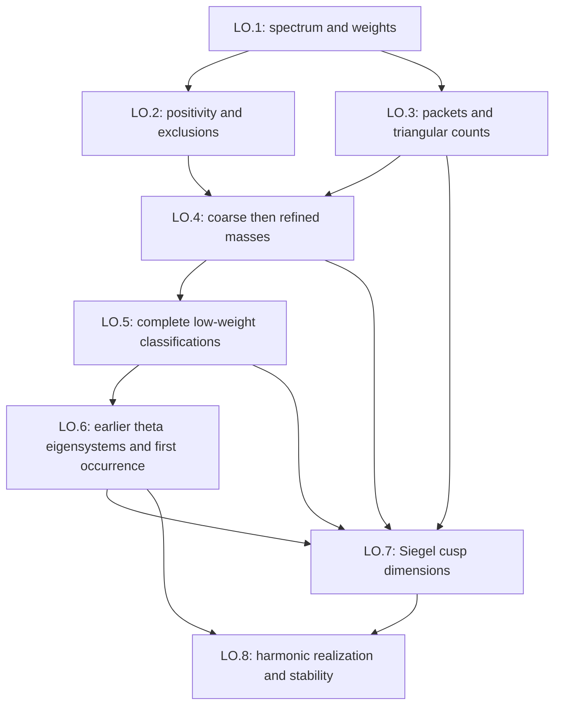

# Level-one automorphic forms for classical groups

This roadmap constructs a proof path from the level-one algebraic cuspidal spectrum of PGLₘ over ℚ to exact Siegel cusp dimensions, harmonic lattice theta realizations and stable scalar forms. The principal source is Chenevier–Taïbi, *Discrete series multiplicities for classical groups over Z and level 1 algebraic cusp forms* (2020), abbreviated CT20. The source manifest below fixes the edition and exact reading boundary of every supporting source. All definitions and mathematical statements here are formulated in our own words.

The design contains 108 targets in eight layers. A target is planned mathematics, not a declaration already proved in Lean. The packet has status `complete` because this design pass covers all layers; every node has implementation status `unchecked`. The twelve explicit gaps concern proof-bearing computations, missing native suppliers and source details, not an unmentioned reduction in the intended endpoints. The definitive specifications, including heavy definitions that cannot yet be expressed over the pins, are in this document. The suggested Lean file is a compact subset over existing carriers.

The endpoints are CT20 Theorems 1–7 and their indicated theta/stability consequences: regular cusp dimensions through genus eight; the 29 nonscalar low-weight spaces; repeated-weight self-dual GL₄ vanishing through odd weight 53; all scalar cusp dimensions through weight thirteen; the top-simple weight-23 and regular self-dual weight-24 classifications; the repeated-top alternatives and separate GRH restriction; masses through SO₁₇ and Sp₁₆ in the permitted discrete-series groups; the three low-weight theta basis theorems; harmonic realizations of the four weight-13 forms; and stable dimensions, Siegel operators and theta isomorphisms at genus 2k. The weight-at-most-22 theorem is included with the new explicit-formula proof. The design includes CT19a’s direct nonzero Leech coefficients, which make the harmonic realization concrete.

## Conventions and the order of construction

Write Γ_g=Sp₂g(ℤ). For a dominant highest weight k=(k₁,…,k_g), write M_k and S_k for the full-level Siegel modular and cusp spaces; a scalar k means (k,…,k). Genus zero means the constant space. The cuspidal GL spectrum uses unitary normalization: Δ_w comes from an elliptic eigenform of classical weight w+1 and has weights ±w/2. A label Δ_{w₁,…,wᵣ} denotes the indicated symplectic cuspidal class with those positive doubled weights. The two classes of Δ₂₃ are separately labeled when class identity matters. Oᵒᵈᵈ(24,16,8), Oᵉᵛᵉⁿ(24,18,10,4) and Oᵉᵛᵉⁿ(24,20,14,2) denote the three regular weight-24 classes. Their coordinates in this notation are doubled weights. An Arthur block π[d] has standard dimension rank(π)·d; [d] means the trivial rank-one class at length d.

For a classical group distinguish d_G=dim Std(G), the degree of a torsion characteristic polynomial, from m_G=dim Std(Ĝ), the rank of a simple cuspidal block in its transfer. In particular Sp₁₆ uses degree 16 polynomials and rank-17 dual parameters. All maximal compacts and all finite integral models follow the source’s full-real-group and ℤ₂ conventions. The normalizations are checked by SO₃, not inferred from positivity of masses.

The dependency graph separates earlier lattice theta theory from its new dimension consequences:



Within LO.4, coarse tables → existence of the 27 known classes → refined tables is essential. The statement establishing the known classes proves existence at the listed types, not a classification of all types. LO.5 supplies exhaustion afterwards. Within LO.6, the CL lattice eigensystem and first-occurrence theorem is an earlier input; it is never proved by the new LO.7 table that uses it. Stage dependencies and node dependencies are both acyclic.

| Layer | Targets | Visible planets | Construction output |
|---|---:|---:|---|
| LO.1 | 9 | 4 | Level-one cuspidal forms and classical infinitesimal characters |
| LO.2 | 21 | 6 | Rankin–Selberg positivity and certified exclusions |
| LO.3 | 16 | 5 | Arthur parameters, packet characters and triangular counts |
| LO.4 | 17 | 5 | Geometric torsion classes and exact mass recovery |
| LO.5 | 10 | 5 | Cuspidal classifications through motivic weight twenty-four |
| LO.6 | 11 | 4 | Lattice theta maps and first occurrence |
| LO.7 | 10 | 5 | Siegel cusp dimensions and the four weight-thirteen forms |
| LO.8 | 14 | 6 | Harmonic theta realizations and stable scalar forms |

## Existing libraries and ownership

The declaration audit uses Tau Ceti `f790474821cf4256814db967cb154e7af3d0c369` and Mathlib `082e2d37e8b0463410cdb532e111cd43d5a66174`. Each following statement was read at those pins. The current upstream TauCetiRoadmap and current Tau Ceti library were also read in place to avoid duplicating work added after the atlas snapshot. Current library inspection is an ownership check, not a replacement for the pinned compilation baseline.

- **tauceti:TauCeti.Symplectic.groupScheme** (TauCeti/Algebra/AlgebraicGroup/Symplectic/Basic.lean): The split integral symplectic group scheme, reused as the level-one symplectic model.
- **tauceti:TauCeti.Symplectic.pointsMulEquiv** (TauCeti/Algebra/AlgebraicGroup/Symplectic/Basic.lean): Functor-of-points multiplicative equivalence with the standard matrix symplectic group.
- **tauceti:TauCeti.Symplectic.instSmoothCoordinateHopfAlgebra** (TauCeti/Algebra/AlgebraicGroup/Symplectic/Smooth.lean): Smoothness of the symplectic coordinate Hopf algebra; the existing scheme must not be replanned.
- **mathlib:IsSelfAdjoint.hasEigenvector_of_isLocalExtrOn** (Mathlib/Analysis/InnerProductSpace/Rayleigh.lean): A nonzero local extremum of the self-adjoint Rayleigh quotient on its norm sphere is an eigenvector; least-eigenvalue minimality needs an additional proof.
- **mathlib:ModularForm.dimension_level_one** (Mathlib/NumberTheory/ModularForms/LevelOne/DimensionFormula.lean): For even natural k, the complex module rank is k/12 when k≡2 mod12 and k/12+1 otherwise.
- **mathlib:CuspForm.discriminantEquiv** (Mathlib/NumberTheory/ModularForms/LevelOne/DimensionFormula.lean): The linear equivalence from cusp weight k to modular weight k−12 divides by the discriminant; its inverse multiplies by the discriminant.

Mathlib already supplies the classical level-one dimensions and multiplication-by-discriminant equivalence. This roadmap applies them in rank two and uses the classical/adelic eigenform dictionary; it does not plan another dimension theorem. The pinned self-adjoint local-extremum result supplies an eigenvector, and LO.2 proves the extra least-eigenvalue assertion needed by the face search. Tau Ceti already supplies the smooth split symplectic scheme and its matrix points. Integral SO at 2, general ring spinor norms and the higher-theta/automorphic carriers have separate owners.

Current upstream **RootSystems** and **SpinRepresentations** reader documents were read in full as structural examples; their infrastructure is imported through LieHighestWeight and the current spin owner. Current **IntegralLattices** supplies the rational lattice carrier and its Gram, isometry, discriminant and reference-lattice constructions. Its two rank-16 examples and 24 rank-24 reference lattices are not by themselves exhaustive classifications. Rank-16 completeness belongs to **OrthogonalTamagawaAndLatticeMass**, Layer 7I. Rank-24 completeness and rootless Leech uniqueness require the GN.3/current-owner extension. Genus-one theta and its rational-to-real bridge remain with **ThetaSeries**. The exact contracts below identify every cross-roadmap input; those source files are not changed by this design.

Current AlgebraicCodingTheory Layer 5 owns the extended binary Golay code; current Tau Ceti already proves its rank, Type II property, minimum distance and enumerator in `TauCeti/InformationTheory/Coding/Binary/Golay/Basic.lean`. Its Construction A lattice is available in `TauCeti/LinearAlgebra/IntegralLattice/ConstructionA/Golay.lean`. That lattice has roots (the vectors 2eᵢ have norm two for the halved dot product); the Leech comparison still requires the twisted construction. These current interfaces postdate the compilation pin. Only the extra Mathieu incidence/orientation and Leech comparison results are requested, with no new Golay code planned here.

### Supplier contracts

- **AnalyticNumberTheory:AN.3**: Mestre–Weil explicit formula for completed Rankin–Selberg functions, compact C² test embedding, zero-side symmetric-height convergence and contour shifts with the exact 2π Fourier normalization. Provide a GRH proposition interface separate from unconditional strip positivity. Used by [LO.2/test-functions](#lo-2-test-functions), [LO.2/explicit-identity](#lo-2-explicit-identity).
- **AutomorphicBundles:B4**: Native vector-valued and scalar Siegel modular, cusp and square-integrable spaces, Fourier expansions and the classical/adelic dictionary; Wallach for k_g>g, Weissauer for g≥2k, odd-weight boundary vanishing, negative-weight vanishing and strict cusp vanishing at genus>2k. State hypotheses and normalizations separately. Used by [LO.3/lowest-weight-dictionary](#lo-3-lowest-weight-dictionary), [LO.6/higher-genus-theta](#lo-6-higher-genus-theta), [LO.6/harmonic-theta](#lo-6-harmonic-theta), [LO.7/siegel-dictionary](#lo-7-siegel-dictionary), [LO.8/stable-parameter-remainders](#lo-8-stable-parameter-remainders), [LO.8/stable-siegel-operator](#lo-8-stable-siegel-operator).
- **AutomorphicBundles:B5**: Siegel operator, ker Φ=S, Hecke compatibility, Zharkovskaya’s normalized reciprocal-zeta relation, and the boundary/growth statement used for higher-genus square-integrable theta lifts. Used by [LO.6/higher-genus-theta](#lo-6-higher-genus-theta), [LO.6/square-integrable-higher-lift](#lo-6-square-integrable-higher-lift), [LO.7/siegel-dictionary](#lo-7-siegel-dictionary), [LO.7/scalar-case-I](#lo-7-scalar-case-i), [LO.6/siegel-operator-standard-factor](#lo-6-siegel-operator-standard-factor), [LO.8/low-weight-theta-surjectivity](#lo-8-low-weight-theta-surjectivity), [LO.8/stable-siegel-operator](#lo-8-stable-siegel-operator).
- **AutomorphicFormsOnReductiveGroups:AF.1**: Real W_R, continuous real LLC for GL_m, spherical local components and full-real-group maximal compact conventions. Add the existence and normalization of the classical discrete-series inputs needed here; compare with the current ReductiveGroups integral models. Used by [LO.1/pi-alg](#lo-1-pi-alg), [LO.1/archimedean-ring](#lo-1-archimedean-ring), [LO.1/classical-models](#lo-1-classical-models), [LO.3/ep-characteristic](#lo-3-ep-characteristic).
- **AutomorphicFormsOnReductiveGroups:AF.2**: Adelic cuspidal representations, restricted tensor products and finite Satake classes, specialized to PGL_m/Q, trivial finite conductor and unitary normalization. Fixed infinity-type/level fibres must be finite before natural-number counts are taken. Used by [LO.1/pi-alg](#lo-1-pi-alg).
- **AutomorphicFormsOnReductiveGroups:AF.4**: Purity in the unitary normalization, scalar action of −1, C/L-algebraic comparison and the holomorphic lowest-weight-module dictionary. Keep actual representations distinct when their infinity types coincide. Used by [LO.1/pi-alg](#lo-1-pi-alg), [LO.1/purity-and-duality](#lo-1-purity-and-duality), [LO.3/lowest-weight-dictionary](#lo-3-lowest-weight-dictionary).
- **AutomorphicFormsOnReductiveGroups:AF.5**: The compact-at-infinity algebraic modular-form decomposition, Hecke action, stabilizer pairing and invariant/coinvariant normalization; the classical normalized eigenform-to-GL₂ unitary cuspidal dictionary with existence and distinctness. Used by [LO.2/gl2-dimension-recovery](#lo-2-gl2-dimension-recovery), [LO.6/lattice-spectrum-input](#lo-6-lattice-spectrum-input), [LO.6/small-lattice-eigenparameters](#lo-6-small-lattice-eigenparameters), [LO.6/harmonic-theta](#lo-6-harmonic-theta), [LO.2/repeated-weight-gl4-vanishing](#lo-2-repeated-weight-gl4-vanishing).
- **AutomorphicLFunctionsAndLocalFactors:AL.1**: Archimedean gamma and epsilon factors with Γ_R(s)=π^(−s/2)Γ(s/2), Γ_C(s)=2(2π)^(−s)Γ(s), plus standard L-functions of Arthur blocks and the required meromorphic gamma/zeta product identities. Used by [LO.1/archimedean-ring](#lo-1-archimedean-ring), [LO.6/boecherer-criterion](#lo-6-boecherer-criterion), [LO.6/siegel-operator-standard-factor](#lo-6-siegel-operator-standard-factor), [LO.8/five-theta-orders](#lo-8-five-theta-orders).
- **AutomorphicLFunctionsAndLocalFactors:AL.2**: The standard real epsilon normalization ε(1)=1, ε(e)=i, ε(I_w)=i^(w+1) and multiplicativity; finite level-one factors are 1. Used by [LO.1/archimedean-invariants](#lo-1-archimedean-invariants).
- **AutomorphicLFunctionsAndLocalFactors:AL.3**: Rankin–Selberg analytic continuation, functional equation, poles only at the relevant contragredient isomorphism, zero multiplicities and completed-function growth. Isobaric strong multiplicity one and self-dual type compatibility are required with norm-twist qualifications explicit. Used by [LO.1/selfdual-type](#lo-1-selfdual-type), [LO.2/explicit-forms](#lo-2-explicit-forms), [LO.2/explicit-identity](#lo-2-explicit-identity), [LO.6/central-nonvanishing](#lo-6-central-nonvanishing).
- **AutomorphicSpectralTheory:AS.4**: Finite multiplicities and finite fixed-level/fixed-infinitesimal-character discrete spectrum, including residual spectrum. Used by [LO.1/counts](#lo-1-counts).
- **AutomorphicSpectralTheory:AS.6**: Arthur’s L²-Lefschetz/EP trace identity, full-K and measure normalization, elliptic centralizer-volume/orbital expansion, and Tai17 Theorems 3.3.3–3.3.5 with exact shuffle coefficients and signs. Also supply direct easy-pattern local orbital values for Sp₁₆ with p=2 treated integrally; no guessed connected-Weyl-group factors. Used by [LO.3/packet-ep-contribution](#lo-3-packet-ep-contribution), [LO.3/ep-characteristic](#lo-3-ep-characteristic), [LO.4/geometric-classes-masses](#lo-4-geometric-classes-masses), [LO.4/mass-rationality](#lo-4-mass-rationality), [LO.4/trace-formula](#lo-4-trace-formula), [LO.4/sp16-masses](#lo-4-sp16-masses).
- **ComputationalNumberTheory:CN.4**: Use the existing eight ct-explicit-formula-values scalars, sound interval enclosures, geometric/alternating tail bounds, Gram negativity soundness, complete effective ellipsoid cover and multiplicity-gram-lift. Supply any missing n-weighted alternating-tail monotonicity bound, including the condition ℓ(N+1)≥1. The intrinsic gamma-integral comparison belongs to LO.2. Include sound scalar enclosures and rational witnesses for the 27 odd repeated-weight GL₄ cases through w=53 at ℓ=5, with all known GL₂ classes. Used by [LO.2/compressed-negativity](#lo-2-compressed-negativity), [LO.2/scalar-comparison](#lo-2-scalar-comparison), [LO.2/certified-search](#lo-2-certified-search), [LO.2/positive-definite-cover](#lo-2-positive-definite-cover), [LO.4/coarse-mass-tables](#lo-4-coarse-mass-tables), [LO.5/classification-certificates](#lo-5-classification-certificates), [LO.2/repeated-weight-gl4-vanishing](#lo-2-repeated-weight-gl4-vanishing).
- **ComputationalNumberTheory:CN.5**: Exact rational parsing, hashes, finite-list completeness manifests, matrix-rank witnesses and bulk checker integration. A checked list of negative rows must not stand in for completeness of the candidate cover. Used by [LO.4/mass-dataset-comparison](#lo-4-mass-dataset-comparison), [LO.5/classification-certificates](#lo-5-classification-certificates).
- **FiniteFieldsAndCharacterSums:FF.4**: Consume the extended binary Golay code from current AlgebraicCodingTheory Layer 5 and native TauCeti.BinaryGolay.code; do not construct it again in FF.4. Extend the supplier only with its permutation automorphism action M₂₄ and proof-bearing incidence/orientation data (octads, dodecads, orientable subset orbits). FF.4 currently does not export these results. The twisted coordinate Leech construction and isometry comparison are the GN.3/current lattice-owner request, not ordinary binary Construction A. Used by [LO.8/leech-invariants](#lo-8-leech-invariants), [LO.8/leech-alternating-forms](#lo-8-leech-alternating-forms).
- **GeometryOfNumbersAndQuadraticArithmetic:GN.2**: General spinor norm over rings and fields, integral GSpin lifting over Z_p, Zassenhaus and discriminant identities, including p=2. Coordinate with current OrthogonalSpinGroups; LO.4 owns only the resulting all-primes polynomial obstruction. Used by [LO.4/spinor-polynomial-constraint](#lo-4-spinor-polynomial-constraint).
- **GeometryOfNumbersAndQuadraticArithmetic:GN.3**: Finite lattice genera and adelic class comparison; rank-24 completeness and rootless Leech uniqueness beyond current IntegralLattices 6E; rank-16 completeness from OrthogonalTamagawaAndLatticeMass 7I. Supply exact automorphism/Hecke data, Leech/Golay coordinate comparison, and CT19a Proposition 2.2/3.13 embedding-orbit and stabilizer theorems. Generic mass infrastructure stays here and with the current upstream successor. Used by [LO.4/mass-rationality](#lo-4-mass-rationality), [LO.6/lattice-spectrum-input](#lo-6-lattice-spectrum-input), [LO.8/low-weight-theta-surjectivity](#lo-8-low-weight-theta-surjectivity), [LO.8/leech-invariants](#lo-8-leech-invariants), [LO.8/leech-alternating-forms](#lo-8-leech-alternating-forms), [LO.8/direct-leech-nonvanishing](#lo-8-direct-leech-nonvanishing), [LO.8/rank16-harmonic-source](#lo-8-rank16-harmonic-source), [LO.8/stable-theta-isomorphism](#lo-8-stable-theta-isomorphism).
- **MetaplecticAutomorphicForms:MP.3**: The normalized local theta correspondence and unramified standard-parameter comparison for O_n and Sp_2g. The imported relation must distinguish the actual lift genus g from first occurrence g₀. Used by [LO.6/rallis-parameter-relation](#lo-6-rallis-parameter-relation).
- **MetaplecticAutomorphicForms:MP.5**: Global Gaussian and harmonic theta kernels, convergence/modularity/Hecke commutation; the known low-genus lattice spanning theorem in weights 4,8,12 and strict stable spanning for g>2k. Genus-one lattice theta, rational-real bridge and E₄ specializations remain with current ThetaSeries. Used by [LO.6/higher-genus-theta](#lo-6-higher-genus-theta), [LO.6/harmonic-coefficient-module](#lo-6-harmonic-coefficient-module), [LO.6/harmonic-theta](#lo-6-harmonic-theta), [LO.8/low-weight-theta-surjectivity](#lo-8-low-weight-theta-surjectivity), [LO.8/stable-theta-isomorphism](#lo-8-stable-theta-isomorphism).
- **MetaplecticAutomorphicForms:MP.6**: First-occurrence tower and growth criteria, Rallis comparison and generic Ikeda lift. Supply the precise hypotheses of Böcherer 1989 Theorem 5 and its normalization; only the five weight-13 specializations of the companion note are required by this roadmap. Used by [LO.6/rallis-parameter-relation](#lo-6-rallis-parameter-relation), [LO.6/square-integrable-higher-lift](#lo-6-square-integrable-higher-lift), [LO.6/boecherer-criterion](#lo-6-boecherer-criterion), [LO.7/scalar-case-I](#lo-7-scalar-case-i).
- **ModularityAndLanglandsExtensions:ML.0**: Retain the explicit Arthur dependency gate and its distinction between conditional endpoint interfaces and supplied proofs of the general endoscopic classification. No LO theorem closes that gate by citation. Used by [LO.3/level-one-multiplicity](#lo-3-level-one-multiplicity).
- **ModularityAndLanglandsExtensions:ML.4**: Global discrete Arthur parameters and multiplicities, finite spherical packets, even-SO outer convention and global multiplicity factors; Adams–Johnson identification and Moeglin–Renard scalar holomorphic packets with their canonical pairings. The general Arthur dependency gate ML.0 remains binding. Used by [LO.1/selfdual-type](#lo-1-selfdual-type), [LO.3/arthur-parameters](#lo-3-arthur-parameters), [LO.3/component-group](#lo-3-component-group), [LO.3/level-one-multiplicity](#lo-3-level-one-multiplicity), [LO.3/lowest-weight-dictionary](#lo-3-lowest-weight-dictionary), [LO.3/regular-holomorphic-packet](#lo-3-regular-holomorphic-packet), [LO.3/scalar-packet-membership](#lo-3-scalar-packet-membership), [LO.3/scalar-H-structure](#lo-3-scalar-h-structure), [LO.3/packet-ep-contribution](#lo-3-packet-ep-contribution), [LO.6/small-lattice-eigenparameters](#lo-6-small-lattice-eigenparameters).
- **tauceti:Completed/IntegralLattices#layer-1-lattices-with-forms**: Reuse the existing integral/rational lattice carrier, full Z-module and bilinear form, Gram transport, isometries and discriminant-form interface. Current 6C gives E₈ uniqueness; 6D/6E give examples and nonisometry, with completeness imported from the successor/GN.3. Used by [LO.6/lattice-spectrum-input](#lo-6-lattice-spectrum-input).
- **tauceti:TauCetiRoadmap/ModularForms#layer-4-eigenforms-newforms-primitive-forms-the-conductor**: Existing classical Hecke/eigenform theory, simultaneous eigensystem decomposition and normalized GL₂ dictionary input; the level-one dimension formula is already in Mathlib. Used by [LO.2/gl2-dimension-recovery](#lo-2-gl2-dimension-recovery).
- **tauceti:TauCetiRoadmap/ReductiveGroups#layer-9-pinned-chevalleydemazure-group-schemes-over-ℤ**: The split integral orthogonal Chevalley–Demazure model, its comparison to CT20’s quadratic form, and integral spherical subgroup at 2. The pinned symplectic scheme already supplies the Sp model. Used by [LO.1/classical-models](#lo-1-classical-models).
- **tauceti:TauCetiRoadmap/RepresentationTheory/LieHighestWeight#layer-6-the-weyl-character-dimension-and-kostant-formulas**: Use the general Weyl character, dimension and Kostant formulas. Request the Koike–Terada elementary-symmetric determinant specialization, or prove it here from that general theorem; include even-SO outer restriction and singular-torus evaluation. Used by [LO.1/weight-dictionary](#lo-1-weight-dictionary), [LO.4/torsion-character-evaluation](#lo-4-torsion-character-evaluation), [LO.6/harmonic-coefficient-module](#lo-6-harmonic-coefficient-module), [LO.8/leech-invariants](#lo-8-leech-invariants), [LO.8/oriented-orbit-basis](#lo-8-oriented-orbit-basis).
- **tauceti:TauCetiRoadmap/AlgebraicCodingTheory#layer-5-tetracode-hexacode-and-the-extended-golay-codes**: Reuse the extended binary Golay code and its generator, rank, Type II, minimum-distance and weight-enumerator API. Current library main already has TauCeti.BinaryGolay.code, finrank_code, isTypeII_code, hammingMinDist_code and weightEnumerator_code; these postdate the fixed compilation pin. Mathieu identification, orientable subset orbits and the Leech comparison are separate requested extensions. Used by [LO.8/leech-invariants](#lo-8-leech-invariants), [LO.8/leech-alternating-forms](#lo-8-leech-alternating-forms).

### Proposed supplier extensions

- The GN.2 request requires integral ring spinor norms and local GSpin lifting beyond the field spinor/Zassenhaus interface in current OrthogonalSpinGroups. These are generic inputs, not LO-specific definitions. Route the missing generic input to an extension titled Orthogonal and spin groups, Part II: integral spinor norms and local lifting, with current OrthogonalSpinGroups as its first prerequisite. GN.2 imports that extension. LO.4 retains only the all-primes torsion-polynomial consequence. This proposal changes no upstream layer.
- The GN.3 request needs rank-24 classification completeness, rootless Leech uniqueness and Leech embedding/stabilizer results beyond the reference-lattice constructions on current IntegralLattices main. Route those missing inputs to Integral lattices, Part II: Niemeier completeness and Leech embedding orbits, with current IntegralLattices as its first prerequisite; GN.3 imports that extension. Rank-16 completeness remains with the existing OrthogonalTamagawaAndLatticeMass successor, Layer 7I. LO.6 and LO.8 retain the theta comparisons and coefficients, with no new lattice carrier or classification infrastructure here. This proposal changes no upstream layer.

## Normalization calculations and finite mathematical data

### Intrinsic explicit formula and its certified numerical interface

Use F̂(ξ)=∫ℝF(x)e^(−2πixξ)dx, A_F=F̂(i/(4π)) and B_F=F̂(0). The intrinsic gamma integral is J_F(U)=−∫ℝ(Γ′/Γ)(1/2+2πit,U)F̂(t)dt. The equality B_f+B_∞+Z/2=A_Fδ is proved before numerical evaluation. On a nonnegative automorphic vector the finite term is a sum of nonnegative weighted squared Satake-trace sums, and a negative pair root number forces a central zero. The result is C^F≥0 on that cone. It is not a positive-semidefinite assertion on all signed vectors.

For admissible finite data the matrix entry is

βᵢⱼ=(A_F/mᵢ)δᵢⱼ−J_F(UᵢUⱼ)−(B_F/4)δᵢδⱼ(1−ε(UᵢUⱼ)).

The active epsilon factors must lie in {±1}. To realize a candidate block with m classes, use the average tᵢ/mᵢ of those classes. A square-root lift is incompatible with this diagonal. If an expanded block has size two and A=K=1, its unit-sphere minimum is −1 while the compressed one is −1/2. Both are negative, which is the property used by exclusion. This example is included in the suggested file.

The unconditional family is F_ℓ(x)=g(x/ℓ)/cosh(x/2), with g=2(u*u), u(x)=cos(πx) on |x|≤1/2 and zero outside. The GRH family is G_ℓ(x)=g(x/ℓ). Compact support, C² boundary matching and strip positivity are mathematical lemmas; a numerical positivity plot supplies none of them. The eight CN scalar indices are, in order, F̂(0), F̂(i/(4π)), J_F(I_w), J_F(1−e), Ĝ(0), Ĝ(i/(4π)), J_G(I_w), J_G(1−e). Their comparison with the intrinsic objects is LO.2/scalar-comparison.

For review of the imported scalar formulas, set φ(z)=(ψ((z+1)/2)−ψ(z/2))/2 and r(x)=2π²e^(−x)/(x²+π²)². With b=1/2+w/4 and z=b+iπ/(2ℓ), the unconditional formulas are:

- J_F(I_w)=log π−Re ψ(z)+Im ψ(z)/π−Re ψ′(z)/(2ℓ)+2ℓ∑ₙ≥₀r(2ℓ(b+n)).
- J_F(1−e)=1+(2π/ℓ)Im φ(1+iπ/ℓ)+(2π/ℓ²)Im φ′(1+iπ/ℓ)+2ℓ∑ₙ≥₁(−1)^(n+1)n r(ℓn).
- F̂(0)=4Re φ(1/2+iπ/ℓ)−(4/π)Im φ(1/2+iπ/ℓ)+(4/ℓ)Re φ′(1/2+iπ/ℓ)+4ℓ∑ₙ≥₀(−1)ⁿr(ℓ(n+1/2)).
- F̂(i/(4π))=8ℓ/π²=Ĝ(0).

These are CL14 IX Proposition 3.17, pp.304–305. The corresponding G formulas are stated in LO.2/scalar-comparison and CT20 Proposition 4.4, pp.298–299. Every infinite remainder needs a proved tail bound. CN owns enclosure algorithms, precision refinement, rational quadratic evaluation and complete ellipsoid covers; this roadmap owns their intrinsic interpretation. A successful exploratory run, a stored residual list and a full-rank floating matrix are separate from their required exact certificates.

### SO₃ and the finite torsion support counts

At torsion orders 1,2,3,4,6 and highest weights 0 through 4, the exact trace matrix is

```text
 1   1   1   1   1
 3  -1   0   1   2
 5   1  -1  -1   1
 7  -1   1  -1  -1
 9   1   0   1  -2
```

Its determinant is 288. Against (1/2,−1/2,−1/2,−1/2,−1/2), the solution is (−1/12,1/4,1/3,0,0). These two equalities were independently checked by exact rational elimination in this design; the suggested Lean file states them as targets, with no claim of an implemented mass theorem. The character denominator is sin(π/i), as the k=0 character test already forces. This example simultaneously tests signed mass, the residual spectrum and the +1/2 proper-Levi correction (CT20 §1.4, pp.270–271).

The finite counts below were independently recomputed by exact cyclotomic exponent enumeration, polynomial negation and integer-square tests. P₁ uses the spinor obstruction only for SO; for Sp it equals P. Counts use the central quotient for Sp/even SO and no quotient for odd SO. These checks reproduce mathematical finite data and are not Lean certificates for mass recovery.

| Group | P modulo the prescribed relation | P₁ modulo that relation |
|---|---:|---:|
| Sp₂ | 3 | 3 |
| Sp₄ | 12 | 12 |
| Sp₆ | 32 | 32 |
| Sp₈ | 92 | 92 |
| Sp₁₀ | 219 | 219 |
| Sp₁₂ | 530 | 530 |
| Sp₁₄ | 1158 | 1158 |
| Sp₁₆ | 2521 | 2521 |
| SO₃ | 5 | 3 |
| SO₄ | 12 | 6 |
| SO₅ | 19 | 12 |
| SO₇ | 59 | 34 |
| SO₈ | 92 | 40 |
| SO₉ | 165 | 99 |
| SO₁₁ | 419 | 244 |
| SO₁₂ | 530 | 211 |
| SO₁₃ | 1001 | 598 |
| SO₁₅ | 2257 | 1339 |
| SO₁₆ | 2521 | 992 |
| SO₁₇ | 4877 | 2948 |

The refined vanishing-row systems have (rows,columns)=(1274,1158), (1810,992), (3477,2948) for Sp₁₄, SO₁₆, SO₁₇. The Sp₁₆ hard system has (1086,766). The complete rational rank and interval-vanishing certificates remain required implementation artifacts. Their matrix dimensions fix the intended targets; they do not stand in for checking those matrices.

### The complete nonscalar table

For 13≥k₁≥⋯≥k_g>g and nonscalar k, these are exactly the 29 nonzero spaces; every listed dimension is one. The parameters were independently regenerated by exact doubled-weight and epsilon arithmetic and compared with CT20 Table 5, p.319. This is finite mathematical data, with the completeness proof specified in LO.7.

| Genus | Highest weight k | Standard parameter |
|---:|---|---|
| 3 | (12, 8, 8) | Δ₁₁[2] ⊕ Sym²Δ₁₁ |
| 3 | (12, 10, 10) | Δ₁₅[2] ⊕ Sym²Δ₁₁ |
| 3 | (13, 10, 7) | Oᵒᵈᵈ(24,16,8) |
| 4 | (11, 11, 7, 7) | Δ₁₉,₇[2] ⊕ [1] |
| 4 | (12, 12, 6, 6) | Δ₂₁,₅[2] ⊕ [1] |
| 4 | (12, 12, 8, 8) | Δ₂₁,₉[2] ⊕ [1] |
| 4 | (12, 12, 10, 10) | Δ₂₁,₁₃[2] ⊕ [1] |
| 4 | (13, 11, 8, 6) | [1] ⊕ Oᵉᵛᵉⁿ(24,18,10,4) |
| 4 | (13, 12, 10, 5) | [1] ⊕ Oᵉᵛᵉⁿ(24,20,14,2) |
| 4 | (13, 13, 7, 7) | Δ₂₃,₇[2] ⊕ [1] |
| 5 | (12, 10, 10, 10, 10) | Δ₁₁[2] ⊕ Δ₁₅[2] ⊕ Sym²Δ₁₁ |
| 5 | (12, 12, 12, 8, 8) | Δ₁₉,₇[2] ⊕ Sym²Δ₁₁ |
| 5 | (12, 12, 12, 10, 10) | Δ₁₁[2] ⊕ Δ₁₉[2] ⊕ Sym²Δ₁₁ |
| 5 | (13, 12, 12, 12, 9) | Δ₁₉[2] ⊕ Oᵒᵈᵈ(24,16,8) |
| 6 | (12, 12, 10, 10, 10, 10) | Δ₁₁[4] ⊕ Δ₂₁[2] ⊕ [1] |
| 6 | (12, 12, 12, 12, 8, 8) | Δ₁₇[2] ⊕ Δ₂₁,₅[2] ⊕ [1] |
| 6 | (12, 12, 12, 12, 10, 10) | Δ₁₇[2] ⊕ Δ₂₁,₉[2] ⊕ [1] |
| 6 | (13, 12, 12, 12, 12, 7) | Δ₁₇[2] ⊕ [1] ⊕ Oᵉᵛᵉⁿ(24,20,14,2) |
| 6 | (13, 13, 12, 12, 9, 9) | Δ₁₇[2] ⊕ Δ₂₃,₇[2] ⊕ [1] |
| 7 | (12, 10, 10, 10, 10, 10, 10) | Δ₁₁[6] ⊕ Sym²Δ₁₁ |
| 7 | (12, 12, 12, 10, 10, 10, 10) | Δ₁₁[2] ⊕ Δ₁₉,₇[2] ⊕ Sym²Δ₁₁ |
| 7 | (12, 12, 12, 12, 12, 10, 10) | Δ₁₅[2] ⊕ Δ₁₉,₇[2] ⊕ Sym²Δ₁₁ |
| 7 | (13, 13, 13, 12, 9, 9, 9) | Δ₂₁,₅[2] ⊕ Oᵒᵈᵈ(24,16,8) |
| 8 | (12, 12, 10, 10, 10, 10, 10, 10) | Δ₁₁[4] ⊕ Δ₂₁,₅[2] ⊕ [1] |
| 8 | (12, 12, 12, 12, 10, 10, 10, 10) | Δ₁₉,₇[4] ⊕ [1] |
| 8 | (12, 12, 12, 12, 12, 12, 10, 10) | Δ₁₅[4] ⊕ Δ₂₁,₅[2] ⊕ [1] |
| 8 | (13, 13, 12, 12, 12, 12, 11, 11) | Δ₁₅[4] ⊕ Δ₂₃,₇[2] ⊕ [1] |
| 8 | (13, 13, 13, 13, 9, 9, 9, 9) | Δ₂₁,₅[4] ⊕ [1] |
| 8 | (13, 13, 13, 13, 11, 11, 11, 11) | Δ₂₁,₉[4] ⊕ [1] |

### The complete scalar cusp table through weight thirteen

For 0≤k≤13 and g≥1, the cusp dimension is the number of rows with that (g,k), and zero if no row occurs. Each row contributes one eigenline. The 29 regular rows are joined to the three singular rows (12,12),(16,13),(24,13). At (4,12), for example, there are two rows and the dimension is two. These are CT20 Table 6, p.320; the regular rows were independently regenerated in this design.

| Genus | Scalar weight | Standard parameter |
|---:|---:|---|
| 1 | 12 | Sym²Δ₁₁ |
| 2 | 10 | Δ₁₇[2] ⊕ [1] |
| 2 | 12 | Δ₂₁[2] ⊕ [1] |
| 3 | 12 | Δ₁₉[2] ⊕ Sym²Δ₁₁ |
| 4 | 8 | Δ₁₁[4] ⊕ [1] |
| 4 | 10 | Δ₁₅[4] ⊕ [1] |
| 4 | 12 | Δ₁₇[2] ⊕ Δ₂₁[2] ⊕ [1] |
| 4 | 12 | Δ₁₉[4] ⊕ [1] |
| 5 | 12 | Δ₁₅[2] ⊕ Δ₁₉[2] ⊕ Sym²Δ₁₁ |
| 5 | 12 | Δ₁₇[4] ⊕ Sym²Δ₁₁ |
| 6 | 10 | Δ₁₁[4] ⊕ Δ₁₇[2] ⊕ [1] |
| 6 | 12 | Δ₁₅[4] ⊕ Δ₂₁[2] ⊕ [1] |
| 6 | 12 | Δ₁₇[2] ⊕ Δ₂₁,₁₃[2] ⊕ [1] |
| 6 | 12 | Δ₁₇[6] ⊕ [1] |
| 7 | 12 | Δ₁₁[2] ⊕ Δ₁₅[2] ⊕ Δ₁₉[2] ⊕ Sym²Δ₁₁ |
| 7 | 12 | Δ₁₁[2] ⊕ Δ₁₇[4] ⊕ Sym²Δ₁₁ |
| 7 | 12 | Δ₁₅[6] ⊕ Sym²Δ₁₁ |
| 8 | 10 | Δ₁₁[8] ⊕ [1] |
| 8 | 12 | Δ₁₁[4] ⊕ Δ₁₇[2] ⊕ Δ₂₁[2] ⊕ [1] |
| 8 | 12 | Δ₁₁[4] ⊕ Δ₁₉[4] ⊕ [1] |
| 8 | 12 | Δ₁₅[4] ⊕ Δ₂₁,₉[2] ⊕ [1] |
| 8 | 12 | Δ₁₅[8] ⊕ [1] |
| 8 | 13 | Δ₂₁,₁₃[4] ⊕ [1] |
| 9 | 12 | Δ₁₁[2] ⊕ Δ₁₅[2] ⊕ Δ₁₉,₇[2] ⊕ Sym²Δ₁₁ |
| 9 | 12 | Δ₁₁[6] ⊕ Δ₁₉[2] ⊕ Sym²Δ₁₁ |
| 10 | 12 | Δ₁₁[4] ⊕ Δ₁₇[2] ⊕ Δ₂₁,₅[2] ⊕ [1] |
| 10 | 12 | Δ₁₁[8] ⊕ Δ₂₁[2] ⊕ [1] |
| 11 | 12 | Δ₁₁[10] ⊕ Sym²Δ₁₁ |
| 12 | 12 | Δ₁₁[12] ⊕ [1] |
| 12 | 13 | Δ₁₉,₇[6] ⊕ [1] |
| 16 | 13 | Δ₁₇[8] ⊕ [9] ⊕ [7] ⊕ [1] |
| 24 | 13 | Δ₁₁[12] ⊕ [25] |

Consequently M₁₃=S₁₃ is one-dimensional precisely in genera 8,12,16,24. The four standard parameters in those rows will also label the harmonic theta lines. The genus-16 parameter repeats the trivial cuspidal class at three different lengths, an explicit regression test for the distinct-pair convention.

### The 24 earlier lattice eigenparameters and their theta degrees

This is the rank-24 compact spectrum input from CL14 Theorem E and Table I.2, pp.12–14, and Table C.5, p.440. It is established before the LO.7 scalar theorem. The table is written in increasing first-occurrence degree, rather than the source’s row order. A final trivial string has length 23−2g₀ below the middle dimension. At degree twelve the compact parameter is Δ₁₁[12], since its genus-twelve Sp parameter has one additional [1]. All rows have O₂₄ standard dimension 24.

| First-occurrence degree g₀ | O₂₄ standard parameter |
|---:|---|
| 0 | [23] ⊕ [1] |
| 1 | Sym²Δ₁₁ ⊕ [21] |
| 2 | Δ₂₁[2] ⊕ [1] ⊕ [19] |
| 3 | Δ₁₉[2] ⊕ Sym²Δ₁₁ ⊕ [17] |
| 4 | Δ₁₇[2] ⊕ Δ₂₁[2] ⊕ [1] ⊕ [15] |
| 4 | Δ₁₉[4] ⊕ [1] ⊕ [15] |
| 5 | Δ₁₅[2] ⊕ Δ₁₉[2] ⊕ Sym²Δ₁₁ ⊕ [13] |
| 5 | Δ₁₇[4] ⊕ Sym²Δ₁₁ ⊕ [13] |
| 6 | Δ₁₅[4] ⊕ Δ₂₁[2] ⊕ [1] ⊕ [11] |
| 6 | Δ₁₇[2] ⊕ Δ₂₁,₁₃[2] ⊕ [1] ⊕ [11] |
| 6 | Δ₁₇[6] ⊕ [1] ⊕ [11] |
| 7 | Δ₁₁[2] ⊕ Δ₁₅[2] ⊕ Δ₁₉[2] ⊕ Sym²Δ₁₁ ⊕ [9] |
| 7 | Δ₁₁[2] ⊕ Δ₁₇[4] ⊕ Sym²Δ₁₁ ⊕ [9] |
| 7 | Δ₁₅[6] ⊕ Sym²Δ₁₁ ⊕ [9] |
| 8 | Δ₁₁[4] ⊕ Δ₁₇[2] ⊕ Δ₂₁[2] ⊕ [1] ⊕ [7] |
| 8 | Δ₁₁[4] ⊕ Δ₁₉[4] ⊕ [1] ⊕ [7] |
| 8 | Δ₁₅[4] ⊕ Δ₂₁,₉[2] ⊕ [1] ⊕ [7] |
| 8 | Δ₁₅[8] ⊕ [1] ⊕ [7] |
| 9 | Δ₁₁[2] ⊕ Δ₁₅[2] ⊕ Δ₁₉,₇[2] ⊕ Sym²Δ₁₁ ⊕ [5] |
| 9 | Δ₁₁[6] ⊕ Δ₁₉[2] ⊕ Sym²Δ₁₁ ⊕ [5] |
| 10 | Δ₁₁[4] ⊕ Δ₁₇[2] ⊕ Δ₂₁,₅[2] ⊕ [1] ⊕ [3] |
| 10 | Δ₁₁[8] ⊕ Δ₂₁[2] ⊕ [1] ⊕ [3] |
| 11 | Δ₁₁[10] ⊕ Sym²Δ₁₁ ⊕ [1] |
| 12 | Δ₁₁[12] |

Their degree distribution is (1,1,1,1,2,2,3,3,4,2,2,1,1) in degrees zero through twelve. The corresponding modular dimensions are 1,2,3,4,6,8,11,14,18,20,22,23,24. These cumulative counts agree with the low-weight theta theorem, but the earlier eigensystem theorem is not deduced from that new consequence. Rank eight has parameter [7]⊕[1] of degree zero; rank sixteen has [15]⊕[1] of degree zero and Δ₁₁[4]⊕[7]⊕[1] of degree four.

### Harmonic theta orders and direct nonzero coefficients

The companion Böcherer note is read in full; the original 1989 theorem’s complete hypothesis comparison is an explicit MP.6/source obligation. For the five specialized products, use the order contributions (C,1/ω,γ,Λ_A,1/Γ_A) at zero. The rows are (0,0,0,−1,1) for (g,n,ν)=(8,16,5), and (0,0,0,0,0), (0,0,0,−1,1), (0,−4,−4,−1,9), (0,−12,−12,−1,25) for n=24,ν=1,g=8,12,16,24 respectively. Every row sums to zero. Distinguish Böcherer’s gamma normalization from the completed Arthur-product gamma factor. The nonzero leading coefficient uses CL14 IX Proposition 3.38 at the two GL₄ central points, not a blanket claim that every individual meromorphic factor is finite and nonzero.

For the Golay-normalized alternating Leech forms, the Fourier coefficient at Q_g is ±e_g times the number of isometric embeddings Q_g→Λ. Here (e₈,e₁₂,e₁₆,e₂₄)=(5,18,5,1); the embedding count is |O(Λ)|/κ₂₄₋g with κ_h=1 for h<12, κ₁₂=3 and κ₁₆=10. Q₈ and Q₁₆ have discriminant group (ℤ/5)⁴, Q₁₂ is the Coxeter–Todd lattice with group (ℤ/3)⁶, and Q₂₄=Λ. The number of sublattices in the orbit differs from the number of embeddings by |O(Q_g)|. That factor is retained in the proof, avoiding an erroneous stabilizer division. The coefficient and embedding assertions are CT19a Theorem 2 p.3, Lemma 2.4 pp.12–13 and Proposition 3.13 p.24.

## Layer specifications

Each target below gives its mathematical statement, proof route, imports and acceptance conditions. Definitions and constructions also expose an API derived from their actual uses and at least three discriminating tests. A failed negative test must reject a mathematically wrong object or normalization. Source locators use the manifest’s edition and pagination. A citation to a general imported theory is an explicit dependency, not a claim that this design proves that theory.

## LO.1. Level-one cuspidal forms and classical infinitesimal characters

Start with the adelic automorphic objects supplied by AF and specialize to the unitary algebraic level-one spectrum. The archimedean ring records the actual real Weil representation, including its zero characters; a multiset of nonzero weights alone loses determinant and epsilon information. Doubled integral coordinates make half-integrality and common parity exact. The classical-group dictionary distinguishes the standard dimension of G from that of its dual and has an inverse only on three specified parity images. The only repeated coordinates permitted by classical regularity are the central double zero in dimension divisible by four. Fibre cardinalities retain actual cuspidal classes: the two classes coming from S₂₄ have the same infinity type and remain distinct. The stage supplies labels and normalizations used by every subsequent computation. For every fixed regular w, N(w) and N⊥(w) are finite and N−N⊥ is even. The inverse highest-weight dictionary is defined on exactly its three regular parity images, with the type-D outer sign normalized.

**Stage inputs:** `AutomorphicFormsOnReductiveGroups:AF.1`, `AutomorphicFormsOnReductiveGroups:AF.2`, `AutomorphicFormsOnReductiveGroups:AF.4`, `AutomorphicLFunctionsAndLocalFactors:AL.1`, `AutomorphicLFunctionsAndLocalFactors:AL.2`, `AutomorphicLFunctionsAndLocalFactors:AL.3`, `AutomorphicSpectralTheory:AS.4`, `ModularityAndLanglandsExtensions:ML.4`, `tauceti:TauCetiRoadmap/ReductiveGroups#layer-9-pinned-chevalleydemazure-group-schemes-over-ℤ`, `tauceti:TauCetiRoadmap/RepresentationTheory/LieHighestWeight#layer-6-the-weyl-character-dimension-and-kostant-formulas`.

<a id="lo-1-pi-alg"></a>
### LO.1/pi-alg — Level-one algebraic cuspidal spectrum

**Definition.** Π_alg is the disjoint union over m≥1 of isomorphism classes of irreducible unitary cuspidal representations of PGL_m(A_Q) unramified at every finite prime, whose real Weil parameter is a direct sum of z↦z^p z̄^q with p,q∈½ℤ and p−q∈ℤ and whose restriction to positive real scalars is trivial. Use the paper’s unitary algebraicity convention: the exponents of a summand are (w/2,−w/2), and the action of −1 is scalar. Write rank(π)=m and sd(π)=1 exactly when π≃π∨. The m=1 trivial representation is included. This is a predicate and quotient specialization of AF, not a second definition of automorphic representation.

**Proof route.** 1. Specialize the adelic cuspidal space and restricted tensor product at Q, trivial central character and spherical finite components. 2. Translate algebraicity through the unitary real LLC; keep the scalar −1 condition explicit rather than identifying it with unshifted C-algebraicity.

**Dependencies.** `AutomorphicFormsOnReductiveGroups:AF.2`, `AutomorphicFormsOnReductiveGroups:AF.1/archimedean-llc-gln`, `AutomorphicFormsOnReductiveGroups:AF.4/c-l-algebraic`.

**Planning API.**

- `rank` (projection): The disjoint-union tag is the dimension of the standard Weil and Satake parameters.
- `dual` (structure): Contragredient preserves Π_alg, rank and finite level, and is involutive on classes.
- `unramified_at` (characterisation): For every prime p the finite component has a nonzero PGL_m(Z_p)-fixed vector.

**Discriminating tests.**

- `trivial_rank_one` (positive): The trivial PGL₁ representation belongs and is self-dual of rank one.
- `delta_normalization` (compatibility): The representation from Δ∈S₁₂ has unitary weights ±11/2, not 0 and 11.
- `ramified_exclusion` (negative): A cuspidal representation with nontrivial conductor at a finite prime is excluded even if its infinity type is algebraic.

**Used by.** [LO.2/explicit-forms](#lo-2-explicit-forms): The finite-support real module on Π_alg indexes the explicit-formula quadratic forms. [LO.3/arthur-parameters](#lo-3-arthur-parameters): Cuspidal blocks are genuine classes, so the two weight-23 GL₂ forms remain distinct.

**Acceptance.** Prove equivalence of the adelic and classical level-one descriptions. Expose π∨ and the native finite Satake class c_p(π) without choosing eigenvalue order.

**Source.** CT20, §1.2 pp.263–264; §2.1 p.273; §2.4.2 p.278.

<a id="lo-1-archimedean-ring"></a>
### LO.1/archimedean-ring — The unitary archimedean representation ring

**Definition.** K∞ is the Grothendieck ring of finite-dimensional continuous semisimple representations of W_R trivial on R_{>0}, with real coefficients only after forming the integral ring. Its additive basis is 1, e=ε_{C/R}, and I_w=Ind_{C×}^{W_R}(z↦(z/|z|)^w) for integers w>0. Set I₀=1+e as an abbreviation, not an extra basis element. For a≥b>0, I_a I_b=I_{a+b}+I_{a−b}, eI_a=I_a, e²=1. Its effective cone consists of nonnegative integral basis coefficients. For w≥0, K∞^{≤w} is the subgroup spanned by I_v with 0<v≤w and v≡w mod2, together with 1,e only when w is even. It is a parity-truncated subgroup, not generally a subring; inclusion holds when the cutoff increases by two.

**Proof route.** 1. Import W_R and induction from the real LLC owner. 2. Use restriction to C× and the action of j to classify irreducibles and verify the tensor identities.

**Dependencies.** `AutomorphicFormsOnReductiveGroups:AF.1`, `AutomorphicLFunctionsAndLocalFactors:AL.1/archimedean-local-theory`.

**Planning API.**

- `basis_unique` (extensionality): Two elements agree iff all coefficients of 1,e,I_w agree.
- `tensor_I` (simp): I_a I_b=I_{a+b}+I_|a−b| with I₀=1+e, including a=b.
- `effective_coefficients` (characterisation): Effectiveness is nonnegativity of every integral basis coefficient.
- `cutoff_parity` (characterisation): K∞^{≤w} contains exactly the indicated same-parity I_v basis elements and contains 1,e exactly for even w.

**Discriminating tests.**

- `square_I1` (positive): I₁²=I₂+1+e, of dimension four.
- `epsilon_twist` (compatibility): e²=1 and eI₇=I₇, while e≠1.
- `filtration_not_ring` (negative): I₂₃² contains I₄₆, so K∞^{≤23} is not closed under multiplication.
- `cutoff_parity` (negative): I₁ belongs to K∞^{≤23}, whereas I₂ and 1 do not; I₂₂ and e belong to K∞^{≤22}.

**Used by.** [LO.2/archimedean-functional](#lo-2-archimedean-functional): Tensor products feed J_F and its Gram matrix. [LO.5/weight23](#lo-5-weight23): Candidate enumeration uses finite effective coefficient vectors.

**Acceptance.** Construct the comparison to the imported representation Grothendieck ring. A basis expansion must decide effectiveness and the parity-truncated finite weight subgroup.

**Source.** CT20, §2.1 pp.273–274.

<a id="lo-1-classical-models"></a>
### LO.1/classical-models — Integral classical groups and their normalizations

**Comparison.** Use the pinned smooth symplectic group scheme and its functor-of-points equivalence with the standard matrix group. Import the split Chevalley–Demazure SO models over ℤ from ReductiveGroups Layer 9, with the comparison to the split quadratic form used in CT20. The permitted real discrete-series groups are Sp_{2n}, SO_{2n+1}, and SO_{4n}; SO_{4n+2} is outside this mass algorithm. All finite levels are the integral model’s G(Ẑ), including at p=2.

**Proof route.** 1. Reuse the existing symplectic construction rather than building another group scheme. 2. Require the SO supplier’s integral quadratic-form comparison before identifying compact subgroups at 2.

**Dependencies.** `tauceti:TauCeti.Symplectic.groupScheme`, `tauceti:TauCeti.Symplectic.pointsMulEquiv`, `tauceti:TauCeti.Symplectic.instSmoothCoordinateHopfAlgebra`, `tauceti:TauCetiRoadmap/ReductiveGroups#layer-9-pinned-chevalleydemazure-group-schemes-over-ℤ`, `AutomorphicFormsOnReductiveGroups:AF.1`.

**Acceptance.** Sp₂ is included and SO₆ excluded from the discrete-series mass recursion. The comparison must work over ℤ₂, not merely over ℚ or ℝ.

**Source.** CT20, §1.4 pp.267–268; §3.1 p.286.

<a id="lo-1-archimedean-invariants"></a>
### LO.1/archimedean-invariants — Dimension, determinant, gamma factor and epsilon factor

**Construction.** On K∞ use additive dimension dim(1)=dim(e)=1, dim(I_w)=2; multiplicative determinant det(I_w)=e^{w+1}; additive weights 0 for 1,e and ±w/2 for I_w. Extend Γ(s,−) multiplicatively from Γ_R(s), Γ_R(s+1), Γ_C(s+w/2), with Γ_R(s)=π^{−s/2}Γ(s/2) and Γ_C(s)=2(2π)^{−s}Γ(s). Extend epsilon multiplicatively from ε(1)=1, ε(e)=i and ε(I_w)=i^{w+1}. Epsilon is complex valued; it is not a real sign on arbitrary virtual parameters.

**Proof route.** 1. Specialize the imported archimedean local factors to each irreducible basis element. 2. Transport direct-sum and tensor compatibility through the Grothendieck ring.

**Dependencies.** [LO.1/archimedean-ring](#lo-1-archimedean-ring), `AutomorphicLFunctionsAndLocalFactors:AL.2/archimedean-standard-epsilon`.

**Planning API.**

- `dim_tensor` (compatibility): dim(UV)=dim(U)dim(V), and dim is additive.
- `gamma_direct_sum` (simp): Γ(s,U+V)=Γ(s,U)Γ(s,V) on their common meromorphic domain.
- `epsilon_basis` (characterisation): The three basis formulas determine ε and give ε(I₀)=i.

**Discriminating tests.**

- `I0_factors` (positive): Γ(s,I₀)=Γ_R(s)Γ_R(s+1) and ε(I₀)=i.
- `I11_type` (compatibility): I₁₁ has dimension 2, determinant 1 and epsilon i¹²=1.
- `nonreal_epsilon` (negative): ε(1·e)=i, so a real Gram matrix cannot accept the pair (1,e) without a guard.

**Used by.** [LO.2/archimedean-functional](#lo-2-archimedean-functional): The gamma logarithmic derivative determines J_F. [LO.3/component-group](#lo-3-component-group): Pair epsilon factors determine the global character.

**Acceptance.** Agree with the AL local-factor normalization, including the factor 2 in Γ_C. Distinguish complex epsilon from its ±1 restriction used by admissible real matrices.

**Source.** CT20, §2.1 pp.273–274, determinant, gamma-factor and epsilon-factor paragraphs.

<a id="lo-1-purity-and-duality"></a>
### LO.1/purity-and-duality — Purity, symmetric weights and duality

**Theorem.** For π∈Π_alg the positive real scalars act trivially on L(π∞), −1 acts by a scalar, and all weights lie either in ℤ or in ½+ℤ. The weight multiset is invariant under negation; π∨ has the same archimedean parameter. The motivic weight is twice the largest weight and is a nonnegative integer. These assertions concern infinity types and do not imply π≃π∨.

**Proof route.** 1. Apply imported purity to the unitary normalization and trivial central character. 2. Use the two-dimensional induced summands to identify the dual infinity type and the common parity.

**Dependencies.** [LO.1/pi-alg](#lo-1-pi-alg), [LO.1/archimedean-invariants](#lo-1-archimedean-invariants), `AutomorphicFormsOnReductiveGroups:AF.4/clozel-purity`.

**Acceptance.** A non-self-dual class and its contragredient must remain two possible points of the same infinity-type fibre. Motivic weight of Δ₁₁ is 11, and that of Sym²Δ₁₁ is 22.

**Source.** CT20, §2.1 pp.273–274, purity and motivic-weight paragraphs; §1.2 pp.263–264.

<a id="lo-1-weight-space"></a>
### LO.1/weight-space — Symmetric weight vectors and classical regularity

**Definition.** W_m consists of decreasing vectors w∈(½ℤ)^m with w_i−w_j∈ℤ and w_i=−w_{m+1−i}. It is regular when, for every i<j, either w_i≠w_j or m≡0 mod4 and (i,j)=(m/2,m/2+1) with w_i=w_j=0. The exceptional double zero is the type-D regularity convention. For regular effective determinant-one parameters satisfying the scalar −1 condition, the vector of weights determines the parameter uniquely. Regularity is essential: the nonregular parameters 3·1 and 1+2e both have determinant one and three zero weights.

**Proof route.** 1. Implement half-integral weights using doubled integral coordinates. 2. Recover multiplicities of I_w from nonzero weights. In the regular domain zero has multiplicity at most two, so dimension and determinant determine its 1/e multiplicities.

**Dependencies.** [LO.1/archimedean-invariants](#lo-1-archimedean-invariants), [LO.1/purity-and-duality](#lo-1-purity-and-duality).

**Planning API.**

- `doubled_coordinates` (equivalence): W_m is equivalent to decreasing symmetric integral vectors with common parity.
- `regular_zero_exception` (characterisation): The only repeated coordinates of a regular vector are the prescribed double zero.
- `parameter_injective` (extensionality): Regular effective determinant-one scalar-parity parameters with the same weights agree.

**Discriminating tests.**

- `type_D_zero` (positive): (1,0,0,−1) is regular in W₄.
- `noncentral_repeat` (negative): (1,1,−1,−1) is not regular.
- `parity_obstruction` (negative): (1/2,0,−1/2) fails the integral-difference condition, although it is symmetric.
- `nonregular_zero_split` (negative): The distinct determinant-one parameters 3·1 and 1+2e have the same three zero weights. Both fail regularity, so a reconstruction assertion dropping that hypothesis is rejected.

**Used by.** [LO.1/counts](#lo-1-counts): The weight vector labels finite cuspidal fibres. [LO.1/weight-dictionary](#lo-1-weight-dictionary): The inverse classical-group dictionary uses exactly this regularity.

**Acceptance.** The regularity predicate must quantify over ordered indices i<j. The parameter reconstruction theorem must state regularity, determinant and scalar parity; it cannot reconstruct a general nonregular parameter from its weights.

**Source.** CT20, §1.2 p.264; §2.2 pp.274–275; correction E13.

<a id="lo-1-counts"></a>
### LO.1/counts — Cuspidal counts at a fixed infinity type

**Definition.** For w∈W_m, N(w) is the cardinality of {π∈Π_alg:rank π=m and weights π=w}; N⊥(w) counts the self-dual classes in that fibre. Use natural numbers after proving finiteness from the imported automorphic finiteness theorem; do not silently use cardinal-to-natural conversion on an infinite set. Independently define N(U) by fixing the entire real Weil parameter U. On the regular determinant-one stratum its fibre equals the corresponding weight fibre; for nonregular weights retain the zero-character split in U and do not identify those fibres. N⊥≤N, and π↦π∨ acts on the fibre with fixed points exactly those counted by N⊥.

**Proof route.** 1. At fixed infinity type and compact-open level apply the AF/AS finiteness statement. 2. Restrict the involution π↦π∨ and identify its fixed points.

**Dependencies.** [LO.1/pi-alg](#lo-1-pi-alg), [LO.1/weight-space](#lo-1-weight-space), `AutomorphicSpectralTheory:AS.4/discrete-finite-multiplicity`.

**Planning API.**

- `finite_fibre` (structure): Each rank-and-weight fibre is finite at fixed level one.
- `selfdual_le` (relation): N⊥(w)≤N(w).
- `duality_parity` (compatibility): N(w)−N⊥(w) is even.

**Discriminating tests.**

- `rank_one` (positive): N((0))=N⊥((0))=1 in rank one.
- `weight23_twins` (compatibility): The two S₂₄ eigenforms give N((23/2,−23/2))=2, not one.
- `dual_pair` (negative): Two non-self-dual dual classes contribute 2 to N and 0 to N⊥.

**Used by.** [LO.2/multiplicity-bound](#lo-2-multiplicity-bound): The fibre cardinal enters the 1/m diagonal improvement. [LO.3/ep-triangular](#lo-3-ep-triangular): Arthur’s classification determines N⊥ by rank induction.

**Acceptance.** A fibre with two distinct GL₂ classes of the same infinity type has N=2. Prove N−N⊥ is even via the free two-element duality orbits.

**Source.** CT20, Problem 1 p.264; §2.4.2 p.278.

<a id="lo-1-selfdual-type"></a>
### LO.1/selfdual-type — Self-dual type and the pair root number

**Theorem.** Import the orthogonal/symplectic dichotomy for self-dual unitary cuspidal GL_m representations and specialize it to Π_alg. A regular self-dual member is symplectic when its motivic weight is odd and orthogonal when it is even. For π,π′ both self-dual of the same type, ε(π×π′)=1. At level one every finite standard Rankin–Selberg epsilon factor is 1, so the global pair root number is ε(L(π∞)L(π′∞)); opposite types can have sign −1.

**Proof route.** 1. Use the imported exterior/symmetric-square pole criterion for self-dual type. 2. Compare archimedean parity with the global sign theorem and the unramified finite factors.

**Dependencies.** [LO.1/pi-alg](#lo-1-pi-alg), [LO.1/weight-space](#lo-1-weight-space), `ModularityAndLanglandsExtensions:ML.4`, `AutomorphicLFunctionsAndLocalFactors:AL.3/rs-global-functional-equation`.

**Acceptance.** Regularity is required for the parity-to-type assertion; repeated-zero cases are handled by the parameter theorem, not inferred without a hypothesis. Retain ε(π×π′) as a computed sign for different types.

**Source.** CT20, §2.2 pp.274–275, self-dual type and invariant-pairing paragraphs; §5.1 p.301.

<a id="lo-1-weight-dictionary"></a>
### LO.1/weight-dictionary — Classical-group highest weights and dual infinitesimal weights

**Construction.** Distinguish d_G=dim Std(G) from m_G=dim Std(Ĝ): for Sp_{2n}, (d_G,m_G)=(2n,2n+1); for SO_{2n+1}, (2n+1,2n); for SO_{2n}, (2n,2n). For dominant integral λ, w(λ) has positive coordinates λ_i+n+1−i for Sp (and an extra zero), λ_i+n+1/2−i for SO odd, and |λ_i|+n−i for SO even, followed by the negatives in decreasing order. In even SO only λ_n can be negative and one normalizes λ_n≥0 for inversion. These vectors are regular in W_{m_G}. The inverse exists precisely on the relevant images: integral odd m≥3→Sp_{m−1}; nonintegral half-integral even m→SO_{m+1}; integral m divisible by four→SO_m. The rank-one trivial case is separate; other weight/parity cases are excluded before rank induction.

**Proof route.** 1. Compute λ+ρ in the standard dual representation from the imported root datum. 2. Subtract the appropriate ρ vector to invert on each image and check dominance; quotient or normalize the outer sign in type D.

**Dependencies.** [LO.1/weight-space](#lo-1-weight-space), [LO.1/classical-models](#lo-1-classical-models), `tauceti:TauCetiRoadmap/RepresentationTheory/LieHighestWeight#layer-6-the-weyl-character-dimension-and-kostant-formulas`.

**Planning API.**

- `regular_image` (compatibility): w(λ) is regular in the corrected W convention.
- `inverse_on_image` (equivalence): Each of the three parity images has the stated inverse; even SO uses λ_n≥0.
- `standard_dual_dimensions` (projection): The two dimensions have the three displayed values.

**Discriminating tests.**

- `Sp2` (positive): For Sp₂ and λ=k, w=(k+1,0,−k−1), while d_G=2.
- `SO3` (compatibility): For SO₃ and λ=k, w=(k+1/2,−k−1/2).
- `outside_image` (negative): (1,−1)∈W₂ has no inverse in these groups; the SO₄ weights (1,1) and (1,−1) have the same image.

**Used by.** [LO.3/ep-triangular](#lo-3-ep-triangular): It labels the simple cuspidal term in EP. [LO.4/linear-mass-recovery](#lo-4-linear-mass-recovery): Dominant weights become the infinity types excluded by the analytic bound.

**Acceptance.** Do not use m_G as the degree of a characteristic polynomial of G. The inverse includes its parity domain and the SO outer-sign normalization.

**Source.** CT20, §1.4 p.268 and footnote 5; correction E14.

## LO.2. Rankin–Selberg positivity and certified exclusions

This is the owner of the level-one Stark–Odlyzko argument. The starting theorem is an intrinsic bilinear explicit formula for completed Rankin–Selberg L-functions, with the Fourier convention fixed before positivity is asserted. Finite Satake terms are positive semidefinite, whereas the corrected zero contribution yields nonnegativity only on the cone of nonnegative coefficients. The admissible finite matrix retains A_F/m on its diagonal and checks that active epsilon factors are real signs. A local Rayleigh minimum must be proved to have the least eigenvalue; the existing Mathlib theorem supplies only the eigenvector assertion. Principal faces reduce discovery to finite spectral problems. CN supplies exact and interval certification, complete ellipsoid covers and the average multiplicity lift. This stage proves the comparison from those certificates to the intrinsic automorphic inequality. Unconditional F tests and GRH-dependent G tests have separate hypotheses. For POS(F), C^F(x,x)≥0 for every finite nonnegative automorphic vector x, and m distinct classes at U imply J_F(U²)≤A_F/m. The average lift proves strict-negativity equivalence for compressed blocks. The two Miller families vanish for n≤12 with the stated trivial exception.

The repeated-weight self-dual GL₄ target for odd 1≤w≤53 is separate from the conditional GL₂ dimension comparison. Its ℓ=5 certificates use the full classical eigensystem list, whose cardinal may exceed one.

**Stage inputs:** `AnalyticNumberTheory:AN.3`, `AutomorphicFormsOnReductiveGroups:AF.5`, `AutomorphicLFunctionsAndLocalFactors:AL.3`, `ComputationalNumberTheory:CN.4`, `LevelOneAutomorphicFormsForClassicalGroups:LO.1`, `tauceti:TauCetiRoadmap/ModularForms#layer-4-eigenforms-newforms-primitive-forms-the-conductor`.

<a id="lo-2-test-functions"></a>
### LO.2/test-functions — Even test functions and positivity

**Definition.** Work with even real C² functions F:ℝ→ℝ of compact support, sufficient for every test used here. Define F̂(ξ)=∫_ℝ F(x)exp(−2πixξ)dx for ξ∈ℂ. Its entire extension satisfies F̂(−ξ)=F̂(ξ) and F̂(ξ̄)=overline(F̂(ξ)). POS(F) means F(x)≥0 for real x and Re F̂(ξ)≥0 whenever |Im ξ|≤1/(4π). In particular A_F=F̂(i/(4π)) and B_F=F̂(0) are real; the admissible algorithms require A_F>0. This compact-support class is mapped into AN’s general Mestre–Weil test class.

**Proof route.** 1. Use dominated differentiation on the compact support to obtain the entire Fourier transform. 2. Prove the parity and conjugation identities before extracting real-valued constants.

**Dependencies.** `AnalyticNumberTheory:AN.3/plan/mestre-weil-explicit-formula`.

**Planning API.**

- `fourier_conjugate` (compatibility): F̂(ξ̄)=overline(F̂(ξ)) for an even real F.
- `pole_value_real` (characterisation): F̂(i/(4π)) is real and equals ∫F(x)cosh(x/2)dx.
- `pos_nonnegative` (projection): POS supplies pointwise F≥0 and strip real-part positivity separately.

**Discriminating tests.**

- `strip_height` (compatibility): A zero ρ with 0≤Re ρ≤1 maps to ξ=(1−2ρ)/(4πi) in the stated strip.
- `even_conjugation` (positive): An even real function has a real Fourier transform on ℝ and on iℝ.
- `GRH_boundary` (negative): A function with nonnegative Fourier transform only on ℝ does not satisfy POS by definition.

**Used by.** [LO.2/explicit-identity](#lo-2-explicit-identity): The Fourier convention fixes the zero and pole terms. [LO.2/odlyzko-functions](#lo-2-odlyzko-functions): The unconditional test family must meet POS.

**Acceptance.** Keep the 2π Fourier convention and the strip height 1/(4π) in every comparison. Do not replace real-part positivity on the strip by positivity on the real axis without GRH.

**Source.** CT20, §2.3 pp.275–277, (POS) and Fourier convention.

<a id="lo-2-local-rayleigh-minimum"></a>
### LO.2/local-rayleigh-minimum — A local Rayleigh minimum is a least eigenvector

**Lemma.** For a real self-adjoint operator T on a nonzero finite-dimensional Euclidean space, every local minimum x of v↦⟨Tv,v⟩ on the unit sphere is an eigenvector for the least eigenvalue of T. In dimension one the assertion includes either point of the sphere. Import the existing self-adjoint local-extremum eigenvector theorem; the new step rules out an eigenvalue above the least one by a two-dimensional sphere variation.

**Proof route.** 1. Apply the pinned local-extremum theorem to obtain Tx=λx. 2. If Ty=νy with ν<λ choose y orthogonal to x and compare cos θ·x+sin θ·y for small θ.

**Dependencies.** `mathlib:IsSelfAdjoint.hasEigenvector_of_isLocalExtrOn`.

**Acceptance.** The imported theorem alone supplies an eigenvector, not minimality of its eigenvalue. A local maximum at a strictly larger eigenvalue must fail this statement.

**Source.** CT20, Lemma 2.6 p.279.

<a id="lo-2-archimedean-functional"></a>
### LO.2/archimedean-functional — The intrinsic archimedean functional

**Definition.** For U∈K∞ set J_F(U)=−∫_ℝ (Γ′/Γ)(1/2+2πit,U) F̂(t)dt, using the sum of logarithmic derivatives on virtual direct sums. Extend ℝ-linearly to K∞⊗ℝ. The integral converges for the compact C² test class, is real by conjugation, and defines B∞^F(U,V)=J_F(UV). For π use U=L(π∞). This definition is intrinsic to the gamma factor; it is compared to CN numerical expressions by a theorem rather than identified by fiat.

**Proof route.** 1. Bound the digamma logarithmic growth against the Fourier decay. 2. Apply conjugation symmetry and the additive logarithmic derivative to prove real linearity.

**Dependencies.** [LO.1/archimedean-invariants](#lo-1-archimedean-invariants), [LO.2/test-functions](#lo-2-test-functions).

**Planning API.**

- `J_add` (simp): J_F(U+V)=J_F(U)+J_F(V).
- `B_symmetric` (structure): B∞^F is a real symmetric bilinear form because K∞ is commutative.
- `gamma_logderiv` (compatibility): J_F computed from a direct sum is the sum of its basis integrals.

**Discriminating tests.**

- `I0_linear` (positive): J_F(I₀)=J_F(1)+J_F(e).
- `tensor_square` (compatibility): B∞^F(I₁,I₁)=J_F(I₂)+J_F(1)+J_F(e).
- `difference_sensitive` (negative): J_F(1−e) uses the difference of Γ_R logarithmic derivatives, not J_F(I₀).

**Used by.** [LO.2/explicit-identity](#lo-2-explicit-identity): This is the infinity contribution of Rankin–Selberg. [LO.2/scalar-comparison](#lo-2-scalar-comparison): Eight certified scalar values are identified with intrinsic J and F̂.

**Acceptance.** Show both gamma-factor normalizations agree with AL before numerical comparison. Retain U·V, not U+V or an ordered list of weights, in the bilinear form.

**Source.** CT20, §2.3 (2.3.4) p.276; gamma factors in §2.1 p.274.

<a id="lo-2-odlyzko-functions"></a>
### LO.2/odlyzko-functions — Unconditional and GRH Odlyzko functions

**Construction.** Let u(x)=cos(πx) on |x|≤1/2 and 0 elsewhere, and g=2(u*u). Equivalently g(x)=(1−|x|)cos(πx)+sin(π|x|)/π for |x|≤1 and 0 otherwise. For ℓ>0 define F_ℓ(x)=g(x/ℓ)/cosh(x/2) and G_ℓ(x)=g(x/ℓ). Both lie in the even real compact C² test class, g(0)=1, and F_ℓ satisfies POS with A_F=8ℓ/π². G_ℓ is nonnegative with nonnegative real-axis Fourier transform; its cone inequality requires GRH for the Rankin–Selberg functions of Π_alg.

**Proof route.** 1. Compute the convolution and boundary derivatives to identify the closed expression. 2. Use the positive Fourier transform of the convolution square and the cosh kernel for strip positivity.

**Dependencies.** [LO.2/test-functions](#lo-2-test-functions).

**Planning API.**

- `g_closed` (characterisation): The piecewise expression equals twice the convolution square.
- `F_pole_value` (simp): F̂_ℓ(i/(4π))=8ℓ/π².
- `G_zero_value` (simp): Ĝ_ℓ(0)=8ℓ/π², whereas Ĝ_ℓ(i/(4π)) is generally different.

**Discriminating tests.**

- `origin` (positive): g(0)=F_ℓ(0)=G_ℓ(0)=1.
- `support` (compatibility): F_ℓ and G_ℓ vanish for |x|≥ℓ, and their first two boundary derivatives match zero.
- `two_families` (negative): For 0<|x|<ℓ with g(x/ℓ)>0, F_ℓ(x)<G_ℓ(x); exchanging their scalar tables fails.

**Used by.** [LO.2/scalar-comparison](#lo-2-scalar-comparison): The two functions supply the eight scalar quantities. [LO.5/grh-weight23](#lo-5-grh-weight23): Only the G branch uses GRH.

**Acceptance.** The factor 2 in the convolution fixes g(0)=1 and A_F. The F and G hypotheses must remain separate in every classification theorem.

**Source.** CL14, IX §3.16, Lemma 3.15 and Proposition 3.17 pp.303–305; CT20 §2.4.3 p.281 and §4.3 p.298.

<a id="lo-2-explicit-forms"></a>
### LO.2/explicit-forms — Finite, zero, diagonal and root-number forms

**Definition.** On the real finite-support module ℝ[Π_alg] define symmetric bilinear forms by their basis values. Put B_f^F(π,π′)=Re Σ_{p,k≥1}F(klog p)(log p)p^{−k/2}tr(c_p(π)^k)overline(tr(c_p(π′)^k)); compact support makes this sum finite. Put B∞^F(π,π′)=J_F(L(π∞)L(π′∞)); δ(π,π′)=1 if π≃π′ and 0 otherwise. Let Z^F(π,π′) be the symmetric-height limit over zeros ρ of Λ(s,π∨×π′), with multiplicity, of Re F̂((1−2ρ)/(4πi)). Let e⊥(π,π′)=1 if both classes are self-dual and ε(π×π′)=−1, and 0 otherwise. Finally C^F=A_Fδ−B∞^F−(B_F/2)e⊥. Z uses the completed L-function and the imported summation convention; it is not a finite sum over guessed zeros.

**Proof route.** 1. Define on basis pairs, prove symmetry using duality and the functional equation, and extend by finite-support bilinearity. 2. Use AN’s convergence theorem for the zero-side limit; keep conjugation on the finite Satake trace.

**Dependencies.** [LO.1/pi-alg](#lo-1-pi-alg), [LO.1/selfdual-type](#lo-1-selfdual-type), [LO.2/archimedean-functional](#lo-2-archimedean-functional), `AutomorphicLFunctionsAndLocalFactors:AL.3/rs-unramified-test`, `AutomorphicLFunctionsAndLocalFactors:AL.3/rs-global-poles`.

**Planning API.**

- `C_basis` (characterisation): C^F(π,π′)=A_Fδππ′−J_F(UπUπ′)−B_F e⊥ππ′/2.
- `finite_support_extension` (universal-property): The basis-pair assignments extend uniquely to real bilinear forms.
- `e_perp_symmetry` (simp): e⊥(π,π′)=e⊥(π′,π), and its diagonal is zero.

**Discriminating tests.**

- `distinct_same_weights` (negative): Distinct weight-23 GL₂ forms have δ=0 although their U are equal.
- `finite_term_square` (positive): For x=Σaππ, B_f(x,x)=ΣF(klog p)log p p^{−k/2}|Σaπtr(c_p(π)^k)|².
- `odd_functional_sign` (compatibility): Opposite-type self-dual π,π′ with sign −1 have e⊥=1 and a forced central zero.

**Used by.** [LO.2/explicit-identity](#lo-2-explicit-identity): The contour identity is an equality of these bilinear forms. [LO.2/positivity](#lo-2-positivity): Their decomposition supplies cone nonnegativity.

**Acceptance.** There is no extra factor two in B_f with this convention. An isomorphism Kronecker delta, not equality of infinity types, indexes poles.

**Source.** CT20, §2.3 (2.3.1)–(2.3.7) pp.275–277.

<a id="lo-2-admissible-quadratic-data"></a>
### LO.2/admissible-quadratic-data — Admissible Gram data and the positive spherical minimum

**Definition.** An admissible input Q consists of r≥1, U_i∈K∞, δ_i∈{0,1}, and integers m_i>0, with ε(U_iU_j)∈{±1} whenever δ_iδ_j=1. For real A_F,B_F define β_ij=(A_F/m_i)δ_ij−J_F(U_iU_j)−(B_F/4)δ_iδ_j(1−ε(U_iU_j)), interpreting the active epsilon as a real sign. Define D_r={t∈ℝ^r:t_i≥0,Σt_i²=1} and μ_F(Q)=min_{D_r}tᵀβt. Inactive root terms are zero without coercing an arbitrary complex epsilon into ℝ. Compactness gives the minimum.

**Proof route.** 1. Construct the symmetric real matrix only after validating the active-pair epsilon guard and positive multiplicities. 2. Use compactness and nonemptiness of the nonnegative unit sphere.

**Dependencies.** [LO.1/archimedean-invariants](#lo-1-archimedean-invariants), [LO.2/archimedean-functional](#lo-2-archimedean-functional), [LO.2/test-functions](#lo-2-test-functions).

**Planning API.**

- `gram_entry` (characterisation): The entry formula retains 1/m_i and the root coefficient 1/4.
- `minimum_attained` (structure): There is t∈D_r with tᵀβt=μ_F(Q).
- `homogeneous_negative` (equivalence): μ_F(Q)<0 iff some nonzero t≥0 satisfies tᵀβt<0.

**Discriminating tests.**

- `one_block_two` (compatibility): For r=1,m₁=2,δ₁=0, β₁₁=A_F/2−J_F(U₁²).
- `nonreal_guard` (negative): U₁=1,U₂=e, δ₁=δ₂=1 is rejected because ε(e)=i.
- `cone_boundary` (positive): Vectors on coordinate faces belong to D_r; strict positivity of every coordinate is not required.

**Used by.** [LO.2/face-spectral-minimum](#lo-2-face-spectral-minimum): Principal faces reduce the minimization. [LO.2/exclusion-algorithm](#lo-2-exclusion-algorithm): The matrix is the exact target of a checked negative vector.

**Acceptance.** Do not use square-root block normalization; the diagonal is A_F/m_i. The constructor rejects a nonreal active epsilon rather than silently taking its real part.

**Source.** CT20, §2.4.2 (2.4.3)–(2.4.5) pp.278–279; corrections E3 and E15.

<a id="lo-2-scalar-comparison"></a>
### LO.2/scalar-comparison — Intrinsic factors equal the certified scalar expressions

**Comparison.** For ℓ>0 and integer w≥0 identify CN.4/ct-explicit-formula-values indices 0,…,7 respectively with F̂_ℓ(0), F̂_ℓ(i/(4π)), J_Fℓ(I_w), J_Fℓ(1−e), Ĝ_ℓ(0), Ĝ_ℓ(i/(4π)), J_Gℓ(I_w), J_Gℓ(1−e). Here I₀=1+e, so the w=0 value together with J(1−e) determines J(1),J(e). With b=(1+w)/2, φ(z)=(ψ((z+1)/2)−ψ(z/2))/2 and r(x)=2π²e^{−x}/(x²+π²)², the G expressions are J_G(I_w)=log(2π)−Reψ(b+iπ/ℓ)+Imψ(b+iπ/ℓ)/π−Reψ′(b+iπ/ℓ)/ℓ+ℓΣ_{n≥0}r(ℓ(b+n)); J_G(1−e)=Reφ(1/2+iπ/ℓ)−Imφ(1/2+iπ/ℓ)/π+Reφ′(1/2+iπ/ℓ)/ℓ+ℓΣ_{n≥0}(−1)^nr(ℓ(n+1/2)). Also Ĝ_ℓ(i/(4π))=4π²ℓ(1+cosh(ℓ/2))/(ℓ²/4+π²)². The F right-hand sides are imported exactly from CN, justified by CL Proposition 3.17, not reimplemented.

**Proof route.** 1. Express J through the gamma logarithmic derivative and the compact-support Laplace integral. 2. Integrate the closed g expression and compare with the digamma series; justify exchanges using the exponential tail bounds imported from CN. 3. Prove the Fourier/Laplace dictionary Φ_F(1/2)=F̂(0), Φ_F(0)=F̂(i/(4π)).

**Dependencies.** [LO.2/archimedean-functional](#lo-2-archimedean-functional), [LO.2/odlyzko-functions](#lo-2-odlyzko-functions), `ComputationalNumberTheory:CN.4/ct-explicit-formula-values`.

**Acceptance.** Match all eight indices, including the equality of indices 1 and 4. The comparison is a mathematical theorem; invoking a numerical routine does not prove it.

**Source.** CT20, Proposition 4.4 pp.298–299; CL14 IX Proposition 3.17 pp.304–305.

<a id="lo-2-explicit-identity"></a>
### LO.2/explicit-identity — Rankin–Selberg explicit formula

**Theorem.** For every test F in the stated class, B_f^F+B∞^F+(1/2)Z^F=A_Fδ as real bilinear forms on ℝ[Π_alg]. The poles of Λ(s,π∨×π′) contribute exactly δππ′ at 0 and 1 in this normalization. The imported pole theorem’s possible unitary norm twists are eliminated using the fixed algebraic unitary infinity types.

**Proof route.** 1. Apply the imported Mestre–Weil contour theorem to Λ(s,π∨×π′). 2. Match finite coefficients, archimedean logarithmic derivatives, zero arguments and pole values with the definitions; extend bilinearly.

**Dependencies.** [LO.2/explicit-forms](#lo-2-explicit-forms), `AnalyticNumberTheory:AN.3/plan/mestre-weil-explicit-formula`, `AutomorphicLFunctionsAndLocalFactors:AL.3/rs-global-poles`, `AutomorphicLFunctionsAndLocalFactors:AL.3/rs-global-functional-equation`.

**Acceptance.** A separate normalization lemma must account for the factor 1/2 on Z. The diagonal pole term must survive for π=1; there is no hidden cuspidal-rank≥2 restriction.

**Source.** CT20, §2.3 (2.3.5) p.276, with its analytic input on p.275.

<a id="lo-2-face-spectral-minimum"></a>
### LO.2/face-spectral-minimum — Finite principal-face spectral criterion

**Theorem.** For an admissible real symmetric matrix β, μ_F(Q) is the minimum among the least eigenvalues λ_I of nonempty principal submatrices β_I whose λ_I-eigenspace contains a vector with every I-coordinate strictly positive. Each such vector is extended by zero outside I. Every global cone minimizer has some support I of this form.

**Proof route.** 1. Choose a global minimizer and its nonzero support; it is an interior local minimum of that face sphere. 2. Apply the strengthened Rayleigh lemma, and compare every eligible face vector with the global minimum.

**Dependencies.** [LO.2/admissible-quadratic-data](#lo-2-admissible-quadratic-data), [LO.2/local-rayleigh-minimum](#lo-2-local-rayleigh-minimum).

**Acceptance.** Eigenvectors with mixed signs are not accepted for that face. Enumerate all nonempty supports in the completeness statement; a discovery run may search fewer.

**Source.** CT20, Proposition 2.5 pp.279–280.

<a id="lo-2-equal-block-coordinates"></a>
### LO.2/equal-block-coordinates — Symmetry of a negative minimizing vector

**Lemma.** Assume A_F>0 and μ_F(Q)<0. If (U_i,δ_i,m_i)=(U_j,δ_j,m_j), every minimizing t∈D_r has t_i=t_j. Equalize the pair at fixed coordinate sum; strict improvement in the positive diagonal term puts the equalized vector inside the ball, contradicting negative minimality after radial normalization unless they were equal.

**Proof route.** 1. Separate the pair contribution into a positive coefficient of t_i²+t_j² plus a function of t_i+t_j. 2. Use homogeneity of a negative quadratic value on the closed positive unit ball.

**Dependencies.** [LO.2/admissible-quadratic-data](#lo-2-admissible-quadratic-data).

**Acceptance.** Both A_F>0 and strict negative minimum are retained. This concerns identical triples, not merely identical U.

**Source.** CT20, Lemma 2.8 p.280.

<a id="lo-2-selfdual-monotonicity"></a>
### LO.2/selfdual-monotonicity — Monotonicity in forced self-duality

**Lemma.** With the same admissible U,m and B_F≥0, if δ′_i≥δ_i and both inputs satisfy the active-pair real-sign guard, then β_{δ′}(x,y)≤β_δ(x,y) for x,y≥0, and hence μ_{δ′}≤μ_δ. The new active terms have coefficient −B_F(1−ε)/4≤0.

**Proof route.** 1. Compare entries, using ε=±1 only on newly active pairs. 2. Sum against nonnegative coordinates and take the attained minima.

**Dependencies.** [LO.2/admissible-quadratic-data](#lo-2-admissible-quadratic-data).

**Acceptance.** No monotonicity conclusion is made for mixed-sign x,y. Reject δ′ if it activates ε=i even when the original δ was admissible.

**Source.** CT20, Remark 2.10 p.281, with E15 guard.

<a id="lo-2-positivity"></a>
### LO.2/positivity — The Stark–Odlyzko cone inequality

**Theorem.** If POS(F), then C^F(x,x)≥0 for every finite linear combination x=Σaππ with aπ≥0. Indeed B_f^F is positive semidefinite on all real vectors; the zero contribution satisfies Z^F(π,π′)≥B_Fe⊥(π,π′) for each basis pair, since a root number −1 forces a central zero. Consequently the residual zero form is nonnegative on the nonnegative cone. This does not assert that C^F is positive semidefinite on the whole real module.

**Proof route.** 1. Write the finite term as the weighted squared Satake-trace sum. 2. Use the strip condition for every zero and the functional equation at 1/2 for the forced-zero correction. 3. Pairwise residual nonnegativity implies the cone inequality after expansion.

**Dependencies.** [LO.2/explicit-identity](#lo-2-explicit-identity), [LO.1/selfdual-type](#lo-1-selfdual-type).

**Acceptance.** Test the proof with signed coefficients and identify the precise step needing their nonnegativity. This is the sole owner of the level-one Rankin–Selberg Stark–Odlyzko argument.

**Source.** CT20, Proposition 2.2 p.277; (2.3.7).

<a id="lo-2-two-coordinate-criterion"></a>
### LO.2/two-coordinate-criterion — The exact two-coordinate negativity test

**Lemma.** For β=[[a,b],[b,c]] with a,c≥0, β takes a negative value at a nonzero nonnegative vector iff b<0 and b²>ac, equivalently b+√(ac)<0. If either diagonal is negative its coordinate vector already witnesses negativity. This polynomial-sign version is suitable for exact rational certificates.

**Proof route.** 1. Use the determinant criterion for the negative eigenvalue and the sign of its eigenvector. 2. Alternatively complete the square when a>0 and handle a=0 separately.

**Dependencies.** [LO.2/face-spectral-minimum](#lo-2-face-spectral-minimum).

**Acceptance.** a=c=1,b=−2 is negative on (1,1); b=2 has the same determinant but is nonnegative on the cone. Equality b²=ac with b≤0 gives zero, not strict negativity.

**Source.** CT20, Example 2.7 p.280.

<a id="lo-2-compressed-negativity"></a>
### LO.2/compressed-negativity — Multiplicity compression preserves negativity

**Comparison.** For repeated identical (U,δ) blocks with expanded multiplicity one, the compressed matrix has diagonal A_F/m_i and the same kernel K_ij=J_F(U_iU_j)+(B_F/4)δ_iδ_j(1−ε(U_iU_j)). Import CN’s multiplicity-gram-lift: x_{i,r}=t_i/m_i gives q_expanded(x)=q_compressed(t). Together with equal-block coordinates this yields μ_expanded<0 iff μ_compressed<0 when A_F>0. It does not identify their Euclidean unit-sphere minimum values.

**Proof route.** 1. Use the imported average lift for one implication. 2. Use equal coordinates of a negative expanded minimizer and compress its block sums for the reverse implication.

**Dependencies.** [LO.2/equal-block-coordinates](#lo-2-equal-block-coordinates), `ComputationalNumberTheory:CN.4/multiplicity-gram-lift`.

**Acceptance.** At A=K=1 with one block of size two, the two minima are −1 and −1/2, which refutes equality. The automorphic witness always uses 1/m, never 1/√m.

**Source.** CT20, Corollary 2.9 pp.280–281, corrected E3.

<a id="lo-2-certified-search"></a>
### LO.2/certified-search — Certificate-producing negative-vector search

**Construction.** Given admissible Q, search rational ℓ>0, a nonempty coordinate subset I, and rational t supported on I with t≥0,t≠0. A discovery routine may propose these using approximate eigenvectors; accept output only when CN’s interval Gram checker encloses the intrinsic β and proves its upper quadratic value at t strictly negative. Return the exact witness (ℓ,I,t,enclosures,checker proof), or continue searching. No termination or exhaustive-search guarantee is asserted for arbitrary Q.

**Proof route.** 1. Delegate scalar enclosures and rational interval evaluation to CN. 2. Translate a successful checker judgment through scalar comparison and homogeneity into μ_Fℓ(Q)<0.

**Dependencies.** [LO.2/face-spectral-minimum](#lo-2-face-spectral-minimum), [LO.2/scalar-comparison](#lo-2-scalar-comparison), `ComputationalNumberTheory:CN.4/gram-negativity-sound`, `ComputationalNumberTheory:CN.4/check-gram-negativity`.

**Planning API.**

- `accepted_negative` (compatibility): Every accepted result proves an intrinsic negative quadratic value.
- `rational_witness` (data): The stored ℓ and t coordinates are rational with positive ℓ and nonnegative nonzero t.
- `precision_refinement` (relation): Refining sound enclosures preserves soundness; acceptance needs a strict upper bound.

**Discriminating tests.**

- `exact_negative` (positive): For the exact matrix [[1,−2],[−2,1]], t=(1,1) is accepted with value −2.
- `uncertain_interval` (negative): An enclosure [−1/100,1/100] for the quadratic value is not accepted.
- `mixed_sign_witness` (negative): A negative vector with a negative coordinate is rejected even when its matrix is symmetric.

**Used by.** [LO.2/exclusion-algorithm](#lo-2-exclusion-algorithm): A successful search excludes an automorphic fibre hypothesis. [LO.5/classification-certificates](#lo-5-classification-certificates): Finite negative-witness datasets carry proof-producing checker outputs.

**Acceptance.** Floating eigenvalues never occur in the trusted proof chain. A zero-containing upper interval rejects the witness and triggers more precision or another proposal.

**Source.** CT20, Algorithm §2.4.4 pp.282–283.

<a id="lo-2-multiplicity-bound"></a>
### LO.2/multiplicity-bound — Archimedean multiplicity bound

**Theorem.** If F satisfies POS and m≥1 distinct classes π₁,…,π_m have common infinity parameter U, then J_F(U²)≤A_F/m. In particular J_F(U²)≤A_F for any represented U. If B∞^F is positive definite on a finite weight space, its effective integral vectors satisfying this bound form a finite candidate set. The cardinal m is the number of classes, including distinct classes with identical weights.

**Proof route.** 1. Apply the cone inequality to the average m⁻¹Σπ_i and discard the nonpositive root correction on its C expression. 2. Use finite-dimensional positive-definite coercivity to bound integral coefficients.

**Dependencies.** [LO.2/positivity](#lo-2-positivity), [LO.1/counts](#lo-1-counts).

**Acceptance.** m=2 produces A_F/2, which is essential for the weight-23 twins. Finite-candidate completeness requires a proved positive-definite lower bound, not an approximate eigenvalue.

**Source.** CT20, Corollary 2.3 p.277; §2.4.2 p.278; Remark 2.11 pp.281–282.

<a id="lo-2-exclusion-algorithm"></a>
### LO.2/exclusion-algorithm — Excluding new classes with a known spectrum

**Theorem.** Let S be a finite set of known distinct Π_alg classes, grouped by their pair (U,sd) with multiplicities. Suppose there were m≥1 additional distinct classes of infinity type U outside S, each having sd≥δ. Build Q from the candidate block (U,δ,m) and any selected known blocks. If the certified search gives β_Q(t,t)<0, then that hypothesis is impossible: use x=(t_candidate/m)Σπ_new+Σ_i(t_i/m_i)Σπ_known,i. CN’s multiplicity lift and self-dual monotonicity give C^F(x,x)≤β_Q(t,t)<0. The same theorem holds with G under the explicit GRH hypothesis.

**Proof route.** 1. Assume the additional classes exist and expand C on their averaged finite sum. 2. Use the guaranteed self-duality indicators as lower bounds and the imported 1/m lift to compare with β. 3. Contradict cone positivity.

**Dependencies.** [LO.2/certified-search](#lo-2-certified-search), [LO.2/compressed-negativity](#lo-2-compressed-negativity), [LO.2/selfdual-monotonicity](#lo-2-selfdual-monotonicity), [LO.2/positivity](#lo-2-positivity).

**Acceptance.** Known and candidate classes must be disjoint; equality of infinity type is allowed. For a proposed non-self-dual class outside a duality-stable S, use m=2,δ=0 on its two-element dual orbit.

**Source.** CT20, Algorithm §2.4.5 pp.283–284, corrected output E3.

<a id="lo-2-miller"></a>
### LO.2/miller — Miller’s level-one cohomological vanishing

**Theorem.** For 0≤n≤12 no nontrivial member of Π_alg has archimedean parameter I₁+I₃+⋯+I_{2n+1}, nor e^n+I₂+I₄+⋯+I_{2n}. In the second family n=0 is the trivial rank-one representation and is explicitly excluded from the assertion. Thus there is no nontrivial level-one cuspidal class with the infinitesimal character of the trivial representation in these indicated ranks.

**Proof route.** 1. Use the displayed parameters for trivial-coefficient cohomology and evaluate the explicit bound at the source’s test length. 2. Replace each decimal comparison by a CN interval witness giving the strict opposite of Corollary 2.3.

**Dependencies.** [LO.2/multiplicity-bound](#lo-2-multiplicity-bound), [LO.2/odlyzko-functions](#lo-2-odlyzko-functions), [LO.2/scalar-comparison](#lo-2-scalar-comparison).

**Acceptance.** The rank-one trivial exception must not be ruled out. LevelOneCuspidalCohomologyGLn imports this theorem rather than planning its own Stark–Odlyzko proof.

**Source.** CT20, §2.4.1 pp.277–278, Miller’s theorem and proof.

<a id="lo-2-positive-definite-cover"></a>
### LO.2/positive-definite-cover — Complete finite infinity-type covers

**Theorem.** On K∞^{≤w}, choose a certified positive-definite rational lower matrix B for J_Fℓ(UV). For effective integral coefficient vectors x, entrywise B≤A suffices for xᵀBx≤xᵀAx. Given an exact integer ellipsoid-cover certificate for xᵀBx≤c, CN’s filtered cover contains every represented U with J_Fℓ(U²)≤c. The bound c=A_F/m must itself be enclosed in the safe direction; a rational enlargement such as 1001/1000 times a certified upper bound is recorded as an enlargement, not an exact list at the true cutoff.

**Proof route.** 1. Prove coercivity and a finite box/ellipsoid cover using the CN supplier’s certified completeness witness. 2. Filter only by exact necessary conditions: effectiveness, scalar parity, determinant, and the safe rational bound.

**Dependencies.** [LO.2/multiplicity-bound](#lo-2-multiplicity-bound), [LO.2/scalar-comparison](#lo-2-scalar-comparison), `ComputationalNumberTheory:CN.4/effective-gram-lower-bound`, `ComputationalNumberTheory:CN.4/effective-ellipsoid-cover`.

**Acceptance.** List checking and negative-witness checking are separate from completeness of this cover. An arbitrary finite dataset cannot substitute for the ellipsoid-cover certificate.

**Source.** CT20, Remark 2.11 pp.281–282; §4.1 p.295.

<a id="lo-2-gl2-dimension-recovery"></a>
### LO.2/gl2-dimension-recovery — Recovering classical level-one dimensions from the bound

**Application.** Specialize the exclusion algorithm to the GL₂ infinity type I_w, adjoining the known eigenforms from S_{w+1}(SL₂(ℤ)). Certified rejection of one additional class proves that this known eigensystem list is complete; compare its cardinal with the pinned level-one dimension formula rather than replanning that theorem. This is a specialization of the general algorithm in CT20 §2.4.5, compared with the GL₂ dimension discussion on p.271; it asserts completeness only when the required certificate is supplied. It constructs no new classical Hecke theory.

**Proof route.** 1. Import the normalized eigenform-to-unitary-cuspidal dictionary and the classical dimension theorem. 2. Convert a supplied strict negative certificate into nonexistence of an extra GL₂ class.

**Dependencies.** [LO.2/exclusion-algorithm](#lo-2-exclusion-algorithm), `mathlib:ModularForm.dimension_level_one`, `mathlib:CuspForm.discriminantEquiv`, `tauceti:TauCetiRoadmap/ModularForms#layer-4-eigenforms-newforms-primitive-forms-the-conductor`, `AutomorphicFormsOnReductiveGroups:AF.5/gl2-dictionary`.

**Acceptance.** Treat S₂₃=0 and dim S₂₄=2 correctly. Do not confuse the GL₂ motivic weight w with classical modular weight w+1.

**Source.** CT20, §1.4 p.271, GL₂ dimension comparison; §2.4.5 pp.283–284, general exclusion algorithm.


<a id="lo-2-repeated-weight-gl4-vanishing"></a>
### LO.2/repeated-weight-gl4-vanishing — Repeated-weight self-dual GL₄ vanishing through weight 53

**Theorem.** For each odd integer w with 1≤w≤53, no self-dual level-one algebraic cuspidal class π of PGL₄ over ℚ has L(π∞)=2I_w. Apply the exclusion algorithm with U=2I_w, δ=1, m=1, ℓ=5 and the complete known set of classical level-one eigenforms of weight w+1. Its cardinal is dim S_{w+1}(SL₂(ℤ)), with actual classes counted separately; it need not be zero or one. This is the GL₄ vanishing theorem of CT20 §2.4.7, separate from GL₂ dimension recovery.

**Proof route.** 1. Import the normalized GL₂ eigenform dictionary and complete classical Hecke decomposition; derive the size of its known set from the pinned modular/cusp dimension results. 2. For all 27 odd values of w, construct the rational nonnegative witness and strict interval-negative bound at ℓ=5 with the corrected known-set cardinal. Bind these witnesses into the CN manifest before invoking intrinsic cone positivity. 3. Apply LO.2/exclusion-algorithm to rule out the additional rank-four class. No genus-two classical/adelic comparison is inferred without a separate supplier.

**Dependencies.** [LO.2/exclusion-algorithm](#lo-2-exclusion-algorithm), `mathlib:ModularForm.dimension_level_one`, `mathlib:CuspForm.discriminantEquiv`, `tauceti:TauCetiRoadmap/ModularForms#layer-4-eigenforms-newforms-primitive-forms-the-conductor`, `AutomorphicFormsOnReductiveGroups:AF.5/gl2-dictionary`, `ComputationalNumberTheory:CN.4/ct-explicit-formula-values`.

**Acceptance.** At w=23 the known set has two classes from S₂₄, despite their equal infinity type. At w=53 it has four classes from S₅₄; a one-class substitution does not verify the stated recipe. Keep self-duality and the odd range 1≤w≤53 explicit; a certificate for I_w is not one for 2I_w.

**Source.** CT20, §2.4.7 p.285; cardinal correction E22.

## LO.3. Arthur parameters, packet characters and triangular counts

Specialize the general ML classification rather than rebuilding it. A parameter is a sum of distinct pairs (π,d), so the same cuspidal representation can occur at several different lengths. The finite component group and its global epsilon character are compared with the imported real packet pairing. Regular holomorphic packets and the three scalar cases have explicit finite sign formulas, including all zero-character and omitted-position branches. Their local multiplicity-one conclusions are used only in the proved holomorphic cases. The Euler–Poincaré packet projector includes nontempered parameters and the even-orthogonal outer convention. Separating simple tempered parameters gives a triangular relation between EP and self-dual cuspidal counts. Its induction measure is dual standard dimension, not the motivic weight, and all nonsimple terms use smaller cuspidal rank. For every valid level-one Sp parameter with the specified holomorphic real constituent, occurrence is equivalent to χ=ε. For every permitted G and dominant λ, EP(G;λ)=κ(G,λ)N⊥(w(λ))+R(G,λ), where κ≠0 and R uses only smaller cuspidal rank.

**Stage inputs:** `AutomorphicBundles:B4`, `AutomorphicFormsOnReductiveGroups:AF.1`, `AutomorphicFormsOnReductiveGroups:AF.4`, `AutomorphicSpectralTheory:AS.6`, `LevelOneAutomorphicFormsForClassicalGroups:LO.1`, `ModularityAndLanglandsExtensions:ML.0`, `ModularityAndLanglandsExtensions:ML.4`.

<a id="lo-3-arthur-parameters"></a>
### LO.3/arthur-parameters — Level-one Arthur parameters

**Definition.** For Sp_{2g}, Ψ₁(G) is the finite-block specialization of ML’s discrete global Arthur parameters: ψ=⊕_i π_i[d_i], with d_i≥1, π_i self-dual members of Π_alg, distinct pairs (π_i,d_i), Σ_i rank(π_i)d_i=2g+1, and π_i orthogonal for odd d_i and symplectic for even d_i. The same π may occur with different d. For SO use ML’s corresponding dual-group parity and determinant rules. Algebraicity for Sp means integral infinitesimal-character weights. Put ψ_R=⊕L(π_i∞)⊠Sym^{d_i−1}(ℂ²), and obtain the infinitesimal weights by replacing each weight w of π_i by w+(d_i−1)/2−r, 0≤r<d_i.

**Proof route.** 1. Restrict the imported parameter object to finite level-one blocks and its standard representation. 2. Derive the weight-shift multiset from the SL₂ symmetric power.

**Dependencies.** [LO.1/pi-alg](#lo-1-pi-alg), [LO.1/selfdual-type](#lo-1-selfdual-type), [LO.1/classical-models](#lo-1-classical-models), `ModularityAndLanglandsExtensions:ML.4/global-arthur-parameter`.

**Planning API.**

- `standard_dimension` (projection): Σ rank(π_i)d_i=dim Std(Ĝ).
- `real_parameter` (compatibility): The real parameter has standard representation ⊕U_i⊠Sym^{d_i−1}.
- `weight_multiset` (characterisation): The displayed shifted weights give its full infinitesimal character with multiplicity.

**Discriminating tests.**

- `same_pi_different_d` (positive): The parameter Δ₁₇[8]⊕[9]⊕[7]⊕[1] contains the same trivial cuspidal class at d=9,7,1; it is valid, while repeating an identical (π,d) pair is rejected.
- `dimension_49` (compatibility): Δ₁₁[12]⊕[25] has dimension 24+25=49, appropriate to Sp₄₈.
- `symplectic_parity` (negative): Δ₁₁[1] is not an orthogonal block for a symplectic-group parameter; Δ₁₁[2] has the required type.

**Used by.** [LO.3/component-group](#lo-3-component-group): Block dimensions determine its sign group. [LO.7/regular-dimension-algorithm](#lo-7-regular-dimension-algorithm): The bounded weight multiset makes parameter enumeration finite.

**Acceptance.** Distinctness is imposed on pairs, never on π_i alone. The dimension is that of the dual standard representation.

**Source.** CT20, §5.1 (5.1.1) pp.300–301; Tai17 §4.1.2 pp.309–312.

<a id="lo-3-lowest-weight-dictionary"></a>
### LO.3/lowest-weight-dictionary — Holomorphic lowest-weight modules and their existence range

**Comparison.** For dominant nonnegative integral k=(k₁,…,k_g), import the holomorphic unitary lowest-weight module ρ_k when it exists. If u=# {i:k_i=k_g} and v=# {i:k_i=k_g+1}, existence is equivalent to k_g≥g−u−v/2, and the module is unique. Its infinitesimal-character eigenvalues are 0,±(k_i−i). With a_i=k_i−i strictly decreasing, that character is regular iff every a_i≠0 and a_i+a_j≠0 for i<j. The holomorphic discrete-series condition is separately k_g>g. The B4/AF comparison identifies L² Siegel eigenforms with these modules, counting global multiplicity.

**Proof route.** 1. Specialize the imported Enright–Howe–Wallach and holomorphic-module dictionaries. 2. Expand all possible collisions among 0,±a_i to prove the exact regularity test.

**Dependencies.** `AutomorphicFormsOnReductiveGroups:AF.4/holomorphic-ds-sp2n-unn`, `AutomorphicBundles:B4`, `ModularityAndLanglandsExtensions:ML.4/moeglin-renard-packets`.

**Acceptance.** g=1,k=0 has regular infinitesimal character and is not discrete series. Existence is checked before using the symbol ρ_k; dominance alone does not assert unitarity.

**Source.** CT20, §5.2 pp.302–303 and footnote 15; correction E16.

<a id="lo-3-rk-condition"></a>
### LO.3/Rk-condition — The bounded scalar constituent condition

**Definition.** For k≥1 and π∈Π_alg, R_k(π) means: every weight is ≤k−1, every nonzero weight has multiplicity one, the zero multiplicity r(π) is at most three, and each of 1,e occurs at most twice in L(π∞). This condition allows the precise nonregular exceptions required by scalar holomorphic packets; it does not equate regularity with multiplicity-free weights.

**Proof route.** 1. Express the conditions through the finite archimedean basis coefficient vector. 2. Relate zero multiplicity to the coefficients of 1 and e.

**Dependencies.** [LO.1/weight-space](#lo-1-weight-space), [LO.1/pi-alg](#lo-1-pi-alg).

**Planning API.**

- `zero_multiplicity` (projection): r(π)=mult₁(U)+mult_e(U)≤3.
- `nonzero_simple` (projection): Each coefficient of I_w is 0 or 1.
- `weight_bound_monotone` (relation): R_k implies R_{k+1}.

**Discriminating tests.**

- `type_D_allowed` (positive): U=1+e+I₂ has simple nonzero weights and double zero and satisfies R_k for k≥2.
- `same_zero_three` (negative): U=3·1 violates the multiplicity-of-1 bound even though r=3.
- `repeat_nonzero` (negative): 2I₁ violates R_k for every k.

**Used by.** [LO.3/scalar-H-structure](#lo-3-scalar-h-structure): Constituents of the scalar packet satisfy this condition. [LO.7/low-weight-enumeration](#lo-7-low-weight-enumeration): It reduces scalar constituents of weight≤13 to the classified low-weight list.

**Acceptance.** A double zero in type D may still be regular. The separate bounds on 1 and e exclude a triple copy of the same zero character.

**Source.** CT20, Definition 5.3 p.304.

<a id="lo-3-ep-characteristic"></a>
### LO.3/ep-characteristic — The level-one Euler–Poincaré characteristic

**Definition.** For a permitted G, take the K-finite square-integrable automorphic space A²(G(Q)\G(A))^{G(Ẑ)}, with the full maximal compact K of G(ℝ). Define EP(G;λ)=Σ_q(−1)^q dim H^q(𝔤,K;A²⊗V_λ∨). Finiteness and vanishing outside finitely many q come from AS and the relative Lie algebra cohomology owner. A² includes residual discrete spectrum; it is not replaced by the cuspidal spectrum. The trace formula’s geometric distribution is normalized to this EP integer.

**Proof route.** 1. Specialize the imported L²-Lefschetz distribution and cohomological coefficient system. 2. Use discrete finite multiplicities and the cohomological finiteness theorem before taking the alternating sum.

**Dependencies.** `AutomorphicSpectralTheory:AS.6`, `AutomorphicFormsOnReductiveGroups:AF.1`, [LO.1/classical-models](#lo-1-classical-models).

**Planning API.**

- `spectral_sum` (characterisation): EP is the sum of discrete automorphic multiplicities times local EP.
- `outer_invariance` (compatibility): Even-SO outer-conjugate λ have the same EP.
- `central_vanishing` (relation): A coefficient with nontrivial rational integral central character has zero EP.

**Discriminating tests.**

- `SO3_constant` (positive): EP(SO₃;0)=1 because N((1/2,−1/2))=0 and the residual/trivial contribution is 1.
- `SO3_cusp_sign` (compatibility): EP(SO₃;k)=−dim S_{2k+2}+δ_{k,0}.
- `cuspidal_only_wrong` (negative): Dropping residual spectrum would give the wrong answer at λ=0.

**Used by.** [LO.4/trace-formula](#lo-4-trace-formula): The geometric and spectral EP distributions are compared. [LO.3/ep-triangular](#lo-3-ep-triangular): The alternating cohomological sum supplies the recoverable integer.

**Acceptance.** The full K convention matches Tai17, particularly SO₃. Residual representations must contribute to the rank-one base case.

**Source.** CT20, §1.4 (1.4.1) pp.268–269.

<a id="lo-3-component-group"></a>
### LO.3/component-group — The determinant-one component group and global character

**Construction.** For Sp write I_even={i:n_id_i even}, I_odd={i:n_id_i odd}. Define Cψ as the determinant-one sign subgroup of {±1}^I. Its generators are s_i for i∈I_even and s_ij for i,j∈I_odd, with s_i²=s_ij²=1 and s_ij s_jk=s_ik; I_odd is nonempty and |Cψ|=2^{|I|−1}. Put E_i=∏_{j≠i}ε(π_i×π_j)^{min(d_i,d_j)}. Then εψ(s_i)=E_i and εψ(s_ij)=E_iE_j. The definition is the specialization of ML’s canonical component group and epsilon character, with an explicit comparison rather than a replacement.

**Proof route.** 1. Compute the centralizer signs in the standard orthogonal representation. 2. Use symmetry of pair epsilon factors to check the sign relations and compare with the imported epsilon character.

**Dependencies.** [LO.3/arthur-parameters](#lo-3-arthur-parameters), `ModularityAndLanglandsExtensions:ML.4/arthur-multiplicity-formula`, [LO.1/archimedean-invariants](#lo-1-archimedean-invariants).

**Planning API.**

- `sign_subgroup_equiv` (equivalence): The presentation is equivalent to signs with ∏s_i^{n_id_i}=1.
- `generator_values` (characterisation): The values E_i and E_iE_j determine εψ on the displayed generators.
- `cardinality` (structure): Cψ has order 2^{|I|−1} for Sp parameters.

**Discriminating tests.**

- `single_block` (positive): For ψ=[2g+1], Cψ is trivial and the global character test is automatic.
- `three_odd_blocks` (compatibility): For three odd-dimensional blocks s₁₂s₂₃=s₁₃ and Cψ has four elements.
- `even_generator` (negative): An even-dimensional block has its own s_i; deleting it changes the character test.

**Used by.** [LO.3/level-one-multiplicity](#lo-3-level-one-multiplicity): The global character is compared with the real packet character. [LO.3/scalar-H-odd-character](#lo-3-scalar-h-odd-character): The odd generators require both pair-sign formulas.

**Acceptance.** The presentation must be independent of a chosen distinguished odd index. A single-block parameter has trivial Cψ.

**Source.** CT20, §5.1 pp.301–302, (5.1.2)–(5.1.4).

<a id="lo-3-scalar-packet-cases"></a>
### LO.3/scalar-packet-cases — The scalar packet cases I, H1 and H2

**Definition.** Assume integers g≥k≥1 and ψ has infinitesimal weights 0,±(k−i), i=1,…,g. Let I₀={i:0 is a weight of π_i}, r_i its zero multiplicity, and d_max=max_{I₀}d_i. Case I means I₀={i₀}, r_{i₀}=d_{i₀}=1, k−1>g−k, and the shifted positive-weight strings w+(d_i−1)/2−r fill [k−g,k−1] exactly once. H1 means some i₀∈I₀ has d_{i₀}=d_max=2(g−k)+1 and U_{i₀} contains e^k. H2 means d_{i₀}=d_max=2(g−k)+3 and U_{i₀} contains e^{k−1}. In H1 put k′=k; in H2 put k′=k−1. These are predicates on an already valid Arthur parameter, not sufficient conditions on an arbitrary block list.

**Proof route.** 1. Compute I₀ and the shifted weight multiset exactly. 2. Keep the distinguished i₀ as an existence witness; the choice-independence lemma removes its choice.

**Dependencies.** [LO.3/arthur-parameters](#lo-3-arthur-parameters), [LO.3/Rk-condition](#lo-3-rk-condition).

**Planning API.**

- `case_I_unique_zero` (projection): In I the unique zero-weight block has r=d=1.
- `case_H_long_block` (projection): In H, ψ_R contains e^{k′}[2(g−k′)+1].
- `H2_bound` (compatibility): H2 implies k′>1, g≤2k′ and i₀∈I_odd.

**Discriminating tests.**

- `H1_trivial_block` (positive): A trivial block [2(g−k)+1] meets the H1 character condition exactly when k is even.
- `H2_parity` (compatibility): A trivial long block meets H2’s e^{k−1} condition exactly when k is odd.
- `wrong_long_length` (negative): Using 2(g−k)+1 for the H2 long block fails its defining length by two.

**Used by.** [LO.3/scalar-packet-membership](#lo-3-scalar-packet-membership): The cases characterize occurrence of the scalar module. [LO.7/H2-low-weight](#lo-7-h2-low-weight): They distinguish the exceptional high-genus cusp forms.

**Acceptance.** The source’s I and H labels describe constituent criteria, not mutually disjoint parameter objects at k=g. H2 includes its derived k′>1 and g≤2k′ bounds in the API theorem.

**Source.** CT20, §5.2.2 pp.304–306, Cases (I), (H1), (H2).

<a id="lo-3-level-one-multiplicity"></a>
### LO.3/level-one-multiplicity — Arthur’s multiplicity test at finite level one

**Theorem.** For ψ∈Ψ₁(Sp_{2g}), import its real Arthur packet with the fixed Whittaker normalization. If an irreducible real module ρ occurs in that local packet with multiplicity one, there is exactly one compatible finite spherical tensor factor, and its global discrete multiplicity is 1 precisely when χρ|_{Cψ}=εψ, otherwise 0. Existence of a global representation and uniqueness of its parameter are taken from the imported Arthur classification; no general local multiplicity-one conjecture is assumed. General SO multiplicities and outer orbits are imported unchanged for the EP algorithm.

**Proof route.** 1. Use the trivial finite unramified packet characters and the global product formula. 2. Apply local multiplicity one only in the explicit holomorphic cases supplied by Adams–Johnson or Moeglin–Renard.

**Dependencies.** [LO.3/component-group](#lo-3-component-group), `ModularityAndLanglandsExtensions:ML.4/local-arthur-packets`, `ModularityAndLanglandsExtensions:ML.4/arthur-multiplicity-formula`, `ModularityAndLanglandsExtensions:ML.0/arthur-dependency-gate`.

**Acceptance.** All results inherit ML’s Arthur dependency gate; do not claim that its unresolved formal foundations have been supplied here. Keep SO outer-orbit and multiplicity conventions in the generic supplier interface.

**Source.** CT20, §5.1 p.302, (5.1.4); Tai17 §4.1.2 pp.309–312.

<a id="lo-3-regular-holomorphic-packet"></a>
### LO.3/regular-holomorphic-packet — The regular holomorphic packet and its character

**Theorem.** Suppose k_g>g and ψ has infinitesimal weights 0,±(k_i−i). Then all π_i are regular, I_odd={i₀}, and every even block has n_id_i≡0 mod4. The real packet contains ρ_k iff d_{i₀}=1; when it does, local multiplicity is one. For i∈I_even its character is χ(s_i)=(−1)^{n_id_i/4} if d_i is even and χ(s_i)=(−1)^{e_i} if d_i is odd, where e_i counts odd positions j∈{1,…,g} for which k_j−j is a weight of π_i. Parity is unchanged by counting even positions instead.

**Proof route.** 1. Import the Adams–Johnson identification and specialize the holomorphic discrete-series constituent. 2. Evaluate the normalized packet pairing on the block signs using the alternating ordered infinitesimal weights.

**Dependencies.** [LO.3/lowest-weight-dictionary](#lo-3-lowest-weight-dictionary), [LO.3/component-group](#lo-3-component-group), `ModularityAndLanglandsExtensions:ML.4/adams-johnson-packets`.

**Acceptance.** Prove the equivalence d_{i₀}=1, not merely necessity. Changing the real Whittaker sign leaves the restricted character unchanged.

**Source.** CT20, §5.2.1 p.303, (5.2.1).

<a id="lo-3-scalar-packet-membership"></a>
### LO.3/scalar-packet-membership — Scalar holomorphic packet membership

**Theorem.** For g≥k≥1 and a valid algebraic ψ with the scalar infinitesimal character, ρ_k^{(g)} occurs in the real Arthur packet iff case I or case H holds, and its local multiplicity is one. This specializes Moeglin–Renard’s theorem through ML; it does not supply a new proof of the general packet classification. In case I every π_i is regular and I₀=I_odd={i₀}.

**Proof route.** 1. Translate ML’s local theorem to the source’s g,k and e-normalization. 2. Verify the shifted strings and distinguished zero-character conditions exactly.

**Dependencies.** [LO.3/scalar-packet-cases](#lo-3-scalar-packet-cases), `ModularityAndLanglandsExtensions:ML.4/moeglin-renard-packets`, [LO.3/lowest-weight-dictionary](#lo-3-lowest-weight-dictionary).

**Acceptance.** Prove necessity, sufficiency and local multiplicity one together. No general multiplicity-one assertion for arbitrary Arthur packets is used.

**Source.** CT20, §5.2.2 pp.303–305, specialization of MR Theorems 7.1–7.2.

<a id="lo-3-scalar-i-character"></a>
### LO.3/scalar-I-character — The packet character in scalar case I

**Lemma.** In case I, for i∈I_even define e_s(π_i)=#{j:1≤j≤k−1,(−1)^j=s,k−j is a weight of π_i}. For either δ=±1, χ(s_i)=(−1)^{n_id_i/4} if d_i is even, and (−1)^{e_δ(π_i)} otherwise. The restriction is independent of δ because, for odd d_i, e₁+e_{−1}=n_i/2 is even.

**Proof route.** 1. Expand the alternating sign product along each weight string. 2. Use (−1)^{floor(εa/2)}=∏_{j=1}^a((−1)^{j−1}ε) to reduce the imported MR pairing.

**Dependencies.** [LO.3/scalar-packet-membership](#lo-3-scalar-packet-membership), [LO.3/component-group](#lo-3-component-group).

**Acceptance.** The floor identity includes ε=−1 and odd a. Check both Whittaker signs against the same resulting character.

**Source.** CT20, §5.2.2 (5.2.2)–(5.2.4) pp.304–305.

<a id="lo-3-scalar-h-structure"></a>
### LO.3/scalar-H-structure — The compact remainder in scalar case H

**Lemma.** In H remove e^{k′}[2(g−k′)+1] from ψ_R to obtain ψ′ of dimension 2k′ and determinant e^{k′}, an Adams–Johnson parameter for compact SO(2k′). Every constituent satisfies R_k and all i≠i₀ are regular. The only nonregular possibilities are H1 with n_{i₀}≡2 mod4 and double zero containing e^k twice, or H1 with odd n_{i₀}, triple zero, d_{i₀}=1,g=k and zero characters 2e^k+e^{k−1}. In H2, π_{i₀} is regular with a simple zero, k′>1 and g≤2k′.

**Proof route.** 1. Read the remaining infinitesimal weights after removing the long zero-character string. 2. Use multiplicity freedom of the compact Adams–Johnson parameter to bound zero and nonzero constituent multiplicities.

**Dependencies.** [LO.3/scalar-packet-membership](#lo-3-scalar-packet-membership), [LO.3/Rk-condition](#lo-3-rk-condition), `ModularityAndLanglandsExtensions:ML.4/adams-johnson-packets`.

**Acceptance.** The exceptional triple zero requires g=k and d=1. Do not replace R_k by full regularity in H1.

**Source.** CT20, §5.2.2 pp.305–306; Remark 5.4.

<a id="lo-3-packet-ep-contribution"></a>
### LO.3/packet-ep-contribution — The finite packet contribution to Euler–Poincaré characteristic

**Construction.** For an algebraic ψ with infinitesimal character λ+ρ, define EP_ψ(G;λ)=Σ_ρ m_disc(ψ,ρ)·EP(ρ⊗V_λ∨), summing the finite real packet with the exact SO outer-orbit convention imported from ML. Compute it by the packet character projector |Sψ|⁻¹Σ_{s∈Sψ}εψ(s)Σ_ρ⟨s,ρ⟩EP(ρ⊗V_λ∨), with the supplier’s global multiplicity factor when required. Tai17 Corollary 4.2.4 evaluates the inner signed distribution by the compact-torus character identity with sign (−1)^{q(G)−q(L₀)}; in even SO both sides use the sum at outer-conjugate torus points. This finite recipe includes nontempered blocks.

**Proof route.** 1. Apply finite character orthogonality to impose the global epsilon character. 2. Use the imported Adams–Johnson compact-torus identity to evaluate each projected EP contribution. 3. Retain the full-real-group and outer-orbit conventions instead of inferring constants from connected Weyl groups alone.

**Dependencies.** [LO.3/level-one-multiplicity](#lo-3-level-one-multiplicity), `ModularityAndLanglandsExtensions:ML.4/adams-johnson-packets`, `AutomorphicSpectralTheory:AS.6`.

**Planning API.**

- `character_projector` (characterisation): Averaging against εψ selects exactly packet characters equal to εψ.
- `outer_invariance` (compatibility): In even SO the contribution is unchanged by changing the representative of an outer orbit.
- `finite_recipe` (data): The answer is an exact integer obtained from finite sign, Weyl and cohomological computations.

**Discriminating tests.**

- `trivial_component` (positive): For a trivial component group the projector reduces to the total packet EP.
- `orthogonality` (negative): A nonmatching character contributes zero, not one half.
- `SO3_sign` (compatibility): In the SO₃ base case the simple cuspidal contribution is −N, as in CT20 p.271.

**Used by.** [LO.3/ep-triangular](#lo-3-ep-triangular): The spectral EP is the finite sum of these contributions. [LO.4/linear-mass-recovery](#lo-4-linear-mass-recovery): Known lower-rank spectra determine the spectral right-hand sides.

**Acceptance.** The supplier request includes the precise sign q and global multiplicity normalization. A compact-torus character equality is converted to EP using the standard-module Grothendieck-group argument in Tai17.

**Source.** Tai17, §4.1.2 pp.309–312; §4.2.2 pp.316–322, Theorem 4.2.3 and Corollary 4.2.4 p.321.

<a id="lo-3-scalar-h-even-character"></a>
### LO.3/scalar-H-even-character — The even-generator character in scalar case H

**Lemma.** Define e_s(π) by parity positions in (k−1,k−2,…,1) for H1; for H2 omit g−k+1 from that decreasing list and use its new positions 1,…,k′−1. Then r(π)+2e₁(π)+2e_{−1}(π)=n_π. For i∈I_even excluding i₀ outside I₀, χ(s_i) is (−1)^{n_id_i/4} for even d_i and (−1)^{e_δ(π_i)} for odd d_i. If i∈I₀ excluding i₀, necessarily d_i=1,r_i=2 and χ(s_i)=(−1)^{e_δ(π_i)}δ(−1)^{k′−1}. If i₀∈I_even, one is in H1: χ(s_{i₀})=(−1)^{e_δ(π_{i₀})} times δ(−1)^{k−1} for n_{i₀}≡0 mod4, and times 1 otherwise.

**Proof route.** 1. Specialize MR’s alternating sign product to the compact remainder, preserving the omitted-position reindexing in H2. 2. Handle each possible zero-character pair and the exceptional distinguished even block separately.

**Dependencies.** [LO.3/scalar-H-structure](#lo-3-scalar-h-structure), [LO.3/component-group](#lo-3-component-group).

**Acceptance.** Use the position in the omitted list, not parity of the omitted numerical weight. Verify all displayed exponents are integral in their specified branches.

**Source.** CT20, §5.2.2 (5.2.5)–(5.2.8) pp.306–307.

<a id="lo-3-ep-triangular"></a>
### LO.3/ep-triangular — Triangular recovery of self-dual cuspidal counts

**Theorem.** For a permitted classical G and dominant λ put w=w(λ), m=dim Std(Ĝ). The level-one EP identity has the form EP(G;λ)=κ(G,λ)N⊥(w)+R(G,λ), where κ≠0 is the signed cardinality of the real simple tempered packet, with Tai17’s even-SO outer convention, and R is the sum of all nonsimple parameter contributions. R is computable from N⊥(v) with rank(v)<m and largest weight≤w₁ by finite block enumeration and the packet-EP recipe. Thus EP and N⊥(w) determine each other once the smaller-rank counts are known. κ is computed from the actual full real packet, not an assumed uniform value 1 or a connected-group Weyl quotient.

**Proof route.** 1. Separate simple ψ=π[1] from all other finite block decompositions with the prescribed infinitesimal multiset. 2. For a simple parameter the global component group is trivial and every real constituent is discrete series with EP=(−1)^{q(G)}. 3. For a nonsimple parameter every cuspidal block has smaller rank; enumerate assignments of actual cuspidal classes consistently, allowing the same class at different d.

**Dependencies.** [LO.3/packet-ep-contribution](#lo-3-packet-ep-contribution), [LO.1/weight-dictionary](#lo-1-weight-dictionary), [LO.3/ep-characteristic](#lo-3-ep-characteristic).

**Acceptance.** Supply the rank-induction termination measure and all forbidden parity cases returning zero. SO₃ must yield κ=−1 and R=δ_{λ,0}; even-SO outer factors are checked against Tai17 rather than guessed.

**Source.** Tai17, §4.1.2 pp.309–312, especially simple-parameter contribution p.311; CT20 Key fact 2 p.268.

<a id="lo-3-scalar-h-odd-character"></a>
### LO.3/scalar-H-odd-character — The odd-generator character in scalar case H

**Lemma.** If I_odd is a singleton there are no odd-pair generators. Otherwise I_odd={i₀,i₁,i₂}; label them so d_{i₁}=1,d_{i₂}=2a−1 with a≥1. Let P mean U_{i₀}+U_{i₂} contains both 1 and e. Then χ(s_{i₁i₂})=(−1)^{e_δ(π_{i₁})+e_δ(π_{i₂})+floor(δ(−1)^{k′−a}a/2)}. Also χ(s_{i₀i₂})=(−1)^{e_δ(π_{i₀})+e_δ(π_{i₂})} times δ(−1)^{k−1} if P holds, and times (−1)^{k−k′} otherwise. These values, with the even formulas, define the full character of Cψ.

**Proof route.** 1. Apply the imported pairing formula to the two generators involving the distinguished zero-character block. 2. Reduce sign products with the floor identity and verify the relation s₀₁=s₀₂s₁₂.

**Dependencies.** [LO.3/scalar-H-even-character](#lo-3-scalar-h-even-character), [LO.3/component-group](#lo-3-component-group).

**Acceptance.** Both possible odd-index cardinalities are covered. The condition P concerns zero-character content of U_{i₀}+U_{i₂}, not just zero-weight multiplicity.

**Source.** CT20, §5.2.2 (5.2.9)–(5.2.12) pp.307–308.

<a id="lo-3-scalar-character-choice-independence"></a>
### LO.3/scalar-character-choice-independence — Choice independence of the scalar character

**Theorem.** The case-I and case-H character formulas restrict to the same canonical character on Cψ for δ=1 and δ=−1. In H they are also independent of the admissible distinguished i₀ and any allowed labeling of the other odd blocks. At k=g, where case I may overlap H1, the formulas agree. Therefore the multiplicity comparison χ=εψ is a well-defined exact finite sign test.

**Proof route.** 1. Use r+2e₁+2e_{−1}=n and the permitted rank congruences to compare δ signs. 2. Check the finitely many distinguished-index cases using the component-group relations. 3. Alternatively compare each explicit formula with the already canonical imported packet pairing.

**Dependencies.** [LO.3/scalar-I-character](#lo-3-scalar-i-character), [LO.3/scalar-H-even-character](#lo-3-scalar-h-even-character), [LO.3/scalar-H-odd-character](#lo-3-scalar-h-odd-character).

**Acceptance.** Include the nonregular H1 even-block branch and the three-odd-block branch. A successful test must not depend on arbitrary enumeration order.

**Source.** CT20, §5.2.2 pp.305–308, independence checks after (5.2.3), (5.2.7), (5.2.12).

## LO.4. Geometric torsion classes and exact mass recovery

Define masses through the normalized geometric trace distribution before describing any data file. They are signed rational coefficients of geometric conjugacy classes. Characteristic polynomials compress those coefficients, with a separate two-class phenomenon in even SO and a separate central-negation orbit factor. The spinor constraint removes impossible orthogonal columns. Exact torsion character evaluation then turns certified analytic vanishings into rational linear systems. The SO₃ calculation fixes signs and measures. Coarse tables use no previously classified spectrum; they establish the 27 known low-weight classes. Those classes strengthen the exclusion method and give the refined Sp₁₄, SO₁₆ and SO₁₇ tables. Sp₁₆ combines direct orbital values on easy columns with a 766-column hard system. This ordering prevents the refined classification from being used to establish its own input masses. Recover all signed masses for the discrete-series SO_d with d≤17 and for Sp₂,…,Sp₁₆. The refined systems have ranks 1158,992,2948 for Sp₁₄,SO₁₆,SO₁₇; the Sp₁₆ hard system has rank 766, inside 2521 total sign orbits.

**Stage inputs:** `AutomorphicSpectralTheory:AS.6`, `ComputationalNumberTheory:CN.4`, `ComputationalNumberTheory:CN.5`, `GeometryOfNumbersAndQuadraticArithmetic:GN.2`, `GeometryOfNumbersAndQuadraticArithmetic:GN.3`, `LevelOneAutomorphicFormsForClassicalGroups:LO.1`, `LevelOneAutomorphicFormsForClassicalGroups:LO.2`, `LevelOneAutomorphicFormsForClassicalGroups:LO.3`, `tauceti:TauCetiRoadmap/RepresentationTheory/LieHighestWeight#layer-6-the-weyl-character-dimension-and-kostant-formulas`.

<a id="lo-4-geometric-classes-masses"></a>
### LO.4/geometric-classes-masses — Geometric torsion classes and signed masses

**Definition.** Let C(G) be the finite set of G(Q̄)-conjugacy classes represented by finite-order elements of G(Q). For c∈C(G), define m_c by grouping the elliptic geometric distribution’s rational conjugacy classes inside c: sum the signed Euler–Poincaré centralizer-volume factor times the finite adelic orbital integral of 1_{G(Ẑ)}, with the AS normalization giving vol(G(ℤ_p))=1 and the real EP measure. A class contributes only if its rational representative meets G(ℤ_p) locally everywhere and its real centralizer has discrete series. Then T_ell(G;λ)=Σ_c m_c tr(c|V_λ). The masses are rational signed numbers; they are not positive probability weights.

**Proof route.** 1. Import the normalized elliptic orbital expansion and group its rational classes by geometric conjugacy. 2. Use integrality of characteristic polynomials and Kronecker’s theorem to reduce to torsion, and the finite cyclotomic degree bound to obtain C(G) finite.

**Dependencies.** [LO.3/ep-characteristic](#lo-3-ep-characteristic), `AutomorphicSpectralTheory:AS.6`.

**Planning API.**

- `elliptic_expansion` (characterisation): The grouped elliptic term is Σm_cχ_λ(c).
- `geometric_invariance` (extensionality): Changing the representative inside the same geometric class does not change m_c.
- `support_obstruction` (relation): Failure of the local-integral or real-centralizer condition forces m_c=0.

**Discriminating tests.**

- `negative_mass` (positive): The identity class of SO₃ has mass −1/12.
- `rational_fibre_sum` (compatibility): Two rational conjugacy classes in the same geometric class contribute to one coefficient, not two columns.
- `no_local_point` (negative): A geometric torsion class with no integral local representative at some p has zero mass.

**Used by.** [LO.4/polynomial-fibres](#lo-4-polynomial-fibres): Geometric classes are compressed into characteristic-polynomial columns. [LO.4/linear-mass-recovery](#lo-4-linear-mass-recovery): Masses are the unknown rational coefficients in a trace matrix.

**Acceptance.** The quotient is geometric conjugacy, not rational conjugacy or stable conjugacy by declaration. Calibration of both local and centralizer measures is a supplier obligation recorded explicitly.

**Source.** CT20, §1.4 (1.4.4)–(1.4.5) pp.269–271; Remark 1.1; §3.1 p.286.

<a id="lo-4-cyclotomic-polynomials"></a>
### LO.4/cyclotomic-polynomials — The finite polynomial index set

**Definition.** P(G) consists of monic products P=∏_m Φ_m^{a_m} of degree d_G, with nonnegative integral exponents, multiplicity of X+1 even, and constant term (−1)^{d_G}. For Sp and even SO define the involution P↦(−1)^{d_G}P(−X) and quotient by its orbits; for odd SO the relation is equality. These are a finite containing set of characteristic polynomials, not a claim that every P has a rational element of the split group. For a cyclotomic index m, negation swaps 1↔2, swaps odd m>1 with 2m, and fixes m divisible by four.

**Proof route.** 1. Bound cyclotomic indices by φ(m)≤d_G and enumerate all finite exponent vectors of the required degree. 2. Compute negation on primitive roots and verify preservation of the parity and constant-term constraints.

**Dependencies.** [LO.1/classical-models](#lo-1-classical-models), [LO.1/weight-dictionary](#lo-1-weight-dictionary).

**Planning API.**

- `membership` (characterisation): Degree, cyclotomic factorization, even Φ₂ exponent and constant term characterize P(G).
- `negation_involution` (structure): The indicated polynomial negation squares to the identity.
- `finite_enumeration` (data): A complete finite list follows from totient degree bounds and exponent partitions.

**Discriminating tests.**

- `Sp2_indices` (positive): P(Sp₂)/∼ has three orbits.
- `odd_SO_no_center_quotient` (negative): SO₃ has five polynomial indices, not three: −I is not an element of odd SO.
- `degree_error` (negative): A degree-17 polynomial is not an index for Sp₁₆, whose standard degree is 16.

**Used by.** [LO.4/polynomial-fibres](#lo-4-polynomial-fibres): Characteristic-polynomial fibres supply mass columns. [LO.4/sp16-easy-hard](#lo-4-sp16-easy-hard): Cyclotomic indices are partitioned by local prime-power patterns.

**Acceptance.** Use degree d_G, never m_G. Do not identify P and −P; monicity is preserved by the displayed involution.

**Source.** CT20, Definition 3.1 and (3.1.2) pp.286–288.

<a id="lo-4-spinor-polynomial-constraint"></a>
### LO.4/spinor-polynomial-constraint — The local spinor obstruction on torsion polynomials

**Theorem.** Let q be a regular quadratic form on a free ℤ-module and assume P is the characteristic polynomial of some element of SO(q)(ℤ_p) for every prime p. Write P=(X−1)^a(X+1)^{2b}Q with Q(±1)≠0. Then b=0 implies |Q(−1)| is an integer square, and a=0 implies |Q(1)| is an integer square. Import the ring-valued spinor norm and lifting over ℤ_p, the field Zassenhaus formula sn(γ)=disc(q|_{ker(γ+1)^{2b}})Q(−1), and its discriminant consequence from GN.2/current OrthogonalSpinGroups. The new result here is the all-primes valuation argument, including p=2.

**Proof route.** 1. Use Pic(ℤ_p)=0 to lift the integral SO point to GSpin; its norm is a unit square class. 2. When b=0 infer every prime valuation of Q(−1) is even. 3. For a=0 combine the discriminant identity with the same spinor class and the unimodular discriminant to infer even valuations of Q(1).

**Dependencies.** `GeometryOfNumbersAndQuadraticArithmetic:GN.2`, [LO.1/classical-models](#lo-1-classical-models).

**Acceptance.** The generic ring/Spin/Zassenhaus constructions stay with GN.2 and the existing upstream owner. The argument cannot omit ℤ₂ and cannot infer that the rational quadratic form alone supplies integral local lifts.

**Source.** CT20, Theorem 3.5, Corollary 3.6 and Proposition 3.7 pp.289–291.

<a id="lo-4-mass-rationality"></a>
### LO.4/mass-rationality — Rationality of the normalized masses

**Theorem.** Every m_c in the normalized elliptic expansion belongs to ℚ. Import the centralizer-volume/motive formula and the relevant rational special-value statement through GN.3 and AS.6; its Artin-character and value-field hypotheses must be verified for these classical centralizers. The invoked critical integer range is non-positive, not arbitrary positive integers. This assertion neither says masses are nonnegative nor says all Artin L-values are rational.

**Proof route.** 1. Use the imported factorization of centralizer volumes into the applicable motive’s special values and rational local factors. 2. Check its hypotheses for each centralizer factor and sum over contributing rational classes.

**Dependencies.** [LO.4/geometric-classes-masses](#lo-4-geometric-classes-masses), `GeometryOfNumbersAndQuadraticArithmetic:GN.3`, `AutomorphicSpectralTheory:AS.6`.

**Acceptance.** The normalization must reproduce −1/12 at SO₃ identity. The generic motive/special-value proof remains with the supplier; its unread original references are recorded as a source gap.

**Source.** CT20, §1.4 p.270 after (1.4.5), corrected E19; Tai17 §3.2 pp.289–296.

<a id="lo-4-trace-formula"></a>
### LO.4/trace-formula — Level-one EP trace formula and proper Levi reduction

**Theorem.** The L²-Lefschetz trace distribution gives EP(G;λ)=T_geom(G;λ). Its elliptic term is the signed mass expansion, and every proper-Levi term for a Levi GL₁^a×GL₂^b×G′ is a finite rational signed combination of lower-rank T_ell(G′;λ′) and, when b>0, the SO₃ elliptic terms. Import the exact type-B/C/D shuffle coefficients, Weyl-length signs, central factors and coefficient restrictions of Tai17 Theorems 3.3.3–3.3.5. The reduction is evaluated symbolically over ℚ; other GL_d factors contribute zero in this real EP calculation.

**Proof route.** 1. Apply AS’s invariant trace formula to its EP test distribution, including residual spectrum. 2. Use the imported explicit proper-Levi formulas, with their weight shuffles, to reduce each nonelliptic term.

**Dependencies.** [LO.4/geometric-classes-masses](#lo-4-geometric-classes-masses), `AutomorphicSpectralTheory:AS.6`.

**Acceptance.** A supplier request names all three formulas and their normalization, rather than merely asking for a trace formula. The group-size recursion decreases on G′ and the GL₂ base terms are already determined by SO₃.

**Source.** Tai17, §3.3.4 pp.301–303, Theorems 3.3.3–3.3.5; CT20 §1.4 p.270.

<a id="lo-4-polynomial-fibres"></a>
### LO.4/polynomial-fibres — Polynomial fibres and the even-orthogonal outer pair

**Lemma.** The characteristic-polynomial map C(G)→P(G) has fibres of size at most one except for even SO and P(1)P(−1)≠0, when the fibre has size zero or two and its two elements are exchanged by the orthogonal outer automorphism. The two masses in a nonempty pair are equal. Put m_P equal to that common mass, and zero for an empty fibre, and tr(P;λ)=Σ_{c over P}tr(c|V_λ). For the central sign orbit let e_P be its cardinality, 1 or 2. Then T_ell=Σ_{P mod∼}e_Pm_P tr(P;λ) for central-trivial λ; nontrivial central character gives T_ell=EP=0.

**Proof route.** 1. Classify semisimple conjugacy in the standard representation, tracking determinant-one versus full-orthogonal conjugacy. 2. Transport orbital integrals by outer and central automorphisms and sum the orbit contributions.

**Dependencies.** [LO.4/cyclotomic-polynomials](#lo-4-cyclotomic-polynomials), [LO.4/geometric-classes-masses](#lo-4-geometric-classes-masses), [LO.3/ep-characteristic](#lo-3-ep-characteristic).

**Acceptance.** Do not divide a two-class fibre’s trace by two while leaving its common mass unchanged. The orbit factor e_P belongs to central negation, distinct from the even-SO class-fibre size.

**Source.** CT20, Lemmas 3.2–3.3 and (3.1.1)–(3.1.2) pp.287–288.

<a id="lo-4-spinor-support"></a>
### LO.4/spinor-support — The spinor-filtered support set

**Definition.** For orthogonal G define P₁(G)⊂P(G) by writing P=(X−1)^a(X+1)^{2b}Q with Q a product of Φ_m for m≥3 and requiring b>0 or Q(−1) square, and a>0 or Q(1) square. These Q(±1) are positive integers. Set P₁(Sp)=P(Sp). The set is invariant under central negation when that operation exists; the spinor theorem implies m_P=0 outside P₁. Membership is a necessary support condition, not an assertion m_P≠0.

**Proof route.** 1. Use exact cyclotomic evaluation at ±1 to compute membership. 2. Translate the local-integrality support condition for masses through the preceding obstruction.

**Dependencies.** [LO.4/spinor-polynomial-constraint](#lo-4-spinor-polynomial-constraint), [LO.4/cyclotomic-polynomials](#lo-4-cyclotomic-polynomials).

**Planning API.**

- `support_necessary` (relation): m_P≠0 implies P∈P₁(G).
- `central_stable` (compatibility): Negation preserves P₁ whenever it is a group-central symmetry.
- `Sp_unchanged` (simp): For symplectic G, P₁(G)=P(G).

**Discriminating tests.**

- `Phi3_SO3` (positive): P=(X−1)Φ₃ is retained: Q(−1)=1 and a>0.
- `Phi6_SO3` (negative): P=(X−1)Φ₆ is excluded because b=0 and Q(−1)=3 is not a square.
- `not_sufficient` (compatibility): The six zero-mass indices of SO₁₃ satisfy P₁ despite m_P=0.

**Used by.** [LO.4/linear-mass-recovery](#lo-4-linear-mass-recovery): The filtered orbit set is the column index. [LO.4/polynomial-counts](#lo-4-polynomial-counts): Exact enumeration checks the published table sizes.

**Acceptance.** Keep both square tests with their separate a/b guards. Do not promote the almost-sharp support observation to an equivalence.

**Source.** CT20, Definition 3.8, Corollary 3.9 and Table 3 p.291.

<a id="lo-4-sp16-easy-hard"></a>
### LO.4/sp16-easy-hard — The easy and hard polynomial indices of Sp₁₆

**Definition.** For a cyclotomic product P and prime p, group its nonzero exponents by indices mp^k with (m,p)=1 and let S(p,m) be the set of such k. Call P easy when every S has at most two elements, each two-element S for odd p contains 0, and each two-element S at p=2 contains 0 or 1. The hard set is the complement in P(Sp₁₆), taken modulo central negation. This finite predicate selects the orbital integrals computed directly in Tai17’s method; it does not assert all local orbital integrals are trivial.

**Proof route.** 1. Factor cyclotomic indices into prime-to-p and p-power parts exactly. 2. Show only finitely many relevant primes and verify the predicate is invariant under negation.

**Dependencies.** [LO.4/cyclotomic-polynomials](#lo-4-cyclotomic-polynomials).

**Planning API.**

- `support_set` (data): S(p,m) records precisely the p-power exponents with positive cyclotomic multiplicity.
- `easy_decidable` (characterisation): The three finite support conditions decide easy membership.
- `hard_partition` (structure): Easy and hard indices form a disjoint exhaustive partition preserved by central negation.

**Discriminating tests.**

- `single_level` (positive): Every S of cardinality≤1 satisfies the local easy condition.
- `odd_bad_pair` (negative): At an odd p, S={1,2} is hard.
- `two_exception` (compatibility): At p=2, S={1,3} passes the two-element rule, while S={2,3} fails.

**Used by.** [LO.4/sp16-masses](#lo-4-sp16-masses): Direct orbital values on easy columns are subtracted before solving the hard system.

**Acceptance.** The p=2 exception is a separate branch, not the odd-prime rule. Use the orbit complement after proving stability of the easy predicate.

**Source.** CT20, §3.3 pp.294–295.

<a id="lo-4-torsion-character-evaluation"></a>
### LO.4/torsion-character-evaluation — Exact torsion character evaluation

**Construction.** Evaluate χ_λ(c) first by the imported Weyl character formula, taking a regular torus limit when the Weyl denominator vanishes. For an integral polynomial P let e_j be its elementary symmetric root coefficients, e₀=1 and e_j=0 outside 0≤j≤d_G, and let λ′ be the conjugate partition of a nonnegative highest weight. With l=λ₁, the symplectic trace is det(e_{λ′_i−i+j}−e_{λ′_i−i−j})_{1≤i,j≤l}. The full-orthogonal trace is 1 for l=0 and (1/2)det(e_{λ′_i−i+j}+e_{λ′_i−i−j+2}) otherwise. In even SO with λ_n>0 this orthogonal trace is χ_λ+χ_{outer λ}; recover the trace-sum over a polynomial fibre by multiplying the orthogonal trace by fibre_size/orbit_size(λ). Thus singular torsion values and the two independent factors of two are computed exactly.

**Proof route.** 1. Import the general Weyl theorem; prove the specialized determinant identities via symmetric functions, with the original proof or an exact supplier comparison made a source obligation. 2. Compare polynomial coefficients with elementary symmetric root functions and check all type-D restriction factors.

**Dependencies.** `tauceti:TauCetiRoadmap/RepresentationTheory/LieHighestWeight#layer-6-the-weyl-character-dimension-and-kostant-formulas`, [LO.4/polynomial-fibres](#lo-4-polynomial-fibres).

**Planning API.**

- `coefficient_e` (characterisation): e_j=(−1)^j times the coefficient of X^{d_G−j} in P.
- `trivial_character` (simp): The empty partition gives trace 1 for one geometric class.
- `outer_orbit_normalization` (compatibility): For even SO, tr(P;λ)=fibre_size(P)χ_O(P)/orbit_size(λ).

**Discriminating tests.**

- `standard_character` (positive): For λ=(1,0,…), both determinants give e₁=tr(c).
- `identity_dimension` (compatibility): At P=(X−1)^{d_G}, the value equals the imported Weyl dimension formula, including singular torus evaluation.
- `type_D_halves` (negative): For λ_n>0 and a single-class fibre, χ_O must be divided by two; for λ_n=0 and a two-class fibre, the trace sum must be doubled.

**Used by.** [LO.4/linear-mass-recovery](#lo-4-linear-mass-recovery): The exact integer/rational trace matrix is built from these values. [LO.4/so3-worked-example](#lo-4-so3-worked-example): The smallest case calibrates character signs and factors.

**Acceptance.** No numerical root approximation or division by a vanishing Weyl denominator is allowed. The determinant identities are targets whose original Koike–Terada proof has not been read; that source/interface gap is explicit.

**Source.** CT19b, sage/trace_alg_rep.sage, dual_young, tr_alg_rep_Sp, tr_alg_rep_SO, contrib_ell; CT20 §3.1 p.287.

<a id="lo-4-polynomial-counts"></a>
### LO.4/polynomial-counts — Exact counts of the finite support sets

**Application.** Exact cyclotomic enumeration gives |P(Sp_{2n})/∼| for n=1,…,8 equal to 3,12,32,92,219,530,1158,2521. For SO_d with d=3,4,5,7,8,9,11,12,13,15,16,17 the full counts are 5,12,19,59,92,165,419,530,1001,2257,2521,4877 and the P₁ counts are 3,6,12,34,40,99,244,211,598,1339,992,2948. The degree-14 symplectic count corrects the printed 1157 to 1158.

**Proof route.** 1. Enumerate cyclotomic exponent vectors by total degree with exact integer polynomial operations. 2. Apply the parity, constant-term, square and involution tests, and count orbits with a canonical representative.

**Dependencies.** [LO.4/spinor-support](#lo-4-spinor-support).

**Acceptance.** Store completeness bounds for the cyclotomic index list, not only the returned totals. The Sp₁₄ count is checked independently of the author’s data.

**Source.** CT20, Tables 2–3 pp.288,291; correction E1.

<a id="lo-4-linear-mass-recovery"></a>
### LO.4/linear-mass-recovery — Unique mass recovery from certified vanishing rows

**Theorem.** Let Λ be a finite set of dominant central-trivial weights with N⊥(w(λ))=0 and λ_n≥0 in even SO. On columns P₁(G)/∼ form A_{λP}=e_P tr(P;λ). If A has full column rank and all smaller-dual-dimension masses are known, the trace formula and triangular spectral relation give A m=b over ℚ with a completely determined b. The intrinsic mass vector solves it, hence is its unique solution. A supplied nonzero square minor or exact left inverse certifies full column rank; after solving, substitution against all rows checks consistency.

**Proof route.** 1. Compute the nonsimple spectral contribution from known lower ranks and set the unknown simple contribution to zero on Λ. 2. Subtract the proper-Levi geometric terms to obtain b. 3. Use exact linear algebra and intrinsic existence of the mass vector to prove uniqueness.

**Dependencies.** [LO.4/trace-formula](#lo-4-trace-formula), [LO.3/ep-triangular](#lo-3-ep-triangular), [LO.4/spinor-support](#lo-4-spinor-support), [LO.4/torsion-character-evaluation](#lo-4-torsion-character-evaluation).

**Acceptance.** Full row rank is insufficient when there are more rows than columns. A solved rational vector without row-vanishing proofs does not certify the intrinsic masses.

**Source.** CT20, Strategy p.270; §3.3 (P1′)–(P2′) p.292.

<a id="lo-4-so3-worked-example"></a>
### LO.4/so3-worked-example — The SO₃ calibration calculation

**Application.** For SO₃ the geometric torsion classes have orders 1,2,3,4,6. At highest weights k=0,…,4 the trace matrix is [[1,1,1,1,1],[3,−1,0,1,2],[5,1,−1,−1,1],[7,−1,1,−1,−1],[9,1,0,1,−2]]. The right-hand side is (1/2,−1/2,−1/2,−1/2,−1/2). Its unique solution is (−1/12,1/4,1/3,0,0). For i>1 the character is sin((2k+1)π/i)/sin(π/i), while at the identity it is 2k+1. EP=−dim S_{2k+2}+δ_{k,0}, and T_geom=T_ell+1/2, so the resulting dimension expression agrees with the imported classical formula.

**Proof route.** 1. Evaluate the characters exactly and verify invertibility of the displayed rational matrix. 2. Solve and substitute, then compare the resulting periodic dimension expression with Mathlib.

**Dependencies.** [LO.4/linear-mass-recovery](#lo-4-linear-mass-recovery), `mathlib:ModularForm.dimension_level_one`, `mathlib:CuspForm.discriminantEquiv`.

**Acceptance.** The identity mass is negative and the last two masses are zero. The trivial character at i=4 is 1; the misprinted denominator sin(2π/i) fails this test.

**Source.** CT20, §1.4 worked example pp.270–271; correction E18.

<a id="lo-4-coarse-mass-tables"></a>
### LO.4/coarse-mass-tables — Coarse mass tables without known-form feedback

**Theorem.** Use only the one-class bound J_Fℓ(U(λ)²)>A_Fℓ to certify the vanishing rows in CT20 Table 4, with ℓ∈(1/4)ℤ∩[1/2,20]. Full-rank trace certificates recover all masses for Sp₂,…,Sp₁₂ and SO₃,SO₄,SO₅,SO₇,SO₈,SO₉,SO₁₁,SO₁₂,SO₁₃,SO₁₅, in increasing dual-standard dimension. These computations do not assume the complete low-weight classification or the set of 27 known forms.

**Proof route.** 1. For each row supply a rational test length and a strict scalar interval certificate. 2. Verify the exact character matrix’s full-column-rank witness and recover its masses by rank induction.

**Dependencies.** [LO.2/multiplicity-bound](#lo-2-multiplicity-bound), [LO.2/scalar-comparison](#lo-2-scalar-comparison), [LO.4/linear-mass-recovery](#lo-4-linear-mass-recovery), [LO.4/so3-worked-example](#lo-4-so3-worked-example), `ComputationalNumberTheory:CN.4/check-gram-dataset`.

**Acceptance.** A manifest records every row, length, enclosure and rank witness; the source’s successful computation alone is not a formal certificate. The dependency path contains no LO.5 classification theorem.

**Source.** CT20, §3.3 pp.292–293, Table 4.

<a id="lo-4-twenty-seven-known"></a>
### LO.4/twenty-seven-known — The 27 known low-weight cuspidal classes

**Theorem.** The coarse mass tables and triangular EP algorithm establish existence and exact counts in the 27 regular self-dual low-weight cases used by CT20. Grouping by archimedean parameter and self-duality gives 26 blocks because the PGL₂ infinity type I₂₃ has multiplicity two; all other grouped entries have multiplicity one. The group contains the 11 classes of motivic weight≤22, the 13 top-simple weight-23 classes, and the three regular weight-24 self-dual classes. This establishes these classes, not yet absence of all other classes in those ranges.

**Proof route.** 1. Evaluate the triangular count algorithm at the finite listed weight vectors. 2. Combine the independent classical GL₂ eigensystem dictionary where appropriate and group only after retaining actual class multiplicities.

**Dependencies.** [LO.4/coarse-mass-tables](#lo-4-coarse-mass-tables), [LO.3/ep-triangular](#lo-3-ep-triangular), [LO.1/counts](#lo-1-counts).

**Acceptance.** 27=11+13+3 and the number of grouped triples is 26. The classical space is S₂₄ of dimension two; S₂₃ is zero.

**Source.** CT20, §3.3 pp.292–293 and footnote 13; CT19b gp/testfin.gp, ex_poids_connus.

<a id="lo-4-refined-mass-tables"></a>
### LO.4/refined-mass-tables — Refined mass tables for Sp₁₄, SO₁₆ and SO₁₇

**Theorem.** Using the 27 known classes as input to the exclusion theorem with δ=m=1, certify 1274 vanishing rows of motivic bound 36 for Sp₁₄, 1810 rows of bound 28 for SO₁₆, and 3477 rows of bound 63 for SO₁₇. Their exact trace matrices have full column ranks 1158, 992 and 2948 respectively. Hence the corresponding masses are uniquely recovered. Together with the coarse cases this is CT20 Theorem 6, in the range SO_d≤17 with discrete series and Sp_{2n}≤14.

**Proof route.** 1. Attach a checked negative witness to each vanishing row and an exact full-column-rank witness to each matrix. 2. Apply the mass-recovery theorem in increasing dual dimension, treating even-SO outer traces as prescribed.

**Dependencies.** [LO.4/twenty-seven-known](#lo-4-twenty-seven-known), [LO.2/exclusion-algorithm](#lo-2-exclusion-algorithm), [LO.4/linear-mass-recovery](#lo-4-linear-mass-recovery).

**Acceptance.** The corrected Sp₁₄ matrix has 1158 columns. The known-form input derives from coarse masses, so this stage does not depend on the refined classification.

**Source.** CT20, §3.3 pp.293–294; Theorem 6 p.272; correction E1.

<a id="lo-4-sp16-masses"></a>
### LO.4/sp16-masses — The Sp₁₆ hybrid mass computation

**Theorem.** For Sp₁₆ compute the easy masses by AS’s direct local orbital-integral algorithm with the exact normalized local-density inputs of Tai17. The hard quotient has 766 indices. After subtracting the known easy contributions, 1086 certified vanishing rows of bound 36 give a full-column-rank 766-column rational system, uniquely determining the hard masses. The resulting combined 2521 central-orbit masses are CT20 Theorem 7 and the companion dataset.

**Proof route.** 1. Import the direct orbital computations for the easy local patterns and verify their global product normalization. 2. Prove all 1086 vanishing rows and the hard trace matrix rank exactly. 3. Substitute the full solution into both the solved rows and independent calibration rows.

**Dependencies.** [LO.4/sp16-easy-hard](#lo-4-sp16-easy-hard), [LO.4/refined-mass-tables](#lo-4-refined-mass-tables), [LO.2/exclusion-algorithm](#lo-2-exclusion-algorithm), [LO.4/linear-mass-recovery](#lo-4-linear-mass-recovery), `AutomorphicSpectralTheory:AS.6`.

**Acceptance.** The easy orbital values require proof-bearing local inputs; an unchecked rational file is insufficient. The 766 hard orbit count and the 2521 total must use the same negation convention.

**Source.** CT20, Theorem 7 p.272; §3.3 pp.294–295; CT19b readme and mass files.

<a id="lo-4-mass-dataset-comparison"></a>
### LO.4/mass-dataset-comparison — Versioned mass data and their support

**Comparison.** A mass dataset is accepted as the mathematical mass table only after exact polynomial-support enumeration, rational parsing, symmetry checks, all vanishing certificates, rank witnesses, linear-system substitution and the intrinsic mass-recovery comparison. Bind it to the CT19b archive SHA-256 in the source manifest and record hashes of the selected original members when materializing certificates. Theorems 6–7 then identify the data with all intrinsic masses in their stated ranges. For Theorem 6, every index in P₁ has nonzero mass except six in SO₁₃ and six in SO₁₇, as checked by exact numerator tests.

**Proof route.** 1. Use CN’s exact-data checker and a manifest of mathematical meanings for each column. 2. Prove equality with intrinsic masses through the uniqueness theorem, then inspect exact rational zeros.

**Dependencies.** [LO.4/refined-mass-tables](#lo-4-refined-mass-tables), [LO.4/sp16-masses](#lo-4-sp16-masses), `ComputationalNumberTheory:CN.5`.

**Acceptance.** This run plans the checkers’ use and does not claim to have formally checked the archive’s mass theorems. The handoff lists missing materialized certificates and unread original orbital references.

**Source.** CT19b, readme.html, verify.sage and verify_low_weight.sage; CT20 Remark 3.10 p.294.

## LO.5. Cuspidal classifications through motivic weight twenty-four

A finite classification theorem needs both a complete candidate cover and a sound exclusion for every removed point. Keep those obligations separate. Positive definiteness and the A_F/m fibre bound establish finiteness through weight 23. The weight-at-most-22 and top-simple weight-23 theorems combine independent existence with exhaustion. Repeated-top weight 23 has an exceptional two-class case: the published argument needs an additional self-dual m=2 certificate, and that required witness is recorded explicitly. The 181-vector residual contains the exceptional vector. The weight-24 theorem first obtains a rank bound, then uses the refined masses to exhaust regular self-dual parameters. The GRH theorem is a separate conditional restriction and asserts at most one class at its surviving parameter; it supplies no existence assertion. Prove the exhaustive 11-class weight≤22 list, 13-class top-simple weight-23 list and three-class regular self-dual weight-24 list. Repeated-top weight 23 has 181 possible vectors and at most 182 classes; under GRH only the specified rank-16 vector can remain, with at most one class.

**Stage inputs:** `ComputationalNumberTheory:CN.4`, `ComputationalNumberTheory:CN.5`, `LevelOneAutomorphicFormsForClassicalGroups:LO.1`, `LevelOneAutomorphicFormsForClassicalGroups:LO.2`, `LevelOneAutomorphicFormsForClassicalGroups:LO.3`, `LevelOneAutomorphicFormsForClassicalGroups:LO.4`.

<a id="lo-5-classification-certificates"></a>
### LO.5/classification-certificates — Complete candidate and exclusion manifests

**Construction.** For each low-weight theorem use a finite manifest containing: its exact candidate domain and parity/determinant filters; a certified rational positive-definite lower matrix and complete integer cover when the domain is unbounded in rank; all candidate vectors; each negative witness with rational length, rational nonnegative vector, grouped known-class multiplicities and scalar enclosures; and the exact residual list. A candidate checker verifies completeness separately from each pointwise exclusion. The manifest’s interpretation theorem maps an actual Π_alg class into the candidate list and proves every excluded vector impossible. Source decimals and author log files are discovery evidence, not accepted proofs.

**Proof route.** 1. Import CN’s exact/interval checker soundness rather than creating a second checker. 2. Prove a theorem connecting each manifest’s domain, root factors and block labels to the intrinsic automorphic predicates.

**Dependencies.** [LO.2/positive-definite-cover](#lo-2-positive-definite-cover), [LO.2/exclusion-algorithm](#lo-2-exclusion-algorithm), `ComputationalNumberTheory:CN.4/check-gram-dataset`, `ComputationalNumberTheory:CN.5`.

**Planning API.**

- `candidate_complete` (compatibility): Every automorphic object in the theorem’s range maps into the checked finite cover.
- `exclusion_sound` (compatibility): A checked negative row excludes exactly its stated m,δ fibre hypothesis.
- `residual_exact` (characterisation): The reported residual is the candidate list minus the checked exclusions, with known classes subtracted only when proven distinct.

**Discriminating tests.**

- `missing_candidate` (negative): A manifest omitting a valid point of the rational cover fails completeness even if all present exclusions check.
- `wrong_multiplicity` (negative): Replacing the two I₂₃ classes by one changes the Gram diagonal and invalidates that witness interpretation.
- `safety_margin` (compatibility): A list at a 1001/1000 enlarged cutoff is labeled a cover; its cardinal is not described as the true-cutoff cardinal.

**Used by.** [LO.5/weight23](#lo-5-weight23): The theorem is justified by a complete cover and all exclusion rows. [LO.5/weight24](#lo-5-weight24): The bounded-rank regular computation uses the same manifest interface.

**Acceptance.** Record separate hashes for the input data and for any generated rational certificate files. The current design leaves materialization and Lean checking of these finite manifests as named implementation gaps.

**Source.** CT20, §2.4.3–§2.4.5 pp.281–284; §§4.1–4.3 pp.295–299; CT19b verification code.

<a id="lo-5-low-weight-finiteness"></a>
### LO.5/low-weight-finiteness — Effective bounded-motivic-weight finiteness

**Theorem.** For each integer 0≤w≤23 there is a suitable positive ℓ and a certified positive-definite restriction of B∞^{Fℓ} to K∞^{≤w}. Combining the covers of the two parities, Corollary 2.3 puts every represented infinity parameter of motivic weight≤w into a finite effective integral cover and bounds every fibre cardinal. Consequently the union of those cuspidal classes is finite and has an effective list of possible infinity parameters. This states no unconditional finiteness in arbitrary motivic weight.

**Proof route.** 1. Use separate sound positive-definiteness certificates for the parity-truncated weight-22 and weight-23 Gram matrices. Restrict within the same parity to all smaller cutoffs. 2. Combine the complete finite parameter cover with the integer fibre bound.

**Dependencies.** [LO.2/positive-definite-cover](#lo-2-positive-definite-cover), [LO.5/classification-certificates](#lo-5-classification-certificates).

**Acceptance.** Positive definiteness, not merely entrywise lower bounds, supplies coercivity. An explicit finite list bound does not itself prove each listed parameter is represented.

**Source.** CT20, Remark 2.11 pp.281–282; §1.3 p.267; CL14 IX Lemma 3.36 pp.321–322.

<a id="lo-5-weight23-cover"></a>
### LO.5/weight23-cover — The weight-23 candidate cover and its residuals

**Lemma.** At ℓ=487/50 certify positive definiteness of the weight-23 Gram matrix and construct complete rational candidate covers. CT20 reports 265 entries in its multiplicity-two cover at cutoff A_F/2. This is distinct from the 269 stored types in CT19b’s db_w23_mult2 and from its PARI search with a 1.001 enlarged cutoff. Bind any certified replacement cover to its own safe cutoff and cardinality rather than identifying those lists. The author’s enlarged one-class dataset has 12293 entries. Interpret both exclusion runs as tests for additional classes outside the duality-stable set S of 27 known classes. The one-class cover has 12106 checked exclusions of an additional self-dual class, leaving 187 candidates. Exactly six are multiplicity-free: I₃+I₁₁+I₁₇+I₂₁+I₂₃; I₇+I₁₅+I₂₁+I₂₃; I₃+I₉+I₁₅+I₂₁+I₂₃; I₁+I₉+I₁₇+I₂₁+I₂₃; I₅+I₁₃+I₁₇+I₂₁+I₂₃; I₅+I₁₃+I₁₉+I₂₃. The coarse mass/count algorithm gives N⊥=1 at the first of these six types, already occupied by the known GL₁₀ class, and N⊥=0 at the other five. Thus none admits an additional self-dual class, leaving 181 vectors V, each with repeated I₂₃, dimensions 10 through 38, and a simple I_w for some w∈{1,3,5}.

**Proof route.** 1. Check the complete rational cover rather than reproducing an approximate qfminim enumeration. 2. Check every negative row and the exact subtraction count. At the six regular residual types verify the counts (1,0,0,0,0,0) and subtract the already known GL₁₀ class in the first fibre. 3. Inspect the final vectors exactly for repeated-top, dimension and small simple-summand conditions.

**Dependencies.** [LO.5/classification-certificates](#lo-5-classification-certificates), [LO.4/refined-mass-tables](#lo-4-refined-mass-tables), [LO.3/ep-triangular](#lo-3-ep-triangular).

**Acceptance.** The 187 residuals belong to the one-class list, not the multiplicity-two list. The cardinal 12293 describes the actual enlarged author dataset; any replacement manifest states its own cutoff and cardinal. The reported 265-element paper cover, 269 raw two-class database rows and a certified replacement cover are separate objects; do not infer equality from their common test length.

**Source.** CT20, §4.1 pp.295–297; corrections E4, E5, E7 and E21; CT19b, contradict_vect/db_w23_mult1 and db_w23_mult2; gp/qfminim_trie.gp liste_qfminim; sage/verify.sage enum_possible_pi.

<a id="lo-5-weight24-rank-bound"></a>
### LO.5/weight24-rank-bound — The four large-rank regular weight-24 candidates

**Lemma.** For a self-dual regular π of motivic weight 24 and rank n≥13, its parameter is one of 1+I₆+I₈+I₁₄+I₂₀+I₂₂+I₂₄; 1+I₆+I₁₀+I₁₆+I₂₀+I₂₂+I₂₄; I₂+I₄+I₁₂+I₁₄+I₁₈+I₂₀+I₂₂+I₂₄; I₂+I₈+I₁₂+I₁₄+I₁₈+I₂₀+I₂₂+I₂₄. Their ranks are 13,13,16,16. In particular n≤16. Enumerate the 1260 effective multiplicity-free determinant-one epsilon-one candidates with rank>12 and top I₂₄, and certify the 1256 exclusions using the 16 known classes grouped into 15 triples.

**Proof route.** 1. Use regularity, even motivic parity and the orthogonal sign theorem to bound the finite basis domain and impose ε(U)=1. 2. Check the exact finite enumeration and the 1256 negative witnesses.

**Dependencies.** [LO.5/classification-certificates](#lo-5-classification-certificates), [LO.4/twenty-seven-known](#lo-4-twenty-seven-known), [LO.1/selfdual-type](#lo-1-selfdual-type).

**Acceptance.** The known set contains sixteen actual classes, with I₂₃ multiplicity two. The four survivors are candidates; their exclusion or existence is settled by masses.

**Source.** CT20, Lemma 4.3 pp.297–298; correction E10.

<a id="lo-5-weight22"></a>
### LO.5/weight22 — The eleven classes of motivic weight at most 22

**Theorem.** Exactly eleven members of Π_alg have motivic weight≤22: 1; the five GL₂ classes Δ₁₁,Δ₁₅,Δ₁₇,Δ₁₉,Δ₂₁; the four GL₄ classes Δ₁₉,₇,Δ₂₁,₅,Δ₂₁,₉,Δ₂₁,₁₃, where Δ_{a,b} has weights ±a/2,±b/2; and Sym²Δ₁₁ with weights −11,0,11. Each label denotes an actual isomorphism class, and no pair of distinct listed classes is identified. The proof is the CT20 explicit-formula reproof combined with existence from coarse masses and the classical GL₂ dictionary.

**Proof route.** 1. Use the complete weight≤22 cover, then reject every unlisted infinity type with certified negative vectors. 2. For a listed infinity type use the appropriate m=2 or extra-class test to prove the known class exhausts the fibre. 3. For a hypothetical non-self-dual class use its dual pair unless already excluded by the listed multiplicity.

**Dependencies.** [LO.4/twenty-seven-known](#lo-4-twenty-seven-known), [LO.5/low-weight-finiteness](#lo-5-low-weight-finiteness), [LO.5/classification-certificates](#lo-5-classification-certificates).

**Acceptance.** Existence and exhaustion are independent parts of the proof. Every displayed witness from the source is reinterpreted with 1/m coefficients.

**Source.** CT20, §1.3 p.265; §2.4.6 pp.284–285; CL14 Theorem F p.15.

<a id="lo-5-repeated-top-pair"></a>
### LO.5/repeated-top-pair — The exceptional two-class infinity type

**Lemma.** Among weight-23 infinity types with repeated I₂₃, a fibre with at least two classes can occur only at U_exc=I₁+I₇+I₁₃+I₁₇+I₂₁+2I₂₃. A certified bound J_F(U_exc²)>A_F/3 gives at most two classes there. The missing source step is a separate δ=1,m=2 exclusion at this U_exc, using ℓ=31/4 and known subset {1,Δ₂₁,Sym²Δ₁₁,Δ₂₃,₇}; provide a rational negative vector and checked interval margin. It rules out two self-dual classes. By duality and the at-most-two bound, a two-class fibre is exactly {π,π∨} with π non-self-dual. U_exc belongs to the 181-vector list V; it is not removed by the δ=m=1 run.

**Proof route.** 1. Check all multiplicity-two exclusions outside U_exc. 2. Check the at-most-two scalar bound and materialize the additional self-dual two-class certificate. 3. Use the involution on a fibre of cardinality≤2 to exclude a mixed self-dual/non-self-dual pair.

**Dependencies.** [LO.5/weight23-cover](#lo-5-weight23-cover), [LO.2/exclusion-algorithm](#lo-2-exclusion-algorithm), [LO.1/counts](#lo-1-counts).

**Acceptance.** The additional witness is a required proof target, recorded as an implementation gap until its interval check exists. A floating prediction near −0.175 is discovery evidence only.

**Source.** CT20, Proposition 4.1(1) p.295 and proof pp.296–297; correction E6.

<a id="lo-5-weight24"></a>
### LO.5/weight24 — The three regular self-dual weight-24 classes

**Theorem.** Exactly three self-dual regular Π_alg classes have motivic weight 24. Their weight multisets are {±12,±8,±4,0}, {±12,±9,±5,±2}, and {±12,±10,±7,±1}, of ranks 7,8,8. The preceding rank bound reduces the computation to rank≤16, and Theorem 6’s SO_d≤16 and Sp_{2n}≤14 tables determine every relevant N⊥. This theorem concerns regular self-dual classes only.

**Proof route.** 1. Enumerate every regular effective parameter of motivic weight 24 and rank≤16, including type-D double zero cases. 2. Compute its exact N⊥ by the parity-aware inverse dictionary and rank induction, obtaining the three unit counts and zero elsewhere.

**Dependencies.** [LO.5/weight24-rank-bound](#lo-5-weight24-rank-bound), [LO.4/refined-mass-tables](#lo-4-refined-mass-tables), [LO.3/ep-triangular](#lo-3-ep-triangular).

**Acceptance.** Odd ranks 11,13,15 require Sp₁₀,Sp₁₂,Sp₁₄; the source’s smaller symplectic range is insufficient. No assertion about non-self-dual or nonregular weight-24 classes follows.

**Source.** CT20, Theorem 5 p.266; proof §4.2 p.298; correction E9.

<a id="lo-5-weight23"></a>
### LO.5/weight23 — The thirteen top-simple weight-23 classes

**Theorem.** Exactly thirteen Π_alg classes have motivic weight 23 with top weight 23/2 of multiplicity one. Two are the distinct GL₂ classes Δ₂₃ᵃ,Δ₂₃ᵇ from S₂₄, sharing weights ±23/2. Three are GL₄ with other positive doubled weight 7,9,13. Seven are GL₆ with remaining positive doubled weights (13,5),(15,3),(15,7),(17,5),(17,9),(19,3),(19,11). One is GL₁₀ with positive doubled weights (23,21,17,11,3). All are symplectic. The GL₄, GL₆ and GL₁₀ entries are individually unique by their weight vector; the two GL₂ entries are not.

**Proof route.** 1. Use the two-class cover to prove that a nonexceptional infinity type has at most one additional class outside the duality-stable known set S. Such an additional class is self-dual. This does not assert that the known I₂₃ fibre has at most one class. 2. The self-dual one-class residual has repeated top weight, so every extra top-simple candidate is excluded. 3. Combine with the independently established existence and fibre cardinalities.

**Dependencies.** [LO.4/twenty-seven-known](#lo-4-twenty-seven-known), [LO.5/weight23-cover](#lo-5-weight23-cover), [LO.5/repeated-top-pair](#lo-5-repeated-top-pair).

**Acceptance.** State the total as 2+3+7+1=13. Do not infer πᵃ₂₃=πᵇ₂₃ from equal infinity parameters.

**Source.** CT20, Theorem 3 pp.265–266; §4.1 pp.295–297; correction E12.

<a id="lo-5-repeated-top-classification"></a>
### LO.5/repeated-top-classification — The repeated-top alternatives in weight 23

**Theorem.** Let U be effective of weight≤23 containing I₂₃ at least twice, and T={π∈Π_alg:L(π∞)=U}. If |T|≥2, then U=U_exc and T is a non-self-dual dual pair. If T={π}, then U is in the explicit 181-vector V and π is symplectic. Thus the union of repeated-top possible weight vectors has 181 elements and at most 182 possible classes; no existence of any repeated-top class is asserted. The simple small odd I_w summand in every V forces symplectic type in the self-dual case.

**Proof route.** 1. For a singleton fibre use duality to obtain self-duality and the checked residual cover. 2. Use the odd simple Weil constituent to exclude an orthogonal invariant pairing, invoking the imported type compatibility. 3. Combine with the exceptional dual-pair lemma.

**Dependencies.** [LO.5/repeated-top-pair](#lo-5-repeated-top-pair), [LO.5/weight23-cover](#lo-5-weight23-cover), [LO.1/selfdual-type](#lo-1-selfdual-type).

**Acceptance.** V includes U_exc and has dimension range 10–38. The statement gives necessary alternatives, not an existence theorem for all candidates.

**Source.** CT20, Proposition 4.1 pp.295–297; §1.3 p.266; corrections E6–E7.

<a id="lo-5-grh-weight23"></a>
### LO.5/grh-weight23 — The GRH repeated-top restriction

**Theorem.** Assume GRH for every completed Rankin–Selberg L-function of two Π_alg classes: every zero lies on Re s=1/2. If a Π_alg class has motivic weight 23 and top-weight multiplicity>1, then its parameter is I₁+I₇+I₁₁+I₁₅+I₁₉+I₂₁+2I₂₃, of rank 16, and at most one such class exists. This does not prove existence. Use G_ℓ instead of F_ℓ: first exclude the U_exc dual-pair possibility with δ=0,m=2, then all but the displayed element of V with δ=m=1. The harder vector I₁+I₉+I₁₅+I₁₉+2I₂₃ uses ℓ=159/25 and a 13-class known subset in the source.

**Proof route.** 1. Under GRH the zero arguments are real, so the weaker real-axis Fourier positivity of G suffices for the cone inequality. 2. Check the conditional negative-witness manifest, retaining the corrected δ=0,m=2 first step. 3. Use the remaining fibre bound and duality for uniqueness.

**Dependencies.** [LO.5/repeated-top-classification](#lo-5-repeated-top-classification), [LO.2/odlyzko-functions](#lo-2-odlyzko-functions), [LO.2/scalar-comparison](#lo-2-scalar-comparison), [LO.5/classification-certificates](#lo-5-classification-certificates).

**Acceptance.** The GRH proposition remains an explicit argument of the theorem. The result is a restriction and at-most-one statement, never a construction.

**Source.** CT20, Theorem 4 p.266; §4.3 pp.298–299; correction E8.

## LO.6. Lattice theta maps and first occurrence

Import the current IntegralLattices carrier and its Gram/isometry API. The current upstream roadmap constructs reference rank-16 and rank-24 lattices but does not thereby prove completeness. Those completeness theorems have explicit suppliers. On the unweighted free space of lattice classes, the genus-g theta map has constant coefficient one on each basis vector and commutes with the Siegel operator. First occurrence is a least nonzero genus, independent of the genus of a subsequent lift. Earlier lattice Hecke eigenparameters and degrees precede the new all-genus cusp classification. The square-integrable Rallis relation uses the actual lift genus; the degree remains in the strict growth bound. Harmonic coefficients use determinant covariance and every mixed Laplacian. Native algebraic modular-form assignments carry stabilizer denominators, while coinvariant generators give ordinary lattice sums. The five needed Böcherer specializations are stated with a precise source boundary. Construct unweighted θ_g:ℂ[X_n]→M_{n/2}(Γ_g) with Φθ_g=θ_{g−1}, and identify all 24 rank-24 eigenlines and their degrees. For a square-integrable lift use ψ_G=ψ_F⊕[n−2g−1] when n>2g+1 and the reversed sum when n<2g+1. Positive determinant degree ν gives harmonic theta weight n/2+ν and cuspidality.

**Stage inputs:** `AutomorphicBundles:B4`, `AutomorphicBundles:B5`, `AutomorphicFormsOnReductiveGroups:AF.5`, `AutomorphicLFunctionsAndLocalFactors:AL.1`, `AutomorphicLFunctionsAndLocalFactors:AL.3`, `GeometryOfNumbersAndQuadraticArithmetic:GN.3`, `LevelOneAutomorphicFormsForClassicalGroups:LO.3`, `LevelOneAutomorphicFormsForClassicalGroups:LO.5`, `MetaplecticAutomorphicForms:MP.3`, `MetaplecticAutomorphicForms:MP.5`, `MetaplecticAutomorphicForms:MP.6`, `ModularityAndLanglandsExtensions:ML.4`, `tauceti:Completed/IntegralLattices#layer-1-lattices-with-forms`, `tauceti:TauCetiRoadmap/RepresentationTheory/LieHighestWeight#layer-6-the-weyl-character-dimension-and-kostant-formulas`.

<a id="lo-6-lattice-spectrum-input"></a>
### LO.6/lattice-spectrum-input — Even unimodular lattice classes and compact automorphic forms

**Comparison.** Import the existing IntegralLattices carrier, positivity, evenness, unimodularity, Gram transport and isometry relation. For n≡0 mod8 let X_n be its positive-definite rank-n isometry classes; finiteness and the adelic genus/double-coset comparison come from GN.3. AF’s algebraic modular form theorem identifies the dual of ℂ[X_n] with level-one O_n automorphic forms with trivial real component. The formal basis [L] is unweighted; the mass-weighted pairing used in the duality does not insert 1/|Aut L| into θ([L]). The needed classifications |X₈|=1,|X₁₆|=2,|X₂₄|=24 are supplier results.

**Proof route.** 1. Use the current rational lattice carrier and its existing real comparison, never a new lattice structure. 2. Apply the compact-at-infinity algebraic-modular-form decomposition with finite stabilizers.

**Dependencies.** `tauceti:Completed/IntegralLattices#layer-1-lattices-with-forms`, `GeometryOfNumbersAndQuadraticArithmetic:GN.3`, `AutomorphicFormsOnReductiveGroups:AF.5/algebraic-modular-forms-structure`.

**Acceptance.** Current IntegralLattices 6C supplies E₈ uniqueness; rank-16 completeness belongs to OrthogonalTamagawaAndLatticeMass 7I, not merely construction of two examples. Current IntegralLattices 6E supplies 24 reference lattices and pairwise nonisometry; rank-24 completeness and rootless uniqueness require GN.3/current-owner extension.

**Source.** CT20, §5.3.2 p.311; §5.4 pp.315–316; CL14 I Theorem E pp.11–13.

<a id="lo-6-harmonic-coefficient-module"></a>
### LO.6/harmonic-coefficient-module — Pluriharmonic determinant-covariant coefficients

**Definition.** For ν≥0 define H_{ν,g,n} to be the complex polynomial functions on Mat_{n×g} with p(XA)=det(A)^νp(X) for every A∈GL_g(ℂ), and Δ_{ij}p=Σ_{r=1}^n∂²p/(∂x_{ri}∂x_{rj})=0 for every i,j. The O_n action is p(X)↦p(a⁻¹X). Right covariance forces total polynomial degree gν; the label ν is the determinant weight, not total degree. In particular H_{1,g,n} identifies equivariantly with alternating g-forms on ℂ^n, and is zero for g>n.

**Proof route.** 1. Specialize the polynomial oscillator representation’s pluriharmonic part and right GL_g action. 2. For ν=1 identify determinant-covariant multilinear functions with the exterior power.

**Dependencies.** `MetaplecticAutomorphicForms:MP.5`, `tauceti:TauCetiRoadmap/RepresentationTheory/LieHighestWeight#layer-6-the-weyl-character-dimension-and-kostant-formulas`.

**Planning API.**

- `covariance` (projection): Right multiplication by A acts through det(A)^ν.
- `pluriharmonic` (projection): Every mixed column Laplacian vanishes.
- `nu_one_exterior` (equivalence): H_{1,g,n}≃∧^g(ℂ^n)∨ as O_n modules.

**Discriminating tests.**

- `nu_one_g_one` (positive): H_{1,1,n} is the space of linear forms and has dimension n.
- `nu_one_too_many_columns` (negative): H_{1,g,n}=0 for g>n.
- `degree_scaling` (compatibility): For p≠0, p(tX)=t^{gν}p(X); using t^ν would fail when g>1.

**Used by.** [LO.6/harmonic-theta](#lo-6-harmonic-theta): Its coefficients raise the Siegel weight by ν. [LO.8/leech-invariants](#lo-8-leech-invariants): For ν=1 its invariant subspace is an exterior-power invariant space.

**Acceptance.** The mixed Laplacians Δ_{ij}, not just the ordinary total Laplacian, define pluriharmonicity. Specify the inverse in the O_n action so equivariant coefficient assignments have the correct transformation law.

**Source.** CT20, §5.4 p.316; CL14 V §4.1 pp.143–146.

<a id="lo-6-central-nonvanishing"></a>
### LO.6/central-nonvanishing — The two required GL₄ central nonvanishings

**Theorem.** The completed standard L-functions of Δ₁₉,₇ and Δ₂₁,₁₃ are nonzero at s=1/2. This is the specialized CL nonvanishing result used by the harmonic theta image calculation; retain the unitary normalization and distinguish the completed value from a raw Euler product at its convergence boundary.

**Proof route.** 1. Use the CL explicit-formula central-zero obstruction with the stated known infinity parameters. 2. Compare the CL local factors with AL’s completed standard normalization before applying it.

**Dependencies.** [LO.5/weight22](#lo-5-weight22), `AutomorphicLFunctionsAndLocalFactors:AL.3`.

**Acceptance.** The public preprint locator is IX.3.38, not the English edition’s different numbering. These nonvanishings supply the nonzero leading coefficients in the meromorphic-order table.

**Source.** CL14, IX Proposition 3.38 pp.322–323; companion Böcherer note pp.2–3.

<a id="lo-6-siegel-operator-standard-factor"></a>
### LO.6/siegel-operator-standard-factor — The Siegel operator and standard L-functions

**Comparison.** For a scalar Hecke eigenform F∈M_k(Γ_g) with Φ_gF≠0, the image is a Hecke eigenform and L(s,F,Std)=L(s,Φ_gF,Std)ζ(s−(g−k))ζ(s+(g−k)) in the source’s unitary standard convention. Import the generic Zharkovskaya relation and ker Φ_g=S_k from B5, and prove the comparison with this roadmap’s Arthur shifted strings. This fixes the cuspidality tests in singular weights and the boundary maps in the stable range.

**Proof route.** 1. Match the B5 Hecke homomorphism and Satake parameter restriction with the normalized standard transfer. 2. Check both reciprocal zeta shifts, including g=k where two equal zeta factors occur.

**Dependencies.** `AutomorphicBundles:B5`, [LO.3/arthur-parameters](#lo-3-arthur-parameters), `AutomorphicLFunctionsAndLocalFactors:AL.1`.

**Acceptance.** The relation is conditional on Φ_gF≠0. The kernel theorem is imported, not replanned.

**Source.** CT20, footnote 17 p.310; §5.4 p.315; §5.5 pp.317–319.

<a id="lo-6-higher-genus-theta"></a>
### LO.6/higher-genus-theta — The genus-g lattice theta map

**Construction.** For positive-definite even unimodular L of rank n=2k and τ in Siegel upper half-space of genus g, set θ_g[L](τ)=Σ_{(x₁,…,x_g)∈L^g}exp(πi tr((B(x_i,x_j))τ)). Extend linearly to θ_g:ℂ[X_n]→M_k(Γ_g); θ₀ sends each basis vector to 1. This is the lattice specialization of MP.5’s global theta kernel, with its convergence, transformation law and Hecke correspondence imported. The genus-one specialization agrees with the existing ThetaSeries owner, including its rational-to-real lattice bridge. The normalization is unweighted on each lattice basis element.

**Proof route.** 1. Specialize the imported Gaussian theta kernel to the unimodular lattice Schwartz function. 2. Match Gram/half-Gram Fourier conventions and prove invariance under lattice isometry.

**Dependencies.** [LO.6/lattice-spectrum-input](#lo-6-lattice-spectrum-input), `MetaplecticAutomorphicForms:MP.5`, `AutomorphicBundles:B4`, `AutomorphicBundles:B5`.

**Planning API.**

- `basis_value` (characterisation): The image of [L] is the unweighted tuple sum.
- `siegel_operator` (compatibility): Φ_g θ_g=θ_{g−1}, including g=1 and θ₀.
- `hecke_intertwining` (functoriality): Lattice-neighbour Hecke action and Siegel Hecke action are related by the imported local theta homomorphism.

**Discriminating tests.**

- `constant_term` (positive): Every θ_g[L] has constant Fourier coefficient 1.
- `E8_genus_one` (compatibility): θ₁[E₈] agrees with the upstream E₄ theta theorem.
- `mass_weight_wrong` (negative): Replacing [L] by θ_g[L]/|Aut L| breaks the constant-term-one and unweighted Φ normalization.

**Used by.** [LO.6/first-occurrence](#lo-6-first-occurrence): The first nonzero genus defines degree. [LO.8/low-weight-theta-surjectivity](#lo-8-low-weight-theta-surjectivity): The three small weights are spanned by the images of this map.

**Acceptance.** Use q^T=exp(2πi tr(Tτ)) with T=Gram/2. Generic genus-one theta constructions and E₄ formulas remain with the upstream ThetaSeries owner.

**Source.** CT20, §5.3.2 (5.3.1) p.311; CL14 V §1 pp.135–137.

<a id="lo-6-harmonic-theta"></a>
### LO.6/harmonic-theta — The harmonic lattice theta map

**Construction.** Let M_H(O_n) be AF’s level-one algebraic modular forms with real coefficient module H_{ν,g,n}: equivalently O_n(ℝ)-equivariant assignments L↦p_L∈H on the set of embedded even unimodular lattices. It decomposes as ⊕_{[L]∈X_n}H^{O(L)} with the standard transport identifications. In the native assignment model define θ_{ν,g,n}(p)=Σ_[L]|O(L)|⁻¹Σ_{x∈L^g}p_L(x)exp(πi tr(Gram(x)τ)). Transport to the coinvariant generators [L,P], whose supported assignment is |O(L)|P, so θ([L,P]) is the ordinary unweighted harmonic lattice sum. It lands in S_{n/2+ν}(Γ_g) when ν≥1, is Hecke compatible, and sends each irreducible Hecke constituent to an eigenform or zero.

**Proof route.** 1. Use AF’s invariant-space decomposition, not a second algebraic modular-form construction. 2. Specialize the harmonic Gaussian theta kernel and compare the lattice-sum normalization on supported basis sections. 3. For positive ν, a rank-deficient Fourier coefficient vanishes by determinant covariance.

**Dependencies.** [LO.6/harmonic-coefficient-module](#lo-6-harmonic-coefficient-module), [LO.6/lattice-spectrum-input](#lo-6-lattice-spectrum-input), `AutomorphicFormsOnReductiveGroups:AF.5/algebraic-modular-forms-structure`, `MetaplecticAutomorphicForms:MP.5`, `AutomorphicBundles:B4`.

**Planning API.**

- `invariants_decomposition` (equivalence): M_H≃⊕_[L]H^{O(L)}.
- `weight_and_cuspidality` (compatibility): ν≥1 gives a cusp form of weight n/2+ν.
- `hecke_eigen_or_zero` (functoriality): A one-dimensional simultaneous Hecke eigenspace maps to an eigenline or zero.

**Discriminating tests.**

- `alternating_weight13` (positive): n=24,ν=1 gives weight 13 independently of g.
- `rank_deficient` (compatibility): For ν=1 the alternating coefficient vanishes on a tuple of rank<g, killing all boundary Fourier terms.
- `not_plain_theta` (negative): ν=0 has constant coefficients and need not be cuspidal; the positive-ν conclusion cannot include it.

**Used by.** [LO.8/weight13-theta](#lo-8-weight13-theta): The four classified forms lie in its image. [LO.8/harmonic-isomorphism](#lo-8-harmonic-isomorphism): The ν=1 source dimension is computed by lattice invariants.

**Acceptance.** The output weight is n/2+ν, while the coefficient polynomial degree is gν. For an abstract adelic pairing the stabilizer factors must be explicitly transported to the stated supported-section normalization.

**Source.** CT20, §5.4 pp.316–317; CL14 V §4.1 pp.143–146.

<a id="lo-6-first-occurrence"></a>
### LO.6/first-occurrence — Theta degree of a lattice eigenvector

**Definition.** For a nonzero simultaneous lattice-Hecke eigenvector v∈ℂ[X_n], define g₀(v) as the least genus g≥0 for which θ_g(v)≠0. Existence follows from injectivity at genus n: a full-rank Gram coefficient distinguishes lattice classes. The Φ identity implies θ_g(v) is nonzero for every g≥g₀, and θ_{g₀}(v) is cuspidal when g₀≥1. Each nonzero theta lift is a Hecke eigenform through the imported Hecke homomorphism. Degree is not replaced by the genus of a subsequent lift.

**Proof route.** 1. Use positive-definite full Gram matrices and unimodularity to show injectivity of θ_n. 2. Take the least nonzero genus and apply Φ repeatedly.

**Dependencies.** [LO.6/higher-genus-theta](#lo-6-higher-genus-theta).

**Planning API.**

- `least_nonzero` (characterisation): θ_g(v)=0 for g<g₀ and θ_{g₀}(v)≠0.
- `nonzero_above` (relation): For g≥g₀, θ_g(v)≠0.
- `first_cuspidal` (compatibility): If g₀≥1 the first nonzero lift is cuspidal.

**Discriminating tests.**

- `E8_degree` (positive): The unique rank-eight eigenspace has degree zero since θ₀[E₈]=1.
- `rank16_difference` (compatibility): The difference of the two rank-sixteen theta basis vectors has first nonzero genus four.
- `higher_genus` (negative): Lifting E₈ to genus eight does not change its degree from zero to eight.

**Used by.** [LO.6/rallis-parameter-relation](#lo-6-rallis-parameter-relation): The first-occurrence bound controls the square-integrability range. [LO.7/H1-low-weight](#lo-7-h1-low-weight): The known degree table controls cuspidality in scalar H1.

**Acceptance.** The constant eigenvector may have degree zero. For first occurrence, kernel Φ equals the cuspidal space by the B4 supplier.

**Source.** CT20, §5.3.2 p.311; CL14 V §§1–2 pp.135–140; IX §4.3, Theorem 4.4 p.326.

<a id="lo-6-boecherer-criterion"></a>
### LO.6/boecherer-criterion — Böcherer’s harmonic theta image criterion

**Theorem.** Let F_g be a weight-13 cuspidal Hecke eigenform with the corresponding one of the four standard parameters in the reader’s weight-13 table. Restrict to (g,n,ν)=(8,16,5) or n=24,ν=1,g∈{8,12,16,24}. The required specialization of the imported MP theta-image theorem is the following meromorphic criterion. Put Γ_g(s)=∏_{j=0}^{g−1}Γ(s−j/2), γ_g^k(s)≍4^{−gs}Γ_g(k+s−(g+1)/2)/Γ_g(k+s), ω_g(s)=ζ(s)∏_{i=1}^gζ(2s−2i), C_g(s)=∏_{j=0}^{g−1}(s+j/2), and C_g(s,ν)≍∏_{r=0}^{ν−1}C_g(−s−r), where ≍ suppresses only nonzero constants. In each of these five cases F_g is in the image of θ_{ν,g,n} iff R_F(s)=γ_g^k(s)C_g(n/2+s,ν)L(n/2−g+2s,F,Std)/ω_g(n/2+2s) has a finite nonzero value at s=0. In the five applications the proof establishes order zero and a nonzero leading coefficient, not separate nonvanishing of every meromorphic factor.

**Proof route.** 1. Request the complete general theta-image criterion with its normalizations from MP.6. 2. Compare its standard L-function and gamma convention with the explicit product above. 3. Use the companion note for the five specialized applications; the unread original theorem’s full hypothesis check remains a precise source gap.

**Dependencies.** [LO.6/harmonic-theta](#lo-6-harmonic-theta), `MetaplecticAutomorphicForms:MP.6`, `AutomorphicLFunctionsAndLocalFactors:AL.1`.

**Acceptance.** The original 1989 theorem was not read, and this design does not infer its full generality from the three-page note. Only the specialized five-case interface is required to finish the stated weight-13 targets.

**Source.** BoechererNote, p.1, criterion attributed to Böcherer (1989), Theorem 5; CT20 Proposition 5.13 p.317.

<a id="lo-6-small-lattice-eigenparameters"></a>
### LO.6/small-lattice-eigenparameters — The small-rank lattice eigenparameters and degrees

**Theorem.** The lattice Hecke modules ℂ[X₈],ℂ[X₁₆],ℂ[X₂₄] have respectively 1,2,24 distinct joint eigenlines, each one-dimensional. Their standard Arthur parameters and first-occurrence degrees are the CL14 lists: rank eight has [7]⊕[1], degree 0; rank sixteen has [15]⊕[1], degree 0, and Δ₁₁[4]⊕[7]⊕[1], degree 4. The rank-twenty-four list is the 24 explicit rows reproduced as mathematical data in the reader’s eigenparameter table, sourced to CL14 Theorem E and Table C.5 p.440. Its degree distribution for g=0,…,12 is (1,1,1,1,2,2,3,3,4,2,2,1,1); the sole degree-12 row is Δ₁₁[12]. This result precedes the new low-weight Siegel dimension classification.

**Proof route.** 1. Import lattice class completeness and the Hecke-neighbour interface from their owners. 2. Verify the finite Hecke matrices and distinct eigenspaces, identify parameters through the low-weight cuspidal list, and prove degrees using the source’s first-occurrence argument. 3. The 24 exact eigenparameter rows must be compared with intrinsic spectral objects; an index list alone does not supply their existence.

**Dependencies.** [LO.6/lattice-spectrum-input](#lo-6-lattice-spectrum-input), [LO.6/first-occurrence](#lo-6-first-occurrence), [LO.5/weight22](#lo-5-weight22), `AutomorphicFormsOnReductiveGroups:AF.5/algebraic-modular-forms-structure`, `ModularityAndLanglandsExtensions:ML.4`.

**Acceptance.** Use the public French preprint’s theorem numbering and pages; the unavailable English book is not claimed read. This is an input from the earlier lattice-theta analysis and must not depend on LO.7’s new Theorem 2. Every compact standard parameter has dimension equal to the lattice rank: the rank-sixteen nontrivial row has 2·4+7+1=16; Δ₁₁[4] alone has dimension eight and must be rejected.

**Source.** CL14, I Theorem E p.12 and Table I.2 pp.13–14; V §§1–2 pp.135–140; IX §4.3, Theorem 4.4 p.326 and §5.2 pp.328–330; Table C.5 p.440.

<a id="lo-6-rallis-parameter-relation"></a>
### LO.6/rallis-parameter-relation — Rallis’s square-integrable parameter relation

**Theorem.** Let v be a lattice Hecke eigenvector on rank n with standard O_n parameter ψ_G, and let F=θ_g(v) be nonzero and square-integrable with Sp_{2g} parameter ψ_F. If n>2g+1 then ψ_G=ψ_F⊕[n−2g−1]; if n<2g+1 then ψ_F=ψ_G⊕[2g+1−n]. The summand lengths and inequalities use the actual lift genus g. For n divisible by eight the equality case cannot occur. Import the general Rallis parameter comparison and local theta correspondence from MP.3/MP.6, then prove this normalization comparison.

**Proof route.** 1. Match the unramified standard transfer at every finite prime with the imported theta homomorphism. 2. Use strong multiplicity one in the isobaric GL transfer to identify the parameter and the required trivial string.

**Dependencies.** [LO.6/first-occurrence](#lo-6-first-occurrence), `MetaplecticAutomorphicForms:MP.3`, `MetaplecticAutomorphicForms:MP.6`, [LO.3/arthur-parameters](#lo-3-arthur-parameters).

**Acceptance.** Check dimensions: the O parameter has dimension n and the Sp parameter 2g+1. For n=8,g₀=0,g=8 the correct relation has 17=8+9.

**Source.** CT20, §5.3.2 p.312 after (5.3.1); correction E17; CL14 IV/V theta correspondence.

<a id="lo-6-square-integrable-higher-lift"></a>
### LO.6/square-integrable-higher-lift — The higher-genus square-integrable lift bound

**Lemma.** If v has degree g₀ and g>g₀ as well as g>n−1−g₀, then θ_g(v) is square-integrable and ψ_F=ψ_G⊕[2g−n+1]. Here g₀ remains in the square-integrability bound, while the added string uses the actual g. The proof uses Zharkovskaya’s Siegel-operator relation and the imported theta growth/square-integrability criterion.

**Proof route.** 1. Apply the first-occurrence tower properties and the stated strict growth inequalities. 2. Combine square-integrability with the actual-genus Rallis branch, whose dimension inequality follows in this range.

**Dependencies.** [LO.6/rallis-parameter-relation](#lo-6-rallis-parameter-relation), [LO.6/siegel-operator-standard-factor](#lo-6-siegel-operator-standard-factor), `AutomorphicBundles:B5`, `MetaplecticAutomorphicForms:MP.6`.

**Acceptance.** Both strict inequalities are retained. Do not substitute g₀ into the added parameter string.

**Source.** CT20, Lemma 5.8 p.312.

## LO.7. Siegel cusp dimensions and the four weight-thirteen forms

Combine the exact self-dual count algorithm with the holomorphic packet formulas to count Siegel eigenlines. For regular dominant weights the finite computation terminates for every top weight, and genus at most eight lies in the recovered mass range. At top weight at most thirteen, exact enumeration gives 223 actual positive-genus parameters and 58 survivors. Collapsing the two weight-23 GL₂ labels gives 198 shapes and the same 58 survivors; genus zero is not included. The nonscalar table has 29 one-dimensional spaces. For scalar weights, the regular rows must be joined to all I/H1/H2 cases in the singular range. Earlier theta degrees remove noncuspidal H1 lifts without a circular appeal to the table being proved. Three exceptional singular rows complete the scalar table. Odd weight then identifies the four weight-13 modular spaces with their cusp spaces. Compute dim S_k(Γ_g) for every 1≤g≤8 and k_g>g. In the top-weight≤13 range prove exactly 29 nonscalar one-dimensional rows and the 32 scalar eigenparameter rows. Prove M₁₃=S₁₃ is one-dimensional exactly in genera 8,12,16,24 and zero in every other positive genus.

**Stage inputs:** `AutomorphicBundles:B4`, `AutomorphicBundles:B5`, `LevelOneAutomorphicFormsForClassicalGroups:LO.3`, `LevelOneAutomorphicFormsForClassicalGroups:LO.4`, `LevelOneAutomorphicFormsForClassicalGroups:LO.5`, `LevelOneAutomorphicFormsForClassicalGroups:LO.6`, `MetaplecticAutomorphicForms:MP.6`.

<a id="lo-7-siegel-dictionary"></a>
### LO.7/siegel-dictionary — Siegel forms, Hecke eigenlines and the discrete spectrum

**Comparison.** Import M_k(Γ_g), its cusp and square-integrable subspaces, Hecke operators, Fourier coefficients and the Siegel operator from AutomorphicBundles B4–B5. Under the holomorphic unitary module dictionary, dim L²_k equals the number of discrete automorphic representations with real component ρ_k, counted with global multiplicity; the cuspidal count gives dim S_k. In the scalar case or the range k_g>g, the local packet results and the level-one multiplicity theorem make each realized standard parameter contribute one eigenline. Equality of all Hecke eigenvalues, equivalently of the standard parameter, then implies proportionality. Wallach gives L²_k=S_k for k_g>g; odd scalar weight gives M_k=S_k by its boundary parity obstruction.

**Proof route.** 1. Specialize B4’s classical/adelic dictionary with its unitary and minimal-K-type normalization. 2. Use local multiplicity one and the global character test, and distinguish cusp from residual spectrum.

**Dependencies.** `AutomorphicBundles:B4`, `AutomorphicBundles:B5`, [LO.3/lowest-weight-dictionary](#lo-3-lowest-weight-dictionary), [LO.3/level-one-multiplicity](#lo-3-level-one-multiplicity), [LO.3/regular-holomorphic-packet](#lo-3-regular-holomorphic-packet), [LO.3/scalar-packet-membership](#lo-3-scalar-packet-membership).

**Acceptance.** There is no new definition of Siegel modular forms or their generic Hecke algebra in this roadmap. The odd-weight boundary argument must establish cusp equality in all genera where nonzero forms can occur.

**Source.** CT20, §5.2 pp.302–303; §5.3 p.308.

<a id="lo-7-regular-dimension-algorithm"></a>
### LO.7/regular-dimension-algorithm — The exact regular Siegel dimension algorithm

**Construction.** For g≥1 and dominant integral k with k_g>g, enumerate finite self-dual regular cuspidal infinity types of rank≤2g+1 and largest weight≤k₁−1. Obtain N⊥ for each from the mass/EP recursion. Enumerate all distinct-pair Arthur block assignments whose shifted multiset is 0,±(k_i−i), with one odd block of d=1. For each actual parameter compute the explicit real character and global epsilon character; sum 1 exactly when they agree. If an infinity type has count>1, retain actual-class assignments and their equality pattern across different d, not merely a product of independent counts. Root numbers depend only on infinity type at level one, so the combinatorial multiplicity factors are exact.

**Proof route.** 1. Bound block lengths and weights using the fixed regular infinitesimal multiset. 2. Enumerate equality patterns of cuspidal labels and count assignments with the known finite N⊥ values. 3. Apply the multiplicity theorem and Wallach to identify the finite sum with dim S_k.

**Dependencies.** [LO.7/siegel-dictionary](#lo-7-siegel-dictionary), [LO.3/regular-holomorphic-packet](#lo-3-regular-holomorphic-packet), [LO.3/ep-triangular](#lo-3-ep-triangular), [LO.4/mass-dataset-comparison](#lo-4-mass-dataset-comparison).

**Planning API.**

- `finite_parameter_cover` (data): Every parameter for the specified weight is in the finite bounded block list.
- `character_filter` (characterisation): A candidate contributes one exactly when the packet contains ρ_k and χ=εψ.
- `dimension_correct` (compatibility): The exact finite sum equals dim S_k(Γ_g).

**Discriminating tests.**

- `genus_one` (compatibility): The answer agrees with the existing classical cusp dimension formula.
- `Delta23_labels` (negative): Replacing the two GL₂ classes by one produces a wrong candidate count even if this low-weight output happens to reject both.
- `residual_filter` (positive): For k_g>g every counted L² eigenline is cuspidal, so no extra residual subtraction is made.

**Used by.** [LO.7/theorem-one](#lo-7-theorem-one): Theorem 1 is the g≤8 application. [LO.7/low-weight-enumeration](#lo-7-low-weight-enumeration): The bounded-weight enumeration uses the same character filter.

**Acceptance.** The algorithm is exact and terminates once the finite mass tables are supplied. The two Δ₂₃ classes may give two parameter choices before either is rejected by the character test.

**Source.** CT20, Key fact 1 p.265; §5.2.1 p.303; Theorem 1 p.262.

<a id="lo-7-scalar-case-i"></a>
### LO.7/scalar-case-I — The low-weight scalar case I and the Ikeda form

**Lemma.** For scalar 1≤k≤13 and g≥k in case I, the only cuspidal possibility is g=k=12 with ψ=Δ₁₁[12]⊕[1]. The shifted-string condition forces a block crossing zero; inspection of L₂₄ makes it Δ₁₁[12] and leaves the single trivial block. The multiplicity formula gives one L² eigenline, and the Siegel-operator L-function relation proves it cuspidal. It is the genus-twelve Ikeda lift of Δ, identified through the generic Ikeda theorem supplied by MP/B4 rather than reconstructed here.

**Proof route.** 1. Use the smallest positive weight a_j and the inequalities a_j+(motivic weight π_j)/2≤12 to force Δ₁₁[12]. 2. Compute the sole even-block character and compare epsilon=1. 3. A nonzero Φ image would impose the two zeta factors of Zharkovskaya’s formula, incompatible with this parameter shape.

**Dependencies.** [LO.7/siegel-dictionary](#lo-7-siegel-dictionary), [LO.3/scalar-I-character](#lo-3-scalar-i-character), [LO.5/weight22](#lo-5-weight22), [LO.5/weight23](#lo-5-weight23), [LO.5/weight24](#lo-5-weight24), [LO.6/siegel-operator-standard-factor](#lo-6-siegel-operator-standard-factor), `AutomorphicBundles:B5`, `MetaplecticAutomorphicForms:MP.6`.

**Acceptance.** The Ikeda identification is an application/import; existence also follows directly from the packet argument. Do not infer cusp existence merely from L² occurrence in a singular weight.

**Source.** CT20, §5.3.2 Case (I) p.310.

<a id="lo-7-h2-low-weight"></a>
### LO.7/H2-low-weight — The low-weight scalar case H2

**Lemma.** For 1≤k≤13 and g≥k, a realized case-H2 parameter has π_{i₀}=1, k odd and g even (Lemma 5.9). If another zero-weight constituent is nontrivial, it is Sym²Δ₁₁ with d=1,k=13,g=24 and a third trivial block of length≥5 (Lemma 5.10). The finite remainder and sign analysis leaves exactly two cuspidal cases: (g,k)=(16,13) with ψ=Δ₁₇[8]⊕[9]⊕[7]⊕[1], and (24,13) with ψ=Δ₁₁[12]⊕[25]. Both pass all component-character equations and have local/global multiplicity one.

**Proof route.** 1. Use d_{i₀}≥3 and the weight bound to restrict the distinguished constituent to weight≤22 and then exclude Sym²Δ₁₁ by the required zero character. 2. Enumerate the compact remainder with the omitted even weight g−k+1; apply Lemma 5.10’s zero-block restriction. 3. The odd-generator character forces a negative-standard-epsilon symplectic block Δ₁₇[4],Δ₁₇[8] or Δ₂₁[4]; the remaining two rejected shapes fail the Δ₁₁ block equation. 4. Check the two surviving parameters and use odd weight to identify L² with cuspidal forms.

**Dependencies.** [LO.3/scalar-H-structure](#lo-3-scalar-h-structure), [LO.3/scalar-H-even-character](#lo-3-scalar-h-even-character), [LO.3/scalar-H-odd-character](#lo-3-scalar-h-odd-character), [LO.5/weight22](#lo-5-weight22), [LO.5/weight23](#lo-5-weight23), [LO.5/weight24](#lo-5-weight24), [LO.7/siegel-dictionary](#lo-7-siegel-dictionary).

**Acceptance.** The same trivial cuspidal representation occurs at d=9,7,1 in the genus-sixteen parameter; forbidding repeated π would remove a true answer. The omitted-list indexing in H2 is used throughout.

**Source.** CT20, Lemmas 5.9–5.10 pp.313–314; H2 conclusion pp.314–315.

<a id="lo-7-theorem-one"></a>
### LO.7/theorem-one — Computable regular dimensions through genus eight

**Theorem.** For every 1≤g≤8 and every dominant integral k=(k₁,…,k_g) with k_g>g, there is a terminating explicit exact algorithm computing dim S_k(Sp_{2g}(ℤ)). It uses the intrinsic masses of SO_d≤17 and Sp_{2n}≤16 and the finite regular dimension recipe, without an upper bound on k₁. The source companion code implements this algorithm; the planned formal theorem establishes correctness of its exact mathematical recipe, not trust in that executable.

**Proof route.** 1. Check that every smaller-rank self-dual count required for g≤8 lies in the supplied mass range. 2. Use the terminating rank recursion and finite parameter enumeration, whose bounds grow with k but remain finite.

**Dependencies.** [LO.7/regular-dimension-algorithm](#lo-7-regular-dimension-algorithm), [LO.4/sp16-masses](#lo-4-sp16-masses).

**Acceptance.** The result covers arbitrary dominant k in this range, not merely the sample tables. g=8 needs the hybrid Sp₁₆ mass table in the smaller-rank recursion.

**Source.** CT20, Theorem 1 p.262; §1.4 pp.271–272; §5.2.1 p.303.

<a id="lo-7-low-weight-enumeration"></a>
### LO.7/low-weight-enumeration — The regular weight-at-most-thirteen enumeration

**Lemma.** For 13≥k₁≥⋯≥k_g>g≥1, every cuspidal block lies in L₂₄, the 27 classified regular self-dual classes. Exact doubled-weight and epsilon-sign enumeration gives 223 actual positive-genus candidate parameters, of which 58 pass the multiplicity test. If the two Δ₂₃ classes are collapsed to one shape, there are 198 shapes and 58 passing shapes. Including genus zero gives 199 shapes and 59 passing shapes. The additional 25 actual parameters all fail the character test. Of the 58 positive-genus eigenparameters, 29 have nonscalar weight and 29 have scalar weight in the regular range.

**Proof route.** 1. Enumerate all possible block strings of distinct integral weights in [−12,12], using exact half-integer arithmetic and valid parity. 2. Test the real packet character against the epsilon character on all generators. 3. Recover k_i from the ordered positive infinitesimal weights and classify scalar versus nonscalar output.

**Dependencies.** [LO.5/weight22](#lo-5-weight22), [LO.5/weight23](#lo-5-weight23), [LO.5/weight24](#lo-5-weight24), [LO.7/regular-dimension-algorithm](#lo-7-regular-dimension-algorithm).

**Acceptance.** Store the conventions for actual classes, shapes and genus zero in the manifest. The reader includes every nonzero weight and every scalar parameter, so the enumeration is reviewable without executing the author code.

**Source.** CT20, §5.3.1 p.309; Tables 5–6 pp.319–320; correction E20.

<a id="lo-7-h1-low-weight"></a>
### LO.7/H1-low-weight — The low-weight scalar case H1

**Lemma.** For 1≤k≤13, g≥k and a realized case-H1 parameter, every π_i belongs to L₂₄ and the distinguished block is trivial. The alternative π_{i₀}=Sym²Δ₁₁ forces (g,k)=(14,13) and ψ=Sym²Δ₁₁[3]⊕Δ₁₁[8]⊕[3]⊕[1], which fails χ=ε at the Δ₁₁[8] generator. The remaining finite compact remainders force k≡0 mod4. For k=4,8,12 these are the 1,2,24 small-lattice eigenparameters. Their first-occurrence degrees and the higher-genus L² lemma show all corresponding realized lifts are noncuspidal except g=k=12, ψ=Δ₁₁[12]⊕[1].

**Proof route.** 1. Use R_k, the weight bound and parity to place the distinguished constituent in L₂₄, treating the potential (13,13) odd-genus odd-weight obstruction first. 2. Inspect the compact remainders for k=2,6,10 and reject their odd-pair character equations. 3. For k divisible by four, match each remainder with its earlier lattice eigenline and apply the strict higher-genus L² bound; its nonzero Φ proves noncuspidality.

**Dependencies.** [LO.3/scalar-H-structure](#lo-3-scalar-h-structure), [LO.3/scalar-H-even-character](#lo-3-scalar-h-even-character), [LO.3/scalar-H-odd-character](#lo-3-scalar-h-odd-character), [LO.6/small-lattice-eigenparameters](#lo-6-small-lattice-eigenparameters), [LO.6/square-integrable-higher-lift](#lo-6-square-integrable-higher-lift), [LO.7/scalar-case-I](#lo-7-scalar-case-i).

**Acceptance.** This proof uses the earlier lattice degree theorem, never the new all-genus Siegel dimension table. The exceptional genus-twelve form has first occurrence exactly twelve.

**Source.** CT20, Lemmas 5.6–5.7 pp.310–311 and H1 conclusion p.312.

<a id="lo-7-nonscalar-table"></a>
### LO.7/nonscalar-table — The twenty-nine nonscalar low-weight spaces

**Theorem.** For nonscalar dominant k with 13≥k₁≥⋯≥k_g>g≥1, dim S_k is one precisely at the 29 weight vectors in the reader’s nonscalar table, and zero at all other such weights. Each row also gives its unique standard parameter. These are the mathematical data of CT20 Table 5, with a proof by the complete finite enumeration and the unit-multiplicity character test.

**Proof route.** 1. Map the 29 passing nonscalar parameter rows to their recovered highest weights. 2. Verify distinctness of the weight vectors and that each has multiplicity one.

**Dependencies.** [LO.7/low-weight-enumeration](#lo-7-low-weight-enumeration).

**Acceptance.** The table includes (13,10,7) in genus three and all six genus-eight rows. No statement is made about nonscalar weights outside k_g>g.

**Source.** CT20, Theorem 2 p.263 and Table 5 p.319.

<a id="lo-7-scalar-table"></a>
### LO.7/scalar-table — All scalar cusp dimensions through weight thirteen

**Theorem.** For every g≥1 and integer 0≤k≤13, dim S_k(Γ_g) is the number of rows of the reader’s scalar table with that pair (g,k); it is zero when there are no rows. The table has 32 eigenparameters, the 29 regular scalar rows plus (12,12),(16,13),(24,13). Thus in the range g≥k there is one cusp form precisely at these three pairs. Negative scalar weights have no forms by the imported B4 growth theorem. Every listed eigenparameter contributes one line; multiple rows with a fixed weight contribute their number to the dimension.

**Proof route.** 1. Combine regular scalar enumeration with all I/H1/H2 possibilities in the singular range. 2. Treat k=0 by the constant-form/cusp boundary theorem and negative k through B4.

**Dependencies.** [LO.7/low-weight-enumeration](#lo-7-low-weight-enumeration), [LO.7/scalar-case-I](#lo-7-scalar-case-i), [LO.7/H1-low-weight](#lo-7-h1-low-weight), [LO.7/H2-low-weight](#lo-7-h2-low-weight).

**Acceptance.** The scalar table is not a list asserting that every nonzero space has dimension one. At genus four and weight twelve two rows contribute, so dim S₁₂(Γ₄)=2.

**Source.** CT20, Theorem 2 p.263 and Table 6 p.320.

<a id="lo-7-weight13"></a>
### LO.7/weight13 — The four weight-thirteen cusp forms

**Theorem.** For every g≥1, M₁₃(Γ_g)=S₁₃(Γ_g) has dimension one for g=8,12,16,24 and zero otherwise. Denote their eigenlines by F_g. Their standard parameters are respectively Δ₂₁,₁₃[4]⊕[1], Δ₁₉,₇[6]⊕[1], Δ₁₇[8]⊕[9]⊕[7]⊕[1], and Δ₁₁[12]⊕[25]. Each has infinitesimal weights 0,±(13−i), 1≤i≤g, with multiplicities. These lines are identified with explicit harmonic theta series in LO.8.

**Proof route.** 1. Read the four weight-13 entries from the complete scalar table. 2. Apply the odd-weight boundary vanishing to identify M with S.

**Dependencies.** [LO.7/scalar-table](#lo-7-scalar-table), [LO.7/siegel-dictionary](#lo-7-siegel-dictionary).

**Acceptance.** All four genera and both exceptional high-genus parameters are explicit. The conclusion concerns all g≥1, not a bounded-genus computation.

**Source.** CT20, Corollary 1 p.263; Table 6 p.320.

## LO.8. Harmonic theta realizations and stable scalar forms

Use the cusp classification to prove theta spanning in weights 4, 8 and 12 by induction with the Siegel operator. For weight 13, the five meromorphic order checks identify harmonic theta images, while the Golay alternating forms provide explicit nonzero Leech Fourier coefficients. Rooted Niemeier lattices contribute no positive-degree alternating invariants. Exact group and code certificates support the one-dimensional Leech invariant lines and the coefficient counts; generic code, lattice and finite-group infrastructure stays with its owners. Finally the stable parameter remainder and character test are independent of genus at g≥2k. This proves stable dimensions and bijectivity of Φ at the boundary, then transports the known strict-range theta spanning theorem down to g=2k. The stable argument works in arbitrary weight and does not require unbounded-rank mass tables. Prove low-weight theta spanning for k=4,8,12 and the alternating rank-24 theta isomorphism onto S₁₃ in every genus. For every k,g≥0 with g≥2k prove dim M_k(Γ_g)=dim M_k(Γ_{2k}), vanishing unless 4|k, and bijectivity of Φ_{g+1}; for 4|k prove θ_g:ℂ[X_{2k}]→M_k(Γ_g) is an isomorphism.

**Stage inputs:** `AutomorphicBundles:B4`, `AutomorphicBundles:B5`, `AutomorphicLFunctionsAndLocalFactors:AL.1`, `FiniteFieldsAndCharacterSums:FF.4`, `GeometryOfNumbersAndQuadraticArithmetic:GN.3`, `LevelOneAutomorphicFormsForClassicalGroups:LO.3`, `LevelOneAutomorphicFormsForClassicalGroups:LO.4`, `LevelOneAutomorphicFormsForClassicalGroups:LO.6`, `LevelOneAutomorphicFormsForClassicalGroups:LO.7`, `MetaplecticAutomorphicForms:MP.5`, `tauceti:TauCetiRoadmap/RepresentationTheory/LieHighestWeight#layer-6-the-weyl-character-dimension-and-kostant-formulas`, `tauceti:TauCetiRoadmap/AlgebraicCodingTheory#layer-5-tetracode-hexacode-and-the-extended-golay-codes`.

<a id="lo-8-low-weight-theta-surjectivity"></a>
### LO.8/low-weight-theta-surjectivity — The Eichler basis theorem in weights four, eight and twelve

**Theorem.** For k∈{4,8,12} and every genus g≥0, θ_g:ℂ[X_{2k}]→M_k(Γ_g) is surjective, and for g≥1 the Siegel operator Φ_g is surjective. Import the earlier low-genus basis theorem g≤k from MP.5/GN.3 as identified in CL14; extend to all larger genera using ker Φ_g=S_k and the newly proved vanishing S_k=0 for g>k. This does not assert theta surjectivity in every weight divisible by four.

**Proof route.** 1. Start with the imported finite low-genus theta spanning theorem. 2. For g>k, Φ_g is injective by cusp vanishing. Given F at genus g, choose a theta preimage of Φ_gF at genus g−1 and use injectivity to identify its genus-g theta lift with F. 3. Surjectivity of Φ follows from θ_{g−1}=Φ_gθ_g.

**Dependencies.** [LO.6/higher-genus-theta](#lo-6-higher-genus-theta), [LO.7/scalar-table](#lo-7-scalar-table), `MetaplecticAutomorphicForms:MP.5`, `GeometryOfNumbersAndQuadraticArithmetic:GN.3`, `AutomorphicBundles:B5`.

**Acceptance.** The induction needs no assumption that Φ_g was already surjective. The known failure at weight sixteen is a boundary example, not contradicted by this three-weight result.

**Source.** CT20, Corollary 5.11 p.315; CL14 I §3 pp.7–10 and IX §5.2 pp.328–330.

<a id="lo-8-five-theta-orders"></a>
### LO.8/five-theta-orders — The five meromorphic-order checks

**Lemma.** For the four F_g of weight 13, the specialized Böcherer criterion has order zero in all required cases. For (g,n,ν)=(8,16,5), the orders of (C,1/ω,γ,Λ_A,1/Γ_A) at s=0 after the stated affine substitutions are (0,0,0,−1,1). For n=24,ν=1 and g=8,12,16,24 they are respectively (0,0,0,0,0), (0,0,0,−1,1), (0,−4,−4,−1,9), (0,−12,−12,−1,25). Each row sums to zero. Here Λ_A=L·Γ_A uses the GL-block/Arthur product gamma factor, distinguished from Böcherer’s gamma normalization. Nonzero leading coefficients follow from standard gamma/zeta local expansions and the two CL central nonvanishings.

**Proof route.** 1. Factor the standard L-function according to each displayed Arthur parameter. 2. Count gamma poles, trivial zeta zeros and the completed-L zero/pole orders using exact integer and half-integer arguments. 3. Use CL’s nonzero central values at the two positions where the Euler product does not decide nonvanishing.

**Dependencies.** [LO.6/boecherer-criterion](#lo-6-boecherer-criterion), [LO.6/central-nonvanishing](#lo-6-central-nonvanishing), [LO.7/weight13](#lo-7-weight13), `AutomorphicLFunctionsAndLocalFactors:AL.1`.

**Acceptance.** Cancellation of poles is allowed and must be tracked; in genus 24 the factors have orders −12,−12,−1,25. Order zero plus nonzero leading coefficient, not a floating value of L, proves the criterion.

**Source.** BoechererNote, pp.2–3, the five cases and final order table.

<a id="lo-8-leech-invariants"></a>
### LO.8/leech-invariants — Exterior invariants of Niemeier automorphism groups

**Theorem.** For a rooted Niemeier lattice, every positive-degree invariant alternating form is zero: root reflections lie in its automorphism group and the roots span the real space. For the Leech lattice Λ, (∧^gΛ_ℚ∨)^{O(Λ)} has dimension one at g=0,8,12,16,24 and zero at every other g. The invariant-dimension polynomial is therefore t²⁴+t¹⁶+t¹²+t⁸+1, obtained as the average det(t−γ) over O(Λ). This finite character average requires an exact class/character certificate and the imported rootless-lattice identification, rather than an unchecked appeal to an online character table.

**Proof route.** 1. A reflection forces an invariant alternating tensor to annihilate its root direction; spanning roots force the tensor to vanish. 2. For Leech compute the exact exterior-character average and compare it with the Golay subgroup invariant calculation.

**Dependencies.** [LO.6/harmonic-coefficient-module](#lo-6-harmonic-coefficient-module), `GeometryOfNumbersAndQuadraticArithmetic:GN.3`, `tauceti:TauCetiRoadmap/RepresentationTheory/LieHighestWeight#layer-6-the-weyl-character-dimension-and-kostant-formulas`, `FiniteFieldsAndCharacterSums:FF.4`, `tauceti:TauCetiRoadmap/AlgebraicCodingTheory#layer-5-tetracode-hexacode-and-the-extended-golay-codes`.

**Acceptance.** The rank-24 classification and Leech automorphism realization are requested from the lattice owner. The finite group/class data needed by the average are an explicit certificate gap until verified.

**Source.** CT19a, introduction p.1, (1); Proposition 1.4 pp.7–8; Proposition 4.1 pp.25–26.

<a id="lo-8-oriented-orbit-basis"></a>
### LO.8/oriented-orbit-basis — An oriented-orbit basis for exterior invariants

**Lemma.** If a finite group H acts on a finite set Ω, call a g-subset S orientable when its stabilizer acts on S by even permutations. For each H-orbit of orientable g-subsets choose an orientation and sum its signed exterior basis vector over H/H_S. These orbit sums form a basis of (∧^gℚ^Ω)^H. A nonorientable orbit contributes zero because an odd stabilizer element negates its coefficient.

**Proof route.** 1. Expand an invariant tensor in the wedge basis indexed by g-subsets. 2. A coefficient is forced by its value at an orbit representative, and is zero precisely when the stabilizer changes orientation.

**Dependencies.** `tauceti:TauCetiRoadmap/RepresentationTheory/LieHighestWeight#layer-6-the-weyl-character-dimension-and-kostant-formulas`.

**Acceptance.** The dimension counts orientable subset orbits, not all subset orbits. The statement includes g=0 with the empty subset and invariant 1.

**Source.** CT19a, Fact 1.2 p.6.

<a id="lo-8-stable-parameter-remainders"></a>
### LO.8/stable-parameter-remainders — Stable scalar parameters and genus-independent signs

**Lemma.** For k≥1,g≥2k, Weissauer gives M_k=L²_k. For a realized parameter the trivial distinguished block forces k even by the H1 type condition. Every such parameter is case H1 with distinguished trivial block [2(g−k)+1], and its remainder ψ′ is a compact-SO(2k) Adams–Johnson parameter. A nontrivial distinguished constituent would produce an infinitesimal weight exceeding g−k. The component groups for genera g,g′≥2k are canonically identified by block labels. For each symplectic remainder block d_i≤k<2(g′−k)+1 and d_i is even, so ε(π_i)^{min(d_i,2(g′−k)+1)}=1; orthogonal blocks also have standard epsilon 1. Thus global and local characters depend only on ψ′, not g. For this even k, their equality forces (−1)^{k/2}=1 and hence 4|k.

**Proof route.** 1. Import Weissauer’s square-integrability range, then eliminate I and H2 using g≥2k. 2. Show the long block must be trivial by comparing its shifted weights with the scalar infinitesimal multiset. 3. First derive even k from the trivial H1 constituent. Then evaluate the product of even generators, adding the odd-pair generator when needed, to obtain local sign (−1)^{k/2} and global sign 1.

**Dependencies.** [LO.3/scalar-H-structure](#lo-3-scalar-h-structure), [LO.3/scalar-H-even-character](#lo-3-scalar-h-even-character), [LO.3/scalar-H-odd-character](#lo-3-scalar-h-odd-character), [LO.7/siegel-dictionary](#lo-7-siegel-dictionary), `AutomorphicBundles:B4`.

**Acceptance.** Handle k=0 separately in the dimension theorem. The stability argument does not require a low-weight classification or a mass table of arbitrary rank.

**Source.** CT20, Proposition 5.15 and proof pp.317–318, (5.5.1).

<a id="lo-8-low-weight-stable-dimensions"></a>
### LO.8/low-weight-stable-dimensions — The small-weight theta dimensions and thresholds

**Application.** For k=4,8,12 and all g, dim M_k is obtained by summing cusp dimensions through genus g, including the constant genus-zero term. It equals |X_{2k}| for k=4,g≥1; k=8,g≥4; k=12,g≥12. Thus those stable values are 1,2,24. For k=12 the genus 0 through 12 dimensions are 1,2,3,4,6,8,11,14,18,20,22,23,24. These dimensions agree with the earlier first-occurrence degree distribution and the all-genus theta surjectivity theorem.

**Proof route.** 1. Use the exact sequences 0→S_k→M_k→M_k(previous genus)→0 supplied by Φ surjectivity. 2. Sum the finite scalar table and compare with the lattice eigenline degree counts.

**Dependencies.** [LO.8/low-weight-theta-surjectivity](#lo-8-low-weight-theta-surjectivity), [LO.6/small-lattice-eigenparameters](#lo-6-small-lattice-eigenparameters), [LO.7/scalar-table](#lo-7-scalar-table).

**Acceptance.** Do not conflate the small-weight thresholds 1,4,12 with the general sufficient threshold g≥2k. The genus-zero constant term accounts for the initial one.

**Source.** CT20, Remark 5.12 pp.315–316; CT19a introduction pp.3–4.

<a id="lo-8-weight13-theta"></a>
### LO.8/weight13-theta — Harmonic theta realization of the four forms

**Theorem.** The image of θ_{1,g,24} contains F_g for g=8,12,16,24. In addition θ_{5,8,16} has image containing F₈. Thus every nonzero weight-13 Siegel eigenline has the harmonic lattice-theta realization asserted by CT20 Proposition 5.13. The two rank/weight pairs are (24,1) and (16,5), each giving n/2+ν=13.

**Proof route.** 1. Apply the five-case theta-image criterion with the exact order and leading-coefficient checks. 2. Use the uniqueness of each Siegel eigenline to identify its nonzero image.

**Dependencies.** [LO.8/five-theta-orders](#lo-8-five-theta-orders), [LO.6/harmonic-theta](#lo-6-harmonic-theta).

**Acceptance.** The rank-sixteen claim concerns only genus eight and ν=5. This proof and the direct Leech nonvanishing proof are distinct verifications of the genus-8,12,16,24 realization.

**Source.** CT20, Proposition 5.13 pp.316–317; companion Böcherer note pp.1–3.

<a id="lo-8-leech-alternating-forms"></a>
### LO.8/leech-alternating-forms — The normalized Golay alternating forms

**Construction.** Import the extended binary Golay code C⊂𝔽₂²⁴ from current AlgebraicCodingTheory Layer 5 (native TauCeti.BinaryGolay.code on current library main), the extra permutation/orientation data requested through FF.4, and its coordinate Leech comparison through GN.3. The ordinary binary Construction A lattice is not identified with the rootless Leech lattice. Put M₂₄=Aut(C) acting by coordinate permutations. For a codeword subset S of cardinal g∈{0,8,12,16,24}, choose an orientation and set σ_S=Σ_{h∈M₂₄/(M₂₄)_S}h(e_{s₁}∧⋯∧e_{s_g}). Under the inner-product identification of ∧^gΛ_ℚ with alternating g-forms, let ω_g correspond to σ_S. It is well defined up to sign, nonzero, and invariant under the full O(Λ). In degree 24 choose a lattice orientation so ω₂₄ is its determinant. The full-group invariance follows by comparing the one-dimensional Golay-subgroup and full-group invariant spaces, not by assuming M₂₄=O(Λ).

**Proof route.** 1. Use the orientability of codeword subsets and transitivity at each allowed cardinality. 2. Identify the fixed line of the semidirect Golay sign-change subgroup 2¹²M₂₄ and compare with the full-group invariant dimension.

**Dependencies.** [LO.8/oriented-orbit-basis](#lo-8-oriented-orbit-basis), [LO.8/leech-invariants](#lo-8-leech-invariants), `FiniteFieldsAndCharacterSums:FF.4`, `GeometryOfNumbersAndQuadraticArithmetic:GN.3`, `tauceti:TauCetiRoadmap/AlgebraicCodingTheory#layer-5-tetracode-hexacode-and-the-extended-golay-codes`.

**Planning API.**

- `orientation_sign` (relation): Reversing an orientation replaces ω_g by −ω_g.
- `full_invariance` (compatibility): ω_g(γx₁,…,γx_g)=ω_g(x₁,…,x_g) for γ∈O(Λ).
- `determinant_top` (characterisation): With a unimodular oriented basis, ω₂₄ takes value 1 on that basis.

**Discriminating tests.**

- `empty_form` (positive): ω₀=1.
- `top_basis` (compatibility): For a chosen oriented lattice basis v, ω₂₄(v)=1 and the corresponding theta coefficient is |O(Λ)|.
- `stabilizer_orientation` (negative): An arbitrary nonorientable subset cannot be used: its signed stabilizer average vanishes.

**Used by.** [LO.8/direct-leech-nonvanishing](#lo-8-direct-leech-nonvanishing): The normalization fixes the exact nonzero Fourier coefficient. [LO.8/harmonic-isomorphism](#lo-8-harmonic-isomorphism): The invariant line generates the ν=1 harmonic source.

**Acceptance.** The Golay and Leech coordinate objects are imports, not new competing lattice/code definitions. The remaining sign choice is tracked in Fourier coefficients as ±.

**Source.** CT19a, §1, Proposition 1.4 and Definition 1.5 pp.7–8.

<a id="lo-8-stable-dimension"></a>
### LO.8/stable-dimension — Stable scalar dimensions at the boundary genus

**Theorem.** For integers k,g≥0 with g≥2k, dim M_k(Γ_g)=dim M_k(Γ_{2k}), and the common dimension is zero unless 4 divides k. For k=0 use the one-dimensional constant space, including genus zero. For k>0, the bijection ψ′⊕[2(g−k)+1]↔ψ′⊕[2(g′−k)+1] preserves occurrence and multiplicity for all g,g′≥2k. Thus the theorem includes the boundary g=2k, not only the open stable range.

**Proof route.** 1. Use the genus-independent component-character test to obtain a bijection of eigenparameters at any two genera in the range. 2. Apply one-eigenline-per-parameter and treat constants explicitly.

**Dependencies.** [LO.8/stable-parameter-remainders](#lo-8-stable-parameter-remainders).

**Acceptance.** For k=1,2,3 the stable spaces vanish. For k=0 the result is dimension one rather than an empty-space convention.

**Source.** CT20, Proposition 5.15 pp.317–318.

<a id="lo-8-direct-leech-nonvanishing"></a>
### LO.8/direct-leech-nonvanishing — Explicit nonzero Leech theta coefficients

**Theorem.** For g=8,12,16,24 form θ_g^{ω_g}(τ)=Σ_{x∈Λ^g}ω_g(x)exp(πi tr(Gram(x)τ)). There are oriented even rootless rank-g sublattices Q_g⊂Λ, unique in their O(Λ)-embedding orbit, with Q₂₄=Λ, Q₁₂ the Coxeter–Todd lattice of discriminant group (ℤ/3)⁶, and Q₈,Q₁₆ of discriminant group (ℤ/5)⁴. Their Fourier coefficients are a_{Q_g}=±n_g e_g with (e₈,e₁₂,e₁₆,e₂₄)=(5,18,5,1) and n_g=|O(Λ)|/κ_{24−g}, where κ_h=1 for h<12, κ₁₂=3, κ₁₆=10. Hence all four theta series are nonzero. The specialized Q_g construction and embedding-orbit facts are supplied by GN.3/current lattice-owner extension; the new target is their theta coefficient calculation.

**Proof route.** 1. Reduce the coefficient to embeddings of Q_g and use transitivity to show all summands have the same oriented value. 2. Evaluate the Golay subset count giving e_g and the pointwise stabilizer giving κ_{24−g}. 3. Use positivity of the finite orbit cardinal to conclude nonzero without evaluating an analytic series.

**Dependencies.** [LO.8/leech-alternating-forms](#lo-8-leech-alternating-forms), [LO.6/harmonic-theta](#lo-6-harmonic-theta), `GeometryOfNumbersAndQuadraticArithmetic:GN.3`.

**Acceptance.** The normalization e_g depends on the concrete ω_g construction. The orbit and code-count claims need exact finite witnesses; no floating computation appears.

**Source.** CT19a, Theorem 2 p.3; §§2–3 pp.10–24; Proposition 4.2 pp.26–27.

<a id="lo-8-rank16-harmonic-source"></a>
### LO.8/rank16-harmonic-source — The two-dimensional rank-sixteen harmonic source

**Application.** The algebraic modular-form space M_{H_{5,8,16}}(O₁₆) has dimension two, with two Hecke eigenlines of standard parameters Δ₂₁,₁₃[4] and Δ₁₇[8]. Its theta map to S₁₃(Γ₈) has nonzero image, necessarily the F₈ eigenline. Establish the invariant dimensions and Hecke decomposition by exact finite lattice-automorphism computations through AF and GN.3; do not infer source dimension two merely from a one-dimensional nonzero target.

**Proof route.** 1. Compute invariant subspaces of H_{5,8,16} for the two rank-sixteen lattice automorphism groups. 2. Use the imported finite Hecke action and character trace formulas to split the two eigenlines and identify their parameters.

**Dependencies.** [LO.8/weight13-theta](#lo-8-weight13-theta), [LO.6/harmonic-theta](#lo-6-harmonic-theta), [LO.4/twenty-seven-known](#lo-4-twenty-seven-known), `GeometryOfNumbersAndQuadraticArithmetic:GN.3`.

**Acceptance.** The source-dimension computation is an explicit implementation/source-detail gap, since CT20 states it briefly rather than supplying all matrices. The theta realization of F₈ is established independently by the five-case criterion.

**Source.** CT20, paragraph after Corollary 5.14 p.317.

<a id="lo-8-stable-siegel-operator"></a>
### LO.8/stable-siegel-operator — The stable Siegel operator is bijective

**Theorem.** For k,g≥0 and g≥2k, Φ_{g+1}:M_k(Γ_{g+1})→M_k(Γ_g) is bijective. Import the strict-range cusp vanishing S_k(Γ_h)=0 for h>2k from B4; it gives injectivity at h=g+1. Equality of the finite dimensions from the stable dimension theorem then gives surjectivity, including g=2k.

**Proof route.** 1. Use ker Φ_{g+1}=S_k(Γ_{g+1}) and the strict cusp-vanishing range. 2. Apply finite-dimensional injective-plus-equal-dimension linear algebra.

**Dependencies.** [LO.8/stable-dimension](#lo-8-stable-dimension), `AutomorphicBundles:B4`, `AutomorphicBundles:B5`.

**Acceptance.** Do not require the stronger unsupported vanishing at h=2k. The result includes weight zero.

**Source.** CT20, Corollary 5.16(1) pp.318–319; (5.5.2).

<a id="lo-8-harmonic-isomorphism"></a>
### LO.8/harmonic-isomorphism — The alternating theta isomorphism in every genus

**Theorem.** For every g≥1 the map θ_{1,g,24}:M_{H_{1,g,24}}(O₂₄)→S₁₃(Γ_g) is an isomorphism. Both spaces are zero outside g=8,12,16,24; at those genera the source is the unique Leech invariant line and its theta series is nonzero, so it maps isomorphically to the classified one-dimensional cusp space. Its standard parameter is the corresponding row of the weight-13 theorem.

**Proof route.** 1. Use the AF invariant-space decomposition to discard all rooted Niemeier contributions. 2. Use direct nonvanishing on the sole Leech line and the exact target dimensions.

**Dependencies.** [LO.8/leech-invariants](#lo-8-leech-invariants), [LO.8/direct-leech-nonvanishing](#lo-8-direct-leech-nonvanishing), [LO.7/weight13](#lo-7-weight13), [LO.6/harmonic-theta](#lo-6-harmonic-theta).

**Acceptance.** The zero-source cases include g>24. Parameter identification uses the standard transfer, with the four explicit shapes retained.

**Source.** CT20, Corollary 5.14 p.317; CT19a Corollary 4.3 and Theorem 4.4 pp.27–28.

<a id="lo-8-stable-theta-isomorphism"></a>
### LO.8/stable-theta-isomorphism — The stable lattice-theta isomorphism

**Theorem.** For 4|k and g≥2k, θ_g:ℂ[X_{2k}]→M_k(Γ_g) is an isomorphism. Injectivity at g=2k follows from a full-rank Gram coefficient: a rank-2k even unimodular tuple with that determinant spans the entire lattice, so it distinguishes isometry classes. It persists at larger g by Φ compatibility. Import the known theta-spanning theorem for g>2k from MP.5; the newly proved bijectivity of Φ_{2k+1} transports surjectivity down to g=2k. For k=0 the single rank-zero lattice maps to the constant 1.

**Proof route.** 1. Extract the full-Gram Fourier coefficient and use unimodularity to force index one of the embedded lattice. 2. Use the strict stable-range spanning theorem and the commutative Φ/theta square to reach the boundary.

**Dependencies.** [LO.8/stable-siegel-operator](#lo-8-stable-siegel-operator), [LO.6/higher-genus-theta](#lo-6-higher-genus-theta), `MetaplecticAutomorphicForms:MP.5`, `GeometryOfNumbersAndQuadraticArithmetic:GN.3`.

**Acceptance.** The spanning theorem is imported with its strict g>2k hypothesis; the boundary improvement is this target. The theta basis is unweighted, and the rank-zero case is explicit.

**Source.** CT20, Corollary 5.16(2) pp.318–319; (5.5.2).

## Compact Lean prototype

The suggested file imports individual pinned Mathlib and TauCeti modules. Its real-bodied definitions are deliberately light: a corrected doubled-weight predicate, the nonnegative cone, a two-coordinate quadratic polynomial, block-average coordinates and the concrete SO₃ matrix/mass data. Each has API signatures and discriminating examples. Theorem signatures are unproved; compilation checks their formulation. No automorphic, packet or Siegel object is encoded as a collection of proposition fields. Native-carrier endpoints remain specified above until the supplier declarations exist. This follows the current WORKERS compact-file instruction, which takes precedence over the older request to reproduce every heavy packet definition in Lean.

The Lean names are local prototypes rather than a competing generic matrix or lattice API. `regularDoubledWeight` corresponds to LO.1/weight-space; the cone and quadratic examples correspond to LO.2/admissible-quadratic-data and LO.2/two-coordinate-criterion; the averaging identity and counterexample correspond to LO.2/compressed-negativity; the concrete matrix and masses correspond to LO.4/so3-worked-example. The suggested file also states the strengthened local-Rayleigh conclusion on an actual finite real inner-product carrier and classical level-one checks, where supported by the pin. The rest of the roadmap is not weakened to make signatures compile.

## Implementation gaps and acceptance of the design

- **G-intrinsic-carriers — Native automorphic and Siegel carriers at the pin.** The pinned libraries lack the adelic cuspidal, Arthur-packet, Siegel and higher-theta carriers. AF/ML/B/MP requests specify those inputs. They are not represented by arbitrary Prop fields in the suggested file. LO.1 and all spectral end theorems await those native interfaces. Needed by [LO.1/pi-alg](#lo-1-pi-alg), [LO.3/level-one-multiplicity](#lo-3-level-one-multiplicity), [LO.7/scalar-table](#lo-7-scalar-table).
- **G-arthur-foundations — Arthur foundations and real-packet comparisons.** ML.0’s dependency gate is not closed by citing CT20. The general classification, local packet identifications and canonical pairings are imported obligations. Tai17 and CT20 provide the specialized sign recipes, whose translation to that interface is a target. Needed by [LO.3/level-one-multiplicity](#lo-3-level-one-multiplicity), [LO.3/packet-ep-contribution](#lo-3-packet-ep-contribution).
- **G-scalar-certificates — Materialized complete candidate and interval manifests.** No proof-bearing CN manifests for the one-class cover and a documented two-class cover (paper count 265; raw two-class database count 269), 1256 weight-24 exclusions, GRH exclusions or every vanishing row were produced in this design. Each needs complete-domain, safe-cutoff, scalar-enclosure and strict-negativity witnesses bound by content hashes. Exact exploratory recomputation is distinguished from Lean certification. Include the 27 repeated-weight GL₄ exclusions for odd 1≤w≤53 at ℓ=5, using the full known GL₂ eigenform set rather than the erroneous zero-or-one shortcut. Needed by [LO.5/classification-certificates](#lo-5-classification-certificates), [LO.5/weight23-cover](#lo-5-weight23-cover), [LO.5/grh-weight23](#lo-5-grh-weight23), [LO.2/repeated-weight-gl4-vanishing](#lo-2-repeated-weight-gl4-vanishing).
- **G-exceptional-selfdual — The additional exceptional self-dual two-class certificate.** At U_exc=I₁+I₇+I₁₃+I₁₇+I₂₁+2I₂₃, produce δ=1,m=2, ℓ=31/4 with known classes {1,Δ₂₁,Sym²Δ₁₁,Δ₂₃,₇}; rationalize a nonnegative negative vector and certify its strict interval margin. This fills the omitted source step without incorrectly removing U_exc from V. Needed by [LO.5/repeated-top-pair](#lo-5-repeated-top-pair).
- **G-mass-certificates — Exact mass systems and comparison to intrinsic coefficients.** Materialize each vanishing-row manifest, full-column-rank witness, rational solution and independent substitution checks. For Sp₁₆ add proof-bearing easy orbital values and the 766-column hard system. A checksum of the author archive certifies provenance, not the mass theorem. Needed by [LO.4/coarse-mass-tables](#lo-4-coarse-mass-tables), [LO.4/refined-mass-tables](#lo-4-refined-mass-tables), [LO.4/sp16-masses](#lo-4-sp16-masses).
- **G-orbital-originals — Original centralizer-volume and local-orbital arguments.** The relevant Tai17 reduction and EP sections were read, but not all original orbital references or Gross’s motive proof. AS.6/GN.3 must supply the exact measures, local-density algorithms and qualified non-positive critical special-value rationality. The SO₃ calibration checks one normalization and does not replace those proofs. Needed by [LO.4/mass-rationality](#lo-4-mass-rationality), [LO.4/trace-formula](#lo-4-trace-formula), [LO.4/sp16-masses](#lo-4-sp16-masses).
- **G-character-determinants — Koike–Terada determinant proof.** The exact character formulas were read in CT19b code and checked on their elementary specializations; the original Koike–Terada 1987 article was not read. Establish the determinant identities from the imported Weyl/symmetric-function theorem or obtain the stated LH supplier result before using the fast evaluator as a proof. Needed by [LO.4/torsion-character-evaluation](#lo-4-torsion-character-evaluation).
- **G-lattice-completeness — Current upstream lattice completeness boundary.** Current IntegralLattices contains E₈ uniqueness and the rank-16/rank-24 reference constructions, not both required exhaustive classifications. Rank-16 completeness belongs to OrthogonalTamagawaAndLatticeMass 7I; GN.3/current-owner extension must deliver rank-24 completeness and rootless Leech uniqueness. Needed by [LO.6/lattice-spectrum-input](#lo-6-lattice-spectrum-input), [LO.8/leech-invariants](#lo-8-leech-invariants).
- **G-boecherer-original — Original hypotheses of Böcherer’s image criterion.** The entire three-page companion verification was read. The original 1989 Theorem 5 was not. MP.6 must verify its complete hypotheses and compare normalizations in precisely the five applications. This gap concerns the imported image criterion; the five order calculations have separate explicit targets. Needed by [LO.6/boecherer-criterion](#lo-6-boecherer-criterion), [LO.8/five-theta-orders](#lo-8-five-theta-orders).
- **G-finite-leech-data — Exact Golay, automorphism and Leech embedding witnesses.** Reuse the current native binary Golay code and its proven weight enumerator; materialize the additional group certificates for oriented subset orbits and the averaged exterior character. Obtain the full lattice proofs of CT19a Proposition 2.2 and Proposition 3.13 from GN.3, including residue-form type, surjective stabilizer maps and the kernels of orders 3 and 10. The source’s intermediate §3 proof was only partly read in this design. Needed by [LO.8/leech-invariants](#lo-8-leech-invariants), [LO.8/leech-alternating-forms](#lo-8-leech-alternating-forms), [LO.8/direct-leech-nonvanishing](#lo-8-direct-leech-nonvanishing).
- **G-rank16-harmonic — The rank-sixteen harmonic invariant calculation.** CT20 states the two-dimensional source and its two parameters briefly. The actual H_{5,8,16} invariant matrices and Hecke decomposition must be supplied and checked; target dimension one does not imply source dimension two. Needed by [LO.8/rank16-harmonic-source](#lo-8-rank16-harmonic-source).
- **G-lattice-eigensystems — The 24 compact eigenspaces and degree certificates.** The public CL theorem, degree arguments and all Table C.5 rows were read. Implementation still needs exact neighbour matrices, distinct eigenvalues, comparison of eigenparameters and proof-bearing first-occurrence coefficients. Import the established low-genus basis result without making its proof depend on the new LO.7 classification. Needed by [LO.6/small-lattice-eigenparameters](#lo-6-small-lattice-eigenparameters), [LO.8/low-weight-theta-surjectivity](#lo-8-low-weight-theta-surjectivity).

A completed implementation must discharge those exact obligations and instantiate the supplier contracts. A reviewer of this design can already check the statements, all weight and type conventions, the finite tables, the acyclic proof order and the definition tests. The packet checker must resolve every prerequisite against the pinned declaration index and the existing atlas, with no errors or warnings. The independent review report records compilation and exploratory exact checks separately from mathematical implementation. Neither the author archive nor the exploratory calculations are advertised as proof-producing Lean verification.

## Source corrections and their provenance

The independent review checked E1–E21 and added E22 against the editions below. E1–E10 and E12–E22 are confirmed. E11's proposed English-page correction is rejected because that edition was not read; only the public French alternative is retained. In E19 the printed range is non-negative (not strictly positive), while the qualified replacement is non-positive critical integers. All descriptions are in our own words. The journal landing page and targeted correction searches yielded no matching erratum; retrieval of the author publication page timed out, so this is not an exhaustive erratum search.

- **E1 (confirmed; misprint; CT20 published version: Table 2 p.288 and §3.3 p.293).** Use 1158 for both P and P₁ orbit counts in Sp₁₄. Exact cyclotomic exponent enumeration modulo polynomial negation gives 1158 Sp₁₄ orbits; the printed 1157 is inconsistent with that list. Reach: nothing.
- **E2 (confirmed; misprint; CT20 published version: Footnote 13 p.293).** The two forms lie in S₂₄; dim S₂₄=2 and S₂₃=0. The two GL₂ forms have motivic weight 23, hence classical weight 24; the pinned dimension formula gives two there and zero at odd weight 23. Reach: nothing.
- **E3 (confirmed; error; CT20 published version: §2.4.2 pp.280–281; §2.4.5 output p.283; witness formulas pp.284,296).** Use the average lift t_i/m_i. Compression preserves strict negativity, not equality of Euclidean normalized minima. Direct expansion of the block average t_i/m_i gives the A/m diagonal. For A=K=1 and multiplicity two the expanded and compressed normalized minima are −1 and −1/2, although strict negativity agrees. Reach: a stated result.
- **E4 (confirmed; misprint; CT20 published version: §4.1 p.296).** The enlarged dataset has 12293 entries, of which 12106 are excluded and 187 remain. Independent parsing of contradict_vect/db_w23_mult1 gives 12293 distinct types: 12106 stored negative outcomes and 187 nonnegative residuals. This verifies the dataset count, not a formal interval proof or completeness of the enlarged ellipsoid cover. Reach: nothing.
- **E5 (confirmed; misprint; CT20 published version: §4.1 pp.296–297).** The 187 residuals are in the one-class cover U₁. The one-class cover is the list on which 12106 exclusions leave 187 residuals; the multiplicity-two cover has a different role in the preceding paragraph. Reach: nothing.
- **E6 (confirmed; gap; CT20 published version: Proposition 4.1 p.295 and proof p.297; discussion p.266).** Keep U_exc in V and add the δ=1,m=2 certificate described in LO.5/repeated-top-pair; there are 181 possible weight vectors and at most 182 classes. The source uses absence from the singleton residual to rule out an exceptional pair of self-dual classes, but does not provide that two-class self-dual exclusion. The added certificate gap is necessary; its approximate margin is not claimed certified. Reach: the proof.
- **E7 (confirmed; error; CT20 published version: §4.1 p.295 after Proposition 4.1).** Use dimensions 10 through 38. After the six multiplicity-free rows are removed from the 187 nonnegative database rows, the remaining 181 have dimensions 2 times their number of I_w summands, with minimum 10 and maximum 38. The published 14–42 endpoints fail this exact check. Reach: a stated result.
- **E8 (confirmed; misprint; CT20 published version: §4.3 p.299).** Use δ=0,m=2. The flag δ can only be zero or one; testing a nonself-dual dual pair means δ=0 and m=2, as opposed to the printed assignment. Reach: nothing.
- **E9 (confirmed; misprint; CT20 published version: §4.2 p.298, proof of Theorem 5).** Use Sp_{2n} through 2n=14, together with SO through 16. The odd-rank regular candidates require the dual groups Sp₁₀, Sp₁₂ and Sp₁₄. A bound ending at Sp₈ cannot supply those counts. Reach: the proof.
- **E10 (confirmed; misprint; CT20 published version: §4.2 p.298, proof of Lemma 4.3).** There are 16 actual classes grouped into 15 triples. Filtering the 27-class list to ranks at most four leaves 15 distinct infinity types and 16 classes because the weight-23 GL₂ entry has multiplicity two. Reach: nothing.
- **E11 (rejected; misprint; CT20 published version: §2.4.3 p.281, CL19 tail-bound citation).** Use the verified public French preprint IX Proposition 3.17 pp.304–306 and the CN tail interface. No English-edition replacement page is verified here. The public French formulas and tail argument were read. The English book is not a cleared source; neither the inherited claim nor CT20’s inconsistent page references proves the asserted English page correction. Reach: nothing.
- **E12 (confirmed; error; CT20 published version: Theorem 3 p.266, final uniqueness assertion).** Uniqueness by weights applies to cases (ii)–(iv); case (i) contains two classes with the same weights. The two distinct normalized eigenclasses in S₂₄ have equal infinity type, so the source final uniqueness assertion must exclude its GL₂ case. Reach: a stated result.
- **E13 (confirmed; misprint; CT20 published version: §1.2 p.264, regularity definition).** Quantify over i<j and allow only the prescribed central double zero. The regular W₄ vector (1,0,0,−1) fails a literal unordered i≠j asymmetric exception. The ordered i<j condition fixes both pairs. Reach: a stated result.
- **E14 (confirmed; error; CT20 published version: §1.4 p.268 and footnote 5).** Use the three specified parity/dimension images, normalize the last even-SO highest weight to be nonnegative, and separate rank one. The type-D final sign is forgotten by the weight multiset, and the other two parity images have rank restrictions; an inverse on all regular W_m is false. Reach: a stated result.
- **E15 (confirmed; error; CT20 published version: §2.4.2 p.278, admissible input and matrix).** Require ε(U_iU_j)∈{±1} whenever δ_iδ_j=1. At active U₁=1 and U₂=e, ε(U₁U₂)=i, so the unguarded expression need not be real. Genuine self-dual inputs supply the missing real-sign condition. Reach: a stated result.
- **E16 (confirmed; error; CT20 published version: §5.2 p.302, infinitesimal-character regularity).** For a_i=k_i−i require a_i≠0 and a_i+a_j≠0 for i<j; retain k_g>g as the separate discrete-series condition. At g=1,k=0 the standard infinitesimal eigenvalues 0,1,−1 are distinct, whereas k>g fails. Distinctness requires nonzero a_i and nonzero pair sums, separately from the holomorphic range. Reach: a stated result.
- **E17 (confirmed; misprint; CT20 published version: §5.3.2 p.312 after (5.3.1)).** Use actual genus g in the branch inequalities and string lengths, and keep g₀ in Lemma 5.8’s growth bound. For n=8 with g₀=0 but actual lift genus g=8, the standard dimension is 17=8+9. Using g₀ in the added string gives the wrong dimension. Reach: a stated result.
- **E18 (confirmed; misprint; CT20 published version: §1.4 p.271, SO₃ character formula).** For a torsion class of order i>1 use sin((2k+1)π/i)/sin(π/i). The trivial SO₃ character at k=0 and order four is one; the printed doubled sine denominator does not have that value. The corrected traces give determinant 288. Reach: nothing.
- **E19 (confirmed; misprint; CT20 published version: §1.4 p.270 after (1.4.5)).** Use the relevant non-positive critical integers and check the Artin-character/value-field hypotheses of the centralizer-motive application. The published sentence says non-negative, which includes positive integers; the intended centralizer-motive argument needs non-positive critical values with its Artin-character and value-field hypotheses. The generic theorem remains an explicit supplier obligation. Reach: the proof.
- **E20 (confirmed; error; CT20 published version: §5.3.1 p.309, candidate enumeration).** Use 223/58 actual positive-genus candidates/survivors, 198/58 collapsed shapes, or 199/59 shapes with genus zero. An independent exact block/epsilon enumeration gives 198 collapsed shapes and 223 actual positive-genus candidates; all 25 extra actual candidates fail, leaving 58. Adding genus zero gives 199/59 shapes. Reach: a stated result.
- **E21 (confirmed; error; CT20 published version: §4.1 assertion (a) p.296 and first paragraph p.297).** Apply the exclusion runs to classes outside the known duality-stable set S. The six regular residual fibres have N⊥ values (1,0,0,0,0,0), with the first occupied by the known Δ₂₃,₂₁,₁₇,₁₁,₃. The I₂₃ fibre also retains its two known GL₂ classes. The first listed regular residual is the known GL₁₀ class of Theorem 3(iv). The companion verify_enum routine tests an additional class and skips already known singleton types; its absolute-emptiness reading is false. The two known I₂₃ classes also defeat the literal absolute one-class claim. Reach: the proof.
- **E22 (confirmed; error; CT20 published version: §2.4.7 p.285, size of the classical known set).** Use the actual value dim S_{w+1}(SL₂(ℤ)), including two at w=23 and four at w=53, with distinct eigenclasses retained. The GL₄ exclusion recipe needs a certificate with that full set. The pinned cusp/modular discriminant equivalence and level-one dimension formula give dim S₂₄=dim M₁₂=2 and dim S₅₄=dim M₄₂=4. These directly contradict the asserted size-one range. Reach: the proof.

## Source manifest and reading boundary

### CT20

Gaëtan Chenevier and Olivier Taïbi, *Discrete series multiplicities for classical groups over Z and level 1 algebraic cusp forms*. Publications Mathématiques de l’IHÉS 131 (2020), 261–323; published pagination [Source](https://pmihes.centre-mersenne.org/item/10.1007/s10240-020-00115-z.pdf). Accessed 2026-10-19.

**Read:** §§1–5.5, pp.261–319, including every definition, proof and displayed formula used by this roadmap; Tables 1–6, especially Tables 5–6 pp.319–320; references pp.320–323. The SO₃ normalization, §2.4 compression, §3.3 recursion, §4 residuals and §5.2 scalar character branches were rechecked individually.

**SHA-256:** `ea90fb0faabeaaa56be15f2c6f9c22450e7891c2181130fd79fe356cd83ba3de`.

### Tai17

Olivier Taïbi, *Dimensions of spaces of level one automorphic forms for split classical groups using the trace formula*. Annales scientifiques de l’École Normale Supérieure 50 (2017), 269–344; published pagination [Source](https://www.numdam.org/item/10.24033/asens.2321.pdf). Accessed 2026-10-19.

**Read:** §3.3.4, Theorems 3.3.3–3.3.5 pp.301–303; §4.1.2 pp.307–312; §4.2.2 pp.316–322, especially Theorem 4.2.3 and Corollary 4.2.4 p.321; §4.3 pp.322–323. Other local orbital and centralizer-volume proofs are supplier/source obligations, not claimed read in full.

**SHA-256:** `1d81643d7b37ba26127d5d55360fa928757f2d9e9d6dbc4ff89e6489ed924c65`.

### CL14

Gaëtan Chenevier and Jean Lannes, *Formes automorphes et réseaux unimodulaires pairs*. Public French preprint arXiv:1409.7616; printed preprint pages and chapter numbering. The 2019 English book is not the edition read. [Source](https://arxiv.org/pdf/1409.7616). Accessed 2026-10-19.

**Read:** Introduction, Theorem E pp.12–14 and Theorem F p.15; V §1 pp.135–137 and §2 pp.137–140; V §4.1 and Proposition-Definition 4.4 pp.143–146; IX §3.16, Lemma 3.15 and Proposition 3.17 pp.303–305; IX Lemma 3.36 and Propositions 3.37–3.38 pp.321–323; IX §4.3, Theorem 4.4 p.326 and §5.2 pp.328–330; Table C.5 p.440. These are targeted readings, not a claim to have read the entire preprint.

**SHA-256:** `ee20dcf191d37290a74c79c4b15d9fbfe5c2b3673bd6c53283ff44d19762708d`.

### CT19b

Gaëtan Chenevier and Olivier Taïbi, *Level-one tables, verification programs and source data*. Author companion site and levelone_src_data.tar.gz; SHA-256 is of the archive, not of readme.html [Source](https://otaibi.perso.math.cnrs.fr/levelone/levelone_src_data.tar.gz). Accessed 2026-10-19.

**Read:** Companion landing page and readme.html; gp/vvalued.gp; explicit scalar formulas in gp/without_GRH.gp; relevant enumeration routines in sage/enum_cc.sage, exact character routines in sage/trace_alg_rep.sage, sage/verify_low_weight.sage and setup/check routines in sage/verify.sage; the known-class list in gp/testfin.gp and the exact integer/domain fields of contradict_vect/db_w23_mult1. The original Sage/PARI verification suite was not executed.

**SHA-256:** `b0bd028b886b91d996d0562798c0800fdf465d7b39dc82eeea1a2e22ec6be87b`.

### BoechererNote

Chenevier–Taïbi companion material, *Verification of Böcherer’s criterion for the weight-13 forms*. Three-page author companion note verif_bocherer.pdf; PDF pagination [Source](https://otaibi.perso.math.cnrs.fr/levelone/verif_bocherer.pdf). Accessed 2026-10-19.

**Read:** Entire three-page note: criterion and normalizations p.1; five meromorphic products and order computations pp.2–3. The cited original Böcherer 1989 Theorem 5 was not available in the sources read.

**SHA-256:** `40f4ae15a4130408aed1776b57d02ea44e8a5b505b88a2b6051e6584f431701f`.

### CT19a

Gaëtan Chenevier and Olivier Taïbi, *Siegel modular forms of weight 13 and the Leech lattice*. arXiv:1907.08781v1, 20 July 2019; preprint pagination [Source](https://arxiv.org/pdf/1907.08781v1). Accessed 2026-10-19.

**Read:** Introduction and Theorems 1–2 pp.1–4; §1 pp.5–8, Facts 1.1–1.2, Lemma 1.3, Proposition 1.4 and Definition 1.5; §2 pp.9–13, Lemmas 2.1, 2.3–2.4 and Proposition 2.2; Proposition 3.5 and beginning of Proposition 3.6 p.17; Proposition 3.13 and Corollary 3.14 p.24; §4 pp.25–28, Propositions 4.1–4.2, Corollary 4.3 and Theorem 4.4. Remaining details of §3 lattice classifications are assigned to GN.3.

**SHA-256:** `38e2e76048f7c31b5796039a39add872c0958a07c70fbea9fc08eb12653eb566`.

Original Arthur, Adams–Johnson, Moeglin–Renard, Rallis, Ikeda, Gross, Koike–Terada and Böcherer theorems are owned by the named suppliers where their full proofs were not read here. The source manifest does not turn a secondary citation into a claimed reading of those originals. The public French CL edition replaces reliance on the unavailable English book. No private library file or passage is reproduced. The roadmap’s endpoint remains the complete set of stated targets, with these imports and gaps made reviewable.
