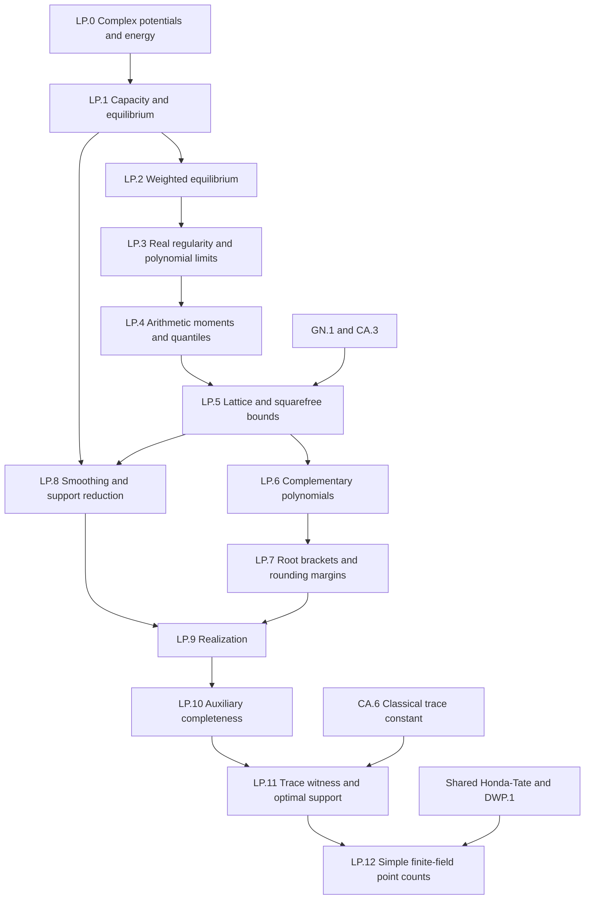

# Logarithmic potential theory and the distribution of conjugates of algebraic integers

The central realization theorem concerns a compact **real** set K with countably many connected components and logarithmic capacity strictly greater than one. A probability on K is a limit of conjugate distributions of pairwise distinct monic irreducible integer polynomials precisely when every nonzero integer polynomial has nonnegative logarithmic moment. The complex potential theory that supports this theorem is developed first, on arbitrary compact subsets of ℂ. Weighted equilibrium and capacity retain that generality; quantile, pruning and real-root realization arguments then specialize to ℝ.

The second endpoint is auxiliary completeness. For a closed real support with countably many components and capacity above one, and a continuous function growing faster than log|x|, the cofinite lower conjugate average equals the supremum supplied by positive logarithmic auxiliary certificates and an attained admissible-measure minimum. The exact Serre witness makes the nonnegative trace constant less than 1.89831. For sufficiently large square prime powers q, the finite-field application gives infinitely many simple isogeny classes with point counts at least (q+2√q−0.89831)^dim A, and infinitely many with point counts at most (q−2√q+2.89831)^dim A.

## Conventions and ownership

All measures are native Borel measures, with native support and weak topology on probability measures. On the diagonal −log|z−w| is +∞; logarithms of polynomial zeros are −∞. Extended integrals are positive-part integrals minus negative-part integrals, used only when at least one part is finite. Compact support makes the negative kernel part and the positive polynomial-logarithm part finite. Thus finite logarithmic energy means I(μ)<+∞. Bochner integral totalization at a singularity would lose the arithmetic obstruction and is not the energy or moment convention.

Compact capacity is exp(−inf I), with exp(−∞)=0. Inner capacity of a Borel set is the supremum of its compact-subset capacities and may be +∞. A polar exceptional set is defined through that capacity; it is stronger than having ambient area zero. Weighted energy is I_Q=I+2∫Q. Its minimum V_Q and modified Robin constant F_Q=V_Q−∫Q are distinct. Real weighted norms use ||P||K,w,t=supK w^t|P|. The potential weight is wμ=exp(Uμ), and n-norm means exponent n, rather than degree-normalizing the weight a second time.

The polynomial root adapter uses native roots with multiplicity and the existing empirical law. It has a specified δ0 default when no real roots exist; positive-degree splitting is always a theorem hypothesis, so the default cannot manufacture a real conjugate for X²+1. Every finite-field infinitude assertion concerns simple isogeny classes. Honda–Tate multiplicity e appears in both the Frobenius polynomial and dimension and cancels only in their normalized logarithmic point count.

GeometryOfNumbersAndQuadraticArithmetic:GN.1 owns successive minima and flatness; its polynomial evaluation/cofactor extensions are requested precisely below. ClassicalArithmeticCompletion:CA.3 owns bounded squarefree combinations, and CA.6 supplies the classical trace constant. AbelianSchemesAndArithmeticModuliPartII:F3/honda-tate is the single shared classification input. DeligneWeightsAndPurity:DWP.1 supplies Weil-weight and Frobenius inputs. The early complex foundations export to ArithmeticAlgebraizationAndHolonomyBounds and the CA.6 hedgehog consumer; specialized holonomy and capacity inequalities stay with those owners.

This document is a mathematical design. The packet's implementation status is unchecked throughout. The suggested file fixes native-type contracts and example statements; LP.12 has four explicitly recorded prototype gaps until its native suppliers exist. The source-proof obligations at the end determine which planning layers remain open.

## Dependency spine

The packet lists the full direct edges. LP.0 and LP.4 are closed at the target-planning level. Other layers have complete target contracts but inherit the named source or supplier obligations. No edge sends the complex foundation back through its classical-arithmetic consumer.

## LP.0 — Complex logarithmic potentials and energy

Fix the singular complex kernel and native Borel measure conventions. Establish descent and strict energy before minimization.

Dependencies: the pinned native measure, integration, topology and planar-kernel declarations.

### Singular logarithmic kernel

Target `log-kernel`; declarations `logKernel`: For z,w∈ℂ, k(z,w)=−log|z−w| off the diagonal and k(z,z)=+∞. The value at the diagonal is an extended real, rather than the totalized value of Real.log 0.

Proof or construction. Use the native norm on ℂ and insert the singular diagonal value. Away from the diagonal compare to 2π times the existing planar Newtonian kernel.

The public API serves Defines potentials and energy with the correct atomic singularity; Fubini turns a smoothing-kernel bound into a potential bound.

- `logKernel_symm`: The kernel is symmetric.
- `logKernel_off_diagonal`: Off the diagonal the value is −log of the distance.
- `logKernel_planar`: Off the diagonal k is 2π times Tau Ceti’s planar kernel.

The discriminating examples are:

- `kernel_diagonal`: k(0,0)=+∞.
- `kernel_unit_distance`: k(0,1)=0.
- `kernel_distance_two`: k(0,2)=−log 2.

Source: [smith](https://arxiv.org/pdf/2111.12660v2), Definition 2.1, p.5; [saff](https://arxiv.org/pdf/1010.3760), §1 (1.8), p.171.

### Logarithmic potential

Target `potential`; declarations `logPotential`, `realPotential`: For a finite positive Borel measure μ with compact support in ℂ, Uμ(z)=∫k(z,w)dμ(w), using the extended integral of the positive part minus the finite negative part. Uμ may equal +∞ and is never −∞. The private integral helper is used only when at least one part is finite.

Proof or construction. The negative part is bounded on the support for each fixed z. Integrate the positive and negative parts separately; this agrees with increasing upper truncations.

The public API serves Builds the weight exp(Uμ) after Hölder continuity makes Uμ finite; Exports the compact complex interface for the CDT potential consumer; no holonomy theorem is owned here; Supplies complex potential conventions to the Dimitrov capacity argument.

- `logPotential_dirac`: A Dirac potential is its kernel.
- `logPotential_truncation`: On a compactly supported finite measure the potential is the increasing supremum of upper truncations.
- `logPotential_add`: Potentials add for compactly supported finite positive measures.

The discriminating examples are:

- `potential_zero`: The zero measure has zero potential.
- `potential_atom`: A unit atom has infinite potential at its location.
- `potential_two_atoms`: Two unit atoms at 0 and 1 give potential −log 2 at 2.

Source: [smith](https://arxiv.org/pdf/2111.12660v2), Definition 2.1, p.5; [saff](https://arxiv.org/pdf/1010.3760), §1 (1.8), p.171.

### Logarithmic energy

Target `energy`; declarations `logEnergy`: For a finite positive compactly supported measure, I(μ)=∬k(z,w)dμ(z)dμ(w)=∫Uμdμ. Its negative part is finite, so finite energy means I(μ)<+∞, with this sign convention.

Proof or construction. Use product integration, bounding the negative part by the diameter of a compact support. Tonelli identifies the two iterated integrals.

The public API serves Minimization defines capacity and equilibrium; Finite energy removes all polar components before restriction.

- `logEnergy_integral_potential`: Energy equals the integral of the potential under compact support and finite mass.
- `logEnergy_smul`: For compactly supported finite μ and a≥0 finite, I(aμ)=a²I(μ), including a=0 and infinite positive energy.
- `logEnergy_not_bot`: Compact support excludes negative infinite energy.

The discriminating examples are:

- `energy_zero`: I(0)=0.
- `energy_dirac`: I(δ0)=+∞, ruling out totalized Bochner energy.
- `energy_uniform_unit_interval`: The uniform probability on [0,1], pushed into ℂ, has logarithmic energy 3/2; this detects an incorrect sign or scalar factor.

Source: [smith](https://arxiv.org/pdf/2111.12660v2), Definition 2.1, p.5; [saff](https://arxiv.org/pdf/1010.3760), §1 (1.9), p.171.

### Principle of descent

Target `descent`; declarations `potential_lowerSemicontinuous`, `potential_descent`, `energy_descent`: Potentials are lower semicontinuous. If probability measures μn supported on a common compact K⊂ℂ converge weakly to μ, then Uμ(z)≤liminf Uμn(z) for every z and I(μ)≤liminf I(μn).

Proof or construction. Upper-truncate the logarithmic kernel to continuous bounded kernels on K or K×K. Weak convergence of the product measures follows by continuous product approximation. Take the supremum of the resulting integral limits.

Source: [saff](https://arxiv.org/pdf/1010.3760), Lemma 1.6, pp.171–172.

### Strict positivity on mass-zero differences

Target `strict-energy`; declarations `strict_energy`: For two compactly supported complex probability measures μ,ν of finite logarithmic energy, their mutual energy is finite and I(μ)+I(ν)−2I(μ,ν)≥0, with equality exactly when μ=ν. This expresses the positive energy of their signed difference of total mass zero without replacing native signed measures.

Proof or construction. Choose R larger than the common support diameter. Frullani with f(s)=exp(−s) gives log(R/r)=½∫₀∞(exp(−tr²)−exp(−tR²))dt/t for 0<r≤R. Its nonnegative integrand permits Tonelli, also at r=0 by monotone convergence. For each t>0 expand exp(−t|z−w|²) as exp(−t|z|²)exp(−t|w|²) times the uniformly convergent double power series in Re z Re w and Im z Im w. Integrating produces a sum of squares of weighted real monomial moments. The associated feature vectors give Cauchy–Schwarz for mutual Gaussian integrals. At t≤1 the constant-corrected kernel is O(t) uniformly on the support product. At t≥1, finite self energies control ∫Gμμ(t)dt/t and ∫Gνν(t)dt/t; Cauchy–Schwarz and 2ab≤a²+b² give mutual integrability. This establishes mutual-energy finiteness before any subtraction of infinities. The equal masses cancel the exp(−tR²) term, leaving I(μ−ν)=½∫₀∞Gμ−ν,μ−ν(t)dt/t≥0. If the measures differ, some weighted monomial moment differs for every t>0: otherwise Stone–Weierstrass on the common compact support, followed by division by the positive weight, would identify all continuous integrals and hence the measures. Thus equality forces μ=ν.

Source: [levenberg](https://www.maths.tcd.ie/EMIS/journals/DRNA/pdf/levenberg-2012-wpt.pdf), Proposition 2.1, p.8.

Acceptance for this layer: establish the displayed contracts with their explicit conditions and every listed API/example; retain singular values, degree indices and mass factors. Its target-level prerequisites resolve to checked native inputs and the proofs above.

## LP.1 — Complex capacity and equilibrium

Build complex compact capacity, inner capacity, polar null sets, equilibrium, Frostman, domination and the transfinite-diameter comparison. Retain compact versus Borel continuity domains.

Dependencies: `LogarithmicPotentialTheoryAndAlgebraicIntegers:LP.0`.

### Robin constant and logarithmic capacity

Target `capacity`; declarations `robinConstant`, `capacity`, `innerCapacity`, `realCapacity`: For compact K⊂ℂ, V(K)=inf{I(μ): μ a probability supported on K}, with inf∅=+∞, and cap K=exp(−V(K)), where exp(−∞)=0. For arbitrary Borel E the inner capacity is sup{cap L: L⊂E compact}. On compact sets these agree. This normalization has cap of a disk equal to its radius.

Proof or construction. Take the complete-lattice infimum in EReal. Compactness bounds it below. Extend capacity to Borel sets through compact subsets, adjoining 0 to the supremum set.

The public API serves The strict threshold cap K>1 supplies exponential room for rounding; Supplies complex capacity, affine scaling and transfinite diameter; Supplies the common complex foundation for the hedgehog consumer, which owns its specialized inequality.

- `capacity_mono`: Capacity is monotone on compact sets.
- `capacity_affine`: A nonzero complex affine map multiplies capacity by |a|.
- `innerCapacity_compact`: The Borel inner extension agrees with compact capacity.

The discriminating examples are:

- `capacity_singleton`: A singleton has capacity zero.
- `capacity_disk`: A closed disk of positive radius r has capacity r.
- `capacity_interval`: A nondegenerate real interval has capacity (b−a)/4.

Source: [saff](https://arxiv.org/pdf/1010.3760), Definition 1.8, p.172; Borel convention following Example 1.11, p.174.

### Polar sets and quasi-everywhere statements

Target `polar`; declarations `Polar`, `QuasiEverywhere`: A Borel set E is polar when every compact subset has capacity zero. A predicate holds quasi-everywhere on K when its failure set inside K is polar. Finite-energy measures ignore such Borel failure sets; they are not merely sets of ambient area zero.

Proof or construction. Use the inner capacity convention rather than introducing a different Newtonian capacity. Quasi-everywhere means polarity of the precise failure set.

The public API serves Discard the countable set of one-point components; State weighted variational inequalities without a false everywhere boundary claim.

- `polar_iff_innerCapacity_zero`: For Borel sets, polarity is exactly vanishing inner capacity.
- `polar_subset`: Subsets of polar sets are polar.
- `quasiEverywhere_iff`: The exceptional set is inside the specified domain.

The discriminating examples are:

- `polar_empty`: The empty set is polar.
- `polar_countable`: Every countable set is polar, even with accumulation points.
- `interval_not_polar`: The real interval [0,1] is not polar despite having area zero.

Source: [saff](https://arxiv.org/pdf/1010.3760), Definition 1.8, p.172; quasi-everywhere convention, p.174; [levenberg](https://www.maths.tcd.ie/EMIS/journals/DRNA/pdf/levenberg-2012-wpt.pdf), Proposition 2.4 and Corollary 2.5, pp.10–11.

### Finite energy annihilates polar sets

Target `polar-null`; declarations `polar_measure_zero`, `polar_iUnion`: If μ is a finite positive compactly supported measure with I(μ)<+∞ and E is Borel and polar, then μ(E)=0. Countable Borel unions of polar sets are polar.

Proof or construction. If μ(E)>0, a normalized restriction to a compact subset of E has finite energy, contradicting polarity. For a countable union, any finite-energy measure gives each member mass zero, so no compact subset can carry a finite-energy probability.

Source: [levenberg](https://www.maths.tcd.ie/EMIS/journals/DRNA/pdf/levenberg-2012-wpt.pdf), Proposition 2.4 and Corollary 2.5, pp.10–11.

### Equilibrium measure

Target `equilibrium`; declarations `equilibrium`: When K⊂ℂ is compact and cap K>0, there is a unique probability μK supported on K attaining V(K). The construction chooses this minimizer. At zero capacity no uniqueness claim is made; the totalized value has no specified mathematical meaning.

Proof or construction. Compactness of the supported probability space and lower semicontinuity give existence. The strict-energy theorem in LP.0 proves uniqueness by evaluating the energy of the midpoint of two minimizers. Positive capacity makes the minimum finite.

The public API serves Sweetening adds equilibrium mass whose potential is at most −log cap K; The interval equilibrium law is one component of Serre’s witness.

- `equilibrium_supported`: The equilibrium measure is supported on K under compactness and positive capacity.
- `equilibrium_energy`: Its energy is the Robin constant.
- `equilibrium_unique`: A supported probability with minimal energy equals the equilibrium measure.

The discriminating examples are:

- `equilibrium_unit_disk`: The equilibrium potential of the unit disk is zero at its centre.
- `equilibrium_polar_addition`: Adding a disjoint singleton to a positive-capacity compact set changes neither capacity nor equilibrium.
- `equilibrium_not_dirac`: The equilibrium law of [−2,2] is not a Dirac law.

Source: [saff](https://arxiv.org/pdf/1010.3760), Lemma 1.7, p.172; [levenberg](https://www.maths.tcd.ie/EMIS/journals/DRNA/pdf/levenberg-2012-wpt.pdf), Proposition 2.1 and Corollary 2.2, pp.8–9.

### Frostman inequalities

Target `frostman`; declarations `frostman`: For compact K⊂ℂ with positive capacity, UμK(z)≤V(K)=−log cap K on all of ℂ and UμK(z)=V(K) quasi-everywhere on K.

Proof or construction. Variation toward a probability on a nonpolar potential sublevel contradicts minimality. Mutual-energy finiteness is supplied by strict-energy, so the variation has no undefined infinity subtraction. Finite energy ignores the resulting polar exceptional set. Lower semicontinuity and the equilibrium integral equality then give UμK≤V(K) on the support. The nearest-support-point argument of Levenberg Proposition 1.4 gives the boundary upper-limit bound for UμK outside its support. The potential is harmonic off the support and tends to −∞ at infinity. The harmonic maximum principle extends the support bound to all of ℂ. This is the boundary argument used in Theorem 2.6, rather than identifying the continuity principle itself with a maximum principle.

Source: [levenberg](https://www.maths.tcd.ie/EMIS/journals/DRNA/pdf/levenberg-2012-wpt.pdf), Theorem 2.6, pp.11–12; Proposition 1.4, p.6; [saff](https://arxiv.org/pdf/1010.3760), Theorem 1.12, p.174.

### Principle of domination

Target `domination`; declarations `domination`: Let μ,ν be finite positive compactly supported measures on ℂ, with 0<μ(ℂ) and ν(ℂ)≤μ(ℂ), I(μ)<+∞, and c∈ℝ. If Uμ≤Uν+c μ-almost everywhere, then the inequality holds at every complex point.

Proof or construction. Apply the logarithmic domination principle with its mass condition and finite energy on the dominated measure μ. A full proof of the passage from almost everywhere to everywhere, beyond the survey’s sketch, is an explicit source-proof obligation; no continuity hypothesis on ν is silently added. The dominated measure is explicitly nonzero: for μ=ν=0 and c<0 the almost-everywhere premise is vacuous and the conclusion false. Every consuming probability application satisfies this positivity condition.

Source: [saff](https://arxiv.org/pdf/1010.3760), Theorem 2.8, p.182.

### Continuity of capacity

Target `capacity-continuity`; declarations `innerCapacity_iUnion`, `capacity_iInter`: For increasing bounded Borel sets En⊂ℂ, innerCap(⋃En)=supn innerCap(En). For decreasing nonempty compact Kn, cap(⋂Kn)=infn cap(Kn). In particular an increasing interval exhaustion whose union omits only a polar subset of K eventually has capacity above any fixed number smaller than cap K.

Proof or construction. For increasing sets restrict a finite-energy probability on a compact subset of the union and normalize; monotone convergence of mass and a bound on the negative kernel give convergence of energy. Inner regularity then puts the restrictions on compact subsets of En. For decreasing compact sets take weak cluster points of minimizers; descent proves the reverse inequality.

Source: [smith](https://arxiv.org/pdf/2111.12660v2), Proposition 2.5 proof, pp.36–37; [levenberg](https://www.maths.tcd.ie/EMIS/journals/DRNA/pdf/levenberg-2012-wpt.pdf), §2 Exercise 3, p.13; Proposition 2.4, pp.10–11.

### Fekete products and transfinite diameter

Target `transfinite-diameter`; declarations `feketeDiameter`, `transfiniteDiameter`: For n≥2, δn(K) is the maximum over z1,…,zn∈K of (∏i<j|zi−zj|)^(2/(n(n−1))); the maximum is 0 for empty K or when no distinct n-tuple exists. The transfinite diameter is lim δn, equivalently infn≥2 δn. No logarithm of a coincident pair is totalized to zero.

Proof or construction. Use the finite Vandermonde product and a real supremum with 0 adjoined. Removing each point in turn shows δn is decreasing. Take its infimum over n≥2.

The public API serves Exports the complex Vandermonde/capacity interface needed by the CDT bound; Identifies the analytic energy normalization with finite determinant products.

- `feketeDiameter_antitone`: The finite diameters decrease with the number of points.
- `feketeDiameter_attained`: On a nonempty compact K the Vandermonde maximum is attained, including coincident zero-product tuples.
- `transfiniteDiameter_affine`: Nonzero affine scaling multiplies diameter by |a|.

The discriminating examples are:

- `fekete_singleton`: Every finite diameter of a singleton is zero.
- `fekete_two_point_distance`: The two-point diameter of {0,2} is 2.
- `transfinite_finite_set`: The transfinite diameter of {0,2} is 0 despite its ordinary diameter 2.

Source: [saff](https://arxiv.org/pdf/1010.3760), Definition 1.9, pp.172–173; [levenberg](https://www.maths.tcd.ie/EMIS/journals/DRNA/pdf/levenberg-2012-wpt.pdf), Proposition 2.3, pp.9–10.

### Capacity equals transfinite diameter

Target `diameter-capacity`; declarations `diameter_capacity`: For every compact K⊂ℂ, cap K=transfiniteDiameter K, including empty and polar compact sets. Fekete weak convergence is an implementation consequence, proved by the same truncation argument, rather than an additional target.

Proof or construction. Integrate the minimal pair energy of a Fekete tuple against any supported finite-energy probability. It gives I(μ)≥−log δn, hence cap K≤lim δn. If the limit is positive, the truncation argument below constructs a finite-energy probability even before equilibrium is invoked; if the limit is zero, the first inequality forces cap K=0.

Source: [saff](https://arxiv.org/pdf/1010.3760), Theorem 1.18, pp.176–177; [levenberg](https://www.maths.tcd.ie/EMIS/journals/DRNA/pdf/levenberg-2012-wpt.pdf), Proposition 2.3, pp.9–10.

Acceptance for this layer: establish the displayed contracts with their explicit conditions and every listed API/example; retain singular values, degree indices and mass factors. The unresolved obligations are `G1`.

## LP.2 — Admissible fields and weighted equilibrium

Use admissible lower-semicontinuous fields on compact complex sets. Keep weighted minimum V_Q distinct from the modified Robin constant F_Q, then specify weighted polynomial norms.

Dependencies: `LogarithmicPotentialTheoryAndAlgebraicIntegers:LP.1`, `LogarithmicPotentialTheoryAndAlgebraicIntegers:LP.0`.

### Admissible external fields

Target `external-field`; declarations `AdmissibleField`, `fieldWeight`: On a compact K⊂ℂ an admissible external field Q:K→ℝ∪{+∞} is lower semicontinuous, bounded below and finite on a nonpolar subset. Its weight is w=e^(−Q), with w=0 at Q=+∞. Equivalently w is nonnegative upper semicontinuous and positive on a nonpolar subset. Only the compact version is needed by the weighted polynomial inputs.

Proof or construction. Translate the semicontinuity and nonpolar positivity conditions between Q and w, preserving the zero-weight convention.

The public API serves Defines the weighted minimization problem and distinguishes zero weights; The field −Uμ is finite and continuous for Hölder probabilities.

- `admissibleField_const`: For compact nonpolar K and finite real c, the constant field Q=c is admissible.
- `fieldWeight_top`: Infinite field means zero weight.
- `fieldWeight_finite`: At a finite field value c the weight is exp(−c).
- `admissibleField_weight`: Admissibility is equivalent to a real lower bound for Q on K, upper semicontinuity of e^(−Q) on K, and nonpolarity of its positive-weight subset.

The discriminating examples are:

- `zero_field_weight`: The zero field has unit weight.
- `infinite_field_not_admissible`: The field identically +∞ is never admissible.
- `singleton_field_not_admissible`: A finite field on a singleton still fails the nonpolar condition.
- `upward_field_jump_not_admissible`: On the closed unit disk, Q(0)=1 and Q(z)=0 elsewhere fails lower semicontinuity and is not admissible.

Source: [levenberg](https://www.maths.tcd.ie/EMIS/journals/DRNA/pdf/levenberg-2012-wpt.pdf), §5, p.23; [saff](https://arxiv.org/pdf/1010.3760), §6, p.196.

### Weighted energy

Target `weighted-energy`; declarations `weightedEnergy`: For an admissible Q on compact K and supported probability μ, I_Q(μ)=I(μ)+2∫Qdμ. The extended values are valid because both negative parts are finite. The coefficient 2 fixes the weighted-capacity and Robin conventions.

Proof or construction. Add the two one-variable field contributions to the kernel before integrating. Since the mass is one each contributes ∫Q.

The public API serves Characterizes weighted equilibrium through minimization; Shows a Hölder probability is the weighted minimizer for −Uμ.

- `weightedEnergy_zero_field`: Zero field gives ordinary energy.
- `weightedEnergy_const`: For a compactly supported probability and finite real c, I_c(μ)=I(μ)+2c.
- `weightedEnergy_minimum_exists`: For compact K and admissible Q there is a supported probability of finite weighted energy minimizing I_Q among all supported probabilities.

The discriminating examples are:

- `weighted_energy_zero`: Zero measure in zero field has energy zero.
- `weighted_energy_atom`: A finite external field cannot remove atomic infinite energy.
- `weighted_energy_factor_two`: At field 1 the unit disk equilibrium has weighted energy 2.

Source: [levenberg](https://www.maths.tcd.ie/EMIS/journals/DRNA/pdf/levenberg-2012-wpt.pdf), §5, p.23, weighted energy definition.

### Weighted equilibrium and modified Robin constant

Target `weighted-equilibrium`; declarations `weightedEquilibrium`, `weightedRobin`: The admissible compact problem has a unique minimizing probability μK,Q. Write V_Q=I_Q(μK,Q) and F_Q=V_Q−∫QdμK,Q=I(μK,Q)+∫QdμK,Q. F_Q is the modified Robin constant, and need not equal V_Q. Both are finite for the minimizer.

Proof or construction. Existence uses descent for the weighted kernel; uniqueness uses strict positive definiteness on mass-zero differences. Evaluate the two constants at the minimizer, and prove their conversion formula before using polynomial asymptotics.

The public API serves The polynomial norm limit is exp(−F_Q), not exp(−V_Q); The field −Uμ has minimizer μ and modified Robin constant 0.

- `weightedEquilibrium_minimizes`: For compact K and admissible Q, I_Q(μK,Q)≤I_Q(ν) for every supported probability ν.
- `weightedEquilibrium_zero_field`: The zero-field construction agrees with the ordinary minimizer.
- `weightedRobin_const`: For compact nonpolar K and finite constant field c, F_c=−log cap K+c.
- `weightedEquilibrium_supported`: Under compactness and admissibility the minimizer is supported on K.
- `weightedEquilibrium_unique`: Every supported probability with the same weighted energy is this minimizer.
- `weightedRobin_identity`: F_Q=I(μK,Q)+∫QdμK,Q as a finite extended-real identity.

The discriminating examples are:

- `weighted_robin_unit_disk`: For the unit disk and field 1, F=1 rather than V=2.
- `weighted_eq_const`: The constant-field equilibrium equals the ordinary unit disk law.
- `weighted_robin_interval`: On [−1,1] in zero field, F=log 2.

Source: [saff](https://arxiv.org/pdf/1010.3760), §6 (6.2), pp.196–198; [levenberg](https://www.maths.tcd.ie/EMIS/journals/DRNA/pdf/levenberg-2012-wpt.pdf), §5 and Proposition 5.1, pp.23–24.

### Weighted variational inequalities

Target `weighted-variational`; declarations `weighted_variational`, `weighted_variational_converse`, `weighted_variational_regular`: For compact K and admissible Q, the weighted equilibrium has finite energy, Uμ+Q≥F_Q quasi-everywhere on K, and equality μ-almost everywhere. For continuous finite Q on a regular compact K, the inequalities hold everywhere on K, with equality on supp μ. Conversely a finite-energy supported probability satisfying the two quasi-everywhere/measure conditions minimizes I_Q. Regularity here means UμK=V(K) at every point of K.

Proof or construction. Vary toward finite-energy supported competitors to obtain the lower inequality outside a polar set. Integrate the equality at the minimizer. Converse follows by expansion of the energy of ν−μ and nonnegative signed energy. Distinguish the general quasi-everywhere form from the continuous regular everywhere form.

Source: [saff](https://arxiv.org/pdf/1010.3760), §6 (6.2), pp.197–198; [levenberg](https://www.maths.tcd.ie/EMIS/journals/DRNA/pdf/levenberg-2012-wpt.pdf), Proposition 5.1, p.24.

### Weighted polynomial norm

Target `weighted-norm`; declarations `weightedNorm`, `potentialWeight`, `nNorm`: For compact K, weight w≥0 and real exponent t, ||P||K,w,t=supx∈K w(x)^t |P(x)|, with the real-power convention. In Smith’s specialization wμ=exp(Uμ), finite and strictly positive for compactly supported Hölder μ. Integer t=n is the n-norm; real exponents also permit the shifts used in Lemma 4.9.

Proof or construction. Use a supremum with 0 adjoined. State compactness, continuity and positivity whenever finiteness or negative exponents are used.

The public API serves Measures the error in lattice rounding and integer approximation; Controls coefficient adjustment without moving the roots outside K.

- `weightedNorm_zero`: For compact K and continuous strictly positive w, ||0||K,w,t=0 for every real t.
- `weightedNorm_bound`: For compact K, continuous strictly positive w, t real and C≥0: ||P||K,w,t≤C iff w(x)^t|P(x)|≤C for every x∈K.
- `weightedNorm_mul`: For compact K and continuous strictly positive w: ||PQ||K,w,s+t≤||P||K,w,s||Q||K,w,t for all real s,t.

The discriminating examples are:

- `norm_empty`: The supremum on the empty set is zero.
- `norm_unit_interval`: X on [−1,1] at unit weight has norm 1.
- `norm_constant_weight`: Weight 2 and exponent 3 give norm 8 to the constant polynomial 1 on [0,1].

Source: [smith](https://arxiv.org/pdf/2111.12660v2), Definition 2.6, p.7; Lemma 4.9, p.29.

Acceptance for this layer: establish the displayed contracts with their explicit conditions and every listed API/example; retain singular values, degree indices and mass factors. The unresolved obligations are `G1`.

## LP.3 — Real regularity and weighted polynomial limits

Specialize only the polynomial distribution arguments to ℝ. Pin Hölder mass regularity, finite intervals, countable components, native empirical root laws, weighted zero limits, Remez and root removal. Normalize the existing Chebyshev measure for equilibrium adapters.

Dependencies: `LogarithmicPotentialTheoryAndAlgebraicIntegers:LP.0`, `LogarithmicPotentialTheoryAndAlgebraicIntegers:LP.2`, `LogarithmicPotentialTheoryAndAlgebraicIntegers:LP.1`.

### Hölder measures

Target `holder`; declarations `HolderMeasure`, `IsHolder`: A finite positive real Borel measure is η-Hölder if η>0 and there exists C>0 such that μ([x,y])≤C(y−x)^η for every x≤y. A Hölder measure has some such exponent; its support may have gaps. This is interval mass regularity, not a Hölder density condition.

Proof or construction. Use the native measure of a closed interval and its ENNReal mass, with a real-power bound. Degenerate intervals force absence of atoms.

The public API serves Quantile gaps and singular-potential tails have polynomial bounds; Smoothing produces exponent 1/2 without a density regularity demand.

- `holder_no_atoms`: A positive Hölder exponent forces every singleton to have zero mass.
- `holder_smul`: Multiplication of an η-Hölder measure by any finite nonnegative scalar preserves η-Hölder regularity.
- `holder_restrict`: Restriction to any set preserves η-Hölder regularity.

The discriminating examples are:

- `holder_zero`: The zero measure is η-Hölder for every positive η.
- `dirac_not_holder`: A unit atom is not Hölder.
- `uniform_holder`: Restricted volume on [0,1] is 1-Hölder.

Source: [smith](https://arxiv.org/pdf/2111.12660v2), Definition 2.2, p.5.

### Finite unions of nondegenerate intervals

Target `intervals`; declarations `FiniteIntervals`: A finite interval set is a nonempty compact subset of ℝ with finitely many connected components and no one-point components; equivalently it is a union of finitely many separated closed intervals [ai,bi] with ai<bi. Use an ordered list only as witness data.

Proof or construction. Specify positive lengths and strict separation, preventing an isolated-point exception from entering the root-removal theorem.

The public API serves Provides a finite count of gap roots and interval alternation points; Each finite step of the countable-component reduction has this form.

- `finiteIntervals_compact`: A finite interval set is compact.
- `finiteIntervals_nonempty`: The nonempty condition is part of the carrier.
- `finiteIntervals_affine`: A nonzero real affine map preserves finite interval sets, reversing the witness order when needed.

The discriminating examples are:

- `one_interval`: A single positive-length interval is allowed.
- `intervals_with_gap`: Two separated nondegenerate intervals are allowed.
- `interval_and_isolated_point`: A singleton disjoint from a positive-length interval is forbidden.

Source: [smith](https://arxiv.org/pdf/2111.12660v2), Definition 2.4, p.7.

### Hölder continuity of potentials

Target `holder-potential`; declarations `holder_potential`: For a compactly supported finite η-Hölder measure with 0<η<1, its potential is finite and η-Hölder on ℝ. A bound follows by layer-cake estimates on distances below |x−y| and integration of the remaining tail. The real potential determines a continuous complex potential as well.

Proof or construction. Split the difference of the logarithms into near and far regions. Integrate interval-mass bounds through layer cake; ∫r^(η−1) and ∫r^(η−2) give finite constants when 0<η<1. Continuity on support extends to ℂ by the continuity principle for potentials.

Source: [smith](https://arxiv.org/pdf/2111.12660v2), Lemma 2.3, p.6; [levenberg](https://www.maths.tcd.ie/EMIS/journals/DRNA/pdf/levenberg-2012-wpt.pdf), Proposition 1.4, p.6.

### Potential weight equilibrium

Target `potential-field`; declarations `potential_field_equilibrium`: If μ is a compactly supported Hölder probability on a compact real K, then for Q=−Uμ, μ is the weighted equilibrium on K and F_Q=0. The field is admissible: Uμ is finite continuous, and μ has finite energy, forcing K nonpolar.

Proof or construction. The effective potential Uμ+Q is identically zero. Apply the weighted variational characterization, using finite energy from Hölder regularity. The modified Robin identity gives zero.

Source: [smith](https://arxiv.org/pdf/2111.12660v2), Lemma 2.7 proof, pp.7–8; [levenberg](https://www.maths.tcd.ie/EMIS/journals/DRNA/pdf/levenberg-2012-wpt.pdf), Proposition 5.1, p.24.

### Polynomial root distribution bridge

Target `polynomial-root-law`; declarations `polynomialRootLaw`: For a positive-degree polynomial that splits over ℝ, normalize its multiset of real roots with multiplicity to a probability. This is the existing empirical law applied to a numbering of that multiset. A totalized polynomial-to-law adapter returns δ0 when no real roots exist; every mathematical theorem uses splitting and positive degree, so this default never supplies missing complex roots.

Proof or construction. Form a finite sum of Dirac measures from the native polynomial roots multiset. Normalize its mass using FiniteMeasure.normalize, with an explicit δ0 zero-root branch. Prove agreement with the existing empirical constructor under any numbering; the counting mechanism is imported.

The public API serves Expresses convergence of conjugate laws on native probability measures; The mean over conjugates is a root-law integral.

- `polynomialRootLaw_measure`: For a positive-degree real polynomial splitting over ℝ, its root law is (deg P)⁻¹ times the sum of Dirac measures over its native roots multiset.
- `polynomialRootLaw_integral`: For a positive-degree polynomial splitting over ℝ and measurable real F, its integral under the root law is (deg P)⁻¹ times the root-multiset sum of F, with multiplicity.
- `polynomialRootLaw_empirical`: Numbering the multiset recovers the imported empirical law, including repeated roots.

The discriminating examples are:

- `root_law_linear`: X−2 has law δ2.
- `root_law_repeated`: (X−1)² has the same law as X−1, retaining multiplicity.
- `root_law_no_real_roots`: X²+1 uses the explicit zero-real-root default δ0, and is excluded by the splitting hypotheses.

Source: [smith](https://arxiv.org/pdf/2111.12660v2), Lemma 2.7, p.7; normalized root measures in §1, p.4.

### Weighted zero-distribution criterion

Target `weighted-zero-limit`; declarations `weighted_zero_limit`: Let μ be a Hölder probability supported on a compact real K. Monic real polynomials Pi, of degrees ni→∞, with every root in K and ||Pi||K,wμ,ni^(1/ni)→1 have root laws converging weakly to μ. Real support is retained: a complex compact set can have different measures with the same exterior potential.

Proof or construction. The weighted norm inequality is Uμ≤Uroot(Pi)+εi on K, where εi=log(||Pi||ni)/ni→0. Domination applies with the finite-energy probability μ and the atomic probability root law, and extends this inequality to all of ℂ. Extract any weak cluster point ν on the fixed real compact K. At each exterior point the logarithmic kernel is bounded continuous on K, so Uμ≤Uν outside K. For a circle of radius R larger than |K|, the circle average of each probability potential is −log R, obtained by the uniformly convergent expansion of log(1−x/z). Hence the nonnegative continuous function Uν−Uμ has zero average on every such circle and is zero there. The exterior power series then identifies every real polynomial moment of ν and μ. Real polynomials separate points of K; native Stone–Weierstrass implies equality of measures. Every weak cluster point is μ, and compactness yields convergence of the full sequence. No general complex zero-distribution or weighted norm-conversion theorem is needed.

Source: [smith](https://arxiv.org/pdf/2111.12660v2), Lemma 2.7, pp.7–8.

### Remez inequality

Target `remez`; declarations `remez`: For m≥1, a complex polynomial of degree at most m, and measurable E⊂[−1,1] with Lebesgue measure at least 2−m^(−2), its supremum on [−1,1] is at most e^5 times its supremum on E. The complex-valued form follows by rotating a value at a maximum and applying the real Remez inequality to its real part.

Proof or construction. Use the real Remez bound T_m((4−|E|)/|E|). For |E|≥2−m^−2, the Chebyshev expression is bounded by e^5. Rotating at a maximal complex value preserves degree and bounds the real part on E by |P|. The cited primary Remez proof is an explicit source obligation.

Source: [smith](https://arxiv.org/pdf/2111.12660v2), Lemma 2.8 proof, p.8 (special case of Erdélyi Theorem 1).

### Polynomial root removal estimate

Target `root-removal`; declarations `root_removal`: For a Hölder probability μ supported on a finite interval set K there is C>0, depending only on K,μ, such that for n≥0 and real P of degree m≥1 with complex root α, the complex weighted norm of P/(X−α) is at most (2 max(n,m))^C times that of P. No root-in-K condition on α is needed.

Proof or construction. Around a point where the quotient norm is large choose a short interval within its component. Hölder continuity keeps the weight comparable there. Remove a small neighborhood of α and use the Remez bound to recover a large value; division loses only a polynomial factor in n,m.

Source: [smith](https://arxiv.org/pdf/2111.12660v2), Lemma 2.8, p.8, (2.4).

### Interval equilibrium probability adapter

Target `interval-equilibrium-adapter`; declarations `intervalEquilibriumMeasure`: For a<b, the real interval equilibrium is the affine pushforward of π⁻¹ times Tau Ceti’s native Chebyshev T measure on [−1,1]. Its density is 1/(πsqrt((b−x)(x−a))) on (a,b). It is zero when a≥b. This adapter adds interval parameters and probability normalization; it does not rebuild the Chebyshev measure.

Proof or construction. Map t to (a+b)/2+(b−a)t/2 and use the native mass π to normalize. The affine change-of-variable formula gives the density. Identify its constant potential with −log((b−a)/4), so equilibrium uniqueness gives the bridge.

The public API serves Inversion gives the ν[a,b] density without invoking unavailable balayage; Computes the equilibrium component of Serre’s witness.

- `intervalEquilibrium_probability`: For a<b the normalized affine law is a probability.
- `intervalEquilibrium_eq`: For a<b the complex pushforward of the normalized affine Chebyshev law equals the equilibrium probability of [a,b].
- `intervalEquilibrium_mean`: The mean is the midpoint.

The discriminating examples are:

- `interval_equilibrium_invalid`: At equal endpoints the adapter is zero; no probability is claimed on a polar set.
- `interval_equilibrium_symmetric_mean`: The mean on [−2,2] is 0.
- `interval_equilibrium_normalization`: On [−1,1] its mass is 1 rather than the native Chebyshev mass π.

Source: [saff](https://arxiv.org/pdf/1010.3760), Example 1.11, p.174; [smith](https://arxiv.org/pdf/2111.12660v2), Example 5.16, p.43.

### Finite interval equilibrium density and Hölder bound

Target `finite-interval-equilibrium`; declarations `finite_interval_equilibrium_holder`, `interval_equilibrium_potential_zero`: For a finite interval set K, the equilibrium law is 1/2-Hölder. For 0<a<b, its interval potential at 0 is −log((a+b+2sqrt(ab))/4). The proof uses the finite-gap density |∏(x−cj)|/(πsqrt(|∏(x−aj)(x−bj)|)), with one cj in each gap fixed by vanishing gap integrals.

Proof or construction. Write R(z)=∏i(z−ai)(z−bi). Choose the unique monic p of degree k−1 with ∫bi^a(i+1) p(x)/sqrt(|R(x)|) dx=0 in every gap. The homogeneous period matrix is invertible: a nonzero polynomial of degree≤k−2 with zero integral in each of k−1 disjoint gaps has a zero in every gap, a degree contradiction. The same sign argument gives exactly one simple zero ci of p in each gap. Use the branch sqrt(R(z))~z^k on ℂ minus the interval union and put H=p/sqrt R. Its opposite boundary values across each interval have jump −2i|p(x)|/sqrt(|R(x)|). Cauchy–Goursat on a finite rectangle partition and the disk Cauchy formula deform the integral of H(ζ)/(ζ−z) to the two sides of the cuts. The endpoint arcs vanish by their O(r^(−1/2)) bound; the outer boundary vanishes as its radius grows since H=1/z+O(1/z²). Hence H(z)=∫ρ(x)/(z−x)dx with ρ=|p|/(πsqrt(|R|)). The 1/z coefficient proves mass one; the branch signs give positivity. On each component the other endpoint factors stay bounded away from zero, giving ρ≤C/√((x−ai)(bi−x)). Integration gives the 1/2-Hölder interval-mass bound. The Hölder-potential theorem yields a finite continuous potential. The real part of H vanishes on interval interiors, so the potential is constant on each component; its zero gap integrals identify these constants. A supported finite-energy competitor has mutual energy equal to this constant. Strict energy then proves minimality and uniqueness; infinite-energy competitors cannot improve it. This identifies the law with equilibrium without importing a general Green-function or Herglotz construction. For the single interval use the existing normalized Chebyshev law and its explicit outside potential to evaluate the value at 0.

Source: [smith](https://arxiv.org/pdf/2111.12660v2), Remark after Proposition 5.6, p.35; [csz](https://math.caltech.edu/SimonPapers/336.pdf), Theorem 2.6(d), p.230 and §2 proof, pp.228–232; [saff](https://arxiv.org/pdf/1010.3760), Example 1.11, p.174.

### Countably many real connected components

Target `countable-components`; declarations `CountableComponents`: A real set has countably many components when the set of its connected components meeting the set is countable. Empty sets qualify. This is weaker than having finitely many interval components and stronger than arbitrary compact real support; the Cantor set fails.

Proof or construction. Use Mathlib connectedComponentIn and Set.Countable. Do not encode countability by a list of isolated points, because one-point components can accumulate.

The public API serves The one-point component union is countable and polar; Retains exactly the domain hypothesis of the unbounded optimization theorem.

- `finiteIntervals_countableComponents`: Every finite interval set has countably many components.
- `countableSet_countableComponents`: Every countable real set has countably many components.
- `countableComponents_affine`: A nonzero real affine map preserves and reflects component countability.

The discriminating examples are:

- `components_empty`: The empty set qualifies.
- `components_integer_points`: The nonnegative integer points give infinitely many countable components.
- `components_cantor`: The Cantor set has uncountably many one-point components.

Source: [smith](https://arxiv.org/pdf/2111.12660v2), Theorem 1.5, p.4; Notation 5.8, p.37.

Acceptance for this layer: establish the displayed contracts with their explicit conditions and every listed API/example; retain singular values, degree indices and mass factors. The unresolved obligations are `G1`, `G2`.

## LP.4 — Arithmetic measures and quantiles

Define singular integer-polynomial logarithmic moments and arithmetic admissibility. Construct every-degree quantile polynomials, determinant/norm estimates and the moment semicontinuity bridge.

Dependencies: `LogarithmicPotentialTheoryAndAlgebraicIntegers:LP.0`, `LogarithmicPotentialTheoryAndAlgebraicIntegers:LP.3`, `LogarithmicPotentialTheoryAndAlgebraicIntegers:LP.2`.

### Extended integer-polynomial logarithmic moments

Target `integer-log-moment`; declarations `logAbs`, `logMoment`: For nonzero Q∈ℤ[X] and a compactly supported finite real measure μ, Lμ(Q)=∫log|Q(x)|dμ in ℝ∪{−∞}. The logarithm is −∞ at a zero, its positive part is bounded on compact support, and ordinary Bochner totalization at a singular atom is not used.

Proof or construction. Map integer coefficients to ℝ and extend log at zeros by −∞. Integrate positive and negative parts separately. Over ℂ factor Q and compare its logarithmic moment to log|leadingCoeff Q| minus the sum of its root potentials.

The public API serves The resultant argument passes the integer lower bound to weak limits; Auxiliary certificates bound all but finitely many algebraic conjugate averages.

- `logMoment_mul`: For compactly supported finite μ and nonzero integer P,Q, Lμ(PQ)=Lμ(P)+Lμ(Q), with the extended logarithm convention.
- `logMoment_dirac`: Dirac moments evaluate the extended logarithm.
- `logMoment_const`: For a probability μ and nonzero integer c, Lμ(c)=log|c|.

The discriminating examples are:

- `log_moment_unit`: The constant polynomial 1 has moment zero.
- `log_moment_root_atom`: At δ0 the polynomial X has moment −∞.
- `log_moment_integer_value`: At δ2 the polynomial X has moment log 2.

Source: [smith](https://arxiv.org/pdf/2111.12660v2), Theorem 1.5 condition (1), p.4; Definition 2.1, p.5.

### Arithmetic admissibility

Target `admissible-measure`; declarations `ArithmeticAdmissible`: A finite real measure μ is arithmetically admissible when Lμ(Q)≥0 for every nonzero integer polynomial Q. Probability and compact support are separate hypotheses of realization theorems. The zero measure satisfies the inequality, whereas an algebraic atom does not.

Proof or construction. Quantify over all nonzero integer polynomials, including constants. Multiplicativity reduces checks to primitive irreducibles when using the majorant criterion.

The public API serves Supplies moment inequalities in norm-product bounds; Is exactly the criterion for realizing a conjugate distribution; Certifies Serre’s explicit measure using a single potential majorant.

- `admissible_moment`: Every nonzero integer polynomial has nonnegative moment.
- `admissible_convex`: Compactly supported admissible probabilities are closed under convex combinations tμ+(1−t)ν for 0≤t≤1.
- `admissible_integer_affine`: For compactly supported finite μ, integer b and s∈{−1,1}, the pushforward by x↦sx+b is admissible iff μ is admissible.

The discriminating examples are:

- `admissible_zero`: Zero mass satisfies the inequalities; probability is not baked into this predicate.
- `integer_dirac_not_admissible`: An integer atom is excluded by X−a.
- `admissible_reflection`: Reflection of a compactly supported admissible measure stays admissible.

Source: [smith](https://arxiv.org/pdf/2111.12660v2), Theorem 1.5 (1), p.4.

### Quantile approximating polynomial

Target `quantile-polynomial`; declarations `quantile`, `quantilePolynomial`, `nearestQuantile`: For n≥1, μ a Hölder probability supported on compact real K, αi is the least x∈K with μ((−∞,x])=(i+1)/n, for i=0,…,n−1. Pn,μ=∏i(X−αi); P0,μ=1 is an explicit empty-product extension. Closed-interval discrepancies of the root law are at most 1/n.

Proof or construction. The atom-free continuous distribution function takes each level on K. Choose the least level point using compactness. Quantile spacing gives a monic splitting polynomial with distinct roots; cumulative frequencies differ by at most one step.

The public API serves Provides a nearly optimal evaluation determinant; Starts the well-separated real polynomial construction.

- `quantile_spec`: A chosen quantile belongs to K, has the specified cumulative mass, and is the least such point.
- `quantilePolynomial_degree`: The quantile product is monic of degree n, including n=0.
- `quantile_discrepancy`: For compact K, a supported Hölder probability μ, n>0 and every closed real interval I, |μPn,μ(I)−μ(I)|≤1/n.

The discriminating examples are:

- `quantile_degree_zero`: The empty product is 1 and carries no quantile evaluation.
- `quantile_uniform_one`: The degree-one uniform-[0,1] quantile polynomial is X−1, fixing right-endpoint indexing.
- `quantile_uniform_two`: The degree-two uniform-[0,1] quantile polynomial has roots 1/2 and 1.

Source: [smith](https://arxiv.org/pdf/2111.12660v2), Definition 2.11, pp.9–10, (2.6).

### Quantile determinant and weighted estimates

Target `quantile-estimates`; declarations `quantile_estimates`: For compact real K and Hölder probability μ supported on K, there is C>0 such that for every n≥2, ∏i<j|αi−αj|≥n^(−Cn) exp(−n² I(μ)/2), and for every x∈K, n^(−C)ρn(x)≤wμ(x)^n|Pn,μ(x)|≤n^Cρn(x), where ρn is the nearest-root distance. Absolute value on P is essential.

Proof or construction. Hölder interval mass gives quantile separation at least a constant times n^(−1/η). Split layer-cake potential differences at this scale; integrate the remaining discrepancy bound 1/n to obtain O(log n). Sum at quantiles and control the nearest-root logarithm integral to obtain the determinant bound.

Source: [smith](https://arxiv.org/pdf/2111.12660v2), Proposition 2.12, pp.10–12, (2.7)–(2.8).

### Upper semicontinuity of logarithmic moments

Target `log-moment-upper-semicontinuity`; declarations `logMoment_upperSemicontinuous`: For compact real K and Q≠0 integer, μ↦Lμ(Q) is upper semicontinuous on supported probabilities: under weak μn→μ, Lμ(Q)≥limsup Lμn(Q). Singular zeros are allowed. Applied to distinct irreducible monic root laws, eventual resultant integrality proves Serre’s necessary admissibility implication.

Proof or construction. The extended function log|Q| is upper semicontinuous and bounded above on K. Lower-truncate at −M to continuous functions, pass each integral to the weak limit and decrease M to infinity. Resultants are nonzero after discarding the finitely many irreducible factors of fixed Q.

Source: [smith](https://arxiv.org/pdf/2111.12660v2), §1 following Theorem 1.5, p.4; Theorem 5.11 proof, p.40.

### Every-degree Hölder extremizers

Target `holder-extremizers`; declarations `holder_extremizers`: For a compact real K and a supported Hölder probability μ, for every positive degree n there is a monic real polynomial Pn, splitting with all its roots in K, and ||Pn||K,wμ,n^(1/n) tends to 1. This is the potential-weight instance needed by weighted zero distribution; no assertion about roots of arbitrary complex weighted extremizers is made.

Proof or construction. Take one μ-quantile root in each of the n equal-mass cells. The quantile comparison bounds the weighted norm between polynomial powers of n with constants depending only on the Hölder law and K. Taking nth roots gives the limit. The root set is in K by the quantile construction.

Source: [smith](https://arxiv.org/pdf/2111.12660v2), Lemma 2.7 proof, pp.7–8; Proposition 2.12, pp.10–12.

Acceptance for this layer: establish the displayed contracts with their explicit conditions and every listed API/example; retain singular values, degree indices and mass factors. Its target-level prerequisites resolve to checked native inputs and the proofs above.

## LP.5 — Lattice bounds and squarefree approximation

Import GN successive minima, evaluation polytope and flatness, and CA.3 bounded squarefree combinations. Prove the weighted norm products, energy sign and subexponential squarefree approximation.

Dependencies: `LogarithmicPotentialTheoryAndAlgebraicIntegers:LP.4`, `LogarithmicPotentialTheoryAndAlgebraicIntegers:LP.2`, `LogarithmicPotentialTheoryAndAlgebraicIntegers:LP.3`, `GeometryOfNumbersAndQuadraticArithmetic:GN.1`, `LogarithmicPotentialTheoryAndAlgebraicIntegers:LP.0`, `ClassicalArithmeticCompletion:CA.3`.

### Lower product bound for integer norms

Target `norm-product-lower`; declarations `norm_product_lower`: Let μ be a Hölder probability supported on compact real K, m,n≥0, Q0,…,Qm independent integer polynomials of degrees≤m, and R≠0 integer with Lμ(R)≥0. Then ∏i||QiR||n≥exp((mn−m²/2+n−m/2)I(μ))/(m+1)!.

Proof or construction. Maximize the weighted evaluation determinant in m+1 variables. Integrating one variable bounds its logarithm by the potential and R moment. Apply the supplier’s evaluation-polytope lower successive-minima bound, and bound each minimum by the corresponding polynomial norm.

Source: [smith](https://arxiv.org/pdf/2111.12660v2), Proposition 3.5, pp.15–16.

### Nearly sharp independent integer polynomials

Target `norm-product-upper`; declarations `norm_product_upper`: For a Hölder probability μ supported on a finite interval set K, there is C>0 such that at every n≥2 one can choose n+1 independent integer polynomials Qi of degrees≤n with ∏i||Qi||n≤n^(Cn)exp(n²I(μ)/2).

Proof or construction. Use all n+1 cofactors of the degree-(n+1) quantile polynomial as an interpolation basis. Its determinant is the inverse Vandermonde. Root removal compares the interpolation-box norm to the weighted norm; the supplier’s upper successive-minima inequality supplies independent lattice vectors.

Source: [smith](https://arxiv.org/pdf/2111.12660v2), Proposition 3.6, pp.16–17, (3.4).

### Nonpositive energy for admissible Hölder measures

Target `holder-energy-nonpositive`; declarations `holder_energy_nonpositive`: A compactly supported arithmetically admissible Hölder probability on ℝ has logarithmic energy≤0. The set containing its support need not be a finite interval set.

Proof or construction. Enclose the support in a single interval and take the smallest norm among the independent polynomials. Integrating log(wμ^n|Q|) and using Lμ(Q)≥0 forces I(μ)≤O(log n/n). Let n tend to infinity.

Source: [smith](https://arxiv.org/pdf/2111.12660v2), Corollary 3.7, p.17.

### Weighted integer approximation

Target `integer-approximation`; declarations `integer_approximation`: For a finite interval set K and supported Hölder probability μ, there is C>0 such that for n≥2, squarefree Q∈ℤ[X] of degree n and real P of degree≤n−1, an integer R of degree≤n−1 satisfies ||P−R||n≤n^C||Q||n. Q need not be monic or have its roots in K.

Proof or construction. Import the polynomial cofactor flatness theorem with its positive integral leading coefficient and complex roots. Bound every cofactor by root removal. Sum the cofactor coefficient budget Cn log(2n), and convert the resulting real integer remainder to R.

Source: [smith](https://arxiv.org/pdf/2111.12660v2), Corollary 3.3, pp.13–14.

### Gcd-refined norm product bound

Target `gcd-norm-bound`; declarations `gcd_norm_bound`: For supported Hölder probability on a finite interval set, there is C>0: whenever 0≤k≤m≤n, n≥2, independent integer Q0,…,Qm have degree≤n and nondecreasing n-norms, G=gcd(Q0,…,Qk) has Lμ(G)≥0, and max_i≤k deg(Qi/G)=m, their norm product is at least n^(−Cn) exp((mn−m²/2)I(μ)).

Proof or construction. Import Smith Lemma 2.10 from CA.3 to make a squarefree full-degree bounded combination after removing G. Flatness applied to half monomials yields independent integer combinations distinguished modulo 2. Compare their norms with ||Qk||n and apply the product lower bound, absorbing the polynomial loss.

Source: [smith](https://arxiv.org/pdf/2111.12660v2), Lemma 3.8, pp.17–19, (3.8).

### Small squarefree integer polynomials

Target `small-squarefree`; declarations `small_squarefree`: For compact real K and an admissible Hölder probability μ supported there, there is C>0 such that for every n≥2 there is a squarefree integer polynomial Rn of degree n with ||Rn||n≤n^(C√n). This statement asserts neither monicity, irreducibility nor root support.

Proof or construction. Place K inside a finite interval union to use the norm-product machinery. Order successive-minima polynomials and remove their gcd. The gcd-refined estimate and nonpositive energy bound the first full-degree group. The bounded squarefree-combination lemma then produces degree n with the O(√n log n) norm exponent.

Source: [smith](https://arxiv.org/pdf/2111.12660v2), Theorem 3.1, p.12; proof pp.19–21.

Acceptance for this layer: establish the displayed contracts with their explicit conditions and every listed API/example; retain singular values, degree indices and mass factors. The unresolved obligations are `G2`, `R1`, `R2`, `R3`.

## LP.6 — Pruned Chebyshev and complementary polynomials

Use real Chebyshev alternation with roots in the convex hull. Prune component-extreme and gap roots, adjust coefficients, and construct complementary polynomials with uniform parity, avoidance, root and slope bounds.

Dependencies: `LogarithmicPotentialTheoryAndAlgebraicIntegers:LP.1`, `LogarithmicPotentialTheoryAndAlgebraicIntegers:LP.3`, `LogarithmicPotentialTheoryAndAlgebraicIntegers:LP.2`.

### Monic Chebyshev polynomials on real compact sets

Target `chebyshev`; declarations `monicChebyshev`, `uniformNorm`: For nonpolar compact real K and r≥1, Tr is the unique monic real degree-r polynomial minimizing the uniform norm on K. It has r+1 alternating extremal points. Its roots are simple and real in the convex hull of K; each gap of K contains at most one root. For a finite interval set there is C>0 with cap(K)^r≤||Tr||K≤C cap(K)^r.

Proof or construction. Coefficient bounds from interpolation give existence. The alternation criterion gives uniqueness, simple real roots in the convex hull, and at most one root in each gap. For the finite-gap bound use CSZ §4: the inverse image of the Chebyshev level interval is a union of real intervals with explicitly related capacity. Compare its equilibrium law with that of K; on each gap the Green function is bounded by its finite maximum. There are finitely many gaps, so summing those bounds gives a fixed multiplicative norm constant. This uses the finite-interval density and the capacity/Frostman layer, and does not require a new general Parreau–Widom theory.

The public API serves Pruning removes gap and component-extreme roots; Provides exponentially large complementary factors.

- `monicChebyshev_minimizes`: A positive-degree minimizer is monic and minimizes among all monic polynomials of that degree.
- `monicChebyshev_roots`: All roots are simple real roots in the convex hull, rather than necessarily in K.
- `monicChebyshev_finite_gap_bound`: Finite interval sets have a uniform multiplicative capacity bound.
- `monicChebyshev_zero`: The degree-zero monic polynomial is 1.

The discriminating examples are:

- `chebyshev_degree_one`: On [−1,1] the degree-one minimizer is X.
- `chebyshev_degree_two`: On [−1,1] the monic degree-two minimizer is X²−1/2.
- `chebyshev_gap_root`: On [−3,−1]∪[1,3] the degree-one minimizer is X and its root lies in the gap.

Source: [smith](https://arxiv.org/pdf/2111.12660v2), Lemma 4.2, p.23; [csz](https://math.caltech.edu/SimonPapers/336.pdf), Theorem 1.1, pp.218–219; Theorem 1.4, p.222 and §4 proof, pp.236–237.

### Pruned real polynomials

Target `pruned`; declarations `IsPruned`: A pruned polynomial for a simple splitting P and finite interval set K is the monic product of a chosen subset of its roots in K, excluding the least and greatest P-root in every interval component that meets those roots. This is a relation with explicit retained-root data; no degree is promised until enough eligible roots are counted.

Proof or construction. Define eligibility by interior neighboring P-roots in the same connected component of K. A finite retained subset gives the monic product. The component-extreme test prevents endpoint crowding.

The public API serves Converts a degree r+3k0 Chebyshev polynomial into a degree r interior-root polynomial; Removes endpoint quantiles while preserving polynomial norm bounds.

- `pruned_monic`: Every retained-root product is monic.
- `pruned_simple_roots`: A pruned polynomial is squarefree, splits over ℝ and has all its roots in K.
- `pruned_divides`: For a simple splitting parent, the pruned product divides it.

The discriminating examples are:

- `pruned_empty`: The empty retained set always gives the polynomial 1.
- `pruned_middle_root`: Only the middle root is retained from (X+1)X(X−1) on [−1,1].
- `pruned_endpoint_forbidden`: The endpoint root cannot be retained from X(X−1) on [0,1].

Source: [smith](https://arxiv.org/pdf/2111.12660v2), Definition 4.3, p.22.

### Pruned Chebyshev norm and alternation bounds

Target `pruned-chebyshev`; declarations `pruned_chebyshev_bounds`: If K has k0 nondegenerate interval components and κ=cap K, then for each r≥2 one can prune Tr+3k0 to a degree-r polynomial Sr with ||Sr||K≤r^C κ^r. There are r+k1 ordered points in K, k1≤k0, with |Sr|≥C⁻¹κ^r. Between consecutive such points either a gap contains no Sr-root, or a subinterval of K contains exactly one Sr-root. Constants depend only on K.

Proof or construction. At most k0−1 roots are in gaps and at most 2k0 are component-extreme; at least r roots remain. Compare alternation values after removing 3k0 roots. Removed roots lie in the convex hull, so their factors on K are bounded by diam(K), giving the required lower bound even when a removed root is outside K.

Source: [smith](https://arxiv.org/pdf/2111.12660v2), Lemma 4.4, pp.23–24.

### Even high coefficients with controlled roots

Target `coefficient-adjustment`; declarations `even_coefficient_adjustment`: Fix a finite interval set K with κ>1, and a constant C1≥2 valid for the pruned Chebyshev bounds. Set D=ceil(4 C1²/(κ−1)). For monic real P of degree n and r≥2 there is monic real T of degree r such that the coefficients of T^D P at degrees (D−1)r+n,…,Dr+n−1 are even integers, T/Sr≥1/2 at the chosen alternation points, and ||T||K≤r^C1 κ^r+2C1 r κ^r.

Proof or construction. Correct coefficients in descending degree using Chebyshev polynomials. Each step chooses its adjustment in [0,2/D] to land on the even-integer lattice. Geometric decay from κ>1 controls the sum of errors, preserving the sign and half the alternation value.

Source: [smith](https://arxiv.org/pdf/2111.12660v2), Lemma 4.5, pp.24–25.

### Complementary polynomial construction

Target `complementary`; declarations `complementDegreeFactor`, `complementaryPolynomial`: With K, C1, D and adjusted T as above, put Q0=∏j=0,…,D−1(T−(2j+1)κ^r/(4DC1)), d=Dr−r and C2=8(4DC1)^D. Choose εi∈[0,2] in descending degree so that (Q0+Σi=1,…,d εi Ti)P has even coefficients at degrees n+1,…,n+Dr−1. Add the least real N≥0 for which |Q(α)|≥κ^(Dr)/(n C2) at every complex root of P, when n>0. For n=0 set N=0 and omit the avoidance condition. Choose C1 and D uniformly from K once; the prototype stores D(K) and Q(K,P,r). At r=0 it returns 1. The reader specifies the full triangular recipe, while the public API fixes degree, parity and complex-root avoidance.

Proof or construction. Triangular leading coefficients make the ε-corrections possible without changing higher coefficients. The avoidance constraints forbid finitely many real intervals of length at most 2κ^(Dr)/(nC2); a closed nonempty feasible set has a least nonnegative element. Store the chosen coefficients and shift, rather than an opaque predicate of being complementary.

The public API serves The coefficient and root-avoidance specifications feed the real-root argument; Multiplication preserves even high coefficients while filling the requested degree.

- `complementary_monic_degree`: For finite interval K with κ>1, monic P and r≥2, D(K)>0 and Q(K,P,r) is monic of degree D(K)r.
- `complementary_even_coefficients`: For finite interval K with κ>1, monic P of degree n and r≥2, QP has even integer coefficients at every degree n+1≤k<n+D(K)r.
- `complementary_avoids_parent`: There is C2>0 depending only on K such that for every monic positive-degree P and r≥2, every complex root α of P has |Q(α)|≥κ^(D(K)r)/(deg(P)C2).

The discriminating examples are:

- `complementary_zero_degree_parameter`: The outside-domain r=0 branch returns 1.
- `complementary_parent_X`: For a valid interval set and r≥2 the complementary polynomial to X has nonzero constant coefficient.
- `complementary_parent_one`: For parent 1 its degree is Dr and coefficients 1,…,Dr−1 are even; no inverse parent degree is used.

Source: [smith](https://arxiv.org/pdf/2111.12660v2), Definition 4.6, pp.25–26.

### Complementary roots in the interval set

Target `complementary-roots`; declarations `complementary_roots`: For all sufficiently large r, every complementary Q of degree Dr is squarefree and has all roots in K. Each root β has an isolating interval [x,y]⊂K whose endpoints have |Q|≥C⁻¹κ^(Dr). The least-shift argument gives N≤2C2⁻¹κ^(Dr) for n>0. All D level intervals, indexed 0≤j<D, contribute roots.

Proof or construction. The error between Q and Q0 is small at both boundaries of each level interval. Intermediate value and alternating signs give Dr disjoint sign changes in K. Degree counting makes them the complete simple root list. To bound N cover [0,N) by the n forbidden intervals; their total length is at most 2κ^(Dr)/C2.

Source: [smith](https://arxiv.org/pdf/2111.12660v2), Lemma 4.7, pp.26–28.

### Complementary norm, derivative and local slope

Target `complementary-bounds`; declarations `complementary_bounds`: For all sufficiently large r, complementary Q satisfies ||Q||K,||Q′||K≤r^Cκ^(Dr); around every root β, on [β−r^(−C),β+r^(−C)]⊂K, |Q(x)|≥C⁻¹κ^(Dr)|x−β|. Constants are uniform in the parent P and its degree.

Proof or construction. The level product and triangular correction bound Q. Sum its root cofactors and apply root removal to bound Q′. Rolle’s theorem locates each cofactor’s critical points between its roots; on the isolating interval its modulus is bounded below by the endpoint values. The derivative bound then supplies a polynomial-sized neighborhood.

Source: [smith](https://arxiv.org/pdf/2111.12660v2), Lemma 4.8, pp.28–29.

Acceptance for this layer: establish the displayed contracts with their explicit conditions and every listed API/example; retain singular values, degree indices and mass factors. The unresolved obligations are `G2`.

## LP.7 — Real roots with integer-rounding margins

Produce interior quantiles and the degree-n real polynomial with even high coefficients and disjoint weighted root brackets. These margins are the quantitative input to Eisenstein rounding.

Dependencies: `LogarithmicPotentialTheoryAndAlgebraicIntegers:LP.4`, `LogarithmicPotentialTheoryAndAlgebraicIntegers:LP.6`, `LogarithmicPotentialTheoryAndAlgebraicIntegers:LP.3`.

### Interior quantile polynomials with shifted weight

Target `interior-quantile`; declarations `interior_quantiles`: For K a finite interval set and μ a supported Hölder probability, and every integer d, there is C>0 such that for n≥2 a monic simple splitting polynomial P̃n of degree n has each root α isolated in [α−n^(−C),α+n^(−C)]⊂K and satisfies wμ^(n+d)|P̃n|≥n^(−C)dist(x,roots P̃n) on K, with ||P̃n||n+d≤n^C.

Proof or construction. Prune 2k0 endpoint quantiles from degree n+2k0. Hölder quantile separation gives interior neighborhoods. Root removal controls the upper norm, and boundedness of the removed factors controls the lower nearest-root estimate. Bounded potential absorbs the fixed shift d−2k0.

Source: [smith](https://arxiv.org/pdf/2111.12660v2), Lemma 4.9, pp.29–30.

### Real polynomial with rounding margins

Target `real-construction`; declarations `real_polynomial_rounding_margins`: For finite interval K with κ>1, supported Hölder probability μ and B>0, there is C>3 such that for every integer n>C, with m=floor(B√n log n), a monic simple real degree-n polynomial Pn has all roots in K, ||Pn||n−m≤n^Cκ^m, even-integer coefficients at degrees n−m,…,n−1, and disjoint root brackets in K whose endpoints have weighted modulus wμ^(n−m)|Pn|≥n^(−C)κ^m. The threshold includes m<n and all auxiliary degrees at least 2.

Proof or construction. Take r=ceil((m+1)/D), P̃n−Dr and its degree-Dr complementary Q, and multiply. The shift Dr−m is one of 1,…,D, so only finitely many shifted estimates are needed. Root avoidance separates the two factors; derivative and slope bounds give disjoint brackets and weighted endpoint margins.

Source: [smith](https://arxiv.org/pdf/2111.12660v2), Proposition 4.1, pp.21–22; proof pp.30–31.

Acceptance for this layer: establish the displayed contracts with their explicit conditions and every listed API/example; retain singular values, degree indices and mass factors. The unresolved obligations are `G2`.

## LP.8 — Smoothing, sweetening and support reduction

Normalize the inverse-interval kernel, retain the convolution mass factor, and sweeten against positive-capacity equilibrium. Establish finite energy before deleting singleton components, then approximate inside real finite interval subsets.

Dependencies: `LogarithmicPotentialTheoryAndAlgebraicIntegers:LP.1`, `LogarithmicPotentialTheoryAndAlgebraicIntegers:LP.3`, `LogarithmicPotentialTheoryAndAlgebraicIntegers:LP.0`, `LogarithmicPotentialTheoryAndAlgebraicIntegers:LP.4`, `LogarithmicPotentialTheoryAndAlgebraicIntegers:LP.5`.

### Inverse interval equilibrium measure

Target `inverse-interval`; declarations `inverseIntervalMeasure`: For 0<a<b, ν[a,b] has density sqrt(ab)/(πt sqrt((b−t)(t−a))) on (a,b), zero elsewhere. It is a probability, is 1/2-Hölder, has mean sqrt(ab), and is the inversion pushforward of the probability equilibrium measure of [1/b,1/a]. Outside the valid range the measure is explicitly zero.

Proof or construction. Normalize the existing Chebyshev measure by π⁻¹ and map it affinely to [1/b,1/a]. Inversion is continuous and bi-Lipschitz there. Change variables to obtain the density; the integral of t reduces to sqrt(ab) times the arcsine normalization.

The public API serves At [ε²,ε] supplies a smoothing kernel with a small potential loss; One component of the explicit trace witness.

- `inverseInterval_probability`: The density has total mass one for 0<a<b.
- `inverseInterval_holder`: The kernel is 1/2-Hölder despite endpoint density singularities.
- `inverseInterval_mean`: Its mean is sqrt(ab).

The discriminating examples are:

- `inverse_interval_invalid`: At a=0 the totalized construction is zero, not a probability.
- `inverse_interval_mean_one_four`: ν[1,4] has mean 2.
- `inverse_interval_atom_free`: The measure on [1,4] gives no mass to either endpoint.

Source: [smith](https://arxiv.org/pdf/2111.12660v2), Notation 5.1 and Lemma 5.2, pp.31–33; Example 5.16 mean, p.43.

### Inverse interval potential identities

Target `inverse-interval-potential`; declarations `inverseInterval_potential`: For 0<a<b, Uν(z)+log|z|≤log((a+2sqrt(ab)+b)/(b−a)) on ℂ, with equality on [a,b]. At z=0 the logarithm is −∞ and the inequality remains meaningful. Also Uν(0)=log((a+2sqrt(ab)+b)/(4ab)).

Proof or construction. For z≠0 change variables under inversion: Uν(z)=−log|z|−Ueq[1/b,1/a](0)+Ueq[1/b,1/a](1/z). Insert the interval potential and capacity formula. At zero use compact-support asymptotics at infinity and continuity.

Source: [smith](https://arxiv.org/pdf/2111.12660v2), Lemma 5.2, pp.32–33.

### Convolution smoothing with mass correction

Target `smoothing`; declarations `smoothing_potential`, `smoothing_tendsto`: Let μ be finite positive and compactly supported, with mass M, and 0<ε<1/2. The native convolution μ∗ν[ε²,ε] is 1/2-Hölder, supported on supp μ+[ε²,ε], and has potential at most Uμ+M log((ε²+2ε^(3/2)+ε)/(ε−ε²)). This logarithm is O(sqrt ε) uniformly for 0<ε<1/2. The coefficient M is necessary. The convolutions converge weakly to μ as ε→0+, within a common compact support.

Proof or construction. Tonelli writes the convolution potential as the μ-integral of the kernel potential. Its constant integrates to M times that constant. Interval masses inherit the kernel Hölder bound multiplied by M. Uniform continuity on a common compact neighborhood proves weak convergence.

Source: [smith](https://arxiv.org/pdf/2111.12660v2), Notation 5.3 and Lemma 5.4, pp.33–34.

### Sweetening a subprobability measure

Target `sweetening`; declarations `sweetened`: For compact real K with κ>1, supported probability μ, and a compactly supported subprobability ν (not necessarily supported on K), set γ=1−ν(ℝ), B=sup over points with finite Uμ of (Uν+γUμK−Uμ). Assume B is finite and nonnegative. Put β=B/(B+log κ) and S=(β+γ−βγ)μK+(1−β)ν. Then S is a probability and US≤(1−β)Uμ. If ν is supported on K, S is too. Under polynomial moment nonnegativity for μ this inequality makes S admissible.

Proof or construction. Use ν mass 1−γ to check total mass. The Frostman bound is −log κ. The definition of B and β cancels (1−β)B−β log κ. At points of infinite Uμ the desired upper bound is automatic except β=1, which cannot occur for finite B and κ>1. Factor each nonzero integer polynomial and use its nonnegative leading-coefficient logarithm to pass the potential bound to moments.

The public API serves Corrects moment losses after restriction and inward smoothing; Supplies admissible Hölder approximants without assuming the conclusion of realization.

- `sweetened_probability`: The sweetened measure has total mass one when ν is a subprobability and B≥0.
- `sweetened_supported`: Sweetening preserves K-support if ν is supported there.
- `sweetened_potential`: A pointwise bound by B gives the sweetening potential inequality.

The discriminating examples are:

- `sweetening_no_loss`: When ν has mass one and B=0, sweetening leaves ν unchanged.
- `sweetening_zero_mass`: For ν=0, γ=1, and κ>1, all mass is equilibrium mass.
- `sweetening_threshold`: At capacity 1 and B=0 the denominator vanishes, explaining the strict threshold.

Source: [smith](https://arxiv.org/pdf/2111.12660v2), Notation 5.5 and Proposition 5.6, pp.34–35.

### Nonpositive energy without Hölder hypotheses

Target `energy-nonpositive`; declarations `admissible_energy_nonpositive`: Every compactly supported arithmetically admissible real probability has logarithmic energy≤0, hence finite energy. No component-count or capacity assumption on its support is needed.

Proof or construction. Enclose the support in a large interval of capacity>1. Smooth and sweeten there, obtaining admissible Hölder probabilities converging to μ. Their energies are nonpositive by the Hölder result; descent gives the inequality for μ. This proof precedes countable-component reduction, avoiding a circular finite-energy argument.

Source: [smith](https://arxiv.org/pdf/2111.12660v2), Corollary 5.7, pp.35–36.

### Countable-component Hölder reduction

Target `holder-reduction`; declarations `holder_reduction`: For compact real K with countably many connected components and cap K>1, each supported admissible probability μ is a weak limit of admissible Hölder probabilities μj supported on finite unions of nondegenerate intervals Kj⊂K with cap Kj>1. One-point components may accumulate; they are discarded because their union is countable and polar, not because they are isolated.

Proof or construction. The finite-energy result shows that the countable set of one-point components has μ-mass zero. Exhaust the nondegenerate interval components by finite unions and use capacity continuity to cross 1. Restrict, sweeten, then convolve inward on each half-interval and sweeten once more. Choose truncation and smoothing errors in a diagonal sequence.

Source: [smith](https://arxiv.org/pdf/2111.12660v2), Proposition 2.5, p.7; proof pp.36–37.

Acceptance for this layer: establish the displayed contracts with their explicit conditions and every listed API/example; retain singular values, degree indices and mass factors. The unresolved obligations are `G2`, `R1`.

## LP.9 — Prescribed conjugate distributions

Prove the real compact countable-component capacity>1 realization criterion, including pairwise distinct irreducibles and resultant necessity. Preserve every root in K.

Dependencies: `LogarithmicPotentialTheoryAndAlgebraicIntegers:LP.8`, `LogarithmicPotentialTheoryAndAlgebraicIntegers:LP.7`, `LogarithmicPotentialTheoryAndAlgebraicIntegers:LP.5`, `LogarithmicPotentialTheoryAndAlgebraicIntegers:LP.3`, `LogarithmicPotentialTheoryAndAlgebraicIntegers:LP.4`.

### Integer conjugates realize admissible measures

Target `realization`; declarations `integer_conjugate_realization`: For compact real K with countably many connected components and cap K>1, a supported probability μ satisfies all integer-polynomial log-moment inequalities if and only if there is a sequence of pairwise distinct monic irreducible integer polynomials of positive degree, all roots in K, whose normalized root distributions converge weakly to μ. No complex-support or capacity=1 realization is asserted.

Proof or construction. For a Hölder μ choose B large enough that κ^m beats the integer-rounding loss n^(C sqrt n). Round the low coefficients of Pn/4+1/2 while keeping its high even coefficients. The resulting monic integer polynomial has all other coefficients divisible by 2 and constant term ≡2 mod 4, so Eisenstein proves irreducibility. Endpoint margins preserve n real roots in K; weighted norm has nth root tending to 1. Diagonalize the Hölder approximants. Conversely any fixed Q is coprime to all but finitely many distinct irreducibles; the resultant gives its root-average log≥0. Upper semicontinuity of the extended log integral passes this inequality to the limit.

Source: [smith](https://arxiv.org/pdf/2111.12660v2), Theorem 1.5, p.4; §4.1 proof, p.22.

Acceptance for this layer: establish the displayed contracts with their explicit conditions and every listed API/example; retain singular values, degree indices and mass factors. The unresolved obligations are `G1`, `G2`, `R1`, `R2`, `R3`.

## LP.10 — Auxiliary completeness and optimal measures

Use cofinite polynomial indexing and positive auxiliary coefficients. Reduce coercive closed supports to a fixed compact set and identify the auxiliary supremum with an attained admissible minimum.

Dependencies: `LogarithmicPotentialTheoryAndAlgebraicIntegers:LP.3`, `LogarithmicPotentialTheoryAndAlgebraicIntegers:LP.4`, `LogarithmicPotentialTheoryAndAlgebraicIntegers:LP.8`, `LogarithmicPotentialTheoryAndAlgebraicIntegers:LP.1`, `LogarithmicPotentialTheoryAndAlgebraicIntegers:LP.9`.

### Cofinite conjugate averages and auxiliary certificates

Target `optimization`; declarations `algebraicPolynomials`, `conjugateMean`, `cofiniteMean`, `HasAuxiliaryCertificate`, `auxiliarySup`: For closed real Σ and continuous F, let IΣ be the monic irreducible positive-degree integer polynomials with every root in Σ. Define λ(Σ,F) as the supremum of c for which only finitely many P∈IΣ have root-average F below c. This is the cofinite liminf and is independent of ordering or repeated choices of a conjugate. Define λSmyth as the supremum of c admitting finitely many nonzero integer Qi and strictly positive ai with F(x)≥c+Σai log|Qi(x)| on Σ. Empty certificates are allowed.

Proof or construction. Use a finiteness predicate on polynomials to avoid enumerating individual roots. Certificates use extended logarithms, so a zero of any positive-weight auxiliary makes their right side −∞. Supremums take values in EReal until the theorem proves finiteness.

The public API serves States equality with the limiting auxiliary method; For F=log(q+1−x) this is the normalized point-count optimization.

- `cofiniteMean_const`: If IΣ is infinite, a constant F=c has cofinite mean c.
- `auxiliary_certificate_cofinite_bound`: A certificate bounds all but finitely many irreducible conjugate averages.
- `empty_auxiliary_certificate`: A pointwise constant lower bound supplies the empty certificate.

The discriminating examples are:

- `empty_polynomial_population`: For Σ=∅ the cofinite mean is +∞, so infinitude cannot be omitted from constant-mean formulas.
- `constant_empty_certificate`: F=3 admits the empty certificate with value 3 on every Σ.
- `positive_auxiliary_no_constant_gain`: On all of ℝ, F=0 has no auxiliary certificate of value 1. A mistaken definition permitting the zero polynomial would incorrectly give such a certificate.

Source: [smith](https://arxiv.org/pdf/2111.12660v2), Notation 5.8, p.37; Theorem 5.11, p.39.

### Compact reduction for coercive objectives

Target `compact-reduction`; declarations `compact_optimization_reduction`: Let Σ⊂ℝ be closed with countably many components and inner capacity>1, meaning that some compact L⊂Σ has cap L>1. Let F be continuous on Σ and F(x)/log|x|→+∞ along |x|→∞ within Σ. Then there is compact Σ0⊂Σ with cap Σ0>1 such that each compactly supported probability on Σ not supported on Σ0 can be replaced by a probability supported on Σ0 with strictly smaller F-integral, preserving every individual integer-polynomial inequality Lμ(Q)≥0.

Proof or construction. Find a finite interval union Σ1⊂Σ of capacity κ>1. Its equilibrium dominates any normalized tail outside a large interval up to the tail integral of log|x|. Restrict the original probability to [−M,M] and sweeten with Σ1 equilibrium. Coercivity makes the removed F-cost exceed the equilibrium and renormalization cost. Choose Σ0=Σ∩[−M,M] containing Σ1.

Source: [smith](https://arxiv.org/pdf/2111.12660v2), Lemma 5.10, pp.37–39.

### Completeness of auxiliary-polynomial optimization

Target `auxiliary-completeness`; declarations `auxiliary_completeness`: Under the closed countable-component, capacity>1 and superlogarithmic-growth hypotheses, λ(Σ,F)=λSmyth(Σ,F) is finite and equals the minimum F-integral over compactly supported admissible probabilities on Σ. The minimum is attained on a fixed compact subset. Certificate coefficients are strictly positive as stated in the theorem.

Proof or construction. Resultants give the easy certificate lower bound with finitely many exceptions. Separate finite vectors of F and logarithmic moments from the open forbidden orthant; normalize the F coefficient to −1 to obtain nonnegative auxiliary weights. To make zero weights positive, add δ to them and lower the constant by η: on a fixed large compact set bound their positive logarithms by C, take δC≤η; outside it coercivity bounds the extra logarithms by the original slack. At any root of any auxiliary the new right side is −∞. Compact reduction gives approximate feasible probabilities on one compact set. Weak compactness and upper semicontinuity of each logarithmic moment yield an admissible minimizer; realization identifies its value with the cofinite mean.

Source: [smith](https://arxiv.org/pdf/2111.12660v2), Theorem 5.11, pp.39–40.

Acceptance for this layer: establish the displayed contracts with their explicit conditions and every listed API/example; retain singular values, degree indices and mass factors. The unresolved obligations are `G1`, `G2`, `R1`, `R2`, `R3`.

## LP.11 — Trace witnesses and optimal support

Prove the potential-majorant admissibility criterion, certify Serre’s rational witness, import the classical SSS constant and prove its strict bound. Specify the log-moment and support obstruction for optimal measures.

Dependencies: `LogarithmicPotentialTheoryAndAlgebraicIntegers:LP.4`, `LogarithmicPotentialTheoryAndAlgebraicIntegers:LP.9`, `LogarithmicPotentialTheoryAndAlgebraicIntegers:LP.8`, `LogarithmicPotentialTheoryAndAlgebraicIntegers:LP.1`, `LogarithmicPotentialTheoryAndAlgebraicIntegers:LP.3`, `ClassicalArithmeticCompletion:CA.6`, `LogarithmicPotentialTheoryAndAlgebraicIntegers:LP.10`.

### Potential majorant criterion for admissibility

Target `majorant`; declarations `potential_majorant_admissible`: Let μ be a compactly supported real probability. Let distinct primitive irreducible integer Qi of positive degree and ai>0 satisfy Σai deg Qi≤1, Uμ(z)≤−Σai log|Qi(z)| on all ℂ, and Lμ(Qi)≥0. Then μ is arithmetically admissible. For real compact support K with countably many components and cap K>1, realization then gives the conjugate approximation conclusion. The moment implication does not require the capacity or component hypotheses.

Proof or construction. For any primitive irreducible P different from every Qi, evaluate the potential majorant at its roots. The resultant identity includes both integer leading coefficients; the degree-budget Σai deg Qi≤1 makes the remaining leading-coefficient term nonnegative. The assumed Qi inequalities handle the exceptional factors. Constants and factorization extend to all nonzero integer polynomials.

Source: [smith](https://arxiv.org/pdf/2111.12660v2), Proposition 5.15, pp.41–42.

### Serre’s explicit trace witness

Target `serre-witness`; declarations `serreMeasure`: Take a=87353/1000000, b=4411076/1000000 and γ=215485/1000000 exactly, and μ=γν[a,b]+(1−γ)μ[a,b], with μ[a,b] the interval equilibrium probability. Its mean is γsqrt(ab)+(1−γ)(a+b)/2. The exact potential and log-moment bounds make it admissible, and its mean lies strictly between 1.898303 and 1.898304, hence below 1.89831. The decimal parameters are exact rationals; numerical floating-point evaluation alone is insufficient.

Proof or construction. For x∈[a,b], Uμ(x)=−γlog x+C where C=−log((b−a)/4)+γlog((a+2sqrt(ab)+b)/4)<0. Domination extends Uμ≤−γlog|z| globally. The explicit formula for Lμ(X) is positive. Use rational interval enclosures for sqrt and log to certify both signs and the mean; the degree budget is γ≤1. Import the definition of λSSS from CA.6 and identify its cofinite value through auxiliary completeness.

The public API serves Bounds the classical Schur–Siegel–Smyth constant; Yields the explicit asymptotic point-count constants.

- `serreMeasure_probability`: The exact mixture is a probability.
- `serreMeasure_admissible`: The majorant and positive X moment certify all integer moments.
- `serreMeasure_mean`: The exact mean has the displayed rational-parameter expression.

The discriminating examples are:

- `serre_mean_interval`: The mean is certified in the strict interval (1.898303,1.898304).
- `serre_positive_x_moment`: The X logarithmic moment is strictly positive.
- `serre_threshold_capacity`: The witness interval has capacity greater than 1.

Source: [smith](https://arxiv.org/pdf/2111.12660v2), Example 5.16, pp.42–43.

### Trace constant below 1.89831

Target `trace-bound`; declarations `trace_constant_bound`: The Schur–Siegel–Smyth cofinite trace constant, imported from CA.6, is strictly less than 1.89831. Equivalently cofiniteMean([0,∞),id)<1.89831, with the CA.6 identification included as a required interface.

Proof or construction. Realization supplies infinitely many distinct totally positive algebraic integers with traces per degree tending to the witness mean. The exact mean enclosure gives the strict bound. The imported classical constant is a supremum of cofinite lower bounds, not the least such lower bound.

Source: [smith](https://arxiv.org/pdf/2111.12660v2), Theorem 1.1, p.1; Example 5.16, pp.42–43.

### Active-polynomial equality and support exclusion

Target `optimal-support`; declarations `optimal_polynomial_support`: Under the optimization hypotheses let μ be an admissible compactly supported minimizer. If monic irreducible nonconstant integer P has every root in the interior of Σ and conjugateMean(P,F)<λ(Σ,F), then Lμ(P)=0 and supp μ is disjoint from every root of P. The interior condition cannot be dropped, nor can this be asserted for arbitrary nonoptimal witnesses.

Proof or construction. If Lμ(P)>0, perturb μ toward a small Hölder probability near the conjugates of P and sweeten the other moments. Its F-average remains below the optimum, contradicting minimality. If a P-root lies in supp μ, local smoothing and the potential comparison give a further improving perturbation. Work inside the interior neighborhoods to preserve Σ-support.

Source: [smith](https://arxiv.org/pdf/2111.12660v2), Proposition 5.17, pp.43–45.

Acceptance for this layer: establish the displayed contracts with their explicit conditions and every listed API/example; retain singular values, degree indices and mass factors. The unresolved obligations are `G1`, `G2`, `R1`, `R2`, `R3`, `R4`.

## LP.12 — Simple finite-field point counts

Import the one shared Honda–Tate classification and DWP Weil inputs. Retain multiplicity and dimension factors, optimize both signs of log point counts, and obtain the two explicit bounds for large square prime powers.

Dependencies: `AbelianSchemesAndArithmeticModuliPartII:F3`, `DeligneWeightsAndPurity:DWP.1`, `LogarithmicPotentialTheoryAndAlgebraicIntegers:LP.3`, `LogarithmicPotentialTheoryAndAlgebraicIntegers:LP.10`, `LogarithmicPotentialTheoryAndAlgebraicIntegers:LP.11`, `LogarithmicPotentialTheoryAndAlgebraicIntegers:LP.4`, `ClassicalArithmeticCompletion:CA.6`.

### Real Weil polynomials and normalized point counts

Target `real-weil-bridge`: For an integer prime power q and monic irreducible P∈ℤ[X] with all roots in [−2sqrt q,2sqrt q], let x be a root and π a root of T²−xT+q. Away from the finitely many endpoint exceptions, π is a q-Weil algebraic integer. Honda–Tate supplies its simple Fq isogeny class; if its multiplicity is e and deg P=d, dim A=ed and #A(Fq)=∏i(q+1−xi)^e. Thus (log #A(Fq))/dim A is the P-root average of log(q+1−x), independent of e. Distinct P give distinct classes.

Proof or construction. Use the integrality of π over ℤ[x] and its conjugate quadratic equations to obtain |σπ|=sqrt q. Import the one shared Honda–Tate bijection and multiplicity formula. Import the Frobenius point-count product. Pair π with q/π; each pair contributes q+1−x, and the dimension formula cancels the same multiplicity. Endpoint classes are finite and do not affect cofinite optimization.

Prototype boundary. Native simple finite-field isogeny classes, natural dimension and finite rational-point interfaces are missing; this target has no replacement proposition in the suggested file.

Source: [smith](https://arxiv.org/pdf/2111.12660v2), §5.12 discussion and Corollary 5.12, pp.40–41.

### Optimal simple abelian point-count distributions

Target `point-count-optimization`: For a prime power q, Σq=[−2sqrt q,2sqrt q] has capacity sqrt q>1. Put Fq(x)=log(q+1−x). For every ε>0 infinitely many simple Fq-isogeny classes have normalized point count at most exp(λ(Σq,Fq)+ε), and infinitely many have at least exp(−λ(Σq,−Fq)−ε). Only finitely many lie below exp(λ(Σq,Fq)−ε) or above exp(−λ(Σq,−Fq)+ε). These are isogeny classes, not infinitely many representatives of one class.

Proof or construction. On the Weil interval q+1−x≥(sqrt q−1)²>0, so Fq is continuous. Apply both signs of auxiliary completeness and the cofinite characterization. Transfer infinitude and finite exceptions through the Weil bridge. The native simple-class and finite-point interfaces remain exact supplier obligations; no stand-in Boolean carrier is introduced.

Prototype boundary. Native simple finite-field isogeny classes, natural dimension and finite rational-point interfaces are missing; this target has no replacement proposition in the suggested file.

Source: [smith](https://arxiv.org/pdf/2111.12660v2), Corollary 5.12, pp.40–41.

### Square-field asymptotics from the trace constant

Target `point-count-asymptotics`: For every ε>0 and all sufficiently large square prime powers q, infinitely many simple Fq-isogeny classes have #A(Fq)≥(q+2sqrt q+1−λSSS−ε)^dim A, and infinitely many have #A(Fq)≤(q−2sqrt q+1+λSSS+ε)^dim A. Square q is required because ±2sqrt q must be integers for translation of conjugates to preserve integrality.

Proof or construction. Use the optimal nonnegative trace measure with bounded support and translate it by −2sqrt q or reflect then translate by 2sqrt q. Taylor-expand log(q+1−x) uniformly on that fixed support; the error becomes o(1) after exponentiation at the q scale. The trace mean yields the two signs.

Prototype boundary. Native simple finite-field isogeny classes, natural dimension and finite rational-point interfaces are missing; this target has no replacement proposition in the suggested file.

Source: [smith](https://arxiv.org/pdf/2111.12660v2), Corollary 5.13, p.41.

### Explicit simple abelian point-count constants

Target `point-count-explicit`: For all sufficiently large square prime powers q there are infinitely many simple Fq-isogeny classes with #A(Fq)≥(q+2sqrt q−0.89831)^dim A, and infinitely many with #A(Fq)≤(q−2sqrt q+2.89831)^dim A.

Proof or construction. Choose ε smaller than the strict gap 1.89831−λSSS. Insert the trace bound into both asymptotic inequalities, and enlarge the q threshold to keep both bases positive.

Prototype boundary. Native simple finite-field isogeny classes, natural dimension and finite rational-point interfaces are missing; this target has no replacement proposition in the suggested file.

Source: [smith](https://arxiv.org/pdf/2111.12660v2), Corollary 1.3, p.2; deduction from Corollary 5.13, p.41.

Acceptance for this layer: establish the displayed contracts with their explicit conditions and every listed API/example; retain singular values, degree indices and mass factors. The unresolved obligations are `G1`, `G2`, `G3`, `R1`, `R2`, `R3`, `R4`, `R5`, `R6`.

## Exact rational witness certificate

Set a=87353/10⁶, b=4411076/10⁶ and γ=215485/10⁶. The interval capacity κ=(b−a)/4 is greater than one. Put s=√(ab) and S=a+2s+b. Direct squaring gives the rational bracket

620742073512018355438456/10²⁴ < s < 620742073512018355438457/10²⁴.

For each logarithm argument x>1 occurring below, set y=(x−1)/(x+1). Here 0<y<3/5. Use the first 80 terms of 2∑j≥0 y^(2j+1)/(2j+1); its omitted tail is positive and at most 2y^161/(161(1−y²)). Evaluate endpoints by exact rational arithmetic, using monotonicity and the square-root bracket. No floating-point sign decision is part of the certificate. This gives

- −128585232/10¹⁵ < C=−log κ+γ log(S/4) < −128585231/10¹⁵ < 0.
- 0 < 1451279604/10¹⁵ < Lμ(X)=−γ log(S/(4ab))+(1−γ)log(S/4) < 1451279605/10¹⁵.
- 1898303119178237/10¹⁵ < γs+(1−γ)(a+b)/2 < 1898303119178238/10¹⁵.

Consequently the mean is in (1.898303,1.898304). The interval formula gives Uμ=−γlog x+C on [a,b]; domination and the inverse-interval potential bound give the global majorant. Its degree budget is γ≤1, and the strictly positive X-moment handles its sole exceptional polynomial. LP.11 majorant admissibility and LP.9 realization yield the claimed strict trace bound. The rational enclosures are checked mathematical acceptance data; proving the corresponding suggested statements is an implementation task.

## Supplier contracts and open proof obligations

- `R1`, supplier `GeometryOfNumbersAndQuadraticArithmetic:GN.1`: Extend GN.1 by the integer coefficient-lattice evaluation-polytope interface of Smith Proposition 3.4 (pp.14–15): for distinct real α0,…,αm and vi>0, K={deg P≤m:vi|P(αi)|≤1}; Vol(K)=2^(m+1)/(∏vi∏i<j|αi−αj|), and its nonnegative successive minima have product between D/(m+1)! and D, where D=∏vi∏i<j|αi−αj|. Use the already planned Minkowski lower/upper nodes; supply the coefficient-space, Vandermonde and volume bridge instead of repeating Minkowski here.
- `R2`, supplier `GeometryOfNumbersAndQuadraticArithmetic:GN.1`: Supply the cofactor flatness conclusion of Smith Theorem 3.2 (pp.12–13): for squarefree integer Q of positive degree n and positive integral leading coefficient, with distinct complex roots αi, every real P of degree<n differs from an integer polynomial of degree<n by Σβi Q/(X−αi), with Σ|βi|≤C n log(2n) for one absolute C. Include real/conjugate pairing and the algebraic-integrality argument; handle negative leading coefficient by negation. This is a GN lattice covering extension, not a logarithmic-potential theorem.
- `R3`, supplier `ClassicalArithmeticCompletion:CA.3`: Add Smith Lemma 2.10 (p.9): for nonzero integer Q1,…,Qk of degrees≤n, at least one of degree n, and positive-leading primitive gcd G over ℚ, there are integers 0≤bi≤2(n−deg G), i=2,…,k, for which (Q1+ΣbiQi)/G is squarefree of degree n−deg G. Supply the Gauss/divisibility normalization bridge to the native finite polynomial gcd, including the degree-zero case. Native multivariate grid nonvanishing and discriminants are inputs; the bounded squarefree combination is the missing classical-arithmetic output.
- `R4`, supplier `ClassicalArithmeticCompletion:CA.6`: Supply the Schur–Siegel–Smyth trace constant with the cofinite supremum convention, and prove that it equals cofiniteMean([0,∞),id). Include the conjugacy-class/minimal-polynomial indexing bridge. LP.10 then supplies the optimal nonnegative trace measure; its existence is not planned a second time in CA.6. Import this classical constant only in LP.11–12; LP.0–2 exports complex potential foundations to CA.6 and has no reverse dependency on CA.6.
- `R5`, supplier `AbelianSchemesAndArithmeticModuliPartII:F3/honda-tate`: Specialize the already accepted shared Honda–Tate classification to native simple abelian varieties over a finite field of cardinality q. Supply the simple isogeny-class quotient, natural positive dimension, and the multiplicity-e Frobenius formula. For the real Weil polynomial P of degree d away from endpoint exceptions, the class has characteristic polynomial ∏(T²−xiT+q)^e, dimension ed and point count ∏(q+1−xi)^e. Distinct P give distinct classes; finite exceptions transfer both ways. No second Honda–Tate classification node is requested.
- `R6`, supplier `DeligneWeightsAndPurity:DWP.1`: Supply the finite-field abelian Frobenius specialization of Weil weights: every complex conjugate of a Frobenius eigenvalue has modulus sqrt(q), and the finite rational-point count is det(1−Frob), equal to the product of (1−πi), with characteristic-polynomial degree twice geometric dimension. Reconcile it with the native simple-class/multiplicity interface of F3/honda-tate. The existing Weil-weight layer is imported; no new theory of purity or Honda–Tate is planned here.

- `G1`, Full proof of general complex logarithmic domination: The exact finite-energy, compact-support, mass-inequality statement is read in Saff Theorem 2.8 (p.182). Its survey proof is a sketch. Levenberg Proposition 2.7 (p.12) proves the continuous subharmonic case and cites a restricted book for the general finite-energy extension. Neither those passages nor the checked alternative weighted survey supplies a full proof of the stated almost-everywhere-to-everywhere extension. Obtain a freely readable proof or an authorized copy, then decompose its approximation/comparison argument. Do not replace ν by a continuous-potential measure: the weighted root-law application needs atomic ν.
- `G2`, Read proof of the sharp classical Remez input: Smith Lemma 2.8 (p.8) uses the measurable-subset Chebyshev Remez bound, but does not prove that bound. The numerical consequence and complex rotation reduction have been checked. Author material checked for Erdélyi and Dryanov–Rahman supplies statements or a different trigonometric bound; the full sharp measurable-set proof was not obtained. Read a primary proof of sup[-1,1]|p|≤T_m((4−|E|)/|E|)supE|p|, including arbitrary measurable E, then record its lemma-level interpolation argument. The Tietze citation supplies continuous extension only, not Remez.
- `G3`, Native simple finite-field point-count contracts: The pinned abelian-variety carrier exists, but native simplicity, the finite-field isogeny-class quotient, conversion of geometric dimension to a positive natural, and finite rational-point/Frobenius-product contracts do not yet supply the four application signatures. The accepted Honda–Tate node supplies classification mathematics; R5 and R6 specify the missing adapters. LP.12 therefore contains exact mathematical targets, but no synthetic Lean carrier or free proposition pretending to be the application. Add its four suggested signatures when the suppliers expose this interface.

## Source versions and corrected steps

All mathematical statements above are in our own words. The locators refer to the exact public PDFs listed in the packet. Smith’s Annals publication metadata is known, but its journal text was not collated against v2. No restricted book is used as a read proof source.

- [Algebraic integers with conjugates in a prescribed distribution](https://arxiv.org/pdf/2111.12660v2), Alexander Smith, arXiv:2111.12660v2, 16 March 2024; journal metadata: Annals of Mathematics 200 (2024), 71–122, DOI 10.4007/annals.2024.200.1.2. Read 2026-10-11: §1, pp.1–4; §2, pp.5–12; §3, pp.12–21; §4, pp.21–31; §5, pp.31–45; references checked.
- [Logarithmic Potential Theory with Applications to Approximation Theory](https://arxiv.org/pdf/1010.3760), Edward B. Saff, Surveys in Approximation Theory 5 (2010), 165–200; public arXiv:1010.3760 PDF. Read 2026-10-11: §1, pp.165–177; §2, pp.178–183; §3, pp.183–187; §6, pp.196–200.
- [Ten lectures on weighted pluripotential theory](https://www.maths.tcd.ie/EMIS/journals/DRNA/pdf/levenberg-2012-wpt.pdf), Norman Levenberg, Dolomites Research Notes on Approximation 5 (2012), 1–59, public journal PDF. Read 2026-10-11: §1, pp.2–7: potentials and the continuity/comparison principles; §2, pp.8–12: energy, diameter, polar sets, Frostman and domination; Exercise 3, p.13; §5, pp.23–25: admissible weights, variational conditions and Fekete convergence.
- [Asymptotics of Chebyshev Polynomials, I: Subsets of ℝ](https://math.caltech.edu/SimonPapers/336.pdf), Jacob S. Christiansen; Barry Simon; Maxim Zinchenko, Inventiones Mathematicae 208 (2017), 217–245, author PDF. Read 2026-10-11: §1, pp.218–222: Theorems 1.1, 1.3 and 1.4; §2, pp.228–232: Theorem 2.6 and its density proof; §3, pp.235–236: Theorems 3.2–3.3; §4, pp.236–237: proof of Theorem 1.4.

The source ledger records twelve independently checked version-specific findings. Their corrected forms are used in the contracts and proofs, including the positive-coefficient perturbation at isolated auxiliary roots and the forbidden-interval proof of the minimal-shift bound.

- `E1` (§1 trace-constant definition, p.1; arXiv:2111.12660v2, PDF hash as recorded above; journal text not collated.): Use the supremum of cofinite lower thresholds. Thresholds below a valid threshold remain valid, so they have no least real element.
- `E2` (Lemma 2.7, p.7; arXiv:2111.12660v2, PDF hash as recorded above; journal text not collated.): Use |P| inside the logarithm and the weighted norm. A real monic polynomial changes sign between simple real roots; its signed real logarithm cannot give this identity.
- `E3` (Proposition 3.4, p.14; arXiv:2111.12660v2, PDF hash as recorded above; journal text not collated.): Minimize over nonnegative dilations. Central symmetry makes λK=(−λ)K, leaving the admissible negative dilations unbounded below.
- `E4` (Notation 5.3 and (5.5), p.33; arXiv:2111.12660v2, PDF hash as recorded above; journal text not collated.): Multiply the logarithmic loss by μ(ℝ). Tonelli integrates the constant against μ; the subprobability uses retain the stated weaker bound.
- `E5` (Theorem 5.11 proof, pp.39–40; arXiv:2111.12660v2, PDF hash as recorded above; journal text not collated.): Give each zero coefficient a positive δ and lower the constant by η. Bound added positive logarithms on a large compact set and use superlogarithmic growth outside. At every auxiliary root the corrected right side is −∞. Let η tend to zero. A zero coefficient times the singular logarithm does not enforce −∞; excluded Dirac vectors also prevent extending the separation inequality automatically at isolated roots. The explicit perturbation resolves both defects.
- `E6` (Proposition 2.5 proof, p.36; arXiv:2111.12660v2, PDF hash as recorded above; journal text not collated.): Use the countable set of singleton components, including accumulating ones. The compact set {0}∪⋃n≥1[1/(2n+1),1/(2n)]∪[1,6] has a nonisolated singleton component {0} and capacity>1. Countability and polarity, rather than isolation, prove the required null mass.
- `E7` (Proposition 2.5 proof, p.36; arXiv:2111.12660v2, PDF hash as recorded above; journal text not collated.): Require I(μ)<+∞ with the −log distance convention. Every compact probability already has I(μ)>−∞, including an atom with infinite positive energy. Proposition 5.7 supplies the correct stronger condition.
- `E8` (Lemma 4.4 proof, p.24; arXiv:2111.12660v2, PDF hash as recorded above; journal text not collated.): They remain in its convex hull; bound their product on K by diam(K)^(3k0). For K=[−3,−1]∪[1,3], symmetry makes odd-degree Chebyshev polynomials vanish at 0 in the gap. The corrected convex-hull estimate proves the same lower bound.
- `E9` (Lemma 4.7 proof, p.27; arXiv:2111.12660v2, PDF hash as recorded above; journal text not collated.): Use every integer 0≤j<D. D+1 level points bound D intervals, which are required to count Dr roots.
- `E10` (Proposition 3.6 proof, p.16; arXiv:2111.12660v2, PDF hash as recorded above; journal text not collated.): Apply it to all n+1 cofactors of the degree-(n+1) quantile polynomial. The proof uses the maximum over all n+1 interpolation basis elements.
- `E11` (Lemma 4.7 proof before (4.9), p.27; arXiv:2111.12660v2, PDF hash as recorded above; journal text not collated.): Cover [0,N) by the at most n forbidden real intervals, each of length at most 2κ^(Dr)/(nC2). Their total length gives N≤2κ^(Dr)/C2. Use N=0 for n=0. The final shift satisfies every avoidance inequality, so it cannot also be declared forbidden. The interval-length proof works for complex as well as real roots and avoids division by zero.
- `E12` (§6 after the weighted minimum definition, p.197; arXiv:1010.3760 PDF, hash as recorded above.): Identify I_Q(μK,Q) with V_Q; retain F_Q=V_Q−∫Q=I(μK,Q)+∫Q. For the unit disk and constant Q=1, the minimizer has I=0 but V_Q=2 and F_Q=1.

The four application targets cannot acquire native-type signatures merely by replacing the absent simple-class or point-count interface by an abstract proposition. The mathematical statements remain in LP.12, and G3 identifies the exact missing native contracts.
