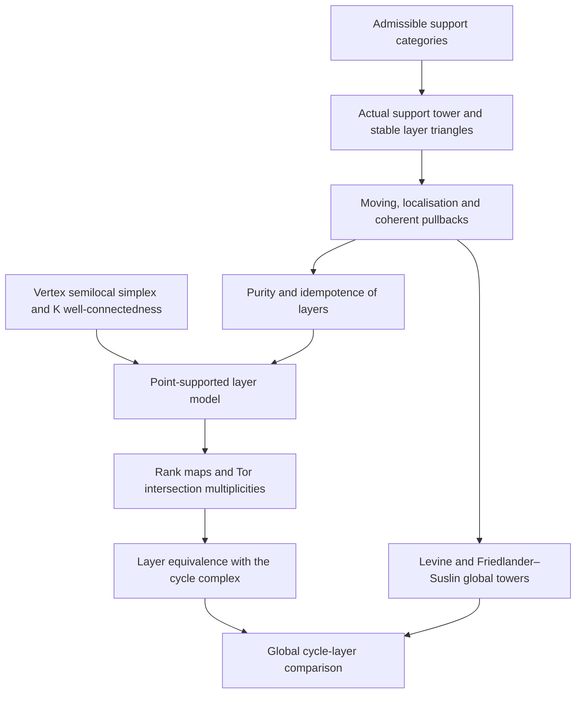

# Motivic and étale methods for arithmetic K-theory — M.6a

This layer constructs the homotopy-coniveau tower of actual K-theory spectra, proves its moving and localisation properties, and identifies its adjacent layers with Bloch's cycle complex. It also compares the entire tower with the global support models of Levine and Friedlander–Suslin. The tower is defined by support categories, restriction fibres, homotopy colimits and geometric realisation. The cycle calculation is a theorem about its cofibres.

The core result concerns smooth separated finite-type schemes over a perfect field. The two global exact-category comparisons are stated for smooth **quasi-projective** schemes, where finite vector-bundle resolutions on the scheme and its open complements give a direct comparison of models. The field can be finite. Finitely generated residue fields need not be perfect: they enter through continuity over the perfect base.

Every target in M.6a is specified below. The packet is a complete planning pass with coverage **planned**. Three precise supplier extensions remain: the spectrum-diagram interface, the normal-crossing homotopy-K-theory calculation, and the general-field intersection formula. They are stated in the supplier contracts below. All implementation statuses are unchecked. M.6b owns the exact couple, the resulting spectral sequence and convergence. M.7 owns the étale comparison and M.8 owns operations and degeneration in their stated ranges.

## Conventions and the output of this layer

Write Δⁿ = Spec k[t₀,…,tₙ]/(Σtᵢ−1). A nonempty face is obtained by choosing surviving vertices and setting the other coordinates to zero. The whole simplex is included among its faces; the empty face imposes no condition. On a disconnected smooth scheme every codimension condition is componentwise.

K(Y) means the nonconnective K-spectrum of perfect complexes supplied by SchemeKTheoryOperations. For a closed subset W of a smooth Y,

> K(Y on W) ≃ hofib(K(Y) → K(Y∖W)).

The supported category is the existing category of perfect complexes acyclic on the complement. It is not introduced anew here. Regularity identifies this supported spectrum with G(W), even when W is singular. In particular it is connective. Replacing it with ordinary K(W) would lose this fact.

The independent tower construction is

> K⁽ᵖ⁾(X,n) = hocolim over W ∈ S⁽ᵖ⁾ₓ(n) of K(X×Δⁿ on W),
>
> K⁽ᵖ⁾(X) = |n ↦ K⁽ᵖ⁾(X,n)|,
>
> LᵖK(X) = hocofib(K⁽ᵖ⁺¹⁾(X) → K⁽ᵖ⁾(X)).

All colimits, fibres, cofibres and realisations are derived constructions in ordinary spectra. The support family is filtered by finite union; it need not have a countable cofinal subfamily. The adjacent tower triangle, including its connecting map LᵖK → ΣK⁽ᵖ⁺¹⁾, is part of the construction. The projections give K(X) → K⁽⁰⁾(X), an equivalence by homotopy invariance. In the functorial tower this equivalence supplies the augmentation from the tower to the constant K-spectrum. These two directions must be distinguished.

The cycle complex uses homological degrees n ≥ 0 and differential Σ(−1)ⁱ∂ᵢ. For its Eilenberg–MacLane spectrum H(C), the convention is πₘH(C)=Hₘ(C). The layer theorem therefore reads

> LᵖK(X) ≃ H(zᵖ(X,•)),
>
> πₘLᵖK(X) = CHᵖ(X,m) = H²ᵖ⁻ᵐ(X,ℤ(p)) for m ≥ 0.

There is no additional suspension on this layer. In cohomological notation it is H(RΓ(X,ℤ(p))[2p]). Its negative homotopy groups vanish. These assertions specify the normalisation that M.6b must use when constructing its exact couple.

Several computations distinguish the construction from tempting substitutes. For X=Spec ℚ, p=1, the vertex of Δ¹ is not an admissible support, whereas its point with coordinates 1/2,1/2 is admissible. Thus one must test the faces, and p greater than dim X does not make the realised tower zero. Indeed π₁L¹K(ℚ)=ℚ×. For a pure d-dimensional X, the degree-n spectrum vanishes when p>d+n; this is a bound in the simplex direction, not an eventual vanishing claim for the realised tower.

The face multiplicity test is equally essential. Over ℚ, take X=A¹ₓ and the integral support W={s=x²} in X×Δ¹ₛ. The face s=0 contributes 2[0], because ℚ[x] localized at (x), modulo x², has length two. The face s=1 contributes [1]+[−1]. A map that merely pulls back the underlying reduced support cannot be the required cycle comparison.

## Existing owners and baseline

This layer imports the following material. The full prerequisite IDs at each target below are the definitive dependency list; a stage reference occurs only for one of the three explicit supplier contracts.

| Owner | Imported interface and boundary |
| --- | --- |
| MotivicEtaleKTheory M.4 | Algebraic simplex, admissible cycles, cycle complex, flat pullback, localisation, moving, homotopy invariance, descent, and weight-zero/weight-one calculations. These are existing targets of the earlier packet, not new definitions here. |
| MotivicEtaleKTheory M.5a | Cycle-complex transfers and pullback through good-position refinements; Suslin complexes and motivic complexes. |
| SchemeKTheoryOperations S.1–S.2 | Enhanced perfect and vector-bundle K-models, resolution-property representatives, model invariance, derived pullback, coherent G-models, finite-Tor restriction, proper pushforward, base change, projection formula and continuity at the level of spectra. |
| SchemeKTheoryOperations S.3 | Supported perfect-complex categories, the actual localisation fibre sequence, coherent-support dévissage, and the regular-ambient Cartan comparison K(Y on W)≃G(W). Regular-support dévissage is used when the closed subscheme is regular. |
| SchemeKTheoryOperations S.4 | Ordinary codimension-support filtration, Nisnevich excision, Brown–Gersten descent, hypercohomology spectra and the presentation lemma. Its ordinary coniveau filtration is recovered at n=0, not duplicated or identified with the realisation. |
| SchemeKTheoryOperations S.5 | Regular homotopy invariance, regular negative-K vanishing and projective-bundle theorem. The singular-boundary KH input is the additional contract below. A groupwise comparison of K-models alone is not substituted for a comparison of spectra. |
| GeneralAlgebraicKTheory K.3 | The exact-category resolution theorem; spectrum compatibility is carried through the enhanced K-model interfaces. |
| StableHomotopyKTheory H.5:spectra | Stable fibres/cofibres, Postnikov sections and Eilenberg–MacLane spectra of chain complexes, with homotopy equal to homology. Its sequential telescope interface requires the stated extension for support diagrams and realisations. |
| SchemeAndStackFoundations SF.4–SF.5 | Generic flatness, normal cones and deformation spaces, projective schemes, and the existing intersection machinery. The general-perfect-field Tor formula is the additional contract below. |
| MotivesAndAlgebraicCycles MC.4 | The sheaf z_equi(T,r) of relative cycles, transfers, and the Suslin–Friedlander comparison with Bloch cycles. For r=0 the cycles are quasi-finite and dominant over components, not required to be finite over the base. |

The library baseline is Mathlib **082e2d37e8b0463410cdb532e111cd43d5a66174** and Tau Ceti **f790474821cf4256814db967cb154e7af3d0c369**. The compact suggested file uses only existing affine algebra: Ideal.span forms the face ideal, Ideal.Quotient.mk restricts to its coordinate ring, Ideal.map restricts the support ideal, and Ideal.height measures the prime heights there. The definitions and their type hypotheses were read at the pin. A height in the original ambient ring would give the wrong face test.

The current TauCetiRoadmap and current Tau Ceti library were also checked for overlap. AlgebraicVectorBundles supplies its established vector-bundle direction, and AlgebraicTopology supplies its established foundational topology direction; neither is replanned here. Existing K₀ material is not taken to provide higher K-spectra or this tower. The compact Lean file states only what can be expressed on pinned carriers. The complete mathematical interfaces below remain targets for implementation on the imported spectrum and scheme infrastructure. Proposed API and Check names are written relative to the TauCeti root namespace: HomotopyConiveau.name means TauCeti.HomotopyConiveau.name.

## Targets

Within this document, a short node reference means MotivicEtaleKTheory:M.6a followed by that node's suffix. All target statements and proof outlines are specifications for future implementation.

### A. Support families, the tower and its maps

#### 1. Facewise admissible supports

Node: `MotivicEtaleKTheory:M.6a/facewise-supports`. Kind: definition. Atlas planet: **Admissible supports**.

For a smooth separated k-scheme X, S_X^p(n) is the inclusion poset of closed subsets W of X × Δ^n such that, for every nonempty face F (including Δ^n), every irreducible component of W ∩ (X × F) has codimension at least p in X × F. Empty intersections impose no condition. On disconnected X the condition is componentwise. For a finite family C of locally closed pure-codimension strata and e:C→ℕ, S_X,C,e^p(n) consists of W∈S_X^p(n) which additionally have codimension at least p−e(C) inside C × F, with a nonpositive bound vacuous; write S_X,C^p for e=0; for maps f_i:Y_i → X, S_X,{f_i}^p(n) requires W ∈ S_X^p(n) and (f_i × id)⁻¹W ∈ S_Yi^p(n) for every i. These are subposets closed under passage to smaller closed supports and finite unions. On an affine chart with coordinate ring R and simplex coordinates t_0,…,t_n, put I_τ=(t_i : i∉τ) for a nonempty set τ of vertices. A support V(J) is admissible exactly when every prime P of R/I_τ containing the image of J has height at least p, for every τ.

**Hypotheses.** k is a perfect field; X is a smooth separated scheme of finite type over k; p,n are nonnegative integers.

**Prerequisites.** `MotivicEtaleKTheory:M.4/algebraic-simplex`, `mathlib:Ideal.height`, `mathlib:Ideal.span`, `mathlib:Ideal.Quotient.mk`, `mathlib:Ideal.map`.

**Construction or proof.**

1. Use the already owned algebraic simplex and its face embeddings; impose a codimension condition on each face, rather than just on the ambient product.
2. Check inverse images along cofaces by composing faces and along codegeneracies by their affine-space fibres. Empty support is initial and finite union gives upper bounds, so each support poset is filtered.
3. The affine description is the prime-height criterion for codimension in each face ring. Radical ideals define the same support condition; the image ideal, not its height in the original ring, is used after restriction.

**API.**

| Proposed name | Role | Required statement |
| --- | --- | --- |
| `HomotopyConiveau.faceIdeal` | data | For affine simplex coordinates t and a nonempty vertex set τ, I_τ is the ideal generated by t_i with i outside τ. |
| `HomotopyConiveau.faceIdeal_eq_bot_of_univ` | simp | The face ideal of the full vertex set is zero. |
| `HomotopyConiveau.admissibleAffineSupport` | characterisation | V(J) passes the affine test exactly when p ≤ height(P) for every prime P containing the image of J in every nonempty face ring R/I_τ. |
| `HomotopyConiveau.admissibleAffineSupport_zero` | simp | Every support passes the test for p=0. |
| `HomotopyConiveau.admissibleAffineSupport_unit` | simp | The unit support ideal, whose vanishing set is empty, passes the test for every p. |
| `HomotopyConiveau.support_ext` | extensionality | Equal underlying closed subsets give equal admissibility propositions and equal indices of S_X^p(n). |
| `HomotopyConiveau.support_mono` | structure | A smaller closed support is admissible whenever a containing closed support is; finite unions of admissible supports are admissible. |
| `HomotopyConiveau.support_weight_mono` | functoriality | For p≤q there is an inclusion S_X^q(n) → S_X^p(n), with identity and composition laws. |
| `HomotopyConiveau.support_simplex_map` | functoriality | Every cosimplicial map Δ^m → Δ^n gives inverse image S_X^p(n) → S_X^p(m), compatibly with identities and composition. |
| `HomotopyConiveau.support_smooth_pullback` | functoriality | For a smooth map f:Y→X, inverse image preserves S^p and commutes with simplex maps; arbitrary f requires the adapted subposet. |
| `HomotopyConiveau.admissibleAffineSupport_radical` | compatibility | Replacing the affine support ideal J by its radical preserves the admissibility test. |

**Checks.**

- `HomotopyConiveau.support_empty` (degenerate): The empty support belongs to S_X^p(n) for every p,n.
- `HomotopyConiveau.support_vertex_fails` (non-example): For X=Spec ℚ, n=1 and p=1, the vertex t_0=0 has codimension one in Δ¹ but is not admissible: its intersection with that vertex has codimension zero.
- `HomotopyConiveau.support_interior_point` (computation): For X=Spec ℚ, n=1 and p=1, the point t_0=t_1=1/2 is admissible, although p exceeds dim X.
- `HomotopyConiveau.support_affine_height` (compatibility): For an affine simplex chart, the geometric condition agrees with the stated prime-height test in every face quotient ring.

**Uses that determine the API.**

- Levine.HCT.2005 §2.1: Indexes the homotopy colimits defining the tower.
- Levine.Moving.2005 Theorem 2.6.2: Good-position subposets allow pullback of supports through prescribed maps.
- MotivicEtaleKTheory:M.6b: Supplies an actual filtration of spectra before forming any exact couple.

**Acceptance.**

- For p=0 every closed support is admissible.
- In degree n=0 this is the support poset of the ordinary codimension filtration, without identifying its degree-zero value with the realised tower.

**Sources.**

- [Marc Levine, *The homotopy coniveau tower*](https://arxiv.org/pdf/math/0510334v1), §2.1, p. 10; §4.1, p. 22. Defines the facewise support poset and its refinement adapted to a morphism.
- [Marc Levine, *Chow’s moving lemma and the homotopy coniveau tower*](https://arxiv.org/pdf/math/0510201v1), Definitions 2.3.1 and 2.6.1, pp. 9–10 and 12–13. Support conditions are downward closed and finite-union closed; additional strata impose good position.

#### 2. The homotopy-coniveau tower and its layers

Node: `MotivicEtaleKTheory:M.6a/support-tower`. Kind: construction. Atlas planet: **Homotopy-coniveau tower**.

Fix a presheaf E of fibrant ordinary spectra on smooth k-schemes, reduced on the empty scheme and carrying finite disjoint unions to products. For Y smooth and W closed put E^W(Y)=hofib(E(Y)→E(Y∖W)), with the canonical support-enlargement maps. Define E^(p)(X,n)=hocolim_{W∈S_X^p(n)} E^W(X×Δ^n), and E^(p)(X)=|n↦E^(p)(X,n)| as a derived geometric realisation. The inclusions S^(p+1)⊂S^(p) give a tower; L_E^p(X)=hocofib(E^(p+1)(X)→E^(p)(X)). Restricted support families give the analogous objects. For E=K use SchemeKTheoryOperations’ actual nonconnective K-spectrum of Perf; its localisation equivalence identifies E^W with K(X×Δ^n on W). There is an augmentation E(X)→E^(0)(X) induced by the projections X×Δ^n→X. No E₂ page or groups chosen in advance enter these definitions.

**Hypotheses.** E is a presheaf of ordinary spectra on Sm/k, replaced functorially by fibrant spectra; the support posets are taken in a fixed universe. For the K-specialisation X is smooth separated finite type over a perfect field; all open complements are quasi-compact. Every theory E under discussion is reduced on the empty scheme and sends finite disjoint unions to products of spectra; all constructions are derived.

**Prerequisites.** `MotivicEtaleKTheory:M.6a/facewise-supports`, `SchemeKTheoryOperations:S.3/support-k-theory`, `SchemeKTheoryOperations:S.3/localisation-fibre-sequence`, `SchemeKTheoryOperations:S.4/codimension-support-filtration`, `StableHomotopyKTheory:H.5:spectra/mapping-cone-and-homotopy-fibre`, `StableHomotopyKTheory:H.5:spectra`.

**Construction or proof.**

1. Take functorial homotopy fibres and the support-enlargement maps. Use the filtered support posets and their simplex inverse-image functors to obtain a simplicial diagram of spectra.
2. Use the requested small-diagram homotopy-colimit and realisation interface, with derived replacements and cofinality, to define its total spectrum and tower maps.
3. Form layers in spectra. The fibre sequence E^(p+1)→E^(p)→L_E^p is the stable fibre/cofibre triangle; its connecting map belongs to this triangle, before any spectral-sequence indexing.

**API.**

| Proposed name | Role | Required statement |
| --- | --- | --- |
| `HomotopyConiveau.supportedSpectrum` | data | E^W(Y) is the homotopy fibre of restriction to the open complement, with its map to E(Y). |
| `HomotopyConiveau.supportedSpectrum_enlarge` | functoriality | W⊂W′ induces E^W(Y)→E^W′(Y); identity and composition agree up to the chosen coherent model. |
| `HomotopyConiveau.level` | data | The pair (p,n) has the spectrum hocolim_{S_X^p(n)} E^W(X×Δ^n) and its universal cocone. |
| `HomotopyConiveau.level_map` | functoriality | Face and degeneracy maps are induced by pullback and the corresponding functors of support posets, with simplicial identities. |
| `HomotopyConiveau.realisedLevel` | data | E^(p)(X) is the derived realisation of the simplicial spectrum of levels. |
| `HomotopyConiveau.transition` | functoriality | For p≤q the support inclusions give E^(q)→E^(p), with transitivity and identity. |
| `HomotopyConiveau.layer` | data | L_E^p is the homotopy cofibre of the adjacent transition; record its canonical triangle and connecting morphism. |
| `HomotopyConiveau.restrictedLevel` | constructor | A simplex-stable support subfamily defines a restricted tower and its comparison to the full tower. |
| `HomotopyConiveau.augmentation` | constructor | Projection pullback defines E(X)→E^(0)(X); it is an equivalence when E is A¹-invariant. |
| `HomotopyConiveau.degree_zero_ordinary` | compatibility | For K, the n=0 spectrum is S.4/codimension-support-filtration, with the same support-enlargement maps. |
| `HomotopyConiveau.empty_scheme` | simp | For E reduced on the empty scheme, every level and every layer of the empty scheme is contractible. |

**Checks.**

- `HomotopyConiveau.tower_weight_zero` (compatibility): For K on smooth X, K(X)→K^(0)(X) is an equivalence; its degree-n cocone is the map K(X)→K(X×Δ^n).
- `HomotopyConiveau.tower_not_constant_in_weight` (non-example): For X=Spec ℚ, π₁ L_K^1(X)≅ℚ× is nonzero. In particular the realised tower is not truncated above dim X=0.
- `HomotopyConiveau.tower_degree_bound` (characterisation): For X pure of dimension d, E^(p)(X,n) is contractible when p>d+n, since only the empty support remains. This bound is degreewise, not a bound on the realised tower.
- `HomotopyConiveau.tower_empty` (degenerate): K^(p)(∅) and L_K^p(∅) are contractible for all p.

**Uses that determine the API.**

- MotivicEtaleKTheory:M.6b: The tower maps and stable triangles provide the exact-couple input, rather than a proposed E₂ page.
- Levine.HCT.2005 Theorem 6.4.2: The comparison target is the actual cofibre of two support levels.
- SchemeKTheoryOperations:S.4/codimension-support-filtration: Recovers that filtration in simplex degree zero.

**Acceptance.**

- K^(p)(X,0) agrees with S.4’s ordinary codimension-support spectrum; realisation is an additional operation.
- The realisation and cofibres are performed in spectra, not by replacing each support spectrum by its K₀ group.

**Sources.**

- [Marc Levine, *The homotopy coniveau tower*](https://arxiv.org/pdf/math/0510334v1), §§2.1–2.2, pp. 9–12, especially (2.1.1) and Proposition 2.1.3. The tower is a realisation of supported spectra; successive layers are homotopy cofibres.
- [Marc Levine, *K-theory and motivic cohomology of schemes, I*](https://www.esaga.uni-due.de/f/marc.levine/publ/KthyMotI12.01.pdf), §3, pp. 12–14, equations (3.1)–(3.4). The K-theory version uses the same simplex support filtration and compares with a coherent model.

#### 3. K-theory satisfies the support-theory axioms

Node: `MotivicEtaleKTheory:M.6a/k-support-axioms`. Kind: theorem.

On smooth schemes over k, perfect-complex nonconnective K-theory is A¹-invariant, sends elementary Nisnevich distinguished squares to homotopy-cartesian squares, and has connective supported spectra K(Y on W). For a finite Galois extension k′/k of degree d, restriction K(Y)[1/d]→(K(Y_{k′})[1/d])^{hGal(k′/k)} is an equivalence. The same transfer argument applies with the support conditions carried along. Thus the integral tower theorems below apply also to finite perfect fields: inversion of d is an auxiliary step in the moving proof, removed using extensions of coprime degrees.

**Hypotheses.** k is a perfect field; X is a smooth separated scheme of finite type over k; p,n are nonnegative integers.

**Prerequisites.** `SchemeKTheoryOperations:S.5/homotopy-invariance-regular`, `SchemeKTheoryOperations:S.4/nisnevich-excision-square`, `SchemeKTheoryOperations:S.3/cartan-localisation-comparison`, `SchemeKTheoryOperations:S.2/k-theory-proper-pushforward`, `SchemeKTheoryOperations:S.2/k-theory-base-change`, `SchemeKTheoryOperations:S.2/projection-formula`, `StableHomotopyKTheory:H.5:spectra`.

**Construction or proof.**

1. Regularity gives K=G and K(Y on W)≃G(W), so negative supported groups vanish; ordinary K of singular W is not substituted for G(W).
2. Import homotopy invariance and Nisnevich excision from S.4–S.5.
3. For the finite étale extension use transfer and base change: cor∘res=d and res∘cor=Σ_g g. After inverting d these identify invariant homotopy groups. The homotopy-fixed-point comparison in the category of ℤ[1/d]-local spectra follows by averaging, not by assuming integral Galois descent.
4. For supported diagrams, replace a support over k′ by the finite union of its Galois translates. These invariant supports form a cofinal family and descend to k without changing facewise codimension. The transfer identities therefore apply to the support homotopy colimits as well.
5. For a finite base field use two sufficiently large finite extensions of coprime degrees to kill the moving obstruction integrally, as in the transfer part of Levine’s moving argument.

**Acceptance.**

- For a finite field the output remains integral; no blanket inversion of char k is introduced.
- For a singular closed W in smooth Y the connective support theory is G(W), not K(W).

**Sources.**

- [Marc Levine, *The homotopy coniveau tower*](https://arxiv.org/pdf/math/0510334v1), Axioms A1–A3, §2.1, pp. 10–11; Theorem 6.4.1, p. 35. States and verifies the required axioms for K-theory.
- [Marc Levine, *Chow’s moving lemma and the homotopy coniveau tower*](https://arxiv.org/pdf/math/0510201v1), §4.1, pp. 25–27, and coprime-degree descent in Proposition 3.3.4, pp. 23–24. The Galois condition is used after inverting extension degrees and then combined with transfer descent.

#### 4. Moving supports into prescribed good position

Node: `MotivicEtaleKTheory:M.6a/moving-with-constraints`. Kind: theorem. Atlas planet: **Moving lemma for supports**.

Let C be a finite collection of locally closed pure-codimension subsets of X and let E be A¹-invariant, Nisnevich excisive and satisfy the finite-field transfer axiom of k-support-axioms when k is finite. The inclusion E_C^(p)(−)→E^(p)(−) is a Nisnevich-local equivalence of presheaves on X. If U⊂X is affine, E_C^(p)(U)→E^(p)(U) is an equivalence of spectra; over a field it is also a Zariski-local equivalence. Given finitely many maps f_i:Y_i→X between smooth schemes, supports can be moved into a common refinement adapted to all f_i. The equivalence concerns the realised restricted tower, not a cofinality assertion about the original degreewise support posets.

**Hypotheses.** k is a perfect field; X is a smooth separated scheme of finite type over k; p,n are nonnegative integers. Every theory E under discussion is reduced on the empty scheme and sends finite disjoint unions to products of spectra; all constructions are derived.

**Prerequisites.** `MotivicEtaleKTheory:M.6a/facewise-supports`, `MotivicEtaleKTheory:M.6a/support-tower`, `MotivicEtaleKTheory:M.6a/k-support-axioms`, `SchemeKTheoryOperations:S.4/quillen-presentation-lemma`, `SchemeAndStackFoundations:SF.4/generic-flatness`, `StableHomotopyKTheory:H.5:spectra`.

**Construction or proof.**

1. On affine space use generic translations and the explicit algebraic homotopies, retaining good position on all faces and on the finitely many additional strata.
2. For a smooth affine X pass through a presentation and the projecting-cone argument; Nisnevich excision compares supports in the étale neighbourhood. Filter a finite family of morphisms by fibre dimensions using generic flatness to obtain enough strata for every inverse image.
3. Carry out the argument for finite collections of supports and homotopies, then pass to the homotopy colimit. Use the coprime-degree transfer argument over finite fields.
4. State global equivalence only after the descent step; the local theorem alone does not identify global sections.

**Acceptance.**

- For the inclusion of a rational point into A¹, the unrestricted codimension-one support consisting of that point has no codimension-one inverse image. Moving replaces the support family before pullback.
- No claim says the good-position family is degreewise cofinal: an inadmissibly positioned support cannot be repaired merely by enlarging it.

**Sources.**

- [Marc Levine, *Chow’s moving lemma and the homotopy coniveau tower*](https://arxiv.org/pdf/math/0510201v1), Theorem 2.6.2, pp. 13–14; §§3, 5–6, pp. 14–25 and 27–40. Supplies local moving, its affine strengthening over a field and the translation/projecting-cone proof.
- [Marc Levine, *The homotopy coniveau tower*](https://arxiv.org/pdf/math/0510334v1), Theorem 4.1.1 and its proof, pp. 20–22. Uses supports adapted to morphisms to construct the functorial tower.

#### 5. Localisation and excision of the support tower

Node: `MotivicEtaleKTheory:M.6a/localisation-excision`. Kind: theorem.

Let j:U→X be open with closed complement Z. Put E_Z^(p)(X,n)=hocolim_{W∈S_X^p(n), W⊂Z×Δ^n} E^W(X×Δ^n). For a theory satisfying the moving hypotheses, realisation gives a fibre sequence E_Z^(p)(X)→E^(p)(X)→E^(p)(U). The construction is natural for open restrictions and support enlargements, and gives the corresponding sequence of layers. An étale map X′→X inducing an isomorphism over Z induces E_Z^(p)(X)≃E_Z′^(p)(X′). Consequently the tower and its layers satisfy elementary Nisnevich excision and Zariski Mayer–Vietoris; their maps to derived sections on X_Zar are equivalences for the finite-dimensional noetherian X in scope.

**Hypotheses.** k is a perfect field; X is a smooth separated scheme of finite type over k; p,n are nonnegative integers. Every theory E under discussion is reduced on the empty scheme and sends finite disjoint unions to products of spectra; all constructions are derived.

**Prerequisites.** `MotivicEtaleKTheory:M.6a/support-tower`, `MotivicEtaleKTheory:M.6a/moving-with-constraints`, `SchemeKTheoryOperations:S.3/localisation-fibre-sequence`, `SchemeKTheoryOperations:S.4/brown-gersten-vanishing`, `SchemeKTheoryOperations:S.4/sheaf-hypercohomology-spectrum`, `StableHomotopyKTheory:H.5:spectra`.

**Construction or proof.**

1. For each degree first restrict U to the family of supports that extend to an admissible support on X. Nested-support localisation identifies the fibre with supports contained in Z.
2. Apply the moving/localisation argument to compare the extendable-support realisation on U with the unrestricted one. Do not identify their degreewise posets or spectra.
3. Derived filtered homotopy colimits and realisation preserve the finite stable fibre sequences by the requested spectrum interface. Apply the same argument to adjacent tower maps to obtain the layer sequence.
4. For the étale excision map compare the supported spectra before taking homotopy colimits. Brown–Gersten descent on the finite-dimensional noetherian site upgrades the resulting distinguished squares to the asserted equivalence with derived sections.

**Acceptance.**

- For p=0 and E=K this recovers S.3’s localisation sequence K(X on Z)→K(X)→K(U).
- For Z=∅ the fibre is contractible; for Z=X and U=∅ it is the whole level.
- The theorem preserves codimension measured in X; no formula K_Z^(p)(X)=K^(p)(Z) is asserted.

**Sources.**

- [Marc Levine, *The homotopy coniveau tower*](https://arxiv.org/pdf/math/0510334v1), Theorem 3.2.1 and Corollary 3.2.2, pp. 14–18. Compares extendable supports to all supports and gives the realised localisation sequence.
- [Marc Levine, *K-theory and motivic cohomology of schemes, I*](https://www.esaga.uni-due.de/f/marc.levine/publ/KthyMotI12.01.pdf), Theorem 2.6, p. 9; §6, pp. 18–20. The coherent version has localisation and Mayer–Vietoris, which globalise the supported construction.

#### 6. A functorial replacement of the whole tower

Node: `MotivicEtaleKTheory:M.6a/functorial-tower`. Kind: construction.

For E as in moving-with-constraints, construct a contravariant functor X↦𝒯_E(X) from Sm/k to the category of towers of spectra and a natural augmentation to the constant tower E. Its restriction to smooth maps is equivalent, as a tower, to p↦E^(p)(X). For an arbitrary f:Y→X, the induced map is represented in the homotopy category by E^(p)(X) ← E^(p)(X)_f → E^(p)(Y), where the first arrow is the moving equivalence and the second is support pullback. The replacements for all p and all maps are chosen together, so composition is coherent and transitions and layer triangles are natural. When E=K the p=0 map is the usual derived pullback of perfect complexes.

**Hypotheses.** k is a perfect field; X is a smooth separated scheme of finite type over k; p,n are nonnegative integers. Every theory E under discussion is reduced on the empty scheme and sends finite disjoint unions to products of spectra; all constructions are derived.

**Prerequisites.** `MotivicEtaleKTheory:M.6a/moving-with-constraints`, `MotivicEtaleKTheory:M.6a/localisation-excision`, `SchemeKTheoryOperations:S.2/derived-pullback-perfect`, `StableHomotopyKTheory:H.5:spectra`.

**Construction or proof.**

1. Use the category of simultaneous adapted support conditions over a scheme and its finite diagrams of maps. The moving theorem compares each such refinement to the unrestricted local tower.
2. Apply the requested homotopy-coherent diagram replacement to the tower-valued diagram, followed by a Nisnevich-fibrant replacement. Carry the transition maps and the augmentation throughout this operation.
3. Use localisation/descent to compare the resulting values with the raw support realisations. On smooth maps and at weight zero the original pullbacks already preserve the supports, giving the stated comparisons.

**API.**

| Proposed name | Role | Required statement |
| --- | --- | --- |
| `HomotopyConiveau.functorialTower` | data | The contravariant functor 𝒯_E on Sm/k with values in towers of spectra. |
| `HomotopyConiveau.rawTowerComparison` | equivalence | On the smooth-morphism subcategory, 𝒯_E agrees with the realisation of the raw support tower. |
| `HomotopyConiveau.pullback` | functoriality | An arbitrary morphism f:Y→X induces a tower map; identity and composition hold in the chosen coherent replacement, hence in the homotopy category. |
| `HomotopyConiveau.pullback_roof` | characterisation | The homotopy class of pullback is the roof through the support family adapted to f. |
| `HomotopyConiveau.pullback_transition` | compatibility | Pullback commutes with every adjacent transition and the canonical layer triangle. |
| `HomotopyConiveau.pullback_weight_zero` | compatibility | Under K≃K^(0), the tower pullback is SchemeKTheoryOperations’ derived perfect-complex pullback. |
| `HomotopyConiveau.pullback_cycle` | compatibility | After face-rank-compatibility and layer-cycle-equivalence, layer pullback agrees with the Bloch–Levine good-position pullback supplied by M.5a/cycle-complex-transfers. |
| `HomotopyConiveau.change_theory` | functoriality | A natural transformation of excisive A¹-invariant theories induces a transformation of the whole tower and its layer triangles. |

**Checks.**

- `HomotopyConiveau.pullback_identity` (characterisation): Pullback along id_X is the identity tower map, including its transition maps.
- `HomotopyConiveau.pullback_composition` (characterisation): For Z→g Y→f X the pullback along f∘g agrees with g*∘f* as a map of towers.
- `HomotopyConiveau.pullback_closed_point` (non-example): For {0}→A¹ the pullback is formed through moved supports; it is not induced by the inverse image of every unrestricted codimension-one support.
- `HomotopyConiveau.pullback_flat` (compatibility): For a smooth projection X×A¹→X the construction agrees with the direct inverse-image map of support diagrams.

**Uses that determine the API.**

- Levine.HCT.2005 Theorem 4.1.1: The purity and iterated-layer arguments require functorial presheaves, not isolated values.
- MotivicEtaleKTheory:M.6b: Naturality of the eventual spectral sequence requires the maps to commute with tower transitions.
- MotivicEtaleKTheory:M.5a/cycle-complex-transfers: Provides the existing cycle-side pullback to which the layer map must agree.

**Acceptance.**

- An inverse to a moving equivalence is taken in the coherent diagram category; independent arbitrary inverses for each p do not constitute this construction.

**Sources.**

- [Marc Levine, *The homotopy coniveau tower*](https://arxiv.org/pdf/math/0510334v1), Theorem 4.1.1(1)–(3) and its proof, pp. 20–22. Constructs all tower maps together and records naturality, fibre-sequence preservation and functoriality.
- [Marc Levine, *Chow’s moving lemma and the homotopy coniveau tower*](https://arxiv.org/pdf/math/0510201v1), §7.3, Theorem 7.4.1, Theorem 7.5.6 and Corollary 7.5.7, pp. 47–58. Uses adapted supports and a diagram regularisation to obtain the presheaf construction.

#### 7. Homotopy invariance of the tower

Node: `MotivicEtaleKTheory:M.6a/tower-homotopy-invariance`. Kind: theorem.

For E satisfying the moving hypotheses, projection pullback E^(p)(X)→E^(p)(X×A¹) and L_E^p(X)→L_E^p(X×A¹) are equivalences, natural as maps of towers. In particular E(X)→E^(0)(X) is an equivalence if E is A¹-invariant. These statements concern the derived realisations; they do not say that every degreewise restricted support spectrum is invariant.

**Hypotheses.** k is a perfect field; X is a smooth separated scheme of finite type over k; p,n are nonnegative integers. Every theory E under discussion is reduced on the empty scheme and sends finite disjoint unions to products of spectra; all constructions are derived.

**Prerequisites.** `MotivicEtaleKTheory:M.6a/functorial-tower`, `MotivicEtaleKTheory:M.6a/moving-with-constraints`, `MotivicEtaleKTheory:M.6a/support-tower`.

**Construction or proof.**

1. Restrict to supports in simultaneous good position for the zero and unit sections and the algebraic contraction of A¹.
2. Use the simplicial homotopy induced by multiplication on A¹ to compare section followed by projection with the identity; moving gives equivalence with the unrestricted realisations.
3. For p=0 the maximal support X×Δ^n is terminal, so the level is E(X×Δ^n). A¹-invariance makes the augmentation a levelwise equivalence from the constant spectrum.

**Acceptance.**

- For K this identifies the bottom stage with the K-spectrum, rather than with its Eilenberg–MacLane K₀ truncation.

**Sources.**

- [Marc Levine, *Chow’s moving lemma and the homotopy coniveau tower*](https://arxiv.org/pdf/math/0510201v1), Theorem 3.3.5 and Lemma 3.3.6, pp. 24–25. Proves homotopy invariance with the support conditions retained.
- [Marc Levine, *The homotopy coniveau tower*](https://arxiv.org/pdf/math/0510334v1), Proposition 2.1.3(3), pp. 11–12; §2.2(2), p. 12. Gives the augmentation and its homotopy-invariance consequence.

### B. Semilocal coefficients, purity and the layer theorem

#### 8. Semilocal simplices and multirelative face fibres

Node: `MotivicEtaleKTheory:M.6a/semilocal-simplex`. Kind: construction.

For a field F/k, let R_{n,F} be the localisation of F[t_0,…,t_n]/(Σt_i−1) at the multiplicative set of functions nonzero at each of the n+1 vertices. Write Δ^n_{0,F}=Spec R_{n,F}. The nonempty faces form the punctured (n+1)-cube; evaluating a presheaf E on all these faces and taking the total homotopy fibre defines E(Δ^n_{0,F},∂). This is the multirelative face object. The closed union ∂Δ^n_{0,F}=V(t_0⋯t_n) is a different object, and its ordinary relative fibre is not identified with the face-cube fibre without a closed-descent theorem. Extend E to these semilocal schemes and to finitely generated residue fields by filtered neighbourhoods.

**Hypotheses.** F is a finitely generated extension of the perfect base field k; n≥0. The presheaf is extended by filtered neighbourhoods; K-continuity supplies its concrete ring interpretation. Every theory E under discussion is reduced on the empty scheme and sends finite disjoint unions to products of spectra; all constructions are derived.

**Prerequisites.** `MotivicEtaleKTheory:M.4/algebraic-simplex`, `SchemeKTheoryOperations:S.2/k-theory-continuity`, `StableHomotopyKTheory:H.5:spectra/mapping-cone-and-homotopy-fibre`, `StableHomotopyKTheory:H.5:spectra`.

**Construction or proof.**

1. Localise at the complement of the union of the vertex maximal ideals. This is simultaneous semilocalisation, not the product of the separate local rings.
2. Intersect faces after this localisation, discard the empty intersection of all faces, and form the total homotopy fibre of the resulting finite cube.
3. For theories initially on Sm/k, use the neighbourhood extension and the requested filtered-colimit compatibility. For K this extension agrees with actual K of the localised ring by continuity.

**API.**

| Proposed name | Role | Required statement |
| --- | --- | --- |
| `HomotopyConiveau.semilocalSimplex` | data | Δ^n_{0,F} is the vertex semilocalisation, with restriction maps from open neighbourhoods of all vertices. |
| `HomotopyConiveau.semilocalSimplex_face` | functoriality | The simplex coface and codegeneracy maps restrict to the semilocal diagrams and satisfy their cosimplicial identities. |
| `HomotopyConiveau.relativeFaceCube` | data | E(Δ^n_{0,F},∂) is the total homotopy fibre of the cube of all nonempty face intersections, with its map to E(Δ^n_{0,F}). |
| `HomotopyConiveau.relativeFaceCube_natural` | functoriality | Maps of theories and field extensions induce maps of the face cubes and their total fibres. |
| `HomotopyConiveau.semilocalSimplex_zero` | equivalence | Δ^0_{0,F}=Spec F and the empty boundary makes E(Δ^0_{0,F},∂)=E(F). |
| `HomotopyConiveau.semilocalSimplex_boundary_one` | characterisation | For n=1 the boundary ring is F×F; the face cube is the fibre of E(R_{1,F})→E(F)×E(F). |
| `HomotopyConiveau.semilocalSimplex_k_continuity` | compatibility | K of this semilocal scheme and its supported variants agree with the filtered neighbourhood values of S.2/k-theory-continuity. |

**Checks.**

- `HomotopyConiveau.semilocal_zero` (degenerate): For n=0, the multirelative K-spectrum is K(F), with K₀=ℤ.
- `HomotopyConiveau.semilocal_one_boundary` (computation): For n=1, R/(t_0t_1)≅F×F, K₀ of the boundary is ℤ², and K₀(R)→K₀(boundary) is a↦(a,a).
- `HomotopyConiveau.semilocal_not_product` (non-example): R_{1,F} is a domain with two maximal ideals; it is not the product of the local rings at the two vertices.
- `HomotopyConiveau.semilocal_nonvertex_support` (characterisation): A closed subset of Δ^n_{0,F} disjoint from every vertex is empty, since all closed points are vertices.

**Uses that determine the API.**

- Levine.HCT.2005 Proposition 6.3.4: Tests the vanishing needed for well-connectedness.
- Levine.HCT.2005 §5.2: The vanishing of positive coniveau on semilocal simplices controls iterated layers.

**Acceptance.**

- The face-cube fibre must remain distinct from the ordinary pair (R,R/(t_0⋯t_n)) until the specific KH comparison is invoked.

**Sources.**

- [Marc Levine, *The homotopy coniveau tower*](https://arxiv.org/pdf/math/0510334v1), §5.1 and Remark 5.1.1, pp. 26–27; §6.3, pp. 32–34. Defines the vertex semilocalisation and the multirelative face cube; the criterion uses this cube.

#### 9. Well-connected support theories

Node: `MotivicEtaleKTheory:M.6a/well-connected-theory`. Kind: definition.

For an A¹-invariant Nisnevich-excisive presheaf E satisfying the finite-field transfer axiom, define Ω_T E(Y)=E^{Y×{0}}(Y×P¹). A theory is well-connected if (i) E^W(Y) is connective for every smooth Y and closed W, and (ii) for every d≥0 and every finitely generated field extension F/k, (Ω_T^d E)^(0/1)(F) has homotopy only in degree zero. Here (0/1) denotes the actual adjacent tower cofibre, not the pointwise Postnikov truncation. The canonical map from π₀(Ω_T^d E(F)) identifies that group with π₀ of this zero layer. Iterated Ω_T is defined on presheaves before forming its coniveau tower.

**Hypotheses.** k is a perfect field; X is a smooth separated scheme of finite type over k; p,n are nonnegative integers. Every theory E under discussion is reduced on the empty scheme and sends finite disjoint unions to products of spectra; all constructions are derived.

**Prerequisites.** `MotivicEtaleKTheory:M.6a/support-tower`, `MotivicEtaleKTheory:M.6a/semilocal-simplex`, `StableHomotopyKTheory:H.5:spectra/postnikov-sections`, `SchemeAndStackFoundations:SF.5/projective-bundle`.

**Construction or proof.**

1. Define the T-loop theory by the ordinary supported fibre on P¹, and iterate it. A¹-invariance identifies it with the fibre of evaluation at infinity when required.
2. State connectivity with the convention π_i=0 for i<0. Impose the fieldwise zero-layer condition for every iterate of Ω_T.
3. Identify π₀ via the semilocal-simplex presentation and the constant π₀ maps; the stronger multirelative criterion is a separate theorem.

**API.**

| Proposed name | Role | Required statement |
| --- | --- | --- |
| `HomotopyConiveau.tLoop` | data | Ω_T E(Y) is E^{Y×0}(Y×P¹), with its natural maps under theory morphisms and scheme pullback. |
| `HomotopyConiveau.tLoop_at_infinity` | equivalence | For an A¹-invariant excisive E, Ω_T E(Y)≃hofib(E(Y×P¹)→E(Y×∞)). |
| `HomotopyConiveau.wellConnected` | characterisation | Well-connectedness is precisely supported connectivity together with concentration in degree zero of every iterated-T zero layer at every finitely generated field. |
| `HomotopyConiveau.wellConnected_supported_connective` | projection | From well-connectedness obtain π_i E^W(Y)=0 for i<0, for every allowed Y,W. |
| `HomotopyConiveau.wellConnected_field_layer` | projection | For every d,F, obtain π_i((Ω_T^d E)^(0/1)(F))=0 when i≠0. |
| `HomotopyConiveau.wellConnected_pi_zero` | equivalence | The map π₀Ω_T^d E(F)→π₀((Ω_T^d E)^(0/1)(F)) is an isomorphism. |
| `HomotopyConiveau.wellConnected_invariant` | compatibility | A natural objectwise equivalence of theories preserves well-connectedness and the indicated degree-zero identifications. |

**Checks.**

- `HomotopyConiveau.wellConnected_zero` (degenerate): The zero presheaf is well-connected and every field coefficient group is zero.
- `HomotopyConiveau.wellConnected_k_coefficient` (computation): For algebraic K-theory, (Ω_T^d K)^(0/1)(F)≃Hℤ for every d,F, with the class of a rank-one vector space mapping to +1.
- `HomotopyConiveau.wellConnected_not_k_field_truncation` (non-example): For F=ℚ the K-spectrum has π₁=ℚ×≠0, while K^(0/1)(F) has π₁=0. The defining field layer is not K(F).

**Uses that determine the API.**

- Levine.HCT.2005 Theorem 6.4.2: Turns the field coefficient spectra in the layer model into Eilenberg–MacLane spectra.
- Levine.HCT.2005 Proposition 6.3.4: Provides a checkable multirelative criterion instead of assuming the cycle-layer conclusion.

**Acceptance.**

- Knowing only that E(F) is connective does not establish well-connectedness: supported connectivity and every T-loop zero-layer test are required.

**Sources.**

- [Marc Levine, *The homotopy coniveau tower*](https://arxiv.org/pdf/math/0510334v1), Definition 3.3.1 and Remarks 3.3.2, pp. 18–19; Definition 6.1.1 and Lemma 6.1.3, pp. 30–31. Specifies the T-loop operation and both well-connectedness requirements, including the canonical degree-zero identification.

#### 10. Purity and the T-loop shift of coniveau

Node: `MotivicEtaleKTheory:M.6a/purity-t-loop-shift`. Kind: theorem.

Let E satisfy the moving hypotheses. For p≥1, the zero section Y×{0}⊂Y×P¹ gives natural equivalences (Ω_T E)^(p−1)(Y)≃E_{Y×0}^(p)(Y×P¹)≃Ω_T(E^(p))(Y), compatible with transitions. More generally, for a smooth closed immersion i:Z→X of codimension d equipped with a trivialisation of its normal bundle, E_Z^(p)(X)≃(Ω_T^d E)^(p−d)(Z); the corresponding layer is L_{Ω_T^d E}^{p−d}(Z). A nonpositive level index is interpreted as level zero, while a layer with negative index is zero. The purity equivalence is natural for maps of trivialised pairs; a choice of normal trivialisation is not silently erased.

**Hypotheses.** k is a perfect field; X is a smooth separated scheme of finite type over k; p,n are nonnegative integers. Every theory E under discussion is reduced on the empty scheme and sends finite disjoint unions to products of spectra; all constructions are derived.

**Prerequisites.** `MotivicEtaleKTheory:M.6a/well-connected-theory`, `MotivicEtaleKTheory:M.6a/tower-homotopy-invariance`, `MotivicEtaleKTheory:M.6a/localisation-excision`, `MotivicEtaleKTheory:M.6a/functorial-tower`, `SchemeAndStackFoundations:SF.5/normal-deformation`, `SchemeAndStackFoundations:SF.5/normal-cone`, `SchemeKTheoryOperations:S.4/quillen-presentation-lemma`, `StableHomotopyKTheory:H.5:spectra`.

**Construction or proof.**

1. For the zero section use the square defining the two support fibres and Zariski excision to identify E^{W×0} with (Ω_T E)^W; codimension shifts by one.
2. The localisation theorem compares the supported realised level on Y×P¹ with the T-loop of the realised level, giving the second equivalence.
3. For a smooth pair use Nisnevich local linearisation and deformation to the normal bundle. A¹-invariance identifies the restrictions at the two fibres of the deformation; use the specified trivialisation and iterate the zero-section calculation.
4. Use the fibre sequences for adjacent levels to obtain the layer formula. The negative-layer convention records that both adjacent levels have already become the same level zero.

**Acceptance.**

- At p=d the supported layer is the zero layer of Ω_T^d E on Z.
- For K, regular-support dévissage and the projective-bundle basis normalise the T-loop equivalence so a point class has rank +1.
- A rank-d bundle is not trivialised by one nonzero section when d>1; no such step is used.

**Sources.**

- [Marc Levine, *The homotopy coniveau tower*](https://arxiv.org/pdf/math/0510334v1), Theorem 3.3.4, pp. 19–20; Lemma 4.2.1 and Proposition 4.2.2, pp. 24–25. Gives the T-loop shift and purity with a chosen trivialisation; these are the local inputs for the layer reduction.

#### 11. The multirelative criterion for well-connectedness

Node: `MotivicEtaleKTheory:M.6a/semilocal-criterion`. Kind: theorem.

Assume E is A¹-invariant, Nisnevich excisive, satisfies the finite-field axiom and has connective supported spectra. Then E is well-connected if and only if π₀((Ω_T^d E)(Δ^n_{0,F},∂))=0 for every n≥1, d≥0 and finitely generated field F/k. The zero-layer coefficient is canonically π₀Ω_T^d E(F). The condition is on the total face-cube fibre, not just on K₀ of the semilocal scheme.

**Hypotheses.** k is a perfect field; X is a smooth separated scheme of finite type over k; p,n are nonnegative integers. Every theory E under discussion is reduced on the empty scheme and sends finite disjoint unions to products of spectra; all constructions are derived.

**Prerequisites.** `MotivicEtaleKTheory:M.6a/well-connected-theory`, `MotivicEtaleKTheory:M.6a/semilocal-simplex`, `MotivicEtaleKTheory:M.6a/purity-t-loop-shift`, `StableHomotopyKTheory:H.5:spectra/postnikov-sections`, `StableHomotopyKTheory:H.5:spectra/eilenberg-maclane-of-chain-complex`, `StableHomotopyKTheory:H.5:spectra`.

**Construction or proof.**

1. Use the semilocal-simplex presentation of the zero layer. Connectivity and the degeneracy splittings identify its π₀ with π₀E(F).
2. Replace E by its positive Postnikov cover after separating the constant π₀ part. The total face-cube calculation identifies the obstruction to positive homotopy in the realisation with its multirelative degree-zero groups.
3. Apply the same argument to Ω_T^d E; purity identifies its supported fibres and supplies the required connectivity for every d. This proves both implications without presupposing a cycle equivalence.

**Acceptance.**

- The case n=0 is excluded: for K it has π₀K(F)=ℤ rather than zero.

**Sources.**

- [Marc Levine, *The homotopy coniveau tower*](https://arxiv.org/pdf/math/0510334v1), Lemmas 6.3.1–6.3.2, pp. 32–34; Proposition 6.3.4, pp. 34–35. Proves the criterion using face cubes and Postnikov covers of connective theories.

#### 12. Well-connectedness of algebraic K-theory

Node: `MotivicEtaleKTheory:M.6a/k-well-connected`. Kind: theorem. Atlas planet: **Well-connectedness of K-theory**.

The K-theory presheaf on smooth schemes over a perfect field is well-connected. The projective-bundle/zero-section equivalence identifies Ω_T^d K with K, with rank-one class +1. For every finitely generated F/k and n≥1, π₀K(Δ^n_{0,F},∂)=0. Consequently (Ω_T^d K)^(0/1)(F)≃Hℤ canonically by rank, for all d≥0. This is an equivalence of coefficient spectra; it does not assert K(F)≃Hℤ.

**Hypotheses.** k is a perfect field; X is a smooth separated scheme of finite type over k; p,n are nonnegative integers.

**Prerequisites.** `MotivicEtaleKTheory:M.6a/k-support-axioms`, `MotivicEtaleKTheory:M.6a/semilocal-criterion`, `SchemeKTheoryOperations:S.5/projective-bundle-theorem-noetherian`, `SchemeKTheoryOperations:S.3/regular-support-devissage`, `SchemeKTheoryOperations:S.5`, `StableHomotopyKTheory:H.5:spectra/eilenberg-maclane-spectrum`, `StableHomotopyKTheory:H.5:spectra/postnikov-sections`.

**Construction or proof.**

1. Supported connectivity comes from K(Y on W)≃G(W). The projective-bundle theorem and restriction at infinity identify each T-loop of K with K.
2. Use the S.5 request for KH closed descent and the low-degree K→KH comparison on the normal-crossing boundary D=V(t_0⋯t_n) of R=R_{n,F}. It identifies the degree-zero multirelative group with the degree-zero ordinary relative group and gives exactness K₁(R)→K₁(D)→K₀(R,∂)→K₀(R)→K₀(D).
3. The map GL(R)→GL(R/I) is surjective for semilocal R and I=(t_0⋯t_n)⊂Jac(R), hence K₁(R)→K₁(D) is onto. K₀(R)=ℤ and its map to K₀(D) is injective: composing with evaluation at any vertex gives the rank isomorphism K₀(R)→ℤ. Only injectivity is needed; for n=1 the target is ℤ², not ℤ.
4. The exact sequence gives the required vanishing. Apply the semilocal criterion and the uniqueness of the zero Postnikov spectrum with π₀=ℤ to obtain the coefficient equivalence.

**Acceptance.**

- For n=1, K₀(R)→K₀(F×F) is the injective diagonal; the same relative vanishing follows.
- The KH step is a requested proof input; the tower and the output theorem still concern ordinary K-theory.

**Sources.**

- [Marc Levine, *The homotopy coniveau tower*](https://arxiv.org/pdf/math/0510334v1), Theorem 6.4.1, pp. 35–36; Proposition 6.3.4, pp. 34–35. Uses supported G-theory, T-loop invariance, the normal-crossing KH comparison and semilocal relative K₀ vanishing. The rank argument here corrects the boundary-K₀ assertion recorded in sourceIssues.

#### 13. Idempotence and orthogonality of coniveau layers

Node: `MotivicEtaleKTheory:M.6a/layer-idempotence`. Kind: theorem.

For E satisfying the moving hypotheses over a perfect field and 0≤a≤b, the canonical comparison maps (E^(a))^(b)→E^(b) and (E^(b))^(a)→E^(b) are equivalences. For all a,b≥0, L_{L_E^b}^a is zero if a≠b and is equivalent to L_E^b if a=b. The comparisons are natural in E and respect the tower maps. Here the second coniveau operation is applied to the functorial presheaf furnished by functorial-tower, not to a single spectrum made into a constant presheaf.

**Hypotheses.** k is a perfect field; X is a smooth separated scheme of finite type over k; p,n are nonnegative integers. Every theory E under discussion is reduced on the empty scheme and sends finite disjoint unions to products of spectra; all constructions are derived.

**Prerequisites.** `MotivicEtaleKTheory:M.6a/functorial-tower`, `MotivicEtaleKTheory:M.6a/purity-t-loop-shift`, `MotivicEtaleKTheory:M.6a/semilocal-simplex`, `MotivicEtaleKTheory:M.6a/localisation-excision`, `MotivicEtaleKTheory:M.6a/tower-homotopy-invariance`, `StableHomotopyKTheory:H.5:spectra`.

**Construction or proof.**

1. On the vertex-semilocal simplex an admissible positive-codimension closed support is empty. Moving and the bisimplicial contraction turn this observation into the vanishing of the zero layer of E^(p), p>0.
2. Use purity and noetherian stratification by smooth pieces with trivial normal bundle to propagate this vanishing to layers of indices below p and to layers of E^(p/p+1) above p. Existence of a local normal frame suffices to prove that an object is zero; independence of the frame is not needed for this vanishing argument.
3. Apply these vanishing statements to the finite range of adjacent tower triangles between indices a and b. The resulting comparison maps give the two idempotence statements and the orthogonality formula.
4. Interchange the two realisations using the requested homotopy-colimit Fubini equivalence; no convergence claim for an infinite tower enters this argument.

**Acceptance.**

- With a=b=p, L_K^p≃(L_K^p)^(p/p+1). This replacement, not the raw degreewise quotient, is used for the pointwise rank comparison.
- The argument uses only finitely many tower triangles at a time; M.6b owns infinite-tower convergence.

**Sources.**

- [Marc Levine, *The homotopy coniveau tower*](https://arxiv.org/pdf/math/0510334v1), Lemma 5.2.1 and Propositions 5.2.2–5.2.3, pp. 27–28; Theorem 5.3.1, pp. 28–29. Derives iterated-layer vanishing and idempotence from semilocal supports and purity.

#### 14. The point-supported model of a K-theory layer

Node: `MotivicEtaleKTheory:M.6a/point-layer-model`. Kind: theorem.

For smooth X and p≥0 there is a simplicial spectrum B_X^p with |B_X^p|≃L_K^p(X), obtained by applying the pth coniveau layer again to the presheaf L_K^p. In degree n, B_X^p(n)≃∨_{x∈X^(p)(n)} (Ω_T^p K)^(0/1)(k(x))≃∨_{x∈X^(p)(n)}Hℤ, where X^(p)(n) consists of codimension-p points whose closures meet every face properly. The coefficient equivalences are normalised by rank and K-theory’s regular-support orientation. The displayed decomposition is degreewise; the face maps on B_X^p are the ones induced by the supported theory, whose agreement with cycle intersection is the separate face-rank theorem.

**Hypotheses.** k is a perfect field; X is a smooth separated scheme of finite type over k; p,n are nonnegative integers.

**Prerequisites.** `MotivicEtaleKTheory:M.6a/layer-idempotence`, `MotivicEtaleKTheory:M.6a/purity-t-loop-shift`, `MotivicEtaleKTheory:M.6a/k-well-connected`, `SchemeKTheoryOperations:S.3/cartan-localisation-comparison`, `SchemeKTheoryOperations:S.3/regular-support-devissage`, `SchemeKTheoryOperations:S.2/k-theory-continuity`, `StableHomotopyKTheory:H.5:spectra/eilenberg-maclane-spectrum`, `StableHomotopyKTheory:H.5:spectra`.

**Construction or proof.**

1. Idempotence replaces the layer by its own pth layer, with its genuine functorial presheaf structure.
2. Use localisation to discard higher-codimension pieces of each admissible support. Over the perfect field, stratify its reduced top-dimensional part by smooth pieces; shrink around each generic point until its normal bundle is trivial.
3. Purity and continuity identify the remaining summand with (Ω_T^p K)^(0/1)(k(x)). For K the regular-support dévissage orientation makes changes of normal coordinates act identically on the rank coefficient. This avoids assuming a trivialisation of a rank-p bundle from one nonzero section.
4. Use the coefficient equivalence from well-connectedness and the homotopy-colimit coproduct formula. Retain the original induced simplex maps rather than defining them by the desired cycle formula.

**Acceptance.**

- The raw quotient of degreewise supported K-levels has residue-field K-spectra, with nonzero higher homotopy; it is not replaced directly by ∨Hℤ.
- For p>dim X+n the degree-n point model is zero, while its realisation can have nonzero higher homotopy in other degrees.

**Sources.**

- [Marc Levine, *The homotopy coniveau tower*](https://arxiv.org/pdf/math/0510334v1), Corollary 5.3.2, pp. 29–30, and Theorem 6.4.2, pp. 36–37. The iterated-layer model has field coefficient spectra and is the input to the rank comparison.
- [Marc Levine, *The homotopy coniveau tower*](https://arxiv.org/pdf/math/0510334v1), Proposition 4.2.2, p. 25. Only purity for trivialised smooth normal bundles is required in the K-specific generic-point argument.

#### 15. The pointwise rank comparison

Node: `MotivicEtaleKTheory:M.6a/pointwise-cycle-map`. Kind: construction.

For the point-supported model B_X^p(n), form r_{p,n}:B_X^p(n)→H(z^p(X,n)[0]) by the wedge of the coefficient rank maps (Ω_T^p K)^(0/1)(k(x))→Hℤ followed by the inclusion of the generator [closure{x}] in the already owned free admissible-cycle group. This is a pointwise equivalence of spectra. Its assembly into a simplicial comparison requires face-rank-compatibility; it is not built by declaring the induced maps to be Bloch’s face maps.

**Hypotheses.** k is a perfect field; X is a smooth separated scheme of finite type over k; p,n are nonnegative integers.

**Prerequisites.** `MotivicEtaleKTheory:M.6a/point-layer-model`, `MotivicEtaleKTheory:M.4/admissible-cycles`, `StableHomotopyKTheory:H.5:spectra/postnikov-sections`, `StableHomotopyKTheory:H.5:spectra/eilenberg-maclane-spectrum`, `StableHomotopyKTheory:H.5:spectra/eilenberg-maclane-of-chain-complex`, `StableHomotopyKTheory:H.5:spectra`.

**Construction or proof.**

1. Since the point-supported model is concentrated in degree zero, use its canonical Postnikov map B_X^p(n)→H(π₀B_X^p(n)). Identify the latter coefficient group with z^p(X,n) by rank. This describes r_{p,n} without a choice of inverse to a wedge decomposition; under that decomposition it is exactly the wedge of coefficient rank maps.
2. Use the coproduct universal property to send the x-summand to the basis vector for its closure in z^p(X,n). The index sets are the same by admissibility.
3. The wedge of these equivalences is an equivalence. Prove compatibility with simplex maps in the following theorem, using the actual supported pullback.

**API.**

| Proposed name | Role | Required statement |
| --- | --- | --- |
| `HomotopyConiveau.pointwiseCycleMap` | constructor | For every X,p,n the rank maps define r_{p,n} into H(z^p(X,n)[0]). |
| `HomotopyConiveau.pointwiseCycleMap_generator` | simp | The unit of the x coefficient maps to [closure{x}], with coefficient +1. |
| `HomotopyConiveau.pointwiseCycleMap_additive` | structure | The map respects finite sums of point-supported classes and integer multiplicities. |
| `HomotopyConiveau.pointwiseCycleMap_equivalence` | equivalence | r_{p,n} is an equivalence of spectra, not just an isomorphism on π₀. |
| `HomotopyConiveau.pointwiseCycleMap_support` | compatibility | A subfamily of admissible codimension-p points gives the corresponding coordinate subgroup of z^p(X,n). |
| `HomotopyConiveau.pointwiseCycleMap_open` | functoriality | Open restriction discards the summands whose supports disappear and agrees with restriction of admissible cycles. |

**Checks.**

- `HomotopyConiveau.rank_cycle_field_zero` (computation): For X=Spec F, p=n=0 the coefficient map Hℤ→H z⁰(F,0)=Hℤ sends 1 to 1.
- `HomotopyConiveau.rank_cycle_empty_degree` (degenerate): For X=Spec F, n=0 and p>0 both the point model B_F^p(0) and z^p(F,0) are zero.
- `HomotopyConiveau.rank_cycle_double` (computation): For X=Spec ℚ, p=n=1, twice the rank-one class at t_0=t_1=1/2 maps to twice that cycle, rather than to its underlying reduced support.

**Uses that determine the API.**

- Levine.HCT.2005 Theorem 6.4.2: The rank comparison becomes the layer equivalence only after simplex compatibility.
- MotivicEtaleKTheory:M.6b: Fixes the normalisation of the cycle generator in the layer input.

**Acceptance.**

- The map sends a rank-one coherent generic class to the positive cycle generator.

**Sources.**

- [Marc Levine, *The homotopy coniveau tower*](https://arxiv.org/pdf/math/0510334v1), Theorem 6.4.2, equation (6.4.1) and its proof, pp. 36–37. Constructs the rank comparison degreewise and then checks its simplex naturality separately.

#### 16. Rank commutes with face and degeneracy maps

Node: `MotivicEtaleKTheory:M.6a/face-rank-compatibility`. Kind: theorem.

The maps r_{p,n} commute with all cofaces and codegeneracies of Δ^•, using the simplex maps already induced on B_X^p. At a component y of the proper intersection of an integral admissible support W with a face F, the coefficient of the pulled-back coherent class is Σ_i(−1)^i length_{O_{X×F,y}} Tor_i^{O_{X×Δ^n,y}}(O_W,y,O_{X×F,y}). The finite alternating sum agrees with the proper-intersection coefficient used by the M.4 cycle face map. Thus r_{p,•} is a simplicial equivalence. For general scheme pullback it agrees, after moving, with the cycle pullback supplied by M.5a.

**Hypotheses.** k is a perfect field; X is a smooth separated scheme of finite type over k; p,n are nonnegative integers.

**Prerequisites.** `MotivicEtaleKTheory:M.6a/pointwise-cycle-map`, `SchemeKTheoryOperations:S.2/g-theory-finite-tor-pullback`, `SchemeKTheoryOperations:S.3/cartan-localisation-comparison`, `SchemeAndStackFoundations:SF.5`, `MotivicEtaleKTheory:M.4/cycle-complex`, `MotivicEtaleKTheory:M.5a/cycle-complex-transfers`, `MotivicEtaleKTheory:M.6a/functorial-tower`.

**Construction or proof.**

1. Represent a generic generator by O_W and use the supported Cartan comparison. Derived restriction to a face gives the alternating Tor class in G₀ of its inverse image.
2. Apply the requested general-field Serre–Tor intersection statement to compare its generic lengths with the cycle face map; vanishing removes components of excessive codimension. Flat degeneracies use the already owned flat cycle pullback.
3. The rows from coherent G₀ to the generic cycle groups are surjective, so the generator calculation proves the commutative face squares for the point-supported model. Simplicial identities then come from the original spectra diagram.
4. For arbitrary morphisms compare both sides on the same good-position refinement; the existing cycle-transfers node supplies the cycle-side independence and composition.

**Acceptance.**

- All Tor terms have finite length at the relevant generic intersection point, and only finitely many are nonzero because the ambient scheme is regular.
- The underlying reduced inverse-image support is insufficient: generic intersection multiplicities must be retained.
- Over ℚ, for X=A¹_x and W={s=x²}⊂X×Δ¹_s, restriction to the face s=0 gives 2[0], since ℚ[x]_(x)/(x²) has length two; the other face gives [1]+[−1].

**Sources.**

- [Marc Levine, *The homotopy coniveau tower*](https://arxiv.org/pdf/math/0510334v1), Theorem 6.4.2, proof after (6.4.1), pp. 36–37. Uses derived coherent restriction and Serre intersection multiplicity to prove simplex compatibility, rather than inferring it from the coefficient groups.

#### 17. The layer is the Eilenberg–MacLane spectrum of the cycle complex

Node: `MotivicEtaleKTheory:M.6a/layer-cycle-equivalence`. Kind: theorem. Atlas planet: **Cycle-complex layer comparison**.

For every smooth separated finite-type scheme X over a perfect field k and p≥0 there is a natural equivalence of spectra L_K^p(X)≃H(z^p(X,•)), where H sends the homological cycle complex to its Eilenberg–MacLane spectrum and π_m H(C)=H_m(C). Hence π_m L_K^p(X)≅CH^p(X,m)=H^{2p−m}(X,ℤ(p)) for m≥0 and π_m L_K^p(X)=0 for m<0. The equivalence is natural for the functorial tower pullbacks and agrees with open restriction and the supported localisation triangles. It is a layer calculation independent of an exact couple, convergence theorem, Adams operations or rational degeneration.

**Hypotheses.** k is a perfect field; X is a smooth separated scheme of finite type over k; p,n are nonnegative integers.

**Prerequisites.** `MotivicEtaleKTheory:M.6a/point-layer-model`, `MotivicEtaleKTheory:M.6a/face-rank-compatibility`, `MotivicEtaleKTheory:M.4/cycle-complex`, `MotivicEtaleKTheory:M.4/localization-sequence`, `StableHomotopyKTheory:H.5:spectra/eilenberg-maclane-of-chain-complex`, `StableHomotopyKTheory:H.5:spectra/eilenberg-maclane-of-chain-complex-homotopy`, `StableHomotopyKTheory:H.5:spectra`.

**Construction or proof.**

1. The pointwise rank maps are equivalences and, by face-rank-compatibility, form a map of simplicial spectra.
2. Realise that map and use the realisation/Eilenberg–MacLane comparison for a simplicial abelian group. The realised source is the actual adjacent tower cofibre by the point-layer theorem.
3. Use the imported homotopy-group convention for H and M.4’s definition of the cycle complex. Localisation compatibility follows from restriction on supported coherent classes and M.4’s localisation theorem.

**Acceptance.**

- For a field F, L_K^0(F)≃Hℤ; π₀ is ℤ and π₁ is zero.
- For a field F, π₁L_K^1(F)=CH¹(F,1)≅F×, whereas z¹(F,0)=0. This detects the essential simplex direction.
- For X=P¹_k, π₀L_K^1(X)=CH¹(P¹)=ℤ with generator the class of a rational point.

**Sources.**

- [Marc Levine, *The homotopy coniveau tower*](https://arxiv.org/pdf/math/0510334v1), Theorem 6.4.2, pp. 36–37. Identifies the K-theory coniveau layer with Bloch’s cycle spectrum, including the simplex-compatibility argument.

### C. Global exact-category and cycle models

#### 18. The global face-exact coherent model

Node: `MotivicEtaleKTheory:M.6a/face-exact-coherent-model`. Kind: construction.

For Y_n=X×Δ^n and an open V⊂Y_n, let Coh_∂(V) be the full exact subcategory of coherent O_V-modules F for which Tor_i^{O_V}(F,O_{V∩(X×F′)})=0 for every face F′⊂Δ^n and every i>0. Equivalently require Tor-independence for every cosimplicial map into Y_n; codegeneracies are flat. Ordinary restriction to a face is exact on this subcategory and lands in the corresponding face-exact category. Set G_∂^W(Y_n)=hofib(K(Coh_∂(Y_n))→K(Coh_∂(Y_n∖W))) and G_∂^(p)(X,n)=hocolim_{W∈S_X^p(n)}G_∂^W(Y_n). After coherent strictification these form a simplicial spectrum and hence a realised tower. This is Levine’s global coherent homotopy-coniveau model; it is not the naive simplicial object of the unqualified categories Coh_{codim≥p}(X×Δ^n).

**Hypotheses.** X is smooth quasi-projective over the perfect field k for the stated global comparison; p,n≥0. Exact categories and their K-spectra use the imported essentially-small enhanced models and fixed universes.

**Prerequisites.** `MotivicEtaleKTheory:M.6a/facewise-supports`, `MotivicEtaleKTheory:M.6a/support-tower`, `SchemeKTheoryOperations:S.2/g-theory-models`, `SchemeKTheoryOperations:S.2/g-theory-finite-tor-pullback`, `GeneralAlgebraicKTheory:K.3/resolution-theorem`, `StableHomotopyKTheory:H.5:spectra`.

**Construction or proof.**

1. Higher Tor vanishing is stable under extensions and kernels of admissible surjections, giving the inherited exact structure. It makes each face pullback exact; composition follows from the derived tensor identities for nested faces.
2. Use the pseudofunctorial pullback coherences and the requested diagram replacement to form the simplicial exact-category model and its K-spectrum; define supports as actual restriction fibres.
3. Apply the same admissible support posets and transitions as for the perfect-complex tower. The support formula remains a homotopy fibre, so no unsupported assertion about an exact-category quotient is required.

**API.**

| Proposed name | Role | Required statement |
| --- | --- | --- |
| `HomotopyConiveau.faceExactCoherent` | data | Coh_∂(V) has coherent sheaves Tor-independent of all faces, with the inherited exact sequences. |
| `HomotopyConiveau.faceExactCoherent_mem` | characterisation | Membership is the stated vanishing of all positive Tor with every face; requiring all cosimplicial maps is equivalent because codegeneracies are flat. |
| `HomotopyConiveau.faceExactCoherent_vectorBundle` | constructor | A finite locally free sheaf lies in Coh_∂, and a bounded complex of such sheaves gives the corresponding K-theory comparison. |
| `HomotopyConiveau.faceExactCoherent_pullback` | functoriality | Coface and codegeneracy pullbacks are exact on these categories, and identity/composition follow their canonical pullback coherences. |
| `HomotopyConiveau.faceExactSupported` | data | G_∂^W is the homotopy fibre of the coherent restriction map to the open complement. |
| `HomotopyConiveau.faceExactTower` | data | The admissible-support homotopy colimit and its realisation give the coherent tower, with adjacent maps and canonical layer triangles. |
| `HomotopyConiveau.faceExactOpen` | functoriality | Open restrictions preserve Tor independence and induce maps of the supported diagrams and of the whole tower. |
| `HomotopyConiveau.faceExactZeroDegree` | compatibility | In simplex degree zero no nontrivial face restriction is imposed, so Coh_∂(X)=Coh(X) and G_∂^W(X)=G(X on W). |
| `HomotopyConiveau.faceExactNilpotentSupport` | compatibility | The supported fibre depends on the closed subset W, not a chosen scheme structure on W. |

**Checks.**

- `HomotopyConiveau.faceExact_vectorBundle` (compatibility): Every vector bundle on X×Δ^n is face-exact, since tensoring it has no positive Tor.
- `HomotopyConiveau.faceExact_skyscraper_fails` (non-example): On Δ¹ over a field, the skyscraper at the vertex t_0=0 is not face-exact: its Tor₁ with that vertex is a copy of the residue field.
- `HomotopyConiveau.faceExact_degree_zero` (degenerate): For n=0 every coherent sheaf on X is face-exact and the category is exactly Coh(X).
- `HomotopyConiveau.faceExact_empty_support` (degenerate): G_∂^∅(Y_n) is the homotopy fibre of the identity and is contractible.

**Uses that determine the API.**

- Levine.Global.2001 Lemma 3.3: Provides the coherent tower to be compared with perfect-complex K.
- Levine.Global.2001 Appendix B.8: Resolution compares the restricted coherent categories to ordinary G-theory.
- MotivicEtaleKTheory:M.6b: Supplies a global tower model in which boundary and cycle conventions can be checked.

**Acceptance.**

- Ordinary pullback is used only on a category where higher Tor vanishes.

**Sources.**

- [Marc Levine, *K-theory and motivic cohomology of schemes, I*](https://www.esaga.uni-due.de/f/marc.levine/publ/KthyMotI12.01.pdf), §2.2 and Remark 2.3, pp. 8–9; Appendix B.2–B.8, pp. 81–83. Defines the face-Tor-independent coherent categories, their simplicial pullbacks, restriction fibres and support families.
- [Marc Levine, *K-theory and motivic cohomology of schemes, I*](https://www.esaga.uni-due.de/f/marc.levine/publ/KthyMotI12.01.pdf), §3, pp. 12–14. Reindexes the global coherent niveau model by codimension.

#### 19. Comparison with Levine’s global tower

Node: `MotivicEtaleKTheory:M.6a/levine-global-comparison`. Kind: comparison.

For smooth quasi-projective X/k, the derived Cartan maps yield a natural equivalence of towers K^(p)(X)≃G_∂^(p)(X), compatible with support enlargement, the augmentation at p=0, open restriction and layer triangles. In every degree n and for every admissible closed W the map K(Y_n on W)→G_∂^W(Y_n) is an equivalence of spectra. Under this comparison the rank map on layers is the coherent generic-length cycle map. Zariski derived sections give the same tower, rather than merely isomorphic homotopy groups or a matching E₂ page.

**Hypotheses.** k is perfect and X is smooth quasi-projective over k; p,n≥0. The stronger global coherent comparison for arbitrary regular non-quasi-projective schemes is not asserted by this node.

**Prerequisites.** `MotivicEtaleKTheory:M.6a/face-exact-coherent-model`, `MotivicEtaleKTheory:M.6a/localisation-excision`, `MotivicEtaleKTheory:M.6a/layer-cycle-equivalence`, `SchemeKTheoryOperations:S.1/resolution-property-strict-representatives`, `SchemeKTheoryOperations:S.1/vector-bundle-comparison`, `SchemeKTheoryOperations:S.2/vector-bundle-k-theory-comparison`, `SchemeKTheoryOperations:S.2/k-theory-model-invariance`, `SchemeKTheoryOperations:S.2/perfect-coherent-on-regular`, `SchemeKTheoryOperations:S.5/negative-k-vanishing-regular`, `GeneralAlgebraicKTheory:K.3/resolution-theorem`, `StableHomotopyKTheory:H.5:spectra`.

**Construction or proof.**

1. Quasi-projectivity supplies the resolution property on Y_n and every open complement. Resolve coherent sheaves by finite locally free sheaves, retaining the face-Tor condition on the syzygies. Resolution identifies K(Coh_∂(V)) with the vector-bundle K-spectrum for V=Y_n and V=Y_n∖W.
2. Use the imported vector-bundle/perfect-complex model comparison. Regularity makes the nonconnective and connective K-spectra agree here; this avoids using only a groupwise Schlichting–TT comparison.
3. The resolutions and derived restriction commute through the enhanced models. Comparing the restriction fibre squares gives the supported equivalence, then homotopy colimits and realisation give a map of entire towers.
4. Trace a coherent generic class through the comparison to obtain its length-weighted cycle. Apply the descent theorem to both sides to compare with derived sections.

**Acceptance.**

- At p=0 the comparison is the regular-scheme Cartan equivalence K(X)≃G(X).
- This compares spectra and their tower arrows. Equality of graded groups alone would not meet the target.

**Sources.**

- [Marc Levine, *K-theory and motivic cohomology of schemes, I*](https://www.esaga.uni-due.de/f/marc.levine/publ/KthyMotI12.01.pdf), Lemma 3.3 and Remark 3.4, p. 13; Appendix B.8–B.9, pp. 83–84. The regular K/coherent comparison is termwise and retains supports; the quasi-projective hypothesis here ensures the global resolutions used in that proof.
- [Marc Levine, *K-theory and motivic cohomology of schemes, I*](https://www.esaga.uni-due.de/f/marc.levine/publ/KthyMotI12.01.pdf), Proposition A.2 and Remark A.3, p. 81. Mayer–Vietoris on a finite-dimensional noetherian space computes derived sections.

#### 20. Comparison with the Friedlander–Suslin support tower

Node: `MotivicEtaleKTheory:M.6a/friedlander-suslin-support-tower`. Kind: comparison.

For smooth quasi-projective X/k, the tower K^(p)(X) is naturally equivalent, with its augmentation and every support-enlargement transition, to the Friedlander–Suslin tower K^{C^p}(Δ^•×X) of (6.0). Here C^p(X,n) is exactly the family of facewise admissible closed supports, and supported K is evaluated on bounded complexes of the big vector bundles of their Appendix C.4–C.5 whose cohomological support lies in an admissible member of that family. This is equivalent to the filtered homotopy colimit over the members. The equivalence also identifies the towers after Zariski derived sections, their stable layer triangles, and the generic-length map to cycles. It compares their global support tower, not an unspecified auxiliary quasi-finite tower.

**Hypotheses.** k is perfect and X is smooth quasi-projective over k; the initially irreducible source convention extends componentwise to smooth X. Support-family K means complexes supported in some member, equivalently the filtered union over finite admissible support families.

**Prerequisites.** `MotivicEtaleKTheory:M.6a/support-tower`, `MotivicEtaleKTheory:M.6a/localisation-excision`, `MotivicEtaleKTheory:M.6a/levine-global-comparison`, `SchemeKTheoryOperations:S.1/perfect-waldhausen-models`, `SchemeKTheoryOperations:S.1/resolution-property-strict-representatives`, `SchemeKTheoryOperations:S.2/vector-bundle-k-theory-comparison`, `SchemeKTheoryOperations:S.2/k-theory-model-invariance`, `SchemeKTheoryOperations:S.3/localisation-fibre-sequence`, `SchemeKTheoryOperations:S.3/cartan-localisation-comparison`, `StableHomotopyKTheory:H.5:spectra`.

**Construction or proof.**

1. Evaluation of a big vector bundle on X gives an equivalence with ordinary vector bundles; its advantage is that pullback compositions hold strictly. Bounded complexes with quasi-isomorphisms give the imported Waldhausen model of perfect-complex K on these schemes.
2. The family C^p has the identical facewise codimension condition as S_X^p(n). Finite unions remain admissible. Every bounded complex and every finite diagram in its Waldhausen construction has support in a single admissible finite union. Thus its supported K-spectrum is the filtered homotopy colimit of the single-support K-spectra.
3. The localisation theorem identifies each single-support model with K(Y_n on W). Its negative groups vanish by the regular-ambient Cartan comparison with connective G(W), so passage from the connective Ω-prespectrum to the nonconnective convention introduces no extra summand.
4. Make these comparisons on the support diagrams before taking homotopy colimits. They commute with all simplex pullbacks and inclusions C^(p+1)⊂C^p, hence realisation identifies the entire towers. Nisnevich excision gives Zariski descent, so the same maps compare their derived-section presentations.

**Acceptance.**

- The comparison commutes with K^(p+1)→K^(p) before homotopy groups are taken.
- In simplex degree zero it is the imported ordinary codimension-support model; in weight zero it is the regular K-spectrum of X.
- The Ω-prespectrum is compared using its entire sequence of deloopings. Its first Waldhausen classifying space is not treated as the underlying spectrum.

**Sources.**

- [Eric M. Friedlander and Andrei Suslin, *The spectral sequence relating algebraic K-theory to motivic cohomology*](https://www.numdam.org/item/ASENS_2002_4_35_6_773_0.pdf), §5, (5.0.1)–(5.0.2), p. 794; §6, (6.0), p. 798. Defines the support families and the realised support tower independently of the subsequent exact-couple argument.
- [Eric M. Friedlander and Andrei Suslin, *The spectral sequence relating algebraic K-theory to motivic cohomology*](https://www.numdam.org/item/ASENS_2002_4_35_6_773_0.pdf), Appendix C.4–C.7, pp. 866–867. Gives the big-vector-bundle strict pullback model, supported Waldhausen K and realisation on cosimplicial schemes.

#### 21. Agreement with the Friedlander–Suslin global cycle layer

Node: `MotivicEtaleKTheory:M.6a/friedlander-suslin-global-layer`. Kind: comparison.

For smooth quasi-projective X over a perfect field and p≥0, the layer equivalence identifies L_K^p(X) with RΓ_Zar(X,H C_*z_equi(A^p,0)), where the relative-cycle sheaf z_equi and its Suslin complex are imported from MC.4 and M.5a. Explicitly, use the sheafwise zigzag z^p(−,•)→z^p(−×A^p,•)←C_*z_equi(A^p,0), whose arrows are quasi-isomorphisms. The resulting spectrum is the cycle-layer prespectrum of Friedlander–Suslin’s Proposition 13.10, using all its deloopings. In cohomological notation it is H(RΓ_Zar(X,ℤ(p))[2p]), so π_m=H^{2p−m}(X,ℤ(p)). No extra suspension from their first delooping B is inserted. Together with levine-global-comparison this gives a global supported tower with the same specified cycle layer; it makes no inference of a filtered equivalence from agreement of E₂ pages.

**Hypotheses.** k is perfect, X is smooth quasi-projective over k and p≥0. The existing MC.4 relative-cycle comparison is an imported target, not a newly planned motivic or relative-cycle theory.

**Prerequisites.** `MotivicEtaleKTheory:M.6a/layer-cycle-equivalence`, `MotivicEtaleKTheory:M.6a/levine-global-comparison`, `MotivicEtaleKTheory:M.6a/friedlander-suslin-support-tower`, `MotivicEtaleKTheory:M.4/zariski-descent`, `MotivicEtaleKTheory:M.4/homotopy-invariance`, `MotivicEtaleKTheory:M.5a/suslin-complex-and-motivic-complexes`, `MotivesAndAlgebraicCycles:MC.4/equidimensional-cycle-sheaves`, `MotivesAndAlgebraicCycles:MC.4/suslin-friedlander-into-cycle-complex`, `SchemeKTheoryOperations:S.4/sheaf-hypercohomology-spectrum`, `StableHomotopyKTheory:H.5:spectra/eilenberg-maclane-of-chain-complex-homotopy`, `StableHomotopyKTheory:H.5:spectra`.

**Construction or proof.**

1. Import the relative-cycle sheaf and its transfers from MC.4; quasi-finite dominant cycles, rather than just finite correspondences, are the required object.
2. Use MC.4’s Suslin–Friedlander embedding together with homotopy invariance of Bloch’s cycle complex to obtain the displayed sheafwise zigzag. This is precisely the published Friedlander–Suslin Proposition 12.1 comparison.
3. Apply derived sections and the Eilenberg–MacLane comparison; M.4 descent identifies the Bloch side with global cycles.
4. Compare the indexing of the entire Ω-prespectrum in Friedlander–Suslin Proposition 13.10, rather than taking its first delooping as the underlying spectrum. This fixes π_m and the cohomological shift.

**Acceptance.**

- For X=Spec F and p=0 the spectrum is Hℤ, with π₀=ℤ; treating the first B-delooping as the spectrum would wrongly shift this to π₁.
- For p=1, n=0, z_equi(A¹,0)(Spec F) is free on closed points of A¹, whereas z¹(F,0)=0. The zigzag is a derived comparison, not a degreewise identification.

**Sources.**

- [Eric M. Friedlander and Andrei Suslin, *The spectral sequence relating algebraic K-theory to motivic cohomology*](https://www.numdam.org/item/ASENS_2002_4_35_6_773_0.pdf), Proposition 12.1 and Corollary 12.2, pp. 829–830; Proposition 13.10, pp. 837–838. Identifies the quasi-finite Suslin complex with Bloch’s complex after sheafification, and gives the full global Ω-prespectrum.
- [Eric M. Friedlander and Andrei Suslin, *The spectral sequence relating algebraic K-theory to motivic cohomology*](https://www.numdam.org/item/ASENS_2002_4_35_6_773_0.pdf), Definition of Z_Q,A^p after Theorem 8.6, p. 816. Identifies this sheaf with z_equi(A^p,0), whose construction is already owned by MC.4.

## Supplier contracts and closure

The following are mathematical deliverables of their existing owners. They are required for this layer's implementation and recorded as requests rather than silently assuming a broader supplier statement. Once they are discharged, the packet's remaining assembly task is to reconcile the tower normalisation with M.6b. No additional M.6a target is left unnamed.

### Contract 1: `StableHomotopyKTheory:H.5:spectra`

Extend the sequential-telescope interface to small filtered support posets and simplicial diagrams of ordinary spectra: functorial derived homotopy colimits and realisations, cofinality, π_i of a filtered homotopy colimit, Fubini for bisimplicial realisations, preservation of finite stable fibre/cofibre sequences, and |H A_•|≃H(N A_•) for a simplicial abelian group. Also supply coherent tower/presheaf diagram replacements on a small skeleton of Sm/k, their Nisnevich-local replacements compatible with the S.4 descent interface, finite homotopy-fixed-point averaging after inverting the group order, finite total face-cube fibres, and compatibility of these operations with the imported Ω-prespectrum and Waldhausen presentations of ordinary K-spectra. The existing sequential-homotopy-colimit node alone does not supply these operations. Sources: Levine HCT §§1.6,2.1,4.1,6.3; Levine Moving §§1.3–1.5,7.3.

Used by `support-tower`, `k-support-axioms`, `moving-with-constraints`, `localisation-excision`, `functorial-tower`, `semilocal-simplex`, `purity-t-loop-shift`, `semilocal-criterion`, `layer-idempotence`, `point-layer-model`, `pointwise-cycle-map`, `layer-cycle-equivalence`, `face-exact-coherent-model`, `levine-global-comparison`, `friedlander-suslin-support-tower`, `friedlander-suslin-global-layer`.

### Contract 2: `SchemeKTheoryOperations:S.5`

Construct the algebraic-singular homotopy K-theory KH when needed and supply its closed-cover descent for the normal-crossing boundary D=V(t_0⋯t_n) of the vertex-semilocal simplex R_{n,F}, together with K_i(D)→KH_i(D) for i≤1 (the K₁-regular normal-crossing case used by Levine HCT Theorem 6.4.1, pp. 35–36). In particular identify the multirelative face-cube K₀ group with the ordinary relative KH₀ group and provide exactness K₁(R)→K₁(D)→K₀(R,∂)→K₀(R)→K₀(D). Do not assume ordinary K has closed descent on arbitrary singular unions. The existing S.5 plan explicitly constructs KH only when a consumer needs it; M.6a is such a consumer.

Used by `k-well-connected`.

### Contract 3: `SchemeAndStackFoundations:SF.5`

Extend SF.5/tor-intersection beyond its stated algebraically closed base: for a regular ambient scheme essentially smooth over a perfect field, identify proper face intersection cycles with the finite alternating generic Tor-length formula, and supply Serre vanishing for components of excessive codimension. Require compatibility with successive regular simplex-face restrictions and flat degeneracies. This is the cycle-theoretic input to the spectrum rank map, not a construction of Chow theory in M.6a. Source: Levine HCT Theorem 6.4.2, pp. 36–37.

Used by `face-rank-compatibility`.

For finite base fields, the transfer contract is used in the category of ℤ[1/d]-local spectra before taking finite homotopy fixed points. Averaging there removes higher group cohomology. No interchange of localisation with an arbitrary homotopy limit is assumed. Extensions of coprime degrees subsequently remove the auxiliary inversions from the moving obstruction.

For the normal-crossing contract, only the stated low-degree comparison is needed. Ordinary K-theory does not acquire descent for arbitrary closed singular covers from this argument. The face-cube total fibre and the fibre of restriction to the closed boundary are compared through KH, with the exact sequence specified in the contract.

## Source corrections used by the plan

The following observations concern the specified 2005 arXiv v1 manuscript, not an asserted collation with its published successor. They are recorded for independent checking. The corrected statements are already used in the targets above. Both affect proof steps; neither is used to declare the layer theorem false.

### `MotivicEtaleKTheory/E-HCT-boundary-rank`

arXiv:math/0510334v1, proof of Theorem 6.4.1, p. 36.

**Source assertion, paraphrased.** In the final rank argument the manuscript identifies the K₀ group of the entire semilocal normal-crossing boundary with a single copy of ℤ. (Paraphrase.)

**Required correction.** Only injectivity of K₀(R)→K₀(R/I) is required. It follows by evaluation at any vertex. For n=1 the boundary ring is F×F, its K₀ is ℤ², and the map is the diagonal ℤ→ℤ². The multirelative K₀ vanishing is unchanged.

**Check.** For R=F[t] semilocalised at t=0,1 and I=(t(1−t)), the two maximal ideals are comaximal; the Chinese remainder theorem gives R/I≅F×F. A vector bundle of rank a restricts with rank a at both vertices.

**Status.** new: no correction was identified in the versions and searches listed; this does not assert novelty of the observation. Searches: arXiv:math/0510334v1, Theorem 6.4.1 and surrounding text; arXiv record and web search for Levine homotopy coniveau tower boundary K₀ correction, 2026-10-19.

### `MotivicEtaleKTheory/E-HCT-normal-frame`

arXiv:math/0510334v1, proof of Corollary 4.2.4, p. 26.

**Source assertion, paraphrased.** After pulling a rank-d normal bundle to its complement of the zero section, the manuscript uses the diagonal nonzero vector to claim a trivialisation of that whole pullback bundle. (Paraphrase.)

**Required correction.** A nonzero vector supplies only a rank-one subbundle. A proof for general theories needs a full frame construction and its descent/independence argument, or an equivalent coordinate-independence proof. This packet uses purity only for explicitly trivialised smooth normal bundles and uses regular-support K-dévis­sage to make the generic rank coefficient independent of the local normal coordinates. It does not import that general canonical-trivialisation step.

**Check.** Pullback preserves rank: q*N still has rank d, whereas the claimed trivial line has rank one if d>1. A single vector cannot be a basis of a d-dimensional fibre.

**Status.** new: no correction was identified in the versions and searches listed; the stated purity conclusion is not declared false. Searches: arXiv:math/0510334v1, Proposition 4.2.2 and Corollary 4.2.4; Web search for Levine homotopy coniveau tower errata 4.2.4 normal bundle, 2026-10-19.

## Assembly and attached findings

At assembly, redirect the legacy M.5d packet’s six M.6a IDs to these refined targets, preserving existing references. The M.6/chern-character-edge-comparison request addressed to the old global-model-comparison also asks for equality with Levine’s rational cubical cycle class; that map-level adapter remains with M.6/M.6b assembly and is not proved by this integral layer calculation.

- **RT-AREA-ktheory-1/2.** M.5d/M.7 supply Beilinson–Lichtenbaum and the reduction over number rings; the finite-coefficient comparison in M.6b must import that theorem. M.6a asserts only the integral cycle layer and needs no étale identification.
- **RT-AREA-ktheory-1/3.** M.7 and ArithmeticKTheory:N.5 require real KO/BO, real Bott periodicity and Suslin’s real comparison. This packet asserts no dyadic real-place differential or arithmetic table.
- **RT-AREA-ktheory-2/18.** The common Soulé finite-coefficient Chern classes and product formula belong once in the M.7-dependent portion of M.8, imported by HB.1/HB.2 and D.2. This packet constructs no Chern class.

These are downstream obligations, not prerequisites for this integral support-tower construction.

## Compact suggested file and validation boundary

The companion suggested file imports Mathlib and contains two light definitions over existing rings and ideals: the face ideal and the prime-height admissibility predicate. Six named theorem targets state the full-face ideal, weight-zero, empty-support and radical-invariance laws and the two geometric Checks `support_vertex_fails` and `support_interior_point` above. Four proved examples check the full-face ideal, the omitted coordinate of a proper face, admissibility of empty support and failure of positive-weight admissibility for the whole degree-zero field simplex. There are two proved examples per definition, no admitted examples and no admitted data. These signatures exercise actual Mathlib quotient-ring and height types.

The remaining definitions require the imported higher K-spectrum, support diagram, realisation and exact-category infrastructure. Their complete statements, 59 API requirements and 26 named Checks are in this document. The fixed compact shape in WORKERS.md places these heavy targets here. This avoids introducing private replacement carriers or unproved data definitions merely to make a large suggested file typecheck. Elaboration of the companion is a check of these light signatures; it is not a formal proof of the tower or its comparisons.

## Source versions and reading record

The independent review confirmed the two source-proof findings against arXiv v1. The [arXiv record](https://arxiv.org/abs/math/0510334) lists only that version, and the [author’s publications page](https://www.esaga.uni-due.de/marc.levine/pub/) provides no linked correction for this paper. The [publisher PDF](https://londmathsoc.onlinelibrary.wiley.com/doi/pdf/10.1112/jtopol/jtm004) returned HTTP 403 on 19 October 2026, so the published text was not collated and the findings remain scoped to the preprint. Neither finding asserts that a stated theorem is false.

All statements above are in our own words. The source locators refer to the following exact texts; manuscript and published pagination are distinguished. The packet records their SHA-256 hashes and access date, 19 October 2026. No source text is part of the deliverables.

- [Marc Levine, *The homotopy coniveau tower*](https://arxiv.org/pdf/math/0510334v1). arXiv:math/0510334v1, 16 October 2005; all page numbers below are manuscript pages, not Journal of Topology pagination. Read: §§2.1–2.2, pp. 9–12; §§3.2–3.3, pp. 14–20; §§4.1–4.2, pp. 20–26; §§5.1–5.3, pp. 26–30; §§6.1–6.4, pp. 30–37. SHA-256: `5f268002b5ec36a74932a48ac051712c9c19c41a8b76e5bcb5dcdf0800538190`.
- [Marc Levine, *Chow’s moving lemma and the homotopy coniveau tower*](https://arxiv.org/pdf/math/0510201v1). arXiv:math/0510201v1, 10 October 2005; manuscript pagination. Read: §§2.1–2.6, pp. 8–14; §§3.1–3.3, pp. 14–25; §4.1, pp. 25–27; §§5–6, pp. 27–40; §§7.3–7.5, pp. 47–58; §8.3, pp. 60–62. SHA-256: `24cae98fca1a47bf910e30b0e4505c36f4a113e8f82c3103a5e7f0115fbb55c4`.
- [Marc Levine, *K-theory and motivic cohomology of schemes, I*](https://www.esaga.uni-due.de/f/marc.levine/publ/KthyMotI12.01.pdf). Author manuscript KthyMotI12.01.pdf; manuscript pagination. Read: §§2.2–2.7, pp. 8–11; §3, pp. 12–14; §5, pp. 15–17; §§6.1–6.6, pp. 17–18; §7.1 and §8.1, pp. 20–24; Appendix B, face-Tor-independent coherent models. SHA-256: `67affc5d6f837a78281c824d21723be9af1180bb77d44e8cff9cca5b0b2ef820`.
- [Eric M. Friedlander and Andrei Suslin, *The spectral sequence relating algebraic K-theory to motivic cohomology*](https://www.numdam.org/item/ASENS_2002_4_35_6_773_0.pdf). Annales scientifiques de l’École Normale Supérieure (4) 35 (2002), 773–875; published numbering. Read: §§5–6, pp. 794–805; §§7–9, selected comparison arguments, pp. 805–823; §§11–12, pp. 826–832; §13, pp. 832–838; Appendix C.4–C.7, pp. 866–867. SHA-256: `a1b0ab836b72516b64ac15a9969d53018a59a7f98c340ba19912c0e9c7ffc266`.

The dependency order is support categories → realised tower → moving/localisation and functoriality → purity and layer idempotence, together with semilocal well-connectedness → point coefficients → Tor-compatible rank map → cycle-layer equivalence. The global comparisons use the support diagrams before realisation and the cycle comparison after realisation. There is no dependence on M.6b convergence, M.7 étale descent or M.8 operations.
