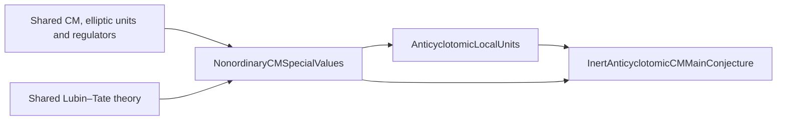

# Ray-class distributions and general automorphic constructions, Part II: nonordinary CM special values

This roadmap supplies the complex special values and the normalized elliptic-unit reciprocity input for the inert-prime anticyclotomic local-unit argument. Its central arithmetic result is that, for the canonical CM family and an auxiliary split prime l, almost every value Ω⁻¹L_f(barφν,1) is a p-adic unit. It also supplies the root-number zeros, the CM torsion-field comparisons and the general-class-number nonvanishing theorem needed by the consumers. The hypotheses and the integral period are part of these statements.

This is a complete planning pass at target level, with six planned layers and six explicit gaps. It claims neither an implemented theorem nor dependency closure. Each target below has a mathematical statement, proof outline, exact imports and acceptance checks. Every definition or construction also has a use-derived API and discriminating tests. The accompanying `Suggested.lean` is not the roadmap and is not exhaustive: this document is definitive. The Lean file suggests a compact set of names and signatures that can already be expressed at the pins, so contributors and reviewers can converge on their Lean forms. Heavy CM, regulator, tower and cohomology constructions remain mathematical targets here, rather than artificial carriers in the suggested file.

The base is **AutomorphicPadicLFunctions**, extending its ray-class/period direction at a nonordinary prime. Its L3 ordinary CM p-adic period is outside the inert setting. GlobalNumberFields owns the Hecke carrier; ClassFieldTheory owns ray and ring-class fields; ComplexMultiplicationAndExplicitReciprocity owns the canonical Gross character and curve; CMAllPrimeMainConjectures owns the single general elliptic-unit construction; PadicHodgeRegulators and SelmerIwasawaCohomology own the general cohomology maps. This roadmap specializes their interfaces and proves the BKO comparisons. Finis’s general divisibility theorem retains its existing L3h owner, with an exact independent inert-valuation export requested below.

The current accepted BKO extraction, corrected by `FIX-RT-PAPER-BURUNGALE-KOBAYASHI-OTA-21`, assigns ten early targets to this direction. The primitive elliptic-unit coordinate, Rubin’s integral p-adic L-function and its interpolation formula are assigned to **InertAnticyclotomicCMMainConjecture**. The frontier is therefore

There is no prerequisite edge from this roadmap to the signed local-unit decomposition. The ξ_ν projection, its Δ averaging, native derivatives and signed modules belong to the local-unit consumer. The normalized scalar values here do not define an integral Iwasawa function by interpolation. Issue #1689’s original combined brief predates that boundary. Grouped design #3350 overlaps this BKO direction and Kings–Sprang; the packet proposes reconciliation by the maintainer, while keeping the current ten-target assignment intact.

## Conventions and the two character directions

Fix an imaginary quadratic field K, its Hilbert class field H and compatible embeddings of algebraic numbers into C and C_p. Let p≥5 be inert, with p∤h_K and good CM reduction above p. Put Φ=K_p, the unramified quadratic extension of Q_p, and π=−p. The general BKO character φ is a weight-one ideal Hecke character of infinity type (1,0), conductor f prime to p, with φ(bar a)=barφ(a). It is realized by the CM Gross Q-curve E/H through φ composed with N_(H/K). In the canonical specialization, −D is the odd fundamental discriminant, 2 splits, and the canonical conductor is supported at the ramified primes. Canonical-character existence is imported from CM.4, not reconstructed here.

The smooth good model and its nonvanishing Néron differential ω fix an actual complex integration lattice. After replacing E by its appropriate H-conjugate, write that lattice Ω O_K with Ω≠0. A normalized value is A_S(η)=Ω⁻¹L_S(η,1). Here S deletes the native finite Euler factors at its prime support; the exponent in a modulus matters for the field/conductor, although the deletion set only sees the support. Algebraic avatars are provided by the proved CM comparison, never by a map from all of C into C_p. A p-unit assertion uses a specified embedding and the integer ring of a specified finite coefficient field.

The Hecke ideal character φ has idelic archimedean component z⁻¹. The inverse-action cohomological realization in Kato is T_φ^∨, and the zeta class has coefficients T_φ^∨(1). Its de Rham cotangent line is generated by ω, and the Betti normalization is γ=per_φ(ω)/Ω. The analytic character in BKO (3.4) and (3.9) is **barφ times the direct finite character**. The conjugation bar covers φ alone. Changing to an inverse-character idempotent requires an explicit reindexing; it is not the convention of the weighted sum used here.

Choose l≥5 split in K with l∤p h_K N(f) and p∤(l−1). X_l denotes the finite characters of the anticyclotomic Z_l-extension. For ν≠1 of exact order l^r, its minimal field layer is L[r] of degree l^r and its actual conductor is l^m O_K with **m=r+1**. For ν=1 use r=0 and m=0. This separates the indices conflated in the published BKO projection. Similarly a nontrivial p-anticyclotomic character χ of order p^n has conductor p^c with **c=n+1**; the first nontrivial conductor is p². The trivial p-character has exponent zero and is handled on its own.

The chosen local torsion fields are Φ_n=Φ(E[p^(n+1)]), n≥0, after the CM/Lubin–Tate comparison. They have degree (p²−1)p^(2n) over Φ. Thus Φ_0 is not Φ. Arithmetic Frobenius on the CM Tate representation has value −p at the inert prime, and its residue field has cardinality p². The π-transition basis differs from a p-transition basis by the stated alternating sign.

For root numbers, first make the Hecke character unitary, whose center is 1/2. This corresponds to s=1 in the weight-one ideal convention. A change from ψ to ψ(−·) multiplies a local central epsilon factor by the local character at −1. Its global product is one. This accounts for differing ±i archimedean factors in the imported Fourier and Rohrlich conventions; one cannot change the infinite factor while retaining every finite factor unchanged.

## Imports and what is already present

The pinned baseline is Tau Ceti `f790474821cf4256814db967cb154e7af3d0c369` with Mathlib `082e2d37e8b0463410cdb532e111cd43d5a66174`. The reviewed CM.4, L3/L3h, regulator L1 and continuous-cohomology L0 library audits were read before planning. The actual pinned statements of all five cited library declarations were read. Current upstream was also checked at TauCetiRoadmap `0d144d044dacebca17b654695b6f1ad58f159b27` and TauCeti `a91d3aafa8cd3e6bc33dfde0d7677ed0f1625039`.

Current TauCeti already contains a continuous idele-class Hecke carrier and its infinity-type, algebraicity, weight, norm-twist and ideal interfaces. Their existing GN9/GN10 roadmap layers are imported; this roadmap does not introduce replacement Hecke structures. The current GlobalNumberFields and ArithmeticDirichletSeries reader documents were read in full as the upstream style and coverage check. The relevant ProfiniteArithmetic and adjoining source interfaces were also inspected. No readonly upstream tree was built or changed.

| Existing provider | Imported result and boundary |
| --- | --- |
| Mathlib integral closure | `NumberField.RingOfIntegers` is the native integer ring, rather than a new CM ring wrapper. |
| Mathlib group algebra | `MonoidAlgebra.lift` and `lift_single` evaluate [g] as the direct ν(g). |
| Mathlib tensor algebra | `Subalgebra.linearDisjoint_iff_injective` concerns the actual multiplication map of two subalgebras. |
| Mathlib Dirichlet analysis | `DirichletCharacter.LFunction_apply_one_ne_zero` supplies L(1,κ_K)≠0 with nonzero modulus and nontrivial quadratic character. |
| ComplexMultiplicationAndExplicitReciprocity CM.1/CM.4 | Ideal-lattice curve, canonical character, good Gross Q-curve, Hecke/Frobenius and coefficient realization. The general-CM period/Galois field comparison requested here is stronger than the current supplied interface. |
| CMAllPrimeMainConjectures CZ.0/CZ.1 | Theta distribution, elliptic-unit module, Kummer tower and rational explicit reciprocity. The exact BKO integral specialization is G1. This packet was complete but unreviewed at the audit. |
| AutomorphicLFunctionsAndLocalFactors AL.1/AL.5 | Hecke completion, conductor, local/global epsilon factors, functional equation and finite Euler deletion. The existing period interface only wraps supplied GL₂/Q algebraicity; the general-CM extension is requested. |
| AutomorphicPadicLFunctions L3h | Sole general Finis owner. Request its exact inert-valuation formula independent of ordinary density. L3’s ordinary CM period is not imported at inert p. |
| LubinTateFormalModulesAndQuasiCanonicalLifts LT.2/LT.4 | Native division fields, character and Tate comparison; existing unramified/elliptic Honda comparison applied at Frobenius [−p]. |
| SelmerIwasawaCohomology L0/L3; PadicHodgeRegulators L1 | Completed finite-S Kummer, corestriction/Shapiro and dual exponential. The exact twist and semilocal trace compatibility still need the requested exports. |
| Tau Ceti class-field/local/elliptic layers | Artin quotients, Chebotarev, unramified/total ramification, full torsion Weil pairing, and ideal-counting bounds. These are contracts with existing roadmaps. |
| DiophantineApproximationAndTranscendence DT.2 | Existing mixed-place p-adic subspace theorem; request its precise homogeneous counting consequence rather than build a private approximation theory. |

## Layers and target declarations

The following targets are the declaration-level interface of the plan. Smaller proof calculations remain in their outlines. All implementation statuses are unchecked. Dependencies are written with exact node IDs where an exact supplier exists; stage contracts are recorded in the request register at the end.

## NCM.0 — CM periods and auxiliary characters

Fix the actual CM Gross Q-curve, its good differential and a principal complex period lattice; compare the dual/Tate conventions with Kato. Compute the positive canonical root number when 2 splits. Choose a split auxiliary l with p∤(l−1), and define the finite anticyclotomic characters with separate order, layer and conductor indices.

### cm-period: An integral elliptic CM period

**Construction.** For a CM Gross Q-curve E/H of type (1,0), good at every prime above the inert p, choose an actual smooth integral Weierstrass model near p and its Néron differential ω. After moving to a conjugate in the ideal-class orbit, choose Ω∈C× with the integration lattice of (E,ω) equal to Ω O_K. The normalized central value A_S(η;E,ω,Ω) is Ω⁻¹ L_S(η,1), initially complex; its algebraic and p-adic avatars are supplied by the comparison theorem, not by a map C→C_p. Here S is a finite set of finite primes and L_S deletes their native local factors.

**Hypotheses and conventions.** K is imaginary quadratic; p≥5 is inert, p∤h_K, and p is prime to the conductor f of φ. E/H realizes φ∘N_(H/K), is a Q-curve, and the fixed embeddings of algebraic numbers into C and C_p agree on K. The ideal class of the lattice is made principal by changing E within its conjugate CM orbit; Ω is then a choice up to O_K×.

**Proof or construction.**

1. Import the CM curve and its good model from CM.4, and its analytic ideal-lattice realization from CM.1. Move the lattice class by the inverse ideal class using CM reciprocity.
2. Integrate the actual invariant differential to obtain Ω O_K. Define the quotient in C, then use the requested algebraicity/Betti–de Rham comparison to give its p-adic meaning.
3. Retain the differential and both embeddings as data. No ordinary multiplicative formal-group trivialization or Katz p-adic period is part of this construction.

**Uses.** BKO21 (3.4), (3.9): The same good differential fixes both reciprocity and the p-unit normalization. AnticyclotomicLocalUnits:ALU.4/optimal-unit: A change by an integral unit preserves the optimal-unit witness.

**API.**

| Name | Role | Statement |
| --- | --- | --- |
| `CMPeriod.integrationLattice` | characterisation | The integration image of H_1(E(C),Z) against ω is exactly Ω O_K. |
| `CMPeriod.normalizedCentralValue` | data | A_S(η)=Ω⁻¹ L_S(η,1); its algebraic avatar is part of a proved comparison, not an extra arbitrary field. |
| `CMPeriod.scale_differential` | compatibility | For an integral unit u, ω′=uω has Ω′=uΩ, so A′_S=u⁻¹A_S. |
| `CMPeriod.coefficient_extension` | functoriality | Extending the chosen algebraic coefficient field carries A_S to the same value under the extended p-adic embedding. |
| `CMPeriod.period_ambiguity` | relation | Replacing Ω by εΩ, ε∈O_K×, multiplies A_S by ε⁻¹ and preserves valuation. |
| `CMPeriod.value_nonzero` | characterisation | A_S(η)≠0 iff L_S(η,1)≠0, since Ω≠0. |

**Definition tests.**

- **period_scale_unit** (characterisation): Scaling a good differential by 2 at p≥5 sends A_S to A_S/2 and preserves the p-unit property.
- **period_scale_p** (non-example): Scaling by p destroys Néron normalization and lowers v_p(A_S) by one; it is not an allowed invariance of the integral period.
- **period_ideal_class** (non-example): A nonprincipal lattice ideal cannot be replaced by O_K while keeping E fixed; the conjugate-curve step is required.
- **period_zero_value** (degenerate): If L_S=0 then A_S=0; the nonzero period does not create a unit.
- **period_inert_prime** (agreement): The complex period remains defined for inert p even though the ordinary Ω_p of AutomorphicPadicLFunctions:L3/cm-periods is unavailable.

**Check.** The lattice equality is an output and Ω is nonzero. Every assertion of p-adic integrality refers to an algebraic normalized value and a specified valuation.

**Imports.** `ComplexMultiplicationAndExplicitReciprocity:CM.4/gross-curve-good-reduction`; `ComplexMultiplicationAndExplicitReciprocity:CM.1/ideal-lattice-curve`; `AutomorphicLFunctionsAndLocalFactors:AL.1/completed-hecke-l-function`; `AutomorphicLFunctionsAndLocalFactors:AL.5/critical-value-period-interface`; `mathlib:NumberField.RingOfIntegers`; `ComplexMultiplicationAndExplicitReciprocity:CM.4`; `AutomorphicLFunctionsAndLocalFactors:AL.5`.

**Source.** BKO21, §3.0.2, p.951, period and coefficient choices before (3.4). The good differential, principal period lattice and coefficient field are fixed before the cohomology class is normalized.

### canonical-root-sign: Canonical root number at a split dyadic prime

**Theorem.** If φ is a canonical Gross character of an imaginary quadratic K with fundamental discriminant −D and 2 split in K, then W(φ)=W(barφ)=(2/D)=+1. Canonical means the CM.4 predicate: conjugation equivariance, signed principal values and conductor supported at ramified primes. The split condition forces D odd and D≡7 mod8. This theorem is conditional on the supplied canonical character; it does not reconstruct its existence.

**Hypotheses and conventions.** The Hecke ideal character has infinity type (1,0), its idelic avatar has archimedean value z⁻¹, and its unitary normalization has central point 1/2. Use the standard global additive character and self-dual local measures from AL.1.

**Proof or construction.**

1. Import the canonical conductor and rational-principal-character identities. At a ramified odd rational q the conductor and different both have exponent one.
2. Apply the imported local epsilon formula. In Rohrlich’s standard additive-character convention the complex factor is −i and each ramified odd q contributes i^δ_q (2/q) times the product of (q/r) over other ramified r, where δ_q=0 for q≡1 mod4 and δ_q=1 for q≡3 mod4. To compare an opposite Fourier convention in AL.1, replace ψ_v by ψ_v(−·): at the unitary center the local epsilon changes by the local character at −1. The global product of these factors is one because the character is trivial on K×. Thus individual archimedean phases must be converted together with every finite factor.
3. Multiply over q|D. Quadratic reciprocity cancels the powers of i and the pairwise residue symbols, leaving (2/D). Conjugation reindexes the ideal L-series, so barφ has the same sign.

**Check.** K=Q(sqrt(−7)) gives sign +1; the canonical character for Q(sqrt(−11)) has sign −1 and fails the dyadic split hypothesis. No statement is exported for even D from this calculation.

**Imports.** `ComplexMultiplicationAndExplicitReciprocity:CM.4/canonical-gross-character`; `AutomorphicLFunctionsAndLocalFactors:AL.1/explicit-epsilon-factors`; `AutomorphicLFunctionsAndLocalFactors:AL.1/global-epsilon-factor`; `AutomorphicLFunctionsAndLocalFactors:AL.1/hecke-l-functional-equation`; `tauceti:TauCetiRoadmap/GlobalNumberFields#layer-9-hecke-and-ray-class-characters`.

**Source.** ROHRLICH-NOTES, Proposition 1.5, p.14; Lecture 2 §5.2, pp.35–36, (2.44)–(2.49). The full local calculation expresses the canonical sign as the quadratic symbol (2/D). BKO21, Proof of Theorem 3.4, p.953, after (3.8). The auxiliary split-at-2 field is used precisely to make the canonical sign positive.

### auxiliary-prime: An auxiliary split prime away from p−1

**Theorem.** For K imaginary quadratic, p≥5 inert in K, and a finite set S of rational primes containing those dividing p h_K N(f), there are infinitely many rational primes l∉S with l≥5, l split in K and l not congruent to 1 modulo p. In particular p∤(l−1), as required by BKO (3.3).

**Hypotheses and conventions.** p is unramified in K; f is a fixed nonzero ideal.

**Proof or construction.**

1. Because p is unramified in K, the quadratic field K cannot be the quadratic subfield of Q(μ_p), whose discriminant is divisible by p. Hence K and Q(μ_p) are linearly disjoint.
2. Choose a nonidentity a in (Z/p)× and the element (1,a) of the Galois group of the compositum over Q. Import Chebotarev with its positive-density-to-infinitude consequence.
3. Remove S and the primes below 5. The selected Frobenius splits in K and gives l≡a modp.

**Check.** Merely choosing a split prime does not imply p∤(l−1). The finite exclusion includes the full norm of f and h_K; the surviving set remains infinite.

**Imports.** `tauceti:TauCetiRoadmap/Chebotarev#layer-10-dirichlet-density-chebotarev`; `tauceti:TauCetiRoadmap/ClassFieldTheory#layer-13-norm-theorems-and-class-fields`; `tauceti:TauCetiRoadmap/GlobalNumberFields#layer-10-archimedean-characters-infinity-types-and-cyclotomic-arithmetic`.

**Source.** BKO21, §3.0.2, p.951, hypotheses before (3.3). The auxiliary prime must split, avoid the conductor and class number, and have l−1 prime to p.

### auxiliary-characters: Finite characters in the auxiliary anticyclotomic tower

**Definition.** Let K_l^ac/K be the anticyclotomic Z_l-extension inside the ring-class tower. X_l is its set of continuous finite-image characters Γ_l→Qbar×, equivalently the union of the character groups of its finite quotients. The ideal avatar and p-adic avatar use the fixed embeddings and arithmetic Artin map. For ν≠1 write order(ν)=l^r, r≥1, and cond(ν)=l^m O_K with m=r+1. For ν=1 set m=0. Write L[r] for the degree-l^r layer through which ν factors; conductor indices and layer indices are never identified.

**Hypotheses and conventions.** l≥5 splits in K and l∤h_K N(f); the two primes over l use the rational ring-class modulus l^m O_K. Γ_l is supplied by class field theory; changing a topological generator changes coordinate descriptions, not X_l.

**Proof or construction.**

1. Import the ring-class idele quotient and its pro-l part. Its principal-unit anticyclotomic quotient at depth m has order l^(m−1), since l∤h_K and l∤#O_K×.
2. Use the Hecke/ray-character equivalence to form the primitive ideal character and its actual conductor.
3. For each finite quotient evaluate its group algebra with MonoidAlgebra.lift ν. In particular a basis vector [g] maps to ν(g), without inversion.

**Uses.** BKO21 pp.952–953, definition of ξ_ν: The actual conductor determines the source ray field; the exact order determines the finite ring-class layer. NCM.4/finis-unit-values: The family has unbounded conductor, allowing finite exceptional sets to be removed.

**API.**

| Name | Role | Statement |
| --- | --- | --- |
| `AuxiliaryCharacter.trivial` | constructor | The trivial character belongs to X_l and has conductor ideal O_K. |
| `AuxiliaryCharacter.factors_layer` | characterisation | A character of exact order l^r factors through L[r] and through no smaller layer. |
| `AuxiliaryCharacter.conductor` | characterisation | For a nontrivial exact-order-l^r character, cond(ν)=l^(r+1) O_K. |
| `AuxiliaryCharacter.conjugate` | compatibility | ν(cσc⁻¹)=ν(σ)⁻¹ for the nontrivial automorphism c of K/Q. |
| `AuxiliaryCharacter.groupAlgebraEval` | universal-property | The unique coefficient-algebra map sending [g] to ν(g) is MonoidAlgebra.lift applied to the direct character. |
| `AuxiliaryCharacter.baseChange` | functoriality | Any embedding of the value field carries character evaluation, conductor and order to their corresponding avatars. |

**Definition tests.**

- **auxiliary_first_wild** (computation): For r=1 the field layer has degree l while the conductor is l²; the two indices differ.
- **auxiliary_trivial_boundary** (degenerate): ν=1 has m=0 and belongs to the base layer; the r+1 rule is not applied to it.
- **auxiliary_direct_evaluation** (agreement): For g with ν(g)=ζ_l, the group-algebra basis element [g] evaluates to ζ_l, which differs from ζ_l⁻¹ for l≥5.
- **auxiliary_non_anticyclotomic** (non-example): A cyclotomic l-power character on which conjugation acts trivially is excluded unless its square is trivial.

**Check.** The first nontrivial wild character has conductor l², not l. Conjugation on the tower sends ν to ν⁻¹; the prime p O_K acts trivially because it is principal in every prime-to-p order.

**Imports.** `tauceti:TauCetiRoadmap/ClassFieldTheory#layer-13-norm-theorems-and-class-fields`; `tauceti:TauCetiRoadmap/GlobalNumberFields#layer-9-hecke-and-ray-class-characters`; `tauceti:TauCetiRoadmap/GlobalNumberFields#layer-10-archimedean-characters-infinity-types-and-cyclotomic-arithmetic`; `mathlib:MonoidAlgebra.lift`; `mathlib:MonoidAlgebra.lift_single`.

**Source.** BKO21, §3.0.2, pp.951–953, definition of X_l and the arrow labelled ν. Finite auxiliary characters are evaluated directly in the ring-class group factor; the printed reuse of m needs separate order and conductor indices.

### dual-tate-convention: The CM dual and Tate-twist dictionary

**Comparison.** Let T_φ be the rank-one integral p-adic realization of the ideal character φ, and put T_φ^∨(1)=Hom_R(T_φ,R)(1). At every prime above p of H this has the de Rham line identified with R[1/p]⊗coLie(E), generated by ω. In Kato’s notation ψ=φ has idelic type (−1,0), V(ψ) has the inverse φ-action, and V(ψ)(1) is T_φ^∨(1)[1/p]. The normalized Betti vector is γ=per_φ(ω)/Ω. Under this dictionary the analytic character in Proposition 15.9 is barφ times the direct finite character, not φ, barφ⁻¹, or barφ times an inverse finite character.

**Hypotheses and conventions.** φ, E, ω and Ω satisfy the period datum; R is the integer ring of a finite extension of Φ containing the p-adic character values. Coefficient and representation duals are R-linear; the Tate twist is the actual cyclotomic representation.

**Proof or construction.**

1. Import CM.4’s ideal/Frobenius and idelic-infinity conventions, then compare the r=1 case of CZ.1/cm-hecke-realization.
2. Identify the inverse-action cohomological realization and its Tate twist using the CM comparison; compare its cotangent generator with the chosen ω.
3. Track Kato’s complex conjugation on ψ in the analytic expression. Fourier reindexing is done after this comparison and introduces no extra conjugation on ν or χ.

**Check.** At a good prime a, the dual-twisted arithmetic Frobenius is N(a)/φ(a), as dictated by the dual and Tate operations. The displayed BKO (3.4) has barφ χ on its right side, with χ direct; this is checked against the PDF image.

**Imports.** `NonordinaryCMSpecialValues:NCM.0/cm-period`; `ComplexMultiplicationAndExplicitReciprocity:CM.4/frobenius-and-infinity-type`; `ComplexMultiplicationAndExplicitReciprocity:CM.4/tate-coefficient-components`; `CMAllPrimeMainConjectures:CZ.1/cm-hecke-realization`; `PadicHodgeRegulators:L1/dual-exponential`; `tauceti:TauCetiRoadmap/GlobalNumberFields#layer-10-archimedean-characters-infinity-types-and-cyclotomic-arithmetic`; `PadicHodgeRegulators:L1`.

**Source.** KATO04, §15.7–15.9, pp.256–260, especially the r=1 case of Proposition 15.9. The cohomological realization uses the inverse character, followed by a Tate twist, and the L-function uses the conjugated Hecke character. BKO21, §3.0.2, p.951, V^(tensor−1); (3.4), p.952. The local cotangent line and normalized Betti vector fix the precise dual/Tate dictionary.

## NCM.1 — Normalized elliptic-unit reciprocity

Specialize the single shared elliptic-unit foundation to BKO’s chosen integral rank-one lattice and Betti vector. Prove the direct-character semilocal dual-exponential formula, its period-change law and the norm-compatible inverse-limit twist comparison. The unsmoothed fraction-module class is not silently treated as integral.

### normalized-zeta-class: The integral BKO elliptic-unit class

**Construction.** For the period datum and γ=per_φ(ω)/Ω, specialize the shared elliptic-unit zeta element to a norm-compatible class z_a in H¹(K(a),T_φ^∨(1)), for every admissible modulus a divisible by f and supported on f,p and an auxiliary split l. The classes are the Kummer images of the shared theta-distribution element, with its smoothing factors removed in the φ-component only after proving those factors invertible on the specified integral lattice. Its rationalization agrees with Kato’s z_a^(p)(γ). For p-power increases of a the transition is corestriction, with the native Euler factors at newly introduced primes retained.

**Hypotheses and conventions.** The integer coefficient ring R contains the φ-values and the chosen Betti vector is integral in the specified realization. The exact smoothing-denominator/lattice assertion is supplier obligation G1; Kato’s fraction-module element by itself is insufficient.

**Proof or construction.**

1. Import CZ.0’s theta distribution, elliptic-unit module and tower Kummer map, then the rational reciprocity theorem CZ.1.
2. Calculate the smoothing operator on the rank-one φ-component, prove its denominators are units in the chosen lattice, and identify the inverse-action Tate lattice through NCM.0/dual-tate-convention. This is the unresolved integral supplier boundary, not an asserted consequence of localization.
3. Use the native Kummer map and its norm/corestriction compatibility to obtain the integral family and compare its rationalization with Kato’s normalized γ element.

**Uses.** BKO21 (3.4) and the projection defining ξ_ν, pp.952–953: The semilocal projection starts with this normalized integral class. AnticyclotomicLocalUnits:ALU.4/optimal-unit: A unit-valued reciprocity output requires the integral lattice, not just a rational class.

**API.**

| Name | Role | Statement |
| --- | --- | --- |
| `BKOZeta.integralClass` | constructor | Produce z_a in H¹_cont(K(a),T_φ^∨(1)) from the shared elliptic-unit distribution and the proved smoothing-unit condition. |
| `BKOZeta.rationalization` | characterisation | The integral class maps to Kato’s r=1 class z_a^(p)(per_φ(ω)/Ω) after inverting p. |
| `BKOZeta.corestriction` | compatibility | At fixed prime support, cor(z_ap)=z_a under the precise native transition maps. |
| `BKOZeta.new_prime` | relation | Adding a new good prime introduces the corresponding arithmetic-Frobenius Euler operator. |
| `BKOZeta.coefficient_extension` | functoriality | An integral flat extension R→R′ carries the actual class to the same normalized Kummer class. |
| `BKOZeta.scale_period` | compatibility | For fixed ω and an allowed lattice-period unit ε∈O_K×, replacing Ω by εΩ sends γ and z_a to ε⁻¹ times their previous values. General coefficient renormalizations are distinguished from changing the native CM period datum. |

**Definition tests.**

- **zeta_smoothing_nonunit** (non-example): A smoothing operator with φ-component divisible by p cannot be inverted to define the asserted integral class.
- **zeta_fraction_boundary** (non-example): Membership in the fraction module or H¹[1/p] does not imply membership in the chosen integral lattice.
- **zeta_norm_support** (agreement): For two successive p-levels after p is already in the modulus, corestriction gives the previous class without an extra new-prime Euler factor.
- **zeta_period_unit** (characterisation): Changing only Ω to −Ω is an allowed lattice-period choice and sends both γ and the class to their negatives. Changing ω and Ω together by 2 instead keeps γ and the class fixed.

**Check.** The output is an actual integral continuous-cohomology class, not an existential variable chosen to satisfy reciprocity. At a prime newly added to the modulus the Euler-system relation is checked before restricting to the fixed-support p-power tower.

**Imports.** `NonordinaryCMSpecialValues:NCM.0/cm-period`; `NonordinaryCMSpecialValues:NCM.0/dual-tate-convention`; `CMAllPrimeMainConjectures:CZ.0/elliptic-unit-module`; `CMAllPrimeMainConjectures:CZ.0/tower-kummer-identification`; `CMAllPrimeMainConjectures:CZ.1/cm-elliptic-reciprocity`; `SelmerIwasawaCohomology:L0/s-unit-kummer-identification`; `SelmerIwasawaCohomology:L0/kummer-cup-shapiro`; `CMAllPrimeMainConjectures:CZ.0`.

**Source.** KATO04, §15.6.3–15.6.5, pp.254–256; §15.8, p.257; Proposition 15.9, pp.257–260. The unsmoothed object is initially in a fraction module; the r=1 specialization and γ normalization determine its rational image. BKO21, §3.0.2, pp.951–952, class z_a and (3.4). BKO uses an integral class with this normalization, which requires a lattice comparison beyond the rational formula.

### elliptic-reciprocity: Direct-character dual-exponential reciprocity

**Theorem.** For the normalized class at a ray level K(gp^n) with g divisible by f, and a finite-order character χ of its Galois group, the χ-weighted localized dual exponential is Ω⁻¹ L_{pg}(barφ χ,1)·ω: sum over σ of χ(σ) exp*_{p}(loc_p(z_a^σ)) equals that value in the common algebraic coefficient/de Rham line after the stated embeddings. The finite sum includes the semilocal places and the trace used by the native localization; no implicit inverse-character idempotent is inserted.

**Hypotheses and conventions.** χ factors through the chosen finite ray level and the period, γ and coefficient lattice are those of NCM.0 and NCM.1. L_{pg} deletes exactly the primes dividing p and g. For g=f this is L_{pf}; for auxiliary ν use g=f l^m with the actual conductor exponent m.

**Proof or construction.**

1. Apply CZ.1/cm-elliptic-reciprocity to the rationalized zeta class. Its proof boundary is Kato’s generalized Coleman reciprocity and Eisenstein evaluation, already owned by CZ.1.
2. Identify the inverse-action/Tate-twist realization, then identify γ with per_φ(ω)/Ω; use the trace pairing normalization of the dual exponential.
3. Expand the character specialization as the direct weighted sum and track each finite Euler factor. Equality of the integral classes is not inferred from this rational equality.

**Check.** For χ=1 the Euler factor at inert p is retained: it is 1+1/p for the conjugate weight-one character at s=1 and is not a p-unit. For ν or χ nonreal, replacing the direct character by its inverse changes the target value and is not accepted as a convention-free equality.

**Imports.** `NonordinaryCMSpecialValues:NCM.1/normalized-zeta-class`; `NonordinaryCMSpecialValues:NCM.0/dual-tate-convention`; `PadicHodgeRegulators:L1/dual-exponential`; `CMAllPrimeMainConjectures:CZ.1/cm-p-divisible-reciprocity`; `CMAllPrimeMainConjectures:CZ.1/cm-eisenstein-evaluation`; `CMAllPrimeMainConjectures:CZ.1/cm-elliptic-reciprocity`; `AutomorphicLFunctionsAndLocalFactors:AL.5/finite-euler-correction`; `CMAllPrimeMainConjectures:CZ.0`; `PadicHodgeRegulators:L1`.

**Source.** BKO21, Equation (3.4), p.952, visually checked conjugation bar. Only φ is conjugated in the analytic character; χ is evaluated directly. KATO04, Proposition 15.9 and proof, pp.257–260, especially (15.9.1)–(15.9.2). The comparison is obtained from generalized Coleman reciprocity and the specialized Eisenstein expression.

### norm-twist-comparison: Twisting the norm-compatible Kummer tower

**Comparison.** Over F_∞=K(fp^∞), where the φ-adic torsion representation is trivialized by its actual torsion points, the native Kummer identification gives an R-linear comparison between lim_cor H¹(F_n,Z_p(1)) tensored with T_φ^∨ and lim_cor H¹(F_n,T_φ^∨(1)). The first term uses the p-adic completion of the appropriate S-unit groups, with the exact finite-S Kummer correction retained. The comparison is equivariant for Gal(F_∞/K) with the diagonal action and agrees with BKO (3.5).

**Hypotheses and conventions.** T_φ is finite free of rank one over R; choose a compatible basis only to express the map. Use continuous inverse limits and completed coefficients; no assertion identifies an unrestricted algebraic tensor of the whole unit group with its p-adic completion.

**Proof or construction.**

1. Use the finite-S native Kummer theorem at each finite level and the inverse-action CM representation.
2. Work first modulo p^k and pass to the cofinal tower levels on which T_φ/p^k is trivial. Apply the native continuous Iwasawa/Shapiro twist comparison, then take its justified coefficient and norm inverse limits. Finite freeness makes tensoring a finite direct-sum operation, so it commutes with the relevant limit once the continuous-cohomology comparison is supplied. This is not an assertion that T_φ is trivial at every finite level.
3. Check the descent action explicitly: the coefficient factor transforms by φ⁻¹, so the equivariant comparison has the asserted diagonal action. Basis change multiplies both sides by the same unit.

**Check.** The map commutes with localization and corestriction, so it may be used before taking the semilocal ν projection. Without triviality of the representation on F_∞, the untwisted Kummer map alone gives no such identification.

**Imports.** `NonordinaryCMSpecialValues:NCM.0/dual-tate-convention`; `NonordinaryCMSpecialValues:NCM.1/normalized-zeta-class`; `SelmerIwasawaCohomology:L0/padic-kummer-identification`; `SelmerIwasawaCohomology:L0/s-unit-kummer-identification`; `SelmerIwasawaCohomology:L0/kummer-cup-shapiro`; `SelmerIwasawaCohomology:L3`; `CMAllPrimeMainConjectures:CZ.0`.

**Source.** BKO21, Equation (3.5), p.952. The comparison is an inverse-limit tensor twist, not a new definition of the cohomology group.

### period-change: Compatibility of reciprocity with period changes

**Comparison.** For fixed ω, replacing Ω by uΩ and γ by u⁻¹γ, with u a unit in the common integral coefficient field, multiplies z_a and both sides of the reciprocity identity by u⁻¹. Replacing instead the good differential by vω and the period by vΩ, with v a local integral unit, leaves γ=per_φ(ω)/Ω and z_a unchanged; the scalar normalized value becomes v⁻¹A, and its product with the de Rham generator vω is unchanged. Thus the p-unit assertion is independent of the allowed choices, with the two changes distinguished.

**Hypotheses and conventions.** The new period still represents the same principal lattice in the first case only when u is an allowed lattice unit; algebraic renormalizations outside this case must also change the Betti normalization explicitly. All scalars are interpreted through the common algebraic embeddings.

**Proof or construction.**

1. Use linearity of the period map, shared zeta construction and dual exponential.
2. Compute the two transformations separately; cancel v only in the product of the normalized scalar and differential.
3. Unit valuations show invariance of the unit property; a nonunit differential rescaling fails the good-model hypothesis.

**Check.** The differential change by 2 keeps the cohomology class fixed while changing the normalized scalar by 1/2. A period-only change by an allowed root of unity changes the class and scalar together.

**Imports.** `NonordinaryCMSpecialValues:NCM.0/cm-period`; `NonordinaryCMSpecialValues:NCM.1/normalized-zeta-class`; `NonordinaryCMSpecialValues:NCM.1/elliptic-reciprocity`.

**Source.** BKO21, §3.0.2, p.951, γ=per_φ(ω)/Ω; (3.4), p.952. Tracking both ω and Ω distinguishes changes of the differential from changes of Betti normalization.

## NCM.2 — Torsion towers and the CM Lubin–Tate comparison

Form the actual torsion/ring-class composita. Prove disjointness by ramification and l∤h_K, complete splitting of p in prime-to-p ring-class fields, and the semilocal factorization used for character evaluation. Apply the existing Honda/Lubin–Tate theorem to the CM curve after calculating Frobenius as [−p].

### torsion-ringclass-compositum: The torsion and ring-class compositum

**Construction.** For n≥0 and r≥0 define F_n=H(E[p^(n+1)]) and M_(n,r)=F_n L[r] inside the fixed algebraic closure of K. For ν of exact order l^r with r≥1 use its actual conductor l^m, m=r+1; M_(n,r) is contained in the ray field K(f l^m p^(n+1)), while for ν=1 use m=0. The maps between these fields give the actual corestriction maps on continuous Kummer cohomology. The local field Φ_n is the completion of F_n at the chosen place above p, with Φ_0 the first p-torsion level.

**Hypotheses and conventions.** E/H has CM by O_K, satisfies the Shimura condition and has good reduction above p; p∤h_K N(f). The fields and embeddings are compatible throughout the tower, with Φ=K_p the unramified quadratic extension of Q_p.

**Proof or construction.**

1. Form composita of the actual CM torsion and anticyclotomic class fields. Import CM reciprocity to place the torsion field in the ray field and combine it with the conductor calculation for ν.
2. Define finite-level cohomological transition maps by restriction of the native field extension/corestriction functor, not by multiplying a proposed generator by a formal degree.
3. Localize after corestriction. Use the disjointness and splitting theorems below to compare this with the semilocal product.

**Uses.** BKO21 projection pp.952–953: The class is first corestricted to M_(n,r), then localized and evaluated at ν. AnticyclotomicLocalUnits:ALU.4: The local-unit owner consumes these fields and maps rather than rebuilding their ramification proof.

**API.**

| Name | Role | Statement |
| --- | --- | --- |
| `CMTower.compositum` | constructor | M_(n,r) is the compositum of F_n and L[r] in the fixed algebraic closure. |
| `CMTower.rayFieldInclusion` | compatibility | For nontrivial order-l^r ν, M_(n,r) lies in K(f l^(r+1) p^(n+1)). |
| `CMTower.transition` | functoriality | The n and r field inclusions commute and induce transitive corestriction maps. |
| `CMTower.localLevel` | characterisation | The chosen completion of F_n is Φ_n, the Lubin–Tate p^(n+1)-division field after the CM comparison. |
| `CMTower.baseLayer` | relation | L[0]=K and M_(n,0)=F_n; Φ_0 is the first division field. |
| `CMTower.localization` | compatibility | Localization commutes with corestriction using the sum over places above the chosen prime. |

**Definition tests.**

- **tower_base_local_degree** (computation): At n=0, total ramification gives [Φ_0:Φ]=p²−1, distinguishing Φ from Φ_0.
- **tower_first_auxiliary** (computation): An order-l character uses L[1] but ray modulus l², not l.
- **tower_trivial_auxiliary** (degenerate): For ν=1 the auxiliary field and conductor are both trivial: M_(n,0)=F_n and m=0.
- **tower_not_degree_argument** (non-example): Allowing l|(p+1) does not invalidate the construction or disjointness; coprimality with the torsion-field degree is not an assumption.

**Check.** The auxiliary conductor and the field-layer index differ by one for nontrivial characters. The n=0 local degree is p²−1, not one; the base field Φ precedes Φ_0.

**Imports.** `NonordinaryCMSpecialValues:NCM.0/auxiliary-characters`; `ComplexMultiplicationAndExplicitReciprocity:CM.4/cm-hecke-character`; `ComplexMultiplicationAndExplicitReciprocity:CM.4/frobenius-and-infinity-type`; `CMAllPrimeMainConjectures:CZ.0/canonical-cm-pair`; `tauceti:TauCetiRoadmap/ClassFieldTheory#layer-13-norm-theorems-and-class-fields`; `SelmerIwasawaCohomology:L0/kummer-cup-shapiro`; `LubinTateFormalModulesAndQuasiCanonicalLifts:LT.2/primitive-division`.

**Source.** BKO21, p.952, definition of M_(n,m), and pp.952–953, corestriction/localization arrows. The compositum is defined from torsion and a ring-class layer. The source’s reused m is replaced by r and its actual conductor m.

### torsion-ringclass-disjoint: Ramification proves linear disjointness

**Theorem.** F_n and L[r] are linearly disjoint over K, so the multiplication map F_n⊗_K L[r]→M_(n,r) is an isomorphism. This remains true when l divides p²−1. In fact their intersection has l-power degree, is unramified at l because the torsion field is, and is unramified away from l because L[r]/K is; hence it is an everywhere-unramified abelian l-extension of K and is trivial since l∤h_K.

**Hypotheses and conventions.** l∤N(f)p and the good-reduction CM representation is unramified at every place above l. L[r]/K is a cyclic l-extension ramified only over l.

**Proof or construction.**

1. Use good reduction and the CM Galois realization to show that F_n/K is unramified at l.
2. Intersect the two Galois fields; check unramifiedness at each finite place by putting it inside one of the unramified fields. There are no real infinite places.
3. Apply the Hilbert class field degree bound to the abelian intersection, then the finite Galois intersection criterion for linear disjointness and the tensor/compositum identification.

**Check.** The proof uses ramification and the class number, not coprime extension degrees. The first tensor map in the semilocal identification is therefore a map of actual field algebras.

**Imports.** `NonordinaryCMSpecialValues:NCM.2/torsion-ringclass-compositum`; `tauceti:TauCetiRoadmap/ClassFieldTheory#layer-13-norm-theorems-and-class-fields`; `tauceti:TauCetiRoadmap/LocalFieldsRamification#layer-2-unramified-extensions-and-frobenius`; `tauceti:TauCetiRoadmap/LocalFieldsRamification#layer-3-ramification-the-tame-and-wild-cases-and-the-filtration`; `ComplexMultiplicationAndExplicitReciprocity:CM.4/tate-coefficient-components`; `mathlib:Subalgebra.linearDisjoint_iff_injective`.

**Source.** BKO21, p.953, explanation of the first equality in the projection. The terse l∤h_K justification is expanded through the everywhere-unramified intersection.

### semilocal-splitting: Splitting and the semilocal character factors

**Theorem.** The prime p O_K splits completely in H and every prime-to-p ring-class field in question, including L[r]. After compatible choices of places, F_n⊗_K Φ is a product of copies of Φ_n indexed by Gal(H/K), and M_(n,r)⊗_K Φ is a product of copies of Φ_n indexed by Gal(H/K)×Gal(L[r]/K). Thus finite-level Kummer cohomology has the corresponding regular group-algebra factors. Evaluation of the second factor sends [g] to ν(g); forgetting the H-factor is its augmentation. These identifications commute with the n-level transition maps.

**Hypotheses and conventions.** The ring-class order has conductor prime to p, so p belongs to that order and is a principal generator prime to the conductor. The local CM comparison identifies all chosen completions of the torsion field with Φ_n; the product identification depends on chosen compatible places and its equivariance is recorded.

**Proof or construction.**

1. Apply Artin reciprocity to the principal proper ideal generated by the rational integer p in the order; its Artin class is trivial.
2. Combine complete splitting, the tensor/compositum theorem and local torsion ramification to identify the product of completions.
3. Apply localization and Shapiro to the finite product, then evaluate the two regular factors with the direct ν map and augmentation. No signed local module is used.

**Check.** For a nonreal ν the coefficient of [g] is ν(g), not ν(g)⁻¹. Augmentation of the H-factor is distinguished from retaining one arbitrarily chosen place without its conjugates.

**Imports.** `NonordinaryCMSpecialValues:NCM.2/torsion-ringclass-compositum`; `NonordinaryCMSpecialValues:NCM.2/torsion-ringclass-disjoint`; `tauceti:TauCetiRoadmap/ClassFieldTheory#layer-13-norm-theorems-and-class-fields`; `tauceti:TauCetiRoadmap/LocalFieldsRamification#layer-2-unramified-extensions-and-frobenius`; `LubinTateFormalModulesAndQuasiCanonicalLifts:LT.2/primitive-division`; `SelmerIwasawaCohomology:L0/kummer-cup-shapiro`; `mathlib:MonoidAlgebra.lift_single`.

**Source.** BKO21, pp.952–953, first and second equalities and fourth/fifth arrows. Complete splitting provides the two regular factors; the later Δ projection belongs to the local-unit owner.

### inert-frobenius: The inert Frobenius is multiplication by −p

**Theorem.** For a conjugation-equivariant CM character φ with rational-principal restriction φ((a))=κ_K(a)a for rational a prime to f, and p inert and prime to f, φ((p))=−p. At a place of H above p the residue field is F_(p²), and the arithmetic Frobenius of the reduction of E is the endomorphism [−p]. Consequently its characteristic polynomial is (X+p)² and a_(p²)=−2p.

**Hypotheses and conventions.** The comparison uses arithmetic Frobenius on the covariant Tate module; inversion gives the geometric convention. The rational-principal restriction is imported from the CM character, not deduced just from an unspecified infinity type.

**Proof or construction.**

1. Use κ_K(p)=−1 and the rational-principal identity to compute φ((p)).
2. Since p splits in H/K, its residue norm there is p². Identify the CM Frobenius endomorphism through the CM Hecke realization.
3. Use faithfulness of the prime-to-p Tate realization of endomorphisms to conclude equality with [−p], rather than only equality of their traces.

**Check.** The sign is negative even though the residue field has cardinality p². For a split rational prime the inert formula and the height-two conclusion are not asserted.

**Imports.** `ComplexMultiplicationAndExplicitReciprocity:CM.4/frobenius-and-infinity-type`; `ComplexMultiplicationAndExplicitReciprocity:CM.4/full-elliptic-l-factorization`; `ComplexMultiplicationAndExplicitReciprocity:CM.4/canonical-gross-character`; `NonordinaryCMSpecialValues:NCM.2/semilocal-splitting`; `tauceti:TauCetiRoadmap/EllipticCurves#layer-2-torsion-the-weil-pairing-and-the-tate-module-aec-iii68`.

**Source.** RUBIN87, Lemma 3.1 and its proof, p.409. The finite CM character restriction at rational integers fixes the sign of the inert Frobenius. JIA24v1, Property 1, pp.3–4. The general conjugation-equivariant weight-one character has rational-principal restriction κ_K(a)a.

### cm-lubin-tate: Apply the Honda comparison at π=−p

**Comparison.** The formal completion of the good CM model, with differential ω, is a height-two O_Φ-formal module and is strictly isomorphic over O_Φ itself, with the chosen CM tangent embedding to the Lubin–Tate module for π=−p used by BKO. Under this isomorphism, the invariant differential and the compatible Tate basis match; the completion of H(E[p^(n+1)]) is the π^(n+1)-division field Φ_n, totally ramified of degree (p²−1)p^(2n). Moreover μ_(p^(n+1))⊂Φ_n, by the Weil pairing on full E[p^(n+1)].

**Hypotheses and conventions.** Use the existing LT.4 elliptic Honda comparison with Frobenius [−p]; a strict isomorphism means its tangent map respects the fixed differential. If compatible points are initially taken with [p]P_(n+1)=P_n, adjust by (−1)^n to obtain the [−p] transition convention.

**Proof or construction.**

1. Import the LT.4 theorem, whose actual coefficient and unramified base-change hypotheses are retained; specialize its Frobenius parameter using the preceding theorem.
2. Transport division points and their norm-compatible transition through the strict formal-module comparison, then use LT.2’s division-field ramification degree.
3. Apply nondegeneracy and Galois equivariance of the full torsion Weil pairing to obtain all p^(n+1)-st roots of unity in Φ_n.

**Check.** The parameter is −p, not p. Any sign adjustment in a Tate basis is stated before invoking character derivatives. This is an application of the existing Honda theorem, not a second construction of Lubin–Tate theory.

**Imports.** `NonordinaryCMSpecialValues:NCM.2/torsion-ringclass-compositum`; `NonordinaryCMSpecialValues:NCM.2/inert-frobenius`; `LubinTateFormalModulesAndQuasiCanonicalLifts:LT.4/elliptic-honda-comparison`; `LubinTateFormalModulesAndQuasiCanonicalLifts:LT.4/unramified-honda-comparison`; `LubinTateFormalModulesAndQuasiCanonicalLifts:LT.2/tate-module-comparison`; `LubinTateFormalModulesAndQuasiCanonicalLifts:LT.2/primitive-division`; `LubinTateFormalModulesAndQuasiCanonicalLifts:LT.2/lt-character`; `tauceti:TauCetiRoadmap/EllipticCurves#layer-2-torsion-the-weil-pairing-and-the-tate-module-aec-iii68`.

**Source.** BKO21, §2.0.1, p.946, π=−p; §3, p.953, identification of the formal group. The CM formal group is identified with the fixed Lubin–Tate group. RUBIN87, §3, pp.409–410, compatible torsion points. The older p-transition basis needs a sign adjustment when used with π=−p.

## NCM.3 — Root numbers and forced central zeros

Prove that auxiliary l-power twists preserve the root number. For nontrivial p-anticyclotomic characters of conductor p^c, prove W(φνχ)=(−1)^c W(φ). Deduce opposite-parity zero values through the actual Hecke functional equation, with the trivial character separate and without any signed local-unit freeness theorem.

### auxiliary-root-sign: Auxiliary twists preserve the root number

**Theorem.** For every ν∈X_l, W(φν)=W(φ). The same holds after conjugating the analytic character: W(barφν)=W(barφ). Here the characters are made unitary before forming epsilon factors, and the central complex value remains s=1 in the weight-one ideal convention.

**Hypotheses and conventions.** l≥5 splits in K, l∤N(f)p h_K, and ν has l-power order and is anticyclotomic. φ is conjugation-equivariant and has self-dual unitary normalization.

**Proof or construction.**

1. At the two primes over l the finite characters are inverse under conjugation and have the same conductor exponent. Pair their normalized Gauss sums using ε(ν_l)ε(ν_l⁻¹)=ν_l(−1)=1. The product of the two unramified unitary CM values is φ((l))/l=1 because l splits. Hence the conductor-power factors from the unramified twist also multiply to one.
2. At the primes dividing f, the remaining twist is evaluation on a conjugation-stable ideal. An anticyclotomic character of odd order is trivial on this ideal.
3. All other local ratios are one. Multiply the local ratios, treating ν=1 directly. The class-number-one scope of Greenberg’s global statement is replaced by this local calculation in general K.

**Check.** A finite character ramified at only one of the two l-adic places is not anticyclotomic and is outside the theorem. Auxiliary twists do not change the sign needed by Finis, regardless of their conductor depth.

**Imports.** `NonordinaryCMSpecialValues:NCM.0/auxiliary-characters`; `AutomorphicLFunctionsAndLocalFactors:AL.1/local-quasicharacter-conductor`; `AutomorphicLFunctionsAndLocalFactors:AL.1/explicit-epsilon-factors`; `AutomorphicLFunctionsAndLocalFactors:AL.1/global-epsilon-factor`; `AutomorphicLFunctionsAndLocalFactors:AL.1/hecke-l-functional-equation`; `ComplexMultiplicationAndExplicitReciprocity:CM.4/frobenius-and-infinity-type`.

**Source.** BKO21, §3.0.2, p.951, root-number assertion. The source applies the split auxiliary twist locally for general Gross Q-curves. GREENBERG83, Proof of Proposition 8, p.247. The local split-prime calculation explains the cancellation; its E/Q restriction is not imported as a theorem about arbitrary K.

### twisted-root-sign: The p-anticyclotomic conductor sign

**Theorem.** Let χ be a nontrivial finite-order character of the anticyclotomic Z_p-extension of K, of exact order p^n with n≥1 and actual conductor p^c O_K, c=n+1. Then W(φνχ)=(−1)^c W(φ) for every ν∈X_l; likewise with barφ in place of φ. The trivial χ has conductor exponent zero and keeps W(φ); it is not assigned c=1 by the nontrivial order/conductor formula.

**Hypotheses and conventions.** p≥5 is inert, p∤h_K N(f), and χ uses the arithmetic Artin convention. ν is unramified at p and ν((p))=1; its auxiliary conductor and f are conjugation-stable.

**Proof or construction.**

1. Use the local conductor description from the inert anticyclotomic class-field quotient to obtain c=n+1.
2. At p the unitary CM character is unramified with uniformizer value −1, and ν_p=1. The local anticyclotomic χ is trivial on Q_p×. Evaluate its normalized finite Gauss sum by the trace-zero direction: it is χ(δ) for a trace-zero δ∈Φ×. Since δ²∈Q_p× and χ has odd order, χ(δ)=1. Twisting by the unramified value −1 contributes (−1)^c. At every other place the twist ratio is χ on a conjugation-stable conductor/different ideal, hence one by odd order.
3. Use auxiliary sign invariance and multiply the local factors. Translate Greenberg’s n into the actual conductor c before comparing parities.

**Check.** The first nontrivial character has c=2 and preserves the sign; the next has c=3 and reverses it. The calculation refers to the p-anticyclotomic line, not every character in the full two-variable p-extension.

**Imports.** `NonordinaryCMSpecialValues:NCM.0/auxiliary-characters`; `NonordinaryCMSpecialValues:NCM.3/auxiliary-root-sign`; `NonordinaryCMSpecialValues:NCM.2/inert-frobenius`; `tauceti:TauCetiRoadmap/ClassFieldTheory#layer-13-norm-theorems-and-class-fields`; `AutomorphicLFunctionsAndLocalFactors:AL.1/local-quasicharacter-conductor`; `AutomorphicLFunctionsAndLocalFactors:AL.1/explicit-epsilon-factors`; `AutomorphicLFunctionsAndLocalFactors:AL.1/local-gauss-sum`; `AutomorphicLFunctionsAndLocalFactors:AL.1/global-epsilon-factor`.

**Source.** GREENBERG83, Proof of Proposition 8, pp.246–247. The inert local conductor gives the parity factor. BKO21, Proof of Proposition 3.3(3), pp.953–954. The vanishing parity is the parity of the actual conductor exponent, with the base character separate.

### forced-central-zero: The wrong-sign central values vanish

**Theorem.** For ν∈X_l and χ as above, if (−1)^c W(φ)=−1 then L(barφνχ,1)=0, and L_S(barφνχ,1)=0 for every finite deletion set S. In particular this supplies the zero character values used to place the projected elliptic-unit element in the appropriate signed kernel. For χ=1 use W(φ)=−1 separately. A positive sign implies no nonvanishing assertion here.

**Hypotheses and conventions.** Use the genuine completed Hecke L-function with self-dual unitary normalization and central point 1/2, corresponding to s=1 before normalization. The finite Euler deletion polynomial is holomorphic at s=1; no division by it is needed to preserve a zero.

**Proof or construction.**

1. Apply the self-dual Hecke functional equation at the central point and cancel its nonzero archimedean and conductor factors.
2. Use the negative sign and characteristic zero to deduce central vanishing.
3. Multiply by the native finite Euler deletion polynomial to pass to L_S; the argument allows zero or nonunit Euler factors.

**Check.** For c=2 and W(φ)=+1 this theorem supplies no zero; for c=3 it does. No converse is obtained from sign +1; the independent nonvanishing theorem is NCM.5.

**Imports.** `NonordinaryCMSpecialValues:NCM.3/twisted-root-sign`; `AutomorphicLFunctionsAndLocalFactors:AL.1/hecke-l-functional-equation`; `AutomorphicLFunctionsAndLocalFactors:AL.5/central-sign-vanishing`; `AutomorphicLFunctionsAndLocalFactors:AL.5/finite-euler-correction`.

**Source.** BKO21, Proposition 3.3(3) and proof, pp.953–954. The source uses root-number zeros, not signed-module freeness, for this direction.

## NCM.4 — Finis’s inert-prime unit specialization

Construct the Finis family λ=barφν/N and verify its self-duality, infinity type, central point and conductor. Switch Finis’s tower prime to l and his valuation prime to p; calculate all inert μ terms and b_p to be zero. Compare the same good period, including the p-unit discriminant factor, remove the ramified l factors, and obtain almost-all p-unit normalized values and a nontrivial witness.

### finis-character-family: The weight-one Finis family

**Construction.** For canonical φ and ν∈X_l, define the ideal character λ_ν(a)=barφ(a)ν(a)/N(a)=φ(a)⁻¹ν(a), away from its conductor. In idelic notation multiply the avatar of barφν by the global norm absolute value |·|_A, whose ideal avatar is N⁻¹; the archimedean component is z. Thus λ has Finis’s idelic infinity type (−1,0), is self-dual in his sense λ=λ*, and L(0,λ)=L(barφν,1). Finis’s tower prime q is our split l, while his valuation prime is our inert p. The complex period is the one obtained from the same good CM differential, with its ambiguity restricted to p-adic units.

**Hypotheses and conventions.** K has odd fundamental discriminant −D with 2 split, φ is canonical and p≥5 is inert with p∤h_K D. l is the auxiliary split prime and ν ranges over the full l-power anticyclotomic family.

**Proof or construction.**

1. Use the CM relation φ·barφ=N and anticyclotomic relation ν^c=ν⁻¹ to verify the norm twist and self-duality.
2. Check the archimedean component and shift of the complex variable explicitly; apply auxiliary sign invariance and the canonical sign calculation to get W(λ)=+1.
3. Choose Finis’s auxiliary CM curve and differential to be exactly our E/H and ω. His good-reduction condition is imposed at the valuation prime, which is our inert p, and permits this same pair. Both definitions then use the identical principal lattice Ω O_K, with only O_K× ambiguity. Thus no ordinary p-adic period or unproved nonunit period ratio is inserted.

**Uses.** Finis Theorem 1.1(2): The exact family verifies the theorem’s self-duality, infinity type and sign hypotheses. BKO21 (3.9): The central-point shift identifies its unit value with the value used by the optimal-unit argument.

**API.**

| Name | Role | Statement |
| --- | --- | --- |
| `FinisFamily.idealValue` | simp | For a prime-to-conductor ideal a, λ_ν(a)=barφ(a)ν(a)/N(a). |
| `FinisFamily.infinityType` | characterisation | The idelic archimedean component is z, which is Finis type (−1,0). |
| `FinisFamily.selfDual` | relation | The CM norm identity and ν^c=ν⁻¹ give λ_ν=λ_ν* in Finis’s normalization. |
| `FinisFamily.centralValue` | compatibility | L(0,λ_ν)=L(barφν,1), including the matching primitive Euler factors. |
| `FinisFamily.injective` | extensionality | λ_ν=λ_ν′ iff ν=ν′; norm twisting loses no character. |
| `FinisFamily.baseChange` | functoriality | An algebraic embedding of the value field transports the same norm-twisted character and normalized algebraic central value. |

**Definition tests.**

- **finis_norm_direction** (computation): On a prime ideal a of norm Q, λ_ν(a)=barφ(a)ν(a)/Q, not Q·barφ(a)ν(a).
- **finis_central_shift** (agreement): The Euler denominator at s=0 is 1−barφ(a)ν(a)/Q, matching the barφν denominator at s=1.
- **finis_prime_switch** (non-example): Setting Finis’s tower prime to inert p violates the split-tower hypothesis; it must be the auxiliary l.
- **finis_trivial_member** (degenerate): ν=1 belongs to the family and has the correct sign, but the almost-all theorem need not make this particular value a unit.

**Check.** The ideal norm exponent is −1; using +1 shifts the central point to the wrong value. The family is injective in ν, so a finite exceptional set of Finis characters gives a finite exceptional set in X_l.

**Imports.** `NonordinaryCMSpecialValues:NCM.0/cm-period`; `NonordinaryCMSpecialValues:NCM.0/auxiliary-characters`; `NonordinaryCMSpecialValues:NCM.0/canonical-root-sign`; `NonordinaryCMSpecialValues:NCM.3/auxiliary-root-sign`; `ComplexMultiplicationAndExplicitReciprocity:CM.4/canonical-gross-character`; `ComplexMultiplicationAndExplicitReciprocity:CM.4/frobenius-and-infinity-type`; `AutomorphicLFunctionsAndLocalFactors:AL.1/completed-hecke-l-function`; `AutomorphicPadicLFunctions:L3h/finis-divisibility`; `AutomorphicPadicLFunctions:L3h`.

**Source.** FINIS06, §1, pp.767–770, Theorem 1.1(2); §2, pp.771–774, (2.1)–(2.3). The idelic infinity type, self-duality and the two distinct prime roles determine the correct norm twist. BKO21, p.954, application of Finis preceding (3.9). The positive-sign canonical family is the specialization used for the unit assertion.

### finis-local-corrections: All inert correction terms are zero

**Theorem.** For λ_ν in the canonical family, the right side of Finis’s valuation formula is zero: μ_p((λ_ν)_q)=0 for every inert q≠p, and b_p((λ_ν)_p,w(λ_ν))=0. Indeed the canonical conductor f is supported on ramified primes, ν is ramified only at the split l, the norm twist is unramified, and p∤f l. At p the character is unramified, so it is in the zero-correction case. The unitary local parameters and p-adic valuation are those in Finis §1, not an ordinary CM μ-invariant.

**Hypotheses and conventions.** Use Finis’s definitions of μ and b for k=1, including the inert-valuation case and its ramified/nonramified alternatives. The finite root number is the value prescribed by the global sign +1.

**Proof or construction.**

1. Enumerate the ramification support of λ_ν. At every inert q≠p its restriction to local units is trivial, giving the zero local μ case of Finis’s definition.
2. At p apply the unramified branch of b directly, using the verified self-dual weight-one character and good reduction.
3. Substitute into the full sum. No ordinary Hida or Hsieh theorem enters this specialization.

**Check.** An extra inert prime in the conductor would require a fresh local calculation and is not silently allowed. Changing ν’s depth at split l changes none of the inert correction terms.

**Imports.** `NonordinaryCMSpecialValues:NCM.4/finis-character-family`; `ComplexMultiplicationAndExplicitReciprocity:CM.4/canonical-gross-character`; `ComplexMultiplicationAndExplicitReciprocity:CM.4/gross-curve-good-reduction`; `AutomorphicLFunctionsAndLocalFactors:AL.1/local-quasicharacter-conductor`; `AutomorphicPadicLFunctions:L3h/finis-divisibility`; `AutomorphicPadicLFunctions:L3h`.

**Source.** FINIS06, Definitions before Theorem 1.1, pp.768–769; Theorem 1.1(2), pp.769–770. The valuation is a sum of inert local μ terms and the local b correction. BKO21, p.954, canonical conductor and good-reduction checks before (3.9). These hypotheses force the local terms to vanish in this particular family.

### ramified-euler-factors: The removed auxiliary factors equal one

**Theorem.** For ν≠1 of exact order l^r and conductor l^m with m=r+1, cond(barφν)=f l^m. Both primes above l are ramified in ν, whereas φ is unramified there, so the local Hecke L-factors at both primes are 1. Consequently L_(f l^m)(barφν,1)=L_f(barφν,1). This argument does not apply to ν=1. Deletion of the inert p-factor at the trivial p-character gives the factor 1+1/p, which is not a p-adic unit and is not used to prove (3.9).

**Hypotheses and conventions.** l∤N(f), and ν is a nontrivial character of the anticyclotomic Z_l tower with the actual primitive conductor. The primitive L-function uses the rank-one character’s native inertia invariants at a ramified prime.

**Proof or construction.**

1. At each prime dividing f the unramified ν twist preserves the conductor exponent. At each prime over l the unramified φ twist preserves ν’s conductor exponent.
2. A ramified rank-one representation has no inertia invariants, so its local Euler factor is 1.
3. Multiply the native finite Euler corrections, keeping p separate from l.

**Check.** For ν=1 the l factors can be nontrivial and must be retained if l is artificially deleted. The equality concerns f l^m deletion and f deletion, rather than a claim that every imprimitive value has the same valuation.

**Imports.** `NonordinaryCMSpecialValues:NCM.0/auxiliary-characters`; `NonordinaryCMSpecialValues:NCM.4/finis-character-family`; `AutomorphicLFunctionsAndLocalFactors:AL.1/local-quasicharacter-conductor`; `AutomorphicLFunctionsAndLocalFactors:AL.5/finite-euler-correction`; `NonordinaryCMSpecialValues:NCM.2/inert-frobenius`.

**Source.** BKO21, Equations (3.6)–(3.9), pp.953–954. The ramified auxiliary factors disappear in the unit value, while the p-deleted derivative formula has a different normalization.

### finis-unit-values: Almost all normalized auxiliary values are p-units

**Theorem.** For canonical φ, K with 2 split, p≥5 inert and prime to h_K D, and the chosen auxiliary split l, all but finitely many ν∈X_l satisfy v_p(Ω⁻¹L_f(barφν,1))=0. The value is algebraic in the specified period normalization. In the ring of integers W of any finite p-adic coefficient field containing that algebraic value it is therefore a unit. No claim that every possible coefficient field is unramified is part of this theorem.

**Hypotheses and conventions.** The independent inert-valuation export of Finis Theorem 1.1(2), including algebraicity in its good-period normalization, is supplier obligation G3. Its period is chosen from exactly the same good pair (E,ω), as checked in NCM.4/finis-character-family. The finite exceptional set includes ν=1 if needed; there is no bound on its largest conductor in this statement.

**Proof or construction.**

1. Apply the shared Finis theorem to λ_ν with tower l and valuation p. Its exact left side is v_p(Ω⁻¹ D^(1/4)L(0,λ_ν)), with the same good period.
2. Use the preceding calculation to make its right side zero. Since p∤D, D^(1/4) is a p-adic unit for any algebraic fourth-root choice, so removing it preserves valuation.
3. Apply the central-point identity and the ramified-l-factor comparison; injectivity of the family transports the finite exceptional set back to X_l.

**Check.** Neither D^(1/4) nor the inert b term is dropped before its valuation is checked. A positive root number alone gives no unit conclusion; this is the nonvanishing modulo p input.

**Imports.** `NonordinaryCMSpecialValues:NCM.4/finis-character-family`; `NonordinaryCMSpecialValues:NCM.4/finis-local-corrections`; `NonordinaryCMSpecialValues:NCM.4/ramified-euler-factors`; `NonordinaryCMSpecialValues:NCM.0/cm-period`; `AutomorphicPadicLFunctions:L3h/finis-divisibility`; `AutomorphicPadicLFunctions:L3h`.

**Source.** FINIS06, Theorem 1.1(2), pp.769–770; proof pp.793–795. The inert-valuation theorem gives the unit conclusion after the local correction calculation. BKO21, Equation (3.9), p.954. The specialization is the normalized central value, with only barφ conjugated.

### unit-witness: A nontrivial auxiliary unit-value witness

**Application.** There exists a nontrivial ν∈X_l with Ω⁻¹L_f(barφν,1) a p-adic unit. More generally such ν have arbitrarily large actual conductor. For each choice fix a finite coefficient field containing φ, ν and the normalized value and its ring of integers W. This supplies the analytic witness for the optimal-unit construction; the construction of ξ_ν, the Δ projection, its derivative and the signed local modules remain owned by AnticyclotomicLocalUnits.

**Hypotheses and conventions.** Use the infinite anticyclotomic Z_l tower, not a single fixed finite ray group.

**Proof or construction.**

1. For each r≥1 choose a primitive order-l^r character of the finite cyclic quotient. Its conductor is l^(r+1), so these characters are distinct.
2. Remove the finite exceptional set and the trivial character. Choose any survivor and its finite algebraic/p-adic coefficient field.
3. Export its unit value together with the exact period and conductor metadata; the local-unit theorem must still compare its native derivative with this value.

**Check.** No assertion is made that ν=1 is a witness. The witness does not use the signed decomposition or a nonzero primitive Iwasawa coordinate.

**Imports.** `NonordinaryCMSpecialValues:NCM.0/auxiliary-characters`; `NonordinaryCMSpecialValues:NCM.4/finis-unit-values`.

**Source.** BKO21, Proof of Theorem 3.4, pp.953–954, choice after (3.9). A nontrivial auxiliary character with a unit central value is chosen before the optimal-unit argument.

## NCM.5 — General nonvanishing and coefficient descent

Prove the arbitrary-class-number central nonvanishing input through Jia’s Galois-average argument, with a precise generic Diophantine supplier boundary. For canonical data prove the coefficient field is unramified at p, then compare scalar and tensor character kernels using total ramification of the Lubin–Tate levels. Export this restricted repair to the local-unit consumer while retaining the ramified-coefficient limitation.

### averaged-value-limit: The CM Galois-average nonvanishing estimate

**Theorem.** Let K be any imaginary quadratic field and φ an algebraic ideal Hecke character of type (1,0) satisfying φ(bar a)=barφ(a), equivalently φ((n))=κ_K(n)n on rational integers prime to its conductor. Fix a finite set P of rational primes and let ρ range over finite-order anticyclotomic characters ramified only above P with W(φρ)=+1. Partition the family by its finite rational conductor support R, and fix one such support. Write η=φρ, f(η)=sqrt(N cond(η)), and κ_R for the quadratic Dirichlet character of K induced to a modulus containing R, extended by zero at every prime of R. As f(η) tends to infinity within this fixed-support family, the average of L(1,η^σ) over the K-embeddings of the character-value field tends to 2L(1,κ_R), which is nonzero. There are only finitely many supports R. The statement includes arbitrary class number.

**Hypotheses and conventions.** Use the conjugation-stable primitive conductor and the CM Galois action on character values. The normalized algebraicity theorem makes vanishing stable under these coefficient embeddings; the exact general-CM export is G2. The generic mixed-place counting consequence needed below is G4.

**Proof or construction.**

1. Partition by the finite conductor support R as in Jia’s p.4 reduction. Use the sign-positive approximate functional equation with the native primitive character extended by zero at its conductor. The rational-ideal contribution is restricted to integers prime to R and tends to 2L(1,κ_R), with A=sqrt(|disc K|)/(2π). Equivalently it is 2L(1,κ_K) times the finite nonzero factors 1−κ_K(q)/q for q∈R. The nonconjugation-stable ideal contribution has exponential cutoff exp(−N(a)/(Af)).
2. For N_η(t), the count of nonstable ideals of norm≤t with nonzero averaged character, use the trace-of-roots-of-unity criterion. Fix an ideal-class representative a_0 with a_0^h=(w_0); write a=(w)a_0 and keep the h-th root of w_0. Jia’s Main Lemma turns nonzero trace into finitely many simultaneous p-adic direction congruences modulo q(η), with q(η) comparable to f(η). Lemma 3 rescales the directions to algebraic ones. This class-group step cannot be replaced by the class-number-one principal-ideal argument.
3. Import the homogeneous mixed-place Diophantine counting consequence: N_η(f^a)=0 eventually for each a<1, and for some b>1,r<1/2, N_η(f^b)<f^r. The second estimate’s underlying generic counting proof remains supplier G4.
4. Choose 2r<a<1. The short sum is zero; the middle sum is O(f^(r−a/2)); polynomial ideal counting and the exponential cutoff make the tail tend to zero. The induced quadratic κ_R is nontrivial, so import the pinned Dirichlet L(1) nonvanishing theorem for this actual fixed-support main term. Finitely many supports give the finite-exception result for the full family.

**Check.** The h-th root and finite-coset direction corrections survive when h_K>1; no E/Q hypothesis is inserted. The estimates are ineffective; no explicit list or conductor bound for exceptions is exported. For K=Q(sqrt(−7)) and a family ramified at p=5, the rational term omits multiples of 5 and its limiting Dirichlet value contains the factor 1+1/5. The primitive quadratic value without this factor is not the limiting constant.

**Imports.** `AutomorphicLFunctionsAndLocalFactors:AL.1/hecke-l-functional-equation`; `AutomorphicLFunctionsAndLocalFactors:AL.5/critical-value-period-interface`; `DiophantineApproximationAndTranscendence:DT.2/p-adic-subspace-theorem-general-position`; `DiophantineApproximationAndTranscendence:DT.2`; `tauceti:TauCetiRoadmap/ArithmeticDirichletSeries#layer-5-ideal-and-prime-estimates`; `tauceti:TauCetiRoadmap/GlobalNumberFields#layer-9-hecke-and-ray-class-characters`; `tauceti:TauCetiRoadmap/GlobalNumberFields#layer-10-archimedean-characters-infinity-types-and-cyclotomic-arithmetic`; `tauceti:TauCetiRoadmap/ClassFieldTheory#layer-13-norm-theorems-and-class-fields`; `mathlib:DirichletCharacter.LFunction_apply_one_ne_zero`; `ComplexMultiplicationAndExplicitReciprocity:CM.4`; `AutomorphicLFunctionsAndLocalFactors:AL.5`.

**Source.** JIA24v1, Theorem 1 p.2; §2 (2.20)–(2.29), pp.6–7, Propositions 1–2 pp.7–8; Main Lemma 2 pp.13–14; Lemma 3 pp.17–18; Proposition 5 pp.18–20. The sign-positive average is nonzero, with a class-group correction and homogeneous Diophantine counts. ROHRLICH84, Main theorem and discussion, pp.383–385. The older result has class number one; it motivates but does not supply this generality.

### central-nonvanishing: Correct-sign central values are almost always nonzero

**Theorem.** For a BKO CM Gross Q-curve character φ over arbitrary imaginary quadratic K, and fixed ν∈X_l, all but finitely many finite-order characters χ of the p-anticyclotomic Z_p-extension with W(barφνχ)=+1 satisfy L(barφνχ,1)≠0. For nontrivial χ of conductor p^c this is the parity (−1)^c W(φ)=+1. Every finite-deleted value L_S(barφνχ,1) is then nonzero as well: at an unramified prime the removed Euler polynomial has parameter of complex absolute value N(q)⁻¹/²<1, and a ramified rank-one prime has factor 1. The theorem provides no derivative assertion in the opposite-sign case.

**Hypotheses and conventions.** p≥5 is inert, p∤h_K N(f), and ν is fixed, so P={p,l} and the conductor outside p is bounded. The CM algebraicity comparison applies to the same normalized periods and Galois action as in the average.

**Proof or construction.**

1. Reindex the ideal series by a↦bar a: L(barφνχ,s)=L(φν⁻¹χ⁻¹,s). Apply the average theorem to the type-(1,0) character φ and the finite character ρ=ν⁻¹χ⁻¹, rather than assigning type (1,0) to barφ. The family χ↦ν⁻¹χ⁻¹ is injective and has unbounded p-conductor; its root number is unchanged under this equality of completed L-functions.
2. If one central value vanished, the algebraicity/Galois comparison would make all terms in its coefficient-embedding average vanish. The nonzero limiting main term excludes this for sufficiently large conductor.
3. There are only finitely many χ of bounded conductor. Combine this with the parity theorem. For any finite Euler deletion, the unramified local parameter at s=1 has complex absolute value N(q)⁻¹/²<1 and therefore its polynomial does not vanish; the ramified factor is 1. Thus the same finite exceptional set works for every fixed finite deletion set.

**Check.** Agboola–Howard Proposition 3.1 is a class-number-one cross-check, not the general-K proof. Wrong-sign characters still have zero value; the almost-all quantifier ranges over the correct-sign family.

**Imports.** `NonordinaryCMSpecialValues:NCM.5/averaged-value-limit`; `NonordinaryCMSpecialValues:NCM.3/twisted-root-sign`; `AutomorphicLFunctionsAndLocalFactors:AL.5/critical-value-period-interface`; `AutomorphicLFunctionsAndLocalFactors:AL.5/finite-euler-correction`; `ComplexMultiplicationAndExplicitReciprocity:CM.4`; `AutomorphicLFunctionsAndLocalFactors:AL.5`.

**Source.** JIA24v1, Theorem 1, p.2; sign-positive part proved in §2, pp.4–10. Only the central order-zero conclusion is needed. AH05, Proposition 3.1 and Remark 3.2, author p.4. The older CM elliptic-curve-over-Q statement is retained as a check of the conductor parity and finite-exception conclusion. BKO21, §6, p.964, nonvanishing input following Theorem 6.1. The global consumer requires nonvanishing beyond the auxiliary unit-value family.

### unramified-cm-coefficients: Unramified coefficients for the canonical family

**Theorem.** For canonical φ with p∤h_K D and ν∈X_l, the p-adic fields generated over Φ by the φ-values and ν-values are finite unramified extensions. With the same good-period algebraicity and field-of-definition comparison, the normalized value A_ν=Ω⁻¹L_f(barφν,1) belongs to the fraction field of a finite unramified integer extension W/O_Φ containing these values and the good CM model coefficients. If A_ν has valuation zero then A_ν∈W×. The assertion about A_ν’s field of definition is part of supplier G2, not a consequence merely of algebraicity.

**Hypotheses and conventions.** The conductor’s finite character has the canonical signed-principal values; an arbitrary ramified coefficient realization is outside this assertion. All ideal-class representatives and principal generators are chosen prime to p and f.

**Proof or construction.**

1. For a class representative a of order d|h_K, write a^d=(α), with α a p-adic unit. The canonical identity gives φ(a)^d=±α. Since p∤d, X^d−(±α) has unit derivative at its unit roots, and its splitting field over Φ is unramified. Principal values lie in K up to the canonical sign. Finitely many representatives generate the value field.
2. The values of ν have l-power order prime to p, hence lie in finite unramified extensions. The chosen good CM curve has coefficients in H, whose completion at p is Φ.
3. Use the precise CM period/Galois field-of-definition comparison to place A_ν in this unramified coefficient compositum, then convert valuation zero into membership in W×. This last descent is a recorded open supplier obligation.

**Check.** The p∤h_K hypothesis is used in the derivative of X^d−u; removing it invalidates the unramifiedness proof. An arbitrary period rescaling by a ramified coefficient unit can preserve valuation but leaves this specified unramified normalization.

**Imports.** `NonordinaryCMSpecialValues:NCM.0/cm-period`; `NonordinaryCMSpecialValues:NCM.0/auxiliary-characters`; `ComplexMultiplicationAndExplicitReciprocity:CM.4/canonical-gross-character`; `NonordinaryCMSpecialValues:NCM.2/semilocal-splitting`; `tauceti:TauCetiRoadmap/LocalFieldsRamification#layer-2-unramified-extensions-and-frobenius`; `tauceti:TauCetiRoadmap/GlobalNumberFields#layer-10-archimedean-characters-infinity-types-and-cyclotomic-arithmetic`; `AutomorphicLFunctionsAndLocalFactors:AL.5/critical-value-period-interface`; `ComplexMultiplicationAndExplicitReciprocity:CM.4`; `AutomorphicLFunctionsAndLocalFactors:AL.5`.

**Source.** BKO21, p.954, coefficient ring W in (3.9) and subsequent descent. The scalar-to-tensor step needs a specified unramified coefficient normalization. KATO04, §15.7–15.9, pp.256–260. The Betti/de Rham normalization must be compared with the coefficient field before concluding field descent.

### scalar-tensor-character-comparison: Compare scalar and tensor character kernels

**Comparison.** Let F=Φ_n be the totally ramified division field in C_p and U=Frac(W) a finite unramified extension of Φ as in the canonical coefficient theorem. The multiplication map F⊗_Φ U→C_p is injective. Therefore for every χ of the finite anticyclotomic quotient with values in F and every finite family x_σ∈F⊗_Φ U, the literal tensor sum Σσ χ(σ)x_σ vanishes iff its scalar image in C_p vanishes. The same implication holds for the integral tensor after its flat injection into this rational tensor. It applies to any native derivative or dual-exponential evaluation landing in this tensor, without defining signed local units here.

**Hypotheses and conventions.** χ has order at most p^n and μ_(p^(n+1))⊂Φ_n, so its values already lie in F. Both fields use the fixed compatible embeddings, and the cohomological/derivative output must first be proved to land in the stated tensor. This is a canonical unramified-coefficient comparison, not a result for arbitrary R in BKO §6.

**Proof or construction.**

1. A common subextension of a totally ramified and an unramified local extension has both properties and is trivial. Use the local Galois disjointness theorem to obtain linear disjointness.
2. Apply the pinned injectivity characterization of the actual tensor multiplication map; restriction of scalars gives the integral statement by flatness of the unramified coefficient ring and torsion freeness.
3. The character-weighted sum is an element of this tensor because χ-values lie in F. Injectivity is exactly what permits scalar vanishing to imply literal tensor vanishing. For general ramified coefficients the multiplication map can have a kernel, so the argument cannot be reused without a new hypothesis.

**Check.** If U=F is a nontrivial ramified field, a⊗1−1⊗a can be nonzero while multiplying to zero; the unramified hypothesis excludes this counterexample. No local signed decomposition is used to prove injectivity. The output can be consumed before that decomposition.

**Imports.** `NonordinaryCMSpecialValues:NCM.5/unramified-cm-coefficients`; `NonordinaryCMSpecialValues:NCM.2/cm-lubin-tate`; `tauceti:TauCetiRoadmap/LocalFieldsRamification#layer-2-unramified-extensions-and-frobenius`; `tauceti:TauCetiRoadmap/LocalFieldsRamification#layer-3-ramification-the-tame-and-wild-cases-and-the-filtration`; `mathlib:Subalgebra.linearDisjoint_iff_injective`.

**Source.** BKO21, §2.0.3, pp.948–949, tensor-valued character evaluations; pp.953–954, canonical unit-value descent. The coefficient comparison is needed to relate scalar special values to literal tensor kernels; the wider ramified-coefficient claim is deliberately left open.

## Worked normalization and coefficient checks

Take p=5, K=Q(sqrt(−7)), and the canonical character of conductor supported at 7. The prime 2 splits and (−7/5)=−1, so this is an inert valuation setting with h_K=1. The prime l=13 splits since −7 is a square modulo 13, avoids 5·7, and 5 does not divide 12. An auxiliary character of exact order 13 has field layer degree 13 and conductor 13². It is ramified at both primes over 13, making both native local L-factors equal to 1. The inert Frobenius at 5 is [−5], and the first local torsion field has degree 24 over Φ. The Finis discriminant factor 7^(1/4) has 5-adic valuation zero. These checks verify hypotheses and normalization; they do not compute a particular L-value or certify that a selected small-conductor character lies outside Finis’s exceptional set.

For a nontrivial p-character of order 5, c=2 and W(φνχ)=+1; for order 25, c=3 and the sign is −1, forcing the central value to vanish. The c=2 value still needs the independent nonvanishing input. The trivial p-character has c=0, while the trivial auxiliary character has no 13-adic conductor. In particular the nontrivial-character factor argument cannot be applied to an artificially deleted 13-factor at ν=1.

On a group-algebra basis vector, evaluation sends [g] to ν(g). For ν(g)=ζ_13 this is different from ζ_13⁻¹. At the abstract complex-scalar level a character value i distinguishes these outputs as i and −i. The suggested file checks direct evaluation through the existing monoid-algebra map, without constructing a substitute Hecke character.

Changing the differential by a good integral unit v changes Ω by v, so γ is unchanged, the zeta class is unchanged, and the scalar normalized value is multiplied by v⁻¹. Its product with the cotangent generator is unchanged. Changing Ω alone changes γ and the class. At p≥5 multiplication of the differential by 2 is allowed; multiplication by p is not a Néron-normalized invariance. The p-deleted trivial-character factor 1+1/p has valuation −1, so it cannot be dropped from (3.4) to infer integrality of the p-undeleted value. The analytic unit input is the separate Finis theorem (3.9).

For scalar/tensor descent the exact distinction is injectivity. If F/Φ is totally ramified and U/Φ is unramified, their intersection is Φ and F⊗_ΦU embeds in C_p. A literal character-weighted tensor sum is zero exactly when its scalar image is zero. By contrast, take a nontrivial ramified F and set U=F. An element a outside Φ gives a nonzero a⊗1−1⊗a in F⊗_ΦF whose product image vanishes. Thus a unit scalar value alone cannot justify a claim about the full tensor-valued signed kernel over arbitrary ramified coefficients. The canonical case requires the unramified field-of-definition input G2; the remaining general case is G6.

## Supplier contracts and unresolved proof boundaries

The complete pass has the following six gaps. They are mathematical or supplier obligations, not omissions disguised as available declarations. No layer is marked closed.

**G1 — Integral smoothing and the normalized zeta lattice.** The shared CMAllPrimeMainConjectures packet is complete but unreviewed. Its CZ.0 theta/Kummer construction and CZ.1 rational reciprocity are reused, but do not prove the precise denominator-unit and Betti-lattice comparison required here. Kato’s unsmoothed class lives in a fraction module. The requested integral specialization must be established before claiming this branch closed.

Consumers: `NonordinaryCMSpecialValues:NCM.1/normalized-zeta-class`, `NonordinaryCMSpecialValues:NCM.1/elliptic-reciprocity`, `NonordinaryCMSpecialValues:NCM.1/norm-twist-comparison`.

**G2 — General CM period algebraicity and unramified field descent.** The existing AL.5 interface supplies only a GL₂/Q wrapper around assumed algebraicity. A general Gross-Q-curve coefficient/Galois comparison and the stronger canonical unramified field-of-definition statement are not established by the cited supplier nodes. Algebraicity alone gives neither the asserted unramified field nor literal tensor-kernel descent. The Finis period itself is matched directly by choosing his good pair to be (E,ω); that comparison is not an extra gap.

Consumers: `NonordinaryCMSpecialValues:NCM.0/cm-period`, `NonordinaryCMSpecialValues:NCM.5/averaged-value-limit`, `NonordinaryCMSpecialValues:NCM.5/central-nonvanishing`, `NonordinaryCMSpecialValues:NCM.5/unramified-cm-coefficients`, `NonordinaryCMSpecialValues:NCM.5/scalar-tensor-character-comparison`.

**G3 — An independent exact inert-valuation Finis export.** AutomorphicPadicLFunctions:L3h/finis-divisibility is the sole general owner, but its current simplified formula and ordinary-density dependency chain do not furnish Theorem 1.1(2) in the form used here. Request its independent exact inert-valuation export. The specialization checks are planned here; the general theta-function proof is not duplicated.

Consumers: `NonordinaryCMSpecialValues:NCM.4/finis-character-family`, `NonordinaryCMSpecialValues:NCM.4/finis-local-corrections`, `NonordinaryCMSpecialValues:NCM.4/finis-unit-values`.

**G4 — Homogeneous mixed-place Diophantine counting input.** Jia’s arbitrary-class-number reduction and proof were read throughout. The small/middle sum bounds still need the generic homogeneous counting corollary behind Propositions 1–2 and 5, with the exact local congruence and growth hypotheses. The current DT.2 mixed-place subspace node is more general but does not state that consequence. Rohrlich’s class-number-one theorem and AH Proposition 3.1 cannot replace the arbitrary-h argument.

Consumers: `NonordinaryCMSpecialValues:NCM.5/averaged-value-limit`, `NonordinaryCMSpecialValues:NCM.5/central-nonvanishing`.

**G5 — Continuous twist and semilocal regulator compatibility.** The general continuous Kummer and dual-exponential maps are imported. Their exact finite-S inverse-limit twist, trace pairing and semilocal/corestriction comparison for this coefficient realization require the two precise SIC:L3 and PHR:L1 exports recorded in requests.

Consumers: `NonordinaryCMSpecialValues:NCM.0/dual-tate-convention`, `NonordinaryCMSpecialValues:NCM.1/elliptic-reciprocity`, `NonordinaryCMSpecialValues:NCM.1/norm-twist-comparison`.

**G6 — The unrestricted ramified-coefficient descent remains open.** The canonical unramified-field comparison repairs only that special case, conditional on G2. If R is an arbitrary ramified coefficient ring, multiplication Φ_n⊗_Φ Frac(R)→C_p can fail to be injective. No general scalar-to-tensor kernel theorem or extension of BKO §6 is claimed. The local-unit consumer must retain its coefficient gap outside the proved hypothesis.

Consumers: `NonordinaryCMSpecialValues:NCM.5/scalar-tensor-character-comparison`.

The full request register follows. Contracts with existing upstream layers identify the exact exports used; requests to proposed-roadmap stages identify where a finer supplier node is absent.

**R1: `tauceti:TauCetiRoadmap/GlobalNumberFields#layer-9-hecke-and-ray-class-characters`.** Use the existing continuous Hecke-character carrier and the ideal/ray/avatar equivalence, with arithmetic Artin, conductor and conjugation. The current library already contains the carrier; this is an import contract, not a request to rebuild it.

Needed by: `NonordinaryCMSpecialValues:NCM.0/canonical-root-sign`, `NonordinaryCMSpecialValues:NCM.0/auxiliary-characters`, `NonordinaryCMSpecialValues:NCM.5/averaged-value-limit`.

**R2: `tauceti:TauCetiRoadmap/GlobalNumberFields#layer-10-archimedean-characters-infinity-types-and-cyclotomic-arithmetic`.** Use the existing archimedean infinity-type, norm-twist and finite cyclotomic-character arithmetic, distinguishing idelic and ideal exponents.

Needed by: `NonordinaryCMSpecialValues:NCM.0/auxiliary-prime`, `NonordinaryCMSpecialValues:NCM.0/auxiliary-characters`, `NonordinaryCMSpecialValues:NCM.0/dual-tate-convention`, `NonordinaryCMSpecialValues:NCM.5/averaged-value-limit`, `NonordinaryCMSpecialValues:NCM.5/unramified-cm-coefficients`.

**R3: `tauceti:TauCetiRoadmap/ClassFieldTheory#layer-13-norm-theorems-and-class-fields`.** Use ray/ring-class Artin quotients, Hilbert class field degree h_K, the cyclic anticyclotomic Z_l and Z_p quotients with their conductor filtration, the finite Galois intersection criterion and the tensor/compositum comparison. Principal rational p has trivial Artin class in a prime-to-p order.

Needed by: `NonordinaryCMSpecialValues:NCM.0/auxiliary-prime`, `NonordinaryCMSpecialValues:NCM.0/auxiliary-characters`, `NonordinaryCMSpecialValues:NCM.2/torsion-ringclass-compositum`, `NonordinaryCMSpecialValues:NCM.2/torsion-ringclass-disjoint`, `NonordinaryCMSpecialValues:NCM.2/semilocal-splitting`, `NonordinaryCMSpecialValues:NCM.3/twisted-root-sign`, `NonordinaryCMSpecialValues:NCM.5/averaged-value-limit`.

**R4: `tauceti:TauCetiRoadmap/Chebotarev#layer-10-dirichlet-density-chebotarev`.** In a finite Galois compositum of K and Q(μ_p), the Frobenius class (1,a), a≠1, has positive density and hence infinitely many primes after any finite exclusions.

Needed by: `NonordinaryCMSpecialValues:NCM.0/auxiliary-prime`.

**R5: `tauceti:TauCetiRoadmap/LocalFieldsRamification#layer-2-unramified-extensions-and-frobenius`.** Use finite unramified extensions and their stability under subextensions/composita, the unramified unit-root extension criterion for X^d−u with p∤d, and the intersection/linear-disjointness consequence for finite unramified versus totally ramified extensions.

Needed by: `NonordinaryCMSpecialValues:NCM.2/torsion-ringclass-disjoint`, `NonordinaryCMSpecialValues:NCM.2/semilocal-splitting`, `NonordinaryCMSpecialValues:NCM.5/unramified-cm-coefficients`, `NonordinaryCMSpecialValues:NCM.5/scalar-tensor-character-comparison`.

**R6: `tauceti:TauCetiRoadmap/LocalFieldsRamification#layer-3-ramification-the-tame-and-wild-cases-and-the-filtration`.** Use stability of unramifiedness under subextension, the ramified/unramified factorization and total-ramification intersection criterion, with no coprime-degree assumption.

Needed by: `NonordinaryCMSpecialValues:NCM.2/torsion-ringclass-disjoint`, `NonordinaryCMSpecialValues:NCM.5/scalar-tensor-character-comparison`.

**R7: `tauceti:TauCetiRoadmap/EllipticCurves#layer-2-torsion-the-weil-pairing-and-the-tate-module-aec-iii68`.** Use full E[p^k], its nondegenerate Galois-equivariant Weil pairing and the faithful prime-to-p Tate realization of endomorphisms, to identify Frobenius and place μ_(p^k) in the full torsion field.

Needed by: `NonordinaryCMSpecialValues:NCM.2/inert-frobenius`, `NonordinaryCMSpecialValues:NCM.2/cm-lubin-tate`.

**R8: `tauceti:TauCetiRoadmap/ArithmeticDirichletSeries#layer-5-ideal-and-prime-estimates`.** Use a polynomial upper bound for the number of integral ideals of bounded norm and partial summation to bound the exponentially truncated tail, uniformly in the varying conductor.

Needed by: `NonordinaryCMSpecialValues:NCM.5/averaged-value-limit`.

**R9: `SelmerIwasawaCohomology:L3`.** Supply the actual continuous-cohomology inverse-limit twist isomorphism over a tower trivializing a finite-free coefficient representation, with diagonal Galois action, localization/corestriction compatibility and the finite-S Kummer completion retained. No exact node currently states BKO (3.5).

Needed by: `NonordinaryCMSpecialValues:NCM.1/norm-twist-comparison`.

**R10: `DiophantineApproximationAndTranscendence:DT.2`.** From the existing mixed-place p-adic subspace theorem, supply the homogeneous counting consequence used by Jia v1 Proposition 5: for fixed P and finitely many algebraic projective directions, integer pairs bounded by q^c and lying on those directions modulo q, with the nonzero-direction and primitive/local-unit conditions, give the two bounds in Jia Propositions 1–2 after the ideal-class norm conversion. State all fixed direction/finite-coset constants, the large-q quantifiers, and b>1,r<1/2. The q^c bound and qZ_p congruence use the corrected v1 misprints; a homogeneous approximation statement with an extra archimedean exponent is insufficient.

Needed by: `NonordinaryCMSpecialValues:NCM.5/averaged-value-limit`.

**R11: `CMAllPrimeMainConjectures:CZ.0`.** Prove that the shared theta-distribution zeta element specialized by γ=per_φ(ω)/Ω lands in the exact integral lattice H¹(K(gp^n),T_φ^∨(1)) used by BKO: identify a smoothing operator whose φ-component is a p-adic unit, remove it integrally, and prove norm compatibility and agreement with the unsmoothed Kato fraction-module class. Kato 15.6.5 localization does not provide this lattice assertion.

Needed by: `NonordinaryCMSpecialValues:NCM.1/normalized-zeta-class`, `NonordinaryCMSpecialValues:NCM.1/elliptic-reciprocity`, `NonordinaryCMSpecialValues:NCM.1/norm-twist-comparison`.

**R12: `ComplexMultiplicationAndExplicitReciprocity:CM.4`.** Supply the general-CM good-period algebraicity and coefficient/Galois field-of-definition theorem for Ω⁻¹L_f(barφρ,1), for Gross Q-curves over H with arbitrary h_K and finite anticyclotomic ρ. Compare the period of the actual good Néron differential, track the Gauss-sum/character action exactly, and prove vanishing is stable under coefficient embeddings. For the canonical family and p∤h_K, prove that the normalized values descend to a finite unramified extension generated by the canonical character values, prime-to-p roots of unity and the good CM model coefficients; do not infer this descent from algebraicity alone.

Needed by: `NonordinaryCMSpecialValues:NCM.0/cm-period`, `NonordinaryCMSpecialValues:NCM.5/averaged-value-limit`, `NonordinaryCMSpecialValues:NCM.5/central-nonvanishing`, `NonordinaryCMSpecialValues:NCM.5/unramified-cm-coefficients`.

**R13: `AutomorphicLFunctionsAndLocalFactors:AL.5`.** Extend only the analytic period-line interface to the supplied CM algebraicity comparison: convert the weight-one s=1 and unitary s=1/2 points, finite Euler factors and Galois action using the same good elliptic period. The existing critical-value-period-interface is restricted to supplied GL₂/Q modular-symbol algebraicity and does not supply this general-K theorem.

Needed by: `NonordinaryCMSpecialValues:NCM.0/cm-period`, `NonordinaryCMSpecialValues:NCM.5/averaged-value-limit`, `NonordinaryCMSpecialValues:NCM.5/central-nonvanishing`, `NonordinaryCMSpecialValues:NCM.5/unramified-cm-coefficients`.

**R14: `AutomorphicPadicLFunctions:L3h`.** Export Finis Theorem 1.1(2) independently of ordinary-CM/Hida-density prerequisites: tower prime l split, valuation prime p inert, self-dual idelic type (−1,0), positive sign, fixed conductor away from l, and good period Ω. Include algebraicity in this good-period normalization and preserve the exact formula v_p(Ω⁻¹D^(1/4)L(0,λ))=Σ_(q≠p inert) μ_p(λ_q)+b_p(λ_p,w(λ)). The existing finis-divisibility node omits the discriminant factor and must not impose ordinary reduction at the valuation prime.

Needed by: `NonordinaryCMSpecialValues:NCM.4/finis-character-family`, `NonordinaryCMSpecialValues:NCM.4/finis-local-corrections`, `NonordinaryCMSpecialValues:NCM.4/finis-unit-values`.

**R15: `PadicHodgeRegulators:L1`.** Export the actual semilocal dual exponential with localization/corestriction and trace-pairing compatibility for T_φ^∨(1), identifying its de Rham target with the cotangent line generated by the chosen ω. Match the normalization in Kato 15.9 and BKO (3.4); the existing dual-exponential node supplies the map but not this full semilocal comparison.

Needed by: `NonordinaryCMSpecialValues:NCM.0/dual-tate-convention`, `NonordinaryCMSpecialValues:NCM.1/elliptic-reciprocity`.

## Source versions and corrections

All source statements and proof outlines above are in this roadmap’s own words. Locators refer to the versions actually read, not silently to another publication. The entire Jia v1 was read; only its order-zero conclusion is used. Its h-th-radical ideal-class argument is necessary to cover Gross Q-curves beyond class number one. Rohrlich 1984 and Agboola–Howard supply class-number-one checks, and cannot alone establish the general statement. The published Jia article was identified but was not freely served; no claim about its wording or corrections is made.

- **BKO21**: Ashay A. Burungale, Shinichi Kobayashi and Kazuto Ota, *Rubin’s conjecture on local units in the anticyclotomic tower at inert primes*. Annals of Mathematics 194 (2021), 943–966, published PDF with a repository cover sheet. [Read version](https://authors.library.caltech.edu/records/8svwt-jn031/files/annals.2021.194.3.8.pdf?download=1), accessed 2026-10-19. SHA-256 `77ff329057e17cbad573cc309fce3f69f4ba6b73619c4ca203a4ed79a1cb790e`. Read: §3, pp.950–954, including every arrow of the projection and equations (3.1)–(3.10); §2, pp.946–950, derivative conventions; §6, pp.962–964, consumer boundary.

- **FINIS06**: Tobias Finis, *Divisibility of anticyclotomic L-functions and theta functions with complex multiplication*. Annals of Mathematics 163 (2006), 767–807, published PDF. [Read version](https://annals.math.princeton.edu/wp-content/uploads/annals-v163-n3-p02.pdf), accessed 2026-10-19. SHA-256 `878674736df503052d7b0a58504740050016a3f7dd0a0048d66cd85eb4c40f82`. Read: §1, pp.767–770, especially Theorem 1.1(2) and the local invariants preceding it; §2, pp.771–774, theta and character conventions; Proof of Theorem 1.1, pp.793–795, and §4, Theorem 4.1 and its opening proof, pp.795–796; the general proof remains with the existing supplier.

- **KATO04**: Kazuya Kato, *p-adic Hodge theory and values of zeta functions of modular forms*. Astérisque 295 (2004), 117–290, Numdam published PDF. [Read version](https://www.numdam.org/article/AST_2004__295__117_0.pdf), accessed 2026-10-19. SHA-256 `3c6e14b11fa60262db8aff782ce3cf4d83e9100c0be83621a7e4ce502cec605d`. Read: §15.6.3–15.6.5, pp.254–256, fraction-module class and localization; §15.7–15.8 and Proposition 15.9 with its proof, pp.256–260, including (15.9.1)–(15.9.2).

- **RUBIN87**: Karl Rubin, *Local units, elliptic units, Heegner points and elliptic curves*. Inventiones Mathematicae 88 (1987), 405–422, published Göttingen scan. [Read version](https://gdz.sub.uni-goettingen.de/download/pdf/PPN356556735_0088/LOG_0026.pdf), accessed 2026-10-19. SHA-256 `cda9c336ba0a3eb3017e531d352b9b6d9fa73f0f995c7897ef0e4504f34d3f07`. Read: §§2–3, pp.407–410, visually checked Lemma 3.1, Theorem 3.2 and Corollary 3.3; only their CM and sign adapters are used.

- **ROHRLICH-NOTES**: David E. Rohrlich, *Root numbers*. Author-hosted PCMI lecture notes; internal printed page numbers, not the eventual proceedings pagination. [Read version](https://math.bu.edu/people/rohrlich/pcmi.pdf), accessed 2026-10-19. SHA-256 `a24e8696660d86af194d3d49e2057686ba5bf093c782e11536f94ac1e1bf8acf`. Read: Lecture 1, Propositions 1.4–1.7, pp.14–15; Lecture 2 §5.1–§5.2, pp.34–36, including the full proof of Proposition 1.5 and equations (2.39)–(2.49).

- **GREENBERG83**: Ralph Greenberg, *On the Birch and Swinnerton-Dyer conjecture*. Inventiones Mathematicae 72 (1983), 241–265, published Göttingen scan. [Read version](https://gdz.sub.uni-goettingen.de/download/pdf/PPN356556735_0072/LOG_0016.pdf), accessed 2026-10-19. SHA-256 `5933a238857a5ef29aa1013a430aa85c55fdd74245c7930bb123b4135c821e18`. Read: Proof of Proposition 8, pp.246–247, visually checked local root-number argument; its elliptic curve over Q scope is retained.

- **AH05**: Adebisi Agboola and Benjamin Howard, *Anticyclotomic Iwasawa theory of CM elliptic curves II*. arXiv:math/0401124, author version dated 30 March 2005; published in Mathematical Research Letters 12 (2005), 611–621. [Read version](https://arxiv.org/pdf/math/0401124), accessed 2026-10-19. SHA-256 `8bdbebfadd90e2f1c15f9ccc7320fbd9be25f2a0e5cc3f7cba9904c832a91b14`. Read: Author pp.1–4, especially Proposition 3.1 and Remark 3.2 on p.4; bibliography p.10; the E/Q and class-number-one restrictions are checked.

- **ROHRLICH84**: David E. Rohrlich, *On L-functions of elliptic curves and anticyclotomic towers*. Inventiones Mathematicae 75 (1984), 383–408, published Göttingen scan. [Read version](https://gdz.sub.uni-goettingen.de/download/pdf/PPN356556735_0075/LOG_0028.pdf), accessed 2026-10-19. SHA-256 `7ece861469bf83fddff71c6f64f20ae84b416b532c51fd010f1b3e7c13b33539`. Read: Introduction and unnumbered main theorem, pp.383–385, visually checked; its class-number-one hypothesis prevents using it alone for general Gross Q-curves.

- **JIA24v1**: Haijun Jia, *On L-functions of Hecke characters and anticyclotomic towers*. arXiv:2412.05867v1, 8 December 2024, 21 pages; distinct from the paywalled Acta Arithmetica 224 (2026), 99–116 version of record. [Read version](https://arxiv.org/pdf/2412.05867v1), accessed 2026-10-19. SHA-256 `591de1f863df7532569740b577f37b6fe5601f16750156536d62bd4844c27f86`. Read: Entire v1, pp.1–21; Theorem 1 p.2; Property 1 pp.3–4; equations (2.20)–(2.29), pp.6–7; Propositions 1–2 pp.7–8; Main Lemma 2 pp.13–14; Lemma 3 pp.17–18; Proposition 5 pp.18–20; only the order-zero case is used.

**NonordinaryCMSpecialValues/E1 (BKO21, misprint).** Published PDF pp.952–954, M_(n,m), ν and z_(f l^m) indexing. The same m is used for the exponent of the character order, the field layer and the conductor modulus. Correction: Use r for order l^r and the degree-l^r layer; for nontrivial ν its conductor exponent is m=r+1. For ν=1 use m=0 separately. Reason: The wild anticyclotomic ring-class quotient at conductor l^m has size l^(m−1) when l∤h_K and l≥5. Affects: the proof. Known correction: research/blueprint/errata/PAPER-BURUNGALE-KOBAYASHI-OTA-21.json/E2.

**NonordinaryCMSpecialValues/E2 (JIA24v1, misprint).** arXiv:2412.05867v1, §2, p.4, sentence before (2.1). The rational-principal value uses inverse n. Correction: Use κ_K(n)n in the weight-one ideal-character convention. Reason: Property 1 and equation (2.10) give the direct n factor; the approximate functional equation uses that convention. Affects: the proof. Known correction: new.

**NonordinaryCMSpecialValues/E3 (JIA24v1, misprint).** arXiv:2412.05867v1, §4, p.18, condition (1) in the setting before Proposition 4. The local congruence has modulus Z_p without its q factor. Correction: Use congruence modulo q Z_p at the primes dividing q. Reason: Without q the condition is vacuous for p-integral u,v and directions, while (4.9) and (4.10) require precision q. Affects: the proof. Known correction: new.

**NonordinaryCMSpecialValues/E4 (JIA24v1, misprint).** arXiv:2412.05867v1, §4, p.20, (4.9), size bound for M(q,q^c). The displayed archimedean bound is q⁻¹. Correction: The bound is max(|u|,|v|)≤q^c. Reason: M(q,q^c) has that height by definition, and the next inequality uses q^(−κc). The printed bound permits only (0,0) for q>1. Affects: the proof. Known correction: new.

**NonordinaryCMSpecialValues/E5 (JIA24v1, misprint).** arXiv:2412.05867v1, §2, p.10, (2.43), last exponential bound. The exponential in the tail bound has positive exponent. Correction: Use exp(−N(a)/(Af)), with the negative sign provided by (2.38). Reason: A positive exponential makes the ideal tail divergent. The negative bound from the cited estimate makes the tail tend to zero. Affects: the proof. Known correction: new.

**NonordinaryCMSpecialValues/E6 (JIA24v1, gap).** arXiv:2412.05867v1, p.3 definition of κ; p.4 fixed R reduction; (2.10)–(2.11) p.5 and (2.24)–(2.25) p.7. The quadratic character is introduced as the character of K, while the rational-ideal sum is written over all n with no explicit conductor-support restriction or induced-character convention. Correction: On each fixed rational conductor support R, use κ_R induced to a modulus containing R and extended by zero there, or restrict the rational sum to integers prime to R. The limiting constant is 2L(1,κ_R), equivalently 2L(1,κ_K) times the finite Euler deletions. If κ is already intended as the induced character, this makes that implicit convention explicit. Reason: A primitive Hecke character is zero on ideals meeting its conductor. For K=Q(sqrt(−7)) and a family ramified at 5, the rational ideal (5) contributes zero, whereas the primitive quadratic expression κ_K(5)·5 is −5. Omitting multiples of 5 changes the limiting constant by 1+1/5. The factor is nonzero, so the main nonvanishing theorem is unaffected. Affects: the proof. Known correction: new.

The BKO index correction reuses its existing errata entry. The four Jia misprints and the fixed-support quadratic-character convention were checked against the rendered v1 pages; the arXiv submission history listed only v1 on 2026-10-19, and publisher metadata gave no accessible corrected text. They await independent review and are scoped to v1. Kato’s restricted 1993 book was neither consulted nor fetched: the generalized Coleman reciprocity in Kato 2004’s proof stays with the shared CZ.1 supplier. No extracted source text or source file is included.

## Coverage and consumer handoff

| Corrected BKO item | Target nodes |
| --- | --- |
| canonical-sign | `NCM.0/canonical-root-sign` |
| auxiliary-l | `NCM.0/auxiliary-prime`, `NCM.0/auxiliary-characters` |
| cm-period | `NCM.0/cm-period`, `NCM.1/period-change` |
| elliptic-zeta-class | `NCM.1/normalized-zeta-class`, `NCM.1/norm-twist-comparison` |
| elliptic-reciprocity | `NCM.0/dual-tate-convention`, `NCM.1/elliptic-reciprocity` |
| torsion-ringclass-disjoint | `NCM.2/torsion-ringclass-compositum`, `NCM.2/torsion-ringclass-disjoint`, `NCM.2/semilocal-splitting` |
| twisted-root-sign | `NCM.3/auxiliary-root-sign`, `NCM.3/twisted-root-sign`, `NCM.3/forced-central-zero` |
| finis-units | `NCM.4/finis-character-family`, `NCM.4/finis-local-corrections`, `NCM.4/ramified-euler-factors`, `NCM.4/finis-unit-values`, `NCM.4/unit-witness` |
| cm-central-nonvanishing | `NCM.5/averaged-value-limit`, `NCM.5/central-nonvanishing` |
| rubin-cm-lubin-tate | `NCM.2/inert-frobenius`, `NCM.2/cm-lubin-tate` |

All six layers are planned. AnticyclotomicLocalUnits consumes the integral normalized class, reciprocity, tower maps, sign zeros and unit witness; its own native derivative identity must still be proved before using the scalar value. InertAnticyclotomicCMMainConjecture consumes the correct-sign complex nonvanishing and period laws, together with the signed local decomposition from its proper owner. Integration should first reconcile grouped design #3350, then discharge G1–G5 in their supplier owners and retain G6’s ramified-coefficient limitation. The independent review checks source conventions, the new Jia misprint findings, every pinned baseline statement, and these ownership boundaries.
