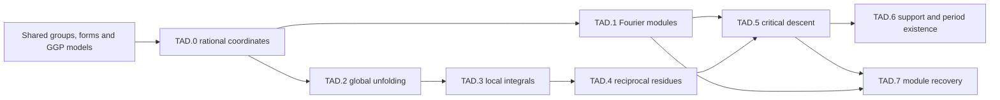

# Twisted automorphic descents and cuspidal automorphic modules

This roadmap plans an explicit automorphic module for a cuspidal representation with a generic global Arthur parameter. Start with a relevant inclusion of classical spaces, build a larger Eisenstein family, take its leading Laurent coefficient, and take the critical rational Bessel coefficient of that residue. Reciprocal periods and local GGP then identify the resulting module with the prescribed representation, up to the permitted even-orthogonal outer orbit. The construction follows Jiang–Zhang, but each statement below is a target with its own hypotheses and proof obligations.

The independent review accepts this complete target-level planning pass: all eight layers are planned. It is not proof-closed or implemented. In particular G1 is an unresolved unitary convention comparison, G4 concerns unpublished local theory, and G7 separates the constructed residue from all residual packet members. Their dependent conclusions are conditional until these contracts are discharged. Generic Summand and weak Fourier support are definitions of propositions; local GGP is an imported proposition with only its exact proved ranges available. There is no axiom asserting a conjecture.

## Data and conventions

Let F be a number field. Let E=F for special orthogonal groups, or E/F be quadratic for unitary groups; localization at a split unitary place is quadratic étale and gives a GL group. All spaces and forms are nondegenerate and all representations in the global construction are unitary. The larger input space V has actual E-dimension d≥1, W has dimension m≥0, and d=m+2j+1 for a relevant inclusion W⊂V with complement H^j⊥Ee. The actual Witt index r, the label floor(d/2), and the standard-dual dimension N are different quantities: N=d−1 for odd SO and N=d otherwise. In particular a quasi-split nonsplit SO_{2n} has r=n−1. H denotes a hyperbolic plane when used in a decomposition; a group H_W is always explicitly subscripted in formulas where confusion is possible.

Use Hermitian forms linear in the first argument, conjugating the opposite GN.2 convention on import. Choose the additive character of F\A_F, ψ_E(x)=ψ_F(Tr_{E/F}(x/δ)/2) for E=F(δ) with trace-zero δ where needed, the rational isotropic flag, the anisotropic vector, quotient measures and Haar normalizations. Every Fourier module retains an actual automorphic realization C_π and a rational orbit. A geometric partition does not specify a rational orbit or an inner form. For even SO keep the determinant-one group and the outer orbit supplied by the rational orthogonal normalizer. An outer-fixed representation has one copy in the endpoint; an orbit of size two has two distinct copies.

Write B_ψf(h)=∫_[N] f(nh)ψ(n)⁻¹dn. Write P_ψ(f,g)=∫_[H] B_ψf(h)g(h)dh for the bilinear period, and Q_ψ(f,g)=∫_[H] B_ψf(h)conj(g(h))dh for the Hermitian period. Thus Q_ψ(f,g)=P_ψ(f,conj g) and conj(P_ψ(f,g))=P_{ψ⁻¹}(conj f,conj g). A bilinear pairing against π detects π∨ in the Fourier module. Conjugate self-duality over E/F does not identify a representation with its ordinary dual. At U₁ a nonquadratic character χ gives Q(χ,χ)≠0 and P(χ,χ)=0; this is a required convention check, not a harmless change of notation.

Induction is normalized: I_s=Ind_{P_a}^{H_X,norm}(|det|^s τ⊗σ), whose sections transform by δ_{P_a}^{1/2}|det|^s τ⊗σ. Here X=H^a⊥W. The descent uses a=N and k₀=a−j−1 with j<a. The prescribed rational datum identifies its stabilizer space with V. Its ambient partition is [2k₀+1,1^d], whose size is 2a+m. The even-SO inducing twist is t=Ad(w_q^{k₀}), with t²=1; inducing from σ^t makes the unfolded inner period have σ. The exponent is the ambient index, not j.

For r distinct cuspidal blocks of τ, the residual form is the coefficient lim_{s→1/2}(s−1/2)^r E(f_s,s). It is not an iterated residue in one variable. Nonzero residual module means that some section has a nonzero coefficient. Nonzero residue and nonzero critical descent are separate assertions. The latter may be zero in the definition.

The local quotient ℒ_v follows rendered (4.47), p.780: L_v(s+1/2,τ×φ_π∨)/[L_v(s+1,τ×φ_σ)L_v(2s+1,τ,ρ)]. Here conjugate π is the ordinary dual because π is unitary. Rendered (5.13), p.787, instead has φ_π in its numerator; denote this separate candidate by ℒ_v^{13}. The two agree for self-dual orthogonal standard parameters. In general they are different for unitary parameters. The full self-pair choice is τ=BC(π) for ℒ and τ=BC(π)∨ for ℒ^{13}. The plan uses ℒ in the spherical and normalized-product targets and does not silently identify it with ℒ^{13}.

Here ρ is exterior square for ambient even SO, symmetric square for ambient odd SO, and Asai with sign (−1)^m for unitary ambient groups, using the actual smaller form dimension. Equations (5.6) and Theorem 5.3 already conjugate the second argument inside Hermitian brackets; those periods are bilinear in the original forms. G1 must reconcile the displayed ratios, the actual radical representation, §5.5 dual transport, and the parameter of the critical module. A bilinear pairing against π still detects π∨, so correcting the numerator alone does not establish unitary recovery.

The AS.2 Shahidi normalization is N_v(s)=β_v(s)M_v(s), with β_v(s)=L_v(1+s,τ×σ)L_v(1+2s,τ,ρ)ε_v(s,τ×σ)ε_v(2s,τ,ρ)/[L_v(s,τ×σ)L_v(2s,τ,ρ)] in that source convention. Both epsilon factors multiply in the numerator. The actual cross factor in the unitary case is subject to G1. Completed products include archimedean factors; a partial product always displays its removed set S. Z_S^*=∏_{v∈S}(Z_v/ℒ_v) is a meromorphic quotient, and Z=c Z_S^*ℒ retains the nonzero global normalization scalar c. Holomorphy of this product does not imply holomorphy of every factor.

## Dependency route and ownership

GGP owns relevant pairs, Bessel model/period definitions, local uniqueness and local GGP propositions. AS owns Eisenstein continuation, normalized intertwiners and residual spectrum. AL owns general factors. ML owns classification; ML.5 is a transfer registry, not a canonical concrete-descent proof. AF owns general Fourier/constant-term theory and SR owns local categories. TAD owns the particular Fourier images, zeta unfolding, residue-to-period comparison and module recovery.

Current TauCetiRoadmap main 0d144d044dacebca17b654695b6f1ad58f159b27 and current TauCeti a91d3aafa8cd3e6bc33dfde0d7677ed0f1625039 audited read-only. ReductiveGroups and RepresentationTheory/ClassicalGroups reader documents read in full; relevant suggested declarations, OrthogonalSpinGroups and Completed/RestrictedProducts inspected. The nine post-snapshot additions and current library were searched before assigning targets. No automorphic-descent implementation was found; classical groups and quadratic Witt theory are existing imports.

The current upstream roadmaps were read separately from the atlas snapshot and separately from the pinned library declarations. ClassicalGroups and ReductiveGroups supply the shared group and representation direction; OrthogonalSpinGroups already owns orthogonal group/reflection and local/adelic structure, and Completed/RestrictedProducts already owns restricted products. The six pinned declarations below are used directly. No new classical-group carrier, adelic restricted product, generic intertwiner theorem or global classification is planned here. The particular coordinate comparison and descent applications remain TAD targets. The current upstream additions lack matching stage identifiers in this snapshot, so their ownership is recorded rather than fabricated as declaration references.

At node level the proof route is acyclic. An external scheduling audit is still needed: the normalized-intertwiner theorem belongs to AS.2, whose classification and residual exports must be separated to avoid a coarse AS.2→ML.4→AS.6→AS.2 cycle. GGP framework definitions are imported, while the global GGP conclusion is not imported to prove this construction. ML.5 is a known-transfer registry and cannot discharge the concrete GRS module comparison. General rational Fourier theory and rational nilpotent classification are supplier extensions, not silently claimed exports of algebraically closed orbit theory.

## Layer targets

A cuspidal Hilbert carrier uses an explicit fixed unitary central character or split-center quotient. Its use for a Bessel image requires the actual equivariance and square-integrability comparison G11; constant-term vanishing alone does not justify a discrete decomposition for split SO₂. Every target is unchecked. Its dependencies are exact packet node or registered stage identifiers; a stage dependency with missing generality has an explicit request below. All targets use the standing data above in addition to their displayed hypotheses. A Check is an acceptance condition for the eventual formalization. Unit checks are discriminating mathematical specifications; the compact Lean file elaborates only the arithmetic subset whose carriers already exist.

### TAD.0 — Rational Bessel coordinates

Compare actual classical spaces, rational Bessel characters and stabilizers; construct an ambient datum returning a prescribed relevant inclusion.

Coverage: **planned**, with 6 targets; not closed. It has no internal proof/source gap of its own; the listed supplier requests remain open. Supplier requests also propagate along the displayed dependencies.

#### `group-coordinate-comparison` — Classical-group coordinate comparison (comparison)

For V=H^r ⊥ V_an of dimension d over E, identify the paper’s matrix group with SO(V) or U(V) from the shared relevant-pair interface. Here r is the actual Witt index, n=floor(d/2) is only a label, and the standard-dual dimension is N=d−1 for odd SO and N=d otherwise. Transport the flag parabolics and their Levi factors Res_{E/F}GL_j × Isom(V_(j))° with their normalized induction modulus. The quasi-split nonsplit even orthogonal group has r=n−1. All group identifications are over F and commute with localization.

Hypotheses: Standing conventions in the reader: characteristic-zero number field F; E=F for orthogonal groups or a quadratic extension for unitary groups; all forms nondegenerate; the input larger dimension d is positive; actual automorphic realizations, rational orbit and measures are specified.

Source: Jiang–Zhang, §2.1, pp.748–750; §4.1, pp.764–765.

Dependencies: `GanGrossPrasadConjecturesForClassicalGroups:GGP.0/relevant-pair`, `tauceti:TauCeti.RegularFormClass.wittDecomposition`, `tauceti:TauCeti.QuadraticMap.specialOrthogonalGroup`, `GeometryOfNumbersAndQuadraticArithmetic:GN.2`.

Proof route:

1. Use the built quadratic Witt decomposition and the requested hermitian analogue, with the specified linear-first/antilinear-first conversion.
2. Write the block isometry equations in a dual isotropic basis and compare to the determinant-one quadratic group. Compute the modulus using the action on the unipotent Lie algebra.

Check: A quasi-split nonsplit SO_4 has Witt index 1, not 2. For SO_5 the standard transfer is to GL_4; for U_5 it is to GL_5.

#### `bessel-partition` — Bessel partition (definition)

For natural numbers d, ell with 2ell+1≤d, set p_ell(d)=[2ell+1,1^(d−2ell−1)] as a Nat.Partition d. Its admissibility for a chosen classical form additionally requires a flag of length ell and an anisotropic vector in its nonzero middle space. These data are not inferred from floor(d/2). For ell=0 the partition is [1^d]; the chosen Bessel subgroup remains the orthogonal complement of the chosen anisotropic vector.

Hypotheses: Standing conventions in the reader: characteristic-zero number field F; E=F for orthogonal groups or a quadratic extension for unitary groups; all forms nondegenerate; the input larger dimension d is positive; actual automorphic realizations, rational orbit and measures are specified.

Source: Jiang–Zhang, §2.3, equation (2.9), pp.755–756; §2.4, pp.757–759.

Dependencies: `mathlib:Nat.Partition`, `GanGrossPrasadConjecturesForClassicalGroups:GGP.0/bessel-datum`, `TwistedAutomorphicDescents:TAD.0/group-coordinate-comparison`.

Proof route:

1. Construct the multiset with one odd part and d−2ell−1 copies of 1. Its sum is d and every part is positive.
2. Use the shared flag and anisotropic-vector datum for relevance; do not equate an orbit’s full Levi stabilizer with the chosen Bessel subgroup.

Check: The ones exponent is d−2ell−1. Validity excludes ell=d/2 in split even dimension.

Atlas planet: **Bessel partition**.

API derived from use:

| Name | Role | Required behavior |
| --- | --- | --- |
| `besselPartition_parts` | data | The parts multiset is {2ell+1} plus d−2ell−1 ones. |
| `besselPartition_sum` | simp | The sum of the parts is d. |
| `besselPartition_card` | simp | The number of parts is d−2ell. |
| `besselPartition_zero` | compatibility | At ell=0 the partition is the existing partition of d into ones; the geometric Bessel coefficient is separately restriction to the chosen subgroup. |

Uses:

- JZ2020 Proposition 2.2, p.756: Indexes first occurrence.
- JZ2020 (5.8)–(5.9), p.785: Indexes the critical descent on the larger group.

Unit checks:

- **bessel_partition.five_one** (computation): d=5, ell=1 gives [3,1,1], of size 5 and length 3.
- **bessel_partition.zero_index** (degenerate): d=3, ell=0 gives [1,1,1]; its stabilizer defining space has dimension 2, although the nilpotent is zero. The algebraic group SO₂ has dimension 1 and U₂ has dimension 4.
- **bessel_partition.even_boundary** (non-example): d=4, ell=2 is not admissible: the proposed leading part 5 exceeds 4.

#### `rational-orbit-comparison` — Rational Bessel orbit comparison (comparison)

For each Bessel datum (isotropic flag, anisotropic w in the middle space), compare its explicit unipotent character with the generalized Fourier character attached to a rational nilpotent orbit of geometric partition p_ell(d). Give the F-rational conjugacy equivalence and its localization; distinguish a geometric orbit, a Galois-stable geometric orbit and an orbit of G(F). On unitary groups use ψ_E(x)=ψ_F(Tr_{E/F}(x/δ)/2) for E=F(δ), δ²∈F× and Tr(δ)=0, as in (2.12) and the chosen Hermitian convention. At ell=0 the general nilpotent coefficient is restriction of the form before restricting its group action to Isom(w⊥)°.

Hypotheses: Standing conventions in the reader: characteristic-zero number field F; E=F for orthogonal groups or a quadratic extension for unitary groups; all forms nondegenerate; the input larger dimension d is positive; actual automorphic realizations, rational orbit and measures are specified.

Source: Jiang–Zhang, §2.3, pp.754–756; §2.4, (2.11)–(2.13), pp.757–758.

Dependencies: `TwistedAutomorphicDescents:TAD.0/bessel-partition`, `GanGrossPrasadConjecturesForClassicalGroups:GGP.0/bessel-datum`, `LieHighestWeightPartII:N0`, `LieHighestWeightPartII:N2/classical-partitions`, `AutomorphicFormsOnReductiveGroups:AF.3`.

Proof route:

1. Use the requested rational nilpotent/generalized Fourier interface, not the algebraically closed classification alone.
2. Write the character as the sum of adjacent flag coordinates and the last pairing with w, evaluated by the specified additive character. Verify compatibility with the generalized-character construction and conjugation.

Check: A single partition can have several rational orbits. The two very-even SO geometric orbits are not silently merged, nor assumed individually F-stable.

#### `vector-normal-form` — Anisotropic-vector normal form (theorem)

For ell<r, every anisotropic w in V_(ell) is carried by an F-rational isometry of V_(ell) to e_r+(-1)^(d+1)κ/2·e_{−r} for some κ∈F×, using the basis and form normalization of (2.1). In the SO case the isometry can be chosen proper by composing with a reflection in a nonisotropic vector perpendicular to the image. The image has the same form value as w; the assertion does not choose a square root in F. The boundary ell=r uses the actual anisotropic kernel instead of this hyperbolic normal form.

Hypotheses: Standing conventions in the reader: characteristic-zero number field F; E=F for orthogonal groups or a quadratic extension for unitary groups; all forms nondegenerate; the input larger dimension d is positive; actual automorphic realizations, rational orbit and measures are specified.

Source: Jiang–Zhang, Lemma 2.4 and its proof, pp.758–759.

Dependencies: `TwistedAutomorphicDescents:TAD.0/group-coordinate-comparison`, `tauceti:QuadraticMap.IsometryEquiv.exists_extension`, `tauceti:TauCeti.QuadraticMap.det_reflection`, `GeometryOfNumbersAndQuadraticArithmetic:GN.2`.

Proof route:

1. Extend the isometry between the nondegenerate lines by Witt extension; the hermitian extension is requested from GN.2.
2. In the quadratic case adjust determinant using a reflection fixing the image vector. The middle space has dimension at least 2 here, so its nondegenerate perpendicular contains such a vector.

Check: κ/2 is division by 2, not a subscript or an exponent. No hyperbolic vector normal form is asserted for an anisotropic middle space.

#### `stabilizer-witt-index` — Bessel stabilizer and Witt index (theorem)

For V=H^ell ⊥ V_(ell) and anisotropic w∈V_(ell), the chosen Bessel subgroup is H=Isom(V_(ell)∩w⊥)°, embedded by fixing the flag and w; its defining space has dimension d−2ell−1. If ell<r and w=y_κ in the normal form, the new anisotropic part is the anisotropic part of V_an ⊥ E y_{−κ}. Its Witt index is r−ell when E y_κ is represented in V_an and r−ell−1 otherwise. At ell=r it is the corresponding perpendicular in V_an. For U(V) this H is the subgroup fixing the flag vectors, not the full character stabilizer inside the Levi, which also has a norm-one central torus.

Hypotheses: Standing conventions in the reader: characteristic-zero number field F; E=F for orthogonal groups or a quadratic extension for unitary groups; all forms nondegenerate; the input larger dimension d is positive; actual automorphic realizations, rational orbit and measures are specified.

Source: Jiang–Zhang, §2.4, (2.13)–(2.14), Proposition 2.5, pp.758–759.

Dependencies: `TwistedAutomorphicDescents:TAD.0/vector-normal-form`, `GanGrossPrasadConjecturesForClassicalGroups:GGP.0/relevant-pair`, `tauceti:TauCeti.equivalent_of_equivalent_prod`, `GeometryOfNumbersAndQuadraticArithmetic:GN.2`.

Proof route:

1. Split off the hyperbolic planes and the line Ew and apply Witt cancellation.
2. For the Witt index increase, V_an ⊥ E y_{−κ} is isotropic exactly when V_an represents the value of y_κ. Check the sign by the equation q(v)+q(y_{−κ})=0.
3. Compare the pointwise flag-and-vector stabilizer with the matrix embedding; retain the extra unitary central stabilizer rather than identifying it with H.

Check: For V_(ell) a hyperbolic plane, its anisotropic-line perpendicular has Witt index 0. The representation criterion uses y_κ rather than y_{−κ}.

Atlas planet: **Bessel stabilizer**.

#### `prescribed-ambient-datum` — Ambient datum for a prescribed relevant pair (construction)

Given a specified relevant pair W⊂V with V≅H^j ⊥ Ee ⊥ W, choose a>j and set X=H^a ⊥ W and k=a−j−1. Construct a rational Bessel datum of index k in Isom(X)° and an F-isometry of its stabilizer space with V, compatible with the given inclusion W⊂V. Its dimension is 2a+dim W−2k−1=dim V. Export the induced coordinate maps, the rational orbit, localizations and the even-SO normalizer action t=Ad(w_q^k), with w_q²=1. The chosen input on W is σ^t, so that the unfolded inner period has σ.

Hypotheses: Standing conventions in the reader: characteristic-zero number field F; E=F for orthogonal groups or a quadratic extension for unitary groups; all forms nondegenerate; the input larger dimension d is positive; actual automorphic realizations, rational orbit and measures are specified.

Source: Jiang–Zhang, Proposition 2.6, p.759; §4.4, (4.30)–(4.34), pp.774–775; §5.2, (5.7)–(5.9), pp.785–786.

Dependencies: `TwistedAutomorphicDescents:TAD.0/stabilizer-witt-index`, `GanGrossPrasadConjecturesForClassicalGroups:GGP.0/relevant-inner-forms`, `GanGrossPrasadConjecturesForClassicalGroups:GGP.0/bessel-datum`.

Proof route:

1. Use k hyperbolic planes of X for the flag and the remaining j+1 planes to place a line whose perpendicular is H^j ⊥ Ee. Supply a coordinate isometry realizing the original embedding.
2. Record the normalizer element in that coordinate isometry; transport σ only once by t. Proposition 2.6 alone gives occurrence, so the compatibility with a prescribed embedding must be checked as part of this construction.

Check: For dim V=5, dim W=2, j=1, a=4, k=2 the stabilizer dimension is 5. Composing the outer twist twice restores the original datum.

Atlas planet: **Twisted descent datum**.

API derived from use:

| Name | Role | Required behavior |
| --- | --- | --- |
| `prescribed_ambient_datum.stabilizerIso` | projection | The specified stabilizer-space isometry intertwines its W-inclusion with the original one. |
| `prescribed_ambient_datum.localize` | compatibility | Localization gives the same relevant-pair datum over each F_v, with the same character and normalizer. |
| `prescribed_ambient_datum.twist_involutive` | relation | t² acts trivially on representation isomorphism classes and the inner-period datum from σ^t has σ. |

Uses:

- JZ2020 Theorem 5.3, p.786: Places a fixed pair in the reciprocal-period diagram.
- JZ2020 Theorem 7.1, pp.807–808: Returns a module on the specified original inner form.

Unit checks:

- **prescribed_ambient_datum.odd_so** (computation): d=5,m=2,j=1,a=4 gives ambient dimension 10, k=2 and leading part 5.
- **prescribed_ambient_datum.minimal_a** (degenerate): a=j+1 gives k=0 and ambient dimension d+1, with the stabilizer its prescribed anisotropic-line complement.
- **prescribed_ambient_datum.wrong_embedding** (non-example): An isomorphism of abstract stabilizer groups without matching W⊂V does not satisfy the constructor contract.

### TAD.1 — Fourier modules and first occurrence

Define the actual image and its first occurrence, prove cuspidality and multiplicity freeness, and formulate Generic Summand without asserting it.

Coverage: **planned**, with 5 targets; not closed. Its transitive proof/source contracts are G2, G11. Supplier requests also propagate along the displayed dependencies.

#### `bessel-module` — Bessel Fourier module (definition)

For a specified automorphic embedding C_π of an irreducible representation and a rational Bessel datum O, let B_O(C_π) be the image of C_π under the shared Fourier map f↦[h↦∫_[N] f(nh)ψ(n)^(−1)dn], with its right H(A)-action. Its algebraic span is a smooth automorphic module. When the image is cuspidal and lies in a specified cuspidal L² carrier, also form its Hilbert closure there (G11 specifies the central-character issue); distinguish this closure from the smooth image. Record Fourier support p(C_π) by existence of a nonzero rational-orbit coefficient of each relevant geometric partition, and its maximal elements p^m(C_π) in dominance order, using the requested general Fourier-support interface.

Hypotheses: Standing conventions in the reader: characteristic-zero number field F; E=F for orthogonal groups or a quadratic extension for unitary groups; all forms nondegenerate; the input larger dimension d is positive; actual automorphic realizations, rational orbit and measures are specified.

Source: Jiang–Zhang, §2.3, (2.8)–(2.10), pp.754–756; §6.2, (6.9), p.802.

Dependencies: `GanGrossPrasadConjecturesForClassicalGroups:GGP.3/bessel-fourier-coefficient`, `TwistedAutomorphicDescents:TAD.0/rational-orbit-comparison`, `AutomorphicFormsOnReductiveGroups:AF.3`.

Proof route:

1. Take the image of the specified equivariant linear map; transport its action through the explicit stabilizer identification.
2. Use the requested support/dominance interface for arbitrary partitions. Take the Hilbert closure only after cuspidality and square-integrability are established.

Check: The module depends on its realization when a representation has multiple automorphic copies. Changing a rational orbit requires a specified conjugation map, not just equality of partitions.

Atlas planet: **Bessel Fourier module**.

API derived from use:

| Name | Role | Required behavior |
| --- | --- | --- |
| `bessel_module.map` | constructor | The Fourier map C_π→B_O(C_π) is surjective onto the smooth image. |
| `bessel_module.right_translate` | functoriality | For h∈H(A), B_O(R(h)f)=R(h)B_O(f). |
| `bessel_module.zero_iff` | characterisation | B_O(C_π)=0 exactly when every coefficient of vectors in that realization is zero. |
| `bessel_module.closure` | compatibility | In a verified cuspidal L² carrier, the smooth image is dense in its Hilbert closure with the inherited right unitary action; a central quotient requires actual equivariance. |

Uses:

- JZ2020 Proposition 2.2, p.756: Its maximal nonzero Bessel module is cuspidal.
- JZ2020 (6.9), p.802: The critical module of a residual realization is the twisted descent.

Unit checks:

- **bessel_module.ell_zero** (degenerate): At ell=0, N=1 and B_O(f) is f restricted to H(A); it is not an integral over the whole ambient group.
- **bessel_module.character_sign** (computation): Replacing ψ by ψ^(−1) gives B_{ψ^(−1)}(conj f)=conj(B_ψ(f)).
- **bessel_module.copy_sensitive** (non-example): Two embeddings of the same abstract π are retained as different inputs; equality of π alone cannot identify their support.

Remaining proof contracts: G11: Central character and discrete Fourier image.

#### `first-occurrence` — First occurrence index (construction)

For C_π⊂L²_cusp(G), define ell₀(C_π) to be the largest valid Bessel index ell for which some rational datum has B_O(C_π)≠0. Valid means the datum exists, in particular 2ell+1≤d and ell≤r. The set is nonempty: at ell=0 a right translate of a nonzero form has nonzero restriction to the chosen H. Select the index, not a canonical rational orbit. Keep every rational first-occurrence datum as a separate argument.

Hypotheses: Standing conventions in the reader: characteristic-zero number field F; E=F for orthogonal groups or a quadratic extension for unitary groups; all forms nondegenerate; the input larger dimension d is positive; actual automorphic realizations, rational orbit and measures are specified.

Source: Jiang–Zhang, Proposition 2.2, pp.756–757.

Dependencies: `TwistedAutomorphicDescents:TAD.1/bessel-module`, `TwistedAutomorphicDescents:TAD.0/bessel-partition`.

Proof route:

1. The finite valid-index set contains 0 by right translation of a nonzero form.
2. Take its maximum. This construction uses no genericity of π, and does not assert a realization-independent index.

Check: First occurrence is maximal in the paper’s index convention. Zero coefficients at indices above ell₀ are quantified over all rational data.

Atlas planet: **First occurrence index**.

API derived from use:

| Name | Role | Required behavior |
| --- | --- | --- |
| `first_occurrence.nonzero` | projection | There exists a rational datum at ell₀ with a nonzero coefficient. |
| `first_occurrence.above_eq_zero` | characterisation | For every valid ell>ell₀ and every rational datum at ell, B_O(C_π)=0. |
| `first_occurrence.realization_transport` | compatibility | An intertwining equality of the actual automorphic embeddings and orbit data preserves ell₀; an abstract isomorphism alone is insufficient. |

Uses:

- JZ2020 Conjecture 2.3, pp.756–757: Specifies which branching module must have a generic summand.
- JZ2020 (6.7), p.801: Determines the smaller group and the critical descent index.

Unit checks:

- **first_occurrence.anisotropic** (degenerate): If r=0 and d>0 then ell₀=0.
- **first_occurrence.max_not_min** (computation): A support set of Bessel indices {0,2} gives ell₀=2, not 0.
- **first_occurrence.even_end** (non-example): For a split 4-dimensional quadratic space, ell=2 cannot occur even though its Witt index is 2.

#### `first-cuspidal` — First-occurrence cuspidality (theorem)

For any cuspidal realization C_π and every rational first-occurrence Bessel datum O at ell₀(C_π), B_O(C_π) is cuspidal on its chosen H: each constant term along every proper F-parabolic of H vanishes. If the image lies in the required L² carrier, its Hilbert closure is nonzero for a datum witnessing first occurrence. This additional spectral condition is G11 in the split-center case. This assertion includes inner forms and unitary groups with the given character conventions.

Hypotheses: Standing conventions in the reader: characteristic-zero number field F; E=F for orthogonal groups or a quadratic extension for unitary groups; all forms nondegenerate; the input larger dimension d is positive; actual automorphic realizations, rational orbit and measures are specified.

Source: Jiang–Zhang, Proposition 2.2, p.756, citing Ginzburg–Rallis–Soudry Theorem 7.3.

Dependencies: `TwistedAutomorphicDescents:TAD.1/first-occurrence`, `AutomorphicFormsOnReductiveGroups:AF.3/constant-term`, `AutomorphicFormsOnReductiveGroups:AF.3/cusp-form-rapid-decay`, `AutomorphicFormsOnReductiveGroups:AF.3`.

Proof route:

1. Expand each constant term of the Fourier coefficient by successive root exchanges and Fourier expansion.
2. Show each surviving term is a coefficient at a larger index or a constant term of C_π. The first vanishes by maximality and the second by cuspidality.
3. The extension of the cited tower proof to these inner forms, including archimedean smoothness, is gap G2; do not treat the citation to the uncleared GRS book as a read proof.

Check: A nonmaximal Bessel coefficient need not be cuspidal. Every proper rational parabolic is covered, not just the Siegel parabolic.

Atlas planet: **First-occurrence cuspidality**.

Remaining proof contracts: G2: Inner-form tower cuspidality proof; G11: Central character and discrete Fourier image.

#### `multiplicity-free` — Multiplicity-free Bessel decomposition (theorem)

If a Bessel image of a single irreducible automorphic realization lies in the supplied discrete cuspidal Hilbert spectrum with compatible central-character data, its Hilbert closure is a Hilbert direct sum of irreducible cuspidal H(A)-representations with each isomorphism class occurring at most once. The smooth module embeds densely in this decomposition. The statement concerns the image, not all copies of those constituents in L²_cusp(H).

Hypotheses: Standing conventions in the reader: characteristic-zero number field F; E=F for orthogonal groups or a quadratic extension for unitary groups; all forms nondegenerate; the input larger dimension d is positive; actual automorphic realizations, rational orbit and measures are specified. For a split SO₂ stabilizer, prove the central-character/discrete-spectrum comparison G11; constant-term cuspidality alone does not supply it.

Source: Jiang–Zhang, §2.3, equation (2.10), p.756; Theorem 6.6, pp.799–800.

Dependencies: `TwistedAutomorphicDescents:TAD.1/bessel-module`, `GanGrossPrasadConjecturesForClassicalGroups:GGP.0/bessel-uniqueness`, `GanGrossPrasadConjecturesForClassicalGroups:GGP.3/nonzero-implies-local`, `AutomorphicFormsOnReductiveGroups:AF.3/cuspidal-spectrum-discrete`, `AutomorphicFormsOnReductiveGroups:AF.2/flath-factorization`.

Proof route:

1. Apply the imported discrete cuspidal spectral decomposition to the closed image.
2. A repeated constituent would give two independent global Bessel maps. Factor at one place using fixed vectors elsewhere and local uniqueness, with the continuous archimedean tensor product topology.

Check: The sum is a Hilbert sum, not an asserted finite algebraic sum. No multiplicity-one assertion for the full even-SO automorphic spectrum is used.

Remaining proof contracts: G11: Central character and discrete Fourier image.

#### `generic-summand` — Generic Summand proposition (definition)

For a cuspidal isomorphism class π with a G-relevant generic discrete global parameter φ, GenericSummand(π) is the proposition that there exist an automorphic realization C_π, a rational first-occurrence datum O at ell₀(C_π), a cuspidal σ on H_O with a relevant generic discrete global parameter, a realization C_σ, and vectors f∈C_π,g∈C_σ with Q_O(f,g)=∫_[H_O] B_O(f)(h)conj(g(h))dh≠0. It is an existence proposition (Conjecture 2.3), not an axiom or a theorem for all generic packets.

Hypotheses: Standing conventions in the reader: characteristic-zero number field F; E=F for orthogonal groups or a quadratic extension for unitary groups; all forms nondegenerate; the input larger dimension d is positive; actual automorphic realizations, rational orbit and measures are specified.

Source: Jiang–Zhang, Conjecture 2.3, pp.756–757; §7.1, pp.807–808.

Dependencies: `TwistedAutomorphicDescents:TAD.1/first-occurrence`, `GanGrossPrasadConjecturesForClassicalGroups:GGP.3/global-bessel-period`, `GanGrossPrasadConjecturesForClassicalGroups:GGP.1/global-coherent-packet`.

Proof route:

1. Form the quantified proposition using the actual automorphic embeddings and Hermitian branch of the shared period.
2. Theorems proving particular cases must supply these witnesses. Relating it to the paper’s bilinear unfolding requires the pairing dictionary in TAD.4.

Check: Generic parameter does not mean the representation has a Whittaker model. The choice is existential in C_π; no assertion is made for every copy.

Atlas planet: **Generic Summand conjecture**.

API derived from use:

| Name | Role | Required behavior |
| --- | --- | --- |
| `generic_summand.witness` | projection | A proof supplies C_π,O,σ,C_σ,f,g with the stated first-occurrence and nonvanishing properties. |
| `generic_summand.summand` | compatibility | Using first-occurrence cuspidality and the verified discrete Hilbert carrier of G11, a witness gives a nonzero projection onto the σ-isotypic subspace. |
| `generic_summand.bilinear_dictionary` | relation | Q_O(f,g)=P_O(f,conj g), so its local bilinear models involve σ∨, not automatically σ. |

Uses:

- JZ2020 Theorem 7.1, pp.807–808: Provides the smaller cuspidal representation for construction.
- JZ2020 Proposition 7.3, pp.809–810: The subregular case constructs the witnesses.

Unit checks:

- **generic_summand.unitary_character** (computation): For a nonquadratic character χ of an anisotropic U_1, ∫χ·conjχ is its positive volume, while ∫χ·χ=0.
- **generic_summand.first_occurrence_required** (non-example): A generic constituent at an index strictly below ell₀ is not a witness.
- **generic_summand.realization_quantifier** (characterisation): One witnessing realization suffices even when the cuspidal multiplicity is two; the definition is not universal in realizations.

Remaining proof contracts: G11: Central character and discrete Fourier image.

### TAD.2 — The unfolded global integral

Define the global zeta integral, isolate its open relative Bruhat cell and identify the induced Whittaker transform and inner Bessel period.

Coverage: **planned**, with 6 targets; not closed. Its transitive proof/source contracts are G3, G4. Supplier requests also propagate along the displayed dependencies.

#### `zeta-integral` — Bessel–Eisenstein zeta integral (definition)

Let X=H^a⊥W with dim W=m, H_X=Isom(X)°, and P_a its flag parabolic with Levi Res_{E/F}GL_a×H_W. For an irreducible unitary generic isobaric τ on GL_a(A_E) and an irreducible automorphic σ on H_W with a specified realization, use normalized induction I_s=Ind_{P_a(A)}^{H_X(A)}(τ|det|_E^s⊗σ), including δ_{P_a}^{1/2}. Let E(f_s,s) be the meromorphic Eisenstein family, defined from the isobaric inducing data through the imported continuation theory. For a valid rational Bessel datum of index ell on H_X, with stabilizer G and cuspidal realization C_π on G, put Z(s,f_s,v)=P_{ell}(E(f_s,s),v)=∫_[G] B_{ell}(E(f_s,s))(g)v(g)dg. This is the bilinear period. Normalize the compact unipotent quotient to volume 1 and retain a compatible Haar measure on [G].

Hypotheses: Standing conventions in the reader: characteristic-zero number field F; E=F for orthogonal groups or a quadratic extension for unitary groups; all forms nondegenerate; the input larger dimension d is positive; actual automorphic realizations, rational orbit and measures are specified.

Source: Jiang–Zhang, §4.1, (4.1)–(4.10), pp.764–767.

Dependencies: `TwistedAutomorphicDescents:TAD.0/prescribed-ambient-datum`, `AutomorphicSpectralTheory:AS.1/induced-family`, `AutomorphicSpectralTheory:AS.2/isobaric-sum`, `AutomorphicSpectralTheory:AS.2/eisenstein-continuation`, `GanGrossPrasadConjecturesForClassicalGroups:GGP.3/global-bessel-period`, `GanGrossPrasadConjecturesForClassicalGroups:GGP.3/global-period-convergence`, `AutomorphicSpectralTheory:AS.2`.

Proof route:

1. Use the existing normalized induced representation and Eisenstein family; σ need not be cuspidal for the geometric unfolding, but the applications in TAD.4–7 impose cuspidality.
2. Compose the Eisenstein Fourier map with the imported convergent period functional; use cuspidal decay on the Bessel subgroup to extend it meromorphically.

Check: The π argument is not conjugated in Z. Restriction to a Bessel subgroup has its own decay theorem; ambient rapid decay is not by itself its proof.

Atlas planet: **Bessel zeta integral**.

API derived from use:

| Name | Role | Required behavior |
| --- | --- | --- |
| `zeta_integral.linear` | structure | For fixed s in the convergence region, Z is linear in both the section and the cuspidal vector. |
| `zeta_integral.hom_space` | compatibility | The global map belongs to Hom_{G⋉N}(I_s,π∨⊗ψ) with the bilinear convention. |
| `zeta_integral.meromorphic` | relation | For holomorphic sections Z is meromorphic; it is holomorphic wherever this Eisenstein family is holomorphic. |

Uses:

- JZ2020 Theorems 4.5 and 4.7, pp.777–779: Unfolds into local zeta integrals.
- JZ2020 Theorem 5.3, p.786: Its leading Laurent coefficient is the reciprocal period.

Unit checks:

- **zeta_integral.delta** (characterisation): Removing δ_P^(1/2) changes the s-shift in the Euler factor, so does not give this integral.
- **zeta_integral.ell_zero** (degenerate): At ell=0 the Fourier map is restriction and Z is the bilinear integral of restricted E times v.
- **zeta_integral.scalar** (computation): Multiplying v by i multiplies Z by i, whereas replacing the bilinear period by a Hermitian pairing in that argument gives −i.

#### `abstract-factorization` — Bessel functional factorization (theorem)

For factorizable global data and s where each relevant local induced module is irreducible, the local spaces Hom_{G_v⋉N_v}(I_{s,v},π_v∨⊗ψ_v) have dimension at most 1. If Z is nonzero, fix nonzero local functionals and normalized unramified vectors. Then Z=c·∏_v l_v(f_{s,v},v_v) for one nonzero scalar c depending on those choices. The explicit Euler integrals give its meromorphic continuation in s. Absorbing c into one ramified functional is permitted only when recorded. No uniqueness assertion for every reducible I_{s,v} is made.

Hypotheses: Standing conventions in the reader: characteristic-zero number field F; E=F for orthogonal groups or a quadratic extension for unitary groups; all forms nondegenerate; the input larger dimension d is positive; actual automorphic realizations, rational orbit and measures are specified.

Source: Jiang–Zhang, §4.1, (4.11)–(4.13), pp.766–767; §4.3, pp.769–770.

Dependencies: `TwistedAutomorphicDescents:TAD.2/zeta-integral`, `GanGrossPrasadConjecturesForClassicalGroups:GGP.0/bessel-uniqueness`, `GanGrossPrasadConjecturesForClassicalGroups:GGP.3/nonzero-implies-local`, `AutomorphicFormsOnReductiveGroups:AF.2/flath-factorization`, `SmoothRepresentationsOfLocalGroups:SR.2`.

Proof route:

1. Use local uniqueness at generic irreducible parameters and restricted tensor product factorization.
2. Evaluate the global functional on a reference pure tensor to identify c; compare the explicit unfolded factors on the common convergence chamber and continue the resulting identity.

Check: A zero global functional is not normalized to a nonzero product. The scalar cannot disappear merely because the local Hom spaces have dimension one.

#### `relative-bruhat` — Relative Bruhat cells (theorem)

For the parabolics P_a,P_ell of H_X, construct the relative Bruhat decomposition needed for P_a(F)\H_X(F)/(G(F)N_ell(F)). Its coarse Weyl representatives ε_{α,β} have 0≤α≤β≤a and a≤ell+β−α≤a+r_W; refine each coarse cell by its residual rational stabilizer orbits. Give the actual block permutation, the intersection unipotents and the compatible quotient measures. In type D retain the determinant-one exceptional Weyl branches; the inequalities alone are not a complete uniform indexing theorem for SO.

Hypotheses: Standing conventions in the reader: characteristic-zero number field F; E=F for orthogonal groups or a quadratic extension for unitary groups; all forms nondegenerate; the input larger dimension d is positive; actual automorphic realizations, rational orbit and measures are specified.

Source: Jiang–Zhang, Proposition 4.1 and (4.14)–(4.16), pp.767–768; §4.7, pp.781–782.

Dependencies: `TwistedAutomorphicDescents:TAD.0/group-coordinate-comparison`, `TwistedAutomorphicDescents:TAD.0/rational-orbit-comparison`, `SmoothRepresentationsOfLocalGroups:SR.2`.

Proof route:

1. Compute relative isotropic intersection dimensions and choose adapted bases to obtain the block representatives.
2. Compute the stabilizer in each representative and separate SO from O; the cited generalized Bruhat calculation needs its full inner-form proof (G3).

Check: The inequalities filter valid cells but do not replace the residual orbit quotient. The a=ell and a=ell+1 boundaries give the indicated open representatives.

Atlas planet: **Relative Bruhat decomposition**.

Remaining proof contracts: G3: Full relative Bruhat and open-cell comparison.

#### `open-cell` — Open-cell reduction (theorem)

In the absolute-convergence chamber, expansion of B_ell(E(f_s,s)) followed by the cuspidal π-period kills every α>0 cell by its nontrivial character, and every remaining nonopen stabilizer cell by a proper constant term of π. The surviving coarse representative has α=0, β=max(a−ell,0), with the residual open representative η and its explicit stabilizer. When a>ell it yields the inner Bessel period on (π,σ^{Ad(w_q^ell)}); when a≤ell it yields the inner period on (σ,π) of index ell−a. The outer character and every quotient measure are transported through the representative.

Hypotheses: Standing conventions in the reader: characteristic-zero number field F; E=F for orthogonal groups or a quadratic extension for unitary groups; all forms nondegenerate; the input larger dimension d is positive; actual automorphic realizations, rational orbit and measures are specified.

Source: Jiang–Zhang, §4.2–4.5, pp.768–779; Corollaries 4.4 and 4.6, pp.775,779.

Dependencies: `TwistedAutomorphicDescents:TAD.2/relative-bruhat`, `TwistedAutomorphicDescents:TAD.2/zeta-integral`, `AutomorphicFormsOnReductiveGroups:AF.3/constant-term-transitivity`.

Proof route:

1. First integrate a character-nontrivial root subgroup in α>0 cells.
2. For the other nonopen terms identify a proper F-parabolic in G whose constant term occurs. Cuspidality kills it.
3. Identify the surviving η-stabilizer and its character; the cited omitted matrix and root-exchange details are G3.

Check: The case a≤ell is included, although the residue application uses a>ell. Vanishing of the appropriate inner period forces Z=0 for all data.

Atlas planet: **Open-cell unfolding**.

Remaining proof contracts: G3: Full relative Bruhat and open-cell comparison.

#### `whittaker-transform` — Whittaker induction transform (construction)

For a>ell, β=a−ell, put τ in its Whittaker model with the character determined by the open cell. On a convergent section f_s define J_s(f_s)(g)=∫_{U^-_{a,η}(A)} f_s(u ε_β η g)ψ_{a+m+ell,a−ell}(u)du. The root subgroup U^-_{a,η} is the intersection appearing in (4.32); its coordinate-free definition is the open-cell unipotent quotient from relative-bruhat. The value is in σ^{Ad(w_q^ell)} and the resulting function transforms under R_{β−1} by ψ_{β−1,y_{−κ}}^(−1) and that representation. Provide the local transform on smooth nonarchimedean and Casselman–Wallach archimedean sections, and its meromorphic continuation as an operator-valued family.

Hypotheses: Standing conventions in the reader: characteristic-zero number field F; E=F for orthogonal groups or a quadratic extension for unitary groups; all forms nondegenerate; the input larger dimension d is positive; actual automorphic realizations, rational orbit and measures are specified.

Source: Jiang–Zhang, §4.4, (4.28)–(4.39), pp.774–776; Appendix A (A.4)–(A.5), pp.811–812.

Dependencies: `TwistedAutomorphicDescents:TAD.2/open-cell`, `AutomorphicLFunctionsAndLocalFactors:AL.3/whittaker-model`, `AutomorphicFormsOnReductiveGroups:AF.1/casselman-wallach-globalization`, `AutomorphicSpectralTheory:AS.0/operator-meromorphic`.

Proof route:

1. Take the GL_a Whittaker coefficient and then integrate over the open-cell quotient U^-_{a,η}.
2. Check R-equivariance by change of variables, including the even-SO normalizer twist. Local continuation for arbitrary sections is expressly assigned to the unpublished local theory in the source (G4).

Check: The representation in the target is the twisted σ, not a scalar. At β=1 the inner Bessel index β−1 is 0 and the transformation law becomes restriction.

Atlas planet: **Whittaker induction transform**.

API derived from use:

| Name | Role | Required behavior |
| --- | --- | --- |
| `whittaker_transform.equivariance` | structure | J_s is a G-equivariant map to the smooth induced R_{β−1}-model with the specified inverse character and σ-twist. |
| `whittaker_transform.pure_tensor` | compatibility | With compatible measures, the global transform of a pure section factors into its local transforms in the convergence chamber. |
| `whittaker_transform.open_cell_evaluation` | characterisation | A section supported compactly in the open cell is evaluated by precisely the displayed U^- integral, retaining the inducing modulus. |

Uses:

- JZ2020 Proposition 4.3 and Theorem 4.5, pp.775–777: Supplies the explicit inner functional in the local integral.
- JZ2020 Proposition A.1, pp.811–816: Open-cell sections control its value at a prescribed s.

Unit checks:

- **whittaker_transform.beta_one** (degenerate): a=ell+1 gives an index-zero inner model, not an index-one Fourier coefficient.
- **whittaker_transform.outer_twice** (computation): Replacing inducing σ by σ^{Ad(w_q^ell)} makes the output inner coefficient take values in σ because the normalizer has square 1.
- **whittaker_transform.value_type** (non-example): A scalar-valued Fourier transform cannot replace J_s when σ has dimension greater than 1.

Remaining proof contracts: G4: Unpublished local continuation and spherical calculation.

#### `inner-datum` — Inner Bessel datum and period comparison (comparison)

In the a>ell open cell, identify the unipotent subgroup N_ell^{η}, its reductive stabilizer H_W^{Ad(w_q^ell)} and its inverse character with the shared Bessel datum of index β−1 on G, β=a−ell. The stabilizer space is the given W with the transported embedding, not an abstract group of the same dimension. For a≤ell identify the corresponding datum of index ell−a on H_W and its character. Thus the two inner integrals are exactly P(π,σ^t) and P(σ,π), respectively, with no extra dual suppressed. The special application induces from σ^t so that the first inner period is P(π,σ).

Hypotheses: Standing conventions in the reader: characteristic-zero number field F; E=F for orthogonal groups or a quadratic extension for unitary groups; all forms nondegenerate; the input larger dimension d is positive; actual automorphic realizations, rational orbit and measures are specified.

Source: Jiang–Zhang, Propositions 4.2–4.3, (4.30)–(4.36), pp.774–776; (4.42)–(4.46), pp.778–779; §4.7, pp.781–782.

Dependencies: `TwistedAutomorphicDescents:TAD.2/whittaker-transform`, `TwistedAutomorphicDescents:TAD.0/prescribed-ambient-datum`, `GanGrossPrasadConjecturesForClassicalGroups:GGP.0/bessel-functional`, `GanGrossPrasadConjecturesForClassicalGroups:GGP.0/twisted-jacquet-comparison`.

Proof route:

1. Compute the open-cell stabilizer’s action on the middle form and character.
2. Use the explicit isometry from prescribed-ambient-datum to match the relevant pair and compare its Hermitian convention before identifying functionals.

Check: The exponent of the outer twist is the ambient Bessel index. The a>ell inner index is a−ell−1, with no off-by-one shift.

Remaining proof contracts: G3: Full relative Bruhat and open-cell comparison.

### TAD.3 — Local factors and nonvanishing

Define both local integrals and their parameter quotient, establish the Euler identity, spherical calculation and prescribed-vector local nonvanishing.

Coverage: **planned**, with 6 targets; not closed. Its transitive proof/source contracts are G1, G3, G4, G5. Supplier requests also propagate along the displayed dependencies.

#### `local-integral` — Local Bessel zeta integral (definition)

Over k=F_v fix a nonzero continuous local Bessel functional b_v for the inner datum. If a>ell define Z_v(s,f_s,v)=∫_{R_{β−1}(k)\G(k)} b_v(π_v(g)v,J_{s,v}(f_s)(g))dg with β=a−ell and inducing σ^t. If a≤ell define Z_v=∫_{N_ell^η(k)\N_ell(k)} b_v(R(n)f_s,v)ψ_ell(n)^(−1)dn, where b_v is the functional on the GL_a-Whittaker realization with the (ell−a)-Bessel functional of σ as in (4.45). Define these first in an absolute-convergence half-plane and then by meromorphic continuation. At archimedean v use jointly continuous functionals on the completed smooth tensor product; algebraic Jacquet coinvariants alone do not define this integral.

Hypotheses: Standing conventions in the reader: characteristic-zero number field F; E=F for orthogonal groups or a quadratic extension for unitary groups; all forms nondegenerate; the input larger dimension d is positive; actual automorphic realizations, rational orbit and measures are specified.

Source: Jiang–Zhang, §4.4, (4.40)–(4.41), pp.776–777; §4.5, (4.45)–(4.46), p.779; Appendix A (A.1)–(A.3), pp.810–811.

Dependencies: `TwistedAutomorphicDescents:TAD.2/inner-datum`, `TwistedAutomorphicDescents:TAD.2/whittaker-transform`, `GanGrossPrasadConjecturesForClassicalGroups:GGP.0/bessel-functional`, `SmoothRepresentationsOfLocalGroups:SR.2`, `AutomorphicFormsOnReductiveGroups:AF.1/casselman-wallach-globalization`.

Proof route:

1. Check quotient invariance using the two equivariance laws, including the inverse outer character.
2. Use decay estimates for the Whittaker section and the inner functional to prove convergence and meromorphic continuation; the unrestricted local continuation is G4.

Check: Rescaling b_v rescales Z_v by the same scalar. The two cases have different quotient domains.

Atlas planet: **Local Bessel zeta integral**.

API derived from use:

| Name | Role | Required behavior |
| --- | --- | --- |
| `local_integral.linear` | structure | Z_v is linear in the section and π-vector and in the chosen inner functional. |
| `local_integral.quotient_invariant` | characterisation | The integrand descends to R\G in the first case, or to N^η\N in the second, by the exact inverse-character cancellation. |
| `local_integral.meromorphic` | relation | For a holomorphic smooth section, Z_v is a meromorphic scalar function of s; no holomorphy at all s is asserted. |

Uses:

- JZ2020 Theorems 4.5 and 4.7, pp.777–779: These are the factors of the global integral.
- JZ2020 (5.10), p.786: Dividing these factors by the standard ratio gives the normalized integrals.

Unit checks:

- **local_integral.rescale** (computation): Replacing b_v by 2b_v doubles the local integral.
- **local_integral.a_equals_ell** (degenerate): At a=ell the second formula uses an index-zero Bessel functional on σ.
- **local_integral.arch_topology** (non-example): A discontinuous linear functional on the algebraic archimedean tensor product is not an admissible b_v.

Remaining proof contracts: G4: Unpublished local continuation and spherical calculation.

#### `euler-product` — Euler product of the zeta integral (theorem)

On factorizable data and for Re(s) sufficiently large, Z=c∏_v Z_v, provided the appropriate inner global period is nonzero. For a>ell the inner pair is (π,σ^t), and for a≤ell it is (σ,π); zero inner period implies Z≡0 for all data. The identity continues meromorphically wherever the local integrals do. The scalar c is determined by the global-to-local period normalization; normalize one factor explicitly to make c=1 if desired.

Hypotheses: Standing conventions in the reader: characteristic-zero number field F; E=F for orthogonal groups or a quadratic extension for unitary groups; all forms nondegenerate; the input larger dimension d is positive; actual automorphic realizations, rational orbit and measures are specified.

Source: Jiang–Zhang, Theorems 4.5 and 4.7, Corollaries 4.4 and 4.6, pp.775–779.

Dependencies: `TwistedAutomorphicDescents:TAD.2/abstract-factorization`, `TwistedAutomorphicDescents:TAD.2/open-cell`, `TwistedAutomorphicDescents:TAD.3/local-integral`.

Proof route:

1. Insert the identified inner period into the open-cell formula.
2. Factor the Whittaker transform and inner Bessel functional; use absolute convergence for Fubini in the chamber.
3. Use uniqueness of meromorphic continuation, keeping the same fixed normalization scalar.

Check: A global zero-period case is stated separately. The formula includes the case a≤ell and its actual character.

Atlas planet: **Bessel Euler product**.

Remaining proof contracts: G4: Unpublished local continuation and spherical calculation.

#### `standard-ratio` — Standard local L-ratio (definition)

For π,σ with relevant generic global parameters, define the (4.47) local ratio ℒ_v(s;τ,π,σ)=L_v(s+1/2,τ×φ_π∨)/(L_v(s+1,τ×φ_σ)L_v(2s+1,τ,ρ)). The published numerator uses the complex conjugate of the unitary representation π, whose parameter is φ_π∨. Also record the distinct (5.13) candidate ℒ_v^{13}, with φ_π in place of φ_π∨. These agree for self-dual orthogonal standard parameters; no such equality is assumed for unitary parameters. Here ρ=∧² if H_X is even orthogonal, ρ=Sym² if it is odd orthogonal, and ρ=Asai^{(−1)^m} for U(X), where m=dim_E W. Use standard local parameters for ramified and archimedean factors, not a gcd definition. G1 must reconcile the two printed candidates with the actual bilinear integral, its argument order, the normalizer and the descent output.

Hypotheses: Standing conventions in the reader: characteristic-zero number field F; E=F for orthogonal groups or a quadratic extension for unitary groups; all forms nondegenerate; the input larger dimension d is positive; actual automorphic realizations, rational orbit and measures are specified.

Source: Jiang–Zhang, §4.6, (4.47), p.780; (4.48), p.781; §5.1, (5.3)–(5.4), p.783; §5.3, (5.13), p.787.

Dependencies: `AutomorphicLFunctionsAndLocalFactors:AL.4/l-group-local-factor`, `AutomorphicLFunctionsAndLocalFactors:AL.4/local-parameter-comparison`, `GanGrossPrasadConjecturesForClassicalGroups:GGP.1/weak-strong-base-change`, `ModularityAndLanglandsExtensions:ML.4/local-arthur-packets`, `ModularityAndLanglandsExtensions:ML.4/mok-unitary-classification`, `ModularityAndLanglandsExtensions:ML.4/kmsw-inner-forms`, `AutomorphicLFunctionsAndLocalFactors:AL.4`.

Proof route:

1. Apply tensor, exterior, symmetric and signed-Asai operations to the imported local parameters.
2. Define the meromorphic quotient after identifying the absolute-value and local reciprocity conventions. The missing ramified Asai/tempered-factor exports are requested from AL.4.

Check: No generic local-integral gcd theorem is assumed at ramified places. Outer-conjugating even-SO σ preserves the standard parameter up to O-conjugacy and hence this ratio.

Atlas planet: **Bessel L-ratio**.

API derived from use:

| Name | Role | Required behavior |
| --- | --- | --- |
| `standard_ratio.unramified` | compatibility | At a spherical place these parameter factors agree with the Satake determinant factors. |
| `standard_ratio.isobaric_product` | relation | Tensor factors multiply over τ=⊞τ_i; the ρ factor also includes the cross terms prescribed by ρ. |
| `standard_ratio.outer_invariance` | functoriality | O-conjugate even-SO standard parameters yield equal meromorphic ratios. |
| `standard_ratio.dual_argument` | relation | By the parameter duality identifications, ℒ_v^{13}(s;τ,π,σ)=ℒ_v(s;τ,π∨,σ). This changes the representation argument; it does not assert equality for fixed π. |

Uses:

- JZ2020 Theorem 4.8, p.781: Specifies the spherical answer using the (4.47) ratio, not the distinct unitary candidate printed in (5.13).
- JZ2020 Proposition 5.4, p.787: Normalizes the finite product at s=1/2.

Unit checks:

- **standard_ratio.orthogonal_parity** (computation): A two-eigenvalue parameter (x,y) contributes xy to ∧² and x²,xy,y² to Sym²; these cannot be interchanged.
- **standard_ratio.unitary_sign** (characterisation): For m=1 use the negative Asai sign and for m=2 the positive sign; using floor(m/2) gives the wrong sign already at m=1.
- **standard_ratio.no_automatic_self_duality** (non-example): For a nonquadratic conjugate-self-dual U₁ base-change character χ and τ=χ, the (4.47) numerator is χ×χ∨ while the (5.13) numerator is χ×χ. They must not be identified merely from conjugate self-duality.

#### `spherical-calculation` — Unramified Bessel integral calculation (theorem)

At an unramified finite place, with hyperspecial volume 1, the specified standard unramified additive character, normalized spherical Whittaker value 1, normalized section, and b_v(v_π,v_σ)=1, prove Z_v(s)=ℒ_v(s) with ℒ_v defined by the conjugated numerator of (4.47). Include all orthogonal forms and all unitary inert and split cases for both a>ell and a≤ell. The unitary statement is conditional on G1’s corrected convention comparison. This is a target proof: the published paper states it but defers its general calculation to [43], listed there as in preparation. The different numerator in (5.13) is not silently substituted.

Hypotheses: Standing conventions in the reader: characteristic-zero number field F; E=F for orthogonal groups or a quadratic extension for unitary groups; all forms nondegenerate; the input larger dimension d is positive; actual automorphic realizations, rational orbit and measures are specified.

Source: Jiang–Zhang, Theorem 4.8 and (4.48), p.781; [43], bibliography p.823. Supplementary source: [Lei Zhang, RIMS 2022 note](https://www.kurims.kyoto-u.ac.jp/~kyodo/kokyuroku/contents/pdf/2230-10.pdf), Theorem 1.1 PDF pp.2–3 and §§3–5 PDF pp.4–7; a strategy with deferred details, not a full replacement for G4.

Dependencies: `TwistedAutomorphicDescents:TAD.3/standard-ratio`, `TwistedAutomorphicDescents:TAD.3/local-integral`, `SmoothRepresentationsOfLocalGroups:SR.4`.

Proof route:

1. Evaluate the spherical Whittaker function via the requested Satake/Whittaker formula and sum the relative Cartan expansion with the Bessel functional.
2. Compute the Weyl-character generating series giving exactly the numerator and two denominators.
3. Treat split unitary groups as GL groups with two GL_a inducing factors; no reduction from inert places covers them. The full calculation is G4.

Check: The normalization of b_v is an extra choice, not a consequence of a spherical vector value. The leading term in the Euler series is 1.

Atlas planet: **Unramified Bessel formula**.

Remaining proof contracts: G4: Unpublished local continuation and spherical calculation.

#### `tempered-factors` — Tempered local factors and ramified normalizers (theorem)

For bounded tempered local Weil–Deligne parameters in characteristic zero, their tensor, symmetric/exterior and correctly signed Asai L-factors are holomorphic and nonzero for Re(z)>0. For a local component of a generic unitary global GL or classical parameter, express its standard module as tempered blocks with paired exponents ±α, 0<α<1/2, and zero exponents. Deduce that the shifted numerator L_v(1,τ×π∨) for ℒ (and L_v(1,τ×π) for ℒ^{13}) and denominator factors L_v(3/2,τ×σ)L_v(2,τ,ρ) and the analogous normalizing factors used in Proposition 5.6 are finite and nonzero at s=1/2. Include archimedean Gamma factors and split unitary parameters, not just unramified determinants.

Hypotheses: Standing conventions in the reader: characteristic-zero number field F; E=F for orthogonal groups or a quadratic extension for unitary groups; all forms nondegenerate; the input larger dimension d is positive; actual automorphic realizations, rational orbit and measures are specified.

Source: Jiang–Zhang, §5.3, proof of Proposition 5.6, pp.789–790; Appendix B (B.5)–(B.7), p.819.

Dependencies: `TwistedAutomorphicDescents:TAD.3/standard-ratio`, `ModularityAndLanglandsExtensions:ML.4/generic-packets-standard-modules`, `AutomorphicFormsOnReductiveGroups:AF.1/vogan-generic-unitary-dual`, `AutomorphicLFunctionsAndLocalFactors:AL.4`, `SmoothRepresentationsOfLocalGroups:SR.3`.

Proof route:

1. For nonarchimedean tempered parameters bound Frobenius eigenvalues in the monodromy-invariant space; for archimedean parameters use the actual Gamma shifts.
2. List all shifted tempered factors after normalized induction. The strict bounds on sums of two exponents keep the required arguments in the positive half-plane.
3. The p-adic generic unitary dual, ramified Asai comparison and archimedean parameter bounds are supplier requests, not consequences of unramified Satake theory.

Check: A theorem for Re(z)>0 cannot be used at z=0. Strict exponents α<1/2 are retained at the boundary s=1/2.

#### `local-nonvanishing` — Open-cell local nonvanishing (theorem)

Let a>ell and b_v be a nonzero admissible local inner Bessel functional with b_v(v_π,v_σ)≠0. For every s₀∈C there exists a holomorphic smooth section f_s in the Whittaker induction from σ^t such that Z_v(s,f_s,v_π) is regular and nonzero at s₀. It may be chosen with compact support modulo P_a inside the open cell, using smooth archimedean rather than necessarily K-finite sections. Prove this for all characteristic-zero local fields, including split unitary groups. This asserts regularity for the constructed section, not for every local integral.

Hypotheses: Standing conventions in the reader: characteristic-zero number field F; E=F for orthogonal groups or a quadratic extension for unitary groups; all forms nondegenerate; the input larger dimension d is positive; actual automorphic realizations, rational orbit and measures are specified.

Source: Jiang–Zhang, Proposition A.1, pp.811–817; (A.6), p.812; Proposition 5.5, pp.788–789.

Dependencies: `TwistedAutomorphicDescents:TAD.3/local-integral`, `TwistedAutomorphicDescents:TAD.2/whittaker-transform`, `AutomorphicFormsOnReductiveGroups:AF.1/dixmier-malliavin`, `AutomorphicFormsOnReductiveGroups:AF.1/casselman-wallach-globalization`, `AutomorphicLFunctionsAndLocalFactors:AL.3/whittaker-model`.

Proof route:

1. Construct a compactly supported open-cell section with its inducing value W_τ⊗v_σ. Choose W_τ at identity as 1/b_v(v_π,v_σ), so that the evaluation is nonzero with the specified scalar.
2. Recompute the group multiplication behind (A.12)–(A.14) with well-typed block sizes and all cross terms before restricting to the vanishing-coordinate slice.
3. Over nonarchimedean fields choose small compact-open supports; over R or C use a smooth approximate identity and Dixmier–Malliavin with continuity. Handle the split-GL unitary cell separately. G5 records the missing verification of these final steps.

Check: The prescribed v_π and v_σ are retained. Nonzero at s₀ means the constructed meromorphic integral is actually regular there.

Atlas planet: **Local nonvanishing theorem**.

Remaining proof contracts: G5: Appendix-A coordinate and archimedean verification.

### TAD.4 — Residues and reciprocal periods

Keep dual conventions explicit, take leading Laurent coefficients, compare pole orders and prove scoped reciprocal nonvanishing and the central-value implication.

Coverage: **planned**, with 7 targets; not closed. Its transitive proof/source contracts are G1, G3, G4, G5, G6. Supplier requests also propagate along the displayed dependencies.

#### `pairing-dictionary` — Pairing and contragredient dictionary (comparison)

For every relevant pair prove Q_ψ(f,g)=P_ψ(f,conj g), conj(P_ψ(f,g))=P_{ψ^(−1)}(conj f,conj g), and the corresponding local Hom identifications with smooth contragredients. For the actual Eisenstein induction compute, from its L-group action on the unipotent radical, which standard parameter or dual occurs in the cross factor of the normalizer. Match that computation to the argument order in Z, its spherical formula, the residue pairing and the parameter of the critical module. Orthogonal standard parameters are self-dual, with representation duality retained up to the appropriate even-SO outer action. In the unitary case construct a fully commuting dictionary: a bilinear pairing with π detects π∨ in the Fourier module, and the (4.47) numerator L(s,τ×BC(π)∨) has the full self-pair pole when τ≅BC(π), whereas the (5.13) candidate L(s,τ×BC(π)) requires τ≅BC(π)∨ for the same full pole. A Hermitian statement must track conjugation of its second argument explicitly; (5.6) and Theorem 5.3 already display conjugates inside Hermitian brackets, producing bilinear periods, and are not examples of wholly omitted conjugation. Establish whether the printed unitary chain is obtained by these transports or needs a corrected induction and dual output; this comparison is unresolved G1, not an assumed identity χ=χ∨.

Hypotheses: Standing conventions in the reader: characteristic-zero number field F; E=F for orthogonal groups or a quadratic extension for unitary groups; all forms nondegenerate; the input larger dimension d is positive; actual automorphic realizations, rational orbit and measures are specified.

Source: Jiang–Zhang, §4.1, (4.7)–(4.12), pp.766–767; (4.47), p.780; (5.6), p.785; Theorem 5.3, p.786; (5.13), p.787; §5.5 and Theorem 5.7, p.791; §6.2, pp.801–803; §7.1, pp.807–808.

Dependencies: `TwistedAutomorphicDescents:TAD.3/standard-ratio`, `GanGrossPrasadConjecturesForClassicalGroups:GGP.3/global-bessel-period`, `AutomorphicSpectralTheory:AS.2/shahidi-normalization`, `ModularityAndLanglandsExtensions:ML.4/local-arthur-packets`, `ModularityAndLanglandsExtensions:ML.4/mok-unitary-classification`, `AutomorphicLFunctionsAndLocalFactors:AL.4`.

Proof route:

1. Derive the two scalar period identities directly using conjugation of the defining integral and unitarity of ψ.
2. Identify complex conjugate unitary automorphic representations with their contragredients and compute the parameter duality.
3. For split U_3≅GL_3, calculate the two root spaces of its block Levi: the GL_1 characters give χ_1 μ^(−1) and μ χ_2. Use this test to resolve the printed cross-factor convention and then track it through the full descent diagram.

Check: The printed formula alone does not settle the unitary cross-factor argument. The L-function of a nonselfdual character with itself is not its self-pair L-function.

Remaining proof contracts: G1: Unitary pairing and normalizer dictionary.

#### `leading-residue` — Leading Eisenstein residue (construction)

Let τ=⊞_{i=1}^r τ_i with pairwise distinct irreducible unitary cuspidal blocks of the required self-dual or conjugate-self-dual type, and let σ be cuspidal with relevant generic parameter of opposite parity. With the normalized family E(f_s,s), define R_{τ,σ} as the automorphic module spanned by R(f)=lim_{s→1/2}(s−1/2)^r E(f_s,s), after proving pole order at most r. Retain the chosen realization of σ, the inducing section and the ambient form. The one-variable leading Laurent coefficient is zero when the actual pole order is less than r. This definition is not a successive one-variable residue and does not assert nonzero for every section.

Hypotheses: Standing conventions in the reader: characteristic-zero number field F; E=F for orthogonal groups or a quadratic extension for unitary groups; all forms nondegenerate; the input larger dimension d is positive; actual automorphic realizations, rational orbit and measures are specified.

Source: Jiang–Zhang, §5.1, Proposition 5.2, pp.782–784; §6.1, p.792.

Dependencies: `TwistedAutomorphicDescents:TAD.2/zeta-integral`, `AutomorphicSpectralTheory:AS.0/operator-meromorphic`, `AutomorphicSpectralTheory:AS.2/residue-calculus`, `AutomorphicSpectralTheory:AS.2/jiang-zhang-holomorphy`, `AutomorphicLFunctionsAndLocalFactors:AL.3/rs-global-poles`, `AutomorphicLFunctionsAndLocalFactors:AL.4`.

Proof route:

1. Use the imported constant-term and normalized-intertwiner theory with the actual L/epsilon convention to bound pole order by r. The type-L-function pole theorem is an AL.3 request.
2. Take the one-variable leading Laurent coefficient using AS.0/operator-meromorphic, which supplies continuous coefficient operators after a common-denominator regularization, and then its right-translation span. The same actual realization is used for all sections. AS.2/residue-calculus supplies the automorphic setting, not an identification of an order-r pole with r successive residues.

Check: One variable with an order-r pole is not r successive residues in that variable. Nonzero module means existence of one section with nonzero leading coefficient.

Atlas planet: **Leading Eisenstein residue**.

API derived from use:

| Name | Role | Required behavior |
| --- | --- | --- |
| `leading_residue.coefficient` | constructor | A holomorphic section gives its order-r Laurent coefficient as an automorphic form. |
| `leading_residue.equivariant` | functoriality | The coefficient map commutes with right H_X(A)-translation. |
| `leading_residue.zero_lower_order` | characterisation | If the family has pole order less than r for every section, R_{τ,σ}=0. |
| `leading_residue.realization` | data | The residual module remembers the ambient form and the actual automorphic realization of σ. |

Uses:

- JZ2020 Theorem 5.3, p.786: Its Bessel coefficient is paired with the original cuspidal representation.
- JZ2020 (6.9), p.802: Its critical Bessel module defines twisted descent.

Unit checks:

- **leading_residue.scalar_pole** (computation): For E(s)=A/(s−1/2)^2+B/(s−1/2)+C and r=2, the coefficient is A, not B.
- **leading_residue.lower_order** (degenerate): For an order-one pole and r=2, the coefficient is zero.
- **leading_residue.section_kernel** (non-example): A section in the kernel of the coefficient map can give zero even when the residual module is nonzero.

Remaining proof contracts: G6: Acyclic all-place normalized-intertwiner import.

#### `pole-order` — Maximal pole and central L-value (theorem)

With the distinct-block data of leading-residue, suppose every type factor L(s,τ_i,ρ) has a simple pole at 1, the cross factors for distinct blocks are regular and nonzero there, and the completed normalizing denominator is regular and nonzero at s=1/2. Use the holomorphic nonzero normalized local operators of AS.2. Then E has pole order at most r; it has order r for some section, equivalently R_{τ,σ}≠0, exactly when the actual cross L-function in its scalar normalizer is nonzero at 1/2. In the orthogonal convention this is L(1/2,τ×φ_σ). The full unitary identification uses the verified root-factor dictionary, not self-duality in place of conjugate self-duality.

Hypotheses: Standing conventions in the reader: characteristic-zero number field F; E=F for orthogonal groups or a quadratic extension for unitary groups; all forms nondegenerate; the input larger dimension d is positive; actual automorphic realizations, rational orbit and measures are specified.

Source: Jiang–Zhang, Proposition 5.2 and its preceding calculation (5.1)–(5.4), pp.782–784.

Dependencies: `TwistedAutomorphicDescents:TAD.4/leading-residue`, `TwistedAutomorphicDescents:TAD.4/pairing-dictionary`, `AutomorphicSpectralTheory:AS.1/cuspidal-constant-term`, `AutomorphicSpectralTheory:AS.2/jiang-zhang-holomorphy`, `AutomorphicLFunctionsAndLocalFactors:AL.3/rs-global-poles`, `AutomorphicLFunctionsAndLocalFactors:AL.3/rs-boundary-nonvanishing`, `TwistedAutomorphicDescents:TAD.3/tempered-factors`, `ModularityAndLanglandsExtensions:ML.4/self-dual-cuspidal-type`, `AutomorphicLFunctionsAndLocalFactors:AL.3`, `AutomorphicSpectralTheory:AS.2`.

Proof route:

1. The product of r distinct type factors has exact order r; the other factors have the stated regularity.
2. The normalized operator is holomorphic and nonzero, so a section can detect its nonzero value; retain a proof that the global tensor product operator does not vanish.
3. Compare the highest-pole constant term with the Eisenstein family. AS.2’s proof-scope and possible classification backedge are recorded in G6.

Check: Repeated τ_i are excluded. The criterion concerns the actual cross factor; it cannot be transported to an undualized unitary factor without G1.

Atlas planet: **Eisenstein pole criterion**.

Remaining proof contracts: G1: Unitary pairing and normalizer dictionary; G6: Acyclic all-place normalized-intertwiner import.

#### `normalized-product` — Normalized bad-place zeta product (definition)

Let S contain all archimedean and ramified places of the datum. Put Z_v^*(s)=Z_v(s)/ℒ_v(s) as a meromorphic quotient and Z_S^*(s)=∏_{v∈S}Z_v^*(s). With the spherical calculation and the chosen global scalar c, the identity is Z=c·Z_S^*(s)ℒ(s), where ℒ is the complete product of the stated local ratios, with the unitary convention comparison required. A meromorphic quotient is defined even at an apparent zero or pole by its meromorphic germ; its regular value is asserted only by an analytic theorem.

Hypotheses: Standing conventions in the reader: characteristic-zero number field F; E=F for orthogonal groups or a quadratic extension for unitary groups; all forms nondegenerate; the input larger dimension d is positive; actual automorphic realizations, rational orbit and measures are specified.

Source: Jiang–Zhang, §4.6, (4.49), p.781; §5.3, (5.10)–(5.12), pp.786–787.

Dependencies: `TwistedAutomorphicDescents:TAD.3/euler-product`, `TwistedAutomorphicDescents:TAD.3/spherical-calculation`, `TwistedAutomorphicDescents:TAD.3/standard-ratio`.

Proof route:

1. Divide each local meromorphic integral by its nonzero meromorphic standard ratio.
2. Separate the finite bad-place product and keep the global normalization scalar.

Check: Holomorphy of a finite product does not prove holomorphy of each factor. Changing S across a normalized spherical place leaves Z_S^* unchanged.

Atlas planet: **Normalized zeta product**.

API derived from use:

| Name | Role | Required behavior |
| --- | --- | --- |
| `normalized_product.global_identity` | relation | Z=c·Z_S^*·ℒ on the chamber, then as meromorphic families. |
| `normalized_product.enlarge_S` | compatibility | Adding a spherical place with Z_v=ℒ_v multiplies Z_S^* by 1. |
| `normalized_product.germ` | characterisation | The quotient is the meromorphic germ; pointwise division by a zero is not its definition. |

Uses:

- JZ2020 Proposition 5.4, p.787: The finite product is regular at the critical point.
- JZ2020 Proposition 5.6 and Theorem 5.3, pp.789–790: Its nonzero value prevents cancellation of the maximal L-pole.

Unit checks:

- **normalized_product.cancel_pole** (computation): If Z_v=1/(s−1/2) and ℒ_v=2/(s−1/2), then Z_v^*(1/2)=1/2 after removing the singularity.
- **normalized_product.spherical** (degenerate): If every place in S is normalized spherical, Z_S^*=1.
- **normalized_product.product_not_factor** (non-example): The product of s and 1/s is regular at 0 although one factor is not; product regularity cannot be assigned to both factors.

#### `normalized-holomorphy` — Holomorphy at the critical point (theorem)

Assume a=N, k=a−j−1 for the prescribed relevant pair, τ=⊞τ_i distinct, a nonzero inner bilinear period P(π,σ), and the self-pair pole condition that L(s+1/2,τ×BC(π)∨) has order r at s=1/2. In particular this condition is met by τ≅BC(π), using the (4.47) ratio ℒ. Using the different (5.13) candidate would instead require the dual transfer in this pole calculation. Then for factorizable holomorphic smooth sections, Z_S^*(s) is holomorphic at s=1/2. There exist such data, retaining prescribed nonzero inner-period vectors after the allowed local choices, for which Z_S^*(1/2)≠0 and the inner global period is nonzero. The full statements require the actual spherical/root-factor convention bridge in the unitary case.

Hypotheses: Standing conventions in the reader: characteristic-zero number field F; E=F for orthogonal groups or a quadratic extension for unitary groups; all forms nondegenerate; the input larger dimension d is positive; actual automorphic realizations, rational orbit and measures are specified.

Source: Jiang–Zhang, Propositions 5.4–5.6, pp.787–790; (5.11)–(5.19).

Dependencies: `TwistedAutomorphicDescents:TAD.4/normalized-product`, `TwistedAutomorphicDescents:TAD.4/pole-order`, `TwistedAutomorphicDescents:TAD.3/local-nonvanishing`, `TwistedAutomorphicDescents:TAD.3/tempered-factors`, `GanGrossPrasadConjecturesForClassicalGroups:GGP.3/nonzero-implies-local`.

Proof route:

1. Compare the order bound r for Z from E with the exact order r of ℒ to prove holomorphy of the finite product.
2. Factor the given nonzero inner period, choose local sections with nonzero Z_v at 1/2, and use finite nonzero normalizing factors to retain nonzero normalized factors.
3. At archimedean places keep the holomorphic smooth section class and the continuous functional throughout.

Check: For the (4.47) numerator the second tensor argument is BC(π)∨ and the full self-pair choice is τ=BC(π); for (5.13) the choice is τ=BC(π)∨. Neither convention can be substituted without G1. The local choices produce a single global restricted tensor section and a nonzero inner period.

Remaining proof contracts: G5: Appendix-A coordinate and archimedean verification.

#### `reciprocity` — Reciprocal nonvanishing of Bessel periods (theorem)

For a prescribed relevant pair (G,H), cuspidal realizations C_π,C_σ with generic parameters, j=(d−m−1)/2, a=N, and k=a−j−1≥0, induce from τ⊗σ^t with t=Ad(w_q^k). Suppose τ has the required distinct blocks and type, R_{τ,σ^t}≠0, and the numerator self-pair pole condition in normalized-holomorphy. Assume the actual local/global integral and normalizer comparisons of TAD.3–4. Then there are vectors with P_k(R_{τ,σ^t},π)≠0 if and only if there are vectors with P_j(π,σ)≠0, with the explicitly transported characters. In the orthogonal case τ is the standard transfer of π; with ℒ from (4.47), the self-pair choice is also τ=BC(π) in the unitary case. Compatibility of this choice with the bilinear period, actual normalizer and output parameter is still G1; the distinct (5.13) candidate would give the dual choice and is not identified with ℒ. The forward implication does not need the self-pair pole condition; the reverse uses it and proves a nonzero residual coefficient as well.

Hypotheses: Standing conventions in the reader: characteristic-zero number field F; E=F for orthogonal groups or a quadratic extension for unitary groups; all forms nondegenerate; the input larger dimension d is positive; actual automorphic realizations, rational orbit and measures are specified.

Source: Jiang–Zhang, Theorem 5.3, p.786; proof in §5.4, p.790.

Dependencies: `TwistedAutomorphicDescents:TAD.0/prescribed-ambient-datum`, `TwistedAutomorphicDescents:TAD.4/normalized-holomorphy`, `TwistedAutomorphicDescents:TAD.4/leading-residue`, `TwistedAutomorphicDescents:TAD.2/open-cell`, `TwistedAutomorphicDescents:TAD.4/pairing-dictionary`.

Proof route:

1. A nonzero leading-coefficient period implies the meromorphic global Z is not identically zero; unfolding gives the inner period.
2. For the reverse choose normalized data with nonzero critical product. The self-pair L-pole and the complete zeta identity force an order-r pole, whose leading period is nonzero.
3. Keep bilinear and Hermitian versions separate via the dictionary; in a bilinear pairing the residual module is detected against π and contains its dual.

Check: Do not remove the stated R≠0 hypothesis when citing the equivalence; the stronger reverse-direction construction explains how it can be obtained. The even-SO input twist is k, not the smaller index j.

Atlas planet: **Reciprocal nonvanishing theorem**.

Remaining proof contracts: G1: Unitary pairing and normalizer dictionary.

#### `period-central-value` — Nonzero period implies nonzero central value (theorem)

For cuspidal π,σ on a coherent relevant inner-form pair with generic discrete global parameters, a nonzero bilinear Bessel period P(π,σ) implies that the corresponding standard tensor L(s,φ_π×φ_σ) is holomorphic and nonzero at 1/2. Equivalently the Hermitian period Q(π,σ) gives the dual-second-parameter value L(1/2,φ_π×φ_σ∨)≠0. No Whittaker genericity or cuspidal multiplicity-one hypothesis is imposed. Prove the orthogonal specialization through the residue construction. The full unitary specialization is an exact target with remaining convention proof G1, not a consequence of identifying φ_σ with φ_σ∨.

Hypotheses: Standing conventions in the reader: characteristic-zero number field F; E=F for orthogonal groups or a quadratic extension for unitary groups; all forms nondegenerate; the input larger dimension d is positive; actual automorphic realizations, rational orbit and measures are specified.

Source: Jiang–Zhang, Theorem 5.7 and proof, pp.790–791.

Dependencies: `TwistedAutomorphicDescents:TAD.4/reciprocity`, `TwistedAutomorphicDescents:TAD.4/pole-order`, `TwistedAutomorphicDescents:TAD.4/pairing-dictionary`, `AutomorphicLFunctionsAndLocalFactors:AL.3/rs-global-functional-equation`, `GanGrossPrasadConjecturesForClassicalGroups:GGP.3/global-bessel-period`.

Proof route:

1. Apply the reverse reciprocal construction with the necessary dual data and transported inverse character.
2. The resulting nonzero residue forces its actual scalar cross factor to be nonzero at 1/2.
3. Use the tensor duality functional equation at the center, with its nonzero epsilon factor, to express the answer in the stated bilinear convention. The unitary root-factor step remains G1.

Check: For a Hermitian period the second parameter is dualized. Even-SO multiplicity two is handled by specifying C_π and C_σ.

Atlas planet: **Bessel period central-value theorem**.

Remaining proof contracts: G1: Unitary pairing and normalizer dictionary.

### TAD.5 — The critical twisted descent

Form the residual parameter and critical Fourier image; establish higher vanishing, cuspidality, outer stability and the good-place parameter comparison.

Coverage: **planned**, with 9 targets; not closed. Its transitive proof/source contracts are G1, G2, G6, G7, G8, G11. Supplier requests also propagate along the displayed dependencies.

#### `residual-parameter` — Residual Arthur parameter (construction)

For the compatible ambient datum with a=N, cuspidal σ of generic parameter φ_σ and τ=⊞τ_i of the opposite required parity, form ψ_{τ,σ}=⊞_i(τ_i⊠ν_2)⊞φ_σ for H_X. Verify the dimension of its standard representation, its self-dual or conjugate-self-dual sign after tensoring by the 2-dimensional SL_2 representation, and the determinant character of H_X. Here ν_2 is the irreducible 2-dimensional SL_2 representation, not two copies of a trivial representation. If the data fail a parameter condition, the constructor is not available. Packet membership of an actual residue is a separate theorem.

Hypotheses: Standing conventions in the reader: characteristic-zero number field F; E=F for orthogonal groups or a quadratic extension for unitary groups; all forms nondegenerate; the input larger dimension d is positive; actual automorphic realizations, rational orbit and measures are specified.

Source: Jiang–Zhang, §6.1, p.792; (6.3), p.795; §6.3, pp.803–804.

Dependencies: `ModularityAndLanglandsExtensions:ML.4/global-arthur-parameter`, `GanGrossPrasadConjecturesForClassicalGroups:GGP.1/hermitian-isobaric-parameter`, `TwistedAutomorphicDescents:TAD.4/leading-residue`, `AutomorphicLFunctionsAndLocalFactors:AL.3`.

Proof route:

1. Apply the imported global-parameter constructor after checking each parity and determinant requirement.
2. For odd ambient SO the standard dimension is one less than the form dimension; use this consistently for the φ_σ contribution.

Check: In odd ambient SO the dimension is 2a+(m−1). The two-dimensional SL_2 factor reverses the sign of the corresponding form.

Atlas planet: **Residual Arthur parameter**.

API derived from use:

| Name | Role | Required behavior |
| --- | --- | --- |
| `residual_parameter.standard_dimension` | projection | The standard dimension is 2a plus the standard-dual dimension of H_W. |
| `residual_parameter.parity` | compatibility | Tensoring the form of τ_i with the alternating form of ν_2 gives the required ambient sign. |
| `residual_parameter.outer_transport` | functoriality | Conjugating even-SO σ transports ψ by the corresponding outer action, retaining its determinant data. |

Uses:

- JZ2020 Proposition 6.1, pp.792–793: Names the packet of the nonzero residue.
- JZ2020 Propositions 6.2–6.3, pp.793–795: Determines the critical Fourier vanishing range.

Unit checks:

- **residual_parameter.odd_ambient** (computation): For a=6 and H_W=SO_3, the form dimension is 15 and ψ has standard dimension 12+2=14.
- **residual_parameter.sl2_not_double** (non-example): Replacing τ_i⊠ν_2 by two copies of τ_i⊠ν_1 has the same dimension but a different SL_2 action and is not the parameter.
- **residual_parameter.determinant** (characterisation): A choice with the wrong ambient quadratic determinant character is rejected even if dimensions match.

#### `residue-packet` — Residual square integrability and packet membership (theorem)

If R_{τ,σ}≠0 in the special data, it is square-integrable and its irreducible constituents belong to the packet of ψ_{τ,σ}, with the actual inner form and automorphic realization. The negative-exponent criterion and the residual constituent’s local Langlands quotients must be proved. Retain every hypothesis of the applicable global classification: quasi-split classical groups, or the supplied nongeneric inner-form extension and local intertwining statements. The nonzero nongeneric residue is not placed in an arbitrary inner-form Arthur packet by the generic multiplicity formula alone. Irreducibility of R, as used in the source via Mœglin, is a distinct required input when needed, not a consequence of square integrability.

Hypotheses: Standing conventions in the reader: characteristic-zero number field F; E=F for orthogonal groups or a quadratic extension for unitary groups; all forms nondegenerate; the input larger dimension d is positive; actual automorphic realizations, rational orbit and measures are specified.

Source: Jiang–Zhang, Proposition 6.1, pp.792–793; §6.3, p.804, citing Mœglin Theorem B.

Dependencies: `TwistedAutomorphicDescents:TAD.5/residual-parameter`, `TwistedAutomorphicDescents:TAD.4/pole-order`, `AutomorphicSpectralTheory:AS.4/residual-spectrum`, `ModularityAndLanglandsExtensions:ML.4/arthur-multiplicity-formula`, `ModularityAndLanglandsExtensions:ML.4/mok-unitary-classification`, `ModularityAndLanglandsExtensions:ML.4/kmsw-inner-forms`, `ModularityAndLanglandsExtensions:ML.4`.

Proof route:

1. Compute the exponents of the actual leading coefficient and apply the imported square-integrability criterion.
2. Identify the local residual Langlands constituents and their parameter using the applicable classification. The general nongeneric inner-form and Mœglin residual-support steps are G7 and a request to ML.4.

Check: A nonzero Eisenstein Laurent coefficient is not automatically in L². Generic parameter cuspidality cannot be applied to ψ_{τ,σ}, which has nontrivial ν_2 blocks.

Remaining proof contracts: G7: Nongeneric residual packet and all-member support.

#### `critical-index` — Critical descent index (definition)

For a relevant pair of dimensions d,m with d=m+2j+1, a=N and j<a, define k₀=a−j−1. Its ambient Bessel partition is [2k₀+1,1^d], of size 2a+m; its chosen stabilizer is the prescribed G of dimension d. For comparison with the paper’s p^1, 2k₀+1=a+m−1 when H_W is even SO and 2k₀+1=a+m otherwise. The flag and rational orbit are the ones constructed for the prescribed pair, not chosen from dimension alone.

Hypotheses: Standing conventions in the reader: characteristic-zero number field F; E=F for orthogonal groups or a quadratic extension for unitary groups; all forms nondegenerate; the input larger dimension d is positive; actual automorphic realizations, rational orbit and measures are specified.

Source: Jiang–Zhang, §5.2, (5.8)–(5.9), p.785; §6.2, (6.9), p.802; §6.3, p.804.

Dependencies: `TwistedAutomorphicDescents:TAD.0/prescribed-ambient-datum`, `TwistedAutomorphicDescents:TAD.0/bessel-partition`.

Proof route:

1. Calculate 2a+m−2(a−j−1)−1=m+2j+1=d using j<a to justify natural-number subtraction.
2. Use a=d−1 for odd SO and a=d otherwise to compare with the p^1 leading part.

Check: The arithmetic identity includes the nonnegativity hypothesis. The even-small-SO branch has leading part a+m−1, not a+m.

Atlas planet: **Critical descent index**.

API derived from use:

| Name | Role | Required behavior |
| --- | --- | --- |
| `critical_stabilizer_dimension` | simp | The critical stabilizer dimension is 2a+m−2k₀−1=d. |
| `critical_partition_parts` | compatibility | The critical Nat.Partition is [2k₀+1,1^d], with total 2a+m. |
| `criticalIndex_minimal` | characterisation | If a=j+1 then k₀=0; the original d-dimensional form is a line complement in dimension d+1. |

Uses:

- JZ2020 Proposition 6.2, pp.793–794: Bounds all higher Bessel coefficients.
- JZ2020 Theorem 6.10, pp.805–806: Identifies the conjectured support partition with the actual descent coefficient.

Unit checks:

- **critical_index.so_five** (computation): d=5,m=2,j=1,a=4 gives k₀=2 and the ambient partition [5,1,1,1,1,1].
- **critical_index.even_so_six** (computation): d=6,m=1,j=2,a=6 gives k₀=3 and partition [7,1,1,1,1,1,1].
- **critical_index.bad_subtraction** (non-example): a=1,j=2 is outside the domain; truncated natural subtraction must not manufacture a critical-index identity.

#### `higher-vanishing` — Vanishing above the critical index (theorem)

Let Σ be an actual discrete automorphic member of ψ_{τ,σ} on H_X, within the classification scope in residue-packet. Every Bessel coefficient of Σ at a valid index k>k₀ vanishes, for every rational orbit of that index. To prove it, identify one unramified finite local component at which the corresponding twisted Jacquet module is zero. Include inert and split unitary places and the determinant-one orthogonal cases; no global period is assumed.

Hypotheses: Standing conventions in the reader: characteristic-zero number field F; E=F for orthogonal groups or a quadratic extension for unitary groups; all forms nondegenerate; the input larger dimension d is positive; actual automorphic realizations, rational orbit and measures are specified.

Source: Jiang–Zhang, Proposition 6.2 and proof, pp.793–794.

Dependencies: `TwistedAutomorphicDescents:TAD.5/critical-index`, `TwistedAutomorphicDescents:TAD.5/residue-packet`, `GanGrossPrasadConjecturesForClassicalGroups:GGP.0/twisted-jacquet-comparison`, `SmoothRepresentationsOfLocalGroups:SR.2`, `SmoothRepresentationsOfLocalGroups:SR.4`.

Proof route:

1. At a good finite place use the geometric lemma to compute the twisted Jacquet module of the relevant unramified residual constituent.
2. For k>k₀ every geometric-lemma term has a nontrivial character on a trivially acting subgroup or an incompatible rank. Establish the full list in G8.
3. A nonzero global coefficient would give a nonzero local functional there, contradicting this vanishing.

Check: The vanishing is for all rational orbits, not one selected orbit. A single verified good local place suffices for each global coefficient.

Atlas planet: **Higher descent vanishing**.

Remaining proof contracts: G8: Complete critical Jacquet calculations.

#### `critical-cuspidality` — Cuspidality at the critical index (theorem)

For R_{τ,σ}≠0 the critical module B_{k₀,O}(R_{τ,σ}) is cuspidal for every rational critical datum. Prove each constant term is zero using the tower calculation, higher-index vanishing and the cuspidal support of this specific residue. The stronger source assertion for every discrete Σ∈Π_{ψ_{τ,σ}} is a separate target: it requires the residual-support argument for every such Σ, not just the minimal support of R_{τ,σ}. Neither assertion claims the critical module is nonzero.

Hypotheses: Standing conventions in the reader: characteristic-zero number field F; E=F for orthogonal groups or a quadratic extension for unitary groups; all forms nondegenerate; the input larger dimension d is positive; actual automorphic realizations, rational orbit and measures are specified.

Source: Jiang–Zhang, Proposition 6.3, pp.794–795.

Dependencies: `TwistedAutomorphicDescents:TAD.5/higher-vanishing`, `TwistedAutomorphicDescents:TAD.5/residue-packet`, `AutomorphicFormsOnReductiveGroups:AF.3/constant-term-transitivity`, `AutomorphicFormsOnReductiveGroups:AF.3`, `ModularityAndLanglandsExtensions:ML.4`.

Proof route:

1. Expand each constant term of the critical coefficient and isolate the terms described by the tower identity.
2. Higher Bessel coefficients vanish, and remaining proper constant terms are excluded by the specific cuspidal support of R. The inner-form tower proof is G2.
3. For an arbitrary residual Σ in the packet give a separate classification of its possible support before this argument; this extension is G7.

Check: Zero critical modules are allowed. The proof for one constructed residue is not silently generalized to all residual members.

Remaining proof contracts: G2: Inner-form tower cuspidality proof; G7: Nongeneric residual packet and all-member support.

#### `outer-stability` — Outer stability of critical Bessel modules (theorem)

For an actual discrete automorphic realization C_Σ, the critical Bessel module is invariant up to the transported action of the rational outer normalizer of its SO stabilizer: if π occurs, so does π^⋆ with the same image multiplicity. In the other classical cases the relevant outer orbit in this statement is a singleton. Prove the action on the actual realization without assuming its discrete multiplicity is one. The normalizer may send w to −w; compensate on the isotropic flag so that it preserves the Fourier character. In the odd ambient SO case extend to the corresponding O action by letting central −I act trivially as required by the construction.

Hypotheses: Standing conventions in the reader: characteristic-zero number field F; E=F for orthogonal groups or a quadratic extension for unitary groups; all forms nondegenerate; the input larger dimension d is positive; actual automorphic realizations, rational orbit and measures are specified.

Source: Jiang–Zhang, Proposition 6.4, pp.795–797.

Dependencies: `TwistedAutomorphicDescents:TAD.5/critical-index`, `TwistedAutomorphicDescents:TAD.1/bessel-module`, `TwistedAutomorphicDescents:TAD.0/prescribed-ambient-datum`.

Proof route:

1. Construct the rational isometry normalizing the Bessel subgroup and compute its action on every character coordinate.
2. Use rational left invariance to express its effect as right translation of C_Σ; that preserves the chosen realization even when the ambient spectrum has multiple copies.

Check: Fixing the anisotropic line is different from fixing its vector. An orbit of size two is not replaced by a single constituent.

#### `critical-satake` — Unramified parameter of the critical module (theorem)

At each good finite place, every irreducible unramified constituent of the critical twisted Jacquet module of Σ has standard Satake parameter equal to that of τ_v, up to the even-SO outer orbit. In the orthogonal case retain the determinant constraint and the corrected torus index k₀=a/2+r_W when W is split odd orthogonal and the output G is split orthogonal. For unitary groups compute both inert and split places; at a split place the two GL_a inducing factors must be handled separately. The result is equality of standard parameters, not uniqueness of an SO conjugacy class.

Hypotheses: Standing conventions in the reader: characteristic-zero number field F; E=F for orthogonal groups or a quadratic extension for unitary groups; all forms nondegenerate; the input larger dimension d is positive; actual automorphic realizations, rational orbit and measures are specified.

Source: Jiang–Zhang, Lemma 6.5, pp.797–799, especially (6.6); Proposition 6.2, pp.793–794.

Dependencies: `TwistedAutomorphicDescents:TAD.5/higher-vanishing`, `TwistedAutomorphicDescents:TAD.5/critical-index`, `SmoothRepresentationsOfLocalGroups:SR.2`, `SmoothRepresentationsOfLocalGroups:SR.4`, `GanGrossPrasadConjecturesForClassicalGroups:GGP.1/weak-base-change`.

Proof route:

1. Compute the surviving geometric-lemma term and its torus weights for each group.
2. Recompute the orthogonal critical index and the final unitary inducing character in (6.6). Supply the split-place GL calculation; inert places alone do not give an almost-everywhere E-place comparison (G8).

Check: The full list of a unitary inducing characters is retained. Even-SO standard transfer determines only the relevant outer orbit.

Atlas planet: **Critical descent Satake parameter**.

Remaining proof contracts: G8: Complete critical Jacquet calculations.

#### `critical-structure` — Structure of the critical cuspidal module (theorem)

For every nonzero critical Bessel module of an actual Σ in the scoped packet ψ_{τ,σ}, assuming critical-cuspidality and the compatible discrete cuspidal Hilbert carrier of G11 for that Σ, its Hilbert closure is an outer-stable multiplicity-free Hilbert direct sum of cuspidal representations whose generic global standard parameter is φ_τ, up to even-SO outer orbit. Apply this in particular to the constructed residue R_{τ,σ}. Genericity of the parameter is deduced from the full good-place calculation and the applicable classification; it is not deduced from local Bessel nonvanishing. This theorem does not assert global nonvanishing.

Hypotheses: Standing conventions in the reader: characteristic-zero number field F; E=F for orthogonal groups or a quadratic extension for unitary groups; all forms nondegenerate; the input larger dimension d is positive; actual automorphic realizations, rational orbit and measures are specified.

Source: Jiang–Zhang, Theorem 6.6, pp.799–800.

Dependencies: `TwistedAutomorphicDescents:TAD.5/critical-cuspidality`, `TwistedAutomorphicDescents:TAD.5/outer-stability`, `TwistedAutomorphicDescents:TAD.5/critical-satake`, `TwistedAutomorphicDescents:TAD.1/multiplicity-free`, `GanGrossPrasadConjecturesForClassicalGroups:GGP.1/weak-base-change-unique`, `GanGrossPrasadConjecturesForClassicalGroups:GGP.1/generic-discrete-members-cuspidal`.

Proof route:

1. Use critical cuspidality and the Bessel uniqueness argument to decompose the closed image.
2. Identify the global parameter from the complete almost-all standard transfer and its uniqueness. Retain the conditional classification scope.
3. Use the rational normalizer calculation to obtain the full outer orbit of each constituent.

Check: Nonzero R does not imply nonzero critical Bessel module. There is no claim of strong multiplicity one for classical groups.

Atlas planet: **Critical descent structure theorem**.

Remaining proof contracts: G1: Unitary pairing and normalizer dictionary; G7: Nongeneric residual packet and all-member support; G8: Complete critical Jacquet calculations; G11: Central character and discrete Fourier image.

#### `twisted-descent` — Twisted automorphic descent (definition)

For the specified residual datum, rational critical orbit O, stabilizer isometry with G and actual realization of σ, define D_O(τ;σ)=B_{k₀,O}(R_{τ,σ}) with its smooth image and, when it lies in the verified cuspidal L² carrier, its Hilbert closure. The normalizer twist of σ is part of the datum and is displayed whenever comparing an inner period. No irreducibility or nonvanishing is included in the definition. A bilinear functional against π detects a π∨ constituent in this module; the Hermitian formulation uses the dictionary explicitly.

Hypotheses: Standing conventions in the reader: characteristic-zero number field F; E=F for orthogonal groups or a quadratic extension for unitary groups; all forms nondegenerate; the input larger dimension d is positive; actual automorphic realizations, rational orbit and measures are specified.

Source: Jiang–Zhang, §6.2, diagrams (6.7)–(6.8), p.801, definition (6.9), p.802, and Conjecture 6.7, pp.802–803.

Dependencies: `TwistedAutomorphicDescents:TAD.4/leading-residue`, `TwistedAutomorphicDescents:TAD.5/critical-index`, `TwistedAutomorphicDescents:TAD.1/bessel-module`.

Proof route:

1. Compose the leading-residue map with the critical Bessel map and the specified stabilizer transport.
2. Keep the induced action, image topology and realization dependence from the two component constructions.

Check: The same τ may have descents on different rational inner forms. A zero module is a valid value of the construction.

Atlas planet: **Twisted automorphic descent**.

API derived from use:

| Name | Role | Required behavior |
| --- | --- | --- |
| `twisted_descent.coefficient` | constructor | Each residual section has its critical Fourier coefficient in D_O(τ;σ). |
| `twisted_descent.zero` | characterisation | D_O=0 exactly when the critical coefficient of every residual vector vanishes. |
| `twisted_descent.orbit_transport` | functoriality | A specified rational conjugacy and stabilizer isometry transport D equivariantly, with the character and inducing realization. |
| `twisted_descent.cuspidal` | compatibility | Critical-cuspidality and the verified carrier of G11 place the Hilbert closure in L²_cusp(G); neither is built into the definition. |

Uses:

- JZ2020 Conjecture 6.7, pp.802–803, and Theorem 7.1, pp.807–808: Proposes and identifies concrete cuspidal modules.
- JZ2020 Theorem 6.10, pp.805–806: Produces a pair with nonzero period from nonzero Fourier support.

Unit checks:

- **twisted_descent.zero_residue** (degenerate): R=0 gives D=0.
- **twisted_descent.critical_shape** (computation): For d=5,m=2,a=4,j=1 the coefficient used is the [5,1^5] coefficient on the 10-dimensional ambient form.
- **twisted_descent.same_partition** (non-example): Equality of geometric partitions without a rational stabilizer isometry does not identify two descents.

Remaining proof contracts: G11: Central character and discrete Fourier image.

### TAD.6 — Fourier support and period existence

Formulate the precise weak Fourier-support proposition, import its verified special cases and obtain coherent-packet period existence from a central value.

Coverage: **planned**, with 5 targets; not closed. Its transitive proof/source contracts are G1, G2, G3, G4, G5, G6, G7, G8, G9, G11. Supplier requests also propagate along the displayed dependencies.

#### `support-partitions` — Residual Fourier-support partitions (definition)

For a=N≥2 and a relevant parameter pair with smaller form dimension m, define p_{φ,φ′} as the partition with parts (a+m−1,a+1) for even SO H_W, (a+m,a−1,1) for odd SO H_W, and (a+m,a) for unitary H_W. Define p^1_{φ,φ′} as (a+m−1,1^(a+1)) in the even-SO branch and (a+m,1^a) otherwise. Reorder the multisets if necessary; every total is 2a+m. Keep admissibility and existence of rational Fourier data separate. Under the critical dimension relations p^1 is exactly p_{k₀}(2a+m). The stronger upper-support statement that every support partition of every such residue is ≤p_{φ,φ′} is a separately named conjectural proposition, not a theorem used by the weak-support argument.

Hypotheses: Standing conventions in the reader: characteristic-zero number field F; E=F for orthogonal groups or a quadratic extension for unitary groups; all forms nondegenerate; the input larger dimension d is positive; actual automorphic realizations, rational orbit and measures are specified.

Source: Jiang–Zhang, §6.3, pp.803–804, definitions preceding Conjecture 6.8.

Dependencies: `TwistedAutomorphicDescents:TAD.5/critical-index`, `TwistedAutomorphicDescents:TAD.0/bessel-partition`, `mathlib:Nat.Partition`, `TwistedAutomorphicDescents:TAD.1/bessel-module`, `LieHighestWeightPartII:N2/classical-partitions`, `LieHighestWeightPartII:N2`.

Proof route:

1. Build the finite multisets and check their sums, positivity and parity in the relevant cases.
2. Substitute d=m+2j+1 and the standard-dual dimension a to compare the critical partition. The generic support and dominance constructions are requested from their shared owners.

Check: p^1 and p are different partitions. Geometric admissibility alone does not produce a rational orbit on every inner form.

Atlas planet: **Residual support partitions**.

API derived from use:

| Name | Role | Required behavior |
| --- | --- | --- |
| `support_partitions.sum` | simp | Each of p and p^1 has total 2a+m. |
| `support_partitions.critical_eq` | compatibility | For the special relevant pair, p^1 equals [2k₀+1,1^d]. |
| `support_partitions.upper_bound_prop` | characterisation | UpperSupport(φ,φ′) quantifies over every relevant σ and every support partition; it asserts a dominance upper bound, not nonvanishing. |

Uses:

- JZ2020 Conjecture 6.8, p.804: Only membership of p^1 is needed for nonzero descent.
- JZ2020 Theorem 6.10, pp.805–806: The membership is the critical Bessel coefficient.

Unit checks:

- **support_partitions.even_small_so** (computation): a=4,m=2 gives p=[5,5] and p^1=[5,1,1,1,1,1], both of size 10.
- **support_partitions.odd_small_so** (computation): a=6,m=1 gives p=[7,5,1] and p^1=[7,1,1,1,1,1,1], both of size 13.
- **support_partitions.upper_not_nonzero** (non-example): An empty support set satisfies the universal upper-bound condition but does not satisfy membership of p^1.

#### `fourier-support-conjecture` — Weak Fourier-support proposition (definition)

Fix relevant generic discrete parameters (φ,φ′), τ attached to φ, a=N, the ambient type and the paper-convention central nonzero hypothesis L(1/2,φ×φ′)≠0. WeakFourierSupport(φ,φ′) is the proposition that there exist a coherent relevant inner form H_W, a cuspidal σ with parameter φ′, its realization C_σ, and a rational nilpotent datum of partition p^1_{φ,φ′} such that its coefficient on R_{τ,σ} is nonzero. It quantifies over σ and its inner form, rather than asserting this for every σ. It is the explicit hypothesis of Conjecture 6.8. Its use in the unitary period implications requires the actual cross-factor and dual-parameter comparison G1; the printed central hypothesis is not silently equated with that cross factor.

Hypotheses: Standing conventions in the reader: characteristic-zero number field F; E=F for orthogonal groups or a quadratic extension for unitary groups; all forms nondegenerate; the input larger dimension d is positive; actual automorphic realizations, rational orbit and measures are specified.

Source: Jiang–Zhang, Conjecture 6.8 and preceding hypotheses, pp.803–804.

Dependencies: `TwistedAutomorphicDescents:TAD.6/support-partitions`, `TwistedAutomorphicDescents:TAD.5/residue-packet`, `GanGrossPrasadConjecturesForClassicalGroups:GGP.1/global-coherent-packet`, `TwistedAutomorphicDescents:TAD.4/pairing-dictionary`.

Proof route:

1. Form the stated existential proposition with the actual residue and rational Fourier coefficient.
2. Separate it from the stronger universal upper-support conjecture; neither proposition is introduced as an axiom.

Check: The central nonzero hypothesis is part of its scope. The witness includes a global coherent form, not an arbitrary collection of local forms.

Atlas planet: **Weak Fourier-support conjecture**.

API derived from use:

| Name | Role | Required behavior |
| --- | --- | --- |
| `fourier_support_conjecture.witness` | projection | A proof supplies H_W,σ,C_σ and a nonzero rational coefficient of p^1. |
| `fourier_support_conjecture.critical_nonzero` | compatibility | The partition comparison transports the witness to a nonzero critical descent on its stabilizer inner form. |
| `fourier_support_conjecture.not_universal` | characterisation | The quantifier is existential over automorphic members of the coherent global packet. |

Uses:

- JZ2020 Proposition 6.9, p.805: Identifies the cases with an external proof of a witness.
- JZ2020 Theorem 6.10, pp.805–806: This is the global nonvanishing input, separate from local GGP.

Unit checks:

- **fourier_support_conjecture.one_member** (characterisation): One witnessing automorphic σ suffices even when a different packet member has zero coefficient.
- **fourier_support_conjecture.upper_bound_insufficient** (non-example): Knowing all support is bounded by p does not supply a p^1 witness.
- **fourier_support_conjecture.zero_residue** (degenerate): The zero residual module has no witness; a tuple of merely local packet members does not circumvent this.

#### `support-special-cases` — Known Fourier-support cases (theorem)

Establish the weak-support witnesses in Proposition 6.9 with their actual geometric data: (i) the m=0 quasi-split residual setting covered by the GRS construction, with the allowed parameter parity and ambient form; (ii) the smaller anisotropic SO_2 case, whose smaller form dimension is 2 although the paper’s half-dimension label is 1, and whose ambient even orthogonal form is SO_{2n+2,2n}, of dimension 4n+2. Transfer the precise nonzero coefficient from the cited construction to the present normalization. The general unitary analogues mentioned without details are not included as already established cases.

Hypotheses: Standing conventions in the reader: characteristic-zero number field F; E=F for orthogonal groups or a quadratic extension for unitary groups; all forms nondegenerate; the input larger dimension d is positive; actual automorphic realizations, rational orbit and measures are specified.

Source: Jiang–Zhang, Proposition 6.9, p.805, citing [23] and [40]; §7.2, p.809.

Dependencies: `TwistedAutomorphicDescents:TAD.6/fourier-support-conjecture`, `TwistedAutomorphicDescents:TAD.5/critical-structure`, `TwistedAutomorphicDescents:TAD.4/reciprocity`.

Proof route:

1. For the empty smaller datum use the actual GRS nonzero critical coefficient, with the imported parameter and orbit comparisons.
2. For anisotropic SO_2 reproduce the witness from Jiang–Liu–Xu–Zhang [40], checking the ambient quadratic form and character.
3. The original sources have not been read and their precise normalization proofs are G9. The uncleared GRS book cannot be counted as available evidence.

Check: The label m=1 in the paper is not form dimension 1. No unsupported unitary-even empty-datum assertion is made.

Atlas planet: **Fourier-support special cases**.

Remaining proof contracts: G9: Original Fourier-support and regular-descent witnesses.

#### `central-value-period` — Central value produces a global period (theorem)

For a coherent relevant parameter pair (φ,φ′), with a=N and L(1/2,φ×φ′)≠0 in the bilinear convention, suppose WeakFourierSupport holds for the parameter pair with the prescribed even-SO normalizer twist on φ′. Assume the scoped residual packet, critical-structure and pairing-dictionary inputs. Then some coherent relevant inner-form pair has cuspidal realizations (π,σ) of the required parameters and a nonzero bilinear Bessel period. In the Hermitian formulation dualize the second parameter and the corresponding support input. The assertion is existence, not global uniqueness, and does not assume local GGP.

Hypotheses: Standing conventions in the reader: characteristic-zero number field F; E=F for orthogonal groups or a quadratic extension for unitary groups; all forms nondegenerate; the input larger dimension d is positive; actual automorphic realizations, rational orbit and measures are specified.

Source: Jiang–Zhang, Theorem 6.10 and proof, pp.805–806.

Dependencies: `TwistedAutomorphicDescents:TAD.6/fourier-support-conjecture`, `TwistedAutomorphicDescents:TAD.6/support-partitions`, `TwistedAutomorphicDescents:TAD.5/critical-structure`, `TwistedAutomorphicDescents:TAD.4/reciprocity`, `TwistedAutomorphicDescents:TAD.4/pairing-dictionary`, `GanGrossPrasadConjecturesForClassicalGroups:GGP.1/global-coherent-packet`.

Proof route:

1. Choose the weak-support witness and identify its partition with the critical Bessel partition.
2. Take a nonzero irreducible cuspidal summand of the critical module; identify its parameter up to outer orbit.
3. Use its nonzero projection, the explicit pairing dictionary and the forward unfolded-period implication to produce the smaller-period witness. Undo the normalizer twist to return to φ′.

Check: The chosen inner forms come from a single rational relevant datum. Local uniqueness is not used to invent an automorphic member of an arbitrary coherent local packet.

Atlas planet: **Conditional global period existence**.

Remaining proof contracts: G1: Unitary pairing and normalizer dictionary.

#### `orthogonal-rank-one` — Odd orthogonal–torus period criterion (theorem)

Let G*=SO_{2n+1} be F-split and H* an anisotropic SO_2 over F, with generic relevant parameters φ,φ′. In their global coherent Vogan packet there exists a cuspidal pair with nonzero Bessel period exactly when L(1/2,φ×φ′)≠0, using the bilinear convention (equivalently the corresponding dual-second-parameter Hermitian convention). The weak-support hypothesis is discharged by the anisotropic SO_2 case, while the analytic and source-comparison obligations of the construction remain. This does not assert that the selected π lies on the split inner form itself.

Hypotheses: Standing conventions in the reader: characteristic-zero number field F; E=F for orthogonal groups or a quadratic extension for unitary groups; all forms nondegenerate; the input larger dimension d is positive; actual automorphic realizations, rational orbit and measures are specified.

Source: Jiang–Zhang, Corollary 6.11, pp.806–807.

Dependencies: `TwistedAutomorphicDescents:TAD.6/support-special-cases`, `TwistedAutomorphicDescents:TAD.6/central-value-period`, `TwistedAutomorphicDescents:TAD.4/period-central-value`.

Proof route:

1. Use the rank-one orthogonal weak-support witness for the forward construction.
2. Apply the period-to-central-value theorem for the converse, with the actual dual convention if the pairing is Hermitian.

Check: Anisotropic SO_2 has a compact automorphic quotient; split SO_2 needs a separate central quotient. The conclusion is over the coherent packet, not over all inner forms independently.

Atlas planet: **Odd orthogonal–torus criterion**.

Remaining proof contracts: G9: Original Fourier-support and regular-descent witnesses.

### TAD.7 — Recovery of cuspidal modules

Formulate concrete module recovery and prove it under Generic Summand and exact local GGP; treat regular and subregular support with their actual smaller groups.

Coverage: **planned**, with 5 targets; not closed. Its transitive proof/source contracts are G1, G2, G3, G4, G5, G6, G7, G8, G9, G10, G11. Supplier requests also propagate along the displayed dependencies.

#### `module-conjecture` — Cuspidal module recovery proposition (definition)

For cuspidal π of a G-relevant generic discrete global parameter φ_τ, ConcreteModule(π) is the proposition that there exist a smaller relevant group H, a cuspidal σ of generic parameter, chosen automorphic realizations, an ambient residual datum and a rational critical orbit with stabilizer identified with the specified G, for which the Hilbert twisted descent is isomorphic to the direct sum of the distinct isomorphism classes in the allowed outer orbit of π, each once. This is π for a singleton orbit and π⊕π^⋆ for a two-element even-SO orbit. Every conjugation and dual transport follows the pairing dictionary, and σ is displayed with the required normalizer twist. Principle 1.1 motivates this precise proposition; it is not an unconditional construction principle.

Hypotheses: Standing conventions in the reader: characteristic-zero number field F; E=F for orthogonal groups or a quadratic extension for unitary groups; all forms nondegenerate; the input larger dimension d is positive; actual automorphic realizations, rational orbit and measures are specified.

Source: Jiang–Zhang, Principle 1.1, pp.743–744; Conjecture 6.7, pp.801–803; §7.1, p.807.

Dependencies: `TwistedAutomorphicDescents:TAD.5/twisted-descent`, `TwistedAutomorphicDescents:TAD.5/outer-stability`, `TwistedAutomorphicDescents:TAD.4/pairing-dictionary`, `GanGrossPrasadConjecturesForClassicalGroups:GGP.1/global-coherent-packet`.

Proof route:

1. Form an existential proposition about actual residual and Fourier modules and a G(A)-equivariant Hilbert isomorphism.
2. Keep one copy per distinct outer isomorphism class; an outer-fixed π must not be counted twice.

Check: The result concerns the specified inner form G. A stable parameter alone is not a concrete module.

Atlas planet: **Cuspidal module conjecture**.

API derived from use:

| Name | Role | Required behavior |
| --- | --- | --- |
| `module_conjecture.witness` | projection | A proof supplies σ, its realization, the ambient datum, rational orbit and equivariant module isomorphism. |
| `module_conjecture.singleton` | characterisation | For an outer-fixed π the conclusion is one copy of π. |
| `module_conjecture.two_member` | characterisation | For π not isomorphic to π^⋆ in the even-SO case the conclusion has exactly these two summands, each once. |

Uses:

- JZ2020 Theorem 7.1, pp.807–808: Generic Summand and local GGP imply this proposition.
- JZ2020 Corollaries 7.2 and 7.4, pp.809–810: Regular and subregular orbit cases provide witnesses.

Unit checks:

- **module_conjecture.outer_fixed** (degenerate): If π≅π^⋆, π⊕π is not the required module.
- **module_conjecture.two_orbit** (characterisation): If π≇π^⋆, a lone π is not the required outer-stable module.
- **module_conjecture.wrong_inner_form** (non-example): A module on a different rational inner form with the same transfer parameter is not a witness without a stabilizer isometry to G.

#### `recovery` — Cuspidal module recovery theorem (theorem)

Let π be cuspidal of a G-relevant generic discrete global parameter. Assume GenericSummand(π), and assume the exact local GGP distinguished-packet proposition at every localization of its resulting relevant parameter pair (with even-SO outer labels retained). Assume the analytic, convention, classification, spectral and tower inputs specified in TAD.0–5. Then ConcreteModule(π) holds. There is one summand when its allowed outer orbit is a singleton and two distinct summands in the even-SO two-element case. No Whittaker genericity or global cuspidal multiplicity-one hypothesis is imposed.

Hypotheses: Standing conventions in the reader: characteristic-zero number field F; E=F for orthogonal groups or a quadratic extension for unitary groups; all forms nondegenerate; the input larger dimension d is positive; actual automorphic realizations, rational orbit and measures are specified.

Source: Jiang–Zhang, Theorem 7.1 and proof, pp.807–808.

Dependencies: `TwistedAutomorphicDescents:TAD.7/module-conjecture`, `TwistedAutomorphicDescents:TAD.1/generic-summand`, `TwistedAutomorphicDescents:TAD.4/reciprocity`, `TwistedAutomorphicDescents:TAD.5/critical-structure`, `TwistedAutomorphicDescents:TAD.0/prescribed-ambient-datum`, `GanGrossPrasadConjecturesForClassicalGroups:GGP.2/local-ggp-proposition`, `GanGrossPrasadConjecturesForClassicalGroups:GGP.3/nonzero-implies-local`.

Proof route:

1. Choose the Generic Summand witnesses and build the ambient datum with the prescribed stabilizer G.
2. Convert its Hermitian nonvanishing to the appropriate bilinear dual-and-inverse-character statement. Apply reciprocal nonvanishing with the self-pair numerator to obtain a nonzero critical module; this conversion is essential in the unitary case (G1).
3. Every constituent has the same standard parameter up to outer orbit and, by the forward unfolded implication, a nonzero compatible smaller period.
4. At every place local GGP identifies the distinguished constituent up to the permitted outer action. Restricted tensor factorization identifies the global isomorphism class. Multiplicity-free decomposition and outer stability give exactly the stated orbit module.

Check: The exact local GGP theorem is an explicit hypothesis at every place; only its proved cases may discharge it. No dependency on the generic global GGP conclusion is used to prove its own construction.

Atlas planet: **Cuspidal module recovery theorem**.

Remaining proof contracts: G1: Unitary pairing and normalizer dictionary.

#### `regular-case` — Recovery from a regular Fourier coefficient (theorem)

For a quasi-split classical G and a Whittaker-generic cuspidal π with relevant generic parameter, construct the Generic Summand witnesses from the regular Fourier coefficient and deduce ConcreteModule(π) under the same exact local GGP hypotheses and scoped analytic inputs. Pin the smaller form: odd SO and odd U use dimension 0; even SO uses dimension 1 with trivial SO_1; even U uses dimension 1 with an actual U_1 character occurring in the coefficient. Thus the even-unitary ambient form has dimension 2N+1 and its inducing character is not an empty datum. The GRS nonzero-descent comparison, including its correct scope, is an input to be established, not a consequence imported back from ML.5’s transfer registry.

Hypotheses: Standing conventions in the reader: characteristic-zero number field F; E=F for orthogonal groups or a quadratic extension for unitary groups; all forms nondegenerate; the input larger dimension d is positive; actual automorphic realizations, rational orbit and measures are specified.

Source: Jiang–Zhang, §7.2 and Corollary 7.2, p.809; §6.2, (6.8), pp.801–802.

Dependencies: `TwistedAutomorphicDescents:TAD.7/recovery`, `TwistedAutomorphicDescents:TAD.1/generic-summand`, `TwistedAutomorphicDescents:TAD.6/support-special-cases`, `GanGrossPrasadConjecturesForClassicalGroups:GGP.0/bessel-datum`, `AutomorphicLFunctionsAndLocalFactors:AL.3/whittaker-model`.

Proof route:

1. Compute the regular Bessel partition for each classical type and identify the residual stabilizer.
2. For even U, use the nonzero U_1 coefficient to choose its character and retain it in the residual induction; torus characters have generic parameters in this sense.
3. Compare the resulting actual module with the GRS construction and apply recovery. The inaccessible GRS proof and unitary-even correction are G9.

Check: For U_4, the smaller group is U_1 and the ambient form dimension is 9, not 8. For SO_4, the regular partition is [3,1] and its stabilizer is the trivial SO_1.

Atlas planet: **Regular-orbit module recovery**.

Remaining proof contracts: G9: Original Fourier-support and regular-descent witnesses.

#### `subregular-summand` — Generic summand from subregular support (theorem)

Let C_π be a cuspidal realization with relevant generic parameter and p^m(C_π)={p_subregular}. In the usual valid-rank cases, construct a rational first-occurrence datum with a generic cuspidal summand as follows: for SO_{2n}, n≥3, p_subregular=[2n−3,3], j=n−2 and the smaller group is split SO_3; for SO_{2n+1}, p_subregular=[2n−1,1,1], j=n−1 and the smaller group is a form of SO_2; for U_{2n}, p_subregular=[2n−1,1], j=n−1 and the smaller group is U_1; for U_{2n+1}, p_subregular=[2n,1], j=n−1 and the smaller group is a form of U_2. Use first-occurrence cuspidality and show the smaller constituent has a generic parameter. In the SO-even and U-odd cases prove the required orbit-raising/collapse implication, rather than inferring it solely from the partition sizes.

Hypotheses: Standing conventions in the reader: characteristic-zero number field F; E=F for orthogonal groups or a quadratic extension for unitary groups; all forms nondegenerate; the input larger dimension d is positive; actual automorphic realizations, rational orbit and measures are specified.

Source: Jiang–Zhang, Proposition 7.3 and its case analysis, pp.809–810, citing Jiang–Liu–Savin Theorem 11.2.

Dependencies: `TwistedAutomorphicDescents:TAD.1/generic-summand`, `TwistedAutomorphicDescents:TAD.1/first-cuspidal`, `TwistedAutomorphicDescents:TAD.0/rational-orbit-comparison`, `TwistedAutomorphicDescents:TAD.1/multiplicity-free`, `LieHighestWeightPartII:N2`, `GanGrossPrasadConjecturesForClassicalGroups:GGP.1/generic-discrete-members-cuspidal`.

Proof route:

1. For torus smaller groups, a cuspidal irreducible constituent is a character and supplies the generic parameter.
2. For SO-even use the cited orbit-raising result to force a nonzero coefficient with split SO_3 stabilizer; then establish the genericity of the needed summand.
3. For U-odd supply the independent unitary orbit-collapse and U_2 genericity argument; it is not proved by quoting an orthogonal-only theorem. The original orbit-raising statement and this extension are G10.

Check: For U_5 the subregular partition [4,1] is not the Bessel partition [3,1,1]. A nonzero smaller coefficient alone does not establish a generic parameter.

Atlas planet: **Subregular Generic Summand theorem**.

Remaining proof contracts: G10: Subregular orbit raising and unitary collapse.

#### `subregular-recovery` — Recovery from subregular support (theorem)

If π has a relevant generic discrete global parameter and some cuspidal realization has p^m containing the valid subregular partition in the cases of subregular-summand, then ConcreteModule(π) follows under the exact local GGP hypotheses and the scoped construction inputs. In these classical partition posets every nonregular admissible partition is dominated by the subregular one; since the latter is maximal in the support, regular support is excluded and p^m is its singleton. Prove this partition comparison, including the distinct very-even SO orbit labels, before applying the singleton-support theorem.

Hypotheses: Standing conventions in the reader: characteristic-zero number field F; E=F for orthogonal groups or a quadratic extension for unitary groups; all forms nondegenerate; the input larger dimension d is positive; actual automorphic realizations, rational orbit and measures are specified.

Source: Jiang–Zhang, Corollary 7.4, p.810; paragraph starting §7.3, p.809.

Dependencies: `TwistedAutomorphicDescents:TAD.7/subregular-summand`, `TwistedAutomorphicDescents:TAD.7/recovery`, `LieHighestWeightPartII:N2/classical-partitions`, `TwistedAutomorphicDescents:TAD.1/bessel-module`, `LieHighestWeightPartII:N2`.

Proof route:

1. Check dominance of the listed classical partitions: every nonregular admissible partition lies below the specified subregular one in these rank ranges.
2. Maximality of the subregular support excludes the regular partition and any other maximal partition.
3. Apply subregular-summand and then the recovery theorem with all hypotheses retained.

Check: Contains a subregular partition in support is weaker than contains it in maximal support; the theorem needs the latter. The unitary orbit-collapse proof is still required.

Atlas planet: **Subregular-orbit module recovery**.

Remaining proof contracts: G10: Subregular orbit raising and unitary collapse.

## Supplier contracts and closure work

The following eleven requests are to real registered stages. They specify missing generality without duplicating an existing target or editing its owner. The four direction extensions below are rescope proposals for the maintainer, coordinated with existing GGP requests.

### Request 1: `GeometryOfNumbersAndQuadraticArithmetic:GN.2`

Extend the existing quadratic/hermitian-space interface by finite-dimensional hermitian Witt decomposition, extension and cancellation over the number field and its localizations. Match the linear-first convention by conjugating the existing opposite convention, and export the isometry of the specified embedded complement, not only its dimension or abstract group. Quadratic Witt results already built in Tau Ceti are imports.

Consumers: `TwistedAutomorphicDescents:TAD.0/group-coordinate-comparison`, `TwistedAutomorphicDescents:TAD.0/vector-normal-form`, `TwistedAutomorphicDescents:TAD.0/stabilizer-witt-index`.

### Request 2: `LieHighestWeightPartII:N0`

Part III extension in the existing nilpotent-orbit direction: distinguish geometric, Galois-stable and F-rational nilpotent orbits for characteristic-zero classical Lie algebras; provide rational Bessel orbit data and localization. N0/nilpotent-orbit is over an algebraically closed field and alone cannot supply this.

Consumers: `TwistedAutomorphicDescents:TAD.0/rational-orbit-comparison`.

### Request 3: `LieHighestWeightPartII:N2`

Extend classical partition classification by dominance, orthogonal very-even labels and the precise regular/subregular comparisons in the stated valid ranks. Do not turn a geometric partition into an F-rational orbit or an automorphic nonvanishing theorem.

Consumers: `TwistedAutomorphicDescents:TAD.6/support-partitions`, `TwistedAutomorphicDescents:TAD.7/subregular-summand`, `TwistedAutomorphicDescents:TAD.7/subregular-recovery`.

### Request 4: `AutomorphicFormsOnReductiveGroups:AF.3`

Part II extension: generalized rational-nilpotent Fourier maps, root exchange, constant-term comparison and support/maximal-support interface on actual automorphic realizations. Export the topology needed to take a cuspidal Hilbert closure. Shared Bessel characters and periods remain GGP exports; TAD owns the special tower and residue applications.

Consumers: `TwistedAutomorphicDescents:TAD.0/rational-orbit-comparison`, `TwistedAutomorphicDescents:TAD.1/bessel-module`, `TwistedAutomorphicDescents:TAD.1/first-cuspidal`, `TwistedAutomorphicDescents:TAD.5/critical-cuspidality`.

### Request 5: `SmoothRepresentationsOfLocalGroups:SR.2`

Export normalized parabolic induction, its twisted Jacquet geometric lemma and induction-in-stages in the smooth nonarchimedean category, with determinant-one orthogonal branches and split/inert unitary specializations. Archimedean continuous categories are imported separately from AF.1.

Consumers: `TwistedAutomorphicDescents:TAD.2/relative-bruhat`, `TwistedAutomorphicDescents:TAD.5/higher-vanishing`, `TwistedAutomorphicDescents:TAD.5/critical-satake`.

### Request 6: `SmoothRepresentationsOfLocalGroups:SR.3`

Part II extension: the generic p-adic GL unitary-dual decomposition into tempered blocks and complementary pairs with strict exponents 0<α<1/2, including complex/conjugate-dual pairings. Admissibility alone does not imply this bound.

Consumers: `TwistedAutomorphicDescents:TAD.3/tempered-factors`.

### Request 7: `SmoothRepresentationsOfLocalGroups:SR.4`

Supply hyperspecial Satake and normalized spherical Whittaker formulas with Haar volumes fixed for each classical inner datum and for split unitary GL groups. TAD owns the particular zeta evaluation and critical Jacquet calculation, whose unpublished GRS-based comparisons remain gaps.

Consumers: `TwistedAutomorphicDescents:TAD.3/spherical-calculation`, `TwistedAutomorphicDescents:TAD.5/higher-vanishing`, `TwistedAutomorphicDescents:TAD.5/critical-satake`.

### Request 8: `AutomorphicLFunctionsAndLocalFactors:AL.4`

Part II extension of local factors: all-place tensor and signed Asai factors, multiplicativity under tempered standard modules, Gamma shifts and holomorphic nonzero behavior for tempered arguments in Re(z)>0. Compare the actual L-group unipotent-radical action with the induction convention; unramified Satake compatibility alone is insufficient.

Consumers: `TwistedAutomorphicDescents:TAD.3/standard-ratio`, `TwistedAutomorphicDescents:TAD.3/tempered-factors`, `TwistedAutomorphicDescents:TAD.4/pairing-dictionary`.

### Request 9: `AutomorphicLFunctionsAndLocalFactors:AL.3`

Part II extension of global factors: the conjugate-self-dual type/pole dichotomy for symmetric, exterior and signed Asai factors, and the actual completed cross-factor normalizer identity. Tensor poles and boundary nonvanishing are existing imports; no substitution of conjugate self-dual for self-dual is permitted.

Consumers: `TwistedAutomorphicDescents:TAD.4/pole-order`, `TwistedAutomorphicDescents:TAD.5/residual-parameter`.

### Request 10: `ModularityAndLanglandsExtensions:ML.4`

Extend the existing generic packet interfaces to the nongeneric residual parameter ⊞τ_i⊠ν₂⊞φ_σ on the relevant inner form. Export residue packet membership, the actual cuspidal supports of all residual members needed for Proposition 6.3, and every local intertwining/classification hypothesis. The generic standard-module statement or the generic multiplicity formula alone does not prove these assertions.

Consumers: `TwistedAutomorphicDescents:TAD.5/residue-packet`, `TwistedAutomorphicDescents:TAD.5/critical-cuspidality`.

### Request 11: `AutomorphicSpectralTheory:AS.2`

Export Eisenstein continuation for the unitary generic isobaric GL datum and the permitted noncuspidal smaller datum used in the unfolding, with holomorphic sections. The final residue applications use cuspidal σ. Keep the already-owned Shahidi normalizer and Jiang–Zhang holomorphy theorem here, with the scope and acyclic proof contract of G6.

Consumers: `TwistedAutomorphicDescents:TAD.2/zeta-integral`, `TwistedAutomorphicDescents:TAD.4/pole-order`.

- Create or coordinate the extension titled “Lie highest weight theory, Part III: rational nilpotent orbits and classical dominance”, with LieHighestWeightPartII as its first prerequisite. Exact outputs and consumers are in requests; no other roadmap files are edited in this job. Extend the existing algebraically closed N0/N2 interfaces by the two precise requests; automorphic nonvanishing remains outside this supplier.
- Create or coordinate the extension titled “Automorphic forms on reductive groups, Part II: rational Fourier coefficients and tower identities”, with AutomorphicFormsOnReductiveGroups as its first prerequisite. Exact outputs and consumers are in requests; no other roadmap files are edited in this job. Extend AF.3 by the general root-exchange/support interfaces; the special TAD tower calculations remain here.
- Create or coordinate the extension titled “Automorphic L-functions and local factors, Part II: signed Asai factors and type poles”, with AutomorphicLFunctionsAndLocalFactors as its first prerequisite. Exact outputs and consumers are in requests; no other roadmap files are edited in this job. Extend AL.3–AL.4 by the all-place Asai, type-pole and convention contracts, coordinated with the existing GGP request.
- Create or coordinate the extension titled “Smooth representations of local groups, Part II: generic unitary bounds”, with SmoothRepresentationsOfLocalGroups as its first prerequisite. Exact outputs and consumers are in requests; no other roadmap files are edited in this job. Extend SR.3 by the p-adic generic unitary-dual theorem, without redeveloping the archimedean AF.1 export.

### G1: Unitary pairing and normalizer dictionary

Prove a commuting comparison between the bilinear zeta integral, Hermitian branching period, inverse additive character, contragredients, actual unipotent-radical L-factor and residue output. Rendered (4.47), p.780, has L(s+1/2,τ×conj π); rendered (5.13), p.787, instead has τ×π. With ℒ defined by (4.47), the full self-pair choice is τ=BC(π); for the (5.13) candidate it is τ=BC(π)∨. Do not identify these for nonselfdual unitary parameters. Equations (5.6) and Theorem 5.3 already put a conjugate in the second Hermitian argument, so absence of all conjugation is not the defect. Audit also §5.5 p.791, where the induction from conjugate σ and the central cross factor must be transported explicitly. Test a nonquadratic U₁ character: Q(χ,χ) can be nonzero while P(χ,χ)=0. At split U₃ compute the two cross weights χ₁μ⁻¹ and μχ₂. A replacement of one bar does not close this chain; unitary reciprocity and recovery remain conditional.

Owner: This roadmap, proof and source comparison. Consumers: `TwistedAutomorphicDescents:TAD.4/pairing-dictionary`, `TwistedAutomorphicDescents:TAD.4/pole-order`, `TwistedAutomorphicDescents:TAD.4/reciprocity`, `TwistedAutomorphicDescents:TAD.4/period-central-value`, `TwistedAutomorphicDescents:TAD.5/critical-structure`, `TwistedAutomorphicDescents:TAD.6/central-value-period`, `TwistedAutomorphicDescents:TAD.7/recovery`.

### G2: Inner-form tower cuspidality proof

Read or reconstruct the precise tower identity cited to GRS Theorem 7.3: expand each proper constant term, identify larger-index Fourier coefficients and remaining ambient constant terms, and prove all vanish. The cited book is not cleared and has not been read. Provide the inner-form/unitary coordinate and smoothness extensions, including index zero and anisotropic smaller groups.

Owner: This roadmap, proof and source comparison. Consumers: `TwistedAutomorphicDescents:TAD.1/first-cuspidal`, `TwistedAutomorphicDescents:TAD.5/critical-cuspidality`.

### G3: Full relative Bruhat and open-cell comparison

Complete the adapted-basis double-coset proof, residual rational orbit indexing, every type-D Weyl exception, root-character cancellations, and the exact inner stabilizer/normalizer map in both a>ell and a≤ell cases. Source §4.7 says the omitted details have the same form; the present plan does not regard that as a supplied uniform proof.

Owner: This roadmap, proof and source comparison. Consumers: `TwistedAutomorphicDescents:TAD.2/relative-bruhat`, `TwistedAutomorphicDescents:TAD.2/open-cell`, `TwistedAutomorphicDescents:TAD.2/inner-datum`.

### G4: Unpublished local continuation and spherical calculation

JZ2020 assigns unrestricted local continuation and the full unramified formula to Jiang–Soudry–Zhang [43], listed as in preparation in its published bibliography. The later public Zhang2022 note, Theorem 1.1 PDF pp.2–3 and §§3–5 pp.4–7, supplies a comparison strategy via descent integrals and Whittaker–Shintani functions; Proposition 2.1 p.4 states nonarchimedean analytic properties. It still defers notation and calculations and does not supply all-place continuation or resolve G1. Supply the actual cell-integral estimates and all-place continuation of J_s and Z_v, then the spherical calculation for split and inert unitary and nonsplit orthogonal cases with every normalization. No complete replacement proof was established in this review.

Owner: This roadmap, proof and source comparison. Consumers: `TwistedAutomorphicDescents:TAD.2/whittaker-transform`, `TwistedAutomorphicDescents:TAD.3/local-integral`, `TwistedAutomorphicDescents:TAD.3/spherical-calculation`, `TwistedAutomorphicDescents:TAD.3/euler-product`.

### G5: Appendix-A coordinate and archimedean verification

Recompute the multiplication used in (A.12)–(A.14) with typed rectangular blocks and the cross term arising from YY′E₂; justify its elimination on the chosen slice. Prove the compact-open/smooth open-cell section construction retains the prescribed nonzero pairing and is regular at each chosen s₀. Supply the continuity and Dixmier–Malliavin argument over R,C and a separate split-GL calculation. The source nonvanishing theorem is the target, not an axiom.

Owner: This roadmap, proof and source comparison. Consumers: `TwistedAutomorphicDescents:TAD.3/local-nonvanishing`, `TwistedAutomorphicDescents:TAD.4/normalized-holomorphy`.

### G6: Acyclic all-place normalized-intertwiner import

AS.2/jiang-zhang-holomorphy already owns Theorem 5.1/Appendix B and must supply holomorphic nonzero normalized operators on Re(s)≥1/2 for the exact local components, including archimedean, unitary and inner-form cases. Audit its generic-normalized-intertwiner reduction: the cited split nonarchimedean generic theorem does not by itself cover them, and a product of nonzero operators need not be nonzero. Separate classification and analytic exports to avoid the potential AS.2→ML.4→AS.6→AS.2 cycle. No duplicate TAD proof node is introduced.

Owner: AutomorphicSpectralTheory with ModularityAndLanglandsExtensions. Consumers: `TwistedAutomorphicDescents:TAD.4/pole-order`, `TwistedAutomorphicDescents:TAD.4/leading-residue`.

### G7: Nongeneric residual packet and all-member support

Read and decompose the Mœglin residue/support statements cited in Proposition 6.1 and Proposition 6.3, with their exact quasi-split/inner-form hypotheses, and obtain the needed nongeneric classification. The proof for the particular minimal-support residue does not prove cuspidality for every residual packet member. The original statements have not been read; generic classification imports are insufficient. Keep the all-member assertion conditional until supports for every member are established.

Owner: ModularityAndLanglandsExtensions for classification; this roadmap for application. Consumers: `TwistedAutomorphicDescents:TAD.5/residue-packet`, `TwistedAutomorphicDescents:TAD.5/critical-cuspidality`, `TwistedAutomorphicDescents:TAD.5/critical-structure`.

### G8: Complete critical Jacquet calculations

Reconstruct GRS Theorems 5.1,5.4,5.6 at one good place for higher vanishing and at all good places for the critical parameter. Include determinant-one branches and split as well as inert unitary cases, correct the orthogonal index and retain the last unitary character. Inert places alone cannot identify the almost-everywhere GL(A_E) transfer. The uncleared GRS book has not been read; the present source proof is not a complete replacement.

Owner: This roadmap, proof and source comparison. Consumers: `TwistedAutomorphicDescents:TAD.5/higher-vanishing`, `TwistedAutomorphicDescents:TAD.5/critical-satake`, `TwistedAutomorphicDescents:TAD.5/critical-structure`.

### G9: Original Fourier-support and regular-descent witnesses

Obtain a permitted original proof of the GRS m=0 support witness and the Jiang–Liu–Xu–Zhang anisotropic SO₂ witness cited in Proposition 6.9, and compare actual orbits, characters, residual sections and ambient forms. The originals are not claimed as read. For even unitary regular recovery retain a genuine U₁ inducing character and ambient dimension 2N+1; the source empty-datum shorthand does not apply. ML.5 records known transfers and is not a proof of the concrete module construction.

Owner: This roadmap, proof and source comparison. Consumers: `TwistedAutomorphicDescents:TAD.6/support-special-cases`, `TwistedAutomorphicDescents:TAD.6/orthogonal-rank-one`, `TwistedAutomorphicDescents:TAD.7/regular-case`.

### G10: Subregular orbit raising and unitary collapse

Read and decompose Jiang–Liu–Savin Theorem 11.2 in its actual scope, prove that the needed SO₃ stabilizer is split in the even orthogonal case, and supply the independent unitary collapse/generic U₂ argument in the odd unitary case. The partition [2n,1] is not the Bessel partition [2n−1,1,1]. Establish the dominance argument reducing maximal subregular support to a singleton with valid rank and very-even labels.

Owner: This roadmap, proof and source comparison. Consumers: `TwistedAutomorphicDescents:TAD.7/subregular-summand`, `TwistedAutomorphicDescents:TAD.7/subregular-recovery`.

### G11: Central character and discrete Fourier image

The exact AF.3/cuspidal-spectrum-discrete export uses a split-center quotient A_H or a fixed unitary central character. Show that the particular Bessel image belongs to that carrier before taking its discrete Hilbert decomposition. A split SO₂ stabilizer has a noncompact norm direction; vanishing proper constant terms is vacuous for a torus and does not itself make the restriction central-finite or a discrete sum. Either prove the required central-equivariance/finiteness for the image or formulate the exact spectral projection/integral and prove that the needed constituent and recovery arguments survive. Anisotropic SO₂ and finite/anisotropic-center groups avoid this specific split-center obstruction, but their restriction L² estimates are still imported. Do not quotient a non-equivariant function by A_H.

Owner: This roadmap for the image comparison; AutomorphicFormsOnReductiveGroups for the Hilbert carrier. Consumers: `TwistedAutomorphicDescents:TAD.1/bessel-module`, `TwistedAutomorphicDescents:TAD.1/first-cuspidal`, `TwistedAutomorphicDescents:TAD.1/multiplicity-free`, `TwistedAutomorphicDescents:TAD.1/generic-summand`, `TwistedAutomorphicDescents:TAD.5/critical-structure`, `TwistedAutomorphicDescents:TAD.5/twisted-descent`.

## Sources and source checks

[Jiang–Zhang, published article](https://annals.math.princeton.edu/2020/191-3/p02), *Annals of Mathematics* 191 (2020), 739–827, DOI 10.4007/annals.2020.191.3.2. The [official PDF](https://annals.math.princeton.edu/wp-content/uploads/annals-v191-n3-p02-s.pdf) was read on 2026-10-19, SHA-256 `c016d9729f7f0cdca451e14a62015bd85cde861a9e07d3135e8feff071d0b15f`. Locators throughout refer to printed journal pages, not PDF indices or the longer arXiv pagination. The whole mathematical text, both appendices and relevant bibliography were read; delicate block and dual formulas were checked on page images. The source is cited as the mathematical basis of each target, not as a substitute for the requested proof decomposition.

The extraction, independent review and confirmed red-team findings were consulted as leads and checked against the published text. They are not primary sources. The source inventory in the maintainer’s library index was checked. The GRS book and the Arthur, ABV, Borel–Wallach and Shahidi books are not cleared there and were not read from another copy. Original Mœglin, Jiang–Liu–Xu–Zhang and Jiang–Liu–Savin proofs were not read in this pass; their exact missing comparisons are G7, G9 and G10. The unpublished reference [43] is G4. No inaccessible book is presented as a source actually read.

The following are own-word issue records against the version of record. They preserve or refine existing atlas findings without assigning an independent review verdict. The correction search checked the publisher article/PDF, arXiv metadata and web searches for title/author/identifier plus erratum, correction or corrigendum; no published correction was located. A source gap is not a claim that the target theorem is false.

### E1 — misprint

Published JZ2020, §2.3 p.754, rank convention. Paraphrase: The quasi-split even orthogonal label is treated uniformly as its Witt index.

Required correction or input: Use the actual Witt index r; for quasi-split nonsplit SO_{2n}, r=n−1.

Reason: The anisotropic kernel has dimension 2 in this case. Dimension and rank are distinct. Reach: the proof.

Independent review: **confirmed**. Confirmed at §2.3 p.754, with the actual Witt-index convention of §2.1 pp.748–749: the nonsplit quasi-split even quadratic form has a two-dimensional anisotropic kernel. Use actual r rather than the dimension label n.

### E2 — error

Published JZ2020, Proposition 2.5 p.759. Paraphrase: The stabilizer Witt-index criterion uses representation of y_{−κ} by the anisotropic kernel.

Required correction or input: Use representation of y_κ.

Reason: The new anisotropic summand is V_an⊕Ey_{−κ}; isotropy is q(v)=−q(y_{−κ})=q(y_κ). Reach: a stated result.

Independent review: **confirmed**. Confirmed by the orthogonal-sum equation in Proposition 2.5 p.759: isotropy of V_an plus Ey_{−κ} requires representation of the opposite value, hence y_κ.

### E3 — error

Published JZ2020, (2.13), p.758, unitary character stabilizer. Paraphrase: The displayed subgroup is identified with the full Levi stabilizer of the character.

Required correction or input: Identify H with the pointwise flag-and-vector subgroup; retain the additional central norm-one torus in the full unitary Levi stabilizer.

Reason: Scalar norm-one elements act trivially by conjugation but do not fix the flag vectors. Reach: a stated result.

Independent review: **confirmed**. Confirmed at (2.13) p.758: central norm-one scalars stabilize the character by trivial conjugation but do not fix flag vectors. The specified pointwise subgroup H cannot be the whole unitary Levi stabilizer.

### E4 — gap

Published JZ2020, (4.7) p.766, (4.47) p.780, (5.6) p.785, Theorem 5.3 p.786, (5.13) p.787, §5.5 and Theorem 5.7 p.791. Paraphrase: The numerator in (4.47) involves conjugate π, while (5.13) has π without conjugation; §5.5 also changes the inducing dual while using central cross factors.

Required correction or input: Supply G1: explicit conjugation, inverse-character and contragredient transports plus the actual normalizer factor. State each unitary consequence conditionally until they commute.

Reason: The printed bars in (5.6) and Theorem 5.3 already convert their Hermitian brackets into bilinear periods. They do not reconcile the two distinct L-numerators. For a nonquadratic U₁ character the factors χ×χ∨ and χ×χ differ; conjugate self-duality is insufficient. The remaining normalizer and output transport must be verified. Reach: a stated result.

Independent review: **confirmed**. Confirmed with narrowed attribution after inspecting rendered pp.766,780,785–787,791. Both (5.6) and Theorem 5.3 explicitly contain conjugation. The actual unresolved discrepancy is (4.47) versus (5.13), and the dual/central-factor transport in §5.5. Corrected ℒ and its pole hypothesis to follow (4.47); no counterexample to the final theorem is asserted.

### E5 — gap

Published JZ2020, Theorem 4.8 pp.780–781 and reference [43] p.823. Paraphrase: The full spherical proof and local theory are delegated to joint work still described as in preparation.

Required correction or input: Provide G4 or a permitted published replacement with all group and place cases.

Reason: The accessible paper gives the target formula but not a complete general proof. Reach: the proof.

Independent review: **confirmed**. Confirmed as a proof-availability obligation in this published source, Theorem 4.8 p.781 and [43] p.823. This does not assert that no subsequent proof exists. A replacement must be read and checked in all required cases before closing G4. The later public Zhang2022 note was read: it provides an unramified strategy, but not the full estimates and all-place proof required by G4.

### E6 — misprint

Published JZ2020, Lemma 6.5, p.798, split-orthogonal calculation. Paraphrase: The printed critical index in the split-odd smaller-group branch is one too small.

Required correction or input: For split odd W and split orthogonal output, k₀=a/2+r_W; recompute the associated nonsplit branch from the dimension equation as well.

Reason: With d=a and dim W=2r_W+1, k₀=a−(d−dim W−1)/2−1=a/2+r_W. The printed value changes the stabilizer dimension by 2. Reach: the proof.

Independent review: **confirmed**. Confirmed at Lemma 6.5 p.798 by substituting dim W=2r_W+1 and output dimension a into 2a+dim W−2k₀−1=a. This forces k₀=a/2+r_W.

### E7 — misprint

Published JZ2020, Lemma 6.5 pp.798–799, unitary branches and (6.6). Paraphrase: One output unitary dimension is too large and the displayed final list omits its last inducing character.

Required correction or input: Use output U_a in the indicated odd-unitary ambient calculation and retain all characters through μ_[a/2].

Reason: The stabilizer dimension is 2a+dim W−2k₀−1=d; deleting the last weight changes the standard parameter rank. Reach: the proof.

Independent review: **confirmed**. Confirmed at pp.798–799 by the stabilizer dimension formula and the number of weights in (6.6); the output dimension is a and the final character must be retained.

### E8 — misprint

Published JZ2020, Proposition 6.4 proof, p.796. Paraphrase: The normalizer action is described as fixing the selected anisotropic vector.

Required correction or input: It sends that vector to its negative; the compensating flag action preserves the full Fourier character.

Reason: The sign is visible in the displayed block matrix. Line preservation alone is insufficient. Reach: the proof.

Independent review: **confirmed**. Confirmed at p.796 by the displayed matrix acting as −1 on both coordinates of the selected vector; the flag action compensates in the character, rather than fixing the vector.

### E9 — gap

Published JZ2020, Appendix A (A.12)–(A.14), pp.813–814. Paraphrase: The coordinate substitution uses incompatible rectangular notation and suppresses a cross term before specifying the slice.

Required correction or input: Supply the typed matrix multiplication and show exactly which coordinates force the YY′E₂ term to vanish, as required in G5.

Reason: The product of the two unipotent blocks produces the extra term; the claimed identity cannot be used unrestrictedly. Reach: the proof.

Independent review: **confirmed**. Confirmed on rendered pp.813–814. Writing C for the upper-right coefficient before g*, multiplication of (A.12) and (A.13) on (E₁,0,E₂) gives C E₂=(I−g)E₁+YY′E₂. The rectangular Y notation must also be typed consistently. A restricted vanishing slice still needs proof; this is not a disproof of Proposition A.1.

### E10 — gap

Published JZ2020, Appendix B pp.817–820; use of generic normalized operators. Paraphrase: The reduction invokes generic normalized-intertwiner results in a scope broader than their stated split nonarchimedean case.

Required correction or input: The AS.2 supplier must establish G6 for all places and inner forms, and prove nonvanishing of the composition rather than only its individual factors.

Reason: Additional archimedean, unitary and inner-form cases and a kernel/image argument are needed. Reach: the proof.

Independent review: **confirmed**. Confirmed as a missing scope/reduction proof, not a disproof of Proposition B.2. The cited CKPSS Theorem 11.1 p.225 treats nonarchimedean components of globally generic representations of split classical groups. Appendix B pp.817–820 needs extra all-place, inner-form and unitary arguments, as well as nonzero composition.

### E11 — gap

Published JZ2020, Proposition 6.3 proof pp.794–795. Paraphrase: Minimal cuspidal support of the constructed residue is used in an assertion about every residual member.

Required correction or input: Separate the particular-residue proof from the all-member support theorem G7.

Reason: The minimal-support statement about one object does not classify supports of all objects in its packet. Reach: the proof.

Independent review: **confirmed**. Confirmed as an all-member support obligation in Proposition 6.3 pp.794–795: minimality for the displayed residue cannot alone classify every residual packet member. The packet correctly separates the particular-residue argument and G7.

### E12 — error

Published JZ2020, §7.2 p.809, regular even-unitary case. Paraphrase: The regular descent discussion treats the smaller datum as absent uniformly.

Required correction or input: For U_{2n}, retain a smaller U₁ and its actual character; ambient dimension is 2N+1.

Reason: The regular unitary partition has stabilizer dimension 1 in even dimension. It is a nontrivial U₁ rather than the trivial SO₁. Reach: the proof.

Independent review: **confirmed**. Confirmed at §7.2 p.809 using the index-zero stabilizer formula: in the even unitary regular case the smaller dimension is 1 and U₁ is not trivial. The chosen character and ambient dimension 2N+1 must remain.

## Baseline declarations

Pinned Tau Ceti `f790474821cf4256814db967cb154e7af3d0c369`; pinned Mathlib `082e2d37e8b0463410cdb532e111cd43d5a66174`. Each actual declaration and its hypotheses was read at the pin before use. The current-library overlap audit is additional evidence, not a replacement for pin checking.

- `mathlib:Nat.Partition`, module `Mathlib/Combinatorics/Enumerative/Partition/Basic.lean`: Positive natural-number multisets of prescribed sum, with ofSums and ofMultiset constructors.
- `tauceti:TauCeti.RegularFormClass.wittDecomposition`, module `TauCeti/LinearAlgebra/QuadraticForm/Witt/Decomposition.lean`: For a regular finite-dimensional quadratic form over a field with 2 invertible, its class is its Witt-index multiple of the hyperbolic class plus its anisotropic part.
- `tauceti:TauCeti.QuadraticMap.specialOrthogonalGroup`, module `TauCeti/LinearAlgebra/QuadraticForm/OrthogonalGroup.lean`: The subgroup of quadratic isometries with determinant one; the relevant uses are finite-dimensional over a characteristic-zero field.
- `tauceti:QuadraticMap.IsometryEquiv.exists_extension`, module `TauCeti/LinearAlgebra/QuadraticForm/Witt/Extension.lean`: An isometry of nondegenerate subspaces extends to an ambient isometry for a finite-dimensional quadratic space over a field with 2 invertible.
- `tauceti:TauCeti.QuadraticMap.det_reflection`, module `TauCeti/LinearAlgebra/QuadraticForm/OrthogonalGroup.lean`: Reflection in a vector of invertible quadratic value has determinant −1 for a finite free quadratic space; its perpendicular is fixed.
- `tauceti:TauCeti.equivalent_of_equivalent_prod`, module `TauCeti/LinearAlgebra/QuadraticForm/Witt/Cancellation.lean`: Cancel a finite-dimensional nondegenerate quadratic factor from an equivalence of orthogonal products.

## Routed target ledger

All 60 items assigned by PAPER-JIANG-ZHANG-20 to this job are mapped below. Multiple source results may share a target when they are the same target-level theorem; the proof route still distinguishes their cases. General Fourier/orbit material maps to a comparison plus the exact external request. Appendix-B holomorphy and its local ingredients remain AS.2 imports, not duplicate targets.

| Routed item suffix | Target layer and slug |
| --- | --- |
| `classical-groups-structure` | `TAD.0/group-coordinate-comparison` |
| `fourier-coefficients` | `TAD.0/rational-orbit-comparison`, `TAD.1/bessel-module` |
| `bessel-modules` | `TAD.1/bessel-module` |
| `prop-2-2` | `TAD.1/first-occurrence`, `TAD.1/first-cuspidal` |
| `bessel-decomposition` | `TAD.1/multiplicity-free` |
| `conj-2-3` | `TAD.1/generic-summand` |
| `explicit-bessel-data` | `TAD.0/bessel-partition`, `TAD.0/rational-orbit-comparison`, `TAD.0/stabilizer-witt-index` |
| `lemma-2-4` | `TAD.0/vector-normal-form` |
| `prop-2-5` | `TAD.0/stabilizer-witt-index` |
| `prop-2-6` | `TAD.0/prescribed-ambient-datum` |
| `global-zeta-integral` | `TAD.2/zeta-integral` |
| `bessel-functional-factorization` | `TAD.2/abstract-factorization` |
| `prop-4-1` | `TAD.2/relative-bruhat`, `TAD.2/open-cell` |
| `open-cell-reduction` | `TAD.2/open-cell` |
| `whittaker-induction-map` | `TAD.2/whittaker-transform` |
| `prop-4-2` | `TAD.2/whittaker-transform`, `TAD.2/inner-datum` |
| `prop-4-3` | `TAD.2/inner-datum`, `TAD.3/euler-product` |
| `cor-4-4` | `TAD.2/open-cell` |
| `thm-4-5` | `TAD.3/euler-product` |
| `cor-4-6` | `TAD.2/open-cell` |
| `thm-4-7` | `TAD.3/euler-product` |
| `local-l-factor` | `TAD.3/standard-ratio` |
| `thm-4-8` | `TAD.3/spherical-calculation` |
| `zeta-integral-formula` | `TAD.3/euler-product`, `TAD.4/normalized-product` |
| `prop-5-2` | `TAD.4/pole-order` |
| `special-data` | `TAD.0/prescribed-ambient-datum`, `TAD.4/pairing-dictionary` |
| `thm-5-3` | `TAD.4/reciprocity` |
| `prop-5-4` | `TAD.4/normalized-holomorphy` |
| `bessel-normalization` | `TAD.2/abstract-factorization`, `TAD.3/local-integral` |
| `prop-5-5` | `TAD.3/local-nonvanishing` |
| `prop-5-6` | `TAD.4/normalized-holomorphy` |
| `thm-5-7` | `TAD.4/period-central-value` |
| `psi-tau-sigma` | `TAD.5/residual-parameter` |
| `prop-6-1` | `TAD.5/residue-packet` |
| `prop-6-2` | `TAD.5/higher-vanishing` |
| `prop-6-3` | `TAD.5/critical-cuspidality` |
| `prop-6-4` | `TAD.5/outer-stability` |
| `lemma-6-5` | `TAD.5/critical-satake` |
| `thm-6-6` | `TAD.5/critical-structure` |
| `twisted-descent` | `TAD.5/twisted-descent` |
| `conj-6-7` | `TAD.7/module-conjecture` |
| `partitions-p-phi` | `TAD.6/support-partitions` |
| `conj-6-8` | `TAD.6/fourier-support-conjecture` |
| `prop-6-9` | `TAD.6/support-special-cases` |
| `thm-6-10` | `TAD.6/central-value-period` |
| `cor-6-11` | `TAD.6/orthogonal-rank-one` |
| `principle-1-1` | `TAD.7/module-conjecture` |
| `thm-7-1` | `TAD.7/recovery` |
| `cor-7-2` | `TAD.7/regular-case` |
| `prop-7-3` | `TAD.7/subregular-summand` |
| `cor-7-4` | `TAD.7/subregular-recovery` |
| `grs-local-descent` | `TAD.5/higher-vanishing`, `TAD.5/critical-satake` |
| `grs-tower` | `TAD.1/first-cuspidal`, `TAD.5/critical-cuspidality` |
| `moeglin-residues` | `TAD.5/residue-packet`, `TAD.5/critical-cuspidality` |
| `soudry-nonvanishing` | `TAD.3/local-nonvanishing` |
| `rev-generalized-bruhat-decomposition-p-h` | `TAD.2/relative-bruhat` |
| `rev-the-inner-bessel-datum-n` | `TAD.2/inner-datum` |
| `rev-tempered-local-l-factors-are` | `TAD.3/tempered-factors` |
| `rev-holomorphy-of-the-ramified-normalizing` | `TAD.3/tempered-factors`, `TAD.4/normalized-holomorphy` |
| `rev-bessel-non-vanishing-for-subregular` | `TAD.7/subregular-summand` |

## Suggested Lean and verification

The suggested file has two light real-bodied definitions: the Bessel partition on `Nat.Partition` and the natural-number critical index. It states their small API and dimension milestones, with six executable arithmetic examples. The arithmetic domain hypothesis j<a is explicit so natural subtraction cannot create false critical-index identities. All analytic modules, rational orbit carriers, packet propositions and heavy constructions remain targets in this reader because their carriers and APIs are absent at the pins. There are no stand-in proposition fields or admitted data definitions. The handoff records the pinned elaboration and blueprint validation results.

The independent review should check the full eight-layer route, especially G1, the absence of a classification cycle, the constructed-residue/all-member distinction, all split/inert Jacquet cases and the even-unitary U₁ endpoint. Discharging the listed source and supplier contracts is necessary for proof closure; no theorem above removes a conjecture or classification hypothesis by calling it standard.
