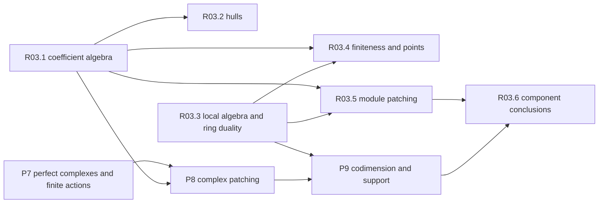

# Deformation and derived patching algebra

This roadmap supplies the complete local algebra used to construct deformation rings and to patch modules or perfect complexes. Its endpoint is a family of precise algebraic criteria: finite parameter quotients give finite deformation rings; balanced modules or bounded perfect complexes give Cohen–Macaulay patched objects; full support and multiplicity comparisons give component and quotient conclusions. The arithmetic hypotheses selecting the input systems belong to their arithmetic consumers.

The nine layers are planned at target level with 129 new targets and the accepted reserved multiplicity definition imported from P7. Every definition and construction below has an API derived from its uses and at least three tests. Six source or proof refinements remain explicitly open, and seventeen supplier contracts identify required external interfaces, including explicitly marked additions to supplier plans. These are mathematical specifications, not implemented declarations. Independent review [REV-DeformationAndDerivedPatchingAlgebra](../reviews/REV-DeformationAndDerivedPatchingAlgebra.md) accepts this target-level pass with those open refinements and requests.

## Conventions and endpoint contracts

Rings are commutative with identity. A local ring in the main algebraic targets is Noetherian unless a statement explicitly removes Noetherianity. Finite means finitely generated as a module. A coefficient DVR is denoted by O, its uniformizer by π, residue field by k and fraction field by E. Completeness is separated maximal-adic completeness. Finite cardinality of k is an additional compactness hypothesis in finite patching; it is not part of the definition of a complete local coefficient ring.

Complexes use cochain degrees: C[n]^i=C^{i+n}. A complex concentrated in degree b is M[-b]. A bound on cohomology is different from a bound on Tor amplitude. All patching amplitude statements specify bounded finite-projective models or an equivalent Tor-amplitude condition. Zero complexes are allowed by constructions, while finite numerical depth and codimension conclusions require a nonzero object.

For a finite module M, dimension means dim Supp(M), and depth takes values in the extended natural numbers, with depth(0)=∞. For a complex, support is the union of cohomology supports; its codimension is measured in the explicitly named base ring. A derived ring action is a map to an endomorphism ring in the enhanced derived category. It does not supply a strict chain action or an actual module action through an unrelated quotient ring.

There are two multiplicity conventions. The intrinsic multiplicity of a nonzero module uses d=dim Supp(M). A cycle or additive formula instead fixes one ambient D and takes the coefficient in degree D; smaller-dimensional supports then contribute zero. The associated-graded length polynomial has degree d−1 and factorial (d−1)!, whereas cumulative quotient length has degree d and factorial d!. The reserved multiplicity definition in the accepted P7 packet is imported into R03.3; the contract below restates its conventions in this reader’s own words.

### How the layers fit together

| Layer | Main output | Interfaces used later |
|---|---|---|
| R03.1 | Artinian and complete coefficient categories, coefficient presentations, completions and finite parameter subrings | Small extensions, relative cotangent spaces, finite quotients and topology comparisons |
| R03.2 | Tangent spaces, Schlessinger hulls and prorepresentability, obstruction and framing interfaces | Representing complete local rings with the required smoothness and relation hypotheses |
| R03.3 | Depth, regular sequences, CM and Gorenstein algebra, multiplicity, Matlis and ring duality | Dimension, freeness, finite duality, support and cycle identities |
| R03.4 | Finiteness, generic points, residue base change and torsion-free specialization | Finite O-algebras, valued characteristic-zero points and reduced quotient tests |
| R03.5 | Balanced module patching, regular-base patching and pointed characteristic-zero variants | Depth equality and module freeness after all numerical hypotheses are checked |
| R03.6 | Nearly faithful modules, component support, cycles and augmentation comparisons | Full support, reduced quotient identification and dimension-sensitive multiplicity |
| P7 | Perfect and pseudo-coherent complexes, minimal models, actions and complete finite inverse systems | Finite derived algebra with enhanced operations supplied by lower layers |
| P8 | Finite patching systems, a common coefficient map, ultrapatching and duality | A patched perfect complex and its top cohomology, with finite action-image control |
| P9 | Codimension/amplitude, length and paired support transport | CM top cohomology and component comparisons with the required specialization data |



This diagram shows the principal proof direction. Individual target dependencies below give the precise finer order, including P7 interfaces used by ring duality. EnhancedDerivedSheaves supplies enhanced derived tensor, Hom and homotopy limits. DerivedDeRhamCohomology supplies the full cotangent complex, Koszul carrier and derived completion. SchemeAndStackFoundations supplies scheme carriers and generic cycles; punctured Picard/parafactorial theory is an additional requested interface. PadicMeasuresIwasawaAlgebras supplies completed group rings; arbitrary complete-flat-module topological bases are an additional requested interface. None of these general constructions is recreated here.

The current AlgebraicVectorBundles roadmap already owns finite locally free bundles and their determinants. R03.3 uses its L0C determinant to prove only a finite-free-resolution trivialization comparison; it does not assume that upstream already supplies determinants of arbitrary perfect complexes. GrothendieckEulerForms already owns finite-support Euler theory, and ModularCurves already owns its regularity interfaces. The blueprint imports those interfaces and records the extra local algebra comparisons needed by this roadmap.

Ring dualizing complexes and affine finite-map duality are owned by R03.3. Geometric coherent duality remains with SchemeAndStackFoundations SF.2 and its reserved coherent-duality definition. The elementary Matlis coefficient dual Hom_O(−,E/O) is placed in P7 so that patching can use it without depending on the higher CoherentCohomologyAndDualityII roadmap. The latter must import this lower owner.

## Worked checks of the numerical conventions

### Hilbert–Samuel normalization and curve order

For A=k[[x,y]], monomials of total degree at most n give

```math
H_{m,A}(n)=\binom{n+2}{2}=\tfrac12n^2+\tfrac32n+1,
\qquad h_{m,A}(n)=n+1.
```

Thus intrinsic multiplicity is 2!·(1/2)=1. Multiplying the leading coefficient of h by 2! would give two, detecting the wrong convention. For M=A/(x), H(n)=n+1, so intrinsic multiplicity is one and ambient degree-two multiplicity is zero. The exact sequence 0→(x)→k[[x]]→k→0 has intrinsic multiplicities 1,1,1; at ambient dimension one the last contribution becomes zero and additivity holds.

For a nonzero plane equation f of order r in the regular local plane, the initial form is a nonzerodivisor in k[x,y]. The associated-graded quotient has Hilbert series (1−t^r)/(1−t)^2. Its cumulative polynomial has linear leading coefficient r. The smooth equation y has e=1; the cusp y²−x³ and ordinary node y²−x²(x+1) have e=2; x³−y³ in characteristic zero has e=3, with three distinct branches over an algebraically closed field. For the cubic, H(n)=3n for n≥1, while H(0)=1. These examples test eventual equality rather than equality of the polynomial at every index. Compare Hochster12, January 27, pp. 33–35, and the ambient convention used in LLHLM20 §3.5.1, p. 38.

Multiplicity one does not imply regularity without an unmixedness hypothesis. In k[[x,y]]/(xy,y²), the cumulative function is n+2 for n≥1, so e=1, but m/m² has dimension two. The embedded associated prime contributes only in lower dimension. The corresponding regularity target requires formal unmixedness and records its unresolved mixed-characteristic primary proof source.

### Regularity in the associated graded ring

For A=k[[t^6,t^7,t^15]], the element t^6 is regular because A is a domain. Yet t^15 belongs to m but not m², and t^6t^15=t^21=(t^7)^3 belongs to m³. Its degree-one initial class is therefore annihilated by the initial class of t^6. This prevents the local Hilbert-series equality which would follow from regularity of the initial form. The criterion below uses that stronger condition, matching the explanation after CG18 Lemma 4.4, pp. 357–358.

### The smallest balanced patching model

Let q=1, S∞=O[[t]] and R∞=O=S∞/(t), with H=O. For Δ_N=Z/p^N and M_N=O with trivial Δ_N action, the minimal presentation over O[Δ_N] has one generator and one relation, so its defect is zero. The augmentation of each M_N is H. The S∞-module O has projective dimension one and depth one, exactly dim S∞−1=dim R∞. The numerical equality forces the patched module to be CM over R∞ and hence free over the regular ring R∞. Omitting the one relation or using dim S∞ in place of dim R∞ would fail this model. The general balance and common-map conditions are stated in R03.5; compare CG18 Proposition 2.3 and proof, pp. 308–310.

### Codimension needs Tor amplitude and a nonzero complex

For regular S=k[[x,y]], the two-term complex [S —x→ S] in degrees [0,1] has only H¹=S/(x), codimension one. It has a minimal finite free model of length one; H¹ has depth one and projective dimension one. It realizes equality in the codimension/amplitude lemma. By contrast, the contractible complex [S —1→ S] has zero cohomology and empty support. The numerical conclusion cannot be applied to it. Concentration of arbitrary cohomology in [0,1] alone also gives no bound on its projective representative. These are explicit Checks for P9, following the proof mechanism of CG18 Lemma 6.2, p. 385, and CI21 Proposition 6, author p. 5.

### Finite action images and derived augmentation

For perfect C over complete Noetherian S, End_D(S)(C) is a finite S-module. The image R′ of a compatible R∞ action is therefore finite over S. This gives a finite local algebra on which CM and finite duality can be applied. The same reasoning does not prove that the surjecting whole ring R∞ is finite over S. IKM24 p. 47 explicitly invokes BKM Lemmas 3.6–3.7 to adjust a coefficient lift through an action image. The remaining refinement is that this adjustment preserves the coefficient map through Q for every patched object and morphism. No later target silently assumes that comparison.

If C∞≃M[-b], then its derived augmentation is M[-b]⊗^L_S Λ. Ordinary augmentation M/aM gives only top degree b; lower augmented cohomology can be nonzero Tor. For S=k[[x]], M=S/(x) and Λ=k, derived tensor has a second nonzero term even though the ordinary tensor is k. Dual systems use the same ultrafilter and the same S∞→R∞ map, with finite-level pairings constructed before taking a limit. See IKM24 Theorem 10.6 and §11, arXiv v3 pp. 43–51, and BKM Lemmas 3.6–3.7, arXiv:2108.09729v2 pp. 11–12.

### Six-variable component calculation

In k[[a,b,c,d,e,f]], take I=(ab,ac,ae,bc,bd,cf). Its minimal coordinate primes are (a,b,c), (a,b,f), (a,c,d) and (b,c,e): each is a minimal vertex cover of the six monomial supports. Their intersection is I, each has height three, and each generic quotient has length one. The ring is reduced and equidimensional of dimension three and has multiplicity four. In the LLHLM20 instance use a=c₁₂−c₁₃c₃₂, b=κc₃₁−c₂₁c₃₂, c=c₂₃, d=c₁₃, e=c₂₁, f=c₃₂, with κ≠0, before reading off those primes. The count is a worked instance of the cycle target, not a claim that every square-free monomial quotient is CM. Compare LLHLM20 Lemma 3.6.13 proof, pp. 70–71.

## Pinned inventory and suggested declarations

The blueprint baseline is Mathlib `082e2d37e8b0463410cdb532e111cd43d5a66174` and Tau Ceti `f790474821cf4256814db967cb154e7af3d0c369`. Twenty-two exact baseline declarations were read at these pins; the seventeen original names and five additional evaluation/K-projective names were resolved in Lean audits. Mathlib supplies regular sequences, module support and support dimension, length additivity, finite-module completion exactness, and projective dimension of regular-sequence quotients. Tau Ceti supplies Artin–Rees controlled lifts, finite-type and integral dimension comparisons, a principal-quotient flatness result, an injective-envelope predicate and the Ext-colimit local-cohomology carrier. An injective-envelope predicate is not an existence theorem, and the local-cohomology carrier is not yet the local-duality comparison.

Current upstream main (`0d144d044dacebca17b654695b6f1ad58f159b27`) and current Tau Ceti (`a91d3aafa8cd3e6bc33dfde0d7677ed0f1625039`) were separately inspected. The nine roadmaps newer than the atlas snapshot and the four Completed roadmaps were searched for these targets, and the AlgebraicVectorBundles and GrothendieckEulerForms interfaces were read in detail. Their existing targets are imported. A similarly named group dualizing module in LocalGaloisGroups does not supply a ring dualizing complex. Presence claims in the Lean subset always refer to the pinned baseline, not to a newer library declaration.

The suggested file has seven light definitions with real bodies, thirteen milestone statements and five examples. It elaborates at the pinned libraries with proof-placeholder warnings only. Its polynomial coefficient operation is deliberately a raw coefficient, not a completed definition of multiplicity; eventual polynomiality, support degree and zero conventions remain part of the R03.3 specification. Heavy coefficient categories, enhanced derived objects, dualizing carriers, patching systems and their constructions stay in this reader because their required interfaces are planned targets.

| Suggested declaration | Reader target or purpose |
|---|---|
| `hilbertSamuelFunction`, `multiplicityCoefficient` | R03.3 reserved multiplicity target; cumulative length and raw coefficient only |
| `moduleDepth` | R03.3 depth and grade; zero has extended depth |
| `traceIdeal` | R03.3 trace ideal using all linear functionals |
| `symbolicSquare` | R03.3 localization and contraction definition |
| `NearlyFaithful` | R03.6 annihilator nilpotence |
| `SmallExtension` | R03.1 local surjection with nonzero principal residue kernel |
| `smallExtension_kernel_square_zero` | R03.1 small versus square-zero comparison |
| `hilbertSamuel_finite`, `hilbertSamuel_eventual_polynomial`, `hilbertSamuel_degree_and_positive_integral_coefficient` | R03.3 length polynomial and intrinsic multiplicity milestones |
| `finite_projective_dimension_depth`, `regular_local_finite_module_dimension_bound`, `regular_local_maximal_cm_free` | R03.3 Auslander–Buchsbaum and regular-local freeness |
| `trace_eq_top_iff_free_summand`, `symbolicSquare_membership` | R03.3 trace and symbolic-square milestones |
| `matlis_finite_bidouble` | R03.3 finite Matlis duality with a specified existing injective envelope |
| `nearlyFaithful_iff_full_support`, `reduced_quotient_identification` | R03.6 full support and a reduced source quotient |
| `three_term_residue_exactness` | P7 residue exactness at the middle term; no endpoint injectivity claim |

The reserved Hilbert–Samuel key already has an accepted definition in the P7 part. This blueprint cites that exact ID as a prerequisite and retains a reader contract for it, without redefining it or editing the accepted packet. The multiplicity examples and comparison targets use that existing owner.

The target identifiers below are stable cross-reference keys. API names are suggested future library names; their full contracts are given in the tables. Checks are mathematical acceptance cases, including non-examples that an incorrect definition would wrongly accept.

## R03.1 — Coefficient rings, topology and finite presentations

15 targets. Selected planets: Small extensions, Complete local coefficients, Formal power-series evaluation, Relative cotangent space, Cohen structure theorem, Completed tensor product.

<a id="target-r03-1-artinian-coefficient-category-and-small-extensions"></a>

### Artinian coefficients and small extensions

`R03.1/artinian-coefficient-category-and-small-extensions` · definition · implementation unchecked

Fix a complete Noetherian local coefficient ring Λ with a specified residue field k. Art_Λ has Artinian local Λ-algebras A, a chosen Λ-compatible A/m_A ≅ k, and local Λ-maps inducing identity on k. A small extension is a surjection B→A with a nonzero principal kernel annihilated by m_B. An elementary extension only requires m_B ker=0 and permits any finite k-dimension, including zero. A square-zero extension has kernel I with I²=0, a weaker condition.

**Hypotheses.**

- Fix a complete Noetherian local coefficient ring Λ with a specified residue field k.

**Prerequisites.** Existing ring and module carriers; no new prerequisite target.

**Sources.**

- [StacksFormalDefos](https://stacks.math.columbia.edu/download/formal-defos.pdf): Definitions 3.1–3.2, Lemma 3.3, pp. 4–5; §10, p. 26. This locator supplies the stated construction and its comparison maps.

**Proof plan.**

1. Use the existing local/Artinian ring structures with a specified residue identification. Restrict morphisms; identity and composition preserve the residue identification.
2. Identify an elementary kernel as a finite k-vector space. In the nonzero principal case its dimension is exactly one.

**Planning API.**

| Name | Role | Contract |
|---|---|---|
| `TauCeti.ArtinianCoefficientsAndSmallExtensions.hom` | data | Morphisms preserve Λ and the chosen residue-field identification. |
| `TauCeti.ArtinianCoefficientsAndSmallExtensions.small_iff` | characterisation | Small means surjective, m_B ker=0 and dim_k ker=1. |
| `TauCeti.ArtinianCoefficientsAndSmallExtensions.small_is_square_zero` | relation | Every small extension is square-zero; elementary extensions need not be principal. |
| `TauCeti.ArtinianCoefficientsAndSmallExtensions.base_change` | functoriality | Pull back a small extension along A′→A; the resulting kernel is identified with the original kernel. |
| `TauCeti.ArtinianCoefficientsAndSmallExtensions.factor_surjection` | compatibility | A nonisomorphic surjection factors into finitely many small extensions. |

**Unit tests.**

- `TauCeti.ArtinianCoefficientsAndSmallExtensions.dual_numbers` (computation): k[ε]/ε²→k is small, with kernel kε.
- `TauCeti.ArtinianCoefficientsAndSmallExtensions.reject_two_dimensional` (non-example): k[x,y]/(x,y)²→k is elementary and square-zero, but not small.
- `TauCeti.ArtinianCoefficientsAndSmallExtensions.reject_square_zero_only` (non-example): k[t]/t⁴→k[t]/t² has square-zero kernel but m_B ker ≠0.
- `TauCeti.ArtinianCoefficientsAndSmallExtensions.reject_identity` (non-example): The identity of k has zero kernel and is not small.

**Uses.**

- Schlessinger criterion in R03.2: Its lifting tests quantify over exactly the small extensions.
- P8 finite ring truncations: Surjections are reduced to elementary lifting steps.

**Check.**

- k[ε]/ε²→k is small, with kernel kε.
- k[x,y]/(x,y)²→k is elementary and square-zero, but not small.
- k[t]/t⁴→k[t]/t² has square-zero kernel but m_B ker ≠0.
- The identity of k has zero kernel and is not small.

<a id="target-r03-1-complete-local-coefficient-category"></a>

### Complete local coefficients

`R03.1/complete-local-coefficient-category` · definition · implementation unchecked

CNL_Λ consists of complete separated Noetherian local Λ-algebras with specified residue k; morphisms are continuous local Λ-maps inducing identity on k. The topology is m-adic. No finite residue-field assumption is built into CNL_Λ; compactness through finite underlying quotients later adds it explicitly. Every object defines a compatible tower A/m_A^n, n≥1.

**Hypotheses.**

- CNL_Λ consists of complete separated Noetherian local Λ-algebras with specified residue k; morphisms are continuous local Λ-maps inducing identity on k.

**Prerequisites.** [R03.1/artinian-coefficient-category-and-small-extensions](#target-r03-1-artinian-coefficient-category-and-small-extensions); `mathlib:AdicCompletion.map_exact`

**Sources.**

- [StacksFormalDefos](https://stacks.math.columbia.edu/download/formal-defos.pdf): Definition 4.1, p. 9; Lemmas 4.2–4.6, pp. 10–11; Lemmas 4.7–4.8, p. 12. This locator supplies the stated construction and its comparison maps.

**Proof plan.**

1. Restrict rings and maps by completeness and Noetherianity, using existing adic completion.
2. Identify maps with compatible quotient maps; continuity follows from locality for the m-adic topologies.

**Planning API.**

| Name | Role | Contract |
|---|---|---|
| `TauCeti.CompleteLocalCoefficients.quotient` | projection | A→A/m_A^n is a local continuous quotient with residue k. |
| `TauCeti.CompleteLocalCoefficients.from_tower` | constructor | A surjective Artinian tower with uniformly bounded cotangent dimension has a CNL_Λ limit. |
| `TauCeti.CompleteLocalCoefficients.hom_limit` | universal-property | A continuous map into a complete coefficient ring is equivalent to compatible maps into all its Artinian quotients. |
| `TauCeti.CompleteLocalCoefficients.quotient_complete` | instance | A/I is complete Noetherian for every ideal I of A. |
| `TauCeti.CompleteLocalCoefficients.iso_quotients` | extensionality | A morphism inducing isomorphisms at every Artinian quotient is an isomorphism. |

**Unit tests.**

- `TauCeti.CompleteLocalCoefficients.dvr` (computation): O and O[[x_1,…,x_r]] belong to CNL_O.
- `TauCeti.CompleteLocalCoefficients.reject_infinite_variables` (non-example): The completion of an Artinian tower with unbounded cotangent dimension need not be Noetherian; it is not admitted by from_tower.
- `TauCeti.CompleteLocalCoefficients.reject_polynomials` (non-example): k[x]_(x) is local Noetherian but is not x-adically complete.

**Uses.**

- BCGP25 §1.8.1, p. 8: Coefficient categories organize all finite patching quotients.
- Schlessinger hulls: Prorepresenting objects live in CNL_Λ.

**Check.**

- O and O[[x_1,…,x_r]] belong to CNL_O.
- The completion of an Artinian tower with unbounded cotangent dimension need not be Noetherian; it is not admitted by from_tower.
- k[x]_(x) is local Noetherian but is not x-adically complete.

<a id="target-r03-1-artinian-fibre-products"></a>

### Fibre products of coefficient rings

`R03.1/artinian-fibre-products` · theorem · implementation unchecked

For A→C←B in Art_Λ the fibre product A×_C B is an Artinian local Λ-algebra with the specified residue k. If B→C is surjective, its projection to A is surjective with kernel ker(B→C), and pulling back a small extension again gives a small extension. The surjective-leg hypothesis controls this projection and kernel; locality follows already from the fixed residue maps.

**Hypotheses.**

- If A→C←B are in Art_Λ and B→C is surjective, then A×_C B is in Art_Λ; projection to A is surjective with kernel ker(B→C).

**Prerequisites.** [R03.1/artinian-coefficient-category-and-small-extensions](#target-r03-1-artinian-coefficient-category-and-small-extensions)

**Sources.**

- [StacksFormalDefos](https://stacks.math.columbia.edu/download/formal-defos.pdf): Lemma 3.8 and Example 3.7, pp. 6–7. This locator supplies the stated local algebra result; the proof steps specify its use.

**Proof plan.**

1. Describe pairs with equal image. The maximal ideal consists of pairs whose residues vanish.
2. Use the surjective leg to lift every element of A, identify its kernel and compute the residue field and Artinian length.

**Check.**

- Compute k[ε]×_k k[δ]; its maximal ideal has k-dimension two, with both squares and their product zero.

<a id="target-r03-1-artinian-limit-and-quotient-cofinality"></a>

### Artinian limits and cofinal parameter quotients

`R03.1/artinian-limit-and-quotient-cofinality` · theorem · implementation unchecked

Every A in CNL_Λ is lim A/m^n. Conversely a surjective Artinian local tower with fixed residue and a uniform bound on dim_k m_n/m_n² has a complete Noetherian local limit. For an m-primary parameter ideal (x_1,…,x_d), the ideals (x_1^n,…,x_d^n) are cofinal with powers of m: I^{d(n−1)+1}⊆(x_i^n)⊆I^n and m^c⊆I for some c.

**Hypotheses.**

- Every A in CNL_Λ is lim A/m^n.

**Prerequisites.** [R03.1/complete-local-coefficient-category](#target-r03-1-complete-local-coefficient-category)

**Sources.**

- [StacksFormalDefos](https://stacks.math.columbia.edu/download/formal-defos.pdf): Lemmas 4.7–4.8, p. 12; André §3.4, printed p. 84. This locator supplies the stated local algebra result; the proof steps specify its use.

**Proof plan.**

1. Lift a bounded set of cotangent generators inductively and map a finite-variable formal power-series ring onto the inverse limit.
2. Use the complete topology to show surjectivity, obtaining Noetherianity as a quotient. For parameter quotients apply the pigeonhole bound on monomials and compare I-adic and m-adic powers.

**Check.**

- Finite residue k makes every finite-length Artinian quotient a finite set; infinite k does not.

<a id="target-r03-1-continuous-power-series-evaluation"></a>

### Continuous formal evaluation

`R03.1/continuous-power-series-evaluation` · construction · implementation unchecked

For a complete separated local Λ-algebra A and a finite list a_i∈m_A, evaluation defines a unique continuous Λ-map Λ[[X_1,…,X_r]]→A sending X_i to a_i. More generally use an ideal J and J-adically topologically nilpotent entries; arbitrary entries need not admit evaluation.

**Hypotheses.**

- For a complete separated local Λ-algebra A and a finite list a_i∈m_A, evaluation defines a unique continuous Λ-map Λ[[X_1,…,X_r]]→A sending X_i to a_i.

**Prerequisites.** [R03.1/complete-local-coefficient-category](#target-r03-1-complete-local-coefficient-category); `mathlib:MvPowerSeries.eval₂Hom`; `mathlib:MvPowerSeries.eval₂_unique`

**Sources.**

- [StacksFormalDefos](https://stacks.math.columbia.edu/download/formal-defos.pdf): Lemma 4.8 and proof, p. 12; Stacks Algebra §97. This locator supplies the stated construction and its comparison maps.

**Proof plan.**

1. Supply the adic uniform/topological instances and prove HasEval for the finite tuple in the maximal ideal. Reuse MvPowerSeries.eval₂Hom rather than constructing evaluation again.
2. Use MvPowerSeries.eval₂_unique for uniqueness. The additional local adapter proves surjectivity from the chosen relative cotangent generators using successive Artinian approximations.

**Planning API.**

| Name | Role | Contract |
|---|---|---|
| `TauCeti.ContinuousFormalEvaluation.eval_X` | simp | Evaluation sends X_i to a_i and coefficients by the given Λ-map. |
| `TauCeti.ContinuousFormalEvaluation.eval_comp` | functoriality | Continuous local base change commutes with evaluation. |
| `TauCeti.ContinuousFormalEvaluation.eval_ext` | extensionality | Continuous Λ-maps agreeing on all variables are equal. |
| `TauCeti.ContinuousFormalEvaluation.eval_surjective` | universal-property | If the a_i generate the relative cotangent space and A has residue k, evaluation is surjective. |

**Unit tests.**

- `TauCeti.ContinuousFormalEvaluation.zero` (computation): Sending every variable to zero is the constant-coefficient map.
- `TauCeti.ContinuousFormalEvaluation.nilpotent` (computation): Evaluation at ε in k[ε]/ε² sends a series to c_0+c_1ε.
- `TauCeti.ContinuousFormalEvaluation.reject_unit` (non-example): The series ΣX^n cannot be evaluated at X=1 in the discrete field k by this construction.

**Uses.**

- R03.2 relation presentations: Chooses the map from the minimal formal power-series ring.
- P8 common scalar map: Continuous evaluation lifts the chosen patching parameters.

**Check.**

- Sending every variable to zero is the constant-coefficient map.
- Evaluation at ε in k[ε]/ε² sends a series to c_0+c_1ε.
- The series ΣX^n cannot be evaluated at X=1 in the discrete field k by this construction.

<a id="target-r03-1-relative-cotangent-space"></a>

### Relative tangent and cotangent spaces

`R03.1/relative-cotangent-space` · definition · implementation unchecked

For A in CNL_Λ define cot_Λ(A)=m_A/(m_A²+m_Λ A), a finite k-vector space; t_Λ(A)=Hom_k(cot_Λ(A),k) identifies with local Λ-maps A→k[ε] reducing to the fixed residue map. For general residue extension use Der_Λ(A,k) and retain Der_Λ(k,k); do not silently replace it by this classical formula.

**Hypotheses.**

- For A in CNL_Λ define cot_Λ(A)=m_A/(m_A²+m_Λ A), a finite k-vector space; t_Λ(A)=Hom_k(cot_Λ(A),k) identifies with local Λ-maps A→k[ε] reducing to the fixed residue map.

**Prerequisites.** [R03.1/complete-local-coefficient-category](#target-r03-1-complete-local-coefficient-category)

**Sources.**

- [KWII](https://www.math.ucla.edu/~shekhar/papers/proofs.pdf): §2.1, p. 6; Stacks Formal deformation theory Example 11.11, pp. 31–32. This locator supplies the stated construction and its comparison maps.

**Proof plan.**

1. The difference from the residue map is a derivation annihilating Λ, m² and m_Λ A.
2. Conversely a cotangent functional defines a map to dual numbers. Verify both constructions are inverse.

**Planning API.**

| Name | Role | Contract |
|---|---|---|
| `TauCeti.RelativeTangentAndCotangentSpaces.tangent_dual` | equivalence | Local maps to k[ε] identify naturally with the k-dual of the relative cotangent space. |
| `TauCeti.RelativeTangentAndCotangentSpaces.cot_map` | functoriality | A local Λ-map induces a forward linear map on cotangent spaces and a backward map on tangents. |
| `TauCeti.RelativeTangentAndCotangentSpaces.cot_power_series` | compatibility | Adjoining r variables adds k^r to relative cotangent space. |
| `TauCeti.RelativeTangentAndCotangentSpaces.cot_quotient` | characterisation | For A/I with I⊆m_A, cot_Λ(A/I) is cot_Λ(A) modulo the image of I. |

**Unit tests.**

- `TauCeti.RelativeTangentAndCotangentSpaces.formal_variables` (computation): cot_O(O[[x,y]]) has dimension two.
- `TauCeti.RelativeTangentAndCotangentSpaces.coefficient_direction` (computation): cot_O(O)=0, though m_O/m_O² has dimension one.
- `TauCeti.RelativeTangentAndCotangentSpaces.quadratic_relation` (computation): cot_k(k[[x]]/(x²)) is one-dimensional; a quadratic relation does not kill tangent directions.

**Uses.**

- KWII §2.1: Counts the formal variables in ring presentations and tensor products.
- Schlessinger H3: Finiteness of tangent space bounds the number of formal generators.

**Check.**

- cot_O(O[[x,y]]) has dimension two.
- cot_O(O)=0, though m_O/m_O² has dimension one.
- cot_k(k[[x]]/(x²)) is one-dimensional; a quadratic relation does not kill tangent directions.

<a id="target-r03-1-cohen-structure-and-compatible-coefficients"></a>

### Cohen structure and compatible coefficients

`R03.1/cohen-structure-and-compatible-coefficients` · theorem · implementation unchecked

Every complete Noetherian local A is a quotient of a complete regular local Q with the same residue field. In equal characteristic Q=k[[x_1,…,x_e]] after choosing a coefficient field. For perfect residue k and mixed characteristic, an unramified regular local A of dimension d is W(k)[[x_1,…,x_{d−1}]]. A ramified regular A has A≅W(k)[[x_1,…,x_d]]/(p−f), f in (p,x_1,…,x_d)^2, with p nonzero in the quotient and p−f a nonzerodivisor in the regular ambient ring. For imperfect k use a Cohen ring, not W(k). A separable residue extension admits compatible choices of coefficient maps; no uniqueness is asserted.

**Hypotheses.**

- Every complete Noetherian local A is a quotient of a complete regular local Q with the same residue field.

**Prerequisites.** [R03.1/continuous-power-series-evaluation](#target-r03-1-continuous-power-series-evaluation); [R03.1/relative-cotangent-space](#target-r03-1-relative-cotangent-space)

**Sources.**

- [Andre18](https://www.numdam.org/item/10.1007/s10240-017-0097-9.pdf): §4.2 and §4.4(1), printed pp. 86–88. This locator supplies the stated local algebra result; the proof steps specify its use.

**Proof plan.**

1. Construct a coefficient ring/field and lift a finite cotangent basis. Surjectivity of formal evaluation gives the presentation.
2. For a separable extension lift the coefficient embedding through the Cohen rings, then lift the remaining parameters. For imperfect residue fields retain Cohen rings instead of substituting Witt vectors.

**Check.**

- An O-presentation relative to a specified O-map is not the same as a freely chosen coefficient presentation.

<a id="target-r03-1-finite-parameter-subring"></a>

### Finite parameter subrings

`R03.1/finite-parameter-subring` · theorem · implementation unchecked

Let B be a complete local Noetherian p-torsion-free ring of mixed characteristic with perfect residue k and dim B=d. Choose a system of parameters beginning with p². Then B is finite over W(k)[[T_1,…,T_{d−1}]] via the remaining parameters. The map is injective when B is a domain; finite generation follows from the finite-length parameter quotient, and injectivity follows from the dimension comparison.

**Hypotheses.**

- Let B be a complete local Noetherian p-torsion-free ring of mixed characteristic with perfect residue k and dim B=d.

**Prerequisites.** [R03.1/cohen-structure-and-compatible-coefficients](#target-r03-1-cohen-structure-and-compatible-coefficients); [R03.3/systems-of-parameters](#target-r03-3-systems-of-parameters); [R03.4/finiteness-of-deformation-rings-criteria](#target-r03-4-finiteness-of-deformation-rings-criteria); `tauceti:TauCeti.ringKrullDim_eq_of_isIntegral_of_faithfulSMul`

**Sources.**

- [Andre18](https://www.numdam.org/item/10.1007/s10240-017-0097-9.pdf): §4.2, printed p. 86. This locator supplies the stated local algebra result; the proof steps specify its use.

**Proof plan.**

1. Extend p² to parameters using nonzerodivisorness and prime avoidance.
2. Lift a finite residue basis modulo the parameter ideal by successive approximations. A nonzero kernel in the regular domain would lower the dimension of its finite extension.

**Check.**

- The assertion excludes p=0 in B; it does not choose parameters functorially.

<a id="target-r03-1-perfect-residue-extension"></a>

### Perfect residue-field change

`R03.1/perfect-residue-extension` · theorem · implementation unchecked

From a complete local Noetherian ring with coefficient ring and residue k, extend coefficients to a compatible Cohen ring of a separable algebraic extension k′/k and complete. The map is faithfully flat local and Noetherian, and carries finite presentations to their completed scalar extensions. In characteristic p the passage k→k^perf may be built as a filtered coefficient extension followed by completion; its presentation over a Cohen ring proves Noetherianity despite the possibly infinite field extension.

**Hypotheses.**

- From a complete local Noetherian ring with coefficient ring and residue k, extend coefficients to a compatible Cohen ring of a separable algebraic extension k′/k and complete.

**Prerequisites.** [R03.1/cohen-structure-and-compatible-coefficients](#target-r03-1-cohen-structure-and-compatible-coefficients); [R03.1/flat-completion-and-finite-module-comparison](#target-r03-1-flat-completion-and-finite-module-comparison)

**Sources.**

- [Andre18](https://www.numdam.org/item/10.1007/s10240-017-0097-9.pdf): §4.2 and §4.4(1), printed pp. 86–88. This locator supplies the stated local algebra result; the proof steps specify its use.

**Proof plan.**

1. Choose compatible coefficient rings and extend the finite-variable presentation, preserving relation generators.
2. Flatness of coefficient extension and flat-completion comparison yield flatness; residue extension proves faithful locality. For perfection use the appropriate coefficient-extension construction rather than claiming perfection is separable.

**Check.**

- CM ascent here uses the field closed fibre; arbitrary faithfully flat maps need not preserve CM.

<a id="target-r03-1-completed-tensor-products"></a>

### Completed tensor products

`R03.1/completed-tensor-products` · construction · implementation unchecked

For A,B in CNL_O with common residue k and finite formal presentations, A⊗̂_O B is the completion of A⊗_O B for m_A⊗B+A⊗m_B. It is a complete Noetherian local ring with residue k, presented by adjoining both sets of variables and both ideals of relations. Finite modules use the same completed tensor construction. Ring flatness and component formulas require their separate hypotheses.

**Hypotheses.**

- For A,B in CNL_O with common residue k and finite formal presentations, A⊗̂_O B is the completion of A⊗_O B for m_A⊗B+A⊗m_B.

**Prerequisites.** [R03.1/cohen-structure-and-compatible-coefficients](#target-r03-1-cohen-structure-and-compatible-coefficients); [R03.1/artinian-limit-and-quotient-cofinality](#target-r03-1-artinian-limit-and-quotient-cofinality)

**Sources.**

- [KWII](https://www.math.ucla.edu/~shekhar/papers/proofs.pdf): §2.1–2.3, pp. 6–10; CG18 Lemma 4.2, p. 355. This locator supplies the stated construction and its comparison maps.

**Proof plan.**

1. Compute modulo the combined open ideals, where ordinary tensor products have finite presentation.
2. Use the formal presentation to prove locality and Noetherianity. Take compatible limits, and prove the universal property for continuous maps whose coefficient maps agree.

**Planning API.**

| Name | Role | Contract |
|---|---|---|
| `TauCeti.CompletedTensorProducts.include_left` | constructor | Continuous maps A→A⊗̂_O B and B→A⊗̂_O B agree on O. |
| `TauCeti.CompletedTensorProducts.lift` | universal-property | Commuting continuous maps to a complete target produce a unique continuous map from the completed tensor product. |
| `TauCeti.CompletedTensorProducts.assoc_comm` | equivalence | Associativity and symmetry are natural topological algebra equivalences. |
| `TauCeti.CompletedTensorProducts.quotient` | compatibility | Quotienting by closed ideals I,J gives (A/I)⊗̂_O(B/J). |
| `TauCeti.CompletedTensorProducts.cotangent` | compatibility | Relative cotangent space is the direct sum of the two relative cotangent spaces. |
| `TauCeti.CompletedTensorProducts.finite_modules` | functoriality | Maps between finite modules induce compatible completed tensor maps. |

**Unit tests.**

- `TauCeti.CompletedTensorProducts.coefficient_unit` (computation): A⊗̂_O O ≅ A.
- `TauCeti.CompletedTensorProducts.variables` (computation): O[[x]]⊗̂_O O[[y]] ≅ O[[x,y]].
- `TauCeti.CompletedTensorProducts.reject_uncompleted` (non-example): k[[x]]⊗_k k[[y]] is not substituted for k[[x,y]]; infinite diagonal series require completion.

**Uses.**

- KWII Proposition 2.2(ii): Controls domains after coefficient gluing.
- LLHLM20 §3.5.1: Forms patched products of local rings.

**Check.**

- A⊗̂_O O ≅ A.
- O[[x]]⊗̂_O O[[y]] ≅ O[[x,y]].
- k[[x]]⊗_k k[[y]] is not substituted for k[[x,y]]; infinite diagonal series require completion.

<a id="target-r03-1-flat-completion-and-finite-module-comparison"></a>

### Completion of arbitrary flat algebras

`R03.1/flat-completion-and-finite-module-comparison` · theorem · implementation unchecked

Let R be Noetherian, I⊂R an ideal and S a flat R-algebra, with S allowed non-Noetherian. Its IS-adic completion Ŝ is flat over R and over R̂. For every finite R-module M, M⊗_R Ŝ ≅ lim_n(M⊗_R S/I^nS). If S is faithfully flat and IS lies in Jac(S), then Ŝ is faithfully flat over R; equivalently nonzero residue fibres must survive. Do not assert faithfulness of completion for an arbitrary ideal.

**Hypotheses.**

- Let R be Noetherian, I⊂R an ideal and S a flat R-algebra, with S allowed non-Noetherian.

**Prerequisites.** `mathlib:AdicCompletion.map_exact`; `tauceti:TauCeti.ArtinRees.exists_controlled_lift`; [R03.1/flat-algebra-completion](../packets/DeformationAndDerivedPatchingAlgebra--R03.1.json)

**Sources.**

- [Andre18](https://www.numdam.org/item/10.1007/s10240-017-0097-9.pdf): Lemma 1.1.1 and proof, printed pp. 75–76. This locator supplies the stated local algebra result; the proof steps specify its use.

**Proof plan.**

1. Use Artin–Rees to control completion of kernels in finite presentations after flat base change.
2. Verify the finite ideal injection criterion for flatness. Compare finite-module tensors by the same presentation argument. For faithfulness test proper ideals/residue fibres and use the Jacobson hypothesis.

**Check.**

- R=Z, I=(2), S=Z[1/2] is flat but has zero I-adic completion.

<a id="target-r03-1-quotient-completion-noetherian-limit"></a>

### Completing quotients

`R03.1/quotient-completion-noetherian-limit` · theorem · implementation unchecked

Let (A,m) be a local ring whose m-adic completion  is Noetherian, and let J⊂A be finitely generated. Then the maximal-adic completion of A/J is naturally Â/(JÂ). A itself need not be Noetherian. For Noetherian local A, every J is finitely generated, so this includes every quotient. This is not an assertion of exactness for arbitrary adic completion.

**Hypotheses.**

- A is local, its maximal-adic completion  is Noetherian, and J⊂A is finitely generated.

**Prerequisites.** [R03.1/flat-completion-and-finite-module-comparison](#target-r03-1-flat-completion-and-finite-module-comparison)

**Sources.**

- [PQ26](https://www.cambridge.org/core/services/aop-cambridge-core/content/view/2D7C5400C4BA7789C0E1CFF008D12E60/S2050508626100304a.pdf/div-class-title-on-local-galois-deformation-rings-generalised-reductive-groups-div.pdf): Lemma 5.15, p. 34. This locator supplies the stated local algebra result; the proof steps specify its use.

**Proof plan.**

1. Noetherianity of  makes each A/m^n Artinian. Finite generators of J give finite kernels (J+m^n)/m^n, with the Mittag–Leffler property.
2. Take the exact inverse limit of the quotient sequences. Apply the same finite-generator comparison to identify the kernel with JÂ, as in PQ26 Lemma 5.15.

**Check.**

- For a complete Noetherian A the map A/J→its completion is an isomorphism.

<a id="target-r03-1-adic-pro-comparison"></a>

### Adic pro-isomorphisms

`R03.1/adic-pro-comparison` · definition · implementation unchecked

For an N-indexed inverse tower, a pro-map is a pro-isomorphism when its kernel and cokernel towers are pro-zero: for every n some later transition to n is zero. For finite modules M,N over Noetherian R, Hom_R(M,N)/I^n maps to Hom_R(M,N/I^nN); the associated towers are pro-isomorphic, although individual level maps need not be isomorphisms.

**Hypotheses.**

- For an N-indexed inverse tower, a pro-map is a pro-isomorphism when its kernel and cokernel towers are pro-zero: for every n some later transition to n is zero.

**Prerequisites.** `tauceti:TauCeti.ArtinRees.exists_controlled_lift`

**Sources.**

- [Bhatt18](https://arxiv.org/pdf/1608.08882v2): Lemma 5.3, PDF pp. 9–10. This locator supplies the stated construction and its comparison maps.

**Proof plan.**

1. Choose a finite presentation of M and apply Artin–Rees to its finite relation image in N^r.
2. Use a uniform shift to prove the cokernel tower pro-zero and to compare kernels; this proves a statement in the pro-category, not degreewise.

**Planning API.**

| Name | Role | Contract |
|---|---|---|
| `TauCeti.AdicProIsomorphisms.pro_zero` | characterisation | A tower is pro-zero iff all maps to each fixed stage eventually vanish. |
| `TauCeti.AdicProIsomorphisms.reindex` | compatibility | Passing to a cofinal subsequence preserves pro-isomorphisms. |
| `TauCeti.AdicProIsomorphisms.hom_comparison` | data | The comparison sends a functional modulo I^n to its reduction on N/I^nN. |
| `TauCeti.AdicProIsomorphisms.limit` | functoriality | A pro-isomorphism induces an isomorphism on inverse limits and derived inverse limits of these countable towers. |

**Unit tests.**

- `TauCeti.AdicProIsomorphisms.free_source` (computation): For finite free M the comparison is an isomorphism at every level.
- `TauCeti.AdicProIsomorphisms.torsion_source` (computation): R=k[[t]], M=k, N=R: Hom(M,R)=0, while Hom(M,R/t^n) has a nonzero socle, whose transition becomes zero.
- `TauCeti.AdicProIsomorphisms.reject_levelwise` (non-example): The preceding example is a pro-isomorphism but not a levelwise isomorphism.

**Uses.**

- Bhatt Lemma 5.3: Eliminates lim¹ only after a genuine pro-comparison.
- P7 limits of morphisms: Preserves maps, not merely cohomology groups.

**Check.**

- For finite free M the comparison is an isomorphism at every level.
- R=k[[t]], M=k, N=R: Hom(M,R)=0, while Hom(M,R/t^n) has a nonzero socle, whose transition becomes zero.
- The preceding example is a pro-isomorphism but not a levelwise isomorphism.

<a id="target-r03-1-adic-hom-completion-and-limit"></a>

### Adic Hom and vanishing lim-one

`R03.1/adic-hom-completion-and-limit` · theorem · implementation unchecked

For finite M,N over a Noetherian ring R, the tower Hom_R(M,N/I^nN) has lim¹=0, and its limit identifies with the I-adic completion of Hom_R(M,N). When N is complete this is Hom_R(M,N). The vanishing follows from pro-isomorphism to a surjective quotient tower.

**Hypotheses.**

- For finite M,N over a Noetherian ring R, the tower Hom_R(M,N/I^nN) has lim¹=0, and its limit identifies with the I-adic completion of Hom_R(M,N).

**Prerequisites.** [R03.1/adic-pro-comparison](#target-r03-1-adic-pro-comparison); `EnhancedDerivedSheaves:E1/enhanced-derived-category`; [R03.1/adic-hom-lim-one](../packets/DeformationAndDerivedPatchingAlgebra--R03.1.json)

**Sources.**

- [Bhatt18](https://arxiv.org/pdf/1608.08882v2): Lemma 5.3, PDF pp. 9–10. This locator supplies the stated local algebra result; the proof steps specify its use.

**Proof plan.**

1. Replace the tower by Hom(M,N)/I^n using the pro-isomorphism.
2. Apply the countable Mittag–Leffler calculation to the surjective quotient tower; use the universal property of completion for the limit.

**Check.**

- Do not infer lim¹=0 for a tower of arbitrary modules from boundedness alone.

<a id="target-r03-1-chevalley-topology-comparison"></a>

### Chevalley comparison of topologies

`R03.1/chevalley-topology-comparison` · theorem · implementation unchecked

For a complete Noetherian local A and a decreasing sequence of ideals J_n with intersection zero, for every r there is n such that J_n⊆m_A^r. For a finite A-module the same holds for decreasing submodules with zero intersection. Completeness and finite generation are essential.

**Hypotheses.**

- For a complete Noetherian local A and a decreasing sequence of ideals J_n with intersection zero, for every r there is n such that J_n⊆m_A^r.

**Prerequisites.** [R03.1/complete-local-coefficient-category](#target-r03-1-complete-local-coefficient-category); [R03.3/matlis-duality](#target-r03-3-matlis-duality)

**Sources.**

- [KWII](https://www.math.ucla.edu/~shekhar/papers/proofs.pdf): Proof of Proposition 2.2(ii), p. 9; Hochster11 Matlis duality §5. This locator supplies the stated local algebra result; the proof steps specify its use.

**Proof plan.**

1. Reduce modulo m^r and dualize the finite-length quotients.
2. The ascending dual submodules exhaust the full dual precisely when the original intersection is zero; Noetherianity of the finite dual layers gives eventual stabilization at each precision.

**Check.**

- In Z_(p), a decreasing sequence can fail the complete-ring conclusion; retain the completion hypothesis.

## R03.2 — Deformation functors, hulls and prorepresentability

7 targets. Selected planets: Schlessinger conditions, Versal hulls, Schlessinger hull theorem, Prorepresentability criterion.

<a id="target-r03-2-schlessinger-conditions-and-tangent-spaces"></a>

### Schlessinger conditions

`R03.2/schlessinger-conditions-and-tangent-spaces` · definition · implementation unchecked

Let F:Art_Λ→Sets with F(k) a singleton and assume Λ has residue k (classical case). Define T_F=F(k[ε]). H1 requires F(A×_C B)→F(A)×_{F(C)}F(B) surjective for every small B→C. H2 requires bijectivity for C=k, B=k[ε] and arbitrary A→k. H3 requires finite-dimensional T_F, with vector-space operations induced by square-zero algebras. H4 requires bijectivity for A=B and a small extension B→C. All fibre products use the surjective leg.

**Hypotheses.**

- Let F:Art_Λ→Sets with F(k) a singleton and assume Λ has residue k (classical case).

**Prerequisites.** [R03.1/artinian-fibre-products](#target-r03-1-artinian-fibre-products); [R03.1/relative-cotangent-space](#target-r03-1-relative-cotangent-space)

**Sources.**

- [StacksFormalDefos](https://stacks.math.columbia.edu/download/formal-defos.pdf): §10, pp. 26–28; §12, pp. 32–35; Remark 13.5, p. 41; Remark 15.6, p. 47. This locator supplies the stated construction and its comparison maps.

**Proof plan.**

1. Define comparison maps from functoriality. Use H2 on k[V] to construct addition and scalar multiplication on T_F.
2. Check vector-space identities on finite square-zero algebras, whose addition/multiplication maps already specify the required relations.

**Planning API.**

| Name | Role | Contract |
|---|---|---|
| `TauCeti.SchlessingerConditions.comparison` | data | The comparison is induced by the two fibre-product projections. |
| `TauCeti.SchlessingerConditions.tangent_add` | structure | Addition is induced by k[ε_1,ε_2]/(ε_1,ε_2)²→k[ε] sending both ε_i to ε. |
| `TauCeti.SchlessingerConditions.tangent_scalar` | simp | Scaling ε by a∈k gives scalar multiplication by a. |
| `TauCeti.SchlessingerConditions.tangent_natural` | functoriality | A natural transformation of functors induces a k-linear tangent map. |
| `TauCeti.SchlessingerConditions.representable` | compatibility | For h_R, T_F identifies with t_Λ(R) and H1,H2,H4 hold. |

**Unit tests.**

- `TauCeti.SchlessingerConditions.formal_smooth` (computation): h_{Λ[[x_1,…,x_r]]} has tangent dimension r and satisfies H1–H4.
- `TauCeti.SchlessingerConditions.quadratic_ring` (computation): h_{k[[x]]/(x²)} has tangent dimension one but is obstructed: H1–H4 do not mean smoothness.
- `TauCeti.SchlessingerConditions.reject_infinite_tangent` (non-example): The functor A↦∏_{n≥0}m_A has an infinite-dimensional tangent space and fails H3.

**Uses.**

- Schlessinger hull theorem: H1–H3 give a finite-generator hull; H4 supplies uniqueness of lifts.
- KWII Proposition 2.1: Frames remove the automorphism ambiguity while retaining tangent directions.

**Check.**

- h_{Λ[[x_1,…,x_r]]} has tangent dimension r and satisfies H1–H4.
- h_{k[[x]]/(x²)} has tangent dimension one but is obstructed: H1–H4 do not mean smoothness.
- The functor A↦∏_{n≥0}m_A has an infinite-dimensional tangent space and fails H3.

<a id="target-r03-2-versal-minimal-versal-objects-and-hulls"></a>

### Hulls and prorepresenting objects

`R03.2/versal-minimal-versal-objects-and-hulls` · definition · implementation unchecked

A formal object ξ=(ξ_n∈F(R/m_R^n)) over R∈CNL_Λ defines h_R→F. It is versal if that transformation is smooth: h_R(B)→h_R(A)×_{F(A)}F(B) is surjective for every small B→A. A hull is versal with an isomorphism t_Λ(R)→T_F. Prorepresentation means h_R→F is an isomorphism on every Artinian algebra. A hull need not prorepresent, and its ring is unique only up to a generally noncanonical isomorphism.

**Hypotheses.**

- A formal object ξ=(ξ_n∈F(R/m_R^n)) over R∈CNL_Λ defines h_R→F.

**Prerequisites.** [R03.2/schlessinger-conditions-and-tangent-spaces](#target-r03-2-schlessinger-conditions-and-tangent-spaces); [R03.1/complete-local-coefficient-category](#target-r03-1-complete-local-coefficient-category)

**Sources.**

- [StacksFormalDefos](https://stacks.math.columbia.edu/download/formal-defos.pdf): Definitions 8.9 and 14.4, pp. 23 and 44; Lemma 14.5, p. 44; Remark 15.6, p. 47. This locator supplies the stated construction and its comparison maps.

**Proof plan.**

1. Use compatible quotient values to evaluate a formal object under a continuous map.
2. Define smoothness by the explicit lifting square; isolate tangent bijectivity from pointwise bijectivity.

**Planning API.**

| Name | Role | Contract |
|---|---|---|
| `TauCeti.HullsAndProrepresentingObjects.evaluate` | data | ξ and a map R→A produce F(A) by factoring through a quotient R/m^n. |
| `TauCeti.HullsAndProrepresentingObjects.smooth_small` | characterisation | Versality may be tested only on small extensions, since all surjections factor into them. |
| `TauCeti.HullsAndProrepresentingObjects.hull_tangent` | projection | A hull has tangent isomorphism; it does not supply injectivity on all A. |
| `TauCeti.HullsAndProrepresentingObjects.unique_hull` | equivalence | Two hulls are isomorphic as formal objects, without a chosen canonical ring isomorphism. |
| `TauCeti.HullsAndProrepresentingObjects.prorep_unique` | extensionality | A representing pair is unique by a unique isomorphism compatible with the universal element. |

**Unit tests.**

- `TauCeti.HullsAndProrepresentingObjects.representable_hull` (computation): A representable finite-tangent functor has a hull given by its universal element.
- `TauCeti.HullsAndProrepresentingObjects.smooth_versal_not_hull` (computation): h_{Λ[[x,y]]}→h_{Λ[[x]]} induced by adjoining y is versal but its tangent map is not an isomorphism.
- `TauCeti.HullsAndProrepresentingObjects.reject_tangent_only` (non-example): h_{k[[x]]}→h_{k[[x]]/(x²)} cannot be declared a hull from tangent dimension alone; the direction and smooth lifting square must exist.

**Uses.**

- R03.2 prorepresentability: Uses a hull first and then H4 to prove it represents.
- GlobalGaloisDeformations: Automorphisms make the hull/representing distinction necessary.

**Check.**

- A representable finite-tangent functor has a hull given by its universal element.
- h_{Λ[[x,y]]}→h_{Λ[[x]]} induced by adjoining y is versal but its tangent map is not an isomorphism.
- h_{k[[x]]}→h_{k[[x]]/(x²)} cannot be declared a hull from tangent dimension alone; the direction and smooth lifting square must exist.

<a id="target-r03-2-schlessinger-hull-theorem"></a>

### Schlessinger hull theorem

`R03.2/schlessinger-hull-theorem` · theorem · implementation unchecked

In the classical fixed-residue case, F has a hull iff H1,H2,H3 hold. Its hull ring is a quotient of Λ[[x_1,…,x_t]] for t=dim_k T_F. Every versal ring is a formal power-series enlargement of a minimal versal ring. When residue extension is not separable, use tangent maps modulo Der_Λ(k,k)-orbits instead of this classical equivalence.

**Hypotheses.**

- In the classical fixed-residue case, F has a hull iff H1,H2,H3 hold.

**Prerequisites.** [R03.2/versal-minimal-versal-objects-and-hulls](#target-r03-2-versal-minimal-versal-objects-and-hulls); [R03.1/continuous-power-series-evaluation](#target-r03-1-continuous-power-series-evaluation)

**Sources.**

- [StacksFormalDefos](https://stacks.math.columbia.edu/download/formal-defos.pdf): Lemma 13.4 and Remark 13.5, pp. 39–41; Theorem 15.5, pp. 46–47. This locator supplies the stated local algebra result; the proof steps specify its use.

**Proof plan.**

1. Induct on Artinian length, enlarging quotients of a finite formal power-series ring to realize all permitted lifts. H1 glues chosen finite-level objects.
2. Use H2 to control tangent directions and the uniform bound t to apply the Artinian-limit Noetherian criterion. Remove excess formal directions by minimal versality.

**Check.**

- The nonseparable coefficient case requires the derivation correction; no classical hull assertion is made there.

<a id="target-r03-2-rim-schlessinger-condition-and-prorepresentability"></a>

### Prorepresentability and automorphisms

`R03.2/rim-schlessinger-condition-and-prorepresentability` · theorem · implementation unchecked

In the classical case F is prorepresentable iff H1–H4 hold. More generally a set-valued deformation functor preserving all fibre products with a surjective leg is prorepresentable iff T_F is finite and Der_Λ(k,k)→T_F is injective. For a groupoid-valued deformation category satisfying the Rim–Schlessinger fibre-product equivalence, its isomorphism-class functor preserves these fibre products iff automorphisms lift along every small extension.

**Hypotheses.**

- In the classical case F is prorepresentable iff H1–H4 hold.

**Prerequisites.** [R03.2/schlessinger-hull-theorem](#target-r03-2-schlessinger-hull-theorem); [R03.1/artinian-fibre-products](#target-r03-1-artinian-fibre-products)

**Sources.**

- [StacksFormalDefos](https://stacks.math.columbia.edu/download/formal-defos.pdf): Lemmas 16.3 and 16.7, pp. 48–51; Lemma 18.1 and Theorem 18.2, pp. 54–55. This locator supplies the stated local algebra result; the proof steps specify its use.

**Proof plan.**

1. H4 upgrades a smooth tangent-isomorphism map from a hull to a bijection by induction on length: each nonempty lifting fibre is a tangent torsor.
2. For groupoids compare two descent identifications; their difference is an automorphism. Surjectivity of automorphism reduction is exactly what identifies their isomorphism classes.

**Check.**

- An equivalence of groupoid fibre products does not by itself make the isomorphism-class functor representable.

<a id="target-r03-2-obstruction-theory"></a>

### Complete obstruction theories

`R03.2/obstruction-theory` · definition · implementation unchecked

A complete linear obstruction theory for F assigns a finite k-vector space V and, functorially for elementary extensions B→A with kernel I and x∈F(A), an obstruction o(x,B)∈V⊗_k I whose vanishing is equivalent to existence of a lift. If F preserves the surjective-leg fibre products (the prorepresentable set-valued case), nonempty lift sets are torsors under T_F⊗I. A nonzero chosen V does not imply that F is obstructed; redundant obstruction spaces are allowed.

**Hypotheses.**

- A complete linear obstruction theory for F assigns a finite k-vector space V and, functorially for elementary extensions B→A with kernel I and x∈F(A), an obstruction o(x,B)∈V⊗_k I whose vanishing is equivalent to existence of a lift.

**Prerequisites.** [R03.2/schlessinger-conditions-and-tangent-spaces](#target-r03-2-schlessinger-conditions-and-tangent-spaces); [R03.1/artinian-coefficient-category-and-small-extensions](#target-r03-1-artinian-coefficient-category-and-small-extensions); `DerivedDeRhamCohomology:DD.0/cotangent-complex`

**Sources.**

- [StacksFormalDefos](https://stacks.math.columbia.edu/download/formal-defos.pdf): Lemma 17.5 and Remark 17.6, pp. 53–54; Definition 9.1 and warning, p. 24. This locator supplies the stated construction and its comparison maps.

**Proof plan.**

1. Make the obstruction map, extension kernel action and naturality part of the data.
2. Derive the tangent torsor from B×_A B≅B×_k k[I]. State relation bounds only for a complete, functorial linear obstruction theory.

**Planning API.**

| Name | Role | Contract |
|---|---|---|
| `TauCeti.CompleteObstructionTheories.obstruction` | data | Every extension and base object has a specified obstruction value. |
| `TauCeti.CompleteObstructionTheories.lift_iff` | characterisation | A lift exists exactly when the obstruction vanishes. |
| `TauCeti.CompleteObstructionTheories.naturality` | functoriality | Maps of extensions push forward obstruction values through the kernel map. |
| `TauCeti.CompleteObstructionTheories.torsor` | structure | If the lifting fibre is nonempty, T_F⊗I acts freely and transitively under the deformation condition. |
| `TauCeti.CompleteObstructionTheories.zero_space` | compatibility | A complete theory with V=0 makes F unobstructed. |

**Unit tests.**

- `TauCeti.CompleteObstructionTheories.smooth` (computation): For h_{Λ[[x]]}, V=0 is complete and every elementary lifting fibre is an affine k-space of dimension dim_k I.
- `TauCeti.CompleteObstructionTheories.quadratic_obstruction` (computation): For k[[x]]/(x²), the image of x in k[ε]/ε² cannot lift to k[ε]/ε³ with square zero; the obstruction is the ε² class.
- `TauCeti.CompleteObstructionTheories.reject_redundancy` (non-example): The smooth functor can also be assigned a larger V with identically zero obstruction: dim V is only an upper bound on relation count.

**Uses.**

- Relation bound in R03.2: Identifies dual minimal relations as independent obstructions.
- Galois deformation consumers: They supply cohomological V and arithmetic tangent dimensions; this roadmap only proves the algebraic inference.

**Check.**

- For h_{Λ[[x]]}, V=0 is complete and every elementary lifting fibre is an affine k-space of dimension dim_k I.
- For k[[x]]/(x²), the image of x in k[ε]/ε² cannot lift to k[ε]/ε³ with square zero; the obstruction is the ε² class.
- The smooth functor can also be assigned a larger V with identically zero obstruction: dim V is only an upper bound on relation count.

<a id="target-r03-2-presentation-relations-and-dual-selmer-bound"></a>

### Relations bounded by obstruction spaces

`R03.2/presentation-relations-and-dual-selmer-bound` · theorem · implementation unchecked

For a prorepresentable F with tangent dimension t and a finite complete linear obstruction space V of dimension v, choose a minimal surjection P=Λ[[x_1,…,x_t]]→R. Its kernel J has at most v minimal generators, so R has a presentation with t variables and at most v relations. Consequently dim R≥dim Λ+t−v when the coefficient/parameter dimension formula applies. The name of the retained node reflects its old consumer; no Galois or Selmer calculation is proved here.

**Hypotheses.**

- For a prorepresentable F with tangent dimension t and a finite complete linear obstruction space V of dimension v, choose a minimal surjection P=Λ[[x_1,…,x_t]]→R.

**Prerequisites.** [R03.2/obstruction-theory](#target-r03-2-obstruction-theory); [R03.2/rim-schlessinger-condition-and-prorepresentability](#target-r03-2-rim-schlessinger-condition-and-prorepresentability); [R03.3/krull-parameter-dimension-bounds](#target-r03-3-krull-parameter-dimension-bounds)

**Sources.**

- [StacksFormalDefos](https://stacks.math.columbia.edu/download/formal-defos.pdf): §§13 and 17, pp. 39–41 and 53–54; KWII §2.2, pp. 7–8. This locator supplies the stated local algebra result; the proof steps specify its use.

**Proof plan.**

1. Use minimal tangent generators to obtain P→R. Apply the obstruction theory to the universal elementary relation quotient to map dual minimal relations into V.
2. Completeness of obstruction theory forces injectivity of the dual relation map; Nakayama bounds the number of relation generators. Apply the generalized principal ideal dimension bound.

**Check.**

- The proof requires a genuine complete obstruction theory, not merely a vector space called an obstruction space.

<a id="target-r03-2-formally-smooth-hull-framing"></a>

### Formally smooth framing of a hull

`R03.2/formally-smooth-hull-framing` · theorem · implementation unchecked

Suppose a groupoid-valued deformation problem has a hull R and a rigidified set-valued functor G which preserves surjective-leg fibre products, has finite tangent space and maps smoothly to the groupoid. If the relative tangent dimension is r and relative automorphisms are removed, then G is prorepresented by a ring isomorphic, noncanonically, to R[[u_1,…,u_r]]. A deformation condition pulls back to the same framed enlargement only when its compatibility under forgetting frames is supplied.

**Hypotheses.**

- Suppose a groupoid-valued deformation problem has a hull R and a rigidified set-valued functor G which preserves surjective-leg fibre products, has finite tangent space and maps smoothly to the groupoid.

**Prerequisites.** [R03.2/rim-schlessinger-condition-and-prorepresentability](#target-r03-2-rim-schlessinger-condition-and-prorepresentability); [R03.2/schlessinger-hull-theorem](#target-r03-2-schlessinger-hull-theorem)

**Sources.**

- [KWII](https://www.math.ucla.edu/~shekhar/papers/proofs.pdf): Proposition 2.1 and following discussion, pp. 7–8; Stacks Lemma 14.5, p. 44. This locator supplies the stated local algebra result; the proof steps specify its use.

**Proof plan.**

1. Apply the prorepresentability criterion to the rigidified set-valued functor.
2. Compare its versal object with the original hull; formal smoothness and a chosen relative tangent basis give a power-series extension. Treat all representation-specific matrix frames as consumer inputs.

**Check.**

- A finite tangent space alone does not prove that a framed functor preserves fibre products.

## R03.3 — Depth, multiplicity and ring duality

50 targets. Selected planets: Cohen–Macaulay modules, Auslander–Buchsbaum formula, Complete intersections, Matlis duality, Ring dualizing complexes.

<a id="target-r03-3-depth-and-grade"></a>

### Depth and grade

`R03.3/depth-and-grade` · definition · implementation unchecked

For Noetherian A, finite M and ideal I, grade(I,M) is the supremum of lengths of M-regular sequences in I; set grade=∞ when IM=M. For nonzero finite M over local (A,m), depth_A M=grade(m,M), a finite nonnegative integer. The zero module has depth ∞. Regular sequences use the existing successive quotient/nonzero-quotient definition; no duplicate regular-sequence carrier is introduced.

**Hypotheses.**

- For Noetherian A, finite M and ideal I, grade(I,M) is the supremum of lengths of M-regular sequences in I; set grade=∞ when IM=M.

**Prerequisites.** `mathlib:RingTheory.Sequence.IsRegular`; `mathlib:ModuleCat.exists_isRegular_tfae`

**Sources.**

- [StacksDualizing](https://stacks.math.columbia.edu/download/dualizing.pdf): Lemma 11.1, pp. 18–19, tag 0AVZ; Stacks Algebra §72. This locator supplies the stated construction and its comparison maps.

**Proof plan.**

1. Use the existing regular-sequence predicate and extended natural numbers so the zero-module case is total.
2. The pinned Ext/regular-sequence equivalence gives the grade comparison after matching its support hypotheses; prove finiteness using parameter dimension.

**Planning API.**

| Name | Role | Contract |
|---|---|---|
| `TauCeti.DepthAndGrade.depth_zero` | simp | depth(0)=∞; a nonzero finite module has depth≤dim Supp M. |
| `TauCeti.DepthAndGrade.grade_ext` | characterisation | When IM≠M, grade(I,M)=inf{i:Ext_A^i(A/I,M)≠0}. |
| `TauCeti.DepthAndGrade.grade_radical` | compatibility | Grade depends only on √I for finite modules. |
| `TauCeti.DepthAndGrade.regular_drop` | relation | If x∈I is M-regular, grade(I,M/xM)=grade(I,M)−1. |
| `TauCeti.DepthAndGrade.regular_extend` | constructor | Every regular sequence in I extends to one of maximal grade when IM≠M. |
| `TauCeti.DepthAndGrade.depth_iso` | functoriality | Linear isomorphisms preserve depth and grade. |

**Unit tests.**

- `TauCeti.DepthAndGrade.field` (computation): depth_k k=0 and depth_{k[[t]]}k=0.
- `TauCeti.DepthAndGrade.regular_ring` (computation): depth_{k[[x,y]]} k[[x,y]]=2.
- `TauCeti.DepthAndGrade.reject_nonmaximal` (non-example): For M=k[[x,y]]/(x), x is not M-regular, while y is; quotienting by x does not lower depth by one.
- `TauCeti.DepthAndGrade.zero` (computation): The zero module has infinite depth, not depth zero.

**Uses.**

- P9 amplitude bounds: Auslander–Buchsbaum converts finite projective dimension to depth.
- IKM24 §3, pp. 17–20: Grade produces regular elements while avoiding specified primes.

**Check.**

- depth_k k=0 and depth_{k[[t]]}k=0.
- depth_{k[[x,y]]} k[[x,y]]=2.
- For M=k[[x,y]]/(x), x is not M-regular, while y is; quotienting by x does not lower depth by one.
- The zero module has infinite depth, not depth zero.

<a id="target-r03-3-systems-of-parameters"></a>

### Parameters and secant sequences

`R03.3/systems-of-parameters` · definition · implementation unchecked

For nonzero finite M over Noetherian local A, write d=dim Supp M. A system of parameters is a list of d elements of m with M/(x)M of finite length. A secant list of length r has dim Supp(M/(x)M)=d−r; equivalently it extends to a parameter system. In general parameters need not be regular. For the zero module use a separate trivial convention rather than a dimension d∈N.

**Hypotheses.**

- For nonzero finite M over Noetherian local A, write d=dim Supp M.

**Prerequisites.** `mathlib:Module.supportDim_eq_ringKrullDim_quotient_annihilator`; `mathlib:RingTheory.Sequence.IsRegular`; `mathlib:Module.support_quotient`

**Sources.**

- [Ces21](https://arxiv.org/pdf/1810.04493v2): Definition 3.1 and Remark 3.2, PDF pp. 9–10; André §0.1, printed p. 72. This locator supplies the stated construction and its comparison maps.

**Proof plan.**

1. Use finite-module support dimension and prime avoidance to choose elements cutting each top-dimensional component.
2. Iterate dimension drops and apply the principal ideal bound to prove the extension characterization.

**Planning API.**

| Name | Role | Contract |
|---|---|---|
| `TauCeti.ParametersAndSecantSequences.sop_iff_length` | characterisation | A d-list is a parameter system iff its quotient has finite length. |
| `TauCeti.ParametersAndSecantSequences.prefix` | projection | Every parameter prefix is secant. |
| `TauCeti.ParametersAndSecantSequences.extend` | constructor | Every secant list extends to a full parameter system. |
| `TauCeti.ParametersAndSecantSequences.powers` | compatibility | Replacing parameter entries by positive powers preserves the parameter property. |
| `TauCeti.ParametersAndSecantSequences.cm_regular` | relation | On a CM module every parameter system is regular. |

**Unit tests.**

- `TauCeti.ParametersAndSecantSequences.power_series` (computation): x,y form parameters for k[[x,y]].
- `TauCeti.ParametersAndSecantSequences.powers` (computation): x²,y³ also form parameters, with quotient length six.
- `TauCeti.ParametersAndSecantSequences.reject_regular` (non-example): In k[[x,y]]/(x²,xy), y is a parameter but kills the nonzero class x; parameter does not mean regular.

**Uses.**

- André §4.2: A parameter system supplies a finite regular subring.
- Hilbert–Samuel parameter comparison: Computes length versus multiplicity.

**Check.**

- x,y form parameters for k[[x,y]].
- x²,y³ also form parameters, with quotient length six.
- In k[[x,y]]/(x²,xy), y is a parameter but kills the nonzero class x; parameter does not mean regular.

<a id="target-r03-3-krull-parameter-dimension-bounds"></a>

### Height and parameter dimension bounds

`R03.3/krull-parameter-dimension-bounds` · theorem · implementation unchecked

For Noetherian local A and finite nonzero M, an r-generated ideal cuts support dimension by at most r. A secant r-list cuts it by exactly r. In a CM local ring, grade(I,A)=height I, and dim A/I=dim A−height I for a proper ideal I. In arbitrary rings state catenarity/equidimensionality separately before using dimension as coheight.

**Hypotheses.**

- For Noetherian local A and finite nonzero M, an r-generated ideal cuts support dimension by at most r.

**Prerequisites.** [R03.3/systems-of-parameters](#target-r03-3-systems-of-parameters); [R03.3/depth-and-grade](#target-r03-3-depth-and-grade)

**Sources.**

- [StacksAlgebra](https://stacks.math.columbia.edu/download/algebra.pdf): §60 (dimension), §103 (CM), pp. 140–145 and 246–251; IKM24 Lemma 3.1, p. 17. This locator supplies the stated local algebra result; the proof steps specify its use.

**Proof plan.**

1. Apply generalized principal ideal height bounds after quotienting by the annihilator.
2. In the CM case extend a maximal regular list to parameters and compare quotient dimension by the regular dimension-drop theorem.

**Check.**

- The equality for CM rings does not license dim A/p=dim A−height p for an arbitrary noncatenary A.

<a id="target-r03-3-cohen-macaulay-and-full-support"></a>

### CM, maximal CM and full support

`R03.3/cohen-macaulay-and-full-support` · definition · implementation unchecked

For finite nonzero M over a Noetherian local A, CM(M) means depth_A M=dim Supp M; MCM_A(M) means depth_A M=dim A. Define full support separately by Supp_A M=Spec A. A is CM when A as a module is CM. Admit the zero module as CM/MCM by a separate convention when convenient, but never use it to infer nonzero support. These predicates are not identified with each other.

**Hypotheses.**

- For finite nonzero M over a Noetherian local A, CM(M) means depth_A M=dim Supp M;

**Prerequisites.** [R03.3/depth-and-grade](#target-r03-3-depth-and-grade); `mathlib:Module.supportDim_eq_ringKrullDim_quotient_annihilator`; `mathlib:Module.support_eq_zeroLocus`

**Sources.**

- [StacksAlgebra](https://stacks.math.columbia.edu/download/algebra.pdf): Definitions 103.1 and 103.8, pp. 246 and 248, tags 00N3 and 00NF; LLHLM20 Definition 3.5.1, p. 37. This locator supplies the stated construction and its comparison maps.

**Proof plan.**

1. Define the two dimension equalities with explicit nonzero and zero conventions.
2. Use associated primes to analyze the actual support; do not add full support as an automatic CM axiom.

**Planning API.**

| Name | Role | Contract |
|---|---|---|
| `TauCeti.CmMaximalCmAndFullSupport.ring` | compatibility | CM(A) is the ordinary CM local-ring property. |
| `TauCeti.CmMaximalCmAndFullSupport.parameters` | characterisation | A nonzero finite M is CM iff every system of parameters for M is M-regular. |
| `TauCeti.CmMaximalCmAndFullSupport.localization` | functoriality | A CM module remains CM at primes in its support; full-support MCM localizes to MCM at every prime. |
| `TauCeti.CmMaximalCmAndFullSupport.quotient_regular` | relation | Quotient by an M-regular parameter preserves CM and lowers dimension by one. |
| `TauCeti.CmMaximalCmAndFullSupport.support_independent` | characterisation | Full support is equivalent to √ann M=√0 for finite M, separately from MCM. |

**Unit tests.**

- `TauCeti.CmMaximalCmAndFullSupport.regular_free` (computation): A finite nonzero free module over a regular local ring is MCM and has full support.
- `TauCeti.CmMaximalCmAndFullSupport.reject_cm_full` (non-example): For A=k[[x,y]] and M=A/(x), M is CM of dimension one but is not MCM_A and lacks full support.
- `TauCeti.CmMaximalCmAndFullSupport.reject_mcm_full` (non-example): For A=k[[x,y]]/(xy), M=A/(x) is MCM of dimension one and is supported on only one component.
- `TauCeti.CmMaximalCmAndFullSupport.reject_zero_support` (non-example): The zero module has empty support whatever the CM convention.

**Uses.**

- LLHLM20 §§5.1–5.2: Requires full support in addition to CM for local freeness on a regular locus.
- CG18 and P9: Depth provides concentration; a separate component argument provides nearly faithfulness.

**Check.**

- A finite nonzero free module over a regular local ring is MCM and has full support.
- For A=k[[x,y]] and M=A/(x), M is CM of dimension one but is not MCM_A and lacks full support.
- For A=k[[x,y]]/(xy), M=A/(x) is MCM of dimension one and is supported on only one component.
- The zero module has empty support whatever the CM convention.

<a id="target-r03-3-depth-lemma-and-associated-primes"></a>

### Depth lemma and CM associated primes

`R03.3/depth-lemma-and-associated-primes` · theorem · implementation unchecked

For an exact sequence 0→M′→M→M″→0 of finite modules over Noetherian local A, depth M≥min(depth M′,depth M″), depth M′≥min(depth M,depth M″+1), and depth M″≥min(depth M,depth M′−1), using ∞ conventions for zero modules. For nonzero CM M, every associated prime p satisfies dim A/p=dim Supp M; in particular there are no embedded associated primes.

**Hypotheses.**

- For an exact sequence 0→M′→M→M″→0 of finite modules over Noetherian local A, depth M≥min(depth M′,depth M″), depth M′≥min(depth M,depth M″+1), and depth M″≥min(depth M,depth M′−1), using ∞ conventions for zero modules.

**Prerequisites.** [R03.3/depth-and-grade](#target-r03-3-depth-and-grade); [R03.3/cohen-macaulay-and-full-support](#target-r03-3-cohen-macaulay-and-full-support)

**Sources.**

- [StacksDualizing](https://stacks.math.columbia.edu/download/dualizing.pdf): Lemma 11.2, p. 19, tag 0BUV; Stacks Algebra Lemma 103.7, pp. 247–248, tag 0BUS. This locator supplies the stated local algebra result; the proof steps specify its use.

**Proof plan.**

1. Read depth as the first nonzero Ext degree; use the long exact sequence for the three inequalities.
2. For associated primes apply regular-sequence dimension drops and prime avoidance to show any smaller-dimensional associated prime would obstruct a parameter sequence.

**Check.**

- A=k[[x,y]]/(x²,xy) has an embedded maximal prime and is not CM.

<a id="target-r03-3-depth-auslander-buchsbaum-and-dimension-bounds"></a>

### Auslander–Buchsbaum and regular local freeness

`R03.3/depth-auslander-buchsbaum-and-dimension-bounds` · theorem · implementation unchecked

For nonzero finite M of finite projective dimension over Noetherian local A, pd_A M+depth_A M=depth A. A Noetherian local A is regular iff pd_A k is finite; then its global dimension is dim A and every finite M has pd_A M=dim A−depth_A M. Therefore MCM finite modules over a regular local ring are free, without assuming they already have a free resolution of a chosen length.

**Hypotheses.**

- For nonzero finite M of finite projective dimension over Noetherian local A, pd_A M+depth_A M=depth A.

**Prerequisites.** [R03.3/depth-lemma-and-associated-primes](#target-r03-3-depth-lemma-and-associated-primes); `mathlib:ModuleCat.projectiveDimension_quotient_eq_length`; `DerivedDeRhamCohomology:DD.1/koszul-complex`

**Sources.**

- [StacksAlgebra](https://stacks.math.columbia.edu/download/algebra.pdf): Propositions 110.1 and 110.5, pp. 265–266, tags 00O7 and 00OC; Proposition 111.1, pp. 267–268, tag 090V. This locator supplies the stated local algebra result; the proof steps specify its use.

**Proof plan.**

1. Use a minimal free resolution and the depth lemma, inducting on the projective dimension; at the last step minimality controls the exceptional equal-depth case.
2. Resolve k by the parameter Koszul complex in the regular case. For the converse reduce the acyclic finite residue resolution to show a minimal set of generators is regular.
3. A finite projective module over a local ring is finite free; combine with pd=0.

**Check.**

- M=A/(x) over k[[x,y]] has depth one and pd one; it is not free.

<a id="target-r03-3-finite-projective-dimension-rank"></a>

### Rank of finite-projective-dimension modules

`R03.3/finite-projective-dimension-rank` · theorem · implementation unchecked

A finite module M of finite projective dimension over a Noetherian local A has a rank defined by the alternating ranks of a finite free resolution. At every associated prime of A, its localization is free of that rank. The integer is independent of the resolution. This is not a claim that every finite module has rank on all components, or that finite projective dimension implies projectivity globally.

**Hypotheses.**

- A finite module M of finite projective dimension over a Noetherian local A has a rank defined by the alternating ranks of a finite free resolution.

**Prerequisites.** [R03.3/depth-auslander-buchsbaum-and-dimension-bounds](#target-r03-3-depth-auslander-buchsbaum-and-dimension-bounds); `tauceti:TauCetiRoadmap/GrothendieckEulerForms#layer-5-finite-support-euler-characteristics-and-ext-euler-descent`

**Sources.**

- [Andre18](https://www.numdam.org/item/10.1007/s10240-017-0097-9.pdf): §0.1, footnote 1, printed p. 72. This locator supplies the stated local algebra result; the proof steps specify its use.

**Proof plan.**

1. Localize at an associated prime, whose local ring has depth zero. AB forces localized pd zero, hence freeness.
2. Use the existing resolution/Grothendieck-group comparison to prove independence of the alternating rank.

**Check.**

- The torsion module A/(x) over a domain has finite pd and rank zero although it is nonzero.

<a id="target-r03-3-serre-conditions"></a>

### Serre conditions and formal unmixedness

`R03.3/serre-conditions` · definition · implementation unchecked

For finite M over Noetherian A, S_n means depth_{A_p}M_p≥min(n,dim Supp_{A_p} M_p) at every p∈Supp M. For the ring itself R_n means A_p is regular for every prime of height≤n. A local A is formally unmixed if every p∈Ass(Â) satisfies dim Â/p=dim A; quantification is over all associated primes, including embedded ones.

**Hypotheses.**

- For finite M over Noetherian A, S_n means depth_{A_p}M_p≥min(n,dim Supp_{A_p} M_p) at every p∈Supp M.

**Prerequisites.** [R03.3/depth-and-grade](#target-r03-3-depth-and-grade); `tauceti:TauCetiRoadmap/ModularCurves#4d-regularity-of-a-moduli-problem`

**Sources.**

- [EGA2](https://www.numdam.org/item/PMIHES_1965__24__5_0/): §6.4, printed pp. 141–142; Stone Theorem 16, p. 20. This locator supplies the stated construction and its comparison maps.

**Proof plan.**

1. Define module S_n using support dimension at the localizations rather than always dim A_p.
2. Record formal unmixedness through the completion and the full associated-prime set; this is the hypothesis in the multiplicity-one criterion.

**Planning API.**

| Name | Role | Contract |
|---|---|---|
| `TauCeti.SerreConditionsAndFormalUnmixedness.monotone` | relation | S_{n+1} implies S_n; R_{n+1} implies R_n. |
| `TauCeti.SerreConditionsAndFormalUnmixedness.cm_all` | characterisation | Finite modules are locally CM iff they satisfy S_n for every n. |
| `TauCeti.SerreConditionsAndFormalUnmixedness.s1` | characterisation | A ring is S_1 iff it has no embedded associated primes. |
| `TauCeti.SerreConditionsAndFormalUnmixedness.formal_unmixed` | data | Formal unmixedness tests all associated primes of Â, not just minimal primes. |
| `TauCeti.SerreConditionsAndFormalUnmixedness.localize` | functoriality | S_n and R_n are stable under localization. |

**Unit tests.**

- `TauCeti.SerreConditionsAndFormalUnmixedness.regular` (computation): A regular local ring satisfies every S_n and R_n.
- `TauCeti.SerreConditionsAndFormalUnmixedness.reject_minimal_only` (non-example): A=k[[x,y]]/(xy,y²) has one minimal prime of full dimension, but the embedded maximal prime prevents formal unmixedness.
- `TauCeti.SerreConditionsAndFormalUnmixedness.module_dimension` (computation): M=A/(x) over A=k[[x,y]] is S_n for every n as a module despite dim Supp M<dim A.

**Uses.**

- Serre normality criterion: Separates codimension-one regularity and depth.
- Hilbert–Samuel multiplicity-one theorem: Formal unmixedness excludes embedded-component counterexamples.

**Check.**

- A regular local ring satisfies every S_n and R_n.
- A=k[[x,y]]/(xy,y²) has one minimal prime of full dimension, but the embedded maximal prime prevents formal unmixedness.
- M=A/(x) over A=k[[x,y]] is S_n for every n as a module despite dim Supp M<dim A.

<a id="target-r03-3-complete-intersections"></a>

### Local complete intersections

`R03.3/complete-intersections` · definition · implementation unchecked

A Noetherian local ring A is a complete intersection if its completion is Q/(f_1,…,f_c) for a complete regular local Q and a Q-regular sequence in its maximal ideal. An lci local map is locally a regular-sequence quotient of a smooth algebra (or the corresponding continuous formal presentation in the complete local setting); distinguish the map property from the absolute CI ring property.

**Hypotheses.**

- A Noetherian local ring A is a complete intersection if its completion is Q/(f_1,…,f_c) for a complete regular local Q and a Q-regular sequence in its maximal ideal.

**Prerequisites.** [R03.3/cohen-macaulay-and-full-support](#target-r03-3-cohen-macaulay-and-full-support); [R03.1/cohen-structure-and-compatible-coefficients](#target-r03-1-cohen-structure-and-compatible-coefficients); `mathlib:RingTheory.Sequence.IsRegular`; `DerivedDeRhamCohomology:DD.1/koszul-complex`

**Sources.**

- [IKM24](https://arxiv.org/pdf/2206.08212v3): §9, p. 40; PQ26 Lemma 3.9, p. 22; Ces19 Corollary 2.5, p. 5. This locator supplies the stated construction and its comparison maps.

**Proof plan.**

1. Define the absolute predicate on a completion using existing regular sequences.
2. Match relative presentations to the generic lci/cotangent supplier instead of constructing a second cotangent complex.

**Planning API.**

| Name | Role | Contract |
|---|---|---|
| `TauCeti.LocalCompleteIntersections.regular` | constructor | Regular local rings are CI with an empty relation list. |
| `TauCeti.LocalCompleteIntersections.presentation_independent` | characterisation | The CI property is independent of the chosen Cohen presentation. |
| `TauCeti.LocalCompleteIntersections.dimension` | relation | For a complete regular Q and a c-term regular sequence, dim A=dim Q−c. |
| `TauCeti.LocalCompleteIntersections.quotient_regular` | compatibility | Quotienting a CI by a regular element preserves CI; conversely a local ring with a regular element and CI quotient is CI. |
| `TauCeti.LocalCompleteIntersections.flat_base_change` | functoriality | Relative lci maps are preserved under flat base change. |
| `TauCeti.LocalCompleteIntersections.gorenstein` | relation | Local CI rings are Gorenstein. |

**Unit tests.**

- `TauCeti.LocalCompleteIntersections.hypersurface` (computation): k[[x,y]]/(xy) is a one-dimensional CI with two components.
- `TauCeti.LocalCompleteIntersections.artinian_ci` (computation): k[[x,y]]/(x²,y³) is Artinian CI of length six.
- `TauCeti.LocalCompleteIntersections.reject_generator_count` (non-example): k[[x,y]]/(x²,xy,y²) has three displayed relations but codimension two; it is not CI.

**Uses.**

- PQ26 Lemma 3.9: Dimension bounds force a relation sequence to be regular.
- IKM24 §§9–11: CI implies the Gorenstein duality used in patching.

**Check.**

- k[[x,y]]/(xy) is a one-dimensional CI with two components.
- k[[x,y]]/(x²,y³) is Artinian CI of length six.
- k[[x,y]]/(x²,xy,y²) has three displayed relations but codimension two; it is not CI.

<a id="target-r03-3-dimension-count-ci-flatness"></a>

### Complete intersection and flatness by dimensions

`R03.3/dimension-count-ci-flatness` · theorem · implementation unchecked

Let A be complete Noetherian local CI and B=A[[x_1,…,x_r]]/(f_1,…,f_t). If dim B≤dim A+r−t, then the f_i form a regular sequence and equality holds; B is CI. If additionally dim(B/m_A B)≤r−t, then B is flat over A. Assume B≠0 and all relations lie in the maximal ideal.

**Hypotheses.**

- Let A be complete Noetherian local CI and B=A[[x_1,…,x_r]]/(f_1,…,f_t).

**Prerequisites.** [R03.3/complete-intersections](#target-r03-3-complete-intersections); [R03.3/krull-parameter-dimension-bounds](#target-r03-3-krull-parameter-dimension-bounds); [R03.3/flatness-by-fibres](#target-r03-3-flatness-by-fibres); `tauceti:Module.Flat.quotient_span_singleton_of_lTensor_mulLeft_injective`

**Sources.**

- [PQ26](https://www.cambridge.org/core/services/aop-cambridge-core/content/view/2D7C5400C4BA7789C0E1CFF008D12E60/S2050508626100304a.pdf/div-class-title-on-local-galois-deformation-rings-generalised-reductive-groups-div.pdf): Lemma 3.9, p. 22. This locator supplies the stated local algebra result; the proof steps specify its use.

**Proof plan.**

1. The opposite dimension inequality is the principal ideal bound. The resulting exact codimension in a CM power-series ring forces regularity of the relation sequence.
2. Apply the same argument to the closed fibre. Quotient flatness along the regular sequence follows inductively from the fibrewise criterion and the pinned principal-quotient flatness theorem.

**Check.**

- Without the closed-fibre dimension bound, quotienting O[[x]] by π is CI but not O-flat.

<a id="target-r03-3-flat-depth-dimension-formulas"></a>

### Flat depth and dimension formulas

`R03.3/flat-depth-dimension-formulas` · theorem · implementation unchecked

For a flat local map A→B of Noetherian local rings and a nonzero finite B-module M flat over A, depth_B M=depth A+depth_{B/m_A B}(M/m_A M). Also dim B=dim A+dim(B/m_A B). Flat maps descend CM/S_n by faithful locality and ascend S_n when base and every fibre satisfy the required S_n condition; a condition only on the closed fibre is not an ascent theorem for every point.

**Hypotheses.**

- For a flat local map A→B of Noetherian local rings and a nonzero finite B-module M flat over A, depth_B M=depth A+depth_{B/m_A B}(M/m_A M).

**Prerequisites.** [R03.3/depth-and-grade](#target-r03-3-depth-and-grade); [R03.3/serre-conditions](#target-r03-3-serre-conditions); [R03.3/cohen-macaulay-and-full-support](#target-r03-3-cohen-macaulay-and-full-support)

**Sources.**

- [EGA2](https://www.numdam.org/item/PMIHES_1965__24__5_0/): 6.4.1–6.4.2, printed pp. 141–142; Stacks Algebra Lemma 112.7, p. 269, tag 00ON. This locator supplies the stated local algebra result; the proof steps specify its use.

**Proof plan.**

1. Lift regular sequences from the base using flatness, then lift regular elements from the closed fibre using the local flatness criterion.
2. Localize to derive S_n at each point, invoking its fibre there. Use the flat dimension theorem for prime chains to prove dimension additivity.

**Check.**

- The map k→k[[x,y]]/(xy) has CM fibre and CM target; k→k[[x,y]]/(x²,xy) does not.

<a id="target-r03-3-flatness-by-fibres"></a>

### Fibrewise flatness for finite modules

`R03.3/flatness-by-fibres` · theorem · implementation unchecked

For local maps A→B→C of Noetherian local rings and a nonzero finite C-module M, the following are equivalent: (M is A-flat and M/m_A M is B/m_A B-flat); (B is A-flat and M is B-flat). The finite C-module and nonzero hypotheses are essential. Geometric local-finite-presentation variants are imported from SF.4.

**Hypotheses.**

- For local maps A→B→C of Noetherian local rings and a nonzero finite C-module M, the following are equivalent: (M is A-flat and M/m_A M is B/m_A B-flat); (B is A-flat and M is B-flat).

**Prerequisites.** [R03.3/flat-depth-dimension-formulas](#target-r03-3-flat-depth-dimension-formulas); `SchemeAndStackFoundations:SF.4`

**Sources.**

- [EGA3](https://www.numdam.org/item/PMIHES_1966__28__5_0/): Theorem 11.3.10 and Lemma 11.3.10.1, printed pp. 138–140; Pilloni20 Lemma 10.1.1, p. 57. This locator supplies the stated local algebra result; the proof steps specify its use.

**Proof plan.**

1. Apply the local flatness criterion to ideals of the base; residual flatness forces exactness after successive m_A-power quotients.
2. The nonzero finite module is faithfully flat over the local intermediate ring once flat, so flatness descends to B. Noetherian finite presentation controls passage to the limit.

**Check.**

- With M=0 and B=A/(π), the left side would hold while B is not A-flat; this is why M≠0 is stated.

<a id="target-r03-3-miracle-flatness-finite-modules"></a>

### Miracle flatness for finite modules

`R03.3/miracle-flatness-finite-modules` · theorem · implementation unchecked

Let A→B be a local map of Noetherian local rings, with A regular, and let M be a nonzero finite B-module which is CM. If dim Supp_B M=dim A+dim Supp_{B/m_A B}(M/m_A M), then M is flat over A. Apply this with M=B for the ring theorem. Existing finite-map, equal-dimension regular cases are supplied by ModularCurves 4D.

**Hypotheses.**

- Let A→B be a local map of Noetherian local rings, with A regular, and let M be a nonzero finite B-module which is CM.

**Prerequisites.** [R03.3/flatness-by-fibres](#target-r03-3-flatness-by-fibres); [R03.3/cohen-macaulay-and-full-support](#target-r03-3-cohen-macaulay-and-full-support); `tauceti:TauCetiRoadmap/ModularCurves#4d-regularity-of-a-moduli-problem`

**Sources.**

- [Pilloni20](https://www.imo.universite-paris-saclay.fr/~pilloni/complexhidatheorygsp4.pdf): Proof of Lemma 10.3.1, p. 60; Stacks Algebra §128 (miracle flatness). This locator supplies the stated local algebra result; the proof steps specify its use.

**Proof plan.**

1. Choose regular parameters in A. The dimension equality makes their images a secant sequence on the CM module M, hence M-regular.
2. Use induction on dim A and the local criterion for flatness, reducing at each parameter.

**Check.**

- A=O, B=k has too small a dimension and is not flat; no nonzero-only miracle assertion is made.

<a id="target-r03-3-finite-map-cm-transfer"></a>

### CM under a finite action image

`R03.3/finite-map-cm-transfer` · theorem · implementation unchecked

Let A→B be a local map of Noetherian rings, M≠0 finite over A and B, with the action image B/ann_B M finite over A. Then depth_A M=depth_B M when the maximal ideals have the same radical on M, and dim_A M=dim_B M. For a semilocal B use the minimum of depths and maximum of dimensions over closed-fibre maximal ideals; equivalence of CM at every such localization also requires equal support dimensions among them.

**Hypotheses.**

- Let A→B be a local map of Noetherian rings, M≠0 finite over A and B, with the action image B/ann_B M finite over A.

**Prerequisites.** [R03.3/cohen-macaulay-and-full-support](#target-r03-3-cohen-macaulay-and-full-support); `tauceti:TauCeti.ringKrullDim_eq_of_isIntegral_of_faithfulSMul`

**Sources.**

- [EGA2](https://www.numdam.org/item/PMIHES_1965__24__5_0/): Proposition 5.7.9 and Corollary 5.7.10, printed pp. 106–107. This locator supplies the stated local algebra result; the proof steps specify its use.

**Proof plan.**

1. Replace B by its finite image in End_A(M). Its maximal ideals over m_A form Artinian closed-fibre blocks.
2. Use equality of radical support ideals to identify grade; use integral dimension invariance. The min/max formulas show why semilocal dimensions must agree for the stated CM equivalence.

**Check.**

- This target applies when R∞ itself is not finite over S∞ but its image on the patched finite module is finite.

<a id="target-r03-3-regularity-localization-and-descent"></a>

### Regularity under local maps

`R03.3/regularity-localization-and-descent` · theorem · implementation unchecked

Regular Noetherian local rings have regular localizations. Regularity descends along faithfully flat local maps of Noetherian local rings; it ascends when the base and the closed fibre are regular and the map is flat. Completion regularity/dimension comparisons are imported from ModularCurves 4D. A regular local ring is a domain and a UFD.

**Hypotheses.**

- Regular Noetherian local rings have regular localizations.

**Prerequisites.** [R03.3/depth-auslander-buchsbaum-and-dimension-bounds](#target-r03-3-depth-auslander-buchsbaum-and-dimension-bounds); [R03.3/flat-depth-dimension-formulas](#target-r03-3-flat-depth-dimension-formulas); `tauceti:TauCetiRoadmap/ModularCurves#4d-regularity-of-a-moduli-problem`; `SchemeAndStackFoundations:SF.3`

**Sources.**

- [StacksAlgebra](https://stacks.math.columbia.edu/download/algebra.pdf): Lemma 110.6, p. 267, tag 0AFS; Lemma 110.9, p. 267, tag 00OF; Ces19 Corollary 2.5 and SGA2 XI 3.13(i), pp. 5–6. This locator supplies the stated local algebra result; the proof steps specify its use.

**Proof plan.**

1. Localize finite resolutions to prove regularity of localizations. Compare finite residue projective dimension under flat local maps for descent/ascent.
2. Use the existing determinant/Picard supplier for the factoriality argument from finite free resolutions; do not plan determinants again.

**Check.**

- Flat descent permits general faithfully flat maps, extending the existing finite faithfully flat case.

<a id="target-r03-3-lescot-regularity-criterion"></a>

### Lescot regularity criterion

`R03.3/lescot-regularity-criterion` · theorem · implementation unchecked

A Noetherian local ring A is regular iff the map Ext_A^n(k,A)→Ext_A^n(k,k) induced by A→k is nonzero for some n. In the regular case n=dim A works; conversely any nonzero such map forces regularity. More generally a nonzero map Ext_A^n(k,M)→Ext_A^n(k,M/mM) for M of finite pd forces regularity.

**Hypotheses.**

- A Noetherian local ring A is regular iff the map Ext_A^n(k,A)→Ext_A^n(k,k) induced by A→k is nonzero for some n.

**Prerequisites.** [R03.3/depth-auslander-buchsbaum-and-dimension-bounds](#target-r03-3-depth-auslander-buchsbaum-and-dimension-bounds); `EnhancedDerivedSheaves:E1/enhanced-derived-category`

**Sources.**

- [AI13](https://arxiv.org/pdf/1208.4458v1): Theorems 2.1 and 2.4, PDF pp. 2–4; IKM24 Theorem 2.5 proof, p. 14. This locator supplies the stated local algebra result; the proof steps specify its use.

**Proof plan.**

1. Use a minimal resolution of k and the map to its reduction. The free-summand criterion on the relevant syzygy converts a nonzero Ext map into a minimal-resolution obstruction.
2. Apply Avramov–Iyengar’s finite-pd annihilation theorem, whose proof is a separate nontrivial prerequisite within this target; the regular direction is computed by the parameter Koszul resolution.

**Check.**

- The mere nonvanishing of Ext_A^n(k,A) is not the criterion: the induced map must be nonzero.

<a id="target-r03-3-symbolic-square"></a>

### Second symbolic power

`R03.3/symbolic-square` · definition · implementation unchecked

For a prime p in a Noetherian ring A define p^(2)=p²A_p∩A, the inverse image of the extended ideal under A→A_p. Thus p^(2)={a:∃s∉p, sa∈p²}. This is distinct from ordinary square p²; no normality or domain assumption is built into the definition.

**Hypotheses.**

- For a prime p in a Noetherian ring A define p^(2)=p²A_p∩A, the inverse image of the extended ideal under A→A_p.

**Prerequisites.** Existing ring and module carriers; no new prerequisite target.

**Sources.**

- [IKM24](https://arxiv.org/pdf/2206.08212v3): Before Lemma 3.4, p. 18. This locator supplies the stated construction and its comparison maps.

**Proof plan.**

1. Use existing ideal extension/contraction and localization.
2. The localization membership criterion gives the denominator characterization and immediately proves the definition is an ideal.

**Planning API.**

| Name | Role | Contract |
|---|---|---|
| `TauCeti.SecondSymbolicPower.mem` | characterisation | a∈p^(2) iff some s∉p has sa∈p². |
| `TauCeti.SecondSymbolicPower.square_le` | relation | p²⊆p^(2)⊆p. |
| `TauCeti.SecondSymbolicPower.localize` | compatibility | p^(2)A_p=p²A_p. |
| `TauCeti.SecondSymbolicPower.principal_regular` | simp | If p is principal generated by a prime element in a domain, p^(2)=p². |
| `TauCeti.SecondSymbolicPower.equiv` | functoriality | Ring isomorphisms transport symbolic squares. |

**Unit tests.**

- `TauCeti.SecondSymbolicPower.coordinate` (computation): For p=(x)⊂k[x,y], p^(2)=(x²).
- `TauCeti.SecondSymbolicPower.zero_prime` (computation): For the zero prime of a domain, p^(2)=0.
- `TauCeti.SecondSymbolicPower.reject_ordinary` (non-example): For A=k[x,y,z]/(xz−y²), p=(x,y), x∉p² but zx=y²∈p² with z∉p; hence x∈p^(2).

**Uses.**

- IKM24 Lemma 3.4: Chooses elements of p outside p^(2), which remain regular parameters after localization.

**Check.**

- For p=(x)⊂k[x,y], p^(2)=(x²).
- For the zero prime of a domain, p^(2)=0.
- For A=k[x,y,z]/(xz−y²), p=(x,y), x∉p² but zx=y²∈p² with z∉p; hence x∈p^(2).

<a id="target-r03-3-associated-prime-localization-detection"></a>

### Associated primes detect elements

`R03.3/associated-prime-localization-detection` · theorem · implementation unchecked

For any module M over a Noetherian ring A and any element z∈M, if z maps to zero in M_p for every p∈Ass_A M, then z=0. For finite M,N, Ass_A Hom_A(M,N)=Supp_A M∩Ass_A N. For a normal Noetherian domain and nonzero a, every associated prime of A/(a) has height one.

**Hypotheses.**

- For any module M over a Noetherian ring A and any element z∈M, if z maps to zero in M_p for every p∈Ass_A M, then z=0.

**Prerequisites.** [R03.3/depth-lemma-and-associated-primes](#target-r03-3-depth-lemma-and-associated-primes)

**Sources.**

- [DP23](https://arxiv.org/pdf/2012.01307v2): Proposition 5.1, PDF p. 16;  Stacks tags 0311 and 031T(1); IKM24 Lemma 7.5 proof, p. 33. This locator supplies the stated local algebra result; the proof steps specify its use.

**Proof plan.**

1. If z≠0, the finite cyclic submodule Az has an associated prime p, also associated to M. Localizing its associated-prime witness shows z survives at p.
2. For finite M, localization commutes with Hom. At p∈Ass N and p∈Supp M, compose a nonzero functional M_p→κ(p) with κ(p)↪N_p. Conversely associated-prime witnesses in Hom force p in both sets.
3. Normality gives S_2. At an associated localization of A/(a), quotienting by the regular element drops depth to zero, so S_2 forces local dimension one.

**Check.**

- This is an elementwise intersection-of-kernels result, not a claim that all localized modules vanish.

<a id="target-r03-3-normal-height-one-intersection"></a>

### Normal domains as height-one intersections

`R03.3/normal-height-one-intersection` · theorem · implementation unchecked

Let A be a normal Noetherian domain with fraction field K. Each height-one A_p is a DVR and A=∩_{ht p=1}A_p inside K; for a field the empty intersection is K=A. Equivalently a fraction b/a with a≠0 belongs to A iff it belongs to every height-one localization.

**Hypotheses.**

- Let A be a normal Noetherian domain with fraction field K.

**Prerequisites.** [R03.3/associated-prime-localization-detection](#target-r03-3-associated-prime-localization-detection); [R03.3/serre-normality](#target-r03-3-serre-normality)

**Sources.**

- [DP23](https://arxiv.org/pdf/2012.01307v2): Proposition 5.1, PDF p. 16; Stacks tags 0311 and 031T. This locator supplies the stated local algebra result; the proof steps specify its use.

**Proof plan.**

1. If b/a∉A then the class of b in A/(a) is nonzero. An associated-prime localization detects it, and that prime has height one.
2. Normality plus Noetherian dimension one identifies A_p as a DVR. The reverse inclusion follows from A⊂A_p.

**Check.**

- The field convention avoids treating an empty intersection as the empty set.

<a id="target-r03-3-serre-normality"></a>

### Serre normality criterion

`R03.3/serre-normality` · theorem · implementation unchecked

A Noetherian ring is normal iff it satisfies R_1 and S_2. In particular CM plus regularity in codimension one gives normality, with the local-domain conclusion built into normality; a reduced equidimensional ring is not automatically normal.

**Hypotheses.**

- A Noetherian ring is normal iff it satisfies R_1 and S_2.

**Prerequisites.** [R03.3/serre-conditions](#target-r03-3-serre-conditions); [R03.3/associated-prime-localization-detection](#target-r03-3-associated-prime-localization-detection)

**Sources.**

- [BIP23](https://arxiv.org/pdf/2110.01638v2): Corollary 3.40 and proofs of Propositions 4.14, 4.17, PDF pp. 43–44; Stacks Algebra §157. This locator supplies the stated local algebra result; the proof steps specify its use.

**Proof plan.**

1. Use S_2 to identify the ring with its height-one local data and R_1 to make those localizations integrally closed.
2. Conversely normal local domains have depth at least min(2,dimension) and normal dimension-one localizations are DVRs.

**Check.**

- The node k[[x,y]]/(xy) is CM and reduced but fails R_1 at its singular maximal point.

<a id="target-r03-3-residue-injective-hull"></a>

### Residue-field injective hull

`R03.3/residue-injective-hull` · construction · implementation unchecked

For a Noetherian local ring A with residue k, construct an injective envelope k↪E_A using the existing TauCeti envelope predicate. Its residue socle is k and is essential; every element of E_A is killed by a power of m. Â acts uniquely on E_A extending A. Envelope uniqueness is imported rather than reproved.

**Hypotheses.**

- For a Noetherian local ring A with residue k, construct an injective envelope k↪E_A using the existing TauCeti envelope predicate.

**Prerequisites.** `tauceti:TauCeti.IsInjectiveEnvelope`; `EnhancedDerivedSheaves:E1/enhanced-derived-category`

**Sources.**

- [Hochster11](https://sites.lsa.umich.edu/hochster/wp-content/uploads/sites/1337/2024/10/615W2011.LocCoh.pdf): Proposition 1.6 and following paragraph, pp. 7–8; Theorem 5.1, p. 19. This locator supplies the stated construction and its comparison maps.

**Proof plan.**

1. Embed k into an injective module and choose a maximal essential extension inside it. Show that extension is injective by the maximality argument.
2. Noetherian associated-prime/localization arguments show every cyclic submodule has m-primary annihilator, giving the Â-action.

**Planning API.**

| Name | Role | Contract |
|---|---|---|
| `TauCeti.ResidueFieldInjectiveHull.embed` | constructor | The specified embedding k→E_A is essential. |
| `TauCeti.ResidueFieldInjectiveHull.injective` | instance | E_A is an injective A-module. |
| `TauCeti.ResidueFieldInjectiveHull.socle` | characterisation | ann_{E_A}(m) is exactly the image of k. |
| `TauCeti.ResidueFieldInjectiveHull.completion_action` | structure | Each m-power torsion element receives an unambiguous Â-action. |
| `TauCeti.ResidueFieldInjectiveHull.unique` | equivalence | Reuse TauCeti’s equivalence between any two injective envelopes under k. |

**Unit tests.**

- `TauCeti.ResidueFieldInjectiveHull.field` (computation): For A=k, E_A=k.
- `TauCeti.ResidueFieldInjectiveHull.dvr` (computation): For a complete DVR O with fraction field E, E_O=E/O, with socle π^{-1}O/O.
- `TauCeti.ResidueFieldInjectiveHull.reject_residue` (non-example): For k[[t]], k itself is not injective: the nonzero functional (t)→k sending t to 1 cannot extend to A→k.

**Uses.**

- Matlis duality: Provides the exact faithful dual functor on arbitrary modules.
- Local duality: RΓ_m of a normalized ring dualizing complex identifies with E_A.

**Check.**

- For A=k, E_A=k.
- For a complete DVR O with fraction field E, E_O=E/O, with socle π^{-1}O/O.
- For k[[t]], k itself is not injective: the nonzero functional (t)→k sending t to 1 cannot extend to A→k.

<a id="target-r03-3-matlis-duality"></a>

### Matlis duality

`R03.3/matlis-duality` · definition · implementation unchecked

For Noetherian local A and its residue injective hull E_A, set D_A(M)=Hom_A(M,E_A). This is an exact faithful contravariant functor on all modules, with End_A(E_A)≅Â. For finite M, evaluation M→D_A D_A M identifies the latter with M̂; for complete A it is an isomorphism. Over complete A it interchanges finite and Artinian modules. No finite-generation assumption is used for faithfulness.

**Hypotheses.**

- For Noetherian local A and its residue injective hull E_A, set D_A(M)=Hom_A(M,E_A).

**Prerequisites.** [R03.3/residue-injective-hull](#target-r03-3-residue-injective-hull)

**Sources.**

- [Hochster11](https://sites.lsa.umich.edu/hochster/wp-content/uploads/sites/1337/2024/10/615W2011.LocCoh.pdf): Theorem 5.1 and following paragraph, p. 19; BMP23 §2.1, pp. 10–11. This locator supplies the stated construction and its comparison maps.

**Proof plan.**

1. Injectivity of E makes Hom exact. A nonzero cyclic submodule has a nonzero quotient map to k; extend that map to all of M using injectivity.
2. Compute End(E) by the compatible action on its finite annihilator layers. Finite presentations and exactness identify biduals with completion, then prove the finite/Artinian anti-equivalence.

**Planning API.**

| Name | Role | Contract |
|---|---|---|
| `TauCeti.MatlisDuality.dual_map` | functoriality | f:M→N induces D(f):D(N)→D(M), reversing composition. |
| `TauCeti.MatlisDuality.exact` | structure | D takes short exact sequences to reversed short exact sequences. |
| `TauCeti.MatlisDuality.detect_zero` | characterisation | D(M)=0 iff M=0 for every module M. |
| `TauCeti.MatlisDuality.endomorphism` | compatibility | Â≅End_A(E_A), extending scalar multiplication. |
| `TauCeti.MatlisDuality.evaluation` | data | The bidual map sends m to (φ↦φ(m)). |
| `TauCeti.MatlisDuality.bidual_finite` | equivalence | For finite M, D D M≅M̂; for complete A, M≅D D M. |

**Unit tests.**

- `TauCeti.MatlisDuality.residue` (computation): D_A(k)≅k.
- `TauCeti.MatlisDuality.dvr_bidirection` (computation): Over complete O, D(O)=E/O and D(E/O)=O.
- `TauCeti.MatlisDuality.reject_noncomplete` (non-example): For A=Z_(p), D D A≅Z_p; the evaluation A→D D A is not an isomorphism.
- `TauCeti.MatlisDuality.arbitrary_module` (computation): D of a nonzero infinite direct sum is nonzero; do not restrict zero detection to finite modules.

**Uses.**

- André arbitrary-module top duality: Detects vanishing for possibly infinite modules.
- BMP23 Lemma 4.10: Turns cofiltered finite limits into filtered colimits of Artinian duals.

**Check.**

- D_A(k)≅k.
- Over complete O, D(O)=E/O and D(E/O)=O.
- For A=Z_(p), D D A≅Z_p; the evaluation A→D D A is not an isomorphism.
- D of a nonzero infinite direct sum is nonzero; do not restrict zero detection to finite modules.

<a id="target-r03-3-supported-derived-cohomology"></a>

### Derived supported cohomology and Čech comparison

`R03.3/supported-derived-cohomology` · construction · implementation unchecked

For Noetherian A and I=(f_1,…,f_r), RΓ_I(M) is the right-derived I-power torsion functor, naturally represented by M→⊕M_{f_i}→⊕M_{f_if_j}→… in degrees 0,…,r. Its H^i identifies with the existing localCohomology I i(M). Extend to complexes using the enhanced derived supplier. Include support triangles, localization, flat base change and independence of generators; radical invariance of the existing H^i carrier is imported.

**Hypotheses.**

- For Noetherian A and I=(f_1,…,f_r), RΓ_I(M) is the right-derived I-power torsion functor, naturally represented by M→⊕M_{f_i}→⊕M_{f_if_j}→… in degrees 0,…,r.

**Prerequisites.** `mathlib:localCohomology`; `mathlib:localCohomology.isoOfSameRadical`; `EnhancedDerivedSheaves:E1/enhanced-derived-category`; `DerivedDeRhamCohomology:DD.1/koszul-complex`

**Sources.**

- [StacksDualizing](https://stacks.math.columbia.edu/download/dualizing.pdf): Lemmas 10.1–10.3, pp. 17–18, tags 0955–0957; Ces21 §3, PDF pp. 13–17. This locator supplies the stated construction and its comparison maps.

**Proof plan.**

1. Injective resolutions of I-power torsion modules remain torsion, proving the derived torsion comparison over Noetherian A.
2. Compare with the finite localization Čech complex and with the direct limit of dual Koszul complexes; cofinality identifies the existing Ext-colimit carrier.

**Planning API.**

| Name | Role | Contract |
|---|---|---|
| `TauCeti.DerivedSupportedCohomologyAndechComparison.cohomology` | compatibility | H^i(RΓ_I M)≅localCohomology I i(M). |
| `TauCeti.DerivedSupportedCohomologyAndechComparison.radical` | compatibility | The derived comparison agrees with the pinned radical-invariance isomorphism on cohomology. |
| `TauCeti.DerivedSupportedCohomologyAndechComparison.support_triangle` | relation | RΓ_{I+J}→RΓ_I⊕RΓ_J→RΓ_{I∩J}→ is the Mayer–Vietoris triangle. |
| `TauCeti.DerivedSupportedCohomologyAndechComparison.flat_base_change` | functoriality | For a flat A→B, RΓ_I(M)⊗_A B≅RΓ_{IB}(M⊗_A B). |
| `TauCeti.DerivedSupportedCohomologyAndechComparison.cech` | characterisation | The generator Čech complex computes RΓ_I; different generating lists give natural comparisons. |
| `TauCeti.DerivedSupportedCohomologyAndechComparison.torsion` | simp | If M is I-power torsion, RΓ_I(M)≅M in degree zero. |

**Unit tests.**

- `TauCeti.DerivedSupportedCohomologyAndechComparison.principal_dvr` (computation): For O and I=(π), H^0=0 and H^1=E/O.
- `TauCeti.DerivedSupportedCohomologyAndechComparison.residue` (computation): For M=k supported at m, H_m^0(k)=k and higher H vanish.
- `TauCeti.DerivedSupportedCohomologyAndechComparison.reject_degree` (non-example): For k[[x,y]], H_m^1(A)=0 and H_m^2(A)≠0; the Čech complex includes the initial A term in degree zero.

**Uses.**

- Ces21 §§3–4: Uses Mayer–Vietoris and local depth detection.
- P9 and ring local duality: Relates depth and dimensions to dual cohomology.

**Check.**

- For O and I=(π), H^0=0 and H^1=E/O.
- For M=k supported at m, H_m^0(k)=k and higher H vanish.
- For k[[x,y]], H_m^1(A)=0 and H_m^2(A)≠0; the Čech complex includes the initial A term in degree zero.

<a id="target-r03-3-local-cohomology-depth-and-top-tensor"></a>

### Depth, vanishing and top local cohomology

`R03.3/local-cohomology-depth-and-top-tensor` · theorem · implementation unchecked

For finite nonzero M over Noetherian local A and IM≠M, grade(I,M)=min{i:H_I^i(M)≠0}; H_m^i(M)=0 above dim Supp M and H_m^{dim Supp M}(M)≠0. Thus CM iff local cohomology is concentrated at its support dimension. If x_1,…,x_d are parameters of A, then for any A-module N, H_m^d(N)≅H_m^d(A)⊗_A N, without requiring N finite. For Gorenstein A of dimension d, H_m^d(A)≅E_A and D_A H_m^d(N)≅Hom_A(N,Â).

**Hypotheses.**

- For finite nonzero M over Noetherian local A and IM≠M, grade(I,M)=min{i:H_I^i(M)≠0};

**Prerequisites.** [R03.3/supported-derived-cohomology](#target-r03-3-supported-derived-cohomology); [R03.3/depth-and-grade](#target-r03-3-depth-and-grade); [R03.3/matlis-duality](#target-r03-3-matlis-duality); [R03.3/gorenstein-local-rings](#target-r03-3-gorenstein-local-rings)

**Sources.**

- [Hochster11](https://sites.lsa.umich.edu/hochster/wp-content/uploads/sites/1337/2024/10/615W2011.LocCoh.pdf): Theorem 11.5 and Remark 11.6, pp. 40–41; Stacks tag 0AVZ, pp. 18–19. This locator supplies the stated local algebra result; the proof steps specify its use.

**Proof plan.**

1. Use the existing Ext-grade theorem plus the Ext-colimit comparison to detect the first nonzero degree. Use the parameter Čech model for the upper bound and top nonvanishing.
2. Top cohomology is the cokernel of the last Čech differential, hence tensor commutes for arbitrary N. Combine H_m^d(A)=E and tensor–Hom adjunction with End(E)=Â.

**Check.**

- The correct arbitrary-module statement is D(H_top(N))=Hom(N,Â), not H_top(N)=D(Hom(N,Â)).

<a id="target-r03-3-grade-two-and-local-regular-sequences"></a>

### Depth two along a support ideal

`R03.3/grade-two-and-local-regular-sequences` · theorem · implementation unchecked

For Noetherian A, finite M and ideal I, if depth_{A_p}M_p≥2 for every p∈Supp M∩V(I), then grade(I,M)≥2, H_I^0(M)=H_I^1(M)=0, and there is an M-regular two-term sequence in I when IM≠M. More generally grade(I,M)=inf_{p∈Supp M∩V(I)}depth_{A_p}M_p.

**Hypotheses.**

- For Noetherian A, finite M and ideal I, if depth_{A_p}M_p≥2 for every p∈Supp M∩V(I), then grade(I,M)≥2, H_I^0(M)=H_I^1(M)=0, and there is an M-regular two-term sequence in I when IM≠M.

**Prerequisites.** [R03.3/local-cohomology-depth-and-top-tensor](#target-r03-3-local-cohomology-depth-and-top-tensor); `mathlib:ModuleCat.exists_isRegular_tfae`

**Sources.**

- [StacksDualizing](https://stacks.math.columbia.edu/download/dualizing.pdf): Lemma 11.1, pp. 18–19; Ces21 §3.14, PDF p. 16; LLHLM20 Theorem 5.2.3 proof, p. 120. This locator supplies the stated local algebra result; the proof steps specify its use.

**Proof plan.**

1. At each associated localization, prime avoidance finds an I-element regular on M.
2. Repeat after quotienting by it; local depth drops by one. The local-cohomology depth comparison then gives the two vanishings.

**Check.**

- For I=m in k[[x,y]], x,y work; codimension≥2 alone without local depth assumptions is insufficient.

<a id="target-r03-3-normalized-ring-dualizing-complex"></a>

### Normalized ring dualizing complexes

`R03.3/normalized-ring-dualizing-complex` · definition · implementation unchecked

A dualizing complex ω_A for Noetherian A has bounded finite cohomology, finite injective dimension and homothety A→RHom_A(ω_A,ω_A) an isomorphism. Its duality functor is D^ω_A(K)=RHom_A(K,ω_A), a bidual anti-equivalence on D^b_fg(A). For local A normalize by RHom_A(k,ω_A)≅k[0]; normalized means ω_A≅A[d] for a d-dimensional Gorenstein A. This normalization does not set ω_A in degree zero.

**Hypotheses.**

- A dualizing complex ω_A for Noetherian A has bounded finite cohomology, finite injective dimension and homothety A→RHom_A(ω_A,ω_A) an isomorphism.

**Prerequisites.** `EnhancedDerivedSheaves:E1/enhanced-derived-category`; [R03.3/residue-injective-hull](#target-r03-3-residue-injective-hull); `EnhancedDerivedSheaves:E1/derived-internal-hom`

**Sources.**

- [StacksDualizing](https://stacks.math.columbia.edu/download/dualizing.pdf): Definition 15.1 and Lemma 15.3, pp. 26–27, tags 0A7B and 0A7C; §16, p. 29; IKM24 §4, p. 21. This locator supplies the stated construction and its comparison maps.

**Proof plan.**

1. Define the three ring conditions using the supplier’s genuine derived Hom and injective-dimension carrier.
2. Construct evaluation/biduality through the homothety and derived adjunction. In the local case choose the shift detected by RHom(k,ω).

**Planning API.**

| Name | Role | Contract |
|---|---|---|
| `TauCeti.NormalizedRingDualizingComplexes.homothety` | projection | The map A→RHom(ω,ω) is scalar action and is an isomorphism. |
| `TauCeti.NormalizedRingDualizingComplexes.dual` | constructor | D^ω sends bounded finite complexes contravariantly to bounded finite complexes. |
| `TauCeti.NormalizedRingDualizingComplexes.bidual` | equivalence | K→D^ω D^ω K is a natural isomorphism for K∈D^b_fg(A). |
| `TauCeti.NormalizedRingDualizingComplexes.normalized` | characterisation | RHom(k,ω_A)=k in degree zero fixes the local shift. |
| `TauCeti.NormalizedRingDualizingComplexes.localize` | functoriality | Localization of a dualizing complex is dualizing; renormalize at a prime by its local dimension shift. |
| `TauCeti.NormalizedRingDualizingComplexes.finite_map` | compatibility | For finite A→B, ω_B=RHom_A(B,ω_A); for a finite local map normalized complexes remain normalized. |

**Unit tests.**

- `TauCeti.NormalizedRingDualizingComplexes.field` (computation): ω_k=k[0].
- `TauCeti.NormalizedRingDualizingComplexes.dvr_shift` (computation): ω_O=O[1], with H^{-1}=O and H^0=0.
- `TauCeti.NormalizedRingDualizingComplexes.reject_unshifted` (non-example): For k[[x,y]], the normalized complex is A[2], not A[0].
- `TauCeti.NormalizedRingDualizingComplexes.quotient` (computation): For a regular f in Gorenstein A of dimension d, RHom_A(A/f,A[d])≅(A/f)[d−1].

**Uses.**

- Ces21 §3.5 and Lemma 3.6: Controls CM loci and local duality.
- IKM24 §11: Finite-map transitivity compares duality with patching.

**Check.**

- ω_k=k[0].
- ω_O=O[1], with H^{-1}=O and H^0=0.
- For k[[x,y]], the normalized complex is A[2], not A[0].
- For a regular f in Gorenstein A of dimension d, RHom_A(A/f,A[d])≅(A/f)[d−1].

<a id="target-r03-3-dualizing-existence-and-finite-transitivity"></a>

### Existence and finite transitivity of duality

`R03.3/dualizing-existence-and-finite-transitivity` · theorem · implementation unchecked

Complete Noetherian local rings possess normalized dualizing complexes by a Cohen presentation Q→A, ω_A=RHom_Q(A,Q[dim Q]). Finite local maps A→B give ω_B=RHom_A(B,ω_A), naturally normalized. For finite A→B→C, the duals are canonically compatible by transitivity. Essentially finite-type A-algebras have dualizing complexes when A does; localization preserves dualizing complexes but normalization shifts at primes.

**Hypotheses.**

- Complete Noetherian local rings possess normalized dualizing complexes by a Cohen presentation Q→A, ω_A=RHom_Q(A,Q[dim Q]).

**Prerequisites.** [R03.3/normalized-ring-dualizing-complex](#target-r03-3-normalized-ring-dualizing-complex); [R03.1/cohen-structure-and-compatible-coefficients](#target-r03-1-cohen-structure-and-compatible-coefficients); [R03.3/depth-auslander-buchsbaum-and-dimension-bounds](#target-r03-3-depth-auslander-buchsbaum-and-dimension-bounds); `EnhancedDerivedSheaves:E1/derived-internal-hom`

**Sources.**

- [StacksDualizing](https://stacks.math.columbia.edu/download/dualizing.pdf): Lemmas 15.6, 15.8–15.10 and Proposition 15.11, pp. 28–29; Lemma 16.1, p. 29; Lemma 22.4, p. 41, tags 0A7G, 0AX0, 0A7K, 0AX1 and 0BFR. This locator supplies the stated local algebra result; the proof steps specify its use.

**Proof plan.**

1. A regular Q has finite global dimension and Q[dim Q] is normalized dualizing. Transfer through the finite quotient map.
2. Use the right adjoint of restriction for finite maps; compose right adjoints to obtain transitivity. Localization and polynomial extension verify the three dualizing axioms.

**Check.**

- Transitivity applies to a finite image ring R′ even when a proposed S→R∞ is not finite.

<a id="target-r03-3-local-duality-completed-ext"></a>

### Local duality with completed Ext

`R03.3/local-duality-completed-ext` · theorem · implementation unchecked

For Noetherian local A with normalized ω_A and K∈D^b_fg(A), RHom_A(K,ω_A)^derived m-completion≅RHom_A(RΓ_m K,E_A). In particular D_A(H_m^i(M))≅H^{-i}(RHom_A(M,ω_A))^hat for finite M. Equivalently RΓ_m K≅RHom_A(RHom_A(K,ω_A),E_A) in the bounded finite setting. Over complete A the completion on the finite dual cohomology can be omitted.

**Hypotheses.**

- For Noetherian local A with normalized ω_A and K∈D^b_fg(A), RHom_A(K,ω_A)^derived m-completion≅RHom_A(RΓ_m K,E_A).

**Prerequisites.** [R03.3/dualizing-existence-and-finite-transitivity](#target-r03-3-dualizing-existence-and-finite-transitivity); [R03.3/supported-derived-cohomology](#target-r03-3-supported-derived-cohomology); [R03.3/matlis-duality](#target-r03-3-matlis-duality); `DerivedDeRhamCohomology:DD.1/derived-completion`; `EnhancedDerivedSheaves:E1/derived-internal-hom`

**Sources.**

- [StacksDualizing](https://stacks.math.columbia.edu/download/dualizing.pdf): Lemma 18.1, Theorem 18.3 and Lemma 18.4, pp. 34–35, tags 0A82, 0A84 and 0AAK; Ces21 Lemma 3.6(a), PDF p. 11. This locator supplies the stated local algebra result; the proof steps specify its use.

**Proof plan.**

1. Compute RΓ_m ω_A=E_A from normalization and the injective resolution.
2. Combine tensor/Hom adjunction with the derived-completion formula, then take cohomology using exact Matlis duality. The reverse formula follows by biduality and the torsion/complete comparison.

**Check.**

- For A=Z_(p), D(H_m^1(A))=Z_p, while the uncompleted dual Ext is A; completion cannot be suppressed.

<a id="target-r03-3-canonical-module-and-cm-dual"></a>

### Canonical modules and CM duals

`R03.3/canonical-module-and-cm-dual` · definition · implementation unchecked

For local A of dimension d with normalized ω_A set K_A=H^{-d}(ω_A). For a finite CM module M of support dimension s define M^∨=H^{-s}(RHom_A(M,ω_A)); local duality proves the entire complex is M^∨[s]. The canonical module of a CM A is MCM; its biduality is natural. Duality is exact on short exact sequences of CM modules of the same dimension s.

**Hypotheses.**

- For local A of dimension d with normalized ω_A set K_A=H^{-d}(ω_A).

**Prerequisites.** [R03.3/local-duality-completed-ext](#target-r03-3-local-duality-completed-ext); [R03.3/cohen-macaulay-and-full-support](#target-r03-3-cohen-macaulay-and-full-support); `EnhancedDerivedSheaves:E1/derived-internal-hom`

**Sources.**

- [StacksDualizing](https://stacks.math.columbia.edu/download/dualizing.pdf): §19 and Lemmas 20.1–20.2, pp. 35–36, tags 0AWR and 0AWS; IKM24 (4.2)–(4.3), p. 21, Proposition 4.4 proof, p. 22. This locator supplies the stated construction and its comparison maps.

**Proof plan.**

1. Use local cohomology to identify the first and last nonzero dual degrees with depth and support dimension. CM forces one degree.
2. Take the long exact dual sequence; equal concentration degree makes it a reversed short exact sequence. Biduality comes from the dualizing-complex evaluation.

**Planning API.**

| Name | Role | Contract |
|---|---|---|
| `TauCeti.CanonicalModulesAndCmDuals.dual_complex` | characterisation | RHom_A(M,ω_A)≅M^∨[s] iff nonzero M is CM of dimension s. |
| `TauCeti.CanonicalModulesAndCmDuals.bidual_cm` | equivalence | M→(M^∨)^∨ is an isomorphism. |
| `TauCeti.CanonicalModulesAndCmDuals.exact_cm` | structure | Equal-dimensional CM short exact sequences dualize exactly in the reverse direction. |
| `TauCeti.CanonicalModulesAndCmDuals.regular_quotient` | compatibility | For CM A and an A-regular list f, K_{A/(f)}≅K_A/(f)K_A. |
| `TauCeti.CanonicalModulesAndCmDuals.gorenstein_mcm` | compatibility | Over Gorenstein A, an MCM module has M^∨=Hom_A(M,A) and Ext_A^{>0}(M,A)=0. |
| `TauCeti.CanonicalModulesAndCmDuals.finite_gorenstein_base` | compatibility | For finite local Gorenstein R→A with A CM and dim A=dim R, K_A≅Hom_R(A,R). |

**Unit tests.**

- `TauCeti.CanonicalModulesAndCmDuals.regular` (computation): K_{k[[x,y]]}≅k[[x,y]].
- `TauCeti.CanonicalModulesAndCmDuals.dimension_shift` (computation): For M=A/(x) over A=k[[x,y]], M^∨≅M and RHom_A(M,A[2])≅M[1].
- `TauCeti.CanonicalModulesAndCmDuals.reject_missing_dimension` (non-example): For finite R→A with dim A<dim R, Hom_R(A,R) need not be canonical: R=O,A=k gives Hom_O(k,O)=0 but K_k=k.

**Uses.**

- CG18 §4.1: Canonical-module generators measure Artinian socles.
- IKM24 §4 and §11: Concentration and equal-dimensional exactness control patching duals.

**Check.**

- K_{k[[x,y]]}≅k[[x,y]].
- For M=A/(x) over A=k[[x,y]], M^∨≅M and RHom_A(M,A[2])≅M[1].
- For finite R→A with dim A<dim R, Hom_R(A,R) need not be canonical: R=O,A=k gives Hom_O(k,O)=0 but K_k=k.

<a id="target-r03-3-gorenstein-local-rings"></a>

### Gorenstein local rings

`R03.3/gorenstein-local-rings` · definition · implementation unchecked

A Noetherian local ring A is Gorenstein if A has finite injective dimension as a module over itself; equivalently it admits a normalized dualizing complex A[dim A]. It is CM, with K_A≅A. For an Artinian local ring this means its socle has k-dimension one and A is self-injective. Do not conflate this with the separate Gorenstein projective-module roadmap.

**Hypotheses.**

- A Noetherian local ring A is Gorenstein if A has finite injective dimension as a module over itself; equivalently it admits a normalized dualizing complex A[dim A].

**Prerequisites.** [R03.3/normalized-ring-dualizing-complex](#target-r03-3-normalized-ring-dualizing-complex); [R03.3/cohen-macaulay-and-full-support](#target-r03-3-cohen-macaulay-and-full-support)

**Sources.**

- [StacksDualizing](https://stacks.math.columbia.edu/download/dualizing.pdf): §21, pp. 37–39, tags 0DW7, 0AWX, 0BJJ and 0DWA; IKM24 §9, pp. 38–40. This locator supplies the stated construction and its comparison maps.

**Proof plan.**

1. Use finite self-injective dimension and normalized duality to obtain CM concentration and the canonical identification.
2. Reduce along a regular parameter sequence to the Artinian case; exact Matlis duality identifies the one-dimensional essential socle with self-injectivity.

**Planning API.**

| Name | Role | Contract |
|---|---|---|
| `TauCeti.GorensteinLocalRings.regular` | constructor | Every regular Noetherian local ring is Gorenstein. |
| `TauCeti.GorensteinLocalRings.ci` | compatibility | Every local complete intersection is Gorenstein. |
| `TauCeti.GorensteinLocalRings.quotient_regular` | characterisation | For regular f∈m, A is Gorenstein iff A/f is Gorenstein. |
| `TauCeti.GorensteinLocalRings.artinian` | characterisation | An Artinian local A is Gorenstein iff dim_k Soc(A)=1 iff A is self-injective. |
| `TauCeti.GorensteinLocalRings.mcm_ext` | relation | Finite MCM M has Ext_A^i(M,A)=0 for i>0 and Hom_A(M,A) is MCM. |
| `TauCeti.GorensteinLocalRings.flat_local` | compatibility | For a flat Noetherian local A→B, B is Gorenstein iff A and its closed fibre are Gorenstein. |

**Unit tests.**

- `TauCeti.GorensteinLocalRings.artinian_hypersurface` (computation): k[t]/t^r is Gorenstein, with socle kt^{r−1}.
- `TauCeti.GorensteinLocalRings.reject_nonci_socle` (non-example): k[x,y]/(x,y)² has a two-dimensional socle and is not Gorenstein.
- `TauCeti.GorensteinLocalRings.reducible_gorenstein` (computation): k[[x,y]]/(xy) is Gorenstein although it is not a domain.

**Uses.**

- CG18 §4.1: Canonical modules and group-ring examples.
- IKM24 §11: Identifies normalized duals with shifted ordinary Hom.

**Check.**

- k[t]/t^r is Gorenstein, with socle kt^{r−1}.
- k[x,y]/(x,y)² has a two-dimensional socle and is not Gorenstein.
- k[[x,y]]/(xy) is Gorenstein although it is not a domain.

<a id="target-r03-3-canonical-type-and-base-change"></a>

### Canonical type along parameters and power series

`R03.3/canonical-type-and-base-change` · theorem · implementation unchecked

For CM local A with K_A and an A-regular parameter list f of length dim A, μ_A(K_A)=dim_k Soc(A/(f)). Adjoining formal variables preserves this type. For complete local CM O-algebra B and complete local CI O-algebra C, B⊗̂_O C is CM with the same type as B when B or C is O-flat; under these hypotheses the defining regular sequence remains regular after base change. For a finite flat local O-order A, finite transitivity gives K_A≅Hom_O(A,O); A is Gorenstein iff this dual is free of rank one over A. For finite group rings, use L6’s coefficient-of-identity pairing Hom_O(O[G],O)≅O[G]. General finite-order duality is not claimed to exist in L6.

**Hypotheses.**

- For CM local A with K_A and an A-regular parameter list f of length dim A, μ_A(K_A)=dim_k Soc(A/(f)).

**Prerequisites.** [R03.3/canonical-module-and-cm-dual](#target-r03-3-canonical-module-and-cm-dual); [R03.3/gorenstein-local-rings](#target-r03-3-gorenstein-local-rings); [R03.1/completed-tensor-products](#target-r03-1-completed-tensor-products); `PadicMeasuresIwasawaAlgebras:L6`; [R03.3/dualizing-existence-and-finite-transitivity](#target-r03-3-dualizing-existence-and-finite-transitivity)

**Sources.**

- [CG18](https://www.math.uchicago.edu/~fcale/papers/CG.pdf): §4.1, Lemmas 4.1–4.2, printed pp. 355–356. This locator supplies the stated local algebra result; the proof steps specify its use.

**Proof plan.**

1. Reduce K along regular parameters and use Artinian Matlis duality to identify its residue generators with the dual socle.
2. For the tensor product use Tor independence from O-flatness to preserve the Koszul resolution. Parameters and their reductions then identify canonical modules and type.

**Check.**

- B=C=k as O-algebras cannot justify a general tensor CI argument via Tor independence; state at least one O-flatness hypothesis.

<a id="target-r03-3-abelian-group-ring-ci"></a>

### Abelian p-group rings are complete intersections

`R03.3/abelian-group-ring-ci` · theorem · implementation unchecked

For O a complete DVR of residue characteristic p and Δ=∏_{i=1}^r Z/p^{n_i}, O[Δ]≅O[[T_1,…,T_r]]/((1+T_i)^{p^{n_i}}−1)_i is finite free over O and a local CI of dimension one. For a complete local CM O-algebra B, B[Δ] is CM of the same canonical type as B. The CI assertion is restricted to finite abelian Δ, while balanced-module theory later permits arbitrary finite p-groups.

**Hypotheses.**

- For O a complete DVR of residue characteristic p and Δ=∏_{i=1}^r Z/p^{n_i}, O[Δ]≅O[[T_1,…,T_r]]/((1+T_i)^{p^{n_i}}−1)_i is finite free over O and a local CI of dimension one.

**Prerequisites.** [R03.3/complete-intersections](#target-r03-3-complete-intersections); [R03.3/canonical-type-and-base-change](#target-r03-3-canonical-type-and-base-change); `PadicMeasuresIwasawaAlgebras:L1`

**Sources.**

- [CG18](https://www.math.uchicago.edu/~fcale/papers/CG.pdf): §4.1, p. 356; Lemma 4.11 proof, p. 364. This locator supplies the stated local algebra result; the proof steps specify its use.

**Proof plan.**

1. Use the abelian generator relations, each monic and distinguished in its own variable. Successive quotients are free over the remaining coefficient ring, so the sequence is regular.
2. Finite p-group augmentation over k makes the group algebra local; identify completion with the finite ring, then apply type preservation.

**Check.**

- The presentation for cyclic p^n has basis 1,g,…,g^{p^n−1}; no analogous commutative CI assertion is made for a nonabelian group.

<a id="target-r03-3-trace-ideal"></a>

### Trace ideals and free summands

`R03.3/trace-ideal` · definition · implementation unchecked

For a finite module M over commutative A define tr_A(M) as the ideal generated by {φ(m):m∈M, φ∈Hom_A(M,A)}. Over a local A, tr_A(M)=A iff M has a direct summand isomorphic to A. Define the evaluation M⊗_A Hom_A(M,A)→A, whose image is the trace ideal; no perfectness is assumed.

**Hypotheses.**

- For a finite module M over commutative A define tr_A(M) as the ideal generated by {φ(m):m∈M, φ∈Hom_A(M,A)}.

**Prerequisites.** Existing ring and module carriers; no new prerequisite target.

**Sources.**

- [IKM24](https://arxiv.org/pdf/2206.08212v3): Lemma 9.3 proof, p. 38. This locator supplies the stated construction and its comparison maps.

**Proof plan.**

1. Use existing linear maps, tensor product and ideal span of evaluation values.
2. If the trace contains a unit, one evaluation is a unit by locality; rescale its functional and split the resulting map A→M. The converse uses projection onto a free summand.

**Planning API.**

| Name | Role | Contract |
|---|---|---|
| `TauCeti.TraceIdealsAndFreeSummands.evaluation` | data | m⊗φ maps to φ(m), bilinearly. |
| `TauCeti.TraceIdealsAndFreeSummands.image` | characterisation | Trace is the image ideal of evaluation. |
| `TauCeti.TraceIdealsAndFreeSummands.free_summand` | characterisation | For local A and finite M, tr M=A iff A is a direct summand of M. |
| `TauCeti.TraceIdealsAndFreeSummands.sum` | simp | tr(M⊕N)=tr M+tr N. |
| `TauCeti.TraceIdealsAndFreeSummands.iso` | functoriality | Linear equivalences preserve trace ideals. |
| `TauCeti.TraceIdealsAndFreeSummands.rank_one` | simp | tr A=A; tr 0=0. |

**Unit tests.**

- `TauCeti.TraceIdealsAndFreeSummands.free` (computation): A^r for r≥1 has trace A.
- `TauCeti.TraceIdealsAndFreeSummands.torsion_domain` (computation): Over a domain A, A/(a) with a≠0 has trace zero.
- `TauCeti.TraceIdealsAndFreeSummands.artinian_nonfree` (computation): For A=k[t]/t², tr_A(k)=(t), a proper nonzero ideal.

**Uses.**

- IKM24 Lemma 9.3: Detects a free summand by surjectivity of the trace pairing.

**Check.**

- A^r for r≥1 has trace A.
- Over a domain A, A/(a) with a≠0 has trace zero.
- For A=k[t]/t², tr_A(k)=(t), a proper nonzero ideal.

<a id="target-r03-3-hilbert-samuel-additivity-and-associativity"></a>

### Multiplicity additivity and associativity

`R03.3/hilbert-samuel-additivity-and-associativity` · theorem · implementation unchecked

Fix D bounding the support dimensions of finite modules in 0→M′→M→M″→0. Then e_I^{[D]}(M)=e_I^{[D]}(M′)+e_I^{[D]}(M″). For nonzero M of intrinsic dimension d, e_I(M)=Σ_{p∈Supp M, dim A/p=d} length_{A_p}(M_p)·e_I(A/p); only the finitely many top-dimensional minimal support primes contribute. Intrinsic multiplicity is not additive when dimensions differ.

**Hypotheses.**

- Fix D bounding the support dimensions of finite modules in 0→M′→M→M″→0.

**Prerequisites.** [key/hilbert-samuel-multiplicity](#target-key-hilbert-samuel-multiplicity); `mathlib:Module.length_eq_add_of_exact`; `tauceti:TauCeti.ArtinRees.exists_controlled_lift`

**Sources.**

- [Stone](https://home.adelphi.edu/~bstone/commalg-notes/commalg-3/algebra-notes-iii.pdf): Lemma 8 and Theorem 10, pp. 9–10 and 13–14; EG14 Lemma 2.2.8, p. 6. This locator supplies the stated local algebra result; the proof steps specify its use.

**Proof plan.**

1. Compare induced and intrinsic filtrations on M′ by Artin–Rees; the shift changes only lower polynomial coefficients.
2. Use a finite prime filtration. Fixed-D additivity kills lower-dimensional quotients, and localization counts occurrences of each top prime by module length.

**Check.**

- The cyclic quotient k of k[[t]] has intrinsic e=1 but contributes zero to the dimension-one associativity formula.

<a id="target-r03-3-multiplicity-completion-and-scalar-change"></a>

### Completion and coefficient multiplicity comparisons

`R03.3/multiplicity-completion-and-scalar-change` · theorem · implementation unchecked

Completion of finite local modules preserves Hilbert–Samuel functions and multiplicities. For flat local A→B with n_B=m_A B and residue extension a field, H_{m_B,M⊗B}=H_{m_A,M}; hence intrinsic and fixed-dimensional multiplicities agree. For a finite local map A→B and finite B-module N, length_A L=[k_B:k_A]length_B L for finite-length B-modules L; multiplicities for m_A and m_A B obey the same residue factor. Do not replace m_A B by m_B unless they are equal.

**Hypotheses.**

- Completion of finite local modules preserves Hilbert–Samuel functions and multiplicities.

**Prerequisites.** [key/hilbert-samuel-multiplicity](#target-key-hilbert-samuel-multiplicity); `mathlib:AdicCompletion.map_exact`

**Sources.**

- [Stone](https://home.adelphi.edu/~bstone/commalg-notes/commalg-3/algebra-notes-iii.pdf): §2 and Proposition 14, pp. 8–20; Stacks Algebra §52 (length) and §97 (completion). This locator supplies the stated local algebra result; the proof steps specify its use.

**Proof plan.**

1. Identify every finite quotient after completion; flat scalar extension preserves the composition factors by extending the residue field.
2. For finite maps each residue B-factor has A-length [k_B:k_A], so sum composition lengths at each quotient precision and compare leading terms.

**Check.**

- For O⊂O′ ramified of index e, πO′=(π′)^e; e_{πO′}(O′)=e while e_{π′}(O′)=1.

<a id="target-r03-3-parameter-length-and-serre-euler"></a>

### Parameter length and Serre Euler characteristic

`R03.3/parameter-length-and-serre-euler` · theorem · implementation unchecked

For nonzero finite M of dimension d over Noetherian local A and a parameter list x of length d, all Koszul homologies H_i(x;M) have finite length and e_{(x)}(M)=Σ_i(−1)^i length H_i(x;M). Thus length(M/(x)M)≥e_{(x)}(M), with equality iff M is CM (equivalently x is M-regular). State this for the parameter ideal, not automatically for m.

**Hypotheses.**

- For nonzero finite M of dimension d over Noetherian local A and a parameter list x of length d, all Koszul homologies H_i(x;M) have finite length and e_{(x)}(M)=Σ_i(−1)^i length H_i(x;M).

**Prerequisites.** [key/hilbert-samuel-multiplicity](#target-key-hilbert-samuel-multiplicity); [R03.3/cohen-macaulay-and-full-support](#target-r03-3-cohen-macaulay-and-full-support); `DerivedDeRhamCohomology:DD.1/koszul-complex`; `tauceti:TauCetiRoadmap/GrothendieckEulerForms#layer-5-finite-support-euler-characteristics-and-ext-euler-descent`

**Sources.**

- [Hochster12](https://sites.lsa.umich.edu/hochster/wp-content/uploads/sites/1337/2024/10/615W12.pdf): April 17–18 lectures, pp. 165–169 (Koszul partial Euler characteristics). This locator supplies the stated local algebra result; the proof steps specify its use.

**Proof plan.**

1. Compute parameter multiplicity by successive powers and the Koszul Euler formula.
2. The first partial Euler characteristic χ_1=length(M/(x)M)−e_{(x)}(M) is nonnegative and vanishes exactly when all positive Koszul homologies vanish. Use the supplier’s regular-sequence criterion.

**Check.**

- For k[[t]], the parameter t² gives length two and e_{(t²)}=2, whereas e_m=1.

<a id="target-r03-3-multiplicity-one-regularity"></a>

### Multiplicity one and regularity

`R03.3/multiplicity-one-regularity` · theorem · implementation unchecked

For a formally unmixed Noetherian local ring A, e_m(A)=1 iff A is regular. Formal unmixedness quantifies over every associated prime of  and requires dim Â/p=dim A. For a regular local ring e_m(A)=1 without an extra unmixedness assumption. The converse in equal characteristic follows by completion, infinite residue extension and a minimal reduction; the general mixed-characteristic proof is a recorded source gap.

**Hypotheses.**

- For a formally unmixed Noetherian local ring A, e_m(A)=1 iff A is regular.

**Prerequisites.** [key/hilbert-samuel-multiplicity](#target-key-hilbert-samuel-multiplicity); [R03.3/serre-conditions](#target-r03-3-serre-conditions); [R03.3/hilbert-samuel-additivity-and-associativity](#target-r03-3-hilbert-samuel-additivity-and-associativity); [R03.1/cohen-structure-and-compatible-coefficients](#target-r03-1-cohen-structure-and-compatible-coefficients); [R03.3/regularity-localization-and-descent](#target-r03-3-regularity-localization-and-descent)

**Sources.**

- [Stone](https://home.adelphi.edu/~bstone/commalg-notes/commalg-3/algebra-notes-iii.pdf): Theorem 16 and proof, p. 20 (proof explicitly restricted to rings containing a field). This locator supplies the stated local algebra result; the proof steps specify its use.

**Proof plan.**

1. Associativity and e=1 force one top associated prime with generic length one. Formal unmixedness removes all other associated primes and yields a domain.
2. In equal characteristic choose a minimal reduction, get a finite extension of a regular power-series ring of rank one, and use normality to identify the two rings. The general-characteristic extension is not supplied by the proof read.

**Check.**

- k[[x,y]]/(xy,y²) has e=1 and is not regular; looking only at full-dimensional minimal primes misses its embedded prime.

<a id="target-r03-3-local-hilbert-series"></a>

### Local Hilbert series

`R03.3/local-hilbert-series` · definition · implementation unchecked

For Noetherian local A with residue k define h_A(n)=dim_k m^n/m^{n+1} and H_A(t)=Σ_{n≥0}h_A(n)t^n∈Z[[t]]. Use the cumulative series H_A(t)/(1−t) and coefficientwise order in Z[[t]]. This formal series need not be a polynomial; identify it with the rational Hilbert expression only after proving the Hilbert–Serre theorem.

**Hypotheses.**

- For Noetherian local A with residue k define h_A(n)=dim_k m^n/m^{n+1} and H_A(t)=Σ_{n≥0}h_A(n)t^n∈Z[[t]].

**Prerequisites.** [key/hilbert-samuel-multiplicity](#target-key-hilbert-samuel-multiplicity)

**Sources.**

- [CG18](https://www.math.uchicago.edu/~fcale/papers/CG.pdf): §4.1 before Lemma 4.4, pp. 356–357; Stone §1.2, pp. 4–7. This locator supplies the stated construction and its comparison maps.

**Proof plan.**

1. Form successive finite-length graded quotients.
2. Summing their dimensions gives the formal power series; cumulative coefficient identities follow by finite sums and do not require analytic convergence.

**Planning API.**

| Name | Role | Contract |
|---|---|---|
| `TauCeti.LocalHilbertSeries.coeff` | simp | The coefficient of t^n is dim_k m^n/m^{n+1}. |
| `TauCeti.LocalHilbertSeries.constant` | simp | For a nonzero local ring, the constant coefficient is one. |
| `TauCeti.LocalHilbertSeries.cumulative` | compatibility | The coefficient of t^n in H_A/(1−t) is length A/m^{n+1}. |
| `TauCeti.LocalHilbertSeries.order` | structure | Coefficientwise order is a partial order and is preserved by multiplying by a nonnegative-coefficient series. |
| `TauCeti.LocalHilbertSeries.associated_graded` | compatibility | H_A equals the graded Hilbert series of gr_m A. |

**Unit tests.**

- `TauCeti.LocalHilbertSeries.field` (computation): H_k(t)=1.
- `TauCeti.LocalHilbertSeries.dvr` (computation): H_{k[[x]]}(t)=1/(1−t).
- `TauCeti.LocalHilbertSeries.truncated` (computation): H_{k[x]/x^r}(t)=1+t+…+t^{r−1}; unlike the DVR series this is a polynomial.

**Uses.**

- CG18 Lemma 4.4: Compares quotient and original Hilbert coefficients.
- HS normalization: Successive differences distinguish degree d−1 from cumulative degree d.

**Check.**

- H_k(t)=1.
- H_{k[[x]]}(t)=1/(1−t).
- H_{k[x]/x^r}(t)=1+t+…+t^{r−1}; unlike the DVR series this is a polynomial.

<a id="target-r03-3-hilbert-series-regular-initial-form"></a>

### Hilbert series and initial-form regularity

`R03.3/hilbert-series-regular-initial-form` · theorem · implementation unchecked

For x∈m^r, r≥1, H_{A/(x)}(t)/(1−t)≥H_A(t)(1−t^r)/(1−t) coefficientwise. Equality in every degree implies x is A-regular; x being A-regular alone does not imply equality. Equality holds iff multiplication by x has the exact m-adic filtration condition; when x has order exactly r it is equivalent to its degree-r initial form being regular on gr_m A. For a genuinely graded ring and homogeneous x of degree r, equality is equivalent to x-regularity.

**Hypotheses.**

- For x∈m^r, r≥1, H_{A/(x)}(t)/(1−t)≥H_A(t)(1−t^r)/(1−t) coefficientwise.

**Prerequisites.** [R03.3/local-hilbert-series](#target-r03-3-local-hilbert-series); `mathlib:RingTheory.Sequence.IsRegular`

**Sources.**

- [CG18](https://www.math.uchicago.edu/~fcale/papers/CG.pdf): Lemma 4.4 and counterexample, pp. 357–358 (corrected first equivalence). This locator supplies the stated local algebra result; the proof steps specify its use.

**Proof plan.**

1. At each n compare the kernel of multiplication by x on A/m^{n+r}; it contains m^n/m^{n+r}.
2. Equality is the sharp kernel condition at every n. Krull intersection shows a nonzero annihilator of x makes some inequality strict. In the homogeneous case the grading makes the sharp condition equivalent to injectivity; in general compare with the associated graded initial form.

**Check.**

- In A=k[[t^6,t^7,t^15]], x=t^6 is regular, but t^15∈m∖m² and xt^15=t^21=(t^7)^3∈m³. Thus the initial class of x kills a nonzero degree-one class and the Hilbert inequality is strict.

<a id="target-r03-3-graded-cm-linear-parameters"></a>

### Linear parameters on standard graded CM rings

`R03.3/graded-cm-linear-parameters` · theorem · implementation unchecked

If A is a finitely generated standard graded k-algebra which is CM of dimension d, then after extending k to an infinite field it has a homogeneous regular system of parameters of degree one. The Hilbert series of the quotient is (1−t)^dH_A(t). Extension is needed when k is finite; no claim of linear parameters over every finite k is made.

**Hypotheses.**

- If A is a finitely generated standard graded k-algebra which is CM of dimension d, then after extending k to an infinite field it has a homogeneous regular system of parameters of degree one.

**Prerequisites.** [R03.3/hilbert-series-regular-initial-form](#target-r03-3-hilbert-series-regular-initial-form); [R03.3/cohen-macaulay-and-full-support](#target-r03-3-cohen-macaulay-and-full-support)

**Sources.**

- [CG18](https://www.math.uchicago.edu/~fcale/papers/CG.pdf): Lemma 4.6 proof, pp. 359–360. This locator supplies the stated local algebra result; the proof steps specify its use.

**Proof plan.**

1. Avoid finitely many associated primes inside the degree-one space over an infinite field.
2. Quotient by the chosen regular linear form and induct on the dimension. Homogeneous regularity gives the exact Hilbert-series factor at every step.

**Check.**

- A standard grading is essential; weights two and three need not have any nonzero degree-one forms.

<a id="target-r03-3-excellence-normalization-and-formal-fibres"></a>

### Excellence and finite normalization

`R03.3/excellence-normalization-and-formal-fibres` · theorem · implementation unchecked

Complete Noetherian local rings are excellent; localization and finite-type extension preserve excellence. An excellent reduced ring has finite normalization, and its local completion is reduced; normal excellent local rings have normal completions. Formal fibres of excellent rings are geometrically regular. Quasi-excellence is the G-ring plus J_2 condition, while excellence also includes universal catenarity. Ascent of formal-fibre S_n/CM conditions under finite type uses the corresponding quasi-excellence assumptions.

**Hypotheses.**

- Complete Noetherian local rings are excellent; localization and finite-type extension preserve excellence.

**Prerequisites.** [R03.1/cohen-structure-and-compatible-coefficients](#target-r03-1-cohen-structure-and-compatible-coefficients); `tauceti:TauCetiRoadmap/ModularCurves#4d-regularity-of-a-moduli-problem`; [R03.3/serre-conditions](#target-r03-3-serre-conditions)

**Sources.**

- [EGA2](https://www.numdam.org/item/PMIHES_1965__24__5_0/): 7.4.4, printed pp. 199–202; 7.8.2–7.8.6, printed pp. 214–218; Ces21 Remark 1.5 and §2.10, PDF pp. 3–8. This locator supplies the stated local algebra result; the proof steps specify its use.

**Proof plan.**

1. Use the Cohen presentation and the excellence theorem for complete local rings, then stability under localization and finite type.
2. Apply the Nagata finiteness consequence to normalization. Use regular formal fibres for reduced/normal completion transfer; the finite-type formal-fibre statements factor through these fibre properties.

**Check.**

- Noetherianity alone does not imply finite normalization or reduced completion.

<a id="target-r03-3-cm-completion-and-equidimensionality"></a>

### CM completion and catenary equidimensionality

`R03.3/cm-completion-and-equidimensionality` · theorem · implementation unchecked

Finite M over Noetherian local A is CM iff its completion is CM; depth and support dimension are unchanged. A catenary S_2 Noetherian local ring is equidimensional. Excellence ensures universal catenarity and controls equidimensional completions. The finite normalization of a complete local reduced ring is a finite product of complete normal local domains.

**Hypotheses.**

- Finite M over Noetherian local A is CM iff its completion is CM; depth and support dimension are unchanged.

**Prerequisites.** [R03.3/flat-depth-dimension-formulas](#target-r03-3-flat-depth-dimension-formulas); [R03.3/excellence-normalization-and-formal-fibres](#target-r03-3-excellence-normalization-and-formal-fibres); [R03.3/serre-conditions](#target-r03-3-serre-conditions); `tauceti:TauCetiRoadmap/ModularCurves#4d-regularity-of-a-moduli-problem`

**Sources.**

- [Ces21](https://arxiv.org/pdf/1810.04493v2): Lemma 2.5 proof, PDF p. 6; André §4.3–4.4, printed pp. 87–88; Stacks tags 07NX and 07NZ. This locator supplies the stated local algebra result; the proof steps specify its use.

**Proof plan.**

1. Completion is faithfully flat with zero-dimensional field closed fibre; apply depth and dimension formulas.
2. Use the S_2 depth condition and catenary saturated chains to rule out different dimensions of local components. Finite algebras over a henselian complete ring split into their finitely many local factors.

**Check.**

- Equidimensionality of a Noetherian local ring must not be inferred without the catenary S_2 or explicit CM hypotheses.

<a id="target-r03-3-cm-locus-openness"></a>

### CM and depth loci with dualizing complexes

`R03.3/cm-locus-openness` · theorem · implementation unchecked

If a Noetherian ring A admits a dualizing complex, the set of primes p where a finite A-module M_p is Cohen–Macaulay is open in Supp M. More generally, depth conditions can be tested by the vanishing of the appropriate localized dual cohomology. For a flat map of Noetherian local rings, the S_n ascent target requires the base and every relevant fibre to satisfy S_n; descent holds for faithfully flat maps. Regular-locus openness over an excellent base is consumed from the existing ModularCurves target.

**Hypotheses.**

- If a Noetherian ring A admits a dualizing complex, the set of primes p where a finite A-module M_p is Cohen–Macaulay is open in Supp M.

**Prerequisites.** [R03.3/dualizing-existence-and-finite-transitivity](#target-r03-3-dualizing-existence-and-finite-transitivity); [R03.3/canonical-module-and-cm-dual](#target-r03-3-canonical-module-and-cm-dual); [R03.3/excellence-normalization-and-formal-fibres](#target-r03-3-excellence-normalization-and-formal-fibres); `tauceti:TauCetiRoadmap/ModularCurves#4d-regularity-of-a-moduli-problem`

**Sources.**

- [StacksDualizing](https://stacks.math.columbia.edu/download/dualizing.pdf): Lemma 20.4, p. 37, tag 0EHS; Ces21 §3.5, PDF p. 10. This locator supplies the stated local algebra result; the proof steps specify its use.

**Proof plan.**

1. Use the bounded finite dual RHom_A(M,ω_A). Local duality identifies the CM condition with concentration in its local normalization degree.
2. Supports of finitely many unwanted dual cohomology modules are closed; stratify by the dimension/normalization degree and apply the dualizing dimension function to obtain openness on Supp M.
3. For S_n ascent and descent use the flat local depth and dimension formulas, checking all fibres at the primes in question.

**Check.**

- The theorem is not an unconditional CM-openness statement for every Noetherian ring without dualizing/formal-fibre input.

<a id="target-r03-3-f-finite-rings"></a>

### F-finite rings

`R03.3/f-finite-rings` · definition · implementation unchecked

For a ring A of characteristic p>0, F-finite means the Frobenius map F:A→A, a↦a^p, makes its target a finite A-module. The characteristic-p hypothesis and module-finite meaning are part of the definition. For a field this is [k:k^p]<∞. Preserve F-finiteness under quotients, localization, finite-type extension and finite-variable formal power series over a Noetherian F-finite base.

**Hypotheses.**

- For a ring A of characteristic p>0, F-finite means the Frobenius map F:A→A, a↦a^p, makes its target a finite A-module.

**Prerequisites.** Existing ring and module carriers; no new prerequisite target.

**Sources.**

- [CMM21](https://arxiv.org/pdf/1803.10897v2): Definition 5.1, p. 38; Example 6.7, p. 53; BM23 §4.4, Corollary 4.20 and proof, PDF pp. 20–21. This locator supplies the stated construction and its comparison maps.

**Proof plan.**

1. Use the existing Frobenius ring homomorphism, with scalar restriction to define finiteness.
2. For power series use p-residue monomial classes and generators for the coefficient Frobenius module. Localization and quotient inherit generators.

**Planning API.**

| Name | Role | Contract |
|---|---|---|
| `TauCeti.FFiniteRings.field` | characterisation | A characteristic-p field is F-finite iff its degree over the pth-power subfield is finite. |
| `TauCeti.FFiniteRings.finite_field` | example | Every finite field is F-finite. |
| `TauCeti.FFiniteRings.localize` | functoriality | Localization of an F-finite ring is F-finite. |
| `TauCeti.FFiniteRings.quotient` | compatibility | Every quotient of an F-finite ring is F-finite. |
| `TauCeti.FFiniteRings.power_series` | instance | Noetherian F-finite A gives F-finite A[[x_1,…,x_r]]. |

**Unit tests.**

- `TauCeti.FFiniteRings.finite_field` (computation): F_p and F_{p^r} are F-finite.
- `TauCeti.FFiniteRings.series_rank` (computation): For perfect k, Frobenius on k[[x_1,…,x_d]] has rank p^d.
- `TauCeti.FFiniteRings.reject_infinite_imperfection` (non-example): k=F_p(t_1,t_2,…) is not F-finite, since arbitrarily many independent p-residue monomials occur.

**Uses.**

- CMM21 §5: Bounds Frobenius coefficients in henselian algebra.
- BM23 regular-ring applications: Kunz’s criterion converts Frobenius flatness to regularity.

**Check.**

- F_p and F_{p^r} are F-finite.
- For perfect k, Frobenius on k[[x_1,…,x_d]] has rank p^d.
- k=F_p(t_1,t_2,…) is not F-finite, since arbitrarily many independent p-residue monomials occur.

<a id="target-r03-3-kunz-and-henselian-f-finite"></a>

### Kunz criterion and henselian F-finiteness

`R03.3/kunz-and-henselian-f-finite` · theorem · implementation unchecked

For a Noetherian ring A of characteristic p>0, A is regular iff Frobenius is flat. Under F-finiteness this is finite flatness, locally of rank p^{dim A} when the residue field is perfect. Henselization and strict henselization of an F-finite Noetherian ring remain F-finite; complete local rings with F-finite residue field are F-finite by a Cohen presentation.

**Hypotheses.**

- For a Noetherian ring A of characteristic p>0, A is regular iff Frobenius is flat.

**Prerequisites.** [R03.3/f-finite-rings](#target-r03-3-f-finite-rings); [R03.3/regularity-localization-and-descent](#target-r03-3-regularity-localization-and-descent); [R03.1/cohen-structure-and-compatible-coefficients](#target-r03-1-cohen-structure-and-compatible-coefficients)

**Sources.**

- [CMM21](https://arxiv.org/pdf/1803.10897v2): Example 6.7, p. 53 and Lemma 5.29 proof, p. 46; BM23 §4.4 before Corollary 4.20, PDF pp. 20–21. This locator supplies the stated local algebra result; the proof steps specify its use.
- [StacksLocalCohom](https://stacks.math.columbia.edu/download/local-cohomology.pdf): §17, Lemma 17.6, tag 0EC0, pp. 36–37 (online Lemma 51.17.6). This supplies the characteristic-p Noetherian regularity equivalence without an F-finite assumption.

**Proof plan.**

1. Work locally. Regular parameters and their pth powers give Frobenius flatness by the finite-module flatness criterion, with arbitrary residue-field Frobenius handled separately. Conversely Frobenius flatness makes a minimal generating set of m a regular sequence after Frobenius base change; the length comparison between F(m^n)A and m^{pn}, including the embedding-dimension shift, forces embedding dimension to equal dimension. Follow Stacks Local Cohomology 17.6.
2. For henselization use Frobenius base change along étale algebras and the filtered limit; a fixed Frobenius generating set survives. Complete rings reduce to finite-variable coefficient presentations.

**Check.**

- For imperfect residue k the rank includes [k:k^p]; it is not simply p^{dim A}.

<a id="target-r03-3-lci-syntomic-fibre-criterion"></a>

### Local complete-intersection maps and fibres

`R03.3/lci-syntomic-fibre-criterion` · theorem · implementation unchecked

Local maps between regular Noetherian local rings are lci in the appropriate essentially-finite-type or continuous formal presentation setting. Relative lci maps are stable under flat base change. A locally finitely presented map is syntomic iff flat and lci; a flat Noetherian local map is lci when its closed fibre is a complete intersection under the usual local presentation hypotheses. These are affine adapters to the generic SF.4 definitions.

**Hypotheses.**

- Local maps between regular Noetherian local rings are lci in the appropriate essentially-finite-type or continuous formal presentation setting.

**Prerequisites.** [R03.3/complete-intersections](#target-r03-3-complete-intersections); [R03.3/flatness-by-fibres](#target-r03-3-flatness-by-fibres); `SchemeAndStackFoundations:SF.4`; `DerivedDeRhamCohomology:DD.1/koszul-complex`

**Sources.**

- [Ces19](https://arxiv.org/abs/1711.06456): Corollary 2.5, pp. 5–6; Stacks tags 0E9K, 069I, 07D3 and 09Q7. This locator supplies the stated local algebra result; the proof steps specify its use.

**Proof plan.**

1. Compare a regular presentation with the relative cotangent/regular-sequence criterion.
2. Use flatness to lift the closed-fibre regular sequence and preserve it under base change. Relate the resulting relative lci condition to the supplier’s syntomic predicate.

**Check.**

- The absolute CI property of a target alone does not make an arbitrary morphism syntomic; flatness and local finite presentation are separate.

<a id="target-r03-3-regular-parameters-and-ext-algebra"></a>

### Regular parameters and residue Ext

`R03.3/regular-parameters-and-ext-algebra` · theorem · implementation unchecked

For Noetherian regular local A of dimension d, a nonzero f∈m has regular quotient iff f∉m², then the quotient has dimension d−1. RHom_A(k,A)≅k[−d], and Ext_A^*(k,k) is the exterior algebra on the k-dual of m/m² in degree one. Tensor–Hom with k commutes with all coefficient modules because k has a finite free Koszul resolution.

**Hypotheses.**

- For Noetherian regular local A of dimension d, a nonzero f∈m has regular quotient iff f∉m², then the quotient has dimension d−1.

**Prerequisites.** [R03.3/depth-auslander-buchsbaum-and-dimension-bounds](#target-r03-3-depth-auslander-buchsbaum-and-dimension-bounds); `DerivedDeRhamCohomology:DD.1/koszul-complex`; `EnhancedDerivedSheaves:E1/enhanced-derived-category`; `EnhancedDerivedSheaves:E1/derived-internal-hom`

**Sources.**

- [IKM24](https://arxiv.org/pdf/2206.08212v3): Lemma 2.6 proof, pp. 15–16; §§3 and 6.6, pp. 18–19 and 29; Stacks Algebra §110. This locator supplies the stated local algebra result; the proof steps specify its use.

**Proof plan.**

1. Compute the dual and reduction of the parameter Koszul complex, including its wedge multiplication and signs.
2. A class outside m² extends to a minimal parameter generating list; if f lies in m², embedding dimension is unchanged while dimension drops.

**Check.**

- For k[[x,y]], quotient by x is regular; quotient by x² has the same embedding dimension but smaller dimension.

<a id="target-r03-3-coset-prime-avoidance"></a>

### Coset prime avoidance

`R03.3/coset-prime-avoidance` · theorem · implementation unchecked

For a finite list of prime ideals p_i of any commutative ring A, if (x)+J is contained in none of them, there is j∈J with x+j outside their union. Ordinary finite prime avoidance is imported. At an augmentation prime p with A/p≅O, dim A≥ht p+1; no catenary equality is asserted.

**Hypotheses.**

- For a finite list of prime ideals p_i of any commutative ring A, if (x)+J is contained in none of them, there is j∈J with x+j outside their union.

**Prerequisites.** [R03.3/krull-parameter-dimension-bounds](#target-r03-3-krull-parameter-dimension-bounds)

**Sources.**

- [IKM24](https://arxiv.org/pdf/2206.08212v3): Proofs of Theorem 5.6, Lemma 9.4 and Theorem 9.6, pp. 25 and 39–41; §2.2, p. 13. This locator supplies the stated local algebra result; the proof steps specify its use.

**Proof plan.**

1. Remove contained primes. For each remaining prime choose an element of J avoiding it when x lies there, and combine choices using products that lie in all other primes.
2. For the augmentation inequality concatenate a chain ending in p with the one-dimensional chain above it.

**Check.**

- Ordinary ideal prime avoidance alone does not assert that the fixed coset x+J contains such a choice.

<a id="target-r03-3-finite-free-resolution-determinant-trivialization"></a>

### Determinant trivialization from a finite free resolution

`R03.3/finite-free-resolution-determinant-trivialization` · theorem · implementation unchecked

Let U be a ringed scheme and L a finite locally free O_U-module admitting a finite resolution by finite free O_U-modules. Then det(L) is isomorphic to O_U. Use the determinant of finite locally free modules supplied by AlgebraicVectorBundles; no determinant functor on arbitrary perfect complexes is being defined. On a punctured regular local spectrum, a line bundle extended to a finite module has such a resolution, so its restriction is trivial.

**Hypotheses.**

- All resolution terms have finite rank; the resolution is exact and terminates.
- For the punctured-spectrum application the ambient local ring is Noetherian regular and the coherent extension exists.

**Prerequisites.** `SchemeAndStackFoundations:SF.0`; [R03.3/depth-auslander-buchsbaum-and-dimension-bounds](#target-r03-3-depth-auslander-buchsbaum-and-dimension-bounds)

**Sources.**

- [SGA2](https://arxiv.org/pdf/math/0511279v1): Exposé XI, Lemma 3.15, new-edition p. 106 (old p. 134); Theorem 3.13(i), pp. 105–106 (old pp. 133–134). The exact-resolution determinant identity and its punctured-spectrum application supply this adapter to the existing finite-bundle determinant.

**Proof plan.**

1. Apply the determinant short-exact-sequence identity successively to the resolution kernels. Alternating tensor factors cancel; determinants of free terms are trivial.
2. In the regular local application, extend the line bundle coherently, resolve the extension by finite free modules, and restrict the exact resolution to the punctured spectrum.

**Check.**

- A finite projective module with nontrivial determinant does not admit a finite free resolution; omitting free in the resolution would make the conclusion false.

<a id="target-key-hilbert-samuel-multiplicity"></a>

### Hilbert–Samuel multiplicity

`key/hilbert-samuel-multiplicity` · definition · implementation unchecked

For Noetherian local (A,m), finite M and an m-primary ideal I, define H_{I,M}(n)=length_A(M/I^{n+1}M), n≥0. There is a unique eventual polynomial P_{I,M}∈Q[T]; for M≠0 it has degree d=dim Supp M and positive leading coefficient. Define intrinsic e_I(M)=d!·coeff_d(P), an integer >0 for M≠0, and e_I(0)=0. Separately, for D≥dim Supp M, define e_I^{[D]}(M)=D!·coeff_D(P), including the zero polynomial; it is zero when dim Supp M<D and agrees with intrinsic e when equality holds. Write e(M)=e_m(M) only when the intrinsic convention is intended. Define the associated-graded Hilbert function h(n)=length(I^nM/I^{n+1}M), so H(n)=Σ_{j=0}^n h(j); h has degree d−1 for d>0. The factorial attached to h is (d−1)!, not d!.

**Existing owner.** [`DeformationAndDerivedPatchingAlgebra:key/hilbert-samuel-multiplicity`](../packets/DeformationAndDerivedPatchingAlgebra--P7.json). Existing accepted reserved definition, imported by reference; this is its own-word reader contract, not a new node or ownership move.

**Hypotheses.**

- A is Noetherian local; M is finite; radical I=m. Thus I is proper and M/IM has finite length.
- Intrinsic degree is dim Supp M; the ambient-dimension variant uses a separately chosen D≥dim Supp M. The zero module has multiplicity zero.

**Prerequisites.** `mathlib:Module.length_eq_add_of_exact`; `mathlib:Module.supportDim_eq_ringKrullDim_quotient_annihilator`; `tauceti:TauCeti.ArtinRees.exists_controlled_lift`; [R03.3/systems-of-parameters](#target-r03-3-systems-of-parameters)

**Sources.**

- [Stone](https://home.adelphi.edu/~bstone/commalg-notes/commalg-3/algebra-notes-iii.pdf): §1.2, pp. 4–7; §2, Theorem 7 and Lemma 8, pp. 8–11; LLHLM20 §3.5.1, p. 38 and §6(12), p. 130; Hochster12 January 27, pp. 33–35. This locator supplies the stated construction and its comparison maps.
- [LLHLM20](https://math.rice.edu/~bl70/LLHLMlattices.pdf): §3.5.1, author PDF p. 38; §6, item (12), p. 130. These uses require a separately chosen ambient dimension, so smaller-dimensional modules contribute zero.
- [Hochster12](https://sites.lsa.umich.edu/hochster/wp-content/uploads/sites/1337/2024/10/615W12.pdf): Lecture of January 27, pp. 33–35. The cumulative and associated-graded Hilbert functions have different factorial normalizations; the plane-curve order examples fix them.

**Proof plan.**

1. Use the finite associated graded module over gr_I A and a finite degree-one polynomial presentation to obtain eventual polynomiality; successive differences convert graded lengths to the cumulative function.
2. Use prime filtrations, Artin–Rees and parameter dimension bounds to identify the degree with support dimension. The integer-valued polynomial/binomial basis gives positivity and integrality of the factorial-scaled leading coefficient.
3. Define a separate coefficient-at-D operation before stating additive or cycle identities, so modules of smaller dimension contribute zero rather than their intrinsic multiplicity.

**Planning API.**

| Name | Role | Contract |
|---|---|---|
| `TauCeti.HilbertSamuelMultiplicity.function` | data | H_{I,M}(n)=length(M/I^{n+1}M), with index n+1 fixed. |
| `TauCeti.HilbertSamuelMultiplicity.eventual_polynomial` | characterisation | P is the unique polynomial agreeing with H for all sufficiently large n. |
| `TauCeti.HilbertSamuelMultiplicity.intrinsic` | projection | For nonzero M, e_I(M)=d!·coeff_d P, where d=dim Supp M. |
| `TauCeti.HilbertSamuelMultiplicity.ambient` | constructor | e_I^{[D]}(M)=D!·coeff_D P for a dimension bound D. |
| `TauCeti.HilbertSamuelMultiplicity.ambient_drop` | simp | If dim Supp M<D then e_I^{[D]}(M)=0, including M=0. |
| `TauCeti.HilbertSamuelMultiplicity.completion` | compatibility | Finite-module adic completion preserves H and both multiplicities with the same dimension convention. |
| `TauCeti.HilbertSamuelMultiplicity.isomorphism` | functoriality | A compatible local ring/module isomorphism preserves H, P and e. |
| `TauCeti.HilbertSamuelMultiplicity.powers` | relation | e_{I^r}(M)=r^d e_I(M) for r≥1 and nonzero M of dimension d. |
| `TauCeti.HilbertSamuelMultiplicity.ambient_additive` | relation | At one fixed D bounding all supports, e_I^{[D]} is additive in short exact sequences. |
| `TauCeti.HilbertSamuelMultiplicity.graded_difference` | compatibility | H(n)−H(n−1)=h(n) for n≥1; its leading coefficient is e/(d−1)! when d>0. |

**Unit tests.**

- `TauCeti.HilbertSamuelMultiplicity.regular_plane` (computation): For A=k[[x,y]], H(n)=binom(n+2,2), d=2, e(A)=1; h(n)=n+1.
- `TauCeti.HilbertSamuelMultiplicity.artinian_length` (computation): For A=k[t]/t^r, H(n)=min(n+1,r), d=0, e(A)=r.
- `TauCeti.HilbertSamuelMultiplicity.lower_dimensional` (computation): For A=k[[x,y]], M=A/(x): intrinsic e(M)=1, while e_m^{[2]}(M)=0.
- `TauCeti.HilbertSamuelMultiplicity.zero` (computation): H_{I,0}=0 and both intrinsic and ambient multiplicities are zero.
- `TauCeti.HilbertSamuelMultiplicity.cusp` (computation): For k of characteristic zero and A=k[[x,y]]/(y²−x³), H(n)=2n+1 for n≥0 and e=2.
- `TauCeti.HilbertSamuelMultiplicity.node` (computation): For A=k[[x,y]]/(xy), H(n)=2n+1 and e=2; its two components each have e=1.
- `TauCeti.HilbertSamuelMultiplicity.cubic` (computation): For A=k[[x,y]]/(y³−x⁴) over characteristic zero, H(n)=3n for n≥1 and e=3.
- `TauCeti.HilbertSamuelMultiplicity.reject_intrinsic_additivity` (non-example): In 0→(x)→k[[x]]→k→0, intrinsic multiplicities are 1,1,1 and do not add; at D=1 the k term has multiplicity zero.
- `TauCeti.HilbertSamuelMultiplicity.reject_unmixed` (non-example): For A=k[[x,y]]/(xy,y²), H(n)=n+2 for n≥1 and e=1, but embedding dimension is two and A is not regular. Its embedded associated prime violates formal unmixedness.
- `TauCeti.HilbertSamuelMultiplicity.ideal_power` (computation): For A=k[[x,y]], e_{m²}(A)=4, so the defining ideal cannot be ignored.
- `TauCeti.HilbertSamuelMultiplicity.reject_unit_ideal` (non-example): I=A is excluded: then every H(n)=0 even for a nonzero M, so the polynomial cannot have degree dim Supp M.
- `TauCeti.HilbertSamuelMultiplicity.smooth_plane_curve` (computation): For A=k[[x,y]]/(y), H(n)=n+1 and e(A)=1.
- `TauCeti.HilbertSamuelMultiplicity.ordinary_node` (computation): In characteristic zero, A=k[[x,y]]/(y²−x²(x+1)) has initial equation y²−x², H(n)=2n+1 and e(A)=2.
- `TauCeti.HilbertSamuelMultiplicity.ordinary_triple` (computation): In characteristic zero, A=k[[x,y]]/(x³−y³) has H(n)=3n for n≥1 and e(A)=3. Over an algebraically closed field its three distinct linear branches each contribute one.

**Uses.**

- LLHLM20 §3.5.1 and §6(12): Ambient dimension forces smaller supports to contribute zero.
- BCGP21 §7.12 and CG18 §4.1: Additivity and regular-sequence comparisons test patched component cycles.
- IKM24 Theorem 9.2: Intrinsic multiplicity measures finite CM modules.

**Check.**

- For A=k[[x,y]], H(n)=binom(n+2,2), d=2, e(A)=1; h(n)=n+1.
- For A=k[t]/t^r, H(n)=min(n+1,r), d=0, e(A)=r.
- For A=k[[x,y]], M=A/(x): intrinsic e(M)=1, while e_m^{[2]}(M)=0.
- H_{I,0}=0 and both intrinsic and ambient multiplicities are zero.
- For k of characteristic zero and A=k[[x,y]]/(y²−x³), H(n)=2n+1 for n≥0 and e=2.
- For A=k[[x,y]]/(xy), H(n)=2n+1 and e=2; its two components each have e=1.
- For A=k[[x,y]]/(y³−x⁴) over characteristic zero, H(n)=3n for n≥1 and e=3.
- In 0→(x)→k[[x]]→k→0, intrinsic multiplicities are 1,1,1 and do not add; at D=1 the k term has multiplicity zero.
- For A=k[[x,y]]/(xy,y²), H(n)=n+2 for n≥1 and e=1, but embedding dimension is two and A is not regular. Its embedded associated prime violates formal unmixedness.
- For A=k[[x,y]], e_{m²}(A)=4, so the defining ideal cannot be ignored.
- For A=k[[x,y]]/(y), H(n)=n+1 and e(A)=1.
- In characteristic zero, A=k[[x,y]]/(y²−x²(x+1)) has initial equation y²−x², H(n)=2n+1 and e(A)=2.
- In characteristic zero, A=k[[x,y]]/(x³−y³) has H(n)=3n for n≥1 and e(A)=3. Over an algebraically closed field its three distinct linear branches each contribute one.

## R03.4 — Finiteness and valued points

8 targets. Selected planets: Valued points of complete local rings.

<a id="target-r03-4-finiteness-of-deformation-rings-criteria"></a>

### Finiteness from a parameter quotient

`R03.4/finiteness-of-deformation-rings-criteria` · theorem · implementation unchecked

Let A→B be a continuous local map of complete Noetherian local rings with finite residue extension. If B/m_A B has finite length, B is a finite A-module. More generally finite M over B with M/m_A M finite over A/m_A is finite over A. The converse holds for finite B. For S=O[[y,w]], this proves S-finiteness of R only after R/(π,y,w) has finite length; a finite action image does not imply that R itself is S-finite.

**Hypotheses.**

- Let A→B be a continuous local map of complete Noetherian local rings with finite residue extension.

**Prerequisites.** [R03.1/artinian-limit-and-quotient-cofinality](#target-r03-1-artinian-limit-and-quotient-cofinality); `mathlib:AdicCompletion.map_exact`

**Sources.**

- [Kisin09](https://annals.math.princeton.edu/wp-content/uploads/annals-v170-n3-p03-p.pdf): §3.3, pp. 1157–1159; IKM24 proof of Theorem 10.6, pp. 46–47. This locator supplies the stated local algebra result; the proof steps specify its use.

**Proof plan.**

1. Lift finitely many generators of the residual module. Successive approximation expresses every element as a convergent A-linear combination; completeness and the finite quotient make the relevant topologies cofinal.
2. Apply ordinary Nakayama to the resulting finite module to identify the generators; no compactness assumption is needed here.

**Check.**

- O[[x]] is not finite over O since its residual quotient k[[x]] has infinite length.

<a id="target-r03-4-generic-jacobson-and-valued-points"></a>

### Jacobson generic fibres and valued points

`R03.4/generic-jacobson-and-valued-points` · theorem · implementation unchecked

Let O be a complete DVR with finite residue field, fraction field E and uniformizer π, and A a complete Noetherian local O-algebra with finite residue extension. A[1/π] is Jacobson; at each maximal ideal its residue is a finite extension of E and the associated map A→E′ lands in O_{E′}. Every coheight-one prime p of A has residue either finite over E or a characteristic-p local field. The m-adic quotient topology on A/p is its subspace topology in that valuation ring.

**Hypotheses.**

- Let O be a complete DVR with finite residue field, fraction field E and uniformizer π, and A a complete Noetherian local O-algebra with finite residue extension.

**Prerequisites.** [R03.1/cohen-structure-and-compatible-coefficients](#target-r03-1-cohen-structure-and-compatible-coefficients); [R03.3/excellence-normalization-and-formal-fibres](#target-r03-3-excellence-normalization-and-formal-fibres); [R03.4/finiteness-of-deformation-rings-criteria](#target-r03-4-finiteness-of-deformation-rings-criteria)

**Sources.**

- [BIP23](https://arxiv.org/pdf/2110.01638v2): Lemma 3.17, PDF p. 18; KWII Proposition 2.2(i) and Corollary 2.3, pp. 9–10. This locator supplies the stated local algebra result; the proof steps specify its use.

**Proof plan.**

1. Normalize the one-dimensional complete local domain A/p; Cohen parameters make it finite over O or k′[[t]], and its finite normalization is a complete DVR.
2. For characteristic-zero maximal points use the complete-local Jacobson theorem on the generic fibre. Finite maps compare the quotient and valuation topologies.

**Check.**

- The residue-finite hypothesis is needed to conclude that the characteristic-p residue is a local field.

<a id="target-r03-4-punctured-finite-type-dimension"></a>

### Dimension over a punctured complete local spectrum

`R03.4/punctured-finite-type-dimension` · theorem · implementation unchecked

For complete Noetherian local R and finite-type R-algebra S, the inverse image V of a nonempty open U⊂Spec R minus {m_R} is Jacobson. Its closed points map to coheight-one points of R with finite residue extensions. dim V≤dim U+max_{y closed in U}dim V_y. If every component of Spec S meets the closed fibre, its closure Z satisfies dim Z=dim V+1. Dominant finite-type maps of Noetherian Jacobson universally catenary schemes satisfy dim target≤dim source; over a complete local base the same conclusion holds when all source components meet the closed fibre.

**Hypotheses.**

- For complete Noetherian local R and finite-type R-algebra S, the inverse image V of a nonempty open U⊂Spec R minus {m_R} is Jacobson.

**Prerequisites.** `SchemeAndStackFoundations:SF.0`; [R03.4/generic-jacobson-and-valued-points](#target-r03-4-generic-jacobson-and-valued-points); [R03.3/excellence-normalization-and-formal-fibres](#target-r03-3-excellence-normalization-and-formal-fibres)

**Sources.**

- [BIP23](https://arxiv.org/pdf/2110.01638v2): Lemmas 3.14 and 3.18–3.20, PDF pp. 16–19; PQ26 Lemma 14.2 and Remark 14.3, pp. 72–73. This locator supplies the stated local algebra result; the proof steps specify its use.

**Proof plan.**

1. Use the complete-local punctured-spectrum Jacobson theorem and finite-type stability; apply residue-field finiteness at closed points.
2. Apply the universally catenary dimension formula on each irreducible component. The closed-fibre intersection gives a maximal point of the full possible height, while a punctured closed point loses exactly one dimension.

**Check.**

- S=Z_p[x]/(px−1)=Q_p has empty closed fibre and violates the closure dimension formula.

<a id="target-r03-4-completion-after-residue-base-change"></a>

### Completed local rings after residue base change

`R03.4/completion-after-residue-base-change` · theorem · implementation unchecked

Let R be complete Noetherian local over O with residue k and A a finite-type R-algebra. For p∈Spec A put F=κ(p). Choose the coefficient ring Λ_F used at this point: Λ_F=F if F/E is finite, the unramified complete DVR with residue F if F/k is finite, and a Cohen DVR over O with residue F if F is a characteristic-p local field. Set B=Λ_F⊗_O A and q=ker(B→F), where λ⊗a maps to λ̄·(a mod p). If F is finite over E or k, B̂_q≅Â_p. If F is a characteristic-p local field, B̂_q≅Â_p[[T]]. In equal characteristic the latter is the diagonal completion of F⊗_k A. For the punctured-spectrum version explicitly require F finite over κ(p∩R); finite type alone does not imply this. The isomorphisms preserve regularity and CI, with the one-variable dimension increment retained.

**Hypotheses.**

- Let R be complete Noetherian local over O with residue k and A a finite-type R-algebra.

**Prerequisites.** [R03.1/cohen-structure-and-compatible-coefficients](#target-r03-1-cohen-structure-and-compatible-coefficients); [R03.1/perfect-residue-extension](#target-r03-1-perfect-residue-extension); [R03.3/regularity-localization-and-descent](#target-r03-3-regularity-localization-and-descent); [R03.3/complete-intersections](#target-r03-3-complete-intersections)

**Sources.**

- [BIP23](https://arxiv.org/pdf/2110.01638v2): Lemmas 3.35–3.37, PDF pp. 27–28 (published pp. 24–25). This locator supplies the stated local algebra result; the proof steps specify its use.

**Proof plan.**

1. The coefficient extension and local completion give a flat local Â_p-map. Compute the diagonal completed tensor of the coefficient ring with itself: it has one parameter for a characteristic-p local field, and none for a finite extension of k or E.
2. Lift that diagonal parameter T. The mod-π map is an isomorphism; flatness, separatedness and pseudocompact Nakayama make the completed map an isomorphism.
3. Use faithful flatness and formal-variable regularity/CI to compare the local properties. State the finite residue extension that the punctured proof needs.

**Check.**

- For A=R[x] and a nonclosed point above a coheight-one prime, κ(p)/κ(p∩R) can be transcendental; the finite-residue statement must not be used there.

<a id="target-r03-4-completed-tensor-domains-and-components"></a>

### Completed tensor domains and components

`R03.4/completed-tensor-domains-and-components` · theorem · implementation unchecked

Let A,B be complete Noetherian local O-flat domains with common residue k. Assume that both A[1/π] and B[1/π] are regular and that both A and B admit O-valued points. Then A⊗̂_O B is a domain and its generic fibre is regular. Separately, if A and B are reduced equidimensional O-flat complete local algebras, geometrically integral in the sense of Tho15 §1 (their scalar extensions to every finite coefficient extension remain domains), then their completed tensor product is geometrically integral of dimension dim A+dim B−1. For reduced equidimensional rings whose component quotients have this property, minimal primes of the completed tensor are indexed by pairs of minimal primes. Without that property, a component pair may split.

**Hypotheses.**

- For the pointed KWII result, both domains are O-flat, both generic fibres are regular, and both rings admit O-valued points.
- For the component-pair result, each component quotient is geometrically integral after every finite extension of the coefficient DVR, and the ambient rings are reduced, equidimensional and O-flat.

**Prerequisites.** [R03.1/completed-tensor-products](#target-r03-1-completed-tensor-products); [R03.1/chevalley-topology-comparison](#target-r03-1-chevalley-topology-comparison); [R03.3/excellence-normalization-and-formal-fibres](#target-r03-3-excellence-normalization-and-formal-fibres); `SchemeAndStackFoundations:SF.0`

**Sources.**

- [KWII](https://www.math.ucla.edu/~shekhar/papers/proofs.pdf): Proposition 2.2(ii) and proof, pp. 9–10. Both regular generic fibres and both O-valued points are used in the domain and generic-regularity proof.
- [Tho15](https://www.dpmms.cam.ac.uk/~jat58/reducible_lifting.pdf): Definition before Lemma 1.3 and Lemma 1.4(1),(2),(4), pp. 5–6. Supplies the distinct geometric-integrality, dimension and component-pair statements.
- [BIP23](https://arxiv.org/pdf/2110.01638v2): Lemma 6.3 and proof, PDF pp. 52–53. Application of component-pair algebra, not a replacement for its geometric hypotheses.

**Proof plan.**

1. At both O-valued points, regularity embeds the domains into the completed local generic rings E[[x]] and E[[y]]. The coefficientwise tensor embedding and Chevalley topology comparison give a domain; the generic regularity comparison is KWII Proposition 2.2(ii).
2. For the geometric-integrality alternative and component pairs, use Tho15 Lemma 1.4(1),(2),(4): faithful flatness, the geometric integral-domain comparison, and contraction of minimal primes. The relative dimension is dim A+dim B−1.

**Check.**

- A nontrivial separable k′/k gives k′⊗_k k′ with several components: component pairs alone do not identify minimal primes over an arbitrary coefficient field.

<a id="target-r03-4-flat-reduced-quotients-by-points"></a>

### Flat reduced quotients determined by valued points

`R03.4/flat-reduced-quotients-by-points` · theorem · implementation unchecked

For complete Noetherian local O-algebra A with finite residue field, two reduced O-flat quotients A/I and A/J are equal if their maps to O′ agree as subsets of Hom_O(A,O′) for every finite E′/E. Equivalently such an ideal is the intersection of kernels of its valued points. For a flat map of Noetherian schemes, the inverse image of a dense open is dense.

**Hypotheses.**

- For complete Noetherian local O-algebra A with finite residue field, two reduced O-flat quotients A/I and A/J are equal if their maps to O′ agree as subsets of Hom_O(A,O′) for every finite E′/E.

**Prerequisites.** [R03.4/generic-jacobson-and-valued-points](#target-r03-4-generic-jacobson-and-valued-points); `mathlib:Module.support_eq_zeroLocus`; `SchemeAndStackFoundations:SF.0`

**Sources.**

- [KWII](https://www.math.ucla.edu/~shekhar/papers/proofs.pdf): Corollary 2.3, pp. 9–10; BIP23 Lemma 3.54, PDF p. 34. This locator supplies the stated local algebra result; the proof steps specify its use.

**Proof plan.**

1. Jacobson reduced generic fibres are detected by their closed points. O-flatness recovers the integral ideal from its localization after π is inverted.
2. For the density assertion, flat going-down maps generic points to generic points; every nonempty target preimage component therefore meets the dense open.

**Check.**

- Dropping reducedness hides nilpotents from all field-valued points; dropping O-flatness hides a π-torsion component.

<a id="target-r03-4-torsion-free-specialization"></a>

### Torsion-free specialization at a coefficient point

`R03.4/torsion-free-specialization` · theorem · implementation unchecked

For a finite module M over complete local O-algebra A and a continuous point x:A→O′, define x^tf(M)=(M⊗_A O′)/(O′-torsion). This is finite free over O′. Maps induce functorial maps on these quotients; a torsion kernel before quotienting gives injection after quotienting. The projection of a finite O′-module to its torsion-free quotient splits noncanonically, so any additive functor preserves that split epimorphism.

**Hypotheses.**

- For a finite module M over complete local O-algebra A and a continuous point x:A→O′, define x^tf(M)=(M⊗_A O′)/(O′-torsion).

**Prerequisites.** [R03.1/complete-local-coefficient-category](#target-r03-1-complete-local-coefficient-category)

**Sources.**

- [IKM24](https://arxiv.org/pdf/2206.08212v3): §2.1, p. 13; LLHLM20 before (5.9), published p. 126. This locator supplies the stated local algebra result; the proof steps specify its use.

**Proof plan.**

1. The structure theorem over a DVR makes finite torsion-free modules free. Functoriality follows because a linear map takes torsion to torsion.
2. A free quotient is projective, providing a section; use that section for additive-functor and cokernel assertions.

**Check.**

- The splitting is not canonical, and a torsion-free quotient does not commute with arbitrary base change.

<a id="target-r03-4-characteristic-zero-points-from-finiteness-and-dimension"></a>

### Generic points of finite coefficient algebras

`R03.4/characteristic-zero-points-from-finiteness-and-dimension` · theorem · implementation unchecked

Let A≠0 be a complete Noetherian local O-algebra finite over a complete DVR O with finite residue field. Then A[1/π]≠0 iff π is not nilpotent in A iff there is a finite extension O′ of complete DVRs and a continuous local O-map A→O′. These conditions are also equivalent to dim A=1. The implication from dim A≥1 in the finite case is included; it is false for the Artinian example A=k.

**Hypotheses.**

- Let A≠0 be a complete Noetherian local O-algebra finite over a complete DVR O with finite residue field.

**Prerequisites.** [R03.4/generic-jacobson-and-valued-points](#target-r03-4-generic-jacobson-and-valued-points); [R03.4/finiteness-of-deformation-rings-criteria](#target-r03-4-finiteness-of-deformation-rings-criteria); [R03.3/krull-parameter-dimension-bounds](#target-r03-3-krull-parameter-dimension-bounds)

**Sources.**

- [KWII](https://www.math.ucla.edu/~shekhar/papers/proofs.pdf): Proof of Proposition 2.2(i), p. 9 (finite one-dimensional quotient and its normalized valuation ring). The finite-algebra argument is extracted from this proof; there is no KWII Lemma 2.5 at the previous locator.

**Proof plan.**

1. Finite A gives an Artinian generic algebra over E. A generic maximal quotient is a finite field extension E′.
2. Integral images of A lie in O′, and completeness/locality make the resulting map continuous local. Conversely π has nonzero image in O′.
3. For finite A over O, integral dimension and the nilpotent-π special case give dimensions one and zero respectively.

**Check.**

- A=O gives its identity point; A=k has no O′ point and dimension zero.

## R03.5 — Module patching and pointed generic freeness

7 targets. Selected planets: Balanced modules, Balanced module patching, Regular-base patching criterion.

<a id="target-r03-5-balanced-modules"></a>

### Balanced modules and relation defect

`R03.5/balanced-modules` · definition · implementation unchecked

For finite module M over Noetherian local (possibly noncommutative) ring S with residue field k, define d_S(M)=dim_k Tor_0^S(M,k)−dim_k Tor_1^S(M,k), with consistent left/right conventions. M is balanced if d_S(M)≥0. A minimal presentation S^b→S^a→M→0 has a=dim Tor_0 and b=dim Tor_1; balanced means b≤a. By adding zero relations it has a square presentation. This does not say that presentation is a resolution.

**Hypotheses.**

- For finite module M over Noetherian local (possibly noncommutative) ring S with residue field k, define d_S(M)=dim_k Tor_0^S(M,k)−dim_k Tor_1^S(M,k), with consistent left/right conventions.

**Prerequisites.** `EnhancedDerivedSheaves:E1/enhanced-derived-category`

**Sources.**

- [CG18](https://www.math.uchicago.edu/~fcale/papers/CG.pdf): Definitions 2.1–2.2 and Proposition 2.3 proof, pp. 307–310. This locator supplies the stated construction and its comparison maps.

**Proof plan.**

1. Compute Tor using a minimal free presentation and its first syzygy; the maps reduce to zero.
2. If b≤a pad with zero columns. Conversely a square, not necessarily minimal, presentation bounds the first minimal relation number by the generator number.

**Planning API.**

| Name | Role | Contract |
|---|---|---|
| `TauCeti.BalancedModulesAndRelationDefect.defect` | data | d=β_0−β_1, an integer which may be negative. |
| `TauCeti.BalancedModulesAndRelationDefect.minimal` | characterisation | Minimal presentation ranks equal β_0 and β_1. |
| `TauCeti.BalancedModulesAndRelationDefect.square` | characterisation | Balanced finite modules admit a square presentation. |
| `TauCeti.BalancedModulesAndRelationDefect.free` | simp | d_S(S^r)=r. |
| `TauCeti.BalancedModulesAndRelationDefect.coinvariants` | compatibility | For S=O[Δ] with Δ a finite p-group, d_S(M)=rank_O(M_Δ)−dim_k(Tor_1^S(M,O)/π). |

**Unit tests.**

- `TauCeti.BalancedModulesAndRelationDefect.free` (computation): A free rank-r module has defect r.
- `TauCeti.BalancedModulesAndRelationDefect.balanced_nonfree` (computation): k over k[[x]] has defect 0 but is not free.
- `TauCeti.BalancedModulesAndRelationDefect.reject_all_finite` (non-example): k over k[[x,y]] has defect 1−2=−1.
- `TauCeti.BalancedModulesAndRelationDefect.coinvariants_nonabelian` (computation): The coinvariant formula remains valid for a nonabelian finite p-group; the earlier abelian CI theorem does not apply.

**Uses.**

- CG18 Proposition 2.3: Square presentations survive finite-quotient patching.
- CG18 Proposition 3.8 and 5.10; CG20 Theorem 7.11: The coinvariant formula verifies balancedness.

**Check.**

- A free rank-r module has defect r.
- k over k[[x]] has defect 0 but is not free.
- k over k[[x,y]] has defect 1−2=−1.
- The coinvariant formula remains valid for a nonabelian finite p-group; the earlier abelian CI theorem does not apply.

<a id="target-r03-5-defect-coinvariant-formula"></a>

### Coinvariant computation of defect

`R03.5/defect-coinvariant-formula` · theorem · implementation unchecked

Let O be a complete DVR with residue characteristic p and Δ a finite p-group, S=O[Δ], M finite over S. If r=rank_O(M_Δ), then d_S(M)=r−dim_k(Tor_1^S(M,O)/π). Use the derived sequence from O→π O→k with trivial Δ-action. No assertion Tor_1(M,O)=0 follows just from M_Δ being O-free.

**Hypotheses.**

- Let O be a complete DVR with residue characteristic p and Δ a finite p-group, S=O[Δ], M finite over S.

**Prerequisites.** [R03.5/balanced-modules](#target-r03-5-balanced-modules); `EnhancedDerivedSheaves:E1/enhanced-derived-category`; `PadicMeasuresIwasawaAlgebras:L1`

**Sources.**

- [CG18](https://www.math.uchicago.edu/~fcale/papers/CG.pdf): Proposition 3.8 proof, p. 323; Proposition 5.10 proof, p. 378; CG20 Theorem 7.11 proof, p. 853. This locator supplies the stated local algebra result; the proof steps specify its use.
- [CG20](https://www.math.uchicago.edu/~fcale/papers/Siegel.pdf): Theorem 7.11 proof, author PDF p. 53 (published p. 853). The coinvariant defect comparison is the reusable algebra input to this application.

**Proof plan.**

1. The long Tor sequence has Tor_1(M,O)→π Tor_1(M,O)→Tor_1(M,k)→M_Δ→π M_Δ→M⊗_S k→0.
2. Take k-dimensions in the resulting short exact sequence, and use dim(M_Δ/π)−dim(M_Δ[π])=rank_O(M_Δ).

**Check.**

- For the trivial S-module O, Tor_1^S(O,O) records the abelianization of Δ; the correction term need not vanish.

<a id="target-r03-5-balanced-modules-and-module-patching"></a>

### Balanced Taylor–Wiles module patching

`R03.5/balanced-modules-and-module-patching` · construction · implementation unchecked

Let O have finite residue k, q≥1, S∞=O[[Z_p^q]], S_N=O[(Z/p^N)^q], and R∞=O[[x_1,…,x_{q−1}]]. Let R be CNL_O and H a finite R-module that is also finite over O. For each N there are φ_N:R∞↠R and a finite S_N-module H_N, balanced over the local ring S_N, with a compatible R∞-action. Require that the S_N-action lies in the image of R∞, that its augmentation ideal acts through the image of ker φ_N, and that H_N/(augmentation)H_N≅H as R∞-modules via φ_N. Then H is finite free over R. Patch finite open quotients, uniformly bounded square presentations and all these maps. H=0 is allowed; the nonzero proof uses dim R∞=dim S∞−1.

**Hypotheses.**

- Let O have finite residue k, q≥1, S∞=O[[Z_p^q]], S_N=O[(Z/p^N)^q], and R∞=O[[x_1,…,x_{q−1}]].

**Prerequisites.** [R03.5/balanced-modules](#target-r03-5-balanced-modules); [R03.4/finiteness-of-deformation-rings-criteria](#target-r03-4-finiteness-of-deformation-rings-criteria); [R03.3/depth-auslander-buchsbaum-and-dimension-bounds](#target-r03-3-depth-auslander-buchsbaum-and-dimension-bounds); `PadicMeasuresIwasawaAlgebras:L1`

**Sources.**

- [CG18](https://www.math.uchicago.edu/~fcale/papers/CG.pdf): Proposition 2.3 and proof, pp. 308–310. This locator supplies the stated construction and its comparison maps.

**Proof plan.**

1. Finite quotient sets allow stabilization of presentations and maps. Lift them to a square presentation over S∞ with R∞ action.
2. Its support has codimension at least one. The determinant of the square matrix is nonzero; injectivity gives pd≤1. AB and the finite action image force depth_R∞=dim R∞, hence R∞-freeness.
3. Augment S∞ and identify H as a free module over the quotient R supplied by the surjection and annihilator comparison.

**Planning API.**

| Name | Role | Contract |
|---|---|---|
| `TauCeti.BalancedTaylorWilesModulePatching.finite_data` | constructor | Finite truncations retain the presentation maps and action, not just module isomorphism classes. |
| `TauCeti.BalancedTaylorWilesModulePatching.limit` | data | The patched finite S∞-module has compatible R∞ action. |
| `TauCeti.BalancedTaylorWilesModulePatching.augment` | compatibility | Augmentation recovers H and its R action. |
| `TauCeti.BalancedTaylorWilesModulePatching.free` | characterisation | H is finite free over R under the displayed hypotheses. |

**Unit tests.**

- `TauCeti.BalancedTaylorWilesModulePatching.standard` (computation): H_N=R∞⊗_{S∞}S_N with S∞→R∞ sending one variable to 0 gives the rank-one model, when the truncation hypotheses hold.
- `TauCeti.BalancedTaylorWilesModulePatching.reject_unbalanced` (non-example): The residue module over a two-variable power-series ring has more minimal relations than generators and cannot serve as balanced data.
- `TauCeti.BalancedTaylorWilesModulePatching.reject_dimension` (non-example): A square zero map S∞→S∞ yields a free S∞ cokernel of full support; the codimension-one proof cannot be applied to it.

**Uses.**

- CG18 §3: Reusable module patching before arithmetic applications.
- GL2ModularityLifting and ordinary modularity consumers: Import the algebra once their own level and action hypotheses are proved.

**Check.**

- For q=1, R=O and H_N=S_N with augmentation H=O satisfy the hypotheses and give the rank-one case.
- The residue module over a two-variable regular local ring has more minimal relations than generators and cannot be balanced data.
- A square zero presentation has a cokernel with full S∞ support; the codimension-one proof does not apply.

<a id="target-r03-5-kisin-patching-criterion"></a>

### Regular-base patching and full support

`R03.5/kisin-patching-criterion` · theorem · implementation unchecked

Let S→R be a local homomorphism of Noetherian local rings, with S regular of finite dimension d. Let 0≤l≤d and let M≠0 be an R-module finite over both S and R, with the S-action induced by S→R. If dim R≤d−l and M admits an S-free resolution of length≤l, then depth_S M=depth_R M=dim Supp_R M=dim R=d−l; in particular M is MCM over R. If R is a domain, M is nearly faithful; if R is regular, M is finite free. No full-support conclusion follows for a reducible R from these dimension equalities alone.

**Hypotheses.**

- S→R is local Noetherian, S is regular of dimension d, 0≤l≤d, M≠0 is finite over S and R with compatible actions, dim R≤d−l, and pd_S M≤l.

**Prerequisites.** [R03.3/finite-map-cm-transfer](#target-r03-3-finite-map-cm-transfer); [R03.3/depth-auslander-buchsbaum-and-dimension-bounds](#target-r03-3-depth-auslander-buchsbaum-and-dimension-bounds); [R03.6/nearly-faithful-modules](#target-r03-6-nearly-faithful-modules)

**Sources.**

- [Kisin09](https://annals.math.princeton.edu/wp-content/uploads/annals-v170-n3-p03-p.pdf): §3.3.1–3.3.4, published pp. 1157–1159; BCGP25 Proposition 7.2.3 and proof, pp. 162–163. This locator supplies the stated local algebra result; the proof steps specify its use.

**Proof plan.**

1. AB gives depth_S M≥d−l, while finite-image dimension comparison bounds dim Supp M by dim R. All inequalities become equalities.
2. For a domain a closed support of full dimension contains its generic point and hence every point. Over regular R AB gives pd=0. Reducible cases require the component-support input from R03.6.

**Check.**

- A/(x) over A=k[[x,y]]/(xy) is full-dimensional MCM but misses the component (y); domain/full-support qualifications matter.

<a id="target-r03-5-characteristic-zero-open-quotient-patching"></a>

### Characteristic-zero module patching over open quotients

`R03.5/characteristic-zero-open-quotient-patching` · theorem · implementation unchecked

Let O have finite residue k, Λ=O[[w_1,…,w_s]], T=Λ[[z_1,…,z_t]], Δ_N=(Z/p^N)^q, S_N=T[Δ_N] and S∞=T[[Z_p^q]]. Let R_N be complete Noetherian local S_N-algebras with continuous Λ-algebra surjections R∞↠R_N from one complete Noetherian local Λ-algebra R∞. Let F_N be finite free S_N-modules of one rank r, with R_N-actions whose restriction along S_N→R_N is the scalar S_N-action. Require compatible Λ-linear identifications F_N/(z,augmentation)F_N≅M, with M Λ-free of rank r, and compatible quotient maps R_N/(z,augmentation)↠R acting on M. Stabilize the modules, ring truncations, coefficient maps, action maps and augmentation maps over a countable cofinal family of open S∞-ideals containing powers of its entire maximal ideal. Then obtain M∞ finite free of rank r over S∞, a quotient Rpatch of R∞ acting on it, a coefficient map S∞→Rpatch, M∞/(z,augmentation)M∞≅M, and Rpatch/(z,augmentation)↠R. One can take F_N=T⊗̂_Λ M_N from free Λ[Δ_N]-modules when compatible framed R_N-actions are supplied. Generic freeness over R∞ additionally requires pointwise regularity and the dimension equality in the regular-base criterion; these conditions are not supplied by finite-quotient stabilization.

**Hypotheses.**

- Let O have finite residue k, Λ=O[[w_1,…,w_s]], T=Λ[[z_1,…,z_t]], Δ_N=(Z/p^N)^q, S_N=T[Δ_N] and S∞=T[[Z_p^q]].

**Prerequisites.** [R03.1/completed-tensor-products](#target-r03-1-completed-tensor-products); [R03.4/finiteness-of-deformation-rings-criteria](#target-r03-4-finiteness-of-deformation-rings-criteria); [R03.5/kisin-patching-criterion](#target-r03-5-kisin-patching-criterion)

**Sources.**

- [BCGP25](https://arxiv.org/pdf/2502.20645v1): §7.2.1 and the patching construction, pp. 161–163. This locator supplies the stated local algebra result; the proof steps specify its use.

**Proof plan.**

1. For fixed open J, uniform rank and finite S∞/J make all presentations, ring truncations and action maps finite data. Stabilize them compatibly on a countable cofinal family.
2. The resulting coefficient module is free of rank r since its compatible finite quotients are free of that rank; completeness gives M∞.
3. Take the limit of the finite quotient images of R∞, retaining the S∞-map and augmentation. Finite inverse-limit exactness preserves the surjections.

**Check.**

- For positive-dimensional T, S_N is finite over T but has infinitely many elements; an open ideal containing a power of the entire maximal ideal is needed for finite pigeonhole arguments.
- An R_N-action commuting with coefficients must also restrict to the scalar S_N-action; commutation alone does not establish that compatibility.

<a id="target-r03-5-uniform-cotangent-annihilator"></a>

### Uniform annihilators of patched cotangents

`R03.5/uniform-cotangent-annihilator` · theorem · implementation unchecked

In the preceding characteristic-zero patching data, let compatible Λ-points R_N→O, R∞→O and Rpatch→O have kernels q_N,q∞,qpatch. Assume π^d annihilates q_N/(q_N²+q∞R_N) for one fixed d at every finite level. Retain these point maps in the finite truncations and use one uniform finite set of generators for the relative cotangent images, so that the inverse limit computes qpatch/(qpatch²+q∞Rpatch). Then π^d annihilates that patched cotangent module. After inverting π its localization at the point is zero. If the completed local map from R∞ to Rpatch at this point has the same residue field, the zero relative cotangent and completeness make that completed map surjective. If the source completion is regular of dimension dim(S∞[1/π] at its contracted point), and M∞ has that depth, Auslander–Buchsbaum makes its corresponding finite module free over the source completion; augmentation yields the claimed characteristic-zero freeness for M. Uniform cotangent generation and the regularity/dimension input must be verified in each arithmetic application.

**Hypotheses.**

- In the preceding characteristic-zero patching data, let compatible Λ-points R_N→O, R∞→O and Rpatch→O have kernels q_N,q∞,qpatch.

**Prerequisites.** [R03.1/relative-cotangent-space](#target-r03-1-relative-cotangent-space); [R03.5/characteristic-zero-open-quotient-patching](#target-r03-5-characteristic-zero-open-quotient-patching)

**Sources.**

- [BCGP25](https://arxiv.org/pdf/2502.20645v1): Lemma 7.2.2 and proof, p. 162. This locator supplies the stated local algebra result; the proof steps specify its use.

**Proof plan.**

1. Carry the annihilating relations through every pointed finite truncation. Uniform finite generators identify the separated inverse limit with the stated cotangent quotient.
2. Invert π to make its annihilator a unit. Lift generators of the target maximal ideal from the source using zero relative cotangent and the residue-field equality; complete Nakayama gives surjectivity.
3. Compare depth of the S∞-free M∞ through the finite action image, apply AB at the regular completed point, then specialize the augmentation.

**Check.**

- An annihilator depending on N with increasing π-adic order does not give a nonzero uniform patched annihilator.

<a id="target-r03-5-projectivity-by-derived-coinvariants"></a>

### Projectivity tested by derived coinvariants

`R03.5/projectivity-by-derived-coinvariants` · theorem · implementation unchecked

Let A be Noetherian local with residue characteristic p, G a finite group, H a Sylow p-subgroup and M a finite A[G]-module. The following are equivalent: M is projective over A[G]; M is free over A[H]; A⊗^L_{A[H]}M is a finite free A-module in degree zero; κ(A)⊗^L_{A[H]}M is concentrated in degree zero. For any finite group G and finite projective O[G]-module M, M^G and M_G are finite projective O-modules, the norm M_G→M^G is an isomorphism, and (Hom_O(M,O))^G≅Hom_O(M_G,O), with the contragredient action. No division by |G| is used for these norm and dual identities.

**Hypotheses.**

- Let A be Noetherian local with residue characteristic p, G a finite group, H a Sylow p-subgroup and M a finite A[G]-module.

**Prerequisites.** [R03.5/defect-coinvariant-formula](#target-r03-5-defect-coinvariant-formula); [P7/minimal-perfect-complexes](#target-p7-minimal-perfect-complexes); `EnhancedDerivedSheaves:E1/enhanced-derived-category`; `EnhancedDerivedSheaves:E1/presentability-and-derived-tensor`

**Sources.**

- [BCGP25](https://arxiv.org/pdf/2502.20645v1): Lemma 7.3.2, p. 165; Lemma 7.4.11 proof, p. 172. This locator supplies the stated local algebra result; the proof steps specify its use.

**Proof plan.**

1. The group ring A[H] is local. A minimal free resolution, followed by residue derived coinvariants, forces all positive resolution terms to vanish; thus M is free over A[H].
2. Restriction of A[G]-projectives is A[H]-projective. Conversely split induction/restriction by averaging over cosets: [G:H] is a unit in A, so H-projectivity implies G-projectivity.
3. Prove the invariant/norm and dual formulas for O[G] and its direct summands; this avoids dividing by |G|.

**Check.**

- The trivial module O for a nontrivial p-group is O-free but not group-ring projective; its higher derived coinvariants obstruct the criterion.

## R03.6 — Components, cycles and quotient conclusions

13 targets. Selected planets: Nearly faithful modules, Connectedness dimension, Specialization cycles and multiplicities.

<a id="target-r03-6-nearly-faithful-modules"></a>

### Nearly faithful modules

`R03.6/nearly-faithful-modules` · definition · implementation unchecked

An A-module M is nearly faithful if ann_A(M) is a nilpotent ideal: ∃n≥1, ann_A(M)^n=0. For finite M over Noetherian A this is equivalent to Supp_A M=Spec A. Faithful means ann=0 and is stronger unless A is reduced. A full-dimensional MCM module need not be nearly faithful on a reducible ring.

**Hypotheses.**

- An A-module M is nearly faithful if ann_A(M) is a nilpotent ideal: ∃n≥1, ann_A(M)^n=0.

**Prerequisites.** `mathlib:Module.support_eq_zeroLocus`

**Sources.**

- [Tho15](https://www.dpmms.cam.ac.uk/~jat58/reducible_lifting.pdf): Lemma 1.10(2), p. 8; Kisin09 §3.3.4, p. 1159. This locator supplies the stated construction and its comparison maps.

**Proof plan.**

1. Use the existing annihilator and support carrier. V(ann)=Spec says every annihilator element is nilpotent; Noetherian finite generation gives a uniform exponent.
2. On a reduced ring nilpotent ideals vanish.

**Planning API.**

| Name | Role | Contract |
|---|---|---|
| `TauCeti.NearlyFaithfulModules.iff_support` | characterisation | For finite M over Noetherian A, nearly faithful iff full support. |
| `TauCeti.NearlyFaithfulModules.faithful` | relation | Faithful implies nearly faithful. |
| `TauCeti.NearlyFaithfulModules.reduced` | characterisation | For reduced A, nearly faithful implies faithful. |
| `TauCeti.NearlyFaithfulModules.quotient` | compatibility | For proper I in local Noetherian A, finite nearly faithful M gives nearly faithful M/IM over A/I. |
| `TauCeti.NearlyFaithfulModules.completion` | functoriality | For Noetherian local A, maximal-adic completion of a finite module preserves and detects full support, using faithful flatness. |

**Unit tests.**

- `TauCeti.NearlyFaithfulModules.faithful_free` (computation): A nonzero free module over A is faithful.
- `TauCeti.NearlyFaithfulModules.nilpotent` (computation): k over k[ε]/ε² is nearly faithful but not faithful.
- `TauCeti.NearlyFaithfulModules.reject_dimension` (non-example): A/(x) over k[[x,y]]/(xy) is MCM of full dimension but misses the (y) component.
- `TauCeti.NearlyFaithfulModules.reject_unbounded` (non-example): The Noetherian hypothesis is what turns elementwise nilpotence of an annihilator into one uniform ideal exponent.

**Uses.**

- Kisin module patching: Upgrades component support to nearly faithful action.
- Tho15 Lemma 1.10: Descends support through augmentation.

**Check.**

- A nonzero free module over A is faithful.
- k over k[ε]/ε² is nearly faithful but not faithful.
- A/(x) over k[[x,y]]/(xy) is MCM of full dimension but misses the (y) component.
- The Noetherian hypothesis is what turns elementwise nilpotence of an annihilator into one uniform ideal exponent.

<a id="target-r03-6-maximal-flat-quotient"></a>

### Maximal coefficient-flat quotient

`R03.6/maximal-flat-quotient` · construction · implementation unchecked

For Noetherian O-algebra A with uniformizer π, let T_π(A)={a:π^n a=0 for some n}; it is an ideal and A^fl=A/T_π(A) is O-flat. It is universal for maps from A to O-flat algebras. For finite A-module M, the same torsion quotient is its maximal O-flat quotient; if A is complete local the ring quotient is complete Noetherian.

**Hypotheses.**

- For Noetherian O-algebra A with uniformizer π, let T_π(A)={a:π^n a=0 for some n}; it is an ideal and A^fl=A/T_π(A) is O-flat.

**Prerequisites.** [R03.4/torsion-free-specialization](#target-r03-4-torsion-free-specialization); [R03.1/complete-local-coefficient-category](#target-r03-1-complete-local-coefficient-category)

**Sources.**

- [BCGP21](https://pmihes.centre-mersenne.org/item/10.1007/s10240-021-00128-2.pdf): §7.11 before (7.11.1), published pp. 425–426. This locator supplies the stated construction and its comparison maps.

**Proof plan.**

1. Noetherianity bounds the ascending annihilator ideals, making T_π an ideal killed by one power. Quotienting removes all π-torsion.
2. Over a DVR torsion-free modules are flat; any map to an O-flat object kills torsion and factors uniquely.

**Planning API.**

| Name | Role | Contract |
|---|---|---|
| `TauCeti.MaximalCoefficientFlatQuotient.quotient` | constructor | A→A^fl kills exactly π-power torsion. |
| `TauCeti.MaximalCoefficientFlatQuotient.flat` | instance | A^fl is O-flat. |
| `TauCeti.MaximalCoefficientFlatQuotient.universal` | universal-property | Maps into O-flat algebras factor uniquely through A^fl. |
| `TauCeti.MaximalCoefficientFlatQuotient.generic` | compatibility | A^fl[1/π]≅A[1/π]. |
| `TauCeti.MaximalCoefficientFlatQuotient.finite_module` | compatibility | M^fl=M/T_π(M) is the universal flat quotient of finite M. |

**Unit tests.**

- `TauCeti.MaximalCoefficientFlatQuotient.mixed` (computation): For A=O[[x]]/(πx), A^fl=O and the class x is killed.
- `TauCeti.MaximalCoefficientFlatQuotient.already_flat` (computation): For A=O[[x]], A^fl=A.
- `TauCeti.MaximalCoefficientFlatQuotient.reject_reduce` (non-example): For A=O[ε]/ε², A^fl=A, retaining ε; the flat quotient is not the reduced quotient.

**Uses.**

- BCGP21 §§7.11–7.12: Cycles and patched modules live on the correct O-flat support.
- LLHLM20 specialization: Removes coefficient torsion without deleting flat nilpotents.

**Check.**

- For A=O[[x]]/(πx), A^fl=O and the class x is killed.
- For A=O[[x]], A^fl=A.
- For A=O[ε]/ε², A^fl=A, retaining ε; the flat quotient is not the reduced quotient.

<a id="target-r03-6-nearly-faithful-and-component-support-conclusions"></a>

### Component support and augmentation

`R03.6/nearly-faithful-and-component-support-conclusions` · theorem · implementation unchecked

A nonzero finite MCM module over Noetherian local A has support a union of top-dimensional components. If A is a domain it is nearly faithful. A finite nearly faithful module remains so after a proper quotient; completion preserves this. If M is O-flat and p is minimal in Supp(M/πM), p is not minimal in Supp M. For a quotient R↠T with nilpotent kernel, a nearly faithful T-module is nearly faithful over R. No full-dimensional-only criterion is used for reducible A.

**Hypotheses.**

- A nonzero finite MCM module over Noetherian local A has support a union of top-dimensional components.

**Prerequisites.** [R03.6/nearly-faithful-modules](#target-r03-6-nearly-faithful-modules); [R03.3/cohen-macaulay-and-full-support](#target-r03-3-cohen-macaulay-and-full-support); `mathlib:Module.support_quotient`

**Sources.**

- [Tho15](https://www.dpmms.cam.ac.uk/~jat58/reducible_lifting.pdf): Lemma 1.10, p. 8; Kisin09 §3.3.4, p. 1159. This locator supplies the stated local algebra result; the proof steps specify its use.

**Proof plan.**

1. Localize a regular parameter sequence and use CM unmixedness to identify the support components. Apply finite-module Nakayama to support after quotient.
2. A minimal support prime is associated; if it contained π it would contradict π-regularity on M. A nilpotent kernel does not change the spectrum.

**Check.**

- The two components of k[[x,y]]/(xy) show why a dimension equality alone cannot supply nearly faithfulness.

<a id="target-r03-6-connectedness-dimension"></a>

### Connectedness dimension

`R03.6/connectedness-dimension` · definition · implementation unchecked

For a nonzero Noetherian local ring A of dimension d, define c(A) as the minimum of d and the dimensions of intersections of the two closed unions from all nonempty partitions of its irreducible components. Thus an irreducible spectrum has c(A)=d; dim empty=−1. Equivalently c(A) is the least dimension of a closed subset whose complement is disconnected, with the whole-space convention d. Define arithmetic rank ara(I) as the least number of elements generating an ideal with radical √I.

**Hypotheses.**

- For a nonzero Noetherian local ring A of dimension d, define c(A) as the minimum of d and the dimensions of intersections of the two closed unions from all nonempty partitions of its irreducible components.

**Prerequisites.** `SchemeAndStackFoundations:SF.0`

**Sources.**

- [Tho15](https://www.dpmms.cam.ac.uk/~jat58/reducible_lifting.pdf): Definition 1.7 and Proposition 1.8, p. 8. This locator supplies the stated construction and its comparison maps.

**Proof plan.**

1. Use the finite component set; include d in the minimum so empty partition sets have a finite value.
2. Match the partition intersections with complements of separating closed subsets. Define arithmetic rank through radical equality, using the pinned finite ideal generation.

**Planning API.**

| Name | Role | Contract |
|---|---|---|
| `TauCeti.ConnectednessDimension.irreducible` | simp | If Spec A is irreducible, c(A)=dim A. |
| `TauCeti.ConnectednessDimension.partition` | characterisation | For every nonempty component partition, dim of the crossing union is at least c(A). |
| `TauCeti.ConnectednessDimension.bounds` | relation | −1≤c(A)≤dim A. |
| `TauCeti.ConnectednessDimension.graph` | characterisation | If c(A)≥t, the graph joining components with intersection dimension≥t is connected. |
| `TauCeti.ConnectednessDimension.arithmetic_rank` | relation | ara(I)≤a displayed generator count, and depends only on √I. |

**Unit tests.**

- `TauCeti.ConnectednessDimension.domain` (computation): c(k[[x,y]])=2.
- `TauCeti.ConnectednessDimension.node` (computation): For k[[x,y]]/(xy), c=0: the two components meet only at the closed point.
- `TauCeti.ConnectednessDimension.higher_crossing` (computation): For k[[x,y,z]]/(xy), c=1.
- `TauCeti.ConnectednessDimension.reject_infinite_irreducible` (non-example): Taking an uncapped infimum over an empty set would assign ∞ to a domain and break quotient connectedness bounds.

**Uses.**

- NT26 Proposition 3.10: Turns a connectedness bound into chains of crossing components.
- Tho15 Proposition 1.8: Quantifies loss of connectedness after imposing relations.

**Check.**

- c(k[[x,y]])=2.
- For k[[x,y]]/(xy), c=0: the two components meet only at the closed point.
- For k[[x,y,z]]/(xy), c=1.
- Taking an uncapped infimum over an empty set would assign ∞ to a domain and break quotient connectedness bounds.

<a id="target-r03-6-connectedness-after-relations"></a>

### Connectedness under relations

`R03.6/connectedness-after-relations` · theorem · implementation unchecked

For complete Noetherian local A and proper ideal I, with the capped connectedness convention c(A)≤dim A, plan the bound c(A/I)≥c(A)−ara(I)−1. For a domain this becomes c(A/I)≥dim A−ara(I)−1. This is the weaker bound used in Tho15 Proposition 1.8 after making the irreducible case finite. A proof of the full connectedness input from its primary source is a recorded gap; this target does not assume an infinite connectedness value for a domain.

**Hypotheses.**

- For complete Noetherian local A and proper ideal I, with the capped connectedness convention c(A)≤dim A, plan the bound c(A/I)≥c(A)−ara(I)−1.

**Prerequisites.** [R03.6/connectedness-dimension](#target-r03-6-connectedness-dimension); [R03.3/supported-derived-cohomology](#target-r03-3-supported-derived-cohomology)

**Sources.**

- [Tho15](https://www.dpmms.cam.ac.uk/~jat58/reducible_lifting.pdf): Proposition 1.8, p. 8, citing Brodmann–Rung Theorem 2.4. This locator supplies the stated local algebra result; the proof steps specify its use.

**Proof plan.**

1. Reduce to radical ideals generated by ara(I) elements. Use the Mayer–Vietoris/local-cohomology connectedness theorem to control a separating partition after each relation.
2. Apply the graph formulation to extract a component chain with crossing dimension bounded below. Keep the arithmetic deformation-ring lower bound with its consumer.

**Check.**

- A=k[[x,y]], I=(xy) has c(A/I)=0 while dim A=2 and ara(I)=1; omitting the extra domain dimension loss is false.

<a id="target-r03-6-completion-generic-special-components"></a>

### Completion and generic-to-special components

`R03.6/completion-generic-special-components` · theorem · implementation unchecked

Let A be excellent local O-algebra, equidimensional of dimension d+1, with each reduced component O-flat. Suppose A/π is generically reduced and each minimal prime of A/π contains exactly one minimal prime of A. Then the same properties hold for Â. In either ring each special generic point belongs to one generic component and has coefficient-one specialization multiplicity. This is the input required before transporting component support from the special fibre to the generic fibre.

**Hypotheses.**

- Let A be excellent local O-algebra, equidimensional of dimension d+1, with each reduced component O-flat.

**Prerequisites.** [R03.3/excellence-normalization-and-formal-fibres](#target-r03-3-excellence-normalization-and-formal-fibres); [R03.6/nearly-faithful-and-component-support-conclusions](#target-r03-6-nearly-faithful-and-component-support-conclusions); `SchemeAndStackFoundations:SF.5`

**Sources.**

- [Tho15](https://www.dpmms.cam.ac.uk/~jat58/reducible_lifting.pdf): Proposition 1.6 and proof, p. 7; ACC23 Proposition 6.3.8 and Corollary 6.3.9, published pp. 1052–1053. This locator supplies the stated local algebra result; the proof steps specify its use.

**Proof plan.**

1. Normalize A into its finite component factors. At special generic points, generic reducedness identifies the local ring with a DVR and kills the normalization quotient.
2. Complete the finite exact sequence; the product of completed normal factors identifies the unique component through each special generic point.

**Check.**

- A ramified O′ with π=u(π′)^e has specialization multiplicity e; coefficient one fails when e>1.

<a id="target-r03-6-cycle-specialization-multiplicity"></a>

### Specialization cycles and Hilbert–Samuel multiplicity

`R03.6/cycle-specialization-multiplicity` · theorem · implementation unchecked

Use SF.5’s fixed-dimensional cycle Z_D(M)=Σ_{dim A/p=D}length_{A_p}(M_p)[p]. Let A be equidimensional, complete and O-flat of dimension d+1, and M finite and O-flat. Cartier specialization gives Z_d(M/πM)=Σ_{p∈Min A}length_{A_p}(M_p) Z_d((A/p)/π), with zero coefficients allowed. These coefficients are generic lengths; they are generic ranks when A is generically reduced. Hilbert–Samuel multiplicity in a fixed dimension is the cycle-weighted sum of e_m(A/p), with smaller-dimensional terms contributing zero. Distinct generic components with disjoint special-cycle support and coefficient-one specializations allow equality with a full-support special module to determine positive integral generic lengths. Calling those integers ranks additionally requires generically reduced A.

**Hypotheses.**

- A is equidimensional, complete and O-flat of dimension d+1, and M is finite and O-flat; rank terminology additionally requires A to be generically reduced.

**Prerequisites.** `SchemeAndStackFoundations:SF.5`; [key/hilbert-samuel-multiplicity](#target-key-hilbert-samuel-multiplicity); [R03.3/hilbert-samuel-additivity-and-associativity](#target-r03-3-hilbert-samuel-additivity-and-associativity); [R03.6/completion-generic-special-components](#target-r03-6-completion-generic-special-components)

**Sources.**

- [BCGP21](https://pmihes.centre-mersenne.org/item/10.1007/s10240-021-00128-2.pdf): §7.12, (7.12.1), Lemmas 7.12.2–7.12.3 and Remarks 7.12.6–7.12.7, published pp. 427–430; EG14 Proposition 2.2.10 and Lemma 2.2.13, pp. 8–9. This locator supplies the stated local algebra result; the proof steps specify its use.

**Proof plan.**

1. Apply the Cartier specialization map to the generic-length cycle of M. Additivity and π-regularity express the special cycle as the stated sum of reduced component specialization cycles.
2. Apply multiplicity associativity in a fixed ambient dimension. With coefficient-one specializations and disjoint cycle support, each generic length is read separately as a positive integer.

**Check.**

- For O′=O[√π], Z(O′/π)=2[k′]; the factor 2 prevents an integrality proof based only on disjoint supports.
- For A=O[ε]/ε² and M=A, the generic length and special-fibre length are both two. The free rank one of M over A is not the coefficient of the reduced component cycle.

<a id="target-r03-6-completed-tensor-multiplicity"></a>

### Multiplicity of completed tensor products

`R03.6/completed-tensor-multiplicity` · theorem · implementation unchecked

Let k be a field, A,B complete Noetherian local k-algebras with residue k and M,N finite modules. With product maximal ideal, e(M⊗̂_k N)=e(M)e(N), using intrinsic dimensions dim M+dim N. In fixed ambient dimension D_A+D_B the same formula uses e_{D_A} and e_{D_B}. For complete O-flat modules use special fibres and their completed tensor over k. Cycles of products use all geometric components unless pairwise product domains are proved. The dimension-sum assertion assumes both modules nonzero; if either is zero, the tensor and its multiplicity are zero.

**Hypotheses.**

- Let k be a field, A,B complete Noetherian local k-algebras with residue k and M,N finite modules.

**Prerequisites.** [R03.1/completed-tensor-products](#target-r03-1-completed-tensor-products); [key/hilbert-samuel-multiplicity](#target-key-hilbert-samuel-multiplicity); [R03.3/local-hilbert-series](#target-r03-3-local-hilbert-series); `SchemeAndStackFoundations:SF.5`

**Sources.**

- [EG14](https://arxiv.org/pdf/1109.4226v3): Lemma 2.2.14, arXiv v3 p. 9; LLHLM20 Corollary 3.5.5 proof, p. 39; BCGP21 (7.12.1), p. 427. This locator supplies the stated local algebra result; the proof steps specify its use.

**Proof plan.**

1. The associated graded of the completed tensor is the graded tensor of the two finite associated graded modules. Its Hilbert series is their product.
2. Compare pole orders and leading coefficients of the cumulative Hilbert polynomials; the binomial convolution cancels the factorials.

**Check.**

- Two plane cusps of multiplicity 2 have completed-product multiplicity 4; computing only an uncompleted algebraic tensor misses the local filtration comparison.

<a id="target-r03-6-monomial-components-and-cycles"></a>

### Square-free monomial components and cycles

`R03.6/monomial-components-and-cycles` · theorem · implementation unchecked

In k[[u_1,…,u_n]], a square-free monomial ideal is radical; its minimal primes are the coordinate ideals from the minimal vertex covers of its support hypergraph. If all covers have size c, the quotient is equidimensional of dimension n−c and each component has generic length one. Multiplicity equals the number of these coordinate components. In the LLHLM20 Lemma 3.6.13 example rename the six coordinates a,b,c,d,e,f; its ideal is (ab,ac,ae,bc,bd,cf), whose minimal primes are (a,b,c), (a,b,f), (a,c,d), (b,c,e). Thus the ring is reduced of dimension three and has multiplicity four. The coordinate change is a=c12−c13c32, b=κc31−c21c32, c=c23, d=c13, e=c21, f=c32, with κ≠0. This component computation does not assert CM for every square-free monomial quotient.

**Hypotheses.**

- In k[[u_1,…,u_n]], a square-free monomial ideal is radical; its minimal primes are the coordinate ideals from the minimal vertex covers of its support hypergraph.

**Prerequisites.** [R03.3/normal-height-one-intersection](#target-r03-3-normal-height-one-intersection); [R03.6/cycle-specialization-multiplicity](#target-r03-6-cycle-specialization-multiplicity)

**Sources.**

- [LLHLM20](https://math.rice.edu/~bl70/LLHLMlattices.pdf): Proof of Lemma 3.6.13, published pp. 70–71. This locator supplies the stated local algebra result; the proof steps specify its use.

**Proof plan.**

1. Membership of a monomial in a coordinate prime is combinatorial; intersect minimal cover ideals to recover exactly the square-free monomial ideal.
2. Each localized coordinate component is a field, giving coefficient one. The multiplicity associativity formula counts components.

**Check.**

- k[[x,y]]/(x²y) is monomial but not square-free and is not reduced; it is excluded.

<a id="target-r03-6-ideal-shaped-map-and-specialization"></a>

### Ideal-shaped maps on the regular locus

`R03.6/ideal-shaped-map-and-specialization` · theorem · implementation unchecked

Let A be complete Noetherian local, U⊂Spec A have complement Z, and M,N finite modules satisfying depth≥2 along Z. Then M≅Γ(U,M~) and N≅Γ(U,N~). Suppose M~|_U,N~|_U are line bundles and an injection has image J·N~ on U for a specified Cartier ideal J. Its global image is the extension across Z of that subsheaf when the image also has depth≥2 along Z. If N is free rank one, it is an ideal-shaped map. A point A→O′ sends an actual global ideal J_A to the generated ideal x(J_A) on the torsion-free rank-one specialization; for a nonzero image this is π′^v O′. No injection-after-specialization claim is made without a Tor or saturation hypothesis.

**Hypotheses.**

- Let A be complete Noetherian local, U⊂Spec A have complement Z, and M,N finite modules satisfying depth≥2 along Z.

**Prerequisites.** [R03.3/grade-two-and-local-regular-sequences](#target-r03-3-grade-two-and-local-regular-sequences); [R03.3/depth-auslander-buchsbaum-and-dimension-bounds](#target-r03-3-depth-auslander-buchsbaum-and-dimension-bounds); [R03.4/torsion-free-specialization](#target-r03-4-torsion-free-specialization); `SchemeAndStackFoundations:SF.3`

**Sources.**

- [LLHLM20](https://math.rice.edu/~bl70/LLHLMlattices.pdf): Lemmas 5.2.1–5.2.2, Theorem 5.2.3, Remark 5.2.4, pp. 119–120; proof of Theorem 5.3.5, p. 126. This locator supplies the stated local algebra result; the proof steps specify its use.

**Proof plan.**

1. The support triangle and H_Z^0=H_Z^1=0 identify each depth-two module with sections on U. On the regular locus full-support CM modules are free, and line-bundle maps are Cartier ideals.
2. If the image has the same depth-two extension property it is recovered from its restriction. A free target commutes with evaluation of the ideal generators at a point.

**Check.**

- Base changing multiplication by x on k[[x]] to x=0 kills it; an injection before specialization need not remain injective.

<a id="target-r03-6-crossing-locus-formal-variable-base-change"></a>

### Crossing loci and extension across formal variables

`R03.6/crossing-locus-formal-variable-base-change` · theorem · implementation unchecked

Let A be complete Noetherian local and B=A[[t_1,…,t_r]], with U the complement of a union of component crossing loci in Spec A. Its inverse image is the corresponding complement for B when components are the extensions of those of A. For a finite ideal J⊂A, if the depth-two extension Γ(U,J~) is finite, its extension over B agrees with Γ(U_B,(JB)~). Radical ideals in completed tensors remain radical under the geometric-reducedness hypotheses on the factors, not for arbitrary imperfect coefficient fields.

**Hypotheses.**

- Let A be complete Noetherian local and B=A[[t_1,…,t_r]], with U the complement of a union of component crossing loci in Spec A.

**Prerequisites.** [R03.1/completed-tensor-products](#target-r03-1-completed-tensor-products); [R03.3/grade-two-and-local-regular-sequences](#target-r03-3-grade-two-and-local-regular-sequences); [R03.6/ideal-shaped-map-and-specialization](#target-r03-6-ideal-shaped-map-and-specialization); `SchemeAndStackFoundations:SF.0`

**Sources.**

- [LLHLM20](https://math.rice.edu/~bl70/LLHLMlattices.pdf): Before Lemma 5.2.1 and Remark 5.2.4, pp. 119–120; proof of Proposition 5.1.8, p. 118. This locator supplies the stated local algebra result; the proof steps specify its use.

**Proof plan.**

1. Faithful flat formal-variable extension preserves the component ideals and their sums. Use the finite local-cohomology/flat-base-change comparison for sections across the complement.
2. For completed products, prove geometric reducedness before pulling back radical ideals; a purely inseparable field tensor shows why this is required.

**Check.**

- For a purely inseparable finite k′/k, k′⊗_k k′ has nilpotents although both fields are reduced.

<a id="target-r03-6-cm-hilbert-series-surjection-criterion"></a>

### CM Hilbert-series surjection criterion

`R03.6/cm-hilbert-series-surjection-criterion` · theorem · implementation unchecked

Let M↠N be a surjection of finite graded modules over a standard graded k-algebra, or finite filtered modules with good separated filtrations for which the surjection is strict. Equality of Hilbert series implies the map is an isomorphism: its graded kernel has every piece zero. Separately, for a surjection of nonzero finite modules over a Noetherian local ring, if M is CM, dim Supp N=dim Supp M=d and their intrinsic m-multiplicities agree, the map is an isomorphism. Indeed every nonzero submodule of CM M has dimension d, and fixed-dimensional multiplicity additivity would give a positive kernel contribution. Without CM or a same-dimensional associated-prime condition, equal multiplicities can miss an embedded lower-dimensional kernel.

**Hypotheses.**

- Let M↠N be a surjection of finite graded modules over a standard graded k-algebra, or finite filtered modules with good separated filtrations for which the surjection is strict.

**Prerequisites.** [R03.3/local-hilbert-series](#target-r03-3-local-hilbert-series); [R03.3/hilbert-samuel-additivity-and-associativity](#target-r03-3-hilbert-samuel-additivity-and-associativity); [R03.3/cohen-macaulay-and-full-support](#target-r03-3-cohen-macaulay-and-full-support)

**Sources.**

- [LLHLM20](https://math.rice.edu/~bl70/LLHLMlattices.pdf): Lemma 3.6.11 and proof, published p. 69. This locator supplies the stated local algebra result; the proof steps specify its use.

**Proof plan.**

1. Exact graded pieces make the kernel series zero. For strict filtered maps compare associated graded and use separatedness.
2. For the multiplicity variant, a nonzero submodule of an unmixed CM module has full dimension and positive multiplicity, contradicting equal leading coefficients.

**Check.**

- A↠A/(y) for A=k[[x,y]]/(xy,y²) has equal multiplicity 1 but nonzero lower-dimensional kernel; full-dimensional unmixedness is needed.

<a id="target-r03-6-faithful-quotient-ring-identification"></a>

### Support and quotient ring identification

`R03.6/faithful-quotient-ring-identification` · theorem · implementation unchecked

Let A↠B be a surjection of Noetherian rings and let M be a finite B-module. If Supp_A M=Spec A, then ker(A→B)⊂Ann_A M⊂nilradical(A). Thus A_red≅B_red. If A is reduced, A→B is an isomorphism. For complete local O-algebras, apply this after passing to the maximal O-flat reduced quotient and proving full generic support on every component; generic support alone kills only a nilpotent kernel after inverting π and requires O-flatness to return to the integral ring. Freeness over an action image alone proves neither full support nor A=B.

**Hypotheses.**

- Let A↠B be a surjection of Noetherian rings and let M be a finite B-module.

**Prerequisites.** [R03.6/nearly-faithful-modules](#target-r03-6-nearly-faithful-modules); [R03.6/maximal-flat-quotient](#target-r03-6-maximal-flat-quotient); [R03.6/nearly-faithful-and-component-support-conclusions](#target-r03-6-nearly-faithful-and-component-support-conclusions); `mathlib:Module.support_eq_zeroLocus`

**Sources.**

- [Tho15](https://www.dpmms.cam.ac.uk/~jat58/reducible_lifting.pdf): Lemma 1.10, PDF pp. 8–9; Kisin09 (3.3.4), printed pp. 1158–1159. This locator supplies the stated local algebra result; the proof steps specify its use.

**Proof plan.**

1. Use Supp M=V(Ann M) and the kernel inclusion to put every kernel element in every prime.
2. Pass to reductions, or use reducedness to kill the kernel. For the integral statement use π-torsion-freeness to descend a vanished generic element.

**Check.**

- For A=k[[x,y]]/(xy), M=A/(x) is CM but sees only one component; its quotient map is not an isomorphism.

## P7 — Perfect complexes and finite derived algebra

16 targets. Selected planets: Perfect complexes, Minimal complexes, Perfect inverse limits, Derived actions, Coefficient duality.

<a id="target-p7-perfect-complexes-tor-amplitude-and-minimal-models"></a>

### Perfect complexes and Tor amplitude

`P7/perfect-complexes-tor-amplitude-and-minimal-models` · definition · implementation unchecked

Over a ring A, a complex C is perfect if it is isomorphic in D(A) to a bounded complex of finite projective A-modules. It is pseudo-coherent if locally represented by a bounded-above complex of finite free modules. Tor amplitude [a,b] means H^i(C⊗^L_A N)=0 outside [a,b] for every A-module N. Perfect means pseudo-coherent with finite Tor amplitude. Ordinary cohomological amplitude is weaker. Over local A, finite projectives are free.

**Hypotheses.**

- Over a ring A, a complex C is perfect if it is isomorphic in D(A) to a bounded complex of finite projective A-modules.

**Prerequisites.** `EnhancedDerivedSheaves:E1/enhanced-derived-category`; `EnhancedDerivedSheaves:E1/presentability-and-derived-tensor`

**Sources.**

- [BP26](https://www.imo.universite-paris-saclay.fr/~pilloni/higherhidaSiegel.pdf): Lemma 2.6.6, pp. 21–22; KT17 §2.1, pp. 5–6; Stacks More on Algebra §perfect complexes. This locator supplies the stated construction and its comparison maps.
- [StacksMoreAlgebra](https://stacks.math.columbia.edu/download/more-algebra.pdf): §67–§68, pp. 168–172; §76, pp. 191–194. The general perfect and Tor-amplitude interfaces underlying the local minimal-model adapters.

**Proof plan.**

1. Define the predicates on the existing derived-category carrier via actual representative complexes and derived tensor from the supplier.
2. Compare bounded projective representatives with finite Tor amplitude using local pseudo-coherent resolutions and residue Nakayama.

**Planning API.**

| Name | Role | Contract |
|---|---|---|
| `TauCeti.PerfectComplexesAndTorAmplitude.representative` | characterisation | Perfect iff there is a bounded finite projective representative. |
| `TauCeti.PerfectComplexesAndTorAmplitude.tensor` | functoriality | Derived tensor of two perfect complexes is perfect, with summed amplitude bounds. |
| `TauCeti.PerfectComplexesAndTorAmplitude.base_change` | functoriality | Perfectness and the given Tor bounds persist under derived scalar extension. |
| `TauCeti.PerfectComplexesAndTorAmplitude.triangles` | structure | Perfect complexes form a thick subcategory; direct summands remain perfect. |
| `TauCeti.PerfectComplexesAndTorAmplitude.residue` | characterisation | For pseudo-coherent C over local A, residue derived tensor bounds detect Tor amplitude. |
| `TauCeti.PerfectComplexesAndTorAmplitude.dual` | compatibility | The dual of amplitude [a,b] has amplitude [−b,−a] and is perfect. |

**Unit tests.**

- `TauCeti.PerfectComplexesAndTorAmplitude.free_shift` (computation): A^r[−i] has Tor amplitude [i,i].
- `TauCeti.PerfectComplexesAndTorAmplitude.quotient_regular` (computation): A/(f) for regular f has a two-term free model, Tor amplitude [−1,0].
- `TauCeti.PerfectComplexesAndTorAmplitude.reject_cohomological` (non-example): k over A=k[ε]/ε² is concentrated in degree zero but has infinite projective dimension, hence is not perfect.

**Uses.**

- CG18 §6 and ACC23 §6.4: Uniform Tor bounds make patched complexes finite free in a fixed range.
- BP26 Proposition 2.3.13: Pseudo-coherence has weaker colimit behavior than perfectness.

**Check.**

- A^r[−i] has Tor amplitude [i,i].
- A/(f) for regular f has a two-term free model, Tor amplitude [−1,0].
- k over A=k[ε]/ε² is concentrated in degree zero but has infinite projective dimension, hence is not perfect.

<a id="target-p7-minimal-perfect-complexes"></a>

### Minimal perfect complexes

`P7/minimal-perfect-complexes` · construction · implementation unchecked

Over local A, a perfect complex C has a bounded finite free representative F with every differential in m_A, unique up to a (generally noncanonical) chain isomorphism. rank F^i=dim_k H^i(C⊗^L_A k). A quasi-isomorphism between two such minimal bounded free complexes is a chain isomorphism. No functorial canonical choice of bases or minimal representatives is asserted.

**Hypotheses.**

- Over local A, a perfect complex C has a bounded finite free representative F with every differential in m_A, unique up to a (generally noncanonical) chain isomorphism. rank F^i=dim_k H^i(C⊗^L_A k).

**Prerequisites.** [P7/perfect-complexes-tor-amplitude-and-minimal-models](#target-p7-perfect-complexes-tor-amplitude-and-minimal-models); `EnhancedDerivedSheaves:E1/presentability-and-derived-tensor`; `mathlib:CochainComplex.isKProjective_of_projective`; `mathlib:CochainComplex.IsKProjective.quasiIso_iff`

**Sources.**

- [KT17](https://www.dpmms.cam.ac.uk/~jat58/taylor-wiles-hida-leopoldt.pdf): §2.1–§2.3, Lemmas 2.3 and 2.5, pp. 5–7; IKM24 proof of Theorem 10.6, pp. 44–45. This locator supplies the stated construction and its comparison maps.

**Proof plan.**

1. Split off every differential unit entry as a contractible rank-one two-term summand. Bounded finite ranks ensure termination.
2. After reduction, minimal differentials vanish. A homotopy equivalence becomes an isomorphism degreewise modulo m and Nakayama gives a chain isomorphism.

**Planning API.**

| Name | Role | Contract |
|---|---|---|
| `TauCeti.MinimalPerfectComplexes.differential` | data | All differential entries of F lie in m_A. |
| `TauCeti.MinimalPerfectComplexes.rank` | characterisation | Term ranks equal dimensions of residue derived cohomology. |
| `TauCeti.MinimalPerfectComplexes.tor_bounds` | characterisation | F has terms only in [a,b] iff C has Tor amplitude [a,b]. |
| `TauCeti.MinimalPerfectComplexes.quasi_iso` | characterisation | A quasi-isomorphism between minimal bounded free complexes is degreewise an isomorphism. |
| `TauCeti.MinimalPerfectComplexes.base_change` | compatibility | Local coefficient quotient maps preserve minimality. |
| `TauCeti.MinimalPerfectComplexes.unique` | equivalence | Any two minimal representatives are chain isomorphic, without a canonical basis. |

**Unit tests.**

- `TauCeti.MinimalPerfectComplexes.contractible` (computation): [A→id A] is homotopic to zero and its minimal representative is the zero complex.
- `TauCeti.MinimalPerfectComplexes.nonunit` (computation): [A→f A] for f∈m is minimal with two rank-one terms.
- `TauCeti.MinimalPerfectComplexes.reject_H_ranks` (non-example): Over O, [O→π O] has one nonzero ordinary cohomology group but two rank-one minimal terms.

**Uses.**

- ACC23 finite open quotients: Uniform residue cohomology controls term ranks.
- IKM24 patching functor: Quasi-isomorphisms between minimal models can be made strict isomorphisms.

**Check.**

- [A→id A] is homotopic to zero and its minimal representative is the zero complex.
- [A→f A] for f∈m is minimal with two rank-one terms.
- Over O, [O→π O] has one nonzero ordinary cohomology group but two rank-one minimal terms.

<a id="target-p7-three-term-residue-exactness"></a>

### Three-term exactness from residue exactness

`P7/three-term-residue-exactness` · theorem · implementation unchecked

Let A be any local ring and F⁰→F¹→F² a complex of finite free modules. If reduction modulo m_A is exact at F¹, the original is exact there; ker d⁰ splits in F⁰, im d⁰ splits in F¹, and im d¹ splits in F². This statement does not assert injection at F⁰ or surjection at F². No Noetherian assumption is needed.

**Hypotheses.**

- Let A be any local ring and F⁰→F¹→F² a complex of finite free modules.

**Prerequisites.** [P7/minimal-perfect-complexes](#target-p7-minimal-perfect-complexes)

**Sources.**

- [BP26](https://www.imo.universite-paris-saclay.fr/~pilloni/higherhidaSiegel.pdf): Lemma 2.6.6, pp. 21–22. This locator supplies the stated local algebra result; the proof steps specify its use.

**Proof plan.**

1. Lift a basis of the residue kernel of d¹ through d⁰. Extend it to a basis of F¹ using local Nakayama.
2. The complementary map into F² is injective modulo m, so lift its split injection; the differential condition makes the first summand its full kernel. Repeat in F⁰.

**Check.**

- A→0→0 is residue-exact at the middle term, but its left differential is not injective.

<a id="target-p7-pseudo-coherent-filtered-hom"></a>

### Pseudo-coherent Hom and bounded colimits

`P7/pseudo-coherent-filtered-hom` · theorem · implementation unchecked

For a pseudo-coherent complex P over any ring A and a filtered system E_j with one lower cohomology bound a, Hom_D(A)(P,hocolim E_j)≅colim Hom_D(A)(P,E_j). The bound is uniform in j. For a quasi-compact quasi-separated Noetherian scheme the analogous D_qc statement uses finite perfect approximation and global sections commuting with filtered colimits; its globalization belongs to SchemeAndStackFoundations SF.2. The ring statement does not require A Noetherian.

**Hypotheses.**

- For a pseudo-coherent complex P over any ring A and a filtered system E_j with one lower cohomology bound a, Hom_D(A)(P,hocolim E_j)≅colim Hom_D(A)(P,E_j).

**Prerequisites.** [P7/perfect-complexes-tor-amplitude-and-minimal-models](#target-p7-perfect-complexes-tor-amplitude-and-minimal-models); `EnhancedDerivedSheaves:E1/enhanced-derived-category`; `SchemeAndStackFoundations:SF.2`

**Sources.**

- [BP26](https://www.imo.universite-paris-saclay.fr/~pilloni/higherhidaSiegel.pdf): Proposition 2.3.13 proof, p. 17. This is an application, not the general bounded-colimit theorem. Its targets are twists of one fixed bounded-below exceptional pullback; the asserted source gap is rejected below.
- [StacksMoreAlgebra](https://stacks.math.columbia.edu/download/more-algebra.pdf): §66–§67, Lemmas 66.1 and 67.1, pp. 160–170. Finite perfect approximation to a pseudo-coherent complex proves the affine uniformly bounded-below filtered-Hom adapter.

**Proof plan.**

1. Truncate a bounded-above finite free model of P below the degree which can map into the uniformly bounded-below targets; it becomes a bounded finite free complex.
2. Finite sums and finite module Hom commute with filtered colimits, giving the comparison. Use the enhanced hocolimit comparison, not an unspecified triangulated colimit.

**Check.**

- Dropping the uniform lower bound does not make a nonperfect pseudo-coherent object compact.

<a id="target-p7-flat-complete-module-freeness"></a>

### Freeness of coefficient reductions

`P7/flat-complete-module-freeness` · theorem · implementation unchecked

For an O-module P with no π-torsion, P/π^nP is free over O/π^n, allowing infinite rank. For an O-finite free algebra R and R-module M free over O/π^n with M/πM free over R/π, M is free over R/π^n. Projective modules over an arbitrary local ring are free, including infinite rank. A completed infinite free module is the completion of a direct sum supplied by PadicMeasures L0, not an unrestricted algebraic product.

**Hypotheses.**

- For an O-module P with no π-torsion, P/π^nP is free over O/π^n, allowing infinite rank.

**Prerequisites.** `PadicMeasuresIwasawaAlgebras:L0`

**Sources.**

- [CG18](https://www.math.uchicago.edu/~fcale/papers/CG.pdf): Lemmas 7.5–7.7 and proof, pp. 396–398; Pilloni20 §2.3, pp. 9–11. This locator supplies the stated local algebra result; the proof steps specify its use.
- [StacksAlgebra](https://stacks.math.columbia.edu/download/algebra.pdf): §§84–85, Lemmas 84.5, 85.1–85.3 and Theorem 85.4, tag 0593, pp. 199–202. Kaplansky freeness includes arbitrary projective modules over a local ring; the preceding transfinite decomposition proves the infinite-rank case.

**Proof plan.**

1. Lift a residue basis and induct through π-adic quotients. Torsion-freeness permits cancellation of π in a relation.
2. For R lift the residue R/π-basis; its products with an O-basis of R form a residue O-basis, and the same induction proves independence and spanning.
3. For arbitrary projectives, decompose a projective module into a transfinite direct sum of countably generated projectives using the split free presentation. Over a local ring a countably generated projective is free by successive basis extraction. This is Stacks Algebra 84.5 and 85.1–85.4; finite Nakayama alone does not prove it.

**Check.**

- The O-module E is π-torsion-free but E/π^nE=0; a chosen residue basis can be empty, without asserting E is algebraically free.

<a id="target-p7-bounded-flat-complete-perfectness"></a>

### Perfectness of bounded flat complete complexes

`P7/bounded-flat-complete-perfectness` · theorem · implementation unchecked

Let A be complete Noetherian local. If F is a bounded complex of m-adically complete flat A-modules and H^*(F⊗_A k) is finite-dimensional in every degree, then F is quasi-isomorphic to a bounded minimal finite free complex. The natural F⊗^L_A A/m^n agrees with the ordinary termwise quotient model. More generally a pseudo-coherent complex with finite residue Tor amplitude is perfect. The complete/flat hypotheses are termwise, not inferred from cohomology alone.

**Hypotheses.**

- Let A be complete Noetherian local.

**Prerequisites.** [P7/flat-complete-module-freeness](#target-p7-flat-complete-module-freeness); [P7/minimal-perfect-complexes](#target-p7-minimal-perfect-complexes); `DerivedDeRhamCohomology:DD.1/derived-completion`; `PadicMeasuresIwasawaAlgebras:L0`; `EnhancedDerivedSheaves:E1/presentability-and-derived-tensor`

**Sources.**

- [Pilloni20](https://www.imo.universite-paris-saclay.fr/~pilloni/complexhidatheorygsp4.pdf): Proposition 2.2.1, author p. 9; Lemma 2.3.1 and the splitting argument in Proposition 2.3.1, author p. 10. This locator supplies the stated local algebra result; the proof steps specify its use.

**Proof plan.**

1. Choose topological bases of the flat complete terms. Split the differential into a topological isomorphism and a map vanishing modulo m, removing contractible summands.
2. Finite residual cohomology makes the remaining minimal ranks finite. Compare successive m-adic layers using m^{n−1}/m^n and use completeness to prove the cone acyclic.

**Check.**

- An algebraic direct sum of infinitely many A-copies need not be m-complete; it is not eligible as a complete term.

<a id="target-p7-finite-perfect-limit"></a>

### Limits of finite perfect coefficient systems

`P7/finite-perfect-limit` · construction · implementation unchecked

Let A be complete Noetherian local with finite residue field, and (F_n) compatible minimal bounded finite free complexes over A/m^n in one range [a,b], with fixed term ranks and strict base-change identifications satisfying the cocycle condition. The degreewise limit F is finite free and minimal, F⊗_A A/m^n≅F_n. Cohomology commutes with the limit. For two such systems, Hom_{D(A)}(F,G)≅lim_n Hom_{D(A/m^n)}(F_n,G_n), preserving composition; morphisms lift uniquely in the derived category. The assertion concerns homotopy classes, not unique strict lifts.

**Hypotheses.**

- Let A be complete Noetherian local with finite residue field, and (F_n) compatible minimal bounded finite free complexes over A/m^n in one range [a,b], with fixed term ranks and strict base-change identifications satisfying the cocycle condition.

**Prerequisites.** [P7/minimal-perfect-complexes](#target-p7-minimal-perfect-complexes); [R03.1/adic-hom-completion-and-limit](#target-r03-1-adic-hom-completion-and-limit); `mathlib:CochainComplex.IsKProjective.Qh_map_bijective`

**Sources.**

- [KT17](https://www.dpmms.cam.ac.uk/~jat58/taylor-wiles-hida-leopoldt.pdf): Lemmas 2.13–2.14, pp. 11–12; ACC23 §6.4, published pp. 1058–1060. This locator supplies the stated construction and its comparison maps.

**Proof plan.**

1. Limits of the fixed free modules and matrices produce F; finite coefficient sets imply Mittag–Leffler for cycles, boundaries and homotopy-map cohomology.
2. Apply the Milnor exact sequence to the finite Hom complexes; lim¹ vanishes since each stage is finite. Use the existing bounded-projective K-projective theorem and IsKProjective.Qh_map_bijective to identify Hom in the homotopy and derived categories.

**Planning API.**

| Name | Role | Contract |
|---|---|---|
| `TauCeti.LimitsOfFinitePerfectCoefficientSystems.reduction` | compatibility | F reduces to the specified F_n, preserving differentials and coefficient maps. |
| `TauCeti.LimitsOfFinitePerfectCoefficientSystems.rank` | simp | Its term ranks are the fixed ranks of F_n. |
| `TauCeti.LimitsOfFinitePerfectCoefficientSystems.cohomology` | compatibility | H^i(F)≅lim H^i(F_n). |
| `TauCeti.LimitsOfFinitePerfectCoefficientSystems.hom_limit` | equivalence | Derived Hom^0 is the inverse limit of the finite-level derived Hom^0. |
| `TauCeti.LimitsOfFinitePerfectCoefficientSystems.composition` | functoriality | The Hom comparison preserves composition and scalar actions. |
| `TauCeti.LimitsOfFinitePerfectCoefficientSystems.dual` | compatibility | Finite free duals commute naturally with these limits. |

**Unit tests.**

- `TauCeti.LimitsOfFinitePerfectCoefficientSystems.dvr` (computation): The systems [O/π^n→π O/π^n] limit to [O→π O].
- `TauCeti.LimitsOfFinitePerfectCoefficientSystems.endomorphism` (computation): For one free term, End(F)=A=lim A/m^n.
- `TauCeti.LimitsOfFinitePerfectCoefficientSystems.reject_unique_strict` (non-example): A homotopy class can have several strict chain-map representatives; only its derived lift is unique.
- `TauCeti.LimitsOfFinitePerfectCoefficientSystems.reject_unbounded_rank` (non-example): The system A/m^n raised to ranks n is not covered by fixed finite ranks.

**Uses.**

- ACC23 and IKM24: Preserves derived actions through patching.
- IKM24 §11: Duality is formed at finite levels and passed to the same limit.

**Check.**

- The systems [O/π^n→π O/π^n] limit to [O→π O].
- For one free term, End(F)=A=lim A/m^n.
- A homotopy class can have several strict chain-map representatives; only its derived lift is unique.
- The system A/m^n raised to ranks n is not covered by fixed finite ranks.

<a id="target-p7-complete-cofiltered-finite-exactness"></a>

### Exactness of cofiltered finite limits

`P7/complete-cofiltered-finite-exactness` · theorem · implementation unchecked

For a complete Noetherian local A, inverse limits over any cofiltered diagram of finite A-modules are exact. With enhanced derived/homotopy limits, uniformly bounded diagrams of complexes having finite cohomology satisfy H^i(holim C_j)≅lim H^i(C_j). Do not treat the ordinary triangulated category as carrying a chosen homotopy limit. The finite-residue assumption used for P8 stabilization is unnecessary here.

**Hypotheses.**

- For a complete Noetherian local A, inverse limits over any cofiltered diagram of finite A-modules are exact.

**Prerequisites.** [R03.3/matlis-duality](#target-r03-3-matlis-duality); `EnhancedDerivedSheaves:E1/enhanced-derived-category`

**Sources.**

- [BMP23](https://arxiv.org/pdf/2012.15801v3): Lemma 4.10 and Remarks 4.11–4.12, pp. 39–40. This locator supplies the stated local algebra result; the proof steps specify its use.

**Proof plan.**

1. Matlis duality turns finite modules into Artinian modules and exchanges cofiltered limits with filtered colimits. Exact filtered colimits and faithful biduality give exactness.
2. Use enhanced limit resolutions and exactness to collapse the associated derived-limit spectral sequence for bounded finite cohomology.

**Check.**

- For A=Z_(p), the tower A←p A←p… has nonzero lim¹≅Z_p/Z_(p); completeness cannot be omitted.

<a id="target-p7-derived-ring-action"></a>

### Derived ring actions

`P7/derived-ring-action` · definition · implementation unchecked

For an A-algebra R and C∈D(A), a derived R-action is an A-algebra homomorphism R→End_{D(A)}(C). A morphism between such objects commutes with this action in D(A). An action is not automatically a strict R-module structure on the chosen complex. It induces an R-action on H^i(C), and derived base change and dualization transport it with their coherences; for commutative R the dual endomorphisms give the same commutative action.

**Hypotheses.**

- For an A-algebra R and C∈D(A), a derived R-action is an A-algebra homomorphism R→End_{D(A)}(C).

**Prerequisites.** `EnhancedDerivedSheaves:E1/enhanced-derived-category`

**Sources.**

- [IKM24](https://arxiv.org/pdf/2206.08212v3): 10.2, p. 42; ACC23 §6.3.1, published p. 1047. This locator supplies the stated construction and its comparison maps.

**Proof plan.**

1. Use the endomorphism ring of the derived object and the existing algebra-hom carrier, restricting morphisms by equivariance.
2. Cohomology and exact enhanced base-change functors give algebra maps on endomorphisms. Duality reverses products, which is harmless for a commutative acting ring.

**Planning API.**

| Name | Role | Contract |
|---|---|---|
| `TauCeti.DerivedRingActions.action` | projection | Specified A-algebra map R→End_D(C). |
| `TauCeti.DerivedRingActions.cohomology` | functoriality | Every H^i(C) is an R-module functorially. |
| `TauCeti.DerivedRingActions.equivariant` | characterisation | f is an R-morphism iff fρ_C(r)=ρ_D(r)f for every r. |
| `TauCeti.DerivedRingActions.base_change` | functoriality | Derived coefficient extension transports the given action. |
| `TauCeti.DerivedRingActions.dual` | compatibility | A commutative action transports contravariantly to RHom(C,A). |
| `TauCeti.DerivedRingActions.image` | data | The action image is a finite A-algebra when C is perfect over Noetherian A. |

**Unit tests.**

- `TauCeti.DerivedRingActions.degree_zero` (computation): For C=M[0], an ordinary R-module action supplies a derived action.
- `TauCeti.DerivedRingActions.scalar` (computation): C=A^r[0] has the scalar A-action.
- `TauCeti.DerivedRingActions.reject_lift` (non-example): A map R→T/I with I nilpotent does not itself give a map R→T or a strict R-action on C.
- `TauCeti.DerivedRingActions.homotopy` (computation): Two strict chain actions with equal derived classes induce the same derived action.

**Uses.**

- IKM24 10.3: Defines morphisms of patching systems.
- ACC23 §6.3: Separates the Hecke ring action from a deformation map modulo nilpotents.

**Check.**

- For C=M[0], an ordinary R-module action supplies a derived action.
- C=A^r[0] has the scalar A-action.
- A map R→T/I with I nilpotent does not itself give a map R→T or a strict R-action on C.
- Two strict chain actions with equal derived classes induce the same derived action.

<a id="target-p7-ghost-ideal-nilpotence"></a>

### Nilpotence of the ghost ideal

`P7/ghost-ideal-nilpotence` · theorem · implementation unchecked

For C∈D(A) with cohomology only in [a,b], let J⊂End_D(C) be endomorphisms acting as zero on all H^i(C). Then J^{b−a+1}=0. This is a product-of-ghosts assertion, stronger than saying each element is nilpotent separately. Hence a finite derived action with cohomologically trivial kernel has a uniformly nilpotent kernel bounded by cohomological range.

**Hypotheses.**

- For C∈D(A) with cohomology only in [a,b], let J⊂End_D(C) be endomorphisms acting as zero on all H^i(C).

**Prerequisites.** [P7/derived-ring-action](#target-p7-derived-ring-action); `EnhancedDerivedSheaves:E1/enhanced-derived-category`

**Sources.**

- [KT17](https://www.dpmms.cam.ac.uk/~jat58/taylor-wiles-hida-leopoldt.pdf): Lemmas 2.3 and 2.5, pp. 6–7; ACC23 Lemma 6.3.2, published p. 1047. This locator supplies the stated local algebra result; the proof steps specify its use.

**Proof plan.**

1. Filter C by its cohomological truncations. A ghost lowers the filtration one step; a product of b−a+1 ghosts factors through zero.
2. Use the kernel of the product cohomology-action map as the ideal and carry the exponent into each finite quotient.

**Check.**

- For C concentrated in one cohomology degree the ghost ideal is zero; the exponent becomes one.

<a id="target-p7-two-term-dual-detection"></a>

### Two-term endomorphisms detected by both ends

`P7/two-term-dual-detection` · theorem · implementation unchecked

Let A be Noetherian local and C perfect of cochain Tor amplitude [−1,0], with pd_A H^0(C)≤1. Put C†=RHom_A(C,A)[1]. If φ∈End_D(C) satisfies H^0(φ)=0 and H^0(φ†)=0, then φ=0. The projective-dimension assumption is on H^0(C), not merely on C being perfect.

**Hypotheses.**

- Let A be Noetherian local and C perfect of cochain Tor amplitude [−1,0], with pd_A H^0(C)≤1.

**Prerequisites.** [P7/minimal-perfect-complexes](#target-p7-minimal-perfect-complexes); [P7/derived-ring-action](#target-p7-derived-ring-action); `EnhancedDerivedSheaves:E1/derived-internal-hom`

**Sources.**

- [IKM24](https://arxiv.org/pdf/2206.08212v3): Lemma 10.8 and proof, pp. 48–49. This locator supplies the stated local algebra result; the proof steps specify its use.

**Proof plan.**

1. Represent C by C^{-1}→C^0. Kill φ^0 by a homotopy using H^0(φ)=0.
2. The pd≤1 assumption makes the image of the differential projective, hence the kernel a split finite free summand. Dualize this splitting; vanishing on the dual H^0 then supplies a second nullhomotopy.

**Check.**

- Perfect two-term complexes alone do not force pd H^0≤1; that hypothesis is retained.

<a id="target-p7-finite-derived-action-localization"></a>

### Localization of finite derived actions

`P7/finite-derived-action-localization` · theorem · implementation unchecked

For perfect C over Noetherian A, any A-subalgebra T of End_D(A)(C) is finite as an A-module. If p is a minimal prime of T and q=p∩A, pT_q is both minimal and maximal. Hence T_q≅T_p×B, with T_p an isolated Artinian block. Its idempotent splits C⊗_A A_q in the derived category, giving C_p with H^i(C_p)=H^i(C)_p. For the special fibre modulo f, a maximal prime m of T/f whose localization has dimension zero is likewise minimal and gives an isolated block in the finite A/f-algebra. An arbitrary prime of T need not define such a splitting.

**Hypotheses.**

- For perfect C over Noetherian A, any A-subalgebra T of End_D(A)(C) is finite as an A-module.

**Prerequisites.** [P7/derived-ring-action](#target-p7-derived-ring-action); `EnhancedDerivedSheaves:E1/derived-presentability`

**Sources.**

- [ACC23](https://annals.math.princeton.edu/2023/197-3/p02): §6.3.1–§6.3.3, published pp. 1047–1049. This locator supplies the stated local algebra result; the proof steps specify its use.

**Proof plan.**

1. The finite Hom complex for C makes End_D(C) finite over A, and Noetherianity makes T finite. Integral incomparability makes a minimal p maximal after localizing A at q.
2. A prime that is both maximal and minimal in a Noetherian spectrum is an isolated component: split the reduced ring along that component, then lift its idempotent through the nilradical.
3. Split the induced derived idempotent through the enhanced supplier. Exact cohomology identifies its image with localization at p; repeat for the zero-dimensional maximal block of T/f.

**Check.**

- Localization at p is performed on the action and its idempotent block; writing a strict C⊗_T T_p would assume missing strict T-linearity.

<a id="target-p7-elementary-coefficient-dual"></a>

### Elementary coefficient duality

`P7/elementary-coefficient-dual` · definition · implementation unchecked

For a complete DVR O with fraction field E, define D_O(M)=Hom_O(M,E/O). It is the Matlis dual from R03.3. For finite free L, D_O(L)≅L^*⊗_O E/O. For perfect C represented in degrees [0,l], H^0(RHom_O(C,O))≅Hom_O(H^0(C⊗^L_O E/O),E/O). This endpoint formula uses a representative or Tor bound, not merely ordinary cohomology bounds. A comparison with classical Hom_Zp(−,Q_p/Z_p) uses a chosen coefficient character and the inverse different; it is not a canonical identity over ramified O.

**Hypotheses.**

- For a complete DVR O with fraction field E, define D_O(M)=Hom_O(M,E/O).

**Prerequisites.** [R03.3/matlis-duality](#target-r03-3-matlis-duality); [P7/perfect-complexes-tor-amplitude-and-minimal-models](#target-p7-perfect-complexes-tor-amplitude-and-minimal-models); `PadicMeasuresIwasawaAlgebras:L0`; `EnhancedDerivedSheaves:E1/derived-internal-hom`; `EnhancedDerivedSheaves:E1/presentability-and-derived-tensor`

**Sources.**

- [BCGP21](https://pmihes.centre-mersenne.org/item/10.1007/s10240-021-00128-2.pdf): Lemmas 7.8.5–7.8.6 and Remark 7.8.7, published pp. 411–412. This locator supplies the stated construction and its comparison maps.

**Proof plan.**

1. Compute Hom into E/O termwise on a finite free model, using exact Matlis duality. The endpoint kernel/cokernel identity gives H^0.
2. For classical Pontryagin comparison, identify Hom_Zp(O,Q_p/Z_p) with the inverse different tensored with E/O using trace, specifying the chosen scalar identification.

**Planning API.**

| Name | Role | Contract |
|---|---|---|
| `TauCeti.ElementaryCoefficientDuality.dual` | data | D_O(M)=Hom_O(M,E/O). |
| `TauCeti.ElementaryCoefficientDuality.exact` | structure | D_O reverses short exact sequences. |
| `TauCeti.ElementaryCoefficientDuality.free` | compatibility | D_O(O^r)≅(E/O)^r. |
| `TauCeti.ElementaryCoefficientDuality.finite_bidouble` | equivalence | For finite O-modules M, M≅D_O D_O M. |
| `TauCeti.ElementaryCoefficientDuality.endpoint` | compatibility | The perfect endpoint comparison is natural in C. |

**Unit tests.**

- `TauCeti.ElementaryCoefficientDuality.residue` (computation): D_O(k)≅k.
- `TauCeti.ElementaryCoefficientDuality.uniformizer` (computation): D_O(O/π^n)≅π^{−n}O/O.
- `TauCeti.ElementaryCoefficientDuality.reject_H_bounds` (non-example): The complex (O/π)[0] has cohomology in [0,0] but is not a free model in that range; its derived tensor with E/O has a negative-degree term.
- `TauCeti.ElementaryCoefficientDuality.ramification` (computation): For ramified O/Z_p, the trace dual of O is the inverse different, so an untwisted canonical Pontryagin identification is unavailable.

**Uses.**

- BCGP21 coherent patching: Identifies the algebraic dual endpoint before geometric duality is applied.
- CoherentCohomologyAndDualityII, tier 12: Imports this elementary O-module theorem from P7; no upward prerequisite is introduced.

**Check.**

- D_O(k)≅k.
- D_O(O/π^n)≅π^{−n}O/O.
- The complex (O/π)[0] has cohomology in [0,0] but is not a free model in that range; its derived tensor with E/O has a negative-degree term.
- For ramified O/Z_p, the trace dual of O is the inverse different, so an untwisted canonical Pontryagin identification is unavailable.

<a id="target-p7-derived-nakayama-and-finite-amplitude"></a>

### Finite-complex derived Nakayama

`P7/derived-nakayama-and-finite-amplitude` · theorem · implementation unchecked

For Noetherian local A and K∈D^−_fg(A), K⊗^L_A k=0 iff K=0. If K is pseudo-coherent, it is perfect of Tor amplitude [a,b] iff K⊗^L k has cohomology only in [a,b]. For a complete local A and a bounded complex of flat complete A-modules, finite residue cohomology in [a,b] gives a bounded finite free model in that range. The completeness and boundedness assumptions in the last statement are not removed.

**Hypotheses.**

- For Noetherian local A and K∈D^−_fg(A), K⊗^L_A k=0 iff K=0.

**Prerequisites.** [P7/minimal-perfect-complexes](#target-p7-minimal-perfect-complexes); [P7/bounded-flat-complete-perfectness](#target-p7-bounded-flat-complete-perfectness); `EnhancedDerivedSheaves:E1/enhanced-derived-category`; `EnhancedDerivedSheaves:E1/presentability-and-derived-tensor`

**Sources.**

- [Pilloni20](https://www.imo.universite-paris-saclay.fr/~pilloni/complexhidatheorygsp4.pdf): Propositions 2.2.1–2.2.2, author p. 9; Lemma 2.3.1 and Proposition 2.3.1, author p. 10. This locator supplies the stated local algebra result; the proof steps specify its use.

**Proof plan.**

1. For a nonzero bounded-above finite complex, its greatest nonzero cohomology survives residue reduction by Nakayama and the edge of the Tor spectral sequence.
2. For pseudo-coherent K construct a minimal bounded-above free model; the residue differential vanishes, so its residue degrees measure exactly which terms occur.
3. For bounded flat complete models use the complete-module lifting and splitting argument, with finite residue cohomology supplying the finite ranks.

**Check.**

- A nonzero perfect complex always has a nonzero derived residue fibre; ordinary tensor of H^0 alone is not this test.

<a id="target-p7-derived-specialization-and-tor"></a>

### Derived specialization and Tor terms

`P7/derived-specialization-and-tor` · theorem · implementation unchecked

For a bounded perfect A-complex C and an A-algebra B there is a functorial spectral sequence E_2^{-p,q}=Tor_p^A(H^q(C),B)⇒H^{q−p}(C⊗^L_A B), convergent with the bounded perfect representative. If C=M[−b] and pd_A M is finite, H^{b−p}(C⊗^L B)=Tor_p^A(M,B). The comparison H^b(C)/IH^b(C)→H^b(C⊗^L A/I) is an isomorphism when H^{>b}(C)=0; lower degrees may retain Tor. Flat B makes cohomology commute with ordinary base change.

**Hypotheses.**

- For a bounded perfect A-complex C and an A-algebra B there is a functorial spectral sequence E_2^{-p,q}=Tor_p^A(H^q(C),B)⇒H^{q−p}(C⊗^L_A B), convergent with the bounded perfect representative.

**Prerequisites.** [P7/perfect-complexes-tor-amplitude-and-minimal-models](#target-p7-perfect-complexes-tor-amplitude-and-minimal-models); `EnhancedDerivedSheaves:E1/enhanced-derived-category`; `EnhancedDerivedSheaves:E1/presentability-and-derived-tensor`

**Sources.**

- [ACC23](https://annals.math.princeton.edu/2023/197-3/p02): Corollary 6.3.9 proof, published p. 1053; IKM24 Theorem 10.6(2)–(3), pp. 43–47. This locator supplies the stated local algebra result; the proof steps specify its use.

**Proof plan.**

1. Filter a projective double resolution by cochain degree; its E_2 page is the stated Tor of cohomology.
2. Bounded perfectness identifies the abutment with the bounded tensor representative. At its top cohomology the edge is a cokernel comparison, giving the quotient formula.

**Check.**

- For C=O/π in degree zero, C⊗^L_O k has k in degrees −1 and 0, although the underived quotient has just degree zero.

<a id="target-p7-finite-perfect-derived-completion"></a>

### Finite perfect completion comparison

`P7/finite-perfect-derived-completion` · theorem · implementation unchecked

For Noetherian A, finitely generated I and perfect C, derived I-completion agrees with C⊗_A Â_I. It is also Rlim_n(C⊗^L_A A/I^n). If A is complete local and I=m, C→Rlim_n(C⊗^L_A A/m^n) is an isomorphism, naturally with Hom and finite-projective duality. The ordinary A/I^n model is used here only under the Noetherian/perfect hypotheses, not as the general definition of completion.

**Hypotheses.**

- For Noetherian A, finitely generated I and perfect C, derived I-completion agrees with C⊗_A Â_I.

**Prerequisites.** `DerivedDeRhamCohomology:DD.1/derived-completion`; [P7/finite-perfect-limit](#target-p7-finite-perfect-limit); `mathlib:AdicCompletion.map_exact`; `EnhancedDerivedSheaves:E1/presentability-and-derived-tensor`

**Sources.**

- [Bhatt18](https://arxiv.org/pdf/1608.08882v2): Lemma 5.3, PDF pp. 9–10; KT17 Lemma 2.13, PDF pp. 11–12. This locator supplies the stated local algebra result; the proof steps specify its use.

**Proof plan.**

1. For a bounded finite projective representative, completion can be taken termwise; flatness of Noetherian completion preserves cohomology.
2. Artin–Rees makes the higher Tor error pro-zero, comparing ordinary quotient reductions with the supplier’s Koszul completion tower.
3. Finite free Hom complexes and the inverse-limit comparison give the functorial dual and Hom assertions.

**Check.**

- For complete A, the constant finite free complex is its own derived completion; this does not extend to arbitrary unbounded direct sums by a naive ordinary inverse limit.

## P8 — Derived patching systems and duality

7 targets. Selected planets: Patching systems, Finite ultrapatching, Perfect complex patching, Patching and duality.

<a id="target-p8-finite-patching-systems"></a>

### Finite-quotient patching systems

`P8/finite-patching-systems` · definition · implementation unchecked

Fix O complete DVR with finite residue k, a complete local power-series coefficient Λ, S∞=Λ[[y,w]] and augmentation a∞. A patching system has local quotients Λ_N, finite as Λ-modules, of Λ[[y]] with kernels contained in arbitrarily deep maximal powers, perfect Λ_N-complexes C_N in a fixed Tor range, and augmentation quasi-isomorphisms C_N⊗^L_{Λ_N}Λ≅C_0. It has complete Noetherian local Λ_N-algebras R_N, continuous surjections R∞↠Λ[[w]]⊗̂_Λ R_N and derived actions or finite Hecke images T_N with R_N↠T_N/I_N, I_N^δ=0 for one δ. Morphisms respect all coefficient, augmentation and derived actions. Rings R_N are not required to be finite over Λ_N. For paired systems specify mod-π identifications of complexes, rings and image actions.

**Hypotheses.**

- Fix O complete DVR with finite residue k, a complete local power-series coefficient Λ, S∞=Λ[[y,w]] and augmentation a∞.

**Prerequisites.** [R03.1/complete-local-coefficient-category](#target-r03-1-complete-local-coefficient-category); [P7/derived-ring-action](#target-p7-derived-ring-action); [P7/perfect-complexes-tor-amplitude-and-minimal-models](#target-p7-perfect-complexes-tor-amplitude-and-minimal-models); `PadicMeasuresIwasawaAlgebras:L1`; `EnhancedDerivedSheaves:E1/presentability-and-derived-tensor`

**Sources.**

- [ACC23](https://annals.math.princeton.edu/2023/197-3/p02): §6.4.1–§6.4.6, published pp. 1053–1055; IKM24 10.1–10.4, pp. 42–43. This locator supplies the stated construction and its comparison maps.

**Proof plan.**

1. Record actual compatibility diagrams for coefficient maps, augmentation and derived actions. Bound term ranks by residue cohomology of C_0 through minimality.
2. Framing is derived scalar extension along Λ_N→Λ_N[[w]], with the induced action and unchanged augmented complex. Distinguish genuine R_N-action from the weaker Hecke action modulo I_N.

**Planning API.**

| Name | Role | Contract |
|---|---|---|
| `TauCeti.FiniteQuotientPatchingSystems.augment` | projection | C_N⊗^LΛ≅C_0, compatibly with the specified ring maps. |
| `TauCeti.FiniteQuotientPatchingSystems.rank_bound` | relation | Minimal ranks are dim_k H^i(C_0⊗^L_Λ k), independent of N. |
| `TauCeti.FiniteQuotientPatchingSystems.morphism` | data | System morphisms commute in the derived category with all actions and augmentations. |
| `TauCeti.FiniteQuotientPatchingSystems.frame` | constructor | Adjoin w by derived scalar extension and extend compatible ring actions. |
| `TauCeti.FiniteQuotientPatchingSystems.paired` | data | Mod-π identifications preserve the common Hecke image and deformation actions modulo the sum of nilpotent ideals. |

**Unit tests.**

- `TauCeti.FiniteQuotientPatchingSystems.constant` (computation): C_N=Λ_N^r[0], R_N=Λ_N and I_N=0 give the scalar model.
- `TauCeti.FiniteQuotientPatchingSystems.reject_infinite_quotient` (non-example): R_N=Λ_N[[z]] is allowed as a Noetherian algebra but not as a finite set; ring stabilization uses further maximal-power truncation.
- `TauCeti.FiniteQuotientPatchingSystems.reject_unbounded_nilpotence` (non-example): Ideals with exponents δ_N→∞ do not provide a uniformly nilpotent ideal after patching.
- `TauCeti.FiniteQuotientPatchingSystems.reject_H_bounds` (non-example): A common ordinary-cohomology range alone does not bound minimal free ranks or Tor amplitude.

**Uses.**

- ACC23 §6.4: Abstract Hecke/deformation ring patching data.
- IKM24 PaSy and framing: Genuine derived-action systems and their additive morphisms.

**Check.**

- C_N=Λ_N^r[0], R_N=Λ_N and I_N=0 give the scalar model.
- R_N=Λ_N[[z]] is allowed as a Noetherian algebra but not as a finite set; ring stabilization uses further maximal-power truncation.
- Ideals with exponents δ_N→∞ do not provide a uniformly nilpotent ideal after patching.
- A common ordinary-cohomology range alone does not bound minimal free ranks or Tor amplitude.

<a id="target-p8-finite-ultraproduct-localization"></a>

### Finite ultraproduct localization

`P8/finite-ultraproduct-localization` · construction · implementation unchecked

Let A be a finite commutative local ring with maximal ideal m_A and fix one nonprincipal ultrafilter F on N. Evaluation ev_F:∏_N A→A assigns the unique F-large constant value. Put x_F=ev_F^{-1}(m_A); this is a maximal ideal, and (∏ A)_{x_F}≅A. Localization of product modules there is exact. Products of finite free A-modules whose ranks are uniformly bounded are finite projective over ∏ A, using the finitely many rank idempotents; localization selects one rank. This functor commutes with finitely presented coefficient quotients, finite-projective duals and bounded-complex cohomology. If A is a field, x_F is the kernel of ev_F; this kernel description is not used for a general local ring.

**Hypotheses.**

- Let A be a finite commutative local ring with maximal ideal m_A and fix one nonprincipal ultrafilter F on N.

**Prerequisites.** [R03.1/artinian-coefficient-category-and-small-extensions](#target-r03-1-artinian-coefficient-category-and-small-extensions)

**Sources.**

- [GN](https://www.ma.imperial.ac.uk/~tsg/Index_files/derivedpatchingpadicLL.pdf): §2.2, Lemmas 2.2.2–2.2.6 and Corollary 2.2.7, pp. 12–13; IKM24 proof of Theorem 10.6, p. 44. This locator supplies the stated construction and its comparison maps.

**Proof plan.**

1. A finite partition has exactly one F-large cell, defining the coefficient specialization. Invert sequences which are units on that cell.
2. Partition indices by rank and choose bases on each part, making the product a finite projective module. Exact products followed by exact localization preserve complexes and their cohomology.

**Planning API.**

| Name | Role | Contract |
|---|---|---|
| `TauCeti.FiniteUltraproductLocalization.finite_constant` | simp | The finite coefficient ultralocalization returns A. |
| `TauCeti.FiniteUltraproductLocalization.exact` | structure | The functor is exact on product module diagrams. |
| `TauCeti.FiniteUltraproductLocalization.rank` | characterisation | The localized free rank is the rank occurring on an F-large set. |
| `TauCeti.FiniteUltraproductLocalization.finite_quotient` | compatibility | A finitely presented coefficient quotient commutes with product then localization. |
| `TauCeti.FiniteUltraproductLocalization.complex` | functoriality | Uniformly bounded finite free complexes remain bounded finite free. |
| `TauCeti.FiniteUltraproductLocalization.dual` | compatibility | Duality of these finite projectives commutes naturally with this functor. |

**Unit tests.**

- `TauCeti.FiniteUltraproductLocalization.varying_ranks` (computation): Ranks alternating 1 and 2 give one of those ranks, selected by F.
- `TauCeti.FiniteUltraproductLocalization.finite_values` (computation): Any sequence in F_p has one F-large value.
- `TauCeti.FiniteUltraproductLocalization.reject_infinite_coefficients` (non-example): For A=Z_p, a sequence need not be constant on an F-large set; pass to A/π^n first.
- `TauCeti.FiniteUltraproductLocalization.reject_unbounded_ranks` (non-example): Unbounded ranks need not give a finite projective product or a finite patched module.

**Uses.**

- ACC23 §6.4: Stabilizes finite quotient rings, complexes and Hecke images together.
- IKM24 duality: Naturality at a fixed F replaces incompatible subsequence choices.

**Check.**

- Ranks alternating 1 and 2 give one of those ranks, selected by F.
- Any sequence in F_p has one F-large value.
- For A=Z_p, a sequence need not be constant on an F-large set; pass to A/π^n first.
- Unbounded ranks need not give a finite projective product or a finite patched module.

<a id="target-p8-ultrapatching-of-perfect-complexes"></a>

### Ultrapatching perfect complexes

`P8/ultrapatching-of-perfect-complexes` · construction · implementation unchecked

Fix one F and data from P8 finite-patching-systems. For every open J⊂S∞ form C(J,N)=C_N^fr⊗^L S∞/J for all sufficiently large N, replacing by bounded minimal finite free models with the uniform residue ranks. Apply the finite ultralocalization to get C(J,∞), then compatible minimal strict reductions give C∞=lim_r C(m^r,∞). C∞ is perfect over S∞; C∞⊗^L S∞/J≅C(J,∞) and C∞⊗^L S∞/a∞≅C_0. System morphisms yield derived equivariant morphisms, respecting identity, composition, addition and homotopy. The derived isomorphism class is independent of minimal-model choices for this F.

**Hypotheses.**

- Fix one F and data from P8 finite-patching-systems.

**Prerequisites.** [P8/finite-patching-systems](#target-p8-finite-patching-systems); [P8/finite-ultraproduct-localization](#target-p8-finite-ultraproduct-localization); [P7/finite-perfect-limit](#target-p7-finite-perfect-limit); `EnhancedDerivedSheaves:E1/presentability-and-derived-tensor`

**Sources.**

- [ACC23](https://annals.math.princeton.edu/2023/197-3/p02): Propositions 6.4.10, 6.4.12 and 6.4.16; Remark 6.4.13, published pp. 1056–1060; IKM24 Theorem 10.6 proof, pp. 44–46. This locator supplies the stated construction and its comparison maps.

**Proof plan.**

1. There are finitely many bounded matrices and action maps over each finite S∞/J; one F-large cell stabilizes the entire datum.
2. Derived quotient compatibility provides quasi-isomorphisms of minimal models, hence strict quotient isomorphisms. The P7 limit theorem gives the complex and its Hom/End comparison.
3. Apply the exact finite functor to chain maps and homotopies, then use the unique derived Hom limit to obtain functoriality.

**Planning API.**

| Name | Role | Contract |
|---|---|---|
| `TauCeti.UltrapatchingPerfectComplexes.perfect` | instance | C∞ is a bounded finite free S∞-complex up to derived isomorphism. |
| `TauCeti.UltrapatchingPerfectComplexes.reduce` | compatibility | C∞ reduces to every C(J,∞). |
| `TauCeti.UltrapatchingPerfectComplexes.augment` | compatibility | Augmentation recovers C_0, including its morphisms. |
| `TauCeti.UltrapatchingPerfectComplexes.endomorphism` | equivalence | End_D(C∞)≅lim_J End_D(C(J,∞)). |
| `TauCeti.UltrapatchingPerfectComplexes.functor` | functoriality | P̂ takes system maps to equivariant derived maps and preserves their operations. |
| `TauCeti.UltrapatchingPerfectComplexes.choices` | equivalence | Compatible minimal-model choices give the same derived object for fixed F. |

**Unit tests.**

- `TauCeti.UltrapatchingPerfectComplexes.scalar` (computation): A constant rank-r scalar system patches to S∞^r.
- `TauCeti.UltrapatchingPerfectComplexes.two_term` (computation): A uniformly compatible two-term differential matrix patches to the matrix of its quotient limits.
- `TauCeti.UltrapatchingPerfectComplexes.reject_only_modules` (non-example): Stabilizing just the cohomology modules loses the homotopies and does not supply a patched derived action.
- `TauCeti.UltrapatchingPerfectComplexes.reject_mixed_filters` (non-example): Different F choices for two halves of a paired system do not supply a mod-π comparison.

**Uses.**

- ACC23 §6.4: Produces complexes and actions for the support-transport theorem.
- IKM24 Theorems 10.6 and 11.3: Defines the derived patching functor before taking its single cohomology module.

**Check.**

- A constant rank-r scalar system patches to S∞^r.
- A uniformly compatible two-term differential matrix patches to the matrix of its quotient limits.
- Stabilizing just the cohomology modules loses the homotopies and does not supply a patched derived action.
- Different F choices for two halves of a paired system do not supply a mod-π comparison.

<a id="target-p8-patched-ring-action-and-common-coefficient-map"></a>

### Patched ring actions and a common coefficient map

`P8/patched-ring-action-and-common-coefficient-map` · construction · implementation unchecked

For open J and d sufficiently large form finite truncations R(d,J,N)=S∞/J⊗_{Λ_N}R_N/m_{R_N}^d, using the framed rings when present. Assume each is a quotient of R∞/m^{e(d,J)} with uniform e(d,J), with all maps compatible. With the same F obtain Q=lim_{d,J}R(d,J,∞), R∞↠Q, and its S∞-map. Choose a lift S∞→R∞ by formal smoothness and compatible residue coefficients. The one choice is used for every object of the system category. It induces R∞→End_D(C∞) for genuine-action systems, or R∞↠T∞/I∞ with I∞^δ=0 for Hecke systems. R∞/a∞↠R_0; no isomorphism or S∞-finiteness of R∞ is asserted.

**Hypotheses.**

- For open J and d sufficiently large form finite truncations R(d,J,N)=S∞/J⊗_{Λ_N}R_N/m_{R_N}^d, using the framed rings when present.

**Prerequisites.** [P8/finite-patching-systems](#target-p8-finite-patching-systems); [P8/finite-ultraproduct-localization](#target-p8-finite-ultraproduct-localization); [P8/ultrapatching-of-perfect-complexes](#target-p8-ultrapatching-of-perfect-complexes); [R03.2/formally-smooth-hull-framing](#target-r03-2-formally-smooth-hull-framing)

**Sources.**

- [ACC23](https://annals.math.princeton.edu/2023/197-3/p02): Remark 6.4.8, Proposition 6.4.12(3), Remark 6.4.14 and Lemma 6.4.15, published pp. 1056–1059; IKM24 Theorem 10.6 proof, pp. 44 and 46–47. This locator supplies the stated construction and its comparison maps.

**Proof plan.**

1. Finite truncations and one F give compatible ring maps. Finite inverse systems are Mittag–Leffler, so their surjections remain surjective on limits.
2. Lift the coefficient formal variables to R∞. The action factors through Q, so this same coefficient lift gives S∞-linearity for every patched complex.
3. Augment the finite ring truncations and pass to their limit. Whole-ring finiteness requires the separate R03.4 parameter-quotient criterion.

**Planning API.**

| Name | Role | Contract |
|---|---|---|
| `TauCeti.PatchedRingActionsAndACommonCoefficientMap.truncation` | constructor | R(d,J,∞) retains all coefficient and action maps. |
| `TauCeti.PatchedRingActionsAndACommonCoefficientMap.quotient` | data | The map R∞→Q is a continuous surjection. |
| `TauCeti.PatchedRingActionsAndACommonCoefficientMap.coefficient_lift` | constructor | One map S∞→R∞ lifts the common map S∞→Q. |
| `TauCeti.PatchedRingActionsAndACommonCoefficientMap.action` | compatibility | Its composite on each C∞ is the scalar S∞-action. |
| `TauCeti.PatchedRingActionsAndACommonCoefficientMap.nilpotence` | relation | I∞^δ=0, with the original uniform δ. |
| `TauCeti.PatchedRingActionsAndACommonCoefficientMap.augment_ring` | compatibility | R∞/a∞ surjects onto R_0. |

**Unit tests.**

- `TauCeti.PatchedRingActionsAndACommonCoefficientMap.genuine` (computation): When I_N=0 and R_N acts in the derived category, the limit retains that derived R∞-action.
- `TauCeti.PatchedRingActionsAndACommonCoefficientMap.reject_finite_ring` (non-example): R_N=Λ_N[[z]] must be truncated by m_{R_N}^d before finite ultralocalization.
- `TauCeti.PatchedRingActionsAndACommonCoefficientMap.reject_finiteness` (non-example): A finite quotient image of R∞ in End_D(C∞) does not imply R∞ finite over S∞.

**Uses.**

- IKM24 10.6: A common coefficient map makes the patching functor R∞-linear.
- ACC23 6.3.5: Produces the paired coefficient-linear ring maps required for support transport.

**Check.**

- When I_N=0 and R_N acts in the derived category, the limit retains that derived R∞-action.
- R_N=Λ_N[[z]] must be truncated by m_{R_N}^d before finite ultralocalization.
- A finite quotient image of R∞ in End_D(C∞) does not imply R∞ finite over S∞.

<a id="target-p8-paired-special-fibre-actions"></a>

### Paired patching and special-fibre actions

`P8/paired-special-fibre-actions` · theorem · implementation unchecked

Given paired systems with all mod-π complex/ring/action identifications in P8 finite-patching-systems, the same F gives C∞⊗^L S∞/π≅C′∞⊗^L S∞/π. T∞ and T′∞ have the same image in its endomorphism ring. The isomorphism R∞/π≅R′∞/π identifies their actions on cohomology after quotienting by the sum of the two nilpotent image ideals. Choose S∞→R∞ and S∞→R′∞ compatibly modulo π. Mere equality of residue complexes without ring/action diagrams is insufficient.

**Hypotheses.**

- Given paired systems with all mod-π complex/ring/action identifications in P8 finite-patching-systems, the same F gives C∞⊗^L S∞/π≅C′∞⊗^L S∞/π.

**Prerequisites.** [P8/patched-ring-action-and-common-coefficient-map](#target-p8-patched-ring-action-and-common-coefficient-map); [P8/ultrapatching-of-perfect-complexes](#target-p8-ultrapatching-of-perfect-complexes); `EnhancedDerivedSheaves:E1/presentability-and-derived-tensor`

**Sources.**

- [ACC23](https://annals.math.princeton.edu/2023/197-3/p02): Remark 6.4.14 and Proposition 6.4.17, published pp. 1059–1061. This locator supplies the stated local algebra result; the proof steps specify its use.

**Proof plan.**

1. At each finite J containing π, exact ultralocalization preserves the specified isomorphisms and image diagrams.
2. Use the Hom-limit equivalence to lift the compatible special-fibre isomorphisms. Lift coefficients in the fibre-product ring to ensure the two coefficient maps agree modulo π.

**Check.**

- The nilpotent ideals need not coincide; only the actions modulo their sum are required.

<a id="target-p8-patched-perfect-complexes-in-a-range-of-degrees"></a>

### Patched CM cohomology functor

`P8/patched-perfect-complexes-in-a-range-of-degrees` · theorem · implementation unchecked

Assume genuine derived-action patching data, S∞ regular of dimension d, dim R∞=d−l, and nonzero C_0⊗^L k with Tor range [a,a+l]. Then C∞≅M∞[−(a+l)], M∞=H^{a+l}(C∞), finite and MCM over R∞. System morphisms give an additive R∞-linear functor P to finite R∞-modules. The augmentation is a derived isomorphism M∞[−(a+l)]⊗^L_{S∞}Λ≅C_0; it need not be an underived M∞/a∞ equality in degree zero. The kernel of the R∞-action may miss components and is not claimed nilpotent without R03.6 support input. Taking the top cohomology of the derived augmentation also gives M∞/a∞M∞≅H^{a+l}(C_0); lower cohomology is the corresponding higher Tor and is not discarded.

**Hypotheses.**

- Assume genuine derived-action patching data, S∞ regular of dimension d, dim R∞=d−l, and nonzero C_0⊗^L k with Tor range [a,a+l].

**Prerequisites.** [P8/ultrapatching-of-perfect-complexes](#target-p8-ultrapatching-of-perfect-complexes); [P8/patched-ring-action-and-common-coefficient-map](#target-p8-patched-ring-action-and-common-coefficient-map); [P9/codimension-amplitude-lemma](#target-p9-codimension-amplitude-lemma); `EnhancedDerivedSheaves:E1/presentability-and-derived-tensor`

**Sources.**

- [IKM24](https://arxiv.org/pdf/2206.08212v3): Theorem 10.6 and Lemma 10.7, pp. 43–48. This locator supplies the stated local algebra result; the proof steps specify its use.

**Proof plan.**

1. The regular-base codimension–amplitude criterion, using the finite action image, forces concentration at the top cochain degree and MCM.
2. Take this cohomology on the derived patching functor; equivariance gives R∞-linearity and functoriality.
3. Preserve derived augmentation, whose higher Tor groups explain the original C_0 range.

**Check.**

- If a+l≠0 the patched module is shifted; replacing the derived augmentation by an unshifted module quotient loses lower-degree Tor.

<a id="target-p8-patching-commutes-with-duality"></a>

### Patching commutes with CM duality

`P8/patching-commutes-with-duality` · theorem · implementation unchecked

Use the preceding genuine-action setting and the same F and coefficient map. For range [a,b], b−a=l=d−dim R∞, define the dual system by C_N†=RHom_{Λ_N}(C_N,Λ_N)[−(a+b)] and compatible finite maps/actions. Form its framed dual models before ultralocalization. Then C∞†≅RHom_{S∞}(C∞,S∞)[−(a+b)] naturally, and P(C†)≅P(C)^∨ as CM R∞-modules, where M^∨=H^{−dim R∞}RHom_{R∞}(M,ω_{R∞}). Require dual system perfectness and compatibility (e.g. the finite coefficient CI/Gorenstein setting in IKM24); duality of arbitrary perfect complexes need not preserve the original augmentation without these diagrams. Whole-ring S∞-finiteness is not needed.

**Hypotheses.**

- Use the preceding genuine-action setting and the same F and coefficient map.

**Prerequisites.** [P8/patched-perfect-complexes-in-a-range-of-degrees](#target-p8-patched-perfect-complexes-in-a-range-of-degrees); [P8/finite-ultraproduct-localization](#target-p8-finite-ultraproduct-localization); [P7/finite-perfect-limit](#target-p7-finite-perfect-limit); [R03.3/dualizing-existence-and-finite-transitivity](#target-r03-3-dualizing-existence-and-finite-transitivity); [R03.3/canonical-module-and-cm-dual](#target-r03-3-canonical-module-and-cm-dual); `EnhancedDerivedSheaves:E1/derived-internal-hom`

**Sources.**

- [IKM24](https://arxiv.org/pdf/2206.08212v3): 11.1–11.2 and Theorem 11.3, pp. 49–51. This locator supplies the stated local algebra result; the proof steps specify its use.

**Proof plan.**

1. Finite free duals commute naturally with the fixed finite ultralocalization, including transpose maps and signs; pass through the same inverse limit. This constructs the comparison before forgetting the finite-level data.
2. Let R′ be the finite S∞-action image. The quotient R∞→R′ is finite; finite dualizing transitivity through S∞→R′ and R∞→R′ identifies the S∞ dual with the normalized R∞ dual.
3. For C∞=M[−b], the shift is d−(a+b); subtracting dim R∞ leaves b, so the dual is M^∨[−b]. Naturality yields P(f†)=P(f)^∨.

**Check.**

- For [a,b]=[0,l], the cochain dual shift is −l; using +l is the homological convention and gives the wrong endpoint.

## P9 — Codimension, length and support transport

7 targets. Selected planets: Dimension of complexes, Codimension–amplitude criterion, Derived lengths, Component support transport.

<a id="target-p9-dimension-of-bounded-complexes"></a>

### Dimension of bounded finite complexes

`P9/dimension-of-bounded-complexes` · definition · implementation unchecked

For bounded finite-cohomology cochain C over Noetherian A define dim_A C=sup_i(dim_A H^i(C)+i), with dim 0=−∞. Equivalently sup_{p∈Supp C}(dim A/p+sup H^*(C_p)). This is Foxby’s homological dim X=sup_i(dim H_i(X)−i) translated by H^i=H_{−i}. For perfect C use the existing Fitting ideals of differential matrices to compute the dimension, as in CI21 Theorem 1 and Corollary 2.

**Hypotheses.**

- For bounded finite-cohomology cochain C over Noetherian A define dim_A C=sup_i(dim_A H^i(C)+i), with dim 0=−∞.

**Prerequisites.** `mathlib:Module.supportDim_eq_ringKrullDim_quotient_annihilator`; `EnhancedDerivedSheaves:E1/enhanced-derived-category`

**Sources.**

- [CI21](https://www.math.ttu.edu/~lchriste/download/codim.pdf): Equations (1)–(4), Theorem 1 and Corollary 2, pp. 2–3. This locator supplies the stated construction and its comparison maps.

**Proof plan.**

1. Take the supremum of support dimensions shifted by the cochain degree; interchange the finite degree and prime suprema.
2. The determinantal formula follows by splitting exact localized free subcomplexes where the specified expected-rank minors are units.

**Planning API.**

| Name | Role | Contract |
|---|---|---|
| `TauCeti.DimensionOfBoundedFiniteComplexes.module` | simp | dim_A(M[0])=dim_A M. |
| `TauCeti.DimensionOfBoundedFiniteComplexes.shift` | compatibility | dim_A(C[n])=dim_A C−n. |
| `TauCeti.DimensionOfBoundedFiniteComplexes.quasi_iso` | functoriality | Derived isomorphisms preserve dimension. |
| `TauCeti.DimensionOfBoundedFiniteComplexes.support` | characterisation | Compute dimension as the supremum over the localized cohomology degrees and dim A/p. |
| `TauCeti.DimensionOfBoundedFiniteComplexes.zero` | simp | The zero complex has dimension −∞. |

**Unit tests.**

- `TauCeti.DimensionOfBoundedFiniteComplexes.free` (computation): dim_A(A[−r])=dim A+r.
- `TauCeti.DimensionOfBoundedFiniteComplexes.two_degrees` (computation): A[0]⊕k[−r] has dimension max(dim A,r).
- `TauCeti.DimensionOfBoundedFiniteComplexes.reject_sign` (non-example): For k in cochain degree 2 the dimension is 2, not −2.

**Uses.**

- IKM24 Lemma 10.7: Bounds the dimension of the dual complex using the finite action image.
- CI21 Proposition 6: Computes the extremal homology degree over a CM base.

**Check.**

- dim_A(A[−r])=dim A+r.
- A[0]⊕k[−r] has dimension max(dim A,r).
- For k in cochain degree 2 the dimension is 2, not −2.

<a id="target-p9-cm-base-dual-dimension-identity"></a>

### Dual dimension over a CM base

`P9/cm-base-dual-dimension-identity` · theorem · implementation unchecked

For a nonzero perfect cochain C over a Cohen–Macaulay local S, dim_S RHom_S(C,S)=dim S−inf{i:H^i(C)≠0}. Consequently if the dual cohomology has dimension bounded by r and the dual lies in degrees [−b,−a], dim of the dual is at most r−a. The nonzero hypothesis and finite projective representative are essential. This is the CM-base, not merely regular-base, input in IKM24 Lemma 10.7.

**Hypotheses.**

- For a nonzero perfect cochain C over a Cohen–Macaulay local S, dim_S RHom_S(C,S)=dim S−inf{i:H^i(C)≠0}.

**Prerequisites.** [P9/dimension-of-bounded-complexes](#target-p9-dimension-of-bounded-complexes); [R03.3/flat-depth-dimension-formulas](#target-r03-3-flat-depth-dimension-formulas); [P7/perfect-complexes-tor-amplitude-and-minimal-models](#target-p7-perfect-complexes-tor-amplitude-and-minimal-models); `EnhancedDerivedSheaves:E1/derived-internal-hom`

**Sources.**

- [CI21](https://www.math.ttu.edu/~lchriste/download/codim.pdf): Proposition 6 and proof, p. 5; IKM24 Lemma 10.7, p. 48. This locator supplies the stated local algebra result; the proof steps specify its use.

**Proof plan.**

1. In CI21 Proposition 6 take the balanced CM module to be S itself, so no big CM existence theorem is needed for this CM-base specialization.
2. For each localized complex compare derived Hom degree with depth and support. The CM identity depth S_p=dim S−dim S/p converts the local supremum into the stated dual dimension. Translate homological sup H to cochain −inf H.

**Check.**

- C=S[−r] has dual S[r], of dimension dim S−r, exactly as the formula states.

<a id="target-p9-codimension-amplitude-lemma"></a>

### Codimension, amplitude and CM concentration

`P9/codimension-amplitude-lemma` · theorem · implementation unchecked

Let S be CM local of dimension d and C≠0 perfect with Tor amplitude [a,b]. Suppose C admits a derived action of a Noetherian local S-algebra R through a local coefficient map S→R, dim R≤d−(b−a). Then C≅H^b(C)[−b], and H^b(C) is a finite MCM R-module; dim R=d−(b−a) if the Tor endpoints are both attained. For regular S, equivalently if Supp C has codimension at least l and Tor amplitude [a,a+l], C is concentrated in degree a+l and pd_S H^{a+l}=l when both endpoints are attained. Neither ordinary H bounds nor zero C may replace these assumptions.

**Hypotheses.**

- Let S be CM local of dimension d and C≠0 perfect with Tor amplitude [a,b].

**Prerequisites.** [P9/cm-base-dual-dimension-identity](#target-p9-cm-base-dual-dimension-identity); [P7/derived-ring-action](#target-p7-derived-ring-action); [R03.3/depth-auslander-buchsbaum-and-dimension-bounds](#target-r03-3-depth-auslander-buchsbaum-and-dimension-bounds); [R03.3/finite-map-cm-transfer](#target-r03-3-finite-map-cm-transfer)

**Sources.**

- [IKM24](https://arxiv.org/pdf/2206.08212v3): Lemma 10.7, p. 48; CG18 Lemma 6.2 and proof, pp. 385–386. This locator supplies the stated local algebra result; the proof steps specify its use.

**Proof plan.**

1. Let R′ be the finite S-image of R in End_D(C). Its dual cohomology is finite over R′ and has support dimension≤dim R.
2. The dual dimension bound and the CM-base identity force inf H≥b; the representative forces sup H≤b, so C is one module. A free resolution of length b−a gives depth_S≥d−(b−a).
3. Compare depth through S→R′ and R→R′; depth≤support dimension≤dim R makes all inequalities equalities. Over regular S, the spectral sequence Ext_S^i(H^j C,S) gives the equivalent support-codimension formulation.

**Check.**

- The zero complex does not force dim R=d−l. A module concentrated in H^0 with infinite pd cannot use a Tor range [0,0].

<a id="target-p9-derived-length-with-finite-actions"></a>

### Derived length for finite actions

`P9/derived-length-with-finite-actions` · construction · implementation unchecked

Let T act on C∈D^b(S) with H^i(C) of finite length over T. Use the existing finite-support Euler characteristic lg_T(C)=Σ_i(−1)^i length_T H^i(C). For finite S-algebra T and a minimal prime p, form C_p by the isolated idempotent block after localizing S at p∩S. For a maximal prime m with T_m/(f) zero-dimensional, use the isolated maximal/minimal block of the finite algebra modulo f to form (C⊗^L_S S/f)_m. No strict T-module complex is assumed.

**Hypotheses.**

- Let T act on C∈D^b(S) with H^i(C) of finite length over T.

**Prerequisites.** `tauceti:TauCetiRoadmap/GrothendieckEulerForms#layer-5-finite-support-euler-characteristics-and-ext-euler-descent`; [P7/finite-derived-action-localization](#target-p7-finite-derived-action-localization); `EnhancedDerivedSheaves:E1/presentability-and-derived-tensor`

**Sources.**

- [ACC23](https://annals.math.princeton.edu/2023/197-3/p02): §6.3.1–Lemma 6.3.4, published pp. 1048–1050. This locator supplies the stated construction and its comparison maps.

**Proof plan.**

1. Import Euler additivity and finite-length carriers from GrothendieckEulerForms. Adapt them to the given action by its induced actions on cohomology.
2. Use the isolated-prime algebra decomposition and enhanced idempotent splitting; identify their cohomology with the intended localized modules.

**Planning API.**

| Name | Role | Contract |
|---|---|---|
| `TauCeti.DerivedLengthForFiniteActions.length` | data | The signed sum uses cochain degree i and finite T-length. |
| `TauCeti.DerivedLengthForFiniteActions.triangle` | compatibility | lg is additive on action-compatible triangles. |
| `TauCeti.DerivedLengthForFiniteActions.shift` | simp | lg_T(C[1])=−lg_T(C). |
| `TauCeti.DerivedLengthForFiniteActions.minimal_block` | constructor | The isolated p-block C_p has H^i(C_p)=H^i(C)_p. |
| `TauCeti.DerivedLengthForFiniteActions.special_block` | constructor | The specified m-block of the f-quotient is defined in D(S/f). |

**Unit tests.**

- `TauCeti.DerivedLengthForFiniteActions.module` (computation): For M[0], lg_T is ordinary module length.
- `TauCeti.DerivedLengthForFiniteActions.cancel` (computation): For T Artinian, C=T[0]⊕T[1] has lg 0 despite being nonzero.
- `TauCeti.DerivedLengthForFiniteActions.reject_unlocalized` (non-example): A perfect S-complex need not have finite T-length before the specified block localization.

**Uses.**

- ACC23 Lemma 6.3.4: Compares generic and special lengths without a strict deformation action.
- ACC23 Proposition 6.3.8: Nonzero Euler length transports component support.

**Check.**

- For M[0], lg_T is ordinary module length.
- For T Artinian, C=T[0]⊕T[1] has lg 0 despite being nonzero.
- A perfect S-complex need not have finite T-length before the specified block localization.

<a id="target-p9-derived-length-identity"></a>

### One-dimensional derived-length specialization

`P9/derived-length-identity` · theorem · implementation unchecked

Let S be excellent local and f∈m_S a nonzerodivisor. Let T be a finite S-algebra, m maximal in T, Spec T_m irreducible and T_m/(f) zero-dimensional. If dim T_m=0, then lg_{T_m}((C⊗^L_S S/f)_m)=0 for every bounded finite C with derived T-action. If dim T_m=1 with generic p, there is a fixed positive integer a=length_{T_m}(normalization(T_m/p)/f) such that lg_{T_m}((C⊗^L_S S/f)_m)=a·lg_{T_p}(C_p). The generic and special complexes mean the idempotent blocks just constructed.

**Hypotheses.**

- Let S be excellent local and f∈m_S a nonzerodivisor.

**Prerequisites.** [P9/derived-length-with-finite-actions](#target-p9-derived-length-with-finite-actions); [R03.3/excellence-normalization-and-formal-fibres](#target-r03-3-excellence-normalization-and-formal-fibres); `mathlib:Module.length_eq_add_of_exact`; `EnhancedDerivedSheaves:E1/presentability-and-derived-tensor`

**Sources.**

- [ACC23](https://annals.math.princeton.edu/2023/197-3/p02): Lemmas 6.3.2 and 6.3.4, published pp. 1047–1050. This locator supplies the stated local algebra result; the proof steps specify its use.

**Proof plan.**

1. For modules the Euler of multiplication by f is length M/fM−length M[f]. It vanishes on finite-length modules.
2. Filter by powers of the generic prime and use the finite normalization; the kernel and cokernel contribute finite-length Euler zero. On the semilocal Dedekind normalization the formula is the DVR length calculation.
3. Reduce bounded complexes by truncation triangles and Euler additivity.

**Check.**

- For T=S=O and C=O[0], a=1 and the special Euler is 1; for C=k[0] it is 0 because the derived quotient has two cancelling terms.

<a id="target-p9-support-transport-avoiding-ihara"></a>

### Paired component support transport

`P9/support-transport-avoiding-ihara` · theorem · implementation unchecked

Let S be a power-series ring over a complete DVR, C,C′ perfect over S of Tor amplitude [a,a+l], with identified mod-π reductions and equal finite Hecke image there. Let R,R′ be complete Noetherian local S-algebras with surjections onto their finite action images modulo uniformly nilpotent ideals, and identify R/π≅R′/π compatibly on special cohomology modulo the sum of those ideals. Put D=dim S−l. Assume dim R=dim R′=D, dim(R/π)=dim(R′/π)=D−1; each top-dimensional special generic point of R/π lies on exactly one D-dimensional R-component; R′ has exactly one D-dimensional component; every other generic component of R,R′,R/π has dimension<D−1. Finally at some characteristic-zero coheight-one p⊃a∞ in S, C⊗^L κ(p)≠0 has cohomology only in [a,a+l]. Then the R-spectrum support of H^*(C) contains every D-dimensional component. Support is transported through Spec T≅Spec(T/I)→Spec R, not a fictitious R-module structure.

**Hypotheses.**

- Let S be a power-series ring over a complete DVR, C,C′ perfect over S with identified mod-π reductions and equal finite Hecke image there.

**Prerequisites.** [P8/paired-special-fibre-actions](#target-p8-paired-special-fibre-actions); [P9/codimension-amplitude-lemma](#target-p9-codimension-amplitude-lemma); [P9/derived-length-identity](#target-p9-derived-length-identity); [R03.6/nearly-faithful-and-component-support-conclusions](#target-r03-6-nearly-faithful-and-component-support-conclusions); `EnhancedDerivedSheaves:E1/presentability-and-derived-tensor`

**Sources.**

- [ACC23](https://annals.math.princeton.edu/2023/197-3/p02): §6.3.5, Assumption 6.3.6, Proposition 6.3.8, published pp. 1050–1052. This locator supplies the stated local algebra result; the proof steps specify its use.

**Proof plan.**

1. At p minimality and codimension–amplitude give nonzero single-degree cohomology, hence a top-dimensional generic point with nonzero derived Euler length.
2. Specialize it using the positive one-dimensional length factor; carry the nonzero Euler across the identified special fibre to the unique large R′ component.
3. Specialize that component at a point over any requested R-component and transfer back. The small-component bound and uniqueness hypotheses ensure every block used has the one-dimensional irreducible local form.

**Check.**

- A second large R′ component can break the chain; equality of special complexes alone is insufficient.

<a id="target-p9-specialized-support-survival"></a>

### Support survives derived specialization

`P9/specialized-support-survival` · theorem · implementation unchecked

In the paired support-transport setting, let x lie on a D-dimensional component of R and y=x∩S. Then x belongs to the support of the derived fibre (C⊗^L_S S/y)_y, interpreted through the finite Hecke image. For coheight-one characteristic-zero y this is the generic coefficient specialization. This gives survival at a chosen point without asserting the fibre is a single module.

**Hypotheses.**

- In the paired support-transport setting, let x lie on a D-dimensional component of R and y=x∩S.

**Prerequisites.** [P9/support-transport-avoiding-ihara](#target-p9-support-transport-avoiding-ihara); [P7/perfect-complexes-tor-amplitude-and-minimal-models](#target-p7-perfect-complexes-tor-amplitude-and-minimal-models); `EnhancedDerivedSheaves:E1/presentability-and-derived-tensor`

**Sources.**

- [ACC23](https://annals.math.princeton.edu/2023/197-3/p02): Corollary 6.3.9 and proof, published pp. 1052–1053. This locator supplies the stated local algebra result; the proof steps specify its use.

**Proof plan.**

1. Choose the greatest cohomology degree surviving at x after S_y localization. The edge of the Tor spectral sequence surjects onto its quotient by y.
2. Finite-module local Nakayama makes that quotient nonzero, so the derived fibre survives at x.

**Check.**

- Higher Tor degrees may remain; the conclusion is nonzero support, not underived flatness.

## Supplier interfaces and proof refinements

These are requested interfaces, not claims that every supplier currently contains the theorem. A stage remains planned while any of its supplier requests or proof refinements is open.

| Supplier | Required interface | Consumers |
|---|---|---|
| `EnhancedDerivedSheaves:E1/enhanced-derived-category` | Enhanced derived categories of modules (the point-site case), K-injective and K-flat models, derived tensor/Hom with their natural coherence, truncations, filtered homotopy colimits, and the ordinary Mathlib derived-category comparison. No new abstract derived operation is defined here. | [R03.1/adic-hom-completion-and-limit](#target-r03-1-adic-hom-completion-and-limit), [R03.3/lescot-regularity-criterion](#target-r03-3-lescot-regularity-criterion), [R03.3/residue-injective-hull](#target-r03-3-residue-injective-hull), [R03.3/supported-derived-cohomology](#target-r03-3-supported-derived-cohomology), [R03.3/normalized-ring-dualizing-complex](#target-r03-3-normalized-ring-dualizing-complex), [R03.3/regular-parameters-and-ext-algebra](#target-r03-3-regular-parameters-and-ext-algebra), [R03.5/balanced-modules](#target-r03-5-balanced-modules), [R03.5/defect-coinvariant-formula](#target-r03-5-defect-coinvariant-formula), [R03.5/projectivity-by-derived-coinvariants](#target-r03-5-projectivity-by-derived-coinvariants), [P7/perfect-complexes-tor-amplitude-and-minimal-models](#target-p7-perfect-complexes-tor-amplitude-and-minimal-models), [P7/pseudo-coherent-filtered-hom](#target-p7-pseudo-coherent-filtered-hom), [P7/complete-cofiltered-finite-exactness](#target-p7-complete-cofiltered-finite-exactness), [P7/derived-ring-action](#target-p7-derived-ring-action), [P7/ghost-ideal-nilpotence](#target-p7-ghost-ideal-nilpotence), [P9/dimension-of-bounded-complexes](#target-p9-dimension-of-bounded-complexes), [P7/derived-nakayama-and-finite-amplitude](#target-p7-derived-nakayama-and-finite-amplitude), [P7/derived-specialization-and-tor](#target-p7-derived-specialization-and-tor) |
| `EnhancedDerivedSheaves:E1/derived-presentability` | The enhanced module-derived category is presentable and has countable homotopy colimits. Use its telescope splitting of idempotents; a split summand of a bounded object is bounded. Merely constructing Idem(C) does not show that C itself is idempotent complete. | [P7/finite-derived-action-localization](#target-p7-finite-derived-action-localization) |
| `DerivedDeRhamCohomology:DD.1/koszul-complex` | Koszul complexes of finite lists with tensor, dual, filtration, homology and regular-sequence acyclicity APIs. The finite-list carrier is imported; regular-sequence and parameter Euler comparisons are the local adapters planned here. | [R03.3/depth-auslander-buchsbaum-and-dimension-bounds](#target-r03-3-depth-auslander-buchsbaum-and-dimension-bounds), [R03.3/complete-intersections](#target-r03-3-complete-intersections), [R03.3/supported-derived-cohomology](#target-r03-3-supported-derived-cohomology), [R03.3/parameter-length-and-serre-euler](#target-r03-3-parameter-length-and-serre-euler), [R03.3/lci-syntomic-fibre-criterion](#target-r03-3-lci-syntomic-fibre-criterion), [R03.3/regular-parameters-and-ext-algebra](#target-r03-3-regular-parameters-and-ext-algebra) |
| `DerivedDeRhamCohomology:DD.1/derived-completion` | Import DerivedDeRhamCohomology:DD.1/derived-completion, /koszul-completion-tower and /ordinary-quotient-completion: the enhanced reflector, Koszul limit, and Noetherian derived ordinary-quotient comparison. This packet supplies only finite-cohomology and finite-perfect coefficient adapters, not another derived-completion construction. | [R03.3/local-duality-completed-ext](#target-r03-3-local-duality-completed-ext), [P7/bounded-flat-complete-perfectness](#target-p7-bounded-flat-complete-perfectness), [P7/finite-perfect-derived-completion](#target-p7-finite-perfect-derived-completion) |
| `SchemeAndStackFoundations:SF.0` | Affine/finite type schemes, components, localization and flat base change, with their Noetherian dimension and point APIs. For finite locally free sheaves use the current AlgebraicVectorBundles L0C carriers and determinant line; expose short-exact-sequence determinant comparison to the R03.3 adapter, without rebuilding these objects. | [R03.4/punctured-finite-type-dimension](#target-r03-4-punctured-finite-type-dimension), [R03.4/completed-tensor-domains-and-components](#target-r03-4-completed-tensor-domains-and-components), [R03.4/flat-reduced-quotients-by-points](#target-r03-4-flat-reduced-quotients-by-points), [R03.6/connectedness-dimension](#target-r03-6-connectedness-dimension), [R03.6/crossing-locus-formal-variable-base-change](#target-r03-6-crossing-locus-formal-variable-base-change), [R03.3/finite-free-resolution-determinant-trivialization](#target-r03-3-finite-free-resolution-determinant-trivialization) |
| `SchemeAndStackFoundations:SF.3` | Punctured-spectrum Picard theory and Grothendieck parafactoriality for local complete intersections of dimension at least four; reuse the current AlgebraicVectorBundles determinant theory. This is an additional required SF.3 interface: the current 26-node SF.3 packet does not yet plan parafactoriality. Do not treat it as supplied. | [R03.3/regularity-localization-and-descent](#target-r03-3-regularity-localization-and-descent), [R03.6/ideal-shaped-map-and-specialization](#target-r03-6-ideal-shaped-map-and-specialization) |
| `SchemeAndStackFoundations:SF.4` | Generic geometric lci and syntomic definitions, local finite-presentation and flat base-change interfaces. Ring dualizing complexes are owned here in R03.3; geometric coherent duality is reserved to SchemeAndStackFoundations:SF.2, not this stage. This is an additional required SF.4 interface: the current 56-node SF.4 packet does not yet plan geometric lci/syntomic definitions. The ring criteria are planned here. | [R03.3/flatness-by-fibres](#target-r03-3-flatness-by-fibres), [R03.3/lci-syntomic-fibre-criterion](#target-r03-3-lci-syntomic-fibre-criterion) |
| `SchemeAndStackFoundations:SF.5` | Generic cycles of coherent modules, top-dimensional lengths, cycle additivity, flat pullback and Cartier-divisor specialization. R03.6 supplies only complete-local patching adapters and multiplicity comparisons. The existing SF.5/coherent-cycle and /flat-pullback use generic lengths, and /cartier-gysin is the Chow-class interface; the raw cycle identity for a π-flat module over a complete local DVR algebra is the adapter proved here. | [R03.6/completion-generic-special-components](#target-r03-6-completion-generic-special-components), [R03.6/cycle-specialization-multiplicity](#target-r03-6-cycle-specialization-multiplicity), [R03.6/completed-tensor-multiplicity](#target-r03-6-completed-tensor-multiplicity) |
| `PadicMeasuresIwasawaAlgebras:L0` | Completed direct sums/topological bases of complete flat coefficient modules, compact finite-quotient maps, and coefficient duals; algebraic arbitrary-module Matlis duality remains here. The current L0 packet does not yet state this arbitrary complete-flat-module interface. This is a supplier request, not a claim of an existing topological basis theorem. | [P7/flat-complete-module-freeness](#target-p7-flat-complete-module-freeness), [P7/bounded-flat-complete-perfectness](#target-p7-bounded-flat-complete-perfectness), [P7/elementary-coefficient-dual](#target-p7-elementary-coefficient-dual) |
| `PadicMeasuresIwasawaAlgebras:L1` | Completed group algebras O[[Z_p^q]], their finite quotient group algebras and augmentation maps. Ring-theoretic CI and patching are supplied here. | [R03.3/abelian-group-ring-ci](#target-r03-3-abelian-group-ring-ci), [R03.5/defect-coinvariant-formula](#target-r03-5-defect-coinvariant-formula), [R03.5/balanced-modules-and-module-patching](#target-r03-5-balanced-modules-and-module-patching), [P8/finite-patching-systems](#target-p8-finite-patching-systems) |
| `PadicMeasuresIwasawaAlgebras:L6` | The existing finite group-ring pairing Hom_O(O[G],O)≅O[G], from PadicMeasuresIwasawaAlgebras:L6/contragredient-dual (Appendix A.4 comparison). General finite flat local O-order canonical modules and Gorenstein equivalences follow from this packet’s finite transitivity and Gorenstein targets, not from L6’s contragredient construction. | [R03.3/canonical-type-and-base-change](#target-r03-3-canonical-type-and-base-change) |
| `tauceti:TauCetiRoadmap/GrothendieckEulerForms#layer-5-finite-support-euler-characteristics-and-ext-euler-descent` | Euler characteristics for bounded finite-length cohomology, additivity across distinguished triangles and descent to the existing Grothendieck group; R03.3/R03.6 add local multiplicity and derived-action formulas. | [R03.3/finite-projective-dimension-rank](#target-r03-3-finite-projective-dimension-rank), [R03.3/parameter-length-and-serre-euler](#target-r03-3-parameter-length-and-serre-euler), [P9/derived-length-with-finite-actions](#target-p9-derived-length-with-finite-actions) |
| `tauceti:TauCetiRoadmap/ModularCurves#4d-regularity-of-a-moduli-problem` | Existing regular-local completion/dimension comparisons, excellent regular-locus openness and finite-map miracle-flatness/descent. General finite modules and flat local maps are extensions in R03.3, not new copies of these targets. | [R03.3/serre-conditions](#target-r03-3-serre-conditions), [R03.3/miracle-flatness-finite-modules](#target-r03-3-miracle-flatness-finite-modules), [R03.3/regularity-localization-and-descent](#target-r03-3-regularity-localization-and-descent), [R03.3/excellence-normalization-and-formal-fibres](#target-r03-3-excellence-normalization-and-formal-fibres), [R03.3/cm-completion-and-equidimensionality](#target-r03-3-cm-completion-and-equidimensionality), [R03.3/cm-locus-openness](#target-r03-3-cm-locus-openness) |
| `DerivedDeRhamCohomology:DD.0/cotangent-complex` | Full cotangent complex, derivation interpretation and transitivity for square-zero extensions, providing the obstruction-theory interface; the naive H1Cotangent carrier is insufficient. | [R03.2/obstruction-theory](#target-r03-2-obstruction-theory) |
| `SchemeAndStackFoundations:SF.2` | For quasi-compact quasi-separated Noetherian schemes, D_qc filtered colimits, finite perfect approximation and global sections commuting with uniformly bounded-below filtered colimits. The affine pseudo-coherent Hom theorem is the P7 adapter. | [P7/pseudo-coherent-filtered-hom](#target-p7-pseudo-coherent-filtered-hom) |
| `EnhancedDerivedSheaves:E1/derived-internal-hom` | Enhanced module-derived RHom and K-injective models, with tensor–Hom adjunction and functorial base-change comparison maps; no strict chain action is inferred from a map to a derived endomorphism ring. | [R03.3/normalized-ring-dualizing-complex](#target-r03-3-normalized-ring-dualizing-complex), [R03.3/dualizing-existence-and-finite-transitivity](#target-r03-3-dualizing-existence-and-finite-transitivity), [R03.3/local-duality-completed-ext](#target-r03-3-local-duality-completed-ext), [R03.3/canonical-module-and-cm-dual](#target-r03-3-canonical-module-and-cm-dual), [R03.3/regular-parameters-and-ext-algebra](#target-r03-3-regular-parameters-and-ext-algebra), [P7/two-term-dual-detection](#target-p7-two-term-dual-detection), [P7/elementary-coefficient-dual](#target-p7-elementary-coefficient-dual), [P8/patching-commutes-with-duality](#target-p8-patching-commutes-with-duality), [P9/cm-base-dual-dimension-identity](#target-p9-cm-base-dual-dimension-identity) |
| `EnhancedDerivedSheaves:E1/presentability-and-derived-tensor` | K-flat derived tensor and coherent scalar extension for modules, its cohomological truncation spectral sequence, and comparison with ordinary tensor for bounded projective models. | [R03.5/projectivity-by-derived-coinvariants](#target-r03-5-projectivity-by-derived-coinvariants), [P7/perfect-complexes-tor-amplitude-and-minimal-models](#target-p7-perfect-complexes-tor-amplitude-and-minimal-models), [P7/minimal-perfect-complexes](#target-p7-minimal-perfect-complexes), [P7/bounded-flat-complete-perfectness](#target-p7-bounded-flat-complete-perfectness), [P7/elementary-coefficient-dual](#target-p7-elementary-coefficient-dual), [P8/finite-patching-systems](#target-p8-finite-patching-systems), [P8/ultrapatching-of-perfect-complexes](#target-p8-ultrapatching-of-perfect-complexes), [P8/paired-special-fibre-actions](#target-p8-paired-special-fibre-actions), [P8/patched-perfect-complexes-in-a-range-of-degrees](#target-p8-patched-perfect-complexes-in-a-range-of-degrees), [P9/derived-length-with-finite-actions](#target-p9-derived-length-with-finite-actions), [P9/derived-length-identity](#target-p9-derived-length-identity), [P9/support-transport-avoiding-ihara](#target-p9-support-transport-avoiding-ihara), [P9/specialized-support-survival](#target-p9-specialized-support-survival), [P7/derived-nakayama-and-finite-amplitude](#target-p7-derived-nakayama-and-finite-amplitude), [P7/derived-specialization-and-tor](#target-p7-derived-specialization-and-tor), [P7/finite-perfect-derived-completion](#target-p7-finite-perfect-derived-completion) |

### Existing upstream determinant interface

Finite locally free modules and their determinant line, including pullback, are already planned in [AlgebraicVectorBundles L0C](https://github.com/TauCetiProject/TauCetiRoadmap/blob/main/TauCetiRoadmap/AlgebraicVectorBundles/README.md#l0c--polynomial-operations). Its current README and determinant signatures were read. Only the finite-free-resolution trivialization adapter is planned here.

### Open proof/source refinements

- **Full mixed-characteristic multiplicity-one proof.** The equicharacteristic proof of Nagata’s multiplicity-one criterion was read in Stone Theorem 16. The general formally unmixed mixed-characteristic case remains a proof-source refinement; no uncleared copy of Nagata’s book was used. Needed by [R03.3/multiplicity-one-regularity](#target-r03-3-multiplicity-one-regularity).
- **Complete obstruction-space relation bound.** The abstract hull and complete obstruction setup is planned. A primary proof of the minimal relation bound using the complete obstruction space is still needed; arithmetic dual-Selmer identification belongs to the Galois consumer. Needed by [R03.2/presentation-relations-and-dual-selmer-bound](#target-r03-2-presentation-relations-and-dual-selmer-bound).
- **Stable Ext injectivity used by Lescot’s criterion.** AI13 Theorem 2.1 supplies the criterion and its proof reduces nonregularity to the stable-Ext injectivity theorem of Martsinkovsky cited there as [11, Theorem 6]. That primary proof was not read in this run; preserve this exact proof dependency. Needed by [R03.3/lescot-regularity-criterion](#target-r03-3-lescot-regularity-criterion).
- **Primary connectedness proof.** Tho15 Proposition 1.8 supplies the quoted bound through Brodmann–Rung [BR86, Theorem 2.4], whose proof was not read. The capped connectedness convention also requires explicit comparison in the irreducible case. Needed by [R03.6/connectedness-after-relations](#target-r03-6-connectedness-after-relations).
- **Pointed cotangent inverse-limit comparison.** BCGP25 Lemma 7.2.2 is used after finite open truncation. The target retains uniform finite cotangent generation and an explicit limit comparison as hypotheses; an arithmetic application must supply those inputs rather than inferring them from the module rank alone. Needed by [R03.5/uniform-cotangent-annihilator](#target-r03-5-uniform-cotangent-annihilator).
- **Whole-ring finite coefficient map in IKM24.** IKM24 Theorem 10.6 proof, p. 47, explicitly invokes BKM Lemmas 3.6–3.7 to adjust a lift through a finite action image. Those proofs were read. What remains uncertified is that such an adjustment preserves the common coefficient map through the limit ring Q for every patching object and morphism. The current targets retain the original common lift and use finite action images; whole-ring finiteness requires the separate parameter-quotient criterion plus this uniform comparison. Needed by [P8/patched-ring-action-and-common-coefficient-map](#target-p8-patched-ring-action-and-common-coefficient-map), [P8/patched-perfect-complexes-in-a-range-of-degrees](#target-p8-patched-perfect-complexes-in-a-range-of-degrees), [P8/patching-commutes-with-duality](#target-p8-patching-commutes-with-duality).

## Source version and correction record

All statements and findings use the workers’ own words. Independent review REV-DeformationAndDerivedPatchingAlgebra checked each finding in the exact edition recorded below. Twenty findings are confirmed, with finding 20 narrowed to uniform coefficient-map compatibility; finding 13 is rejected because the source’s fixed exceptional pullback supplies the required common lower bound. Inherited evidence and unread publisher revisions remain explicitly distinguished.

### E-W9405-1 — CG18 error

**Locator.** Lemma 4.1 proof, journal-layout author PDF p. 355

**Source assertion.** The proof extends the Hom_R(A,R) canonical-module description to any module-finite map from a regular or Gorenstein local ring, without an equal-dimension restriction.

**Correction.** Use Ext_R^{dim R−dim A}(A,R) for a finite CM local algebra A over a Gorenstein R; plain Hom is the relative-dimension-zero case. The stated finite-flat Z_p case remains correct.

**Reason.** For R=O[[t]] and A=R/(t)=O, Hom_R(A,R)=0 because t is regular, whereas Ext_R^1(A,R)=O is the nonzero canonical module.

**Affects.** the proof

**Prior correction or version scope.** Previously recorded in the accepted P8/P9 source findings. A published correction exists: Invent. Math. 227 (2022), 855–856, DOI 10.1007/s00222-021-01095-5. Its text could not be accessed in this run; coverage of this particular finding was not independently established. No novelty claim.

**Correction search.**

- Author publication page https://math.uchicago.edu/~fcale/research.html, checked 2026-10-13.
- Official arXiv 1207.4224 version history: accepted v2 dated 16 July 2017, checked 2026-10-13.
- Springer correction DOI 10.1007/s00222-021-01095-5: metadata read; full text served only as subscription content.
- Accepted roadmap P8/P9 findings and completed independent reviews were inspected; they report reading the two-page correction, but this run does not represent that as its own primary-source reading.

**Independent verdict: confirmed.** CG18 §4.1, p. 355: the finite map O[[t]]→O has zero Hom but nonzero Ext¹. Equal dimension is essential for the Hom canonical-module formula.

### E-W9405-2 — CG18 error

**Locator.** Lemma 4.2, journal-layout author PDF p. 355

**Source assertion.** A completed tensor of a CM complete local O-algebra and any complete-intersection O-algebra is declared CM with the same canonical generator count.

**Correction.** Require at least one factor O-flat, or a precise Tor-independence hypothesis preserving the defining regular sequence.

**Reason.** Take B=k and C=O[[x,y,z]]/(xy−π,xz−π). The two equations are a regular sequence: after the first quotient x is regular and x(z−y) is regular in its domain. But B completed-tensor C is k[[x,y,z]]/(xy,xz), with minimal primes (x) and (y,z) of different dimensions, so it is not CM.

**Affects.** a stated result

**Prior correction or version scope.** Previously recorded in the accepted P8/P9 source findings. A published correction exists: Invent. Math. 227 (2022), 855–856, DOI 10.1007/s00222-021-01095-5. Its text could not be accessed in this run; coverage of this particular finding was not independently established. No novelty claim.

**Correction search.**

- Author publication page https://math.uchicago.edu/~fcale/research.html, checked 2026-10-13.
- Official arXiv 1207.4224 version history: accepted v2 dated 16 July 2017, checked 2026-10-13.
- Springer correction DOI 10.1007/s00222-021-01095-5: metadata read; full text served only as subscription content.
- Accepted roadmap P8/P9 findings and completed independent reviews were inspected; they report reading the two-page correction, but this run does not represent that as its own primary-source reading.

**Independent verdict: confirmed.** CG18 §4.1, pp. 355–356: the displayed completed tensor of k with O[[x,y,z]]/(xy−π,xz−π) has components of unequal dimension. The flat-factor correction is necessary.

### E-W9405-3 — CG18 error

**Locator.** Lemma 4.4 statement and following explanation, journal-layout author PDF pp. 357–358

**Source assertion.** The first equality criterion is stated using regularity of x in the local ring, although the proof and subsequent example require regularity of its initial form.

**Correction.** For the degree-d filtration equality require the initial class of x to be regular in gr_m A. The homogeneous graded variant has the intended criterion.

**Reason.** In A=k[[t^6,t^7,t^15]], x=t^6 is regular. The degree-one initial class of t^15 is nonzero but its product with the initial class of x is zero because t^21=(t^7)^3 lies in m³. The source itself supplies this counterexample immediately after the proof.

**Affects.** a stated result

**Prior correction or version scope.** Previously recorded in the accepted P8/P9 source findings. A published correction exists: Invent. Math. 227 (2022), 855–856, DOI 10.1007/s00222-021-01095-5. Its text could not be accessed in this run; coverage of this particular finding was not independently established. No novelty claim.

**Correction search.**

- Author publication page https://math.uchicago.edu/~fcale/research.html, checked 2026-10-13.
- Official arXiv 1207.4224 version history: accepted v2 dated 16 July 2017, checked 2026-10-13.
- Springer correction DOI 10.1007/s00222-021-01095-5: metadata read; full text served only as subscription content.
- Accepted roadmap P8/P9 findings and completed independent reviews were inspected; they report reading the two-page correction, but this run does not represent that as its own primary-source reading.

**Independent verdict: confirmed.** CG18 Lemma 4.4, pp. 357–358: the source’s t^6,t^7,t^15 example itself separates regularity from initial-form regularity.

### E-W9405-4 — CG18 error

**Locator.** Lemma 6.2, journal-layout author PDF p. 385

**Source assertion.** The finite codimension bound is asserted for a perfect complex without requiring nonzero cohomology.

**Correction.** Require a nonzero object of the derived category and a bounded finite-projective model of the specified Tor amplitude.

**Reason.** The contractible complex A→A with identity differential has zero cohomology and empty support. Its codimension cannot satisfy the finite bound, and there is no first nonzero degree for the proof to choose.

**Affects.** a stated result

**Prior correction or version scope.** Previously recorded in the accepted P8/P9 source findings. A published correction exists: Invent. Math. 227 (2022), 855–856, DOI 10.1007/s00222-021-01095-5. Its text could not be accessed in this run; coverage of this particular finding was not independently established. No novelty claim.

**Correction search.**

- Author publication page https://math.uchicago.edu/~fcale/research.html, checked 2026-10-13.
- Official arXiv 1207.4224 version history: accepted v2 dated 16 July 2017, checked 2026-10-13.
- Springer correction DOI 10.1007/s00222-021-01095-5: metadata read; full text served only as subscription content.
- Accepted roadmap P8/P9 findings and completed independent reviews were inspected; they report reading the two-page correction, but this run does not represent that as its own primary-source reading.

**Independent verdict: confirmed.** CG18 Lemma 6.2, pp. 385–386: its proof selects a first nonzero cohomology degree, so a nonzero complex is required; an identity complex tests the missing hypothesis.

### E-W9405-5 — CG18 error

**Locator.** Theorem 6.3 input H and conclusion (iv), journal-layout author PDF pp. 386–388

**Source assertion.** The augmentation limit is identified with an arbitrary R-module H from its π-power quotients.

**Correction.** Require finite H over R, or explicitly complete separated H with the residual finiteness needed by the compactness argument.

**Reason.** Replace any valid H by H⊕E, where E=Frac(O) is made an R-module in the simplest R=O example. Every quotient modulo π^n is unchanged because πE=E, while the asserted final identification with H is changed.

**Affects.** a stated result

**Prior correction or version scope.** Previously recorded in the accepted P8/P9 source findings. A published correction exists: Invent. Math. 227 (2022), 855–856, DOI 10.1007/s00222-021-01095-5. Its text could not be accessed in this run; coverage of this particular finding was not independently established. No novelty claim.

**Correction search.**

- Author publication page https://math.uchicago.edu/~fcale/research.html, checked 2026-10-13.
- Official arXiv 1207.4224 version history: accepted v2 dated 16 July 2017, checked 2026-10-13.
- Springer correction DOI 10.1007/s00222-021-01095-5: metadata read; full text served only as subscription content.
- Accepted roadmap P8/P9 findings and completed independent reviews were inspected; they report reading the two-page correction, but this run does not represent that as its own primary-source reading.

**Independent verdict: confirmed.** CG18 Theorem 6.3, p. 387: adding a π-divisible E summand changes H without changing its finite π-power quotients. The finite/separated target hypothesis repairs this.

### E-W9405-6 — CG18 misprint

**Locator.** Theorem 6.3(b)–(d), journal-layout author PDF p. 386

**Source assertion.** The conditions use all positive reduction exponents for a complex already defined modulo π^M, and use φ_N in a restriction of the M-level datum even when N=0.

**Correction.** Use 1≤n≤M (and 1≤n≤N in the N-level augmentation) and use ker φ_M for the M-level datum. Tensor at these levels over the finite coefficient ring on a free representative.

**Reason.** A module annihilated by π^N cannot recover a nonzero O-free H modulo π^{N+1}; φ_0 is also undefined. The finite datum in the proof uses only exponents bounded by its level.

**Affects.** the proof

**Prior correction or version scope.** Previously recorded in the accepted P8/P9 source findings. A published correction exists: Invent. Math. 227 (2022), 855–856, DOI 10.1007/s00222-021-01095-5. Its text could not be accessed in this run; coverage of this particular finding was not independently established. No novelty claim.

**Correction search.**

- Author publication page https://math.uchicago.edu/~fcale/research.html, checked 2026-10-13.
- Official arXiv 1207.4224 version history: accepted v2 dated 16 July 2017, checked 2026-10-13.
- Springer correction DOI 10.1007/s00222-021-01095-5: metadata read; full text served only as subscription content.
- Accepted roadmap P8/P9 findings and completed independent reviews were inspected; they report reading the two-page correction, but this run does not represent that as its own primary-source reading.

**Independent verdict: confirmed.** CG18 Theorem 6.3, p. 387: the finite-level module killed by π^N cannot model higher augmentation precision, and φ₀ is undefined. Indices are restricted in the corrected plan.

### E-W9405-7 — CG18 misprint

**Locator.** Theorem 6.3(iii) and proof, journal-layout author PDF pp. 387–389

**Source assertion.** The numerical R∞-depth is attached to the unframed top cohomology, although the proof applies the depth argument to the framed complex.

**Correction.** Attach the formula to H^b(P∞ framed). Require this top module to be nonzero for a finite numerical depth value.

**Reason.** Removing j regular framing variables can lower depth by j. For the zero system, depth of the zero module is infinite, whereas the displayed finite dimension is positive.

**Affects.** a stated result

**Prior correction or version scope.** Previously recorded in the accepted P8/P9 source findings. A published correction exists: Invent. Math. 227 (2022), 855–856, DOI 10.1007/s00222-021-01095-5. Its text could not be accessed in this run; coverage of this particular finding was not independently established. No novelty claim.

**Correction search.**

- Author publication page https://math.uchicago.edu/~fcale/research.html, checked 2026-10-13.
- Official arXiv 1207.4224 version history: accepted v2 dated 16 July 2017, checked 2026-10-13.
- Springer correction DOI 10.1007/s00222-021-01095-5: metadata read; full text served only as subscription content.
- Accepted roadmap P8/P9 findings and completed independent reviews were inspected; they report reading the two-page correction, but this run does not represent that as its own primary-source reading.

**Independent verdict: confirmed.** CG18 Theorem 6.3, pp. 387–388: the numerical dimension/depth comparison must use the framed ring and a nonzero system. The zero system and removal of framing variables test these conditions.

### E-W9405-8 — CG18 gap

**Locator.** Theorem 6.3 proof, framing-quotient cohomology comparison, journal-layout author PDF p. 388

**Source assertion.** Cohomology is commuted with tensor by every allowed framing quotient to transport the actions.

**Correction.** Either supply actions on all required derived coefficient reductions or restrict to an O-flat cofinal family and prove its sufficiency. The blueprint uses an enhanced derived action and a flat cofinal family.

**Reason.** For A=O/π², the two-term A[[z]] complex with differential π and I=(z²,πz) has tensor of H⁰ equal to k[z]/z² with nonzero z action. H⁰ after quotient is generated by π,z and has zero z action. They are not isomorphic.

**Affects.** the proof

**Prior correction or version scope.** Previously recorded in the accepted P8/P9 source findings. A published correction exists: Invent. Math. 227 (2022), 855–856, DOI 10.1007/s00222-021-01095-5. Its text could not be accessed in this run; coverage of this particular finding was not independently established. No novelty claim.

**Correction search.**

- Author publication page https://math.uchicago.edu/~fcale/research.html, checked 2026-10-13.
- Official arXiv 1207.4224 version history: accepted v2 dated 16 July 2017, checked 2026-10-13.
- Springer correction DOI 10.1007/s00222-021-01095-5: metadata read; full text served only as subscription content.
- Accepted roadmap P8/P9 findings and completed independent reviews were inspected; they report reading the two-page correction, but this run does not represent that as its own primary-source reading.

**Independent verdict: confirmed.** CG18 Theorem 6.3 proof, p. 388: for differential π over (O/π²)[[z]] and I=(z²,πz), H⁰ does not commute with this nonflat quotient. The two modules have distinct z actions as recorded.

### E-W9405-9 — CG18 misprint

**Locator.** Definitions of completed group rings and framing rings in §§2 and 6, journal-layout author PDF pp. 306–310, 386

**Source assertion.** The journal-layout copy displays single brackets for several power-series and profinite completed group algebras.

**Correction.** Use O[[Z_p^q]] and O[[z_1,…,z_j]] for the infinite completed algebras; keep O[Δ_N] for finite group rings.

**Reason.** The proof requires complete local algebras with finite open quotients; ordinary group or polynomial algebras do not have those properties.

**Affects.** nothing

**Prior correction or version scope.** The accepted P8 review identifies correction items (1) and (10) in Invent. Math. 227 (2022), 855–856, DOI 10.1007/s00222-021-01095-5. This run verified publisher metadata but could not access its text; the item identification is inherited explicitly.

**Correction search.**

- Author publication page https://math.uchicago.edu/~fcale/research.html, checked 2026-10-13.
- Official arXiv 1207.4224 version history: accepted v2 dated 16 July 2017, checked 2026-10-13.
- Springer correction DOI 10.1007/s00222-021-01095-5: metadata read; full text served only as subscription content.
- Accepted roadmap P8/P9 findings and completed independent reviews were inspected; they report reading the two-page correction, but this run does not represent that as its own primary-source reading.

**Independent verdict: confirmed.** CG18 Theorem 6.4, p. 389: visual inspection confirms ordinary brackets at the location where the proof uses complete formal/Iwasawa algebras. Interpret them as formal brackets in the targets.

### E-W9405-10 — Pilloni20 misprint

**Locator.** Proposition 2.2.1 proof, cleared author PDF p. 9

**Source assertion.** The successive adic layer is written with m^n above m^{n−1}.

**Correction.** Use m^{n−1}/m^n.

**Reason.** The ideals decrease, so the displayed reversed quotient is not the kernel of reduction modulo m^n to reduction modulo m^{n−1}.

**Affects.** the proof

**Prior correction or version scope.** Previously recorded as E-P7II-01 and independently confirmed; present in the cleared copy read.

**Correction search.**

- Author page https://www.imo.universite-paris-saclay.fr/~vincent.pilloni/, checked 2026-10-13; no linked correction for these passages.
- Accepted P7-II findings and independent review, compared with the maintainer-cleared author PDF in place. No claim about an unseen publisher revision.

**Independent verdict: confirmed.** Pilloni20 Proposition 2.2.1, author p. 9: descending maximal powers give m^(n−1)/m^n, not the reversed quotient.

### E-W9405-11 — Pilloni20 misprint

**Locator.** Proposition 2.2.2 proof, cleared author PDF p. 9

**Source assertion.** The residue Tor spectral sequence is written for M while proving the cone of f acyclic.

**Correction.** Apply that spectral sequence to Cone(f).

**Reason.** Only Cone(f) has the acyclic residue change used to force its cohomology to vanish.

**Affects.** the proof

**Prior correction or version scope.** Previously recorded as E-P7II-02 and independently confirmed; present in the cleared copy read.

**Correction search.**

- Author page https://www.imo.universite-paris-saclay.fr/~vincent.pilloni/, checked 2026-10-13; no linked correction for these passages.
- Accepted P7-II findings and independent review, compared with the maintainer-cleared author PDF in place. No claim about an unseen publisher revision.

**Independent verdict: confirmed.** Pilloni20 Proposition 2.2.2, author p. 9: the vanishing argument applies to Cone(f), whose residue reduction is acyclic, rather than to the unchanged source complex.

### E-W9405-12 — Pilloni20 gap

**Locator.** Lemma 2.3.1 proof, cleared author PDF p. 10

**Source assertion.** An infinite completed free module is denoted by completion of R^I without specifying sum versus product.

**Correction.** Use the completion of the algebraic direct sum indexed by the residue basis; the residual matrix has rows J″ and columns I″.

**Reason.** Residue-basis lifts extend a map from a direct sum. An unrestricted infinite product over a field is not spanned by its coordinate basis. The displayed residual block also has its row and column index families reversed.

**Affects.** the proof

**Prior correction or version scope.** Previously recorded as E-P7II-03/04, independently confirmed as an ambiguity and an index slip, without asserting the author intended an infinite product.

**Correction search.**

- Author page https://www.imo.universite-paris-saclay.fr/~vincent.pilloni/, checked 2026-10-13; no linked correction for these passages.
- Accepted P7-II findings and independent review, compared with the maintainer-cleared author PDF in place. No claim about an unseen publisher revision.

**Independent verdict: confirmed.** Pilloni20 Proposition 2.3.1, author p. 10: coordinate lifts define a completed direct sum/topological basis, not an unrestricted product; the residual-block index families are reversed. The roadmap states the completion topology explicitly.

### E-W9405-13 — BP26 gap

**Locator.** Proposition 2.3.13 proof, author PDF pp. 16–17

**Source assertion.** The factorization of a map from a pseudo-coherent complex through a filtered union uses a filtered derived-Hom comparison without spelling out its boundedness requirement.

**Correction.** Verify that the filtered targets have a common lower cohomological bound, then use finite perfect approximations; pseudo-coherent does not by itself mean compact.

**Reason.** Over k[ε]/ε² the pseudo-coherent module k has an infinite negative free resolution. For targets ⊕_{i=0}^n k[i], the colimit of degree-zero Hom gives finite-support sequences; Hom into the infinite direct sum gives the corresponding product, since that resolution is unbounded. The comparison fails without a common lower bound.

**Affects.** the proof

**Prior correction or version scope.** Previously identified in the routed extraction. No correction found on the author publication page; scoped to the author PDF read, not the unseen Inventiones version.

**Correction search.**

- Author page https://www.imo.universite-paris-saclay.fr/~vincent.pilloni/, checked 2026-10-13; no linked correction for these passages.
- Accepted P7-II findings and independent review, compared with the maintainer-cleared author PDF in place. No claim about an unseen publisher revision.

**Independent verdict: rejected.** BP26 Proposition 2.3.13, pp. 16–17, uses twists of the fixed exceptional pullback of a coherent sheaf along a finite-type map. Stacks Duality Lemma 3.5 and Lemmas 17.5–17.6 (0A9I, 0AU1, pp. 6, 47–48) keep that object bounded below, with a common bound on the quasi-compact schemes involved; invertible twists preserve it. The proposed unbounded-target counterexample does not apply. Retain the bounded-Hom target, but do not label this source proof erroneous.

### E-W9405-14 — BP26 misprint

**Locator.** Lemma 2.6.6 proof, author PDF p. 21

**Source assertion.** The proof writes the image of d⁰ as lying in M_1, an index not used for its cochain terms.

**Correction.** Use M¹.

**Reason.** The map d⁰ has codomain M¹; the quotient split in the proof is inside that term.

**Affects.** nothing

**Prior correction or version scope.** No correction found in the bounded author-page check; source is the author PDF, not the unseen publisher version.

**Correction search.**

- Author page https://www.imo.universite-paris-saclay.fr/~vincent.pilloni/, checked 2026-10-13; no linked correction for these passages.
- Accepted P7-II findings and independent review, compared with the maintainer-cleared author PDF in place. No claim about an unseen publisher revision.

**Independent verdict: confirmed.** BP26 Lemma 2.6.6, author p. 21: the degree-zero differential lands in M¹, and its quotient is formed there.

### E-W9405-15 — Hochster12 misprint

**Locator.** Lecture of January 27, hypersurface calculation, p. 35 (definitions and regular-ring comparison on pp. 33–34)

**Source assertion.** In the hypersurface calculation, a degree-d polynomial difference is assigned leading coefficient μa rather than dμa, and the resulting degree-(d−1) cumulative polynomial is assigned coefficient μ/d!.

**Correction.** For a degree-d polynomial with leading coefficient a, the difference P(n)−P(n−μ) has degree d−1 and leading coefficient dμa. For the hypersurface cumulative polynomial this is μ/(d−1)!, so multiplicity is μ. In general, graded pieces of a d-dimensional module use (d−1)! and cumulative lengths use d!.

**Reason.** For k[[x,y]], graded lengths are n+1 and multiplicity is one, so the coefficient is 1=1/1!, not 1/2!. Summation raises the degree and changes the factorial.

**Affects.** nothing

**Prior correction or version scope.** No correction linked on the author course-notes page checked; bounded search only.

**Correction search.**

- https://sites.lsa.umich.edu/hochster/lecture-notes-from-course-and-seminars/, inspected 2026-10-13.
- The public Winter 2012 PDF and the accepted source findings were compared.

**Independent verdict: confirmed.** Hochster12 January 27, p. 35: differencing a degree-d leading term a gives dμa, so the hypersurface cumulative coefficient is μ/(d−1)!. The finding’s page and numerical factor were corrected.

### E-W9405-16 — Tho15 error

**Locator.** Definition 1.7 and Proposition 1.8, author PDF pp. 8–9

**Source assertion.** Connectedness dimension is the infimum of dimensions of disconnecting closed sets, without a convention for an irreducible spectrum, and is then used in a finite quotient inequality.

**Correction.** Cap connectedness dimension by dim A (or explicitly assign dim A to the irreducible case) before stating the quotient inequality.

**Reason.** An irreducible spectrum has no disconnecting closed subset, so the literal infimum is infinite. For A=k[[x,y]], I=(xy), Spec(A/I) is disconnected after removing its closed point and has connectedness dimension zero. The uncapped inequality would demand zero≥infinity.

**Affects.** a stated result

**Prior correction or version scope.** Previously routed; no correction linked on the author page. Scope is the author copy read.

**Correction search.**

- https://www.dpmms.cam.ac.uk/~jat58/, inspected 2026-10-13; it warns author copies can differ from publication.
- Definition and proposition read in the author PDF; the primary Brodmann–Rung connectedness theorem remains a source gap rather than an assumed correction.

**Independent verdict: confirmed.** Tho15 Definition 1.7 and Proposition 1.8, p. 8: literal disconnected-locus infimum is infinite on an irreducible spectrum, contradicting the finite lower bound after quotient by (xy). A capped convention is required.

### E-W9405-17 — EG14 error

**Locator.** Lemma 2.2.14 proof, arXiv:1109.4226v3 p. 9

**Source assertion.** The proof identifies minimal primes of A completed-tensor B with sums of pairs of minimal primes over an arbitrary coefficient field.

**Correction.** Require each pairwise component tensor to be a domain, for example under suitable geometric-integrality hypotheses, or retain all components of those tensors in the cycle product.

**Reason.** Take k=R and A=B=C, viewed as complete local k-algebras. Each has only the zero prime, but C tensor_R C is C×C, with two minimal primes; the sum of the two input zero primes is not prime. The cycle-product statement itself can still be valid when products are full cycles.

**Affects.** the proof

**Prior correction or version scope.** No correction for this proof step linked on the author preprints page; scoped to arXiv v3, with no assertion that the publisher proof is identical.

**Correction search.**

- https://www.math.uchicago.edu/~emerton/preprints.html, inspected 2026-10-13: the paper link has no separate erratum.
- arXiv:1109.4226v3 PDF inspected; the publisher version was not read in this run.

**Independent verdict: confirmed.** EG14 Lemma 2.2.14, arXiv v3 p. 9: C⊗_R C≅C×C disproves pairwise minimal-prime identification for unrestricted coefficient residue fields. The packet uses common residue k and geometric hypotheses.

### E-W9405-18 — BIP23 gap

**Locator.** Lemma 3.35, arXiv:2110.01638v2 p. 27

**Source assertion.** The punctured base-change completion formula does not state the finite residue extension required by its coefficient-field argument.

**Correction.** For this adapter require F/κ(p′) finite; closed punctured points supply the finite extension. Do not generalize from finite type to every point.

**Reason.** For R=k[[x]], take a field F=k((x))(t) at the generic point. It is a finitely generated residue field of a point on Spec R[t], but transcendental over κ((0))=k((x)); it cannot be generated by the finite algebraic coefficient extension used by the proof.

**Affects.** the proof

**Prior correction or version scope.** A 2024 corrigendum DOI 10.1017/fmp.2024.3 was read and corrects an affiliation only; it does not address this missing hypothesis. No novelty assertion beyond the records inspected.

**Correction search.**

- Official Cambridge 2024 corrigendum for On local Galois deformation rings, read 2026-10-13; its mathematical statement is unchanged.
- arXiv:2110.01638 version metadata and v2 proof inspected; the original publisher proof was not collated in this run.

**Independent verdict: confirmed.** BIP23 Lemma 3.35, arXiv v2 p. 27: k((x))(t) is a finite-type field over k((x)) but not finite algebraic. This finding does not impugn the local-field specialization in Lemma 3.36.

### E-W9405-19 — BCGP25 gap

**Locator.** §7.2.1, patching construction, arXiv:2502.20645v1 pp. 161–162

**Source assertion.** Finite patching stabilization is applied to quotients by augmentation powers while the weight coefficient algebra remains present.

**Correction.** Use quotients by open maximal-adic ideals of the full coefficient algebra, and separately prove pointed cotangent comparison at the limit.

**Reason.** For Λ=O[[w]], quotienting only by π^n and a group augmentation ideal retains k[[w]] already at n=1. Its underlying set is infinite, so the finite-level ultrafilter stabilization used for finite rings does not apply to those quotients.

**Affects.** the proof

**Prior correction or version scope.** No correction identified in the inspected author-page/preprint records; finding is scoped to arXiv v1.

**Correction search.**

- Frank Calegari and Vincent Pilloni author publication pages, inspected 2026-10-13.
- The v1 proof and its GN finite-ring input were read; later unpublished improvements are not assumed.

**Independent verdict: confirmed.** BCGP25 §7.2.1, v1 pp. 161–163: Λ=O[[w]] still has infinitely many elements after π and augmentation reduction. Cofinal powers of the full maximal ideal supply finite sets for stabilization.

### E-W9405-20 — IKM24 gap

**Locator.** Theorem 10.6 and proof, arXiv:2206.08212v3 pp. 43–47

**Source assertion.** The proof first chooses a common coefficient lift through the inverse-limit ring Q, then, after examining one nonzero patched object, invokes BKM Lemmas 3.6–3.7 to change the lift through its finite action image R′ so that R∞ is finite over S∞.

**Correction.** Account for the cited parameter-lifting argument. For a categorical patching theorem, additionally prove that the adjusted lift preserves the common S∞→Q map, or that it induces the required scalar action for every object and morphism. Until that uniform comparison is supplied, use the original common lift and finite action images for CM and duality conclusions.

**Reason.** BKM Lemmas 3.6–3.7, arXiv:2108.09729v2 pp. 11–12, give prime-avoiding lifts of parameters; the finite/free conclusion in Lemma 3.6 uses its CM/CI hypotheses. IKM explicitly invokes adaptation of this argument on p. 47, so the implication is not simply omitted. The unresolved step for the functor stated in Theorem 10.6 is compatibility of a lift changed using one action image with the previously fixed Q and all objects. No counterexample to whole-ring finiteness or to the theorem is asserted.

**Affects.** the proof

**Prior correction or version scope.** Previously routed proof obligation; no correction found in the inspected arXiv v3 record. Scope is v3, not an unseen later edition.

**Correction search.**

- Official arXiv:2206.08212 version record, checked 2026-10-13.
- The v3 theorem, construction and §11 duality applications were read; accepted routed obligations E34/E35 were compared.
- The cited BKM arXiv:2108.09729v2 Lemmas 3.6–3.7 and their proofs, pp. 11–12, read in this independent review; the original finding was narrowed to the common-map compatibility obligation.

**Independent verdict: confirmed.** Confirmed only as the stated uniform coefficient-map proof obligation, after correcting the finding to acknowledge IKM p. 47 and its BKM parameter-lifting argument. The direct finite-image observation alone is not a refutation of that argument; single-object parameter lifting and a coefficient map common to PaSy are different obligations.

### E-REV9373-21 — Stone misprint

**Locator.** Example 10, printed p. 15 (PDF p. 19), course PDF dated 16 April 2013

**Source assertion.** The associated graded ring of k[[x,y]] is written as another formal power-series ring, and the associated graded cusp quotient uses the same notation.

**Correction.** Use the graded polynomial ring k[X,Y] and its quotient k[X,Y]/(X²), with X,Y in degree one.

**Reason.** The associated graded is the direct sum of finite homogeneous pieces. For the regular two-variable local ring its degree-n piece has dimension n+1; completed formal series are not elements of that graded direct sum.

**Affects.** nothing

**Prior correction or version scope.** No novelty claim; a notation slip in the inspected public course PDF.

**Correction search.**

- The linked Adelphi commutative-algebra course-note PDF was checked in its dated revision; no separate correction was linked with that file.

**Independent verdict: confirmed.** Independently read Example 10, p. 15. The source’s initial-form calculation is correct after replacing completed power series by graded polynomials; the Hilbert-series targets already use direct sums.

## Routed uses

This ledger maps all 181 incoming identities from 22 papers to reusable targets or an existing supplier. The two arithmetic-only identities remain with their paper consumers. Composite source items may share a target; a route never licenses an omitted arithmetic hypothesis. The ledger contains identifiers and scope decisions, rather than source passages.

| Paper item | Disposition | Target or consumer | Scope note |
|---|---|---|---|
| `PAPER-NEWTON-THORNE-26/connectedness-dimension` | target | [R03.6/connectedness-dimension](#target-r03-6-connectedness-dimension) |  |
| `PAPER-NEWTON-THORNE-26/kisin-patched-irreducibility` | consumer | `PAPER-NEWTON-THORNE-26` | The deformation-ring irreducibility application requires its Galois and automorphy hypotheses; R03.5/R03.6 supply only the abstract patching and support criteria. |
| `PAPER-CESNAVICIUS-SCHOLZE-24/004` | target | [R03.1/cohen-structure-and-compatible-coefficients](#target-r03-1-cohen-structure-and-compatible-coefficients) |  |
| `PAPER-DITTMANN-POP-23/krull-intersection` | target | [R03.3/normal-height-one-intersection](#target-r03-3-normal-height-one-intersection) |  |
| `PAPER-DITTMANN-POP-23/principal-associated-height-one` | target | [R03.3/associated-prime-localization-detection](#target-r03-3-associated-prime-localization-detection) |  |
| `PAPER-DITTMANN-POP-23/associated-localization-detection` | target | [R03.3/associated-prime-localization-detection](#target-r03-3-associated-prime-localization-detection) |  |
| `PAPER-BOXER-PILLONI-26/lemma-2-6-6-complex-of-free-modules-exact-mod-maximal-ideal` | target | [P7/three-term-residue-exactness](#target-p7-three-term-residue-exactness) |  |
| `PAPER-BOXER-PILLONI-26/ext-hom-from-pseudo-coherent-commutes-with-bounded-below-colimits` | target | [P7/pseudo-coherent-filtered-hom](#target-p7-pseudo-coherent-filtered-hom) |  |
| `PAPER-CALEGARI-GERAGHTY-18/defect-via-coinvariants` | target | [R03.5/defect-coinvariant-formula](#target-r03-5-defect-coinvariant-formula) |  |
| `PAPER-CALEGARI-GERAGHTY-18/canonical-module` | target | [R03.3/canonical-module-and-cm-dual](#target-r03-3-canonical-module-and-cm-dual) |  |
| `PAPER-CALEGARI-GERAGHTY-18/canonical-module-mod-regular-sequence` | target | [R03.3/canonical-type-and-base-change](#target-r03-3-canonical-type-and-base-change) |  |
| `PAPER-CALEGARI-GERAGHTY-18/socle-dimension-equals-mu-omega` | target | [R03.3/canonical-type-and-base-change](#target-r03-3-canonical-type-and-base-change) |  |
| `PAPER-CALEGARI-GERAGHTY-18/lem-4-1-canonical-module-finite-flat` | target | [R03.3/canonical-type-and-base-change](#target-r03-3-canonical-type-and-base-change) |  |
| `PAPER-CALEGARI-GERAGHTY-18/eisenbud-thm-21-15` | target | [R03.3/canonical-type-and-base-change](#target-r03-3-canonical-type-and-base-change) | Identify the canonical module through Ext in the relative dimension; plain Hom requires equal dimensions. |
| `PAPER-CALEGARI-GERAGHTY-18/lem-4-2-power-series` | target | [R03.3/canonical-type-and-base-change](#target-r03-3-canonical-type-and-base-change) |  |
| `PAPER-CALEGARI-GERAGHTY-18/lem-4-2-completed-tensor-ci` | target | [R03.3/canonical-type-and-base-change](#target-r03-3-canonical-type-and-base-change) | Require at least one factor O-flat before the regular-sequence base change. |
| `PAPER-CALEGARI-GERAGHTY-18/group-ring-O-Delta-ci` | target | [R03.3/abelian-group-ring-ci](#target-r03-3-abelian-group-ring-ci) |  |
| `PAPER-CALEGARI-GERAGHTY-18/hilbert-series` | target | [R03.3/local-hilbert-series](#target-r03-3-local-hilbert-series) |  |
| `PAPER-CALEGARI-GERAGHTY-18/lem-4-4-hilbert-inequality` | target | [R03.3/hilbert-series-regular-initial-form](#target-r03-3-hilbert-series-regular-initial-form) |  |
| `PAPER-CALEGARI-GERAGHTY-18/lem-4-4-graded-criterion` | target | [R03.3/hilbert-series-regular-initial-form](#target-r03-3-hilbert-series-regular-initial-form) |  |
| `PAPER-CALEGARI-GERAGHTY-18/ex-k-t6-t7-t15` | target | [R03.3/hilbert-series-regular-initial-form](#target-r03-3-hilbert-series-regular-initial-form) |  |
| `PAPER-CALEGARI-GERAGHTY-18/graded-cm-linear-regular-sequence` | target | [R03.3/graded-cm-linear-parameters](#target-r03-3-graded-cm-linear-parameters) |  |
| `PAPER-CALEGARI-GERAGHTY-18/lemma-7-5` | target | [P7/flat-complete-module-freeness](#target-p7-flat-complete-module-freeness) |  |
| `PAPER-CALEGARI-GERAGHTY-18/lemma-7-6` | target | [P7/flat-complete-module-freeness](#target-p7-flat-complete-module-freeness) |  |
| `PAPER-CALEGARI-GERAGHTY-18/kaplansky-projective-local-free` | target | [P7/flat-complete-module-freeness](#target-p7-flat-complete-module-freeness) | The arbitrary-rank local projective-freeness theorem is a proof input, not the finite-free local-ring lemma alone. |
| `PAPER-CALEGARI-GERAGHTY-18/blght-lemma-3-3-completed-tensor` | target | [R03.4/completed-tensor-domains-and-components](#target-r03-4-completed-tensor-domains-and-components) |  |
| `PAPER-CALEGARI-GERAGHTY-20/defect-group-ring-formula` | target | [R03.5/defect-coinvariant-formula](#target-r03-5-defect-coinvariant-formula) |  |
| `PAPER-PILLONI-20/minimal-subcomplex-differentials-zero-mod-m` | target | [P7/minimal-perfect-complexes](#target-p7-minimal-perfect-complexes) |  |
| `PAPER-PILLONI-20/lemma-2-3-1-splitting-maps-flat-complete` | target | [P7/flat-complete-module-freeness](#target-p7-flat-complete-module-freeness) |  |
| `PAPER-PILLONI-20/flatness-criterion-by-fibres` | target | [R03.3/flatness-by-fibres](#target-r03-3-flatness-by-fibres) |  |
| `PAPER-PILLONI-20/miracle-flatness` | target | [R03.3/miracle-flatness-finite-modules](#target-r03-3-miracle-flatness-finite-modules) |  |
| `PAPER-CESNAVICIUS-19/regular-lci` | target | [R03.3/lci-syntomic-fibre-criterion](#target-r03-3-lci-syntomic-fibre-criterion) |  |
| `PAPER-CESNAVICIUS-19/lci-flat-base-change` | target | [R03.3/lci-syntomic-fibre-criterion](#target-r03-3-lci-syntomic-fibre-criterion) |  |
| `PAPER-CESNAVICIUS-19/lci-syntomic` | target | [R03.3/lci-syntomic-fibre-criterion](#target-r03-3-lci-syntomic-fibre-criterion) |  |
| `PAPER-CESNAVICIUS-19/lci-local-fibre` | target | [R03.3/lci-syntomic-fibre-criterion](#target-r03-3-lci-syntomic-fibre-criterion) |  |
| `PAPER-CESNAVICIUS-19/det-free-resolution` | target | [R03.3/finite-free-resolution-determinant-trivialization](#target-r03-3-finite-free-resolution-determinant-trivialization) | Import finite-bundle determinants from AlgebraicVectorBundles L0C and prove only the resolution trivialization adapter, SGA2 XI 3.15. The upstream roadmap does not supply a determinant of all perfect complexes. |
| `PAPER-CESNAVICIUS-19/regular-factorial` | target | [R03.3/regularity-localization-and-descent](#target-r03-3-regularity-localization-and-descent) |  |
| `PAPER-PASKUNAS-QUAST-26/21` | target | [R03.3/dimension-count-ci-flatness](#target-r03-3-dimension-count-ci-flatness) |  |
| `PAPER-PASKUNAS-QUAST-26/33` | target | [R03.1/quotient-completion-noetherian-limit](#target-r03-1-quotient-completion-noetherian-limit) |  |
| `PAPER-PASKUNAS-QUAST-26/67` | target | [R03.4/punctured-finite-type-dimension](#target-r03-4-punctured-finite-type-dimension) |  |
| `PAPER-PASKUNAS-QUAST-26/76` | target | [R03.3/serre-conditions](#target-r03-3-serre-conditions) | This composite route is covered by the Serre, excellence, regularity and fibre-flatness adapters, including the SF.3 parafactorial supplier. |
| `PAPER-BHATT-MATHEW-23/078` | target | [R03.3/kunz-and-henselian-f-finite](#target-r03-3-kunz-and-henselian-f-finite) |  |
| `PAPER-BHATT-MATHEW-23/080` | target | [R03.1/cohen-structure-and-compatible-coefficients](#target-r03-1-cohen-structure-and-compatible-coefficients) |  |
| `PAPER-BHATT-MATHEW-23/097` | target | [R03.3/regularity-localization-and-descent](#target-r03-3-regularity-localization-and-descent) |  |
| `PAPER-BHATT-MATHEW-23/098` | target | [R03.3/regularity-localization-and-descent](#target-r03-3-regularity-localization-and-descent) |  |
| `PAPER-HACON-WITASZEK-23/matlis` | target | [R03.3/matlis-duality](#target-r03-3-matlis-duality) |  |
| `PAPER-BOCKLE-IYENGAR-PASKUNAS-23/007` | target | [R03.3/dimension-count-ci-flatness](#target-r03-3-dimension-count-ci-flatness) |  |
| `PAPER-BOCKLE-IYENGAR-PASKUNAS-23/028` | target | [R03.4/punctured-finite-type-dimension](#target-r03-4-punctured-finite-type-dimension) |  |
| `PAPER-BOCKLE-IYENGAR-PASKUNAS-23/031` | target | [R03.4/punctured-finite-type-dimension](#target-r03-4-punctured-finite-type-dimension) |  |
| `PAPER-BOCKLE-IYENGAR-PASKUNAS-23/032` | target | [R03.4/punctured-finite-type-dimension](#target-r03-4-punctured-finite-type-dimension) |  |
| `PAPER-BOCKLE-IYENGAR-PASKUNAS-23/033` | target | [R03.4/punctured-finite-type-dimension](#target-r03-4-punctured-finite-type-dimension) |  |
| `PAPER-BOCKLE-IYENGAR-PASKUNAS-23/049` | target | [R03.4/completion-after-residue-base-change](#target-r03-4-completion-after-residue-base-change) | Restrict the punctured base-change statement to a finite residue extension; see the recorded source error. |
| `PAPER-BOCKLE-IYENGAR-PASKUNAS-23/050` | target | [R03.4/completion-after-residue-base-change](#target-r03-4-completion-after-residue-base-change) |  |
| `PAPER-BOCKLE-IYENGAR-PASKUNAS-23/051` | target | [R03.4/completion-after-residue-base-change](#target-r03-4-completion-after-residue-base-change) |  |
| `PAPER-BOCKLE-IYENGAR-PASKUNAS-23/052` | target | [R03.4/completion-after-residue-base-change](#target-r03-4-completion-after-residue-base-change) |  |
| `PAPER-BOCKLE-IYENGAR-PASKUNAS-23/067` | target | [R03.4/flat-reduced-quotients-by-points](#target-r03-4-flat-reduced-quotients-by-points) |  |
| `PAPER-BOCKLE-IYENGAR-PASKUNAS-23/087` | target | [R03.3/serre-normality](#target-r03-3-serre-normality) |  |
| `PAPER-BOCKLE-IYENGAR-PASKUNAS-23/088` | target | [R03.3/excellence-normalization-and-formal-fibres](#target-r03-3-excellence-normalization-and-formal-fibres) |  |
| `PAPER-BOCKLE-IYENGAR-PASKUNAS-23/098` | import | `SchemeAndStackFoundations:SF.3` |  |
| `PAPER-BOCKLE-IYENGAR-PASKUNAS-23/121` | target | [R03.3/flatness-by-fibres](#target-r03-3-flatness-by-fibres) |  |
| `PAPER-BOCKLE-IYENGAR-PASKUNAS-23/136` | target | [R03.4/completed-tensor-domains-and-components](#target-r03-4-completed-tensor-domains-and-components) | Product-component indexing requires the stated geometric-integrality or pairwise-domain hypotheses. |
| `PAPER-LE-LEHUNG-LEVIN-ETAL-20/P01` | target | [P8/patched-ring-action-and-common-coefficient-map](#target-p8-patched-ring-action-and-common-coefficient-map) | Retain the reusable framed coefficient/action algebra; the local deformation factors and automorphic input stay with their arithmetic owners. |
| `PAPER-LE-LEHUNG-LEVIN-ETAL-20/D19` | target | [key/hilbert-samuel-multiplicity](#target-key-hilbert-samuel-multiplicity) |  |
| `PAPER-LE-LEHUNG-LEVIN-ETAL-20/cite-Sta19-07NX` | target | [R03.3/cm-completion-and-equidimensionality](#target-r03-3-cm-completion-and-equidimensionality) |  |
| `PAPER-LE-LEHUNG-LEVIN-ETAL-20/cite-Sta19-07NZ` | target | [R03.3/excellence-normalization-and-formal-fibres](#target-r03-3-excellence-normalization-and-formal-fibres) |  |
| `PAPER-LE-LEHUNG-LEVIN-ETAL-20/cite-EG14-lemma-2-2-14` | target | [R03.6/completed-tensor-multiplicity](#target-r03-6-completed-tensor-multiplicity) |  |
| `PAPER-LE-LEHUNG-LEVIN-ETAL-20/T31` | target | [R03.6/cm-hilbert-series-surjection-criterion](#target-r03-6-cm-hilbert-series-surjection-criterion) |  |
| `PAPER-LE-LEHUNG-LEVIN-ETAL-20/T32` | target | [R03.6/monomial-components-and-cycles](#target-r03-6-monomial-components-and-cycles) |  |
| `PAPER-LE-LEHUNG-LEVIN-ETAL-20/cite-Gro65-5-7-10` | target | [R03.3/finite-map-cm-transfer](#target-r03-3-finite-map-cm-transfer) |  |
| `PAPER-LE-LEHUNG-LEVIN-ETAL-20/radical-tensor-product` | target | [R03.6/crossing-locus-formal-variable-base-change](#target-r03-6-crossing-locus-formal-variable-base-change) |  |
| `PAPER-LE-LEHUNG-LEVIN-ETAL-20/P02` | target | [R03.3/depth-auslander-buchsbaum-and-dimension-bounds](#target-r03-3-depth-auslander-buchsbaum-and-dimension-bounds) |  |
| `PAPER-LE-LEHUNG-LEVIN-ETAL-20/D25` | target | [R03.4/torsion-free-specialization](#target-r03-4-torsion-free-specialization) |  |
| `PAPER-LE-LEHUNG-LEVIN-ETAL-20/T56` | target | [R03.3/grade-two-and-local-regular-sequences](#target-r03-3-grade-two-and-local-regular-sequences) |  |
| `PAPER-LE-LEHUNG-LEVIN-ETAL-20/T57` | target | [R03.3/depth-auslander-buchsbaum-and-dimension-bounds](#target-r03-3-depth-auslander-buchsbaum-and-dimension-bounds) | Regular-locus freeness uses localization of CM modules with full support, not CM without support. |
| `PAPER-LE-LEHUNG-LEVIN-ETAL-20/T62` | target | [R03.6/crossing-locus-formal-variable-base-change](#target-r03-6-crossing-locus-formal-variable-base-change) |  |
| `PAPER-LE-LEHUNG-LEVIN-ETAL-20/T63` | target | [R03.6/ideal-shaped-map-and-specialization](#target-r03-6-ideal-shaped-map-and-specialization) |  |
| `PAPER-LE-LEHUNG-LEVIN-ETAL-20/T65` | target | [R03.3/grade-two-and-local-regular-sequences](#target-r03-3-grade-two-and-local-regular-sequences) |  |
| `PAPER-LE-LEHUNG-LEVIN-ETAL-20/P05` | target | [R03.3/cohen-macaulay-and-full-support](#target-r03-3-cohen-macaulay-and-full-support) |  |
| `PAPER-LE-LEHUNG-LEVIN-ETAL-20/addendum-6-12-e-M` | target | [key/hilbert-samuel-multiplicity](#target-key-hilbert-samuel-multiplicity) | Use ambient-dimension multiplicity for the dimension-sensitive correction. |
| `PAPER-CLAUSEN-MATHEW-MORROW-21/080` | target | [R03.3/kunz-and-henselian-f-finite](#target-r03-3-kunz-and-henselian-f-finite) |  |
| `PAPER-BHATT-ETAL-23/matlis` | target | [R03.3/matlis-duality](#target-r03-3-matlis-duality) |  |
| `PAPER-BHATT-ETAL-23/supported-cohom` | target | [R03.3/supported-derived-cohomology](#target-r03-3-supported-derived-cohomology) |  |
| `PAPER-BHATT-ETAL-23/sop` | target | [R03.3/systems-of-parameters](#target-r03-3-systems-of-parameters) |  |
| `PAPER-BHATT-ETAL-23/parameter-height` | target | [R03.3/krull-parameter-dimension-bounds](#target-r03-3-krull-parameter-dimension-bounds) |  |
| `PAPER-BHATT-ETAL-23/complete-finite-limits` | target | [P7/complete-cofiltered-finite-exactness](#target-p7-complete-cofiltered-finite-exactness) |  |
| `PAPER-BHATT-ETAL-23/noncomplete-limit-warning` | target | [P7/complete-cofiltered-finite-exactness](#target-p7-complete-cofiltered-finite-exactness) |  |
| `PAPER-BOXER-CALEGARI-GEE-PILLONI-21/102` | target | [P7/elementary-coefficient-dual](#target-p7-elementary-coefficient-dual) |  |
| `PAPER-BOXER-CALEGARI-GEE-PILLONI-21/109` | target | [R03.6/cycle-specialization-multiplicity](#target-r03-6-cycle-specialization-multiplicity) | Coefficient-one specialization multiplicities and O-flatness are explicit application hypotheses. |
| `PAPER-BOXER-CALEGARI-GEE-PILLONI-21/325` | target | [R03.6/maximal-flat-quotient](#target-r03-6-maximal-flat-quotient) |  |
| `PAPER-BOXER-CALEGARI-GEE-PILLONI-21/326` | target | [R03.6/completed-tensor-multiplicity](#target-r03-6-completed-tensor-multiplicity) |  |
| `PAPER-BOXER-CALEGARI-GEE-PILLONI-25/1.8.1-weights` | consumer | `PAPER-BOXER-CALEGARI-GEE-PILLONI-25` | Dominant arithmetic weights belong to the automorphic consumer. |
| `PAPER-BOXER-CALEGARI-GEE-PILLONI-25/5.7.14-patching` | target | [P8/finite-patching-systems](#target-p8-finite-patching-systems) | This covers the abstract paired patching system; ordinary local conditions and the two arithmetic types are supplied by the application. |
| `PAPER-BOXER-CALEGARI-GEE-PILLONI-25/7.2.1` | target | [R03.5/characteristic-zero-open-quotient-patching](#target-r03-5-characteristic-zero-open-quotient-patching) |  |
| `PAPER-BOXER-CALEGARI-GEE-PILLONI-25/7.2-open-ideal-patching` | target | [R03.5/characteristic-zero-open-quotient-patching](#target-r03-5-characteristic-zero-open-quotient-patching) | Finite stabilization uses open maximal-adic quotients, not infinite augmentation-power quotients. |
| `PAPER-BOXER-CALEGARI-GEE-PILLONI-25/7.2-ring-action` | target | [P8/patched-ring-action-and-common-coefficient-map](#target-p8-patched-ring-action-and-common-coefficient-map) |  |
| `PAPER-BOXER-CALEGARI-GEE-PILLONI-25/7.2.2` | target | [R03.5/uniform-cotangent-annihilator](#target-r03-5-uniform-cotangent-annihilator) | The pointed cotangent inverse-limit comparison and uniform generation remain explicit hypotheses and a proof refinement. |
| `PAPER-BOXER-CALEGARI-GEE-PILLONI-25/7.2.3` | target | [R03.5/uniform-cotangent-annihilator](#target-r03-5-uniform-cotangent-annihilator) | Characteristic-zero freeness additionally requires pointwise regularity and the dimension/depth equality. |
| `PAPER-BOXER-CALEGARI-GEE-PILLONI-25/7.3.2` | target | [R03.5/projectivity-by-derived-coinvariants](#target-r03-5-projectivity-by-derived-coinvariants) |  |
| `PAPER-BOXER-CALEGARI-GEE-PILLONI-25/7.4.11-invariants` | target | [R03.5/projectivity-by-derived-coinvariants](#target-r03-5-projectivity-by-derived-coinvariants) |  |
| `PAPER-BOXER-CALEGARI-GEE-PILLONI-25/7.4.11-duality` | target | [R03.5/projectivity-by-derived-coinvariants](#target-r03-5-projectivity-by-derived-coinvariants) |  |
| `PAPER-BOXER-CALEGARI-GEE-PILLONI-25/1.8.1-CNL` | target | [R03.1/complete-local-coefficient-category](#target-r03-1-complete-local-coefficient-category) |  |
| `PAPER-BHATT-18/hom-pro` | target | [R03.1/adic-pro-comparison](#target-r03-1-adic-pro-comparison) |  |
| `PAPER-BHATT-18/hom-lim-one` | target | [R03.1/adic-hom-completion-and-limit](#target-r03-1-adic-hom-completion-and-limit) |  |
| `PAPER-BHATT-18/cohen-coefficient-ring` | target | [R03.1/cohen-structure-and-compatible-coefficients](#target-r03-1-cohen-structure-and-compatible-coefficients) |  |
| `PAPER-CESNAVICIUS-21/35` | target | [R03.3/systems-of-parameters](#target-r03-3-systems-of-parameters) |  |
| `PAPER-CESNAVICIUS-21/39` | target | [R03.3/normalized-ring-dualizing-complex](#target-r03-3-normalized-ring-dualizing-complex) |  |
| `PAPER-CESNAVICIUS-21/66` | target | [R03.3/cm-completion-and-equidimensionality](#target-r03-3-cm-completion-and-equidimensionality) |  |
| `PAPER-CESNAVICIUS-21/72` | target | [R03.3/flat-depth-dimension-formulas](#target-r03-3-flat-depth-dimension-formulas) |  |
| `PAPER-CESNAVICIUS-21/76` | target | [R03.3/supported-derived-cohomology](#target-r03-3-supported-derived-cohomology) |  |
| `PAPER-CESNAVICIUS-21/77` | target | [R03.3/local-cohomology-depth-and-top-tensor](#target-r03-3-local-cohomology-depth-and-top-tensor) |  |
| `PAPER-CESNAVICIUS-21/78` | target | [R03.3/residue-injective-hull](#target-r03-3-residue-injective-hull) |  |
| `PAPER-CESNAVICIUS-21/79` | target | [R03.3/local-duality-completed-ext](#target-r03-3-local-duality-completed-ext) |  |
| `PAPER-CESNAVICIUS-21/80` | target | [R03.3/dualizing-existence-and-finite-transitivity](#target-r03-3-dualizing-existence-and-finite-transitivity) |  |
| `PAPER-CESNAVICIUS-21/83` | target | [R03.3/systems-of-parameters](#target-r03-3-systems-of-parameters) |  |
| `PAPER-CESNAVICIUS-21/85` | target | [R03.3/excellence-normalization-and-formal-fibres](#target-r03-3-excellence-normalization-and-formal-fibres) |  |
| `PAPER-ANDRE-18-B/flat-algebra-completion` | target | [R03.1/flat-completion-and-finite-module-comparison](#target-r03-1-flat-completion-and-finite-module-comparison) |  |
| `PAPER-ANDRE-18-B/finite-module-completion-basechange` | target | [R03.1/flat-completion-and-finite-module-comparison](#target-r03-1-flat-completion-and-finite-module-comparison) |  |
| `PAPER-ANDRE-18-B/faithful-completion` | target | [R03.1/flat-completion-and-finite-module-comparison](#target-r03-1-flat-completion-and-finite-module-comparison) |  |
| `PAPER-ANDRE-18-B/finite-cm-substrate` | target | [R03.3/cohen-macaulay-and-full-support](#target-r03-3-cohen-macaulay-and-full-support) |  |
| `PAPER-ANDRE-18-B/parameter-quotient-cofinality` | target | [R03.1/artinian-limit-and-quotient-cofinality](#target-r03-1-artinian-limit-and-quotient-cofinality) |  |
| `PAPER-ANDRE-18-B/residue-injective-hull` | target | [R03.3/residue-injective-hull](#target-r03-3-residue-injective-hull) |  |
| `PAPER-ANDRE-18-B/matlis-endomorphism` | target | [R03.3/matlis-duality](#target-r03-3-matlis-duality) |  |
| `PAPER-ANDRE-18-B/matlis-detects-zero` | target | [R03.3/matlis-duality](#target-r03-3-matlis-duality) |  |
| `PAPER-ANDRE-18-B/top-local-cohomology-tensor` | target | [R03.3/local-cohomology-depth-and-top-tensor](#target-r03-3-local-cohomology-depth-and-top-tensor) |  |
| `PAPER-ANDRE-18-B/regular-top-injective-hull` | target | [R03.3/local-cohomology-depth-and-top-tensor](#target-r03-3-local-cohomology-depth-and-top-tensor) |  |
| `PAPER-ANDRE-18-B/arbitrary-module-top-dual` | target | [R03.3/local-cohomology-depth-and-top-tensor](#target-r03-3-local-cohomology-depth-and-top-tensor) | For arbitrary modules the direction is D(H_top(N))=Hom(N,Â); an unrestricted reverse biduality is not asserted. |
| `PAPER-ANDRE-18-B/secant-sequence` | target | [R03.3/systems-of-parameters](#target-r03-3-systems-of-parameters) |  |
| `PAPER-ANDRE-18-B/finite-projective-dimension-rank` | target | [R03.3/finite-projective-dimension-rank](#target-r03-3-finite-projective-dimension-rank) |  |
| `PAPER-ANDRE-18-B/cohen-parameter-presentation` | target | [R03.1/finite-parameter-subring](#target-r03-1-finite-parameter-subring) |  |
| `PAPER-ANDRE-18-B/complete-local-normalization` | target | [R03.3/excellence-normalization-and-formal-fibres](#target-r03-3-excellence-normalization-and-formal-fibres) |  |
| `PAPER-ANDRE-18-B/coefficient-ring-compatibility` | target | [R03.1/cohen-structure-and-compatible-coefficients](#target-r03-1-cohen-structure-and-compatible-coefficients) |  |
| `PAPER-ANDRE-18-B/perfect-residue-base-change` | target | [R03.1/perfect-residue-extension](#target-r03-1-perfect-residue-extension) |  |
| `PAPER-ANDRE-18-B/cm-completion` | target | [R03.3/cm-completion-and-equidimensionality](#target-r03-3-cm-completion-and-equidimensionality) |  |
| `PAPER-KHARE-WINTENBERGER-09-II/18` | target | [R03.1/relative-cotangent-space](#target-r03-1-relative-cotangent-space) |  |
| `PAPER-KHARE-WINTENBERGER-09-II/20` | target | [R03.1/relative-cotangent-space](#target-r03-1-relative-cotangent-space) |  |
| `PAPER-KHARE-WINTENBERGER-09-II/27` | target | [R03.2/formally-smooth-hull-framing](#target-r03-2-formally-smooth-hull-framing) |  |
| `PAPER-KHARE-WINTENBERGER-09-II/29` | target | [R03.2/formally-smooth-hull-framing](#target-r03-2-formally-smooth-hull-framing) | Only the smooth framing adapter is covered; arithmetic deformation conditions must supply their representability hypotheses. |
| `PAPER-KHARE-WINTENBERGER-09-II/31` | target | [R03.4/generic-jacobson-and-valued-points](#target-r03-4-generic-jacobson-and-valued-points) |  |
| `PAPER-KHARE-WINTENBERGER-09-II/32` | target | [R03.4/completed-tensor-domains-and-components](#target-r03-4-completed-tensor-domains-and-components) |  |
| `PAPER-KHARE-WINTENBERGER-09-II/33` | target | [R03.1/chevalley-topology-comparison](#target-r03-1-chevalley-topology-comparison) |  |
| `PAPER-KHARE-WINTENBERGER-09-II/34` | target | [R03.3/regularity-localization-and-descent](#target-r03-3-regularity-localization-and-descent) |  |
| `PAPER-KHARE-WINTENBERGER-09-II/35` | target | [R03.4/flat-reduced-quotients-by-points](#target-r03-4-flat-reduced-quotients-by-points) |  |
| `PAPER-KHARE-WINTENBERGER-09-II/36` | target | [R03.4/generic-jacobson-and-valued-points](#target-r03-4-generic-jacobson-and-valued-points) |  |
| `PAPER-KHARE-WINTENBERGER-09-II/60` | target | [R03.3/excellence-normalization-and-formal-fibres](#target-r03-3-excellence-normalization-and-formal-fibres) |  |
| `PAPER-KHARE-WINTENBERGER-09-II/340` | target | [R03.3/regularity-localization-and-descent](#target-r03-3-regularity-localization-and-descent) |  |
| `PAPER-IYENGAR-KHARE-MANNING-24/lescot` | target | [R03.3/lescot-regularity-criterion](#target-r03-3-lescot-regularity-criterion) |  |
| `PAPER-IYENGAR-KHARE-MANNING-24/grade` | target | [R03.3/depth-and-grade](#target-r03-3-depth-and-grade) |  |
| `PAPER-IYENGAR-KHARE-MANNING-24/symbolic-square` | target | [R03.3/symbolic-square](#target-r03-3-symbolic-square) |  |
| `PAPER-IYENGAR-KHARE-MANNING-24/dualizing-complex` | target | [R03.3/normalized-ring-dualizing-complex](#target-r03-3-normalized-ring-dualizing-complex) |  |
| `PAPER-IYENGAR-KHARE-MANNING-24/local-duality-depth-dim` | target | [R03.3/local-duality-completed-ext](#target-r03-3-local-duality-completed-ext) |  |
| `PAPER-IYENGAR-KHARE-MANNING-24/cm-module-dual` | target | [R03.3/canonical-module-and-cm-dual](#target-r03-3-canonical-module-and-cm-dual) |  |
| `PAPER-IYENGAR-KHARE-MANNING-24/gorenstein-mcm` | target | [R03.3/gorenstein-local-rings](#target-r03-3-gorenstein-local-rings) |  |
| `PAPER-IYENGAR-KHARE-MANNING-24/multiplicity` | target | [key/hilbert-samuel-multiplicity](#target-key-hilbert-samuel-multiplicity) |  |
| `PAPER-IYENGAR-KHARE-MANNING-24/trace-ideal` | target | [R03.3/trace-ideal](#target-r03-3-trace-ideal) |  |
| `PAPER-IYENGAR-KHARE-MANNING-24/socle-artinian-gorenstein` | target | [R03.3/gorenstein-local-rings](#target-r03-3-gorenstein-local-rings) |  |
| `PAPER-IYENGAR-KHARE-MANNING-24/complete-intersection` | target | [R03.3/complete-intersections](#target-r03-3-complete-intersections) |  |
| `PAPER-IYENGAR-KHARE-MANNING-24/patching-rings-10-1` | target | [P8/patched-ring-action-and-common-coefficient-map](#target-p8-patched-ring-action-and-common-coefficient-map) |  |
| `PAPER-IYENGAR-KHARE-MANNING-24/derived-action` | target | [P7/derived-ring-action](#target-p7-derived-ring-action) |  |
| `PAPER-IYENGAR-KHARE-MANNING-24/patching-system` | target | [P8/finite-patching-systems](#target-p8-finite-patching-systems) |  |
| `PAPER-IYENGAR-KHARE-MANNING-24/framing-functor` | target | [P8/finite-patching-systems](#target-p8-finite-patching-systems) |  |
| `PAPER-IYENGAR-KHARE-MANNING-24/ultraproduct` | target | [P8/finite-ultraproduct-localization](#target-p8-finite-ultraproduct-localization) |  |
| `PAPER-IYENGAR-KHARE-MANNING-24/thm-10-6` | target | [P8/patched-perfect-complexes-in-a-range-of-degrees](#target-p8-patched-perfect-complexes-in-a-range-of-degrees) | The functor and CM conclusion use the finite action image. The whole-ring S∞-finiteness clause remains a recorded gap. |
| `PAPER-IYENGAR-KHARE-MANNING-24/lemma-10-7` | target | [P9/codimension-amplitude-lemma](#target-p9-codimension-amplitude-lemma) |  |
| `PAPER-IYENGAR-KHARE-MANNING-24/lemma-10-8` | target | [P7/two-term-dual-detection](#target-p7-two-term-dual-detection) |  |
| `PAPER-IYENGAR-KHARE-MANNING-24/dualizing-facts-11-1` | target | [R03.3/normalized-ring-dualizing-complex](#target-r03-3-normalized-ring-dualizing-complex) |  |
| `PAPER-IYENGAR-KHARE-MANNING-24/dual-patching-system` | target | [P8/patching-commutes-with-duality](#target-p8-patching-commutes-with-duality) |  |
| `PAPER-IYENGAR-KHARE-MANNING-24/thm-11-3` | target | [P8/patching-commutes-with-duality](#target-p8-patching-commutes-with-duality) | Use the same ultrafilter and the same coefficient map for both dual systems. |
| `PAPER-IYENGAR-KHARE-MANNING-24/regular-local-ring` | target | [R03.3/regular-parameters-and-ext-algebra](#target-r03-3-regular-parameters-and-ext-algebra) |  |
| `PAPER-IYENGAR-KHARE-MANNING-24/auslander-buchsbaum` | target | [R03.3/depth-auslander-buchsbaum-and-dimension-bounds](#target-r03-3-depth-auslander-buchsbaum-and-dimension-bounds) |  |
| `PAPER-IYENGAR-KHARE-MANNING-24/prime-avoidance` | target | [R03.3/coset-prime-avoidance](#target-r03-3-coset-prime-avoidance) |  |
| `PAPER-IYENGAR-KHARE-MANNING-24/minimal-complexes` | target | [P7/minimal-perfect-complexes](#target-p7-minimal-perfect-complexes) |  |
| `PAPER-IYENGAR-KHARE-MANNING-24/perfect-limits` | target | [P7/finite-perfect-limit](#target-p7-finite-perfect-limit) |  |
| `PAPER-IYENGAR-KHARE-MANNING-24/cm-dual-exact` | target | [R03.3/canonical-module-and-cm-dual](#target-r03-3-canonical-module-and-cm-dual) |  |
| `PAPER-IYENGAR-KHARE-MANNING-24/ht-grade-dim-P` | target | [R03.3/krull-parameter-dimension-bounds](#target-r03-3-krull-parameter-dimension-bounds) |  |
| `PAPER-IYENGAR-KHARE-MANNING-24/ci-regular-element` | target | [R03.3/complete-intersections](#target-r03-3-complete-intersections) |  |
| `PAPER-IYENGAR-KHARE-MANNING-24/ass-hom` | target | [R03.3/associated-prime-localization-detection](#target-r03-3-associated-prime-localization-detection) |  |
| `PAPER-IYENGAR-KHARE-MANNING-24/patched-complex` | target | [P8/ultrapatching-of-perfect-complexes](#target-p8-ultrapatching-of-perfect-complexes) |  |
| `PAPER-IYENGAR-KHARE-MANNING-24/patched-rings-10` | target | [P8/patched-ring-action-and-common-coefficient-map](#target-p8-patched-ring-action-and-common-coefficient-map) |  |
| `PAPER-IYENGAR-KHARE-MANNING-24/dimension-complex` | target | [P9/dimension-of-bounded-complexes](#target-p9-dimension-of-bounded-complexes) | For the CM-base identity apply CI21 to S itself; no general big-CM existence theorem is duplicated. |
| `PAPER-IYENGAR-KHARE-MANNING-24/torsion-functor-bridge` | target | [R03.4/torsion-free-specialization](#target-r03-4-torsion-free-specialization) |  |
| `PAPER-IYENGAR-KHARE-MANNING-24/augmentation-dimension` | target | [R03.3/coset-prime-avoidance](#target-r03-3-coset-prime-avoidance) |  |

## Baseline reuse ledger

All twenty-two declarations were independently read at the recorded pins. Name resolution was checked for the seventeen inherited references and for the five evaluation/K-projective references added by this review. These are inputs to the local adapters, not implementations of the larger targets.

| Declaration | Source module | Provided input |
|---|---|---|
| `mathlib:RingTheory.Sequence.IsRegular` | `Mathlib/RingTheory/Regular/RegularSequence.lean` | Successive nonzerodivisors and nonzero final quotient; regular-sequence base change API. |
| `mathlib:ModuleCat.exists_isRegular_tfae` | `Mathlib/RingTheory/Depth/Rees.lean` | Finite-module Ext vanishing versus existence of a regular sequence in an ideal; use the support hypothesis from the declaration. |
| `mathlib:ModuleCat.projectiveDimension_quotient_eq_length` | `Mathlib/RingTheory/Regular/ProjectiveDimension.lean` | Projective dimension of a regular-sequence quotient of a nontrivial local ring. |
| `mathlib:AdicCompletion.map_exact` | `Mathlib/RingTheory/AdicCompletion/Exactness.lean` | Completion preserves the stated finite-module exact sequence over a Noetherian ring. |
| `mathlib:AdicCompletion.map_injective` | `Mathlib/RingTheory/AdicCompletion/Exactness.lean` | Completion preserves injections into finite modules over a Noetherian ring. |
| `mathlib:Module.support_eq_zeroLocus` | `Mathlib/RingTheory/Support.lean` | Support of a finite module is the zero locus of its annihilator. |
| `mathlib:Module.support_quotient` | `Mathlib/RingTheory/Support.lean` | Support of M/IM is Supp(M) intersect V(I), for finite M. |
| `mathlib:Module.supportDim_eq_ringKrullDim_quotient_annihilator` | `Mathlib/RingTheory/KrullDimension/Module.lean` | Support dimension of a finite module agrees with the ring dimension of its annihilator quotient. |
| `mathlib:Module.length_eq_add_of_exact` | `Mathlib/RingTheory/Length.lean` | Module length is additive on exact sequences, with the declaration’s injectivity and surjectivity hypotheses. |
| `tauceti:TauCeti.ArtinRees.exists_controlled_lift` | `TauCeti/RingTheory/Ideal/ArtinRees.lean` | A uniform filtration shift for controlled lifts through any surjection onto a fixed finite submodule. |
| `tauceti:TauCeti.ringKrullDim_eq_of_isIntegral_of_faithfulSMul` | `TauCeti/RingTheory/KrullDimension/Integral.lean` | An injective integral algebra map preserves Krull dimension. |
| `tauceti:TauCeti.ringKrullDim_tensorProduct_field_of_finiteType` | `TauCeti/RingTheory/KrullDimension/FiniteType.lean` | Dimension invariance for ordinary finite-type field base change; completion is an additional target. |
| `tauceti:TauCeti.length_quotient_lsmul_ideal_eq_ord` | `TauCeti/RingTheory/Length.lean` | For a finite-colength ideal in a Noetherian ring of dimension at most one, a regular element gives the same quotient length as the ring order. |
| `tauceti:Module.Flat.quotient_span_singleton_of_lTensor_mulLeft_injective` | `TauCeti/RingTheory/Flat/QuotientRegular.lean` | Flatness of a principal quotient when multiplication remains injective modulo every finitely generated base ideal. |
| `tauceti:TauCeti.IsInjectiveEnvelope` | `TauCeti/Algebra/Module/Injective/Envelope.lean` | The existing essential-embedding predicate and uniqueness API for envelopes; existence is explicitly absent. |
| `mathlib:localCohomology` | `Mathlib/Algebra/Homology/LocalCohomology.lean` | Local cohomology as a colimit of Ext modules; the derived-functor and Čech comparisons are still absent. |
| `mathlib:localCohomology.isoOfSameRadical` | `Mathlib/Algebra/Homology/LocalCohomology.lean` | Natural radical-invariance comparison for local cohomology over a Noetherian ring. |
| `mathlib:MvPowerSeries.eval₂Hom` | `Mathlib/RingTheory/MvPowerSeries/Evaluation.lean` | Power-series evaluation as a ring homomorphism for continuous coefficients and HasEval entries, with complete separated linearly topologized target and the declared uniform/topological ring instances. |
| `mathlib:MvPowerSeries.eval₂_unique` | `Mathlib/RingTheory/MvPowerSeries/Evaluation.lean` | Uniqueness of a continuous evaluation agreeing on polynomials, under the same HasEval and completeness hypotheses. |
| `mathlib:CochainComplex.isKProjective_of_projective` | `Mathlib/Algebra/Homology/HomotopyCategory/KProjective.lean` | A cochain complex in an abelian category, bounded above and degreewise projective, is K-projective. |
| `mathlib:CochainComplex.IsKProjective.quasiIso_iff` | `Mathlib/Algebra/Homology/DerivedCategory/KProjective.lean` | A morphism between K-projective cochain complexes is a quasi-isomorphism iff a homotopy equivalence; local standard derived-category instance. |
| `mathlib:CochainComplex.IsKProjective.Qh_map_bijective` | `Mathlib/Algebra/Homology/DerivedCategory/KProjective.lean` | With HasDerivedCategory, maps from a K-projective source in the homotopy category correspond bijectively to maps in the derived category. |

## Bibliography and inspected versions

Page numbers follow the exact edition listed. Cleared sources were read in place; only metadata and hashes appear here. The reader is organized by mathematical targets rather than by source sections. SHA-256 records identify the actual files inspected; the EG14 hash was refreshed in independent review.

- **StacksFormalDefos.** The Stacks Project, [Formal deformation theory](https://stacks.math.columbia.edu/download/formal-defos.pdf). PDF accessed 13 October 2026. Accessed 13 October 2026.
  SHA-256: `f6549caab0fa380254eb316265ce14357794224c0e01c517bb0365c708a4c2ea`.
  Inspected locators: Definitions 3.1–3.2, Lemma 3.3, pp. 4–5; §10, p. 26; Definition 4.1, p. 9; Lemmas 4.2–4.6, pp. 10–11; Lemmas 4.7–4.8, p. 12; Lemma 3.8 and Example 3.7, pp. 6–7; Lemmas 4.7–4.8, p. 12; André §3.4, printed p. 84; Lemma 4.8 and proof, p. 12; Stacks Algebra §97; §10, pp. 26–28; §12, pp. 32–35; Remark 13.5, p. 41; Remark 15.6, p. 47; Definitions 8.9 and 14.4, pp. 23 and 44; Lemma 14.5, p. 44; Remark 15.6, p. 47; Lemma 13.4 and Remark 13.5, pp. 39–41; Theorem 15.5, pp. 46–47; Lemmas 16.3 and 16.7, pp. 48–51; Lemma 18.1 and Theorem 18.2, pp. 54–55; Lemma 17.5 and Remark 17.6, pp. 53–54; Definition 9.1 and warning, p. 24; §§13 and 17, pp. 39–41 and 53–54; KWII §2.2, pp. 7–8.
- **StacksAlgebra.** The Stacks Project, [Commutative algebra](https://stacks.math.columbia.edu/download/algebra.pdf). PDF accessed 13 October 2026. Accessed 13 October 2026.
  SHA-256: `b035a1f02104906a1820636cd332a0d7962fef3318d207a056634cb14dc86947`.
  Inspected locators: §60 (dimension), §103 (CM), pp. 140–145 and 246–251; IKM24 Lemma 3.1, p. 17; Definitions 103.1 and 103.8, pp. 246 and 248, tags 00N3 and 00NF; LLHLM20 Definition 3.5.1, p. 37; Propositions 110.1 and 110.5, pp. 265–266, tags 00O7 and 00OC; Proposition 111.1, pp. 267–268, tag 090V; Lemma 110.6, p. 267, tag 0AFS; Lemma 110.9, p. 267, tag 00OF; Ces19 Corollary 2.5 and SGA2 XI 3.13(i), pp. 5–6.
- **StacksDualizing.** The Stacks Project, [Dualizing complexes](https://stacks.math.columbia.edu/download/dualizing.pdf). PDF accessed 13 October 2026. Accessed 13 October 2026.
  SHA-256: `f69eee17ae505f86266a58fc2d317f5f27eab1f426d5943d782a69b59b3674e6`.
  Inspected locators: Lemma 11.1, pp. 18–19, tag 0AVZ; Stacks Algebra §72; Lemma 11.2, p. 19, tag 0BUV; Stacks Algebra Lemma 103.7, pp. 247–248, tag 0BUS; Lemmas 10.1–10.3, pp. 17–18, tags 0955–0957; Ces21 §3, PDF pp. 13–17; Lemma 11.1, pp. 18–19; Ces21 §3.14, PDF p. 16; LLHLM20 Theorem 5.2.3 proof, p. 120; Definition 15.1 and Lemma 15.3, pp. 26–27, tags 0A7B and 0A7C; §16, p. 29; IKM24 §4, p. 21; Lemmas 15.6, 15.8–15.10 and Proposition 15.11, pp. 28–29; Lemma 16.1, p. 29; Lemma 22.4, p. 41, tags 0A7G, 0AX0, 0A7K, 0AX1 and 0BFR; Lemma 18.1, Theorem 18.3 and Lemma 18.4, pp. 34–35, tags 0A82, 0A84 and 0AAK; Ces21 Lemma 3.6(a), PDF p. 11; §19 and Lemmas 20.1–20.2, pp. 35–36, tags 0AWR and 0AWS; IKM24 (4.2)–(4.3), p. 21, Proposition 4.4 proof, p. 22; §21, pp. 37–39, tags 0DW7, 0AWX, 0BJJ and 0DWA; IKM24 §9, pp. 38–40; Lemma 20.4, p. 37, tag 0EHS; Ces21 §3.5, PDF p. 10.
- **CG18.** Frank Calegari and David Geraghty, [Modularity lifting beyond the Taylor–Wiles method](https://www.math.uchicago.edu/~fcale/papers/CG.pdf). Invent. Math. 211 (2018), 297–433; author journal PDF. Accessed 13 October 2026.
  SHA-256: `c0ba8de04d5ee92fe1a967f9487df6cb49295590dfd03762a9150a92838225c5`.
  Inspected locators: §4.1, Lemmas 4.1–4.2, printed pp. 355–356; §4.1, p. 356; Lemma 4.11 proof, p. 364; §4.1 before Lemma 4.4, pp. 356–357; Stone §1.2, pp. 4–7; Lemma 4.4 and counterexample, pp. 357–358 (corrected first equivalence); Lemma 4.6 proof, pp. 359–360; Definitions 2.1–2.2 and Proposition 2.3 proof, pp. 307–310; Proposition 3.8 proof, p. 323; Proposition 5.10 proof, p. 378; CG20 Theorem 7.11 proof, p. 853; Proposition 2.3 and proof, pp. 308–310; Lemmas 7.5–7.7 and proof, pp. 396–398; Pilloni20 §2.3, pp. 9–11.
- **BP26.** George Boxer and Vincent Pilloni, [Higher Hida theory for Siegel modular forms](https://www.imo.universite-paris-saclay.fr/~pilloni/higherhidaSiegel.pdf). Author PDF accessed 13 October 2026; scope findings to this text. Accessed 13 October 2026.
  SHA-256: `af70d084612b1b75761694923ef2395752d23b41e0b8b458910d096df4c8c3c6`.
  Inspected locators: Lemma 2.6.6, pp. 21–22; KT17 §2.1, pp. 5–6; Stacks More on Algebra §perfect complexes; Lemma 2.6.6, pp. 21–22; Proposition 2.3.13 proof, p. 17.
- **Andre18.** Yves André, [La conjecture du facteur direct](https://www.numdam.org/item/10.1007/s10240-017-0097-9.pdf). Publ. Math. IHÉS 127 (2018), 71–93; version of record. Accessed 13 October 2026.
  SHA-256: `34da107d0b96149d9a6779ec1694a0cbb096136d021114b59427024ef3d47053`.
  Inspected locators: §4.2 and §4.4(1), printed pp. 86–88; §4.2, printed p. 86; §4.2 and §4.4(1), printed pp. 86–88; Lemma 1.1.1 and proof, printed pp. 75–76; §0.1, footnote 1, printed p. 72.
- **Bhatt18.** Bhargav Bhatt, [On the direct summand conjecture and its derived variant](https://arxiv.org/pdf/1608.08882v2). arXiv:1608.08882v2. Accessed 13 October 2026.
  SHA-256: `08578ca15b17f51ee12c398ef305af3446057063c015e2bc8beb6012bcc26430`.
  Inspected locators: Lemma 5.3, PDF pp. 9–10; Lemma 5.3, PDF pp. 9–10; KT17 Lemma 2.13, PDF pp. 11–12.
- **BMP23.** Bhargav Bhatt, Linquan Ma, Zsolt Patakfalvi, Karl Schwede, Kevin Tucker, Joe Waldron and Jakub Witaszek, [Globally +-regular varieties and the minimal model program for threefolds in mixed characteristic](https://arxiv.org/pdf/2012.15801v3). arXiv:2012.15801v3; cite the PDF pagination. Accessed 13 October 2026.
  SHA-256: `533218825ca5045a9e8e04da1f78ef51e05c90dd83ca4ecb7cd6e8c68dff3d80`.
  Inspected locators: Lemma 4.10 and Remarks 4.11–4.12, pp. 39–40.
- **BIP23.** Gebhard Böckle, Ashwin Iyengar and Vytautas Paškūnas, [On local Galois deformation rings](https://arxiv.org/pdf/2110.01638v2). arXiv:2110.01638v2; cite PDF and published pagination separately. Accessed 13 October 2026.
  SHA-256: `b48dad0a42d8cacea0a4ae80d5f3a5e89c3a13bf2e03beb8527081422b5853c4`.
  Inspected locators: Corollary 3.40 and proofs of Propositions 4.14, 4.17, PDF pp. 43–44; Stacks Algebra §157; Lemma 3.17, PDF p. 18; KWII Proposition 2.2(i) and Corollary 2.3, pp. 9–10; Lemmas 3.14 and 3.18–3.20, PDF pp. 16–19; PQ26 Lemma 14.2 and Remark 14.3, pp. 72–73; Lemmas 3.35–3.37, PDF pp. 27–28 (published pp. 24–25).
- **PQ26.** Vytautas Paškūnas and Julian Quast, [On local Galois deformation rings: generalised reductive groups](https://www.cambridge.org/core/services/aop-cambridge-core/content/view/2D7C5400C4BA7789C0E1CFF008D12E60/S2050508626100304a.pdf/div-class-title-on-local-galois-deformation-rings-generalised-reductive-groups-div.pdf). Forum Math. Pi (2026), DOI 10.1017/fmp.2026.10030; publisher PDF. Accessed 13 October 2026.
  SHA-256: `b18abe909131d28524f7a326834e5656d10063039a92f54e627d7cb899350d93`.
  Inspected locators: Lemma 5.15, p. 34; Lemma 3.9, p. 22.
- **KWII.** Chandrashekhar Khare and Jean-Pierre Wintenberger, [Serre’s modularity conjecture (II)](https://www.math.ucla.edu/~shekhar/papers/proofs.pdf). Author proofs.pdf dated 30 May 2009; PDF pagination. Accessed 13 October 2026.
  SHA-256: `53f45f8be3b3c7de19f42417920d34a809e908412826490ebed90f07c8e86ed4`.
  Inspected locators: §2.1, p. 6; Stacks Formal deformation theory Example 11.11, pp. 31–32; §2.1–2.3, pp. 6–10; CG18 Lemma 4.2, p. 355; Proof of Proposition 2.2(ii), pp. 9–10; Hochster11 Matlis duality §5; Proposition 2.1 and following discussion, pp. 7–8; Stacks Lemma 14.5, p. 44; Proposition 2.2(ii) and proof, pp. 9–10; BIP23 Lemma 6.3, PDF pp. 52–53; CG18 §8.5.1, p. 408; Corollary 2.3, pp. 9–10; BIP23 Lemma 3.54, PDF p. 34; Proof of Proposition 2.2(i), p. 9 (finite one-dimensional quotient and its normalized valuation ring).
- **Kisin09.** Mark Kisin, [Moduli of finite flat group schemes, and modularity](https://annals.math.princeton.edu/wp-content/uploads/annals-v170-n3-p03-p.pdf). Ann. of Math. 170 (2009), 1085–1180; version of record. Accessed 13 October 2026.
  SHA-256: `076f8bb6ec683633f7742d27504b97f5feaef2ddbae2bc5dc4325eb8386f4ee7`.
  Inspected locators: §3.3, pp. 1157–1159; IKM24 proof of Theorem 10.6, pp. 46–47; §3.3.1–3.3.4, published pp. 1157–1159; BCGP25 Proposition 7.2.3 and proof, pp. 162–163.
- **BCGP21.** George Boxer, Frank Calegari, Toby Gee and Vincent Pilloni, [Abelian surfaces over totally real fields are potentially modular](https://pmihes.centre-mersenne.org/item/10.1007/s10240-021-00128-2.pdf). Publ. Math. IHÉS 134 (2021), 153–501; version of record. Accessed 13 October 2026.
  SHA-256: `b4cc8b016615bcaf4b92bdf826ec1e285f6aca842ebd9f13712e1c498f8454af`.
  Inspected locators: §7.11 before (7.11.1), published pp. 425–426; §7.12, (7.12.1), Lemmas 7.12.2–7.12.3 and Remarks 7.12.6–7.12.7, published pp. 427–430; EG14 Proposition 2.2.10 and Lemma 2.2.13, pp. 8–9; Lemmas 7.8.5–7.8.6 and Remark 7.8.7, published pp. 411–412.
- **BCGP25.** George Boxer, Frank Calegari, Toby Gee and Vincent Pilloni, [Modularity theorems for abelian surfaces](https://arxiv.org/pdf/2502.20645v1). arXiv:2502.20645v1. Accessed 13 October 2026.
  SHA-256: `51d7eacca6eae394943f09ab72dfe09ee9aa6da27f563be8237c416e5da4e95c`.
  Inspected locators: §7.2.1 and the patching construction, pp. 161–163; Lemma 7.2.2 and proof, p. 162; Lemma 7.3.2, p. 165; Lemma 7.4.11 proof, p. 172.
- **IKM24.** Srikanth Iyengar, Chandrashekhar Khare and Jeffrey Manning, [Congruence modules and the Wiles–Lenstra–Diamond numerical criterion in higher codimensions](https://arxiv.org/pdf/2206.08212v3). arXiv:2206.08212v3. Accessed 13 October 2026.
  SHA-256: `8f061724a1800af6319492108835f4db0fd640b93750c213fd1bb313bb8c9d7b`.
  Inspected locators: §9, p. 40; PQ26 Lemma 3.9, p. 22; Ces19 Corollary 2.5, p. 5; Before Lemma 3.4, p. 18; Lemma 9.3 proof, p. 38; §2.1, p. 13; LLHLM20 before (5.9), published p. 126; Lemma 2.6 proof, pp. 15–16; §§3 and 6.6, pp. 18–19 and 29; Stacks Algebra §110; Proofs of Theorem 5.6, Lemma 9.4 and Theorem 9.6, pp. 25 and 39–41; §2.2, p. 13; 10.2, p. 42; ACC23 §6.3.1, published p. 1047; Lemma 10.8 and proof, pp. 48–49; Theorem 10.6 and Lemma 10.7, pp. 43–48; 11.1–11.2 and Theorem 11.3, pp. 49–51; Lemma 10.7, p. 48; CG18 Lemma 6.2 and proof, pp. 385–386.
- **KT17.** Chandrashekhar Khare and Jack Thorne, [Potential automorphy and the Leopoldt conjecture](https://www.dpmms.cam.ac.uk/~jat58/taylor-wiles-hida-leopoldt.pdf). Author/preprint PDF in source manifest; §2. Accessed 13 October 2026.
  SHA-256: `fe1871f0fbb520d0e42feea515f790812f43c641b5c0f8a9c27ab9e7d58af23a`.
  Inspected locators: §2.1–§2.3, Lemmas 2.3 and 2.5, pp. 5–7; IKM24 proof of Theorem 10.6, pp. 44–45; Lemmas 2.13–2.14, pp. 11–12; ACC23 §6.4, published pp. 1058–1060; Lemmas 2.3 and 2.5, pp. 6–7; ACC23 Lemma 6.3.2, published p. 1047.
- **GN.** Toby Gee and James Newton, [Patching and the completed homology of locally symmetric spaces](https://www.ma.imperial.ac.uk/~tsg/Index_files/derivedpatchingpadicLL.pdf). Source PDF in manifest; §2.2. Accessed 13 October 2026.
  SHA-256: `c248b649dde553ec301d25909aa7c1d3909c146eb8cbb64a8637ea2a2994082d`.
  Inspected locators: §2.2, Lemmas 2.2.2–2.2.6 and Corollary 2.2.7, pp. 12–13; IKM24 proof of Theorem 10.6, p. 44.
- **LLHLM20.** Daniel Le, Bao V. Le Hung, Brandon Levin and Stefano Morra, [Serre weights and Breuil’s lattice conjecture in dimension three](https://math.rice.edu/~bl70/LLHLMlattices.pdf). Forum Math. Pi 8 (2020), e5; author published PDF. Accessed 13 October 2026.
  SHA-256: `848f3b73d80dbfe24af8bf863207b2bd426b74851f3e13e95d8e89f152cbbec0`.
  Inspected locators: Proof of Lemma 3.6.13, published pp. 70–71; Lemmas 5.2.1–5.2.2, Theorem 5.2.3, Remark 5.2.4, pp. 119–120; proof of Theorem 5.3.5, p. 126; Before Lemma 5.2.1 and Remark 5.2.4, pp. 119–120; proof of Proposition 5.1.8, p. 118; Lemma 3.6.11 and proof, published p. 69.
- **Tho15.** Jack Thorne, [Automorphy lifting for residually reducible l-adic Galois representations](https://www.dpmms.cam.ac.uk/~jat58/reducible_lifting.pdf). Source PDF in manifest; §1. Accessed 13 October 2026.
  SHA-256: `76393fcb9a31931789fa4f7c6de9a64275fb02e81e5a3b98c53b8aa1a1834928`.
  Inspected locators: Lemma 1.10(2), p. 8; Kisin09 §3.3.4, p. 1159; Lemma 1.10, p. 8; Kisin09 §3.3.4, p. 1159; Definition 1.7 and Proposition 1.8, p. 8; Proposition 1.8, p. 8, citing Brodmann–Rung Theorem 2.4; Proposition 1.6 and proof, p. 7; ACC23 Proposition 6.3.8 and Corollary 6.3.9, published pp. 1052–1053; Lemma 1.10, PDF pp. 8–9; Kisin09 (3.3.4), printed pp. 1158–1159; Definition before Lemma 1.3 and Lemma 1.4(1),(2),(4), pp. 5–6.
- **EG14.** Matthew Emerton and Toby Gee, [A geometric perspective on the Breuil–Mézard conjecture](https://arxiv.org/pdf/1109.4226v3). arXiv:1109.4226v3; §2.2. Accessed 13 October 2026.
  SHA-256: `3dcb86146175a11fffabd8a8f6a739e6c30dbc526acbfeac509efa378d7a3e8d`.
  Inspected locators: §2.2, Proposition 2.2.10 and Lemmas 2.2.13–2.2.14, arXiv v3 pp. 8–9.
- **Hochster11.** Melvin Hochster, [Local cohomology](https://sites.lsa.umich.edu/hochster/wp-content/uploads/sites/1337/2024/10/615W2011.LocCoh.pdf). 2011 course notes, dated in PDF. Accessed 13 October 2026.
  SHA-256: `e8dda8d32793d5257b3e2c51f68e0fc61ea02bbca23117f2adacbc3bb7ce8ed0`.
  Inspected locators: Proposition 1.6 and following paragraph, pp. 7–8; Theorem 5.1, p. 19; Theorem 5.1 and following paragraph, p. 19; BMP23 §2.1, pp. 10–11; Theorem 11.5 and Remark 11.6, pp. 40–41; Stacks tag 0AVZ, pp. 18–19.
- **Hochster12.** Melvin Hochster, [Commutative algebra](https://sites.lsa.umich.edu/hochster/wp-content/uploads/sites/1337/2024/10/615W12.pdf). 2012 course notes, January–April lectures. Accessed 13 October 2026.
  SHA-256: `cd4f899d5c62368ee01645d7342d1dbe7f68b0a31a23d7c1cd891a3128adda7a`.
  Inspected locators: April 17–18 lectures, pp. 165–169 (Koszul partial Euler characteristics); January 27 lecture, hypersurface calculation, p. 35 (with pp. 33–34 for the normalization).
- **Stone.** Craig Huneke; notes by Arindam Banerjee, Alessandro De Stefani and Branden Stone, [Commutative algebra III](https://home.adelphi.edu/~bstone/commalg-notes/commalg-3/algebra-notes-iii.pdf). Fall 2011 course notes; PDF dated 16 April 2013. Accessed 13 October 2026.
  SHA-256: `d98af7b0c0b69ca7e83255e3e17bcfac42f0b419b95c907e7a9ddf3ea87fe242`.
  Inspected locators: §1.2, pp. 4–7; §2, Theorem 7 and Lemma 8, pp. 8–11; LLHLM20 §3.5.1, p. 38 and §6(12), p. 130; Hochster12 January 27, pp. 33–35; Lemma 8 and Theorem 10, pp. 9–10 and 13–14; EG14 Lemma 2.2.8, p. 6; §2 and Proposition 14, pp. 8–20; Stacks Algebra §52 (length) and §97 (completion); Theorem 16 and proof, p. 20 (proof explicitly restricted to rings containing a field); Example 10, printed p. 15 (associated graded polynomial ring).
- **AI13.** Luchezar Avramov and Srikanth Iyengar, [Bass numbers over local rings via stable cohomology](https://arxiv.org/pdf/1208.4458v1). arXiv:1208.4458v1. Accessed 13 October 2026.
  SHA-256: `4933472ff1b7cd0d15f62558c22bc82ee0f15a784383d1d7c5e1e5e713c832dd`.
  Inspected locators: Theorems 2.1 and 2.4, PDF pp. 2–4; IKM24 Theorem 2.5 proof, p. 14.
- **CMM21.** Dustin Clausen, Akhil Mathew and Matthew Morrow, [K-theory and topological cyclic homology of henselian pairs](https://arxiv.org/pdf/1803.10897v2). arXiv:1803.10897v2. Accessed 13 October 2026.
  SHA-256: `ad23c1d7b818b85e1752cdc4b01ec9442a9c62c3c8e85ebd7cf6f4584c6abd9c`.
  Inspected locators: Definition 5.1, p. 38; Example 6.7, p. 53; BM23 §4.4, Corollary 4.20 and proof, PDF pp. 20–21; Example 6.7, p. 53 and Lemma 5.29 proof, p. 46; BM23 §4.4 before Corollary 4.20, PDF pp. 20–21.
- **Ces21.** Kęstutis Česnavičius, [Macaulayfication of Noetherian schemes](https://arxiv.org/pdf/1810.04493v2). arXiv:1810.04493v2; only this public preprint was read in this job. Accessed 13 October 2026.
  SHA-256: `a07d62e6ef1e4c2126c172426391e97031d28006b92ccb6c5f3afd9c2ddb07b9`.
  Inspected locators: Definition 3.1 and Remark 3.2, PDF pp. 9–10; André §0.1, printed p. 72; Lemma 2.5 proof, PDF p. 6; André §4.3–4.4, printed pp. 87–88; Stacks tags 07NX and 07NZ.
- **CI21.** Lars Winther Christensen and Srikanth B. Iyengar, [Dimension of finite free complexes over commutative Noetherian rings](https://www.math.ttu.edu/~lchriste/download/codim.pdf). Author copy dated 9 September 2020; published Contemp. Math. 773 (2021), 11–17. Accessed 13 October 2026.
  SHA-256: `52b54e04ef87eb1aaf3a953f45cee206b0fc1ccaab907b946401debd7fe397cf`.
  Inspected locators: Equations (1)–(4), Theorem 1 and Corollary 2, pp. 2–3; Proposition 6 and proof, p. 5; IKM24 Lemma 10.7, p. 48.
- **DP23.** Philip Dittmann and Florian Pop, [Characterizing finitely generated fields by a single field axiom](https://arxiv.org/pdf/2012.01307v2). arXiv:2012.01307v2. Accessed 13 October 2026.
  SHA-256: `f9f26f7d8d6b5cb6bf86d04bf97f8f99069d8d676623cebe706e90ea8dcb2c1f`.
  Inspected locators: Proposition 5.1, PDF p. 16;  Stacks tags 0311 and 031T(1); IKM24 Lemma 7.5 proof, p. 33; Proposition 5.1, PDF p. 16; Stacks tags 0311 and 031T.
- **Pilloni20.** Vincent Pilloni, [Higher coherent cohomology and p-adic modular forms of singular weight](https://www.imo.universite-paris-saclay.fr/~pilloni/complexhidatheorygsp4.pdf). Cleared author copy dated 17 June 2019, 113 pages; published in Duke Math. J. 169 (2020). Locators use the author PDF page numbers. Accessed 13 October 2026.
  SHA-256: `4c05724efeab1dbbb108f980ec9a722127d2a8cd2abf6e8c2a6a2251cf0f9f58`.
  Inspected locators: Propositions 2.2.1–2.2.2, p. 9; Lemma 2.3.1 and Proposition 2.3.1, p. 10; Lemma 2.3.2 and Remark 2.3.1, p. 11; Lemma 10.3.1 proof, p. 60 (finite miracle-flatness application).
- **ACC23.** Patrick Allen, Frank Calegari, Ana Caraiani, Toby Gee, David Helm, Bao V. Le Hung, James Newton, Peter Scholze, Richard Taylor and Jack Thorne, [Potential automorphy over CM fields](https://annals.math.princeton.edu/2023/197-3/p02). Ann. of Math. 197 (2023), 897–1113; cleared author copy, published pagination. Accessed 13 October 2026.
  SHA-256: `c5429e4f384384045dbb48502d71547bb21699783c0f77cce27b24e742467f02`.
  Inspected locators: §6.3.1–§6.3.3, published pp. 1047–1049; §6.4.1–§6.4.6, published pp. 1053–1055; IKM24 10.1–10.4, pp. 42–43; Propositions 6.4.10, 6.4.12 and 6.4.16; Remark 6.4.13, published pp. 1056–1060; IKM24 Theorem 10.6 proof, pp. 44–46; Remark 6.4.8, Proposition 6.4.12(3), Remark 6.4.14 and Lemma 6.4.15, published pp. 1056–1059; IKM24 Theorem 10.6 proof, pp. 44 and 46–47; Remark 6.4.14 and Proposition 6.4.17, published pp. 1059–1061; §6.3.1–Lemma 6.3.4, published pp. 1048–1050; Lemmas 6.3.2 and 6.3.4, published pp. 1047–1050; §6.3.5, Assumption 6.3.6, Proposition 6.3.8, published pp. 1050–1052; Corollary 6.3.9 and proof, published pp. 1052–1053; Corollary 6.3.9 proof, published p. 1053; IKM24 Theorem 10.6(2)–(3), pp. 43–47.
- **EGA2.** Alexander Grothendieck and Jean Dieudonné, [Éléments de géométrie algébrique IV, deuxième partie](https://www.numdam.org/item/PMIHES_1965__24__5_0/). Publ. Math. IHÉS 24 (1965); cleared version of record. Accessed 13 October 2026.
  SHA-256: `c3e960aa1c5c37046e8892d8a3cac098e2738164136b5cdaa5d5d893f89931da`.
  Inspected locators: §6.4, printed pp. 141–142; Stone Theorem 16, p. 20; 6.4.1–6.4.2, printed pp. 141–142; Stacks Algebra Lemma 112.7, p. 269, tag 00ON; Proposition 5.7.9 and Corollary 5.7.10, printed pp. 106–107; 7.4.4, printed pp. 199–202; 7.8.2–7.8.6, printed pp. 214–218; Ces21 Remark 1.5 and §2.10, PDF pp. 3–8.
- **EGA3.** Alexander Grothendieck and Jean Dieudonné, [Éléments de géométrie algébrique IV, troisième partie](https://www.numdam.org/item/PMIHES_1966__28__5_0/). Publ. Math. IHÉS 28 (1966); cleared version of record. Accessed 13 October 2026.
  SHA-256: `f365212b38f20608ba34c21ae3ee40bbae1b42d9d3dff01a85356f9cc819c23e`.
  Inspected locators: Theorem 11.3.10 and Lemma 11.3.10.1, printed pp. 138–140; Pilloni20 Lemma 10.1.1, p. 57.
- **Ces19.** Kęstutis Česnavičius, [Purity for the Brauer group](https://arxiv.org/abs/1711.06456). Cleared author preprint arXiv:1711.06456; published Duke Math. J. 168 (2019), 1461–1486. Locators below refer to the author preprint read. Accessed 13 October 2026.
  SHA-256: `a62a12bbe26595aec89d31d24d46774a1ee3eff73c08da0febf5a2b472118709`.
  Inspected locators: Corollary 2.5, pp. 5–6; Stacks tags 0E9K, 069I, 07D3 and 09Q7.
- **BM23.** Bhargav Bhatt and Akhil Mathew, [Syntomic complexes and p-adic étale Tate twists](https://arxiv.org/pdf/2202.04818v2). arXiv:2202.04818v2. Accessed 13 October 2026.
  SHA-256: `12eb19e417531addbcf70d85facf33b1649ba5d8845c31ade9128c6000032955`.
  Inspected locators: §4.4, Corollary 4.20 and proof, PDF pp. 20–21 (Cohen/Kunz and regular local inputs).
- **HW23.** Christopher Hacon and Jakub Witaszek, [On the relative minimal model program for fourfolds in positive and mixed characteristic](https://arxiv.org/pdf/2009.02631v2). arXiv:2009.02631v2. Accessed 13 October 2026.
  SHA-256: `161c63089dadc8f9aecd3da1753563fe8f7f9fc2b2722952307cd19bacda7c66`.
  Inspected locators: §2.1, Proposition 2.11, PDF p. 10 (Matlis-duality application); compare Hochster11 for the general proof.
- **CG20.** Frank Calegari and David Geraghty, [Minimal modularity lifting for non-regular symplectic representations](https://www.math.uchicago.edu/~fcale/papers/Siegel.pdf). Author PDF; Duke Math. J. 169 (2020), 801–896. Accessed 13 October 2026.
  SHA-256: `fff305877c7e6b9d32ca9a8b4a56f7f3b343695fc737184d1a3a1b78f195cfa5`.
  Inspected locators: Theorem 7.11 proof, author p. 53 / published p. 853.
- **SGA2.** Alexander Grothendieck; nouvelle édition by Yves Laszlo, [Cohomologie locale des faisceaux cohérents et théorèmes de Lefschetz locaux et globaux](https://arxiv.org/pdf/math/0511279v1). SGA 2, arXiv:math/0511279v1, nouvelle édition. Accessed 13 October 2026.
  SHA-256: `41ad02c57321a8d2200ff32a929bc93adbc3de0d59dcd5a284d28d859fb87a90`.
  Inspected locators: Exposé XI §3, pp. 104–107, especially Theorem 3.13 and Lemmas 3.15–3.17.
- **StacksLocalCohom.** The Stacks Project, [Local cohomology](https://stacks.math.columbia.edu/download/local-cohomology.pdf). PDF accessed 13 October 2026. Accessed 13 October 2026.
  SHA-256: `0afda599835ae426ea0b14a6b9d2e92df000abab91da436c87bed3bd8fc5096e`.
  Inspected locators: §17, Lemma 17.6, tag 0EC0, pp. 36–37.
- **StacksMoreAlgebra.** The Stacks Project, [More on Algebra](https://stacks.math.columbia.edu/download/more-algebra.pdf). PDF accessed 13 October 2026. Accessed 13 October 2026.
  SHA-256: `ab69179738e642603ddbde651f2838e1cb5d8711e8bcd7c447cbf02a8bb6a5d2`.
  Inspected locators: §66–§68, pp. 160–172, especially Lemmas 66.1 and 67.1 (pseudo-coherence and perfection); §76, pp. 191–194 (Tor amplitude and residue detection).
- **StacksDuality.** The Stacks Project, [Duality for Schemes](https://stacks.math.columbia.edu/download/duality.pdf). PDF accessed 13 October 2026. Accessed 13 October 2026.
  SHA-256: `ab59074f91c60e44908903b839e709857dda0daf36c030e898b5bf55cdcda304`.
  Inspected locators: Lemma 3.5, tag 0A9I, p. 6; Lemmas 17.5–17.6, tag 0AU1, pp. 47–48 (bounded-below coherent exceptional pullback).
- **BKM24.** Gebhard Böckle, Chandrashekhar Khare and Jeffrey Manning, [Wiles defect of Hecke algebras via local-global arguments](https://arxiv.org/pdf/2108.09729v2). arXiv:2108.09729v2, dated August 2021; the version cited by IKM24. Accessed 13 October 2026.
  SHA-256: `fa5226dfac494219db8be1326d1229fa5801502a0fb70c6083122bb0ff741f41`.
  Inspected locators: Lemmas 3.6–3.7 and proofs, PDF pp. 11–12.
- CG18 version scope: Read the journal-layout author PDF. The 2022 correction metadata was accessible but its subscription text was not read in this run; inherited review evidence is labelled separately.
- BP26 version scope: Findings apply to this exact author/preprint text. The original publisher version was not collated in this run.
- BIP23 version scope: Findings apply to this exact author/preprint text. The original publisher version was not collated in this run.
- BCGP25 version scope: Findings apply to this exact author/preprint text. The original publisher version was not collated in this run.
- IKM24 version scope: Findings apply to this exact author/preprint text. The original publisher version was not collated in this run.
- EG14 version scope: Findings apply to this exact author/preprint text. The original publisher version was not collated in this run.
- Pilloni20 version scope: Read only the maintainer-cleared author copy in place, not a publisher revision.
