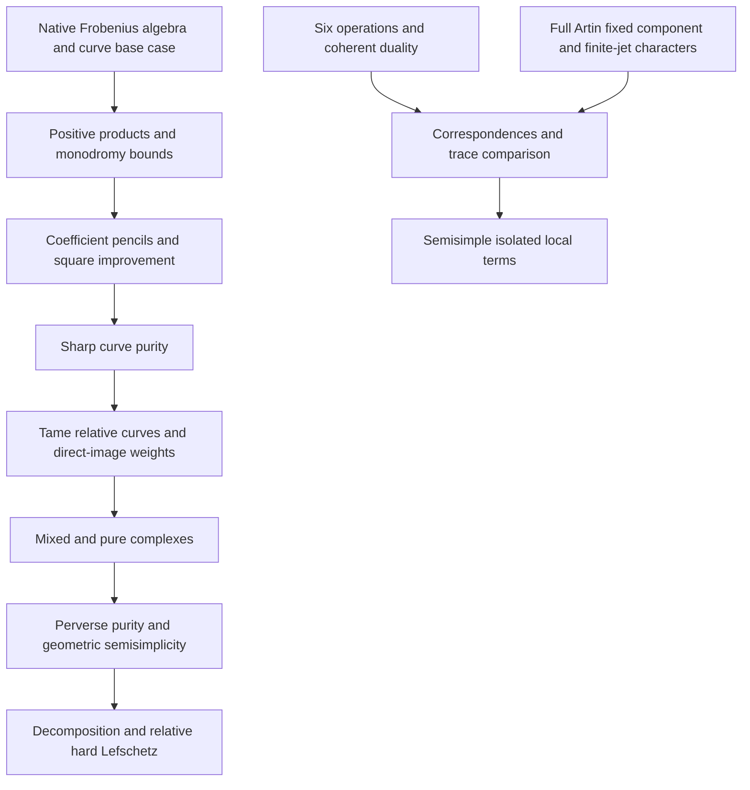

# Étale weights, perverse decomposition and scheme trace formulas

This part plans EDC.7 and EDC.8. Its targets run from finite-dimensional Frobenius weights through perverse purity, the decomposition theorem and relative hard Lefschetz to correspondence traces and isolated fixed-point local terms. All geometric objects are the actual categories and scheme constructions supplied by the earlier EDC layers. The scheme results do not by themselves provide stack, perfect or equivariant transport.

The Weil-weight foundations needed for perverse purity are owned here at tier 10. DeligneWeightsAndPurity imports them at tier 11. The provenance inventory is in the packet’s `ownershipTransfers` and the revision handoff; the smaller positivity and reduction lemmas are proof steps, and scheme Frobenius is imported from SF.0. Current Tau Ceti roadmaps supply the existing algebraic-group, compact-character, Dirichlet-series and pointed-Jacobian interfaces. Exact additions beyond their present scope are identified as Part II contracts below.

Both stages have a target-level plan with exact supplier obligations. The Suggested file states native numeric, categorical and linear-algebra results; its proof placeholders do not claim implementation. Schemes, sheaves, arithmetic models and their operations have the detailed target specifications below.

## Conventions

- Weights are owned by the EDC.7 weight foundations below: integer Weil weights and fixed-ι real weights are distinct. K has weights ≤w when ℋ^iK has punctual weights ≤w+i; ≥w means DK≤−w. Geometric Frobenius on ℚ̄_ℓ(1) is q⁻¹, so Tate twist r subtracts 2r; shifting by m adds m.
- Perverse normalisation: IC_X(L) = j_!*(L[d]) with no Tate half-twist; L lisse punctually pure of weight w gives IC of weight w + d.
- Coefficients: ℚ̄_ℓ as the 2-colimit over finite E/ℚ_ℓ of the rational adic categories of EDC.6; finite-field arithmetic objects carry an index 0 (X₀, F₀), their pullbacks to 𝔽̄_q drop it.
- Cohomological correspondences: u : c₁^*F₁ → c₂^!F₂ (pull back along the first leg); the graph-type correspondence of g is (g, id), whose c-morphisms are u : g^*F → F; the n-th Frobenius twist is (Fr^n ∘ c₁, c₂).
- Duality data for the functional equation: Δ := ∏_i det(F_i)^{(−1)^i}, so Δ² = q^{dχ}, the convention of WeilConjectures:WC.2.

## Dependency structure

The essential weight path is scalar/root arithmetic → curve Frobenius base case → positive Euler-product comparison and monodromy bounds → coefficient pencil square improvement → sharp curve purity → tame relative-curve reduction → direct-image weights → mixed/pure complexes. Perverse geometric semisimplicity and splitting then give proper decomposition and relative hard Lefschetz. The square improvement does not invoke the direct-image theorem that it establishes. No prerequisite imports DWP or FunctionFieldArithmetic.

For isolated semisimple fixed points, use the **full Artin fixed component**, including nilpotents. Its finite jet is a rational representation of the diagonalizable cyclic closure. The square-zero fixed ideal has only nontrivial characters; this kills every positive-degree generator in the cone’s fixed quotient. The trace theorem applies to that proper component. This argument avoids both the false reduced-point cone implication and an unproved invariant affine neighbourhood for a nonnormal scheme.

## EDC.7 targets

### Embeddings into ℂ extending a given embedding, and isomorphisms ℚ̄_ℓ ≅ ℂ

**Target:** `EtaleDualityAndPerverseSheaves:EDC.7/weight-embeddings-into-the-complex-numbers` (theorem).

(i) Let E be a field of characteristic 0 with #E ≤ 𝔠, k ⊆ E a countable subfield, and σ : k → ℂ a field homomorphism. Then σ extends to a field homomorphism E → ℂ. (ii) If moreover E is algebraically closed with #E = 𝔠, then σ extends to a field isomorphism E ≅ ℂ. (iii) For every prime ℓ, #ℚ_ℓ = #ℚ̄_ℓ = 𝔠. So field isomorphisms ι : ℚ̄_ℓ ≅ ℂ exist, and every embedding into ℂ of a number field K ⊂ ℚ̄_ℓ extends to one. (iv) If α ∈ E is transcendental over ℚ, then for every transcendental z ∈ ℂ there is a field homomorphism ι : E → ℂ with ι(α) = z, which is an isomorphism in case (ii).

**Hypotheses and scope.**

- The extensions are not continuous for the ℓ-adic topology and are not canonical. Their existence uses transcendence bases, hence the axiom of choice. Deligne notes in Weil II (1.2.11) that for algebraicity statements the embeddings of the algebraic numbers suffice, and those need no choice.
- Countability of k leaves room: ℂ has transcendence degree 𝔠 over σ(k), at least that of E over k.
- (ii) needs #E = 𝔠, not only #E ≤ 𝔠: a countable algebraically closed field is not isomorphic to ℂ.

**Proof plan.**

1. Transcendence degrees: for a countable subfield k, a transcendence basis of ℂ over σ(k) has cardinality 𝔠 (mathlib:IsAlgClosed.cardinal_eq_cardinal_transcendence_basis_of_aleph0_lt with mathlib:Cardinal.mk_complex). A transcendence basis of E over k has cardinality at most #E ≤ 𝔠.
2. Choose a transcendence basis B of E over k and an injection of B into a transcendence basis of ℂ over σ(k). This gives k(B) → ℂ extending σ.
3. E is algebraic over k(B); extend to E → ℂ by mathlib:IsAlgClosed.lift.
4. For (ii), give ℂ its k-algebra structure through σ. Matching transcendence bases produces an equivalence of their rational-function fields over k: the aeval equivalences and variable renaming in IsAlgClosed.equivOfTranscendenceBasis all respect constants. Extend it to the two algebraic closures using IsAlgClosure.equivOfEquiv. The pinned IsAlgClosure.equivOfEquiv_algebraMap states that this extension agrees with the given field equivalence on the algebra maps; applying it to constants proves that the final E≅ℂ restricts to σ. Thus prescribed-base compatibility is an exposed native theorem, rather than an unresolved auxiliary result.
5. (iii): #ℤ_ℓ ≥ 𝔠, because (a_i) ↦ Σ a_i ℓ^i is injective on sequences in {0, 1}. #ℚ_ℓ ≤ 𝔠, because ℚ_ℓ is a quotient of a set of sequences of rationals. #ℚ̄_ℓ = #ℚ_ℓ by mathlib:Algebra.IsAlgebraic.cardinalMk_le_max.
6. (iv): apply (i) or (ii) to k = ℚ(α) with σ : ℚ(α) ≅ ℚ(z), α ↦ z.

**Checks and worked examples.**

- Isomorphisms ℚ̄_5 ≅ ℂ exist, and a given embedding of ℚ(√−1) ⊂ ℚ̄_5 into ℂ extends to one.
- No such isomorphism is continuous: ℓ^n → 0 in ℚ̄_ℓ, while ι(ℓ^n) = ℓ^n → ∞ in ℂ.
- Prescribing either embedding of ℚ(√−1) sends i to the chosen sign of i; an arbitrary characteristic-zero field isomorphism without this restriction would fail this test.

**Prerequisites.**

- `mathlib:IsAlgClosed.cardinal_eq_cardinal_transcendence_basis_of_aleph0_lt`
- `mathlib:Cardinal.mk_complex`
- `mathlib:IsAlgClosed.lift`
- `mathlib:IsAlgClosed.equivOfTranscendenceBasis`
- `mathlib:IsAlgClosed.ringEquiv_of_equiv_of_charZero`
- `mathlib:Algebra.IsAlgebraic.cardinalMk_le_max`
- `mathlib:IsAlgClosure.equivOfEquiv_algebraMap`

**Sources.**

- **Deligne-WeilII-1980**, §1.2, Remarque (1.2.11), p. 156: ι is an expository device, and its existence depends on choice.
- **Deligne-WeilII-1980**, §1.2, Remarque (1.2.11), p. 156: Embeddings of the algebraic numbers alone need no choice.

**Ownership provenance:** `DeligneWeightsAndPurity:DWP.0/embeddings-into-the-complex-numbers`.

### Weil q-numbers of integer weight

**Target:** `EtaleDualityAndPerverseSheaves:EDC.7/weight-weil-q-number` (definition).

Fix a real number q > 1 and n ∈ ℤ. An element α of a field K of characteristic 0 is a Weil q-number of weight n (Deligne: pure of weight n relative to q) if α is algebraic over ℚ and every complex root of its minimal polynomial over ℚ has absolute value q^{n/2}. The predicate depends only on the minimal polynomial of α. So it is preserved and reflected by every field homomorphism K → K′, and it does not depend on the ambient field or on a chosen splitting field. Equivalently, |σ(α)| = q^{n/2} for every field homomorphism σ : ℚ(α) → ℂ. When K is algebraic over ℚ, it is equivalent to |φ(α)| = q^{n/2} for every field homomorphism φ : K → ℂ. A Weil q-number is nonzero, and its weight is unique. Integrality over ℤ is a separate predicate.

**Hypotheses and scope.**

- Algebraicity is a clause of the definition. In Mathlib's convention the minimal polynomial of a transcendental element is 0 and has no roots, so the conjugate clause alone would hold vacuously.
- q > 1 is what makes the weight unique; for q = 1 a root of unity would have every weight. In the finite-field applications q = #k₀ = p^a, and at a closed point x the base is q_x = q^{deg x}.
- The comparison with all homomorphisms φ : K → ℂ needs K algebraic over ℚ (ℚ̄ or a number field). A field of characteristic 0 of cardinality greater than 𝔠 has no homomorphism to ℂ, and the condition would be vacuous. For K = ℚ̄_ℓ the comparison with isomorphisms ι : ℚ̄_ℓ ≅ ℂ is the theorem weil-number-iff-iota-pure-for-every-iota.
- Weights are integers, as in Weil II (1.2.1). Real weights are the ι-weights of the node iota-weight.

**Uses that determine the interface.**

- `EtaleDualityAndPerverseSheaves:EDC.7/weight-endomorphism-weights` — Weil purity of an endomorphism is this predicate on each eigenvalue
- `EtaleDualityAndPerverseSheaves:EDC.7/weight-weil-number-arithmetic` — products, inverses and conjugates
- `FiniteFieldsAndCharacterSums:FF.2/additive-l-function-purity` — the reciprocal roots of the L-polynomial are Weil q-numbers of weight 1 (IsWeilNumber.of_aeval_eq_zero)
- `MordellLawrenceVenkatesh:LV.1/faltings-finiteness` — Frobenius eigenvalues as Weil q-numbers, stable under products and inverses
- `PadicDifferentialEquationsAndRigidCohomology:RD.7/weil-factors-rational-and-integral` — Weil q-numbers of integral weight as roots of the rigid Weil factors
- `DeligneWeightsAndPurity:DWP.1` — the all-conjugates bound √q for curves and abelian varieties

**Planning API.** These names specify future interfaces, not declarations supplied at the pins.

| Name | Role | Statement |
| --- | --- | --- |
| `TauCeti.Weights.IsWeilNumber` | data | Algebraicity over ℚ and modulus q^(n/2) at every complex root of the minimal polynomial. |
| `TauCeti.Weights.IsWeilNumber.isAlgebraic` | projection | A Weil q-number is algebraic over ℚ. |
| `TauCeti.Weights.IsWeilNumber.norm_eq` | characterisation | Every field embedding into ℂ sends the Weil number to a number of modulus q^(n/2). |
| `TauCeti.Weights.isWeilNumber_iff_forall_embedding` | characterisation | If the ambient field is algebraic over ℚ, purity is equivalent to the common modulus at every complex embedding. |
| `TauCeti.Weights.isWeilNumber_map_iff` | functoriality | Field homomorphisms preserve and reflect the minimal-polynomial purity predicate. |
| `TauCeti.Weights.IsWeilNumber.of_aeval_eq_zero` | characterisation | If P ∈ ℚ[T] is nonzero, P(α) = 0 and every complex root of P has absolute value q^{n/2}, then α is a Weil q-number of weight n. |
| `TauCeti.Weights.IsWeilNumber.ne_zero` | characterisation | A Weil q-number is nonzero. |
| `TauCeti.Weights.IsWeilNumber.weight_unique` | characterisation | For q>1 a nonzero Weil number has a unique integer weight. |

**Unit tests.**

| Test | Kind | Diagnostic statement |
| --- | --- | --- |
| `TauCeti.Weights.isWeilNumber_roots_T2_sub_T_add_two` | computation | The roots of T² − T + 2 are Weil 2-numbers of weight 1: the discriminant is −7, so the roots (1 ± i√7)/2 are complex conjugate with product 2. |
| `TauCeti.Weights.not_isWeilNumber_one_add_sqrt_two` | non-example | 1 + √2 is a Weil q-number for no q > 1 and no n. Its conjugates 1 ± √2 have absolute values with product 1, forcing n = 0, while \|1 + √2\| ≠ 1. It has absolute value q^{1/2} at one real embedding for q = (1 + √2)², so one embedding does not suffice. |
| `TauCeti.Weights.isWeilNumber_inv_not_isIntegral` | non-example | For an integer q ≥ 2, q⁻¹ ∈ ℚ is a Weil q-number of weight −2 and is not integral over ℤ: purity and integrality are separate predicates. |
| `TauCeti.Weights.isWeilNumber_rootOfUnity` | degenerate | A root of unity is a Weil q-number of weight 0 for every q > 1; 0 is a Weil q-number of no weight. |

**Proof plan.**

1. Conjugates: the field homomorphisms ℚ(α) → ℂ correspond to the complex roots of the minimal polynomial of α, through the adjoin-root presentation of ℚ(α).
2. Invariance: an injective ℚ-algebra map f satisfies minpoly ℚ (f α) = minpoly ℚ α (mathlib:minpoly.algHom_eq), and a ring homomorphism between fields of characteristic 0 is a ℚ-algebra map.
3. All embeddings of K: when K is algebraic over ℚ, each σ : ℚ(α) → ℂ extends to K → ℂ by mathlib:IsAlgClosed.lift applied to K over ℚ(α).
4. Roots of a rational polynomial P with P(α) = 0: the minimal polynomial divides P, so its complex roots are roots of P.
5. Nonvanishing and uniqueness: q^{n/2} > 0, so α ≠ 0. The minimal polynomial has a complex root, and q^{n/2} = q^{m/2} with q > 1 forces n = m.

**Checks and worked examples.**

- i√q is a Weil q-number of weight 1 for every integer q ≥ 2 (its conjugates are ±i√q).
- For q ∈ ℚ with q > 1 and k ∈ ℤ, q^k is a Weil q-number of weight 2k.
- (3 + 4i)/5 is a Weil q-number of weight 0 for every q > 1, but it is neither an algebraic integer nor a root of unity.

**Prerequisites.**

- `mathlib:minpoly.algHom_eq`
- `mathlib:IsAlgClosed.lift`

**Sources.**

- **Deligne-WeilII-1980**, §1.2, Définition (1.2.1), p. 153: The definition: algebraic, with every complex conjugate of absolute value q^{n/2}.
- **Deligne-WeilI-1974**, §1, Lemme (1.7), p. 276: The same condition on Frobenius eigenvalues in Weil I.

**Ownership provenance:** `DeligneWeightsAndPurity:DWP.0/weil-q-number`.

### ι-weights of nonzero elements of a coefficient field

**Target:** `EtaleDualityAndPerverseSheaves:EDC.7/weight-iota-weight` (definition).

Let E be a field, ι : E → ℂ a field homomorphism (not assumed continuous; Deligne takes an isomorphism ι : ℚ̄_ℓ ≅ ℂ), and q > 1 real. For α ∈ E^×, the ι-weight of α relative to q is w_{ι,q}(α) = 2 log_q |ι(α)| ∈ ℝ, so that |ι(α)| = q^{w/2}. α is ι-pure of weight β ∈ ℝ if w_{ι,q}(α) = β. The ι-weight is a group homomorphism E^× → ℝ: w(αβ) = w(α) + w(β) and w(α⁻¹) = −w(α). Moreover w_{ι,q}(q) = 2 when q ∈ ℚ, w_{ι,q^r}(α^r) = w_{ι,q}(α) for r ≥ 1, and w_{ι∘τ,q}(α) = w_{ι,q}(τ(α)) for a field homomorphism τ. A Weil q-number of weight n is ι-pure of weight n for every ι. An element of integer ι-weight need not be algebraic or a Weil q-number.

**Hypotheses and scope.**

- ι need not be continuous and is not canonical; ι-weights depend on ι. Purity for every ι is the theorem weil-number-iff-iota-pure-for-every-iota.
- Weights are real numbers, as Weil II (1.2.8) allows. Restricting to integers would exclude the rank-one real-weight twists above.
- 0 has no ι-weight.
- q > 1 is part of the datum. At a closed point x, the Frobenius is F^{deg x} and the base is q^{deg x}, and w_{ι,q^r}(α^r) = w_{ι,q}(α) keeps the weight unchanged.

**Uses that determine the interface.**

- `EtaleDualityAndPerverseSheaves:EDC.7/weight-endomorphism-weights` — ι-weights of the eigenvalues of an endomorphism
- `EtaleDualityAndPerverseSheaves:EDC.7/weight-twisting-by-rank-one-characters` — a twist by b shifts ι-weights by w_ι(b)
- `PadicDifferentialEquationsAndRigidCohomology:RD.6/pointwise-iota-weights` — the ι-pure and ι-mixed predicates on Frobenius eigenvalues
- `DeligneWeightsAndPurity:DWP.5` — pointwise ι-pure Weil sheaves (Weil II (1.2.6))
- `WeightsInEtaleCohomology:R34.1` — weights for a chosen embedding compared with weights for all embeddings

**Planning API.** These names specify future interfaces, not declarations supplied at the pins.

| Name | Role | Statement |
| --- | --- | --- |
| `TauCeti.Weights.iotaWeight` | constructor | The real number 2 log(\|ια\|)/log(q), with q>1 and α≠0. |
| `TauCeti.Weights.IsIotaPure` | data | Nonvanishing and the specified real ι-weight. |
| `TauCeti.Weights.iotaWeight_mul` | simp | The ι-weight of a product of nonzero scalars is the sum of their weights. |
| `TauCeti.Weights.iotaWeight_inv` | simp | The ι-weight of an inverse is the negative of the weight. |
| `TauCeti.Weights.iotaWeight_pow_base` | simp | Raising α and q to the same positive integer power preserves the ι-weight. |
| `TauCeti.Weights.iotaWeight_comp` | compatibility | Composition of field embeddings transports the ι-weight. |
| `TauCeti.Weights.norm_eq_rpow_iotaWeight` | characterisation | For q>1 and α≠0, the modulus is q raised to half the ι-weight. |
| `TauCeti.Weights.IsWeilNumber.isIotaPure` | compatibility | A Weil number is ι-pure of its integer weight for every complex embedding. |

**Unit tests.**

| Test | Kind | Diagnostic statement |
| --- | --- | --- |
| `TauCeti.Weights.iotaWeight_q` | computation | For q ∈ ℚ with q > 1 and every ι: w_{ι,q}(q) = 2 and w_{ι,q}(q⁻¹) = −2. So ℚ_ℓ(1), on which geometric Frobenius acts by q⁻¹, has weight −2. |
| `TauCeti.Weights.iotaWeight_depends_on_iota` | non-example | For E = ℚ(√2) and q = 2, α = 1 + √2 has ι-weight 2 log₂(1 + √2) at one real embedding and −2 log₂(1 + √2) at the other: the ι-weight depends on ι. |
| `TauCeti.Weights.iotaWeight_transcendental` | non-example | For E=ℚ(t), choose a transcendental complex number z of modulus √2 and send t to z. Then the ι-weight of t relative to 2 is 1, an integer, although t is not algebraic. The numeric test accepts the supplied transcendence and modulus conditions; no Lindemann–Weierstrass theorem is assumed. |
| `TauCeti.Weights.iotaWeight_rootOfUnity` | degenerate | w_{ι,q}(ζ) = 0 for every root of unity ζ ∈ E and every ι. |

**Proof plan.**

1. Real.logb q is a homomorphism from the positive reals under multiplication to ℝ, and α ↦ ‖ι(α)‖ is multiplicative on E^×.
2. logb (q^r) (x^r) = logb q x for r ≥ 1 and x > 0.
3. A Weil q-number α satisfies |ι(α)| = q^{n/2}, because ι(α) is a complex root of the minimal polynomial of α (node weil-q-number).

**Checks and worked examples.**

- ℚ_ℓ(r): the geometric Frobenius acts by q^{−r}, of ι-weight −2r for every ι (Weil I (3.1)).
- α = (1 + i√7)/2 ∈ ℚ̄: ι-weight 1 relative to 2 for every ι.

**Prerequisites.**

- `EtaleDualityAndPerverseSheaves:EDC.7/weight-weil-q-number`

**Sources.**

- **Deligne-WeilII-1980**, §1.2, (1.2.6), p. 154: The arguments run one ι at a time, whence the ι-weight (1.2.6.1).
- **Deligne-WeilII-1980**, §1.2, Remarque (1.2.8), p. 155: ι-weights are allowed to be arbitrary real numbers.

**Ownership provenance:** `DeligneWeightsAndPurity:DWP.0/iota-weight`.

### Eigenvalues, Weil purity and ι-weights of an invertible endomorphism

**Target:** `EtaleDualityAndPerverseSheaves:EDC.7/weight-endomorphism-weights` (definition).

Let E be a field of characteristic 0 with algebraic closure Ē, V a finite-dimensional E-vector space and F an invertible E-linear endomorphism of V. The eigenvalues of F are the roots of its characteristic polynomial det(T − F) in Ē, counted with multiplicity. The multiplicity of α equals the Ē-dimension of the maximal generalized eigenspace of F ⊗ Ē at α. (V, F) is pure of weight n relative to q if every eigenvalue is a Weil q-number of weight n. For a field homomorphism ι : Ē → ℂ, (V, F) is ι-pure of weight β ∈ ℝ if every eigenvalue has ι-weight β, and the ι-weights of (V, F) are the ι-weights of its eigenvalues, a finite subset of ℝ. The multiset of eigenvalues is stable under Aut(Ē/E), so none of these notions depends on the choice of Ē or of a splitting field inside Ē. V = 0 is pure of every weight and has no weights.

**Hypotheses and scope.**

- F must be invertible, since the eigenvalue 0 has no weight. Frobenius on ℓ-adic cohomology over a finite field is invertible; for a general endomorphism this is a hypothesis.
- Weights are read off the characteristic polynomial through generalized eigenspaces. No eigenbasis and no semisimplicity is assumed, and a Jordan block can be pure.
- In the applications E is ℚ_ℓ, a finite extension of it, or ℚ̄_ℓ; Weil II (1.2.4) applies the terminology to vector spaces with a Frobenius.
- The ι-weights depend on ι only through the multiset {ι(α)}. That multiset does not change when the roots are taken in another splitting field inside Ē, because the roots form one Aut(Ē/E)-stable multiset.

**Uses that determine the interface.**

- `EtaleDualityAndPerverseSheaves:EDC.7/weight-purity-under-subquotients-and-extensions` — stability under subobjects, quotients and extensions
- `DeligneWeightsAndPurity:DWP.0/weight-decomposition` — decomposition of V by weight
- `EtaleDualityAndPerverseSheaves:EDC.7/weight-reciprocal-pairing-of-eigenvalues` — weights on the two sides of a perfect pairing
- `DeligneWeightsAndPurity:DWP.2` — the weight of a lisse sheaf on a curve through the Frobenius at each closed point (Weil I (3.1))
- `DeligneWeightsAndPurity:DWP.5` — pointwise purity of Weil sheaves (Weil II (1.2.2), (1.2.6))
- `WeilConjectures:WC.3` — degreewise purity of Frobenius on H^i

**Planning API.** These names specify future interfaces, not declarations supplied at the pins.

| Name | Role | Statement |
| --- | --- | --- |
| `TauCeti.Weights.eigenvalues` | constructor | The characteristic-root multiset in an algebraic closure, of cardinality dim V. |
| `TauCeti.Weights.IsPure` | data | Every characteristic root is a Weil number of the specified integer weight. |
| `TauCeti.Weights.IsIotaPureEnd` | data | Every characteristic root has the specified real ι-weight. |
| `TauCeti.Weights.iotaWeights` | constructor | The finite set of real ι-weights of characteristic roots. |
| `TauCeti.Weights.count_eigenvalues` | characterisation | Root multiplicity is the dimension of its maximal generalized eigenspace after scalar extension. |
| `TauCeti.Weights.eigenvalues_map_aut` | compatibility | The characteristic-root multiset is invariant under every automorphism of the algebraic closure over the coefficient field. |
| `TauCeti.Weights.isPure_baseChange_iff` | compatibility | Purity is preserved and reflected under coefficient field extension; the ι-variant uses compatible closure embeddings. |
| `TauCeti.Weights.IsPure.isIotaPureEnd` | compatibility | Integer purity implies real ι-purity for every ι. |

**Unit tests.**

| Test | Kind | Diagnostic statement |
| --- | --- | --- |
| `TauCeti.Weights.isPure_jordanBlock` | computation | F = [[q, 1], [0, q]] on E² is pure of weight 2 relative to q and is not semisimple: purity does not see Jordan blocks. |
| `TauCeti.Weights.eigenvalues_rotation` | computation | F = [[0, −q], [1, 0]] on ℚ² has characteristic polynomial T² + q, no eigenvalue in ℚ, eigenvalues ±i√q in ℚ̄, and is pure of weight 1. |
| `TauCeti.Weights.not_isPure_diag` | non-example | F = diag(1, q) is not pure; its weights are {0, 2}. |
| `TauCeti.Weights.isPure_zero_space` | degenerate | On V = 0, F is pure of every weight and has no weights. |
| `TauCeti.Weights.iotaWeights_singular_twist_rejection` | non-example | On a one-dimensional zero endomorphism F=0, the total log-based numeric iotaWeights core yields {0}. Multiplication by b=2 leaves F=0, so shifting by w₂(2)=2 would falsely give {2}. All iotaWeights_twist assertions therefore require invertible F; purity itself rejects the zero eigenvalue. |

**Proof plan.**

1. For an F-stable W⊆V choose any vector-space complement, without requiring it F-stable. The resulting upper triangular blocks and Matrix.charpoly_fromBlocks_zero₂₁ give charpoly F=charpoly(F|W)·charpoly(F on V/W); determinants and characteristic-root multisets multiply/add accordingly. This is the exact-sequence API, including nonsplit Jordan extensions.
2. Eigenvalues: the characteristic polynomial commutes with extension of scalars (mathlib:LinearMap.charpoly_baseChange), and over Ē its roots are the eigenvalues (mathlib:Module.End.hasEigenvalue_iff_isRoot_charpoly).
3. Multiplicity: mathlib:LinearMap.finrank_maxGenEigenspace_eq identifies the root multiplicity with the dimension of the maximal generalized eigenspace. These spaces span V ⊗ Ē (mathlib:Module.End.iSup_maxGenEigenspace_eq_top) and are independent (mathlib:Module.End.independent_maxGenEigenspace).
4. Galois stability: det(T − F) has coefficients in E, so every τ ∈ Aut(Ē/E) permutes its roots with multiplicities.
5. Independence of choices: Weil purity depends only on minimal polynomials over ℚ (node weil-q-number), and the multiset of ι-values is invariant by the previous step.

**Checks and worked examples.**

- Jordan block [[q, 1], [0, q]]: pure of weight 2, with a generalized eigenspace of dimension 2 and an eigenspace of dimension 1.
- Frobenius on H¹ of an elliptic curve over 𝔽_q with trace a: characteristic polynomial T² − aT + q, pure of weight 1 because |a| ≤ 2√q (the existing Hasse-bound compatibility case).
- Jordan block [[q, 1], [0, q]] with W = E e₁: F_W = q, F_{V/W} = q, and (T − q)² = (T − q)(T − q).

**Prerequisites.**

- `EtaleDualityAndPerverseSheaves:EDC.7/weight-weil-q-number`
- `EtaleDualityAndPerverseSheaves:EDC.7/weight-iota-weight`
- `mathlib:LinearMap.charpoly_baseChange`
- `mathlib:Module.End.hasEigenvalue_iff_isRoot_charpoly`
- `mathlib:LinearMap.finrank_maxGenEigenspace_eq`
- `mathlib:Module.End.iSup_maxGenEigenspace_eq_top`
- `mathlib:Module.End.independent_maxGenEigenspace`
- `mathlib:Matrix.charpoly_fromBlocks_zero₂₁`
- `mathlib:LinearMap.charpoly_prodMap`

**Sources.**

- **Deligne-WeilI-1974**, §2, (2.6), p. 282: The multiplicity of an eigenvalue is the dimension of its generalized eigenspace.
- **Deligne-WeilII-1980**, §1.2, Variante (1.2.4), p. 154: The weight terminology for vector spaces with a Frobenius.
- **Deligne-WeilII-1980**, §1.2, (1.2.6), p. 154: Every Frobenius module over a finite field is ι-mixed.
- **Deligne-WeilI-1974**, §1, (1.5.3), p. 276: Additivity in short exact sequences, used to prove (1.5.3).

**Ownership provenance:** `DeligneWeightsAndPurity:DWP.0/endomorphism-weights`, `DeligneWeightsAndPurity:DWP.0/characteristic-polynomial-in-short-exact-sequences`.

### The characteristic power series det(1 − tF) and traces of powers

**Target:** `EtaleDualityAndPerverseSheaves:EDC.7/weight-characteristic-power-series-and-traces` (theorem).

Let F be an endomorphism of a finite-dimensional vector space V over a field E. (i) det(1 − tF) ∈ E[t] is the reverse of det(T − F): det(1 − tF) = t^{dim V} det(t⁻¹ − F), and over Ē it is ∏(1 − αt) over the eigenvalues α. (ii) Writing D(t)=det(1−tF), in E[[t]] one has −tD′(t)/D(t)=Σ_{n≥1}Tr(F^n)t^n in every characteristic. When E has characteristic 0 this is t(d/dt)log D(t)⁻¹. (iii) If E has characteristic 0, the traces Tr(F^n) for 1 ≤ n ≤ dim V determine det(1 − tF), hence the eigenvalue multiset.

**Hypotheses and scope.**

- (iii) needs characteristic 0 (characteristic greater than dim V suffices). On 𝔽_p^p, the identity and the zero map have equal traces of all powers.
- The formal logarithm requires characteristic 0 and constant term 1; the quotient D′/D is defined in every characteristic because D(0)=1.

**Proof plan.**

1. (i): mathlib:Matrix.reverse_charpoly identifies the reverse of the characteristic polynomial with det(1 − tM). Over an algebraically closed field the characteristic polynomial is the product of the T − α.
2. (ii): along an F-stable flag over Ē, D(t)=∏(1−αt), so −tD′/D=Σ_α αt/(1−αt)=Σ_{n≥1}Tr(F^n)t^n. Descent is coefficientwise injectivity. Only in characteristic 0 identify this quotient with the formal-log derivative.
3. (iii): Newton's identities. In characteristic 0 the power sums p_n = Tr(F^n) = Σ α_i^n for n ≤ d determine the elementary symmetric functions of the α_i, which are the coefficients of det(1 − tF) up to sign (mathlib:Matrix.trace_eq_sum_roots_charpoly gives p₁ = Σ α_i).

**Checks and worked examples.**

- F = diag(1, q): det(1 − tF) = (1 − t)(1 − qt), and Σ (1 + q^n) t^n = t d/dt (−log(1 − t) − log(1 − qt)).
- Over 𝔽_p, id and 0 on 𝔽_p^p: Tr(F^n) = p = 0 for both, while det(1 − t·id) = (1 − t)^p ≠ 1.

**Prerequisites.**

- `EtaleDualityAndPerverseSheaves:EDC.7/weight-endomorphism-weights`
- `mathlib:Matrix.reverse_charpoly`
- `mathlib:Matrix.trace_eq_sum_roots_charpoly`

**Sources.**

- **Deligne-WeilI-1974**, §1, (1.5.3), p. 275: The identity (1.5.3) between the log-derivative of det(1 − Ft)⁻¹ and the traces of the powers of F.

**Ownership provenance:** `DeligneWeightsAndPurity:DWP.0/characteristic-power-series-and-traces`.

### Purity and weights under subobjects, quotients, extensions and direct sums

**Target:** `EtaleDualityAndPerverseSheaves:EDC.7/weight-purity-under-subquotients-and-extensions` (theorem).

Let F be an invertible endomorphism of V and W ⊆ V an F-stable subspace. (i) (V, F) is pure of weight n if and only if (W, F_W) and (V/W, F_{V/W}) are both pure of weight n; the same holds for ι-purity of weight β. (ii) The ι-weights of V are the union of those of W and of V/W, and likewise for a direct sum. (iii) So the pairs (V, F) that are pure of weight n form a class closed under subobjects, quotients and extensions.

**Hypotheses and scope.**

- F_W and F_{V/W} are invertible when F is: F_W is injective on a finite-dimensional space, and det F = det F_W · det F_{V/W}.
- (i) does not say that an extension of pure objects of the same weight splits: the Jordan block is a non-split extension of (E, q) by (E, q).

**Proof plan.**

1. The lemma characteristic-polynomial-in-short-exact-sequences gives the eigenvalue multiset of V as the sum of those of W and V/W.
2. Purity and ι-weights are conditions on each eigenvalue (node endomorphism-weights).

**Checks and worked examples.**

- V = E², F = diag(1, q), W = E e₂: W has weight 2, V/W has weight 0, and V is not pure.

**Prerequisites.**

- `EtaleDualityAndPerverseSheaves:EDC.7/weight-endomorphism-weights`

**Sources.**

- **Deligne-WeilII-1980**, §1.2, Stabilités (1.2.5)(i), p. 154: Pointwise purity is stable under quotients, subobjects and extensions.

**Ownership provenance:** `DeligneWeightsAndPurity:DWP.0/purity-under-subquotients-and-extensions`.

### Eigenvalues of P(F), F^r and F⁻¹, with multiplicities

**Target:** `EtaleDualityAndPerverseSheaves:EDC.7/weight-spectra-of-polynomials-in-an-endomorphism` (theorem).

Let F be an endomorphism of a finite-dimensional E-vector space V with eigenvalue multiset {α₁, …, α_d} ⊂ Ē, and let P ∈ E[T]. Then the eigenvalue multiset of P(F) is {P(α₁), …, P(α_d)}, with multiplicities. In particular F^r has eigenvalues α_i^r (r ≥ 1), and if F is invertible, F⁻¹ has eigenvalues α_i⁻¹. The maximal generalized eigenspace of F at α is contained in that of P(F) at P(α).

**Hypotheses and scope.**

- The statement is about multisets. Mathlib's spectral mapping theorem (spectrum.map_polynomial_aeval_of_nonempty) is an equality of sets, which loses multiplicities: for F = diag(1, −1) and P = T², the multiset is {1, 1}, while the set is {1}.

**Proof plan.**

1. Extend scalars to Ē (mathlib:LinearMap.charpoly_baseChange). V_Ē is the direct sum of the maximal generalized eigenspaces V_α (mathlib:Module.End.iSup_maxGenEigenspace_eq_top, mathlib:Module.End.independent_maxGenEigenspace), and each is F-stable.
2. On V_α, F − α is nilpotent, and P(F) − P(α) = (F − α)Q(F) with Q ∈ Ē[T]. So P(F) − P(α) is nilpotent on V_α, and the characteristic polynomial of P(F) on V_α is (T − P(α))^{dim V_α}.
3. The characteristic polynomial is multiplicative on the direct sum (mathlib:LinearMap.charpoly_prodMap), and dim V_α is the multiplicity of α (mathlib:LinearMap.finrank_maxGenEigenspace_eq).
4. F⁻¹: on V_α, F⁻¹ − α⁻¹ = −α⁻¹F⁻¹(F − α) is nilpotent. Alternatively, mathlib:Matrix.charpoly_inv gives the characteristic polynomial of the inverse matrix through the reversed polynomial.

**Checks and worked examples.**

- F = diag(1, −1), P = T²: eigenvalues {1, 1}, and F² = id.
- The square of the Jordan block [[q, 1], [0, q]] is [[q², 2q], [0, q²]], with eigenvalue q² of multiplicity 2.

**Prerequisites.**

- `EtaleDualityAndPerverseSheaves:EDC.7/weight-endomorphism-weights`
- `mathlib:LinearMap.charpoly_baseChange`
- `mathlib:Module.End.iSup_maxGenEigenspace_eq_top`
- `mathlib:Module.End.independent_maxGenEigenspace`
- `mathlib:LinearMap.charpoly_prodMap`
- `mathlib:LinearMap.finrank_maxGenEigenspace_eq`
- `mathlib:Matrix.charpoly_inv`

**Sources.**

- **Deligne-WeilI-1974**, §1, (1.5.1), p. 275: Traces of the iterates of Frobenius, whose eigenvalues are the powers of those of F.

**Ownership provenance:** `DeligneWeightsAndPurity:DWP.0/spectra-of-polynomials-in-an-endomorphism`.

### Products, inverses, conjugation and integrality of Weil q-numbers

**Target:** `EtaleDualityAndPerverseSheaves:EDC.7/weight-weil-number-arithmetic` (theorem).

Let q > 1, and let α, β ∈ K be Weil q-numbers of weights n and m. (i) αβ is a Weil q-number of weight n + m, α⁻¹ one of weight −n, and α^k one of weight kn for k ∈ ℤ. (ii) If q is rational, q^k is a Weil q-number of weight 2k for k ∈ ℤ. (iii) If q is rational, then for every field homomorphism σ : K → ℂ the complex conjugate of σ(α) is q^n/σ(α). In particular α + q^n α⁻¹ is a totally real algebraic number. (iv) If α is integral over ℤ, then n ≥ 0, and if moreover n = 0 then α is a root of unity. A sum of Weil q-numbers is not a Weil q-number in general.

**Hypotheses and scope.**

- Products need a common field: the conjugates of αβ are the σ(α)σ(β) for σ : ℚ(α, β) → ℂ, and each such σ restricts to embeddings of ℚ(α) and of ℚ(β).
- Integrality is needed in (iv): (3 + 4i)/5 has weight 0 and is not a root of unity, and q⁻¹ has weight −2.
- (iii) uses q ∈ ℚ so that q^n α⁻¹ lies in K.

**Proof plan.**

1. Common field: every embedding of ℚ(αβ) into ℂ extends to ℚ(α, β) (mathlib:IsAlgClosed.lift), so the conjugates of αβ are products σ(α)σ(β) of conjugates taken with the same σ.
2. Inverses and powers: |σ(α)⁻¹| = q^{−n/2} and |σ(α)^k| = q^{kn/2}.
3. q^k is rational, it is its own only conjugate, and |q^k| = q^{2k/2}.
4. Complex conjugation: σ(α)·conj(σ(α)) = |σ(α)|² = q^n.
5. Integrality: the norm of α from ℚ(α) to ℚ is a nonzero integer of absolute value q^{nd/2}, where d = [ℚ(α) : ℚ]. So q^{nd/2} ≥ 1 and n ≥ 0. For n = 0 every conjugate has absolute value 1, and mathlib:NumberField.Embeddings.pow_eq_one_of_norm_eq_one applied to the number field ℚ(α) makes α a root of unity.

**Checks and worked examples.**

- 1 + i is a Weil 2-number of weight 1, and (1 + i)² = 2i one of weight 2. The sum (1 + i) + 1 = 2 + i has absolute value √5 and is not a Weil 2-number.
- For α = (1 + i√7)/2 and q = 2: α + 2/α = α + ᾱ = 1, totally real as (iii) predicts.
- ζ₅ has weight 0, is integral and is a root of unity; (3 + 4i)/5 has weight 0 and is neither.

**Prerequisites.**

- `EtaleDualityAndPerverseSheaves:EDC.7/weight-weil-q-number`
- `mathlib:IsAlgClosed.lift`
- `mathlib:NumberField.Embeddings.pow_eq_one_of_norm_eq_one`

**Sources.**

- **Deligne-WeilII-1980**, §1.2, Définition (1.2.12), p. 156: Totally real Frobenius polynomials, reached through α + q^n/α.
- **Deligne-WeilII-1980**, §1.2, Remarque (1.2.14), p. 156: A pure object is a direct factor of a totally real one, V ⊕ V^∨(−n), by (iii).

**Ownership provenance:** `DeligneWeightsAndPurity:DWP.0/weil-number-arithmetic`.

### Eigenvalues of exterior powers

**Target:** `EtaleDualityAndPerverseSheaves:EDC.7/weight-eigenvalues-of-exterior-powers` (theorem).

Let F be an endomorphism of a d-dimensional E-space V, with eigenvalues α₁,…,α_d in an algebraic closure, listed with algebraic multiplicity. The eigenvalue multiset of ∧^k F consists of ∏_{i∈I}α_i for all k-element subsets I⊆{1,…,d}, once per subset of positions. In particular ∧^0 F has sole eigenvalue 1, ∧^d F has sole eigenvalue det F, and ∧^k V=0 for k>d. If F is invertible and pure of weight n, ∧^k F is pure of weight kn; real ι-weights are sums over those positions.

**Hypotheses and scope.**

- No semisimplicity is assumed; equal eigenvalues in different positions remain distinct choices.

**Proof plan.**

1. Extend scalars to the algebraic closure and choose an F-stable full flag, giving an upper triangular matrix with diagonal α₁,…,α_d.
2. Use the existing exteriorPower.map and Module.Basis.exteriorPower. The wedge basis indexed by k-element subsets has a triangular induced matrix with diagonal the indicated products. Its characteristic roots give the multiset; scalar extension commutes with the alternating universal property.
3. The empty wedge, top wedge and out-of-range cases follow from the same basis. Products of Weil numbers add weights, and nonzero ι-weights add.

**Checks and worked examples.**

- For diag(1,q,q), ∧² has eigenvalues q,q,q²: positions, rather than distinct scalar values, control multiplicity.
- For the two-dimensional Jordan block with diagonal q, ∧² has sole eigenvalue q² despite nonsemisimplicity.
- The empty wedge has eigenvalue 1, while k>d gives an empty spectrum.

**Prerequisites.**

- `EtaleDualityAndPerverseSheaves:EDC.7/weight-endomorphism-weights`
- `EtaleDualityAndPerverseSheaves:EDC.7/weight-weil-number-arithmetic`
- `EtaleDualityAndPerverseSheaves:EDC.7/weight-iota-weight`
- `mathlib:exteriorPower.map`
- `mathlib:Module.Basis.exteriorPower`
- `mathlib:LinearMap.charpoly_baseChange`

**Sources.**

- **Milne-AbelianVarieties-v2.00**, Chapter II, Corollary 1.5 and Remark 1.6(a), p. 78: The distinct-position products and exterior-power interpretation; the triangular-basis proof supplies the general linear-algebra result.
- **Deligne-WeilII-1980**, §1.5, proof (1.5.3), pp. 164–165: The exterior eigenvalue products used to isolate determinantal weights.

**Ownership provenance:** `DeligneWeightsAndPurity:DWP.0/eigenvalues-of-exterior-powers`.

### Eigenvalues under a Frobenius-equivariant perfect pairing

**Target:** `EtaleDualityAndPerverseSheaves:EDC.7/weight-reciprocal-pairing-of-eigenvalues` (theorem).

Let V and V′ be E-spaces of finite dimension d with invertible endomorphisms F and F′, and ⟨ , ⟩ : V × V′ → E a perfect bilinear pairing with ⟨Fx, F′y⟩ = c⟨x, y⟩ for some c ∈ E^×. Then: (i) under the isomorphism V′ ≅ V^* given by the pairing, F′ corresponds to c·(F⁻¹)^*; (ii) the eigenvalue multiset of F′ is {c/α_i}, and det(T − F′) = (−T)^d det(c/T − F) / det F; (iii) over Ē, the maximal generalized eigenspaces satisfy ⟨V_α, V′_β⟩ = 0 unless αβ = c, and the pairing restricts to a perfect pairing V_α × V′_{c/α} → Ē; (iv) if V is pure of weight n and c is a Weil q-number of weight w, then V′ is pure of weight w − n, and likewise for ι-weights. For V′ = V, the eigenvalue multiset of F is stable under α ↦ c/α.

**Hypotheses and scope.**

- Perfectness is needed: for the zero pairing the equivariance holds for every F′.
- c is the eigenvalue of Frobenius on the target line. For Poincaré duality H^i × H^{2m−i} → H^{2m} ≅ ℚ_ℓ(−m), c = q^m (Weil I (2.4)–(2.5)). The geometric inputs, that cup product commutes with F and that F acts by q^m on H^{2m}, belong to EDC and WC.2.
- No semisimplicity is assumed: (iii) is a statement about generalized eigenspaces.
- The parity of the multiplicity of ±√c for a symmetric or alternating self-pairing, and the sign of the functional equation, are WeilConjectures WC.2's.

**Proof plan.**

1. (i): ⟨x, F′y⟩ = c⟨F⁻¹x, y⟩, so the adjoint of F′ with respect to the pairing is cF⁻¹.
2. (ii): the transpose has the same characteristic polynomial. mathlib:Matrix.charpoly_inv expresses the characteristic polynomial of an inverse through the reversed polynomial, and scaling by c gives the formula. The eigenvalues are the c/α_i by the theorem spectra-of-polynomials-in-an-endomorphism applied to F⁻¹.
3. (iii): ⟨Fx, y⟩ = c⟨x, F′⁻¹y⟩, so ⟨(F − α)^N x, y⟩ = ⟨x, (cF′⁻¹ − α)^N y⟩. For x ∈ V_α take N with (F − α)^N x = 0. On V′_β, cF′⁻¹ − α is c/β − α plus a nilpotent, hence invertible unless αβ = c. So ⟨x, y⟩ = 0 unless αβ = c, and perfectness on the direct sums forces each V_α × V′_{c/α} to be perfect.
4. (iv): c/α is a Weil q-number of weight w − n (theorem weil-number-arithmetic), and w_ι(c/α) = w_ι(c) − w_ι(α).

**Checks and worked examples.**

- A curve of genus g: H⁰ × H² with c = q gives eigenvalue 1 on H⁰ and q on H². H¹ × H¹ is alternating with c = q, so the eigenvalues on H¹ are stable under α ↦ q/α.
- The Jordan block F = [[q, 1], [0, q]] paired with V′ = E² for c = q²: F′ = q²(F⁻¹)^* has eigenvalue q with multiplicity 2 and is again a Jordan block.

**Prerequisites.**

- `EtaleDualityAndPerverseSheaves:EDC.7/weight-endomorphism-weights`
- `EtaleDualityAndPerverseSheaves:EDC.7/weight-spectra-of-polynomials-in-an-endomorphism`
- `EtaleDualityAndPerverseSheaves:EDC.7/weight-weil-number-arithmetic`
- `mathlib:Matrix.charpoly_inv`

**Sources.**

- **Deligne-WeilI-1974**, §2, (2.5), p. 281: Cup product commutes with Frobenius: the equivariance hypothesis.
- **Deligne-WeilI-1974**, §2, (2.5), p. 281: The eigenvalues in the complementary degree are q^m α_j⁻¹, as in (2.4).

**Ownership provenance:** `DeligneWeightsAndPurity:DWP.0/reciprocal-pairing-of-eigenvalues`.

### Eigenvalues of tensor products, contragredients and Hom spaces

**Target:** `EtaleDualityAndPerverseSheaves:EDC.7/weight-spectra-of-tensor-products-and-duals` (theorem).

Let F and G be invertible endomorphisms of finite-dimensional E-spaces V and W, with eigenvalue multisets {α_i} and {β_j}. (i) F ⊗ G on V ⊗_E W has eigenvalue multiset {α_i β_j}. (ii) The transpose F^* on V^* has the eigenvalues of F. The contragredient F^∨ = (F⁻¹)^* has eigenvalues {α_i⁻¹}. (iii) On Hom_E(V, W), the endomorphism u ↦ G ∘ u ∘ F⁻¹ has eigenvalues {β_j α_i⁻¹}. (iv) F^{⊗k} on V^{⊗k} has as eigenvalues the products of k eigenvalues, and det F = ∏ α_i. Consequently, if V is pure of weight n and W of weight m, then V ⊗ W is pure of weight n + m, V^∨ of weight −n, Hom(V, W) of weight m − n, and V^{⊗k} of weight kn. The ι-weights behave in the same way.

**Hypotheses and scope.**

- Dual means the contragredient (F⁻¹)^*, as for representations and for the dual of a lisse sheaf in Weil II (1.2.5)(ii). The transpose F^* has the same eigenvalues as F, not their inverses.
- No semisimplicity is used; multiplicities are dimensions of generalized eigenspaces.

**Proof plan.**

1. Over Ē, V = ⊕ V_α and W = ⊕ W_β (maximal generalized eigenspaces), so V ⊗ W = ⊕ V_α ⊗ W_β.
2. On V_α ⊗ W_β, F ⊗ G − αβ = (F − α) ⊗ G + α(1 ⊗ (G − β)) is a sum of two commuting nilpotent endomorphisms, hence nilpotent. The dimensions multiply.
3. Transpose: in the dual basis the matrix of F^* is the transpose, which has the same characteristic polynomial (mathlib:LinearMap.det_dualMap for the determinant). The contragredient is the transpose of F⁻¹, whose eigenvalues are given by the theorem spectra-of-polynomials-in-an-endomorphism.
4. Hom(V, W) ≅ V^* ⊗ W, and u ↦ GuF⁻¹ corresponds to F^∨ ⊗ G.
5. Consistency checks: det(A ⊗ B) = det(A)^{dim W} det(B)^{dim V} (mathlib:Matrix.det_kronecker) and Tr(F ⊗ G) = Tr F · Tr G (mathlib:LinearMap.trace_tensorProduct').
6. Weights: products and inverses of Weil q-numbers (theorem weil-number-arithmetic), and additivity of ι-weights.

**Checks and worked examples.**

- diag(1, q) ⊗ diag(1, q) = diag(1, q, q, q²), with weights 0, 2, 2, 4.
- The contragredient of ℚ_ℓ(1) is ℚ_ℓ(−1): the eigenvalue q⁻¹ becomes q, and the weight −2 becomes 2.

**Prerequisites.**

- `EtaleDualityAndPerverseSheaves:EDC.7/weight-endomorphism-weights`
- `EtaleDualityAndPerverseSheaves:EDC.7/weight-spectra-of-polynomials-in-an-endomorphism`
- `EtaleDualityAndPerverseSheaves:EDC.7/weight-weil-number-arithmetic`
- `mathlib:Matrix.det_kronecker`
- `mathlib:LinearMap.trace_tensorProduct'`
- `mathlib:LinearMap.det_dualMap`

**Sources.**

- **Deligne-WeilII-1980**, §1.2, Stabilités (1.2.5)(ii), p. 154: Tensor products add weights.
- **Deligne-WeilII-1980**, §1.2, Stabilités (1.2.5)(ii), p. 154: The dual of a pure lisse sheaf of weight n is pure of weight −n.

**Ownership provenance:** `DeligneWeightsAndPurity:DWP.0/spectra-of-tensor-products-and-duals`.

### Twists V^{(b)} and Tate twists V(r)

**Target:** `EtaleDualityAndPerverseSheaves:EDC.7/weight-twisting-by-rank-one-characters` (construction).

For b ∈ E^× and an E-space V with invertible F, the twist is V^{(b)} = (V, bF) = V ⊗ E^{(b)}, where E^{(b)} is the rank-one space on which F acts by b (Weil II (1.2.7)). Its eigenvalues are the bα_i, and its ι-weights are those of V shifted by w_{ι,q}(b). With the geometric Frobenius convention, ℚ_ℓ(1) = E^{(q⁻¹)}, and the Tate twist V(r) = V ⊗ ℚ_ℓ(1)^{⊗r} = V^{(q^{−r})} (r ∈ ℤ) shifts weights by −2r. When E contains a square root q^{1/2}, the half twist V^{(q^{−1/2})} shifts weights by −1. It depends on the choice of q^{1/2}: the two choices differ by the twist by −1, of weight 0. Twisting is functorial and exact, satisfies V^{(b)} ⊗ W^{(c)} = (V ⊗ W)^{(bc)}, and dualizes as (V^{(b)})^∨ = (V^∨)^{(b⁻¹)}.

**Hypotheses and scope.**

- Geometric Frobenius: ℚ_ℓ(1) has eigenvalue q⁻¹ and weight −2 (Weil II (1.2.5)(iv)); with arithmetic Frobenius the signs reverse. The comparison with the Galois action on roots of unity is EtaleDualityAndPerverseSheaves EDC.0's.
- b need not be an ℓ-adic unit. For b not a unit, E^{(b)} is a Weil sheaf on Spec 𝔽_q and not an étale sheaf (Weil II (1.1.14), (1.2.7)).
- For b of non-integral ι-weight the twist shifts ι-weights by a real number. These are the real-weight rank-one twists above, which are distinct from Tate twists.

**Uses that determine the interface.**

- `GlobalShtukasAndFunctionFieldLanglands:GS.1/modified-commutativity-and-tate-twist` — the half Tate twist and the correction factor q^{−d/2}
- `DeligneWeightsAndPurity:DWP.5` — rank-one real-weight twists
- `WeilConjectures:WC.2` — the Tate twist in the Poincaré pairing H^i × H^{2d−i} → ℚ_ℓ(−d)
- `EtaleDualityAndPerverseSheaves:EDC.7/weight-reciprocal-pairing-of-eigenvalues` — a pairing into E^{(c)}

**Planning API.** These names specify future interfaces, not declarations supplied at the pins.

| Name | Role | Statement |
| --- | --- | --- |
| `TauCeti.Weights.twist` | constructor | Multiply the invertible Frobenius endomorphism by a nonzero scalar b. |
| `TauCeti.Weights.tateTwist` | constructor | The integer twist multiplies geometric Frobenius by q^(−r). |
| `TauCeti.Weights.eigenvalues_twist` | characterisation | Multiplication by b multiplies every characteristic root by b. |
| `TauCeti.Weights.iotaWeights_twist` | characterisation | For an invertible endomorphism F, a nonzero scalar twist translates the weight set by the scalar’s ι-weight. The total numeric logarithm at zero does not satisfy this translation rule. |
| `TauCeti.Weights.IsPure.tateTwist` | compatibility | For a positive integral q, an integer Tate twist shifts a pure weight n to n−2r. |
| `TauCeti.Weights.twist_tensor` | compatibility | Scalar twists of tensor factors multiply their scalars. |
| `TauCeti.Weights.twist_twist` | simp | Two successive scalar twists equal the twist by the product. |

**Unit tests.**

| Test | Kind | Diagnostic statement |
| --- | --- | --- |
| `TauCeti.Weights.tateTwist_weight` | computation | ℚ_ℓ(1) = E^{(q⁻¹)} is pure of weight −2, and ℚ_ℓ(r) of weight −2r. |
| `TauCeti.Weights.twist_one` | degenerate | twist 1 F = F, and V(0) = V. |
| `TauCeti.Weights.halfTwist_depends_on_sqrt` | non-example | The half twist depends on the square root: for V = E and F = 1, the choices q^{1/2} and −q^{1/2} give eigenvalues q^{−1/2} and −q^{−1/2}, non-isomorphic Frobenius modules, both of weight −1. |
| `TauCeti.Weights.twist_nonintegral_weight` | non-example | For b with w_{ι,q}(b) = 1/2, for instance b transcendental with \|ι(b)\| = q^{1/4}, E^{(b)} is ι-pure of the non-integral weight 1/2 and is not pure in the sense of Weil numbers. |

**Proof plan.**

1. Eigenvalues: det(T − bF) = b^d det(T/b − F), or the theorem spectra-of-tensor-products-and-duals with the rank-one factor E^{(b)}.
2. Weights: w_ι(bα) = w_ι(b) + w_ι(α) (node iota-weight). For Weil numbers, q^{−r}α has weight n − 2r (theorem weil-number-arithmetic).
3. Functoriality, exactness and the tensor and dual formulas hold on underlying spaces, where the twist is the identity.

**Checks and worked examples.**

- H²(ℙ¹) = ℚ_ℓ(−1) has F = q and weight 2; its twist H²(ℙ¹)(1) is ℚ_ℓ with F = 1 and weight 0.

**Prerequisites.**

- `EtaleDualityAndPerverseSheaves:EDC.7/weight-iota-weight`
- `EtaleDualityAndPerverseSheaves:EDC.7/weight-weil-number-arithmetic`
- `EtaleDualityAndPerverseSheaves:EDC.7/weight-spectra-of-tensor-products-and-duals`
- `EtaleDualityAndPerverseSheaves:EDC.0`
- `EtaleDualityAndPerverseSheaves:EDC.0/tate-twist`

**Sources.**

- **Deligne-WeilII-1980**, §1.2, (1.2.7), p. 154: The rank-one Weil sheaf on which F acts by b.
- **Deligne-WeilII-1980**, §1.2, Stabilités (1.2.5)(iv), p. 154: ℚ_ℓ(1) is pointwise pure of weight −2.

**Ownership provenance:** `DeligneWeightsAndPurity:DWP.0/twisting-by-rank-one-characters`.

### Weil numbers under powers: change of q to q^r

**Target:** `EtaleDualityAndPerverseSheaves:EDC.7/weight-weil-number-base-extension` (theorem).

Let q > 1, n ∈ ℤ and r ≥ 1. An element α of K is a Weil q-number of weight n if and only if α^r is a Weil q^r-number of weight n.

**Hypotheses and scope.**

- r ≥ 1. The backward implication needs algebraicity of α, which follows from that of α^r, since α is a root of T^r − α^r.
- In the finite-field applications, a finite extension of k₀ of degree r replaces the geometric Frobenius F by F^r and q by q^r. At a closed point x of degree d, F_x = F^d and q_x = q^d.

**Proof plan.**

1. Every embedding τ : ℚ(α^r) → ℂ extends to σ : ℚ(α) → ℂ (mathlib:IsAlgClosed.lift), and then τ(α^r) = σ(α)^r. Conversely, σ(α)^r is a conjugate of α^r.
2. |σ(α)|^r = (q^r)^{n/2} if and only if |σ(α)| = q^{n/2}, since x ↦ x^r is injective on [0, ∞).
3. α is algebraic over ℚ if and only if α^r is.

**Checks and worked examples.**

- α = 1 + i (q = 2, weight 1): α² = 2i is a Weil 4-number of weight 1, since |2i| = 2 = 4^{1/2}.
- 1 and ζ₃ have the same cube and both have weight 0: the power forgets the difference between α and ζα, but not the weight.

**Prerequisites.**

- `EtaleDualityAndPerverseSheaves:EDC.7/weight-weil-q-number`
- `mathlib:IsAlgClosed.lift`

**Sources.**

- **Deligne-WeilI-1974**, §1, (1.5.1), p. 275: Extension of the finite field replaces F by its iterates.
- **Deligne-WeilII-1980**, §1.1, (1.1.13), p. 152: The Frobenius at a point of degree d maps to the d-th power of the Frobenius substitution.

**Ownership provenance:** `DeligneWeightsAndPurity:DWP.0/weil-number-base-extension`.

### Weights under a finite extension of the finite base field

**Target:** `EtaleDualityAndPerverseSheaves:EDC.7/weight-finite-field-base-extension-of-weights` (theorem).

Let F be an invertible endomorphism of V, q > 1 and r ≥ 1. (V, F) is pure of weight n relative to q if and only if (V, F^r) is pure of weight n relative to q^r. For every ι, the ι-weights of F relative to q equal the ι-weights of F^r relative to q^r, with multiplicities. In the finite-field situation, passing from k₀ = 𝔽_q to its extension of degree r replaces the geometric Frobenius F by F^r and q by q^r, so the weights do not change. At a closed point x, F_x = F^{deg x} acts with base q_x = q^{deg x}.

**Hypotheses and scope.**

- The equivalence concerns weights only: F^r can have a repeated eigenvalue where F has distinct ones (α and ζα with ζ^r = 1).

**Proof plan.**

1. The theorem spectra-of-polynomials-in-an-endomorphism with P = T^r: the eigenvalues of F^r are the α_i^r.
2. The theorem weil-number-base-extension for Weil purity, and iotaWeight_pow_base (node iota-weight) for ι-weights.

**Checks and worked examples.**

- F = [[0, −q], [1, 0]] has eigenvalues ±i√q, of weight 1 relative to q. F² = −q·id has eigenvalue −q twice, of weight 1 relative to q².

**Prerequisites.**

- `EtaleDualityAndPerverseSheaves:EDC.7/weight-weil-number-base-extension`
- `EtaleDualityAndPerverseSheaves:EDC.7/weight-iota-weight`
- `EtaleDualityAndPerverseSheaves:EDC.7/weight-spectra-of-polynomials-in-an-endomorphism`

**Sources.**

- **Deligne-WeilII-1980**, §1.1, (1.1.13), p. 152: The Frobenius at a point of degree d maps to the d-th power of the Frobenius substitution.

**Ownership provenance:** `DeligneWeightsAndPurity:DWP.0/finite-field-base-extension-of-weights`.

### Algebraicity and Weil purity from ι-purity at every ι

**Target:** `EtaleDualityAndPerverseSheaves:EDC.7/weight-weil-number-iff-iota-pure-for-every-iota` (theorem).

Let E be a field of characteristic 0 with #E ≤ 𝔠 (for instance a finite extension of ℚ_ℓ, or ℚ̄_ℓ), q > 1 and n ∈ ℤ. For α ∈ E the following are equivalent: (a) α is a Weil q-number of weight n; (b) |ι(α)| = q^{n/2} for every field homomorphism ι : E → ℂ. If E is algebraically closed with #E = 𝔠, (b) may be restricted to field isomorphisms ι : E ≅ ℂ. In particular, an endomorphism that is ι-pure of weight n for every ι is pure of weight n.

**Hypotheses and scope.**

- The cardinality bound is needed: a field of characteristic 0 of cardinality greater than 𝔠 has no homomorphism to ℂ, and (b) would be vacuous.
- (b) for a single ι does not imply (a): see the tests of the node iota-weight.

**Proof plan.**

1. (a) ⇒ (b): ι(α) is a complex root of the minimal polynomial of α (node weil-q-number).
2. (b) ⇒ α algebraic: if α were transcendental, part (iv) of the lemma embeddings-into-the-complex-numbers gives ι with ι(α) = z for any transcendental z; all but countably many complex numbers are transcendental, so z can be chosen with |z| ≠ q^{n/2}.
3. (b) ⇒ the conjugate condition: every σ : ℚ(α) → ℂ extends to E → ℂ, by part (i) of the lemma with k = ℚ(α), which is countable. So |σ(α)| = q^{n/2}.
4. Isomorphism variant: use part (ii) of the lemma in both steps.

**Checks and worked examples.**

- A root α ∈ ℚ̄_5 of T² − T + 2 satisfies |ι(α)| = √2 for every ι : ℚ̄_5 ≅ ℂ.
- A transcendental t ∈ ℚ_5 (one exists, since #ℚ_5 = 𝔠) is ι-pure of weight 0 relative to 5 for an ι with ι(t) = e^{i}, and of weight 2 for an ι with ι(t) = 5e^{i}.

**Prerequisites.**

- `EtaleDualityAndPerverseSheaves:EDC.7/weight-weil-q-number`
- `EtaleDualityAndPerverseSheaves:EDC.7/weight-iota-weight`
- `EtaleDualityAndPerverseSheaves:EDC.7/weight-embeddings-into-the-complex-numbers`

**Sources.**

- **Deligne-WeilII-1980**, §1.2, (1.2.6), p. 154: Purity at every ι forces algebraicity.
- **Deligne-WeilII-1980**, §1.2, (1.2.6), p. 154: For transcendental α, ι(α) could be any transcendental number.

**Ownership provenance:** `DeligneWeightsAndPurity:DWP.0/weil-number-iff-iota-pure-for-every-iota`.

### Milne II.1.3: α†α = r forces |a|² = r for the roots of P_α

**Target:** `EtaleDualityAndPerverseSheaves:EDC.7/weight-absolute-values-from-the-rosati-involution` (theorem).

Let A be an abelian variety over a field k with a polarization and Rosati involution †, and α ∈ End⁰(A) with α†α = r ∈ ℤ_{>0}. Then ℚ[α] is a product of fields, stable under †, and † acts on each real factor of ℚ[α] ⊗ ℝ as the identity and on each complex factor as complex conjugation. Every root a of P_α in ℂ satisfies |a|² = r.

**Hypotheses and scope.**

- The positivity of the Rosati involution (AbelianSchemesAndArithmeticModuli A6/rosati-positivity) is the key input. No Tate isogeny theorem and no cohomological purity is used, as RS-17 requires.
- ℚ[α] is commutative. A factor of ℚ[α] ⊗ ℝ with † trivial is ℝ, and † is conjugation on each factor ℂ.

**Proof plan.**

1. ℚ[α] has no nonzero nilpotents. For a ≠ 0 put b = a†a; then Tr(b) > 0 (Rosati positivity), b† = b and Tr(b²) = Tr(b†b) > 0, so b² ≠ 0, b⁴ ≠ 0, and so on. Hence ℚ[α] is a product of fields K_i.
2. † is an automorphism of ℚ[α] (α† = rα⁻¹ ∈ ℚ[α]). It permutes the factors, and positivity forces it to preserve each one: otherwise Tr(aa†) would vanish on a single factor.
3. On ℚ[α] ⊗ ℝ = ∏ ℝ × ∏ ℂ, † is a positive involution of each factor: the identity on ℝ, and complex conjugation on ℂ (the identity of ℂ is not positive: Tr(i·i) < 0).
4. For every σ : ℚ[α] → ℂ, σ(α†) = conj(σ(α)), so r = σ(α†α) = |σ(α)|². So the roots of the minimal polynomial of α have |·|² = r, and by AbelianSchemesAndArithmeticModuli A6/trace-and-degree-on-a-subfield (10.24) the roots of P_α are among them.

**Checks and worked examples.**

- For n ∈ ℤ with n≠0, α = [n] on any A: [n]†[n] = n², and P_{[n]} = (X − n)^{2g} has roots of absolute value |n|.

**Prerequisites.**

- `AbelianSchemesAndArithmeticModuli:A6/rosati-positivity`
- `AbelianSchemesAndArithmeticModuli:A6/trace-and-degree-on-a-subfield`
- `AbelianSchemesAndArithmeticModuli:A2/rosati-involution`
- `AbelianSchemesAndArithmeticModuli:A6/characteristic-polynomial-of-an-endomorphism`

**Sources.**

- **Milne-AbelianVarieties-v2.00**, Chapter II, Lemma 1.3, p. 77: Lemma 1.3: α†α = r implies |a|² = r for the roots of P_α.
- **Milne-AbelianVarieties-v2.00**, Chapter II, Lemma 1.3, p. 77: ℚ[α] has no nonzero nilpotents.

**Ownership provenance:** `DeligneWeightsAndPurity:DWP.1/absolute-values-from-the-rosati-involution`.

### Milne II.1.2: π†π = q

**Target:** `EtaleDualityAndPerverseSheaves:EDC.7/weight-rosati-of-the-frobenius-endomorphism` (theorem).

Let A be an abelian variety over 𝔽_q, λ a polarization of A defined over 𝔽_q, and † the Rosati involution of λ. Then π_A^† ∘ π_A = q in End⁰(A), that is π_A^∨ ∘ λ ∘ π_A = q·λ.

**Hypotheses and scope.**

- λ must be defined over 𝔽_q, so that it commutes with the Frobenius. A polarization over 𝔽_q exists, since A is projective over 𝔽_q (requested from AbelianSchemesAndArithmeticModuli A2).
- This is where the Frobenius–Verschiebung relation enters, as RS-17 keeps it: π^∨ corresponds to the Verschiebung through λ.
- Import the scheme q-Frobenius from SF.0: it commutes with maps over 𝔽_q; its mth iterate fixes exactly the geometric points rational over 𝔽_(q^m). After constant extension of degree m the relative Frobenius is that iterate. On an abelian variety this supplied scheme map is a group endomorphism; no second Frobenius construction is owned here.

**Proof plan.**

1. With λ = φ_D for an ample divisor D (over 𝔽̄_q): λ(a) = [t_a^*D − D].
2. For any divisor D′ over 𝔽_q, π^*D′ = qD′: locally D′ = div f and f ∘ π = f^q.
3. For a ∈ A(𝔽̄_q): (π^∨λπ)(a) = [π^*t_{π(a)}^*D − π^*D] = [t_a^*π^*D − π^*D] = [t_a^*(qD) − qD] = qλ(a), using π ∘ t_a = t_{π(a)} ∘ π.

**Checks and worked examples.**

- An elliptic curve with λ the principal polarization: π† = π̂, and π̂π = [q] = deg π.
- On ℙ¹ over 𝔽_q, π is [x : y] ↦ [x^q : y^q], and its fixed points are the q + 1 points of ℙ¹(𝔽_q).
- For an elliptic curve E over 𝔽_q, π_E is the q-power Frobenius endomorphism, and 1 − π_E is separable.

**Prerequisites.**

- `AbelianSchemesAndArithmeticModuli:A2/rosati-involution`
- `AbelianSchemesAndArithmeticModuli:A2`
- `EtaleDualityAndPerverseSheaves:EDC.7/weight-finite-field-base-extension-of-weights`
- `SchemeAndStackFoundations:SF.0`

**Sources.**

- **Milne-AbelianVarieties-v2.00**, Chapter II, Lemma 1.2, p. 76: Lemma 1.2: π†π = q for the Rosati involution.
- **Milne-AbelianVarieties-v2.00**, Chapter II, §1, p. 75: π_V is the identity on the space and f ↦ f^q on functions.
- **Milne-AbelianVarieties-v2.00**, Chapter II, §1, p. 75: π_A fixes 0, so it is an endomorphism.

**Ownership provenance:** `DeligneWeightsAndPurity:DWP.1/rosati-of-the-frobenius-endomorphism`, `DeligneWeightsAndPurity:DWP.1/frobenius-endomorphism-over-a-finite-field`.

### The Weil estimate for abelian varieties over 𝔽_q

**Target:** `EtaleDualityAndPerverseSheaves:EDC.7/weight-weil-estimate-for-abelian-varieties` (theorem).

Let A be an abelian variety of dimension g over 𝔽_q. Every root of the characteristic polynomial P_{π_A} ∈ ℤ[X] is a Weil q-number of weight 1: all its complex conjugates have absolute value q^{1/2}. Equivalently, for every ℓ ∤ q, the geometric Frobenius on H¹(A_{𝔽̄_q}, ℚ_ℓ) is pure of weight 1, and the geometric Frobenius on V_ℓA is pure of weight −1. The same holds for π_A^m relative to q^m.

**Hypotheses and scope.**

- This is the independent abelian-variety proof recorded in RS-17. It uses the polarization, Rosati positivity and π†π = q. It depends on no Tate isogeny theorem and no direct-image weight theorem.
- The statement on H¹ and V_ℓA uses the comparison of the Frobenius conventions: π_A acts on V_ℓA as the arithmetic Frobenius, and on H¹ = (V_ℓA)^∨ the geometric Frobenius has characteristic polynomial P_{π_A} (ArithmeticGaloisRepresentations R01.6; AbelianSchemesAndArithmeticModuli A4).

**Proof plan.**

1. π†π = q (theorem rosati-of-the-frobenius-endomorphism).
2. Theorem absolute-values-from-the-rosati-involution with α = π and r = q: every complex root of P_π has absolute value q^{1/2}. P_π ∈ ℤ[X], so the roots are algebraic and every conjugate is again a root, so they are Weil q-numbers of weight 1 (EDC.7/weight-weil-q-number).
3. On V_ℓA the characteristic polynomial of π is P_π (AbelianSchemesAndArithmeticModuli A6/characteristic-polynomial-on-tate-module). The geometric Frobenius acts by π⁻¹ on V_ℓA, of weight −1, and by the transpose of π on H¹, of weight 1.
4. Base extension: π_{A ⊗ 𝔽_{q^m}} = π^m, with roots a_i^m (EDC.7/weight-weil-number-base-extension).

**Checks and worked examples.**

- E: y² = x³ − x over 𝔽_3: P_π = X² + 3, with roots ±i√3 of absolute value √3.
- A supersingular elliptic curve over 𝔽_p with a = 0: roots ±i√p.

**Prerequisites.**

- `EtaleDualityAndPerverseSheaves:EDC.7/weight-rosati-of-the-frobenius-endomorphism`
- `EtaleDualityAndPerverseSheaves:EDC.7/weight-absolute-values-from-the-rosati-involution`
- `AbelianSchemesAndArithmeticModuli:A6/characteristic-polynomial-on-tate-module`
- `EtaleDualityAndPerverseSheaves:EDC.7/weight-weil-q-number`
- `EtaleDualityAndPerverseSheaves:EDC.7/weight-weil-number-base-extension`
- `ArithmeticGaloisRepresentations:R01.6`

**Sources.**

- **Milne-AbelianVarieties-v2.00**, Chapter II, Theorem 1.1(b), p. 75: Theorem 1.1(b): |a_i| = q^{1/2}.
- **Milne-AbelianVarieties-v2.00**, Chapter II, Remark 1.4, p. 78: ℚ[π] is a product of fields, and |σ(π)| = q^{1/2} for every σ.

**Ownership provenance:** `DeligneWeightsAndPurity:DWP.1/weil-estimate-for-abelian-varieties`.

### The weights of H⁰, H¹ and H² of a curve over 𝔽_q

**Target:** `EtaleDualityAndPerverseSheaves:EDC.7/weight-weights-of-the-cohomology-of-curves` (theorem).

Let C be a smooth projective geometrically connected curve of genus g over 𝔽_q, and ℓ ∤ q. Then H⁰(C_{𝔽̄_q}, ℚ_ℓ) = ℚ_ℓ is pure of weight 0, H²(C_{𝔽̄_q}, ℚ_ℓ) ≅ ℚ_ℓ(−1) is pure of weight 2, and H¹(C_{𝔽̄_q}, ℚ_ℓ) ≅ H¹(J_{𝔽̄_q}, ℚ_ℓ) ≅ (V_ℓJ)^∨ is pure of weight 1, with the geometric Frobenius having characteristic polynomial P_{π_J}. The same holds after any finite extension of 𝔽_q.

**Hypotheses and scope.**

- Geometric connectedness makes H⁰ one-dimensional. For a curve whose components are permuted by the Frobenius, H⁰ is a permutation representation, of weight 0 but not trivial.
- H¹(C) ≅ H¹(J) through the Abel–Jacobi map (Milne III.9.6), and H¹(J) ≅ (T_ℓJ)^∨ (AbelianSchemesAndArithmeticModuli A4). These are imported.

**Proof plan.**

1. H⁰: C_{𝔽̄_q} is connected, so H⁰ = ℚ_ℓ with trivial Frobenius action, of weight 0.
2. H²: the trace map H²(C_{𝔽̄_q}, ℚ_ℓ) ≅ ℚ_ℓ(−1), on which the geometric Frobenius acts by q, of weight 2 (EDC.7/weight-twisting-by-rank-one-characters).
3. The étale Abel–Jacobi comparison H¹(J)≅H¹(C) is independent of the geometric base point, since translation acts trivially on H¹. Use the requested base-point-free descent or a finite extension and descent to obtain Frobenius equivariance. H¹(J)=(V_ℓJ)∨, and geometric Frobenius has characteristic polynomial P_{π_J}; its roots have weight 1 by the abelian-variety theorem.

**Checks and worked examples.**

- ℙ¹: H⁰ = ℚ_ℓ (weight 0), H¹ = 0, H² = ℚ_ℓ(−1) (weight 2), and #ℙ¹(𝔽_q) = 1 + q.

**Prerequisites.**

- `EtaleDualityAndPerverseSheaves:EDC.7/weight-weil-estimate-for-abelian-varieties`
- `EtaleDualityAndPerverseSheaves:EDC.7/weight-twisting-by-rank-one-characters`
- `ArithmeticGaloisRepresentations:R01.6`
- `tauceti:TauCetiRoadmap/JacobianChallenge#layer-f-abeljacobi-and-the-universal-property`
- `EtaleDualityAndPerverseSheaves:EDC.7/weight-finite-field-base-extension-of-weights`
- `EtaleDualityAndPerverseSheaves:EDC.2:pairings/extreme-degree-cohomology`

**Sources.**

- **Milne-AbelianVarieties-v2.00**, Chapter III, Remark 11.5, p. 119: H¹(C) = H¹(J) = (T_ℓJ)^∨ and the cohomological form of the fixed-point formula.

**Ownership provenance:** `DeligneWeightsAndPurity:DWP.1/weights-of-the-cohomology-of-curves`.

### The Weil estimate for curves, through the Jacobian

**Target:** `EtaleDualityAndPerverseSheaves:EDC.7/weight-weil-estimate-for-curves` (theorem).

Let C be a smooth projective geometrically connected curve of genus g over 𝔽_q, J its Jacobian, and P_{π_J}(X) = ∏(X − a_i). Then #C(𝔽_{q^m}) = 1 − Σ_i a_i^m + q^m for all m ≥ 1, the a_i are Weil q-numbers of weight 1, |#C(𝔽_{q^m}) − q^m − 1| ≤ 2g·q^{m/2}, and Z(C, t) = P_{π_J}^{rev}(t)/((1 − t)(1 − qt)) with P^{rev}(t) = ∏(1 − a_i t).

**Hypotheses and scope.**

- Geometric connectedness is needed. If C has components defined only over 𝔽_{q^d}, permuted by the Frobenius, the counts change: two conjugate copies of ℙ¹ over 𝔽_{q²} give #C(𝔽_{q^m}) = 0 for m odd and 2(q^m + 1) for m even. RS-17 keeps these component permutations.
- The fixed-point formula (Γ_α · Δ) = 1 − Tr(α′) + deg α is imported (RS-17: the curve and Jacobian trace comparison of TraceFormula Layer 8, requested from SchemeAndStackFoundations SF.2). The source's own proof has a degree calculation that the author explicitly marks unfinished (recorded in sourceIssues).
- Use the requested étale H¹(C)≅H¹(Pic⁰ C) comparison and cohomological trace formula. Milne III.11.2 p.119 footnote 6 flags an unfinished intersection-degree step; that calculation is not certified by this plan. A rational base point is unnecessary: a geometric Abel–Jacobi map commutes with Frobenius up to translation, which acts trivially on H¹.

**Proof plan.**

1. Import the Abel–Jacobi morphism after choosing a geometric base point P, and its étale H¹ comparison. Frobenius need not fix P: f_P∘π_C and π_J∘f_P differ by a translation, whose action on H¹ is trivial. Thus the comparison on H¹ and on the Jacobian Tate module is Frobenius-equivariant. A rational base point is obtained after finite extension wherever the upstream pointed construction requires it; the base-point-free Jacobian descent is an explicit Part II contract.
2. Fixed points: #C(𝔽_q) = (Γ_{π_C} · Δ) = 1 − Tr(π_J) + deg π_C = 1 − Σ a_i + q (Milne III.11.2, imported).
3. Replace q by q^m: the Frobenius of C ⊗ 𝔽_{q^m} is π_C^m, and π_J^m has eigenvalues a_i^m.
4. The a_i are Weil q-numbers of weight 1 (theorem weil-estimate-for-abelian-varieties applied to J), which gives the bound.
5. Z(C, t) = exp(Σ N_m t^m/m) = ∏(1 − a_i t)/((1 − t)(1 − qt)).

**Checks and worked examples.**

- ℙ¹ (g = 0): #ℙ¹(𝔽_{q^m}) = q^m + 1 and Z = 1/((1 − t)(1 − qt)).
- E: y² = x³ − x over 𝔽_3: 1 − (i√3 + (−i√3)) + 3 = 4 = #E(𝔽_3).

**Prerequisites.**

- `EtaleDualityAndPerverseSheaves:EDC.7/weight-weil-estimate-for-abelian-varieties`
- `SchemeAndStackFoundations:SF.2`
- `tauceti:TauCetiRoadmap/JacobianChallenge#layer-f-abeljacobi-and-the-universal-property`
- `EtaleDualityAndPerverseSheaves:EDC.7/weight-finite-field-base-extension-of-weights`

**Sources.**

- **Milne-AbelianVarieties-v2.00**, Chapter III, Theorem 11.1, p. 118: #C(𝔽_q) = 1 − Σa_i + q, and |N − q − 1| ≤ 2g√q.
- **Milne-AbelianVarieties-v2.00**, Chapter III, Corollary 11.4, p. 119: Z(C, t) = P(t)/((1 − t)(1 − qt)).

**Ownership provenance:** `DeligneWeightsAndPurity:DWP.1/weil-estimate-for-curves`.

### The abstract Hadamard–de la Vallée-Poussin theorem

**Target:** `EtaleDualityAndPerverseSheaves:EDC.7/weight-hadamard-de-la-vallee-poussin` (theorem).

Let G be a locally compact extension of Γ=ℤ or ℝ by a compact group G⁰; in the ℤ case the center maps onto a finite-index subgroup of Γ, and in the ℝ case the extension is a product. Fix the norm character ω₁, a countable family of conjugacy classes with norms N_v>1, and absolute convergence of the trivial Euler product for real part >1. Regard L as a function on the representation Riemann surfaces r=ρ⊗ω_s. If it continues meromorphically to real part ≥1 and is holomorphic there except a simple pole at r=ω₁, then it has no zeros on real part 1 except possibly at one representation r=ω₁ε with ε a one-dimensional order-two character. The curve application excludes this exception by the connected double-cover zeta comparison. The norm-character translation is part of the statement, so imaginary twists are not incorrectly assigned separate pole conditions.

**Proof plan.**

1. For Re(s)>1 expand negative logarithmic derivatives as sums of positive Dirac measures on powers of the local classes. Their boundary orders define an integer-valued functional ν on characters with ν(1)=1, ν(nontrivial)≤0, conjugation invariance and ν(ρ⊗ρ̄)≥0.
2. Use Peter–Weyl approximation and normalized compact Haar to test squares of class functions concentrated near the identity. The positivity relations force ν to be supported on at most one nontrivial quadratic character; import the exact finite 3,4,1 coefficient inequality from the arithmetic Dirichlet-series owner, not its whole application.
3. For a curve the quadratic character defines a connected finite étale double cover. Its zeta function and that of the curve both have a simple pole at t=q⁻¹ by the initial curve Weil estimate. Their ratio rules out the exceptional zero. Compactify both geometrically connected curves: the constant H⁰ and H² factors give the simple pole at q⁻¹ and their weight-one H¹ factors are nonzero there. Removing finitely many points does not change that pole. Thus the ratio is finite and nonzero there, requiring no Chebotarev or general Frobenius equidistribution theorem.

**Checks and worked examples.**

- The theorem assumes continuation and the pole data for every relevant irreducible; positivity alone does not manufacture continuation.
- The possible quadratic exception belongs to the abstract theorem and is removed only in its curve application.

**Prerequisites.**

- `EtaleDualityAndPerverseSheaves:EDC.7/weight-weil-estimate-for-curves`
- `tauceti:TauCetiRoadmap/ArithmeticDirichletSeries#layer-8-landau-type-positivity`
- `tauceti:TauCetiRoadmap/RepresentationTheory/CompactGroups#layer-5-the-peter-weyl-theorem`
- `tauceti:TauCetiRoadmap/RepresentationTheory/CompactGroups#layer-6-characters-of-compact-groups`
- `SchemeAndStackFoundations:SF.2`

**Sources.**

- **Deligne-WeilII-1980**, §2.1 (2.1.1)–(2.1.9), pp. 187–191; §2.2 Corollaire (2.2.9), pp. 195–196: The stated result and proof, with the conventions and supplier boundaries specified here.

**Ownership provenance:** `DeligneWeightsAndPurity:DWP.5/hadamard-de-la-vallee-poussin`.

### Specialization of geometric monodromy

**Target:** `EtaleDualityAndPerverseSheaves:EDC.7/weight-specialization-of-monodromy` (theorem).

Let f:X→S be smooth with geometrically connected curve fibres, S reduced irreducible with generic point η, and g:S→X a section. For a lisse ℤ_ℓ-sheaf ℱ, after shrinking S to a nonempty open there is, simultaneously for every n, a lisse subgroup of Aut(g*ℱ/ℓⁿ) whose stalk is the image of the geometric fibre fundamental group. If f has a smooth proper curve compactification with boundary finite étale over S, the image is locally constant without further shrinking under the stated tame conditions; the inertia images at sections of the boundary specialize compatibly. The extension (1.11.5) covers finite-type families after stratification and dévissage, with the model and the locally constant image conditions kept explicit.

**Proof plan.**

1. At finite level construct the finite étale cover representing the kernel. One finite shrinking handles the first level and the tame ramification data.
2. Higher-level kernels in Aut(ℱ/ℓⁿ) are pro-ℓ; their prime-to-p ramification and the specialization theorem for tame fundamental groups give one common open valid for all levels, not a separate open for each n.
3. For the general case spread the finite models and stratify; reduce the comparison to relative curves by general hyperplane sections, preserving the finite-level images.

**Checks and worked examples.**

- A different shrinking for each n would not prove the ℓ-adic statement.
- This theorem supplies the higher-dimensional proof of the geometric abelianization result; it uses no direct-image weight theorem.

**Prerequisites.**

- `ArithmeticGaloisRepresentations:R01.6`
- `InverseGaloisAndArithmeticFundamentalGroups:IG.1`
- `SchemeAndStackFoundations:SF.2`
- `LefschetzPencilsAndVanishingCycles:LPV.5`

**Sources.**

- **Deligne-WeilII-1980**, §1.11 (1.11.1)–(1.11.5), pp. 184–186: The stated result and proof, with the conventions and supplier boundaries specified here.

**Ownership provenance:** `DeligneWeightsAndPurity:DWP.5/specialization-of-monodromy`.

### The Weil group of a finite-field scheme

**Target:** `EtaleDualityAndPerverseSheaves:EDC.7/weight-weil-group` (construction).

For connected X₀/𝔽_q with geometric point x, let W(X₀,x)=π₁(X₀,x)×_{Gal(𝔽̄_q/𝔽_q)}ℤ, where 1∈ℤ maps to geometric Frobenius. Its topology makes the geometric kernel open with its profinite topology and the degree quotient discrete. For geometrically connected X₀ the sequence 1→π₁(X,x)→W(X₀,x)→ℤ→0 is exact. A closed-point geometric Frobenius has degree +deg(x). This degree is the negative of the arithmetic coordinate in Weil I §6.

**Uses that determine the interface.**

- `EtaleDualityAndPerverseSheaves:EDC.7/weight-weil-sheaf` — distinguishes Weil descent from continuous Galois descent
- `DeligneWeightsAndPurity:DWP.10/frobenius-equidistribution` — labels the actual degree fibres

**Planning API.** These names specify future interfaces, not declarations supplied at the pins.

| Name | Role | Statement |
| --- | --- | --- |
| `TauCeti.Weights.WeilGroup` | constructor | The topological pullback group with its projection to π₁ and its geometric-degree homomorphism to ℤ. |
| `TauCeti.Weights.WeilGroup.degree` | projection | The integer degree of a Weil element. |
| `TauCeti.Weights.WeilGroup.geometricKernel` | characterisation | The degree-zero subgroup is the geometric fundamental group for geometrically connected X₀. |
| `TauCeti.Weights.WeilGroup.frobenius_degree` | simp | The local geometric Frobenius has degree deg(x). |
| `TauCeti.Weights.WeilGroup.baseExtension` | functoriality | Over 𝔽_(qᵃ), the Weil group is the subgroup of degrees divisible by a, with the new degree divided by a. |

**Unit tests.**

| Test | Kind | Diagnostic statement |
| --- | --- | --- |
| `TauCeti.Weights.weilGroup_point` | compatibility | For Spec 𝔽_q, W=ℤ with degree the identity and trivial geometric kernel. |
| `TauCeti.Weights.weilGroup_degree_sign` | non-example | A local geometric Frobenius of degree e has Weil II degree e and Weil I arithmetic coordinate −e. |
| `TauCeti.Weights.weilGroup_base_extension_two` | computation | For Spec 𝔽_(q²) over 𝔽_q, arithmetic degrees lie in 2ℤ; degree-one relative Frobenius maps to degree 2. |

**Proof plan.**

1. Use the arithmetic/geometric fundamental sequence supplied by IG.1 and form the group pullback with geometric Frobenius powers. Give each degree coset the translated profinite topology.
2. Restriction from 𝔽_q to 𝔽_p changes the Frobenius generator and the degree by the extension degree; distinguish the corresponding Weil groups rather than identifying their degrees.

**Checks and worked examples.**

- The map to arithmetic π₁ is injective, but the subspace profinite topology on its image is not the Weil topology.

**Prerequisites.**

- `InverseGaloisAndArithmeticFundamentalGroups:IG.1`
- `mathlib:MonoidHom.eqLocus`

**Sources.**

- **Deligne-WeilII-1980**, §1.1 (1.1.7)–(1.1.13.1), pp. 150–153: The stated result and proof, with the conventions and supplier boundaries specified here.

**Ownership provenance:** `DeligneWeightsAndPurity:DWP.5/weil-group`.

### Weil sheaves and étale descent

**Target:** `EtaleDualityAndPerverseSheaves:EDC.7/weight-weil-sheaf` (definition).

A constructible Weil sheaf on X₀/𝔽_q is a constructible ℚ̄_ℓ-sheaf on X=X₀×𝔽̄_q together with compatible Weil descent isomorphisms; equivalently an isomorphism F*ℱ≅ℱ for the chosen geometric-Frobenius descent action. For a lisse sheaf on connected X this is a continuous finite-coefficient-model representation of W(X₀,x). An ordinary étale sheaf requires extension of that representation to continuous π₁(X₀,x); a Frobenius isomorphism alone does not ensure it. On a point a rank-one Weil action with scalar b descends étale exactly when b is an ℓ-adic unit.

**Uses that determine the interface.**

- `EtaleDualityAndPerverseSheaves:EDC.7/weight-punctual-purity-and-mixedness` — the coefficient objects on which weights are defined
- `EtaleDualityAndPerverseSheaves:EDC.7/weight-rank-one-normalization` — real twists may be Weil lines without a specified étale realization

**Planning API.** These names specify future interfaces, not declarations supplied at the pins.

| Name | Role | Statement |
| --- | --- | --- |
| `TauCeti.Weights.WeilSheaf` | data | A geometric constructible sheaf with Weil descent data. |
| `TauCeti.Weights.WeilSheaf.frobenius` | projection | The invertible action on every closed-point stalk, up to conjugacy. |
| `TauCeti.Weights.WeilSheaf.ofEtale` | constructor | Restrict an étale sheaf to Weil descent. |
| `TauCeti.Weights.WeilSheaf.etaleDescent_iff` | characterisation | For a lisse Weil sheaf, étale descent means extension to a continuous arithmetic fundamental-group representation. Constructible non-lisse sheaves instead use sheaf descent data; a single representation does not describe them. |
| `TauCeti.Weights.WeilSheaf.pullback` | functoriality | Pull back descent along an 𝔽_q-morphism, preserving identity and composition. |

**Unit tests.**

| Test | Kind | Diagnostic statement |
| --- | --- | --- |
| `TauCeti.Weights.weilSheaf_nonunit` | non-example | On Spec 𝔽_q the scalar ℓ defines a Weil line which has no étale descent. |
| `TauCeti.Weights.weilSheaf_constant` | computation | The constant line with Frobenius 1 descends étale. |
| `TauCeti.Weights.weilSheaf_tate` | compatibility | For ℓ≠p the Tate line has geometric scalar q⁻¹ and agrees with EDC.0, hence descends étale. |

**Proof plan.**

1. Import the genuine constructible sheaf and coefficient-lattice categories from SF.2/EDC.0, and equip geometric sheaves with descent isomorphisms satisfying the cocycle law.
2. Apply the lisse fibre/representation equivalence. A continuous profinite image is compact; on a point this gives the unit criterion, and the compact closure of the cyclic unit action gives the converse.

**Checks and worked examples.**

- No ambient topology on ℚ̄_ℓ replaces the explicit finite E/ℚ_ℓ model.

**Prerequisites.**

- `EtaleDualityAndPerverseSheaves:EDC.7/weight-weil-group`
- `SchemeAndStackFoundations:SF.2`
- `EtaleDualityAndPerverseSheaves:EDC.0/coefficient-change`
- `ArithmeticGaloisRepresentations:R01.6`

**Sources.**

- **Deligne-WeilII-1980**, §1.1 (1.1.6), (1.1.10)–(1.1.14), pp. 150–153: The stated result and proof, with the conventions and supplier boundaries specified here.

**Ownership provenance:** `DeligneWeightsAndPurity:DWP.5/weil-sheaf`.

### Punctual purity and finite mixed filtrations

**Target:** `EtaleDualityAndPerverseSheaves:EDC.7/weight-punctual-purity-and-mixedness` (definition).

Let ℓ be a prime, X a scheme of finite type over ℤ[1/ℓ], and |X| its set of closed points; each x ∈ |X| has a finite residue field k(x) with N(x) = #k(x) prime to ℓ. A sheaf on X is a constructible ℚ̄_ℓ-sheaf (Weil II 1.1.1–1.1.3); when X is of finite type over 𝔽_q it may also be a Weil sheaf (Weil II 1.1.10). For x ∈ |X|, F_x is the geometric Frobenius of k(x) acting on the stalk ℱ_x̄ at a geometric point over x; its characteristic polynomial does not depend on the geometric point. Use the following predicates: (a) ℱ is punctually pure of weight n ∈ ℤ when, for every x ∈ |X|, every eigenvalue of F_x on ℱ_x̄ is a Weil N(x)-number of weight n (the EDC.7 Frobenius-module weight targets); (b) ℱ is mixed when it has a finite filtration by subsheaves whose successive quotients are punctually pure; the weights of the nonzero quotients are the punctual weights of ℱ, and 'mixed of weights ≤ n' (resp. '≥ n') means that all punctual weights are ≤ n (resp. ≥ n); (c) for a field isomorphism ι : ℚ̄_ℓ ≅ ℂ and β ∈ ℝ, ℱ is punctually ι-pure of weight β when every eigenvalue α of every F_x has ι-weight 2 log_{N(x)} |ια| = β, and ℱ is ι-mixed when it has a finite filtration with punctually ι-pure successive quotients, its punctual ι-weights being those of the nonzero quotients. The zero sheaf is punctually pure of every weight and mixed with empty set of weights. The stabilities of Weil II (1.2.5) hold for (a)–(c): subsheaves, quotients, extensions, inverse images along any morphism of schemes of finite type over ℤ[1/ℓ], direct images along finite morphisms and tensor products (weights add); the dual of a lisse punctually pure sheaf of weight n has weight −n; ℚ̄_ℓ(1) is punctually pure of weight −2, so a Tate twist ℱ(r) shifts weights by −2r. For a morphism Y → S and a closed point s ∈ |S|, the closed points of the fibre Y_s are closed points of Y with the same residue fields, so restriction to Y_s preserves (a)–(c). A mixed sheaf is ι-mixed for every ι, with ι-weights its integer weights.

**Uses that determine the interface.**

- `EtaleDualityAndPerverseSheaves:EDC.7/weight-punctual-purity-and-mixedness` — the common predicates on schemes over ℤ[1/ℓ]
- `EtaleDualityAndPerverseSheaves:EDC.7/weight-sharp-curve-purity` — states the real-weight theorem
- `PadicDifferentialEquationsAndRigidCohomology:RD.6` — imports only numeric predicates; its F-isocrystal stalk category remains its own

**Planning API.** These names specify future interfaces, not declarations supplied at the pins.

| Name | Role | Statement |
| --- | --- | --- |
| `TauCeti.Weights.IsPunctuallyPure` | data | Integer purity at all closed stalks. |
| `TauCeti.Weights.IsPunctuallyIotaPure` | data | Real purity at all closed stalks for a specified coefficient isomorphism ι. |
| `TauCeti.Weights.IsMixed` | data | Existence of a finite integer-pure subsheaf filtration. |
| `TauCeti.Weights.IsIotaMixed` | data | Existence of a finite real-ι-pure subsheaf filtration. |
| `TauCeti.Weights.punctualWeights` | data | The finite set of actual weights of nonzero graded pieces. |
| `TauCeti.Weights.pure_zero` | simp | The zero sheaf is pure of every weight and has empty actual weight set. |
| `TauCeti.Weights.pure_subquotient` | functoriality | Subsheaves and quotient sheaves of a pure sheaf are pure of the same weight. |
| `TauCeti.Weights.mixed_extension` | compatibility | An extension of mixed sheaves is mixed; actual weights form the union. |
| `TauCeti.Weights.pure_tensor` | compatibility | Tensor products add weights; lisse duals negate them. |
| `TauCeti.Weights.pure_tateTwist` | compatibility | Twisting by r∈ℤ subtracts 2r. |
| `TauCeti.Weights.pure_pullback_finitePushforward` | functoriality | Pullback and finite direct image preserve purity, with residue-degree powers of Frobenius included. |
| `TauCeti.Weights.mixed_iff_finite_filtration` | characterisation | Mixedness is precisely a finite subsheaf filtration with pure quotients, with no strictness or canonical splitting built into the predicate. |

**Unit tests.**

| Test | Kind | Diagnostic statement |
| --- | --- | --- |
| `TauCeti.Weights.punctual_tate_line` | computation | ℚ̄_ℓ(1) is pure of weight −2. |
| `TauCeti.Weights.punctual_zero_weights` | degenerate | The zero sheaf is pure of every weight, mixed, and has empty actual weight set. |
| `TauCeti.Weights.mixed_two_tate_weights` | non-example | ℚ̄_ℓ⊕ℚ̄_ℓ(−1) on Spec 𝔽_q is mixed with actual weights {0,2}, and is not pure of any weight. |
| `TauCeti.Weights.punctual_jordan` | compatibility | The rank-two unipotent Jordan Frobenius on a point is pure of weight 0 although arithmetic Frobenius is not semisimple. |

**Proof plan.**

1. Apply the the EDC.7 Frobenius-module weight targets eigenvalue predicates to the actual closed-point stalk Frobenius. Define mixedness through finite filtrations in the imported abelian sheaf category, without inferring it from pointwise spectral decompositions.
2. Characteristic-polynomial exactness on stalks proves purity stability under subobjects, quotients and extensions. Refine filtrations for mixed stability. Stalk base change, finite pushforward and tensor products give the remaining operations; lisse duals negate weights.

**Checks and worked examples.**

- Every mixed sheaf is ι-mixed for every ι, with the same integer actual weights.
- A finite Frobenius module on a point is automatically ι-mixed; this is not an automatic global filtration theorem.
- Acceptance: the constant sheaf ℚ̄_ℓ on Spec 𝔽_q is punctually pure of weight 0, ℚ̄_ℓ(1) of weight −2 and ℚ̄_ℓ(−1) of weight 2.
- Acceptance: the rank-two Weil sheaf on Spec 𝔽_q on which F acts by the Jordan block [[q, 1], [0, q]] is punctually pure of weight 2: weights read eigenvalues, not Jordan blocks.
- Acceptance: on Spec 𝔽_q the rank-one Weil sheaf on which F acts by a transcendental b ∈ ℚ̄_ℓ with |ιb| = q for one ι is ι-pure of weight 2 for that ι but not mixed: ι-purity at one ι does not give algebraicity.

**Prerequisites.**

- `EtaleDualityAndPerverseSheaves:EDC.7/weight-weil-sheaf`
- `EtaleDualityAndPerverseSheaves:EDC.7/weight-endomorphism-weights`
- `EtaleDualityAndPerverseSheaves:EDC.7/weight-purity-under-subquotients-and-extensions`
- `EtaleDualityAndPerverseSheaves:EDC.7/weight-spectra-of-tensor-products-and-duals`
- `EtaleDualityAndPerverseSheaves:EDC.0/coefficient-change`
- `EtaleDualityAndPerverseSheaves:EDC.7/weight-twisting-by-rank-one-characters`
- `EtaleDualityAndPerverseSheaves:EDC.7/weight-weil-q-number`
- `EtaleDualityAndPerverseSheaves:EDC.7/weight-iota-weight`
- `EtaleDualityAndPerverseSheaves:EDC.7/weight-weil-number-iff-iota-pure-for-every-iota`
- `EtaleDualityAndPerverseSheaves:EDC.0`

**Sources.**

- **Deligne-WeilII-1980**, §1.2 (1.2.2)–(1.2.8), pp. 153–155: The stated result and proof, with the conventions and supplier boundaries specified here.
- **Deligne-WeilII-1980**, §1.2, Définition (1.2.2), p. 153: The cited result supplies the definition or stability operation specified in this target, with the stated geometric Frobenius and weight conventions.
- **Deligne-WeilII-1980**, §1.2, Stabilités (1.2.5), p. 154: The cited result supplies the definition or stability operation specified in this target, with the stated geometric Frobenius and weight conventions.
- **Deligne-WeilII-1980**, §1.2, (1.2.6), p. 154: The cited result supplies the definition or stability operation specified in this target, with the stated geometric Frobenius and weight conventions.
- **Deligne-WeilII-1980**, Notations et conventions, (0.1), p. 144: Standing separatedness, noetherianity and invertibility of ℓ apply throughout. The next sentence explicitly permits the scheme specialisation used by this packet.

**Ownership provenance:** `DeligneWeightsAndPurity:DWP.5/punctual-purity-and-mixedness`, `DeligneWeightsAndPurity:DWP.7/weights-mixed-sheaves-definitions`.

### Finite geometric monodromy and rank-one normalization

**Target:** `EtaleDualityAndPerverseSheaves:EDC.7/weight-rank-one-normalization` (theorem).

For normal geometrically connected X₀/𝔽_q, the image of π₁(X) in the abelianization of W(X₀) is an extension of a finite prime-to-p group by a pro-p group. Consequently every rank-one ℓ-adic Weil representation (ℓ≠p, finite coefficient model) has finite geometric image and is a constant Weil character times a finite-order character; it is punctually ι-pure. An irreducible rank-r system becomes finite-determinant after a rank-one Weil twist. Choosing a twist of arbitrary real weight uses Weil lines and does not assert that it is a motivic Tate twist.

**Proof plan.**

1. Import from IG.1 the precise curve abelianized-Weil quotient: its geometric image is an extension of a finite prime-to-p group by a pro-p group (the finite-field curve class-field corollary used in Weil II 1.3.1, not the whole function-field class-field theory). A finite-coefficient compact ℓ-adic character image has an open pro-ℓ subgroup. A pro-p group has finite image in it for p≠ℓ, so the geometric rank-one image is finite.
2. For normal higher-dimensional X, a curve detects the finite monodromy quotient of the chosen coefficient representation; the requested uniform congruence control and specialization theorem pass from its finite reductions to the compact image. This is a per-representation curve-section contract, not surjectivity of every curve on the entire fundamental group.
3. A character trivial on the geometric kernel factors through degree. Taking a root of its determinant scalar makes an irreducible determinant finite order. Its constant scalar defines the real weight.

**Checks and worked examples.**

- A constant scalar b over 𝔽_q gives local scalar b^(deg x); normalizing over 𝔽_p instead gives b^a at q=pᵃ.
- Finite determinant does not itself prove the conjectural purity statement (1.2.10)(i).

**Prerequisites.**

- `EtaleDualityAndPerverseSheaves:EDC.7/weight-weil-group`
- `EtaleDualityAndPerverseSheaves:EDC.7/weight-weil-sheaf`
- `EtaleDualityAndPerverseSheaves:EDC.7/weight-twisting-by-rank-one-characters`
- `InverseGaloisAndArithmeticFundamentalGroups:IG.1`
- `LefschetzPencilsAndVanishingCycles:LPV.5`
- `EtaleDualityAndPerverseSheaves:EDC.7/weight-specialization-of-monodromy`

**Sources.**

- **Deligne-WeilII-1980**, §1.3 (1.3.1), (1.3.4), (1.3.6), pp. 156–158; §1.11 (1.11.4), pp. 185–186: The stated result and proof, with the conventions and supplier boundaries specified here.

**Ownership provenance:** `DeligneWeightsAndPurity:DWP.5/rank-one-normalization`.

### Determinantal weights of irreducible constituents

**Target:** `EtaleDualityAndPerverseSheaves:EDC.7/weight-determinantal-weights` (definition).

For a lisse Weil sheaf on normal connected X₀, an irreducible constituent ℱ of rank r has determinantal ι-weight β when det ℱ is punctually ι-pure of weight rβ. The determinantal-weight multiset of any lisse sheaf lists these β with constituent multiplicities. It is independent of a Jordan–Hölder filtration. It is not the multiset of all stalk weights until purity of constituents has been proved.

**Uses that determine the interface.**

- `EtaleDualityAndPerverseSheaves:EDC.7/weight-generalized-majoration` — converts determinantal upper bounds into punctual bounds
- `EtaleDualityAndPerverseSheaves:EDC.7/weight-local-monodromy-purity` — normalizes real weights without presupposing purity

**Planning API.** These names specify future interfaces, not declarations supplied at the pins.

| Name | Role | Statement |
| --- | --- | --- |
| `TauCeti.Weights.determinantalWeight` | data | For an irreducible of rank r>0, the determinant weight divided by r. |
| `TauCeti.Weights.determinantalWeights` | data | The multiset of determinantal weights of irreducible constituents. |
| `TauCeti.Weights.determinantalWeight_det` | characterisation | The determinant is pure of weight r times the determinantal weight. |
| `TauCeti.Weights.determinantalWeights_exact` | compatibility | The multiset for an extension is the sum of those of its subobject and quotient. |
| `TauCeti.Weights.determinantalWeights_twist` | functoriality | A rank-one twist of weight c adds c to every determinantal weight. |
| `TauCeti.Weights.determinantalWeight_pure` | compatibility | For an irreducible punctually pure sheaf of weight β, its determinantal weight is β. |

**Unit tests.**

| Test | Kind | Diagnostic statement |
| --- | --- | --- |
| `TauCeti.Weights.detWeight_tate` | computation | The Tate line ℚ̄_ℓ(r) has determinantal weight −2r. |
| `TauCeti.Weights.detWeight_zero` | degenerate | The zero sheaf has empty determinantal-weight multiset. |
| `TauCeti.Weights.detWeight_rank_divisor` | non-example | A rank-two pure system of weight 1 has determinant weight 2 and determinantal weight 1, not 2. |

**Proof plan.**

1. After finite extension of the base field, treat each geometric component using rank-one normalization on its normal geometrically connected model. Finite-field base-extension comparison preserves the normalized real weight. This gives a unique real weight for det ℱ; divide it by positive rank. Jordan–Hölder uniqueness gives independence of the multiset.
2. Jordan–Hölder factors of an extension are the union of those of its subobject and quotient. A rank-one twist multiplies the rank-r determinant by its rth power, adding the twist weight to the normalized determinantal weight. For a pure constituent, exterior-power spectra identify the determinant weight as r times the punctual weight.

**Checks and worked examples.**

- Vanishing sheaves have the empty multiset; division by rank occurs only for nonzero irreducibles.

**Prerequisites.**

- `EtaleDualityAndPerverseSheaves:EDC.7/weight-rank-one-normalization`
- `EtaleDualityAndPerverseSheaves:EDC.7/weight-punctual-purity-and-mixedness`
- `EtaleDualityAndPerverseSheaves:EDC.7/weight-spectra-of-tensor-products-and-duals`
- `EtaleDualityAndPerverseSheaves:EDC.7/weight-eigenvalues-of-exterior-powers`
- `EtaleDualityAndPerverseSheaves:EDC.7/weight-finite-field-base-extension-of-weights`

**Sources.**

- **Deligne-WeilII-1980**, §1.3 Définition (1.3.5), p. 158; Corollaire (1.3.12) and Proposition (1.3.13), p. 161: The stated result and proof, with the conventions and supplier boundaries specified here.

**Ownership provenance:** `DeligneWeightsAndPurity:DWP.5/determinantal-weights`.

### Unipotent radical and central degree in Weil monodromy

**Target:** `EtaleDualityAndPerverseSheaves:EDC.7/weight-geometric-monodromy-and-central-degree` (theorem).

For a lisse finite-model Weil system on normal geometrically connected X₀, let G_geom be the Zariski closure of geometric monodromy and G the algebraic-by-discrete extension G_geom⋊ℤ induced by a degree-one lift. The radical of G_geom° is unipotent. If the system is semisimple as a Weil representation, its geometric restriction is semisimple and G_geom° is semisimple. Then degree on Z(G) has finite kernel and image of finite index in ℤ. For a central g of degree m≠0, the spectrum on the determinantal-weight-β constituent has |ια|=q^(mβ/2). Every irreducible Weil system becomes an étale system after a rank-one Weil twist.

**Proof plan.**

1. Grothendieck: characters of the radical in the adjoint monodromy action have finite orbit; determinant characters of constituents of its weight spaces have finite geometric image by the rank-one theorem, forcing the radical torus to vanish.
2. Semisimple restriction to a normal subgroup and complete reducibility make geometric monodromy reductive, so its connected radical is trivial. Import the reductive-group central-degree criterion: faithful finite-kernel representations, finite outer automorphism group and centralizer of the derived group.
3. Schur gives a central scalar on each irreducible; the determinant determines its absolute value. For étale descent use the compact normalizer modulo the semisimple geometric group (1.3.15), and normalize the degree scalar to an ℓ-adic unit.

**Checks and worked examples.**

- The semisimple clause assumes semisimplicity of the Weil representation. It does not assume or prove that every individual arithmetic Frobenius operator is semisimple, and purity supplies neither assertion.
- G is an extension by ℤ, not a finite-type algebraic group with infinitely many components.

**Prerequisites.**

- `EtaleDualityAndPerverseSheaves:EDC.7/weight-rank-one-normalization`
- `EtaleDualityAndPerverseSheaves:EDC.7/weight-determinantal-weights`
- `tauceti:TauCetiRoadmap/ReductiveGroups#layer-6-reductive-and-semisimple-groups`
- `ArithmeticGaloisRepresentations:R01.6`

**Sources.**

- **Deligne-WeilII-1980**, §1.3 (1.3.7)–(1.3.15), pp. 158–162: The stated result and proof, with the conventions and supplier boundaries specified here.

**Ownership provenance:** `DeligneWeightsAndPurity:DWP.5/geometric-monodromy-and-central-degree`.

### Functoriality of determinantal weights

**Target:** `EtaleDualityAndPerverseSheaves:EDC.7/weight-determinantal-weight-functoriality` (theorem).

For a dominant morphism f:X′₀→X₀ of normal connected finite-type schemes over 𝔽_q, a lisse Weil sheaf has only determinantal ι-weight β if and only if its pullback does. Tensor products of sheaves having only determinantal weights β and γ have only weight β+γ. If n(β) is the sum of ranks of constituents of weight β, the determinantal weights occurring in ∧^aℱ are exactly Σ_β a(β)β with Σ a(β)=a and 0≤a(β)≤n(β), as a set of occurring weights (not constituent multiplicities).

**Hypotheses and scope.**

- Use a finite common coefficient model. The zero sheaf and a above total rank have empty weight set; ∧^0 has sole weight 0.

**Proof plan.**

1. Pass to the semisimplification and its common algebraic-by-ℤ monodromy group. The central-degree criterion identifies a constituent’s normalized determinant weight with the weight of a central scalar divided by its nonzero degree.
2. For dominant normal pullback, the fundamental-group image has finite index, so the same connected geometric monodromy and a common positive-degree central power give the same purity criterion before and after pullback. This finite-index contract is an IG.1 request, not the projective-pencil Bertini theorem.
3. Tensor central eigenvalues multiply. Exterior-power eigenvalues are distinct-position products; group positions by their determinantal weights and count available dimensions n(β). Taking a central element gives the displayed sums; triangularization passes the formula through nonsplit filtrations.

**Checks and worked examples.**

- For ℚ̄_ℓ⊕ℚ̄_ℓ(−1), ∧² has only determinantal weight 2, not 0 or 4.
- Two copies of a weight-zero line give rank two but only weight zero in ∧²; constituent multiplicity must not be confused with the n(β) rank capacity.

**Prerequisites.**

- `EtaleDualityAndPerverseSheaves:EDC.7/weight-determinantal-weights`
- `EtaleDualityAndPerverseSheaves:EDC.7/weight-geometric-monodromy-and-central-degree`
- `EtaleDualityAndPerverseSheaves:EDC.7/weight-eigenvalues-of-exterior-powers`
- `EtaleDualityAndPerverseSheaves:EDC.7/weight-spectra-of-tensor-products-and-duals`
- `InverseGaloisAndArithmeticFundamentalGroups:IG.1`

**Sources.**

- **Deligne-WeilII-1980**, §1.3, Corollaire (1.3.12) and Proposition (1.3.13)(i)–(iii), p. 161: All three functoriality statements, including the rank constraints on exterior sums.

**Ownership provenance:** `DeligneWeightsAndPurity:DWP.5/determinantal-weight-functoriality`.

### Totally real and ι-real sheaves

**Target:** `EtaleDualityAndPerverseSheaves:EDC.7/weight-real-sheaves` (definition).

A lisse sheaf is totally real when every closed-point local characteristic polynomial has algebraic totally real coefficients; it is ι-real when those coefficients map into ℝ under the fixed ι. These are coefficient conditions, not assertions that every eigenvalue is real. A punctually pure lisse sheaf of integer weight n is a direct summand of the totally real sheaf ℱ⊕ℱ∨(−n); for real ι-weight β use a rank-one Weil twist of weight 2β in place of the integer Tate normalization.

**Uses that determine the interface.**

- `EtaleDualityAndPerverseSheaves:EDC.7/weight-generalized-majoration` — even tensor trace positivity
- `EtaleDualityAndPerverseSheaves:EDC.7/weight-sharp-curve-purity` — real envelope of an external-product system

**Planning API.** These names specify future interfaces, not declarations supplied at the pins.

| Name | Role | Statement |
| --- | --- | --- |
| `TauCeti.Weights.IsTotallyReal` | data | All local polynomial coefficients are algebraic and totally real. |
| `TauCeti.Weights.IsIotaReal` | data | All local polynomial coefficients become real under ι. |
| `TauCeti.Weights.totallyReal_iotaReal` | compatibility | Total reality implies ι-reality for every ι. |
| `TauCeti.Weights.pure_real_envelope` | constructor | The reciprocal-normalized dual direct sum of a punctually pure lisse sheaf is real and contains the original as a direct summand. |

**Unit tests.**

| Test | Kind | Diagnostic statement |
| --- | --- | --- |
| `TauCeti.Weights.real_nonreal_roots` | non-example | A point module with polynomial T²−T+2 is totally real, although its roots are nonreal. |
| `TauCeti.Weights.real_zero` | degenerate | The zero object has local polynomial 1 and is totally real. |
| `TauCeti.Weights.real_envelope_line` | computation | A pure weight-zero line with scalar (3+4i)/5 has real envelope polynomial T²−(6/5)T+1. |

**Proof plan.**

1. Complex conjugation sends a weight-n eigenvalue α to N(x)ⁿ/α. Add the reciprocal-normalized dual spectrum to obtain conjugation-invariant local polynomials for every embedding.
2. For fixed ι and real β use the chosen Weil line with local eigenvalue N(x)^β, not an integer Tate twist when β is not integral.

**Checks and worked examples.**

- ι-real is weaker than totally real. The direct-summand construction preserves the original sheaf.

**Prerequisites.**

- `EtaleDualityAndPerverseSheaves:EDC.7/weight-punctual-purity-and-mixedness`
- `EtaleDualityAndPerverseSheaves:EDC.7/weight-twisting-by-rank-one-characters`
- `EtaleDualityAndPerverseSheaves:EDC.7/weight-reciprocal-pairing-of-eigenvalues`

**Sources.**

- **Deligne-WeilII-1980**, §1.2 (1.2.12)–(1.2.14), pp. 155–156: The stated result and proof, with the conventions and supplier boundaries specified here.

**Ownership provenance:** `DeligneWeightsAndPurity:DWP.5/real-sheaves`.

### Generic smoothness and tame covers of a lisse sheaf on a curve (Weil II (α), (β))

**Target:** `EtaleDualityAndPerverseSheaves:EDC.7/weight-tame-cover-of-a-lisse-sheaf-on-a-curve` (theorem).

Let K be a field in which ℓ is invertible, C a separated K-scheme of finite type of dimension 1, and ℱ a lisse ℚ̄_ℓ-sheaf on C. After replacing K by a finite purely inseparable extension (none is needed if K is perfect): (α) there is a finite set Σ of closed points of C_red such that C′ = C_red − Σ is smooth over K; (β) there are a smooth projective curve D̄ over K, a reduced divisor E ⊂ D̄ étale over K, and a finite étale surjective morphism u : D = D̄ − E → C′ such that u*ℱ is tamely ramified along E, and ℱ|C′ is a direct summand of u_*u*ℱ = Ru_*u*ℱ.

**Hypotheses and scope.**

- ℓ invertible in K; ℱ lisse on C; C of dimension 1
- The direct-summand statement uses ℚ̄_ℓ coefficients: the trace u_*u* → id composed with the adjunction is multiplication by the degree on each component, invertible in ℚ̄_ℓ
- Source convention Weil II (0.1): schemes in this node are separated noetherian schemes with ℓ invertible. The packet uses the scheme specialisation explicitly permitted there, rather than claiming the algebraic-space generalisation.

**Proof plan.**

1. Work first over the perfect closure K^perf (K itself if perfect). Remove all zero-dimensional components and the finitely many nonsmooth points of the reduced one-dimensional components. The remaining C′ is a smooth curve.
2. The lisse sheaf has a continuous representation with a stable O_A-lattice for a finite extension A/ℚ_ℓ (EDC.0). The congruence subgroup ker(GL_r(O_A) → GL_r(O_A/ℓ²)) is open and pro-ℓ. Its inverse image defines a finite étale surjective cover u : D → C′, separately on each component.
3. Over K^perf use the smooth projective models of the components of D (tauceti AlgebraicCurves layer 12). Their finite reduced boundaries E are étale over this perfect field. At each boundary trait wild inertia is pro-p (or trivial in characteristic zero); its continuous image in the pro-ℓ congruence subgroup is trivial since p ≠ ℓ. Thus u*ℱ is tame (LPV.1, the geometric-trait inertia request below).
4. Descend the finite-presentation data C′, u, D̄ and E to some finite purely inseparable K′/K. Enlarge K′ if needed so that smoothness, properness, the open immersion D ⊂ D̄, the finite étale surjective cover and the étale boundary hold there. Topological invariance of the étale site under purely inseparable base change identifies the sheaves and inertia actions and preserves tameness (SF.2). This does not assert that K′ is perfect.
5. For u finite étale, u_* = u_! = Ru_*; the composite of adjunction and trace is multiplication by the componentwise degree, invertible in ℚ̄_ℓ. Divide the trace by that degree to split ℱ|C′ → u_*u*ℱ.

**Checks and worked examples.**

- Acceptance: for K = 𝔽_q, C = 𝔾_m and ℱ the Kummer sheaf of a character of order prime to p, u can be taken to be the identity: ℱ is already tame at 0 and ∞.
- Acceptance: for the Artin–Schreier sheaf L_ψ on 𝔸¹_{𝔽_p}, which is wildly ramified at ∞, u is a nontrivial cover (its pullback to the Artin–Schreier cover y^p − y = x becomes trivial, hence tame).
- Non-example: over K = 𝔽_p(t), the regular curve C = Spec K[x,y]/(y^p−t) is nowhere smooth over K, since its constant field is purely inseparable over K. After K′=K(t^{1/p}) and reduction, it becomes 𝔸¹_{K′}. Thus the purely inseparable extension in (α) cannot be omitted; a curve that is merely nonsmooth at finitely many points would not test this necessity.

**Prerequisites.**

- `EtaleDualityAndPerverseSheaves:EDC.0`
- `tauceti:TauCetiRoadmap/AlgebraicCurves#layer-12-the-dictionary--function-fields--curves-and-the-comparison-contracts`
- `SchemeAndStackFoundations:SF.2`
- `LefschetzPencilsAndVanishingCycles:LPV.1`

**Sources.**

- **Deligne-WeilII-1980**, §3, proof of (3.3.1), p. 205: The cited result supplies the definition or stability operation specified in this target, with the stated geometric Frobenius and weight conventions.

**Ownership provenance:** `DeligneWeightsAndPurity:DWP.7/tame-cover-of-a-lisse-sheaf-on-a-curve`.

### Reduction of the direct-image theorem to a tame smooth projective relative curve

**Target:** `EtaleDualityAndPerverseSheaves:EDC.7/weight-spreading-out-to-a-tame-relative-curve` (lemma).

Assume Theorem 3.3.1 holds for every quadruple (f̄, D, ℱ, Y) of the following kind: Y is an integral regular scheme of finite type over ℤ[1/ℓ] (the source's 'Y_red lisse'); f̄ : X̄ → Y is projective and smooth of pure relative dimension 1; D ⊂ X̄ is a divisor finite étale over Y; X = X̄ − D with f = f̄|X; and ℱ is a lisse sheaf on X, punctually pure of weight n and tamely ramified along D. Then Theorem 3.3.1 holds for every separated morphism of schemes of finite type over ℤ[1/ℓ] and every sheaf mixed of weights ≤ n. The same reduction holds for ι-mixed sheaves with real weights.

**Hypotheses and scope.**

- Separated finite-type morphisms over ℤ[1/ℓ]
- Noetherian induction on Y and induction on the relative dimension of f
- Source convention Weil II (0.1): schemes in this node are separated noetherian schemes with ℓ invertible. The packet uses the scheme specialisation explicitly permitted there, rather than claiming the algebraic-space generalisation.

**Proof plan.**

1. Reduction step: Let f : X → Y be a separated morphism of schemes of finite type over ℤ[1/ℓ] and n ∈ ℤ. Say that a sheaf ℱ on X satisfies P_n(f) when R^i f_!ℱ is mixed of weights ≤ n + i for every i. (a) For an exact sequence 0 → ℱ′ → ℱ → ℱ″ → 0: P_n(f) for ℱ′ and ℱ″ implies P_n(f) for ℱ; P_n(f) for ℱ and ℱ″ implies P_n(f) for ℱ′; if the sequence splits, P_n(f) for ℱ implies P_n(f) for ℱ′. (b) If j : U → X is open with closed complement i : S → X, then P_n(f∘j) for j*ℱ and P_n(f∘i) for i*ℱ imply P_n(f) for ℱ. (f) If f is quasi-finite and ℱ is punctually pure of weight m, then f_!ℱ = R⁰f_!ℱ is punctually pure of weight m and R^i f_!ℱ = 0 for i ≠ 0; hence, by (a), every mixed ℱ of weights ≤ n satisfies P_n(f) when f is quasi-finite. The same statements hold with 'mixed of weights ≤ n + i' replaced by 'ι-mixed of ι-weights ≤ β + i' (β ∈ ℝ) and, for X over 𝔽_q, for Weil sheaves.
2. Reduction step: Use the just-defined P_n(f). (c) Let j : V → Y be open with closed complement i : T → Y, and f_V, f_T the base changes of f. Then ℱ satisfies P_n(f) iff ℱ|X_V satisfies P_n(f_V) and ℱ|X_T satisfies P_n(f_T). More generally, a sheaf 𝒢 on Y is mixed of weights ≤ m iff 𝒢|V and 𝒢|T are. (d) If f = g ∘ h with h : X → Z and g : Z → Y separated of finite type, and R^p g_! R^q h_!ℱ is mixed of weights ≤ n + p + q for all p, q, then ℱ satisfies P_n(f); in particular P_n(h) for ℱ together with P_{n+q}(g) for every R^q h_!ℱ implies P_n(f). (e) If g : Y′ → Y is a universal homeomorphism (integral, radicial, surjective), f′ : X′ → Y′ the base change and ℱ′ the pullback of ℱ, then ℱ satisfies P_n(f) iff ℱ′ satisfies P_n(f′); examples: Y′ = Y_red, and for Y normal integral, the normalisation of Y in a purely inseparable extension of its function field. The same statements hold for ι-mixed sheaves with real weights.
3. (c) Proper base change for Rf_! (SF.2, EDC.0) identifies (R^i f_!ℱ)|V = R^i f_{V!}(ℱ|X_V) and (R^i f_!ℱ)|T = R^i f_{T!}(ℱ|X_T). For a sheaf 𝒢, 0 → j_!j*𝒢 → 𝒢 → i_*i*𝒢 → 0 is exact and j_!, i_* preserve mixedness and weights (extension by zero and closed pushforward do not change the nonzero stalks), so 𝒢 is an extension of mixed sheaves of weights ≤ m.
4. (d) The Leray spectral sequence E_2^{pq} = R^p g_! R^q h_!ℱ ⇒ R^{p+q} f_!ℱ (EDC.0) has finitely many nonzero terms; E_∞^{pq} is a subquotient of E_2^{pq}, hence mixed of weights ≤ n + p + q, and R^k f_!ℱ has a finite filtration with quotients E_∞^{p,k−p}.
5. (e) Topological invariance of the étale site (SF.2) gives Rf′_!ℱ′ = g*Rf_!ℱ; g is a bijection on closed points with equal finite residue fields, so a sheaf 𝒢 on Y is mixed of weights ≤ m iff g*𝒢 is.
6. (a) Apply the long exact sequence of R^•f_!. For the second clause, R^i f_!ℱ′ is an extension of a subsheaf of R^i f_!ℱ by a quotient of R^{i−1}f_!ℱ″, which is mixed of weights ≤ n + i − 1 ≤ n + i; conclude by the stabilities of EDC.7/weight-punctual-purity-and-mixedness. In the split case R^i f_!ℱ′ is a direct summand of R^i f_!ℱ.
7. (b) Apply (a) to 0 → j_!j*ℱ → ℱ → i_*i*ℱ → 0 with Rf_!j_! = R(fj)_! and Rf_!i_* = R(fi)_! (EDC.0).
8. (f) For f quasi-finite and separated, R^i f_! = 0 for i ≠ 0 and the stalk of f_!ℱ at a geometric point ȳ over y ∈ |Y| is ⊕_{x ↦ y} Ind(ℱ_x̄), the sum over the closed points x of the fibre of the modules induced from ⟨F_x⟩ = ⟨F_y^{d_x}⟩, d_x = [k(x) : k(y)] (proper base change, SF.2). The eigenvalues of F_y on an induced module are the d_x-th roots of the eigenvalues of F_x, and α^{d} is a Weil N(y)^{d}-number of weight m iff α is a Weil N(y)-number of weight m (EDC.7/weight-weil-number-base-extension); N(x) = N(y)^{d_x}.
9. The ι-variant uses the same steps with EDC.7/weight-iota-weight, which satisfies w_{q^r}(α^r) = w_q(α).
10. Dévissages (b), (c), (d) reduce to f of relative dimension ≤ 1: factor f locally on X through an affine space over Y, decompose by coordinate projections into morphisms of relative dimension ≤ 1, and use (d); (f) disposes of relative dimension 0. Dévissages (a), (b) reduce to ℱ lisse and punctually pure of weight n on X, by the defining filtration of a mixed sheaf and a stratification of X on whose strata ℱ is lisse.
11. By (c) and noetherian induction on Y it suffices to prove the conclusion over a dense open of each irreducible component of Y. Let η be a generic point of Y and apply EDC.7/weight-tame-cover-of-a-lisse-sheaf-on-a-curve to the generic fibre X_η and ℱ|X_η, after a finite purely inseparable extension of k(η).
12. Spread out C′, D̄, E, u and the direct-summand splitting to a dense open of the normalisation of Y_red in that purely inseparable extension, by finite-presentation limit arguments for polarised relative curves (tauceti ModularCurves 0E, AdicCoefficientsAndComparisons L2); shrink so that the open is regular (the regular locus of an excellent integral scheme is a dense open) and D̄ → Y is projective and smooth, E finite étale, u finite étale and u*ℱ tamely ramified along E (tameness spreads out from the generic points of E because the ramification is controlled by the pro-ℓ monodromy group Γ of the previous node).
13. By (e) the purely inseparable base change is harmless; by (b), (f), (a) the finitely many points removed in (α) do not matter and ℱ|C′ may be replaced by its summand-carrier u_*u*ℱ, i.e. by u*ℱ on D, since Rf_!u_* = R(fu)_!.

**Checks and worked examples.**

- Acceptance: for f : 𝔸² → 𝔸¹ a coordinate projection over 𝔽_q and ℱ = ℚ̄_ℓ, the reduced situation is X̄ = ℙ¹_{𝔸¹}, D = ∞ × 𝔸¹, ℱ = ℚ̄_ℓ.
- Acceptance: the reduction keeps Y of finite type over ℤ[1/ℓ], so it applies to schemes over ℤ[1/ℓ] with characteristic-zero generic points, where tameness is automatic.
- Non-example: the reduction does not assume f̄ proper from the start; a nonproper X is compactified only after the reduction to a relative curve.
- Acceptance: for f = id the class P_n contains exactly the sheaves mixed of weights ≤ n.
- Acceptance: for the finite étale double cover Spec 𝔽_{q²} → Spec 𝔽_q and ℱ = ℚ̄_ℓ, f_*ℚ̄_ℓ has F-eigenvalues ±1 (weight 0), not 1 with multiplicity 2: (f) computes induced modules, not sums of copies.
- Non-example: (a) does not give P_n for ℱ″ from P_n for ℱ and ℱ′ (the connecting map R^i f_!ℱ″ → R^{i+1}f_!ℱ′ raises degree, so it only gives the weaker bound n + i + 1): this direction is not claimed.
- Acceptance: for Y = Spec ℤ[1/ℓ], (c) reduces P_n(f) to its restrictions over dense opens and finitely many closed points 𝔽_p.
- Acceptance: the Frobenius twist Y′ = Y over 𝔽_p (absolute Frobenius) is a universal homeomorphism, and (e) is compatible with it.
- Non-example: (c) is false with an arbitrary open cover replaced by a single dense open: weights over T are not controlled by those over V.

**Prerequisites.**

- `EtaleDualityAndPerverseSheaves:EDC.7/weight-tame-cover-of-a-lisse-sheaf-on-a-curve`
- `tauceti:TauCetiRoadmap/ModularCurves#0e-effective-descent-and-spreading-out`
- `AdicCoefficientsAndComparisons:L2`
- `SchemeAndStackFoundations:SF.2`
- `EtaleDualityAndPerverseSheaves:EDC.7/weight-punctual-purity-and-mixedness`
- `EtaleDualityAndPerverseSheaves:EDC.0`
- `EtaleDualityAndPerverseSheaves:EDC.7/weight-weil-number-base-extension`
- `EtaleDualityAndPerverseSheaves:EDC.7/weight-iota-weight`

**Sources.**

- **Deligne-WeilII-1980**, §3, proof of (3.3.1), p. 205: The cited result supplies the definition or stability operation specified in this target, with the stated geometric Frobenius and weight conventions.
- **Deligne-WeilII-1980**, §3, (3.3.1) a), b), f), p. 204: The cited result supplies the definition or stability operation specified in this target, with the stated geometric Frobenius and weight conventions.
- **Deligne-WeilII-1980**, §3, (3.3.1) f), p. 204: The cited result supplies the definition or stability operation specified in this target, with the stated geometric Frobenius and weight conventions.
- **Deligne-WeilII-1980**, §3, (3.3.1) c), d), e), p. 204: The cited result supplies the definition or stability operation specified in this target, with the stated geometric Frobenius and weight conventions.
- **Deligne-WeilII-1980**, §3, (3.3.1) e), p. 204: The cited result supplies the definition or stability operation specified in this target, with the stated geometric Frobenius and weight conventions.

**Ownership provenance:** `DeligneWeightsAndPurity:DWP.7/spreading-out-to-a-tame-relative-curve`, `DeligneWeightsAndPurity:DWP.7/devissage-in-the-sheaf-and-the-source`, `DeligneWeightsAndPurity:DWP.7/devissage-in-the-target`.

### Geometric monodromy and geometrically semisimple lisse sheaves

**Target:** `EtaleDualityAndPerverseSheaves:EDC.7/weight-geometric-semisimplicity` (definition).

Let X₀ be a connected normal scheme of finite type over 𝔽_q, X = X₀ ⊗ 𝔽̄_q, x̄ a geometric point of X. The arithmetic and geometric fundamental groups π₁(X₀, x̄) ⊃ π₁(X, x̄) fit into 1 → π₁(X, x̄) → π₁(X₀, x̄) → Gal(𝔽̄_q/𝔽_q) → 1 (for X₀ geometrically connected; IG.1), and the Weil group W(X₀, x̄) is the preimage of the subgroup generated by the geometric Frobenius F. A lisse ℚ̄_ℓ-(Weil) sheaf ℱ₀ is a continuous representation ρ of W(X₀, x̄) on V = ℱ_x̄ (EDC.0). Its geometric monodromy group is ρ(π₁(X, x̄)) ⊂ GL(V) (Weil II 1.1.15). ℱ₀ is geometrically semisimple when the pullback ℱ on X is semisimple, i.e. ρ|π₁(X, x̄) is a semisimple representation (V is a direct sum of irreducible π₁(X, x̄)-subrepresentations); it is arithmetically semisimple when ρ is semisimple. For X₀ not geometrically connected, apply the definitions on each connected component of X.

**Hypotheses and scope.**

- X₀ normal, so that π₁ of a dense open surjects onto π₁(X₀) and lisse sheaves are representations
- Semisimplicity of the restriction to the geometric fundamental group, not of the arithmetic representation
- Source convention Weil II (0.1): schemes in this node are separated noetherian schemes with ℓ invertible. The packet uses the scheme specialisation explicitly permitted there, rather than claiming the algebraic-space generalisation.

**Uses that determine the interface.**

- `Weil II Théorème (3.4.1) (iii), p. 207` — the conclusion of the semisimplicity theorem
- `Weil II (4.1.3)–(4.1.4), p. 218` — complete reducibility of the monodromy representation on H^{n−1}(Y) makes the cup-product form nondegenerate on invariants
- `PAPER-ABDURRAHMAN-VENKATESH-25/8 (Lemma 6.5.2)` — geometric monodromy of a pure lisse sheaf is semisimple, so its Zariski closure has reductive identity component
- `PAPER-CADORET-HUI-TAMAGAWA-17/23 (Fact 3.2)` — geometric semisimplicity from the pure-lisse theorem on a normal base, not arithmetic semisimplicity
- `EtaleDualityAndPerverseSheaves:EDC.7` — geometric semisimplicity of perverse direct images

**Planning API.** These names specify future interfaces, not declarations supplied at the pins.

| Name | Role | Statement |
| --- | --- | --- |
| `TauCeti.Weights.IsGeometricallySemisimple` | data | For ρ : Representation E W V and a subgroup G ≤ W: IsGeometricallySemisimple ρ G : Prop := IsSemisimpleModule (MonoidAlgebra E G) (ρ.comp G.subtype).asModule; for a lisse sheaf, W = W(X₀, x̄) and G = π₁(X, x̄). |
| `TauCeti.Weights.geometricMonodromyGroup` | data | The image ρ(π₁(X, x̄)) ⊂ GL(V). |
| `TauCeti.Weights.IsGeometricallySemisimple.of_isSemisimple` | relation | For a finite-dimensional representation ρ over a field and G normal in W: ρ semisimple ⇒ ρ\|G semisimple, by the pinned Tau Ceti Clifford theorem on each irreducible summand. |
| `TauCeti.Weights.isGeometricallySemisimple_iff_restrict_open` | characterisation | For X₀ normal and U₀ ⊂ X₀ a dense open: ℱ₀ is geometrically semisimple iff ℱ₀\|U₀ is (π₁(U) → π₁(X) is surjective, IG.0). |
| `TauCeti.Weights.isGeometricallySemisimple_baseExtension` | compatibility | Unchanged by the base extension 𝔽_q → 𝔽_{q^r} (same geometric fundamental group). |
| `TauCeti.Weights.IsGeometricallySemisimple.subquotient` | other | Lisse subsheaves, quotients and direct summands of a geometrically semisimple sheaf are geometrically semisimple; finite direct sums of geometrically semisimple sheaves are. |
| `TauCeti.Weights.IsGeometricallySemisimple.dual` | other | The dual of a geometrically semisimple lisse sheaf is geometrically semisimple. |
| `TauCeti.Weights.maximalGeometricallySemisimpleSubsheaf` | constructor | The largest geometrically semisimple lisse subsheaf (sum of the irreducible lisse subsheaves of ℱ), stable under Frobenius and hence defined over X₀. |
| `TauCeti.Weights.isGeometricallySemisimple_iff_reductive` | relation | With algebraically closed characteristic-zero coefficients and finite-dimensional stalk: ℱ₀ is geometrically semisimple iff the identity component of the Zariski closure of its geometric monodromy group is reductive (tauceti ReductiveGroups layer 6). The closure acts faithfully; invariant subspaces are unchanged by Zariski closure. |
| `TauCeti.Weights.mem_geometricMonodromyGroup` | characterisation | A linear automorphism a belongs to geometricMonodromyGroup ρ G iff a = ρ g for some g ∈ G. When stored as an endomorphism submonoid, every element is invertible since G is a group. |
| `TauCeti.Weights.geometricMonodromyGroup_conjugate` | functoriality | An isomorphism of stalk representations conjugates the geometric monodromy image; changing the geometric base point gives this conjugacy, so geometric semisimplicity is independent of the base point. |

**Unit tests.**

| Test | Kind | Diagnostic statement |
| --- | --- | --- |
| `TauCeti.Weights.isGeometricallySemisimple_jordan` | non-example | On Spec 𝔽_q the rank-two Weil sheaf on which F acts by [[1, 1], [0, 1]] is geometrically semisimple (the geometric group is trivial) but not arithmetically semisimple: purity of weight 0 does not give semisimple Frobenius. |
| `TauCeti.Weights.not_isGeometricallySemisimple_kummer` | non-example | On 𝔾_m over 𝔽_q, the Kummer extension 0 → ℚ̄_ℓ(1) → ℒ → ℚ̄_ℓ → 0 classified by the Kummer class of the coordinate in H¹(𝔾_m, ℚ̄_ℓ(1)) is not geometrically semisimple: its geometric class in H¹(𝔾_{m,𝔽̄_q}, ℚ̄_ℓ(1)) ≅ ℚ̄_ℓ is nonzero. |
| `TauCeti.Weights.isGeometricallySemisimple_point` | degenerate | Every lisse sheaf on Spec 𝔽_q is geometrically semisimple; so is the zero sheaf on any X₀. |
| `TauCeti.Weights.isGeometricallySemisimple_of_semisimple` | compatibility | For a representation ρ of a group W and a normal subgroup G, if ρ is semisimple then ρ\|G is semisimple (Clifford), so arithmetic semisimplicity implies geometric semisimplicity. |

**Proof plan.**

1. Ordinary lisse sheaves on normal connected X₀ correspond to continuous finite-dimensional π₁(X₀)-representations; compactness gives a stable lattice over a finite coefficient extension. For lisse Weil sheaves use W(X₀); only its profinite geometric subgroup is required to preserve such a lattice, while the chosen Frobenius may act by any invertible ℓ-adic scalar (Weil II 1.1.14, EDC.0, IG.0).
2. The socle (sum of irreducible subrepresentations) of ρ|π₁(X, x̄) is stable under W(X₀, x̄) because π₁(X, x̄) is normal in it; so geometric semisimplicity is a property of ℱ₀, and the maximal geometrically semisimple lisse subsheaf descends to X₀.
3. For the arithmetic-to-geometric semisimplicity API, finite-dimensionality gives a finite sum of irreducible W-representations. Apply the pinned Tau Ceti Clifford theorem isSemisimpleRepresentation_comp_subtype to each normal-subgroup restriction and take their finite direct sum; this imports the existing theorem rather than planning Clifford theory again.

**Checks and worked examples.**

- Over Spec 𝔽_q every lisse sheaf is geometrically semisimple (π₁ of Spec 𝔽̄_q is trivial).
- Arithmetic semisimplicity implies geometric semisimplicity (Clifford's argument for the normal subgroup π₁(X, x̄)).

**Prerequisites.**

- `EtaleDualityAndPerverseSheaves:EDC.0`
- `InverseGaloisAndArithmeticFundamentalGroups:IG.0`
- `InverseGaloisAndArithmeticFundamentalGroups:IG.1`
- `mathlib:Representation`
- `mathlib:IsSemisimpleModule`
- `mathlib:Representation.asModule`
- `tauceti:TauCeti.Representation.isSemisimpleRepresentation_comp_subtype`
- `tauceti:TauCetiRoadmap/ReductiveGroups#layer-6-reductive-and-semisimple-groups`

**Sources.**

- **Deligne-WeilII-1980**, §1, (1.1.15), p. 153: The cited result supplies the definition or stability operation specified in this target, with the stated geometric Frobenius and weight conventions.
- **Deligne-WeilII-1980**, §3, Théorème (3.4.1) (iii), p. 207: The cited result supplies the definition or stability operation specified in this target, with the stated geometric Frobenius and weight conventions.

**Ownership provenance:** `DeligneWeightsAndPurity:DWP.8/geometric-semisimplicity`.

### Mixed complexes and complexes of weights ≤ w

**Target:** `EtaleDualityAndPerverseSheaves:EDC.7/weight-mixed-complexes` (definition).

Let X₀ be a scheme of finite type over 𝔽_q (Weil II (6.1.1) a): sheaves are ℚ̄_ℓ-Weil sheaves) and D^b_c(X₀) the bounded derived category of constructible ℚ̄_ℓ-sheaves on X₀ of EDC.0, with cohomology sheaves ℋ^i. A complex K ∈ D^b_c(X₀) is mixed when every ℋ^iK is mixed (EDC.7/weight-punctual-purity-and-mixedness); D^b_m(X₀) ⊂ D^b_c(X₀) is the full subcategory of mixed complexes. For w ∈ ℤ, K is mixed of weights ≤ w when, for every i, ℋ^iK is mixed of punctual weights ≤ w + i (Weil II 6.2.2); D^b_{≤w}(X₀) denotes the full subcategory of such K. For a fixed field isomorphism ι : ℚ̄_ℓ ≅ ℂ and w ∈ ℝ, 'ι-mixed of ι-weights ≤ w' is defined in the same way from DWP.5's ι-mixed sheaves. For X of finite type over ℤ[1/ℓ] (context (6.1.1) b), and Weil II 6.2.7) the same definitions apply to constructible ℚ̄_ℓ-sheaves.

**Hypotheses and scope.**

- X₀ of finite type over 𝔽_q; ℚ̄_ℓ coefficients, ℓ ∤ q
- The shift convention: ℋ^iK is allowed weights up to w + i, not w
- Source convention Weil II (0.1): schemes in this node are separated noetherian schemes with ℓ invertible. The packet uses the scheme specialisation explicitly permitted there, rather than claiming the algebraic-space generalisation.

**Uses that determine the interface.**

- `Weil II Variante (6.2.3), p. 247` — Rf_! preserves complexes of weights ≤ n; the definition is designed so that 3.3.1 gives this through the spectral sequence R^pf_!ℋ^qK ⇒ ℋ^{p+q}Rf_!K
- `Weil II Définition (6.2.4), p. 247` — a pure complex is one of weights ≤ n whose dual has weights ≤ −n
- `EtaleDualityAndPerverseSheaves:EDC.7` — purity of IC_X(L) of weight w + d and of perverse direct images is stated with this weight convention
- `WeightsInEtaleCohomology:R34.1/arithmetic-complex-weight-normalization` — imports the complex weight formalism and the normalisation F[a](b) of weight r + a − 2b
- `PAPER-YUN-ZHANG-17/58 (Lemma 7.13(1))` — bounded-weight terms in long exact sequences of complexes

**Planning API.** These names specify future interfaces, not declarations supplied at the pins.

| Name | Role | Statement |
| --- | --- | --- |
| `TauCeti.Weights.IsMixedComplex` | data | IsMixedComplex K : Prop := ∀ i, IsMixed (ℋ^i K), for K in the bounded constructible derived category of EDC.0. |
| `TauCeti.Weights.HasWeightsLE` | data | HasWeightsLE (w : ℤ) K : Prop := ∀ i, IsMixed (ℋ^i K) ∧ ∀ weight m of ℋ^i K, m ≤ w + i. |
| `TauCeti.Weights.HasIotaWeightsLE` | data | The ι-variant with w : ℝ and DWP.5's ι-mixed sheaves. |
| `TauCeti.Weights.isMixedComplex_triangle` | structure | D^b_m is a triangulated subcategory: two out of three terms of a distinguished triangle mixed ⇒ the third is; closed under shifts and direct summands. |
| `TauCeti.Weights.HasWeightsLE.of_triangle` | structure | For a distinguished triangle K′ → K → K″ →: K′, K″ of weights ≤ w ⇒ K of weights ≤ w. |
| `TauCeti.Weights.hasWeightsLE_shift` | simp | HasWeightsLE (w + 1) (K[1]) ↔ HasWeightsLE w K: ℋ^i(K[1]) = ℋ^{i+1}K. |
| `TauCeti.Weights.hasWeightsLE_twist` | simp | K(r) has weights ≤ w − 2r iff K has weights ≤ w; in particular K(N)[2N] has weights ≤ w iff K has (Weil II 6.2.5 a). |
| `TauCeti.Weights.HasWeightsLE.mono` | other | w ≤ w′ → HasWeightsLE w K → HasWeightsLE w′ K. |
| `TauCeti.Weights.hasWeightsLE_sheaf_iff` | characterisation | A sheaf ℱ placed in degree 0 has weights ≤ w iff ℱ is mixed of punctual weights ≤ w. |
| `TauCeti.Weights.hasWeightsLE_iff_eigenvalues` | characterisation | For mixed K: K has weights ≤ w iff for all i and x ∈ \|X₀\| every eigenvalue of F_x on ℋ^i(K)_x̄ has weight ≤ w + i relative to N(x). |
| `TauCeti.Weights.hasWeightsLE_baseExtension` | compatibility | Weights are unchanged by the base extension 𝔽_q → 𝔽_{q^r} (EDC.7/weight-finite-field-base-extension-of-weights). |
| `TauCeti.Weights.HasWeightsLE.isIotaWeightsLE` | coercion | A complex of weights ≤ w has ι-weights ≤ w for every ι. |

**Unit tests.**

| Test | Kind | Diagnostic statement |
| --- | --- | --- |
| `TauCeti.Weights.hasWeightsLE_const_shift_neg` | computation | On Spec 𝔽_q, ℚ̄_ℓ[−1] (ℋ¹ = ℚ̄_ℓ of weight 0) has weights ≤ −1 and not ≤ −2; a definition without the shift by i would give ≤ 0. |
| `TauCeti.Weights.hasWeightsLE_const_shift_pos` | computation | On Spec 𝔽_q, ℚ̄_ℓ[1] has weights ≤ 1 and not ≤ 0. |
| `TauCeti.Weights.hasWeightsLE_tate_shift` | computation | ℚ̄_ℓ(1)[2] has weights ≤ 0 (Weil II 6.2.5 a with N = 1): ℋ^{−2} = ℚ̄_ℓ(1) has weight −2 = 0 + (−2). |
| `TauCeti.Weights.hasWeightsLE_zero` | degenerate | The zero complex is mixed and has weights ≤ w for every w. |
| `TauCeti.Weights.not_isMixedComplex_transcendental` | non-example | On Spec 𝔽_q, the rank-one Weil sheaf on which F acts by a transcendental b ∈ ℚ̄_ℓ^× is not mixed (its eigenvalue is not a Weil number), although it is ι-mixed for every ι. |
| `TauCeti.Weights.hasWeightsLE_point_iff` | compatibility | On Spec 𝔽_q, K has weights ≤ w iff every eigenvalue of F on every H^i(K) is a Weil q-number of weight ≤ w + i, i.e. iff each Frobenius module H^i(K) has the EDC.7 Frobenius-module weight targets weights ≤ w + i. |

**Proof plan.**

1. D^b_m(X₀) is a strictly full triangulated subcategory: it is closed under isomorphism and shifts, and if K′ → K → K″ → K′[1] is distinguished with two of the three terms mixed, the long exact sequence of cohomology sheaves exhibits each ℋ^i of the third as an extension of a subsheaf by a quotient of mixed sheaves (stabilities, EDC.7/weight-punctual-purity-and-mixedness).
2. The same argument shows that if K′ and K″ have weights ≤ w then so has K; direct summands of objects of weights ≤ w have weights ≤ w.
3. For a mixed sheaf the punctual weights are ≤ m iff every eigenvalue of every F_x on the stalks has weight ≤ m: a nonzero constructible sheaf has a nonzero stalk at a closed point.

**Checks and worked examples.**

- On Spec 𝔽_q, K has weights ≤ w iff for every i the Frobenius module H^i(K) has all weights ≤ w + i (EDC.7/weight-endomorphism-weights).

**Prerequisites.**

- `EtaleDualityAndPerverseSheaves:EDC.7/weight-punctual-purity-and-mixedness`
- `EtaleDualityAndPerverseSheaves:EDC.0`
- `EtaleDualityAndPerverseSheaves:EDC.7/weight-endomorphism-weights`
- `EtaleDualityAndPerverseSheaves:EDC.7/weight-purity-under-subquotients-and-extensions`
- `EtaleDualityAndPerverseSheaves:EDC.7/weight-finite-field-base-extension-of-weights`

**Sources.**

- **Deligne-WeilII-1980**, §6, Définition (6.2.2), p. 247: The cited result supplies the definition or stability operation specified in this target, with the stated geometric Frobenius and weight conventions.
- **Deligne-WeilII-1980**, §6, (6.1.1), p. 243: The cited result supplies the definition or stability operation specified in this target, with the stated geometric Frobenius and weight conventions.

**Ownership provenance:** `DeligneWeightsAndPurity:DWP.8/mixed-complexes`.

### Positive even-tensor Euler products and comparison of poles

**Target:** `EtaleDualityAndPerverseSheaves:EDC.7/weight-positive-euler-product-comparison` (theorem).

Let F_x be finite-dimensional invertible Frobenius operators with det(1−tF_x)∈ℚ[t], or, for a fixed ι, with all power traces ι-real. For k≥1, Tr((F_x^n) on V_x^{⊗2k})=Tr(F_x^n on V_x)^{2k}≥0 after the specified embedding. Thus det(1−tF_x on V_x^{⊗2k})⁻¹ has nonnegative real coefficients, as does its substitution t↦t^{deg x}. More generally let f_i=1+Σ_(n≥1)a_(i,n)t^n have a_(i,n)≥0, with only finitely many f_i nontrivial modulo each t^N. The formal product f has coefficientwise f_i≤f and radius of absolute convergence R(f_i)≥R(f). If f and f_i extend meromorphically to ℂ and are holomorphic at 0, their nearest pole moduli satisfy the same inequality (the infimum of an empty pole set is ∞).

**Hypotheses and scope.**

- Even tensor exponent is positive. Local finiteness of the formal product and nonnegativity are indispensable; neither a symplectic pairing nor purity is needed for this comparison. Rational characteristic polynomials are a sufficient condition for real power traces, rather than an unnamed hypothesis of another theorem.

**Proof plan.**

1. The logarithmic determinant identity gives log(det(1−tF)^−1)=Σ_(n≥1)Tr(F^n)t^n/n. Tensor trace multiplicativity makes the traces of positive even powers nonnegative. Exponentiating a zero-constant nonnegative series and substituting a positive integral degree preserve coefficientwise nonnegativity.
2. In a locally finite formal product, the coefficient a_(i,n) occurs with all other factors contributing their constant term 1; all other summands are nonnegative. Comparison of the absolute series proves the radius bound.
3. A Taylor series of a function meromorphic on ℂ has radius the distance to its nearest pole: analyticity gives convergence inside that disc, while convergence across a genuine pole is impossible. Apply the coefficient comparison; no cancellation can remove a nearer pole under the positivity assumptions.

**Checks and worked examples.**

- Eigenvalues ±i√q have power traces 0 at odd n and ±2q^(n/2) at even n, so even tensor squares have traces 0 or 4q^n.
- 1/(1−2t)·1/(1−t) has nearest pole modulus 1/2; each factor has radius at least 1/2.
- Dropping positivity allows (1−t)/(1−t)=1, whose infinite radius exceeds the radius 1 of its second factor.

**Prerequisites.**

- `EtaleDualityAndPerverseSheaves:EDC.7/weight-characteristic-power-series-and-traces`
- `mathlib:LinearMap.trace_tensorProduct'`

**Sources.**

- **Deligne-WeilI-1974**, §3, Lemmas 3.3–3.6, p. 284: Even tensor traces give nonnegative coefficients; coefficient comparison controls the radii and hence the poles of the local factors.

**Ownership provenance:** `DeligneWeightsAndPurity:DWP.2/positivity-of-even-tensor-power-traces`, `DeligneWeightsAndPurity:DWP.2/positive-local-factors`, `DeligneWeightsAndPurity:DWP.2/radius-of-convergence-of-positive-products`, `DeligneWeightsAndPurity:DWP.2/poles-of-positive-products`.

### Deligne’s generalized majoration theorem

**Target:** `EtaleDualityAndPerverseSheaves:EDC.7/weight-generalized-majoration` (theorem).

For a normal connected X₀ of finite type over 𝔽_q, the irreducible constituents of a lisse ι-real sheaf are punctually ι-pure. More precisely, on a smooth curve let r be its maximal determinantal weight; every stalk eigenvalue has ι-weight ≤r, and each irreducible constituent of determinantal weight β is punctually pure of weight β. No open symplectic-image or rational-coefficient hypothesis is imposed.

**Proof plan.**

1. Reduce to curves using fundamental-group Bertini and normality. On the curve take even tensor powers; ι-real traces have nonnegative even powers, so local factors have nonnegative real coefficients.
2. The H²_c coinvariant formula and determinantal tensor weights put global poles at weights ≤2kr+2. Compare the local-factor pole radii to obtain w(α)≤r+1/k, then let k increase.
3. Use descending induction on the distinct determinantal weights. For a constituent of weight β, let N be the sum of ranks already known pure at larger weights. The degree-(N+1) exterior power has maximal determinantal weight equal to the sum of those N larger weights plus β, by determinantal-weight-functoriality. Exterior products preserve ι-reality, so the just-proved upper bound applies. Combining the known larger-weight eigenvalues with any eigenvalue of this constituent forces the latter to have weight ≤β. Its determinant has average weight β, so all its eigenvalues have weight β. Tensor and exterior reality follow by conjugation invariance of characteristic-root multisets.

**Checks and worked examples.**

- The real envelope of a pure sheaf recovers its constituent purity without changing the original object.

**Prerequisites.**

- `EtaleDualityAndPerverseSheaves:EDC.7/weight-real-sheaves`
- `EtaleDualityAndPerverseSheaves:EDC.7/weight-determinantal-weights`
- `EtaleDualityAndPerverseSheaves:EDC.7/weight-geometric-monodromy-and-central-degree`
- `EtaleDualityAndPerverseSheaves:EDC.7/weight-positive-euler-product-comparison`
- `EtaleDualityAndPerverseSheaves:EDC.7/weight-spectra-of-tensor-products-and-duals`
- `LefschetzPencilsAndVanishingCycles:LPV.5`
- `EtaleDualityAndPerverseSheaves:EDC.7/weight-eigenvalues-of-exterior-powers`
- `EtaleDualityAndPerverseSheaves:EDC.7/weight-determinantal-weight-functoriality`
- `EtaleDualityAndPerverseSheaves:EDC.2:pairings/extreme-degree-cohomology`
- `SchemeAndStackFoundations:SF.2`

**Sources.**

- **Deligne-WeilII-1980**, §1.5 Théorème (1.5.1), Lemme (1.5.2), proof (1.5.3), pp. 164–165: The stated result and proof, with the conventions and supplier boundaries specified here.

**Ownership provenance:** `DeligneWeightsAndPurity:DWP.5/generalized-majoration`.

### The compact form of Weil monodromy

**Target:** `EtaleDualityAndPerverseSheaves:EDC.7/weight-compact-weil-form` (construction).

Let X₀ be a normal geometrically connected scheme over 𝔽_q and G an algebraic-by-ℤ group satisfying Weil II (2.2.4): (a) its algebraic degree-zero kernel G⁰ is an extension of a finite group by a semisimple group; (b) a finite coefficient field E/ℚ_ℓ models G⁰ and the geometric Weil-group homomorphism is continuous and Zariski dense; (c) an algebraic representation gives an ι-mixed Weil sheaf and its restriction to G⁰ has finite kernel. Fix ι. Write Z_c for the center and choose a maximal compact subgroup U of the complex algebraic quotient G/Z_c. Define G_R as its inverse image in G_ℂ, with discrete degree; its degree-zero kernel is compact. Every local ιF_x has semisimple part conjugate to an element of G_R, uniquely up to G_R conjugacy. Restriction gives an equivalence between algebraic finite-dimensional representations of G and continuous finite-dimensional complex representations of G_R. For an irreducible representation r, use the source’s convention ω₁(g)=q^(−deg g) and |r(z)|=ω₁(z)^Re(r) for positive-degree central z. Its associated sheaf is ι-pure of weight −2Re(r), correcting the printed sign in (2.2.8)(i) and (3.5.1). Thus the scalar q^(τ deg) has Re(r)=−τ and weight 2τ.

**Uses that determine the interface.**

- `EtaleDualityAndPerverseSheaves:EDC.7/weight-strict-initial-h1-bound` — interprets all irreducible Euler factors
- `DeligneWeightsAndPurity:DWP.10/frobenius-equidistribution` — defines the measured degree-fibre conjugacy space

**Planning API.** These names specify future interfaces, not declarations supplied at the pins.

| Name | Role | Statement |
| --- | --- | --- |
| `TauCeti.Weights.compactWeilForm` | constructor | The inverse image of the chosen maximal compact subgroup of the quotient by the central scalars. |
| `TauCeti.Weights.compactWeilForm.geometricKernel` | projection | The compact degree-zero subgroup and its normalized Haar probability. |
| `TauCeti.Weights.compactWeilForm.degree` | projection | The geometric-degree map to ℤ with central weight action retained. |
| `TauCeti.Weights.compactWeilForm.frobeniusClass` | constructor | The compact conjugacy class of the semisimple Frobenius part in its degree fibre. |
| `TauCeti.Weights.compactWeilForm.conjugacy_iff` | characterisation | Two elements of G_R conjugate in G_ℂ are conjugate in G_R. |
| `TauCeti.Weights.compactWeilForm.representationEquivalence` | equivalence | Algebraic representations of G correspond to continuous finite-dimensional representations of G_R, respecting tensor and dual operations. |
| `TauCeti.Weights.compactWeilForm.normExponent_weight` | compatibility | With ω₁=q^(−deg) as in (2.1.1), an irreducible norm exponent Re(r) gives sheaf weight −2Re(r). In particular ω₁ is the Tate line of weight −2. |

**Unit tests.**

| Test | Kind | Diagnostic statement |
| --- | --- | --- |
| `TauCeti.Weights.compact_constant_weight` | computation | For a constant pure line of weight β, degree n acts by q^(nβ/2) times a unit complex scalar; the degree-zero kernel is trivial. |
| `TauCeti.Weights.compact_elliptic` | compatibility | For full SL₂ geometric monodromy of H¹ of a nonisotrivial elliptic family, G_R is SU(2)×ℤ and (g,n) acts by q^(n/2)g. |
| `TauCeti.Weights.compact_jordan_part` | non-example | A unipotent Jordan arithmetic Frobenius of weight zero contributes its semisimple class 1; its unipotent part is not declared unitary. |
| `TauCeti.Weights.compact_normCharacter_sign` | non-example | The norm character ω₁=q^(−deg) has Re(ω₁)=1 but the associated Tate line has weight −2, excluding the printed +2Re formula. |

**Proof plan.**

1. Use the general maximal-compact/complexification theorem for a semisimple complex group from the reductive and compact-group suppliers; construct the inverse image with the discrete-degree topology.
2. Central-degree scalar magnitudes and generalized majoration determine the eigenvalue moduli in a faithful mixed realization. The Jordan semisimple part can therefore be moved into the compact form.
3. Compact characters separate compact conjugacy classes and extend algebraically across complexification; this proves uniqueness and the representation equivalence, retaining the central scalar exponent.

**Checks and worked examples.**

- The mixed representation with finite kernel on the geometric subgroup is an input; conjecture (1.2.9) is not used to supply it. The geometric subgroup may be disconnected; no faithfulness on the whole degree group is assumed.

**Prerequisites.**

- `EtaleDualityAndPerverseSheaves:EDC.7/weight-geometric-monodromy-and-central-degree`
- `EtaleDualityAndPerverseSheaves:EDC.7/weight-generalized-majoration`
- `EtaleDualityAndPerverseSheaves:EDC.7/weight-punctual-purity-and-mixedness`
- `tauceti:TauCetiRoadmap/RepresentationTheory/CompactGroups#layer-6-characters-of-compact-groups`
- `tauceti:TauCetiRoadmap/ReductiveGroups#layer-6-reductive-and-semisimple-groups`

**Sources.**

- **Deligne-WeilII-1980**, §2.2 (2.2.1)–(2.2.8), pp. 192–195; corrected sign in (2.2.8)(i), p. 195: The stated result and proof, with the conventions and supplier boundaries specified here.

**Ownership provenance:** `DeligneWeightsAndPurity:DWP.5/compact-weil-form`.

### Initial cohomological and boundary weight bounds

**Target:** `EtaleDualityAndPerverseSheaves:EDC.7/weight-initial-curve-and-boundary-bounds` (theorem).

For j:U₀→C₀ with C₀ smooth projective over 𝔽_q and ℱ lisse punctually ι-pure of real weight β, boundary eigenvalues of j_*ℱ have ι-weight ≤β, and those on H¹_c(U,ℱ) have weight ≤β+2. These initial non-strict bounds precede the strict analytic bound and the sharp curve theorem.

**Proof plan.**

1. Normalize β to zero by a real Weil twist and embed in a real envelope. Generalized majoration, H⁰ invariants and H²_c coinvariants give the coarse compact-cohomology bound using the Euler product in its disc of absolute convergence.
2. Apply the tensor-power trick to boundary sections using invariants and their embedding into tensor invariants: the fixed additive error tends to zero, giving boundary weights ≤β.

**Checks and worked examples.**

- The bound ≤β+2 is deliberately non-strict; the strict bound comes from (2.2.10).

**Prerequisites.**

- `EtaleDualityAndPerverseSheaves:EDC.7/weight-punctual-purity-and-mixedness`
- `EtaleDualityAndPerverseSheaves:EDC.7/weight-real-sheaves`
- `EtaleDualityAndPerverseSheaves:EDC.7/weight-generalized-majoration`
- `EtaleDualityAndPerverseSheaves:EDC.7/weight-positive-euler-product-comparison`
- `SchemeAndStackFoundations:SF.2`
- `EtaleDualityAndPerverseSheaves:EDC.2:pairings/extreme-degree-cohomology`

**Sources.**

- **Deligne-WeilII-1980**, §1.8 Lemme (1.8.1) and Remarque (1.8.2), p. 175: The stated result and proof, with the conventions and supplier boundaries specified here.

**Ownership provenance:** `DeligneWeightsAndPurity:DWP.5/initial-curve-and-boundary-bounds`.

### The local weight–monodromy theorem on a curve

**Target:** `EtaleDualityAndPerverseSheaves:EDC.7/weight-local-monodromy-purity` (theorem).

Let U₀ be a smooth curve over 𝔽_q and ℱ lisse punctually ι-pure of real weight β. At a missing point of its smooth completion take the local Weil representation V and the monodromy filtration M centered at zero after the quasi-unipotent inertia reduction. Then GrᵢᴹV is pure of weight β+i relative to the residue cardinality. With N:V→V(−1), geometric F satisfies FNF⁻¹=q_x⁻¹N in untwisted coordinates. The inertia invariants have only weights ≤β. This is an equal-characteristic curve theorem.

**Proof plan.**

1. Pass to a finite cover killing the finite inertia part and use the supplied nilpotent logarithm and SL₂/primitive monodromy-filtration description. Normalize β to zero.
2. For the primitive summand P_(−j), the boundary bound says weights ≤0. Clebsch–Gordan puts α²q_xʲ in P₀ of V⊗V, so w(α)≤−j. Apply the same reasoning to the dual, whose primitive eigenvalue is α⁻¹q_x⁻ʲ, to get the opposite inequality.
3. Recover all graded weights using the monodromy strings and twist signs. Descend along the finite cover: powers of Frobenius preserve relative weights, and roots of unity do not change them.

**Checks and worked examples.**

- For a two-step nodal string with center β=1 the grades have weights 0 and 2 and N maps Gr₁ to Gr₋₁(−1).
- This asserts no mixed-characteristic weight–monodromy theorem for varieties over p-adic fields.

**Prerequisites.**

- `EtaleDualityAndPerverseSheaves:EDC.7/weight-initial-curve-and-boundary-bounds`
- `EtaleDualityAndPerverseSheaves:EDC.7/weight-twisting-by-rank-one-characters`
- `LefschetzPencilsAndVanishingCycles:LPV.1`
- `LefschetzPencilsAndVanishingCycles:LPV.0`

**Sources.**

- **Deligne-WeilII-1980**, §1.7 (1.7.1)–(1.7.12), pp. 170–174; §1.8 Théorème (1.8.4), pp. 175–176: The stated result and proof, with the conventions and supplier boundaries specified here.

**Ownership provenance:** `DeligneWeightsAndPurity:DWP.5/local-monodromy-purity`.

### Boundary mixedness and extension of purity

**Target:** `EtaleDualityAndPerverseSheaves:EDC.7/weight-local-weight-corollaries` (theorem).

For an ι-mixed local system on a smooth curve, the relative monodromy filtration exists and agrees with the local weight filtration on pure graded pieces. Along a smooth divisor, the relative construction is lisse and compatible with transverse curves and fibres under the tame hypotheses of (1.8.6)–(1.8.7). For an open immersion of finite-type 𝔽_q schemes, underived j_* takes ι-mixed sheaves with weights ≤β to ι-mixed sheaves with weights ≤β. A lisse sheaf pure on a dense open is pure everywhere; on normal X a lisse ι-mixed sheaf has a finite filtration by lisse pure sheaves. On connected X an ι-mixed lisse sheaf pure of weight β at one closed point is pure of weight β everywhere.

**Proof plan.**

1. Use the pure local theorem and the supplier’s uniqueness and tensor compatibility of relative monodromy filtrations; restrict to transverse curves to identify divisor grades.
2. For j_* mixedness dévissage the support, normalize, take finite covers to arrange tame behavior, and use the boundary-invariant theorem at generic divisors; no Rj_* bound is claimed.
3. Apply the dense-open upper bound to both a sheaf and its dual to get equality. On normal X extend the generic pure constituent filtration by j_* and intersect with the original lisse sheaf. Ranks of the graded pieces are constant on a connected base, giving the one-point purity criterion.

**Checks and worked examples.**

- The extension statement concerns underived j_*; it is not the six-operation weight theorem.
- For a divisor finite étale over the base these grades commute with specialization as needed in the relative-curve weight proof.

**Prerequisites.**

- `EtaleDualityAndPerverseSheaves:EDC.7/weight-local-monodromy-purity`
- `EtaleDualityAndPerverseSheaves:EDC.7/weight-punctual-purity-and-mixedness`
- `LefschetzPencilsAndVanishingCycles:LPV.1`
- `EtaleDualityAndPerverseSheaves:EDC.0`
- `SchemeAndStackFoundations:SF.2`
- `EtaleDualityAndPerverseSheaves:EDC.0/tate-twist`

**Sources.**

- **Deligne-WeilII-1980**, §1.8 Corollaires (1.8.5)–(1.8.12), pp. 176–179: The stated result and proof, with the conventions and supplier boundaries specified here.

**Ownership provenance:** `DeligneWeightsAndPurity:DWP.5/local-weight-corollaries`.

### The strict initial H¹ bound

**Target:** `EtaleDualityAndPerverseSheaves:EDC.7/weight-strict-initial-h1-bound` (theorem).

For a smooth curve U₀/𝔽_q and a lisse sheaf punctually ι-pure of real weight β, every eigenvalue on H¹_c(U,ℱ) has ι-weight strictly less than β+2. This bound does not assert β+1; it is the analytic input to the square-improvement argument.

**Proof plan.**

1. Normalize β to zero, pass to irreducible constituents and connected geometric monodromy using finite covers and component/base-extension comparisons. The real-envelope majoration constructs the compact form for the required mixed realization.
2. The trace formula gives meromorphic continuation of the representation Euler products. H⁰ and H²_c supply the prescribed trivial poles, and the initial cohomological estimates supply holomorphy to the boundary. Apply abstract Hadamard–de la Vallée-Poussin and exclude the quadratic exception by the connected double cover.
3. Nonvanishing for |t|≤q⁻¹ excludes numerator roots of weight 2; the initial bound already puts them at most 2. Restore the twist to get the strict inequality.

**Checks and worked examples.**

- For a pure weight-zero coefficient, a nonconstant constituent of integer weight <2 has weight ≤1; the integer clause must be proved in the pencil application.

**Prerequisites.**

- `EtaleDualityAndPerverseSheaves:EDC.7/weight-initial-curve-and-boundary-bounds`
- `EtaleDualityAndPerverseSheaves:EDC.7/weight-hadamard-de-la-vallee-poussin`
- `EtaleDualityAndPerverseSheaves:EDC.7/weight-compact-weil-form`
- `EtaleDualityAndPerverseSheaves:EDC.7/weight-weights-of-the-cohomology-of-curves`
- `SchemeAndStackFoundations:SF.2`
- `EtaleDualityAndPerverseSheaves:EDC.2:pairings/extreme-degree-cohomology`

**Sources.**

- **Deligne-WeilII-1980**, §2.2 Corollaire (2.2.9), pp. 195–196; Corollaire (2.2.10), p. 196: The stated result and proof, with the conventions and supplier boundaries specified here.

**Ownership provenance:** `DeligneWeightsAndPurity:DWP.5/strict-initial-h1-bound`.

### Vanishing cycles with unipotent boundary coefficients

**Target:** `EtaleDualityAndPerverseSheaves:EDC.7/weight-coefficient-specific-vanishing-cycles` (theorem).

Let S₀ be a smooth projective surface, D₀ a strict normal-crossings divisor, V₀=S₀−D₀, and ℱ₀ a lisse sheaf on V₀ with unipotent local monodromy along D₀. Choose a pencil satisfying Weil II (3.1.1)(A)–(D), with each exceptional fibre having just one of the three indicated singularities. For j_!ℱ on the blown-up pencil, Φ^a vanishes for a≠1. At an ordinary node outside D, Φ¹=ℱ_x(−1)⊗ε(B), where ε(B) is the sign line on the two branches. At a tangency with D, or a transverse intersection of two branches of D, a locally constant graded boundary filtration gives Gr Φ¹=Gr ℱ_x⊗ε(B), with no Tate twist in these two cases.

**Hypotheses and scope.**

- At a boundary point, ℱ_x means a chosen fibre of a locally constant graded boundary coefficient system furnished by unipotent local monodromy, not an ordinary stalk of ℱ outside V. The graded formula concerns its finite filtration; no canonical splitting is asserted. The arithmetic sign representation ε(B) records exchange of the two local branches.

**Proof plan.**

1. Import blowup injectivity, the pencil Leray filtration, the vanishing-cycle triangle and ordinary nodal calculation from the geometric suppliers. For the node tensor that calculation with the locally constant stalk.
2. For tangency apply Φ to 0→j_!ℚ_ℓ→ℚ_ℓ→ℚ_(ℓ,D)→0; the two nearby points give their reduced permutation sign line in degree one.
3. For crossing use the normalization resolution 0→j_!ℚ_ℓ→ℚ_ℓ→i_*ℚ_(ℓ,D′)→ℚ_(ℓ,x)⊗ε(B)→0. The two smooth terms have no vanishing cycles, leaving the sign line in degree one.
4. Dévissage along a finite locally constant graded filtration of the unipotent coefficient gives the general cases. Preserve the arithmetic branch permutation; the sign line has weight zero.

**Checks and worked examples.**

- The ordinary node raises weight by 2 through (−1); the tangency and crossing do not.
- A Frobenius exchange of branches gives scalar −1 on ε(B), which changes no weight.
- Pencil position hypotheses are explicit, including at most one exceptional point per fibre.

**Prerequisites.**

- `LefschetzPencilsAndVanishingCycles:LPV.2`
- `LefschetzPencilsAndVanishingCycles:LPV.3`
- `EtaleDualityAndPerverseSheaves:EDC.4`
- `EtaleDualityAndPerverseSheaves:EDC.7/weight-local-monodromy-purity`

**Sources.**

- **Deligne-WeilII-1980**, §3.1 (3.1.1)–(3.1.5), pp. 197–200: The stated result and proof, with the conventions and supplier boundaries specified here.

**Ownership provenance:** `DeligneWeightsAndPurity:DWP.6/coefficient-specific-vanishing-cycles`.

### Reality of curve cohomological factors

**Target:** `EtaleDualityAndPerverseSheaves:EDC.7/weight-real-cohomological-factors` (theorem).

If U₀ is a smooth finite-field curve and ℱ₀ is lisse, punctually ι-pure of real weight β and ι-real, then each polynomial ι det(1−tF,Hⁱ_c(U,ℱ)) has real coefficients. Geometric connectedness is unnecessary after component and finite-extension descent.

**Proof plan.**

1. The local Euler factors and the trace-formula rational function are real. H²_c has weight β+2, while H¹_c has weights strictly below β+2; thus its pole multiset is exactly the weight-(β+2) denominator roots and is conjugation invariant.
2. For affine components H⁰_c vanishes. For projective components express H⁰ as the dual of H² for ℱ∨(1), which is again pure and real, and obtain a real H⁰ polynomial.
3. The remaining numerator is real. Split geometric components over a finite extension and reassemble with Frobenius permutation as in (0.5); no cancellation between degrees is assumed without the strict bound.

**Checks and worked examples.**

- The conclusion concerns polynomial coefficients, not real eigenvalues.
- Using the final sharp curve theorem here would make the square-improvement proof circular.

**Prerequisites.**

- `EtaleDualityAndPerverseSheaves:EDC.7/weight-strict-initial-h1-bound`
- `EtaleDualityAndPerverseSheaves:EDC.7/weight-real-sheaves`
- `EtaleDualityAndPerverseSheaves:EDC.7/weight-weights-of-the-cohomology-of-curves`
- `SchemeAndStackFoundations:SF.2`
- `EtaleDualityAndPerverseSheaves:EDC.2:pairings/extreme-degree-cohomology`
- `EtaleDualityAndPerverseSheaves:EDC.2:pairings/adic-and-rational-poincare-duality`

**Sources.**

- **Deligne-WeilII-1980**, §3.2 Proposition (3.2.1), Remarque (3.2.2), p. 200: The stated result and proof, with the conventions and supplier boundaries specified here.

**Ownership provenance:** `DeligneWeightsAndPurity:DWP.6/real-cohomological-factors`.

### Square improvement on the product of a curve

**Target:** `EtaleDualityAndPerverseSheaves:EDC.7/weight-square-improvement` (theorem).

For a smooth finite-field curve U₀ and lisse punctually ι-pure weight-zero ℱ₀, every eigenvalue α of H¹_c(U,ℱ) satisfies w_ι(α)≤1+2^(−k), for every integer k≥0. The step k→k+1 is proved on a pencil in the compactified surface U₀×U₀ and uses the three coefficient-specific vanishing-cycle cases; it is not a direct application of the general direct-image theorem.

**Proof plan.**

1. The initial bound supplies k=0. A finite surjective cover by a smooth curve makes boundary monodromy tame unipotent; pullback on compact-support cohomology is injective via the trace map over ℚ_ℓ. Finite base extension arranges general position and rational exceptional values; descend the result.
2. Put ℋ=ℱ⊠ℱ on the open product surface and blow up the pencil axis. Leray in total degree two has terms H²(ℙ¹,R⁰f_!ℋ), H¹(ℙ¹,R¹f_!ℋ), H⁰(ℙ¹,R²f_!ℋ). Blowup pullback is injective and Künneth embeds H¹_c(U,ℱ)⊗H¹_c(U,ℱ) in the abutment.
3. The real envelope ℋ⊕ℋ∨ is pure of weight zero and real. Reality of fibre cohomological polynomials makes the lisse R¹ a direct summand of an ι-real sheaf; generalized majoration supplies its finite pure-constituent filtration. The strict H¹ bound gives all constituent weights <2.
4. The five-term specialization sequence from Φ^a=0 for a≠1 shows R¹ has no sections supported at exceptional values. Intersect its lisse pure filtration with its injection into j_*j*R¹. Every nonconstant graded constituent has a nonzero exceptional quotient somewhere, since otherwise it extends lisse over simply connected ℙ¹ and is geometrically constant.
5. The local monodromy theorem and the three Φ¹ computations make each such nonconstant constituent weight an integer; hence its weight is ≤1. Apply the inductive bound to its H¹. Geometrically constant constituents contribute H¹=0. This bounds the middle Leray term by 2+2^(−k); invariant/coinvariant descriptions bound the two outer terms by 2.
6. The finite Leray filtration transfers the bound to α². Divide by two to get w_ι(α)≤1+2^(−k−1), with no degeneration or semisimplicity assumption.

**Checks and worked examples.**

- The integer-weight step is essential: a real weight <2 need not be ≤1.
- The empty vanishing-cycle case yields a constant constituent and zero H¹, not a failed irreducibility argument.
- No theorem from DWP.7 is used in the proof of its own curve input.

**Prerequisites.**

- `EtaleDualityAndPerverseSheaves:EDC.7/weight-coefficient-specific-vanishing-cycles`
- `EtaleDualityAndPerverseSheaves:EDC.7/weight-real-cohomological-factors`
- `EtaleDualityAndPerverseSheaves:EDC.7/weight-generalized-majoration`
- `EtaleDualityAndPerverseSheaves:EDC.7/weight-local-monodromy-purity`
- `EtaleDualityAndPerverseSheaves:EDC.7/weight-strict-initial-h1-bound`
- `EtaleDualityAndPerverseSheaves:EDC.7/weight-spectra-of-tensor-products-and-duals`
- `EtaleDualityAndPerverseSheaves:EDC.7/weight-finite-field-base-extension-of-weights`
- `LefschetzPencilsAndVanishingCycles:LPV.3`
- `SchemeAndStackFoundations:SF.2`
- `EtaleDualityAndPerverseSheaves:EDC.4`
- `EtaleDualityAndPerverseSheaves:EDC.2:pairings/extreme-degree-cohomology`
- `EtaleDualityAndPerverseSheaves:EDC.2/curve-poincare-duality-with-j-star-statement`

**Sources.**

- **Deligne-WeilII-1980**, §3.2 (3.2.4)–(3.2.14), pp. 201–204: The stated result and proof, with the conventions and supplier boundaries specified here.

**Ownership provenance:** `DeligneWeightsAndPurity:DWP.6/square-improvement`.

### Purity of parabolic curve cohomology

**Target:** `EtaleDualityAndPerverseSheaves:EDC.7/weight-sharp-curve-purity` (theorem).

Let C₀ be a smooth projective finite-field curve, j:U₀→C₀ a dense open, and ℱ₀ lisse and punctually ι-pure of real weight β. For i=0,1,2, every eigenvalue on Hⁱ(C,j_*ℱ) has ι-weight exactly β+i. In degree one this group is the image of H¹_c(U,ℱ)→H¹(U,ℱ). If ℱ is integer-pure for every embedding, the eigenvalues are algebraic Weil q-numbers of weight β+i.

**Proof plan.**

1. The exact sequence j_!ℱ→j_*ℱ→boundary and square improvement give the upper bound β+1 in degree one by taking all k. The extreme degrees have exact weights β and β+2 from geometric invariants and coinvariants.
2. Apply the upper bound to ℱ∨(1), of weight −β−2. Frobenius-equivariant parabolic Poincaré duality identifies its H¹ eigenvalues with α⁻¹, giving −w_ι(α)≤−β−1. Combine both inequalities.
3. For integer purity run the argument for every embedding. The exact modulus at every complex embedding implies algebraicity and Weil purity by the EDC.7 Frobenius-module weight targets’s all-embeddings characterization; the prescribed-embedding extension obligation is retained there. Finite ℓ-adic coefficients alone do not prove algebraicity over ℚ.

**Checks and worked examples.**

- For constant coefficients on a smooth projective genus-g curve, H¹ has weight 1 and dimension 2g.
- For ℚ_ℓ(1) the H¹ weight is −1.
- Purity allows nonsemisimple arithmetic Frobenius.

**Prerequisites.**

- `EtaleDualityAndPerverseSheaves:EDC.7/weight-square-improvement`
- `EtaleDualityAndPerverseSheaves:EDC.7/weight-local-monodromy-purity`
- `EtaleDualityAndPerverseSheaves:EDC.7/weight-punctual-purity-and-mixedness`
- `EtaleDualityAndPerverseSheaves:EDC.2/curve-poincare-duality-with-j-star-statement`
- `EtaleDualityAndPerverseSheaves:EDC.7/weight-embeddings-into-the-complex-numbers`
- `EtaleDualityAndPerverseSheaves:EDC.7/weight-weil-number-iff-iota-pure-for-every-iota`

**Sources.**

- **Deligne-WeilII-1980**, §3.2 Théorème (3.2.3), (3.2.5), (3.2.15), pp. 200–204: The stated result and proof, with the conventions and supplier boundaries specified here.

**Ownership provenance:** `DeligneWeightsAndPurity:DWP.6/sharp-curve-purity`.

### The direct-image theorem for a tame smooth projective relative curve

**Target:** `EtaleDualityAndPerverseSheaves:EDC.7/weight-purity-of-the-relative-curve-case` (theorem).

In the reduced situation of EDC.7/weight-spreading-out-to-a-tame-relative-curve (f̄ : X̄ → Y projective and smooth of pure relative dimension 1 over an integral regular Y of finite type over ℤ[1/ℓ], j : X = X̄ − D → X̄ with i : D → X̄ the inclusion of a divisor finite étale over Y, and ℱ lisse on X, punctually pure of weight n and tamely ramified along D), R^i f_!ℱ is mixed of weights ≤ n + i for every i. More precisely Rf_!ℱ = Rf̄_*(j_!ℱ); R^i f̄_*(j_*ℱ) is punctually pure of weight n + i; and i*j_*ℱ carries the filtration induced by the local monodromy filtration M along D, with Gr^M_k(i*j_*ℱ) zero for k > 0 and punctually pure of weight n + k on D for k ≤ 0. The ι-version holds with n replaced by β ∈ ℝ.

**Hypotheses and scope.**

- f̄ projective smooth of relative dimension 1; D finite étale over Y; ℱ tamely ramified along D
- Used for every isomorphism ι : ℚ̄_ℓ ≅ ℂ to obtain integer weights
- Source convention Weil II (0.1): schemes in this node are separated noetherian schemes with ℓ invertible. The packet uses the scheme specialisation explicitly permitted there, rather than claiming the algebraic-space generalisation.

**Proof plan.**

1. Proper base change and tameness: because D is finite étale over Y and ℱ is tame along D, the formation of j_*ℱ, i*j_*ℱ and the local monodromy filtration M commutes with passage to the fibres X̄_y, y ∈ |Y| (Weil II 1.8.6–1.8.8, imported from DWP.5; base change of j_* for tame sheaves along a relative divisor with normal crossings, EDC.0/SF.2). So R^i f̄_*(j_*ℱ) and i*j_*ℱ may be computed fibrewise.
2. On each fibre, a smooth projective curve over the finite field k(y) with a lisse sheaf punctually ι-pure of weight n on the complement of D_y: DWP.6's theorem (Weil II 3.2.3), applied for every ι, gives that H^i(X̄_ȳ, j_*ℱ) is punctually pure of weight n + i.
3. DWP.5's local weight theorem (Weil II 1.8.4 with 1.8.8, for every ι) gives that Gr^M_k(i*j_*ℱ) vanishes for k > 0 and is punctually pure of weight n + k ≤ n on D.
4. Apply R f̄_* to 0 → j_!ℱ → j_*ℱ → i_*i*j_*ℱ → 0. Since f̄∘i : D → Y is finite, dévissage (f) shows R^q(f̄ i)_*(i*j_*ℱ) vanishes for q ≠ 0 and R⁰ is mixed of weights ≤ n. The long exact sequence then gives R^q f̄_*(j_!ℱ) as an extension of a subsheaf of R^q f̄_*(j_*ℱ) (weight n + q) by a quotient of R^{q−1}(f̄ i)_*(...) (weights ≤ n ≤ n + q), which is mixed of weights ≤ n + q by dévissage (a).

**Checks and worked examples.**

- Acceptance: for Y = Spec 𝔽_q, X̄ = ℙ¹, D = {0, ∞} and ℱ = ℚ̄_ℓ: H¹_c(𝔾_m) = ℚ̄_ℓ (weight 0 ≤ 1), H²_c(𝔾_m) = ℚ̄_ℓ(−1) (weight 2): the bound is an upper bound, attained only in degree 2.
- Acceptance: for an elliptic curve E over 𝔽_q minus its origin and ℱ = ℚ̄_ℓ: H¹_c = H¹(E) is pure of weight 1.
- Non-example: without tameness along D the formation of j_*ℱ need not commute with base change to the fibres, and the fibrewise computation is not available.

**Prerequisites.**

- `EtaleDualityAndPerverseSheaves:EDC.7/weight-spreading-out-to-a-tame-relative-curve`
- `EtaleDualityAndPerverseSheaves:EDC.7/weight-sharp-curve-purity`
- `EtaleDualityAndPerverseSheaves:EDC.7/weight-local-monodromy-purity`
- `EtaleDualityAndPerverseSheaves:EDC.7/weight-local-weight-corollaries`
- `EtaleDualityAndPerverseSheaves:EDC.0`
- `SchemeAndStackFoundations:SF.2`

**Sources.**

- **Deligne-WeilII-1980**, §3, proof of (3.3.1), p. 205: The cited result supplies the definition or stability operation specified in this target, with the stated geometric Frobenius and weight conventions.
- **Deligne-WeilII-1980**, §3, proof of (3.3.1), p. 205: Fibrewise computation in the tame situation.

**Ownership provenance:** `DeligneWeightsAndPurity:DWP.7/purity-of-the-relative-curve-case`.

### Deligne's fundamental theorem: R^i f_! of a mixed sheaf of weights ≤ n has weights ≤ n + i

**Target:** `EtaleDualityAndPerverseSheaves:EDC.7/weight-fundamental-direct-image-theorem-3-3-1` (theorem).

Let f : X → Y be a separated morphism of schemes of finite type over ℤ[1/ℓ] and ℱ a sheaf on X, mixed of weights ≤ n. Then for every i the sheaf R^i f_!ℱ on Y is mixed of weights ≤ n + i. In particular, for X₀ of finite type over 𝔽_q, Y₀ = Spec 𝔽_q and ℱ₀ mixed of weights ≤ n (a Weil sheaf being allowed), every eigenvalue α of the geometric Frobenius F on H^i_c(X, ℱ) is an algebraic number for which there is an integer w ≤ n + i with |σ(α)| = q^{w/2} for every field embedding σ : ℚ(α) → ℂ.

**Hypotheses and scope.**

- f separated of finite type over ℤ[1/ℓ] (both characteristic p and mixed characteristic bases)
- ℱ mixed: integer weights in the all-embeddings sense
- Only an upper bound: no lower bound and no purity is asserted
- Source convention Weil II (0.1): schemes in this node are separated noetherian schemes with ℓ invertible. The packet uses the scheme specialisation explicitly permitted there, rather than claiming the algebraic-space generalisation.

**Proof plan.**

1. By EDC.7/weight-spreading-out-to-a-tame-relative-curve it suffices to treat the tame smooth projective relative curve, which is EDC.7/weight-purity-of-the-relative-curve-case.
2. The finite-field case is the case Y = Spec 𝔽_q; H^i_c(X, ℱ) is the geometric stalk of R^i f_!ℱ, with F acting as the geometric Frobenius of the closed point (Weil-sheaf variant: Weil II 1.1.10–1.1.14, DWP.5).
3. A sheaf on Spec 𝔽_q mixed of weights ≤ n + i is a Frobenius module whose eigenvalues are Weil q-numbers of integer weights ≤ n + i (EDC.7/weight-weil-q-number).

**Checks and worked examples.**

- Acceptance: X₀ = 𝔾_m, ℱ₀ = ℚ̄_ℓ: weights 0 on H¹_c and 2 on H²_c, both ≤ i.
- Acceptance: X₀ = Spec 𝔽_q ⊔ Spec 𝔽_q, ℱ₀ = ℚ̄_ℓ(1): H⁰_c = ℚ̄_ℓ(1)² has weight −2 ≤ −2 + 0.
- Acceptance (relative, mixed characteristic): for f : 𝔸¹_{ℤ[1/ℓ]} → Spec ℤ[1/ℓ] and ℱ = ℚ̄_ℓ, R²f_!ℚ̄_ℓ = ℚ̄_ℓ(−1) is pure of weight 2 at every closed point 𝔽_p, p ≠ ℓ.
- Non-example: the theorem gives no lower bound: H¹_c(𝔾_m) has weight 0 < 1.

**Prerequisites.**

- `EtaleDualityAndPerverseSheaves:EDC.7/weight-spreading-out-to-a-tame-relative-curve`
- `EtaleDualityAndPerverseSheaves:EDC.7/weight-purity-of-the-relative-curve-case`
- `EtaleDualityAndPerverseSheaves:EDC.7/weight-punctual-purity-and-mixedness`
- `EtaleDualityAndPerverseSheaves:EDC.7/weight-weil-q-number`
- `EtaleDualityAndPerverseSheaves:EDC.7/weight-weil-sheaf`

**Sources.**

- **Deligne-WeilII-1980**, §3, Théorème (3.3.1), p. 204: The cited result supplies the definition or stability operation specified in this target, with the stated geometric Frobenius and weight conventions.
- **Deligne-WeilII-1980**, Introduction, Théorème 1, p. 138: The finite-field form; the printed 'sur X' is read 'sur X₀' (PAPER-DELIGNE-80/E2).

**Ownership provenance:** `DeligneWeightsAndPurity:DWP.7/fundamental-direct-image-theorem-3-3-1`.

### The direct-image theorem for ι-mixed sheaves with real weights

**Target:** `EtaleDualityAndPerverseSheaves:EDC.7/weight-iota-mixed-direct-image-3-3-10` (theorem).

Fix a field isomorphism ι : ℚ̄_ℓ ≅ ℂ and β ∈ ℝ. Let f : X → Y be a separated morphism of schemes of finite type over ℤ[1/ℓ] and ℱ an ι-mixed sheaf on X with punctual ι-weights ≤ β. Then for every i, R^i f_!ℱ is ι-mixed, and every punctual ι-weight of R^i f_!ℱ is ≤ β + i and congruent modulo ℤ to one of the punctual ι-weights of ℱ. Over 𝔽_q (Weil sheaves allowed), every eigenvalue of F on H^i_c(X, ℱ) has ι-weight ≤ β + i in such a class. No algebraicity, no integrality and no bound at another embedding follows from this statement.

**Hypotheses and scope.**

- One fixed ι; real weights
- The integrality argument of Weil II 3.3.2 does not apply to ι-mixed sheaves
- Source convention Weil II (0.1): schemes in this node are separated noetherian schemes with ℓ invertible. The packet uses the scheme specialisation explicitly permitted there, rather than claiming the algebraic-space generalisation.

**Proof plan.**

1. Rerun EDC.7/weight-spreading-out-to-a-tame-relative-curve and EDC.7/weight-purity-of-the-relative-curve-case with ι-weights: the dévissages hold verbatim for ι-mixed sheaves, and DWP.6 and DWP.5 supply the fixed-ι curve and local statements.
2. Weights mod ℤ: in the reduced situation the weights of R^q f̄_*(j_*ℱ) are β + q and those of Gr^M_k are β + k, all in β + ℤ; the dévissages only take extensions and subquotients, so every weight produced lies in the class mod ℤ of a weight of the input.

**Checks and worked examples.**

- Acceptance: on Spec 𝔽_q the rank-one Weil sheaf ℚ̄_ℓ^{(b)} with b = q^{1/3} (a chosen cube root) is ι-pure of weight 2/3 for every ι; for X₀ = 𝔾_m and ℱ₀ the pullback, H¹_c and H²_c have ι-weights 2/3 and 8/3, both ≡ 2/3 mod ℤ.
- Non-example: the conclusion does not say that eigenvalues are algebraic: a transcendental b with |ιb| = 1 gives an ι-pure sheaf of weight 0 whose H⁰ has a transcendental eigenvalue.

**Prerequisites.**

- `EtaleDualityAndPerverseSheaves:EDC.7/weight-spreading-out-to-a-tame-relative-curve`
- `EtaleDualityAndPerverseSheaves:EDC.7/weight-purity-of-the-relative-curve-case`
- `EtaleDualityAndPerverseSheaves:EDC.7/weight-punctual-purity-and-mixedness`
- `EtaleDualityAndPerverseSheaves:EDC.7/weight-local-weight-corollaries`
- `EtaleDualityAndPerverseSheaves:EDC.7/weight-sharp-curve-purity`
- `EtaleDualityAndPerverseSheaves:EDC.7/weight-iota-weight`

**Sources.**

- **Deligne-WeilII-1980**, §3, (3.3.10), p. 207: The cited result supplies the definition or stability operation specified in this target, with the stated geometric Frobenius and weight conventions.

**Ownership provenance:** `DeligneWeightsAndPurity:DWP.7/iota-mixed-direct-image-3-3-10`.

### Rf_! preserves complexes of weights ≤ w

**Target:** `EtaleDualityAndPerverseSheaves:EDC.7/weight-compact-support-direct-image-upper-weights-6-2-3` (theorem).

Let f : X₀ → Y₀ be a morphism of schemes of finite type over 𝔽_q. If K ∈ D^b_c(X₀) is mixed of weights ≤ w, then Rf_!K is mixed of weights ≤ w. The ι-variant holds with w ∈ ℝ.

**Hypotheses and scope.**

- f separated of finite type (Rf_! as in EDC.0)
- Source convention Weil II (0.1): schemes in this node are separated noetherian schemes with ℓ invertible. The packet uses the scheme specialisation explicitly permitted there, rather than claiming the algebraic-space generalisation.

**Proof plan.**

1. Use the spectral sequence E₂^{pq} = R^pf_!ℋ^qK ⇒ ℋ^{p+q}Rf_!K (printed E₁, PAPER-DELIGNE-80/E70).
2. By EDC.7/weight-fundamental-direct-image-theorem-3-3-1, E₂^{pq} is mixed of punctual weights ≤ p + (q + w); the abutment ℋ^{p+q}Rf_!K has a finite filtration with subquotients of the E₂^{pq}, hence is mixed of punctual weights ≤ (p + q) + w.
3. The ι-variant uses EDC.7/weight-iota-mixed-direct-image-3-3-10.

**Checks and worked examples.**

- Acceptance: for f : 𝔸¹ → Spec 𝔽_q and K = ℚ̄_ℓ[1] (pure of weight 1), RΓ_c(𝔸¹, ℚ̄_ℓ)[1] has H¹ = ℚ̄_ℓ(−1) of weight 2 ≤ 1 + 1.

**Prerequisites.**

- `EtaleDualityAndPerverseSheaves:EDC.7/weight-fundamental-direct-image-theorem-3-3-1`
- `EtaleDualityAndPerverseSheaves:EDC.7/weight-iota-mixed-direct-image-3-3-10`
- `EtaleDualityAndPerverseSheaves:EDC.7/weight-mixed-complexes`
- `EtaleDualityAndPerverseSheaves:EDC.0`

**Sources.**

- **Deligne-WeilII-1980**, §6, Variante (6.2.3), p. 247: The cited result supplies the definition or stability operation specified in this target, with the stated geometric Frobenius and weight conventions.

**Ownership provenance:** `DeligneWeightsAndPurity:DWP.8/compact-support-direct-image-upper-weights-6-2-3`.

### Generic mixedness of R^i f_* over a base of finite type over ℤ[1/ℓ]

**Target:** `EtaleDualityAndPerverseSheaves:EDC.7/weight-generic-mixedness-of-direct-images-6-1-3` (lemma).

Let S be a scheme of finite type over ℤ[1/ℓ], f : X → Y a morphism of S-schemes of finite type, and ℱ a mixed sheaf on X. Then there is a dense open U ⊂ S over which all the sheaves R^i f_*ℱ are mixed.

**Hypotheses and scope.**

- S of finite type over ℤ[1/ℓ]; f of finite type; ℱ mixed
- Only a dense open of S: no claim over all of S
- Source convention Weil II (0.1): schemes in this node are separated noetherian schemes with ℓ invertible. The packet uses the scheme specialisation explicitly permitted there, rather than claiming the algebraic-space generalisation.

**Proof plan.**

1. (6.1.4) If X is smooth over Y = S, ℱ lisse and all R^i f_!ℱ^∨ lisse, then R^i f_*ℱ is obtained from R^{2N−i} f_!(ℱ^∨)(N) by relative Poincaré duality (EDC.2, componentwise of relative dimension N), and the latter is mixed by EDC.7/weight-fundamental-direct-image-theorem-3-3-1.
2. (6.1.5) If X is smooth over Y = S and ℱ lisse, shrink S so that the R^i f_!ℱ^∨ are lisse (generic constructibility and local constancy, EDC.0) and apply (6.1.4).
3. (6.1.6)–(6.1.8) Induct on n = dim X_η for open immersions with dense image and S integral. The base n=0 becomes X=Y after shrinking S. In 6.1.7 coordinate projections and induction give mixedness on an open Y′⊂Y whose complement Y₁ is finite over S. For 6.1.8 assume X smooth over S and ℱ lisse; compactify Y over S, with structure b:Y→S, and let j:Y′→Y and i:Y₁→Y. Applying Rb_* to j_!j*Rf_*ℱ → Rf_*ℱ → i_*i*Rf_*ℱ gives a triangle whose first term is mixed by 3.3.1 and the already mixed restriction on Y′, and whose second is R(bf)_*ℱ, mixed by 6.1.5. Thus R(bi)_*i*Rf_*ℱ is mixed. Since bi is finite, its pushforward is exact and reflects mixedness: any sheaf injects into its pullback-pushforward along this finite map, and mixedness is stable under pullback and subobjects. Hence i*Rf_*ℱ is mixed and gluing with Y′ finishes 6.1.8. The finite morphism interface is EDC.7/weight-spreading-out-to-a-tame-relative-curve.
4. (6.1.9) After a finite radicial surjective base change choose j : V → X dense, with V smooth over S and j*ℱ lisse. Apply 6.1.8 to j and to f∘j. Let A be the cone of ℱ → Rj_*j*ℱ, not the cone of j_!j*ℱ → ℱ. Its cohomology is mixed because ℱ and Rj_*j*ℱ are mixed, and is supported on X−V of smaller generic dimension. Induction makes Rf_*A mixed; the triangle Rf_*ℱ → R(fj)_*j*ℱ → Rf_*A then proves the desired mixedness. Universal-homeomorphism invariance descends the result (SF.2).
5. The derived-category arguments are justified at finite level: write ℱ through a projective system of locally free ℤ/ℓ^n-sheaves as in Weil II (1.1.1) and apply the same triangles levelwise (EDC.0's adic formalism).
6. General f: the problem is local on Y and, by the Leray spectral sequence of an affine cover of X, on X; factor an affine f as an open immersion followed by a proper morphism (Nagata, EDC.0) and combine (∗)_n with 3.3.1.

**Checks and worked examples.**

- Acceptance: S = Spec ℤ[1/ℓ], f : 𝔾_m → 𝔸¹ the inclusion over S, ℱ = ℚ̄_ℓ: R¹f_*ℚ̄_ℓ = ℚ̄_ℓ(−1) at 0, mixed of weight 2 over every closed point of S.
- Non-example: the conclusion is generic on S; it does not assert that a constructible sheaf on X_ℚ comes from a mixed sheaf on some X[1/n] (Weil II (6.1.1) b) records that this is unknown).

**Prerequisites.**

- `EtaleDualityAndPerverseSheaves:EDC.7/weight-fundamental-direct-image-theorem-3-3-1`
- `EtaleDualityAndPerverseSheaves:EDC.7/weight-punctual-purity-and-mixedness`
- `EtaleDualityAndPerverseSheaves:EDC.0`
- `EtaleDualityAndPerverseSheaves:EDC.2`
- `SchemeAndStackFoundations:SF.2`
- `EtaleDualityAndPerverseSheaves:EDC.7/weight-mixed-complexes`
- `EtaleDualityAndPerverseSheaves:EDC.7/weight-spreading-out-to-a-tame-relative-curve`

**Sources.**

- **Deligne-WeilII-1980**, §6, Lemme (6.1.3), p. 244: The cited result supplies the definition or stability operation specified in this target, with the stated geometric Frobenius and weight conventions.

**Ownership provenance:** `DeligneWeightsAndPurity:DWP.8/generic-mixedness-of-direct-images-6-1-3`.

### R^i f_* of a mixed sheaf is mixed

**Target:** `EtaleDualityAndPerverseSheaves:EDC.7/weight-direct-image-preserves-mixedness-6-1-2` (theorem).

Let f : X → Y be a morphism of schemes of finite type over 𝔽_p (Weil sheaves), or of finite type over ℤ[1/ℓ] in the context of Weil II (6.1.1) b) (after inverting finitely many primes), and ℱ a mixed sheaf on X. Then every R^i f_*ℱ is mixed.

**Hypotheses and scope.**

- Contexts (6.1.1) a) and b) only
- No weight bound is asserted for Rf_*: only mixedness
- Source convention Weil II (0.1): schemes in this node are separated noetherian schemes with ℓ invertible. The packet uses the scheme specialisation explicitly permitted there, rather than claiming the algebraic-space generalisation.

**Proof plan.**

1. By the generic base change theorem (SGA 4½ [Th. finitude] 1.9, supplied by EDC.0), applied with S = Y, the formation of R^i f_*ℱ commutes with base change over a dense open of Y; by noetherian induction on Y and dévissage (c) of EDC.7/weight-spreading-out-to-a-tame-relative-curve (localisation on the base preserves mixedness of a sheaf) it suffices to know mixedness over a dense open of each stratum.
2. Over a dense open this is EDC.7/weight-generic-mixedness-of-direct-images-6-1-3 applied to S = Y (or to the stratum), with f viewed as a morphism of S-schemes.
3. (6.1.10) Locally on Y and, through the Leray spectral sequence of an affine cover, on X: factor f = g∘j with j an open immersion and g proper; Rg_* = Rg_! preserves mixedness by EDC.7/weight-fundamental-direct-image-theorem-3-3-1 and Rj_* by the case (∗)_n of the lemma.

**Checks and worked examples.**

- Acceptance: j : 𝔾_m → 𝔸¹ over 𝔽_q, ℱ = ℚ̄_ℓ: j_*ℚ̄_ℓ = ℚ̄_ℓ (weight 0) and R¹j_*ℚ̄_ℓ = ℚ̄_ℓ(−1)_0 (weight 2): mixed, with weights above those of ℱ + i allowed.
- Non-example: Rf_* does not preserve the upper weight bound: R¹j_*ℚ̄_ℓ has weight 2 > 0 + 1.

**Prerequisites.**

- `EtaleDualityAndPerverseSheaves:EDC.7/weight-generic-mixedness-of-direct-images-6-1-3`
- `EtaleDualityAndPerverseSheaves:EDC.7/weight-fundamental-direct-image-theorem-3-3-1`
- `EtaleDualityAndPerverseSheaves:EDC.7/weight-spreading-out-to-a-tame-relative-curve`
- `EtaleDualityAndPerverseSheaves:EDC.0`

**Sources.**

- **Deligne-WeilII-1980**, §6, Théorème (6.1.2), p. 243: The cited result supplies the definition or stability operation specified in this target, with the stated geometric Frobenius and weight conventions.
- **Deligne-WeilII-1980**, §6, after (6.1.2), p. 243: The reduction to Lemma 6.1.3.

**Ownership provenance:** `DeligneWeightsAndPurity:DWP.8/direct-image-preserves-mixedness-6-1-2`.

### Stability of mixed complexes under the six operations and duality

**Target:** `EtaleDualityAndPerverseSheaves:EDC.7/weight-six-operations-preserve-mixedness-6-1-11` (theorem).

Let f : X → Y be a morphism of schemes of finite type over 𝔽_p (Weil sheaves), or in context (6.1.1) b). Then Rf_*, Rf_!, f* and Rf^! carry D^b_m to D^b_m; so do ⊗, the local RHom (and the local ℰxt^i), and the duality functor D. In particular the dualizing complex K_X = Ra^!ℚ̄_ℓ is mixed, and D^b_m(X) is stable under all the operations of EDC.0–EDC.1.

**Hypotheses and scope.**

- Contexts (6.1.1) a) and b)
- Mixedness only: the weight estimates are EDC.7/weight-directional-weight-estimates
- Source convention Weil II (0.1): schemes in this node are separated noetherian schemes with ℓ invertible. The packet uses the scheme specialisation explicitly permitted there, rather than claiming the algebraic-space generalisation.

**Proof plan.**

1. Rf_*: EDC.7/weight-direct-image-preserves-mixedness-6-1-2 and the spectral sequence R^pf_*ℋ^qK ⇒ ℋ^{p+q}Rf_*K. Rf_!: 3.3.1 and the same spectral sequence. f* and ⊗: stalks and the stabilities (1.2.5) (EDC.7/weight-punctual-purity-and-mixedness); the Tor terms vanish over a field.
2. Rf^! first: locally factor f as a closed immersion i followed by a smooth morphism g of relative dimension N. Rg^! = g*(N)[2N] (EDC.2). For the complementary open j, the triangle i_*i^!L → L → Rj_*j*L (EDC.1) gives i^!L = i*(cone(L → Rj_*j*L))[−1], mixed by the already proved operations and stability under triangles (EDC.7/weight-mixed-complexes).
3. RHom: stratify the first argument into extensions of j_!ℱ, where j : U → X is locally closed and ℱ is lisse. The correct adjunction is RHom(j_!ℱ,L) = Rj_*RHom(ℱ,j^!L) = Rj_*(ℱ^∨ ⊗ j^!L). Use the preceding Rf^! case, tensor, and Rf_*. For an open j, j^!=j*; this equality does not hold for an arbitrary locally closed immersion. Local ℰxt^i are the cohomology sheaves.
4. The dualizing complex K_X = Ra^!ℚ̄_ℓ is mixed by Rf^!, and D=RHom(−,K_X) preserves mixedness by the RHom case. This order avoids assuming RHom or duality stability while proving Rf^!.

**Checks and worked examples.**

- Acceptance: on a smooth X₀ of pure dimension d, K_{X₀} = ℚ̄_ℓ(d)[2d] is mixed, indeed pure of weight 0: ℋ^{−2d} = ℚ̄_ℓ(d) has weight −2d = 0 + (−2d).
- Acceptance: for a closed point i : x → 𝔸¹ over 𝔽_q, i^!ℚ̄_ℓ = ℚ̄_ℓ(−1)[−2] is mixed.

**Prerequisites.**

- `EtaleDualityAndPerverseSheaves:EDC.7/weight-direct-image-preserves-mixedness-6-1-2`
- `EtaleDualityAndPerverseSheaves:EDC.7/weight-fundamental-direct-image-theorem-3-3-1`
- `EtaleDualityAndPerverseSheaves:EDC.7/weight-punctual-purity-and-mixedness`
- `EtaleDualityAndPerverseSheaves:EDC.0`
- `EtaleDualityAndPerverseSheaves:EDC.1`
- `EtaleDualityAndPerverseSheaves:EDC.2`
- `EtaleDualityAndPerverseSheaves:EDC.7/weight-mixed-complexes`

**Sources.**

- **Deligne-WeilII-1980**, §6, Corollaire (6.1.11), p. 246: Mixedness is stable under the six operations, duality and local Ext.

**Ownership provenance:** `DeligneWeightsAndPurity:DWP.8/six-operations-preserve-mixedness-6-1-11`.

### Complexes of weights ≥ w and pure complexes

**Target:** `EtaleDualityAndPerverseSheaves:EDC.7/weight-pure-complexes` (definition).

Let X₀ be of finite type over 𝔽_q, a : X₀ → Spec 𝔽_q, K_{X₀} = Ra^!ℚ̄_ℓ the dualizing complex and D = RHom(−, K_{X₀}) the duality functor of EDC.1, which is involutive on D^b_c(X₀), exchanges f* with Rf^! and Rf_* with Rf_!, and satisfies D(K ⊗ L) = RHom(K, DL). A complex K is mixed of weights ≥ w when DK is mixed of weights ≤ −w (EDC.7/weight-mixed-complexes). K is pure of weight w when it is mixed of weights ≤ w and of weights ≥ w (Weil II 6.2.4). A sheaf ℱ is pure of weight w when the complex ℱ[0] is. The ι-variants (w ∈ ℝ) are defined in the same way. On X₀ smooth of pure dimension d, K_{X₀} = ℚ̄_ℓ(d)[2d] (EDC.2), so K has weights ≥ w iff RHom(K, ℚ̄_ℓ) has weights ≤ −w.

**Hypotheses and scope.**

- D is Verdier duality relative to Spec 𝔽_q (EDC.1), not absolute Galois duality
- Purity of a complex is a condition on K and on DK; on a singular X₀ it is not a stalkwise condition
- Source convention Weil II (0.1): schemes in this node are separated noetherian schemes with ℓ invertible. The packet uses the scheme specialisation explicitly permitted there, rather than claiming the algebraic-space generalisation.

**Uses that determine the interface.**

- `Weil II Proposition (6.2.6), p. 248` — proper direct image preserves purity: apply 6.2.3 to K and DK
- `Weil II Théorème (6.2.13), p. 250` — hard Lefschetz for potentially pure complexes
- `LefschetzPencilsAndVanishingCycles:LPV.7:invariant-cycles` — the local and global invariant cycle theorems 6.2.9 and 6.2.12 for pure complexes
- `EtaleDualityAndPerverseSheaves:EDC.7` — IC_X(L) is pure of weight w + d; purity of perverse direct images
- `WeightsInEtaleCohomology:R34.1/arithmetic-complex-weight-normalization` — on smooth X with lisse cohomology, purity of weight w iff H^i pointwise pure of weight w + i

**Planning API.** These names specify future interfaces, not declarations supplied at the pins.

| Name | Role | Statement |
| --- | --- | --- |
| `TauCeti.Weights.HasWeightsGE` | data | HasWeightsGE (w : ℤ) K : Prop := HasWeightsLE (−w) (D K). |
| `TauCeti.Weights.IsPureComplex` | data | IsPureComplex (w : ℤ) K : Prop := HasWeightsLE w K ∧ HasWeightsGE w K. |
| `TauCeti.Weights.hasWeightsGE_dual` | characterisation | HasWeightsGE w (D K) ↔ HasWeightsLE (−w) K, by biduality. |
| `TauCeti.Weights.IsPureComplex.dual` | relation | IsPureComplex w K ↔ IsPureComplex (−w) (D K). |
| `TauCeti.Weights.HasWeightsGE.of_triangle` | structure | Extensions of complexes of weights ≥ w have weights ≥ w; so do direct summands. |
| `TauCeti.Weights.IsPureComplex.of_triangle` | structure | Extensions and direct summands of pure complexes of weight w are pure of weight w. |
| `TauCeti.Weights.hasWeightsGE_shift_twist` | simp | K[1] ≥ w + 1 ↔ K ≥ w; K(r) ≥ w − 2r ↔ K ≥ w. |
| `TauCeti.Weights.hasWeightsGE_iff_rhom_smooth` | characterisation | On X₀ smooth of pure dimension: HasWeightsGE w K ↔ HasWeightsLE (−w) (RHom(K, ℚ̄_ℓ)) (Weil II 6.2.5 b). |
| `TauCeti.Weights.isPureComplex_iff_lisse` | characterisation | On X₀ smooth with all ℋ^iK lisse: IsPureComplex w K ↔ ∀ i, ℋ^iK is punctually pure of weight w + i (EDC.7/weight-twist-shift-and-smooth-lisse-purity-6-2-5). |
| `TauCeti.Weights.IsPureComplex.directSum` | other | A finite direct sum of pure complexes of weight w is pure of weight w; a sum containing two nonzero pure summands of distinct weights is mixed but cannot be pure of one weight. The zero complex is pure of every weight. |

**Unit tests.**

| Test | Kind | Diagnostic statement |
| --- | --- | --- |
| `TauCeti.Weights.isPureComplex_const_smooth` | computation | On X₀ smooth of pure dimension d, ℚ̄_ℓ[0] is pure of weight 0 and ℚ̄_ℓ[d] is pure of weight d. |
| `TauCeti.Weights.isPureComplex_point_iff` | compatibility | On Spec 𝔽_q, K is pure of weight w iff every Frobenius module H^i(K) is pure of weight w + i in the sense of EDC.7/weight-endomorphism-weights. |
| `TauCeti.Weights.not_isPureComplex_nodal` | non-example | On the nodal cubic X₀ ⊂ ℙ², ℚ̄_ℓ[0] is mixed of weights ≤ 0 and every stalk is pure of weight 0, but it is not pure: if it were, H¹(X, ℚ̄_ℓ) would be pure of weight 1 (proper direct image, 6.2.6), whereas it is ℚ̄_ℓ of weight 0. |
| `TauCeti.Weights.not_isPureComplex_extensionByZero` | non-example | For j : 𝔾_m → ℙ¹, j_!ℚ̄_ℓ is mixed of weights ≤ 0 but not pure: RΓ(ℙ¹, j_!ℚ̄_ℓ) = RΓ_c(𝔾_m) has H¹ of weight 0 ≠ 1. |
| `TauCeti.Weights.isPureComplex_zero` | degenerate | The zero complex is pure of every weight. |

**Proof plan.**

1. Well-definedness only uses the existence of D (EDC.1); DK is mixed when K is (EDC.7/weight-six-operations-preserve-mixedness-6-1-11), so 'weights ≥ w' is a condition on mixed complexes.
2. Closure properties: since D is a triangulated anti-equivalence, the class of complexes of weights ≥ w is closed under extensions, shifts K ≥ w ⇔ K[1] ≥ w + 1 and twists K ≥ w ⇔ K(r) ≥ w − 2r, as for ≤ w.
3. By biduality D² ≅ id (EDC.1), K is pure of weight w iff DK is pure of weight −w.

**Checks and worked examples.**

- On Spec 𝔽_q, D is the linear dual (K_X = ℚ̄_ℓ), and K is pure of weight w iff each H^i(K) is pure of weight w + i.

**Prerequisites.**

- `EtaleDualityAndPerverseSheaves:EDC.7/weight-mixed-complexes`
- `EtaleDualityAndPerverseSheaves:EDC.1`
- `EtaleDualityAndPerverseSheaves:EDC.2`
- `EtaleDualityAndPerverseSheaves:EDC.7/weight-six-operations-preserve-mixedness-6-1-11`

**Sources.**

- **Deligne-WeilII-1980**, §6, Définition (6.2.4), p. 247: The cited result supplies the definition or stability operation specified in this target, with the stated geometric Frobenius and weight conventions.
- **Deligne-WeilII-1980**, §6, (6.2.1), p. 247: The cited result supplies the definition or stability operation specified in this target, with the stated geometric Frobenius and weight conventions.

**Ownership provenance:** `DeligneWeightsAndPurity:DWP.8/pure-complexes`.

### Weight estimates for the six operations

**Target:** `EtaleDualityAndPerverseSheaves:EDC.7/weight-directional-weight-estimates` (theorem).

Let f : X₀ → Y₀ be a morphism of schemes of finite type over 𝔽_q, and a, b, w ∈ ℤ. (i) f* and Rf_! carry complexes of weights ≤ w to complexes of weights ≤ w. (ii) Rf_* and Rf^! carry complexes of weights ≥ w to complexes of weights ≥ w. (iii) D exchanges 'weights ≤ w' and 'weights ≥ −w'. (iv) If K has weights ≤ a and L has weights ≤ b, then K ⊗ L has weights ≤ a + b. (v) If K has weights ≤ a and L has weights ≥ b, then RHom(K, L) has weights ≥ b − a. The ι-variants hold with real weights. No other preservation is asserted: Rf_* and Rf^! need not preserve upper bounds, f* and Rf_! need not preserve lower bounds, and a pure complex need not split into its cohomology sheaves.

**Hypotheses and scope.**

- Finite type over 𝔽_q; mixed complexes
- Each functor preserves one bound only
- Source convention Weil II (0.1): schemes in this node are separated noetherian schemes with ℓ invertible. The packet uses the scheme specialisation explicitly permitted there, rather than claiming the algebraic-space generalisation.

**Proof plan.**

1. (i) f*: for y ∈ |X₀| over x = f(y), F_y acts on (f*ℋ^iK)_ȳ = ℋ^i(K)_x̄ as F_x^{[k(y):k(x)]} and N(y) = N(x)^{[k(y):k(x)]}, so weights are unchanged (EDC.7/weight-weil-number-base-extension); mixedness passes by (1.2.5). Rf_!: EDC.7/weight-compact-support-direct-image-upper-weights-6-2-3.
2. (iii) is the definition of weights ≥ (EDC.7/weight-pure-complexes) together with biduality (EDC.1). (ii) Rf_* = D Rf_! D and Rf^! = D f* D (EDC.1 exchange isomorphisms), then (i) and (iii).
3. (iv) The spectral sequence of the canonical filtrations gives ℋ^n(K ⊗ L) a finite filtration with subquotients of ⊕_{i+j=n} ℋ^iK ⊗ ℋ^jL (no Tor terms over a field, EDC.0); tensor products of mixed sheaves are mixed with weights adding (1.2.5), so ℋ^n has weights ≤ (a + i) + (b + j) = a + b + n.
4. (v) RHom(K, L) = D(K ⊗ DL) by D(K ⊗ M) = RHom(K, DM) with M = DL and biduality; K ⊗ DL has weights ≤ a − b by (iii), (iv), so its dual has weights ≥ b − a.

**Checks and worked examples.**

- Non-example: for j : 𝔾_m → ℙ¹ and ℚ̄_ℓ (pure of weight 0 on 𝔾_m), Rj_*ℚ̄_ℓ is not of weights ≤ 0 (R¹j_* has weight 2 > 0 + 1), and j_!ℚ̄_ℓ is not of weights ≥ 0 (its dual Rj_*ℚ̄_ℓ(1)[2] has ℋ^{−1} of weight 0 > −0 − 1).
- Acceptance: for X₀ smooth proper and K pure of weight w, (i) and (ii) together give purity of Rf_*K = Rf_!K (EDC.7/weight-proper-direct-image-preserves-purity-6-2-6).
- Acceptance: for L lisse pure of weight b on smooth X₀ and K = ℚ̄_ℓ (pure of weight 0), RHom(ℚ̄_ℓ, L) = L has weights ≥ b.

**Prerequisites.**

- `EtaleDualityAndPerverseSheaves:EDC.7/weight-compact-support-direct-image-upper-weights-6-2-3`
- `EtaleDualityAndPerverseSheaves:EDC.7/weight-pure-complexes`
- `EtaleDualityAndPerverseSheaves:EDC.7/weight-six-operations-preserve-mixedness-6-1-11`
- `EtaleDualityAndPerverseSheaves:EDC.0`
- `EtaleDualityAndPerverseSheaves:EDC.1`
- `EtaleDualityAndPerverseSheaves:EDC.7/weight-weil-number-base-extension`
- `EtaleDualityAndPerverseSheaves:EDC.7/weight-punctual-purity-and-mixedness`

**Sources.**

- **Deligne-WeilII-1980**, §6, (6.2.1), p. 247: The cited result supplies the definition or stability operation specified in this target, with the stated geometric Frobenius and weight conventions.

**Ownership provenance:** `DeligneWeightsAndPurity:DWP.8/directional-weight-estimates`.

### Sheaves and complexes potentially having a property P

**Target:** `EtaleDualityAndPerverseSheaves:EDC.7/weight-potentially-property-p-3-4-10` (definition).

Let P be a property of sheaves (or of complexes) on schemes of finite type over finite fields, for example 'mixed', 'punctually ι-pure of weight β', or 'pure of weight w' in the sense of EDC.7/weight-pure-complexes. Let k be an algebraically closed field with ℓ invertible in k and X a scheme of finite type over k. A sheaf ℱ (resp. a complex K ∈ D^b_c(X)) has potentially the property P when there is a model: an integral scheme S of finite type over ℤ[1/ℓ], a morphism x̄ : Spec k → S, a scheme X_S of finite type over S, a sheaf ℱ_S (resp. complex K_S) on X_S, and an isomorphism of (X_S, ℱ_S) ×_S Spec k (base change along x̄) with (X, ℱ), such that for every closed point s ∈ |S| the restriction of ℱ_S (resp. K_S) to the fibre X_s, a scheme of finite type over the finite field k(s), has the property P. A model is part of the data of a proof that ℱ is potentially P; it is not an existence label.

**Hypotheses and scope.**

- k algebraically closed, ℓ invertible
- S of finite type over ℤ[1/ℓ]; the condition is at all closed points of S
- For complexes and P = pure, duality on the fibres is relative to k(s)
- P is invariant under isomorphism. Base-field-extension and finite-sum stability of P are separate hypotheses of the corresponding API lemmas.
- Source convention Weil II (0.1): schemes in this node are separated noetherian schemes with ℓ invertible. The packet uses the scheme specialisation explicitly permitted there, rather than claiming the algebraic-space generalisation.

**Uses that determine the interface.**

- `Weil II Corollaire (3.4.12), p. 210` — potentially punctually ι-pure lisse sheaves on normal X over k algebraically closed are semisimple
- `Weil II Théorème (6.2.13), p. 250` — hard Lefschetz for potentially pure complexes
- `LefschetzPencilsAndVanishingCycles:LPV.7:invariant-cycles` — the potentially pure complexes of 6.2.8–6.2.12, with their arithmetic model over a finite-type ℤ[1/ℓ]-base
- `DeligneWeightsAndPurity:DWP.9/hard-lefschetz-4-1-1` — ℚ̄_ℓ on a smooth projective variety over any algebraically closed field is potentially pure, through an arithmetic model

**Planning API.** These names specify future interfaces, not declarations supplied at the pins.

| Name | Role | Statement |
| --- | --- | --- |
| `TauCeti.Weights.ArithmeticModel` | structure | The data (S, x̄, X_S, ℱ_S or K_S, iso) of a model of (X, ℱ) over an integral S of finite type over ℤ[1/ℓ]. |
| `TauCeti.Weights.PotentiallyHas` | data | PotentiallyHas P ℱ : Prop := ∃ M : ArithmeticModel X ℱ, ∀ s ∈ \|M.S\|, P (M.ℱ_S\|X_s). |
| `TauCeti.Weights.PotentiallyHas.mono` | other | (∀ ℱ, P ℱ → Q ℱ) → PotentiallyHas P ℱ → PotentiallyHas Q ℱ. |
| `TauCeti.Weights.ArithmeticModel.restrict` | constructor | Restrict a model to a dense open of S containing the image of x̄; the fibrewise property is inherited. |
| `TauCeti.Weights.PotentiallyHas.pullback` | functoriality | If g : Y → X spreads out over a model, then g*ℱ is potentially P whenever ℱ is and P is stable under pullback. |
| `TauCeti.Weights.PotentiallyHas.directSum` | other | If the supplied arithmetic witnesses admit a common refinement and P is stable under finite direct sums and finite extensions of finite ground fields, their finite direct sum is potentially P. Pull the witnesses to this common model, use finite-field-extension stability on its closed fibres, and take the direct sum there. A common refinement of arbitrary ℓ-adic sheaf models is not silently asserted. |
| `TauCeti.Weights.potentially_baseChange_algClosed` | compatibility | For an extension k ⊂ k′ of algebraically closed fields, PotentiallyHas P ℱ implies PotentiallyHas P ℱ_{k′}, using the same model and composing x̄ with Spec k′ → Spec k. The converse requires a witnessing model over k′ whose base-point map and fibre identification descend to k; no unconditional converse for arbitrary P is asserted. |
| `TauCeti.Weights.PotentiallyHas.of_iso` | compatibility | For P invariant under isomorphism, an isomorphism of (X,ℱ) with (X′,ℱ′) transports an ArithmeticModel and gives PotentiallyHas P ℱ ↔ PotentiallyHas P ℱ′. |

**Unit tests.**

| Test | Kind | Diagnostic statement |
| --- | --- | --- |
| `TauCeti.Weights.potentiallyPure_const_smooth` | computation | For X smooth over k algebraically closed, ℚ̄_ℓ[0] is potentially pure of weight 0: spread X out to X_S smooth over S, and ℚ̄_ℓ on each smooth fibre is pure (EDC.7/weight-twist-shift-and-smooth-lisse-purity-6-2-5). |
| `TauCeti.Weights.potentially_of_finite_field` | compatibility | Over k = 𝔽̄_q, a sheaf ℱ₀ on X₀/𝔽_q with property P is potentially P with model S = Spec 𝔽_q. |
| `TauCeti.Weights.not_potentiallyPure_kummer` | non-example | A unipotent Kummer local system on 𝔾_m over ℂ admits a model with nontrivial geometric extension and mixed Tate graded pieces; this witness establishes potentially mixed. Its witness is not punctually pure, since its nonzero graded weights differ. This test rejects treating every supplied mixed model as a supplied pure model; it makes no assertion about all other models. |
| `TauCeti.Weights.potentially_zero` | degenerate | The zero sheaf is potentially P for every P satisfied by zero sheaves, with any model. |

**Proof plan.**

1. Definition. Shrinking S to a dense open neighbourhood of the image of x̄ preserves the property (closed points of an open of S are closed in S), so models can always be refined.
2. The arithmetic sheaf or complex model is an input witnessing potential P; this definition does not assert that every constructible ℓ-adic sheaf has a finite-type arithmetic model. L2 supplies noetherian approximation for schemes, morphisms and finite-presentation or finite-coefficient data, and refinements of models already given. This distinction is explicit in Weil II 6.1.1 b).

**Checks and worked examples.**

- Over k = 𝔽̄_q, a sheaf defined over a finite subfield 𝔽_{q^r} with property P is potentially P (take S = Spec 𝔽_{q^r}).

**Prerequisites.**

- `EtaleDualityAndPerverseSheaves:EDC.7/weight-pure-complexes`
- `EtaleDualityAndPerverseSheaves:EDC.7/weight-mixed-complexes`
- `EtaleDualityAndPerverseSheaves:EDC.7/weight-punctual-purity-and-mixedness`
- `AdicCoefficientsAndComparisons:L2`

**Sources.**

- **Deligne-WeilII-1980**, §3, (3.4.10), p. 210: The cited result supplies the definition or stability operation specified in this target, with the stated geometric Frobenius and weight conventions.

**Ownership provenance:** `DeligneWeightsAndPurity:DWP.8/potentially-property-p-3-4-10`.

### Proper direct images of pure complexes are pure

**Target:** `EtaleDualityAndPerverseSheaves:EDC.7/weight-proper-direct-image-preserves-purity-6-2-6` (theorem).

Let f : X₀ → Y₀ be a proper morphism of schemes of finite type over 𝔽_q and K ∈ D^b_c(X₀) pure of weight w. Then Rf_*K is pure of weight w. In particular, for X₀ proper over 𝔽_q and K pure of weight w, H^i(X, K) is pure of weight w + i for every i. The ι-variant holds.

**Hypotheses and scope.**

- f proper
- Source convention Weil II (0.1): schemes in this node are separated noetherian schemes with ℓ invertible. The packet uses the scheme specialisation explicitly permitted there, rather than claiming the algebraic-space generalisation.

**Proof plan.**

1. Rf_* = Rf_! for f proper; Rf_!K has weights ≤ w by EDC.7/weight-compact-support-direct-image-upper-weights-6-2-3.
2. D Rf_*K = Rf_! DK (EDC.1, f proper), and DK has weights ≤ −w, so DRf_*K has weights ≤ −w.
3. For Y₀ = Spec 𝔽_q, a complex is pure of weight w iff each H^i is pure of weight w + i (EDC.7/weight-pure-complexes test isPureComplex_point_iff).

**Checks and worked examples.**

- Acceptance: X₀ smooth proper, K = ℚ̄_ℓ: H^i pure of weight i, giving the smooth proper cohomology statement.
- Acceptance: X₀ = ℙ¹, K = j_*ℱ for a pure lisse ℱ on an open curve (by the sharp curve-purity theorem above): H¹(ℙ¹, j_*ℱ) is pure, as in EDC.7/weight-sharp-curve-purity.
- Non-example: for f non-proper, e.g. 𝔾_m → Spec 𝔽_q and K = ℚ̄_ℓ, Rf_*ℚ̄_ℓ is not pure (H¹ = ℚ̄_ℓ(−1) has weight 2 ≠ 1).

**Prerequisites.**

- `EtaleDualityAndPerverseSheaves:EDC.7/weight-compact-support-direct-image-upper-weights-6-2-3`
- `EtaleDualityAndPerverseSheaves:EDC.7/weight-pure-complexes`
- `EtaleDualityAndPerverseSheaves:EDC.1`

**Sources.**

- **Deligne-WeilII-1980**, §6, Proposition (6.2.6), p. 248: Apply compact-support upper weights to K and DK and use proper duality exchange for both bounds.

**Ownership provenance:** `DeligneWeightsAndPurity:DWP.8/proper-direct-image-preserves-purity-6-2-6`.

### Purity on a smooth scheme is pointwise purity of lisse cohomology sheaves

**Target:** `EtaleDualityAndPerverseSheaves:EDC.7/weight-twist-shift-and-smooth-lisse-purity-6-2-5` (theorem).

Let X₀ be of finite type over 𝔽_q. (a) For every N ∈ ℤ, K is mixed of weights ≤ w iff K(N)[2N] is; hence in the definition of purity the dualizing complex may be replaced by any complex locally isomorphic to K_{X₀}(N)[2N]. (b) If X₀ is smooth, K has weights ≥ w iff RHom(K, ℚ̄_ℓ) has weights ≤ −w. If moreover every ℋ^iK is lisse, K is pure of weight w iff every ℋ^iK is punctually pure of weight w + i. (c) Consequently, for X₀ smooth and ℱ₀ lisse and punctually pure of weight w, the complex ℱ₀[m](r) is pure of weight w + m − 2r. The ι-variants hold.

**Hypotheses and scope.**

- (b), (c): X₀ smooth; lisse cohomology sheaves
- A stalkwise pure sheaf on a singular X₀ need not be pure (EDC.7/weight-pure-complexes, test not_isPureComplex_nodal)
- Source convention Weil II (0.1): schemes in this node are separated noetherian schemes with ℓ invertible. The packet uses the scheme specialisation explicitly permitted there, rather than claiming the algebraic-space generalisation.

**Proof plan.**

1. (a) ℋ^i(K(N)[2N]) = ℋ^{i+2N}(K)(N), whose weights are those of ℋ^{i+2N}K minus 2N; so the bound w + (i + 2N) becomes w + i.
2. (b) On smooth X₀ of pure dimension d, K_{X₀} = ℚ̄_ℓ(d)[2d] (EDC.2), so DK = RHom(K, ℚ̄_ℓ)(d)[2d] and (a) applies. If the ℋ^iK are lisse, the local ℰxt^p(ℋ^iK, ℚ̄_ℓ) vanish for p > 0, so ℋ^{−i}RHom(K, ℚ̄_ℓ) = (ℋ^iK)^∨, mixed with the negatives of the weights of ℋ^iK (EDC.7/weight-spectra-of-tensor-products-and-duals). Thus K ≥ w iff every ℋ^iK has weights ≥ w + i, and together with K ≤ w iff every ℋ^iK has all weights equal to w + i, i.e. is punctually pure of weight w + i (a mixed sheaf all of whose weights equal m is an iterated extension of punctually pure sheaves of weight m, hence punctually pure).
3. (c) ℋ^{−m}(ℱ₀[m](r)) = ℱ₀(r), punctually pure of weight w − 2r = (w + m − 2r) + (−m); apply (b).

**Checks and worked examples.**

- Acceptance: on 𝔸^d over 𝔽_q, ℚ̄_ℓ[d] is pure of weight d and ℚ̄_ℓ(1)[2] is pure of weight 0; a half-integral twist needs a chosen square root of q (EDC.7/weight-twisting-by-rank-one-characters), and then ℚ̄_ℓ[d](d/2) is pure of weight 0.
- Acceptance: on a smooth curve, a lisse sheaf punctually pure of weight w placed in degree −1 is pure of weight w + 1 (the perverse normalisation of EDC.7).

**Prerequisites.**

- `EtaleDualityAndPerverseSheaves:EDC.7/weight-pure-complexes`
- `EtaleDualityAndPerverseSheaves:EDC.7/weight-mixed-complexes`
- `EtaleDualityAndPerverseSheaves:EDC.1`
- `EtaleDualityAndPerverseSheaves:EDC.2`
- `EtaleDualityAndPerverseSheaves:EDC.7/weight-spectra-of-tensor-products-and-duals`
- `EtaleDualityAndPerverseSheaves:EDC.7/weight-punctual-purity-and-mixedness`

**Sources.**

- **Deligne-WeilII-1980**, §6, Exemples (6.2.5) a), b), p. 247: Tate twist and cohomological shift compensate; smooth purity is checked on lisse cohomology sheaves.

**Ownership provenance:** `DeligneWeightsAndPurity:DWP.8/twist-shift-and-smooth-lisse-purity-6-2-5`.

### Perverse purity, decomposition and Lefschetz targets

### Perverse sheaves over 𝔽_q as Frobenius-equivariant perverse sheaves over 𝔽̄_q

**Target:** `EtaleDualityAndPerverseSheaves:EDC.7/frobenius-descent-of-perverse-sheaves` (theorem).

Let X₀ be separated of finite type over 𝔽_q and K₀, L₀ ∈ D^b_c(X₀, ℚ̄_ℓ), with pullbacks K, L to X. (a) For every i there is a short exact sequence 0 → Hom^{i−1}(K, L)_F → Hom^i(K₀, L₀) → Hom^i(K, L)^F → 0, where Hom^i := Hom(−, −[i]) in the derived category, F is the geometric Frobenius acting on the finite-dimensional ℚ̄_ℓ-space Hom^i(K, L) = H^i RHom(K, L) by transport of structure, and the subscript/superscript F denote coinvariants/invariants. (b) The functor sending a perverse sheaf F₀ on X₀ to the pair (F, φ), φ : Fr*F ≅ F its Weil descent isomorphism, is fully faithful from Perv(X₀, ℚ̄_ℓ) to the category of perverse sheaves on X equipped with an isomorphism Fr*F ≅ F, and its essential image is stable under extensions and under subquotients. (c) The functor is not essentially surjective: over X₀ = Spec 𝔽_q the pair (ℚ̄_ℓ, multiplication by a non-unit u ∈ ℚ̄_ℓ^×) is not in the image.

**Hypotheses and scope.**

- X₀ separated of finite type over 𝔽_q (q a power of p), X := X₀ ⊗_{𝔽_q} 𝔽̄_q, ℓ ≠ p; coefficients ℚ̄_ℓ, realised as the 2-colimit of the rational adic categories D^b_c(−, E) over finite E/ℚ_ℓ (EDC.6/classical-and-proetale-adic-categories, EDC.6/rational-perverse-coefficient-extension); 'perverse' refers to the middle perversity of EDC.5/middle-perverse-t-structure with its ℓ-adic form EDC.5/adic-perverse-t-structures; mixed complexes and integer weights are those of EDC.7/weight-mixed-complexes and EDC.7/weight-pure-complexes (a sheaf of weights ≤ w has ℋ^i of punctual weights ≤ w + i; weights ≥ w are defined by duality).
- The Frobenius acting on Hom^i(K, L) is the one induced by the descent data of K₀ and L₀; continuous Galois cohomology of Gal(𝔽̄_q/𝔽_q) ≅ ℤ̂ is used.

**Proof plan.**

1. Apply the requested adic Hochschild–Serre comparison to RΓ(X₀, RHom(K₀,L₀)). Its geometric coefficient complex is RHom_X(K,L) with the action induced by the two descent data. This is Galois descent, and requires no proper or smooth structural morphism. The finite/discrete supplier theorem alone does not supply this adic comparison.
2. The Hochschild–Serre spectral sequence for Gal(𝔽̄_q/𝔽_q) ≅ ℤ̂ has only the columns p = 0, 1, since continuous cohomology of ℤ̂ with finite-dimensional ℓ-adic coefficients is invariants in degree 0, coinvariants in degree 1 and zero above; this gives (a) (BBD (5.1.2.3)–(5.1.2.5)).
3. For perverse K₀, L₀ the group Hom^{−1}(K, L) vanishes (EDC.5/heart-abelian-subcategory), so (a) with i = 0 gives full faithfulness: Hom(K₀, L₀) = Hom(K, L)^F.
4. With i = 1, Ext¹ in Perv(X₀) and Ext¹ in the category of pairs (F, φ) both sit in exact sequences with Hom(K, L)_F on the left and Ext¹(K, L)^F on the right; equal dimensions and injectivity give a bijection, hence stability under extensions.
5. Stability under subquotients follows from the noetherian-induction Lemma 5.1.3 of BBD: on a smooth dense open where a sub-object is a shifted lisse sheaf, a Frobenius-stable lisse subquotient descends; extend by p j_!, p j_* and the closed complement.
6. The non-example over a point: a Weil-descent isomorphism of ℚ̄_ℓ which is multiplication by a non-ℓ-adic unit is not the Frobenius of a continuous ℓ-adic Galois representation.

**Checks and worked examples.**

- Over X₀ = Spec 𝔽_q, K₀ = L₀ = ℚ̄_ℓ: Hom^0 = ℚ̄_ℓ and Hom^1(K₀, L₀) = ℚ̄_ℓ (coinvariants of the trivial action), while Hom^1(K, L) = 0.
- For K₀ = ℚ̄_ℓ and L₀ = ℚ̄_ℓ(1) on Spec 𝔽_q: F acts on Hom(K, L) = ℚ̄_ℓ by q^{-1} ≠ 1, so invariants and coinvariants vanish and Hom^i(K₀, L₀) = 0 for all i.

**Prerequisites.**

- `EtaleDualityAndPerverseSheaves:EDC.5/perverse-sheaf-category`
- `EtaleDualityAndPerverseSheaves:EDC.5/heart-abelian-subcategory`
- `EtaleDualityAndPerverseSheaves:EDC.6/classical-and-proetale-adic-categories`
- `SchemeAndStackFoundations:SF.2/hochschild-serre-galois-covering`
- `EtaleDualityAndPerverseSheaves:EDC.0/derived-tensor-and-internal-hom`
- `SchemeAndStackFoundations:SF.2`

**Sources.**

- **BBD-1982**, 5.1.1–5.1.4, pp. 122–125 (Proposition 5.1.2 with Remark, Lemma 5.1.3, Remark 5.1.4): BBD prove full faithfulness of the extension-of-scalars functor on perverse sheaves with its Frobenius isomorphism, stability of the essential image under extensions and subquotients, the short exact sequences (5.1.2.5) for Hom^i, and give the non-unit counterexample over a point.

### Mixed perverse sheaves and the perverse t-structure on mixed complexes

**Target:** `EtaleDualityAndPerverseSheaves:EDC.7/mixed-perverse-sheaves` (definition).

For X₀ separated of finite type over 𝔽_q, let D^b_m(X₀, ℚ̄_ℓ) ⊂ D^b_c(X₀, ℚ̄_ℓ) be the full triangulated subcategory of mixed complexes (EDC.7/weight-mixed-complexes). The middle perverse t-structure of D^b_c(X₀, ℚ̄_ℓ) restricts to a t-structure on D^b_m(X₀, ℚ̄_ℓ); its heart Perv_m(X₀) is the category of mixed perverse sheaves: perverse sheaves on X₀ whose ordinary cohomology sheaves are mixed. Perv_m(X₀) is a full abelian subcategory of Perv(X₀, ℚ̄_ℓ) stable under kernels, cokernels, extensions and all subquotients. A mixed perverse sheaf F₀ has weights ≤ w (resp. ≥ w, pure of weight w) when F₀ ∈ D^b_m has; with the shifted convention of EDC.7/weight-mixed-complexes, F₀[1] has weights ≤ w + 1 exactly when F₀ has weights ≤ w.

**Hypotheses and scope.**

- X₀ separated of finite type over 𝔽_q (q a power of p), X := X₀ ⊗_{𝔽_q} 𝔽̄_q, ℓ ≠ p; coefficients ℚ̄_ℓ, realised as the 2-colimit of the rational adic categories D^b_c(−, E) over finite E/ℚ_ℓ (EDC.6/classical-and-proetale-adic-categories, EDC.6/rational-perverse-coefficient-extension); 'perverse' refers to the middle perversity of EDC.5/middle-perverse-t-structure with its ℓ-adic form EDC.5/adic-perverse-t-structures; mixed complexes and integer weights are those of EDC.7/weight-mixed-complexes and EDC.7/weight-pure-complexes (a sheaf of weights ≤ w has ℋ^i of punctual weights ≤ w + i; weights ≥ w are defined by duality).
- Mixedness is tested on ordinary cohomology sheaves; perverse truncations are computed in D^b_c(X₀, ℚ̄_ℓ).

**Uses that determine the interface.**

- `BBD 5.3.5 and 5.4.1` — the weight filtration and the perverse-cohomology weight criterion live in Perv_m(X₀)
- `Yun–Zhang II §3.5, (3.36)–(3.38)` — graded pieces of a perverse filtration are pure, so their cohomology has a single weight and the long exact sequences split by weight
- `EndoscopicTransferAndUnitaryTraceComparison:ET.2b` — the Hitchin direct image is a pure complex whose perverse cohomology sheaves are mixed perverse
- `GeometricSatakeAndFusion:GS4:rational-reductivity` — Satake perverse sheaves on finite-type models are pure mixed perverse sheaves

**Planning API.** These names specify future interfaces, not declarations supplied at the pins.

| Name | Role | Statement |
| --- | --- | --- |
| `TauCeti.EtaleDuality.MixedPerverseSheaf` | data | The full subcategory Perv_m(X₀) of Perv(X₀, ℚ̄_ℓ) of perverse sheaves whose ordinary cohomology sheaves are mixed. |
| `TauCeti.EtaleDuality.mixedTStructure` | structure | The perverse t-structure restricted to D^b_m(X₀); its heart is equivalent to MixedPerverseSheaf X₀. |
| `TauCeti.EtaleDuality.MixedPerverseSheaf.abelian` | instance | Perv_m(X₀) is abelian and its inclusion into Perv(X₀) is exact. |
| `TauCeti.EtaleDuality.MixedPerverseSheaf.of_subquotient` | characterisation | A subobject or quotient in Perv(X₀) of a mixed perverse sheaf is mixed (BBD 5.1.7(ii)). |
| `TauCeti.EtaleDuality.MixedPerverseSheaf.of_extension` | characterisation | An extension in Perv(X₀) of mixed perverse sheaves is mixed. |
| `TauCeti.EtaleDuality.perverseCohomology_mixed` | functoriality | For K₀ mixed, every pH^i(K₀) is mixed perverse. |
| `TauCeti.EtaleDuality.MixedPerverseSheaf.HasWeightsLE` | projection | F₀ has weights ≤ w iff its underlying complex is in D^b_{≤w}(X₀) (EDC.7/weight-mixed-complexes). |
| `TauCeti.EtaleDuality.MixedPerverseSheaf.IsPure` | projection | F₀ is pure of weight w iff it has weights ≤ w and ≥ w. |
| `TauCeti.EtaleDuality.MixedPerverseSheaf.isPure_dual` | relation | D_{X₀}F₀ is mixed perverse, and F₀ pure of weight w implies D_{X₀}F₀ pure of weight −w (EDC.5/perverse-verdier-self-duality, Weight estimates for the six operations (EDC.7 weight foundations)). |
| `TauCeti.EtaleDuality.MixedPerverseSheaf.isPure_twist` | relation | F₀ pure of weight w implies F₀(r) pure of weight w − 2r. |

**Unit tests.**

| Test | Kind | Diagnostic statement |
| --- | --- | --- |
| `TauCeti.EtaleDuality.constantShift_isPure` | computation | For X₀ smooth of pure dimension d, ℚ̄_ℓ[d] is a mixed perverse sheaf, pure of weight d. |
| `TauCeti.EtaleDuality.zero_isPure_all` | degenerate | The zero perverse sheaf is mixed and pure of every weight w. |
| `TauCeti.EtaleDuality.mixedPerverse_point_iff` | compatibility | On X₀ = Spec 𝔽_q a perverse sheaf is a finite-dimensional Galois representation, and it is mixed iff every eigenvalue of the geometric Frobenius is a q-Weil number of some integer weight (EDC.7/weight-punctual-purity-and-mixedness). |
| `TauCeti.EtaleDuality.not_mixed_of_nonWeil_eigenvalue` | non-example | On Spec 𝔽_q the rank-one representation with Frobenius eigenvalue 1 + √2 is perverse but not mixed, since the conjugate 1 − √2 has a different absolute value. |

**Proof plan.**

1. D^b_m(X₀) is stable under f^*, Rf_*, Rf_!, Rf^!, ⊗, RHom and Verdier duality (EDC.7/weight-six-operations-preserve-mixedness-6-1-11) and under the ordinary truncations, since mixedness is a condition on cohomology sheaves (BBD 5.1.6).
2. The perverse truncations are built from these operations along a stratification (EDC.5/middle-perverse-t-structure, gluing), so they preserve D^b_m; hence the perverse t-structure restricts (BBD 5.1.7(i)).
3. The heart of the restricted t-structure is a full subcategory of Perv(X₀) stable under kernels, cokernels and extensions (it is the intersection with a triangulated subcategory).
4. Stability under subquotients: apply BBD Lemma 5.1.3/Remark 5.1.4 to the system of subcategories Perv_m(Y₀) for all subschemes Y₀, whose hypotheses (stability under p j_!, p j_*, closed pushforward, lisse subquotients on smooth strata) hold by EDC.7/weight-six-operations-preserve-mixedness-6-1-11 (BBD 5.1.7(ii)).

**Checks and worked examples.**

- ℚ̄_ℓ[d] on a smooth pure d-dimensional X₀ is mixed perverse and pure of weight d.
- On Spec 𝔽_q, Perv_m is the category of finite-dimensional continuous ℚ̄_ℓ-representations of Gal(𝔽̄_q/𝔽_q) whose Frobenius eigenvalues are q-Weil numbers of integer weight.

**Prerequisites.**

- `EtaleDualityAndPerverseSheaves:EDC.5/middle-perverse-t-structure`
- `EtaleDualityAndPerverseSheaves:EDC.5/adic-perverse-t-structures`
- `EtaleDualityAndPerverseSheaves:EDC.6/coefficient-extension-duality-and-classes`
- `EtaleDualityAndPerverseSheaves:EDC.5/perverse-sheaf-category`
- `EtaleDualityAndPerverseSheaves:EDC.5/perverse-verdier-self-duality`
- `EtaleDualityAndPerverseSheaves:EDC.7/frobenius-descent-of-perverse-sheaves`
- `EtaleDualityAndPerverseSheaves:EDC.7/weight-mixed-complexes`
- `EtaleDualityAndPerverseSheaves:EDC.7/weight-pure-complexes`
- `EtaleDualityAndPerverseSheaves:EDC.7/weight-six-operations-preserve-mixedness-6-1-11`
- `EtaleDualityAndPerverseSheaves:EDC.7/weight-directional-weight-estimates`
- `EtaleDualityAndPerverseSheaves:EDC.7/weight-punctual-purity-and-mixedness`

**Sources.**

- **BBD-1982**, 5.1.5–5.1.8, pp. 125–127: BBD recall punctual purity and mixedness, define D^b_m by mixed cohomology sheaves, prove that the perverse t-structure induces one on D^b_m and that subquotients of mixed perverse sheaves are mixed (Stabilités 5.1.7), and define weights ≤ w, ≥ w and purity with the shift in i (5.1.8).
- **Deligne-WeilII-1980**, (6.1.11) and (6.2.2)–(6.2.4), pp. 246–247: Stability of mixed complexes under the operations and the definition of complexes of weights ≤ w, ≥ w.

### Weights are tested at closed points and are insensitive to finite extension of 𝔽_q

**Target:** `EtaleDualityAndPerverseSheaves:EDC.7/pointwise-weight-criteria` (theorem).

Let K₀ ∈ D^b_m(X₀, ℚ̄_ℓ). (a) K₀ has weights ≤ w iff i_x^*K₀ has weights ≤ w for every closed point x of X₀; it has weights ≥ w iff i_x^!K₀ has weights ≥ w for every closed point x. (b) For n ≥ 1 the pullback of a specified arithmetic K₀ to X₀ ⊗ 𝔽_{qⁿ} is mixed, or has either weight bound, iff K₀ does. This compares compatible arithmetic descents: a bare geometric object can have different weights under different Frobenius descents. (c) For nonzero mixed complexes K₀,L₀ the optimal upper weight of K₀ ⊠ L₀ is the sum of their optimal upper weights, and its optimal lower weight is the sum of their optimal lower weights. For arbitrary complexes the inequalities remain valid, including the zero object; the displayed equalities are asserted only for nonzero factors.

**Hypotheses and scope.**

- X₀ separated of finite type over 𝔽_q (q a power of p), X := X₀ ⊗_{𝔽_q} 𝔽̄_q, ℓ ≠ p; coefficients ℚ̄_ℓ, realised as the 2-colimit of the rational adic categories D^b_c(−, E) over finite E/ℚ_ℓ (EDC.6/classical-and-proetale-adic-categories, EDC.6/rational-perverse-coefficient-extension); 'perverse' refers to the middle perversity of EDC.5/middle-perverse-t-structure with its ℓ-adic form EDC.5/adic-perverse-t-structures; mixed complexes and integer weights are those of EDC.7/weight-mixed-complexes and EDC.7/weight-pure-complexes (a sheaf of weights ≤ w has ℋ^i of punctual weights ≤ w + i; weights ≥ w are defined by duality).
- In (c), X₀ × Y₀ is the fibre product over 𝔽_q and K₀ ⊠ L₀ := pr₁^*K₀ ⊗ pr₂^*L₀.

**Proof plan.**

1. (a), first half: weights ≤ w are defined by the punctual weights of ℋ^i, i.e. by the stalks at closed points, which are the cohomology of i_x^*K₀.
2. (a), second half: K₀ has weights ≥ w iff D K₀ has weights ≤ −w; apply the first half to D K₀ and use i_x^* D = D i_x^! (EDC.1:biduality/duality-exchange-isomorphisms).
3. (b): the closed points of X₀ ⊗ 𝔽_{qⁿ} lie over those of X₀ and the Frobenius of the residue field of a point over x is a power of that of x; Weil q^{deg}-numbers of weight w are preserved and detected by powers.
4. (c): the upper bound ≤ w + w′ is stability of ⊗ and pullback (Weight estimates for the six operations (EDC.7 weight foundations)); equality is checked at closed points (a), where the stalk of K₀ ⊠ L₀ at (x, y) is the tensor product of the stalks and eigenvalue weights add; the lower bound follows by duality since ⊠ commutes with Verdier duality (EDC.1:biduality, Künneth for dualizing complexes).

**Checks and worked examples.**

- ℚ̄_ℓ on 𝔸¹_{𝔽_q} is pure of weight 0: at every closed point x, i_x^*ℚ̄_ℓ = ℚ̄_ℓ has weight 0 and i_x^!ℚ̄_ℓ = ℚ̄_ℓ(−1)[−2] has weight 2 − 2 = 0; its perverse shift ℚ̄_ℓ[1] is pure of weight 1.
- ℚ̄_ℓ(1) ⊠ ℚ̄_ℓ(1) on Spec 𝔽_q is ℚ̄_ℓ(2), of weight −4 = (−2) + (−2).
- The geometric rank-one sheaf on a point admits arithmetic descents with Frobenius 1 and q; they have weights 0 and 2 respectively. Finite extension of one chosen descent preserves its weight, but does not identify these descents.

**Prerequisites.**

- `EtaleDualityAndPerverseSheaves:EDC.1:biduality/duality-exchange-isomorphisms`
- `EtaleDualityAndPerverseSheaves:EDC.1:biduality/constructible-biduality`
- `EtaleDualityAndPerverseSheaves:EDC.1:biduality`
- `EtaleDualityAndPerverseSheaves:EDC.7/weight-mixed-complexes`
- `EtaleDualityAndPerverseSheaves:EDC.7/weight-pure-complexes`
- `EtaleDualityAndPerverseSheaves:EDC.7/weight-directional-weight-estimates`
- `EtaleDualityAndPerverseSheaves:EDC.7/weight-punctual-purity-and-mixedness`

**Sources.**

- **BBD-1982**, Proposition 5.1.9, Remarks 5.1.10–5.1.11, p. 127; 5.1.12, p. 128; (5.1.14.1) and (5.1.14.1*), pp. 128–129: BBD test weights ≤ w by i_x^* and ≥ w by i_x^! at closed points, note invariance under finite extension of the finite field, and prove that weights add exactly under external tensor products.

### Ext-vanishing between weights

**Target:** `EtaleDualityAndPerverseSheaves:EDC.7/weight-ext-vanishing` (theorem).

Let K₀, L₀ ∈ D^b_m(X₀, ℚ̄_ℓ) and w ∈ ℤ. (a) If K₀ has weights ≤ w and L₀ has weights > w (i.e. ≥ w + 1), then Ra_*RHom(K₀, L₀) ∈ D_{>0}(Spec 𝔽_q) for a : X₀ → Spec 𝔽_q, and Hom(K₀, L₀[i]) = 0 for all i > 0. (b) If K₀ has weights ≤ w and L₀ has weights ≥ w, then F has no invariants on Hom(K, L[i]) for i > 0, so the restriction Hom(K₀, L₀[i]) → Hom(K, L[i]) is zero for i > 0, and Hom(K₀, L₀[i]) = 0 for i ≥ 2. (c) In particular, for mixed perverse K₀ of weights ≤ w and L₀ of weights > w: Hom(K₀, L₀) = 0 and Ext¹_{Perv(X₀)}(K₀, L₀) = 0; for simple mixed perverse U₀, V₀ pure of weights u > v, Ext¹(V₀, U₀) = 0.

**Hypotheses and scope.**

- X₀ separated of finite type over 𝔽_q (q a power of p), X := X₀ ⊗_{𝔽_q} 𝔽̄_q, ℓ ≠ p; coefficients ℚ̄_ℓ, realised as the 2-colimit of the rational adic categories D^b_c(−, E) over finite E/ℚ_ℓ (EDC.6/classical-and-proetale-adic-categories, EDC.6/rational-perverse-coefficient-extension); 'perverse' refers to the middle perversity of EDC.5/middle-perverse-t-structure with its ℓ-adic form EDC.5/adic-perverse-t-structures; mixed complexes and integer weights are those of EDC.7/weight-mixed-complexes and EDC.7/weight-pure-complexes (a sheaf of weights ≤ w has ℋ^i of punctual weights ≤ w + i; weights ≥ w are defined by duality).

**Proof plan.**

1. RHom(K₀, L₀) has weights ≥ (w+1) − w = 1 by Weight estimates for the six operations (EDC.7 weight foundations) (v), and Ra_* preserves lower bounds (ii); so Ra_*RHom ∈ D_{≥1} = D_{>0}, giving (a) first part (BBD 5.1.15(i)).
2. On Spec 𝔽_q, a complex of weights > 0 has H^i of weights > i ≥ 0 for i ≥ 0, so Frobenius has no eigenvalue 1: invariants and coinvariants of Hom^i(K, L) vanish for i ≥ 0.
3. Insert into the exact sequences of EDC.7/frobenius-descent-of-perverse-sheaves: Hom^i(K₀, L₀) = 0 for i > 0, which is (a) (BBD 5.1.15(ii)).
4. With weights ≥ w for L₀, Hom^i(K, L) has weights ≥ i, hence > 0 for i ≥ 1: invariants vanish for i > 0 and coinvariants vanish for i ≥ 1, giving (b) (BBD 5.1.15(iii)).
5. (c): for perverse K₀, L₀, Hom^0 = Hom(K, L)^F with weights > 0 has no invariants; Ext¹ in Perv is Hom^1 (EDC.5/heart-abelian-subcategory). The simple pure case is the instance used in BBD 5.3.5.

**Checks and worked examples.**

- K₀ = ℚ̄_ℓ, L₀ = ℚ̄_ℓ(−1) on Spec 𝔽_q (weights 0 and 2): Hom^i(K₀, L₀) = 0 for all i, since Frobenius acts by q ≠ 1.
- Sharpness of the strict inequality: K₀ = L₀ = ℚ̄_ℓ on Spec 𝔽_q (both of weight 0) has Ext¹(K₀, L₀) = ℚ̄_ℓ ≠ 0, realised by the unipotent rank-two sheaf E₂.

**Prerequisites.**

- `EtaleDualityAndPerverseSheaves:EDC.7/frobenius-descent-of-perverse-sheaves`
- `EtaleDualityAndPerverseSheaves:EDC.7/mixed-perverse-sheaves`
- `EtaleDualityAndPerverseSheaves:EDC.5/heart-abelian-subcategory`
- `EtaleDualityAndPerverseSheaves:EDC.7/weight-directional-weight-estimates`
- `EtaleDualityAndPerverseSheaves:EDC.7/weight-pure-complexes`

**Sources.**

- **BBD-1982**, Proposition 5.1.15 (i)–(iii) and its proof, p. 129 (checked on the page image): BBD: for K₀ of weights ≤ w and L₀ of weights > w, Ra_*RHom is in D_{>0} and Hom^i vanishes for i > 0; for L₀ of weights ≥ w the Frobenius invariants of Hom^i(K, L) vanish for i > 0, so the restriction maps are zero.

### Lower weights of a mixed perverse sheaf are detected by H⁰ on affine étale opens

**Target:** `EtaleDualityAndPerverseSheaves:EDC.7/affine-cohomology-weight-criterion` (theorem).

A mixed perverse sheaf F₀ on X₀ has weights ≥ w iff for every affine étale map u : U₀ → X₀ the Frobenius module H⁰(U, u^*F) (hypercohomology of the pullback over 𝔽̄_q, with U₀ defined over a finite extension 𝔽_{qⁿ} as allowed by EDC.7/pointwise-weight-criteria (b)) has weights ≥ w.

**Hypotheses and scope.**

- X₀ separated of finite type over 𝔽_q (q a power of p), X := X₀ ⊗_{𝔽_q} 𝔽̄_q, ℓ ≠ p; coefficients ℚ̄_ℓ, realised as the 2-colimit of the rational adic categories D^b_c(−, E) over finite E/ℚ_ℓ (EDC.6/classical-and-proetale-adic-categories, EDC.6/rational-perverse-coefficient-extension); 'perverse' refers to the middle perversity of EDC.5/middle-perverse-t-structure with its ℓ-adic form EDC.5/adic-perverse-t-structures; mixed complexes and integer weights are those of EDC.7/weight-mixed-complexes and EDC.7/weight-pure-complexes (a sheaf of weights ≤ w has ℋ^i of punctual weights ≤ w + i; weights ≥ w are defined by duality).
- U₀ → X₀ étale with U₀ affine; H⁰ is hypercohomology of the complex u^*F over 𝔽̄_q.

**Proof plan.**

1. Necessity: u^! = u^* for étale u preserves weights ≥ w, and RΓ = Ra_* preserves lower bounds (Weight estimates for the six operations (EDC.7 weight foundations) (ii)); H⁰ of a complex of weights ≥ w has weights ≥ w.
2. For curves follow BBD 5.2.2: use the classification of simple perverse constituents, affine étale neighbourhoods with many preimages of a selected point, and the estimates for H⁻¹ and H⁰. Their dimensions force the lower bound on the punctual part and on the lisse constituents.
3. The higher-dimensional argument is BBD 5.2.3–5.2.8, not a formal restriction-to-curves argument. Choose a finite map to a product of curves and towers of finite étale covers on those curves. The cohomology-growth theorem BBD 4.5.4–4.5.5 bounds negative cohomology by a polynomial of smaller degree than the top growth term. The trace comparison in 5.2.5–5.2.7 excludes a constituent of weight below w; noetherian induction handles the closed complement. The dedicated Betti-growth node lists the nearby-cycle and curve-Euler-characteristic inputs; it is not supplied by the early perverse theorem alone.
4. The weights of H⁰(U, F) are those of the Frobenius of 𝔽_{qⁿ} acting by transport of structure (BBD 5.1.11–5.1.12).

**Checks and worked examples.**

- F₀ = ℚ̄_ℓ[1] on 𝔾_{m,𝔽_q}: H⁰(𝔾_m, ℚ̄_ℓ[1]) = H¹(𝔾_m, ℚ̄_ℓ) = ℚ̄_ℓ(−1) has weight 2 ≥ 1, consistent with weights ≥ 1, while H^{−1} = H⁰(𝔾_m) has weight 0 < 1 and is not tested.
- A punctual perverse sheaf ℚ̄_ℓ(1) at a rational point has H⁰ = ℚ̄_ℓ(1) of weight −2 on every affine étale neighbourhood, so it does not have weights ≥ −1.

**Prerequisites.**

- `EtaleDualityAndPerverseSheaves:EDC.7/mixed-perverse-sheaves`
- `EtaleDualityAndPerverseSheaves:EDC.7/pointwise-weight-criteria`
- `EtaleDualityAndPerverseSheaves:EDC.5/perverse-artin-vanishing`
- `EtaleDualityAndPerverseSheaves:EDC.5/simple-perverse-sheaves-classification`
- `EtaleDualityAndPerverseSheaves:EDC.5`
- `EtaleDualityAndPerverseSheaves:EDC.7/betti-growth-in-etale-towers`
- `EtaleDualityAndPerverseSheaves:EDC.7/weight-directional-weight-estimates`
- `EtaleDualityAndPerverseSheaves:EDC.7/weight-twist-shift-and-smooth-lisse-purity-6-2-5`

**Sources.**

- **BBD-1982**, Théorème 5.2.1 and its proof 5.2.2–5.2.8, pp. 129–134: BBD characterise lower weights of a mixed perverse sheaf by the weights of H⁰(U, F) on affine étale U, first on smooth curves and then in general.

### Subquotients of mixed perverse sheaves keep their weight bounds

**Target:** `EtaleDualityAndPerverseSheaves:EDC.7/subquotient-weight-stability` (theorem).

If a mixed perverse sheaf F₀ has weights ≥ w (resp. ≤ w), every subquotient of F₀ in Perv(X₀) has weights ≥ w (resp. ≤ w).

**Hypotheses and scope.**

- X₀ separated of finite type over 𝔽_q (q a power of p), X := X₀ ⊗_{𝔽_q} 𝔽̄_q, ℓ ≠ p; coefficients ℚ̄_ℓ, realised as the 2-colimit of the rational adic categories D^b_c(−, E) over finite E/ℚ_ℓ (EDC.6/classical-and-proetale-adic-categories, EDC.6/rational-perverse-coefficient-extension); 'perverse' refers to the middle perversity of EDC.5/middle-perverse-t-structure with its ℓ-adic form EDC.5/adic-perverse-t-structures; mixed complexes and integer weights are those of EDC.7/weight-mixed-complexes and EDC.7/weight-pure-complexes (a sheaf of weights ≤ w has ℋ^i of punctual weights ≤ w + i; weights ≥ w are defined by duality).

**Proof plan.**

1. For a quotient G₀ of F₀ and affine étale U, Artin vanishing makes H⁰(U,F) → H⁰(U,G) surjective; hence the lower bound ≥ w passes to G by the affine H⁰ criterion.
2. For a subobject G₀ ⊂ F₀ the exact sequence H⁻¹(U,F/G) → H⁰(U,G) → H⁰(U,F) first gives G₀ weights ≥ w−1. Apply the same argument to G₀ ⊠ G₀ ⊂ F₀ ⊠ F₀: the external product is perverse and exact in each argument by the EDC.5 request, and F₀ ⊠ F₀ has weights ≥ 2w. Thus 2·(the optimal lower weight of G₀) ≥ 2w−1, which gives ≥ w by integrality. Treat G₀=0 separately. This avoids using a nonexistent integral Tate half-twist when w is odd.
3. Verdier duality exchanges subobjects and quotients and reverses weights, giving the upper bound ≤ w. This is BBD 5.3.1.

**Checks and worked examples.**

- On Spec 𝔽_q the unipotent rank-two sheaf E₂ (Frobenius a single Jordan block with eigenvalue 1) is pure of weight 0, and its unique rank-one subobject and quotient ℚ̄_ℓ are pure of weight 0.
- On Spec 𝔽_q, ℚ̄_ℓ ⊕ ℚ̄_ℓ(−1) has weights ≤ 2 and ≥ 0; its quotient ℚ̄_ℓ(−1) has weight 2 ≤ 2 and its subobject ℚ̄_ℓ has weight 0 ≥ 0, while neither bound can be improved for the sum.

**Prerequisites.**

- `EtaleDualityAndPerverseSheaves:EDC.7/affine-cohomology-weight-criterion`
- `EtaleDualityAndPerverseSheaves:EDC.7/pointwise-weight-criteria`
- `EtaleDualityAndPerverseSheaves:EDC.5/perverse-artin-vanishing`
- `EtaleDualityAndPerverseSheaves:EDC.5/perverse-verdier-self-duality`
- `EtaleDualityAndPerverseSheaves:EDC.5`
- `EtaleDualityAndPerverseSheaves:EDC.7/weight-directional-weight-estimates`

**Sources.**

- **BBD-1982**, Proposition 5.3.1, p. 134: BBD show that subquotients of a mixed perverse sheaf of weights ≥ w (≤ w) keep the bound, via H⁰ on affines, the external-square trick and integrality of weights, and obtain the upper bound by duality.

### Intermediate extension along an affine immersion preserves weights; purity of IC

**Target:** `EtaleDualityAndPerverseSheaves:EDC.7/intersection-complex-purity` (theorem).

**Planet:** Purity of intersection complexes.

(a) Let j : U₀ ↪ X₀ be an affine locally closed immersion and F₀ a mixed perverse sheaf on U₀. If F₀ has weights ≤ w (resp. ≥ w), so does j_!*F₀; if F₀ is pure of weight w, j_!*F₀ is pure of weight w. (b) Let X₀ be irreducible of dimension d, U₀ ⊂ X₀ a dense open subscheme smooth over 𝔽_q and L₀ a lisse ℚ̄_ℓ-sheaf on U₀ punctually pure of weight w. Then the intersection complex IC_{X₀}(L₀) = j_!*(L₀[d]) of EDC.5/intersection-complex-of-local-system is a pure perverse sheaf of weight w + d; in particular IC_{X₀} := IC_{X₀}(ℚ̄_ℓ) is pure of weight d. (c) Consequently, for X₀ proper over 𝔽_q, the intersection cohomology H^i(X, IC_X(L)) is pure of weight w + d + i for every i.

**Hypotheses and scope.**

- X₀ separated of finite type over 𝔽_q (q a power of p), X := X₀ ⊗_{𝔽_q} 𝔽̄_q, ℓ ≠ p; coefficients ℚ̄_ℓ, realised as the 2-colimit of the rational adic categories D^b_c(−, E) over finite E/ℚ_ℓ (EDC.6/classical-and-proetale-adic-categories, EDC.6/rational-perverse-coefficient-extension); 'perverse' refers to the middle perversity of EDC.5/middle-perverse-t-structure with its ℓ-adic form EDC.5/adic-perverse-t-structures; mixed complexes and integer weights are those of EDC.7/weight-mixed-complexes and EDC.7/weight-pure-complexes (a sheaf of weights ≤ w has ℋ^i of punctual weights ≤ w + i; weights ≥ w are defined by duality).
- (a): j affine (j_! and Rj_* are then t-exact for the perverse t-structure). (b): the shift is the perverse normalisation L₀[d]; no Tate half-twist is built in.

**Proof plan.**

1. (a) Since j is affine and quasi-finite, j_!F₀ and Rj_*F₀ are perverse (EDC.5/perverse-artin-vanishing, BBD 4.1.3).
2. If F₀ has weights ≤ w, j_!F₀ has weights ≤ w (Weight estimates for the six operations (EDC.7 weight foundations) (i)); j_!*F₀ is the image of j_!F₀ → Rj_*F₀, a quotient of j_!F₀ in Perv(X₀), so it has weights ≤ w by EDC.7/subquotient-weight-stability.
3. Dually, if F₀ has weights ≥ w, Rj_*F₀ has weights ≥ w and its subobject j_!*F₀ has weights ≥ w; combining both gives purity (BBD 5.3.2, first proof).
4. (b) L₀[d] is pure of weight w + d on the smooth U₀ (Purity on a smooth scheme is pointwise purity of lisse cohomology sheaves (EDC.7 weight foundations) (c)) and perverse (EDC.5/shifted-local-systems-perverse). Shrink U₀ to an affine dense open (IC is independent of the dense open, EDC.5/intersection-complex-of-local-system); a morphism from an affine scheme to the separated X₀ is affine, so U₀ ↪ X₀ is an affine immersion; apply (a).
5. (c) Proper pushforward to Spec 𝔽_q preserves purity (Proper direct images of pure complexes are pure (EDC.7 weight foundations)): RΓ(X, IC) is pure of weight w + d, so H^i is pure of weight w + d + i.

**Checks and worked examples.**

- For a smooth projective curve C₀ and L₀ = ℚ̄_ℓ: IC = ℚ̄_ℓ[1], pure of weight 1, and H^i(C, ℚ̄_ℓ[1]) = H^{i+1}(C, ℚ̄_ℓ) is pure of weight i + 1.
- For the split nodal cubic X₀ with normalisation ν : ℙ¹ → X₀ (ν finite birational), IC_{X₀} = ν_*ℚ̄_ℓ[1], so IH^0(X) = H¹(ℙ¹) = 0 although H¹(X, ℚ̄_ℓ) = ℚ̄_ℓ has weight 0: the constant sheaf ℚ̄_ℓ[1] on X₀ is not pure of weight 1.
- The specialisation X₀ smooth projective of dimension d gives IC = ℚ̄_ℓ[d] and recovers purity of H^i(X, ℚ̄_ℓ) of weight i (the Weil II weight inputs (EDC.7 weight foundations), Weil II 3.3.9).

**Prerequisites.**

- `EtaleDualityAndPerverseSheaves:EDC.5/perverse-artin-vanishing`
- `EtaleDualityAndPerverseSheaves:EDC.7/subquotient-weight-stability`
- `EtaleDualityAndPerverseSheaves:EDC.5/shifted-local-systems-perverse`
- `EtaleDualityAndPerverseSheaves:EDC.5/intersection-complex-of-local-system`
- `EtaleDualityAndPerverseSheaves:EDC.5/perverse-intermediate-extension`
- `EtaleDualityAndPerverseSheaves:EDC.7/pointwise-weight-criteria`
- `EtaleDualityAndPerverseSheaves:EDC.7/mixed-perverse-sheaves`
- `EtaleDualityAndPerverseSheaves:EDC.7/weight-directional-weight-estimates`
- `EtaleDualityAndPerverseSheaves:EDC.7/weight-twist-shift-and-smooth-lisse-purity-6-2-5`
- `EtaleDualityAndPerverseSheaves:EDC.7/weight-proper-direct-image-preserves-purity-6-2-6`

**Sources.**

- **BBD-1982**, Corollaire 5.3.2 with its first proof, p. 135: BBD prove that for an affine immersion j the intermediate extension of a mixed perverse sheaf of weights ≤ w (≥ w) keeps the bound, so pure goes to pure of the same weight, via perversity of j_! and the quotient j_!F → j_!*F.
- **Deligne-WeilII-1980**, (6.2.5) c), p. 248; (6.2.6), p. 248: Shifted lisse pure sheaves on smooth schemes are pure, and proper direct images preserve purity.

### Simple mixed perverse sheaves are pure

**Target:** `EtaleDualityAndPerverseSheaves:EDC.7/simple-mixed-perverse-is-pure` (theorem).

Every simple object of Perv_m(X₀) is pure: it is isomorphic to i_*j_!*(L₀[d]) for i the closure of a smooth connected locally closed U₀ ⊂ X₀ of dimension d, j : U₀ ↪ Ū₀ open and L₀ an irreducible lisse ℚ̄_ℓ-sheaf on U₀ punctually pure of some integer weight β, and it is pure of weight β + d.

**Hypotheses and scope.**

- X₀ separated of finite type over 𝔽_q (q a power of p), X := X₀ ⊗_{𝔽_q} 𝔽̄_q, ℓ ≠ p; coefficients ℚ̄_ℓ, realised as the 2-colimit of the rational adic categories D^b_c(−, E) over finite E/ℚ_ℓ (EDC.6/classical-and-proetale-adic-categories, EDC.6/rational-perverse-coefficient-extension); 'perverse' refers to the middle perversity of EDC.5/middle-perverse-t-structure with its ℓ-adic form EDC.5/adic-perverse-t-structures; mixed complexes and integer weights are those of EDC.7/weight-mixed-complexes and EDC.7/weight-pure-complexes (a sheaf of weights ≤ w has ℋ^i of punctual weights ≤ w + i; weights ≥ w are defined by duality).

**Proof plan.**

1. A simple mixed perverse sheaf is simple in Perv(X₀) (EDC.7/mixed-perverse-sheaves: subobjects of mixed are mixed), so it is i_*j_!*(L₀[d]) with L₀ irreducible lisse on a smooth connected U₀ (EDC.5/simple-perverse-sheaves-classification, applied to arithmetic objects through EDC.7/frobenius-descent-of-perverse-sheaves).
2. Shrink U₀ (allowed, EDC.5/intersection-complex-of-local-system): L₀ is mixed and irreducible, so its weight filtration by lisse subsheaves (EDC.7/weight-punctual-purity-and-mixedness; Weil II 3.4.1(ii)) has a single step and L₀ is punctually pure.
3. Take U₀ affine and apply EDC.7/intersection-complex-purity (BBD 5.3.4).

**Checks and worked examples.**

- The punctual simple perverse sheaf ℚ̄_ℓ(r) at a closed point is pure of weight −2r.
- On Spec 𝔽_q a simple mixed perverse sheaf is a one-dimensional continuous ℚ̄_ℓ-representation whose Frobenius eigenvalue is a q-Weil number of some integer weight β, and it is pure of weight β.

**Prerequisites.**

- `EtaleDualityAndPerverseSheaves:EDC.7/mixed-perverse-sheaves`
- `EtaleDualityAndPerverseSheaves:EDC.5/simple-perverse-sheaves-classification`
- `EtaleDualityAndPerverseSheaves:EDC.7/frobenius-descent-of-perverse-sheaves`
- `EtaleDualityAndPerverseSheaves:EDC.5/intersection-complex-of-local-system`
- `EtaleDualityAndPerverseSheaves:EDC.7/intersection-complex-purity`
- `EtaleDualityAndPerverseSheaves:EDC.7/weight-punctual-purity-and-mixedness`

**Sources.**

- **BBD-1982**, Corollaire 5.3.4, p. 136: BBD: every simple mixed perverse sheaf is pure, by writing it as an intermediate extension of an irreducible, hence pure, lisse sheaf on an affine smooth open.

### Splitting lemma for a partition of simple objects with Ext¹-vanishing

**Target:** `EtaleDualityAndPerverseSheaves:EDC.7/torsion-theory-splitting-lemma` (theorem).

Let A be an abelian category in which every object has finite length. Let S⁺ ⊔ S⁻ be a partition of the isomorphism classes of simple objects, and A⁺ (resp. A⁻) the full subcategory of objects all of whose simple subquotients lie in S⁺ (resp. S⁻). Assume every short exact sequence 0 → U → E → V → 0 with U ∈ S⁺ and V ∈ S⁻ splits. Then every object F has a unique subobject W F ∈ A⁻ with F / W F ∈ A⁺; Hom(A⁺, A⁻) = Hom(A⁻, A⁺) = 0 and Ext¹(A⁻, A⁺) = 0; and every morphism f : F → G satisfies f(W F) = f(F) ∩ W G.

**Hypotheses and scope.**

- A abelian, every object of finite length (artinian and noetherian); the partition is of isomorphism classes of simple objects; Ext¹ vanishing is only required from S⁻ to S⁺.

**Proof plan.**

1. Ext¹(Y, X) = 0 for X ∈ A⁺, Y ∈ A⁻ by dévissage along composition series and the long exact Ext sequence; Hom vanishings because A⁺ and A⁻ share no simple constituents.
2. Existence by induction on length: choose a simple subobject S ⊂ F and W(F/S); its preimage E is an extension of W(F/S) by S. If S ∈ S⁻ take W F = E; if S ∈ S⁺ the extension splits by Ext¹(W(F/S), S) = 0, take a lift of W(F/S).
3. Uniqueness: for two candidates W′, W″ the composites W′ → F → F/W″ and W″ → F → F/W′ vanish by Hom(A⁻, A⁺) = 0.
4. Strictness: both f(W F) and f(F) ∩ W G have the characteristic property of W(f(F)).

**Checks and worked examples.**

- A = finite-dimensional representations of ℤ over ℚ̄_ℓ on which the generator acts with eigenvalues in {1, q}, S⁻ = {eigenvalue 1}, S⁺ = {eigenvalue q}: W F is the generalized 1-eigenspace and the splitting is the generalized eigenspace decomposition.
- Without the Ext¹ hypothesis the conclusion fails: for finite-dimensional representations of the quiver 1 → 2 over a field, the indecomposable projective P₁ is a non-split extension of S₁ by S₂; with S⁻ = {S₁} and S⁺ = {S₂}, its subobjects are 0, S₂ and P₁, and none lies in A⁻ with quotient in A⁺.

**Prerequisites.**

- `mathlib:CategoryTheory.Abelian`
- `mathlib:CategoryTheory.Simple`
- `mathlib:CategoryTheory.IsArtinianObject`
- `mathlib:CategoryTheory.IsNoetherianObject`

**Sources.**

- **BBD-1982**, Lemme 5.3.6 and its proof, p. 137: BBD's abstract lemma: in a finite-length abelian category with a partition of simples and vanishing Ext¹ from the second class to the first, each object has a unique subobject in A⁻ with quotient in A⁺, functorial and strict.

### The weight filtration of a mixed perverse sheaf

**Target:** `EtaleDualityAndPerverseSheaves:EDC.7/weight-filtration` (construction).

**Planet:** Weight filtration of mixed perverse sheaves.

Every mixed perverse sheaf F₀ on X₀ has a unique finite increasing filtration W = (W_i F₀)_{i ∈ ℤ} by perverse subsheaves, with W_i F₀ = 0 for i ≪ 0 and W_i F₀ = F₀ for i ≫ 0, such that Gr^W_i F₀ := W_i F₀ / W_{i−1} F₀ is pure of weight i for every i. W_i F₀ is the largest perverse subsheaf of weights ≤ i, and F₀ / W_i F₀ has weights > i. Every morphism f : F₀ → G₀ of mixed perverse sheaves is strictly compatible: f(W_i F₀) = f(F₀) ∩ W_i G₀. The filtration is an arithmetic object on X₀; its arithmetic filtration need not split, and its geometric pullback can also be nonsplit, although each geometric graded piece is semisimple (EDC.7/pure-perverse-geometric-semisimplicity).

**Hypotheses and scope.**

- X₀ separated of finite type over 𝔽_q (q a power of p), X := X₀ ⊗_{𝔽_q} 𝔽̄_q, ℓ ≠ p; coefficients ℚ̄_ℓ, realised as the 2-colimit of the rational adic categories D^b_c(−, E) over finite E/ℚ_ℓ (EDC.6/classical-and-proetale-adic-categories, EDC.6/rational-perverse-coefficient-extension); 'perverse' refers to the middle perversity of EDC.5/middle-perverse-t-structure with its ℓ-adic form EDC.5/adic-perverse-t-structures; mixed complexes and integer weights are those of EDC.7/weight-mixed-complexes and EDC.7/weight-pure-complexes (a sheaf of weights ≤ w has ℋ^i of punctual weights ≤ w + i; weights ≥ w are defined by duality).
- Weights are integers (mixed in the sense of the Weil II weight convention, not ι-mixed with real weights); for ι-mixed objects BBD 5.3.5 applies to the weight-class decomposition modulo ℤ first.

**Uses that determine the interface.**

- `BBD 5.3.7 and 5.3.8` — the generic weight criterion and geometric semisimplicity use a simple quotient of maximal weight provided by W
- `Yun–Zhang II §3.5, (3.37)–(3.38)` — W_{≤0} of cohomology of a filtered perverse sheaf is used to cut long exact sequences by weight
- `GeometricSatakeAndFusion:GS4:rational-reductivity` — pure Satake objects have a one-step weight filtration, so semisimplicity applies directly

**Planning API.** These names specify future interfaces, not declarations supplied at the pins.

| Name | Role | Statement |
| --- | --- | --- |
| `TauCeti.EtaleDuality.weightFiltration` | constructor | For a mixed perverse sheaf F₀ and i ∈ ℤ, the perverse subsheaf W_i F₀ ⊆ F₀. |
| `TauCeti.EtaleDuality.weightFiltration_mono` | structure | W_i F₀ ≤ W_{i+1} F₀ as subobjects. |
| `TauCeti.EtaleDuality.weightFiltration_eq_bot` | structure | There is N with W_i F₀ = 0 for i < −N and W_i F₀ = F₀ for i > N. |
| `TauCeti.EtaleDuality.weightGraded_isPure` | characterisation | W_i F₀ / W_{i−1} F₀ is pure of weight i. |
| `TauCeti.EtaleDuality.weightFiltration_unique` | extensionality | Any finite increasing filtration by perverse subsheaves with pure graded pieces of weights i equals W. |
| `TauCeti.EtaleDuality.weightFiltration_strict` | functoriality | For f : F₀ → G₀, f(W_i F₀) = f(F₀) ∩ W_i G₀; in particular f maps W_i into W_i. |
| `TauCeti.EtaleDuality.weightFiltration_eq_largest` | characterisation | W_i F₀ is the largest perverse subsheaf of F₀ having weights ≤ i. |
| `TauCeti.EtaleDuality.weightFiltration_dual` | relation | D(W_i F₀) is identified with the quotient D F₀ / W_{−i−1} D F₀ (duality exchanges weights i and −i). |

**Unit tests.**

| Test | Kind | Diagnostic statement |
| --- | --- | --- |
| `TauCeti.EtaleDuality.weightFiltration_pure` | degenerate | If F₀ is pure of weight w then W_i F₀ = 0 for i < w and W_i F₀ = F₀ for i ≥ w. |
| `TauCeti.EtaleDuality.weightFiltration_jstar_Gm` | computation | For j : 𝔾_m ↪ 𝔸¹ over 𝔽_q, W_1(Rj_*ℚ̄_ℓ[1]) = ℚ̄_ℓ,𝔸¹[1] and Gr^W_2(Rj_*ℚ̄_ℓ[1]) ≅ δ₀(−1). |
| `TauCeti.EtaleDuality.weightFiltration_point` | compatibility | On Spec 𝔽_q, W_i of a mixed representation V is the sum of the generalized Frobenius eigenspaces with eigenvalues of weight ≤ i, which is the weight filtration of The weight filtration of a lisse mixed sheaf (EDC.7 weight foundations) for lisse sheaves on a point. |
| `TauCeti.EtaleDuality.weightFiltration_not_split_geometrically_trivial` | non-example | The weight filtration is not a direct-sum decomposition in Perv(X₀) in general: the extension in weightFiltration_jstar_Gm is non-split, since Hom(δ₀(−1), Rj_*ℚ̄_ℓ[1]) = 0. |

**Proof plan.**

1. Perv_m(X₀) is abelian with all objects of finite length (EDC.7/mixed-perverse-sheaves, EDC.5/simple-perverse-sheaves-classification), and simple objects are pure (EDC.7/simple-mixed-perverse-is-pure).
2. For each i, partition the simple classes into S⁺ (weight > i) and S⁻ (weight ≤ i); Ext¹(V, U) = 0 for U ∈ S⁺, V ∈ S⁻ by EDC.7/weight-ext-vanishing (c).
3. EDC.7/torsion-theory-splitting-lemma gives the unique W_i F₀ with constituents of weight ≤ i and quotient with constituents of weight > i, and strictness.
4. An object of A⁻ has weights ≤ i (weights ≤ i are stable under extensions, EDC.7/weight-mixed-complexes) and conversely constituents of an object of weights ≤ i have weights ≤ i (EDC.7/subquotient-weight-stability); so W_i F₀ is the largest subobject of weights ≤ i and Gr^W_i is pure of weight i (BBD 5.3.5).

**Checks and worked examples.**

- For F₀ pure of weight w: W_{w−1}F₀ = 0 and W_w F₀ = F₀.
- On 𝔾_{m,𝔽_q} with j : 𝔾_m ↪ 𝔸¹, the perverse sheaf Rj_*ℚ̄_ℓ[1] sits in 0 → ℚ̄_ℓ,𝔸¹[1] → Rj_*ℚ̄_ℓ[1] → δ₀(−1) → 0; its weight filtration has Gr_1 = ℚ̄_ℓ[1] and Gr_2 = δ₀(−1), the punctual sheaf at 0 of weight 2.

**Prerequisites.**

- `EtaleDualityAndPerverseSheaves:EDC.7/mixed-perverse-sheaves`
- `EtaleDualityAndPerverseSheaves:EDC.5/simple-perverse-sheaves-classification`
- `EtaleDualityAndPerverseSheaves:EDC.7/simple-mixed-perverse-is-pure`
- `EtaleDualityAndPerverseSheaves:EDC.7/weight-ext-vanishing`
- `EtaleDualityAndPerverseSheaves:EDC.7/torsion-theory-splitting-lemma`
- `EtaleDualityAndPerverseSheaves:EDC.7/subquotient-weight-stability`
- `EtaleDualityAndPerverseSheaves:EDC.5/perverse-verdier-self-duality`
- `EtaleDualityAndPerverseSheaves:EDC.7/weight-mixed-complexes`

**Sources.**

- **BBD-1982**, Théorème 5.3.5 and its proof with Lemme 5.3.6, pp. 136–137: BBD construct the unique finite increasing weight filtration with pure graded pieces and prove strict compatibility of morphisms, from Ext¹-vanishing between simple pure objects of decreasing weight and the abstract splitting lemma.

### Upper weights of a mixed perverse sheaf are detected generically on closed subvarieties

**Target:** `EtaleDualityAndPerverseSheaves:EDC.7/generic-weight-criterion` (theorem).

A mixed perverse sheaf F₀ on X₀ has weights ≤ w iff every irreducible closed subscheme Y₀ ⊆ X₀, of dimension d, has a dense open U₀ ⊆ Y₀ on which the ordinary cohomology sheaf ℋ^{−d}(F₀)|_{U₀} has punctual weights ≤ w − d.

**Hypotheses and scope.**

- X₀ separated of finite type over 𝔽_q (q a power of p), X := X₀ ⊗_{𝔽_q} 𝔽̄_q, ℓ ≠ p; coefficients ℚ̄_ℓ, realised as the 2-colimit of the rational adic categories D^b_c(−, E) over finite E/ℚ_ℓ (EDC.6/classical-and-proetale-adic-categories, EDC.6/rational-perverse-coefficient-extension); 'perverse' refers to the middle perversity of EDC.5/middle-perverse-t-structure with its ℓ-adic form EDC.5/adic-perverse-t-structures; mixed complexes and integer weights are those of EDC.7/weight-mixed-complexes and EDC.7/weight-pure-complexes (a sheaf of weights ≤ w has ℋ^i of punctual weights ≤ w + i; weights ≥ w are defined by duality).

**Proof plan.**

1. Necessity: weights ≤ w means ℋ^{−d} has punctual weights ≤ w − d everywhere.
2. Sufficiency: otherwise, by EDC.7/weight-filtration, F₀ has a simple quotient G₀ pure of weight w′ > w, of the form j_!*(L₀[d]) on a smooth affine connected U₀ ⊂ Y₀ with L₀ punctually pure of weight w′ − d (EDC.7/simple-mixed-perverse-is-pure).
3. The long exact cohomology sequence of 0 → Ker → F₀ → G₀ → 0 gives, on a dense open of Y₀, a surjection ℋ^{−d}(F₀) → ℋ^{−d}(G₀) = L₀ (degree −d is the top degree there by the perverse stalk bounds, EDC.5/middle-perverse-t-structure); so L₀ has weights ≤ w − d, contradicting w′ > w (BBD 5.3.7).

**Checks and worked examples.**

- For F₀ = ℚ̄_ℓ[1] ⊕ δ₀(−1) on 𝔸¹: on Y₀ = 𝔸¹ the generic sheaf ℋ^{−1} = ℚ̄_ℓ has weight 0 ≤ w − 1 iff w ≥ 1, and on Y₀ = {0} the sheaf ℋ^0 contains ℚ̄_ℓ(−1) of weight 2 ≤ w iff w ≥ 2; so F₀ has weights ≤ 2 and not ≤ 1.

**Prerequisites.**

- `EtaleDualityAndPerverseSheaves:EDC.7/weight-filtration`
- `EtaleDualityAndPerverseSheaves:EDC.7/simple-mixed-perverse-is-pure`
- `EtaleDualityAndPerverseSheaves:EDC.5/middle-perverse-t-structure`
- `EtaleDualityAndPerverseSheaves:EDC.7/weight-mixed-complexes`

**Sources.**

- **BBD-1982**, Corollaire 5.3.7 and its proof, pp. 137–138: BBD: a mixed perverse sheaf has weights ≤ w iff on a dense open of each irreducible d-dimensional closed subvariety the cohomology sheaf in degree −d has punctual weights ≤ w − d.

### Semisimple and geometrically semisimple perverse sheaves

**Target:** `EtaleDualityAndPerverseSheaves:EDC.7/geometrically-semisimple-perverse-sheaf` (definition).

An object of an abelian category is semisimple if it is isomorphic to a finite direct sum of simple objects. A perverse sheaf F on X (over 𝔽̄_q) is semisimple if it is semisimple in Perv(X, ℚ̄_ℓ); then F ≅ ⊕_k i_{V_k*} j_{k!*}(L_k[d_k]) with V_k smooth connected locally closed of dimension d_k and L_k irreducible lisse. A perverse sheaf F₀ on X₀ is geometrically semisimple if its pullback F to X is semisimple; a complex K₀ ∈ D^b_c(X₀, ℚ̄_ℓ) is geometrically split-semisimple if its pullback K satisfies K ≅ ⊕_i pH^i(K)[−i] with every pH^i(K) semisimple. No condition on the Frobenius structure is imposed.

**Hypotheses and scope.**

- X₀ separated of finite type over 𝔽_q (q a power of p), X := X₀ ⊗_{𝔽_q} 𝔽̄_q, ℓ ≠ p; coefficients ℚ̄_ℓ, realised as the 2-colimit of the rational adic categories D^b_c(−, E) over finite E/ℚ_ℓ (EDC.6/classical-and-proetale-adic-categories, EDC.6/rational-perverse-coefficient-extension); 'perverse' refers to the middle perversity of EDC.5/middle-perverse-t-structure with its ℓ-adic form EDC.5/adic-perverse-t-structures; mixed complexes and integer weights are those of EDC.7/weight-mixed-complexes and EDC.7/weight-pure-complexes (a sheaf of weights ≤ w has ℋ^i of punctual weights ≤ w + i; weights ≥ w are defined by duality).
- Semisimplicity is a property of the geometric object over 𝔽̄_q, not of F₀ in Perv(X₀); a decomposition of K is an isomorphism, not a canonical one.

**Uses that determine the interface.**

- `BBD 5.3.8, 5.4.5` — the conclusion of the decomposition theorem is geometric split-semisimplicity
- `GeometricSatakeAndFusion:GS4:rational-reductivity` — semisimplicity of the Satake category over 𝔽̄_q, used to show the Tannakian group is reductive
- `EndoscopicTransferAndUnitaryTraceComparison:ET.2b` — the Hitchin direct image over the elliptic locus is a direct sum of shifted simple perverse sheaves whose supports are then studied
- `Yun–Zhang II §7.1, Proposition 7.1` — endomorphisms of a middle-extension direct image are determined on a dense open

**Planning API.** These names specify future interfaces, not declarations supplied at the pins.

| Name | Role | Statement |
| --- | --- | --- |
| `TauCeti.EtaleDuality.IsSemisimpleObject` | data | In an abelian category with finite biproducts: X is isomorphic to a finite biproduct of simple objects. |
| `TauCeti.EtaleDuality.IsSemisimpleObject.biprod` | structure | Finite biproducts of semisimple objects are semisimple. |
| `TauCeti.EtaleDuality.IsSemisimpleObject.of_mono` | structure | In a finite-length abelian category, a subobject (and a quotient) of a semisimple object is semisimple and is a direct summand. |
| `TauCeti.EtaleDuality.isSemisimpleObject_iff_socle` | characterisation | A finite-length object is semisimple iff it equals the sum of its simple subobjects (its socle). |
| `TauCeti.EtaleDuality.IsGeometricallySemisimple` | data | F₀ ∈ Perv(X₀) is geometrically semisimple iff its pullback to X is IsSemisimpleObject in Perv(X, ℚ̄_ℓ). |
| `TauCeti.EtaleDuality.IsGeometricallySplitSemisimple` | data | K₀ is geometrically split-semisimple iff over 𝔽̄_q there is an isomorphism K ≅ ⊕_i pH^i(K)[−i] (finite sum) and each pH^i(K) is semisimple. |
| `TauCeti.EtaleDuality.isGeometricallySemisimple_lisse_iff` | compatibility | For X₀ smooth connected of dimension d and L₀ lisse, L₀[d] is geometrically semisimple iff L₀ is geometrically semisimple in the sense of Geometric monodromy and geometrically semisimple lisse sheaves (EDC.7 weight foundations). |
| `TauCeti.EtaleDuality.IsGeometricallySemisimple.baseChange` | functoriality | Geometric semisimplicity is invariant under extension of 𝔽_q to 𝔽_{qⁿ} and of E to E′. |

**Unit tests.**

| Test | Kind | Diagnostic statement |
| --- | --- | --- |
| `TauCeti.EtaleDuality.isSemisimpleObject_zero` | degenerate | The zero object is semisimple (the empty biproduct). |
| `TauCeti.EtaleDuality.isSemisimpleObject_moduleCat_field` | compatibility | For a field K, every finite-dimensional object of ModuleCat K is IsSemisimpleObject, agreeing with Mathlib's IsSemisimpleModule. |
| `TauCeti.EtaleDuality.not_isSemisimpleObject_unipotent` | non-example | The ℚ̄_ℓ[ℤ]-module ℚ̄_ℓ² on which 1 acts by the unipotent Jordan block is not semisimple in finite-dimensional ℤ-representations: its unique simple subobject has no complement. |
| `TauCeti.EtaleDuality.E2_isGeometricallySemisimple` | computation | The rank-two unipotent sheaf E₂ on Spec 𝔽_q is geometrically semisimple, and its arithmetic object is not semisimple in Perv(Spec 𝔽_q). |

**Proof plan.**

1. Finite direct sums exist in Perv(X) (an additive heart); finite length makes 'sum of simple subobjects' and 'finite direct sum of simples' agree.
2. The description of simple objects is EDC.5/simple-perverse-sheaves-classification.
3. For lisse sheaves on a smooth connected X₀ shifted by dim X₀, the definition agrees with geometric semisimplicity of Geometric monodromy and geometrically semisimple lisse sheaves (EDC.7 weight foundations), since L ↦ L[d] is an exact fully faithful embedding of lisse sheaves into Perv(X) whose essential image is closed under subquotients on smooth X.

**Checks and worked examples.**

- The constant sheaf ℚ̄_ℓ[d] on a smooth connected X₀ is geometrically semisimple (it is simple over 𝔽̄_q).
- The arithmetic sheaf E₂ (unipotent Frobenius) on Spec 𝔽_q is geometrically semisimple (over 𝔽̄_q it is ℚ̄_ℓ²) but not semisimple in Perv(Spec 𝔽_q).

**Prerequisites.**

- `EtaleDualityAndPerverseSheaves:EDC.5/simple-perverse-sheaves-classification`
- `EtaleDualityAndPerverseSheaves:EDC.5/perverse-sheaf-category`
- `EtaleDualityAndPerverseSheaves:EDC.5/heart-abelian-subcategory`
- `mathlib:CategoryTheory.Simple`
- `mathlib:CategoryTheory.Limits.HasFiniteBiproducts`
- `mathlib:IsSemisimpleModule`
- `EtaleDualityAndPerverseSheaves:EDC.7/weight-geometric-semisimplicity`

**Sources.**

- **BBD-1982**, Théorème 5.3.8 (statement), p. 138; 6.2.4 (the notion 'semi-simple' for complexes), p. 163: BBD's conclusion that F over 𝔽̄_q is a direct sum of simple perverse sheaves j_!*L[d], and their definition of a semisimple complex as the sum of its shifted semisimple perverse cohomology sheaves.

### Pure perverse sheaves are geometrically semisimple

**Target:** `EtaleDualityAndPerverseSheaves:EDC.7/pure-perverse-geometric-semisimplicity` (theorem).

**Planet:** Geometric semisimplicity of pure perverse sheaves.

If F₀ is a pure perverse sheaf on X₀ (of some weight w), then F₀ is geometrically semisimple: over 𝔽̄_q, F is a finite direct sum of simple perverse sheaves i_*j_!*(L[d]) with L irreducible lisse on smooth connected U ⊂ X of dimension d. Neither F₀ in Perv(X₀) nor the Frobenius action is asserted semisimple.

**Hypotheses and scope.**

- X₀ separated of finite type over 𝔽_q (q a power of p), X := X₀ ⊗_{𝔽_q} 𝔽̄_q, ℓ ≠ p; coefficients ℚ̄_ℓ, realised as the 2-colimit of the rational adic categories D^b_c(−, E) over finite E/ℚ_ℓ (EDC.6/classical-and-proetale-adic-categories, EDC.6/rational-perverse-coefficient-extension); 'perverse' refers to the middle perversity of EDC.5/middle-perverse-t-structure with its ℓ-adic form EDC.5/adic-perverse-t-structures; mixed complexes and integer weights are those of EDC.7/weight-mixed-complexes and EDC.7/weight-pure-complexes (a sheaf of weights ≤ w has ℋ^i of punctual weights ≤ w + i; weights ≥ w are defined by duality).
- Purity of the arithmetic object F₀ is the hypothesis; a perverse sheaf over 𝔽̄_q with no pure model is not covered.

**Proof plan.**

1. Let F′ ⊆ F be the socle (sum of simple perverse subsheaves); it is Frobenius-stable, so it descends to F′₀ ⊆ F₀ (EDC.7/frobenius-descent-of-perverse-sheaves, stability under subquotients).
2. F′₀ and F″₀ := F₀ / F′₀ are pure of weight w (EDC.7/subquotient-weight-stability).
3. The class of 0 → F′₀ → F₀ → F″₀ → 0 in Hom^1(F″₀, F′₀) maps to zero in Hom^1(F″, F′) (EDC.7/weight-ext-vanishing (b)), so F ≅ F′ ⊕ F″ over 𝔽̄_q.
4. If F″ ≠ 0 it has a simple subobject, which lifts to a simple subobject of F not in F′, contradicting maximality; so F = F′ is semisimple (BBD 5.3.8, copying Weil II 3.4.1(iii)).

**Checks and worked examples.**

- Deligne's semisimplicity theorem: pure lisse sheaves are geometrically semisimple (EDC.7 weight foundations) (a punctually pure lisse sheaf on a normal X₀ is geometrically semisimple) is recovered for smooth connected X₀ by applying the theorem to L₀[dim X₀].
- E₂ on Spec 𝔽_q is pure of weight 0 and geometrically semisimple, but F₀ = E₂ is not semisimple: the theorem asserts nothing about the arithmetic category.

**Prerequisites.**

- `EtaleDualityAndPerverseSheaves:EDC.7/frobenius-descent-of-perverse-sheaves`
- `EtaleDualityAndPerverseSheaves:EDC.7/subquotient-weight-stability`
- `EtaleDualityAndPerverseSheaves:EDC.7/weight-ext-vanishing`
- `EtaleDualityAndPerverseSheaves:EDC.7/geometrically-semisimple-perverse-sheaf`
- `EtaleDualityAndPerverseSheaves:EDC.5/simple-perverse-sheaves-classification`

**Sources.**

- **BBD-1982**, Théorème 5.3.8 and its proof, p. 138: BBD prove that a pure perverse sheaf becomes a direct sum of simple perverse sheaves over 𝔽̄_q, by descending the socle and killing the extension class with 5.1.15(iii).
- **Deligne-WeilII-1980**, Théorème (3.4.1)(iii), p. 207: The lisse case on a normal base, whose proof BBD copy.

### Indecomposable pure perverse sheaves are Jordan blocks on simple ones

**Target:** `EtaleDualityAndPerverseSheaves:EDC.7/pure-indecomposables` (theorem).

(a) The indecomposable pure perverse sheaves on X₀ with ℚ̄_ℓ coefficients are exactly S₀ ⊗ E_n with S₀ pure simple and n ≥ 1, where E_n is the pullback to X₀ of the rank-n sheaf on Spec 𝔽_q on which geometric Frobenius acts unipotently with one Jordan block. (b) If S₀ is simple, there are d ≥ 1 and a perverse sheaf S₁ on X₁ := X₀ ⊗ 𝔽_{q^d} such that S₀ ≅ π_*S₁ for π : X₁ → X₀, S₁ is geometrically simple (its pullback to X is simple) and S₁ is not isomorphic to any of its nonidentity conjugates under Gal(𝔽_{q^d}/𝔽_q). Part (a) also holds with coefficients a finite E/ℚ_ℓ; part (b) does not in general.

**Hypotheses and scope.**

- X₀ separated of finite type over 𝔽_q (q a power of p), X := X₀ ⊗_{𝔽_q} 𝔽̄_q, ℓ ≠ p; coefficients ℚ̄_ℓ, realised as the 2-colimit of the rational adic categories D^b_c(−, E) over finite E/ℚ_ℓ (EDC.6/classical-and-proetale-adic-categories, EDC.6/rational-perverse-coefficient-extension); 'perverse' refers to the middle perversity of EDC.5/middle-perverse-t-structure with its ℓ-adic form EDC.5/adic-perverse-t-structures; mixed complexes and integer weights are those of EDC.7/weight-mixed-complexes and EDC.7/weight-pure-complexes (a sheaf of weights ≤ w has ℋ^i of punctual weights ≤ w + i; weights ≥ w are defined by duality).

**Proof plan.**

1. For F₀ with F semisimple (e.g. F₀ pure, EDC.7/pure-perverse-geometric-semisimplicity), decompose F into isotypic components indexed by isomorphism classes a of simple constituents; Frobenius permutes the classes, and orbits C give a decomposition F₀ = ⊕_C F₀,C descending by EDC.7/frobenius-descent-of-perverse-sheaves.
2. For an orbit of length d, the a-part is defined over 𝔽_{q^d} and F₀,C ≅ π_*(F₁,a); choose φ : Fr^{d*}G_a ≅ G_a for a simple G_a; then F₁,a ≅ G_a ⊗ V_a with V_a := Hom(G_a, F_a) carrying a Frobenius.
3. Indecomposability forces one orbit and a single Jordan block on V_a; rescaling φ makes it unipotent, giving S₀ ⊗ E_n with S₀ = π_*(G₁) simple (BBD 5.3.9(i)); for F₀ simple, V_a is one-dimensional, giving (b).
4. With E coefficients the linear algebra of 5.3.9(i) still goes through, but the descent of a geometrically simple constituent to a finite extension may need a coefficient extension, so (b) fails as stated (BBD 5.3.10).

**Checks and worked examples.**

- E_n on Spec 𝔽_q is pure of weight 0 and indecomposable but not simple for n ≥ 2.
- Let X₀ = Spec 𝔽_{q²}, viewed over 𝔽_q: the simple perverse sheaf ℚ̄_ℓ on X₀ pulls back to ℚ̄_ℓ ⊕ ℚ̄_ℓ on the two geometric points, so it is not geometrically simple; it is π_*S₁ for d = 2 and S₁ the constant sheaf on one of the two components of X₀ ⊗ 𝔽_{q²}, which is geometrically simple and not isomorphic to its Galois conjugate.

**Prerequisites.**

- `EtaleDualityAndPerverseSheaves:EDC.7/pure-perverse-geometric-semisimplicity`
- `EtaleDualityAndPerverseSheaves:EDC.7/frobenius-descent-of-perverse-sheaves`
- `EtaleDualityAndPerverseSheaves:EDC.5/simple-perverse-sheaves-classification`

**Sources.**

- **BBD-1982**, Proposition 5.3.9, pp. 138–139, and Remarque 5.3.10, p. 140: BBD classify indecomposable pure perverse sheaves as tensor products of simple ones with unipotent Jordan blocks, describe simple ones by induction from a finite extension, and note what survives with E_λ coefficients.

### A pure perverse sheaf splits into an intermediate extension and a part supported on the complement

**Target:** `EtaleDualityAndPerverseSheaves:EDC.7/pure-open-closed-decomposition` (theorem).

Let F₀ be a pure perverse sheaf on X₀, j : U₀ ↪ X₀ open and i : Z₀ ↪ X₀ the complementary closed immersion. Then F₀ has a unique decomposition F₀ = j_!*F′₀ ⊕ i_*F″₀ in Perv(X₀), with F′₀ = j^*F₀; the adjunction map pj_!j^*F₀ → F₀ factors through the quotient j_!*j^*F₀ of pj_!j^*F₀, the map F₀ → pj_*j^*F₀ through the subobject j_!*j^*F₀ of pj_*j^*F₀, and the composite of adjunction maps i_* pH⁰(i^!F₀) → F₀ → i_* pH⁰(i^*F₀) is an isomorphism (both sides equal i_*F″₀).

**Hypotheses and scope.**

- X₀ separated of finite type over 𝔽_q (q a power of p), X := X₀ ⊗_{𝔽_q} 𝔽̄_q, ℓ ≠ p; coefficients ℚ̄_ℓ, realised as the 2-colimit of the rational adic categories D^b_c(−, E) over finite E/ℚ_ℓ (EDC.6/classical-and-proetale-adic-categories, EDC.6/rational-perverse-coefficient-extension); 'perverse' refers to the middle perversity of EDC.5/middle-perverse-t-structure with its ℓ-adic form EDC.5/adic-perverse-t-structures; mixed complexes and integer weights are those of EDC.7/weight-mixed-complexes and EDC.7/weight-pure-complexes (a sheaf of weights ≤ w has ℋ^i of punctual weights ≤ w + i; weights ≥ w are defined by duality).
- F₀ pure; for mixed F₀ the decomposition fails (e.g. Rj_*ℚ̄_ℓ[1] on 𝔸¹).

**Proof plan.**

1. Uniqueness: Hom(j_!*F′, i_*F″) = Hom(i_*F″, j_!*F′) = 0 since j_!* has no subobject or quotient supported on Z (EDC.5/recollement-intermediate-extension).
2. By EDC.7/frobenius-descent-of-perverse-sheaves it suffices to check the factorisations and that the maps are the inclusions and projections of a decomposition over 𝔽̄_q.
3. Over 𝔽̄_q, F is semisimple (EDC.7/pure-perverse-geometric-semisimplicity), so it suffices to treat its simple constituents, each of the form j_!*G′ or i_*G″ (EDC.5/simple-perverse-sheaves-classification), for which the statements are immediate (BBD 5.3.11).

**Checks and worked examples.**

- For the mixed, not pure, perverse sheaf F₀ = Rj_*ℚ̄_ℓ[1] on 𝔸¹_{𝔽_q} with Z = {0}: i^!F₀ = 0 while pH⁰(i^*F₀) = ℚ̄_ℓ(−1) ≠ 0, so the composite in the statement is not an isomorphism, and F₀ is a non-split extension of δ₀(−1) by ℚ̄_ℓ[1]; purity is necessary.
- For F₀ = IC_{X₀} with X₀ irreducible and U₀ dense, F″₀ = 0.

**Prerequisites.**

- `EtaleDualityAndPerverseSheaves:EDC.7/pure-perverse-geometric-semisimplicity`
- `EtaleDualityAndPerverseSheaves:EDC.7/frobenius-descent-of-perverse-sheaves`
- `EtaleDualityAndPerverseSheaves:EDC.5/recollement-intermediate-extension`
- `EtaleDualityAndPerverseSheaves:EDC.5/simple-perverse-sheaves-classification`
- `EtaleDualityAndPerverseSheaves:EDC.5/open-closed-perverse-recollement`

**Sources.**

- **BBD-1982**, Corollaire 5.3.11, p. 140 (checked on the page image): BBD: a pure perverse sheaf has a unique decomposition j_!*F′ ⊕ i_*F″, with the adjunction maps factoring through the intermediate extension and i_*pi^!F → F → i_*pi^*F an isomorphism.

### Weights of a mixed complex are read off its perverse cohomology

**Target:** `EtaleDualityAndPerverseSheaves:EDC.7/perverse-cohomology-weights` (theorem).

Let K₀ ∈ D^b_m(X₀, ℚ̄_ℓ). (a) K₀ has weights ≤ w (resp. ≥ w) iff every perverse cohomology sheaf pH^i(K₀) has weights ≤ w + i (resp. ≥ w + i). (b) K₀ is pure of weight w iff every pH^i(K₀) is pure of weight w + i. (c) For f : X₀ → Y₀ of finite type and F₀ a mixed perverse sheaf of weights ≤ w, the perverse sheaves pH⁰(Rf_!F₀) and pH⁰(f^*F₀) have weights ≤ w; if F₀ has weights ≥ w, pH⁰(Rf_*F₀) and pH⁰(Rf^!F₀) have weights ≥ w.

**Hypotheses and scope.**

- X₀ separated of finite type over 𝔽_q (q a power of p), X := X₀ ⊗_{𝔽_q} 𝔽̄_q, ℓ ≠ p; coefficients ℚ̄_ℓ, realised as the 2-colimit of the rational adic categories D^b_c(−, E) over finite E/ℚ_ℓ (EDC.6/classical-and-proetale-adic-categories, EDC.6/rational-perverse-coefficient-extension); 'perverse' refers to the middle perversity of EDC.5/middle-perverse-t-structure with its ℓ-adic form EDC.5/adic-perverse-t-structures; mixed complexes and integer weights are those of EDC.7/weight-mixed-complexes and EDC.7/weight-pure-complexes (a sheaf of weights ≤ w has ℋ^i of punctual weights ≤ w + i; weights ≥ w are defined by duality).
- Perverse truncation and perverse cohomology are those of EDC.7/mixed-perverse-sheaves; the shift convention puts pH^i(K₀)[−i] in weights ≤ w + i − i = w when pH^i has weights ≤ w + i.

**Proof plan.**

1. Sufficiency in (a): weights ≤ w are stable under extensions in triangles (EDC.7/weight-mixed-complexes); use the triangles (pτ_{<i}K₀, pτ_{≤i}K₀, pH^i(K₀)[−i]).
2. Necessity for upper bounds is BBD 5.4.1, by descending induction, reducing to w=0 and pH⁰K₀. Once the positive perverse cohomology is bounded, pτ≤0K₀ has upper weight ≤0. On an irreducible d-dimensional closed Y₀ use the exact sequence ℋ⁻ᵈ(pτ≤0K₀)|_Y₀ → ℋ⁻ᵈ(pH⁰K₀)|_Y₀ → ℋ⁻ᵈ⁺¹(pτ<0K₀)|_Y₀. The last term vanishes on a dense open by the perverse support condition, so the middle term is generically a quotient of the first, whose punctual weights are ≤−d. Apply the generic-weight criterion. Duality gives lower bounds. The first term is not claimed to vanish.
3. (b) is (a) applied to both bounds (BBD 5.4.4).
4. (c): Rf_!, f^* preserve upper bounds and Rf_*, f^! lower bounds (Weight estimates for the six operations (EDC.7 weight foundations)); apply (a) to the degree-0 perverse cohomology (BBD 5.4.2).

**Checks and worked examples.**

- For X₀ smooth of dimension d, K₀ = ℚ̄_ℓ (weight 0): pH^d(K₀) = ℚ̄_ℓ[d] is pure of weight 0 + d, and all other pH^i vanish.
- For f : 𝔸¹_{𝔽_q} → Spec 𝔽_q and F₀ = ℚ̄_ℓ[1] (pure of weight 1): Rf_!F₀ = H²_c(𝔸¹)[−1] = ℚ̄_ℓ(−1)[−1], whose only perverse cohomology sheaf pH¹ = ℚ̄_ℓ(−1) has weight 2 = 1 + 1; by (b), Rf_!F₀ is pure of weight 1.

**Prerequisites.**

- `EtaleDualityAndPerverseSheaves:EDC.7/mixed-perverse-sheaves`
- `EtaleDualityAndPerverseSheaves:EDC.7/generic-weight-criterion`
- `EtaleDualityAndPerverseSheaves:EDC.5/t-structure-cohomology`
- `EtaleDualityAndPerverseSheaves:EDC.7/weight-mixed-complexes`
- `EtaleDualityAndPerverseSheaves:EDC.7/weight-directional-weight-estimates`

**Sources.**

- **BBD-1982**, Théorème 5.4.1, Corollaires 5.4.2 and 5.4.4, pp. 140–142: BBD: K₀ has weights ≤ w (≥ w) iff each pH^iK₀ has weights ≤ w + i (≥ w + i); hence perverse cohomology of a pure complex is pure, and pH⁰ of f_!, f^* (f_*, f^!) preserve upper (lower) weight bounds.

### Intermediate extension along a quasi-finite morphism preserves weights

**Target:** `EtaleDualityAndPerverseSheaves:EDC.7/quasi-finite-intermediate-extension-purity` (theorem).

Let f : X₀ → Y₀ be quasi-finite (for example any locally closed immersion) and F₀ a mixed perverse sheaf on X₀. Define f_!*F₀ := Im(pH⁰(Rf_!F₀) → pH⁰(Rf_*F₀)). If F₀ has weights ≥ w (resp. ≤ w), so does f_!*F₀; pure perverse sheaves go to pure perverse sheaves of the same weight. For a locally closed immersion j this is the intermediate extension j_!* of EDC.5/perverse-intermediate-extension, without the affineness hypothesis of EDC.7/intersection-complex-purity.

**Hypotheses and scope.**

- X₀ separated of finite type over 𝔽_q (q a power of p), X := X₀ ⊗_{𝔽_q} 𝔽̄_q, ℓ ≠ p; coefficients ℚ̄_ℓ, realised as the 2-colimit of the rational adic categories D^b_c(−, E) over finite E/ℚ_ℓ (EDC.6/classical-and-proetale-adic-categories, EDC.6/rational-perverse-coefficient-extension); 'perverse' refers to the middle perversity of EDC.5/middle-perverse-t-structure with its ℓ-adic form EDC.5/adic-perverse-t-structures; mixed complexes and integer weights are those of EDC.7/weight-mixed-complexes and EDC.7/weight-pure-complexes (a sheaf of weights ≤ w has ℋ^i of punctual weights ≤ w + i; weights ≥ w are defined by duality).
- f quasi-finite and separated of finite type.

**Proof plan.**

1. pH⁰(Rf_!F₀) has weights ≤ w when F₀ does and pH⁰(Rf_*F₀) has weights ≥ w when F₀ does (EDC.7/perverse-cohomology-weights (c)).
2. f_!*F₀ is a quotient of the first and a subobject of the second, so EDC.7/subquotient-weight-stability gives both bounds (BBD 5.4.3, following the first proof of 5.3.2).
3. For an immersion, the image of pH⁰j_! → pH⁰j_* is j_!* (EDC.5/perverse-intermediate-extension, BBD 1.4.22).

**Checks and worked examples.**

- For j : 𝔸² ∖ {0} ↪ 𝔸² (quasi-finite, not affine), Rj_*ℚ̄_ℓ[2] is not perverse (it has the cohomology sheaf δ₀(−2) in degree 1), but the image of pH⁰(Rj_!ℚ̄_ℓ[2]) → pH⁰(Rj_*ℚ̄_ℓ[2]) is j_!*ℚ̄_ℓ[2] = ℚ̄_ℓ[2], pure of weight 2.
- For f finite (e.g. a normalisation), f_!* = f_* is exact and preserves purity.

**Prerequisites.**

- `EtaleDualityAndPerverseSheaves:EDC.7/perverse-cohomology-weights`
- `EtaleDualityAndPerverseSheaves:EDC.7/subquotient-weight-stability`
- `EtaleDualityAndPerverseSheaves:EDC.5/perverse-intermediate-extension`
- `EtaleDualityAndPerverseSheaves:EDC.5/quasi-finite-perverse-exactness`

**Sources.**

- **BBD-1982**, Corollaire 5.4.3, p. 142; Remarque 5.3.3, p. 136: BBD: for quasi-finite f, f_!* = Im(pf_! → pf_*) carries perverse sheaves of weights ≥ w (≤ w) to perverse sheaves of weights ≥ w (≤ w), hence pure to pure of the same weight.

### Pure complexes split geometrically into shifted intersection complexes

**Target:** `EtaleDualityAndPerverseSheaves:EDC.7/pure-complex-geometric-splitting` (theorem).

Let K₀ ∈ D^b_m(X₀, ℚ̄_ℓ) be pure of weight w. Then over 𝔽̄_q: (a) K ≅ ⊕_i pH^i(K)[−i] (a finite sum, isomorphism in D^b_c(X, ℚ̄_ℓ)); (b) each pH^i(K) is semisimple, being the pullback of the pure perverse sheaf pH^i(K₀) of weight w + i; (c) consequently K ≅ ⊕_k (i_{V_k*} j_{k!*}(L_k[d_k]))[n_k] for finitely many smooth connected locally closed V_k of dimension d_k, irreducible lisse L_k on V_k and integers n_k. The isomorphism in (a) is not canonical and need not be compatible with the Frobenius structure of K₀.

**Hypotheses and scope.**

- X₀ separated of finite type over 𝔽_q (q a power of p), X := X₀ ⊗_{𝔽_q} 𝔽̄_q, ℓ ≠ p; coefficients ℚ̄_ℓ, realised as the 2-colimit of the rational adic categories D^b_c(−, E) over finite E/ℚ_ℓ (EDC.6/classical-and-proetale-adic-categories, EDC.6/rational-perverse-coefficient-extension); 'perverse' refers to the middle perversity of EDC.5/middle-perverse-t-structure with its ℓ-adic form EDC.5/adic-perverse-t-structures; mixed complexes and integer weights are those of EDC.7/weight-mixed-complexes and EDC.7/weight-pure-complexes (a sheaf of weights ≤ w has ℋ^i of punctual weights ≤ w + i; weights ≥ w are defined by duality).
- Purity of the arithmetic complex K₀ is required; the conclusion is over 𝔽̄_q only.

**Proof plan.**

1. pH^i(K₀) is pure of weight w + i (EDC.7/perverse-cohomology-weights (b)), so pH^i(K₀)[−i] is pure of weight w and pτ_{<i}K₀ has weights ≤ w, pH^i(K₀)[−i] weights ≥ w.
2. The connecting morphism of (pτ_{<i}K₀, pτ_{≤i}K₀, pH^i(K₀)[−i]) is a degree-one map from pH^i(K₀)[−i] to pτ_{<i}K₀; by EDC.7/weight-ext-vanishing (b) its image over 𝔽̄_q is zero, so pτ_{≤i}K ≅ pτ_{<i}K ⊕ pH^i(K)[−i]; induct on i (BBD 5.4.5).
3. (b) is EDC.7/pure-perverse-geometric-semisimplicity; (c) combines (a), (b) and the classification of simple perverse sheaves (EDC.5/simple-perverse-sheaves-classification) (BBD 5.4.6).

**Checks and worked examples.**

- For X₀ smooth projective, K₀ = Rf_*ℚ̄_ℓ for f : X₀ → Spec 𝔽_q is pure of weight 0 and the splitting is H*(X, ℚ̄_ℓ) ≅ ⊕_i H^i(X)[−i], the elementary decomposition of a complex of vector spaces.
- Arithmetic perverse-cohomology splitting can fail: on X₀=𝔸¹ set G₀=ℚ̄_ℓ[1] and F₀=δ₀(−1). Geometrically Hom¹(F,G)=ℚ̄_ℓ with trivial Frobenius and Hom²(F,G)=0; adic Hochschild–Serre gives Ext²_X₀(F₀,G₀)=ℚ̄_ℓ. A nonzero class defines G₀ → K₀ → F₀[−1] → G₀[1]. Its perverse cohomology has weights 1 in degree 0 and 2 in degree 1, so K₀ is pure of weight 1. The triangle splits geometrically but not arithmetically. Separately, E₂ on a point obstructs splitting into arithmetic simple constituents, not splitting into perverse cohomology degrees.

**Prerequisites.**

- `EtaleDualityAndPerverseSheaves:EDC.7/perverse-cohomology-weights`
- `EtaleDualityAndPerverseSheaves:EDC.7/weight-ext-vanishing`
- `EtaleDualityAndPerverseSheaves:EDC.7/pure-perverse-geometric-semisimplicity`
- `EtaleDualityAndPerverseSheaves:EDC.7/geometrically-semisimple-perverse-sheaf`
- `EtaleDualityAndPerverseSheaves:EDC.5/simple-perverse-sheaves-classification`
- `EtaleDualityAndPerverseSheaves:EDC.5/t-structure-cohomology`

**Sources.**

- **BBD-1982**, Théorème 5.4.5 and Corollaire 5.4.6, p. 142: BBD: a pure complex over 𝔽_q splits over 𝔽̄_q as the sum of its shifted perverse cohomology sheaves (by 5.4.4 and 5.1.15(iii)), hence as a sum of shifted j_!*L[d] with L irreducible lisse.

### The decomposition theorem for proper morphisms over finite fields

**Target:** `EtaleDualityAndPerverseSheaves:EDC.7/decomposition-theorem` (theorem).

**Planet:** Decomposition theorem.

Let f₀ : X₀ → Y₀ be a proper morphism of separated schemes of finite type over 𝔽_q and K₀ ∈ D^b_m(X₀, ℚ̄_ℓ) pure of weight w (for example K₀ = IC_{X₀}(L₀) with L₀ lisse punctually pure of weight w − dim X₀ on a smooth dense open, or K₀ = ℚ̄_ℓ[dim X₀] for X₀ smooth). Then: (a) Rf₀_*K₀ is pure of weight w and each pH^i(Rf₀_*K₀) is pure of weight w + i; (b) over 𝔽̄_q, Rf_*K ≅ ⊕_i pH^i(Rf_*K)[−i]; (c) each pH^i(Rf_*K) is semisimple, a finite sum of i_{V*}j_!*(L[dim V]) with L irreducible lisse on smooth connected V ⊂ Y; (d) for Y₀ proper over 𝔽_q, H^j(Y, Rf_*K) = H^j(X, K) is pure of weight w + j. No integral or mod-ℓ decomposition, no canonical or Frobenius-compatible splitting, and no semisimplicity of the arithmetic Frobenius is asserted.

**Hypotheses and scope.**

- X₀ separated of finite type over 𝔽_q (q a power of p), X := X₀ ⊗_{𝔽_q} 𝔽̄_q, ℓ ≠ p; coefficients ℚ̄_ℓ, realised as the 2-colimit of the rational adic categories D^b_c(−, E) over finite E/ℚ_ℓ (EDC.6/classical-and-proetale-adic-categories, EDC.6/rational-perverse-coefficient-extension); 'perverse' refers to the middle perversity of EDC.5/middle-perverse-t-structure with its ℓ-adic form EDC.5/adic-perverse-t-structures; mixed complexes and integer weights are those of EDC.7/weight-mixed-complexes and EDC.7/weight-pure-complexes (a sheaf of weights ≤ w has ℋ^i of punctual weights ≤ w + i; weights ≥ w are defined by duality).
- f₀ proper; K₀ pure (a pure arithmetic model is part of the input).

**Proof plan.**

1. (a): proper direct image preserves purity (Proper direct images of pure complexes are pure (EDC.7 weight foundations)); perverse cohomology of a pure complex is pure (EDC.7/perverse-cohomology-weights (b)).
2. (b), (c): apply EDC.7/pure-complex-geometric-splitting to Rf₀_*K₀.
3. (d): compose with the proper structure map of Y₀ and use (a) for Y₀ → Spec 𝔽_q.
4. The standard inputs IC_{X₀}(L₀) pure of weight w come from EDC.7/intersection-complex-purity.

**Checks and worked examples.**

- For the blow-up π : X₀ → 𝔸²_{𝔽_q} of the origin, Rπ_*ℚ̄_ℓ[2] ≅ ℚ̄_ℓ[2] ⊕ δ₀(−1) over 𝔽̄_q, both summands pure of weight 2 (the exceptional ℙ¹ contributes H²(ℙ¹) = ℚ̄_ℓ(−1) at 0).
- For f : X₀ → Spec 𝔽_q proper and K₀ = IC_{X₀}, (d) gives purity of intersection cohomology, agreeing with EDC.7/intersection-complex-purity (c).
- The finite-type proper models and resolutions over 𝔽̄_q used by GeometricSatakeAndFusion GS3–GS4 (Zhu, proof of Lemma 2.11) and the proper Hitchin-type maps of ET.2b are instances, with the purity of their inputs established by the consumer.
- For Zhu’s resolution in §2.1, Lemma 2.11, pp.26–27, use π_*ℚ̄_ℓ[d] = IC_μ ⊕ C. The working IC shift is [d], as in the main text §2.1.1 p.20; Appendix A.3.1 p.55 prints the dualizing shift [2d](d), the known normalization misprint PAPER-ZHU-17/E25. The perfect-space transport remains a Part II input.

**Prerequisites.**

- `EtaleDualityAndPerverseSheaves:EDC.7/perverse-cohomology-weights`
- `EtaleDualityAndPerverseSheaves:EDC.7/pure-complex-geometric-splitting`
- `EtaleDualityAndPerverseSheaves:EDC.7/intersection-complex-purity`
- `EtaleDualityAndPerverseSheaves:EDC.7/weight-proper-direct-image-preserves-purity-6-2-6`

**Sources.**

- **BBD-1982**, Théorèmes 5.4.5–5.4.6, p. 142, with 5.1.14, p. 128: BBD's pure-complex decomposition applied to proper direct images, which preserve purity.
- **Deligne-WeilII-1980**, (6.2.6), p. 248: Proper direct images of pure complexes are pure.
- **Zhu-2017**, proof of Lemma 2.11, p. 26 (arXiv v3); Appendix A.3.1, pp. 54–55: Zhu applies the decomposition theorem to proper maps between finite-type models of Witt-vector affine Schubert varieties, the finite-type instance routed here (PAPER-ZHU-17/E06).
- **Yun-Zhang-2019**, §3.5, Corollary 3.29 and (3.36)–(3.38), pp. 443–452: Yun–Zhang use that the relevant direct-image perverse sheaves are pure of weight 0 and the resulting weight splitting of cohomology sequences (PAPER-YUN-ZHANG-19/11).

### The decomposition theorem for semismall maps

**Target:** `EtaleDualityAndPerverseSheaves:EDC.7/semismall-decomposition` (application).

Let X₀ be smooth over 𝔽_q of pure dimension n, f₀ : X₀ → Y₀ proper and surjective, and assume f is semismall: dim(X ×_Y X) ≤ n. Choose a stratification of Y₀ into smooth connected locally closed strata S₀ (defined over 𝔽_q after a finite extension) such that each R^q f_*ℚ̄_ℓ restricted to each stratum is lisse; put d_S := dim f^{−1}(y) for y ∈ S, and call S relevant if dim S + 2 d_S = n. Then Rf₀_*ℚ̄_ℓ[n] is a pure perverse sheaf of weight n, and over 𝔽̄_q there is an isomorphism Rf_*ℚ̄_ℓ[n] ≅ ⊕_{S relevant} IC_{S̄}(L_S), L_S := (R^{2d_S}f_*ℚ̄_ℓ)|_S, where L_S is the lisse sheaf whose geometric fibre at y is H^{2d_S}(f^{−1}(y)) ≅ ℚ̄_ℓ(−d_S)^{#(top-dimensional irreducible components of f^{−1}(y))}. The summand supported on S̄ (its S-isotypic part for the support decomposition) is canonically determined.

**Hypotheses and scope.**

- X₀ separated of finite type over 𝔽_q (q a power of p), X := X₀ ⊗_{𝔽_q} 𝔽̄_q, ℓ ≠ p; coefficients ℚ̄_ℓ, realised as the 2-colimit of the rational adic categories D^b_c(−, E) over finite E/ℚ_ℓ (EDC.6/classical-and-proetale-adic-categories, EDC.6/rational-perverse-coefficient-extension); 'perverse' refers to the middle perversity of EDC.5/middle-perverse-t-structure with its ℓ-adic form EDC.5/adic-perverse-t-structures; mixed complexes and integer weights are those of EDC.7/weight-mixed-complexes and EDC.7/weight-pure-complexes (a sheaf of weights ≤ w has ℋ^i of punctual weights ≤ w + i; weights ≥ w are defined by duality).
- X₀ smooth of pure dimension n; f₀ proper surjective and semismall; the stratification makes all R^q f_*ℚ̄_ℓ lisse on strata.
- Choose a finite algebraic stratification adapted to f, with the fibre dimension locally constant on each stratum and the frontier condition; test semismallness on that stratification. The complex-topological semismall theorem is a comparison source; the étale statement uses the support estimate, Verdier duality and the scheme decomposition theorem.

**Proof plan.**

1. Rf_*ℚ̄_ℓ[n] is perverse by the smooth-source constant-coefficient semismall criterion (the special case stated in EDC.5/semismall-pushforward-perversity; de Cataldo–Migliorini Proposition 4.2.1), and pure of weight n by Purity on a smooth scheme is pointwise purity of lisse cohomology sheaves (EDC.7 weight foundations) (c) and Proper direct images of pure complexes are pure (EDC.7 weight foundations).
2. By EDC.7/pure-perverse-geometric-semisimplicity, Rf_*ℚ̄_ℓ[n] = ⊕ IC_{S̄}(M_S) over 𝔽̄_q, grouping simple constituents by the stratum of the generic point of their support, with M_S semisimple lisse on S (EDC.5/simple-perverse-sheaves-classification).
3. Restrict to a stratum S: an IC_{S̄′}(M_{S′}) with S ⊂ S̄′ ∖ S′ has ℋ^j vanishing on S for j ≥ −dim S (EDC.5/perverse-intermediate-extension stalk bound), so ℋ^{−dim S}(Rf_*ℚ̄_ℓ[n])|_S = M_S.
4. By proper base change the left side is R^{n−dim S}f_*ℚ̄_ℓ|_S, whose fibres are H^{n−dim S}(f^{−1}(y)); semismallness gives n − dim S ≥ 2 d_S, so it vanishes unless S is relevant, where it is the top cohomology H^{2d_S}(f^{−1}(y)) = ℚ̄_ℓ(−d_S)^{#top components} (EDC.2:trace-purity/top-degree-compact-cohomology).
5. The support decomposition of a semisimple perverse sheaf is canonical (the S-part is the sum of all simple subobjects with generic support point in S).

**Checks and worked examples.**

- For the blow-up of 𝔸² at the origin (n = 2): strata 𝔸²∖{0} (d = 0, relevant) and {0} (d = 1, 0 + 2 = 2, relevant), giving ℚ̄_ℓ[2] ⊕ δ₀(−1), matching EDC.7/decomposition-theorem's acceptance example.
- For a small map (all non-dense strata irrelevant) the formula reduces to Rf_*ℚ̄_ℓ[n] ≅ IC_Y(L) with L = f_*ℚ̄_ℓ on the dense stratum, agreeing with EDC.5/small-pushforward-intersection-complex.
- For the Springer resolution (with characteristic different from 2 in the SL₂ example) of the nilpotent cone of SL₂ (n = 2), the strata are the regular orbit (d = 0) and the origin (d = 1, relevant), giving ℚ̄_ℓ[2] ⊕ δ₀(−1) as for the A₁ surface singularity.

**Prerequisites.**

- `EtaleDualityAndPerverseSheaves:EDC.5/semismall-pushforward-perversity`
- `EtaleDualityAndPerverseSheaves:EDC.5/small-pushforward-intersection-complex`
- `EtaleDualityAndPerverseSheaves:EDC.7/pure-perverse-geometric-semisimplicity`
- `EtaleDualityAndPerverseSheaves:EDC.5/simple-perverse-sheaves-classification`
- `EtaleDualityAndPerverseSheaves:EDC.5/perverse-intermediate-extension`
- `EtaleDualityAndPerverseSheaves:EDC.2:trace-purity/top-degree-compact-cohomology`
- `EtaleDualityAndPerverseSheaves:EDC.7/decomposition-theorem`
- `EtaleDualityAndPerverseSheaves:EDC.7/weight-twist-shift-and-smooth-lisse-purity-6-2-5`
- `EtaleDualityAndPerverseSheaves:EDC.7/weight-proper-direct-image-preserves-purity-6-2-6`

**Sources.**

- **deCataldo-Migliorini-2009**, Proposition 4.2.1, Definitions 4.2.2–4.2.3, Remark 4.2.4 and Theorem 4.2.7, pp. 55–57 (arXiv v2): de Cataldo and Migliorini characterise semismall maps by perversity of f_*Q[n], define relevant strata, and state the semismall decomposition f_*Q_X[n] ≅ ⊕ IC_S(L_S) with L_S the monodromy of top-dimensional fibre components, over ℂ; the étale argument here follows the same support count.
- **Zhu-2017**, proof of Proposition 2.3, p. 21 (arXiv v3), citing Mirković–Vilonen Lemma 4.3: Semismall convolution maps on affine Grassmannians are the consumer instance (PAPER-ZHU-17/cited-MV07-semismall-perversity).

### Graded Lefschetz objects and primitive parts in an abelian category with a Tate twist

**Target:** `EtaleDualityAndPerverseSheaves:EDC.7/graded-lefschetz-object` (definition).

Let A be an abelian category with an additive autoequivalence M ↦ M(1) and powers M(n), n ∈ ℤ. A graded Lefschetz object (L, η) consists of objects L^i ∈ A for i ∈ ℤ, zero outside a finite interval, and morphisms η_i : L^i → L^{i+2}(1). For r ≥ 0 its iterate η^r : L^{i} → L^{i+2r}(r) is η_{i+2r−2}(r−1) ∘ ⋯ ∘ η_i(0), with the canonical identifications (a)(b) ≅ (a+b). (L, η) satisfies hard Lefschetz if η^r : L^{−r} → L^{r}(r) is an isomorphism for every r ≥ 0. Its primitive part in degree −r ≤ 0 is the kernel P^{−r} := ker(η^{r+1} : L^{−r} → L^{r+2}(r+1)), with its inclusion into L^{−r}.

**Hypotheses and scope.**

- A abelian; (1) an additive autoequivalence with chosen coherence isomorphisms (a)(b) ≅ (a + b); in the application A = Perv(Y₀, ℚ̄_ℓ) or Perv(Y, ℚ̄_ℓ) and (1) is the Tate twist.

**Uses that determine the interface.**

- `BBD 5.4.10` — the perverse cohomology sheaves pH^i(Rf_*F₀) with η = c₁ of a relatively ample line bundle form a graded Lefschetz object in Perv(Y₀)
- `EDC.7/relative-lefschetz-primitive-decomposition` — primitive parts give the relative Lefschetz decomposition of perverse cohomology
- `Primitive decomposition for a graded operator satisfying hard Lefschetz (EDC.7 weight foundations)` — the vector-space case with trivial twist is DWP.9's graded operator

**Planning API.** These names specify future interfaces, not declarations supplied at the pins.

| Name | Role | Statement |
| --- | --- | --- |
| `TauCeti.EtaleDuality.GradedLefschetz` | data | Structure: objects L i (i : ℤ), finite support, morphisms η i : L i ⟶ twist (L (i+2)) 1. |
| `TauCeti.EtaleDuality.GradedLefschetz.etaPow` | constructor | The iterate η^r : L i ⟶ twist (L (i + 2r)) r, defined by recursion on r using the twist coherence. |
| `TauCeti.EtaleDuality.GradedLefschetz.etaPow_zero` | simp | η^0 is the identity (up to the coherence isomorphism (0) ≅ id). |
| `TauCeti.EtaleDuality.GradedLefschetz.etaPow_succ` | simp | η^{r+1} = (η_{i+2r})(r) ∘ η^r, after coherence. |
| `TauCeti.EtaleDuality.GradedLefschetz.HardLefschetz` | data | For all r : ℕ, η^r : L (−r) ⟶ twist (L r) r is an isomorphism. |
| `TauCeti.EtaleDuality.GradedLefschetz.primitive` | constructor | P^{−r} := kernel of η^{r+1} : L (−r) ⟶ twist (L (r+2)) (r+1), with its inclusion ι_r. |
| `TauCeti.EtaleDuality.GradedLefschetz.primitive_eq_top` | characterisation | If L^{r+2} = 0 then P^{−r} = L^{−r}; in particular P^{−r} = L^{−r} for r at the end of the support. |
| `TauCeti.EtaleDuality.GradedLefschetz.map` | functoriality | Morphisms of graded Lefschetz objects induce maps on primitive parts, compatibly with composition and identities. |

**Unit tests.**

| Test | Kind | Diagnostic statement |
| --- | --- | --- |
| `TauCeti.EtaleDuality.gradedLefschetz_zero_hardLefschetz` | degenerate | The zero graded object satisfies hard Lefschetz and has zero primitive parts. |
| `TauCeti.EtaleDuality.gradedLefschetz_projectiveSpace` | computation | For L^i = ℚ̄_ℓ(−(n+i)/2) for i ≡ n mod 2, \|i\| ≤ n, and 0 otherwise (the cohomology of ℙⁿ shifted by n) with η the identity maps, hard Lefschetz holds and P^{−r} = L^{−n} if r = n and 0 otherwise. |
| `TauCeti.EtaleDuality.gradedLefschetz_zero_eta_not_HL` | non-example | L^{−1} = L^{1} = ℚ̄_ℓ with η = 0 does not satisfy hard Lefschetz (η¹ : L^{−1} → L^{1}(1) is zero). |
| `TauCeti.EtaleDuality.gradedLefschetz_vectorSpace_compat` | compatibility | For A = finite-dimensional vector spaces with trivial twist, HardLefschetz agrees with the bijectivity hypothesis of Primitive decomposition for a graded operator satisfying hard Lefschetz (EDC.7 weight foundations) after reindexing V^j = L^{j−n}. |

**Proof plan.**

1. The iterate is defined by induction on r, composing with the twisted η and the coherence isomorphisms; hard Lefschetz and primitive parts are defined from it with Mathlib's kernels.
2. Morphisms of graded Lefschetz objects are families of morphisms commuting with η; kernels of η-iterates are functorial for them.

**Checks and worked examples.**

- For A = finite-dimensional ℚ̄_ℓ-vector spaces with trivial twist, L^i = H^{n+i}(X) of a smooth projective n-dimensional X and η = cup product with an ample class, this is the data of The Lefschetz operator of a line bundle (EDC.7 weight foundations), and P^{−r} is the primitive cohomology P^{n−r}.

**Prerequisites.**

- `mathlib:CategoryTheory.Abelian`
- `mathlib:CategoryTheory.Limits.kernel`
- `EtaleDualityAndPerverseSheaves:EDC.5/perverse-sheaf-category`

**Sources.**

- **BBD-1982**, 5.4.10 (set-up before the theorem), p. 144: BBD iterate cup product with a relatively ample class to obtain η^n : pH^i f_*K₀ → pH^{i+2n} f_*K₀(n), the graded Lefschetz data on perverse cohomology.
- **deCataldo-Migliorini-2009**, Theorem 5.2.1, item 2 (primitive Lefschetz decomposition), pp. 81–82 (arXiv v2): The primitive spaces P^{n−r} = Ker η^{r+1} and the primitive decomposition in the vector-space case.

### Primitive decomposition of a graded Lefschetz object satisfying hard Lefschetz

**Target:** `EtaleDualityAndPerverseSheaves:EDC.7/abstract-primitive-decomposition` (theorem).

Let (L, η) be a graded Lefschetz object in an abelian category with Tate twist (EDC.7/graded-lefschetz-object) satisfying hard Lefschetz. Then for every r ≥ 0 the map ⊕_{a ≥ 0} P^{−r−2a}(−a) → L^{−r}, given on the a-th summand by η^a composed with the primitive inclusion and the twist coherence, is an isomorphism (a finite biproduct), and for every r ≥ 0, L^{r} ≅ L^{−r}(−r) via η^r. Equivalently, in each degree n the map from the biproduct of the primitive string columns P^{−r}(−a), 0 ≤ a ≤ r, −r + 2a = n, to L^n is an isomorphism.

**Hypotheses and scope.**

- Hard Lefschetz for all r ≥ 0; L of finite support. No splitting is assumed: the summands are the actual kernels and the maps are actual η-powers.

**Proof plan.**

1. For r ≥ 0, η : L^{−r−2} → L^{−r}(1) is a monomorphism, since η^{r+1} ∘ η = η^{r+2} is an isomorphism on L^{−r−2}.
2. Make every twist explicit. On L⁻ʳ the projection to the nonprimitive summand is p = η(−1) ∘ (η^(r+2))⁻¹(−1) ∘ η^(r+1): the successive objects are L^(r+2)(r+1), L^(−r−2)(−1), L⁻ʳ. Hard Lefschetz makes p an idempotent whose image is η(L^(−r−2)(−1)) and whose kernel is P⁻ʳ. The abelian splitting of this idempotent yields L⁻ʳ ≅ P⁻ʳ ⊕ L^(−r−2)(−1). The additive autoequivalence and its inverse preserve kernels and this splitting.
3. Iterate (induction on the length of the support) to obtain the full string decomposition; positive degrees follow from the isomorphisms η^r.

**Checks and worked examples.**

- For ℙ¹ (n = 1): L^{−1} = ℚ̄_ℓ, L^{1} = ℚ̄_ℓ(−1), P^{−1} = L^{−1}; the decomposition is L^{−1} = P^{−1}, L^{1} = ηP^{−1}.
- In the vector-space case the statement is Primitive decomposition for a graded operator satisfying hard Lefschetz (EDC.7 weight foundations) (i)–(ii), including dim P^{n−r} = dim V^{n−r} − dim V^{n−r−2}.

**Prerequisites.**

- `EtaleDualityAndPerverseSheaves:EDC.7/graded-lefschetz-object`

**Sources.**

- **deCataldo-Migliorini-2009**, Theorem 5.2.1, item 2 (primitive Lefschetz decomposition), pp. 81–82 (arXiv v2): The primitive decomposition derived formally from hard Lefschetz; the argument uses only kernels, images and the inverse of η^r, so it holds in any abelian category with a twist.
- **BBD-1982**, Théorème 5.4.10, p. 144: The hard-Lefschetz input in the perverse setting, from which the decomposition is formal.

### Perverse cohomology along the universal hyperplane section

**Target:** `EtaleDualityAndPerverseSheaves:EDC.7/universal-hyperplane-lemma` (lemma).

Let f : X → Y factor as a closed immersion X ↪ ℙ^d × Y followed by the projection, with η = c₁(𝒪(1)). Let Y′ = ℙ^{d∨} × Y, X′ = ℙ^{d∨} × X with u : X′ → X and u : Y′ → Y the projections (smooth of relative dimension d with connected fibres), H ⊂ X′ the universal hyperplane section, v : H ↪ X′ and h : H → Y′ the induced proper map. For K ∈ pD^{≥0}(X): (i) u^*Rf_*K ≅ Rf′_*u^*K, hence (u^*pH^i Rf_*K)[d] ≅ pH^{i+d}(Rf′_*u^*K); (ii) for i < d − 1, pH^i(Rf′_*u^*K) ≅ pH^i(Rh_*(uv)^*K); (iii) pH^{d−1}(Rf′_*u^*K) → pH^{d−1}(Rh_*(uv)^*K) is injective and identifies the source with the largest perverse subsheaf of the target that comes from Y (is of the form u^*G[d]).

**Hypotheses and scope.**

- X, Y separated of finite type over a field k (k = 𝔽_q or 𝔽̄_q), coefficients ℚ̄_ℓ; the factorisation through ℙ^d × Y is available locally on Y after replacing η by a multiple.

**Proof plan.**

1. u is smooth of relative dimension d with connected fibres, so u^*[d] is t-exact and fully faithful on perverse sheaves, with a largest subobject and a largest quotient coming from Y (EDC.5/smooth-pullback-perverse-exactness, BBD 4.2.4–4.2.6); smooth base change gives (i).
2. u^*K lies in pD^{≥d}(X′); the projection g : U := X′ ∖ H → Y′ is affine, so g_!(u^*K|_U) ∈ pD^{≥d}(Y′) by left t-exactness of g_! (EDC.5/perverse-artin-vanishing, BBD 4.1.2); the triangle (g_!(u^*K|_U), Rf′_*u^*K, Rh_*(uv)^*K) gives (ii) and the injectivity in (iii).
3. For (iii) it remains to compare pH^{−d}u_* of the two sides; by the projective-bundle formula (EDC.4/projective-bundle-decomposition, BBD 5.4.12) u_*u^* = ⊕_{i=0}^{d} (−)[−2i](−i) and (uv)_*(uv)^* has the same summands for i ≤ d − 1, and the fibre-dimension bound gives the needed vanishing (BBD 5.4.13).

**Checks and worked examples.**

- For Y a point and X = ℙ^d itself, H is the universal hyperplane (incidence variety) and (ii)–(iii) recover the weak Lefschetz statement for hyperplane sections of ℙ^d in degrees below d − 1.

**Prerequisites.**

- `EtaleDualityAndPerverseSheaves:EDC.5/fibre-dimension-perverse-amplitude`
- `EtaleDualityAndPerverseSheaves:EDC.5/smooth-pullback-perverse-exactness`
- `EtaleDualityAndPerverseSheaves:EDC.5/perverse-artin-vanishing`
- `EtaleDualityAndPerverseSheaves:EDC.4/projective-bundle-decomposition`
- `EtaleDualityAndPerverseSheaves:EDC.1:biduality/recollement-adjunctions`
- `EtaleDualityAndPerverseSheaves:EDC.5/perverse-sheaf-category`
- `EtaleDualityAndPerverseSheaves:EDC.5`

**Sources.**

- **BBD-1982**, Lemme 5.4.11, Lemme 5.4.12 and 5.4.13, pp. 145–146: BBD's universal hyperplane section set-up, the comparison of perverse cohomology of f_*u^*K and h_*(uv)^*K in low degrees and in degree d − 1 (largest subobject coming from Y), via smooth pullback exactness, affine vanishing and the projective-bundle formula.

### Relative hard Lefschetz

**Target:** `EtaleDualityAndPerverseSheaves:EDC.7/relative-hard-lefschetz-theorem` (theorem).

**Planet:** Relative hard Lefschetz theorem.

Let f₀ : X₀ → Y₀ be a projective morphism of separated schemes of finite type over 𝔽_q and η ∈ H²(X₀, ℚ̄_ℓ(1)) the first Chern class of an f₀-ample line bundle. Cup product with η gives η : K₀ → K₀[2](1) for every K₀, hence η^i : pH^{−i}(Rf₀_*K₀) → pH^{i}(Rf₀_*K₀)(i). If F₀ is a pure perverse sheaf on X₀ of weight w, then for every i ≥ 0, η^i : pH^{−i}(Rf₀_*F₀) → pH^{i}(Rf₀_*F₀)(i) is an isomorphism of pure perverse sheaves of weight w − i on Y₀ (the same then holds over 𝔽̄_q). A proper morphism has no automatic ample class: projectivity and the chosen relatively ample line bundle are hypotheses.

**Hypotheses and scope.**

- X₀ separated of finite type over 𝔽_q (q a power of p), X := X₀ ⊗_{𝔽_q} 𝔽̄_q, ℓ ≠ p; coefficients ℚ̄_ℓ, realised as the 2-colimit of the rational adic categories D^b_c(−, E) over finite E/ℚ_ℓ (EDC.6/classical-and-proetale-adic-categories, EDC.6/rational-perverse-coefficient-extension); 'perverse' refers to the middle perversity of EDC.5/middle-perverse-t-structure with its ℓ-adic form EDC.5/adic-perverse-t-structures; mixed complexes and integer weights are those of EDC.7/weight-mixed-complexes and EDC.7/weight-pure-complexes (a sheaf of weights ≤ w has ℋ^i of punctual weights ≤ w + i; weights ≥ w are defined by duality).
- f₀ projective; the line bundle is f₀-ample; η is its Chern class in the adic theory (EDC.3/chern-classes, EDC.6/adic-transport-of-duality-and-classes); F₀ pure perverse.

**Proof plan.**

1. The question is local on Y₀; after shrinking Y₀ and replacing η by a positive multiple (which does not change bijectivity of η^i), f₀ factors through ℙ^d × Y₀ with η = c₁(𝒪(1)).
2. Case i = 1: η is the composite of restriction pH^{−1}(Rf_*F) → pH^0(Rh_*((uv)^*F[d−1])) along the universal hyperplane and its dual Gysin map back to pH^1(Rf_*F)(1) (after u^*[d]).
3. By EDC.7/universal-hyperplane-lemma, u^*pH^{−1} is the largest subobject of P := pH^0(Rh_*((uv)^*F[d−1])) coming from Y, and dually u^*pH^1(1) is its largest quotient coming from Y.
4. (uv)^*F₀[d−1] is pure (smooth pullback), so Rh_* of it and P are pure (Proper direct images of pure complexes are pure (EDC.7 weight foundations), EDC.7/perverse-cohomology-weights), hence P is semisimple over 𝔽̄_q (EDC.7/pure-perverse-geometric-semisimplicity); the largest sub coming from Y maps isomorphically to the largest such quotient, so η is an isomorphism (BBD 5.4.14).
5. General i: induction on i, factoring u^*[d] of η^{i+1} through pH^{−i}h_*, the inductive isomorphism for h and (uv)^*F[d−1], and the dual Gysin map (BBD 5.4.15).
6. Weights: pH^{−i} has weight w − i and pH^{i}(i) has weight w + i − 2i = w − i.

**Checks and worked examples.**

- For Y₀ = Spec 𝔽_q, X₀ smooth projective of dimension n and F₀ = ℚ̄_ℓ[n], the statement is The hard Lefschetz theorem (EDC.7 weight foundations): η^i : H^{n−i}(X, ℚ̄_ℓ) ≅ H^{n+i}(X, ℚ̄_ℓ(i)).
- For f₀ = ℙ¹ × Y₀ → Y₀ and F₀ = ℚ̄_ℓ[1 + dim Y₀] with Y₀ smooth: pH^{−1} = ℚ̄_ℓ[dim Y₀] and pH^{1} = ℚ̄_ℓ(−1)[dim Y₀], and η is the isomorphism given by the class of a point in H²(ℙ¹).
- The ampleness hypothesis matters: for f : ℙ¹_{𝔽_q} → Spec 𝔽_q and F₀ = ℚ̄_ℓ[1], the trivial line bundle gives η = 0, so η¹ : pH^{−1} = H⁰(ℙ¹) → pH¹(1) = H²(ℙ¹)(1) is zero although both sides are ℚ̄_ℓ.

**Prerequisites.**

- `EtaleDualityAndPerverseSheaves:EDC.7/universal-hyperplane-lemma`
- `EtaleDualityAndPerverseSheaves:EDC.7/pure-perverse-geometric-semisimplicity`
- `EtaleDualityAndPerverseSheaves:EDC.7/perverse-cohomology-weights`
- `EtaleDualityAndPerverseSheaves:EDC.3/chern-classes`
- `EtaleDualityAndPerverseSheaves:EDC.6/adic-transport-of-duality-and-classes`
- `EtaleDualityAndPerverseSheaves:EDC.7/graded-lefschetz-object`
- `EtaleDualityAndPerverseSheaves:EDC.5/fibre-dimension-perverse-amplitude`
- `EtaleDualityAndPerverseSheaves:EDC.5/smooth-pullback-perverse-exactness`
- `EtaleDualityAndPerverseSheaves:EDC.5/perverse-verdier-self-duality`
- `EtaleDualityAndPerverseSheaves:EDC.7/weight-proper-direct-image-preserves-purity-6-2-6`

**Sources.**

- **BBD-1982**, 5.4.10 (statement), p. 144; proof 5.4.14–5.4.15, pp. 146–147 (checked on the page images): BBD's relative hard Lefschetz for a projective morphism and a relatively ample class, proved by the universal hyperplane section, purity and geometric semisimplicity, and induction on i.
- **deCataldo-Migliorini-2009**, Theorem 3.1.11 and Remark 3.1.12, p. 38 (arXiv v2): Survey statement of relative hard Lefschetz over 𝔽_q and 𝔽̄_q for pure perverse sheaves and its special case of hard Lefschetz in intersection cohomology.

### Relative primitive decomposition of perverse cohomology

**Target:** `EtaleDualityAndPerverseSheaves:EDC.7/relative-lefschetz-primitive-decomposition` (theorem).

In the situation of EDC.7/relative-hard-lefschetz-theorem, put P^{−i} := ker(η^{i+1} : pH^{−i}(Rf₀_*F₀) → pH^{i+2}(Rf₀_*F₀)(i+1)) for i ≥ 0. Then for every i ≥ 0, pH^{−i}(Rf₀_*F₀) ≅ ⊕_{a ≥ 0} P^{−i−2a}(−a) via η-powers, in Perv(Y₀); and over 𝔽̄_q, Rf_*F ≅ ⊕_{i ≥ 0} ⊕_{a=0}^{i} P^{−i}(−a)[i − 2a] (non-canonically for the sum over degrees, by EDC.7/decomposition-theorem). Each P^{−i} is pure of weight w − i.

**Hypotheses and scope.**

- As in EDC.7/relative-hard-lefschetz-theorem.

**Proof plan.**

1. The perverse cohomology sheaves with the η-maps form a graded Lefschetz object in Perv(Y₀) with the Tate twist (EDC.7/graded-lefschetz-object), which satisfies hard Lefschetz by EDC.7/relative-hard-lefschetz-theorem.
2. Apply EDC.7/abstract-primitive-decomposition in Perv(Y₀).
3. Combine with the geometric splitting of EDC.7/decomposition-theorem (b) for the statement on Rf_*F; purity of P^{−i} by EDC.7/subquotient-weight-stability.

**Checks and worked examples.**

- For f the structure map of a smooth projective X₀ of dimension n and F₀ = ℚ̄_ℓ[n], P^{−i} is primitive cohomology P^{n−i}(X), and the decomposition is the classical Lefschetz decomposition, matching DWP.9/lefschetz-decomposition-of-a-graded-operator.

**Prerequisites.**

- `EtaleDualityAndPerverseSheaves:EDC.7/relative-hard-lefschetz-theorem`
- `EtaleDualityAndPerverseSheaves:EDC.7/abstract-primitive-decomposition`
- `EtaleDualityAndPerverseSheaves:EDC.7/graded-lefschetz-object`
- `EtaleDualityAndPerverseSheaves:EDC.7/decomposition-theorem`
- `EtaleDualityAndPerverseSheaves:EDC.7/subquotient-weight-stability`

**Sources.**

- **BBD-1982**, Théorème 5.4.10, p. 144: Hard Lefschetz on perverse cohomology, from which the primitive decomposition is formal.
- **deCataldo-Migliorini-2009**, Theorem 5.2.1, item 2, pp. 81–82 (arXiv v2): Primitive decomposition from hard Lefschetz.

### Hard Lefschetz in intersection cohomology

**Target:** `EtaleDualityAndPerverseSheaves:EDC.7/intersection-cohomology-hard-lefschetz` (application).

Let X₀ be projective over 𝔽_q of pure dimension n, η the Chern class of an ample line bundle, and L₀ a lisse sheaf on a smooth dense open of X₀, punctually pure of weight w. Then for every i ≥ 0, cup product with η^i is an isomorphism IH^{n−i}(X, L) → IH^{n+i}(X, L)(i), where IH^j(X, L) := H^{j−n}(X, IC_X(L)), between spaces pure of weight w + n − i.

**Hypotheses and scope.**

- X₀ separated of finite type over 𝔽_q (q a power of p), X := X₀ ⊗_{𝔽_q} 𝔽̄_q, ℓ ≠ p; coefficients ℚ̄_ℓ, realised as the 2-colimit of the rational adic categories D^b_c(−, E) over finite E/ℚ_ℓ (EDC.6/classical-and-proetale-adic-categories, EDC.6/rational-perverse-coefficient-extension); 'perverse' refers to the middle perversity of EDC.5/middle-perverse-t-structure with its ℓ-adic form EDC.5/adic-perverse-t-structures; mixed complexes and integer weights are those of EDC.7/weight-mixed-complexes and EDC.7/weight-pure-complexes (a sheaf of weights ≤ w has ℋ^i of punctual weights ≤ w + i; weights ≥ w are defined by duality).
- X₀ projective; L₀ punctually pure (a pure model is required).

**Proof plan.**

1. IC_{X₀}(L₀) is pure of weight w + n (EDC.7/intersection-complex-purity).
2. Apply EDC.7/relative-hard-lefschetz-theorem to f₀ : X₀ → Spec 𝔽_q and F₀ = IC_{X₀}(L₀); perverse cohomology on a point is ordinary cohomology.

**Checks and worked examples.**

- For X₀ smooth projective and L₀ = ℚ̄_ℓ this is The hard Lefschetz theorem (EDC.7 weight foundations) over 𝔽̄_q.
- Agreement with Weil II 6.2.13 (Hard Lefschetz for potentially pure complexes (EDC.7 weight foundations)) for K = IC_X(L), whose support conditions hold with the integer n = dim X.

**Prerequisites.**

- `EtaleDualityAndPerverseSheaves:EDC.7/intersection-complex-purity`
- `EtaleDualityAndPerverseSheaves:EDC.7/relative-hard-lefschetz-theorem`

**Sources.**

- **BBD-1982**, Théorème 5.4.10 with Y₀ a point, p. 144; 6.2.10, p. 165: BBD note that the case of Y a point gives hard Lefschetz in intersection cohomology.
- **deCataldo-Migliorini-2009**, Remark 3.1.12, p. 38 (arXiv v2): The case Y₀ = point, P₀ = IC gives hard Lefschetz for intersection cohomology over 𝔽_q and 𝔽̄_q.

### Restricted constructible categories and their specialisation to finite fields

**Target:** `EtaleDualityAndPerverseSheaves:EDC.7/restricted-constructible-categories` (construction).

Let X be of finite type over ℂ, T a finite stratification of X into smooth connected algebraic strata and, for each T ∈ T, L(T) a finite set of isomorphism classes of irreducible locally constant sheaves of ℤ/ℓ-modules on T. D^b_{T,L}(X, ℤ_ℓ) is the full subcategory of D^b_c(X, ℤ_ℓ) of objects for which every ℋ^q(K⊗^Lℤ/ℓ)|_T is locally constant with all constituents in L(T), using the derived reduction of the complex K. Choose a finitely generated ℤ-subalgebra A ⊂ ℂ, S = Spec A, and a model (X_S, T_S, L_S) over S, shrunk so that strata are smooth over S with geometrically connected fibres and the relative sheaves Ext^q(j_!L,j′_!L′) commute with base change, and R^p a_*Ext^q(j_!L,j′_!L′) are locally constant on S and commute with base change, for a:X_S→S and the finitely many pairs under consideration. For a strictly henselian DVR V with A ⊂ V ⊂ ℂ whose residue field s̄ is an algebraic closure of a finite residue field of A, the restriction functors D^b_{T,L}(X, ℤ_ℓ) ← D^b_{T,L}(X_V, ℤ_ℓ) → D^b_{T,L}(X_s̄, ℤ_ℓ) are equivalences; the induced system of equivalences D^b_{T,L}(X, ℤ_ℓ) ≃ D^b_{T,L}(X_s̄, ℤ_ℓ), as a germ along the filter of such V, depends only on (X, T, L). After refining (T, L) and shrinking S, the equivalences respect any given finite list of the operations Rf_*, Rf_!, f^*, Rf^!, ⊗, RHom, the perverse t-structure (when the R^q j_*L|_{T′} are lisse with constituents in L(T′)), and rank, lissity and monodromy of sheaves on strata; they extend to ℚ_ℓ, E_λ and ℚ̄_ℓ coefficients. There is no equivalence of the full categories D^b_c(X, ℤ_ℓ) ≃ D^b_c(X_s̄, ℤ_ℓ).

**Hypotheses and scope.**

- X separated of finite type over ℂ; complex coefficients for the analytic statements and ℚ̄_ℓ coefficients for the étale ones, related by a chosen field isomorphism ℂ ≅ ℚ̄_ℓ and by the étale/analytic comparison of EDC.6/complex-analytic-comparison; strata are algebraic.
- Only finitely many operations and objects are transported at a time; refinements change the germ only by restriction.

**Uses that determine the interface.**

- `BBD 6.2.6–6.2.7` — transport a simple perverse sheaf of geometric origin to a finite field, where it has a pure model, and transport the decomposition back
- `EDC.7/pure-specialization-of-geometric-origin` — the restricted categories are the carriers of the specialisation equivalences
- `Sheaves and complexes potentially having a property P (EDC.7 weight foundations)` — arithmetic models of objects over algebraically closed fields of characteristic 0

**Planning API.** These names specify future interfaces, not declarations supplied at the pins.

| Name | Role | Statement |
| --- | --- | --- |
| `TauCeti.EtaleDuality.RestrictedCategory` | data | For a stratification T and finite sets L(T) of irreducible ℤ/ℓ-local systems, the full subcategory of D^b_c(X, ℤ_ℓ) whose residual cohomology on each stratum has constituents in L(T). |
| `TauCeti.EtaleDuality.RestrictedCategory.mem_iff` | characterisation | K lies in the restricted category iff for every q and T, ℋ^q(K ⊗^L ℤ/ℓ)\|_T is locally constant with all Jordan–Hölder constituents in L(T). |
| `TauCeti.EtaleDuality.RestrictedCategory.triangulated` | structure | The restricted category is a triangulated subcategory, closed under isomorphism, shifts and cones. |
| `TauCeti.EtaleDuality.GoodModel` | data | A finitely generated A ⊂ ℂ and a model (X_S, T_S, L_S) satisfying the smoothness, geometric connectedness and Ext-base-change conditions of BBD 6.1.8. |
| `TauCeti.EtaleDuality.specializationEquiv` | equivalence | For a good model and a strictly henselian V as in BBD 6.1.8, the equivalence D_{T,L}(X, ℤ_ℓ) ≃ D_{T,L}(X_s̄, ℤ_ℓ) through D_{T,L}(X_V, ℤ_ℓ). |
| `TauCeti.EtaleDuality.specializationEquiv_perverse` | compatibility | If the R^q j_*L\|_{T′} are lisse with constituents in L(T′), the equivalence is t-exact for the perverse t-structures. |
| `TauCeti.EtaleDuality.specializationEquiv_comm` | compatibility | For one of Rf_*, Rf_!, f^*, Rf^!, ⊗, RHom and suitable refinements of (T, L) on source and target, the equivalences commute with it after shrinking S. |
| `TauCeti.EtaleDuality.specializationEquiv_rational` | functoriality | The equivalences extend to ℚ_ℓ, E and ℚ̄_ℓ coefficients by inverting ℓ and taking 2-colimits. |

**Unit tests.**

| Test | Kind | Diagnostic statement |
| --- | --- | --- |
| `TauCeti.EtaleDuality.restrictedCategory_point` | computation | On a geometric point with L={𝔽_ℓ}, every bounded constructible ℤ_ℓ-complex belongs to the category, including ℓ-torsion complexes; the same description holds after specialization. |
| `TauCeti.EtaleDuality.restrictedCategory_empty_L` | degenerate | If every L(T) is empty, derived reduction has zero cohomology on every stratum. Derived completeness and Nakayama force the object itself to be zero. |
| `TauCeti.EtaleDuality.restrictedCategory_excluded_character` | non-example | On 𝔾_m with ℓ odd and L consisting only of the trivial residual rank-one sheaf, the rank-one character of order 2 is excluded; adjoining its residual character includes it. A definition using only lissity or rank would fail this test. |
| `TauCeti.EtaleDuality.restrictedCategory_mono` | characterisation | Enlarging the families L(T) enlarges the restricted category; refinements of (T, L) therefore induce the restriction maps of germs used in BBD 6.1.10. |

**Proof plan.**

1. For ℤ/ℓⁿ coefficients the equivalences are formal from the identification of the H^p(−, Ext^q(F, G)) on X, X_V and X_s̄ for F, G of the form j_!L (smooth and proper base change on the chosen model, generic base change, SF.0 geometric spreading out and SF.2 cohomological base change) (BBD 6.1.9).
2. Finite Tor dimension is preserved, and the ℓ-adic statement follows from the definition of ℓ-adic derived categories as normalized systems (EDC.6/normalized-adic-system, EDC.6/classical-and-proetale-adic-categories).
3. Compatibility with operations and with the perverse t-structure: enlarge (T, L) so that the operations send the restricted categories into restricted categories, then shrink S so that base change holds (BBD 6.1.10, using EGA IV §§8–9 spreading-out lists, 6.1.7).
4. Over ℂ, the étale category is compared with the analytic one by EDC.6/complex-analytic-comparison.

**Checks and worked examples.**

- For X = a point and T = {X}, D^b_{T,L}(X, ℤ_ℓ) is the category of perfect ℤ_ℓ-complexes, identical over ℂ and over s̄; for X = ℙ¹_ℂ with one stratum and L = {ℤ/ℓ}, the specialisation sends Rπ_*ℤ_ℓ to Rπ_*ℤ_ℓ on ℙ¹_{s̄}, both with cohomology ℤ_ℓ, 0, ℤ_ℓ(−1).
- A non-quasi-unipotent ℤ_ℓ-local system on 𝔾_m still belongs to a restricted category: its finite-dimensional mod-ℓ representation has finitely many irreducible constituents, which can be chosen as L(T). BBD 6.1.8 warns that the entire ℓ-adic sheaf need not descend to a finitely generated field; the restricted-category specialization germ does not assert such descent.

**Prerequisites.**

- `EtaleDualityAndPerverseSheaves:EDC.6/complex-analytic-comparison`
- `EtaleDualityAndPerverseSheaves:EDC.6/normalized-adic-system`
- `EtaleDualityAndPerverseSheaves:EDC.6/classical-and-proetale-adic-categories`
- `EtaleDualityAndPerverseSheaves:EDC.5/middle-perverse-t-structure`
- `SchemeAndStackFoundations:SF.2`
- `SchemeAndStackFoundations:SF.0`

**Sources.**

- **BBD-1982**, 6.1.8, Lemme 6.1.9 and 6.1.10, pp. 155–159: BBD restrict to complexes whose residual cohomology on strata has constituents in fixed finite families, prove that the restriction functors through a strictly henselian DVR are equivalences, and that after refining and shrinking they respect chosen operations and the perverse t-structure; only germs of systems of equivalences are obtained.

### Perverse sheaves and complexes of geometric origin

**Target:** `EtaleDualityAndPerverseSheaves:EDC.7/geometric-origin-class` (definition).

For schemes X of finite type over ℂ, the class of simple perverse sheaves of complex vector spaces of geometric origin is the smallest class (a) containing the constant sheaf ℂ on a point and (b) closed under taking the simple constituents of pH^i T(F) for T one of Rf_*, Rf_!, f^*, Rf^! (f a morphism of schemes of finite type over ℂ), and (c) closed under taking the simple constituents of pH^i(A ⊗ B) and pH^i RHom(A, B) for A, B with constituents in the class. A perverse sheaf is semisimple of geometric origin if it is a finite direct sum of simple ones of geometric origin; a complex K ∈ D^b_c(X(ℂ), ℂ) is semisimple of geometric origin if K ≅ ⊕_i pH^i(K)[−i] and each pH^i(K) is semisimple of geometric origin.

**Hypotheses and scope.**

- X separated of finite type over ℂ; complex coefficients for the analytic statements and ℚ̄_ℓ coefficients for the étale ones, related by a chosen field isomorphism ℂ ≅ ℚ̄_ℓ and by the étale/analytic comparison of EDC.6/complex-analytic-comparison; strata are algebraic.
- The definition is inductive over all schemes of finite type over ℂ; constituents are simple subquotients in the analytic perverse heart.

**Uses that determine the interface.**

- `BBD 6.2.5, 6.2.10` — hypothesis of the decomposition and relative hard Lefschetz theorems over ℂ
- `BBD 6.2.6` — objects of geometric origin specialise to pure objects over finite fields
- `GeometricSatakeAndFusion and EndoscopicTransferAndUnitaryTraceComparison characteristic-zero consumers` — IC complexes of local systems of geometric origin on complex varieties

**Planning API.** These names specify future interfaces, not declarations supplied at the pins.

| Name | Role | Statement |
| --- | --- | --- |
| `TauCeti.EtaleDuality.GeometricOrigin` | data | The inductive predicate on simple analytic perverse sheaves defined by (a)–(c). |
| `TauCeti.EtaleDuality.GeometricOrigin.const_point` | constructor | The constant sheaf ℂ on Spec ℂ is of geometric origin. |
| `TauCeti.EtaleDuality.GeometricOrigin.of_constituent` | constructor | A simple constituent of pH^i T(F) with F of geometric origin and T ∈ {Rf_*, Rf_!, f^*, Rf^!} is of geometric origin; likewise for ⊗ and RHom. |
| `TauCeti.EtaleDuality.GeometricOrigin.simple` | projection | Every perverse sheaf of geometric origin is simple. |
| `TauCeti.EtaleDuality.IsSemisimpleGeometricOrigin` | data | K ≅ ⊕_i pH^i(K)[−i] with each pH^i(K) a finite sum of simple perverse sheaves of geometric origin. |
| `TauCeti.EtaleDuality.IsSemisimpleGeometricOrigin.ic_finite_monodromy` | example | j_!*(L[d]) is semisimple of geometric origin when L has finite monodromy. |
| `TauCeti.EtaleDuality.IsSemisimpleGeometricOrigin.shift` | structure | Stable under shifts and finite direct sums. |

**Unit tests.**

| Test | Kind | Diagnostic statement |
| --- | --- | --- |
| `TauCeti.EtaleDuality.geometricOrigin_constant_smooth` | computation | For X smooth connected of dimension d over ℂ, ℂ_X[d] is of geometric origin (it is pH^d(f^*ℂ) for f : X → point). |
| `TauCeti.EtaleDuality.isSemisimpleGeometricOrigin_zero` | degenerate | The zero complex is semisimple of geometric origin (the empty sum). |
| `TauCeti.EtaleDuality.not_isSemisimpleGeometricOrigin_jstar` | non-example | For j : ℂ^× ↪ ℂ, the perverse sheaf Rj_*ℂ[1] has constituents ℂ_ℂ[1] and ℂ_0, both of geometric origin, but it is a non-split extension of ℂ_0 by ℂ_ℂ[1], so it is not semisimple of geometric origin. |

**Proof plan.**

1. The class exists as the intersection of all classes with properties (a)–(c).
2. The full subcategories of D^b_c(X(ℂ), ℂ) of objects whose perverse cohomology constituents are of geometric origin are stable under f_*, f_!, f^*, f^!, ⊗ and RHom by construction (BBD 6.2.4).

**Checks and worked examples.**

- For j : U ↪ X an open immersion with U smooth connected of dimension d and L a local system with finite monodromy on U, j_!*(L[d]) is semisimple of geometric origin, since L is a direct summand of π_*ℂ for a finite étale cover π.

**Prerequisites.**

- `EtaleDualityAndPerverseSheaves:EDC.6/complex-analytic-comparison`
- `EtaleDualityAndPerverseSheaves:EDC.5/simple-perverse-sheaves-classification`
- `EtaleDualityAndPerverseSheaves:EDC.5/t-structure-cohomology`
- `EtaleDualityAndPerverseSheaves:EDC.7/geometrically-semisimple-perverse-sheaf`

**Sources.**

- **BBD-1982**, 6.2.4, pp. 162–163: BBD define simple perverse sheaves of geometric origin as the smallest class containing ℂ on a point and closed under constituents of perverse cohomology of the four operations and of ⊗, RHom, and define semisimple objects and complexes of geometric origin.

### Simple perverse sheaves of geometric origin specialise to pure sheaves over finite fields

**Target:** `EtaleDualityAndPerverseSheaves:EDC.7/pure-specialization-of-geometric-origin` (theorem).

Let F be a simple perverse ℚ̄_ℓ-sheaf of geometric origin on X over ℂ (transported from ℂ to ℚ̄_ℓ coefficients by a field isomorphism and EDC.6/complex-analytic-comparison). For S = Spec A, A ⊂ ℂ finitely generated over ℤ and large enough, each specialisation equivalence of EDC.7/restricted-constructible-categories sends F to a simple perverse sheaf F_s̄ on X_s̄ satisfying (P): X_s̄ comes by extension of scalars from some X₀ over a finite field 𝔽_q and F_s̄ from a pure perverse sheaf F₀ on X₀.

**Hypotheses and scope.**

- X separated of finite type over ℂ; complex coefficients for the analytic statements and ℚ̄_ℓ coefficients for the étale ones, related by a chosen field isomorphism ℂ ≅ ℚ̄_ℓ and by the étale/analytic comparison of EDC.6/complex-analytic-comparison; strata are algebraic.
- The model, the finite field and the pure F₀ are part of the output (a witness), not assumptions; purity is a conclusion.

**Proof plan.**

1. Simplicity is preserved by the specialisation equivalences (EDC.7/restricted-constructible-categories, perverse t-exactness).
2. By the inductive definition (EDC.7/geometric-origin-class) it suffices that (P) holds for ℚ̄_ℓ on a point and is stable under the generating operations, which commute with the equivalences after refining and shrinking.
3. The generating operations preserve mixedness and perverse cohomology of their finite-field models. Their arithmetic simple constituents are pure. A geometric simple constituent need not itself be the pullback of an arithmetic simple object over the original finite field: use the finite-extension/geometrically-simple classification of BBD 5.3.9(ii), recorded in EDC.7/pure-indecomposables, to realize it by a pure model over a finite extension. This is the property used in BBD 6.2.6.

**Checks and worked examples.**

- For F = ℂ_X[d] with X smooth over ℂ, F₀ can be taken to be ℚ̄_ℓ[d] on a smooth model X₀, pure of weight d.

**Prerequisites.**

- `EtaleDualityAndPerverseSheaves:EDC.7/restricted-constructible-categories`
- `EtaleDualityAndPerverseSheaves:EDC.7/geometric-origin-class`
- `EtaleDualityAndPerverseSheaves:EDC.7/mixed-perverse-sheaves`
- `EtaleDualityAndPerverseSheaves:EDC.7/simple-mixed-perverse-is-pure`
- `EtaleDualityAndPerverseSheaves:EDC.7/pure-indecomposables`
- `EtaleDualityAndPerverseSheaves:EDC.7/weight-six-operations-preserve-mixedness-6-1-11`
- `EtaleDualityAndPerverseSheaves:EDC.7/weight-potentially-property-p-3-4-10`

**Sources.**

- **BBD-1982**, Lemme 6.2.6 and its proof, pp. 163–164: BBD prove that, for S large, the specialisation equivalences send a simple perverse sheaf of geometric origin to a simple perverse sheaf coming from a pure one over a finite field, by stability of property (P) under the generating operations.

### The decomposition theorem over ℂ

**Target:** `EtaleDualityAndPerverseSheaves:EDC.7/decomposition-theorem-complex` (theorem).

**Planet:** Decomposition theorem over ℂ.

Let f : X → Y be a proper morphism of schemes of finite type over ℂ. If K ∈ D^b_c(X(ℂ), ℂ) is semisimple of geometric origin, then Rf_*K is semisimple of geometric origin: Rf_*K ≅ ⊕_i pH^i(Rf_*K)[−i] and each pH^i(Rf_*K) is a finite direct sum of simple perverse sheaves of geometric origin. The same holds with ℂ replaced by ℚ̄_ℓ in the étale topology. In particular, for X smooth (resp. any X and L of geometric origin), Rf_*ℂ_X[dim X] (resp. Rf_*IC_X(L)) decomposes in this way. No ℚ- or ℚ_ℓ-rational descent of the splitting is asserted.

**Hypotheses and scope.**

- X separated of finite type over ℂ; complex coefficients for the analytic statements and ℚ̄_ℓ coefficients for the étale ones, related by a chosen field isomorphism ℂ ≅ ℚ̄_ℓ and by the étale/analytic comparison of EDC.6/complex-analytic-comparison; strata are algebraic.
- K semisimple of geometric origin; complex (or ℚ̄_ℓ) coefficients.

**Proof plan.**

1. Reduce to K = F simple perverse of geometric origin (finite sums and shifts).
2. Choose S large and specialise (EDC.7/pure-specialization-of-geometric-origin): F_s̄ comes from a pure F₀ on X₀ over 𝔽_q, and f, refined (T, L) on Y and the operation Rf_* are compatible with the equivalences (EDC.7/restricted-constructible-categories).
3. Over 𝔽̄_q, Rf_*F_s̄ splits as ⊕ pH^i[−i] with semisimple pH^i (EDC.7/decomposition-theorem); transport back through the equivalences to get the statement for Rf_*F; the constituents are of geometric origin by definition (BBD 6.2.7).

**Checks and worked examples.**

- For the blow-up π of ℂ² at 0, Rπ_*ℂ[2] ≅ ℂ[2] ⊕ ℂ_0 (the complex counterpart of the 𝔽_q example of EDC.7/decomposition-theorem).
- For f : X → point with X projective, the theorem gives H*(X, IC_X) as a graded vector space, the content being the existence of the IC formalism rather than splitting.

**Prerequisites.**

- `EtaleDualityAndPerverseSheaves:EDC.7/pure-specialization-of-geometric-origin`
- `EtaleDualityAndPerverseSheaves:EDC.7/restricted-constructible-categories`
- `EtaleDualityAndPerverseSheaves:EDC.7/decomposition-theorem`
- `EtaleDualityAndPerverseSheaves:EDC.7/geometric-origin-class`
- `EtaleDualityAndPerverseSheaves:EDC.6/complex-analytic-comparison`

**Sources.**

- **BBD-1982**, Théorème 6.2.5 and its proof 6.2.7, pp. 163–164: BBD: for proper f, Rf_* of a semisimple complex of geometric origin is semisimple of geometric origin, proved by specialising to a finite field and applying 5.4.5 and 5.3.8.
- **deCataldo-Migliorini-2009**, Theorem 1.6.1, pp. 13–14 (arXiv v2): Survey statement of the decomposition and semisimplicity theorems over ℂ.

### Relative hard Lefschetz over ℂ

**Target:** `EtaleDualityAndPerverseSheaves:EDC.7/relative-hard-lefschetz-complex` (theorem).

Let f : X → Y be a projective morphism of schemes of finite type over ℂ, η the first Chern class of a relatively ample line bundle, and F a semisimple perverse sheaf of geometric origin on X. Then for every i ≥ 0, η^i : pH^{−i}(Rf_*F) → pH^{i}(Rf_*F) is an isomorphism (Tate twists trivialised by the choice of 2πi). For Y a point this is hard Lefschetz in intersection cohomology of complex projective varieties.

**Hypotheses and scope.**

- X separated of finite type over ℂ; complex coefficients for the analytic statements and ℚ̄_ℓ coefficients for the étale ones, related by a chosen field isomorphism ℂ ≅ ℚ̄_ℓ and by the étale/analytic comparison of EDC.6/complex-analytic-comparison; strata are algebraic.
- f projective with a chosen relatively ample line bundle; F semisimple of geometric origin.

**Proof plan.**

1. Write the semisimple F as a finite direct sum of simple geometric-origin constituents. Specialize each constituent to a pure finite-field model, after one common refinement, shrinking and finite residue-field extension that also models f and η. Different constituents may have different weights, so the sum is not asserted to be pure of one weight. Apply the finite-field theorem separately and take the direct sum.
2. Apply EDC.7/relative-hard-lefschetz-theorem over 𝔽_q and transport back (BBD 6.2.10).

**Checks and worked examples.**

- For X smooth projective over ℂ and F = ℂ[dim X], Y a point: η^i : H^{n−i}(X, ℂ) ≅ H^{n+i}(X, ℂ), the classical hard Lefschetz theorem.

**Prerequisites.**

- `EtaleDualityAndPerverseSheaves:EDC.7/pure-specialization-of-geometric-origin`
- `EtaleDualityAndPerverseSheaves:EDC.7/relative-hard-lefschetz-theorem`
- `EtaleDualityAndPerverseSheaves:EDC.7/restricted-constructible-categories`
- `EtaleDualityAndPerverseSheaves:EDC.6/trace-orientation-comparison`

**Sources.**

- **BBD-1982**, Théorème 6.2.10, p. 165: BBD: relative hard Lefschetz for projective f and semisimple perverse sheaves of geometric origin over ℂ, deduced from 6.2.6 and 5.4.10; the case of a point gives hard Lefschetz in intersection cohomology.

### Sublinear negative cohomology in étale towers

**Target:** `EtaleDualityAndPerverseSheaves:EDC.7/betti-growth-in-etale-towers` (theorem).

Let k be algebraically closed, ℓ invertible in k, X=∏_{a=1}^n X_a with X_a smooth projective connected curves, and f:U→X quasi-finite separated. For K∈pD≥0(U,ℚ̄_ℓ) there is C independent of connected finite étale covers X̃_a→X_a of degrees d_a such that, for Ũ=U×_X∏X̃_a, dim H^i(Ũ,K)≤C∏d_a for all i, and for i<0 it is bounded by C·max_{|A|=n−|i|}∏_{a∈A}d_a (zero if |i|>n). Consequently, for any perverse sheaf F on a finite-type k-scheme and point x there is an affine étale neighbourhood U and finite étale covers U_N→U of degrees e_N→∞ with dim H^i(U_N,F)=o(e_N) for every i<0.

**Hypotheses and scope.**

- The pullback of K to each cover is understood. The product bound is for n≥1; the zero-dimensional case is immediate. The constant depends on K and f, never on the covers.

**Proof plan.**

1. Reduce the projective-product upper-perverse bound to sheaves shifted by support dimension and to finite coefficients via universal coefficients. Induct on the number of factors.
2. On a dense open of the first curve the relevant direct images are lisse. Leray, Euler–Poincaré with Swan conductors, and induction control ranks. Nearby-cycle perverse bounds control the Swan contributions by the same smaller products. Duality gives the lower-perverse bound; quasi-finite f_* preserves pD≥0, giving 4.5.4.
3. Choose a quasi-finite affine-space map near x, and an étale neighbourhood pulled back from a product of positive-genus projective curves. Covers of each curve with degree d→∞ give total degree d^n while each negative-degree bound is O(d^(n−|i|)). This yields the sublinear conclusion used in 5.2.3–5.2.8.

**Checks and worked examples.**

- For a positive-genus smooth projective curve C, F=ℚ̄_ℓ[1], dim H⁻¹(C̃,F)=1 while the cover degree tends to infinity.
- For n=2 and i=−1 the bound is C·max(d₁,d₂), rather than C·d₁d₂; equal-degree towers distinguish these rates.

**Prerequisites.**

- `EtaleDualityAndPerverseSheaves:EDC.5/quasi-finite-perverse-exactness`
- `EtaleDualityAndPerverseSheaves:EDC.5/perverse-verdier-self-duality`
- `LefschetzPencilsAndVanishingCycles:LPV.6/nearby-perverse-exactness`
- `SchemeAndStackFoundations:SF.2`

**Sources.**

- **BBD-1982**, Proposition 4.5.1 and Corollaries 4.5.3–4.5.5, pp.117–121; use in 5.2.3–5.2.8, pp.131–134: Product-cover estimates, their quasi-finite form and the sublinear negative-cohomology tower required by the higher-dimensional weight criterion.

## EDC.8 targets

### Correspondences of schemes and their morphisms

**Target:** `EtaleDualityAndPerverseSheaves:EDC.8/scheme-correspondence` (definition).

A correspondence from X₁ to X₂ is a morphism c = (c₁, c₂) : C → X₁ × X₂ of schemes separated of finite type over k. A morphism from c : C → X₁ × X₂ to b : B → Y₁ × Y₂ is a triple [f] = (f₁, f♮, f₂) with b₁f♮ = f₁c₁ and b₂f♮ = f₂c₂. [f] is proper (resp. an open or closed embedding) when f₁, f♮ and f₂ are. A self-correspondence is c : C → X × X; its fixed-point scheme is Fix(c) := C ×_{X×X} X (fibre product with the diagonal Δ), with Δ′ : Fix(c) → C and c′ : Fix(c) → X. A compactification of c is a correspondence c̄ : C̄ → X̄₁ × X̄₂ with C̄, X̄₁ and X̄₂ proper over k with a dominant open embedding [j] : c → c̄; every pair of compactifications of X₁, X₂ extends to one of c.

**Hypotheses and scope.**

- Schemes separated of finite type over a field k; fibre products are the native scheme fibre products.

**Uses that determine the interface.**

- `Varshavsky 2007, 1.1.6–1.2.6` — pushforward of cohomological correspondences and trace maps are defined along morphisms of correspondences
- `EndoscopicTransferAndUnitaryTraceComparison:ET.5` — Hecke correspondences on Igusa varieties composed with Frobenius
- `ExcursionOperatorsAndSpectralAction:ES7:equal-characteristic` — Frobenius–Hecke correspondences on moduli of shtukas (scheme-level parts)

**Planning API.** These names specify future interfaces, not declarations supplied at the pins.

| Name | Role | Statement |
| --- | --- | --- |
| `TauCeti.EtaleDuality.Correspondence` | data | Structure: a scheme C with morphisms c₁ : C ⟶ X₁, c₂ : C ⟶ X₂ over Spec k. |
| `TauCeti.EtaleDuality.Correspondence.Hom` | data | Morphisms (f₁, f♮, f₂) with the two commuting squares. |
| `TauCeti.EtaleDuality.Correspondence.Hom.IsProper` | projection | A morphism is proper when f₁, f♮ and f₂ are proper. |
| `TauCeti.EtaleDuality.Correspondence.fix` | constructor | Fix(c) := pullback of (c₁, c₂) : C ⟶ X ×_k X along the diagonal, with Δ′ and c′. |
| `TauCeti.EtaleDuality.Correspondence.graph` | constructor | The graph-type correspondence (g, id) : X ⟶ X ×_k X of a morphism g : X ⟶ X (c₁ = g, c₂ = id), the convention used for cohomological correspondences. |
| `TauCeti.EtaleDuality.Correspondence.fix_graph` | characterisation | Fix(graph g) is the equaliser of id and g. |
| `TauCeti.EtaleDuality.Correspondence.Hom.comp` | functoriality | Componentwise composition, associative and unital. |
| `TauCeti.EtaleDuality.Correspondence.compactify_preserving_invariance` | constructor | For a self-correspondence c and open U⊂X, assume c₁⁻¹U is dense in C, c₁:c₁⁻¹U→U is proper, and X∖U is locally c-invariant. There is a proper compactification c̄ with X̄∖U locally c̄-invariant (Varshavsky Lemma 1.5.4). This is the compactification used by the Fujiwara–Varshavsky formula. |

**Unit tests.**

| Test | Kind | Diagnostic statement |
| --- | --- | --- |
| `TauCeti.EtaleDuality.fix_graph_id_point` | degenerate | For X = Spec k and g = id, Fix(graph g) = Spec k. |
| `TauCeti.EtaleDuality.fix_graph_frobenius_count` | computation | For X₀ over 𝔽_q and g the q-power Frobenius of X = X₀ ⊗ 𝔽̄_q, Fix(graph g) is the reduced finite scheme of points of X₀(𝔽_q). |
| `TauCeti.EtaleDuality.fix_transpose` | characterisation | Fix(c^t) is canonically isomorphic to Fix(c). |
| `TauCeti.EtaleDuality.fix_graph_affine_line_translation` | non-example | Translation x ↦ x + 1 on 𝔸¹ has empty fixed-point scheme over every field, although in characteristic p it is an automorphism of finite order p: a finite-order automorphism need not have fixed points. |

**Proof plan.**

1. Composition of morphisms of correspondences is componentwise; Fix is functorial for morphisms of self-correspondences with f₁ = f₂.
2. Existence of compactifications: compactify C by Nagata and take the closure of C in C′ × X̄₁ × X̄₂ (Varshavsky 1.1.3).
3. For the invariance-preserving compactification, use the properness over U to control the closure of the first leg. Blow up the boundary locus to separate the closures that would violate local invariance, and replace the compactification by the proper transform; this is the construction in Varshavsky Lemma 1.5.4, pp.14–15. Nagata compactification and blow-ups are explicit SF.0 requests; IsProper alone supplies neither.

**Checks and worked examples.**

- The graph-type correspondence (g, id) : X → X × X of an endomorphism g has Fix equal to the fixed-point scheme X^g.
- The transpose c^t = (c₂, c₁) has Fix(c^t) ≅ Fix(c).

**Prerequisites.**

- `mathlib:AlgebraicGeometry.Scheme`
- `mathlib:CategoryTheory.Limits.pullback`
- `mathlib:AlgebraicGeometry.IsProper`
- `mathlib:AlgebraicGeometry.IsSeparated`
- `SchemeAndStackFoundations:SF.0`

**Sources.**

- **Varshavsky-LV-2007**, Definition 1.1.1, Notation 1.1.2, Remark 1.1.3, pp. 6–7; Notation 1.2.1, p. 8 (arXiv v2): Varshavsky's correspondences, morphisms between them, proper/open/closed morphisms, compactifications and the fixed-point scheme.

### Cohomological correspondences

**Target:** `EtaleDualityAndPerverseSheaves:EDC.8/cohomological-correspondence-lifting` (definition).

**Planet:** Cohomological correspondence.

Let c : C → X₁ × X₂ be a correspondence, F₁ ∈ D^b_ctf(X₁, Λ) and F₂ ∈ D^b_ctf(X₂, Λ). A cohomological correspondence lifting c (a c-morphism) from F₁ to F₂ is a morphism u : c₁^*F₁ → c₂^!F₂ in D(C, Λ); equivalently, by the adjunction c₂_! ⊣ c₂^!, a morphism c₂_!c₁^*F₁ → F₂. Hom_c(F₁, F₂) := Hom(c₁^*F₁, c₂^!F₂). Convention: pull back along the first leg and apply the exceptional inverse image along the second; the stage description's c₂^*K → c₁^!K is the same notion with the legs named in the opposite order. For an endomorphism g : X → X, the graph-type correspondence is (g, id) : X → X × X (c₁ = g, c₂ = id), whose c-morphisms are the maps u : g^*F → F.

**Hypotheses and scope.**

- All schemes are separated of finite type over a field k (separably closed whenever trace maps, local terms or traces on cohomology occur); ℓ is invertible in k; Λ is a finite ring killed by a power of ℓ, or a finite extension of ℤ_ℓ or ℚ_ℓ (in the adic case D^b_ctf is the category of EDC.6/classical-and-proetale-adic-categories); D^b_ctf(X, Λ) is the category of constructible complexes of finite Tor dimension (EDC.0/constructible-ctf-complexes), stable under the six operations.

**Uses that determine the interface.**

- `Varshavsky 2007, Definition 1.1.4 and Remark 1.1.5` — c-morphisms are the objects whose traces are computed
- `Lu–Zheng 2022, Construction 2.6` — objects (X, L) and 1-morphisms (c, u) of the 2-category of cohomological correspondences
- `EndoscopicTransferAndUnitaryTraceComparison:ET.5` — Hecke operators on Igusa cohomology are cohomological correspondences composed with Frobenius
- `AutomorphicGaloisRepresentationsPartII:AG2.1a/raw-fixed-point-trace-identity` — Hecke correspondences with compact-support coefficients for the Fujiwara–Varshavsky trace identity
- `ExcursionOperatorsAndSpectralAction:ES7:equal-characteristic/frobenius-hecke-correspondences` — Frobenius–Hecke correspondences on finite-type schemes

**Planning API.** These names specify future interfaces, not declarations supplied at the pins.

| Name | Role | Statement |
| --- | --- | --- |
| `TauCeti.EtaleDuality.CohCorr` | data | For c : Correspondence X₁ X₂ and F₁, F₂, the type of morphisms c₁^*F₁ ⟶ c₂^!F₂. |
| `TauCeti.EtaleDuality.CohCorr.adjointEquiv` | equivalence | CohCorr c F₁ F₂ ≃ (c₂_!c₁^*F₁ ⟶ F₂), natural in F₁ and F₂. |
| `TauCeti.EtaleDuality.CohCorr.ofId` | constructor | For the identity correspondence of X, CohCorr ≃ Hom(F₁, F₂). |
| `TauCeti.EtaleDuality.CohCorr.ofGraph` | constructor | For the graph-type correspondence (g, id), CohCorr ≃ Hom(g^*F, F). |
| `TauCeti.EtaleDuality.CohCorr.module` | instance | CohCorr c F₁ F₂ is a Λ-module, and precomposition/postcomposition with morphisms of F₁, F₂ are Λ-linear. |
| `TauCeti.EtaleDuality.CohCorr.transport` | extensionality | An isomorphism of correspondences (support isomorphism compatible with both legs) transports c-morphisms through the canonical identifications of pullbacks and exceptional pullbacks; two c-morphisms are equal iff their transports are. |

**Unit tests.**

| Test | Kind | Diagnostic statement |
| --- | --- | --- |
| `TauCeti.EtaleDuality.cohCorr_point` | degenerate | For X₁ = X₂ = C = Spec k, CohCorr ≃ Hom(F₁, F₂) in D(Λ). |
| `TauCeti.EtaleDuality.cohCorr_graph_weil` | computation | For X₀ over 𝔽_q and F₀ a Weil sheaf, the Weil isomorphism Fr^*F ≅ F is a c-morphism for the graph-type correspondence of Frobenius on X. |
| `TauCeti.EtaleDuality.cohCorr_adjoint_compat` | compatibility | adjointEquiv agrees with EDC.1's adjunction c₂_! ⊣ c₂^! (its unit and counit). |
| `TauCeti.EtaleDuality.cohCorr_not_pushforward_of_endomorphism` | non-example | For reversed legs c=(id,g), a c-morphism is F→g^!F. Even when g is étale this is F→g^*F, whereas the graph convention gives g^*F→F. The domains and codomains differ; étaleness does not reverse a morphism. |

**Proof plan.**

1. The adjunction c₂_! ⊣ c₂^! is EDC.1:adjoint/exceptional-inverse-image; it identifies the two descriptions naturally in F₁, F₂.
2. For c the identity correspondence of X, Hom_c(F₁, F₂) = Hom(F₁, F₂) (since id^! = id).

**Checks and worked examples.**

- For c = (g, id) the graph-type correspondence of an endomorphism g, a c-morphism is a map u : g^*F → F; for g the Frobenius of X₀ ⊗ 𝔽̄_q, the Weil structure Fr^*F ≅ F of a sheaf on X₀ is one.
- For X₁ = X₂ = C = Spec k, a c-morphism is a morphism of perfect Λ-complexes F₁ → F₂.

**Prerequisites.**

- `EtaleDualityAndPerverseSheaves:EDC.8/scheme-correspondence`
- `EtaleDualityAndPerverseSheaves:EDC.1:adjoint/exceptional-inverse-image`
- `EtaleDualityAndPerverseSheaves:EDC.1:adjoint/sheafified-adjunction`
- `EtaleDualityAndPerverseSheaves:EDC.0/constructible-ctf-complexes`
- `EtaleDualityAndPerverseSheaves:EDC.0/etale-derived-category`

**Sources.**

- **Varshavsky-LV-2007**, Definition 1.1.4 and Remark 1.1.5, p. 7 (arXiv v2): A c-morphism is a morphism c₂!c₁^*F₁ → F₂, usually called a cohomological correspondence lifting c.
- **Lu-Zheng-2022**, §2.2, Construction 2.6, p. 13 (arXiv v4): Cohomological correspondences as morphisms c₁^*L → c₂^!M, forming the 1-morphisms of a symmetric monoidal 2-category.

### Pushforward of cohomological correspondences and the induced map on compactly supported cohomology

**Target:** `EtaleDualityAndPerverseSheaves:EDC.8/cohomological-correspondence-pushforward` (construction).

Let [f] = (f₁, f♮, f₂) : c → b be a morphism of correspondences satisfying one of: (i) the square (c₁, f♮, f₁, b₁) is cartesian; (ii) f₁ and f♮ are proper; (iii) c₁ and b₁ are proper. Then there is a base change morphism BC : b₁^*f₁_! → f♮_!c₁^* (the standard one in (i), (ii); in (iii) adjoint to f₁_! → f₁_!c₁_*c₁^* = b₁_*f♮_!c₁^*), and every c-morphism u : c₂_!c₁^*F₁ → F₂ yields a b-morphism [f]_!(u) : b₂_!b₁^*(f₁_!F₁) → b₂_!f♮_!c₁^*F₁ = f₂_!c₂_!c₁^*F₁ → f₂_!F₂. Pushforwards compose: ([g] ∘ [f])_! = [g]_! ∘ [f]_! when both satisfy the same condition. For c₁ proper, the structure morphism to the trivial correspondence gives RΓ_c(u) : RΓ_c(X₁, F₁) → RΓ_c(X₂, F₂), explicitly RΓ_c(X₁, F₁) → RΓ_c(C, c₁^*F₁) = RΓ_c(X₂, c₂_!c₁^*F₁) → RΓ_c(X₂, F₂), and RΓ_c(u) is unchanged under compactification.

**Hypotheses and scope.**

- All schemes are separated of finite type over a field k (separably closed whenever trace maps, local terms or traces on cohomology occur); ℓ is invertible in k; Λ is a finite ring killed by a power of ℓ, or a finite extension of ℤ_ℓ or ℚ_ℓ (in the adic case D^b_ctf is the category of EDC.6/classical-and-proetale-adic-categories); D^b_ctf(X, Λ) is the category of constructible complexes of finite Tor dimension (EDC.0/constructible-ctf-complexes), stable under the six operations.
- One of the three admissibility conditions (i)–(iii) for [f]; for RΓ_c(u), c₁ proper.

**Uses that determine the interface.**

- `Varshavsky 2007, Proposition 1.2.5 and Corollary 1.2.6` — traces are compatible with proper pushforward; RΓ_c(u) is the operator whose trace is computed
- `ExcursionOperatorsAndSpectralAction:ES7:equal-characteristic/frobenius-hecke-correspondences` — pushforward of Hecke correspondences to cohomology
- `EndoscopicTransferAndUnitaryTraceComparison:ET.5` — action of Frobenius–Hecke correspondences on compactly supported Igusa cohomology

**Planning API.** These names specify future interfaces, not declarations supplied at the pins.

| Name | Role | Statement |
| --- | --- | --- |
| `TauCeti.EtaleDuality.CohCorr.pushforward` | constructor | For an admissible [f] : c ⟶ b, the map CohCorr c F₁ F₂ → CohCorr b (f₁_!F₁) (f₂_!F₂). |
| `TauCeti.EtaleDuality.CohCorr.pushforward_comp` | functoriality | ([g] ∘ [f])_! = [g]_! ∘ [f]_! for morphisms admissible for the same condition. |
| `TauCeti.EtaleDuality.CohCorr.pushforward_id` | functoriality | The identity morphism of correspondences induces the identity. |
| `TauCeti.EtaleDuality.CohCorr.rgammac` | constructor | For c₁ proper, RΓ_c(u) : RΓ_c(X₁, F₁) ⟶ RΓ_c(X₂, F₂). |
| `TauCeti.EtaleDuality.CohCorr.rgammac_compactification` | compatibility | RΓ_c(u) agrees with RΓ_c of the extension of u to a compactification under RΓ_c(X_i, F_i) ≅ RΓ_c(X̄_i, j_i!F_i). |
| `TauCeti.EtaleDuality.CohCorr.rgammac_graph` | simp | For the graph-type correspondence of proper g, RΓ_c(u) = H(u) ∘ g^* on RΓ_c(X, F). |

**Unit tests.**

| Test | Kind | Diagnostic statement |
| --- | --- | --- |
| `TauCeti.EtaleDuality.pushforward_trivial` | degenerate | Pushing forward along the identity morphism of the trivial correspondence over Spec k is the identity on Hom(F₁, F₂). |
| `TauCeti.EtaleDuality.rgammac_graph_finite_set` | computation | For X = ⊔_{i∈I} Spec k finite, g a self-map σ of I and F = constant M, RΓ_c(u) is the endomorphism (x_i) ↦ (u_i(x_{σ(i)})) of M^I. |
| `TauCeti.EtaleDuality.rgammac_frobenius_compat` | compatibility | For X₀ over 𝔽_q, F₀ a Weil complex and u its Frobenius structure on the graph of Frobenius, RΓ_c(u) is the geometric Frobenius endomorphism of RΓ_c(X, F) used by CohomologicalPointCounting TraceFormula. |

**Proof plan.**

1. In case (i) use cartesian base change for compact pushforward Rf_!, which does not require f to be proper. In case (ii) use the same exchange on a square cartesian up to nilpotents, with topological invariance. In case (iii), with c₁ proper, use the adjoint composite and c₁_!=c₁_* (Varshavsky 1.1.6(a)).
2. Compatibility with composition reduces to the compatibility of base change morphisms with composition (Varshavsky 1.1.6(b)).
3. RΓ_c(u) := [π]_!(u) for the structure morphism, which satisfies (iii); independence of compactification by 1.1.6(b) (Varshavsky 1.1.7).

**Checks and worked examples.**

- For c the graph-type correspondence of g : X → X proper and u : g^*F → F, RΓ_c(u) is the endomorphism of RΓ_c(X, F) induced by g and u (pull back along g, then u).
- For the trivial correspondence over Spec k, [π]_! is the identity.

**Prerequisites.**

- `EtaleDualityAndPerverseSheaves:EDC.8/cohomological-correspondence-lifting`
- `EtaleDualityAndPerverseSheaves:EDC.0/enhanced-compact-pushforward`
- `EtaleDualityAndPerverseSheaves:EDC.1:adjoint/base-change-exchange-maps`
- `SchemeAndStackFoundations:SF.2`

**Sources.**

- **Varshavsky-LV-2007**, 1.1.6 (a)–(b) and 1.1.7 (a)–(c), pp. 7–8 (arXiv v2): Pushforward of cohomological correspondences under the three admissibility conditions, compatibility with composition, and the map RΓ_c(u) with its independence of compactification.

### Pullback, open restriction and restriction to invariant closed subsets

**Target:** `EtaleDualityAndPerverseSheaves:EDC.8/correspondence-pullback-and-restriction` (construction).

(a) Pullback: if [f] : c → b has its right square cartesian up to nilpotents, or f♮ and f₂ étale, there is BC : c₂_!f♮^* → f₂^*b₂_!, and a b-morphism u gives a c-morphism [f]^*(u) : c₂_!c₁^*(f₁^*F₁) → f₂^*F₂. (b) Open restriction: for a self-correspondence c and open W ⊂ C, U ⊂ X, u restricts to u|_W and to u|_U on c|_U : c₁^{−1}(U) ∩ c₂^{−1}(U) → U × U. (c) A closed Z ⊂ X is c-invariant if c₁(c₂^{−1}(Z)) ⊂ Z set-theoretically, and locally c-invariant if each z ∈ Z has an open neighbourhood U with Z ∩ U c|_U-invariant; for c-invariant Z, c|_Z : c₂^{−1}(Z)_red → Z × Z and u restricts to u|_Z; in general one first restricts to the largest open W(Z) ⊂ C over which Z is invariant. (d) If c₂ is quasi-finite and x is a closed point, Fix(c|_x) is finite and for y ∈ Fix(c|_x) the restriction u_y : F_x → F_x is the summand of (c₂_!c₁^*F)_x → F_x at y; Tr(u_y) is the naive local term.

**Hypotheses and scope.**

- All schemes are separated of finite type over a field k (separably closed whenever trace maps, local terms or traces on cohomology occur); ℓ is invertible in k; Λ is a finite ring killed by a power of ℓ, or a finite extension of ℤ_ℓ or ℚ_ℓ (in the adic case D^b_ctf is the category of EDC.6/classical-and-proetale-adic-categories); D^b_ctf(X, Λ) is the category of constructible complexes of finite Tor dimension (EDC.0/constructible-ctf-complexes), stable under the six operations.

**Uses that determine the interface.**

- `Varshavsky 2007, Proposition 1.5.10 and Theorem 2.1.3` — additivity of traces over Z and U, and the contracting case where local terms are computed on Z
- `Varshavsky 2020, Theorem 4.10` — restriction to an invariant closed subscheme with no almost fixed points nearby
- `Hansen–Kaletha–Weinstein, Proposition 5.6.2` — comparison of local terms on X and on a g-stable closed subscheme

**Planning API.** These names specify future interfaces, not declarations supplied at the pins.

| Name | Role | Statement |
| --- | --- | --- |
| `TauCeti.EtaleDuality.CohCorr.pullbackAlong` | constructor | For [f] with right square cartesian up to nilpotents or f♮, f₂ étale, the map CohCorr b F₁ F₂ → CohCorr c (f₁^*F₁) (f₂^*F₂). |
| `TauCeti.EtaleDuality.CohCorr.restrictOpen` | constructor | u ↦ u\|_U for U ⊂ X open, on c\|_U := c₁^{−1}(U) ∩ c₂^{−1}(U). |
| `TauCeti.EtaleDuality.Correspondence.IsInvariant` | data | Z closed is c-invariant iff c₁(c₂^{−1}(Z)) ⊆ Z as sets. |
| `TauCeti.EtaleDuality.Correspondence.IsLocallyInvariant` | data | Z is locally c-invariant iff every point of Z has an open U with Z ∩ U invariant for c\|_U. |
| `TauCeti.EtaleDuality.CohCorr.restrictClosed` | constructor | For Z c-invariant, u ↦ u\|_Z on c\|_Z : c₂^{−1}(Z)_red → Z × Z. |
| `TauCeti.EtaleDuality.Correspondence.isLocallyInvariant_of_isInvariant` | relation | Invariant implies locally invariant, and locally invariant implies invariant in a neighbourhood of Fix(c) (Varshavsky 1.5.3(a),(e)). |
| `TauCeti.EtaleDuality.CohCorr.naiveLocalTerm` | constructor | For c₂ quasi-finite and y ∈ Fix(c\|_x), u_y : F_x ⟶ F_x and its trace. |

**Unit tests.**

| Test | Kind | Diagnostic statement |
| --- | --- | --- |
| `TauCeti.EtaleDuality.restrictOpen_univ` | degenerate | Restriction to U = X returns u (after the canonical identification c\|_X = c). |
| `TauCeti.EtaleDuality.isInvariant_point_of_finite_fibre` | computation | If c₂^{−1}(x) is finite, {x} is locally c-invariant (Varshavsky Example 1.5.2). |
| `TauCeti.EtaleDuality.restrictClosed_graph_compat` | compatibility | For the graph-type correspondence of g with g(Z) ⊆ Z, restrictClosed gives the restriction g\|_Z^*(F\|_Z) → F\|_Z of u. |
| `TauCeti.EtaleDuality.not_isInvariant_translation` | non-example | For the graph of translation by 1 on 𝔸¹ in characteristic 0, the closed point {0} is not invariant. |

**Proof plan.**

1. (a), (b): base change for cartesian squares up to nilpotents (topological invariance, SF.2) and étale base change (Varshavsky 1.1.8–1.1.9).
2. (c): the largest open W(Z) is the complement of the closure of c₂^{−1}(Z) ∖ c₁^{−1}(Z) (Varshavsky Lemma 1.5.3(b)); invariance makes the inclusion of c|_Z cartesian up to nilpotents, so (a) applies (1.5.6).
3. (d): for quasi-finite c₂ the stalk (c₂_!c₁^*F)_x is the direct sum of the stalks of c₁^*F over c₂^{−1}(x) (Varshavsky 1.5.7).

**Checks and worked examples.**

- For c the graph-type correspondence of an automorphism g with g(Z) = Z, Z is c-invariant and u|_Z is the restricted equivariant structure on F|_Z.
- Example 1.5.2 of Varshavsky: a closed point x with c₂^{−1}(x) finite is locally c-invariant.

**Prerequisites.**

- `EtaleDualityAndPerverseSheaves:EDC.8/cohomological-correspondence-lifting`
- `EtaleDualityAndPerverseSheaves:EDC.8/cohomological-correspondence-pushforward`
- `EtaleDualityAndPerverseSheaves:EDC.1:biduality/recollement-adjunctions`
- `SchemeAndStackFoundations:SF.2`

**Sources.**

- **Varshavsky-LV-2007**, 1.1.8–1.1.9, p. 8; Definition 1.5.1, Example 1.5.2, Lemma 1.5.3, 1.5.6–1.5.8, pp. 14–16 (arXiv v2): Pullback and open restriction of c-morphisms, invariant and locally invariant closed subsets, restriction to them, and naive local terms for quasi-finite c₂.

### Composition of cohomological correspondences

**Target:** `EtaleDualityAndPerverseSheaves:EDC.8/cohomological-correspondence-composition` (construction).

Given cohomological correspondences (c, u) from (X, L) to (Y, M) and (d, v) from (Y, M) to (Z, N), their composite is supported on e : C ×_Y D → X × Z with legs c₁ ∘ pr_C and d₂ ∘ pr_D, and is the composite pr_C^*c₁^*L → pr_C^*c₂^!M → pr_D^!d₁^*M → pr_D^!d₂^!N, where the middle map is the base change pr_C^*c₂^! → pr_D^!d₁^* of the cartesian square (adjoint to the proper/compact base change isomorphism pr_D!pr_C^* ≅ d₁^*c₂!). Composition is associative and unital up to the canonical isomorphisms of fibre products, and is compatible with pushforward to Spec k: for c₁, d₁ proper, RΓ_c of the composite is RΓ_c(v) ∘ RΓ_c(u). Together with external products (X, L) ⊗ (X′, L′) = (X × X′, L ⊠ L′) these form a symmetric monoidal 2-category.

**Hypotheses and scope.**

- All schemes are separated of finite type over a field k (separably closed whenever trace maps, local terms or traces on cohomology occur); ℓ is invertible in k; Λ is a finite ring killed by a power of ℓ, or a finite extension of ℤ_ℓ or ℚ_ℓ (in the adic case D^b_ctf is the category of EDC.6/classical-and-proetale-adic-categories); D^b_ctf(X, Λ) is the category of constructible complexes of finite Tor dimension (EDC.0/constructible-ctf-complexes), stable under the six operations.
- The base-change maps are those of EDC.1:adjoint/base-change-exchange-maps; external products use finite Tor dimension on both factors.

**Uses that determine the interface.**

- `Lu–Zheng 2022, Construction 2.6` — 1-composition in the 2-category of cohomological correspondences
- `ExcursionOperatorsAndSpectralAction:ES7:equal-characteristic/frobenius-hecke-correspondences` — composing Hecke correspondences with Frobenius
- `EndoscopicTransferAndUnitaryTraceComparison:ET.5` — Hecke correspondence composed with a power of Frobenius before the Fujiwara–Varshavsky trace

**Planning API.** These names specify future interfaces, not declarations supplied at the pins.

| Name | Role | Statement |
| --- | --- | --- |
| `TauCeti.EtaleDuality.CohCorr.comp` | constructor | (c, u), (d, v) ↦ (c ×_Y d, composite). |
| `TauCeti.EtaleDuality.CohCorr.comp_assoc` | structure | Associativity up to the canonical isomorphism of iterated fibre products, transporting the actual c-morphisms. |
| `TauCeti.EtaleDuality.CohCorr.id_comp` | structure | The identity correspondence with u = id is a left and right unit. |
| `TauCeti.EtaleDuality.CohCorr.rgammac_comp` | functoriality | For proper first legs, RΓ_c(v ∘ u) = RΓ_c(v) ∘ RΓ_c(u). |
| `TauCeti.EtaleDuality.CohCorr.boxProduct` | structure | External product of cohomological correspondences, symmetric monoidal and compatible with composition. |

**Unit tests.**

| Test | Kind | Diagnostic statement |
| --- | --- | --- |
| `TauCeti.EtaleDuality.comp_graph` | computation | The composite of the graph-type correspondences of g and h is the graph-type correspondence of g ∘ h. |
| `TauCeti.EtaleDuality.comp_id` | degenerate | Composition with the identity correspondence returns the original c-morphism after the canonical identification C ×_X X ≅ C. |
| `TauCeti.EtaleDuality.comp_point_compat` | compatibility | For X = Y = Z = Spec k composition is composition of morphisms in D(Λ). |
| `TauCeti.EtaleDuality.comp_assoc_up_to_iso` | characterisation | Composition is associative up to the canonical isomorphism (C ×_Y D) ×_Z E ≅ C ×_Y (D ×_Z E) of supports, which transports the composite c-morphisms into each other; it is an isomorphism of 1-morphisms of the 2-category, not an equality of supports. |

**Proof plan.**

1. The base change map pr_C^*c₂^! → pr_D^!d₁^* exists for every cartesian square of separated finite-type schemes (EDC.1:adjoint/base-change-exchange-maps), so the composite is always defined.
2. Associativity and unit: coherence of base change maps with composition of squares (EDC.1:adjoint/upper-shriek-pseudofunctor).
3. Compatibility with RΓ_c: compose the pushforwards of 1.1.6 and use proper base change (Lu–Zheng Construction 2.6).

**Checks and worked examples.**

- Composing the graph-type correspondences of g and h (with structures u, v) gives the graph-type correspondence of g ∘ h with the composite structure.
- The identity correspondence of (X, L) with u = id is a unit.

**Prerequisites.**

- `EtaleDualityAndPerverseSheaves:EDC.8/cohomological-correspondence-lifting`
- `EtaleDualityAndPerverseSheaves:EDC.8/cohomological-correspondence-pushforward`
- `EtaleDualityAndPerverseSheaves:EDC.1:adjoint/base-change-exchange-maps`
- `EtaleDualityAndPerverseSheaves:EDC.1:adjoint/upper-shriek-pseudofunctor`
- `EtaleDualityAndPerverseSheaves:EDC.0/constructible-ctf-complexes`

**Sources.**

- **Lu-Zheng-2022**, §2.2, Construction 2.6, p. 13 (arXiv v4): The 2-category of cohomological correspondences: composition over fibre products via base change, with symmetric monoidal structure by external products.

### The trace map of a self-correspondence and its local terms

**Target:** `EtaleDualityAndPerverseSheaves:EDC.8/trace-map-and-local-terms` (construction).

**Planet:** Trace of a cohomological correspondence.

Let k be separably closed, c : C → X × X a self-correspondence and F ∈ D^b_ctf(X, Λ). The trace map Tr_c : Hom(c₂_!c₁^*F, F) → H⁰(Fix(c), K_{Fix(c)}) is H⁰ of the composite RHom(c₁^*F, c₂^!F) ≅ c^!(DF ⊠ F) → c^!Δ_*K_X ≅ Δ′_*c′^!K_X = Δ′_*K_{Fix(c)}, where the first isomorphism is Illusie's Künneth identification, the middle map is induced by DF ⊠ F → Δ_*K_X adjoint to the evaluation DF ⊗ F → K_X, and the last is proper base change for the closed immersion Δ. For an open β ⊂ Fix(c), Tr_β is the restriction to β; if β is proper over k, the local term LT_β(u) ∈ Λ is the image of Tr_β(u) under the integration map π_β! : H⁰(β, K_β) → Λ. For the trivial correspondence over Spec k, Tr is the usual trace of an endomorphism of a perfect complex.

**Hypotheses and scope.**

- All schemes are separated of finite type over a field k (separably closed whenever trace maps, local terms or traces on cohomology occur); ℓ is invertible in k; Λ is a finite ring killed by a power of ℓ, or a finite extension of ℤ_ℓ or ℚ_ℓ (in the adic case D^b_ctf is the category of EDC.6/classical-and-proetale-adic-categories); D^b_ctf(X, Λ) is the category of constructible complexes of finite Tor dimension (EDC.0/constructible-ctf-complexes), stable under the six operations.
- k separably closed; F of finite Tor dimension, so that biduality and the Künneth identification DF ⊠ F ≅ RHom(pr₁^*F, pr₂^!F) hold (EDC.1:biduality).

**Uses that determine the interface.**

- `Varshavsky 2007, Proposition 1.2.5 and Corollary 1.2.6` — the Lefschetz–Verdier formula equates the trace on cohomology with the sum of local terms
- `Varshavsky 2007, Theorem 2.1.3 and Theorem 2.3.2` — local terms of contracting correspondences are naive
- `ExcursionOperatorsAndSpectralAction:ES7:equal-characteristic/geometric-automorphic-trace` — trace classes of Hecke–Frobenius correspondences
- `Hansen–Kaletha–Weinstein, Proposition 5.6.2` — true local terms loc_x(g, A) at isolated fixed points

**Planning API.** These names specify future interfaces, not declarations supplied at the pins.

| Name | Role | Statement |
| --- | --- | --- |
| `TauCeti.EtaleDuality.CohCorr.traceMap` | constructor | Tr_c : Hom(c₂_!c₁^*F, F) → H⁰(Fix(c), K_{Fix(c)}), Λ-linear. |
| `TauCeti.EtaleDuality.CohCorr.traceMap_linear` | simp | Tr_c is Λ-linear in u. |
| `TauCeti.EtaleDuality.CohCorr.traceOn` | projection | Tr_β := restriction of Tr_c to an open β ⊆ Fix(c). |
| `TauCeti.EtaleDuality.CohCorr.localTerm` | constructor | For β ⊆ Fix(c) open and proper over k, LT_β(u) := π_β!(Tr_β(u)) ∈ Λ. |
| `TauCeti.EtaleDuality.CohCorr.localTerm_sum` | relation | For a finite partition of a proper Fix(c) into open-closed β, π_!Tr_c(u) = Σ_β LT_β(u). |
| `TauCeti.EtaleDuality.CohCorr.traceMap_trivial` | compatibility | For the trivial correspondence over Spec k, Tr is the trace of a perfect complex of CohomologicalPointCounting TraceFormula Layer 2. |
| `TauCeti.EtaleDuality.CohCorr.traceMap_restrictOpen` | compatibility | Tr commutes with restriction to open W ⊆ C containing the relevant part of Fix(c). |

**Unit tests.**

| Test | Kind | Diagnostic statement |
| --- | --- | --- |
| `TauCeti.EtaleDuality.traceMap_point` | degenerate | On the trivial correspondence, Tr(id_F) = χ(F) := Σ (−1)^i rank H^i(F) for F with free cohomology over a field Λ. |
| `TauCeti.EtaleDuality.localTerm_isolated_identity` | computation | For g an automorphism with isolated fixed point x and F = Λ, u = id, if the induced map on the normal cone at x has no nonzero fixed vector then LT_x(u) = 1 (Varshavsky 2020, Corollary 4.11(b)). |
| `TauCeti.EtaleDuality.localTerm_naive_compat` | compatibility | For c₂ quasi-finite and {x} c-invariant, LT_y(u\|_x) equals the naive trace Tr(u_y \| F_x). |
| `TauCeti.EtaleDuality.localTerm_not_naive_identity_curve` | non-example | For the identity of a smooth proper curve X of genus g with F = Λ, Fix(c) = X is not isolated and its local term is χ(X) = 2 − 2g, not a sum of naive local terms 1 over points. |

**Proof plan.**

1. First use the requested product-dualizing/Künneth theorem: K_X⊠K_Y ≅ K_(X×Y) and D F⊠G ≅ RHom(pr₁^*F,pr₂^!G) for bounded constructible finite-Tor complexes. Then sheafified adjunction gives RHom(c₁^*F,c₂^!F) ≅ c^!(D F⊠F). EDC.1 relative/geometric duality alone does not state this product factorization; the precise missing supplier is requested from EDC.1:biduality.
2. The evaluation map and the diagonal adjunction give DF ⊠ F → Δ_*K_X; base change c^!Δ_* ≅ Δ′_*c′^! for the cartesian square defining Fix(c) (EDC.1:adjoint/base-change-exchange-maps), and c′^!K_X = K_{Fix(c)} (Varshavsky 1.2.2(a)).
3. Local terms by restriction and the proper integration map (Varshavsky 1.2.2(b), (1.3)–(1.4)); the trivial-correspondence case is Varshavsky 1.2.3 and matches the perfect-complex trace of CohomologicalPointCounting TraceFormula Layer 2.

**Checks and worked examples.**

- For the trivial correspondence pt → pt × pt, Tr(u) = Tr(u | F) for F a perfect Λ-complex (Varshavsky 1.2.3).
- For c₂ quasi-finite and an isolated fixed point y over a closed point x with {x} invariant, LT_y(u|_x) = Tr(u_y | F_x), the naive local term (Varshavsky 1.5.7).

**Prerequisites.**

- `EtaleDualityAndPerverseSheaves:EDC.8/cohomological-correspondence-lifting`
- `EtaleDualityAndPerverseSheaves:EDC.8/scheme-correspondence`
- `EtaleDualityAndPerverseSheaves:EDC.1:biduality/constructible-biduality`
- `EtaleDualityAndPerverseSheaves:EDC.1:biduality/relative-and-geometric-duality`
- `EtaleDualityAndPerverseSheaves:EDC.1:adjoint/sheafified-adjunction`
- `EtaleDualityAndPerverseSheaves:EDC.1:adjoint/base-change-exchange-maps`
- `EtaleDualityAndPerverseSheaves:EDC.1:adjoint/verdier-dual`
- `EtaleDualityAndPerverseSheaves:EDC.1:adjoint/dualizing-complex`
- `EtaleDualityAndPerverseSheaves:EDC.0/constructible-ctf-complexes`
- `EtaleDualityAndPerverseSheaves:EDC.1:biduality`

**Sources.**

- **Varshavsky-LV-2007**, 0.3–0.4, pp. 5–6; Notation 1.2.1, 1.2.2 (a)–(b) with (1.2)–(1.4), Example 1.2.3, pp. 8–9 (arXiv v2): The trace map built from Illusie's Künneth isomorphisms, evaluation and base change along the diagonal; restriction to open β and integration over proper β give local terms; the trivial correspondence gives the usual trace.

### Trace maps commute with proper pushforward of correspondences

**Target:** `EtaleDualityAndPerverseSheaves:EDC.8/trace-pushforward-compatibility` (theorem).

Let [f] = (f, f♮, f) be a proper morphism from a self-correspondence c : C → X × X to b : B → Y × Y (the two outer components equal). Then the induced f′ : Fix(c) → Fix(b) is proper and, for every F ∈ D^b_ctf(X, Λ) and u ∈ Hom(c₂_!c₁^*F, F), Tr_b([f]_!(u)) = f′_!(Tr_c(u)) in H⁰(Fix(b), K_{Fix(b)}), where f′_! is the integration map of the proper f′. The correspondences c and b need not be proper.

**Hypotheses and scope.**

- All schemes are separated of finite type over a field k (separably closed whenever trace maps, local terms or traces on cohomology occur); ℓ is invertible in k; Λ is a finite ring killed by a power of ℓ, or a finite extension of ℤ_ℓ or ℚ_ℓ (in the adic case D^b_ctf is the category of EDC.6/classical-and-proetale-adic-categories); D^b_ctf(X, Λ) is the category of constructible complexes of finite Tor dimension (EDC.0/constructible-ctf-complexes), stable under the six operations.
- [f] proper with equal outer components; k separably closed.

**Proof plan.**

1. Fix(c) is closed inside C×_B Fix(b): impose equality of the two resulting X-points using the closed diagonal of separated X. The projection C×_B Fix(b)→Fix(b) is proper because f♮ is proper. Hence the induced f′ is proper. It is not simply a base change of f.
2. For the trace identity use Varshavsky §4.4, pp.36–38. Reduce to the diagonal identity correspondence on X×X; the product-dualizing identification compares the two internal-Hom evaluations. The projection formula and adjunction counits compare this evaluation before and after proper pushforward. The diagrams (4.13)–(4.15) express these compatibilities; applying c^! and proper diagonal base change gives the equality on Fix(b). This uses the coherent six-operation and product-dualizing inputs of EDC.8/trace-map-and-local-terms.
3. Proposition 1.2.5, through Theorem 4.3.1 and Corollary 4.3.2, then gives the stated identity for proper [f]. Properness of c or b is not required.

**Checks and worked examples.**

- For b the trivial correspondence and c proper, the statement is the Lefschetz–Verdier formula of EDC.8/lefschetz-verdier-trace-formula.

**Prerequisites.**

- `EtaleDualityAndPerverseSheaves:EDC.8/trace-map-and-local-terms`
- `EtaleDualityAndPerverseSheaves:EDC.8/cohomological-correspondence-pushforward`
- `EtaleDualityAndPerverseSheaves:EDC.1:biduality/relative-and-geometric-duality`
- `EtaleDualityAndPerverseSheaves:EDC.1:adjoint/base-change-exchange-maps`
- `EtaleDualityAndPerverseSheaves:EDC.1:biduality`

**Sources.**

- **Varshavsky-LV-2007**, Proposition 1.2.5, p. 10; Theorem 4.3.1, Corollary 4.3.2 and 4.3.4, pp. 34–36 (arXiv v2): Trace maps commute with proper pushforward of correspondences, without assuming c or b proper.

### The Lefschetz–Verdier trace formula

**Target:** `EtaleDualityAndPerverseSheaves:EDC.8/lefschetz-verdier-trace-formula` (theorem).

**Planet:** Lefschetz–Verdier trace formula.

Let k be separably closed and c : C → X × X a self-correspondence proper over k (C and X proper over k). For every F ∈ D^b_ctf(X, Λ) and every c-morphism u : c₂_!c₁^*F → F, Tr(RΓ_c(u) | RΓ_c(X, F)) = Σ_{β ∈ π₀(Fix(c))} LT_β(u). For Λ a field this is Σ_i (−1)^i Tr(H^i_c(u)) = Σ_β LT_β(u). Ordinary Frobenius point counting (Grothendieck–Lefschetz) remains the theorem of CohomologicalPointCounting TraceFormula, and the contracting-boundary refinement is EDC.8/fujiwara-varshavsky-trace-formula.

**Hypotheses and scope.**

- All schemes are separated of finite type over a field k (separably closed whenever trace maps, local terms or traces on cohomology occur); ℓ is invertible in k; Λ is a finite ring killed by a power of ℓ, or a finite extension of ℤ_ℓ or ℚ_ℓ (in the adic case D^b_ctf is the category of EDC.6/classical-and-proetale-adic-categories); D^b_ctf(X, Λ) is the category of constructible complexes of finite Tor dimension (EDC.0/constructible-ctf-complexes), stable under the six operations.
- c proper over k (the structure morphism [π]_c is proper); for the trace on cohomology, Λ such that RΓ_c(X, F) is perfect.

**Proof plan.**

1. Apply EDC.8/trace-pushforward-compatibility to the structure morphism [π]_c from c to the trivial correspondence: the left side is Tr([π]_!(u)) (Varshavsky 1.1.7, 1.2.3).
2. The right side is π_{Fix(c)!}(Tr_c(u)), which splits over the connected components of the proper Fix(c) (Varshavsky Corollary 1.2.6; SGA 5 III 4.7).

**Checks and worked examples.**

- For X = ⊔_{i∈I} Spec k finite, c the graph-type correspondence of σ : I → I and F = M constant: Tr(RΓ(u)) = Σ_{σ(i)=i} Tr(u_i | M), which is Tau Ceti's LinearMap.trace_pi_of_apply_eq (EDC.8/zero-dimensional-lefschetz-verdier).
- For X a smooth proper curve of genus g, c = Δ and F = ℚ_ℓ: χ(X) = 2 − 2g = LT_X(id), the self-intersection of the diagonal.

**Prerequisites.**

- `EtaleDualityAndPerverseSheaves:EDC.8/trace-pushforward-compatibility`
- `EtaleDualityAndPerverseSheaves:EDC.8/cohomological-correspondence-pushforward`
- `EtaleDualityAndPerverseSheaves:EDC.8/trace-map-and-local-terms`
- `EtaleDualityAndPerverseSheaves:EDC.0/constructible-ctf-complexes`

**Sources.**

- **Varshavsky-LV-2007**, Corollary 1.2.6, p. 10 (arXiv v2): For a correspondence proper over k, the trace of RΓ_c(u) equals the sum of local terms over the connected components of Fix(c).

### The Lefschetz–Verdier formula for finite étale schemes and permutation correspondences

**Target:** `EtaleDualityAndPerverseSheaves:EDC.8/zero-dimensional-lefschetz-verdier` (application).

Let k be separably closed, X = ⊔_{i ∈ I} Spec k for a finite set I, σ : I → I and g : X → X the induced morphism, c = (g, id) its graph-type correspondence, M a finite free Λ-module (Λ a field or ℤ/ℓⁿ) and F the constant sheaf with fibre M, with u : g^*F → F given by endomorphisms u_i : M → M. Then RΓ(X, F) = M^I, RΓ(u) acts by (x_i) ↦ (u_i(x_{σ(i)})), Fix(c) = {i : σ(i) = i}, LT_i(u) = Tr(u_i) and the Lefschetz–Verdier formula reads Tr(RΓ(u)) = Σ_{σ(i)=i} Tr(u_i | M). For field Λ this is Tau Ceti’s LinearMap.trace_pi_of_apply_eq. For Λ=ℤ/ℓⁿ compute the diagonal blocks in a product basis; the cited Tau Ceti theorem is not a ring-coefficient theorem. With M=Λ and u_i=1 it counts fixed points; Mathlib’s Matrix.trace_permutation supplies that special case when σ is a permutation.

**Hypotheses and scope.**

- X finite étale (a finite disjoint union of copies of Spec k); Λ a field (for the cited linear-algebra lemma) or ℤ/ℓⁿ.

**Proof plan.**

1. Étale cohomology of a finite disjoint union of separably closed points is the product of fibres in degree 0.
2. Fix(c) is the reduced finite scheme of fixed indices; at each the local term is naive (EDC.8/correspondence-pullback-and-restriction (d), with c₂ = id quasi-finite).
3. Over a field use Tau Ceti’s trace_pi_of_apply_eq, whose finite product may be reindexed by an arbitrary self-map σ. For a general coefficient ring and finite free M, choose one basis of M and the induced basis of M^I. The diagonal block at i is u_i if σ(i)=i and zero otherwise; summing matrix diagonal entries proves the identity. Matrix.trace_permutation is a comparison only for an actual permutation σ and rank-one trivial u_i.

**Checks and worked examples.**

- σ a transposition of I = {1, 2} with u_i = id on M = Λ: trace 0, no fixed points.
- σ = id: trace |I| · rank M = Σ_i Tr(id_M).

**Prerequisites.**

- `EtaleDualityAndPerverseSheaves:EDC.8/lefschetz-verdier-trace-formula`
- `EtaleDualityAndPerverseSheaves:EDC.8/correspondence-pullback-and-restriction`
- `tauceti:LinearMap.trace_pi_of_apply_eq`
- `mathlib:Matrix.trace_permutation`

**Sources.**

- **Varshavsky-LV-2007**, Example 1.2.3 and 1.5.7, pp. 9 and 16 (arXiv v2): Over a point the trace map is the usual trace, and for quasi-finite c₂ local terms at isolated points are naive traces on stalks.

### Additivity of trace maps over an invariant closed subset and its complement

**Target:** `EtaleDualityAndPerverseSheaves:EDC.8/trace-additivity` (theorem).

Let c : C → X × X be a self-correspondence, u : c₂_!c₁^*F → F a c-morphism and Z ⊂ X a closed c-invariant subset with open complement U. Then c₁^{−1}(U) ⊂ c₂^{−1}(U), u|_Z and u|_U extend by zero to c-morphisms [i_Z]_!(u|_Z) and [j_U]_!(u|_U), and Tr_c(u) = Tr_c([i_Z]_!(u|_Z)) + Tr_c([j_U]_!(u|_U)) in H⁰(Fix(c), K_{Fix(c)}). Consequently, for c proper over k, Tr(RΓ_c(u)) = Tr(RΓ_c(u|_Z)) + Tr(RΓ_c(u|_U)).

**Hypotheses and scope.**

- All schemes are separated of finite type over a field k (separably closed whenever trace maps, local terms or traces on cohomology occur); ℓ is invertible in k; Λ is a finite ring killed by a power of ℓ, or a finite extension of ℤ_ℓ or ℚ_ℓ (in the adic case D^b_ctf is the category of EDC.6/classical-and-proetale-adic-categories); D^b_ctf(X, Λ) is the category of constructible complexes of finite Tor dimension (EDC.0/constructible-ctf-complexes), stable under the six operations.
- Z closed and c-invariant; k separably closed.

**Proof plan.**

1. Use the requested filtered derived enhancement and its compatible tensor, internal Hom, six operations and associated-graded functor. For the invariant closed Z and complement U, lift the localization triangle to the two-step filtration with grades i_*F|_Z and j_!F|_U.
2. Invariance implies RHom(c₂!c₁^*j_!F|_U,i_*F|_Z)=0. Therefore u lifts uniquely through the filtered localization data. This is the filtered lifting calculation in Varshavsky §5.3, pp.42–44, not ordinary triangulated trace additivity without a lift.
3. The filtered evaluation induces on associated grades the two diagonal evaluations. The trace map is the sum of those grade traces; proper closed-immersion compatibility and open restriction identify them with the closed and open contributions (Proposition 1.5.10).

**Checks and worked examples.**

- For the graph-type correspondence of an automorphism g of a proper curve and Z = X^g finite, the Lefschetz number splits into the fixed-point contribution and the contribution of U, which has no fixed points.

**Prerequisites.**

- `EtaleDualityAndPerverseSheaves:EDC.8/trace-map-and-local-terms`
- `EtaleDualityAndPerverseSheaves:EDC.8/correspondence-pullback-and-restriction`
- `EtaleDualityAndPerverseSheaves:EDC.8/cohomological-correspondence-pushforward`
- `EtaleDualityAndPerverseSheaves:EDC.8/lefschetz-verdier-trace-formula`
- `EtaleDualityAndPerverseSheaves:EDC.1:biduality/recollement-adjunctions`
- `EtaleDualityAndPerverseSheaves:EDC.0`
- `EnhancedDerivedSheaves:E1`

**Sources.**

- **Varshavsky-LV-2007**, 1.5.9 and Proposition 1.5.10, p. 16; §5.1–5.3, pp. 39–44 (arXiv v2): Additivity of trace maps for an invariant closed subset and its open complement, proved through filtered derived categories.

### Specialisation of cohomological correspondences over a trait

**Target:** `EtaleDualityAndPerverseSheaves:EDC.8/correspondence-specialization` (construction).

Let k be separably closed, R a discrete valuation ring over k with residue field k (for example k[t]_{(t)} or k[[t]]), D = Spec R with generic point η and closed point s. A separated finite-type X̃ over D lifts X if it comes with ϕ : X̃ → X × D inducing X̃_η ≅ X_η; the specialisation functor is sp_{X̃}(F) := Ψ_{X̃}(ϕ_η^*F_η) : D^b_ctf(X, Λ) → D^b_ctf(X̃_s, Λ), with Ψ the nearby-cycles functor (computed after strict henselisation). A lift f̃ of f gives base-change maps f̃_s^*sp ↔ sp f^*, f̃_s!sp → sp f_!, sp f_* → f̃_s*sp, sp f^! → f̃_s^!sp, isomorphisms for f̃ proper (the ! and * pushforward ones) or smooth (pullback). For a lift c̃ of a correspondence c, every c-morphism u gives a c̃_s-morphism sp_c̃(u) : c̃_s2!c̃_s1^*sp F₁ → sp c₂!c₁^*F₁ → sp F₂. The trace maps commute with specialisation: sp_{Fix(c̃)}(Tr_c(u)) = Tr_{c̃_s}(sp_c̃(u)), where sp_{Fix(c̃)} : H⁰(Fix(c), K) → H⁰(Fix(c̃_s), K) is the induced map; c and c̃ need not be proper. For X̃ = X × D, sp is the identity. In computing Ψ, pass to a strict henselization and a chosen geometric generic point η̄; the functor is i_s^*Rj_η̄* applied to the geometric generic-fibre pullback. Using the ordinary generic point instead would introduce inertia cohomology. The all-finite-type exchange transformations and their adic extension are requested from LPV.0; its existing torsion/quasi-finite functoriality is insufficient by itself.

**Hypotheses and scope.**

- All schemes are separated of finite type over a field k (separably closed whenever trace maps, local terms or traces on cohomology occur); ℓ is invertible in k; Λ is a finite ring killed by a power of ℓ, or a finite extension of ℤ_ℓ or ℚ_ℓ (in the adic case D^b_ctf is the category of EDC.6/classical-and-proetale-adic-categories); D^b_ctf(X, Λ) is the category of constructible complexes of finite Tor dimension (EDC.0/constructible-ctf-complexes), stable under the six operations.
- R a DVR over k with residue field k; nearby cycles of LefschetzPencilsAndVanishingCycles:LPV.0 with torsion coefficients prime to the residue characteristic, extended to adic coefficients.

**Uses that determine the interface.**

- `Varshavsky 2007, proof of Theorem 2.1.3` — specialise to the deformation to the normal cone and compare trace maps
- `EDC.8/normal-cone-specialization` — the lift used is the deformation of X to the normal cone of Z

**Planning API.** These names specify future interfaces, not declarations supplied at the pins.

| Name | Role | Statement |
| --- | --- | --- |
| `TauCeti.EtaleDuality.Lift` | data | A separated finite-type X̃ over D with ϕ : X̃ ⟶ X × D whose generic fibre is an isomorphism. |
| `TauCeti.EtaleDuality.Lift.sp` | constructor | sp_{X̃} : D^b_ctf(X, Λ) ⥤ D^b_ctf(X̃_s, Λ), F ↦ Ψ(ϕ_η^*F_η). |
| `TauCeti.EtaleDuality.Lift.sp_const` | simp | For the constant lift X × D, sp is naturally isomorphic to the identity. |
| `TauCeti.EtaleDuality.Lift.bcLowerShriek` | compatibility | For a lift f̃ of f, f̃_s!sp → sp f_!, an isomorphism for f̃ proper. |
| `TauCeti.EtaleDuality.CohCorr.sp` | constructor | For a lift c̃ of c, u ↦ sp_c̃(u), a c̃_s-morphism from sp F₁ to sp F₂. |
| `TauCeti.EtaleDuality.CohCorr.traceMap_sp` | compatibility | sp_{Fix(c̃)} ∘ Tr_c = Tr_{c̃_s} ∘ sp_c̃ (Varshavsky Proposition 1.3.5). |

**Unit tests.**

| Test | Kind | Diagnostic statement |
| --- | --- | --- |
| `TauCeti.EtaleDuality.sp_const_trivial` | degenerate | For X = Spec k with the constant lift, sp is the identity on perfect Λ-complexes. |
| `TauCeti.EtaleDuality.sp_nearby_compat` | compatibility | sp_{X̃}(F) = Ψ_{X̃}(ϕ_η^*F_η) is LefschetzPencilsAndVanishingCycles:LPV.0's nearby-cycles complex for the trait D. |
| `TauCeti.EtaleDuality.sp_normalCone_punctured_line` | computation | For X=𝔸¹,Z={0},F=j_!Λ on 𝔾_m, identify the deformation by x=t·v. On v≠0 the specialization is nonzero; its restriction at v=0 is zero by Verdier’s zero-section theorem. Thus specialization is not extension of F\|_Z by zero, nor the constant sheaf on the whole cone. |
| `TauCeti.EtaleDuality.sp_normalCone_zeroSection` | characterisation | For the deformation to the normal cone of Z ⊂ X, restricting sp(F) to the zero section recovers F\|_Z (Verdier; Varshavsky Proposition 1.4.2); away from the zero section sp(F) is not determined by F\|_Z. |

**Proof plan.**

1. After strict henselization choose η̄ and use Ψ=i_s^*Rj_η̄* on the geometric generic-fibre complex. Construct the four exchange maps by the corresponding six-operation mates. Proper and smooth exchange are isomorphisms in their stated ranges. LPV.0 supplies torsion geometric nearby cycles; request the all-finite-type transformations and normalized adic-limit compatibilities used here.
2. For the constant lift, i^*F_D → i^*Rj_*j^*F_D is an isomorphism (Varshavsky 1.3.3(a), Remark 3.2.5).
3. sp_c̃(u) is the displayed composite (1.3.4); compatibility with trace maps is Varshavsky Proposition 1.3.5, proved with cohomological morphisms in §4 (4.3.4).

**Checks and worked examples.**

- For the constant lift X × D and c × D, sp_c̃(u) = u and the compatibility is trivial.

**Prerequisites.**

- `LefschetzPencilsAndVanishingCycles:LPV.0/derived-nearby-cycles-RPsi-and-vanishing-triangle`
- `LefschetzPencilsAndVanishingCycles:LPV.0/derived-functorialities-and-specialization-sequence`
- `EtaleDualityAndPerverseSheaves:EDC.8/trace-map-and-local-terms`
- `EtaleDualityAndPerverseSheaves:EDC.8/cohomological-correspondence-lifting`
- `SchemeAndStackFoundations:SF.2`
- `EtaleDualityAndPerverseSheaves:EDC.6/classical-and-proetale-adic-categories`
- `LefschetzPencilsAndVanishingCycles:LPV.0`

**Sources.**

- **Varshavsky-LV-2007**, 1.3.1–1.3.4 and Proposition 1.3.5, pp. 10–12; 4.3.4, p. 35 (arXiv v2): Lifts over a trait, the specialisation functor through nearby cycles and its base-change maps, specialisation of c-morphisms, and commutation of trace maps with specialisation without properness.

### Deformation to the normal cone and Verdier’s specialisation isomorphism

**Target:** `EtaleDualityAndPerverseSheaves:EDC.8/normal-cone-specialization` (theorem).

Let Z ⊂ X be a closed subscheme and R as in EDC.8/correspondence-specialization with uniformizer t. The deformation X̃_Z := Spec_{X_D}(O_{X_D}[I_{Z_D}/t]) lifts X, its special fibre is the normal cone N_Z(X) = Spec_Z(⊕_n I_Zⁿ/I_Z^{n+1}), and Z_D ↪ X̃_Z restricts on the special fibre to the zero section Z ⊂ N_Z(X). (a) Verdier: for F ∈ D^b_ctf(X, Λ) the natural map sp_{X̃_Z}(F)|_Z → F|_Z is an isomorphism. (b) Functoriality: for f : X′ → X with f·(I_Z) ⊂ I_{Z′}, f lifts uniquely to f̃ : X̃′_{Z′} → X̃_Z; f̃_s(N_{Z′}(X′)) lies set-theoretically in the zero section iff f·(I_Z)ⁿ ⊂ I_{Z′}^{n+1} for some n; for Z′ = f^{−1}(Z) and f a closed embedding (resp. proper, smooth), so is f̃. (c) A correspondence c lifts to c̃_Z on the deformations, and the deformation of Fix(c) to the normal cone of c′^{−1}(Z) is a closed subscheme of Fix(c̃_Z).

**Hypotheses and scope.**

- All schemes are separated of finite type over a field k (separably closed whenever trace maps, local terms or traces on cohomology occur); ℓ is invertible in k; Λ is a finite ring killed by a power of ℓ, or a finite extension of ℤ_ℓ or ℚ_ℓ (in the adic case D^b_ctf is the category of EDC.6/classical-and-proetale-adic-categories); D^b_ctf(X, Λ) is the category of constructible complexes of finite Tor dimension (EDC.0/constructible-ctf-complexes), stable under the six operations.
- Z ⊂ X closed; (a) for all F of finite Tor dimension (in fact for all constructible F).

**Proof plan.**

1. (b), (c): direct from the definition of the Rees-type algebra O_{X_D}[I_Z/t] (Varshavsky Lemma 1.4.3, Corollary 1.4.5).
2. For the zero-section isomorphism follow Varshavsky §3, pp.21–25. Localization reduces to vanishing for F|_Z=0. Blow up to make the ideal Cartier, then embed into an affine-space pair with a coordinate hyperplane. The one-dimensional step uses a finite étale trivializing cover, normalization, and cohomological dévissage to obtain generic vanishing. Noether normalization produces a projection finite on the bad-support locus; dimension induction finishes the argument. LPV.0 nearby-cycle exchange and the SF.0 blow-up, Noether-normalization inputs are requested explicitly; SF.0/nagata-normalization-finite supplies finite normalization for the excellent finite-type bases. This is Verdier SP5, not a formal G_m-equivariance calculation.

**Checks and worked examples.**

- For Z = X the deformation is the constant lift and (a) is the identity.
- For X = 𝔸¹, Z = {0}, N_Z(X) = 𝔸¹ and (a) says the nearby cycles of the deformed constant sheaf restrict to F_0 at the zero section.

**Prerequisites.**

- `EtaleDualityAndPerverseSheaves:EDC.8/correspondence-specialization`
- `LefschetzPencilsAndVanishingCycles:LPV.0/derived-nearby-cycles-RPsi-and-vanishing-triangle`
- `LefschetzPencilsAndVanishingCycles:LPV.0/derived-functorialities-and-specialization-sequence`
- `EtaleDualityAndPerverseSheaves:EDC.8/scheme-correspondence`
- `LefschetzPencilsAndVanishingCycles:LPV.0`
- `SchemeAndStackFoundations:SF.0`
- `SchemeAndStackFoundations:SF.0/nagata-normalization-finite`

**Sources.**

- **Varshavsky-LV-2007**, Notation 1.4.1, Proposition 1.4.2, Lemma 1.4.3, 1.4.4 and Corollary 1.4.5, pp. 12–14; §3, pp. 21–25 (arXiv v2): The deformation to the normal cone as a lift, Verdier's theorem that specialisation restricted to the zero section recovers F|_Z (with a complete proof in §3, Verdier's being sketchy), and the functoriality used for correspondences.

### Contracting correspondences and Frobenius twists

**Target:** `EtaleDualityAndPerverseSheaves:EDC.8/contracting-correspondence` (definition).

Let c : C → X × X be a correspondence and Z ⊂ X a closed subscheme. c stabilises Z if c₁·(I_Z) ⊂ c₂·(I_Z)·O_C (scheme-theoretically c₁(c₂^{−1}(Z)) ⊂ Z); c is contracting near Z if it stabilises Z and c₁·(I_Z)ⁿ ⊂ c₂·(I_Z)^{n+1}·O_C for some n ≥ 1; c is contracting near Z in a neighbourhood of fixed points if some open W ⊃ Fix(c) of C has c|_W contracting near Z. Over 𝔽̄_q with c defined over 𝔽_q, the n-th Frobenius twist is c^{(n)} := (Fr_X^n ∘ c₁, c₂) = (c₁ ∘ Fr_C^n, c₂). For f : Y → X and Z ⊂ X a reduced closed subscheme, ram(f, Z) is the least m with (I_{(f^{−1}Z)_red})^m ⊂ I_{f^{−1}Z}; for f quasi-finite, ram(f) := max_x ram(f, x) is finite.

**Hypotheses and scope.**

- All schemes are separated of finite type over a field k (separably closed whenever trace maps, local terms or traces on cohomology occur); ℓ is invertible in k; Λ is a finite ring killed by a power of ℓ, or a finite extension of ℤ_ℓ or ℚ_ℓ (in the adic case D^b_ctf is the category of EDC.6/classical-and-proetale-adic-categories); D^b_ctf(X, Λ) is the category of constructible complexes of finite Tor dimension (EDC.0/constructible-ctf-complexes), stable under the six operations.
- Schemes noetherian (finite type over k); in the Frobenius statements k = 𝔽̄_q and c is defined over 𝔽_q.

**Uses that determine the interface.**

- `Varshavsky 2007, Theorem 2.1.3` — local terms of contracting correspondences are computed on Z
- `Varshavsky 2007, Lemma 2.2.3 and Theorem 2.3.2` — Frobenius twists of correspondences defined over 𝔽_q are contracting for large n
- `EndoscopicTransferAndUnitaryTraceComparison:ET.5` — contracting near the boundary of a compactified Igusa variety after twisting by high powers of Frobenius
- `Varshavsky 2020, Lemma 4.7` — contracting correspondences have no almost fixed points in a punctured tubular neighbourhood

**Planning API.** These names specify future interfaces, not declarations supplied at the pins.

| Name | Role | Statement |
| --- | --- | --- |
| `TauCeti.EtaleDuality.Correspondence.Stabilizes` | data | c₁·(I_Z) ⊆ c₂·(I_Z)·O_C as ideal sheaves of C. |
| `TauCeti.EtaleDuality.Correspondence.IsContractingNear` | data | Stabilizes c Z and ∃ n ≥ 1, c₁·(I_Z)ⁿ ⊆ c₂·(I_Z)^{n+1}·O_C. |
| `TauCeti.EtaleDuality.Correspondence.IsContractingNearFix` | data | ∃ W ⊆ C open containing Fix(c) with c\|_W contracting near Z. |
| `TauCeti.EtaleDuality.Correspondence.frobeniusTwist` | constructor | c^{(n)} := (Fr_X^n ∘ c₁, c₂) for c defined over 𝔽_q. |
| `TauCeti.EtaleDuality.ramification` | constructor | For reduced closed Z, ram(f, Z) := least m with (I_{(f^{−1}Z)_red})^m ⊆ I_{f^{−1}Z}; ram(f) := max over closed points for f quasi-finite. |
| `TauCeti.EtaleDuality.Correspondence.Stabilizes.isInvariant` | relation | If c stabilises Z then Z_red is c-invariant. |
| `TauCeti.EtaleDuality.Correspondence.isContractingNear_iff_normalCone` | characterisation | c is contracting near Z iff it stabilises Z and the special fibre of the deformed correspondence maps the normal cone into the zero section. |

**Unit tests.**

| Test | Kind | Diagnostic statement |
| --- | --- | --- |
| `TauCeti.EtaleDuality.frobenius_isContractingNear_point` | computation | The graph-type correspondence (Fr, id) of the q-Frobenius is contracting near every 𝔽_q-rational point, with n = 1. |
| `TauCeti.EtaleDuality.identity_not_contracting` | non-example | The identity correspondence of 𝔸¹ is not contracting near {0}: I² does not contain I. |
| `TauCeti.EtaleDuality.isContractingNear_empty` | degenerate | Every correspondence is contracting near Z = X (I_Z = 0) and near Z = ∅ (I_Z = O_X), with n = 1. |
| `TauCeti.EtaleDuality.ramification_etale` | compatibility | For an étale f and reduced closed Z, ram(f,Z)=1 since its inverse image is reduced. Reducedness of Z is required; an arbitrary thickened closed subscheme need not have ramification 1. |
| `TauCeti.EtaleDuality.identity_contracting_nilpotent_support` | computation | For X=Spec k[ε]/(ε²) and Z=V(ε), the identity is contracting with n=2 because I_Z²=0. The support \|Z\|=\|X\| is open, although Z is a proper closed subscheme. |

**Proof plan.**

1. Stabilising Z implies Z_red is c-invariant (Varshavsky Remark 2.1.2(a)); contraction is equivalently the condition that the special fibre of the deformed correspondence c̃_Z maps N_{c^{−1}(Z)}(C) into the zero section of N_Z(X) (Remark 2.1.2(b), via EDC.8/normal-cone-specialization (b)).
2. ram(f, Z) exists by noetherianity, and is bounded by dim_k k[f^{−1}(x)] for quasi-finite f (Varshavsky 2.2.2).

**Checks and worked examples.**

- The graph-type correspondence (Fr, id) of the q-Frobenius of X = X₀ ⊗ 𝔽̄_q is contracting near every point x ∈ X₀(𝔽_q): Fr·(I_x) ⊆ I_x^q ⊆ I_x².
- For the identity correspondence, contraction fails near a nonempty closed Z whose support |Z| is not open: Nakayama would force |Z| to be open if I_Zⁿ=I_Z^(n+1). This is a condition on support; a nilpotent ideal may make the identity contracting even when Z is a proper closed subscheme.

**Prerequisites.**

- `EtaleDualityAndPerverseSheaves:EDC.8/scheme-correspondence`
- `EtaleDualityAndPerverseSheaves:EDC.8/correspondence-pullback-and-restriction`
- `EtaleDualityAndPerverseSheaves:EDC.8/normal-cone-specialization`
- `mathlib:AlgebraicGeometry.Scheme.IdealSheafData`
- `mathlib:AlgebraicGeometry.Scheme.IdealSheafData.comap`

**Sources.**

- **Varshavsky-LV-2007**, Definition 2.1.1, Remark 2.1.2, p. 17; 2.2.1–2.2.2, pp. 18–19 (arXiv v2): Stabilising and contracting correspondences, contraction near fixed points, Frobenius twists of correspondences defined over 𝔽_q and the ramification degree.

### Local terms of a contracting correspondence are computed on the contracted subscheme

**Target:** `EtaleDualityAndPerverseSheaves:EDC.8/contracting-local-terms` (theorem).

Let c : C → X × X be contracting near a closed subscheme Z in a neighbourhood of fixed points, and β ⊂ Fix(c) open and connected with c′(β) ∩ Z ≠ ∅. Then (a) β ⊂ c′^{−1}(Z) set-theoretically, so β is an open connected subset of Fix(c|_Z); (b) for every c-morphism u, Tr_β(u) = Tr_β(u|_Z), and if β is proper over k, LT_β(u) = LT_β(u|_Z).

**Hypotheses and scope.**

- All schemes are separated of finite type over a field k (separably closed whenever trace maps, local terms or traces on cohomology occur); ℓ is invertible in k; Λ is a finite ring killed by a power of ℓ, or a finite extension of ℤ_ℓ or ℚ_ℓ (in the adic case D^b_ctf is the category of EDC.6/classical-and-proetale-adic-categories); D^b_ctf(X, Λ) is the category of constructible complexes of finite Tor dimension (EDC.0/constructible-ctf-complexes), stable under the six operations.
- k separably closed; contraction near Z on an open neighbourhood of Fix(c).

**Proof plan.**

1. Replace c by its restriction to a neighbourhood of Fix(c) where it contracts and by C ∖ (Fix(c) ∖ β), so Fix(c) = β.
2. (a): by EDC.8/normal-cone-specialization (b)–(c) the special fibre of the deformation maps the normal cone of c′^{−1}(Z) in β to the zero section, giving (I_{c′^{−1}Z})ⁿ = (I_{c′^{−1}Z})^{n+1} on β; connectedness and noetherianity force (I_{c′^{−1}Z})ⁿ = 0.
3. (b): by EDC.8/trace-additivity, Tr_c(u) is the sum of the Z-part (equal to Tr_{c|_Z}(u|_Z) by EDC.8/trace-pushforward-compatibility for the closed embedding) and the U-part; to kill the U-part assume F|_Z = 0 and use EDC.8/correspondence-specialization for c and the deformation c̃_Z: the specialised c-morphism vanishes because the deformed first leg lands in the zero section where sp F = F|_Z = 0 (Verdier, EDC.8/normal-cone-specialization (a)), while sp on Fix is an isomorphism (Varshavsky Theorem 2.1.3).

**Checks and worked examples.**

- For the graph-type correspondence of Frobenius and Z = {x} a fixed closed point, LT_x(u) is the naive term Tr(u_x | F_x).

**Prerequisites.**

- `EtaleDualityAndPerverseSheaves:EDC.8/contracting-correspondence`
- `EtaleDualityAndPerverseSheaves:EDC.8/normal-cone-specialization`
- `EtaleDualityAndPerverseSheaves:EDC.8/correspondence-specialization`
- `EtaleDualityAndPerverseSheaves:EDC.8/trace-additivity`
- `EtaleDualityAndPerverseSheaves:EDC.8/trace-pushforward-compatibility`
- `EtaleDualityAndPerverseSheaves:EDC.8/correspondence-pullback-and-restriction`

**Sources.**

- **Varshavsky-LV-2007**, Theorem 2.1.3 and its proof, pp. 17–18 (arXiv v2): For a correspondence contracting near Z in a neighbourhood of fixed points, connected components of Fix meeting Z lie in Z and their trace maps and local terms equal those of the restriction to Z.

### Frobenius twists are contracting for large powers

**Target:** `EtaleDualityAndPerverseSheaves:EDC.8/frobenius-twist-contracting` (theorem).

Let c : C → X × X be a correspondence over 𝔽̄_q defined over 𝔽_q. (a) If Z ⊂ X is closed, n satisfies qⁿ > ram(c₂, Z), and Z is c^{(n)}-invariant, then c^{(n)} is contracting near Z. (b) If Z is a closed locally c-invariant subset defined over 𝔽_q, then c^{(n)} is contracting near Z in a neighbourhood of fixed points for every n with qⁿ > ram(c₂, Z). (c) If c₂ is quasi-finite, then for every n with qⁿ > ram(c₂), c^{(n)} is contracting near every closed point in a neighbourhood of fixed points, and Fix(c^{(n)}) is finite.

**Hypotheses and scope.**

- k = 𝔽̄_q; c defined over 𝔽_q; ram as in EDC.8/contracting-correspondence.

**Proof plan.**

1. (a): with d = ram(c₂, Z), (c₁^{(n)})·(I_Z) is the qⁿ-th power of an ideal contained in I_{c₂^{−1}(Z)_red}, hence inside I_{c₂^{−1}(Z)_red}^{d+1} ⊂ I_{c₂^{−1}(Z)}, and its d-th power lies in I_{c₂^{−1}(Z)}^{d+1} (Varshavsky Lemma 2.2.3).
2. (b): a locally c-invariant Z defined over 𝔽_q is locally c^{(n)}-invariant, so it is c^{(n)}|_W-invariant on the open W(Z) ⊃ Fix(c^{(n)}) (EDC.8/correspondence-pullback-and-restriction); apply (a) to c|_W (Varshavsky Corollary 2.2.4(a)).
3. (c): closed points are locally invariant when c₂ is quasi-finite (Varshavsky Example 1.5.2, Corollary 2.2.4(b)); finiteness of Fix by EDC.8/contracting-local-terms (a) applied at each point (Theorem 2.3.2(a)).

**Checks and worked examples.**

- For c the identity correspondence of X₀ ⊗ 𝔽̄_q, c^{(n)} is the graph of Frobenius^n, whose fixed points are X₀(𝔽_{qⁿ}), finite, for every n ≥ 1 (ram = 1).

**Prerequisites.**

- `EtaleDualityAndPerverseSheaves:EDC.8/contracting-correspondence`
- `EtaleDualityAndPerverseSheaves:EDC.8/correspondence-pullback-and-restriction`
- `EtaleDualityAndPerverseSheaves:EDC.8/contracting-local-terms`

**Sources.**

- **Varshavsky-LV-2007**, Lemma 2.2.3, Corollary 2.2.4, pp. 19; Theorem 2.3.2(a), p. 20 (arXiv v2): Twisting a correspondence defined over 𝔽_q by a large power of Frobenius makes it contracting near invariant subsets and near closed points, and makes the fixed-point set finite.

### The Fujiwara–Varshavsky trace formula (Deligne’s conjecture)

**Target:** `EtaleDualityAndPerverseSheaves:EDC.8/fujiwara-varshavsky-trace-formula` (theorem).

**Planet:** Fujiwara–Varshavsky trace formula.

Let c : C → X × X be a correspondence over 𝔽̄_q defined over 𝔽_q, and U ⊂ X an open subset defined over 𝔽_q such that the restriction c₁:c₁^{−1}(U)→U is proper, c₂ is quasi-finite over c₂^{−1}(U), and X ∖ U is locally c-invariant. Then there is d ≥ ram(c₂|_{c₂^{−1}(U)}) such that for every F ∈ D^b_ctf(X, Λ) with F|_{X∖U} = 0, every n with qⁿ > d and every c^{(n)}-morphism u : c₂!(c₁^{(n)})^*F → F: Tr(RΓ_c(u)) = Σ_{y ∈ Fix(c^{(n)}) ∩ c₂^{−1}(U)} Tr(u_y | F_{c₂(y)}), a finite sum of naive local terms. If X and C are proper, d := max{ram(c₂|_{c₂^{−1}(U)}), ram(c₂, X ∖ U)} works. For F with a Weil structure ψ : Fr^*F → F and a c-morphism u, u^{(n)} := u ∘ ψⁿ is a c^{(n)}-morphism, and for U = X this is Deligne's conjecture proved by Fujiwara.

**Hypotheses and scope.**

- k = 𝔽̄_q; c and U defined over 𝔽_q; the properness/quasi-finiteness over U and local invariance of X ∖ U; Λ and D^b_ctf as in EDC.8/scheme-correspondence's setting; RΓ_c(u) as in Varshavsky 2.3.1 (defined using c₁ proper over U and F|_{X∖U} = 0).

**Proof plan.**

1. Restrict to c₁⁻¹U and use properness of c₁:c₁⁻¹U→U to construct RΓ_c(u); the assumption F|_(X∖U)=0 identifies RΓ_c(U,F|_U) with RΓ_c(X,F). This is Varshavsky 2.3.1.
2. Reduce (b) to (c): restrict to c₁^{−1}(U), compactify so that X̄ ∖ U stays locally invariant (Varshavsky Lemma 1.5.4), and extend u by zero; traces are unchanged (EDC.8/cohomological-correspondence-pushforward).
3. (c): by EDC.8/lefschetz-verdier-trace-formula, Tr(RΓ_c(u)) = Σ_β LT_β(u). Components with c₂(β) ⊂ X ∖ U: c^{(n)} contracts near X ∖ U (EDC.8/frobenius-twist-contracting (b)), so LT_β(u) = LT_β(u|_{X∖U}) = 0 as F|_{X∖U} = 0 (EDC.8/contracting-local-terms).
4. Components meeting c₂^{−1}(U) are points y (EDC.8/frobenius-twist-contracting (c)), c^{(n)} contracts near c₂(y), and LT_y(u) = LT_y(u|_x) = Tr(u_y) (EDC.8/contracting-local-terms and the naive term of EDC.8/correspondence-pullback-and-restriction (d)) (Varshavsky Theorem 2.3.2, Remark 2.3.3).

**Checks and worked examples.**

- For c the identity correspondence of X₀ ⊗ 𝔽̄_q with X₀ proper, U = X and u^{(n)} = ψⁿ the Weil structure: the formula is the Grothendieck–Lefschetz trace formula Tr(Frⁿ | RΓ(X, F)) = Σ_{x ∈ X₀(𝔽_{qⁿ})} Tr(Frⁿ_x | F_x), the theorem of CohomologicalPointCounting TraceFormula Layer 11, here recovered for all n ≥ 1 (ram = 1).
- For a Hecke correspondence of a compactified modular curve with U the open modular curve, the formula computes Tr(Frobⁿ ∘ T | H_c) by fixed points in U for n large, the input consumed by EndoscopicTransferAndUnitaryTraceComparison:ET.5 and AutomorphicGaloisRepresentationsPartII:AG2.1a.

**Prerequisites.**

- `EtaleDualityAndPerverseSheaves:EDC.8/lefschetz-verdier-trace-formula`
- `EtaleDualityAndPerverseSheaves:EDC.8/frobenius-twist-contracting`
- `EtaleDualityAndPerverseSheaves:EDC.8/contracting-local-terms`
- `EtaleDualityAndPerverseSheaves:EDC.8/correspondence-pullback-and-restriction`
- `EtaleDualityAndPerverseSheaves:EDC.8/cohomological-correspondence-pushforward`
- `EtaleDualityAndPerverseSheaves:EDC.8/trace-map-and-local-terms`
- `EtaleDualityAndPerverseSheaves:EDC.8/scheme-correspondence`

**Sources.**

- **Varshavsky-LV-2007**, 2.3.1, Theorem 2.3.2 and Remark 2.3.3, pp. 19–21 (arXiv v2): Varshavsky's generalisation of Fujiwara's theorem: for qⁿ large, the trace of a Frobenius-twisted correspondence on compactly supported cohomology is the sum of naive local terms over fixed points in U; for U = X it is Deligne's conjecture proved by Fujiwara.

### Local terms at tame and semisimple isolated fixed points

**Target:** `EtaleDualityAndPerverseSheaves:EDC.8/finite-order-local-terms` (theorem).

Let k be algebraically closed and X separated of finite type over k. (a) If f:X→X fixes x and N_x(f) has no nonzero fixed points, then x is isolated and LT_x(u)=Tr(u_x|F_x) for any u:f*F→F with F constructible of finite Tor dimension. (b) If X is smooth at an isolated fixed point x of a semisimple element g of a linear algebraic group acting on X, the normal-cone hypothesis holds and the same equality follows. (c) For an automorphism g of finite order invertible in k, the equality holds at every isolated fixed point, including singular ones, by applying the trace comparison to the full fixed subscheme Z=Fix(g). If X is proper and X^g has finite support, its global trace is the sum of their stalk traces. The cone of the reduced point can have nonzero fixed points even in (c); it is not an asserted intermediate result. The perfect-scheme transport is a separate Part II target. (d) More generally, if g is a semisimple element of a linear algebraic group acting on X and x is isolated in the fixed support, then LT_x(u)=Tr(u_x), even for singular nonnormal X and infinite-order g: apply the full Artin fixed-subscheme theorem below. For proper X with finite fixed support the global trace is the sum of these stalk traces.

**Hypotheses and scope.**

- All schemes are separated of finite type over a field k (separably closed whenever trace maps, local terms or traces on cohomology occur); ℓ is invertible in k; Λ is a finite ring killed by a power of ℓ, or a finite extension of ℤ_ℓ or ℚ_ℓ (in the adic case D^b_ctf is the category of EDC.6/classical-and-proetale-adic-categories); D^b_ctf(X, Λ) is the category of constructible complexes of finite Tor dimension (EDC.0/constructible-ctf-complexes), stable under the six operations.
- k algebraically closed; for (c), g^m = id as k-scheme automorphisms with m invertible in k, so that ⟨g⟩ is a finite diagonalizable group of order prime to p.
- Only (b) requires smoothness at x. In (c) use the full fixed subscheme, not the reduced point. The smooth fixed-locus/tangent identification for the diagonalizable closure of ⟨g⟩ is an explicit SF.0 request; no general fixed-scheme/normal-cone comparison is assumed.

**Proof plan.**

1. (a) Apply the proper-component part of normal-cone-trace-comparison with Z={x}; its restricted trace is the stalk trace.
2. (b) For the diagonalizable closure D of ⟨g⟩, the fixed locus of smooth X is smooth at x and its tangent space is (T_xX)^D. An isolated fixed point has zero fixed tangent space. Since N_xX=T_xX when X is smooth, the cone condition follows. This uses the precise smooth fixed-locus input requested from SF.0, not the false general Lemma 5.1.
3. (c) Use the tame-fixed-subscheme-normal-cone theorem with the full scheme Z=Fix(g), which gives NoAlmostTubularFixed without smoothness. Apply normal-cone-trace-comparison to Z. An isolated component β of Z has finite nonreduced support, is proper over k, and has the same étale site as its reduced point. The restricted graph is the identity correspondence because g|Z=id. Thus its local term is the stalk trace. For the global statement sum these terms in the proper Lefschetz–Verdier formula.
4. For arbitrary semisimple g, use EtaleDualityAndPerverseSheaves:EDC.8/semisimple-isolated-fixed-subscheme-normal-cone: the finite-jet rational diagonalizable action has no invariant conormal character, so the cone along the full Artin fixed component satisfies Theorem 4.10(b). This supplies the previously missing singular application without an equivariant affine neighbourhood.

**Checks and worked examples.**

- For the involution x ↦ −x of ℙ¹ (p ≠ 2) with F = Λ, u = id: fixed points 0 and ∞, naive terms 1 + 1 = 2 = Tr(g^* | H⁰ ⊕ H²) = 1 + 1.
- The finite-order hypothesis matters: for translation by 1 on 𝔸¹ ⊂ ℙ¹ in characteristic p (order p, not prime to p), the unique fixed point ∞ has naive term 1 while Tr(g^* | H*(ℙ¹)) = 2, so the local term at ∞ is 2, not naive.
- On Spec k[x,y,z]/(x³+yz) with g=(x,−y,−z), char k≠2, the reduced-origin cone has a fixed x-line. This disproves the reduced-point cone implication, but the full fixed scheme is Spec k[x]/(x³) and its conormal has eigenvalue −1. The full-fixed-subscheme theorem proves LT_0(u)=Tr(u_0).

**Prerequisites.**

- `EtaleDualityAndPerverseSheaves:EDC.8/trace-map-and-local-terms`
- `EtaleDualityAndPerverseSheaves:EDC.8/correspondence-pullback-and-restriction`
- `EtaleDualityAndPerverseSheaves:EDC.8/normal-cone-specialization`
- `EtaleDualityAndPerverseSheaves:EDC.8/lefschetz-verdier-trace-formula`
- `mathlib:AlgebraicGeometry.Scheme`
- `EtaleDualityAndPerverseSheaves:EDC.8/normal-cone-trace-comparison`
- `SchemeAndStackFoundations:SF.0`
- `EtaleDualityAndPerverseSheaves:EDC.8/tame-fixed-subscheme-normal-cone`
- `EtaleDualityAndPerverseSheaves:EDC.8/semisimple-isolated-fixed-subscheme-normal-cone`

**Sources.**

- **Varshavsky-LocalTerms-2020**, Theorem 4.10 and Corollary 4.11, p. 10; Lemma 5.1–Corollary 5.6, pp. 10–11 (arXiv v3): Theorem 4.10(b) and Corollary 4.11 prove (a). The general singular implications of Lemma 5.1 and Corollaries 5.4/5.6 fail as recorded in sourceIssues. The smooth specialization uses the smooth fixed-locus tangent theorem, and the finite-order conclusion is repaired via the full-fixed-subscheme cone argument.
- **Hansen-Kaletha-Weinstein-2022**, Proposition 5.6.2 and its proof, p. 61 (arXiv v4): HKW Proposition 5.6.2 has a finite prime-to-p order hypothesis and an isolated fixed point. Its finite-type input is repaired here using the full fixed subscheme, independently of the cited false cone implication. Its perfect-scheme reduction still needs compatible operations and trace transport in the proposed Part II. It is not a claim about trace classes on a general positive-dimensional closed subscheme.
- **Varshavsky-LocalTerms-2023**, §4 Theorem 4.10, p.995; §5 pp.995–997: The version of record retains the false general fixed-cone assertions despite adding reducedness of D; both counterexamples satisfy that hypothesis.

### Characteristic polynomials of the two sides of a similitude are reciprocal

**Target:** `EtaleDualityAndPerverseSheaves:EDC.8/similitude-charpoly-reciprocity` (theorem).

Let F be a field, V and W vector spaces of the same finite dimension b over F, ⟨·,·⟩ : V × W → F a perfect pairing, c ∈ F^×, and φ ∈ GL(V), ψ ∈ GL(W) with ⟨φv, ψw⟩ = c⟨v, w⟩ for all v, w. Then, under W ≅ V^∨ given by the pairing, ψ = c·(φ^∨)^{−1}; consequently det(ψ) = c^b det(φ)^{−1} and, in F[t], det(1 − tψ | W) = det(φ)^{−1}·det(φ − ct | V); equivalently, in F(t), det(1 − tψ | W) = (−ct)^b·det(φ)^{−1}·det(1 − (ct)^{−1}φ | V). Over an algebraic closure, the eigenvalues of ψ with algebraic multiplicity are the c/α for α the eigenvalues of φ. No semisimplicity of φ or ψ is assumed.

**Hypotheses and scope.**

- F any field; ⟨·,·⟩ perfect; φ, ψ invertible; similitude factor c ∈ F^× (the same on both sides).

**Proof plan.**

1. ⟨v, ψw⟩ = c⟨φ^{−1}v, w⟩, so the functional ⟨·, ψw⟩ equals c·⟨·, w⟩ ∘ φ^{−1}; i.e. ψ corresponds to c·(φ^{−1})^∨ = c·(φ^∨)^{−1}.
2. det(1 − tψ) = det(1 − tc·(φ^∨)^{−1}) = det(1 − tc·φ^{−1}) (transpose invariance, mathlib:Matrix.charpoly_transpose / mathlib:LinearMap.det_dualMap) = det(φ)^{−1} det(φ − ct).
3. Taking t = 0 in det(ψ − x) form, or comparing constant terms, gives det ψ = c^b det(φ)^{−1}; the eigenvalue statement is the root statement for det(φ − ct) (compare mathlib:Matrix.charpoly_inv for c = 1).

**Checks and worked examples.**

- b = 1, V = W = F with ⟨v, w⟩ = vw, φ = α, ψ = c/α: det(1 − tψ) = 1 − (c/α)t and det(φ)^{−1}det(φ − ct) = (α − ct)/α.
- A unipotent φ (Jordan block, α = 1) with c = q gives ψ with the single eigenvalue q of the same algebraic multiplicity, without diagonalisability.

**Prerequisites.**

- `mathlib:Matrix.charpoly_transpose`
- `mathlib:LinearMap.det_dualMap`
- `mathlib:Matrix.charpoly_inv`
- `mathlib:Matrix.reverse_charpoly`
- `mathlib:LinearMap.charpoly`
- `mathlib:LinearMap.IsPerfPair`

**Sources.**

- **Deligne-WeilI-1974**, (2.3)–(2.4), p. 281: Poincaré duality is a perfect Frobenius-compatible pairing H^i × H^{2n−i} → ℚ_ℓ(−n), so the Frobenius eigenvalues on H^{2n−i} are the qⁿ/α for α those on H^i; the linear-algebra step is the similitude identity stated here.

### The determinant of a similitude of a symmetric or alternating form

**Target:** `EtaleDualityAndPerverseSheaves:EDC.8/form-similitude-determinant` (theorem).

Let F be a field of characteristic ≠ 2, V of finite dimension b with a perfect bilinear form ⟨·,·⟩ which is symmetric (ε = +1) or alternating (ε = −1), c ∈ F^×, and φ ∈ GL(V) with ⟨φv, φw⟩ = c⟨v, w⟩. Fix s ∈ F̄ with s² = c and let m_± be the algebraic multiplicity of ±s as an eigenvalue of φ (the dimension of the generalized eigenspace over F̄). Then: (a) generalized eigenspaces V_α, V_β (α, β ∈ F̄) are orthogonal unless αβ = c, and V_α, V_{c/α} have equal dimension; (b) det(φ)² = c^b; (c) if ε = −1, then b, m_+ and m_− are even and det(φ) = c^{b/2}; (d) if ε = +1, then m_+ + m_− ≡ b (mod 2) and det(φ) = (−1)^{m_−} s^b, thus det(φ)=(−1)^{b−m_+}s^b as well. If b is even, s^b=c^{b/2}, and only then this simplifies to det(φ)=(−1)^{m_−}c^{b/2}. In odd rank retain s^b, even when s lies in F. For c=q^d with d even use s=q^{d/2}, so s^b=q^{(d/2)·b}, with no parity assumption on b.

**Hypotheses and scope.**

- char F ≠ 2; form perfect and ε-symmetric; φ a similitude with factor c; no semisimplicity of φ.

**Proof plan.**

1. Extend scalars to an algebraic closure. Mathlib’s iSup_maxGenEigenspace_eq_top supplies the spanning primary spaces, and finrank_maxGenEigenspace_eq identifies their dimensions with charpoly.rootMultiplicity. Distinct primary spaces are independent by the coprime-polynomial kernel decomposition; the subsequent form argument uses these generalized spaces, not ordinary eigenspaces.
2. (a): write φ = α + N on V_α and φ = β + N′ on V_β with N, N′ nilpotent; then (c − αβ)⟨v, w⟩ = α⟨v, N′w⟩ + β⟨Nv, w⟩ + ⟨Nv, N′w⟩, and induction on the nilpotency orders gives ⟨v, w⟩ = 0 when αβ ≠ c; perfectness then pairs V_α perfectly with V_{c/α}.
3. (b) is EDC.8/similitude-charpoly-reciprocity with W = V, ψ = φ: det φ = c^b det(φ)^{−1}.
4. Eigenvalues α ≠ ±s come in pairs {α, c/α} of equal multiplicity, each pair contributing c^{dim V_α}; so det φ = c^{(b − m_+ − m_−)/2} s^{m_+} (−s)^{m_−} = (−1)^{m_−} s^b, and b − m_+ − m_− is even.
5. (c): V_s and V_{−s} are self-paired, so the alternating form restricts to perfect alternating forms on them: m_± even and det φ = s^b = c^{b/2} (b even for an alternating perfect form; Tau Ceti's rank-two case is LinearMap.det_eq_of_compl₁₂_self_eq_smul). Even rank of a perfect alternating space follows by choosing x,y with nonzero pairing, splitting off their nondegenerate two-dimensional plane and inducting on its orthogonal complement. Apply this to V, V_s and V_(−s); this supplies the evenness rather than presuming it from the rank-two determinant citation.

**Checks and worked examples.**

- Rank-two alternating case: det φ = c, matching tauceti:LinearMap.det_eq_of_compl₁₂_self_eq_smul.
- Symmetric rank one with ⟨x, y⟩ = xy and φ = −s (c = s²): m_− = 1 and det φ = −s, so the sign is not determined by the form alone.
- Isometries (c = 1): det(φ)² = 1, matching tauceti:TauCeti.BilinForm.IsIsometry.det_sq_mul_det_toMatrix_self.

**Prerequisites.**

- `EtaleDualityAndPerverseSheaves:EDC.8/similitude-charpoly-reciprocity`
- `mathlib:Module.End.maxGenEigenspace`
- `tauceti:LinearMap.det_eq_of_compl₁₂_self_eq_smul`
- `tauceti:TauCeti.BilinForm.IsIsometry.det_sq_mul_det_toMatrix_self`
- `mathlib:Module.End.iSup_maxGenEigenspace_eq_top`
- `mathlib:LinearMap.finrank_maxGenEigenspace_eq`

**Sources.**

- **Deligne-WeilI-1974**, (2.6), pp. 281–282: For n odd the middle form is alternating so b_n is even; for n even the sign of the functional equation is (−1)^N with N the dimension of the generalized eigenspace of q^{n/2}.
- **Milne-LEC-v2.21**, Remark 27.13 and Summary 27.14(a), p. 159: The sign of the functional equation is + if d is odd or q^{d/2} occurs an even number of times as an eigenvalue on H^d, and − otherwise.

### Graded Frobenius duality data of weight (2d, q^d)

**Target:** `EtaleDualityAndPerverseSheaves:EDC.8/graded-frobenius-duality-datum` (definition).

Fix a field E of characteristic 0, an integer d ≥ 0 and q ∈ E^×. A graded Frobenius duality datum consists of finite-dimensional E-vector spaces H^i (0 ≤ i ≤ 2d; zero otherwise), automorphisms F_i ∈ GL(H^i), and perfect pairings ⟨·,·⟩_i : H^i × H^{2d−i} → E such that ⟨F_i x, F_{2d−i} y⟩_i = q^d ⟨x, y⟩_i and ⟨x, y⟩_i = (−1)^i ⟨y, x⟩_{2d−i} (the Koszul sign (−1)^{i(2d−i)} = (−1)^i of graded commutativity). Its Betti numbers are b_i := dim H^i, its Euler characteristic χ := Σ (−1)^i b_i, its polynomials P_i(t) := det(1 − tF_i | H^i) and its determinant Δ := ∏_i det(F_i)^{(−1)^i} ∈ E^×. The middle form ⟨·,·⟩_d is (−1)^d-symmetric.

**Hypotheses and scope.**

- E of characteristic 0 (so ℚ_ℓ with ℓ = 2 is allowed, and alternating and symmetric are distinct); pairings perfect; F acts by a similitude of factor q^d; no semisimplicity of F.

**Uses that determine the interface.**

- `WeilConjectures:WC.2/signed-zeta-functional-equation` — the graded duality of smooth proper varieties gives reciprocal polynomials and Δ² = q^{dχ}
- `WeilConjectures:WC.2/middle-degree-parity` — the middle form is alternating for d odd, so b_d is even
- `WeilConjectures:WC.6/homology-manifold-weil-assembly` — proper rational homology manifolds give the same datum without smoothness or projectivity
- `ExcursionOperatorsAndSpectralAction:ES7:equal-characteristic/dual-isotypic-pairing` — dual isotypic pieces paired by a Frobenius similitude

**Planning API.** These names specify future interfaces, not declarations supplied at the pins.

| Name | Role | Statement |
| --- | --- | --- |
| `TauCeti.GradedFrobeniusDuality` | data | Data: d≥0,q∈E×,finite-dimensional H^i for i∈ℤ with H^i=0 outside 0≤i≤2d,automorphisms F_i,perfect pairings H^i×H^(2d−i)→E and the similitude/Koszul laws. An ℕ-indexed implementation includes explicit vanishing above 2d and uses pairs i,j with i+j=2d, avoiding unrestricted subtraction on ℕ. |
| `TauCeti.GradedFrobeniusDuality.betti` | projection | b_i := finrank E (H i). |
| `TauCeti.GradedFrobeniusDuality.betti_symm` | relation | b_i = b_{2d−i} for 0 ≤ i ≤ 2d. |
| `TauCeti.GradedFrobeniusDuality.eulerChar` | projection | χ := Σ_{i ≤ 2d} (−1)^i b_i ∈ ℤ. |
| `TauCeti.GradedFrobeniusDuality.frobPoly` | projection | P_i(t) := det(1 − t F_i) = charpolyRev of F_i. |
| `TauCeti.GradedFrobeniusDuality.delta` | projection | Δ := ∏_{i ≤ 2d} det(F_i)^{(−1)^i} ∈ E^× (with zpow). |
| `TauCeti.GradedFrobeniusDuality.middle_symm` | relation | ⟨x, y⟩_d = (−1)^d ⟨y, x⟩_d on H^d. |
| `TauCeti.GradedFrobeniusDuality.ofSmoothProper` | constructor | The datum of a smooth proper X₀ of pure dimension d over 𝔽_q (EDC.2:pairings), with E = ℚ_ℓ. |

**Unit tests.**

| Test | Kind | Diagnostic statement |
| --- | --- | --- |
| `TauCeti.GradedFrobeniusDuality.zero_dim_point` | degenerate | d = 0, H⁰ = E, F = 1, ⟨1,1⟩ = 1: χ = 1, Δ = 1, P₀ = 1 − t. |
| `TauCeti.GradedFrobeniusDuality.projectiveLine` | computation | The ℙ¹ datum (d = 1, F₀ = 1, F₂ = q) has χ = 2 and Δ = q, and Δ² = q^{dχ} = q². |
| `TauCeti.GradedFrobeniusDuality.not_datum_wrong_factor` | non-example | H⁰ = H² = E with F₀ = 1, F₂ = 1 and ⟨1,1⟩ = 1, d = 1, q ≠ 1, is not a datum: the similitude condition ⟨F₀x, F₂y⟩ = q⟨x, y⟩ fails. |
| `TauCeti.GradedFrobeniusDuality.curve_betti_even` | compatibility | For d = 1 the form on H¹ is alternating and perfect, so b₁ is even (agreeing with A space with a nondegenerate alternating form has even dimension (EDC.7 weight foundations)). |

**Proof plan.**

1. The data are linear algebra; the main instance is built from EDC.2's Poincaré duality: for X₀ smooth proper of pure dimension d over 𝔽_q and ℓ ∤ q, H^i := H^i(X, ℚ_ℓ), F_i := geometric Frobenius, ⟨x, y⟩_i := Tr(x ∪ y) with the trace H^{2d}(X, ℚ_ℓ) → ℚ_ℓ(−d) composed with the identification of ℚ_ℓ(−d) on which F acts by q^d (EDC.2:pairings/cup-product-trace-pairing, EDC.2:pairings/galois-frobenius-equivariance, EDC.2:pairings/adic-and-rational-poincare-duality).
2. Graded commutativity of cup product gives the Koszul sign; equivariance of the trace under Frobenius gives the similitude factor q^d (Weil I (2.5)).
3. A second instance: X₀ proper of pure dimension d whose dualizing complex has a Frobenius-equivariant isomorphism a^!ℚ_ℓ ≅ ℚ_ℓ(d)[2d] (a rational homology manifold), with the pairing from EDC.1:biduality/relative-and-geometric-duality; this is the datum WeilConjectures:WC.6/homology-manifold-weil-assembly needs.

**Checks and worked examples.**

- ℙ¹ over 𝔽_q: H⁰ = E with F = 1, H² = E with F = q, ⟨1, 1⟩ = 1; d = 1, χ = 2, Δ = q.
- A smooth projective curve of genus g: H¹ of dimension 2g with the alternating cup-product form and F a symplectic similitude of factor q.

**Prerequisites.**

- `EtaleDualityAndPerverseSheaves:EDC.2:pairings/cup-product-trace-pairing`
- `EtaleDualityAndPerverseSheaves:EDC.2:pairings/galois-frobenius-equivariance`
- `EtaleDualityAndPerverseSheaves:EDC.2:pairings/adic-and-rational-poincare-duality`
- `EtaleDualityAndPerverseSheaves:EDC.1:biduality/relative-and-geometric-duality`
- `mathlib:LinearMap.IsPerfPair`
- `mathlib:LinearMap.charpoly`

**Sources.**

- **Deligne-WeilI-1974**, (2.3)–(2.6), pp. 281–282: Poincaré duality for smooth proper varieties is a perfect Frobenius-compatible pairing with values in ℚ_ℓ(−n), graded commutative, alternating in the middle degree for n odd.

### Reciprocity of Frobenius polynomials and the determinant relation

**Target:** `EtaleDualityAndPerverseSheaves:EDC.8/poincare-reciprocity-export` (theorem).

**Planet:** Reciprocity of Frobenius polynomials.

For a graded Frobenius duality datum (EDC.8/graded-frobenius-duality-datum) of weight (2d, q^d): (a) b_i = b_{2d−i}; (b) for 0 ≤ i ≤ 2d, P_{2d−i}(t)·det(F_i) = (−q^d t)^{b_i}·P_i(1/(q^d t)) as an identity in E(t), and the eigenvalues of F_{2d−i} with algebraic multiplicity are the q^d/α for α those of F_i; (c) det(F_i)·det(F_{2d−i}) = q^{d b_i}; (d) if d is odd, b_d is even and det(F_d) = q^{d b_d/2}; if d is even, det(F_d) = (−1)^{m_−} q^{(d/2)·b_d} = (−1)^{b_d − m_+} q^{(d/2)·b_d}, where m_± is the algebraic multiplicity of ±q^{d/2} as an eigenvalue of F_d; (e) Δ² = q^{dχ}, and dχ is even. These are statements about the actual finite-dimensional spaces; no semisimplicity of Frobenius is assumed, and no zeta function is defined here (WeilConjectures:WC.2 assembles the signed functional equation from them). For X₀ smooth proper over 𝔽_q of pure dimension d and E = ℚ_ℓ (ℓ ∤ q, ℓ = 2 allowed) these apply to H^i(X, ℚ_ℓ) with geometric Frobenius, and likewise for proper rational homology manifolds.

**Hypotheses and scope.**

- A graded Frobenius duality datum over a field of characteristic 0; for the geometric instances, the hypotheses of EDC.2:pairings (smooth proper) or a Frobenius-equivariant isomorphism a^!ℚ_ℓ ≅ ℚ_ℓ(d)[2d] (homology manifold).
- For odd d the exponent d·b_d/2 is an integer because b_d is even. For even d use (d/2)·b_d; writing d·(b_d/2) would be incorrect when b_d is odd.

**Proof plan.**

1. (a): the pairing H^i × H^{2d−i} → E is perfect.
2. (b), (c): apply EDC.8/similitude-charpoly-reciprocity to V = H^i, W = H^{2d−i}, φ = F_i, ψ = F_{2d−i}, c = q^d: det(1 − tF_{2d−i}) = det(F_i)^{−1} det(F_i − q^d t), and det(F_i − q^d t) = (−q^d t)^{b_i} det(1 − (q^d t)^{−1}F_i).
3. (d): the middle form is (−1)^d-symmetric (Koszul sign); apply EDC.8/form-similitude-determinant with c = q^d and s = q^{d/2} when d is even.
4. (e): pairing i with 2d − i (same parity), Δ² = ∏_i (det F_i · det F_{2d−i})^{(−1)^i} = ∏_i q^{d b_i (−1)^i} = q^{dχ}; dχ is even because d even, or d odd and χ ≡ b_d ≡ 0 mod 2 after pairing the other degrees.

**Checks and worked examples.**

- ℙ¹: P₂(t)·det(F₀) = 1 − qt = (−qt)·(1 − 1/(qt)) = (−qt)·P₀(1/(qt)); Δ = q, χ = 2, Δ² = q².
- A curve of genus g: det(F₁) = q^g (alternating middle form), Δ = 1 · q^{−g} · q = q^{1−g}, χ = 2 − 2g and Δ² = q^{2−2g} = q^{dχ}.
- A smooth quadric surface over 𝔽_q (d = 2) whose two rulings are swapped by Frobenius: F on H² = ℚ_ℓ(−1)² has eigenvalues q and −q, m_− = 1, so det(F₂) = −q², the sign that the split quadric (eigenvalue q twice) does not have.

**Prerequisites.**

- `EtaleDualityAndPerverseSheaves:EDC.8/graded-frobenius-duality-datum`
- `EtaleDualityAndPerverseSheaves:EDC.8/similitude-charpoly-reciprocity`
- `EtaleDualityAndPerverseSheaves:EDC.8/form-similitude-determinant`
- `EtaleDualityAndPerverseSheaves:EDC.2:pairings/galois-frobenius-equivariance`
- `EtaleDualityAndPerverseSheaves:EDC.2:pairings/adic-and-rational-poincare-duality`

**Sources.**

- **Deligne-WeilI-1974**, (2.4) and (2.6), pp. 281–282: Eigenvalues on H^{2n−i} are qⁿ/α; the functional equation Z(X₀, t) = ε q^{−nχ/2} t^{−χ} Z(X₀, q^{−n}t^{−1}) with ε = 1 for n odd and (−1)^N for n even, N the multiplicity of q^{n/2}.
- **Milne-LEC-v2.21**, Remark 27.13 and Summary 27.14, p. 159: The sign of the functional equation from the multiplicity of q^{d/2} on H^d.

### Fixed-point conditions in a punctured tubular neighbourhood

**Target:** `EtaleDualityAndPerverseSheaves:EDC.8/punctured-tubular-fixed-point-conditions` (definition).

For a self-correspondence c:C→X×X and closed Z⊂X, let N_Z(c):N_(c⁻¹(Z×Z))C→N_ZX×N_ZX be the induced conical correspondence and let V=Fix(c|Z) be its vertex. Define NoTubularFixed(c,Z) by |Fix(N_Z(c))|∖|V|=∅. Define NoAlmostTubularFixed(c,Z) by NoTubularFixed together with finiteness of {t∈k : |Fix((t·N_Z(c)₁,N_Z(c)₂))|∖|V|≠∅}. In the comparison theorem Z is schematically c-invariant: c₂⁻¹Z⊆c₁⁻¹Z, equivalently c₂⁻¹Z=c⁻¹(Z×Z). This is stronger than invariance only of underlying sets.

**Hypotheses and scope.**

- All schemes are separated of finite type over a field k (separably closed whenever trace maps, local terms or traces on cohomology occur); ℓ is invertible in k; Λ is a finite ring killed by a power of ℓ, or a finite extension of ℤ_ℓ or ℚ_ℓ (in the adic case D^b_ctf is the category of EDC.6/classical-and-proetale-adic-categories); D^b_ctf(X, Λ) is the category of constructible complexes of finite Tor dimension (EDC.0/constructible-ctf-complexes), stable under the six operations.
- Use scheme inverse images and relative normal cones; the two fixed-point predicates compare underlying sets. Scalar t=0 is included.

**Uses that determine the interface.**

- `EtaleDualityAndPerverseSheaves:EDC.8/normal-cone-trace-comparison` — The no-almost predicate is the hypothesis for trace-class restriction; no-fixed alone suffices on a proper connected component.
- `EtaleDualityAndPerverseSheaves:EDC.8/finite-order-local-terms` — The graph specialization tests the cone condition before identifying the local term with a stalk trace.

**Planning API.** These names specify future interfaces, not declarations supplied at the pins.

| Name | Role | Statement |
| --- | --- | --- |
| `TauCeti.EtaleDuality.NoTubularFixed` | constructor | Predicate defined by emptiness of the punctured fixed locus of the induced normal-cone correspondence. |
| `TauCeti.EtaleDuality.NoAlmostTubularFixed` | constructor | Predicate imposing NoTubularFixed and a finite bad-scalar set, including t=0. |
| `TauCeti.EtaleDuality.noAlmostTubularFixed_iff` | characterisation | Equivalent to NoTubularFixed and an open subset S⊂𝔸¹ containing 1 on which the punctured fixed loci are all empty. |
| `TauCeti.EtaleDuality.noTubularFixed_graph` | simp | For c=(f,id),Z={x}, the predicate is equivalent to Fix(N_xf) having only its vertex as underlying set. |
| `TauCeti.EtaleDuality.noTubularFixed_openClosed` | structure | The reduced Fix(c\|Z) is open and closed in the reduced Fix(c). |
| `TauCeti.EtaleDuality.contracting_noAlmostTubularFixed` | relation | A correspondence contracting near Z in a neighbourhood of its fixed points has no almost tubular fixed points after this restriction; the bad-scalar set is empty. |
| `TauCeti.EtaleDuality.noTubularFixed_congr` | extensionality | An isomorphism of correspondences carrying Z to Z′ preserves both predicates. |

**Unit tests.**

| Test | Kind | Diagnostic statement |
| --- | --- | --- |
| `TauCeti.EtaleDuality.tubular_scalar` | computation | For graph x↦λx on 𝔸¹, Z={0}, λ∈k×∖{1}, NoTubularFixed holds and the bad-scalar set is {λ⁻¹}. |
| `TauCeti.EtaleDuality.tubular_identity` | non-example | For the identity of 𝔸¹ at Z={0}, NoTubularFixed fails. |
| `TauCeti.EtaleDuality.tubular_whole_space` | degenerate | For Z=X the normal cone has only its vertex, so both predicates hold with empty bad-scalar set. |
| `TauCeti.EtaleDuality.tubular_singular_tame` | non-example | On Spec k[x,y,z]/(x³+yz) with g=(x,−y,−z), char k≠2, the origin is isolated in X^g but N_0X=Spec k[x,y,z]/(yz) has a fixed line. NoTubularFixed fails; tame order and isolated support alone are insufficient. |

**Proof plan.**

1. Functoriality of relative normal cones defines both legs and their common vertex. The scalar action on the first leg defines the family.
2. The inclusion N_(Fix(c|Z))Fix(c)↪Fix(N_Z(c)) and Nakayama show that NoTubularFixed makes Fix(c|Z) an open and closed part of Fix(c) after reduction (Lemma 4.8).
3. For a contracting correspondence restricted to a neighbourhood of its fixed points, the first cone leg has set-theoretic image in the vertex. Every scalar then has empty punctured fixed locus (Lemma 4.7).

**Checks and worked examples.**

- For graph x↦λx on 𝔸¹, Z={0}, λ∈k×∖{1}, NoTubularFixed holds and the bad-scalar set is {λ⁻¹}.
- For the identity of 𝔸¹ at Z={0}, NoTubularFixed fails.

**Prerequisites.**

- `EtaleDualityAndPerverseSheaves:EDC.8/scheme-correspondence`
- `EtaleDualityAndPerverseSheaves:EDC.8/normal-cone-specialization`
- `EtaleDualityAndPerverseSheaves:EDC.8/contracting-correspondence`

**Sources.**

- **Varshavsky-LocalTerms-2020**, Definitions 4.3–4.4, Remarks 4.5–4.6 and Lemmas 4.7–4.8, pp.8–9 (v3): Defines the two punctured-cone conditions and their relation to contraction and isolation.

### Constancy of relative traces for universally locally acyclic coefficients

**Target:** `EtaleDualityAndPerverseSheaves:EDC.8/relative-trace-constancy` (theorem).

Let S be connected, c:C→X×_S X a relative correspondence, and u:c₁*F→c₂!F a relative cohomological correspondence. Assume F is universally locally acyclic over S and Fix(c)→S is topologically constant: Fix(c)_red≅Y×S_red over S for some Y. For any geometric points s,t of S, the canonical identification H⁰(Fix(c_s),K_Fix(c_s))≅H⁰(Fix(c_t),K_Fix(c_t)) takes Tr(c_s,u_s) to Tr(c_t,u_t). The groups belong to the fixed-point fibres, not to X_s and X_t.

**Hypotheses and scope.**

- All schemes are separated of finite type over a field k (separably closed whenever trace maps, local terms or traces on cohomology occur); ℓ is invertible in k; Λ is a finite ring killed by a power of ℓ, or a finite extension of ℤ_ℓ or ℚ_ℓ (in the adic case D^b_ctf is the category of EDC.6/classical-and-proetale-adic-categories); D^b_ctf(X, Λ) is the category of constructible complexes of finite Tor dimension (EDC.0/constructible-ctf-complexes), stable under the six operations.
- S is connected; the topological trivialization is over S; use relative extraordinary pullback and the fibre restriction of u. F is ULA, not merely lisse on a single fibre.

**Proof plan.**

1. Reduce equality between geometric fibres to specialization on strict henselian traits using constructibility and connectedness.
2. ULA gives F_s≅Ψ(F_η̄), compatible with every base change. The nearby-cycle exchange maps carry the relative correspondence to its specialized one.
3. Trace commutes with this specialization by the product-duality and evaluation diagrams of §7. The topologically constant fixed-point family identifies its dualizing cohomology, so specializing its trace does not change the element.

**Checks and worked examples.**

- For X=Y×S,F=pr_Y*G and the product of one fixed correspondence with S, all fibre traces agree.
- ULA cannot be dropped: take X=S=𝔸¹ with the relative identity correspondence and F the skyscraper at 0. The fixed family is topologically constant, but the fibre traces are 1 at 0 and 0 away from 0.

**Prerequisites.**

- `EtaleDualityAndPerverseSheaves:EDC.8/trace-map-and-local-terms`
- `EtaleDualityAndPerverseSheaves:EDC.8/trace-pushforward-compatibility`
- `EtaleDualityAndPerverseSheaves:EDC.8/correspondence-specialization`
- `LefschetzPencilsAndVanishingCycles:LPV.0`
- `SchemeAndStackFoundations:SF.2`
- `EtaleDualityAndPerverseSheaves:EDC.1:biduality`

**Sources.**

- **Varshavsky-LocalTerms-2020**, Proposition 2.5, p.5; proof §7, pp.14–18 (v3); published pp.988–989, 999–1004: ULA and topological constancy imply fibrewise constancy of the trace class; the printed ambient-space group is a misprint.

### Trace comparison with an invariant closed subscheme

**Target:** `EtaleDualityAndPerverseSheaves:EDC.8/normal-cone-trace-comparison` (theorem).

Let c:C→X×X and let Z⊂X be a schematically c-invariant closed subscheme. Assume NoTubularFixed(c,Z). Then Fix(c|Z)_red is open and closed in Fix(c)_red. (a) If also NoAlmostTubularFixed(c,Z), restriction of Tr_c(u) to Fix(c|Z) equals Tr_(c|Z)(u|Z) for every c-morphism u on a constructible finite-Tor complex. (b) Every connected component β of Fix(c|Z) that is proper over k is a connected component of Fix(c), and LT_β(u)=LT_β(u|Z). Part (b) requires no global NoAlmostTubularFixed assumption.

**Hypotheses and scope.**

- All schemes are separated of finite type over a field k (separably closed whenever trace maps, local terms or traces on cohomology occur); ℓ is invertible in k; Λ is a finite ring killed by a power of ℓ, or a finite extension of ℤ_ℓ or ℚ_ℓ (in the adic case D^b_ctf is the category of EDC.6/classical-and-proetale-adic-categories); D^b_ctf(X, Λ) is the category of constructible complexes of finite Tor dimension (EDC.0/constructible-ctf-complexes), stable under the six operations.
- Schematic invariance and the punctured-cone conditions are those of the dedicated definition node; in (b) β is proper, although X and C need not be proper.

**Proof plan.**

1. Use closed/open trace additivity to reduce to F|Z=0. Specialize c,u,F to the normal cone. The fixed family near the vertex is topologically constant, and the trace-specialization exchange identifies its trace with the original restriction.
2. Verdier’s zero-section theorem gives sp_ZF|Z=0, while monodromicity of specialization allows a finite power of the scaling action to give weak equivariance at finite coefficients. This is Verdier SP1 and Proposition 5.1; the adic passage must use normalized finite-level limits, not an assumed global equivariant structure.
3. The zero stalk along the vertex extends the weak equivariance across scalar 0. Remove the finitely many bad nonzero scalars and retain 0 and 1. On this scalar family F⊠Λ is ULA; relative trace constancy identifies the trace at 1 with the zero trace at 0. This proves (a).
4. For (b) first isolate the proper component β. The quotient of the punctured fixed cone by 𝔾_m is proper over β. Its projection to the scalar line has closed image disjoint from 0, hence a finite image. This is Lemma 3.9 and gives the required local no-almost condition; apply (a) and integrate the trace over β.

**Checks and worked examples.**

- A graph x↦λx, λ≠1 on 𝔸¹ at Z={0}, has local term equal to its stalk trace.
- For contracting correspondences the no-almost predicate holds with no bad scalars and recovers the 2007 comparison.
- For Z=X the restriction identity is tautological; removing properness of β does not leave a scalar-valued local term.

**Prerequisites.**

- `EtaleDualityAndPerverseSheaves:EDC.8/punctured-tubular-fixed-point-conditions`
- `EtaleDualityAndPerverseSheaves:EDC.8/relative-trace-constancy`
- `EtaleDualityAndPerverseSheaves:EDC.8/trace-additivity`
- `EtaleDualityAndPerverseSheaves:EDC.8/correspondence-specialization`
- `EtaleDualityAndPerverseSheaves:EDC.8/normal-cone-specialization`
- `EtaleDualityAndPerverseSheaves:EDC.8/trace-pushforward-compatibility`
- `LefschetzPencilsAndVanishingCycles:LPV.0`
- `SchemeAndStackFoundations:SF.0`

**Sources.**

- **Varshavsky-LocalTerms-2020**, Theorem 4.10, p.10; Lemma 3.9, pp.7–8; proof §6, pp.12–14 (v3); published pp.995, 997–999: General invariant-closed-subscheme comparison, including the proper-component conclusion without a global no-almost assumption.
- **Verdier-1983**, §3, Definition 3.1 and criterion 3.2, pp.338–340; §5, Proposition 5.1, pp.341–343; §8, SP1 and SP5, pp.353–354: Specialization is monodromic and its zero-section restriction recovers F|Z; finite-coefficient monodromic sheaves become weakly equivariant for a power of scaling.

### The full fixed subscheme has no punctured-cone fixed points for a tame automorphism

**Target:** `EtaleDualityAndPerverseSheaves:EDC.8/tame-fixed-subscheme-normal-cone` (theorem).

Let k be algebraically closed, X separated of finite type over k, and g an automorphism with g^m=id for a positive m invertible in k. Set Z=Fix(g) as the full scheme equalizer, including nilpotents. Then Fix(N_Z(g))=Z as schemes. The graph (g,id) has no almost fixed points in the punctured tubular neighbourhood of Z: its bad-scalar set is contained in {λ⁻¹ : λ^m=1, λ≠1}. Neither smoothness of X nor reducedness of Z is required. This statement does not replace Z by Z_red.

**Hypotheses and scope.**

- Use the full scheme fixed locus and its ideal; the tame finite-order assumption allows spectral projectors for the m distinct roots of unity. X is separated, so fixed points have finite-group invariant affine neighbourhoods.

**Proof plan.**

1. Near any point of Z choose an affine open U containing that fixed point. The intersection of the finitely many g^iU is affine because X is separated, contains the point, and is g-invariant. Work on X=Spec A there.
2. Write A=⊕_{λ^m=1} A_λ using the explicit spectral projectors (1/m)Σ_j λ^(−j)g^j, also for infinite-dimensional A over k. The fixed ideal I is generated by A_λ for λ≠1, since it is generated by g(a)−a. The quotient Q=A/I has trivial g-action.
3. The Q-module I/I² is generated by images of the nontrivial A_λ. Since Q has trivial action and the spectral projectors are exact, (I/I²)_1=0. The graded Q-algebra gr_I A is generated in degree one via Sym_Q(I/I²)↠gr_I A. In the fixed-scheme quotient all degree-one generators are killed, so only degree-zero Q remains. Hence Fix(N_Z(g))=Spec Q, including its nilpotents.
4. For the scalar-twisted cone map the action on a degree-one λ-generator is tλ. Outside the finite set λ⁻¹ with λ≠1, all degree-one generators are again killed in the fixed quotient. The set omits 0 and 1. These local computations agree on overlaps and prove the no-almost predicate globally.

**Checks and worked examples.**

- For X=Spec k[x,y,z]/(x³+yz), g=(x,−y,−z), char k≠2, the full fixed ideal is (y,z), and Z=Spec k[x]/(x³). Its conormal generators have character −1, so its fixed cone is exactly this nonreduced Z. The cone along the reduced origin instead has a fixed line; replacing Z by Z_red would fail.
- For the involution on 𝔸¹ the fixed subscheme is {0}; the only possible bad scalar is −1. For the identity, Z=X and the bad-scalar set is empty.
- The result does not extend to order divisible by char k: for g(t)=t+1 on ℙ¹ in characteristic p, at ∞ the conormal character is trivial, so the spectral-projector step is unavailable and the local term can differ from its stalk trace.

**Prerequisites.**

- `EtaleDualityAndPerverseSheaves:EDC.8/punctured-tubular-fixed-point-conditions`
- `EtaleDualityAndPerverseSheaves:EDC.8/normal-cone-specialization`
- `SchemeAndStackFoundations:SF.0`

**Sources.**

- **Varshavsky-LocalTerms-2023**, §4.1–4.4 pp.992–994; Theorem 4.10 pp.994–995; failed general comparison in Lemma 5.1 pp.995–996: The cone and trace-comparison definitions supply the interface. The restricted full-fixed-subscheme lemma is an algebraic repair supplied by this review, proved with spectral projectors and the associated graded algebra, rather than an invocation of the false Lemma 5.1.

### Semisimple isolated fixed points: the full fixed subscheme has a fixed cone with no extra points

**Target:** `EtaleDualityAndPerverseSheaves:EDC.8/semisimple-isolated-fixed-subscheme-normal-cone` (theorem).

**Planet:** Semisimple fixed-subscheme cone.

Let k be algebraically closed, X separated of finite type over k, and let a linear algebraic group G act on X. Let g∈G(k) be semisimple and x an isolated point of the support of Fix(g). Let Z be the open-and-closed Artin component of the full scheme equalizer Fix(g) supported at x, and N_Z(g) the induced map on the normal cone N_ZX. Then Fix(N_Z(g))=Z scheme-theoretically. The scalar-twisted cone maps have a finite bad set of parameters, avoiding 0 and 1, outside which their fixed subscheme is Z. Thus the graph (g,id) has no almost fixed points in the punctured tubular neighbourhood of Z and satisfies the proper-component hypothesis of the normal-cone trace theorem. In particular, for any constructible finite-Tor adic complex F with u:g*F→F, LT_x(u)=Tr(u_x). X need not be normal or smooth and g need not have finite order.

**Hypotheses and scope.**

- Z is the full scheme fixed component, including its nilpotents; replacing it by the reduced point is invalid. Étale sheaf coefficients have ℓ invertible in k and the rational adic/finite-Tor conventions of EDC.0/6.
- The reduced Zariski closure D of the cyclic subgroup generated by g is diagonalizable, with a torus and a finite prime-to-characteristic component. Cyclic density means χ(g)≠1 for every nontrivial character χ of D. This follows from the semisimple-element and diagonalizable-group theory already planned in ReductiveGroups Layer 4.

**Proof plan.**

1. Work at x, without choosing a D-invariant affine neighbourhood. The stabilizer of x contains every power of g and hence D. Put A=𝒪_(X,x), maximal ideal m, and let I=(g(a)−a:a∈A) be the full fixed ideal. Isolated support makes I m-primary. D preserves I because it commutes with g. Choose N with m^N⊆I². The algebraic D-action on the finite jet A/m^N induces a rational D-action on the finite algebra B=A/I² and its square-zero ideal J=I/I².
2. D acts trivially on Q=A/I: g acts trivially, and equality with the trivial action on this finite-dimensional quotient is a closed condition, so cyclic density implies triviality of all D. Decompose B into D-character spaces. Exact weight projection makes B₀→Q surjective and places every nontrivial B_χ in J. Since χ(g)−1 is a nonzero scalar for χ≠0, the images of (g−1)B generate J from these spaces.
3. For any coefficient b∈B, choose b₀∈B₀ with the same image in Q, and write b=b₀+j with j∈J. Multiplying a nontrivial-weight generator in J by j gives zero because J²=0; multiplication by b₀ preserves its nontrivial weight. Therefore J has no trivial-character component, and g−1 is invertible on J. This proves the essential conormal claim even though the original local algebra need not itself be a rational D-module.
4. The surjection Sym_Q(J)→gr_I(A) generates the cone algebra in degree one over degree-zero Q. In the fixed-scheme quotient, every generator of J_χ vanishes because its eigenvalue χ(g) is not 1. Hence that quotient is exactly Q, retaining its nilpotents. Only finitely many eigenvalues λ occur in J. Scalar parameter t replaces them by tλ, so the exceptional parameters are among λ⁻¹, a finite set omitting 0 and 1. The same statement includes the zero parameter by the cone contraction. Shrink X about x to remove other fixed components; local conormal calculations give the scheme assertion along Z.
5. Z is finite Artin and therefore proper. Apply EDC.8/normal-cone-trace-comparison, Varshavsky Theorem 4.10(b), to the graph along Z; it requires no extra fixed points in the punctured cone and properness of the component. The restricted graph is the identity on Z. Nilpotent invariance of the étale site identifies its compact trace with the alternating stalk trace at x. This yields the local-term equality. For proper X with finite fixed support, sum these equalities in Lefschetz–Verdier.

**Checks and worked examples.**

- For char(k)≠2, X=Spec k[x,y,z]/(x³+yz), g(x,y,z)=(x,−y,−z): Fix(g)=Spec k[x]/(x³), I=(y,z), and J has eigenvalue −1. The full fixed cone has fixed subscheme Z, so LT_0 is the stalk trace. The cone at the reduced origin still has the fixed x-line, demonstrating why that false comparison is unnecessary.
- On the same singular X, let t∈k× have infinite order and let g(x,y,z)=(x,ty,t⁻¹z). The full fixed subscheme is again k[x]/(x³), and J has weights t,t⁻¹. The finite bad set is {t,t⁻¹}, avoiding 1: this checks the general infinite-order semisimple application.
- For g(a)=λa on 𝔸¹ with λ≠1, the full fixed scheme is the origin and the only bad scalar is λ⁻¹. If X is itself a zero-dimensional Artin scheme and g=id, Z=X, J=0 and the punctured cone is empty.
- In characteristic p, translation g(a)=a+1 on ℙ¹ is unipotent of order p and has one fixed point at ∞. Its local term on the constant sheaf is 2 whereas the stalk trace is 1. It fails the semisimplicity and nontrivial-conormal-weight hypotheses.

**Prerequisites.**

- `EtaleDualityAndPerverseSheaves:EDC.8/normal-cone-trace-comparison`
- `EtaleDualityAndPerverseSheaves:EDC.8/punctured-tubular-fixed-point-conditions`
- `EtaleDualityAndPerverseSheaves:EDC.8/lefschetz-verdier-trace-formula`
- `tauceti:TauCetiRoadmap/ReductiveGroups#layer-4-jordan-decomposition-diagonalizable-groups-tori`
- `SchemeAndStackFoundations:SF.0`
- `SchemeAndStackFoundations:SF.2`

**Sources.**

- **Jantzen-2003**, Part I, §2.11(1)–(4), pp.30–31: Rational representations of a diagonalizable group split into character spaces with exact projection; this supplies the finite-jet and square-zero conormal argument above.
- **Varshavsky-LocalTerms-2023**, Theorem 4.10(b) and Lemma 5.1, p.995; Corollaries 5.4 and 5.6, p.996 (version of record): The trace comparison applies along the proper full fixed component. The local algebra proof above independently establishes its hypothesis; it does not use the false general fixed-cone comparison recorded in E703/E704.

## Supplier contracts

These requests distinguish an existing imported interface from an exact augmentation. They are implementation obligations; the plan does not assert that a stage label already proves the requested strengthened statement. The lower-tier and same-bundle suppliers remain the owners of those interfaces.

### SchemeAndStackFoundations:SF.2

Adic Hochschild–Serre at complex level for finite-field descent: RΓ(X₀,RHom(K₀,L₀))≅RΓ_cont(Gal(𝔽̄_q/𝔽_q),RHom_X(K,L)), with invariants/coinvariants in degrees 0/1 for finite-dimensional rational ℓ-adic coefficients; the existing discrete covering theorem is insufficient. Also generic base change after spreading out: Ext^q(j!L,j′!L′) commutes with base change and R^p a_*Ext^q is lisse on the base after shrinking, for finitely many selected pairs. For Betti growth supply Euler–Poincaré χ_c(C,L)=rank(L)χ_c(C,Λ)−Σ Swan_x(L), compatible with finite étale covers, and constructible generic local acyclicity used in BBD 4.5.1. These are cohomological inputs, not geometric compactification. Additional weight inputs: compact-support cohomological finiteness and the constructible Grothendieck–Lefschetz Euler-product identity on curves (the existing CohomologicalPointCounting/TraceFormula supplier, imported through SF.2); Frobenius-equivariant finite Künneth and Leray filtrations; generic base change for finite-type curve families; topological invariance under universal homeomorphisms; rational pullback/trace splitting for finite surjective curve covers, including ramification, on compact cohomology. For a smooth proper curve use the étale H¹(C)≅H¹(Pic⁰ C) comparison and trace formula, avoiding Milne III.11.2 footnote 6. Nilpotent invariance identifies compact traces on a finite Artin fixed component with its unique geometric stalk. The connected double-cover pole comparison uses only this trace formula and the local curve estimate.

Used by: `EtaleDualityAndPerverseSheaves:EDC.7/frobenius-descent-of-perverse-sheaves`, `EtaleDualityAndPerverseSheaves:EDC.7/restricted-constructible-categories`, `EtaleDualityAndPerverseSheaves:EDC.7/betti-growth-in-etale-towers`, `EtaleDualityAndPerverseSheaves:EDC.7/weight-weil-estimate-for-curves`, `EtaleDualityAndPerverseSheaves:EDC.7/weight-weil-sheaf`, `EtaleDualityAndPerverseSheaves:EDC.7/weight-initial-curve-and-boundary-bounds`, `EtaleDualityAndPerverseSheaves:EDC.7/weight-local-weight-corollaries`, `EtaleDualityAndPerverseSheaves:EDC.7/weight-specialization-of-monodromy`, `EtaleDualityAndPerverseSheaves:EDC.7/weight-strict-initial-h1-bound`, `EtaleDualityAndPerverseSheaves:EDC.7/weight-real-cohomological-factors`, `EtaleDualityAndPerverseSheaves:EDC.7/weight-square-improvement`, `EtaleDualityAndPerverseSheaves:EDC.7/weight-generalized-majoration`, `EtaleDualityAndPerverseSheaves:EDC.7/weight-spreading-out-to-a-tame-relative-curve`, `EtaleDualityAndPerverseSheaves:EDC.7/weight-tame-cover-of-a-lisse-sheaf-on-a-curve`, `EtaleDualityAndPerverseSheaves:EDC.7/weight-purity-of-the-relative-curve-case`, `EtaleDualityAndPerverseSheaves:EDC.7/weight-generic-mixedness-of-direct-images-6-1-3`, `EtaleDualityAndPerverseSheaves:EDC.8/semisimple-isolated-fixed-subscheme-normal-cone`.

### SchemeAndStackFoundations:SF.0

Geometric augmentations over finite-type field bases: Nagata compactification of separated finite-type morphisms; relative blow-up/Proj construction and its properness, making a closed ideal Cartier after blow-up as used in Varshavsky §3; Noether normalization finite on the bad-support locus in that proof; properness of the punctured cone quotient Proj over a proper vertex; and for a reduced diagonalizable group D acting on a smooth finite-type scheme, smoothness of the fixed locus and T_x(X^D)=(T_xX)^D at a fixed point. Only this smooth fixed-locus theorem is requested; the unrestricted normal-cone/fixed-scheme comparison is false. Finite normalization is already supplied by SF.0/nagata-normalization-finite. Spread out schemes and finite stratifications over a finitely generated base for BBD §6.1. For the tame fixed-subscheme lemma supply the standard affine-intersection property of separated schemes and scheme equalizers; its spectral-projector and associated-graded argument is given explicitly in the node. Absolute p-Frobenius of characteristic-p schemes, its q=p^a iterate as an 𝔽_q-morphism, base change and naturality; the Rosati target imports its geometric-point action and induced abelian-variety endomorphism. Include compatibility with products and the finite locally free degree q^g theorem for q-Frobenius on smooth pure g-dimensional schemes over 𝔽_q, via étale local coordinates, independent of point counts or weights. For the general semisimple isolated point, form the full Artin fixed component and the finite jets at a group-fixed point with their rational algebraic group action; no invariant affine neighbourhood or normality is requested.

Used by: `EtaleDualityAndPerverseSheaves:EDC.7/restricted-constructible-categories`, `EtaleDualityAndPerverseSheaves:EDC.8/scheme-correspondence`, `EtaleDualityAndPerverseSheaves:EDC.8/normal-cone-specialization`, `EtaleDualityAndPerverseSheaves:EDC.8/finite-order-local-terms`, `EtaleDualityAndPerverseSheaves:EDC.8/normal-cone-trace-comparison`, `EtaleDualityAndPerverseSheaves:EDC.8/tame-fixed-subscheme-normal-cone`, `EtaleDualityAndPerverseSheaves:EDC.7/weight-rosati-of-the-frobenius-endomorphism`, `EtaleDualityAndPerverseSheaves:EDC.8/semisimple-isolated-fixed-subscheme-normal-cone`.

### EtaleDualityAndPerverseSheaves:EDC.5

External product of perverse sheaves is perverse and exact separately over a field, compatible with rational adic realization. Retain the universal-hyperplane smooth-pullback theorem including fully faithful essential image, closure under subquotients, and maximal subobject/quotient descriptions (existing EDC.5/smooth-pullback-perverse-exactness); t-exactness alone does not replace it.

Used by: `EtaleDualityAndPerverseSheaves:EDC.7/subquotient-weight-stability`, `EtaleDualityAndPerverseSheaves:EDC.7/universal-hyperplane-lemma`.

### EtaleDualityAndPerverseSheaves:EDC.1:biduality

Natural product-duality/Künneth identifications K_X⊠K_Y≅K_(X×Y) and D_XF⊠G≅RHom(pr₁*F,pr₂!G) for bounded constructible finite-Tor complexes on separated finite-type schemes. Prove compatibility with evaluation, projection formula, proper pushforward and adjunction counits used in Varshavsky §4.4, not merely an objectwise isomorphism.

Used by: `EtaleDualityAndPerverseSheaves:EDC.7/pointwise-weight-criteria`, `EtaleDualityAndPerverseSheaves:EDC.8/trace-map-and-local-terms`, `EtaleDualityAndPerverseSheaves:EDC.8/trace-pushforward-compatibility`, `EtaleDualityAndPerverseSheaves:EDC.8/relative-trace-constancy`.

### EnhancedDerivedSheaves:E1

Filtered derived enhancement on ringed sites: localize bounded finite filtrations of complexes at associated-graded quasi-isomorphisms; construct the filtered derived tensor, internal Hom and coherent forgetful/graded functors, agreeing with the unfiltered enhancement. The two-step lifting and graded evaluation used in Varshavsky §5.3 must be supported. EDC.0 then transports the six operations to these filtered objects; an arbitrary triangulated localization triangle alone is insufficient.

Used by: `EtaleDualityAndPerverseSheaves:EDC.8/trace-additivity`.

### LefschetzPencilsAndVanishingCycles:LPV.0

Extend geometric nearby-cycle exchange to all finite-type morphisms, with proper/smooth isomorphisms in their exact ranges; prove normalized adic finite-level transport, duality/trace compatibility, ULA specialization F_s≅ΨF_η̄ and topologically constant fixed-fibre dualizing-cohomology comparison. For deformation specialization prove Verdier SP1 monodromicity and, at finite coefficients, weak scaling equivariance after a positive power of the action (Verdier Proposition 5.1); carry the argument to adic coefficients by normalized limits. The existing torsion/quasi-finite exchange is a starting point, not the entire requested interface. The local trait, Weil representation, tame character and branch sign-line conventions used by Weil II §1.8; no second local monodromy definition here.

Used by: `EtaleDualityAndPerverseSheaves:EDC.8/correspondence-specialization`, `EtaleDualityAndPerverseSheaves:EDC.8/normal-cone-specialization`, `EtaleDualityAndPerverseSheaves:EDC.8/relative-trace-constancy`, `EtaleDualityAndPerverseSheaves:EDC.8/normal-cone-trace-comparison`, `EtaleDualityAndPerverseSheaves:EDC.7/weight-local-monodromy-purity`.

### EtaleDualityAndPerverseSheaves:EDC.0

The coefficient conventions: ℚ_ℓ(1) as the Tate twist on which the geometric Frobenius of 𝔽_q acts by q⁻¹, compared with the inverse arithmetic Galois action on ℓ-power roots of unity, and extension of coefficients from finite extensions of ℚ_ℓ to ℚ̄_ℓ. Include the actual constructible adic/rational coefficient categories obtained from compatible finite lattices, their finite coefficient extension, and Weil descent. The existing coefficient-change node supplies derived scalar change, not by itself those categories. The bounded derived category D^b_c(X, ℚ̄_ℓ) of constructible ℚ̄_ℓ-sheaves (and of ℚ̄_ℓ-Weil sheaves over 𝔽_q), on schemes of finite type over 𝔽_q and over ℤ[1/ℓ], with cohomology sheaves ℋ^i; Rf_* and Rf_! for separated finite-type f (through a compactification), f*, ⊗ and RHom, with their long exact sequences, the Leray spectral sequences R^pg_!R^qh_! ⇒ R^{p+q}(gh)_! and R^pf_!ℋ^qK ⇒ ℋ^{p+q}Rf_!K, and stalkwise Künneth with field coefficients; ordinary lisse sheaves on a normal connected scheme as continuous representations of π₁ with a stable lattice over the integers of a finite extension of ℚ_ℓ, and lisse Weil sheaves as Weil-group representations with a stable lattice on the profinite geometric subgroup (not necessarily stable under Frobenius), local ℰxt of lisse sheaves vanishing in positive degree; generic constructibility and generic base change (SGA 4½ [Th. finitude] 1.9, 2.16), and the commutation with base change of j_* (and of the local monodromy filtration) for a lisse sheaf tamely ramified along a divisor finite étale over the base. For SGA 7 XXI 5.2.1–5.2.2: cohomological dimension H^i_c(X,ℱ)=0 for i>2 dim X, finite evaluation detecting H⁰, constructible coefficient descent to a finite ℓ-adic coefficient field, localisation triangles, and Frobenius-equivariant spectral sequences with finite filtrations.

Used by: `EtaleDualityAndPerverseSheaves:EDC.7/weight-twisting-by-rank-one-characters`, `EtaleDualityAndPerverseSheaves:EDC.7/weight-local-weight-corollaries`, `EtaleDualityAndPerverseSheaves:EDC.7/weight-weil-sheaf`, `EtaleDualityAndPerverseSheaves:EDC.7/weight-punctual-purity-and-mixedness`, `EtaleDualityAndPerverseSheaves:EDC.7/weight-spreading-out-to-a-tame-relative-curve`, `EtaleDualityAndPerverseSheaves:EDC.7/weight-tame-cover-of-a-lisse-sheaf-on-a-curve`, `EtaleDualityAndPerverseSheaves:EDC.7/weight-purity-of-the-relative-curve-case`, `EtaleDualityAndPerverseSheaves:EDC.7/weight-mixed-complexes`, `EtaleDualityAndPerverseSheaves:EDC.7/weight-generic-mixedness-of-direct-images-6-1-3`, `EtaleDualityAndPerverseSheaves:EDC.7/weight-direct-image-preserves-mixedness-6-1-2`, `EtaleDualityAndPerverseSheaves:EDC.7/weight-six-operations-preserve-mixedness-6-1-11`, `EtaleDualityAndPerverseSheaves:EDC.7/weight-compact-support-direct-image-upper-weights-6-2-3`, `EtaleDualityAndPerverseSheaves:EDC.7/weight-directional-weight-estimates`, `EtaleDualityAndPerverseSheaves:EDC.7/weight-geometric-semisimplicity`.

### AbelianSchemesAndArithmeticModuli:A2

A polarization of an abelian variety over 𝔽_q defined over 𝔽_q (A is projective over 𝔽_q), with its dual map π^∨ compatible with the Frobenius.

Used by: `EtaleDualityAndPerverseSheaves:EDC.7/weight-rosati-of-the-frobenius-endomorphism`.

### ArithmeticGaloisRepresentations:R01.6

The Tate module T_ℓA of an abelian variety over 𝔽_q with its Galois action, the Frobenius endomorphism acting as the arithmetic Frobenius, and H¹(A_{𝔽̄_q}, ℚ_ℓ) ≅ (V_ℓA)^∨. Finite E/ℚ_ℓ model and integral lattice for ℓ-adic representations, compact profinite image and étale descent after scalar normalization, uniformly across finite coefficient extension.

Used by: `EtaleDualityAndPerverseSheaves:EDC.7/weight-weil-estimate-for-abelian-varieties`, `EtaleDualityAndPerverseSheaves:EDC.7/weight-weights-of-the-cohomology-of-curves`, `EtaleDualityAndPerverseSheaves:EDC.7/weight-weil-sheaf`, `EtaleDualityAndPerverseSheaves:EDC.7/weight-geometric-monodromy-and-central-degree`, `EtaleDualityAndPerverseSheaves:EDC.7/weight-specialization-of-monodromy`.

### tauceti:TauCetiRoadmap/JacobianChallenge#layer-f-abeljacobi-and-the-universal-property

The pointed Abel–Jacobi map and Albanese universal property from JacobianChallenge Layer F. Beyond the inspected pointed v1 scope, request JacobianChallenge, Part II: base-point-free Pic⁰/Jacobian descent over finite fields, the étale H¹(J)≅H¹(C) comparison, and triviality of translation on H¹, all compatible with Frobenius and finite coefficient/base extension. A geometric base point changes π_J∘f_P=f_P∘π_C by translation; exact equality requires P rational. No rational point on the original curve is assumed.

Used by: `EtaleDualityAndPerverseSheaves:EDC.7/weight-weil-estimate-for-curves`, `EtaleDualityAndPerverseSheaves:EDC.7/weight-weights-of-the-cohomology-of-curves`.

### LefschetzPencilsAndVanishingCycles:LPV.3

A Lefschetz pencil of hyperplane sections of a smooth projective variety over 𝔽_q defined over 𝔽_q (after a Veronese embedding and a finite extension if necessary), with its axis, parameter line, blow-up f : X̃ → D and singular set S. Weil II §3.1 general-position pencil on a smooth projective surface with a strict normal-crossings boundary: ordinary node, simple boundary tangency, and transverse crossing, one exceptional point per fibre; in arbitrary characteristic as required in (3.2.14). This is an extension of the already planned constant-coefficient pencil theorem, not its re-planning.

Used by: `EtaleDualityAndPerverseSheaves:EDC.7/weight-coefficient-specific-vanishing-cycles`, `EtaleDualityAndPerverseSheaves:EDC.7/weight-square-improvement`.

### EtaleDualityAndPerverseSheaves:EDC.4

Weak Lefschetz and its Gysin transpose; blowup pullback injectivity and codimension-two blowup decomposition, all Frobenius-equivariant without hard Lefschetz.

Used by: `EtaleDualityAndPerverseSheaves:EDC.7/weight-coefficient-specific-vanishing-cycles`, `EtaleDualityAndPerverseSheaves:EDC.7/weight-square-improvement`.

### InverseGaloisAndArithmeticFundamentalGroups:IG.1

Arithmetic/geometric exact sequence, geometric Frobenius degree convention, tame specialization of curve fundamental groups, and connected finite étale cover classification. For dominant morphisms of normal connected finite-type schemes, provide finite-index image of π₁ and invariance of the connected geometric monodromy group, with component and constant-field degree comparisons; used in Weil II (1.3.13)(i). The exact sequence 1 → π₁(X, x̄) → π₁(X₀, x̄) → Gal(𝔽̄_q/𝔽_q) → 1 for X₀ geometrically connected of finite type over 𝔽_q, and the Weil group W(X₀, x̄) as the preimage of F^ℤ. For a smooth geometrically connected finite-field curve, supply exactly the geometric image in the abelianized Weil group: an extension of a finite prime-to-p group by a pro-p group (Weil II 1.3.1). This uses the degree-zero curve reciprocity corollary; it is not supplied by the number-field ClassFieldTheory roadmap and does not request the full higher-tier function-field class-field programme. Also supply normal finite-index geometric subgroup control for the chosen representation in determinantal functoriality.

Used by: `EtaleDualityAndPerverseSheaves:EDC.7/weight-weil-group`, `EtaleDualityAndPerverseSheaves:EDC.7/weight-rank-one-normalization`, `EtaleDualityAndPerverseSheaves:EDC.7/weight-specialization-of-monodromy`, `EtaleDualityAndPerverseSheaves:EDC.7/weight-determinantal-weight-functoriality`, `EtaleDualityAndPerverseSheaves:EDC.7/weight-geometric-semisimplicity`.

### LefschetzPencilsAndVanishingCycles:LPV.1

Quasi-unipotent inertia, N:V→V(−1), centered monodromy filtration, primitive/SL₂ string description, Clebsch–Gordan tensor compatibility, duality and uniqueness/existence criteria for relative monodromy filtration; preserve geometric-Frobenius signs. Quasi-unipotence of the inertia action on nearby cycles and on ℓ-adic sheaves over a henselian trait (SGA 7 I), the tame character, the nilpotent logarithm N and the monodromy filtration constructions of Weil II (1.6.1), (1.6.14). Also the tame/wild inertia construction for boundary henselian traits of curves over any field with ℓ invertible: wild inertia is pro-p in residue characteristic p > 0 and trivial in characteristic zero; a continuous homomorphism from a pro-p group to a pro-ℓ group is trivial for p ≠ ℓ. This geometric-trait scope is required here; the finite-residue-field scope of tauceti LocalFieldsRamification alone does not supply it. Quasi-unipotence here is in the geometric/arithmetic setting of SGA 7 and Weil II 6.1.12, at closed points of smooth curves over finite fields or spread models in 6.1.1 b); it is not an assertion for arbitrary representations of an arbitrary inertia group.

Used by: `EtaleDualityAndPerverseSheaves:EDC.7/weight-local-monodromy-purity`, `EtaleDualityAndPerverseSheaves:EDC.7/weight-local-weight-corollaries`, `EtaleDualityAndPerverseSheaves:EDC.7/weight-tame-cover-of-a-lisse-sheaf-on-a-curve`.

### tauceti:TauCetiRoadmap/ArithmeticDirichletSeries#layer-8-landau-type-positivity

Only the finite 3,4,1 trigonometric nonnegative coefficient combination and the exact-abscissa positivity input needed in Weil II §2; the generalized character/pole-order argument is owned here. Import the existing Layer 8.2 finite 3-4-1 nonnegative trigonometric combination and meromorphic-order corollary. Continuation and pole data of the abstract representation Euler products are hypotheses here; no function-field Chebotarev assertion is needed.

Used by: `EtaleDualityAndPerverseSheaves:EDC.7/weight-hadamard-de-la-vallee-poussin`.

### tauceti:TauCetiRoadmap/RepresentationTheory/CompactGroups#layer-5-the-peter-weyl-theorem

Uniform density of representative matrix coefficients and the square-character approximation used in the abstract positive pole-order argument. Import the already planned uniform approximation of continuous functions by matrix coefficients on compact groups. Average to class functions for the positivity argument; no new equidistribution or Sato–Tate theory is requested.

Used by: `EtaleDualityAndPerverseSheaves:EDC.7/weight-hadamard-de-la-vallee-poussin`.

### tauceti:TauCetiRoadmap/RepresentationTheory/CompactGroups#layer-6-characters-of-compact-groups

Import the existing normalized Haar probability, compact character orthogonality and density of character combinations among continuous class functions. They supply the square-character approximation in the abstract pole-order argument and the compact Weil-form representation comparison. No SU(2), disintegration, Dini, symplectic coset-nullity or equidistribution augmentation is needed for this transfer.

Used by: `EtaleDualityAndPerverseSheaves:EDC.7/weight-hadamard-de-la-vallee-poussin`, `EtaleDualityAndPerverseSheaves:EDC.7/weight-compact-weil-form`.

### tauceti:TauCetiRoadmap/ReductiveGroups#layer-6-reductive-and-semisimple-groups

Semisimple complex groups: maximal compact subgroup and complexification, finite outer automorphism and compact-normalizer/central-degree criteria of Weil II (1.3.10)–(1.3.15), beyond any currently stated compact-group supplier theorem. For a finite-dimensional faithful representation of an affine algebraic group H over an algebraically closed characteristic-zero field, the module is semisimple iff H has reductive identity component; finite component groups are handled by averaging. Apply to the Zariski closure of the geometric monodromy image. Invariant subspaces for the image and its closure coincide. This is the characteristic-zero linear-reductivity interface of layer 6, not a new algebraic-group theorem here. Use the existing characteristic-zero reductivity/semisimplicity and geometric algebraic monodromy closure interfaces. The additional maximal-compact complexification and finite-outer-automorphism lift of Weil II 2.2.4–2.2.6 must be supplied by ReductiveGroups, Part II: after dividing by central scalars, choose a compact real form compatible with the degree extension; algebraic complex representations restrict equivalently to its compact form, and complex conjugacy of its elements is compact conjugacy. This exact comparison is beyond the current v1 README and is not silently assumed there.

Used by: `EtaleDualityAndPerverseSheaves:EDC.7/weight-geometric-monodromy-and-central-degree`, `EtaleDualityAndPerverseSheaves:EDC.7/weight-compact-weil-form`, `EtaleDualityAndPerverseSheaves:EDC.7/weight-geometric-semisimplicity`.

### LefschetzPencilsAndVanishingCycles:LPV.2

Import the actual vanishing-cycle triangle, five-term specialization sequence, normalization resolution and ordinary-node branch sign line with its Tate twist. Coefficient-specific tangency/crossing filtrations and their weights are proved in EDC.7/weight-coefficient-specific-vanishing-cycles.

Used by: `EtaleDualityAndPerverseSheaves:EDC.7/weight-coefficient-specific-vanishing-cycles`.

### LefschetzPencilsAndVanishingCycles:LPV.5

Beyond the existing pencil incidence-complement theorem, LPV, Part II must supply the normal-scheme curve-section contract of Weil II 1.3.1, 1.3.4, 1.11.4–1.11.5, pp.156–158,185–186: a curve section through selected points of a dense smooth quasiprojective open detects the monodromy image of a selected lisse finite-coefficient representation. Include a stable lattice and the uniform congruence control permitting passage from all finite reductions to the compact image; spread to a relative smooth curve and specialize with that control. This is independent of purity and does not assert π₁-surjectivity of an arbitrary curve for all representations.

Used by: `EtaleDualityAndPerverseSheaves:EDC.7/weight-rank-one-normalization`, `EtaleDualityAndPerverseSheaves:EDC.7/weight-generalized-majoration`, `EtaleDualityAndPerverseSheaves:EDC.7/weight-specialization-of-monodromy`.

### EtaleDualityAndPerverseSheaves:EDC.1

f^! right adjoint to Rf_! for separated finite-type morphisms of schemes of finite type over 𝔽_q, over an algebraically closed field, and over the regular one-dimensional base ℤ[1/ℓ] (SGA 4½ [Th. finitude] 4.3 for biduality there); K_X = Ra^!ℚ̄_ℓ and D = RHom(−, K_X) with biduality D² ≅ id on D^b_c, the exchange isomorphisms D Rf_! ≅ Rf_* D and D f* ≅ Rf^! D, the formula D(K ⊗ L) ≅ RHom(K, DL), and Verdier duality RΓ(X, DK) ≅ RHom(RΓ_c(X, K), ℚ̄_ℓ) with its perfect pairings over an algebraically closed field; and, through the identification of i_*i^! with local cohomology, i^!ℚ_ℓ ≅ ℚ_ℓ(−1)[−2] for a closed point i of Spec ℤ[1/ℓ] (local cohomology of a henselian discrete valuation ring with ℓ invertible, by Kummer theory).

Used by: `EtaleDualityAndPerverseSheaves:EDC.7/weight-pure-complexes`, `EtaleDualityAndPerverseSheaves:EDC.7/weight-six-operations-preserve-mixedness-6-1-11`, `EtaleDualityAndPerverseSheaves:EDC.7/weight-twist-shift-and-smooth-lisse-purity-6-2-5`, `EtaleDualityAndPerverseSheaves:EDC.7/weight-directional-weight-estimates`, `EtaleDualityAndPerverseSheaves:EDC.7/weight-proper-direct-image-preserves-purity-6-2-6`.

### EtaleDualityAndPerverseSheaves:EDC.2

Poincaré duality on a smooth X of pure dimension N over 𝔽_q or over an algebraically closed field: a^!ℚ_ℓ ≅ ℚ_ℓ(N)[2N] and the Frobenius-equivariant perfect pairing H^i(X, ℱ) × H^{2N−i}_c(X, ℱ^∨(N)) → ℚ̄_ℓ for lisse ℱ; the relative trace R^{2N}f_!ℚ_ℓ(N) → ℚ_ℓ for smooth f of relative dimension N, compatible with base change, giving for smooth proper f the fibrewise cup-product pairings R^jf_*ℚ_ℓ ⊗ R^{2N−j}f_*ℚ_ℓ → ℚ_ℓ(−N) as morphisms of lisse sheaves. Smooth relative purity for any smooth morphism f of relative dimension e over the stated bases: Rf^!L ≅ f*L(e)[2e] for constructible complexes L, including when the target is singular. Together with directional lower bounds and twist/shift cancellation this shows smooth incidence pullback preserves purity.

Used by: `EtaleDualityAndPerverseSheaves:EDC.7/weight-pure-complexes`, `EtaleDualityAndPerverseSheaves:EDC.7/weight-generic-mixedness-of-direct-images-6-1-3`, `EtaleDualityAndPerverseSheaves:EDC.7/weight-six-operations-preserve-mixedness-6-1-11`, `EtaleDualityAndPerverseSheaves:EDC.7/weight-twist-shift-and-smooth-lisse-purity-6-2-5`.

### AdicCoefficientsAndComparisons:L2

Noetherian approximation: descent of schemes of finite type, closed embeddings into ℙ^N, morphisms, smoothness, properness, flatness, pure relative dimension, normality of fibres, finite-presentation and finite-coefficient data from an algebraically closed field (or a function field) to a finitely generated ℤ[1/ℓ]-algebra; refinement of an already supplied arithmetic ℓ-adic sheaf/complex model (no assertion that every constructible ℓ-adic sheaf has such a model), after shrinking; dense regular locus of an integral scheme of finite type over ℤ[1/ℓ].

Used by: `EtaleDualityAndPerverseSheaves:EDC.7/weight-spreading-out-to-a-tame-relative-curve`, `EtaleDualityAndPerverseSheaves:EDC.7/weight-potentially-property-p-3-4-10`.

### tauceti:TauCetiRoadmap/ModularCurves#0e-effective-descent-and-spreading-out

Spreading out of a polarised projective relative curve over a finitely presented base, together with sections, divisors and finite étale covers, as finite-presentation models over a dense open of the base.

Used by: `EtaleDualityAndPerverseSheaves:EDC.7/weight-spreading-out-to-a-tame-relative-curve`.

### tauceti:TauCetiRoadmap/AlgebraicCurves#layer-12-the-dictionary--function-fields--curves-and-the-comparison-contracts

The smooth projective model of a smooth curve over a perfect field (its normal compactification), with the finite reduced set of points at infinity, which is étale over the perfect base field.

Used by: `EtaleDualityAndPerverseSheaves:EDC.7/weight-tame-cover-of-a-lisse-sheaf-on-a-curve`.

### InverseGaloisAndArithmeticFundamentalGroups:IG.0

For X normal connected and U ⊂ X a dense open, π₁(U, ū) → π₁(X, ū) is surjective (SGA 1 V 8.2); lisse sheaves as continuous representations of π₁.

Used by: `EtaleDualityAndPerverseSheaves:EDC.7/weight-geometric-semisimplicity`.

### tauceti:TauCetiRoadmap/ReductiveGroups#layer-4-jordan-decomposition-diagonalizable-groups-tori

Import the existing semisimple Jordan and diagonalizable-group character theory: reduced closure of a cyclic semisimple subgroup is diagonalizable. Rational finite-dimensional diagonalizable representations split into character spaces and weight projection is exact; the finite-jet/conormal proof is given locally in the new EDC.8 node.

Used by: `EtaleDualityAndPerverseSheaves:EDC.8/semisimple-isolated-fixed-subscheme-normal-cone`.

## Separate extensions and ownership handoffs

### ℓ-adic sheaf theory, perverse sheaves, decomposition and trace formulas on Artin and Deligne–Mumford stacks (RT-AREA-etale/3)

EDC.7 and EDC.8 are scheme-only. The decomposition theorem for proper representable maps of DM stacks, perverse sheaves and IC on Artin stacks (Laszlo–Olsson, Liu–Zheng), and correspondences and trace formulas on DM stacks (Yun–Zhang 2017 Lemma A.11 and Proposition A.12, items PAPER-YUN-ZHANG-17/35 and PAPER-YUN-ZHANG-19/120; Lafforgue's stack operations, PAPER-LAFFORGUE-18/48) are planned nowhere. The owner is the proposed Part II 'Étale duality, cycle classes and perverse sheaves, Part II: Artin and Deligne–Mumford stacks' (paper route EtaleDualityAndPerverseSheavesPartIIStacks, design job DESIGN-EtaleDualityAndPerverseSheavesPartII), which imports the scheme nodes of this packet; see restructure.

Consumers: `GlobalShtukasAndFunctionFieldLanglands:GS.1`, `GlobalShtukasAndFunctionFieldLanglands:GS.3`, `EndoscopicTransferAndUnitaryTraceComparison:ET.2b`, `ShtukaSpecialCyclesAndHigherSiegelWeil`, `RamifiedGeometricClassFieldTheory`.

### Perfect schemes, equivariant perverse sheaves and hyperbolic localisation (RT-AREA-etale/16)

The decomposition theorem on perfectly finite-type spaces (transport through deperfection), equivariant perverse sheaves and Borel equivariant cohomology, Braden's hyperbolic localisation for schemes (PAPER-ZHU-17/E09) and perfect-scheme local terms (Hansen–Kaletha–Weinstein Proposition 5.6.2, PAPER-HANSEN-KALETHA-WEINSTEIN-22/091) belong to the proposed Part II 'Étale duality, cycle classes and perverse sheaves, Part II: perfect schemes, equivariant coefficients and hyperbolic localization'. This packet keeps Zhu's finite-type decomposition (PAPER-ZHU-17/E06) as a source of EDC.7/decomposition-theorem and the finite-type conditional punctured-cone comparison and the repaired finite-order tame isolated-point theorem in EDC.8/finite-order-local-terms (HKW /090); HKW /091 requires the separate perfect-scheme operations/trace transport. Parity of IC stalks on Witt Grassmannians (PAPER-ZHU-17/IC-stalk-parity) is GeometricSatakeAndFusion's.

Consumers: `GeometricSatakeAndFusion:GS1`, `GeometricSatakeAndFusion:GS3`, `GeometricSatakeAndFusion:GS4:rational-reductivity`.

### Semisimplicity of the characteristic-zero decomposition over smaller coefficient fields

BBD 6.2.5 is stated with ℂ (equivalently ℚ̄_ℓ) coefficients. For K defined over a subfield E ⊂ ℂ (for example ℚ) with K ⊗ ℂ semisimple of geometric origin, the vanishing of the degree-one connecting maps of the perverse truncation triangles descends to E because Hom spaces commute with coefficient extension, so Rf_*K ≅ ⊕ pH^i(Rf_*K)[−i] over E. Semisimplicity of the pH^i over E additionally needs Galois descent of subobjects of perverse sheaves along coefficient extension, which EDC.6/rational-perverse-coefficient-extension (Hom ⊗ E′ compatibility) does not state. The node asserts the splitting over E and records semisimplicity over E as this gap.

Consumers: `EtaleDualityAndPerverseSheaves:EDC.7/decomposition-theorem-complex`.

- **move**: The binding tier order gives the weight foundations required by EDC.7 to tier 10. All 65 prerequisite provenance targets, including the nine direct roots, are now represented locally by 57 nodes; small steps are absorbed and the existing scheme Frobenius is imported. No active prerequisite points to DWP or FunctionFieldArithmetic. After acceptance retire/repoint the 65 provenance ids using ownershipTransfers and the handoff inventory. DWP imports these foundations; its other targets, including DWP.9 hard Lefschetz and DWP.10 equidistribution, stay with their owners. Do not change tier order or duplicate the transferred definitions.

- **rescope**: AutomorphicGaloisRepresentationsPartII:AG2.1a requests from EDC.8 a generic Fujiwara–Varshavsky trace formula for Hecke correspondences composed with high Frobenius powers, independent of ET.5; ET.5's text assigns 'the required contracting-boundary Lefschetz–Verdier/Fujiwara trace theorem' to ET.5 itself. The theorem is general scheme geometry (Varshavsky 2007 §2), needed by both. EDC.8 owns Varshavsky's contracting-correspondence theorem and the Fujiwara–Varshavsky trace formula (EDC.8/contracting-correspondence, EDC.8/contracting-local-terms, EDC.8/frobenius-twist-contracting, EDC.8/fujiwara-varshavsky-trace-formula). ET.5 imports them through the existing EDC.8 → ET.5 edge and keeps only the Igusa-specific verification of its hypotheses (compactification, local invariance of the boundary, isolation, acceptable functions and the Kottwitz-triple count). AG2.1a cites EDC.8/fujiwara-varshavsky-trace-formula. RS-19's ownership of 'the contracting-boundary Igusa theorem' by ET.5 is unchanged.

- **rescope**: Confirmed finding RT-AREA-etale/3 for EDC.7 and EDC.8: their outputs are applied on algebraic stacks by GS.1, GS.3, ET.2b and the stack items YUN-ZHANG-17/35, YUN-ZHANG-19/120 and LAFFORGUE-18/48. Plan once, in 'Étale duality, cycle classes and perverse sheaves, Part II: Artin and Deligne–Mumford stacks' (route EtaleDualityAndPerverseSheavesPartIIStacks): Laszlo–Olsson and Liu–Zheng operations, the perverse t-structure and IC on Artin stacks, the decomposition theorem for proper representable maps of DM stacks (importing EDC.7/decomposition-theorem and EDC.7/relative-hard-lefschetz-theorem by smooth descent), and correspondences and trace formulas on DM stacks (importing EDC.8/cohomological-correspondence-lifting, EDC.8/trace-map-and-local-terms, EDC.8/lefschetz-verdier-trace-formula and EDC.8/fujiwara-varshavsky-trace-formula). Add edges from that Part II to GS.1, GS.3 and ET.2b; route YUN-ZHANG-17/35 and YUN-ZHANG-19/120 there and correct LAFFORGUE-18/48 to missing with that owner; the shtuka and ramified class-field Part II briefs import it.

- **rescope**: Confirmed finding RT-AREA-etale/16 for EDC.7 and EDC.8: PAPER-ZHU-17's perfect-scheme, equivariant and hyperbolic-localisation items and HKW's perfect-scheme local terms are outside EDC's scheme scope. Plan them in 'Étale duality, cycle classes and perverse sheaves, Part II: perfect schemes, equivariant coefficients and hyperbolic localization', importing GeometricSatakeAndFusion:GS0's perfect-space carrier, AdicCoefficientsAndComparisons:L2's perfection invariance, EDC.7/decomposition-theorem (transported through deperfection) and EDC.8/finite-order-local-terms (transport the repaired finite-order isolated-point theorem through a g-stable affine deperfection, with proven six-operation and trace compatibility as in HKW 5.6.2). PAPER-ZHU-17/E06 stays a source of EDC.7/decomposition-theorem on finite-type models; PAPER-HANSEN-KALETHA-WEINSTEIN-22/090 is EDC.8/finite-order-local-terms; /091 and Zhu E09 (Braden) go to the Part II; the equivariant part is shared with the stacks Part II.

- **rescope**: The EDC.7 and EDC.8 nodes of the earlier unaccepted EDC.4 packet (ids EDC.7/… and EDC.8/… there) are re-planned here under new ids. GeometricSatakeAndFusion--GS0 cites EDC.7/proper-direct-image-decomposition of that packet. When this packet is accepted, retire the EDC.7/EDC.8 nodes of research/blueprint/packets/EtaleDualityAndPerverseSheaves--EDC.4.json and repoint consumers: EDC.7/proper-direct-image-decomposition → EDC.7/decomposition-theorem, EDC.7/ic-purity → EDC.7/intersection-complex-purity, EDC.7/relative-hard-lefschetz → EDC.7/relative-hard-lefschetz-theorem, EDC.8/correspondence-trace → EDC.8/trace-map-and-local-terms, EDC.8/local-terms-finite-order → EDC.8/finite-order-local-terms. This packet's EDC.5 inputs already cite the EDC.5 packet through its supersededDraftNodes table.

## Source corrections used in this plan

All statements are paraphrases with locators. The mathematical formulas in the correction records identify the error; no source passage is reproduced. The full-fixed-component lemmas repair applications, without certifying the false general cone comparison.

### EtaleDualityAndPerverseSheaves/E701

**Source and locator:** BBD-1982; 5.4.14, Preuve de 5.4.10 (i = 1), p. 147 (Numdam scan of Astérisque 100, 1982; checked on the page image, PDF page 148).

**As printed, in our words:** The proof says that the degree-zero perverse cohomology of the pushforward along the universal hyperplane section is semisimple and cites 5.3.7 for this.

**Correction:** The semisimplicity of a pure perverse sheaf over the algebraic closure is Théorème 5.3.8; 5.3.7 is the generic criterion for upper weights.

**Reason and effect:** 5.3.7 (p. 137) characterises weights ≤ w by generic cohomology sheaves and says nothing about semisimplicity; 5.3.8 (p. 138) is the geometric semisimplicity theorem, which is what the argument uses to match the largest subobject and the largest quotient coming from Y. Effect: nothing.

### EtaleDualityAndPerverseSheaves/E702

**Source and locator:** BBD-1982; Corollaire 5.3.11, p. 140 (Numdam scan; checked on the page image, PDF page 141).

**As printed, in our words:** The statement names the closed complement of the open U₀ by the same letter F₀ that denotes the pure perverse sheaf being decomposed.

**Correction:** Use a different letter for the closed complement, say i : Z₀ ↪ X₀.

**Reason and effect:** The decomposition F₀ = j_!*F′₀ ⊕ i_*F″₀ then reads unambiguously; with the clash, 'i : F₀ ↪ X₀' and the perverse sheaf F₀ coincide in notation. Effect: nothing.

### EtaleDualityAndPerverseSheaves/E703

**Source and locator:** Varshavsky-LocalTerms-2023; Lemma 5.1, Corollaries 5.2 and 5.4, published §5 pp.995–997; preprint v3 pp.10–11.

**As printed, in our words:** Claims that taking diagonalizable-group fixed schemes commutes with the normal cone and consequently that the fixed cone has no points outside a group-fixed vertex.

**Correction:** The general comparison is false. Require and prove suitable smooth hypotheses, or replace the cone step by an independent argument. For the full fixed subscheme of a tame finite-order automorphism, the review supplies a restricted true statement and an independent proof; this does not restore the claimed comparison for arbitrary invariant Z. For an isolated fixed point of a general semisimple element, the finite-jet proof along the full Artin fixed component establishes the needed cone hypothesis; it likewise proves no comparison for arbitrary invariant Z.

**Reason and effect:** Take char k≠2, X=𝔸², g(u,v)=(−u,−v), Z=V(uv). This is a reduced invariant Cartier divisor and D=µ₂ is reduced. N_ZX=Spec k[u,v,t]/(uv), with g(t)=t, so (N_ZX)^D=Spec k[t]. But X^D=Z^D=Spec k and N_(Z^D)(X^D)=Spec k. The proof substitutes vector-space coinvariants for the algebra quotient by the ideal of differences defining fixed schemes. Effect: a stated result.

### EtaleDualityAndPerverseSheaves/E704

**Source and locator:** Varshavsky-LocalTerms-2023; Corollary 5.6, published p.997; preprint v3 p.11, with its proof through Corollary 5.4.

**As printed, in our words:** Claims that a semisimple group element at every isolated fixed point has no nonzero fixed points on the tangent cone.

**Correction:** The implication needs an additional hypothesis, for instance smoothness at the fixed point with the smooth fixed-locus tangent theorem. The local-term equality itself is not refuted by this example. The full Artin fixed-component argument in EDC.8/semisimple-isolated-fixed-subscheme-normal-cone proves the local-term equality independently, including the singular example.

**Reason and effect:** Take char k≠2, X=Spec k[x,y,z]/(x³+yz), g=(x,−y,−z), lying in the torus of weights (0,1,−1). This tame involution has X^g=Spec k[x]/(x³), supported at the isolated origin. But N_0X=Spec k[x,y,z]/(yz), and its fixed scheme is Spec k[x], containing nonzero points. Effect: a stated result.

### EtaleDualityAndPerverseSheaves/E705

**Source and locator:** Varshavsky-LocalTerms-2023; Proposition 2.5, published pp.988–989; preprint v3 p.5.

**As printed, in our words:** Places the trace-constancy identification in dualizing cohomology of X_s and X_t.

**Correction:** Use H⁰(Fix(c_s),K_Fix(c_s)) and H⁰(Fix(c_t),K_Fix(c_t)).

**Reason and effect:** Trace classes are defined on Fix(c_s), and the proof uses topological constancy of Fix(c)→S. There is no hypothesis making X→S topologically constant. Effect: nothing.

### EtaleDualityAndPerverseSheaves/E706

**Source and locator:** Zhu-2017; Appendix A.3.1, arXiv 1407.8519v3 p.55 (published p.478); compare §2.1.1 p.20 and Lemma 2.11 p.26.

**As printed, in our words:** Normalizes the restriction of IC to its smooth open by the dualizing complex shift [2d](d).

**Correction:** Use the perverse shift [d] for the IC convention in the working text, with any Tate twist stated separately.

**Reason and effect:** On a smooth positive-dimensional stratum, ℚ̄_ℓ[2d](d) is dualizing and is not middle perverse. The main text uses ℚ̄_ℓ[d], and its resolution decomposition also uses [d]. Effect: nothing.

## Native baseline and implementation boundary

Mathlib pin: `082e2d37e8b0463410cdb532e111cd43d5a66174`; Tau Ceti pin: `f790474821cf4256814db967cb154e7af3d0c369`.

Current read-only roadmap and library audits: `0d144d044dacebca17b654695b6f1ad58f159b27` and `a91d3aafa8cd3e6bc33dfde0d7677ed0f1625039`.

- Read data/library-coverage.json for EDC.7/8; native derived categories and finite-dimensional linear algebra are reused, no scheme sheaf carriers were found at the pins.
- Read current OrthogonalSpinGroups: its c=1 isometry determinant is existing work; EDC.8 needs the c≠1 similitude and generalized-primary multiplicities, not a duplicate orthogonal-group target.
- Read current ProfiniteCohomology: continuous discrete coefficients do not supply rational adic complex-level Hochschild–Serre.
- Current IntegralHeckeAndGaloisDeterminants reciprocal_charpoly is a determinant-law target; similitude_dual_twist there is a matrix/representation construction. Neither supplies the perfect-form primary-space argument here.
- The original Suggested.lean fake geometric carriers and unproved data definitions are removed under WORKERS.md’s 2026-10-12 shape rule; only native baseline statements remain.
- Rechecked current ReductiveGroups, CompactGroups and ArithmeticDirichletSeries interfaces: use character decomposition, characteristic-zero reductivity, Haar/character approximation and the existing finite 3-4-1 positivity contract; do not replan these roadmaps.
- The current ClassFieldTheory explicitly covers number fields. It is not cited as a function-field theorem; the finite geometric abelian-Weil image used here is an exact IG.1 supplier augmentation.
- Read the pinned IsAlgClosed classification construction and IsAlgClosure.equivOfEquiv_algebraMap: the latter exposes the required base compatibility.
- The full finite-jet argument needs no invariant affine neighbourhood of an arbitrary nonnormal X. Schemes and weight/sheaf carriers remain reader targets, not dummy Lean carriers.
- RS-17 already assigns finite-level curve H¹/Jacobian and constructible Euler-product trace to CohomologicalPointCounting/TraceFormula Layers 8 and 14 (PR196). Import those through SF.2/R01.6; no duplicate trace or H¹ construction is planned here. That proposed upstream package is absent from the inspected current main checkout.

| Confirmed declaration | Module | Provided interface |
| --- | --- | --- |
| `mathlib:CategoryTheory.Abelian` | `Mathlib/CategoryTheory/Abelian/Basic.lean` | Abelian categories (kernels, cokernels, every mono/epi normal). |
| `mathlib:CategoryTheory.Simple` | `Mathlib/CategoryTheory/Simple.lean` | Simple objects: nonzero, every mono into it is zero or iso. |
| `mathlib:CategoryTheory.IsArtinianObject` | `Mathlib/CategoryTheory/Subobject/ArtinianObject.lean` | Artinian objects: descending chain condition on subobjects. |
| `mathlib:CategoryTheory.IsNoetherianObject` | `Mathlib/CategoryTheory/Subobject/NoetherianObject.lean` | Noetherian objects: ascending chain condition on subobjects. |
| `mathlib:CategoryTheory.Limits.HasFiniteBiproducts` | `Mathlib/CategoryTheory/Limits/Shapes/Biproducts.lean` | Existence of finite biproducts, used to state semisimplicity as a finite biproduct of simples. |
| `mathlib:IsSemisimpleModule` | `Mathlib/RingTheory/SimpleModule/Basic.lean` | Semisimple modules (complemented submodule lattice), the module-theoretic notion the categorical one is compared with. |
| `mathlib:CategoryTheory.Limits.kernel` | `Mathlib/CategoryTheory/Limits/Shapes/Kernels.lean` | Kernels in categories with zero morphisms; primitive parts are kernels of η-powers. |
| `mathlib:AlgebraicGeometry.Scheme` | `Mathlib/AlgebraicGeometry/Scheme.lean` | Schemes, the carriers of correspondences. |
| `mathlib:CategoryTheory.Limits.pullback` | `Mathlib/CategoryTheory/Limits/Shapes/Pullback/HasPullback.lean` | Fibre products; Fix(c) is the pullback along the diagonal and composition uses C ×_Y D. |
| `mathlib:AlgebraicGeometry.IsProper` | `Mathlib/AlgebraicGeometry/Morphisms/Proper.lean` | Proper morphisms of schemes, for proper morphisms of correspondences. |
| `mathlib:AlgebraicGeometry.IsSeparated` | `Mathlib/AlgebraicGeometry/Morphisms/Separated.lean` | Separated morphisms. |
| `mathlib:AlgebraicGeometry.Scheme.IdealSheafData` | `Mathlib/AlgebraicGeometry/IdealSheaf/Basic.lean` | Quasi-coherent ideal sheaves on a scheme, used for I_Z in the contraction condition. |
| `mathlib:AlgebraicGeometry.Scheme.IdealSheafData.comap` | `Mathlib/AlgebraicGeometry/IdealSheaf/Functorial.lean` | Pullback of an ideal sheaf along a morphism (scheme-theoretic preimage), giving c₂^{−1}(Z). |
| `mathlib:Matrix.trace_permutation` | `Mathlib/LinearAlgebra/Matrix/Permutation.lean` | For σ:Equiv.Perm n on a finite index type, trace of its permutation matrix is the number of fixed indices. This does not cover an arbitrary self-map σ or the block-valued trace formula. |
| `mathlib:Matrix.charpoly_transpose` | `Mathlib/LinearAlgebra/Matrix/Charpoly/Basic.lean` | A matrix and its transpose have the same characteristic polynomial. |
| `mathlib:LinearMap.det_dualMap` | `Mathlib/LinearAlgebra/Determinant.lean` | For a finite free module, the dual map has the same determinant. |
| `mathlib:Matrix.charpoly_inv` | `Mathlib/LinearAlgebra/Matrix/Charpoly/Coeff.lean` | For invertible A, charpoly(A⁻¹) = (−1)^n · det(A)⁻¹ · charpolyRev(A). |
| `mathlib:Matrix.reverse_charpoly` | `Mathlib/LinearAlgebra/Matrix/Charpoly/Coeff.lean` | The reverse of charpoly(M) is charpolyRev(M) = det(1 − X·M). |
| `mathlib:LinearMap.charpoly` | `Mathlib/LinearAlgebra/Charpoly/Basic.lean` | Characteristic polynomial of an endomorphism of a finite free module. |
| `mathlib:Module.End.maxGenEigenspace` | `Mathlib/LinearAlgebra/Eigenspace/Basic.lean` | Defines the maximal generalized eigenspace as the union of kernels of powers of f−μ. This definition alone supplies neither primary decomposition nor its dimension/algebraic-multiplicity formula; the two added theorem citations supply those. |
| `mathlib:LinearMap.IsPerfPair` | `Mathlib/LinearAlgebra/PerfectPairing/Basic.lean` | A bilinear map M → N → R bijective onto the dual in both arguments (perfect pairing). |
| `tauceti:LinearMap.trace_pi_of_apply_eq` | `TauCeti/LinearAlgebra/Trace/Pi.lean` | Over a field k and finite-dimensional k-module M, for a finite index type and arbitrary self-map σ, the trace of a coordinate-reindexing map on M^I is the sum of fixed-coordinate traces. Its hypotheses exclude ℤ/ℓⁿ; node EDC.8/zero-dimensional-lefschetz-verdier proves that ring case by diagonal blocks. |
| `tauceti:LinearMap.det_eq_of_compl₁₂_self_eq_smul` | `TauCeti/LinearAlgebra/Determinant.lean` | For a nonzero alternating form on a rank-two free module, a similitude with factor d has determinant d (rank-two case of the middle-degree determinant). |
| `tauceti:TauCeti.BilinForm.IsIsometry.det_sq_mul_det_toMatrix_self` | `TauCeti/LinearAlgebra/BilinearForm/Isometry.lean` | For an isometry f of a bilinear form, det(f)² · det(Gram) = det(Gram) (the case c = 1 of det(φ)² = c^b). |
| `mathlib:Module.End.iSup_maxGenEigenspace_eq_top` | `Mathlib/LinearAlgebra/Eigenspace/Triangularizable.lean` | For a finite-dimensional vector space over an algebraically closed field, all maximal generalized eigenspaces span the whole space. |
| `mathlib:LinearMap.finrank_maxGenEigenspace_eq` | `Mathlib/LinearAlgebra/Eigenspace/Zero.lean` | Over a field and a finite-dimensional module, finrank of the maximal generalized μ-eigenspace is the rootMultiplicity of μ in the characteristic polynomial; algebraic closedness is not required for this equality. |
| `mathlib:minpoly.algHom_eq` | `Mathlib/FieldTheory/Minpoly/Basic.lean` | minpoly A (f x) = minpoly A x for an injective A-algebra map f: the Weil-number predicate, defined through the minimal polynomial over ℚ, is invariant under field homomorphisms. |
| `mathlib:IsAlgClosed.lift` | `Mathlib/FieldTheory/IsAlgClosed/Basic.lean` | For algebraic torsion-free domain R-algebras S and an algebraically closed field M carrying a torsion-free R-algebra structure, constructs an R-algebra homomorphism S→M. It extends the chosen base algebra map, not an arbitrary embedding without first installing that algebra structure. |
| `mathlib:NumberField.Embeddings.pow_eq_one_of_norm_eq_one` | `Mathlib/NumberTheory/NumberField/InfinitePlace/Embeddings.lean` | Kronecker: an algebraic integer of a number field all of whose complex embeddings have norm 1 is a root of unity (integral Weil numbers of weight 0). |
| `mathlib:IsAlgClosed.cardinal_eq_cardinal_transcendence_basis_of_aleph0_lt` | `Mathlib/FieldTheory/IsAlgClosed/Classification.lean` | An uncountable algebraically closed field has a transcendence basis (over a countable ring) of its own cardinality: trdeg(ℂ/σ(k)) = 𝔠. |
| `mathlib:Cardinal.mk_complex` | `Mathlib/Analysis/Complex/Cardinality.lean` | #ℂ = 𝔠. |
| `mathlib:IsAlgClosed.equivOfTranscendenceBasis` | `Mathlib/FieldTheory/IsAlgClosed/Classification.lean` | A ring equivalence between algebraically closed R-algebras from equipotent transcendence bases. The declaration returns a ring equivalence and does not state compatibility with a prescribed embedding of R; that compatibility is a separate obligation in the DWP.0 extension lemma. |
| `mathlib:IsAlgClosed.ringEquiv_of_equiv_of_charZero` | `Mathlib/FieldTheory/IsAlgClosed/Classification.lean` | Two uncountable algebraically closed fields of characteristic 0 of the same cardinality are isomorphic: ℚ̄_ℓ ≅ ℂ. |
| `mathlib:Algebra.IsAlgebraic.cardinalMk_le_max` | `Mathlib/RingTheory/Algebraic/Cardinality.lean` | #L ≤ max #R ℵ₀ for L algebraic over R: #ℚ̄_ℓ = #ℚ_ℓ. |
| `mathlib:LinearMap.charpoly_baseChange` | `Mathlib/LinearAlgebra/Charpoly/BaseChange.lean` | For a finite free module over a commutative ring R and any commutative R-algebra A, the base-changed characteristic polynomial is the coefficient image under R→A. |
| `mathlib:Module.End.hasEigenvalue_iff_isRoot_charpoly` | `Mathlib/LinearAlgebra/Eigenspace/Charpoly.lean` | Over a domain, f has eigenvalue μ iff μ is a root of f.charpoly. |
| `mathlib:Module.End.independent_maxGenEigenspace` | `Mathlib/LinearAlgebra/Eigenspace/Basic.lean` | The maximal generalized eigenspaces for distinct eigenvalues are independent. |
| `mathlib:Matrix.charpoly_fromBlocks_zero₂₁` | `Mathlib/LinearAlgebra/Matrix/Charpoly/Basic.lean` | The characteristic polynomial of a block triangular matrix with a zero lower-left block is the product of those of the diagonal blocks. |
| `mathlib:LinearMap.charpoly_prodMap` | `Mathlib/LinearAlgebra/Charpoly/ToMatrix.lean` | (f₁.prodMap f₂).charpoly = f₁.charpoly * f₂.charpoly. |
| `mathlib:Matrix.trace_eq_sum_roots_charpoly` | `Mathlib/LinearAlgebra/Matrix/Charpoly/Eigs.lean` | Over an algebraically closed field, the trace is the sum of the roots of the characteristic polynomial. |
| `mathlib:Matrix.det_kronecker` | `Mathlib/LinearAlgebra/Matrix/Kronecker.lean` | det (A ⊗ₖ B) = det A ^ card n * det B ^ card m. |
| `mathlib:LinearMap.trace_tensorProduct'` | `Mathlib/LinearAlgebra/Trace.lean` | For the surrounding finite-free commutative-ring module hypotheses, the trace of the tensor-product map is the product of traces; the field case suffices here. |
| `mathlib:MonoidHom.eqLocus` | `Mathlib/Algebra/Group/Subgroup/Ker.lean` | The equalizer subgroup of two monoid homomorphisms from a group to a monoid. The Weil-group pullback core is the equality locus of the two projected arithmetic-degree homomorphisms. |
| `mathlib:exteriorPower.map` | `Mathlib/LinearAlgebra/ExteriorPower/Basic.lean` | For a linear map f:M→ₗ[R]N over a commutative ring, the induced map on nth exterior powers, with map_apply_ιMulti and map_comp. It supplies the construction, not its characteristic polynomial. |
| `mathlib:Module.Basis.exteriorPower` | `Mathlib/LinearAlgebra/ExteriorPower/Basis.lean` | From a basis indexed by a linearly ordered type, constructs the exterior basis indexed by n-element finsets. It supplies the wedge basis for the triangular-matrix argument, not the spectral theorem. |
| `mathlib:Representation` | `Mathlib/RepresentationTheory/Basic.lean` | Representation k G V := G →* (V →ₗ[k] V): the carrier for the monodromy representations of π₁ and of the Weil group on stalks and on cohomology. |
| `mathlib:Representation.asModule` | `Mathlib/RepresentationTheory/Basic.lean` | The underlying module of a representation, viewed as a MonoidAlgebra k G-module; semisimplicity of a representation is IsSemisimpleModule of this module. |
| `tauceti:TauCeti.Representation.isSemisimpleRepresentation_comp_subtype` | `TauCeti/RepresentationTheory/Induction/Clifford/Basic.lean` | Over a field, a finite-dimensional irreducible representation restricted to any normal subgroup is semisimple. For a finite-dimensional semisimple representation, decompose into finitely many irreducibles and apply this theorem to each. No finite-group or characteristic-zero hypothesis. |
| `mathlib:IsAlgClosure.equivOfEquiv_algebraMap` | `Mathlib/FieldTheory/IsAlgClosed/Basic.lean` | An algebraic-closure field equivalence extending a given base-field equivalence agrees with it on the algebra maps. Applies to constants in the rational-function equivalence used for prescribed-base complex isomorphisms. |

The Suggested file gives real definitions for finite categorical semisimplicity, simple-subquotient membership, the two bounded determinant sums/products, minimal-polynomial Weil numbers and logarithmic ι-weight. It states categorical splitting, form-similitude reciprocity/determinants, graded Frobenius duality, scalar Weil multiplication and the prescribed-base complex isomorphism. Native numeric examples reject zero purity, a missing logarithmic factor and incorrect Tate signs. Heavy geometric APIs and the finite-jet proof are reader specifications.

## Bibliography and exact versions

### BBD-1982

A. A. Beilinson, J. Bernstein, P. Deligne. [Faisceaux pervers](https://www.numdam.org/item/AST_1982__100__1_0.pdf). Astérisque 100 (1982), 5–171; Numdam scan (printed page = PDF page − 1).

Read: §5.0–5.1 (5.1.1–5.1.15), pp. 121–129; §5.2 (5.2.1), pp. 129–134; §5.3 (5.3.1–5.3.11), pp. 134–140; §5.4 (5.4.1–5.4.15), pp. 140–147; §6.1.8–6.1.10, pp. 155–159; §6.2.2–6.2.11, pp. 160–165; page images checked for 5.1.15 (p. 129), 5.3.11 (p. 140), 5.4.10 (p. 144), 5.4.14 (p. 147); §4.5, Proposition 4.5.1 and Corollaries 4.5.3–4.5.5, pp.117–121 (independent review).

Accessed 2026-10-14; SHA256 `b1e10440e13cb6bf307f74030b577e0cf5056e41b35ca56640dc2f0d2109b9e0`.

### Deligne-WeilII-1980

P. Deligne. [La conjecture de Weil. II](https://www.numdam.org/article/PMIHES_1980__52__137_0.pdf). Publ. Math. IHÉS 52 (1980), 137–252 (Numdam).

Read: §1.1–1.3 (1.1.10–1.3.10), pp.151–160; §1.5 (1.5.1), pp.164–165; §1.6–1.8 (1.6.14–1.8.13), pp.169–178; §1.11 (1.11.1–1.11.5), pp.185–186; §2.1 (2.1.1–2.1.9), pp.187–191; §2.2 (2.2.1–2.2.10), pp.191–196; §3.1 (3.1.1–3.1.7), pp.197–200; §3.2 (3.2.1–3.2.14), pp.200–204; §3.3 (3.3.1 and 3.3.10), pp.204–207; §3.4 (3.4.1 and 3.4.10), pp.207–210; §6.1 (6.1.1–6.1.13), pp.243–246; §6.2 (6.2.1–6.2.7), pp.247–248; 6.2.13 p.250 (perverse comparison only).

Accessed 2026-10-14; SHA256 `b06eea61bf9cb2b596c162f5befcf85d1be69828910a6107c8aa3a99c4afcc71`.

### Deligne-WeilI-1974

P. Deligne. [La conjecture de Weil. I](https://www.numdam.org/article/PMIHES_1974__43__273_0.pdf). Publ. Math. IHÉS 43 (1974), 273–307 (Numdam).

Read: (2.3)–(2.6), pp. 281–282; §1, 1.4–1.5.4, pp.275–276 (Frobenius and determinant/trace series); §3, Lemmas 3.3–3.6, p.284 (even-tensor positivity and radii).

Accessed 2026-10-14; SHA256 `8392b345d4854e6dc55fb42cfc0b616d941935983723627237239a87348f42e5`.

### Milne-LEC-v2.21

J. S. Milne. [Lectures on Étale Cohomology](https://www.jmilne.org/math/CourseNotes/LEC.pdf). Version 2.21, 22 March 2013.

Read: §27, Remark 27.13 and Summary 27.14, p. 159.

Accessed 2026-10-14; SHA256 `ac4f122f371d38a44c58c296b7dbf88081d89d2de2334070bff3606771c01077`.

### Varshavsky-LV-2007

Y. Varshavsky. [Lefschetz–Verdier trace formula and a generalization of a theorem of Fujiwara](https://arxiv.org/pdf/math/0505564v2). Geom. Funct. Anal. 17 (2007); arXiv:math/0505564v2.

Read: 0.1–0.4, pp. 4–6; §1.1–1.2 (1.1.1–1.2.6), pp. 6–10; §1.3–1.4 (statements), pp. 10–14; §1.5 (1.5.1–1.5.10), pp. 14–16; §2 (2.1.1–2.3.3), pp. 17–21; §3, pp.21–25 (proof of the zero-section specialization theorem); §4.3–4.4, pp.34–38 (trace functoriality proof); §5, pp.39–44 (filtered trace additivity proof).

Accessed 2026-10-14; SHA256 `8b4cb7ee9b1726cc998fc4d952a2542576e85ebe21e70b0f5c9f31c4682b8ac6`.

### Varshavsky-LocalTerms-2020

Y. Varshavsky. [Local terms for transversal intersections](https://arxiv.org/pdf/2003.06815v3). arXiv:2003.06815v3.

Read: §§1–4, pp.3–10 (relative correspondences, trace constancy, conical homotopy and tubular conditions); §5, pp.10–12 (group-action claims checked and counterexamples recorded); §§6–7, pp.12–18 (proofs of Theorem 4.10 and Proposition 2.5).

Accessed 2026-10-14; SHA256 `6a2c74173b5cbd164d28eb5a7669af5102d0ecb570d108eb71969e7c10e0ed8e`.

### Hansen-Kaletha-Weinstein-2022

D. Hansen, T. Kaletha, J. Weinstein. [On the Kottwitz conjecture for local shtuka spaces](https://arxiv.org/pdf/1709.06651v4). Forum Math. Pi 10 (2022); arXiv:1709.06651v4.

Read: Proposition 5.6.2 and the surrounding argument, pp. 60–62.

Accessed 2026-10-14; SHA256 `d37e986ef599420a8e206dc289e18965422b03ec923184737fbcead2abc0bd5c`.

### Lu-Zheng-2022

Q. Lu, W. Zheng. [Categorical traces and a relative Lefschetz–Verdier formula](https://arxiv.org/pdf/2005.08522v4). Forum Math. Sigma 10 (2022); arXiv:2005.08522v4.

Read: §2.2, Construction 2.6, p. 13.

Accessed 2026-10-14; SHA256 `be71f418bdc0a5524e50aff00f2105313efc4759575276e252821b721a56db98`.

### deCataldo-Migliorini-2009

M. A. de Cataldo, L. Migliorini. [The decomposition theorem, perverse sheaves and the topology of algebraic maps](https://arxiv.org/pdf/0712.0349v2). Bull. AMS 46 (2009); arXiv:0712.0349v2.

Read: Theorem 1.6.1 and 1.6.3, pp. 13–14; Theorem 3.1.11 and Remark 3.1.12, p. 38; §4.2, Proposition 4.2.1–Theorem 4.2.7, pp. 55–57; Theorem 5.2.1, pp. 81–82.

Accessed 2026-10-14; SHA256 `171415a41c8e6aaf90e227b4003de9611c249a88b94a93550d7500ead6996e5f`.

### Yun-Zhang-2019

Z. Yun, W. Zhang. [Shtukas and the Taylor expansion of L-functions (II)](https://math.mit.edu/~zyun/GZW_ramified_published.pdf). Ann. of Math. 189 (2019), no. 2, 393–526 (published version, author copy).

Read: §3.5 (Corollary 3.29, (3.36)–(3.38)), pp. 443–452; §7.1 (Propositions 7.1–7.3), pp. 506–509.

Accessed 2026-10-14; SHA256 `700e0b09f2320912b75f5a16968c5aa3f96a0ad74e3ca375aacedec7e85d296c`.

### Zhu-2017

X. Zhu. [Affine Grassmannians and the geometric Satake in mixed characteristic](https://arxiv.org/pdf/1407.8519v3). Ann. of Math. 185 (2017), no. 2; arXiv:1407.8519v3.

Read: §2.1 (proof of Proposition 2.3), p. 21; §2.1–2.2 (Lemma 2.11 and its proof), pp. 24–27; Appendix A.3.1, pp. 54–55.

Accessed 2026-10-14; SHA256 `2c23e397d21e84812daec2c637e2a763eec54ef0d784748eb74e3b2093de1e5b`.

### Verdier-1983

J.-L. Verdier. [Spécialisation de faisceaux et monodromie modérée](https://www.numdam.org/item/AST_1983__101-102__332_0.pdf). Astérisque 101–102 (1983), pp.332–364.

Read: §3 pp.338–340; §5 pp.341–343; §8 pp.352–355.

Accessed 2026-10-14; SHA256 `997784aa55b8b4dc5af534f48d1f29703caba2f7ed7d1c4ab3265d76cac1f844`.

### Varshavsky-LocalTerms-2023

Yakov Varshavsky. [Local terms for transversal intersections](https://www.cambridge.org/core/services/aop-cambridge-core/content/view/AD273B3043D9AADF4A522F51F1178575/S0010437X23007091a.pdf/local-terms-for-transversal-intersections.pdf). Compositio Mathematica 159 (2023), pp.985–1004, DOI 10.1112/S0010437X23007091.

Read: Proposition 2.5 pp.988–989; §5 pp.995–997, against v3; §§6–7 pp.997–1004; Theorem 4.10(b), p.995, rechecked for the full Artin fixed-component application.

Accessed 2026-10-14; SHA256 `7e92c043f4cf01a4de05e747b398b6fd58c09ae0145a41bff877b7dc84e67206`.

### Milne-AbelianVarieties-v2.00

J. S. Milne. [Abelian Varieties](https://www.jmilne.org/math/CourseNotes/AV.pdf). Course notes v2.00 (2008), combined three-chapter author PDF (161 PDF pages).

Read: Chapter II, §1, pp.75–78, Proposition 1.3 and Frobenius/Rosati calculation; Chapter III, §11, pp.117–119, Proposition 11.2 including footnote 6; comparison and stated curve estimate, not certification of the flagged incomplete degree calculation.

Accessed 2026-10-14; SHA256 `f5ca4e63e5092a4b102daad1470e4cbed5fe8f82115e3a28c8881e3f67f6aaef`.

### Jantzen-2003

J. C. Jantzen. Representations of Algebraic Groups. 2nd edition, Mathematical Surveys and Monographs 107, AMS (2003); maintainer-cleared copy.

Read: Part I, §2.11(1)–(4), pp.30–31 (PDF pages 45–46): character-space decomposition and exact projection for rational diagonalizable-group representations.

Accessed 2026-10-14; SHA256 `5772b172cd315a4710220880e2dc9fb83fe2d512e5fb760c2f0f24a297222839`.

Maintainer-cleared library; no copy or passage is included in the repository.
