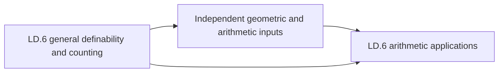

# Logic, definability, valued fields and motivic integration

This roadmap connects first-order descriptions of arithmetic objects with the invariants that applications can compute or compare. Quotient interpretations carry arithmetic across fields and residue rings; valued-field elimination prepares definable integrals; constructible motivic functions make those integrals uniform; Diophantine descriptions expose the boundary between witness search and decision. On the real side, finite definable geometry and counting feed arithmetic applications only after independent orbit, height and functional-transcendence inputs have been supplied.

This is a complete **planning pass**, with all seven layers planned at target granularity. It is not source-closed: the precise proof-acquisition and supplier contracts at the end remain part of the plan. Every proposed declaration has implementation status `unchecked`. The packet is authoritative for stable ids; the target cards below give the same statements, proof outlines, APIs and discriminating tests. Small steps stay inside the key theorem that uses them. The thirteen identifiers in the earlier polynomial-comparison checkpoint are preserved.

## Conventions and ownership

Mathlib is checked at `082e2d37e8b0463410cdb532e111cd43d5a66174`; Tau Ceti at `f790474821cf4256814db967cb154e7af3d0c369`. A baseline citation means its actual declaration and hypotheses were read at that pin. The current upstream roadmap tree and current Tau Ceti sources were also read to avoid planning work that postdates the atlas snapshot. Current-only facilities are described as imports needing adapters, never as declarations available at the pin.

Use native first-order syntax, structures, definability, ultraproducts and realization. Parameters are explicit finite tuples. A quotient interpretation uses invariant graphs and equality modulo its kernel; it does not select representatives. The finite-sort Denef–Pas encoding is a tagged native language with guarded operations, rather than a second general syntax implementation.

Valuations are compared by their rings and actual ordered value groups. Normalized integer-valued orders occur only in the stated Denef–Pas/local-field setting. Henselizations are algebraic and may have arbitrary rank. Additive Haar measure has mass one on the valuation ring. A lower-dimensional set can be null for ambient Haar measure and still contribute to its own dimension grade. Every local-field transfer threshold belongs to fixed formulas and coefficient data; no numerical threshold is promised.

Natural and integer polynomial assignments are different. The retained native `Poly`/`Dioph` bridge evaluates on naturals with integer coefficients; finite compression changes only the witness variables, even when the input type is infinite. MRDP uses an effective syntax and the native semidecidability predicate, not a classically chosen inverse as an algorithm. The universal integer predicate in the rationals does not provide an existential integer predicate there.

On the real side, fix one expansion and its parameter convention. Restricted analytic symbols agree with an analytic function on a neighbourhood of the closed cube and extend by zero outside. The algebraic part is made of positive-dimensional connected semialgebraic pieces; it is not the set of algebraic points. For a reduced rational a/b with b>0, H(a/b)=max(|a|,b). Algebraic-coordinate counting bounds each coordinate’s degree separately, without a common degree-k field hypothesis.

| Supplier / owner | Already owned or supplied | Boundary of this roadmap |
| --- | --- | --- |
| Native Mathlib logic | Languages, formulas, structures, definability, Łoś transfer | LD adds quotient interpretations and the arithmetic/valued-language adapters. |
| Native Diophantine and computability API | Poly, Dioph, DiophFn, exponentiation, REPred and halting | LD adds the missing syntax comparison, effective coding and full MRDP chain. |
| ArcTopologyAndDescent:AT.0, AT.3 | Aic valuation rings, product-spectrum/ultraproduct fibres and the clopen sheaf | Import product-components and boolean-sheaf; request only carrier/truncatedness adapters. |
| Current RealAlgebraicGeometry | Semialgebraic syntax, CAD, projection and real closed field elimination | Import them. General analytic/exponential expansions and their counting theorems are LD targets. |
| Current DifferentialGeometry | Abstract boundary with local faces | Add analytic and finite-definable compatibility only; no second boundary carrier. |
| AdicSpaces Layer 1 | Valuation spectrum and patch topology | Supply the field-membership dictionary and current coarsening comparisons. |
| QuadraticFormInvariants; GlobalQuadraticForms | Quaternion algebra, norm/trace, local Hilbert symbols, approximation and quadratic representation | LD owns their definable trace images, prime parameters and quantifier conversions. |
| NeronModelsAndSemistableAbelianVarieties:R11.2 | Néron identity components and component groups | Request the precise general dual-isogeny point-count/volume contract; retain its scope beyond the existing semistable targets. |
| MotivesAndAlgebraicCycles:MC.1, MC.4; SchemeAndStackFoundations:SF.1 | Geometric motives and global algebraic charts | Request the realization/scissor and finite-chart gluing interfaces, without identifying motivic coefficient rings. |
| DiophantineApproximationAndTranscendence:DT.0, DT.5 | Height comparisons, Northcott and differential-exponential Ax | Import height inputs. The DT.5 theorem does not supply abelian, Shimura or Hodge functional transcendence. |
| HeightsRationalPointsAndObstructions:RP.2, RP.5 | Zero-cycle Brauer pairing; Manin–Mumford and its uniform family theorem | Import those existing targets. Request the additional effective zero-cycle criterion used by the nonpower theorem. |
| LogicAndDefinabilityPartII | Shared special/weakly-special geometry, definable Siegel uniformization, hyperbolic/mixed Ax–Lindemann and special-family geometry | Its exact geometric nodes consume only the early LD prefix; the arithmetic application suffix consumes them. |
| ShimuraVarietiesPartII | Mixed foundations, relative orbit estimates and conditional mixed André–Oort | The restricted application with pure part in A_g remains in LD.6. |
| PeriodMapsAndPeriodDomains, Part II | Polarized variations, monodromy domains and Hodge functional-transcendence inputs | Request the exact independent Hodge/volume and corrected quotient contracts; no fabricated stage ids. |
| AnalyticNumberTheory:AN.8 | Global orbit decompositions, Poisson summation and functional equations | AN.8 consumes the local factors exported here; LD has no reverse prerequisite on AN.8. |

The shared Part II designs do not yet have registry stage ids. Their exact contracts are recorded as gaps, rather than invented graph edges. The dependency order must be preserved when those ids are assigned:

The general countable-algebraic-union lemma belongs to the early LD.6 prefix. Weakly-special families and their normalizer geometry belong to the shared geometric supplier. Manin–Mumford is the existing `HeightsRationalPointsAndObstructions:RP.5/manin-mumford` target, including positive-dimensional torsion cosets; its uniform family form is imported from `RP.5/uniform-manin-mumford`. Neither is planned again here.

## Layer overview

| Layer | Purpose | Targets | Coverage | Planets |
| --- | --- | --- | --- | --- |
| LD.0 | Languages and interpretations | 8 | planned | Interpretations, Bi-interpretations, Arithmetic ultrapowers |
| LD.1 | Valued-field logic | 20 | planned | Denef–Pas language, Angular components, Denef–Pas quantifier elimination, Ax–Kochen–Ershov principle |
| LD.2 | p-adic definable integration | 12 | planned | Denef–Pas cells, Cell decomposition, Definable local integration, Igusa rationality, Gauge-form measures |
| LD.3 | Motivic integration and transfer | 11 | planned | Definable subassignments, Residue-field Grothendieck rings, Constructible motivic functions, Motivic integration, Specialization of motivic integrals |
| LD.4 | Diophantine definability and undecidability | 36 | planned | MRDP theorem, Hilbert tenth undecidability, Universal definition of integers, Diophantine nonnorms, Diophantine polynomial comparison, Finite Diophantine normal form |
| LD.5 | Uniform arithmetic applications | 5 | planned | Uniform local densities, Singular-fibre counting formula |
| LD.6 | o-minimality, definable counting and unlikely intersections | 38 | planned | O-minimal structures, O-minimal cell decomposition, Definable Chow theorem, Pila–Wilkie theorem, Definable block counting, André–Oort for A_g |

## Worked checks across layers

For a fraction interpretation of ℤ, the legal representatives (1,2) and (2,4) agree, but (1,0) is illegal. For a rank-two lexicographic valuation, a coefficient of value (0,1) is infinitely smaller than d=(1,0); quotienting by the small convex subgroup makes that coefficient a unit. A henselization comparison goes from the coarser valuation’s henselization into the finer valuation’s henselization.

In the polynomial bridge, X₀−2X₁ at (1,3) has value −5. The polynomial X(X−1) vanishes on the Boolean grid but is not the zero polynomial, so injectivity needs the infinite natural box. Collapsing two witness variables can remove roots of U−V−1: U=1,V=0 works, but U=V never works. Empty witnesses are valid; the constant equation 1=0 still has no solution.

For rational local-ring parameters, R³₃=ℤ_(3), whereas R³₅ has empty odd class-three support but is ℤ_(2); omitting the congruence guard loses the dyadic condition. In contrast S_(17·41)=ℤ_(17)∪ℤ_(41), so 1/17 belongs. The union and intersection predicates serve different quantifier steps. Empty ramification support gives an intersection equal to ℚ, whose Jacobson radical is {0}; it does not justify replacing that radical by an empty intersection.

A one-cell with order a and a fixed nonzero angular component has volume q^(−a−1), rather than the full shell volume (1−q⁻¹)q^(−a). For xy=0 over the residue field, the two axes give 2q−1 points. A nonzero fibre xy=a with v(a)=n has logarithmic fibre mass (n+1)(1−q⁻¹). Summing over n≥1 and multiplying by q² gives the same 2q−1. The fibre a=0 is excluded from the smooth relative-form formula.

A definable line in ℝ² has empty frontier cl(X)∖X although its ambient topological boundary is the line itself. A single isolated algebraic point contributes nothing to X_alg. A positive-dimensional block can be contained in X_alg even when the block itself is not globally semialgebraic. Semi-rational counting measures distinct second projections; [0,1]×{z₀} cannot supply a nonconstant second projection merely by containing many rational first coordinates.

## Targets and acceptance criteria

The declarations below are proposed names. Heavy carriers are specified mathematically here. The small Lean prototype states only the endpoints expressible over the pinned carriers; it does not replace these contracts.

## LD.0 — Languages and interpretations

Start from native realization and definability. Specify interpretation domains, kernels and symbol graphs; prove semantic translation and composition, then the two composite comparisons needed for bi-interpretations. Fraction fields and a chosen arithmetic ultrapower provide concrete tests. Real standard parts are used only on finite hyperreals, with an explicit same-ultrafilter comparison contract.

### Interpretations on definable quotients

**Target** `LD.0/interpretation` · definition · proposed declaration `TauCeti.ArithmeticLogic.interpretation`.

For languages L_A,L_B and nonempty native structures A,B, an interpretation I of B in A consists of a finite arity m, an A-parameter-definable D⊆A^m, a definable equivalence E on D, a bijection D/E≃B, and definable E-invariant pullbacks of every relation and function graph of L_B. Function graphs must be total on D and single valued modulo E. A finite tuple of parameters is part of the data. There is no definable choice of representatives requirement.

**Construction / proof.**

1. Use the existing definable-set predicate for D, the kernel and symbol graphs. Form the native setoid quotient and transport the B-structure along the supplied bijection.
2. Translate terms by their graph formulas. Translate equality by E; relativize existential quantifiers to D and use kernel invariance for independence of representatives.

**Prerequisites.** `mathlib:FirstOrder.Language`, `mathlib:FirstOrder.Language.Formula`, `mathlib:Set.Definable`.

**Consumers.**

- [LD.0/interpretation-semantics](#ld0-interpretation-semantics): Translate arithmetic assertions through quotient presentations.
- [LD.1/residue-interpretation](#ld1-residue-interpretation): Interpret residue fields of definable valuation rings.
- [LD.4/diophantine-interpretation-transfer](#ld4-diophantine-interpretation-transfer): Transport effective existential theories only when the translation is effective.

**API.**

| Declaration | Role | Contract |
| --- | --- | --- |
| TauCeti.ArithmeticLogic.interpretation.domain | projection | The finite-power domain and kernel are definable over the recorded parameters. |
| TauCeti.ArithmeticLogic.interpretation.translate | constructor | Every L_B-formula has an E-invariant L_A-formula on representative tuples, with the same semantic truth value. |
| TauCeti.ArithmeticLogic.interpretation.function_total | characterisation | For each source function and representative input there exists an output in D unique modulo E. |
| TauCeti.ArithmeticLogic.interpretation.change_parameters | functoriality | Enlarging the named parameter tuple transports an interpretation without changing its quotient structure. |

**Discriminating tests.**

- `TauCeti.ArithmeticLogic.interpretation.identity` (compatibility): D=A, E=equality and identity symbol graphs recover the original native structure.
- `TauCeti.ArithmeticLogic.interpretation.fractions` (value): For an integral domain R, pairs (a,b) with b≠0 and relation ad=bc interpret Frac(R); (1,2) and (2,4) have the same class when 2≠0.
- `TauCeti.ArithmeticLogic.interpretation.nonfunctional` (non-example): The graph assigning both 0 and 1 to one input over a two-element equality quotient fails the function uniqueness axiom.
- `TauCeti.ArithmeticLogic.interpretation.residue` (degenerate): A definable ideal I gives R/I by a quotient; no definable transversal is required.

**Acceptance.** D=A, E=equality and identity symbol graphs recover the original native structure. For an integral domain R, pairs (a,b) with b≠0 and relation ad=bc interpret Frac(R); (1,2) and (2,4) have the same class when 2≠0. The graph assigning both 0 and 1 to one input over a two-element equality quotient fails the function uniqueness axiom. A definable ideal I gives R/I by a quotient; no definable transversal is required.

**Sources.** [dittmannpop](https://arxiv.org/pdf/2012.01307v2), §1, Theorems 1.1–1.2, pp.1–4; §5, Facts 5.2 and final proof, pp.16–18 (arXiv v2). Arithmetic fields are accessed through definable domains and quotients, with parameters and composite interpretation maps tracked.

### Semantics and composition of interpretations

**Target** `LD.0/interpretation-semantics` · theorem · proposed declaration `TauCeti.ArithmeticLogic.interpretation_semantics`.

An interpretation I:B in A gives, for every finite tuple of B-elements and any representatives in D, equivalence between realization of a B-formula and realization of its translated A-formula. Composing interpretations C in B and B in A gives C in A; its parameter tuple includes representatives of the inner parameters and its domain, kernel and symbol formulas are obtained by translation. Identity interpretations act as identities up to definable quotient isomorphism.

**Construction / proof.**

1. Induct over native formulas: equality uses E; symbol atoms use their defining graphs; Boolean operations are native; quantified witnesses range over D and quotient surjectivity supplies representatives.
2. For composition flatten the two finite tuples, translate the inner domain and equivalence, and apply the first semantic equivalence twice. No elimination of imaginaries is assumed.

**Prerequisites.** [LD.0/interpretation](#ld0-interpretation), `mathlib:FirstOrder.Language.Formula`.

**Acceptance.** The conclusion uses exactly the displayed hypotheses and the indicated prerequisite interfaces.

**Sources.** [dittmannpop](https://arxiv.org/pdf/2012.01307v2), §1, Theorems 1.1–1.2, pp.1–4; §5, Facts 5.2 and final proof, pp.16–18 (arXiv v2). Arithmetic fields are accessed through definable domains and quotients, with parameters and composite interpretation maps tracked.

### Parametric bi-interpretations

**Target** `LD.0/biinterpretation` · definition · proposed declaration `TauCeti.ArithmeticLogic.biinterpretation`.

A parametric bi-interpretation between A and B consists of interpretations in both directions and definable isomorphisms of each composite interpretation with the identity on its ambient structure, over the accumulated finite parameter tuples. Mutual interpretability without the two definable composite comparisons does not satisfy this definition.

**Construction / proof.**

1. Take the two interpretation records together with quotient-compatible definable graphs of the two composite isomorphisms.
2. Transport each graph through the semantics theorem to formulate both comparison conditions in the appropriate ambient structure.

**Prerequisites.** [LD.0/interpretation](#ld0-interpretation), [LD.0/interpretation-semantics](#ld0-interpretation-semantics).

**Consumers.**

- [LD.0/biinterpretation-transitivity](#ld0-biinterpretation-transitivity): Compose the field/domain/integer interfaces used by the finitely generated field applications.

**API.**

| Declaration | Role | Contract |
| --- | --- | --- |
| TauCeti.ArithmeticLogic.biinterpretation.forward | projection | Extract the interpretation of B in A and its parameter tuple. |
| TauCeti.ArithmeticLogic.biinterpretation.comparison | projection | Extract definable graphs identifying both composite quotients with the original structures. |
| TauCeti.ArithmeticLogic.biinterpretation.symm | equivalence | Interchange the two interpretations and their comparison isomorphisms. |
| TauCeti.ArithmeticLogic.biinterpretation.trans | functoriality | Compose bi-interpretations using translated comparison graphs and accumulated parameters. |

**Discriminating tests.**

- `TauCeti.ArithmeticLogic.biinterpretation.identity` (value): The identity quotient in each direction with identity comparison graphs is a bi-interpretation.
- `TauCeti.ArithmeticLogic.biinterpretation.finite_obstruction` (non-example): No finite structure can be bi-interpreted with the infinite ring of integers: every definable finite-power quotient of a finite structure is finite.
- `TauCeti.ArithmeticLogic.biinterpretation.parameter_transport` (compatibility): Relabeling a finite tuple of named parameters gives isomorphic composite quotients.
- `TauCeti.ArithmeticLogic.biinterpretation.comparisons_required` (characterisation): Providing two interpretations alone leaves the bi-interpretation record incomplete until both definable composite maps are supplied.

**Acceptance.** The identity quotient in each direction with identity comparison graphs is a bi-interpretation. No finite structure can be bi-interpreted with the infinite ring of integers: every definable finite-power quotient of a finite structure is finite. Relabeling a finite tuple of named parameters gives isomorphic composite quotients. Providing two interpretations alone leaves the bi-interpretation record incomplete until both definable composite maps are supplied.

**Sources.** [dittmannpop](https://arxiv.org/pdf/2012.01307v2), §1, Theorems 1.1–1.2, pp.1–4; §5, Facts 5.2 and final proof, pp.16–18 (arXiv v2). Arithmetic fields are accessed through definable domains and quotients, with parameters and composite interpretation maps tracked.

### Transitivity of parametric bi-interpretability

**Target** `LD.0/biinterpretation-transitivity` · theorem · proposed declaration `TauCeti.ArithmeticLogic.biinterpretation_transitivity`.

Parametric bi-interpretability is symmetric and transitive. If A and B, and B and C, are bi-interpretable, then A and C are bi-interpretable over the finite tuple obtained by translating and concatenating their parameters.

**Construction / proof.**

1. Compose both forward and reverse quotient interpretations.
2. Translate the middle composite comparison and compose with the outer comparison; do the same in the other ambient structure. This verifies the stronger definable-composite condition rather than merely two interpretations.

**Prerequisites.** [LD.0/biinterpretation](#ld0-biinterpretation), [LD.0/interpretation-semantics](#ld0-interpretation-semantics).

**Acceptance.** The conclusion uses exactly the displayed hypotheses and the indicated prerequisite interfaces.

**Sources.** [dittmannpop](https://arxiv.org/pdf/2012.01307v2), §1, Theorems 1.1–1.2, pp.1–4; §5, Facts 5.2 and final proof, pp.16–18 (arXiv v2). Arithmetic fields are accessed through definable domains and quotients, with parameters and composite interpretation maps tracked.

### Fraction fields as interpreted structures

**Target** `LD.0/fraction-interpretation` · construction · proposed declaration `TauCeti.ArithmeticLogic.fraction_interpretation`.

For an integral domain R in the ring language, interpret its fraction field by D={(a,b)∈R²:b≠0}, equality (a,b)E(c,d) iff ad=bc, sum (ad+bc,bd), product (ac,bd), and integer constants (n,1). The quotient is canonically isomorphic to the native fraction field and the embedded copy of R has representatives (a,1).

**Construction / proof.**

1. Use the native fraction field universal property to identify the cross-multiplication quotient.
2. The domain condition makes all displayed operations total, and cross multiplication proves compatibility and uniqueness modulo E.

**Prerequisites.** [LD.0/interpretation](#ld0-interpretation), [LD.0/interpretation-semantics](#ld0-interpretation-semantics).

**Consumers.**

- [LD.0/biinterpretation](#ld0-biinterpretation): Supplies one direction in domain/fraction-field bi-interpretations in the Dittmann–Pop route.

**API.**

| Declaration | Role | Contract |
| --- | --- | --- |
| TauCeti.ArithmeticLogic.fraction_interpretation.quotient_equiv | equivalence | The quotient is ring-isomorphic to Frac(R), sending [(a,b)] to a/b. |
| TauCeti.ArithmeticLogic.fraction_interpretation.realize | compatibility | Translated ring formulas agree with realization in the native fraction field. |
| TauCeti.ArithmeticLogic.fraction_interpretation.numerator_embed | simp | The interpretation of r∈R is the class of (r,1). |
| TauCeti.ArithmeticLogic.fraction_interpretation.denominator_guard | characterisation | A representative is legal exactly when its denominator is nonzero. |

**Discriminating tests.**

- `TauCeti.ArithmeticLogic.fraction_interpretation.Z_to_Q` (compatibility): For R=ℤ the quotient is ℚ with the usual arithmetic.
- `TauCeti.ArithmeticLogic.fraction_interpretation.zero_denominator` (non-example): The pair (1,0) is excluded even though cross multiplication alone would not define a fraction.
- `TauCeti.ArithmeticLogic.fraction_interpretation.negative` (value): The class of (−1,2) plus that of (1,2) is zero.
- `TauCeti.ArithmeticLogic.fraction_interpretation.field` (degenerate): When R is already a field, [(a,b)] corresponds to ab⁻¹ in R.

**Acceptance.** For R=ℤ the quotient is ℚ with the usual arithmetic. The pair (1,0) is excluded even though cross multiplication alone would not define a fraction. The class of (−1,2) plus that of (1,2) is zero. When R is already a field, [(a,b)] corresponds to ab⁻¹ in R.

**Sources.** [dittmannpop](https://arxiv.org/pdf/2012.01307v2), §1, Theorems 1.1–1.2, pp.1–4; §5, Facts 5.2 and final proof, pp.16–18 (arXiv v2). Arithmetic fields are accessed through definable domains and quotients, with parameters and composite interpretation maps tracked.

### Explicit arithmetic semantics bridges

**Target** `LD.0/arithmetic-translation` · theorem · proposed declaration `TauCeti.ArithmeticLogic.arithmetic_translation`.

For every supplied interpretation of an arithmetic ring or field, translate its fixed formula together with its named parameter tuple and exhibit the representative-domain guards. The resulting realization statement is equivalent in the interpreted and ambient structures. In particular this gives the fraction-field bridge and the residue-field bridge of LD.1; it makes no assertion that ℤ is existentially definable in ℚ.

**Construction / proof.**

1. Instantiate the interpretation semantics theorem with the native ring language and the appropriate quotient isomorphism.
2. Keep parameter representatives in the formula; any algorithmic transfer must additionally provide an effective syntax translation, as required in LD.4.

**Prerequisites.** [LD.0/interpretation-semantics](#ld0-interpretation-semantics), [LD.0/fraction-interpretation](#ld0-fraction-interpretation).

**Acceptance.** The conclusion uses exactly the displayed hypotheses and the indicated prerequisite interfaces.

**Sources.** [dittmannpop](https://arxiv.org/pdf/2012.01307v2), §1, Theorems 1.1–1.2, pp.1–4; §5, Facts 5.2 and final proof, pp.16–18 (arXiv v2). Arithmetic fields are accessed through definable domains and quotients, with parameters and composite interpretation maps tracked.

### A chosen nonstandard arithmetic extension

**Target** `LD.0/arithmetic-ultrapower` · construction · proposed declaration `TauCeti.ArithmeticLogic.arithmetic_ultrapower`.

Fix a nonprincipal ultrafilter U on ℕ and form the already native ultrapower *ℕ=(U:Filter ℕ).Product(λ_,ℕ) in the arithmetic language. Equip it with the diagonal elementary embedding n↦[λ_,n] and distinguish H=[i↦i]. Then H exceeds every standard numeral. The choice of U is explicit and no computability of the extension is asserted.

**Construction / proof.**

1. Apply native formula transfer to constant representative tuples to obtain elementarity of the diagonal.
2. For each n, the indices i with i>n form a cofinite set, which belongs to the chosen nonprincipal U. Transfer order to show H>n.

**Prerequisites.** `mathlib:FirstOrder.Language.Ultraproduct.realize_formula_cast`, `mathlib:FirstOrder.Language.Ultraproduct.sentence_realize`, `mathlib:FirstOrder.Language.Ultraproduct.«structure»`, `ArcTopologyAndDescent:AT.3`.

**Consumers.**

- [LD.0/standard-part-interface](#ld0-standard-part-interface): Distinguishes finite quotient shadows from real standard parts.
- [LD.1/almost-all-transfer](#ld1-almost-all-transfer): Reuses the identical formula-transfer mechanism for valued fields.

**API.**

| Declaration | Role | Contract |
| --- | --- | --- |
| TauCeti.ArithmeticLogic.arithmetic_ultrapower.diagonal | constructor | The diagonal map is elementary and injective in the fixed arithmetic language. |
| TauCeti.ArithmeticLogic.arithmetic_ultrapower.oversized_index | characterisation | For every n∈ℕ, the index class H exceeds diagonal(n). |
| TauCeti.ArithmeticLogic.arithmetic_ultrapower.formula_transfer | compatibility | A formula evaluated on representative sequences is true exactly on a U-large set. |
| TauCeti.ArithmeticLogic.arithmetic_ultrapower.standard_residue | compatibility | For m>0, a class has a unique standard remainder r<m modulo diagonal(m), by finite partition and ultrafilter maximality. |

**Discriminating tests.**

- `TauCeti.ArithmeticLogic.arithmetic_ultrapower.numeral` (value): The diagonal image of 2+3 equals that of 5.
- `TauCeti.ArithmeticLogic.arithmetic_ultrapower.infinite` (non-example): H is not equal to the diagonal of any natural number.
- `TauCeti.ArithmeticLogic.arithmetic_ultrapower.finite_partition` (compatibility): Modulo 2, the class of the index sequence has precisely one of the two standard remainders, determined by U.
- `TauCeti.ArithmeticLogic.arithmetic_ultrapower.principal` (non-example): A principal ultrafilter does not give an element larger than every standard n.

**Acceptance.** The diagonal image of 2+3 equals that of 5. H is not equal to the diagonal of any natural number. Modulo 2, the class of the index sequence has precisely one of the two standard remainders, determined by U. A principal ultrafilter does not give an element larger than every standard n.

**Sources.** [mathlib-ultraproducts](https://github.com/leanprover-community/mathlib4/blob/082e2d37e8b0463410cdb532e111cd43d5a66174/Mathlib/ModelTheory/Ultraproducts.lean), Ultraproduct.realize_formula_cast and sentence_realize at the pinned commit. Existing formula transfer proves elementarity; the diagonal and the nonstandard index class are the additional arithmetic interface.

**Open contracts.** supplier ArcTopologyAndDescent:AT.3.

### Standard parts with explicit domains

**Target** `LD.0/standard-part-interface` · theorem · proposed declaration `TauCeti.ArithmeticLogic.standard_part_interface`.

On finite native hyperreals, the native standard part is the unique real infinitesimally close to the input, preserves addition and multiplication on that finite subring, and fixes embedded reals. The native total function has default values outside this domain: stdPart(omega)=0 does not make omega infinitesimally close to zero. For the chosen arithmetic ultrapower use standard remainders modulo each fixed positive integer instead. No global ring retraction *ℕ→ℕ is asserted; any comparison to native hyperreals requires a same-ultrafilter adapter.

**Construction / proof.**

1. Compare the chosen ultrapower convention to the native hyperreal construction only after choosing the same ultrafilter or an explicit comparison map.
2. Use existing finite-domain standard-part laws, with finiteness hypotheses on both inputs; use finite partitions, rather than real completeness, for arithmetic residue shadows.

**Prerequisites.** [LD.0/arithmetic-ultrapower](#ld0-arithmetic-ultrapower), `mathlib:ArchimedeanClass.stdPart`, `mathlib:Hyperreal.stdPart_coe`, `mathlib:Hyperreal.stdPart_omega`.

**Acceptance.** Every occurrence of a real standard part has a finiteness proof. An infinite arithmetic element is handled by finite quotients, and is never declared finite.

**Sources.** [mathlib-hyperreal](https://github.com/leanprover-community/mathlib4/blob/082e2d37e8b0463410cdb532e111cd43d5a66174/Mathlib/Analysis/Real/Hyperreal.lean), ArchimedeanClass.stdPart and its finite-domain laws; Hyperreal.stdPart_coe and stdPart_omega at the pinned commit. The real standard-part construction is already present; the new target is the scoped comparison with the chosen arithmetic extension.

**Open contracts.** Ultrapower and hyperreal convention adapter.

## LD.1 — Valued-field logic

Separate the relative-elimination route from the Dittmann–Pop field/valuation route. Denef–Pas uses henselian ac-valued structures of characteristic (0,0), while local-field conclusions hold beyond a formula-dependent residue bound. The field route uses Kronecker dimension, residue lifts, valuation rings, henselization, patch neighbourhoods and genuine root fields. It does not use AKE to obtain global-field definability.

### The Denef–Pas language

**Target** `LD.1/denef-pas-language` · construction · proposed declaration `TauCeti.ArithmeticLogic.denef_pas_language`.

Use a tagged disjoint union of the valued-field, residue-field and value-group carriers to encode a three-sorted language in native first-order syntax. The first two sorts have ring language; the third has Presburger +,−,0,1,≤ and congruences modulo every positive integer. Cross-sort symbols are ord:VF×→VG and ac:VF→RF; a total ord on VF is allowed only with a specified value at 0 and every genuine valuation comparison guarded against 0. Quantifiers are relativized to their named sort. Coefficients and extra constants are recorded by a parameter diagram.

**Construction / proof.**

1. Tag each carrier and add sort predicates, with disjointness and exhaustiveness axioms. Totalize irrelevant symbol inputs by fixed tagged zeros, and guard every translated atom.
2. Induct on sorted formulas to prove equivalence between sorted semantics and the tagged native semantics; changing the off-sort totalization leaves sorted truth unchanged.

**Prerequisites.** `mathlib:FirstOrder.Language`, `mathlib:FirstOrder.Language.Formula`, `mathlib:FirstOrder.Language.ring`, [LD.0/interpretation-semantics](#ld0-interpretation-semantics).

**Consumers.**

- [LD.1/angular-component](#ld1-angular-component): Specify the cross-sort semantic data.
- [LD.1/valued-field-qe](#ld1-valued-field-qe): Fix precisely which quantifiers are eliminated.
- [LD.3/definable-subassignment](#ld3-definable-subassignment): Specify uniform definable families over Laurent series fields.

**API.**

| Declaration | Role | Contract |
| --- | --- | --- |
| TauCeti.ArithmeticLogic.denef_pas_language.sort_realize | compatibility | A sorted quantifier ranges over exactly its tagged carrier in the native encoding. |
| TauCeti.ArithmeticLogic.denef_pas_language.ring_reduct | compatibility | VF and RF reducts agree with the native ring language on correctly sorted tuples. |
| TauCeti.ArithmeticLogic.denef_pas_language.zero_guard | characterisation | An atom ord(x)=γ used as a nonzero valuation assertion includes x≠0. |
| TauCeti.ArithmeticLogic.denef_pas_language.parameters | functoriality | Named coefficient maps and their residue interpretations are preserved by the syntax translation. |

**Discriminating tests.**

- `TauCeti.ArithmeticLogic.denef_pas_language.mixed_sort` (non-example): The expression ac(ξ) for a residue-field variable ξ is rejected by the sorted syntax.
- `TauCeti.ArithmeticLogic.denef_pas_language.zero_order` (non-example): Changing the chosen total value ord(0) cannot change the truth of a guarded sorted formula.
- `TauCeti.ArithmeticLogic.denef_pas_language.congruence` (value): In the value sort, γ≡1 mod 2 holds at γ=3 and fails at γ=2.
- `TauCeti.ArithmeticLogic.denef_pas_language.residue_only` (compatibility): A residue-field sentence translates to that ring sentence on RF, with no VF witnesses.

**Acceptance.** The expression ac(ξ) for a residue-field variable ξ is rejected by the sorted syntax. Changing the chosen total value ord(0) cannot change the truth of a guarded sorted formula. In the value sort, γ≡1 mod 2 holds at γ=3 and fails at γ=2. A residue-field sentence translates to that ring sentence on RF, with no VF witnesses.

**Sources.** [cl2008](https://arxiv.org/pdf/math/0410203), §2.1, Theorem 2.1.1 and Corollary 2.1.2, author pp.8–10 (Theorem p.9, Corollary p.10). The fixed three-sorted language separates valued field, residue field and Presburger variables, and eliminates only valued-field quantifiers under equicharacteristic-zero henselian angular-component hypotheses.

### Angular components and valued structures

**Target** `LD.1/angular-component` · definition · proposed declaration `TauCeti.ArithmeticLogic.angular_component`.

A Denef–Pas valued structure consists of a nontrivially valued henselian field K, its native valuation subring O, residue field k, a chosen surjective additive normalization ord:K×→Γ with Γ≡ℤ in Presburger language, and a map ac:K→k satisfying ac(0)=0, ac(xy)=ac(x)ac(y), and ac(u)=res(u) for units u∈O. On nonzero inputs ac takes values in k×. This is additional structure, not a canonical map supplied by every valued field.

**Construction / proof.**

1. Compare O and its residue quotient to native ValuationSubring and IsLocalRing.ResidueField. Convert the native multiplicative valuation convention to the chosen additive normalization explicitly.
2. For a discretely valued field with chosen uniformizer π, define ac(x)=res(π^(−ord x)x) for x≠0; verify its laws using the unit factor and set ac(0)=0.

**Prerequisites.** [LD.1/denef-pas-language](#ld1-denef-pas-language), `mathlib:ValuationSubring`, `mathlib:ValuationSubring.ValueGroup`, `mathlib:HenselianLocalRing`.

**Consumers.**

- [LD.1/valued-field-qe](#ld1-valued-field-qe): The relative QE theorem assumes these exact ac laws.
- [LD.2/cells](#ld2-cells): Cell fibres fix ac(z−c) as well as its valuation.

**API.**

| Declaration | Role | Contract |
| --- | --- | --- |
| TauCeti.ArithmeticLogic.angular_component.unit | simp | On valuation-ring units, ac is exactly the native residue map. |
| TauCeti.ArithmeticLogic.angular_component.multiplicative | structure | ac(xy)=ac(x)ac(y), including zero inputs. |
| TauCeti.ArithmeticLogic.angular_component.uniformizer | characterisation | For the uniformizer-defined ac, ac(π)=1 and ac(π^n u)=res(u). |
| TauCeti.ArithmeticLogic.angular_component.change_uniformizer | compatibility | Replacing π by ε π multiplies the nonzero angular component by res(ε)^(−ord x); formulas cannot ignore this choice. |

**Discriminating tests.**

- `TauCeti.ArithmeticLogic.angular_component.zero` (degenerate): ac(0)=0, whereas ac(1)=1.
- `TauCeti.ArithmeticLogic.angular_component.Laurent` (value): In k((t)) with π=t, ac(t³(2+t))=2 when 2≠0 in k, and ord is 3.
- `TauCeti.ArithmeticLogic.angular_component.unit` (compatibility): For every unit u of O, the new ac agrees with the native residue map.
- `TauCeti.ArithmeticLogic.angular_component.choice` (non-example): Choosing π′=ε π with res ε≠1 changes ac(π) to (res ε)⁻¹.

**Acceptance.** ac(0)=0, whereas ac(1)=1. In k((t)) with π=t, ac(t³(2+t))=2 when 2≠0 in k, and ord is 3. For every unit u of O, the new ac agrees with the native residue map. Choosing π′=ε π with res ε≠1 changes ac(π) to (res ε)⁻¹.

**Sources.** [cl2008](https://arxiv.org/pdf/math/0410203), §2.1, Theorem 2.1.1 and Corollary 2.1.2, author pp.8–10 (Theorem p.9, Corollary p.10). The fixed three-sorted language separates valued field, residue field and Presburger variables, and eliminates only valued-field quantifiers under equicharacteristic-zero henselian angular-component hypotheses.

### Relative elimination of valued-field quantifiers

**Target** `LD.1/valued-field-qe` · theorem · proposed declaration `TauCeti.ArithmeticLogic.valued_field_qe`.

Over henselian Denef–Pas structures of characteristic (0,0), every formula is equivalent, uniformly in such structures, to a finite disjunction of a residue-field formula in ac(f_i(x)) and RF variables, conjoined with a Presburger formula in ord(f_i(x)) and VG variables, with all zero cases separated. Here f_i are finitely many VF polynomials with the named coefficients. RF and VG quantifiers may remain. For a definable parameter base S, the corresponding relative form holds over its parameter diagram.

**Construction / proof.**

1. Apply Pas relative quantifier elimination with the polynomial preparation/cell induction of its proof; the original proof acquisition is recorded as a source gap until the scanned primary text is read.
2. Separate f_i=0 from nonzero valuation atoms, distribute finite Boolean combinations, and retain RF/VG quantifiers. The parameter form follows by naming the parameter tuple and using its diagram.

**Prerequisites.** [LD.1/denef-pas-language](#ld1-denef-pas-language), [LD.1/angular-component](#ld1-angular-component).

**Acceptance.** The theorem does not assert elimination of residue-field quantifiers. No mixed-characteristic field ℚ_p satisfies the characteristic-(0,0) hypothesis. The parameter diagram preserves the chosen coefficient and angular-component data.

**Sources.** [cl2008](https://arxiv.org/pdf/math/0410203), §2.1, Theorem 2.1.1 and Corollary 2.1.2, author pp.8–10 (Theorem p.9, Corollary p.10). The fixed three-sorted language separates valued field, residue field and Presburger variables, and eliminates only valued-field quantifiers under equicharacteristic-zero henselian angular-component hypotheses.

**Open contracts.** Pas original proof acquisition.

### Ax–Kochen–Ershov in the selected language

**Target** `LD.1/ake-equichar-zero` · theorem · proposed declaration `TauCeti.ArithmeticLogic.ake_equichar_zero`.

For the equicharacteristic-zero henselian ac-valued structures of valued-field-qe, elementary equivalence of their residue fields and of their Presburger value groups, compatibly with all named coefficient data, implies elementary equivalence of their Denef–Pas structures. The reduct conclusion is a source-scoped AKE principle; no assertion is made for arbitrary imperfect residue fields or for all mixed-characteristic henselian fields.

**Construction / proof.**

1. A sentence in the VF-quantifier-free normal form has only RF and VG truth data once its coefficient diagram is fixed.
2. Apply the two elementary equivalences to each finite disjunct. State the coefficient-free special case separately from any relative version.

**Prerequisites.** [LD.1/valued-field-qe](#ld1-valued-field-qe), `mathlib:FirstOrder.Language.Ultraproduct.sentence_realize`.

**Acceptance.** The conclusion uses exactly the displayed hypotheses and the indicated prerequisite interfaces.

**Sources.** [cl2008](https://arxiv.org/pdf/math/0410203), §2.1, Theorem 2.1.1 and Corollary 2.1.2, author pp.8–10 (Theorem p.9, Corollary p.10). The fixed three-sorted language separates valued field, residue field and Presburger variables, and eliminates only valued-field quantifiers under equicharacteristic-zero henselian angular-component hypotheses.

### Finite-formula transfer for large residue characteristic

**Target** `LD.1/almost-all-transfer` · theorem · proposed declaration `TauCeti.ArithmeticLogic.almost_all_transfer`.

For a fixed sentence in the coefficient-free Denef–Pas language, its truth in sufficiently large residue-characteristic local fields is determined by the isomorphism class of the residue field, provided the two fields carry the stipulated ac and Presburger structures. There exists a bound N depending on that sentence; this gives the same truth for ℚ_p and ℤ/pℤ((t)) for all sufficiently large primes p. The assertion is eventual, with no claimed effective or uniform-in-all-formulas N.

**Construction / proof.**

1. Assume infinitely many counterexamples with residue characteristics tending to infinity. Choose a nonprincipal ultrafilter on them.
2. The ultraproducts have characteristic (0,0), henselian valuation rings, compatible residue fields and Presburger groups. Apply AKE and native Łoś to contradict the differing fixed sentence.
3. A contradiction to unbounded counterexamples produces an existential finite exceptional set; it does not supply its numerical elements.

**Prerequisites.** [LD.1/ake-equichar-zero](#ld1-ake-equichar-zero), `mathlib:FirstOrder.Language.Ultraproduct.sentence_realize`, `mathlib:FirstOrder.Language.Ultraproduct.«structure»`.

**Acceptance.** The bound depends on a fixed sentence. Small residue characteristics remain excluded unless a separate proof treats them.

**Sources.** [cl-transfer](https://arxiv.org/pdf/math/0512022), §9.2, Proposition 9.2.1 and its proof, author pp.44–46; cf. the integral transfer in Theorem 9.2.4, p.46. The transfer principle is for sufficiently large residue characteristic and compatible residue fields, not every local field.

### Kronecker dimension

**Target** `LD.1/kronecker-dimension` · definition · proposed declaration `TauCeti.ArithmeticLogic.kronecker_dimension`.

For a field K of finite absolute transcendence degree, define dim_Kr K to be trdeg over its prime field plus 1 in characteristic zero, and that transcendence degree in positive characteristic. Use native transcendence degree and native prime subfield; do not introduce another finite-generation predicate.

**Construction / proof.**

1. Take the finite natural value of the native transcendence degree and add the characteristic offset.
2. Field isomorphism and algebraic-extension invariance follow from native transcendence-basis comparisons.

**Prerequisites.** `mathlib:FirstOrder.Language.ring`.

**Consumers.**

- [LD.1/prime-divisor](#ld1-prime-divisor): Express divisorial residue dimension.
- [LD.1/valuation-dimension-drop](#ld1-valuation-dimension-drop): State strict dimension drop for arbitrary nontrivial valuations.

**API.**

| Declaration | Role | Contract |
| --- | --- | --- |
| TauCeti.ArithmeticLogic.kronecker_dimension.char_zero | characterisation | In characteristic zero, dim_Kr K=trdeg_ℚ K+1. |
| TauCeti.ArithmeticLogic.kronecker_dimension.char_pos | characterisation | In characteristic p>0, dim_Kr K=trdeg_𝔽_p K. |
| TauCeti.ArithmeticLogic.kronecker_dimension.algebraic | compatibility | An algebraic extension of fields of finite absolute transcendence degree preserves dim_Kr. |
| TauCeti.ArithmeticLogic.kronecker_dimension.iso | functoriality | Field isomorphisms preserve Kronecker dimension. |

**Discriminating tests.**

- `TauCeti.ArithmeticLogic.kronecker_dimension.finite` (degenerate): Every finite field has dimension 0.
- `TauCeti.ArithmeticLogic.kronecker_dimension.global` (value): ℚ and 𝔽_p(t) both have dimension 1.
- `TauCeti.ArithmeticLogic.kronecker_dimension.offset` (value): ℚ(t) has dimension 2, whereas 𝔽_p(t) has dimension 1.

**Acceptance.** Every finite field has dimension 0. ℚ and 𝔽_p(t) both have dimension 1. ℚ(t) has dimension 2, whereas 𝔽_p(t) has dimension 1.

**Sources.** [dittmannpop](https://arxiv.org/pdf/2012.01307v2), §1, p.1; Proposition 3.2(3), pp.6–7. The characteristic offset makes global fields have dimension one and supports valuation dimension drop.

### Constants of finitely generated fields

**Target** `LD.1/constant-field-classification` · theorem · proposed declaration `TauCeti.ArithmeticLogic.constant_field_classification`.

Use the native relative algebraic closure of the prime subfield in K as its constant field. If K is finitely generated as a field over its prime field, that constant field is finite in positive characteristic and a number field in characteristic zero. Field finite generation also gives K as the fraction field of an integral domain finitely generated over the prime ring, after adjoining inverses of finitely many denominators. This does not say that K is finitely generated as a ℤ-algebra.

**Construction / proof.**

1. Choose a finite transcendence basis and a finite algebraic generating tuple; its algebraic constant subextension has finite degree over the prime field.
2. Clear finitely many coefficients and denominators in generators and minimal polynomials. The resulting finite-type domain has fraction field K.

**Prerequisites.** [LD.1/kronecker-dimension](#ld1-kronecker-dimension), `mathlib:IntermediateField.FG`.

**Acceptance.** ℚ is field-finitely-generated but is not a finite-type ℤ-algebra. The constants in ℚ(√2)(t) are ℚ(√2), not merely ℚ.

**Sources.** [dittmannpop](https://arxiv.org/pdf/2012.01307v2), §1, p.1; §3, Proposition 3.2 and its setup, pp.5–7. The constants and the arithmetic normalization are distinguished from the field-generating tuple.

### Geometric and arithmetic prime divisors

**Target** `LD.1/prime-divisor` · definition · proposed declaration `TauCeti.ArithmeticLogic.prime_divisor`.

For a finitely generated field K, a prime divisor is a nontrivial discrete valuation, considered up to valuation-ring equivalence, whose residue field κ has dim_Kr κ=dim_Kr K−1. It is geometric when char κ=char K and arithmetic otherwise. Discreteness is part of this predicate, while the separate residue-dimension criterion proves it from weaker input.

**Construction / proof.**

1. Bundle the native valuation subring and the nontriviality, discreteness and residue-dimension properties.
2. Use the valuation ring as the invariant presentation; any normalized additive value map is comparison data, not part of divisor equality.

**Prerequisites.** [LD.1/kronecker-dimension](#ld1-kronecker-dimension), `mathlib:ValuationSubring`, `mathlib:ValuationSubring.ValueGroup`.

**Consumers.**

- [LD.1/divisorial-discreteness](#ld1-divisorial-discreteness): Prove the residue-dimension criterion without putting its conclusion into the input.
- [LD.1/maximal-geometric-flags](#ld1-maximal-geometric-flags): Compose geometric places along a transcendence flag.

**API.**

| Declaration | Role | Contract |
| --- | --- | --- |
| TauCeti.ArithmeticLogic.prime_divisor.residue_dim | projection | The residue Kronecker dimension is exactly one smaller. |
| TauCeti.ArithmeticLogic.prime_divisor.equivalent | extensionality | Equivalent valuations determine the same divisor data on their common valuation ring. |
| TauCeti.ArithmeticLogic.prime_divisor.geometric | characterisation | Geometric is equality of field and residue characteristics. |
| TauCeti.ArithmeticLogic.prime_divisor.arithmetic | characterisation | Arithmetic is the complementary residue-characteristic drop for a divisor. |

**Discriminating tests.**

- `TauCeti.ArithmeticLogic.prime_divisor.t_adic` (value): The t-adic valuation of 𝔽_p(t) is geometric.
- `TauCeti.ArithmeticLogic.prime_divisor.p_adic` (value): The p-adic valuation of ℚ is arithmetic.
- `TauCeti.ArithmeticLogic.prime_divisor.trivial` (non-example): The trivial valuation on K fails nontriviality and does not drop dimension.
- `TauCeti.ArithmeticLogic.prime_divisor.nondiscrete` (non-example): The valuation on 𝔽_p(t^(1/p^∞)) with value group ℤ[1/p] is not a prime divisor of a finitely generated field.

**Acceptance.** The t-adic valuation of 𝔽_p(t) is geometric. The p-adic valuation of ℚ is arithmetic. The trivial valuation on K fails nontriviality and does not drop dimension. The valuation on 𝔽_p(t^(1/p^∞)) with value group ℤ[1/p] is not a prime divisor of a finitely generated field.

**Sources.** [dittmannpop](https://arxiv.org/pdf/2012.01307v2), §1, p.2 before hypothesis (H_d). Prime divisors distinguish characteristic-preserving and arithmetic places; the criterion cited there must not assume discreteness in its input.

### Residue dimension detects divisorial valuations

**Target** `LD.1/divisorial-discreteness` · theorem · proposed declaration `TauCeti.ArithmeticLogic.divisorial_discreteness`.

Let K be finitely generated over its prime field and v any valuation. If dim_Kr(Kv)=dim_Kr(K)−1, then its valuation ring is a DVR and Kv is finitely generated over its prime field; hence v is a prime divisor. Discreteness, finite rank and residue finite generation are conclusions. Finite generation of K is essential.

**Construction / proof.**

1. The equality excludes the trivial valuation. In equal characteristic lift a residue transcendence basis to units; the prime field is trivially valued. Adjoin an element of positive value. Distinct powers have different values, so this element is transcendental over the lifted residue subfield. Dimension equality makes K finite over that one-variable rational subfield.
2. In mixed characteristic with residue characteristic p, lift a residue transcendence basis. The restriction to ℚ is a multiple of v_p; reduction of polynomials with unit coefficients identifies the Gauss value group as ℤ·v(p) and its residue as a rational field over 𝔽_p. K is finite over this Gauss subfield.
3. For a finite valued-field extension, choose elements of distinct value cosets and independent residue lifts; their products are linearly independent. Thus e·f≤[K:K₀], giving finite value-group index and finite residue degree.
4. An ordered abelian group with a finite-index cyclic subgroup is cyclic: embed it in (1/e)ℤ by multiplying by the finite index. Convert a least positive generator into the native DVR criterion. The finite residue extension of a rational field is finitely generated.

**Prerequisites.** [LD.1/kronecker-dimension](#ld1-kronecker-dimension), [LD.1/prime-divisor](#ld1-prime-divisor), `mathlib:ValuationSubring`.

**Acceptance.** No hypothesis assumes the value group is already cyclic. The infinite purely inseparable tower 𝔽_p(t^(1/p^∞)) shows why finite generation cannot be dropped.

**Sources.** [dittmannpop](https://arxiv.org/pdf/2012.01307v2), §1, p.2, Engler–Prestel Theorem 3.4.3 citation; direct finite-basis proof specified here. The criterion itself is cited in the paper; the plan supplies an elementary Gauss-subfield route rather than claiming a full reading of the cited book.

### Kronecker dimension drops under valuation

**Target** `LD.1/valuation-dimension-drop` · theorem · proposed declaration `TauCeti.ArithmeticLogic.valuation_dimension_drop`.

For any field K of finite absolute transcendence degree and any nontrivial valuation v, dim_Kr(Kv)<dim_Kr K. This includes non-discrete valuations and fields that are not finitely generated. In characteristic (0,0), a henselian coefficient-field route is allowed only after its existence theorem is supplied; the direct residue-lift proof avoids that extra input.

**Construction / proof.**

1. In equal characteristic the prime field is trivially valued; lift any finite algebraically independent residue tuple to units. Its rational subfield is trivially valued, and an element of positive value is transcendental over it by the unique-smallest-value argument.
2. In mixed characteristic the lifted residue tuple is algebraically independent over ℚ: divide any polynomial relation by a coefficient of least p-adic valuation and reduce to a nonzero polynomial over 𝔽_p. The characteristic offset supplies the strict inequality.
3. Apply these finite-tuple inequalities to the finite absolute transcendence degrees. No completion, discreteness, or coefficient field is needed.

**Prerequisites.** [LD.1/kronecker-dimension](#ld1-kronecker-dimension), `mathlib:ValuationSubring`.

**Acceptance.** The conclusion uses exactly the displayed hypotheses and the indicated prerequisite interfaces.

**Sources.** [dittmannpop](https://arxiv.org/pdf/2012.01307v2), Proposition 3.2(3), proof p.7 (arXiv v2). Every nontrivial valuation lowers the characteristic-adjusted transcendence dimension, without finite-generation or rank-one hypotheses.

### Henselizations with valuation embeddings

**Target** `LD.1/henselization` · construction · proposed declaration `TauCeti.ArithmeticLogic.henselization`.

For a field F with a chosen valuation subring O, construct a chosen henselization F^h with a valuation-preserving embedding F→F^h, separable algebraic and immediate, initial among valuation-preserving embeddings into henselian valued extensions. Its residue field and value group identify with those of F. A completion is a different object and is not used as this construction.

**Construction / proof.**

1. Choose an extension of the valuation to a separable closure and take the fixed field of the decomposition subgroup.
2. Prove henselianity, immediacy and the initial valuation-embedding property; the full primary proof and arbitrary-rank source locator remain an explicit acquisition gap.

**Prerequisites.** `mathlib:ValuationSubring`, `mathlib:ValuationSubring.ValueGroup`, `mathlib:HenselianLocalRing`.

**Consumers.**

- [LD.1/henselian-embedding-open](#ld1-henselian-embedding-open): Identify finite subextensions that embed in henselizations of nearby valuations.
- [LD.1/coarsening-henselian-inclusion](#ld1-coarsening-henselian-inclusion): Compare henselizations under coarsening.

**API.**

| Declaration | Role | Contract |
| --- | --- | --- |
| TauCeti.ArithmeticLogic.henselization.embed | constructor | F embeds as a valued subfield of F^h. |
| TauCeti.ArithmeticLogic.henselization.immediate | compatibility | Residue field and actual value group are unchanged. |
| TauCeti.ArithmeticLogic.henselization.lift | universal-property | Every valued embedding from F into a henselian valued extension extends uniquely through F^h. |
| TauCeti.ArithmeticLogic.henselization.already_henselian | equivalence | If O is already henselian, its henselization is canonically isomorphic as a valued F-field. |

**Discriminating tests.**

- `TauCeti.ArithmeticLogic.henselization.henselian_field` (compatibility): A complete discretely valued field compares isomorphically with its henselization.
- `TauCeti.ArithmeticLogic.henselization.not_completion` (non-example): The henselization of ℚ at p is algebraic over ℚ, whereas ℚ_p is not algebraic over ℚ.
- `TauCeti.ArithmeticLogic.henselization.immediate` (characterisation): Neither the residue field nor value group gains elements in F^h.
- `TauCeti.ArithmeticLogic.henselization.trivial` (degenerate): For the trivial valuation, a field is already henselian and its henselization is itself.

**Acceptance.** A complete discretely valued field compares isomorphically with its henselization. The henselization of ℚ at p is algebraic over ℚ, whereas ℚ_p is not algebraic over ℚ. Neither the residue field nor value group gains elements in F^h. For the trivial valuation, a field is already henselian and its henselization is itself.

**Sources.** [dittmannpop](https://arxiv.org/pdf/2012.01307v2), §2(b); Proposition 3.2 and Lemma 3.9, pp.5–7,11–12. The arguments use algebraic henselizations of arbitrary rank, not just complete rank-one fields.

**Open contracts.** Arbitrary-rank henselization proof source.

### Patch membership on valuation rings

**Target** `LD.1/patch-field-dictionary` · comparison · proposed declaration `TauCeti.ArithmeticLogic.patch_field_dictionary`.

Import the existing valuation-spectrum/patch-topology ownership in AdicSpaces. For valuation rings of a fixed field F, compare its patch topology with the field membership subbasis U_a={O:a∈O} and their complements. Finite conjunctions of membership and nonmembership are clopen. This is a dictionary into the existing spectrum, not a new valuation-spectrum construction.

**Construction / proof.**

1. Map a valuation-ring class to its point in the already planned valuation spectrum.
2. Rewrite valuation comparisons a≤b as a/b membership with b≠0, and separate b=0. Pull back the existing constructible/patch subbasis.

**Prerequisites.** `mathlib:ValuationSubring`, `tauceti:TauCetiRoadmap/AdicSpaces#layer-1-valuation-spectra-and-continuous-valuations`.

**Acceptance.** The conclusion uses exactly the displayed hypotheses and the indicated prerequisite interfaces.

**Sources.** [dittmannpop](https://arxiv.org/pdf/2012.01307v2), §3C, p.11, opening paragraph. The nearby-henselization argument uses finite clopen inequalities on valuation rings.

**Open contracts.** Current coarsening and patch-topology adapters; supplier tauceti:TauCetiRoadmap/AdicSpaces#layer-1-valuation-spectra-and-continuous-valuations.

### A simple-reduction generator in a henselization

**Target** `LD.1/henselian-simple-generator` · theorem · proposed declaration `TauCeti.ArithmeticLogic.henselian_simple_generator`.

If E/F is a finite subextension of the henselization for a fixed valuation w, choose an integral primitive element η for E/F whose monic minimal polynomial has η reducing to 1 at the distinguished prolongation and has simple root 1 in its reduction. The coefficient and simple-root conditions can be enforced by finitely many valuation-ring membership and unit conditions.

**Construction / proof.**

1. Pass to finite normal closure and track the finitely many primes above the chosen valuation prime. The henselization embedding selects a decomposition orbit.
2. Use the finite-prime Chinese remainder construction to choose an element with residue 1 at the selected prime and 0 at the others, then arrange primitivity.
3. The conjugate polynomial reduces as X^(n−1)(X−1) at the selected prime, so 1 is simple. Translate integral coefficients and derivative-unit conditions into a finite clopen neighborhood. The original source proof of the generator step remains a gap.

**Prerequisites.** [LD.1/henselization](#ld1-henselization), [LD.1/patch-field-dictionary](#ld1-patch-field-dictionary).

**Acceptance.** The conclusion uses exactly the displayed hypotheses and the indicated prerequisite interfaces.

**Sources.** [dittmannpop](https://arxiv.org/pdf/2012.01307v2), Lemma 3.9(1), pp.11–12; cited Kuhlmann–Novacoski Theorem 1.2. A primitive element with simple residue root is the key input; an arbitrary primitive element would not suffice.

**Open contracts.** Simple-reduction generator source.

### Henselian embeddability is patch open

**Target** `LD.1/henselian-embedding-open` · theorem · proposed declaration `TauCeti.ArithmeticLogic.henselian_embedding_open`.

For a finite extension E/F, the set of valuations w of F for which E admits a valuation-compatible F-embedding into the chosen w-henselization is open in the patch topology. Near any such w, a monic primitive polynomial with an integral simple residue root gives a finite clopen neighborhood contained in that set.

**Construction / proof.**

1. Use henselian-simple-generator at a point w in the locus. Impose the finitely many coefficient-integrality, root-congruence and derivative-unit conditions.
2. At every valuation in that clopen neighborhood, native HenselianLocalRing lifting gives a root in its henselization. Primitivity identifies an F-embedding of E.

**Prerequisites.** [LD.1/henselian-simple-generator](#ld1-henselian-simple-generator), [LD.1/patch-field-dictionary](#ld1-patch-field-dictionary), [LD.1/henselization](#ld1-henselization), `mathlib:HenselianLocalRing`.

**Acceptance.** The conclusion uses exactly the displayed hypotheses and the indicated prerequisite interfaces.

**Sources.** [dittmannpop](https://arxiv.org/pdf/2012.01307v2), Lemma 3.9(1), pp.11–12. A simple-root polynomial gives a neighborhood of valuations with the same henselian embedding property.

### Coarsening from an infinitely large coefficient

**Target** `LD.1/coarsening-prime` · construction · proposed declaration `TauCeti.ArithmeticLogic.coarsening_prime`.

Let w:F×→Γ be an additive valuation, a_d∈F×, d=w(a_d)>0, and assume 0≤w(a_i) and Nw(a_i)<d for every positive integer N and each nonzero lower coefficient a_i. Put Δ={γ∈Γ: N|γ|<d for every N>0} and p={0}∪{x∈O_w∖{0}: d≤Nw(x) for some N>0}. Then Δ is convex, p is prime, a_d∈p and every nonzero lower coefficient a_i is outside p. The coarsening by Γ/Δ has ring (O_w)_p. Compare to the current native coarsening interface, retaining Γ rather than imposing rank one.

**Construction / proof.**

1. Closure and convexity of Δ follow by applying the bound with 2N to each summand; the domination hypotheses put lower coefficients in Δ and d outside it.
2. For nonnegative values, membership outside Δ is the displayed existential cut. Valuation inequalities prove ideal closure, and if neither value crosses the cut then neither does their sum, proving primality.
3. The quotient valuation ring equals localization at p: values in Δ become units, and the ordered quotient has nonnegative image exactly when a denominator outside p clears the original value. Reuse current coarsenByUnits rather than reconstructing it.

**Prerequisites.** `mathlib:ValuationSubring`, `mathlib:ValuationSubring.ValueGroup`, [LD.1/patch-field-dictionary](#ld1-patch-field-dictionary).

**Consumers.**

- [LD.1/coarsening-henselian-inclusion](#ld1-coarsening-henselian-inclusion): Compare henselizations through a valuation coarsening.

**API.**

| Declaration | Role | Contract |
| --- | --- | --- |
| TauCeti.ArithmeticLogic.coarsening_prime.prime | characterisation | The displayed existential valuation cut is prime; the distinguished coefficient lies in it and lower coefficients do not. |
| TauCeti.ArithmeticLogic.coarsening_prime.ring | compatibility | The coarsened valuation ring is O_w localized at that prime, using the actual value group. |
| TauCeti.ArithmeticLogic.coarsening_prime.inclusion | relation | O_w is contained in the coarser valuation ring; the inclusion points toward coarsening. |
| TauCeti.ArithmeticLogic.coarsening_prime.units | characterisation | Elements in the killed convex subgroup become units in the coarsened valuation ring. |

**Discriminating tests.**

- `TauCeti.ArithmeticLogic.coarsening_prime.rank_two` (value): For lexicographic ℤ², quotienting the smaller convex subgroup yields the first-coordinate valuation.
- `TauCeti.ArithmeticLogic.coarsening_prime.direction` (non-example): The coarsened valuation ring contains the original ring; reversing this inclusion fails on a rank-two example.
- `TauCeti.ArithmeticLogic.coarsening_prime.zero_subgroup` (degenerate): A zero lower coefficient belongs to p, so the outside-p conclusion is restricted to nonzero lower coefficients.
- `TauCeti.ArithmeticLogic.coarsening_prime.all_values` (degenerate): For lexicographic ℤ² with d=(1,0) and a lower coefficient of value (0,1), every positive multiple of the lower value is below d, and the lower coefficient becomes a unit after coarsening.

**Acceptance.** For lexicographic ℤ², quotienting the smaller convex subgroup yields the first-coordinate valuation. The coarsened valuation ring contains the original ring; reversing this inclusion fails on a rank-two example. Killing the zero convex subgroup leaves the valuation unchanged. Killing the whole value group gives the trivial valuation and the whole field as valuation ring.

**Sources.** [dittmannpop](https://arxiv.org/pdf/2012.01307v2), Proposition 3.10(a), p.13, and its prime-ideal construction. The proof constructs a coarser valuation by localizing at a valuation prime and then compares henselizations.

**Open contracts.** Current coarsening and patch-topology adapters.

### Henselizations under valuation coarsening

**Target** `LD.1/coarsening-henselian-inclusion` · theorem · proposed declaration `TauCeti.ArithmeticLogic.coarsening_henselian_inclusion`.

If w is finer than v on F, then under compatible choices inside a common separable closure, the v-henselization embeds as a valued F-subfield of the w-henselization. In particular the localization coarsening in Proposition 3.10 has the inclusion in this direction. The induced residual valuation must also be recorded when composing the places.

**Construction / proof.**

1. A henselian valuation remains henselian after coarsening, so the w-henselization with the coarsened valuation is a henselian valued v-extension.
2. Apply the initial property of the v-henselization and use compatible extensions in the separable closure to identify the embedding with inclusion.

**Prerequisites.** [LD.1/henselization](#ld1-henselization), [LD.1/coarsening-prime](#ld1-coarsening-prime).

**Acceptance.** The conclusion uses exactly the displayed hypotheses and the indicated prerequisite interfaces.

**Sources.** [dittmannpop](https://arxiv.org/pdf/2012.01307v2), Proposition 3.10(a), p.13. Coarsening gives an inclusion between the corresponding henselizations, with compatible choices.

### Residue fields of definable valuations

**Target** `LD.1/residue-interpretation` · construction · proposed declaration `TauCeti.ArithmeticLogic.residue_interpretation`.

If the valuation ring O⊂K is definable in the field K over a finite tuple a, interpret its residue field using D=O and E(x,y) iff x−y belongs to the maximal ideal, where m={x∈O:x=0 or x⁻¹∉O}. Ring operation graphs are induced from O. Parameters remain a; residue representatives are not selected.

**Construction / proof.**

1. Use the field formula for nonunits to define m, then translate quotient equality as x−y∈m.
2. The native residue map identifies the quotient with IsLocalRing.ResidueField O, and symbol graphs descend because m is an ideal.

**Prerequisites.** `mathlib:ValuationSubring`, [LD.0/interpretation](#ld0-interpretation), [LD.0/interpretation-semantics](#ld0-interpretation-semantics).

**Consumers.**

- [LD.1/composition-definability](#ld1-composition-definability): Pull back a definable residual valuation to a composite valuation ring.

**API.**

| Declaration | Role | Contract |
| --- | --- | --- |
| TauCeti.ArithmeticLogic.residue_interpretation.kernel | characterisation | Two integral elements have the same residue exactly when their difference is in m. |
| TauCeti.ArithmeticLogic.residue_interpretation.native_residue | compatibility | The interpreted quotient is ring-isomorphic to the native residue field. |
| TauCeti.ArithmeticLogic.residue_interpretation.translate | functoriality | A residue-field formula translates to a field formula on integral representatives. |
| TauCeti.ArithmeticLogic.residue_interpretation.parameters | projection | The ring-defining tuple remains explicit in the interpreted residue language. |

**Discriminating tests.**

- `TauCeti.ArithmeticLogic.residue_interpretation.p_adic` (value): For the p-adic ring in ℚ, the interpreted residue field has p elements.
- `TauCeti.ArithmeticLogic.residue_interpretation.unit` (non-example): The unit 1 does not lie in the kernel ideal.
- `TauCeti.ArithmeticLogic.residue_interpretation.same_residue` (compatibility): x and x+u have equal classes whenever u lies in m.
- `TauCeti.ArithmeticLogic.residue_interpretation.no_section` (characterisation): The construction works without a definable field section of the residue map.

**Acceptance.** For the p-adic ring in ℚ, the interpreted residue field has p elements. The unit 1 does not lie in the kernel ideal. x and x+u have equal classes whenever u lies in m. The construction works without a definable field section of the residue map.

**Sources.** [dittmannpop](https://arxiv.org/pdf/2012.01307v2), Fact 5.2, pp.16–17. Definability of a valuation ring yields an interpreted residue field and allows definability through composite places.

### Composite valuations are definable by translation

**Target** `LD.1/composition-definability` · theorem · proposed declaration `TauCeti.ArithmeticLogic.composition_definability`.

If O_v is definable in K and O_u is definable in the interpreted residue field Kv, then the composite valuation ring is {x∈O_v:res_v(x)∈O_u}. It is definable over the tuple for O_v together with chosen integral representatives of the tuple for O_u. Its residue is (Kv)u. This is a pullback of valuation rings, with the coarser ring O_v containing the composite ring.

**Construction / proof.**

1. Translate the residual ring-membership formula through residue-interpretation, keeping x∈O_v.
2. Prove the pullback valuation property by splitting whether x is a unit of O_v; identify its ideal and residue quotient by composing residue maps.

**Prerequisites.** [LD.1/residue-interpretation](#ld1-residue-interpretation), [LD.0/interpretation-semantics](#ld0-interpretation-semantics), `mathlib:ValuationSubring`.

**Acceptance.** The conclusion uses exactly the displayed hypotheses and the indicated prerequisite interfaces.

**Sources.** [dittmannpop](https://arxiv.org/pdf/2012.01307v2), Fact 5.2, pp.16–17. The residue interpretation transports definability of a residual valuation into definability of its composite.

### Full-rank geometric flags

**Target** `LD.1/maximal-geometric-flags` · theorem · proposed declaration `TauCeti.ArithmeticLogic.maximal_geometric_flags`.

Let K be finitely generated of characteristic zero and trdeg_ℚ K=e. A maximal chain of e geometric prime divisors gives a composite valuation with value group order-isomorphic to lexicographic ℤ^e and number-field final residue. Conversely construct such chains from a transcendence flag and prolongation to a finite extension. This family is named G_T here: the source W_T notation already denotes rank-one divisors and is not reused for the higher-rank composite.

**Construction / proof.**

1. Choose successive variable-adic places of a rational subfield and prolong them through the finite extension. Each step has finite residue extension and discrete value group.
2. Iterate the residue-dimension criterion. The successive value-group extensions split as abelian groups because each quotient is ℤ; the order is the flag lexicographic order.
3. Final transcendence degree zero and finite generation give a number field. Keep rank-one and composite flags as different families.

**Prerequisites.** [LD.1/prime-divisor](#ld1-prime-divisor), [LD.1/divisorial-discreteness](#ld1-divisorial-discreteness), [LD.1/composition-definability](#ld1-composition-definability).

**Acceptance.** The conclusion uses exactly the displayed hypotheses and the indicated prerequisite interfaces.

**Sources.** [dittmannpop](https://arxiv.org/pdf/2012.01307v2), Proposition 5.1 proof, p.16; Fact 5.2, pp.16–17. Geometric flags lower transcendence degree one step at a time and end in a number field.

### Auxiliary quadratic root fields

**Target** `LD.1/quadratic-root-fields` · construction · proposed declaration `TauCeti.ArithmeticLogic.quadratic_root_fields`.

For the nonzero parameters in Dittmann–Pop Notations 4.1(3), choose actual root fields F(α), F(β) with α²−α=a_d/θ² and β²−β=τ²/a_d. Use their separable minimal-polynomial factors and finite coordinate bases. Each extension may be trivial. Translate first-order ring formulas in these fields into F-formulas by their finite multiplication tables; never use F[X]/(X²−X−c) as a field when that polynomial is reducible.

**Construction / proof.**

1. Separate degree one and degree two minimal polynomials. Represent elements in a basis and write equality and operations coordinatewise.
2. For every quantified variable quantify its one or two coordinates. Transport each atomic formula by the multiplication table, then induct on formulas.

**Prerequisites.** `mathlib:FirstOrder.Language.ring`, [LD.0/interpretation-semantics](#ld0-interpretation-semantics).

**Consumers.**

- [LD.0/arithmetic-translation](#ld0-arithmetic-translation): Provide explicit arithmetic semantics through finite field extensions.

**API.**

| Declaration | Role | Contract |
| --- | --- | --- |
| TauCeti.ArithmeticLogic.quadratic_root_fields.root | constructor | The selected root satisfies the specified Artin–Schreier-shaped quadratic equation. |
| TauCeti.ArithmeticLogic.quadratic_root_fields.degree | characterisation | The actual root extension has degree 1 or 2; reducibility is handled by the degree-one branch. |
| TauCeti.ArithmeticLogic.quadratic_root_fields.translate | compatibility | Coordinate translation preserves realization of every ring formula with transported parameters. |
| TauCeti.ArithmeticLogic.quadratic_root_fields.basis_change | functoriality | Changing the finite basis gives equivalent translated formulas through its linear coordinate map. |

**Discriminating tests.**

- `TauCeti.ArithmeticLogic.quadratic_root_fields.split` (degenerate): For c=0 the chosen root field of X²−X is F, while its quotient algebra is F×F when char F≠2.
- `TauCeti.ArithmeticLogic.quadratic_root_fields.nonsplit` (value): Over ℚ, a root of X²−X−1 gives a degree-two field.
- `TauCeti.ArithmeticLogic.quadratic_root_fields.denominator` (non-example): The construction rejects θ=0 or a_d=0 where the displayed coefficients are undefined.
- `TauCeti.ArithmeticLogic.quadratic_root_fields.semantics` (compatibility): The translated assertion α²−α=c is true exactly because the chosen multiplication table satisfies its minimal polynomial.

**Acceptance.** For c=0 the chosen root field of X²−X is F, while its quotient algebra is F×F when char F≠2. Over ℚ, a root of X²−X−1 gives a degree-two field. The construction rejects θ=0 or a_d=0 where the displayed coefficients are undefined. The translated assertion α²−α=c is true exactly because the chosen multiplication table satisfies its minimal polynomial.

**Sources.** [dittmannpop](https://arxiv.org/pdf/2012.01307v2), Notations 4.1(3)–(4), p.13; opening of §4. The auxiliary quadratic extensions and formula translation are needed as actual fields, including the split case.

## LD.2 — p-adic definable integration

Presented cells include residue and value auxiliaries. Their volume normalization leads to local constructible integration and rational valuation/congruence series. Analytic gauge measures give a second concrete interface: Weil point counts, null loci, finite quotients, dual-isogeny volumes and relative Fubini. The singular xy example tests all normalizations together.

### Denef–Pas cells and presentations

**Target** `LD.2/cells` · definition · proposed declaration `TauCeti.ArithmeticLogic.cells`.

Over a definable base S, a presented 0-cell has z=c(y), and a presented 1-cell has ord(z−c(y))=α(y) and ac(z−c(y))=ξ(y) with ξ(y)≠0. The presentation is a definable isomorphism over S to such a cell whose base C lies in S×RF^n×VG^r; auxiliary residue and integer variables are permitted. The center is VF-valued, α is VG-valued, and ξ is RF-valued. A cell is the underlying subassignment together with such a presentation, not just an interval or a ball without angular data.

**Construction / proof.**

1. Form the displayed definable graphs and fibres in the fixed language.
2. The presentation records a definable inverse and the base projection; refinement transports a presentation rather than assuming a definable VF choice function.

**Prerequisites.** [LD.1/denef-pas-language](#ld1-denef-pas-language), [LD.1/angular-component](#ld1-angular-component).

**Consumers.**

- [LD.2/cell-decomposition](#ld2-cell-decomposition): Partition definable sets with prepared functions.
- [LD.2/local-integration](#ld2-local-integration): Reduce local integration to explicit ball volumes and integer summation.
- [LD.3/motivic-pushforward](#ld3-motivic-pushforward): Normalize the valued-coordinate axiom of motivic integration.

**API.**

| Declaration | Role | Contract |
| --- | --- | --- |
| TauCeti.ArithmeticLogic.cells.zero_fibre | characterisation | A 0-cell fibre is one point, z=c(y). |
| TauCeti.ArithmeticLogic.cells.one_fibre | characterisation | A nonempty 1-cell fixes a nonzero angular component and one valuation of z−c(y). |
| TauCeti.ArithmeticLogic.cells.presentation | equivalence | The presentation and inverse are definable over S and commute with the VF coordinate projection. |
| TauCeti.ArithmeticLogic.cells.refine | functoriality | A definable partition of the auxiliary base pulls back to a compatible partition of the cell. |

**Discriminating tests.**

- `TauCeti.ArithmeticLogic.cells.one_ball` (value): Over a local field with q residue elements, ord z=0 and ac z=1 has Haar measure q⁻¹.
- `TauCeti.ArithmeticLogic.cells.zero_cell` (degenerate): The graph z=0 is a 0-cell and has zero one-dimensional Haar measure.
- `TauCeti.ArithmeticLogic.cells.zero_ac` (non-example): A putative 1-cell with ξ=0 is invalid; it must not model an annulus.
- `TauCeti.ArithmeticLogic.cells.auxiliary` (compatibility): The units split into q−1 angular-component fibres after residue specialization, not into one fibre of volume q⁻¹.

**Acceptance.** Over a local field with q residue elements, ord z=0 and ac z=1 has Haar measure q⁻¹. The graph z=0 is a 0-cell and has zero one-dimensional Haar measure. A putative 1-cell with ξ=0 is invalid; it must not model an annulus. The units split into q−1 angular-component fibres after residue specialization, not into one fibre of volume q⁻¹.

**Sources.** [cl2008](https://arxiv.org/pdf/math/0410203), §7.1, Definitions 7.1.1–7.1.2, pp.36–37. Cells are given by explicit centers, order, angular component and auxiliary-sort presentations.

### Cell decomposition and preparation

**Target** `LD.2/cell-decomposition` · theorem · proposed declaration `TauCeti.ArithmeticLogic.cell_decomposition`.

In the equicharacteristic-zero Denef–Pas setting, a definable subset of S×VF admits a finite partition into presented 0- and 1-cells. The partition can be chosen adapted to finitely many definable integer-valued functions and positive constructible functions: after the presentation, their relevant values factor through the auxiliary base. For the selected local-field specialization the same fixed formulas give cells for sufficiently large residue characteristic; no all-prime assertion is inferred.

**Construction / proof.**

1. Apply the relative valued-field preparation theorem to the finitely many polynomials in the quantifier-eliminated formulas.
2. Record their orders and angular components in auxiliary variables, then partition by the finitely many zero/nonzero patterns.
3. Use the factorization over the resulting base to prepare integer-valued and constructible functions. The original Pas preparation proof is the same named source gap as in LD.1.

**Prerequisites.** [LD.2/cells](#ld2-cells), [LD.1/valued-field-qe](#ld1-valued-field-qe).

**Acceptance.** The conclusion uses exactly the displayed hypotheses and the indicated prerequisite interfaces.

**Sources.** [cl2008](https://arxiv.org/pdf/math/0410203), Theorem 7.2.1 and proof, pp.37–39; Pas 1989 Theorem 3.2 as cited there. Auxiliary sorts make cell preparation uniform and avoid an unsupported definable center selection in VF.

### Local constructible functions

**Target** `LD.2/local-constructible-functions` · definition · proposed declaration `TauCeti.ArithmeticLogic.local_constructible_functions`.

For a fixed nonarchimedean local field F with residue cardinal q, use the ℚ-algebra generated by indicator functions of the chosen DP-definable sets, cardinalities of finite definable residue-field fibres, integer-valued definable functions α, and q^β for integer-valued definable β; allow the scalar denominators (1−q^(−i))⁻¹ for i>0. Definability refers to the specified coefficient and uniformizer data. Integrability is an extra property of a function, never built into this ring.

**Construction / proof.**

1. Evaluate the indicated generators as ordinary functions on local-field points and take the generated subalgebra.
2. Comparison with specialization is by the values of each generator; no injectivity of a motivic realization is asserted.

**Prerequisites.** [LD.2/cells](#ld2-cells), [LD.1/denef-pas-language](#ld1-denef-pas-language).

**Consumers.**

- [LD.2/local-integration](#ld2-local-integration): Supply functions stable under parameter integration.
- [LD.3/specialization](#ld3-specialization): Fix the target algebra of specialized motivic functions.

**API.**

| Declaration | Role | Contract |
| --- | --- | --- |
| TauCeti.ArithmeticLogic.local_constructible_functions.indicator | constructor | A fixed definable subset contributes its indicator function. |
| TauCeti.ArithmeticLogic.local_constructible_functions.pullback | functoriality | Composition with a definable map preserves the constructible algebra. |
| TauCeti.ArithmeticLogic.local_constructible_functions.specialize | compatibility | Motivic L^β and integer-function generators specialize to q^β and α. |
| TauCeti.ArithmeticLogic.local_constructible_functions.integrability | relation | Absolute integrability is a separate predicate, and need not hold for the constant function 1 on all of F. |

**Discriminating tests.**

- `TauCeti.ArithmeticLogic.local_constructible_functions.ball` (value): The indicator of O_F is constructible and has integral 1 with the chosen normalization.
- `TauCeti.ArithmeticLogic.local_constructible_functions.unbounded` (non-example): The constant function 1 on F is constructible but not integrable.
- `TauCeti.ArithmeticLogic.local_constructible_functions.geometric` (value): The sum over n≥0 of q^(−n) equals (1−q⁻¹)⁻¹.
- `TauCeti.ArithmeticLogic.local_constructible_functions.empty` (degenerate): The indicator of the empty definable set is zero.

**Acceptance.** The indicator of O_F is constructible and has integral 1 with the chosen normalization. The constant function 1 on F is constructible but not integrable. The sum over n≥0 of q^(−n) equals (1−q⁻¹)⁻¹. The indicator of the empty definable set is zero.

**Sources.** [cl-transfer](https://arxiv.org/pdf/math/0512022), §9.1, specialization conventions, pp.40–42; cl2008 §4.1 and §5.2. Specializing L to q turns motivic constructible expressions into local constructible functions.

### Constructible local integration

**Target** `LD.2/local-integration` · theorem · proposed declaration `TauCeti.ArithmeticLogic.local_integration`.

Normalize additive Haar measure on F^m by vol(O_F^m)=1. For a chosen definable family X⊆S×F^m and a local constructible function φ on X, the integral s↦∫_{X_s}φ(s,x)dx is constructible on a specified definable parameter locus on which absolute integrability has been proved, in the source-scoped large-residue-characteristic family. The normalization for a 1-cell fibre ord(z−c)=a, ac(z−c)=ξ≠0 is q^(−a−1). Zero-dimensional sets are null for positive-dimensional Haar measure.

**Construction / proof.**

1. Use finite cell preparation and integrate each 1-cell by q^(−a−1). Remove lower-dimensional contributions for Haar measure, while retaining them in zero-dimensional counting measures.
2. Reduce the remaining value-group coordinates to Presburger summation of polynomial-exponential terms; a convergent geometric series produces precisely the inverted denominators.
3. Use finite disjoint additivity and absolute-integrability Fubini. Define parameter integrability at the level justified by the source; the complete uniform integrability-locus theorem is recorded for proof refinement.

**Prerequisites.** [LD.2/cell-decomposition](#ld2-cell-decomposition), [LD.2/local-constructible-functions](#ld2-local-constructible-functions).

**Acceptance.** The conclusion uses exactly the displayed hypotheses and the indicated prerequisite interfaces.

**Sources.** [cl-transfer](https://arxiv.org/pdf/math/0512022), Theorem 9.1.5, pp.41–43; cl2008 §9.1, pp.49–53. Cell integration and specialization give the local integral with the specified normalization and integrability hypotheses.

**Open contracts.** Local integrability locus and Presburger summation.

### Jacobian change of variables

**Target** `LD.2/jacobian-change-variables` · theorem · proposed declaration `TauCeti.ArithmeticLogic.jacobian_change_variables`.

For a definable isomorphism f:X→Y between equal-dimensional local-field definable sets, restrict to definable analytic loci of full dimension where the derivative is invertible. For an absolutely integrable φ on Y, ∫_Y φ(y)dy=∫_X φ(f(x))|det Df(x)|dx with respect to the chosen coordinate-volume forms. Discarded lower-dimensional loci are null only for the matching positive-dimensional measure; lower-dimensional graded integration is kept separate.

**Construction / proof.**

1. Refine to analytic cells with constant order of the Jacobian and ball-to-ball mapping property.
2. Apply the local analytic substitution theorem in each chart, then sum over the partition. Record the sign convention |det|=q^(−ord det).

**Prerequisites.** [LD.2/cell-decomposition](#ld2-cell-decomposition), [LD.2/local-integration](#ld2-local-integration).

**Acceptance.** The conclusion uses exactly the displayed hypotheses and the indicated prerequisite interfaces.

**Sources.** [cl2008](https://arxiv.org/pdf/math/0410203), Theorem 7.5.3 and Corollary 7.5.4, pp.43–45; §9.3, Theorem 9.3.2, pp.57–58. The prepared one-variable Jacobian property supplies the change-of-variables factor and handles negligible exceptional sets.

### Igusa and local Poincaré rationality

**Target** `LD.2/igusa-rationality` · theorem · proposed declaration `TauCeti.ArithmeticLogic.igusa_rationality`.

For fixed integral polynomial data f in m variables over O_F, let Z_f(T)=∑_{k≥0}vol{x∈O_F^m:ord f(x)=k}T^k, omitting f(x)=0. For each F in the fixed sufficiently large-residue-characteristic family this is a rational function with coefficients in ℚ, arising from a uniform constructible coefficient algebra, with denominators products of 1−q^a T^b (a∈ℤ,b>0), after cancellation as necessary. Z_f(q^(−s)) is initially the usual Igusa integral for Re(s)>0. The normalized congruence Poincaré series A_f(T)=∑_{n≥0}q^(−mn)#\{x mod π^n:f(x)=0 mod π^n\}T^n is rational as well, with TZ_f(T)=1+(T−1)A_f(T). Singular zero loci and the identically zero polynomial are treated by this formal identity.

**Construction / proof.**

1. After cell preparation, orders and volumes are affine Presburger data, so sum the resulting geometric progressions with polynomial factors.
2. Write a_n=vol{ord f≥n}; then vol{ord f=k}=a_k−a_(k+1), with a_0=1. Summing coefficientwise gives T Z=1+(T−1)A without assuming the zero locus has measure zero.
3. State possible denominator factors separately from genuine poles: cancellation can remove a factor. The analytic integral and meromorphic continuation require the substitution T=q^(−s).

**Prerequisites.** [LD.2/local-integration](#ld2-local-integration), [LD.2/jacobian-change-variables](#ld2-jacobian-change-variables).

**Acceptance.** The conclusion uses exactly the displayed hypotheses and the indicated prerequisite interfaces.

**Sources.** [cl2008](https://arxiv.org/pdf/math/0410203), Theorem 14.4.1, p.80; Theorem 4.4.1, p.21; specialization Theorem 16.4.1, p.90; own coefficientwise tail identity. The denominator form comes from prepared Presburger sums; the normalization and tail identity here are explicit arithmetic interfaces.

### Measures attached to gauge forms

**Target** `LD.2/gauge-measure` · construction · proposed declaration `TauCeti.ArithmeticLogic.gauge_measure`.

Let F be a nonarchimedean local field, X a second-countable Hausdorff F-analytic manifold of pure dimension d, r≥1, and ω a section of (Ω_X^d)⊗r. In a chart write ω=f(x)(dx₁∧⋯∧dx_d)⊗r and assign density |f(x)|^(1/r) against normalized additive Haar measure. Glue these local measures by analytic substitution. When ω never vanishes call it an r-gauge form. For a geometrically reduced algebraic X, extend the measure on its smooth locus by zero across the singular locus when using the stated Yasuda-style measure.

**Construction / proof.**

1. In a chart construct the density-weighted measure. The determinant transformation of an r-fold top form exactly cancels the r-th root after substitution.
2. Use the sheaf gluing of measures over a countable chart cover and prove independence of cover. For the singular extension, use the smooth-locus null-set theorem under geometric reducedness.

**Prerequisites.** [LD.2/jacobian-change-variables](#ld2-jacobian-change-variables), `SchemeAndStackFoundations:SF.1`.

**Consumers.**

- [LD.2/weil-volume](#ld2-weil-volume): Compare smooth integral points with finite-field point counts.
- [LD.2/submersion-fubini](#ld2-submersion-fubini): Disintegrate a top-form measure along smooth fibres.
- [LD.2/finite-quotient-measure](#ld2-finite-quotient-measure): State the finite-quotient change-of-variables formula.

**API.**

| Declaration | Role | Contract |
| --- | --- | --- |
| TauCeti.ArithmeticLogic.gauge_measure.chart_density | characterisation | The measure in a chart is \|f\|^(1/r) times normalized Haar measure. |
| TauCeti.ArithmeticLogic.gauge_measure.pullback | compatibility | An analytic isomorphism pulls the gauge measure back to the measure of its pulled-back form. |
| TauCeti.ArithmeticLogic.gauge_measure.unit_scale | simp | Multiplication by an analytic unit of norm one leaves the measure unchanged. |
| TauCeti.ArithmeticLogic.gauge_measure.power | compatibility | Replacing a 1-gauge form η by η⊗r leaves its measure unchanged. |

**Discriminating tests.**

- `TauCeti.ArithmeticLogic.gauge_measure.affine` (compatibility): For ω=dx₁∧⋯∧dx_d on O_F^d, the volume is 1.
- `TauCeti.ArithmeticLogic.gauge_measure.root_factor` (value): For ω=π²(dx)⊗2, the volume of O_F is q⁻¹, not q⁻².
- `TauCeti.ArithmeticLogic.gauge_measure.zero` (degenerate): The zero section gives the zero measure; it is not a gauge form.
- `TauCeti.ArithmeticLogic.gauge_measure.unit` (value): A constant unit u with |u|=1 does not alter the normalized chart measure.

**Acceptance.** For ω=dx₁∧⋯∧dx_d on O_F^d, the volume is 1. For ω=π²(dx)⊗2, the volume of O_F is q⁻¹, not q⁻². The zero section gives the zero measure; it is not a gauge form. A constant unit u with |u|=1 does not alter the normalized chart measure.

**Sources.** [gwz](https://arxiv.org/pdf/1810.06739v2), §2.1, p.5; Proposition 2.1, p.6. Gauge densities include an r-th root and use the normalized Haar measure.; [gwzmirror](https://arxiv.org/pdf/1707.06417v3), §4.1, pp.19–21 in arXiv v3; published pp.536–539. The same construction glues across analytic charts and extends over the regular locus.

**Open contracts.** supplier SchemeAndStackFoundations:SF.1.

### Positive-codimension loci are null

**Target** `LD.2/null-loci` · theorem · proposed declaration `TauCeti.ArithmeticLogic.null_loci`.

For a geometrically reduced F-variety X with the measure from an r-fold top form on its smooth locus, a closed subvariety Y⊂X of positive codimension in every component has measure zero. Thus removing Y leaves the integral of an absolutely integrable function unchanged. No measure on a nonreduced thickening is inferred from this assertion.

**Construction / proof.**

1. Work on smooth affine charts. The zero set of a nonzero analytic function has Haar measure zero, by one-variable discreteness and induction/Fubini.
2. Cover each positive-codimension locus by such local zero sets and use second countability. The singular part is assigned zero by the extension convention.

**Prerequisites.** [LD.2/gauge-measure](#ld2-gauge-measure).

**Acceptance.** The conclusion uses exactly the displayed hypotheses and the indicated prerequisite interfaces.

**Sources.** [gwz](https://arxiv.org/pdf/1810.06739v2), Proposition 2.1(a), p.6; gwzmirror Proposition 4.4, p.21 (published p.539). The geometric reducedness and codimension conditions are the hypotheses used in the singular extension.

### Weil volume and residue point counts

**Target** `LD.2/weil-volume` · theorem · proposed declaration `TauCeti.ArithmeticLogic.weil_volume`.

If X is smooth of pure relative dimension d over O_F and ω is an integral nowhere-vanishing top form (or an integral r-gauge form), then vol_ω(X(O_F))=#X(k_F)/q^d. Assume X is of finite type so the count is finite. Each residue fibre is analytically O_F^d with the appropriate π-adic ball normalization q^(−d). For non-global gauge forms, the canonical local unit-compatible measure gives the same formula.

**Construction / proof.**

1. Use smooth integral coordinates on each residue fibre and the formal implicit-function theorem. Integral gauge transition factors are units, so the fibre measure is q^(−d).
2. Partition X(O_F) by its finitely many residue points and add the fibre measures. This concerns arbitrary smooth varieties, distinct from the adelic-group Tamagawa normalization.

**Prerequisites.** [LD.2/gauge-measure](#ld2-gauge-measure), [LD.2/null-loci](#ld2-null-loci).

**Acceptance.** The conclusion uses exactly the displayed hypotheses and the indicated prerequisite interfaces.

**Sources.** [gwz](https://arxiv.org/pdf/1810.06739v2), Theorem 1.4, p.3; §2.1, p.5. The point-count formula normalizes local integration used by the subsequent fibre comparisons.

### Generically free finite quotients

**Target** `LD.2/finite-quotient-measure` · theorem · proposed declaration `TauCeti.ArithmeticLogic.finite_quotient_measure`.

Let Γ be a finite étale F-group acting generically freely on a smooth F-variety Y, and let Y→X=Y/Γ be the quotient. On the free locus, for a Γ(F)-invariant measurable A⊂Y(F) and an appropriate quotient r-fold form ω, the integral over its image is (1/#Γ(F)) times the integral over A with the pulled-back form. Apply this to the image, not automatically all X(F): nontrivial torsor fibres need not have rational lifts. Null branch loci are removed under the positive-codimension hypotheses.

**Construction / proof.**

1. On rationally lifted free fibres, the Γ(F)-action is simply transitive, so every fibre has exactly #Γ(F) points.
2. Use local analytic substitution on the finite étale cover, sum its sheets, and divide by that fibre cardinality. Extend across null loci using null-loci.

**Prerequisites.** [LD.2/gauge-measure](#ld2-gauge-measure), [LD.2/null-loci](#ld2-null-loci).

**Acceptance.** The conclusion uses exactly the displayed hypotheses and the indicated prerequisite interfaces.

**Sources.** [gwz](https://arxiv.org/pdf/1810.06739v2), Proposition 2.1(b), p.6. The quotient factor is the number of rational group points on rationally lifted free fibres; the image condition matters.

### Dual abelian isogeny volume invariance

**Target** `LD.2/dual-isogeny-volume` · theorem · proposed declaration `TauCeti.ArithmeticLogic.dual_isogeny_volume`.

Let A and B be dual abelian varieties over a nonarchimedean local field F of residue characteristic p, and let φ:A→B be an isogeny whose degree is prime to p. For every ω∈H⁰(B,Ω_B^top), ∫_{A(F)}|φ*ω|=∫_{B(F)}|ω|. The zero form is allowed. The proof needs the specific identity-component and dual component-group comparison below; it does not require declaring the entire Néron-model morphism finite flat.

**Construction / proof.**

1. Extend the prime-to-p isogeny to the Néron models and use the étale identity-component comparison.
2. Apply Weil volume to the special fibres, Lang surjectivity for connected groups, and the dual component-group formula. These independent Néron and duality inputs are requested, not reconstructed in LD.2.

**Prerequisites.** [LD.2/gauge-measure](#ld2-gauge-measure), [LD.2/weil-volume](#ld2-weil-volume), `NeronModelsAndSemistableAbelianVarieties:R11.2`.

**Acceptance.** The conclusion uses exactly the displayed hypotheses and the indicated prerequisite interfaces.

**Sources.** [gwz](https://arxiv.org/pdf/1810.06739v2), Proposition 2.2 and proof, p.6. The proof compares Néron-model connected components and dual component groups after an étale isogeny.

**Open contracts.** supplier NeronModelsAndSemistableAbelianVarieties:R11.2.

### Fubini for relative top forms

**Target** `LD.2/submersion-fubini` · theorem · proposed declaration `TauCeti.ArithmeticLogic.submersion_fubini`.

For a submersion f:X→Y of F-analytic manifolds and r-gauge forms ω_X,ω_Y, there is a unique nowhere-vanishing relative r-fold top form θ on X satisfying θ⊗f*ω_Y=ω_X via det Ω_X≃f*det Ω_Y⊗det Ω_(X/Y). For every absolutely integrable α, ∫_X α dμ_(ω_X)=∫_Y(∫_(X_y) α dμ_(θ_y))dμ_(ω_Y). In the smooth algebraic case θ is algebraic. For a generically smooth map, apply this on its smooth locus and prove the omitted loci null.

**Construction / proof.**

1. Use the determinant exact sequence to divide the two nowhere-vanishing sections on X.
2. In submersion coordinates this is the usual Fubini formula with densities. The r-th root is a positive real density; it does not require an analytic r-th root of a unit.
3. Glue the local formula using absolute integrability and remove only loci justified null by the stated hypotheses.

**Prerequisites.** [LD.2/gauge-measure](#ld2-gauge-measure), [LD.2/null-loci](#ld2-null-loci), `SchemeAndStackFoundations:SF.1`.

**Acceptance.** The conclusion uses exactly the displayed hypotheses and the indicated prerequisite interfaces.

**Sources.** [gwz](https://arxiv.org/pdf/1810.06739v2), §2.2, equations (6)–(8), pp.6–7. The fibre form divides the total top form by the base form on the smooth locus.; [gwzmirror](https://arxiv.org/pdf/1707.06417v3), Proposition 4.1, Claim 4.2, Lemma 4.3, pp.20–21 (published pp.537–538). The relative section lives on X, and Fubini follows from local product coordinates and ordinary Haar Fubini.

**Open contracts.** supplier SchemeAndStackFoundations:SF.1.

## LD.3 — Motivic integration and transfer

Build definable subassignments over a characteristic-zero base, the residue scissor semiring, Presburger coefficients and their tensor-product constructible functions. Keep positive and group-valued theories distinct, with dimension grading and partial integrable pushforward. Specialization and transfer are separate end theorems; a motive realization is an additional supplied comparison, not a prerequisite for point counting.

### Definable subassignments

**Target** `LD.3/definable-subassignment` · definition · proposed declaration `TauCeti.ArithmeticLogic.definable_subassignment`.

Fix a characteristic-zero base field k and named coefficients in k((t)). A definable subassignment of h[m,n,r] assigns to each extension field K/k the subset of K((t))^m×K^n×ℤ^r satisfying one fixed Denef–Pas formula with those coefficients. A map is specified by one uniformly definable graph that is a function in every K. This is a subassignment of point sets; it need not be a subfunctor under arbitrary field extensions because quantified formulas need not be extension invariant. Gluing along finite algebraic charts is a separate global construction.

**Construction / proof.**

1. Assign formula realizations for each extension K with the named ac_t and ord_t structures. Define morphisms by graph formulas with totality and uniqueness in every K.
2. Boolean operations, fibre products and images are defined uniformly by formulas; these are categorical constructions of subassignments, without claiming functoriality in K.

**Prerequisites.** [LD.1/denef-pas-language](#ld1-denef-pas-language), [LD.1/valued-field-qe](#ld1-valued-field-qe), `SchemeAndStackFoundations:SF.1`.

**Consumers.**

- [LD.3/residue-grothendieck](#ld3-residue-grothendieck): Define the residue-only relative category.
- [LD.3/motivic-pushforward](#ld3-motivic-pushforward): Fix the category on which integration is functorial.

**API.**

| Declaration | Role | Contract |
| --- | --- | --- |
| TauCeti.ArithmeticLogic.definable_subassignment.realize | projection | Evaluate the assigned set in any chosen extension K/k. |
| TauCeti.ArithmeticLogic.definable_subassignment.graph | characterisation | A morphism is a uniformly definable functional graph. |
| TauCeti.ArithmeticLogic.definable_subassignment.image | constructor | The image is defined by existential quantification in the fixed language. |
| TauCeti.ArithmeticLogic.definable_subassignment.base_change | functoriality | A definable map S′→S induces a fibre-product pullback of subassignments over S. |

**Discriminating tests.**

- `TauCeti.ArithmeticLogic.definable_subassignment.point` (degenerate): h[0,0,0] assigns one point to every K.
- `TauCeti.ArithmeticLogic.definable_subassignment.sqrt` (non-example): The residue-field formula ∃y, y²=−1 changes truth between K=ℝ and K=ℂ, so its truth set is not a subfunctor on those field embeddings.
- `TauCeti.ArithmeticLogic.definable_subassignment.graph` (value): The VF graph z=x² is a morphism and evaluates to ordinary squaring.
- `TauCeti.ArithmeticLogic.definable_subassignment.sorts` (compatibility): h[0,1,0](K)=K and h[0,0,1](K)=ℤ; their sorts are not interchangeable.

**Acceptance.** h[0,0,0] assigns one point to every K. The residue-field formula ∃y, y²=−1 changes truth between K=ℝ and K=ℂ, so its truth set is not a subfunctor on those field embeddings. The VF graph z=x² is a morphism and evaluates to ordinary squaring. h[0,1,0](K)=K and h[0,0,1](K)=ℤ; their sorts are not interchangeable.

**Sources.** [cl2008](https://arxiv.org/pdf/math/0410203), §2.2–2.3, pp.8–10; §15.1, pp.76–77. The category is built from uniform formulas and graphs, and is not silently a functor of points on all embeddings.

**Open contracts.** supplier SchemeAndStackFoundations:SF.1.

### Residue-field Grothendieck semirings

**Target** `LD.3/residue-grothendieck` · construction · proposed declaration `TauCeti.ArithmeticLogic.residue_grothendieck`.

For S∈Def_k let RDef_S consist of definable maps Y→S with Y⊂S×RF^n for some finite n. Its Grothendieck semiring SK₀(RDef_S) is generated by definable isomorphism classes, with empty class zero, scissor relation [Y]=[Z]+[Y\Z], product by fibre product over S and unit [S]. Its additive group completion K₀(RDef_S) is a ring. Import the existing current Tau Ceti general Grothendieck completion and its universal property; construct only this particular definable scissor semiring. These are neither K₀(Var_k) nor a category of Chow motives.

**Construction / proof.**

1. Form the commutative semiring presentation of definable residue objects by isomorphism and scissor relations. Verify fibre product respects those relations.
2. Apply the imported general additive Grothendieck completion and induced ring multiplication. Pullback is multiplicative; direct image by composing structure maps is additive with the projection formula, and is not generally a ring homomorphism.

**Prerequisites.** [LD.3/definable-subassignment](#ld3-definable-subassignment).

**Consumers.**

- [LD.3/constructible-motivic-functions](#ld3-constructible-motivic-functions): Supply the residue coefficient factor.
- [LD.3/specialization](#ld3-specialization): Specialize residue classes by finite-field fibre counts.

**API.**

| Declaration | Role | Contract |
| --- | --- | --- |
| TauCeti.ArithmeticLogic.residue_grothendieck.scissor | relation | [Y]=[Z]+[Y\Z] for a definable subobject Z. |
| TauCeti.ArithmeticLogic.residue_grothendieck.pullback | functoriality | A map S′→S induces a semiring/ring pullback by fibre product. |
| TauCeti.ArithmeticLogic.residue_grothendieck.pushforward | functoriality | A map S→T induces additive direct image, satisfying f_!(a·f*b)=f_!(a)·b. |
| TauCeti.ArithmeticLogic.residue_grothendieck.completion | universal-property | Additive maps from the scissor semiring to an abelian group extend uniquely to K₀; positivity is not identified with an injective subset of the completion. |

**Discriminating tests.**

- `TauCeti.ArithmeticLogic.residue_grothendieck.empty` (degenerate): The empty object has class 0 and [S] is the multiplicative unit over S.
- `TauCeti.ArithmeticLogic.residue_grothendieck.line` (value): Over a point, [RF]=[RF×]+1, so the punctured line has class L−1 in the ring.
- `TauCeti.ArithmeticLogic.residue_grothendieck.two_points` (non-example): The map from two points to one point sends the unit to 2 under direct image; direct image is not unital or multiplicative.
- `TauCeti.ArithmeticLogic.residue_grothendieck.fibre_product` (compatibility): The product of two residue objects specializes to the Cartesian fibre product count over each base point.

**Acceptance.** The empty object has class 0 and [S] is the multiplicative unit over S. Over a point, [RF]=[RF×]+1, so the punctured line has class L−1 in the ring. The map from two points to one point sends the unit to 2 under direct image; direct image is not unital or multiplicative. The product of two residue objects specializes to the Cartesian fibre product count over each base point.

**Sources.** [cl2008](https://arxiv.org/pdf/math/0410203), §5.1.1, p.26; §5.1.2, p.27. Residue-field variables, scissor relations, fibre products, pullback and additive pushforward define the relative coefficient object.

### The motivic coefficient ring

**Target** `LD.3/motivic-coefficient-ring` · construction · proposed declaration `TauCeti.ArithmeticLogic.motivic_coefficient_ring`.

Let A=ℤ[L,L⁻¹,(1−L^(−i))⁻¹:i∈ℕ, i>0], the iterated localization of ℤ[L] first at L, then at every 1−L^(−i) in that Laurent polynomial ring. For each real q>1 it has a specialization L↦q. A_+ consists of elements nonnegative under every such real specialization; order is pointwise under these specializations. This ring is the coefficient ring for Presburger summation and not an arbitrary completion or inversion of all polynomials.

**Construction / proof.**

1. Use native polynomial/Laurent polynomial localization with its universal property.
2. Each generator of the multiplicative set specializes nonzero when q>1, giving the ring map. Define the positive subsemiring by all these inequalities.

**Prerequisites.** [LD.3/residue-grothendieck](#ld3-residue-grothendieck).

**Consumers.**

- [LD.3/presburger-functions](#ld3-presburger-functions): Encode geometric-series denominators.
- [LD.3/constructible-motivic-functions](#ld3-constructible-motivic-functions): Provide the common scalar coefficient ring.

**API.**

| Declaration | Role | Contract |
| --- | --- | --- |
| TauCeti.ArithmeticLogic.motivic_coefficient_ring.eval | constructor | For q>1, evaluation is a ring homomorphism A→ℝ with L↦q. |
| TauCeti.ArithmeticLogic.motivic_coefficient_ring.denominator | simp | Evaluation of (1−L^(−i))⁻¹ is (1−q^(−i))⁻¹ for i>0. |
| TauCeti.ArithmeticLogic.motivic_coefficient_ring.positive | characterisation | a∈A_+ exactly when every real q>1 specialization is nonnegative. |
| TauCeti.ArithmeticLogic.motivic_coefficient_ring.localization | universal-property | A coefficient map extends iff it makes L and every required denominator invertible. |

**Discriminating tests.**

- `TauCeti.ArithmeticLogic.motivic_coefficient_ring.geometric` (value): ∑_{n≥0}q^(−n)=eval_q((1−L⁻¹)⁻¹).
- `TauCeti.ArithmeticLogic.motivic_coefficient_ring.q_one` (non-example): q=1 is excluded because 1−L⁻¹ would specialize to zero.
- `TauCeti.ArithmeticLogic.motivic_coefficient_ring.not_positive` (non-example): L−2 is not in A_+, since its value is negative for 1<q<2.
- `TauCeti.ArithmeticLogic.motivic_coefficient_ring.L_positive` (value): L, L⁻¹ and 1−L⁻¹ are positive under every permitted specialization.

**Acceptance.** ∑_{n≥0}q^(−n)=eval_q((1−L⁻¹)⁻¹). q=1 is excluded because 1−L⁻¹ would specialize to zero. L−2 is not in A_+, since its value is negative for 1<q<2. L, L⁻¹ and 1−L⁻¹ are positive under every permitted specialization.

**Sources.** [cl2008](https://arxiv.org/pdf/math/0410203), §4.1, pp.18–19; evaluation and positivity conventions, §4.2, pp.19–20. The denominator inversions and positivity convention are fixed before integration.

### Presburger constructible functions

**Target** `LD.3/presburger-functions` · construction · proposed declaration `TauCeti.ArithmeticLogic.presburger_functions`.

For a definable S, let P(S) be the A-algebra of functions generated by constants from A, definable integer-valued functions α:S→ℤ and exponentials L^β for definable β:S→ℤ. Let P_+(S) be its pointwise positive part under all q>1 evaluations. Let P⁰(S) be generated by indicators of definable subsets and L−1, with positive counterpart. The notation P⁰ does not mean all of P and is not obtained by inverting an indicator.

**Construction / proof.**

1. Generate the subalgebra of A-valued pointwise functions by the stated functions. Define the base-change and extension-by-zero maps on generators.
2. Preparation partitions integer fibres into affine congruence cones; summing L^linear times polynomial functions yields the denominators already inverted in A.

**Prerequisites.** [LD.3/motivic-coefficient-ring](#ld3-motivic-coefficient-ring), [LD.3/definable-subassignment](#ld3-definable-subassignment).

**Consumers.**

- [LD.3/constructible-motivic-functions](#ld3-constructible-motivic-functions): Supply the value-group factor.
- [LD.3/motivic-pushforward](#ld3-motivic-pushforward): Normalize summation over VG coordinates.

**API.**

| Declaration | Role | Contract |
| --- | --- | --- |
| TauCeti.ArithmeticLogic.presburger_functions.pullback | functoriality | Pullback of α and L^β is composition with a definable map. |
| TauCeti.ArithmeticLogic.presburger_functions.indicator | constructor | A definable subset contributes its indicator in P⁰ and hence P. |
| TauCeti.ArithmeticLogic.presburger_functions.sum | characterisation | On the integrable Presburger locus, fibre summation agrees under every q>1 evaluation with absolutely convergent integer summation. |
| TauCeti.ArithmeticLogic.presburger_functions.cone | simp | A nonnegative ray weighted by L^(−n) sums to (1−L⁻¹)⁻¹. |

**Discriminating tests.**

- `TauCeti.ArithmeticLogic.presburger_functions.empty_sum` (degenerate): Summing over an empty integer fibre gives 0.
- `TauCeti.ArithmeticLogic.presburger_functions.constant_ray` (non-example): The constant function 1 on ℕ is not summable under any q>1 evaluation.
- `TauCeti.ArithmeticLogic.presburger_functions.weighted_ray` (value): L^(−n) on n≥0 has sum (1−L⁻¹)⁻¹.
- `TauCeti.ArithmeticLogic.presburger_functions.congruence` (value): The weight L^(−n) on nonnegative even n sums to (1−L⁻²)⁻¹.

**Acceptance.** Summing over an empty integer fibre gives 0. The constant function 1 on ℕ is not summable under any q>1 evaluation. L^(−n) on n≥0 has sum (1−L⁻¹)⁻¹. The weight L^(−n) on nonnegative even n sums to (1−L⁻²)⁻¹.

**Sources.** [cl2008](https://arxiv.org/pdf/math/0410203), §4.2–4.5, pp.19–24; Theorem 4.4.1, p.21. Presburger functions and summation are built with the specified positivity and localization.

### Constructible motivic functions

**Target** `LD.3/constructible-motivic-functions` · construction · proposed declaration `TauCeti.ArithmeticLogic.constructible_motivic_functions`.

Define C(S)=K₀(RDef_S)⊗_(P⁰(S))P(S), with the map from P⁰ sending indicators to their definable residue classes and L−1 to the punctured residue line. Define C_+(S) by the corresponding semiring tensor product with SK₀ and P_+. Keep the canonical map C_+→C without assuming it injective. Pullback is a ring map; any pushforward is an additive partially defined operation constrained by integrability.

**Construction / proof.**

1. Construct the common P⁰-algebra structures, check indicator scissor relations, and form the semiring and ring tensor products.
2. Use the tensor universal property for pullback and for the two elementary auxiliary-sort pushforwards, with their projection formula.

**Prerequisites.** [LD.3/residue-grothendieck](#ld3-residue-grothendieck), [LD.3/presburger-functions](#ld3-presburger-functions), [LD.3/motivic-coefficient-ring](#ld3-motivic-coefficient-ring).

**Consumers.**

- [LD.3/dimension-graded-functions](#ld3-dimension-graded-functions): Separate dimensions before integration.
- [LD.3/specialization](#ld3-specialization): Define specialization by compatible residue counts and L↦q.

**API.**

| Declaration | Role | Contract |
| --- | --- | --- |
| TauCeti.ArithmeticLogic.constructible_motivic_functions.tensor_relation | relation | A common P⁰ generator acts identically from either tensor factor. |
| TauCeti.ArithmeticLogic.constructible_motivic_functions.pullback | functoriality | Definable pullback is a ring map respecting residue and Presburger generators. |
| TauCeti.ArithmeticLogic.constructible_motivic_functions.positive_map | coercion | The canonical positive-to-ring map is used without an injectivity claim. |
| TauCeti.ArithmeticLogic.constructible_motivic_functions.residue_pushforward | compatibility | Projection along RF variables is additive class composition, with the projection formula; it is not multiplicative. |

**Discriminating tests.**

- `TauCeti.ArithmeticLogic.constructible_motivic_functions.indicator` (compatibility): An indicator taken from either tensor factor has the same class in C(S).
- `TauCeti.ArithmeticLogic.constructible_motivic_functions.line` (value): The residue affine-line class equals L and its punctured-line class equals L−1.
- `TauCeti.ArithmeticLogic.constructible_motivic_functions.two_points` (non-example): Pushing 1 from two residue points gives 2, so a ring-homomorphism pushforward definition is rejected.
- `TauCeti.ArithmeticLogic.constructible_motivic_functions.empty` (degenerate): C(∅) has only the zero function class.

**Acceptance.** An indicator taken from either tensor factor has the same class in C(S). The residue affine-line class equals L and its punctured-line class equals L−1. Pushing 1 from two residue points gives 2, so a ring-homomorphism pushforward definition is rejected. C(∅) has only the zero function class.

**Sources.** [cl2008](https://arxiv.org/pdf/math/0410203), §5.2, pp.28–29; §5.3–5.8, pp.29–35. The tensor relation identifies common indicator and affine-line data without identifying distinct realizations.

### Dimension-graded constructible Functions

**Target** `LD.3/dimension-graded-functions` · construction · proposed declaration `TauCeti.ArithmeticLogic.dimension_graded_functions`.

For X∈Def_k let C^≤d(X) be the ideal generated by indicators of definable subassignments of VF-dimension ≤d, define C^d(X)=C^≤d(X)/C^≤d−1(X), and set the graded group of constructible Functions to ⊕_d C^d(X); define the positive and relative variants in the source semigroup sense. Relative dimension is measured fibrewise over the fixed base. A graph over a d-dimensional VF base has absolute dimension d and relative dimension zero over that base; it is zero in a larger ambient Haar grade, not in its own absolute grade.

**Construction / proof.**

1. Generate the filtration ideals by indicators of definable subassignments with the specified VF-dimension bound, then take their graded quotients.
2. Define relative dimension on fibres and prove invariance under the specified definable isomorphisms using cell decomposition.

**Prerequisites.** [LD.3/constructible-motivic-functions](#ld3-constructible-motivic-functions), [LD.2/cell-decomposition](#ld2-cell-decomposition).

**Consumers.**

- [LD.3/motivic-pushforward](#ld3-motivic-pushforward): State integrability and all coordinate pushforwards in the correct grade.

**API.**

| Declaration | Role | Contract |
| --- | --- | --- |
| TauCeti.ArithmeticLogic.dimension_graded_functions.grade | constructor | A function supported in VF-dimension ≤d determines a degree-d Function. |
| TauCeti.ArithmeticLogic.dimension_graded_functions.lower_support | characterisation | Its degree-d class vanishes if its support has VF-dimension <d. |
| TauCeti.ArithmeticLogic.dimension_graded_functions.relative | compatibility | Relative grading uses fibre dimension over the declared base, not total dimension. |
| TauCeti.ArithmeticLogic.dimension_graded_functions.restriction | functoriality | Restriction respects support filtrations and hence the graded object. |

**Discriminating tests.**

- `TauCeti.ArithmeticLogic.dimension_graded_functions.point` (value): A singleton has nonzero counting contribution in degree zero.
- `TauCeti.ArithmeticLogic.dimension_graded_functions.ambient_null` (non-example): The same singleton is zero in degree one; this does not erase its degree-zero class.
- `TauCeti.ArithmeticLogic.dimension_graded_functions.graph` (compatibility): A graph over a d-dimensional base has relative dimension zero and total dimension d.
- `TauCeti.ArithmeticLogic.dimension_graded_functions.empty` (degenerate): The empty-support class is zero in every degree.

**Acceptance.** A singleton has nonzero counting contribution in degree zero. The same singleton is zero in degree one; this does not erase its degree-zero class. A graph over a d-dimensional base has relative dimension zero and total dimension d. The empty-support class is zero in every degree.

**Sources.** [cl2008](https://arxiv.org/pdf/math/0410203), §6.1–6.2, pp.35–36; §10.1, pp.59–60. The capitalized graded Function object is distinct from ungraded constructible functions.

### Cluckers–Loeser motivic pushforward

**Target** `LD.3/motivic-pushforward` · theorem · proposed declaration `TauCeti.ArithmeticLogic.motivic_pushforward`.

For a fixed base S∈Def_k there is a unique assignment of integrable graded positive Functions I_SC_+(X)⊂C_+(X), together with additive pushforwards f_! for every definable f:X→Y over S, satisfying CL Theorem 10.1.1 A0–A8: composition and integrability Fubini, disjoint additivity, projection formula, extension by zero, residue-field class pushforward, Presburger summation, one-cell volume L^(−α−1), and graph/Jacobian normalization. Extend to the group-valued integrable theory as in §13.2, with the relative extension in Theorem 14.1.1. Pushforwards are not ring homomorphisms.

**Construction / proof.**

1. First define one-dimensional VF integration by prepared cells, using the displayed volume and graph factors; prove independence of presentations through common refinements.
2. Compare the two orders of integration on (0,0), (0,1), (1,0) and (1,1) bicells. In the ball-to-ball case use the Jacobian preparation theorem. This is the key two-variable Fubini step.
3. Iterate coordinate projections and use Fubini to make the result independent of ordering. Factor a definable map as its graph inclusion followed by a projection, then verify A0–A8.
4. Pass from positive to group-valued integrable Functions without asserting injectivity of positive classes. The full remaining proof verification is recorded precisely below.

**Prerequisites.** [LD.3/dimension-graded-functions](#ld3-dimension-graded-functions), [LD.3/constructible-motivic-functions](#ld3-constructible-motivic-functions), [LD.3/presburger-functions](#ld3-presburger-functions), [LD.2/cells](#ld2-cells), [LD.2/jacobian-change-variables](#ld2-jacobian-change-variables).

**Acceptance.** The conclusion uses exactly the displayed hypotheses and the indicated prerequisite interfaces.

**Sources.** [cl2008](https://arxiv.org/pdf/math/0410203), Theorem 10.1.1, pp.59–60; construction §11, pp.61–73; signed extension §13.2, p.77; relative Theorem 14.1.1, p.78. The axioms determine the integral and distinguish graded support, integrability, additive functoriality and projection formula.

**Open contracts.** Full motivic integration proof verification.

### Motivic change of variables and Fubini

**Target** `LD.3/motivic-change-variables` · theorem · proposed declaration `TauCeti.ArithmeticLogic.motivic_change_variables`.

For a definable isomorphism f:X→Y of pure equal VF-dimension and an integrable graded Function φ on Y, its pullback weighted by L^(−ordjac f) is integrable and has the same integral over X as φ over Y. For composable definable maps, integrability and iterated pushforward satisfy the A0(c) Fubini equivalence. State relative and global variants with their fixed base and dimension conventions; lower-dimensional exceptional sets are removed only in the appropriate grade.

**Construction / proof.**

1. Apply graph factorization and the graph axiom to the isomorphism and its inverse.
2. Use functoriality to compare the two projections from the graph, retaining the Jacobian grade. Apply A0(c) for the Fubini integrability equivalence.

**Prerequisites.** [LD.3/motivic-pushforward](#ld3-motivic-pushforward), [LD.3/dimension-graded-functions](#ld3-dimension-graded-functions), [LD.2/jacobian-change-variables](#ld2-jacobian-change-variables).

**Acceptance.** The conclusion uses exactly the displayed hypotheses and the indicated prerequisite interfaces.

**Sources.** [cl2008](https://arxiv.org/pdf/math/0410203), Theorem 12.1.1, p.74; relative Theorem 14.1.1 A0(c), p.78. The Jacobian factor and the relative integrability conditions are structural parts of the integration theorem.

### Specialization to local-field integrals

**Target** `LD.3/specialization` · theorem · proposed declaration `TauCeti.ArithmeticLogic.specialization`.

Fix the source coefficient datum, formulas and uniformizer interpretations. For φ in the source relative motivic integrable class over a definable parameter base, some N makes every allowed local field K of residue characteristic >N satisfy (∫φ)_K=∫φ_K at every permitted parameter, with integrability. This is Theorem 9.1.5 for all allowed local fields. Theorem 9.1.6 additionally gives specialization compatibility with a fixed general definable pushforward over the characteristic-zero local-field class A_O. Specialization sends L to q_K and residue classes to fibre cardinalities. No computable N is asserted.

**Construction / proof.**

1. Define specialization on the two tensor factors and verify the common P⁰ relations.
2. Cell-by-cell, the motivic annulus factor becomes q^(−α−1), the RF class becomes its fibre count, and the VG sum becomes the convergent integer sum.
3. Exclude the finitely many residue characteristics needed by the chosen formula reductions and coefficients. Compare iterated coordinate pushforwards, using Fubini.

**Prerequisites.** [LD.3/motivic-pushforward](#ld3-motivic-pushforward), [LD.3/constructible-motivic-functions](#ld3-constructible-motivic-functions), [LD.2/local-integration](#ld2-local-integration).

**Acceptance.** The conclusion uses exactly the displayed hypotheses and the indicated prerequisite interfaces.

**Sources.** [cl-transfer](https://arxiv.org/pdf/math/0512022), Definition 9.1.1, p.40; Theorem 9.1.5, p.43; Theorem 9.1.6, p.44. Compatibility holds after a residue-characteristic bound for fixed coefficient and formula data.

### Transfer of integral identities

**Target** `LD.3/integral-transfer` · theorem · proposed declaration `TauCeti.ArithmeticLogic.integral_transfer`.

For a fixed compatible coefficient datum and fixed integrable constructible data φ,ψ in a definable parameter family, there exists N such that, for allowed local fields K₁,K₂ of residue characteristics >N with isomorphic residue fields compatibly with that datum, the identity φ_(K₁)(s)=ψ_(K₁)(s) for every s in its parameter domain holds iff the corresponding universal identity holds over K₂. Apply this to specialized motivic pushforwards. This is transfer of a universally quantified identity, not pointwise equality between unrelated VF parameter sets.

**Construction / proof.**

1. Express the obstruction to a universal identity as the nonvanishing of a fixed constructible specialization.
2. Use the source transfer theorem for that constructible datum, then apply specialization compatibility to replace motivic pushforwards by local integrals.
3. Track coefficient compatibility, all parameters and the union of exceptional-prime bounds. No bijection of VF parameter spaces is introduced.

**Prerequisites.** [LD.3/specialization](#ld3-specialization), [LD.1/almost-all-transfer](#ld1-almost-all-transfer).

**Acceptance.** The conclusion uses exactly the displayed hypotheses and the indicated prerequisite interfaces.

**Sources.** [cl-transfer](https://arxiv.org/pdf/math/0512022), Theorem 9.2.4, p.46, with §9.1 conventions. Equality after integration transfers through common residue-field data at sufficiently large residue characteristic.

### Geometric realizations remain distinct

**Target** `LD.3/geometric-realization-interface` · comparison · proposed declaration `TauCeti.ArithmeticLogic.geometric_realization_interface`.

Supply an explicitly named realization from the permitted geometric residue classes to a specified localized rational Grothendieck ring of motives only after proving that the map respects definable isomorphisms, scissor relations, products and the prescribed inversions. A smooth projective variety maps to its motive with the stated covariant/contravariant convention. There is no automatic equality between K₀(RDef), K₀(Var), Chow-motive Grothendieck rings and the coefficient ring C(S). No such realization is required for the point-count specialization theorem.

**Construction / proof.**

1. Restrict to the geometric residue objects for which the proposed realization is defined.
2. Use the requested motivic measure/scissor and product comparison to descend through the presentation, then the localization universal property for the precise inverted classes.

**Prerequisites.** [LD.3/residue-grothendieck](#ld3-residue-grothendieck), [LD.3/constructible-motivic-functions](#ld3-constructible-motivic-functions), `MotivesAndAlgebraicCycles:MC.1/chow-motive`, `MotivesAndAlgebraicCycles:MC.4`.

**Acceptance.** The general definable residue quotient is not declared identical to a variety class. A Lefschetz inversion is specified before its realization map is extended.

**Sources.** [cl2008](https://arxiv.org/pdf/math/0410203), §16.2, p.88; §16.3, pp.88–89; comparison with MC.1 and MC.4. Geometric realizations need a separate comparison and their own localization hypotheses.

**Open contracts.** supplier MotivesAndAlgebraicCycles:MC.4.

## LD.4 — Diophantine definability and undecidability

The polynomial comparison and finite support bridge precede effective coding. Sequence coding and bounded universal closure combine with existing Diophantine exponentiation to represent native computation graphs and prove MRDP/H10 over integers. A separate quaternion/prime/radical chain gives the universal rational integer predicate and its refinements. Nonpowers and model preservation carry their geometric and logical input contracts explicitly.

### Integer polynomials as native polynomial functions

**Target** `LD.4/to-dioph-poly` · construction · proposed declaration `TauCeti.Diophantine.toDiophPoly`.

For every type α, construct the ring homomorphism Tα from MvPolynomial α ℤ to Poly α which sends each integer constant c to Poly.const(c) and each variable Xᵢ to Poly.proj(i). Its underlying function evaluates the polynomial on natural assignments after casting them to integers.

**Hypotheses and conventions.** α and β are arbitrary types, possibly empty or infinite. Natural-number assignments are cast coordinatewise to integers. Additional hypotheses are stated explicitly.

**Construction / proof.**

1. Use the existing commutative ring on Poly α; the integer cast there is its constant constructor. Apply MvPolynomial.eval₂Hom to Int.castRingHom and Poly.proj. This supplies the ring-map laws without a second ring structure.
2. The separate constant, variable and evaluation nodes below identify this universal map with the source’s intended polynomial function. No polynomial or Diophantine-set carrier is replaced.

**Prerequisites.** `mathlib:Poly`, `mathlib:Poly.proj`, `mathlib:Poly.const`, `mathlib:MvPolynomial.eval₂Hom`, `mathlib:Int.castRingHom`.

**Consumers.**

- [LD.4/to-dioph-poly-surjective](#ld4-to-dioph-poly-surjective): Transfers constructor induction on native polynomial functions to integer polynomial syntax.
- [LD.4/dioph-finite-mvpolynomial](#ld4-dioph-finite-mvpolynomial): Builds the native Dioph witness from a finite multivariate-polynomial presentation.
- `Poonen Definition 1, p.2`: Reconciles the standard polynomial presentation with the native library predicate.

**API.**

| Declaration | Role | Contract |
| --- | --- | --- |
| TauCeti.Diophantine.toDiophPoly_C | simp | Tα(C c) = Poly.const(c) for every integer c. |
| TauCeti.Diophantine.toDiophPoly_X | simp | Tα(Xᵢ) = Poly.proj(i). |
| TauCeti.Diophantine.toDiophPoly_apply | compatibility | For p and a natural assignment x, Tα(p)(x) = p evaluated at the integer casts of x. |
| TauCeti.Diophantine.toDiophPoly_add | structure | Tα(p+q)=Tα(p)+Tα(q). |
| TauCeti.Diophantine.toDiophPoly_mul | structure | Tα(pq)=Tα(p)Tα(q). |
| TauCeti.Diophantine.toDiophPoly_sub | structure | Tα(p−q)=Tα(p)−Tα(q), using integer subtraction. |
| TauCeti.Diophantine.toDiophPoly_ext | extensionality | If Tα(p) and Tα(q) agree at every natural assignment, they are equal as native Poly elements. |

**Discriminating tests.**

- `TauCeti.Diophantine.constant_negative` (degenerate): With no variables, the image of constant −3 evaluates to −3 on the unique assignment.
- `TauCeti.Diophantine.two_coordinates` (value): At (1,3), the image of X₀−2X₁ has value −5, not a truncated natural difference.
- `TauCeti.Diophantine.native_eval` (compatibility): Evaluation agrees with native MvPolynomial.eval at every natural assignment cast to integers.
- `TauCeti.Diophantine.distinct_coordinates` (non-example): The images of X₀ and X₁ in two variables differ: assignment (0,1) distinguishes them.

**Acceptance.** Negative coefficients remain integers. The construction exists when α is empty.

**Sources.** [freer-poly](https://github.com/cameronfreer/hilbert10/blob/25b42fcd6c6c5af710c514638a6fcb4e22d00a30/Hilbert10/PolyBridge.lean), toDiophPoly and its evaluation lemmas. Mathematical comparison with the existing native types; declaration shape follows the cited source.; [poonen-2008](https://math.mit.edu/~poonen/papers/h10_notices.pdf), Definition 1 and footnote 4, author-copy p.2. Motivation: arithmetic relations represented by one integer polynomial and finitely many existential witnesses. The source states its definition over integers; this component retains Mathlib’s natural assignment domain and does not identify those domains.

### Constant-polynomial comparison

**Target** `LD.4/to-dioph-poly-constant` · lemma · proposed declaration `TauCeti.Diophantine.toDiophPoly_C`.

For every integer c, Tα(C c) is Poly.const(c).

**Hypotheses and conventions.** α and β are arbitrary types, possibly empty or infinite. Natural-number assignments are cast coordinatewise to integers. Additional hypotheses are stated explicitly.

**Construction / proof.**

1. Apply MvPolynomial.eval₂Hom_C.
2. The native AddGroupWithOne instance on Poly uses Poly.const for integer casts; alternatively compare the two functions with Poly.ext and Poly.const_apply.

**Prerequisites.** [LD.4/to-dioph-poly](#ld4-to-dioph-poly), `mathlib:MvPolynomial.eval₂Hom_C`, `mathlib:Poly.ext`, `mathlib:Poly.const_apply`.

**Acceptance.** Test c=−3,0,1.

**Sources.** [freer-poly](https://github.com/cameronfreer/hilbert10/blob/25b42fcd6c6c5af710c514638a6fcb4e22d00a30/Hilbert10/PolyBridge.lean), toDiophPoly and its evaluation lemmas. Mathematical comparison with the existing native types; declaration shape follows the cited source.; [poonen-2008](https://math.mit.edu/~poonen/papers/h10_notices.pdf), Definition 1 and footnote 4, author-copy p.2. Motivation: arithmetic relations represented by one integer polynomial and finitely many existential witnesses. The source states its definition over integers; this component retains Mathlib’s natural assignment domain and does not identify those domains.

### Coordinate-polynomial comparison

**Target** `LD.4/to-dioph-poly-variable` · lemma · proposed declaration `TauCeti.Diophantine.toDiophPoly_X`.

For each i in α, Tα(Xᵢ) is Poly.proj(i).

**Hypotheses and conventions.** α and β are arbitrary types, possibly empty or infinite. Natural-number assignments are cast coordinatewise to integers. Additional hypotheses are stated explicitly.

**Construction / proof.**

1. Apply MvPolynomial.eval₂Hom_X' to the chosen variable image.

**Prerequisites.** [LD.4/to-dioph-poly](#ld4-to-dioph-poly), `mathlib:MvPolynomial.eval₂Hom_X'`.

**Acceptance.** Different coordinates remain distinct when distinguishable assignments exist.

**Sources.** [freer-poly](https://github.com/cameronfreer/hilbert10/blob/25b42fcd6c6c5af710c514638a6fcb4e22d00a30/Hilbert10/PolyBridge.lean), toDiophPoly and its evaluation lemmas. Mathematical comparison with the existing native types; declaration shape follows the cited source.; [poonen-2008](https://math.mit.edu/~poonen/papers/h10_notices.pdf), Definition 1 and footnote 4, author-copy p.2. Motivation: arithmetic relations represented by one integer polynomial and finitely many existential witnesses. The source states its definition over integers; this component retains Mathlib’s natural assignment domain and does not identify those domains.

### Evaluation on natural assignments

**Target** `LD.4/to-dioph-poly-eval` · lemma · proposed declaration `TauCeti.Diophantine.toDiophPoly_apply`.

For p in MvPolynomial α ℤ and x:α→ℕ, Tα(p)(x) = eval(cast∘x,p), where cast is the natural embedding into ℤ.

**Hypotheses and conventions.** α and β are arbitrary types, possibly empty or infinite. Natural-number assignments are cast coordinatewise to integers. Additional hypotheses are stated explicitly.

**Construction / proof.**

1. Induct on p by MvPolynomial.induction_on. The constant case uses to-dioph-poly-constant and Poly.const_apply.
2. For addition use the ring-map law and Poly.add_apply. For multiplication by Xᵢ use the ring-map law, to-dioph-poly-variable, Poly.mul_apply and Poly.proj_apply. Each step matches native polynomial evaluation.

**Prerequisites.** [LD.4/to-dioph-poly](#ld4-to-dioph-poly), [LD.4/to-dioph-poly-constant](#ld4-to-dioph-poly-constant), [LD.4/to-dioph-poly-variable](#ld4-to-dioph-poly-variable), `mathlib:MvPolynomial.induction_on`, `mathlib:Poly.const_apply`, `mathlib:Poly.proj_apply`, `mathlib:Poly.add_apply`, `mathlib:Poly.mul_apply`.

**Acceptance.** Negative coefficients and products give their integer values.

**Sources.** [freer-poly](https://github.com/cameronfreer/hilbert10/blob/25b42fcd6c6c5af710c514638a6fcb4e22d00a30/Hilbert10/PolyBridge.lean), toDiophPoly and its evaluation lemmas. Mathematical comparison with the existing native types; declaration shape follows the cited source.; [poonen-2008](https://math.mit.edu/~poonen/papers/h10_notices.pdf), Definition 1 and footnote 4, author-copy p.2. Motivation: arithmetic relations represented by one integer polynomial and finitely many existential witnesses. The source states its definition over integers; this component retains Mathlib’s natural assignment domain and does not identify those domains.

### Every native polynomial has integer polynomial syntax

**Target** `LD.4/to-dioph-poly-surjective` · theorem · proposed declaration `TauCeti.Diophantine.toDiophPoly_surjective`.

The map Tα is surjective for every type α.

**Hypotheses and conventions.** α and β are arbitrary types, possibly empty or infinite. Natural-number assignments are cast coordinatewise to integers. Additional hypotheses are stated explicitly.

**Construction / proof.**

1. Apply Poly.induction with the proposition that a preimage under Tα exists. Projection and constant cases use Xᵢ and C c and the separate comparison nodes.
2. For subtraction and multiplication, take the corresponding operation on the two existing preimages. The ring-map laws prove the required equality.
3. The induction is into a proposition, so it is permitted by native Poly.induction. This does not construct a computable extraction procedure from an extensional function.

**Prerequisites.** [LD.4/to-dioph-poly](#ld4-to-dioph-poly), [LD.4/to-dioph-poly-constant](#ld4-to-dioph-poly-constant), [LD.4/to-dioph-poly-variable](#ld4-to-dioph-poly-variable), `mathlib:Poly.induction`.

**Acceptance.** No finite input-type hypothesis. No executable syntax recovery is claimed.

**Sources.** [freer-poly](https://github.com/cameronfreer/hilbert10/blob/25b42fcd6c6c5af710c514638a6fcb4e22d00a30/Hilbert10/PolyBridge.lean), exists_mvPolynomial and its constructor induction. The source’s existence proof, repackaged as surjectivity of the native ring map.; [poonen-2008](https://math.mit.edu/~poonen/papers/h10_notices.pdf), Definition 1 and footnote 4, author-copy p.2. Motivation: arithmetic relations represented by one integer polynomial and finitely many existential witnesses. The source states its definition over integers; this component retains Mathlib’s natural assignment domain and does not identify those domains.

### Polynomial identity from natural assignments

**Target** `LD.4/to-dioph-poly-injective` · theorem · proposed declaration `TauCeti.Diophantine.toDiophPoly_injective`.

The map Tα is injective for every type α.

**Hypotheses and conventions.** α and β are arbitrary types, possibly empty or infinite. Natural-number assignments are cast coordinatewise to integers. Additional hypotheses are stated explicitly.

**Construction / proof.**

1. Let Tα(p)=Tα(q). By to-dioph-poly-eval their evaluations agree on all tuples of natural numbers.
2. For every variable use the subset of ℤ which is the image of the natural embedding. Nat.cast_injective and Set.infinite_range_of_injective prove each side of this Cartesian box is infinite.
3. For a tuple in this box, choose a natural preimage in every coordinate and apply the assumed equality. MvPolynomial.funext_set over the integral domain ℤ now gives p=q. The empty index type is covered by the same statement.

**Prerequisites.** [LD.4/to-dioph-poly-eval](#ld4-to-dioph-poly-eval), `mathlib:MvPolynomial.funext_set`, `mathlib:Nat.cast_injective`, `mathlib:Set.infinite_range_of_injective`.

**Acceptance.** X(X−1) is distinguished from zero by assignment 2, even though both vanish at 0 and 1.

**Sources.** [mathlib-funext](https://github.com/leanprover-community/mathlib4/blob/082e2d37e8b0463410cdb532e111cd43d5a66174/Mathlib/Algebra/MvPolynomial/Funext.lean), funext_set, lines 51–74. Specialization of native polynomial extensionality to the infinite natural-number box in the integers; the specialized injectivity statement is new.; [poonen-2008](https://math.mit.edu/~poonen/papers/h10_notices.pdf), Definition 1 and footnote 4, author-copy p.2. Motivation: arithmetic relations represented by one integer polynomial and finitely many existential witnesses. The source states its definition over integers; this component retains Mathlib’s natural assignment domain and does not identify those domains.

### Polynomial ring equivalence

**Target** `LD.4/poly-mvpolynomial-equiv` · construction · proposed declaration `TauCeti.Diophantine.mvPolynomialEquiv`.

For every α, bundle Tα as a ring equivalence Eα: MvPolynomial α ℤ ≃ Poly α. Its inverse sends a native polynomial function to the unique multivariate integer polynomial with the same values on every natural assignment. The inverse is classical and carries no computability assertion.

**Hypotheses and conventions.** α and β are arbitrary types, possibly empty or infinite. Natural-number assignments are cast coordinatewise to integers. Additional hypotheses are stated explicitly.

**Construction / proof.**

1. Combine the separately proved injectivity and surjectivity into bijectivity.
2. Apply RingEquiv.ofBijective. Record that the resulting forward ring map is exactly Tα. Its inverse laws and algebraic compatibility are inherited from the ring equivalence.
3. Evaluate Eα(Eα⁻¹(f))=f and apply to-dioph-poly-eval to obtain the inverse evaluation law. Uniqueness follows from injectivity, not from a chosen syntactic representative.

**Prerequisites.** [LD.4/to-dioph-poly](#ld4-to-dioph-poly), [LD.4/to-dioph-poly-surjective](#ld4-to-dioph-poly-surjective), [LD.4/to-dioph-poly-injective](#ld4-to-dioph-poly-injective), [LD.4/to-dioph-poly-eval](#ld4-to-dioph-poly-eval), `mathlib:RingEquiv.ofBijective`.

**Consumers.**

- [LD.4/poly-equiv-rename](#ld4-poly-equiv-rename): Transports existing variable maps to native polynomial renaming.
- [LD.4/dioph-finite-mvpolynomial](#ld4-dioph-finite-mvpolynomial): Exposes finite polynomial support while retaining the native Dioph carrier.
- `LogicAndDefinabilityInNumberTheory:LD.4`: Makes the native exponentiation and closure results usable by future polynomial coding interfaces.

**API.**

| Declaration | Role | Contract |
| --- | --- | --- |
| TauCeti.Diophantine.mvPolynomialEquiv_toRingHom | compatibility | The forward ring map of Eα is Tα. |
| TauCeti.Diophantine.mvPolynomialEquiv_symm_apply | compatibility | Evaluating Eα⁻¹(f) at the integer casts of x gives f(x). |
| TauCeti.Diophantine.mvPolynomialEquiv_symm_const | simp | Eα⁻¹(Poly.const(c))=C c for every integer c. |
| TauCeti.Diophantine.mvPolynomialEquiv_symm_proj | simp | Eα⁻¹(Poly.proj(i))=Xᵢ. |
| TauCeti.Diophantine.mvPolynomialEquiv_symm_add | structure | Eα⁻¹(f+g)=Eα⁻¹(f)+Eα⁻¹(g). |
| TauCeti.Diophantine.mvPolynomialEquiv_symm_mul | structure | Eα⁻¹(fg)=Eα⁻¹(f)Eα⁻¹(g). |
| TauCeti.Diophantine.mvPolynomialEquiv_left_inv | equivalence | Eα⁻¹(Eα(p))=p. |
| TauCeti.Diophantine.mvPolynomialEquiv_right_inv | equivalence | Eα(Eα⁻¹(f))=f. |
| TauCeti.Diophantine.mvPolynomialEquiv_rename | functoriality | For any map h:α→β, Eβ(rename(h,p))=Poly.map(h,Eα(p)); injectivity of h is not required. |

**Discriminating tests.**

- `TauCeti.Diophantine.empty_inverse` (degenerate): With no variables, E⁻¹(Poly.const(−7)) is C(−7).
- `TauCeti.Diophantine.product_inverse` (value): In two variables, E⁻¹(Poly.proj(0)·Poly.proj(1)) is X₀X₁.
- `TauCeti.Diophantine.inverse_native_eval` (compatibility): For every native f and natural assignment x, eval(cast∘x,E⁻¹(f))=f(x).
- `TauCeti.Diophantine.boolean_grid_insufficient` (non-example): E(X₀(X₀−1)) is nonzero: its value at 2 is 2. Sampling only a Boolean grid is insufficient.

**Acceptance.** Forward and inverse preserve integer constants and multiplication. The inverse is uniquely determined mathematically even though constructed by classical choice.

**Sources.** [mathlib-dioph](https://github.com/leanprover-community/mathlib4/blob/082e2d37e8b0463410cdb532e111cd43d5a66174/Mathlib/NumberTheory/Dioph.lean), Poly, Poly.induction and the comparison TODO, lines 48–51,93,197–204. Completes the missing native polynomial comparison using the separately listed infinite-box theorem; the ring equivalence is an elementary consequence, not an existing pinned declaration.; [poonen-2008](https://math.mit.edu/~poonen/papers/h10_notices.pdf), Definition 1 and footnote 4, author-copy p.2. Motivation: arithmetic relations represented by one integer polynomial and finitely many existential witnesses. The source states its definition over integers; this component retains Mathlib’s natural assignment domain and does not identify those domains.

### Inverse evaluation comparison

**Target** `LD.4/poly-equiv-inverse-eval` · lemma · proposed declaration `TauCeti.Diophantine.mvPolynomialEquiv_symm_apply`.

For every native polynomial f in Poly α and natural assignment x, evaluating Eα⁻¹(f) at the integer casts of x gives f(x).

**Hypotheses and conventions.** α and β are arbitrary types, possibly empty or infinite. Natural-number assignments are cast coordinatewise to integers. Additional hypotheses are stated explicitly.

**Construction / proof.**

1. The defining forward map of Eα is Tα. Apply to-dioph-poly-eval to Eα⁻¹(f).
2. The ring equivalence identity Eα(Eα⁻¹(f))=f identifies the resulting function value with f(x).

**Prerequisites.** [LD.4/poly-mvpolynomial-equiv](#ld4-poly-mvpolynomial-equiv), [LD.4/to-dioph-poly-eval](#ld4-to-dioph-poly-eval).

**Acceptance.** This remains valid for an empty variable type and negative constants.

**Sources.** [mathlib-dioph](https://github.com/leanprover-community/mathlib4/blob/082e2d37e8b0463410cdb532e111cd43d5a66174/Mathlib/NumberTheory/Dioph.lean), Poly and Poly.ext, lines 93–107, together with the polynomial-comparison TODO. Elementary inverse law of the new equivalence. Promoted from its API because the finite-witness theorem consumes it.; [poonen-2008](https://math.mit.edu/~poonen/papers/h10_notices.pdf), Definition 1 and footnote 4, author-copy p.2. Motivation: arithmetic relations represented by one integer polynomial and finitely many existential witnesses. The source states its definition over integers; this component retains Mathlib’s natural assignment domain and does not identify those domains.

### Renaming compatibility

**Target** `LD.4/poly-equiv-rename` · lemma · proposed declaration `TauCeti.Diophantine.mvPolynomialEquiv_rename`.

For any map h:α→β and polynomial p, Eβ(rename(h,p)) = Poly.map(h,Eα(p)). The map h can identify distinct variables.

**Hypotheses and conventions.** α and β are arbitrary types, possibly empty or infinite. Natural-number assignments are cast coordinatewise to integers. Additional hypotheses are stated explicitly.

**Construction / proof.**

1. Compare values at every β-indexed natural assignment using Poly.ext.
2. The equivalence’s forward map is T. Apply to-dioph-poly-eval on both sides, MvPolynomial.eval_rename on the left and Poly.map_apply on the right. Both values are eval(cast∘x∘h,p).

**Prerequisites.** [LD.4/poly-mvpolynomial-equiv](#ld4-poly-mvpolynomial-equiv), [LD.4/to-dioph-poly-eval](#ld4-to-dioph-poly-eval), `mathlib:Poly.ext`, `mathlib:Poly.map_apply`, `mathlib:MvPolynomial.eval_rename`.

**Acceptance.** Collapsing both variables of X₀−X₁ to the same coordinate produces zero; this naturality identity does not assert injectivity of renaming.

**Sources.** [mathlib-dioph](https://github.com/leanprover-community/mathlib4/blob/082e2d37e8b0463410cdb532e111cd43d5a66174/Mathlib/NumberTheory/Dioph.lean), Poly.map and map_apply, lines 226–234. Comparison of native reindexing with the new ring equivalence.; [poonen-2008](https://math.mit.edu/~poonen/papers/h10_notices.pdf), Definition 1 and footnote 4, author-copy p.2. Motivation: arithmetic relations represented by one integer polynomial and finitely many existential witnesses. The source states its definition over integers; this component retains Mathlib’s natural assignment domain and does not identify those domains.

### Finite witness support with fixed inputs

**Target** `LD.4/finite-right-support` · lemma · proposed declaration `TauCeti.Diophantine.exists_finset_right_rename`.

For a commutative semiring R and p in MvPolynomial (α⊕β) R, there exist a finite subset t of β and q in MvPolynomial (α⊕t) R such that p=rename(idα⊕inclusion,q). Every input variable is left unchanged.

**Hypotheses and conventions.** α and β are arbitrary types, possibly empty or infinite. Natural-number assignments are cast coordinatewise to integers. Additional hypotheses are stated explicitly.

**Construction / proof.**

1. Apply MvPolynomial.exists_finset_rename to p, obtaining a finite set s of sum variables and a polynomial r on s.
2. Put t=Finset.toRight(s). Map each element of s to α⊕t: an input inl(a) goes to inl(a); a witness inr(b) goes to inr(b), with its membership in t supplied by Finset.mem_toRight.
3. Rename r by this map to form q. The composite with idα⊕inclusion is the original inclusion of s, so MvPolynomial.rename_rename gives p=rename(idα⊕inclusion,q).

**Prerequisites.** `mathlib:MvPolynomial.exists_finset_rename`, `mathlib:Finset.toRight`, `mathlib:Finset.mem_toRight`, `mathlib:MvPolynomial.rename`, `mathlib:MvPolynomial.rename_rename`.

**Acceptance.** No domain or characteristic assumption on R. No finite input-type assumption. A polynomial involving only inputs admits t empty.

**Sources.** [mathlib-pr-42203](https://github.com/leanprover-community/mathlib4/pull/42203), PR body, exists_finset_right_rename and proof route. Same statement shape as the open Mathlib proposal; absent from the required pin.; [poonen-2008](https://math.mit.edu/~poonen/papers/h10_notices.pdf), Definition 1 and footnote 4, author-copy p.2. Motivation: arithmetic relations represented by one integer polynomial and finitely many existential witnesses. The source states its definition over integers; this component retains Mathlib’s natural assignment domain and does not identify those domains.

### Finite witness enumeration

**Target** `LD.4/finite-right-rename` · lemma · proposed declaration `TauCeti.Diophantine.exists_fin_right_rename`.

For a commutative semiring R and p in MvPolynomial (α⊕β) R, there exist m∈ℕ, an injective map h:Fin m→β, and q in MvPolynomial (α⊕Fin m) R with p=rename(idα⊕h,q).

**Hypotheses and conventions.** α and β are arbitrary types, possibly empty or infinite. Natural-number assignments are cast coordinatewise to integers. Additional hypotheses are stated explicitly.

**Construction / proof.**

1. Apply finite-right-support to obtain t and its polynomial q₀.
2. Choose e:t≃Fin(card t) using Fintype.equivFin. Set h=inclusion∘e⁻¹ and rename q₀ by idα⊕e.
3. The chosen h is injective because e⁻¹ and subtype inclusion are injective. Use MvPolynomial.rename_rename and the inverse laws of e to verify the displayed identity.

**Prerequisites.** [LD.4/finite-right-support](#ld4-finite-right-support), `mathlib:Fintype.equivFin`, `mathlib:MvPolynomial.rename_rename`.

**Acceptance.** If β is empty the witness block has size zero. Inputs are not silently permuted when witnesses are numbered.

**Sources.** [mathlib-pr-42203](https://github.com/leanprover-community/mathlib4/pull/42203), PR body, exists_fin_right_rename and finite enumeration. Follows the proposed Mathlib shape and generality at the fixed baseline.; [poonen-2008](https://math.mit.edu/~poonen/papers/h10_notices.pdf), Definition 1 and footnote 4, author-copy p.2. Motivation: arithmetic relations represented by one integer polynomial and finitely many existential witnesses. The source states its definition over integers; this component retains Mathlib’s natural assignment domain and does not identify those domains.

### Preservation of existential natural roots

**Target** `LD.4/right-rename-solutions` · lemma · proposed declaration `TauCeti.Diophantine.exists_nat_zero_rename_right`.

Let h:Fin m→β be injective, q∈ℤ[α⊕Fin m], and x:α→ℕ. There exists y:β→ℕ with rename(idα⊕h,q)(x,y)=0 if and only if there exists z:Fin m→ℕ with q(x,z)=0. All evaluations cast naturals into integers.

**Hypotheses and conventions.** α and β are arbitrary types, possibly empty or infinite. Natural-number assignments are cast coordinatewise to integers. Additional hypotheses are stated explicitly.

**Construction / proof.**

1. Given y, restrict it to z=y∘h. MvPolynomial.eval_rename proves the evaluations agree.
2. Given z, use Function.extend(h,z,0) as a β-assignment. Function.Injective.extend_apply gives y(h(j))=z(j), so the same evaluation identity gives a root of the renamed polynomial.
3. The default zero supplies all unused witnesses, including when m=0. No surjectivity of h is needed.

**Prerequisites.** `mathlib:MvPolynomial.eval_rename`, `mathlib:Function.extend`, `mathlib:Function.Injective.extend_apply`.

**Acceptance.** For q(u,v)=u−v−1, collapsing both witnesses makes the equation unsatisfiable although q has natural roots; the injectivity hypothesis cannot be dropped.

**Sources.** [freer-normal](https://github.com/cameronfreer/hilbert10/blob/25b42fcd6c6c5af710c514638a6fcb4e22d00a30/Hilbert10/NormalForm.lean), dioph_iff_exists_fin_mvPolynomial, key equality and witness extension. Extracts the two solution-transport directions as a reusable lemma; does not add a new representation predicate.; [poonen-2008](https://math.mit.edu/~poonen/papers/h10_notices.pdf), Definition 1 and footnote 4, author-copy p.2. Motivation: arithmetic relations represented by one integer polynomial and finitely many existential witnesses. The source states its definition over integers; this component retains Mathlib’s natural assignment domain and does not identify those domains.

### Finite Diophantine normal form

**Target** `LD.4/dioph-finite-mvpolynomial` · theorem · proposed declaration `TauCeti.Diophantine.dioph_iff_exists_fin_mvPolynomial`.

For every type α and S⊆(α→ℕ), native Dioph(S) holds exactly when there are m∈ℕ and p∈MvPolynomial (α⊕Fin m) ℤ such that, for every input x, x∈S if and only if there exists y:Fin m→ℕ with eval(cast∘Sum.elim(x,y),p)=0. This holds without assuming α finite.

**Hypotheses and conventions.** α and β are arbitrary types, possibly empty or infinite. Natural-number assignments are cast coordinatewise to integers. Additional hypotheses are stated explicitly.

**Construction / proof.**

1. Unpack native Dioph(S) as a polynomial function f on α⊕β and its existential-root characterization. Apply the inverse of poly-mvpolynomial-equiv to obtain integer polynomial syntax with exactly the same values.
2. Apply finite-right-rename to that polynomial. Then right-rename-solutions replaces the arbitrary β-witness block by Fin m while fixing x; this proves the forward implication.
3. For the reverse implication in universe zero use witness type Fin m and native polynomial T(p). Apply to-dioph-poly-eval. For an arbitrary input universe use the witness type ULift(Fin m) at that universe and rename p along idα⊕ULift.up before applying T. Lifting or lowering assignments gives the same existential condition by MvPolynomial.eval_rename.
4. This is a mathematical existential normal form, not a computable procedure for recovering p or m from a proof of native Dioph. Computable encodings and the MRDP simulation remain separate work.

**Prerequisites.** [LD.4/poly-mvpolynomial-equiv](#ld4-poly-mvpolynomial-equiv), [LD.4/poly-equiv-inverse-eval](#ld4-poly-equiv-inverse-eval), [LD.4/to-dioph-poly-eval](#ld4-to-dioph-poly-eval), [LD.4/finite-right-rename](#ld4-finite-right-rename), [LD.4/right-rename-solutions](#ld4-right-rename-solutions), `mathlib:Dioph`, `mathlib:MvPolynomial.eval_rename`.

**Acceptance.** Even natural inputs are represented by X−2Y. A nonzero constant polynomial has no root, including with zero inputs and witnesses. The statement specializes both to finite tuples and to α=ℕ. Zero witness variables means a polynomial condition, not automatic truth.

**Sources.** [freer-normal](https://github.com/cameronfreer/hilbert10/blob/25b42fcd6c6c5af710c514638a6fcb4e22d00a30/Hilbert10/NormalForm.lean), dioph_iff_exists_fin_mvPolynomial and dioph_iff_exists_finite_mvPolynomial. Generalizes the cited finite-input theorem by applying witness compression before any input reindexing; the proof does not require a finite input type.; [poonen-2008](https://math.mit.edu/~poonen/papers/h10_notices.pdf), Definition 1 and footnote 4, author-copy p.2. Motivation: arithmetic relations represented by one integer polynomial and finitely many existential witnesses. The source states its definition over integers; this component retains Mathlib’s natural assignment domain and does not identify those domains.

### Effective polynomial and witness coding

**Target** `LD.4/effective-polynomial-coding` · construction · proposed declaration `TauCeti.ArithmeticLogic.effective_polynomial_coding`.

Choose a primitive-recursive finite syntax for integer-coefficient polynomials in finitely many free and witness variables. Decode into MvPolynomial and prove evaluation agrees with a computable syntax evaluator on natural and integer assignments. Enumerate witness tuples by a native computable encoding of finite tuples. The classical inverse of the native Poly/MvPolynomial equivalence is not used as an algorithm; reification uses an explicit recursive normal-form procedure on native Poly syntax.

**Construction / proof.**

1. Encode constants, variables, addition and multiplication, and signed coefficients; prove decoding and evaluation by structural recursion.
2. Enumerate finite witness tuples and dovetail across arities and steps. Prove each actual solution is eventually visited.
3. Relate this effective representation to the classical normal form by an independent semantic comparison; do not extract an algorithm from Classical.choose.

**Prerequisites.** [LD.4/dioph-finite-mvpolynomial](#ld4-dioph-finite-mvpolynomial), `mathlib:REPred`.

**Consumers.**

- [LD.4/dioph-to-re](#ld4-dioph-to-re): Supply a uniform semidecision procedure.
- [LD.4/h10-integers](#ld4-h10-integers): State the decision problem on finite codes.

**API.**

| Declaration | Role | Contract |
| --- | --- | --- |
| TauCeti.ArithmeticLogic.effective_polynomial_coding.decode_eval | compatibility | Decoded syntax and its computable evaluator have identical integer values. |
| TauCeti.ArithmeticLogic.effective_polynomial_coding.enumerate | constructor | Every finite tuple occurs in the effective witness enumeration. |
| TauCeti.ArithmeticLogic.effective_polynomial_coding.reify | compatibility | The reified native syntax evaluates to the same polynomial function, with explicit variable order. |

**Discriminating tests.**

- `TauCeti.ArithmeticLogic.effective_polynomial_coding.negative` (value): The code for X−2 evaluates to −2 at zero, retaining signed coefficients.
- `TauCeti.ArithmeticLogic.effective_polynomial_coding.roles` (non-example): The code for free X−witness Y distinguishes the two variable blocks.
- `TauCeti.ArithmeticLogic.effective_polynomial_coding.empty` (degenerate): An empty witness block is evaluated once; it is not interpreted as an empty search space.

**Acceptance.** The code for X−2 evaluates to −2 at zero, retaining signed coefficients. The code for free X−witness Y distinguishes the two variable blocks. An empty witness block is evaluated once; it is not interpreted as an empty search space.

**Sources.** [davis1973](https://www.math.umd.edu/~laskow/Pubs/713/Diophantine.pdf), §7, pp.260–261; §8, pp.262–264. A finite syntax enumeration supports uniform evaluation and enumeration of solutions.

### Diophantine sets are recursively enumerable

**Target** `LD.4/dioph-to-re` · theorem · proposed declaration `TauCeti.ArithmeticLogic.dioph_to_re`.

For each n and S⊆ℕ^n, native Dioph S implies native REPred (fun x => x∈S), using an effective encoding of Fin n→ℕ. The construction is uniform in a finite polynomial code and witness arity. The analogous finite-system result over ℤ holds with integer witnesses.

**Construction / proof.**

1. Dovetail the witness enumeration, evaluate the coded polynomial, and halt precisely on a zero.
2. Prove termination iff a finite witness exists; the zero-witness case reduces to a computable equality.

**Prerequisites.** [LD.4/effective-polynomial-coding](#ld4-effective-polynomial-coding), `mathlib:REPred`, [LD.4/dioph-finite-mvpolynomial](#ld4-dioph-finite-mvpolynomial).

**Acceptance.** The conclusion uses exactly the displayed hypotheses and the indicated prerequisite interfaces.

**Sources.** [davis1973](https://www.math.umd.edu/~laskow/Pubs/713/Diophantine.pdf), §8, pp.262–264. Search witnesses and compute polynomial values; finite failure never certifies absence.

### Diophantine sequence number theorem

**Target** `LD.4/diophantine-sequence-coding` · theorem · proposed declaration `TauCeti.ArithmeticLogic.diophantine_sequence_coding`.

There is a Diophantine relation Seq(i,u,a) on positive integers that is single-valued in a and codes every prescribed finite list: for every a₁,…,a_n>0 some u satisfies Seq(i,u,a_i) for 1≤i≤n. The zero-based natural version shifts indices and entries explicitly. Its finite-list surjectivity is sufficient; no unique code or total decoder on malformed codes is assumed.

**Construction / proof.**

1. Use the exponentiation graph already in Mathlib; derive factorial, binomial and arithmetic-progression product relations by the source polynomial identities.
2. Choose large pairwise coprime CRT moduli satisfying the source inequalities and encode a finite list by its remainders.
3. Express all remainder, divisibility and bound conditions using Diophantine relations. Shift the source positive-integer convention to native naturals.

**Prerequisites.** `mathlib:Dioph.pow_dioph`.

**Acceptance.** The conclusion uses exactly the displayed hypotheses and the indicated prerequisite interfaces.

**Sources.** [davis1973](https://www.math.umd.edu/~laskow/Pubs/713/Diophantine.pdf), §1, pp.236–238; §4, Theorems 4.1–4.3, pp.249–252. CRT and Diophantine factorial/binomial/AP-product relations provide sequence coding after exponentiation.

### Bounded universal Diophantine closure

**Target** `LD.4/bounded-universal-closure` · theorem · proposed declaration `TauCeti.ArithmeticLogic.bounded_universal_closure`.

For a Diophantine predicate P(x,i) on natural tuples, the predicate ∀i<n, P(x,i) is Diophantine, uniformly in a finite representation of P. The polynomial witness block has fixed finite arity for that representation; a varying tuple of individual witnesses is compressed by the sequence number theorem. Include n=0 as the true predicate.

**Construction / proof.**

1. Bound the finitely many witnesses at a given input by one auxiliary integer and encode their list.
2. Use the factorial/binomial product construction to express satisfaction at every bounded index by one finite Diophantine system.
3. Convert the resulting finite system to one polynomial over ℕ or ℤ by sums of squares, preserving the positive-to-natural shift.

**Prerequisites.** [LD.4/diophantine-sequence-coding](#ld4-diophantine-sequence-coding), `mathlib:Dioph.pow_dioph`.

**Acceptance.** The conclusion uses exactly the displayed hypotheses and the indicated prerequisite interfaces.

**Sources.** [davis1973](https://www.math.umd.edu/~laskow/Pubs/713/Diophantine.pdf), §5, Theorem 5.1 and Corollary 5.2, pp.253–256. The bounded-quantifier reduction is the key finite-computation tool, not ordinary first-order existential closure.

### Diophantine computation graphs

**Target** `LD.4/recursive-computation-graphs` · theorem · proposed declaration `TauCeti.ArithmeticLogic.recursive_computation_graphs`.

Every partial recursive function on natural tuples has a Diophantine graph. For minimization, certify defined unequal previous values at all earlier indices and the equal values at the least successful index; divergence at an earlier index must not be silently accepted. For a semidecidable predicate, project the graph of a machine that halts precisely on its members.

**Construction / proof.**

1. Prove graph closure under initial functions and composition using the native Dioph closure operations.
2. Encode a primitive-recursive run by one sequence code and enforce its transition relation with bounded universal closure.
3. For minimization retain all earlier defined outputs and their inequality. Translate the source recursive presentation to native Partrec by its generating constructors.

**Prerequisites.** [LD.4/diophantine-sequence-coding](#ld4-diophantine-sequence-coding), [LD.4/bounded-universal-closure](#ld4-bounded-universal-closure), `mathlib:REPred`, `mathlib:Dioph.pow_dioph`.

**Acceptance.** The conclusion uses exactly the displayed hypotheses and the indicated prerequisite interfaces.

**Sources.** [davis1973](https://www.math.umd.edu/~laskow/Pubs/713/Diophantine.pdf), §6, Theorem 6.1, pp.257–260; §8, pp.262–264. Initial functions, composition, recursion and minimization generate the computation-to-Diophantine direction.

**Open contracts.** Davis-to-native computation adapter.

### Matiyasevich–Robinson–Davis–Putnam theorem

**Target** `LD.4/mrdp` · theorem · proposed declaration `TauCeti.ArithmeticLogic.mrdp`.

For every n and S⊆(Fin n→ℕ), native REPred membership is equivalent to native Dioph S, hence equivalent to a finite existential natural-root representation by one integer-coefficient multivariate polynomial. The forward construction is effective from a program code; the reverse construction is effective from a polynomial code. No rational-witness analogue is asserted.

**Construction / proof.**

1. Represent semidecision by the projected halting computation graph.
2. Compress all finite witnesses into the native polynomial normal form. Use the witness search theorem for the converse.
3. Track code transformations so that the undecidability reduction below is many-one computable.

**Prerequisites.** [LD.4/recursive-computation-graphs](#ld4-recursive-computation-graphs), [LD.4/dioph-to-re](#ld4-dioph-to-re), [LD.4/dioph-finite-mvpolynomial](#ld4-dioph-finite-mvpolynomial).

**Acceptance.** The conclusion uses exactly the displayed hypotheses and the indicated prerequisite interfaces.

**Sources.** [davis1973](https://www.math.umd.edu/~laskow/Pubs/713/Diophantine.pdf), §8, pp.262–264, using Theorem 6.1 and the sequence number theorem. The result combines the complete computation encoding with existing Diophantine exponentiation.

**Open contracts.** Davis-to-native computation adapter.

### Undecidability of Hilbert tenth over integers

**Target** `LD.4/h10-integers` · theorem · proposed declaration `TauCeti.ArithmeticLogic.h10_integers`.

There is no total computable decision procedure which, on every finite code for an integer-coefficient polynomial in any finite number of variables, decides whether it has a zero in ℤ. First obtain undecidability for natural witnesses from MRDP and the native halting problem. Effectively replace each natural witness by a sum of four integer squares to obtain the integer decision problem.

**Construction / proof.**

1. Choose a recursively enumerable undecidable native halting set. If polynomial solvability were decidable then its effective MRDP representation would decide that set.
2. Substitute a sum of four squares for every natural variable; every natural value is attained by the baseline Lagrange theorem, and every such integer value is nonnegative.
3. Keep signed coefficients and arbitrary finite arity in the code transformation.

**Prerequisites.** [LD.4/mrdp](#ld4-mrdp), `mathlib:ComputablePred.halting_problem`, `mathlib:Nat.sum_four_squares`, [LD.4/effective-polynomial-coding](#ld4-effective-polynomial-coding).

**Acceptance.** The conclusion uses exactly the displayed hypotheses and the indicated prerequisite interfaces.

**Sources.** [davis1973](https://www.math.umd.edu/~laskow/Pubs/713/Diophantine.pdf), §8, pp.262–264; conclusion and positive/integer conversion, pp.267–269. The reduction is effective and targets integer zeros, rather than rational zeros.

### Diophantine sets over a commutative ring

**Target** `LD.4/ring-diophantine-sets` · definition · proposed declaration `TauCeti.ArithmeticLogic.ring_diophantine_sets`.

For a commutative ring R and n∈ℕ, a set S⊆R^n is Diophantine over R when there are finite m,r and polynomials p₁,…,p_r∈R[X₁,…,X_n,Y₁,…,Y_m] such that x∈S iff some y∈R^m satisfies every p_j(x,y)=0. Coefficients are named parameters unless a coefficient subring is explicitly fixed. Finite systems are retained: the sums-of-squares conversion is only available over formally real fields or the specified integer/natural domains.

**Construction / proof.**

1. Use a finite tuple of witness variables and a finite tuple of equations.
2. Prove intersection by concatenating witnesses. Prove finite union over domains by all pairwise products of equations, or over rings with only trivial idempotents by a selector. Over fields express nonzero f by fz=1; no such inverse certificate is assumed for a general domain.
3. Prove comparison with existential ring formulas over fields and with native Dioph only on its natural-assignment domain.

**Prerequisites.** [LD.0/arithmetic-translation](#ld0-arithmetic-translation), [LD.4/dioph-finite-mvpolynomial](#ld4-dioph-finite-mvpolynomial).

**Consumers.**

- [LD.4/universal-integers](#ld4-universal-integers): Convert complement of a universal definition to existential equations.
- [LD.4/nonpowers](#ld4-nonpowers): Express nonpower images by finite polynomial systems.

**API.**

| Declaration | Role | Contract |
| --- | --- | --- |
| TauCeti.ArithmeticLogic.ring_diophantine_sets.project | structure | Projection appends a finite witness block. |
| TauCeti.ArithmeticLogic.ring_diophantine_sets.inter_union | structure | Intersection concatenates systems. Finite union is closed over domains using polynomial products, or over rings with no nontrivial idempotents using a selector; unrestricted-ring union is not asserted. |
| TauCeti.ArithmeticLogic.ring_diophantine_sets.pullback | functoriality | Polynomial substitution pulls Diophantine sets back. |
| TauCeti.ArithmeticLogic.ring_diophantine_sets.field_existential | compatibility | Over a field, existential ring formulas with parameters define precisely these finite-system sets. |

**Discriminating tests.**

- `TauCeti.ArithmeticLogic.ring_diophantine_sets.complex_system` (non-example): Over ℂ, x²+y²=0 need not imply x=y=0, so it cannot replace that two-equation system.
- `TauCeti.ArithmeticLogic.ring_diophantine_sets.empty` (degenerate): The equation 1=0 defines the empty set over a nonzero ring.
- `TauCeti.ArithmeticLogic.ring_diophantine_sets.zero_divisors` (non-example): In ℤ/6, a product equation can vanish with both factors nonzero; the domain-only union proof must not be applied.
- `TauCeti.ArithmeticLogic.ring_diophantine_sets.field_nonzero` (compatibility): Over ℚ, ∃z,xz=1 defines precisely x≠0.

**Acceptance.** Over ℂ, x²+y²=0 need not imply x=y=0, so it cannot replace that two-equation system. The equation 1=0 defines the empty set over a nonzero ring. In ℤ/6, xy=0 does not encode x=0 or y=0; union uses idempotent selectors and checks the resulting system instead. Over ℚ, ∃z,xz=1 defines precisely x≠0.

**Sources.** [koenigsmann](https://annals.math.princeton.edu/wp-content/uploads/annals-v183-n1-p02-p.pdf), §1, pp.73–75, and §3, pp.87–91. Existential ring formulas over fields and polynomial systems over rings need their exact domain conventions.

### Effective Diophantine undecidability transfer

**Target** `LD.4/diophantine-interpretation-transfer` · theorem · proposed declaration `TauCeti.ArithmeticLogic.diophantine_interpretation_transfer`.

Let A have an undecidable finite-system existential theory with a fixed effective coefficient presentation. If an effectively presented ring R has an effective Diophantine interpretation of A, including its domain, equality congruence, ring-operation graphs and computable translation of coefficients, then the finite-system existential theory of R is undecidable. In particular, if ℤ is Diophantine in ℚ then H10 over ℚ is undecidable. That antecedent is a hypothesis, not a theorem of this plan.

**Construction / proof.**

1. Translate each input equation using the domain and operation graphs, retaining quotient equality and coefficient codes.
2. Prove both solvability directions by interpretation semantics.
3. A hypothetical target decider composed with this computable translation decides the source problem.
4. For the conditional integer predicate in ℚ, its complement also has an existential certificate: write t=m/n in coprime integer terms with n≠0,±1, witnessing coprimality by um+vn=1. This proves Observation 0 without assuming an unconditional existential integer definition.

**Prerequisites.** [LD.4/ring-diophantine-sets](#ld4-ring-diophantine-sets), [LD.4/h10-integers](#ld4-h10-integers), [LD.0/interpretation-semantics](#ld0-interpretation-semantics).

**Acceptance.** The conclusion uses exactly the displayed hypotheses and the indicated prerequisite interfaces.

**Sources.** [koenigsmann](https://annals.math.princeton.edu/wp-content/uploads/annals-v183-n1-p02-p.pdf), §1, Corollaries 3 and 3′, pp.74–75; §3, p.91. The universal definition gives a mixed-quantifier consequence, while H10 transfer requires an existential interpretation.

### Quaternion trace and semilocal sets

**Target** `LD.4/quaternion-trace-sets` · definition · proposed declaration `TauCeti.ArithmeticLogic.quaternion_trace_sets`.

For a,b∈ℚ× define S_ab={2x₁: ∃x₂,x₃,x₄∈ℚ, x₁²−ax₂²−bx₃²+abx₄²=1}, T_ab=S_ab+S_ab, and Δ_ab as the places of ℚ at which the quaternion algebra (a,b) is division. Treat the real place separately from rational primes. Define T_ab×={x∈ℚ×: x∈T_ab and x⁻¹∈T_ab}; inverses are guarded by nonzeroness.

**Construction / proof.**

1. Compare the displayed norm polynomial with the existing quaternion norm and trace API.
2. Construct witnesses for the two summands and the inverse test.
3. Use the imported local Hilbert symbol to define the finite ramification support, with the separate real-place flag.

**Prerequisites.** [LD.4/ring-diophantine-sets](#ld4-ring-diophantine-sets), `tauceti:TauCetiRoadmap/QuadraticFormInvariants#layer-2-quaternion-algebras-and-the-four-fold-splitting-criterion`, `tauceti:TauCetiRoadmap/QuadraticFormInvariants#6c-the-hilbert-symbol-and-the-local-hasse-invariant`.

**Consumers.**

- [LD.4/semilocal-trace-description](#ld4-semilocal-trace-description): Convert existential trace equations to rational integrality.
- [LD.4/diophantine-radicals](#ld4-diophantine-radicals): Give existential unit tests.

**API.**

| Declaration | Role | Contract |
| --- | --- | --- |
| TauCeti.ArithmeticLogic.quaternion_trace_sets.trace_equations | characterisation | The trace-set predicate has the displayed norm-one existential representation. |
| TauCeti.ArithmeticLogic.quaternion_trace_sets.sum | constructor | T membership is witnessed by two S elements. |
| TauCeti.ArithmeticLogic.quaternion_trace_sets.units | characterisation | A rational unit of T is tested by x and x⁻¹ membership. |
| TauCeti.ArithmeticLogic.quaternion_trace_sets.equiv | functoriality | Quaternion presentation changes preserving trace and norm preserve S and T. |

**Discriminating tests.**

- `TauCeti.ArithmeticLogic.quaternion_trace_sets.one` (value): 2∈S_ab via x₁=1 and x₂=x₃=x₄=0.
- `TauCeti.ArithmeticLogic.quaternion_trace_sets.real_ramified` (non-example): For a,b<0 the real trace range is [−2,2], so the real condition cannot be dropped.
- `TauCeti.ArithmeticLogic.quaternion_trace_sets.split` (compatibility): When the quaternion algebra is split at every place, T_ab=ℚ and Δ_ab is empty.

**Acceptance.** 2∈S_ab via x₁=1 and x₂=x₃=x₄=0. For a,b<0 the real trace range is [−2,2], so the real condition cannot be dropped. When the quaternion algebra is split at every place, T_ab=ℚ and Δ_ab is empty.

**Sources.** [koenigsmann](https://annals.math.princeton.edu/wp-content/uploads/annals-v183-n1-p02-p.pdf), §2, definitions and local facts preceding Proposition 6, pp.75–78. The reduced-norm-one trace set gives explicit existential equations.

**Open contracts.** supplier tauceti:TauCetiRoadmap/QuadraticFormInvariants#layer-2-quaternion-algebras-and-the-four-fold-splitting-criterion.

### Local trace and semilocal integrality theorem

**Target** `LD.4/semilocal-trace-description` · theorem · proposed declaration `TauCeti.ArithmeticLogic.semilocal_trace_description`.

For a,b∈ℚ×, T_ab equals the intersection of ℤ_(p) over finite p∈Δ_ab, further intersected with [−4,4]⊂ℚ if the real place ramifies. If a>0 or b>0 there is no real restriction. For sums of two such T sets with no real restriction, T_ab+T_cd is the intersection over the common finite ramification primes. Empty intersections mean ℚ.

**Construction / proof.**

1. At a finite division place compare S with the inverse image of the permitted finite-field trace set and compute that two copies cover the valuation ring, including the small primes explicitly.
2. At the real place compute the trace interval, or all of ℝ when split.
3. Use weak approximation to choose compatible summands and the imported local-global representation theorem to obtain rational norm-one witnesses.
4. For the sum formula, prescribe p-integral decompositions at the union of supports; intersection primes are the only constraints.

**Prerequisites.** [LD.4/quaternion-trace-sets](#ld4-quaternion-trace-sets), `tauceti:TauCetiRoadmap/GlobalQuadraticForms#layer-4-global-square-norm-and-approximation-lemmas`, `tauceti:TauCetiRoadmap/GlobalQuadraticForms#layer-6-representation-and-isometry`, `tauceti:TauCetiRoadmap/QuadraticFormInvariants#6c-the-hilbert-symbol-and-the-local-hasse-invariant`.

**Acceptance.** The conclusion uses exactly the displayed hypotheses and the indicated prerequisite interfaces.

**Sources.** [koenigsmann](https://annals.math.princeton.edu/wp-content/uploads/annals-v183-n1-p02-p.pdf), Proposition 6, pp.77–79; Remark 8(a), p.80. Local trace ranges plus weak approximation and the quadratic local-global criterion identify T.

**Open contracts.** supplier tauceti:TauCetiRoadmap/QuadraticFormInvariants#6c-the-hilbert-symbol-and-the-local-hasse-invariant; supplier tauceti:TauCetiRoadmap/GlobalQuadraticForms#layer-4-global-square-norm-and-approximation-lemmas; supplier tauceti:TauCetiRoadmap/GlobalQuadraticForms#layer-6-representation-and-isometry.

### Prime-class semilocal rings

**Target** `LD.4/prime-class-rings` · construction · proposed declaration `TauCeti.ArithmeticLogic.prime_class_rings`.

For k∈{1,3,5,7}, let P^[k] be the odd primes congruent to k mod8, P(p) the primes where v_ℓ(p) is odd, and P^[k](p)=P(p)∩P^[k]. For p,q∈ℚ× put R³_p=T_(−1,−p)+T_(2,−p), R⁵_p=T_(−2,−p)+T_(2,−p), R⁷_p=T_(−1,−p)+T_(−2,p), and R¹_pq=T_(−2p,q)+T_(2p,q). If p∈k+8ℤ_(2), then R^k_p=∩_{ℓ∈P^[k](p)}ℤ_(ℓ) for k=3,5,7; otherwise an additional 2-integrality condition may occur. If p∈1+8ℤ_(2) and q∈3+8ℤ_(2), R¹_pq is the intersection over Δ_(−2p,q)∩Δ_(2p,q). Empty intersections are ℚ. All displayed rings have uniform existential definitions.

**Construction / proof.**

1. Define the finite prime sets and the four ring expressions exactly as displayed.
2. Apply the local trace sum theorem and Hilbert symbol computations with exactly the stated congruence guards. Without those guards retain any extra dyadic condition; do not identify the ring with the odd-prime intersection.
3. Keep the prime 2 and the real place outside the odd class partition.

**Prerequisites.** [LD.4/quaternion-trace-sets](#ld4-quaternion-trace-sets), [LD.4/semilocal-trace-description](#ld4-semilocal-trace-description).

**Consumers.**

- [LD.4/diophantine-radicals](#ld4-diophantine-radicals): Supply finite semilocal rings.
- [LD.4/universal-integers](#ld4-universal-integers): Cover every odd prime class.

**API.**

| Declaration | Role | Contract |
| --- | --- | --- |
| TauCeti.ArithmeticLogic.prime_class_rings.membership | characterisation | Each ring has its finite-prime intersection description under the displayed congruence guard, with any dyadic correction retained otherwise. |
| TauCeti.ArithmeticLogic.prime_class_rings.diophantine | compatibility | Each ring membership predicate is existential uniformly in its nonzero parameters. |
| TauCeti.ArithmeticLogic.prime_class_rings.empty_support | characterisation | Under the corresponding congruence guard, empty prime support gives ℚ. |

**Discriminating tests.**

- `TauCeti.ArithmeticLogic.prime_class_rings.square` (degenerate): For p=1 and q=3 the class-one common ramification support is empty and R¹_1,3=ℚ.
- `TauCeti.ArithmeticLogic.prime_class_rings.class` (value): R³_3=ℤ_(3), R⁵_5=ℤ_(5), and R⁷_7=ℤ_(7); each parameter satisfies its own congruence guard.
- `TauCeti.ArithmeticLogic.prime_class_rings.dyadic` (non-example): For p=5 the odd class-three support is empty but R³_5=ℤ_(2), demonstrating the necessary dyadic correction outside the class-three guard.

**Acceptance.** For p a rational square, all three odd-class supports are empty and their rings are ℚ. For p=3, R³_p=ℤ_(3), whereas R⁵_p and R⁷_p are ℚ. For p=2 the odd-class tests do not alone test 2-integrality.

**Sources.** [koenigsmann](https://annals.math.princeton.edu/wp-content/uploads/annals-v183-n1-p02-p.pdf), Definitions 7 and 9, pp.79–80; Proposition 10, pp.80–81. The three odd prime classes and the two-parameter class-one ring use different quaternion pairs.

### Diophantine semilocal radicals

**Target** `LD.4/diophantine-radicals` · construction · proposed declaration `TauCeti.ArithmeticLogic.diophantine_radicals`.

For a,b,c∈ℚ× set I^c_ab=cℚ²T_ab×∩(1−ℚ²T_ab×), allowing the zero square, and J_ab=(I^a_ab+I^a_ab)∩(I^b_ab+I^b_ab). Put Δ′=Δ_ab∖{2,∞} when 2 ramifies and both v₂(a),v₂(b) are even, and Δ′=Δ_ab∖{∞} otherwise. Then J_ab=∩_{ℓ∈Δ′}ℓℤ_(ℓ), with empty intersection ℚ. If ∞ does not ramify, Δ′ is the full finite ramification set and is nonempty, this is the Jacobson radical of T_ab. For pairs (a,b),(c,d) with nonempty common finite ramification support, no common dyadic ramification, and at least one of a,b,c,d positive, J_ab+J_cd is the Jacobson radical of T_ab+T_cd. Empty support is handled separately: Jac(ℚ)={0}.

**Construction / proof.**

1. Translate T units into simultaneous membership of x and x⁻¹.
2. Compute valuations of square-times-units and of 1 minus such elements; separate the odd and dyadic cases in Lemma 13.
3. For sums of semilocal rings with nonempty common support, combine the two radical ideals by the source intersection formula.

**Prerequisites.** [LD.4/prime-class-rings](#ld4-prime-class-rings), [LD.4/quaternion-trace-sets](#ld4-quaternion-trace-sets), [LD.4/ring-diophantine-sets](#ld4-ring-diophantine-sets).

**Consumers.**

- [LD.4/prime-parameter-families](#ld4-prime-parameter-families): Define the 1+J conditions.
- [LD.4/universal-integers](#ld4-universal-integers): Turn nonintegrality into an existential inverse-in-radical condition.

**API.**

| Declaration | Role | Contract |
| --- | --- | --- |
| TauCeti.ArithmeticLogic.diophantine_radicals.nonempty_radical | compatibility | With nonempty support and the stated parity hypotheses the J formula is the Jacobson radical. |
| TauCeti.ArithmeticLogic.diophantine_radicals.existential | characterisation | The displayed I and J expressions use existential ring conditions. |
| TauCeti.ArithmeticLogic.diophantine_radicals.sum_radical | compatibility | Lemma 14 combines radicals after checking nonempty common support. |
| TauCeti.ArithmeticLogic.diophantine_radicals.empty | characterisation | The radical of the field ℚ is {0}; no empty-intersection formula changes it to ℚ. |

**Discriminating tests.**

- `TauCeti.ArithmeticLogic.diophantine_radicals.singleton` (value): For R=ℤ_(3), Jac(R)=3ℤ_(3).
- `TauCeti.ArithmeticLogic.diophantine_radicals.two_primes` (value): For R=ℤ_(3)∩ℤ_(5), Jac(R)=3ℤ_(3)∩5ℤ_(5).
- `TauCeti.ArithmeticLogic.diophantine_radicals.field` (non-example): For R=ℚ, Jac(R)={0}, while the unguarded existential expression can be ℚ.

**Acceptance.** For R=ℤ_(3), Jac(R)=3ℤ_(3). For R=ℤ_(3)∩ℤ_(5), Jac(R)=3ℤ_(3)∩5ℤ_(5). For R=ℚ, Jac(R)={0}, while the unguarded existential expression can be ℚ.

**Sources.** [koenigsmann](https://annals.math.princeton.edu/wp-content/uploads/annals-v183-n1-p02-p.pdf), Definition 12, pp.81–82; Lemma 13, pp.82–83; Lemma 14, p.83. The existential radical calculation is guarded by nonempty support and its 2-adic clause.

### Prime-covering Diophantine parameter families

**Target** `LD.4/prime-parameter-families` · construction · proposed declaration `TauCeti.ArithmeticLogic.prime_parameter_families`.

For k=1,3,5,7 let Φ_k={p∈ℚ×:p>0, p≡k modulo 8ℤ₂, P(p)⊂P^[1]∪P^[k]}. Define Ψ={(p,q)∈Φ₁×Φ₃:p∈2(ℚ×)²(1+Jac(R³_q))}. Their membership and the relevant radical memberships are Diophantine over ℚ. For p∈Φ_k with k=3,5,7 the k-support is nonempty; for (p,q)∈Ψ the support P(p,q) is nonempty. Every odd rational prime is detected by a suitable family with singleton support, and the dyadic place has the separate fixed T-set test.

**Construction / proof.**

1. Use the source existential expressions for rational positivity and congruences, preserving nonzero square factors.
2. Apply the Hilbert symbol parity computations to prove nonemptiness in each family.
3. For the class-one case use the two-parameter construction in Proposition 16, including the prescribed local conditions at 2.

**Prerequisites.** [LD.4/diophantine-radicals](#ld4-diophantine-radicals), [LD.4/prime-class-rings](#ld4-prime-class-rings), [LD.4/semilocal-trace-description](#ld4-semilocal-trace-description), `mathlib:Nat.forall_exists_prime_gt_and_modEq`.

**Consumers.**

- [LD.4/universal-integers](#ld4-universal-integers): Cover all odd prime integrality tests.

**API.**

| Declaration | Role | Contract |
| --- | --- | --- |
| TauCeti.ArithmeticLogic.prime_parameter_families.existential | characterisation | Each allowed parameter predicate has a fixed existential ring formula. |
| TauCeti.ArithmeticLogic.prime_parameter_families.support_nonempty | characterisation | Every allowed radical use has nonempty prime support. |
| TauCeti.ArithmeticLogic.prime_parameter_families.prime_cover | constructor | For each odd prime a permitted parameter has support exactly that prime. |

**Discriminating tests.**

- `TauCeti.ArithmeticLogic.prime_parameter_families.three` (value): p=3 is in Φ₃ and detects 3-integrality.
- `TauCeti.ArithmeticLogic.prime_parameter_families.negative` (non-example): p=−3 fails the positivity condition even though its odd prime divisor is 3.
- `TauCeti.ArithmeticLogic.prime_parameter_families.square` (non-example): A rational square cannot be a member of Φ₃, Φ₅ or Φ₇, by its 2-adic unit congruence.

**Acceptance.** p=3 is in Φ₃ and detects 3-integrality. p=−3 fails the positivity condition even though its odd prime divisor is 3. A rational square cannot be a member of Φ₃, Φ₅ or Φ₇, by its 2-adic unit congruence.

**Sources.** [koenigsmann](https://annals.math.princeton.edu/wp-content/uploads/annals-v183-n1-p02-p.pdf), Corollary 15 and Proposition 16, pp.84–86. Congruence, positivity and the Ψ constraint force nonempty support; weak approximation supplies prime-covering parameters.

### Universal definition of integers in rationals

**Target** `LD.4/universal-integers` · theorem · proposed declaration `TauCeti.ArithmeticLogic.universal_integers`.

There is a parameter-free universal first-order formula in the ring language defining ℤ⊂ℚ; equivalently ℚ∖ℤ is Diophantine over ℚ. For a nonempty finite S and R=∩_{ℓ∈S}ℤ_(ℓ), the source universal predicate R̃={x:¬∃y∈Jac(R),xy=1} equals ⋃_{ℓ∈S}ℤ_(ℓ), not R itself. Intersect its instances over Φ₃,Φ₅,Φ₇ and Ψ, together with the fixed dyadic integrality predicate, to recover ℤ.

**Construction / proof.**

1. For x≠0 compare x⁻¹∈Jac(R) with v_ℓ(x)<0 for all ℓ∈S; at x=0 the universal condition holds.
2. Each integer passes every local integrality test. A noninteger has a negative valuation at some prime; choose a singleton-support parameter, or the dyadic test, that rejects it.
3. All guards have existential descriptions, so their implications can be placed under universal quantifiers. Negate the resulting formula and combine equations using formal reality of ℚ.

**Prerequisites.** [LD.4/prime-parameter-families](#ld4-prime-parameter-families), [LD.4/diophantine-radicals](#ld4-diophantine-radicals), [LD.4/prime-class-rings](#ld4-prime-class-rings), [LD.4/ring-diophantine-sets](#ld4-ring-diophantine-sets).

**Acceptance.** The conclusion uses exactly the displayed hypotheses and the indicated prerequisite interfaces.

**Sources.** [koenigsmann](https://annals.math.princeton.edu/wp-content/uploads/annals-v183-n1-p02-p.pdf), Lemma 17, p.85, and Proposition 18, p.86; Theorem 1 and Corollary 2, pp.73–74. The quantifier reversal uses a union over a nonempty prime support; prime-covering families restore the full intersection.

### Undecidable universal-existential rational theory

**Target** `LD.4/rational-mixed-theory-undecidable` · theorem · proposed declaration `TauCeti.ArithmeticLogic.rational_mixed_theory_undecidable`.

The universal-existential fragment of the parameter-free ring theory of ℚ is undecidable. This follows by restricting integer witnesses through the universal definition of ℤ in an MRDP instance; its dual fragment is also undecidable by negation and a hypothetical complete decision algorithm. This does not establish undecidability of the existential theory of ℚ.

**Construction / proof.**

1. Translate integer polynomial solvability as an existential rational tuple with universal integer-membership guards.
2. Prenex the formula as existential-universal. A decision algorithm for universal-existential sentences decides its negation, hence the integer problem.

**Prerequisites.** [LD.4/universal-integers](#ld4-universal-integers), [LD.4/h10-integers](#ld4-h10-integers), [LD.0/arithmetic-translation](#ld0-arithmetic-translation).

**Acceptance.** The conclusion uses exactly the displayed hypotheses and the indicated prerequisite interfaces.

**Sources.** [koenigsmann](https://annals.math.princeton.edu/wp-content/uploads/annals-v183-n1-p02-p.pdf), Corollaries 3 and 3′, pp.74–75. Integers have a universal, rather than existential, interpretation here.

### Square-detection unions of local rings

**Target** `LD.4/square-detection-unions` · construction · proposed declaration `TauCeti.ArithmeticLogic.square_detection_unions`.

For p∈Φ₁ define S_p={x:∃q, (p,q)∈Ψ, q∈(R¹_pq)× and x∈R¹_pq}. Its membership is uniformly Diophantine and S_p=⋃_{ℓ∈P(p)}ℤ_(ℓ). For square p∈Φ₁ this union is empty. The parameter guard p∈Φ₁ is essential: this is not a formula for arbitrary nonzero rational p. The notation is S_p from Definition 19, not a one-parameter R¹_p.

**Construction / proof.**

1. Expand Ψ, the unit test and R membership into existential conditions.
2. Use Lemma 20 to prove both containments and construct q for each selected odd-valuation prime, with the dyadic case separated as in the source.

**Prerequisites.** [LD.4/prime-parameter-families](#ld4-prime-parameter-families), [LD.4/prime-class-rings](#ld4-prime-class-rings), [LD.4/ring-diophantine-sets](#ld4-ring-diophantine-sets), `mathlib:Nat.forall_exists_prime_gt_and_modEq`.

**Consumers.**

- [LD.4/one-universal-variable](#ld4-one-universal-variable): Replace a many-universal integrality definition with one universal parameter.

**API.**

| Declaration | Role | Contract |
| --- | --- | --- |
| TauCeti.ArithmeticLogic.square_detection_unions.exists_formula | characterisation | S_p has a uniform existential ring definition. |
| TauCeti.ArithmeticLogic.square_detection_unions.square_empty | characterisation | For square p∈Φ₁ the set is empty. |
| TauCeti.ArithmeticLogic.square_detection_unions.nonsquare_union | compatibility | For p∈Φ₁, the set equals the union over its odd-valuation primes. |

**Discriminating tests.**

- `TauCeti.ArithmeticLogic.square_detection_unions.square` (degenerate): S_1 is empty.
- `TauCeti.ArithmeticLogic.square_detection_unions.prime` (value): S_17=ℤ_(17), since the prime 17 lies in Φ₁.
- `TauCeti.ArithmeticLogic.square_detection_unions.two_primes` (non-example): For p=17·41∈Φ₁, S_p=ℤ_(17)∪ℤ_(41), so 1/17 belongs; the intersection would reject it.

**Acceptance.** S_1 is empty. S_3=ℤ_(3). S_15 is the union ℤ_(3)∪ℤ_(5), so 1/3 belongs; it is not the intersection.

**Sources.** [koenigsmann](https://annals.math.princeton.edu/wp-content/uploads/annals-v183-n1-p02-p.pdf), Definition 19, p.86; Lemma 20, pp.86–87. A two-parameter existential construction yields a one-parameter union of local rings.

### Diophantine nonsquares and quadratic nonnorms

**Target** `LD.4/nonsquares-and-nonnorms` · theorem · proposed declaration `TauCeti.ArithmeticLogic.nonsquares_and_nonnorms`.

The subsets ℚ∖ℚ² and {(x,y)∈(ℚ×)²: x is not a norm from ℚ(√y)} are Diophantine over ℚ, with the split case y square contributing no nonnorms. The prime-disjointness and empty-prime-class predicates used in the proof are Diophantine with the corrected multiplicative square-class parametrizations. For class 3, use {±1,±2}(ℚ×)² ∏_{k∈{1,5,7}}Φ′_kΦ′_k for P^[3](x)=∅, where Φ′_k is Φ_k∪{1}; do not use the erroneous union of two equal products.

**Construction / proof.**

1. Express disjoint finite prime supports by the radical criterion.
2. Prove the nonsquare and empty-class tests by parity of valuations, retaining rational square factors and signs.
3. Use the quadratic Hasse norm theorem and local norm/Hilbert symbol tests; include the real-place obstruction when appropriate.

**Prerequisites.** [LD.4/square-detection-unions](#ld4-square-detection-unions), [LD.4/prime-parameter-families](#ld4-prime-parameter-families), [LD.4/diophantine-radicals](#ld4-diophantine-radicals), `tauceti:TauCetiRoadmap/GlobalQuadraticForms#layer-4-global-square-norm-and-approximation-lemmas`, [LD.4/ring-diophantine-sets](#ld4-ring-diophantine-sets), `mathlib:Nat.forall_exists_prime_gt_and_modEq`.

**Acceptance.** The conclusion uses exactly the displayed hypotheses and the indicated prerequisite interfaces.

**Sources.** [koenigsmann](https://annals.math.princeton.edu/wp-content/uploads/annals-v183-n1-p02-p.pdf), Proposition 21(a)–(e), pp.88–90. Odd valuations and quadratic local-global norms give existential certificates for these complements.

**Open contracts.** supplier tauceti:TauCetiRoadmap/GlobalQuadraticForms#layer-4-global-square-norm-and-approximation-lemmas.

### Integer definition with one universal variable

**Target** `LD.4/one-universal-variable` · theorem · proposed declaration `TauCeti.ArithmeticLogic.one_universal_variable`.

There exists an integer polynomial P(t,x,y₁,…,y_m) such that for t∈ℚ, t∈ℤ iff ∀x∈ℚ ∃y∈ℚ^m, P(t,x,y)=0. The single universally quantified variable is x; the witness arity m is fixed. Use S_x from Definition 19 for the class-one clause, and the corrected 2-adic residue classes k+8ℤ₂ in the source proof.

**Construction / proof.**

1. Use the Diophantine complements of the Φ_k guards and the S_x characterization to obtain one universal parameter.
2. Combine finitely many rational polynomial conditions by a product for disjunction and sums of squares for conjunction.

**Prerequisites.** [LD.4/square-detection-unions](#ld4-square-detection-unions), [LD.4/nonsquares-and-nonnorms](#ld4-nonsquares-and-nonnorms), [LD.4/universal-integers](#ld4-universal-integers), [LD.4/ring-diophantine-sets](#ld4-ring-diophantine-sets).

**Acceptance.** The conclusion uses exactly the displayed hypotheses and the indicated prerequisite interfaces.

**Sources.** [koenigsmann](https://annals.math.princeton.edu/wp-content/uploads/annals-v183-n1-p02-p.pdf), Corollary 22, pp.90–91. This improves the quantifier count while retaining existential witnesses.

### Nonpowers over a number field

**Target** `LD.4/nonpowers` · theorem · proposed declaration `TauCeti.ArithmeticLogic.nonpowers`.

For a number field k and integer r>1, k×∖k×r is Diophantine over k; equivalently it is a finite union of polynomial-system images on k-rational points. Zero is excluded by an inverse witness. For r=1 the set is empty, which is Diophantine separately. The prime-exponent reduction and descent from a root-of-unity extension must be part of the effective finite-dimensional interpretation.

**Construction / proof.**

1. Reduce r to prime factors and pass to a finite extension containing the needed roots of unity, recording norm/power and restriction-of-scalars comparisons.
2. Use the source normic-bundle construction and symmetric-power zero-cycle criterion to obtain existential images detecting all but finitely many local cosets.
3. Remove the power coset and combine the finitely many remaining cosets; enforce x≠0 explicitly.

**Prerequisites.** [LD.4/ring-diophantine-sets](#ld4-ring-diophantine-sets), `HeightsRationalPointsAndObstructions:RP.2`, `HeightsRationalPointsAndObstructions:RP.2/zero-cycle-brauer-pairing`.

**Acceptance.** The conclusion uses exactly the displayed hypotheses and the indicated prerequisite interfaces.

**Sources.** [ctvg](https://arxiv.org/pdf/1401.0915), Theorem 4.3, pp.16–17; Corollary 3.2, pp.13–14. This is the deep geometric nonpower theorem used in Koenigsmann Proposition 23(c).

**Open contracts.** Nonpower zero-cycle geometric input; supplier HeightsRationalPointsAndObstructions:RP.2.

### Existential closure and model completeness

**Target** `LD.4/existential-model-interfaces` · definition · proposed declaration `TauCeti.ArithmeticLogic.existential_model_interfaces`.

For a ring embedding M↪N, M is existentially closed in N if every existential ring formula with parameters from M true in N is true in M. A theory T is model complete when every embedding between models of T is elementary. Keep these distinct predicates and the native semantic notions of embedding and elementary embedding; Robinson’s test relates them for models of a theory.

**Construction / proof.**

1. Define existential closure using the native existential formula fragment or its finite-system normal form.
2. Define model completeness by all embeddings of models being elementary, then prove the existential test by the standard diagram/compactness argument.

**Prerequisites.** [LD.0/interpretation-semantics](#ld0-interpretation-semantics).

**Consumers.**

- [LD.4/rational-model-preservation](#ld4-rational-model-preservation): Formulate the integer-definability preservation criterion.

**API.**

| Declaration | Role | Contract |
| --- | --- | --- |
| TauCeti.ArithmeticLogic.existential_model_interfaces.parameters | characterisation | Existential closure allows arbitrary parameters from the smaller model. |
| TauCeti.ArithmeticLogic.existential_model_interfaces.elementary | relation | An elementary embedding is existentially closed. |
| TauCeti.ArithmeticLogic.existential_model_interfaces.robinson | compatibility | T is model complete iff embeddings between its models are existentially closed. |

**Discriminating tests.**

- `TauCeti.ArithmeticLogic.existential_model_interfaces.identity` (degenerate): Every structure is existentially closed in itself.
- `TauCeti.ArithmeticLogic.existential_model_interfaces.rational_real` (non-example): ℚ is not existentially closed in ℝ: X²=2 acquires a root.
- `TauCeti.ArithmeticLogic.existential_model_interfaces.direction` (non-example): Existential closure only descends existential truths; it does not assert arbitrary elementary equivalence.

**Acceptance.** Every structure is existentially closed in itself. ℚ is not existentially closed in ℝ: X²=2 acquires a root. Existential closure only descends existential truths; it does not assert arbitrary elementary equivalence.

**Sources.** [koenigsmann](https://annals.math.princeton.edu/wp-content/uploads/annals-v183-n1-p02-p.pdf), §4, preservation criterion before Proposition 23, p.91; Remark 24, p.92. Preservation tests concern parameters and models, rather than just the prime model ℚ.

**Open contracts.** Existential preservation and Proposition 23(d) adapters.

### Rational-model preservation criteria

**Target** `LD.4/rational-model-preservation` · theorem · proposed declaration `TauCeti.ArithmeticLogic.rational_model_preservation`.

For K⊂L both models of Th(ℚ), let Z_K,Z_L be defined by a fixed universal integer formula. Then (a) Z_L∩K⊂Z_K; (b) Z_L∩K is integrally closed in K; (c) for every positive n, L^n∩K=K^n, so K is radically closed in L. Conditionally, if ℤ is Diophantine in ℚ, then (d) Z_L∩K=Z_K and K is relatively algebraically closed in L. More generally, ℤ has an existential definition in ℚ iff Z_K⊂Z_L for every such embedding. Finally Th(ℚ) is not model complete: model completeness would make every definable rational subset existential, contradicting the non-RE complement of an RE undecidable subset of the defined integer ring. No unconditional existential integer definition follows.

**Construction / proof.**

1. Use downward preservation of universal formulas for the first containment.
2. Use monic-equation witnesses for integral closure and Diophantine nonpowers for radical closure.
3. Apply the model-theoretic existential preservation theorem to the fixed universal formula, using the complete theory Th(ℚ).
4. For non-model-completeness, take an RE nonrecursive set represented in interpreted arithmetic and use existential normal forms to derive the impossible RE complement.

**Prerequisites.** [LD.4/existential-model-interfaces](#ld4-existential-model-interfaces), [LD.4/universal-integers](#ld4-universal-integers), [LD.4/nonpowers](#ld4-nonpowers), [LD.4/mrdp](#ld4-mrdp).

**Acceptance.** The conclusion uses exactly the displayed hypotheses and the indicated prerequisite interfaces.

**Sources.** [koenigsmann](https://annals.math.princeton.edu/wp-content/uploads/annals-v183-n1-p02-p.pdf), §4, Proposition 23(a)–(d), pp.91–92; Remark 24, p.92. Universal preservation, radical closure and the existential-definability criterion are distinct conclusions.

**Open contracts.** Existential preservation and Proposition 23(d) adapters.

### Two-universal-variable integer formula

**Target** `LD.4/two-universal-integers` · theorem · proposed declaration `TauCeti.ArithmeticLogic.two_universal_integers`.

For t∈ℚ, let u=(u₁,u₂,u₃,u₄), v=(v₂,v₃,v₄), A(u)=Σᵢuᵢ², B=a u₂²+b u₃²−ab u₄², and C=a v₂²+b v₃²−ab v₄². Put F=(a+A(u))(b+A(u))((u₁²−B−1)²+((t−2u₁)²−4C−4)²). Then t∈ℤ iff for every a,b∈ℚ there exist u∈ℚ⁴,v∈ℚ³ with F=0. This displayed polynomial has degree at most 8 in the seven existential coordinates and total degree 12 when a,b,t are also variables; no total-degree-8 claim is made.

**Construction / proof.**

1. For a,b>0 the two guard factors are nonzero, so F=0 gives two norm-one quaternion traces whose sum is t. Apply the semilocal trace description and intersect over the positive parameters to recover ℤ.
2. If a≤0 or b≤0, four rational squares represent its negative after clearing a square denominator; choose the shared u tuple to make the corresponding guard factor zero.
3. For positive a,b and integral t the trace-sum theorem supplies u and v. The highest existential degree is 8; the monomial a²b²u₄⁸ has coefficient 1, certifying total degree 12.

**Prerequisites.** [LD.4/semilocal-trace-description](#ld4-semilocal-trace-description), `mathlib:Nat.sum_four_squares`, [LD.4/ring-diophantine-sets](#ld4-ring-diophantine-sets).

**Acceptance.** There are exactly two universally quantified and seven existentially quantified rational variables. Degenerate nonpositive parameters are discharged by a guard factor, never by assuming they are positive. The degree convention distinguishes existential-block degree from total degree.

**Sources.** [koenigsmann](https://annals.math.princeton.edu/wp-content/uploads/annals-v183-n1-p02-p.pdf), Step 1 conclusion, p.79; introduction p.75. The two-universal/seven-existential normal form is kept separately from the subsequent universal formula, with its degree convention explicit.

## LD.5 — Uniform arithmetic applications

Export exactly normalized finite counts, local rational factors and uniform identities. Transfer concerns fixed constructible relations and compatible residue data. Limit densities need an independent motivic formula for their limit. Global asymptotics stay with consumers. The product map xy calculates a singular reduction count from smooth generic fibres, while the algorithmic interface distinguishes finite enumeration from infinite witness search.

### Congruence counts and normalized local densities

**Target** `LD.5/congruence-density-series` · definition · proposed declaration `TauCeti.ArithmeticLogic.congruence_density_series`.

For a fixed integral coefficient datum, a fixed Denef–Pas formula Φ(x,t,n) with x∈O_K^d, parameters t in its declared definable base, and n∈ℕ, define A_K,t,n as its measurable solution set, N_K,t,n as the finite count modulo π^n only when Φ is invariant under that reduction, and a_K,t,n=µ(A_K,t,n). In that invariant case a=q_K^(−dn)N. Define P_K,t(T)=Σ_n a_K,t,n T^n. A local density is a specified limit of a chosen normalization only when existence has been proved; it is not the raw count N.

**Construction / proof.**

1. Define the level sets and measure coefficients, then prove the reduction-fibre measure q^(−dn).
2. Record reduction invariance as a separate hypothesis before using finite counts.
3. Obtain rationality by motivic Presburger summation and specialization.

**Prerequisites.** [LD.1/denef-pas-language](#ld1-denef-pas-language), [LD.2/igusa-rationality](#ld2-igusa-rationality), [LD.3/specialization](#ld3-specialization).

**Consumers.**

- [LD.5/uniform-density-transfer](#ld5-uniform-density-transfer): Provide the counted quantity and its normalization.

**API.**

| Declaration | Role | Contract |
| --- | --- | --- |
| TauCeti.ArithmeticLogic.congruence_density_series.count_measure | compatibility | For reduction-invariant Φ, normalized finite counts equal Haar volumes. |
| TauCeti.ArithmeticLogic.congruence_density_series.series | constructor | The series records the displayed coefficients with its formal variable T. |
| TauCeti.ArithmeticLogic.congruence_density_series.base_change | compatibility | Allowed coefficient specializations preserve the defining formula after its fixed finite residue bound. |
| TauCeti.ArithmeticLogic.congruence_density_series.limit | characterisation | A density value is introduced only with a proved convergence statement. |

**Discriminating tests.**

- `TauCeti.ArithmeticLogic.congruence_density_series.whole` (value): For all of O_K^d, N_n=q^(dn) and a_n=1.
- `TauCeti.ArithmeticLogic.congruence_density_series.one_ball` (value): For x∈πO_K in one variable, a_n=q^−1 for n≥1.
- `TauCeti.ArithmeticLogic.congruence_density_series.raw` (non-example): Raw counts of all of O_K grow with n and cannot be called a probability density.
- `TauCeti.ArithmeticLogic.congruence_density_series.level_zero` (degenerate): At n=0 the reduction ring has one element; its use requires the formula’s level-zero interpretation.

**Acceptance.** For all of O_K^d, N_n=q^(dn) and a_n=1. For x∈πO_K in one variable, a_n=q^−1 for n≥1. Raw counts of all of O_K grow with n and cannot be called a probability density. At n=0 the reduction ring has one element; its use requires the formula’s level-zero interpretation.

**Sources.** [cl2008](https://arxiv.org/pdf/math/0410203), §14.4, Theorem 14.4.1, pp.79–81; §16.4, pp.89–90. Rational generating series require fixed definable integer-indexed data and normalization.

### Uniform identities for local counting series

**Target** `LD.5/uniform-density-transfer` · theorem · proposed declaration `TauCeti.ArithmeticLogic.uniform_density_transfer`.

For the fixed formula and coefficients of congruence-density-series and fixed constructible relations between its rational generating functions, there is N such that the universally quantified relation in all allowed parameters holds over one local field of residue characteristic >N iff it holds over any other with compatibly isomorphic residue field. The same conclusion applies to specified convergent local-density formulas only after proving that their limits are represented by the fixed motivic data. No effective N or equality between unrelated valued-field parameters is asserted.

**Construction / proof.**

1. Represent each normalized counting coefficient or rational expression by the chosen motivic pushforward.
2. Clear only the explicitly invertible denominators. Apply transfer to the resulting universal equality of constructible functions.
3. For a limiting density first prove the limit expression is one of these fixed functions; transfer is not interchanged with an arbitrary limit.

**Prerequisites.** [LD.5/congruence-density-series](#ld5-congruence-density-series), [LD.3/integral-transfer](#ld3-integral-transfer).

**Acceptance.** The conclusion uses exactly the displayed hypotheses and the indicated prerequisite interfaces.

**Sources.** [cl-transfer](https://arxiv.org/pdf/math/0512022), Theorem 9.2.4, p.46; §9.1, pp.40–44. Specialization and transfer apply to fixed constructible data, including parameter universality.

### Local zeta and arithmetic-statistics interface

**Target** `LD.5/zeta-density-consumer` · comparison · proposed declaration `TauCeti.ArithmeticLogic.zeta_density_consumer`.

Export the local rational function, normalized measure, parameter domain and finite exceptional-prime policy to arithmetic-statistics consumers. For a polynomial f and Re(s)>0 put T=q^(−s), compare the specialized generating function with ∫_{O_K^d}|f|^s, and only then identify the consumer’s local factor. Euler-product convergence, orbit stabilizers, global counting asymptotics and functional equations are additional consumer inputs, not consequences of local definability.

**Construction / proof.**

1. Match the generating-variable convention and Haar mass of O_K before substituting T.
2. Derive the valuation-layer identity term by term in an absolute-convergence half-plane.
3. Export the resulting formula with its poles and finite exceptional set.

**Prerequisites.** [LD.5/congruence-density-series](#ld5-congruence-density-series), [LD.2/igusa-rationality](#ld2-igusa-rationality), [LD.3/specialization](#ld3-specialization).

**Acceptance.** The conclusion uses exactly the displayed hypotheses and the indicated prerequisite interfaces.

**Sources.** [cl2008](https://arxiv.org/pdf/math/0410203), §14.4, pp.79–81, and §16.4, p.90. The logical side supplies local factors and their uniformity; it supplies no global asymptotic.

### Singular-fibre integral for the product map

**Target** `LD.5/singular-fibre-example` · theorem · proposed declaration `TauCeti.ArithmeticLogic.singular_fibre_example`.

For a nonarchimedean local field with residue size q and Haar mass µ(O)=1, the number of residue-field solutions of xy=0 is 2q−1. Over nonzero a∈m, the fibre of xy=a in O² is parametrized by |a|≤|x|≤1 with relative density |dx/x|, whose mass is (v(a)+1)(1−q^−1). Integrating this mass over a∈m∖{0} and multiplying by q² gives 2q−1. The singular fibre a=0 is not a smooth fibre endowed with that relative formula.

**Construction / proof.**

1. Count the two residue coordinate axes and subtract their shared origin.
2. For v(a)=n≥1 split the annulus into shells v(x)=0,…,n, each with logarithmic mass 1−q^−1.
3. Sum q²(1−q^−1)²Σ_{n≥1}(n+1)q^−n and evaluate the elementary series.

**Prerequisites.** [LD.2/submersion-fubini](#ld2-submersion-fubini), [LD.2/weil-volume](#ld2-weil-volume).

**Acceptance.** The conclusion uses exactly the displayed hypotheses and the indicated prerequisite interfaces.

**Sources.** [gwz](https://arxiv.org/pdf/1810.06739v2), Example 2.4, p.7, equations (8)–(9). This computes a singular reduction count using smooth generic fibres and a null exceptional base set.

### Certified algorithms and undecidability boundaries

**Target** `LD.5/algorithmic-frontier` · comparison · proposed declaration `TauCeti.ArithmeticLogic.algorithmic_frontier`.

For fixed K with effective finite residue rings and a reduction-invariant polynomial congruence formula, every finite-level count N_n is computable by exhaustive enumeration with a checkable witness trace. This coexists with undecidability of unrestricted integer polynomial solvability. A witness search semidecides positive solvability; a timeout is not a proof of absence. Rational H10 and other-field variants receive no unconditional verdict from this plan; each needs its own interpretation theorem and coefficient presentation.

**Construction / proof.**

1. Enumerate the finite residue domain and evaluate the fixed formula when its chosen finite presentation admits decidable evaluation.
2. Prove the enumeration count equals the mathematical finite count.
3. Separate this termination proof from the unbounded search problem to which MRDP applies.

**Prerequisites.** [LD.5/congruence-density-series](#ld5-congruence-density-series), [LD.4/h10-integers](#ld4-h10-integers), [LD.4/diophantine-interpretation-transfer](#ld4-diophantine-interpretation-transfer), [LD.4/dioph-to-re](#ld4-dioph-to-re).

**Acceptance.** The conclusion uses exactly the displayed hypotheses and the indicated prerequisite interfaces.

**Sources.** [davis1973](https://www.math.umd.edu/~laskow/Pubs/713/Diophantine.pdf), §8, pp.262–264; scope comparison with Koenigsmann Corollary 3, pp.74–75. Finite exhaustive counts, infinite witness search and total decision are different interfaces.

## LD.6 — o-minimality, definable counting and unlikely intersections

The early prefix supplies selected o-minimal structures, finite geometry and atlases, analytic algebraicity, height conventions, parametrization, rational/block/algebraic counting and semi-rational paths. The application suffix combines those inputs with independently supplied geometry and orbit estimates: A_g André–Oort, its restricted mixed consequence, the CM-pair case, the Hermitian comparison, abelian Ax-type images and the complex Hodge codimension consequence. The marked-endpoint and rough-function repairs are explicit gaps, rather than strengthened source claims.

### O-minimal expansions of the real field

**Target** `LD.6/o-minimal-expansion` · definition · proposed declaration `TauCeti.ArithmeticLogic.o_minimal_expansion`.

An expansion is a native first-order language L with an interpretation of the ordered-ring symbols on ℝ and its fixed L-structure. Definability means native Set.Definable with real parameters in that structure. It is o-minimal when every definable subset of ℝ is a finite union of points and intervals, allowing unbounded intervals and each endpoint convention. Boolean operations, projections, graphs and composition use the native definability API. Do not create a second general formula or definable-set calculus.

**Construction / proof.**

1. Use a named ordered-ring language map and its realization comparison.
2. State the finite interval/point decomposition with parameters and transfer it to the set-theoretic family presentation.

**Prerequisites.** [LD.0/interpretation-semantics](#ld0-interpretation-semantics).

**Consumers.**

- [LD.6/o-minimal-cell-decomposition](#ld6-o-minimal-cell-decomposition): State cell decomposition.
- [LD.6/pila-wilkie](#ld6-pila-wilkie): Fix the definability structure for counting.

**API.**

| Declaration | Role | Contract |
| --- | --- | --- |
| TauCeti.ArithmeticLogic.o_minimal_expansion.ordered_ring | coercion | Every ordered-ring definable set is L-definable. |
| TauCeti.ArithmeticLogic.o_minimal_expansion.unary | characterisation | Every unary definable set has the stated finite decomposition. |
| TauCeti.ArithmeticLogic.o_minimal_expansion.reduct | functoriality | An ordered-field reduct of an o-minimal expansion is o-minimal. |
| TauCeti.ArithmeticLogic.o_minimal_expansion.parameters | compatibility | Adding named real parameters preserves o-minimality. |

**Discriminating tests.**

- `TauCeti.ArithmeticLogic.o_minimal_expansion.interval` (value): An open interval and a singleton are definable, with their different endpoint behaviour.
- `TauCeti.ArithmeticLogic.o_minimal_expansion.integers` (non-example): An expansion defining ℤ⊂ℝ is not o-minimal.
- `TauCeti.ArithmeticLogic.o_minimal_expansion.finite` (degenerate): The empty set is the empty finite union, and every finite real set is allowed.

**Acceptance.** An open interval and a singleton are definable, with their different endpoint behaviour. An expansion defining ℤ⊂ℝ is not o-minimal. The empty set is the empty finite union, and every finite real set is allowed.

**Sources.** [vdm1996](https://people.math.osu.edu/miller.1987/newg.pdf), §2, pp.7–9; §4.1, p.12 (revised author copy). The one-dimensional tameness axiom is added to native first-order definability.

### Restricted analytic and exponential expansions

**Target** `LD.6/restricted-analytic-expansions` · construction · proposed declaration `TauCeti.ArithmeticLogic.restricted_analytic_expansions`.

A restricted analytic n-variable symbol denotes a real analytic function on a neighbourhood of [−1,1]^n, restricted to that cube and extended by zero outside it. R_alg is the ordered real field reduct, R_an adds all such symbols, R_exp adds the unrestricted real exponential, and R_an,exp combines them. R_an-definable sets are exactly the globally subanalytic sets under the standard compactifying coordinate map. The real exponential is unrestricted; unrestricted real sine is not included.

**Construction / proof.**

1. Interpret the function symbols on the real carrier with the specified zero extension.
2. Compare the semialgebraic reduct with the current RealAlgebraicGeometry syntax and QE theorem rather than replanning it.
3. State inclusion maps among the expansions and the globally subanalytic equivalence.

**Prerequisites.** [LD.6/o-minimal-expansion](#ld6-o-minimal-expansion).

**Consumers.**

- [LD.6/selected-o-minimality](#ld6-selected-o-minimality): Supply the named structures.
- [LD.6/sector-cover](#ld6-sector-cover): Make the punctured-disk cover definable.

**API.**

| Declaration | Role | Contract |
| --- | --- | --- |
| TauCeti.ArithmeticLogic.restricted_analytic_expansions.restrict | constructor | Each analytic neighbourhood germ supplies the stated total restricted function. |
| TauCeti.ArithmeticLogic.restricted_analytic_expansions.inclusions | functoriality | R_alg embeds as a reduct in each selected expansion, and R_an,R_exp in R_an,exp. |
| TauCeti.ArithmeticLogic.restricted_analytic_expansions.subanalytic | compatibility | R_an definability is globally subanalytic definability, not arbitrary local subanalyticity. |

**Discriminating tests.**

- `TauCeti.ArithmeticLogic.restricted_analytic_expansions.cube_boundary` (value): The function agrees with its analytic representative on the closed cube.
- `TauCeti.ArithmeticLogic.restricted_analytic_expansions.outside` (degenerate): Its specified extension is zero outside the cube, even if that extension is discontinuous at its boundary.
- `TauCeti.ArithmeticLogic.restricted_analytic_expansions.sine` (non-example): Restricted sine is allowed; unrestricted sine would define an infinite discrete zero set.
- `TauCeti.ArithmeticLogic.restricted_analytic_expansions.exp` (comparison): The unrestricted exponential belongs to R_exp and R_an,exp; it is not introduced as one restricted symbol.

**Acceptance.** The function agrees with its analytic representative on the closed cube. Its specified extension is zero outside the cube, even if that extension is discontinuous at its boundary. Restricted sine is allowed; unrestricted sine would define an infinite discrete zero set. The unrestricted exponential belongs to R_exp and R_an,exp; it is not introduced as one restricted symbol.

**Sources.** [bkt](https://benjamin-bakker.github.io/DefArith.pdf), §1.1, pp.2–3; Appendix A, pp.19–21; vdm1996 §2.5–2.7, pp.8–9. Restrictedness and the distinction between analytic and exponential symbols determine the structures.

**Open contracts.** Current upstream registry synchronization.

### O-minimality of the selected expansions

**Target** `LD.6/selected-o-minimality` · theorem · proposed declaration `TauCeti.ArithmeticLogic.selected_o_minimality`.

The selected structures R_alg, R_an, R_exp and R_an,exp are o-minimal. Import the R_alg/semialgebraic direction from the current RealAlgebraicGeometry roadmap; the analytic and exponential directions require their original deep theorems. The statement includes the R_an/globally-subanalytic comparison, with no quantifier-elimination or effective decision claim for R_exp or R_an,exp.

**Construction / proof.**

1. Use RealAlgebraicGeometry for the ordered-field reduct and its semialgebraic dictionary.
2. For R_an apply the analytic preparation/global-subanalytic structure theorem.
3. For R_exp and R_an,exp use their separate original o-minimality theorems; their full proof acquisition is recorded as a gap.

**Prerequisites.** [LD.6/restricted-analytic-expansions](#ld6-restricted-analytic-expansions).

**Acceptance.** The conclusion uses exactly the displayed hypotheses and the indicated prerequisite interfaces.

**Sources.** [bkt](https://benjamin-bakker.github.io/DefArith.pdf), §1.1, pp.2–3; vdm1996 §4.1 and cited analytic/exponential o-minimality results, p.12. The named examples are deep input theorems, not consequences of closure under projection alone.

**Open contracts.** Original analytic and exponential o-minimality proofs.

### O-minimal cell decomposition

**Target** `LD.6/o-minimal-cell-decomposition` · theorem · proposed declaration `TauCeti.ArithmeticLogic.o_minimal_cell_decomposition`.

In a fixed o-minimal expansion of ℝ, every finite family of definable subsets of ℝ^n admits a common finite cylindrical cell decomposition adapted to all of them. Cells are recursively points and intervals in dimension one, graphs of continuous definable functions over cells, and strips between continuous definable bounds with extended endpoints. For each finite p, refine to C^p cells and make finitely many definable functions C^p on cells. Analytic cell decomposition is a separate property and is not assumed for arbitrary o-minimal expansions.

**Construction / proof.**

1. Prove one-variable monotonicity and finite continuity partition from o-minimality.
2. Induct on n, partitioning projections and the finite ordered boundary graphs into continuous branches; include unbounded strips.
3. For C^p refinement, iterate the differentiability and bad-locus dimension-drop argument for the finite family of coordinate functions.

**Prerequisites.** [LD.6/o-minimal-expansion](#ld6-o-minimal-expansion), [LD.6/selected-o-minimality](#ld6-selected-o-minimality).

**Acceptance.** The conclusion uses exactly the displayed hypotheses and the indicated prerequisite interfaces.

**Sources.** [vdm1996](https://people.math.osu.edu/miller.1987/newg.pdf), §4.2–4.3, pp.12–13; §4.8, p.14. General definable cells extend the existing semialgebraic CAD setting.

**Open contracts.** General cell and analytic-category proof sources.

### Definable dimension, choice and finite topology

**Target** `LD.6/definable-geometry` · theorem · proposed declaration `TauCeti.ArithmeticLogic.definable_geometry`.

For a fixed o-minimal expansion, dimension is the maximum dimension of a cell in an adapted finite decomposition, independent of decomposition, with dim∅=−∞. Definable images do not increase dimension, and dim(cl(X)∖X)<dim X for nonempty X. This frontier is distinct from the topological boundary. Each definable set has finitely many connected components, each definable and definably path connected, uniformly bounded in a definable family. Every definable surjection admits a definable section. A definable set with finitely many distinguished definable subsets admits a definable triangulation onto a union of open simplices of a finite complex, compatible with those subsets; it need not be a closed polyhedron.

**Construction / proof.**

1. Use cell dimensions and projection induction for the fibre dimension formula and decomposition independence.
2. For a definable surjection f:X→Y, use definable choice in its graph to construct g:Y→X with f(g(y))=y; no injectivity of f is assumed.
3. Join cells along definable paths and use a family decomposition for the uniform component bound.
4. Carry out the source triangulation induction on dimension and compatible strata; the full proof-source gap remains explicit.

**Prerequisites.** [LD.6/o-minimal-cell-decomposition](#ld6-o-minimal-cell-decomposition).

**Acceptance.** For a line X⊂ℝ², cl(X)∖X is empty although its ambient topological boundary equals X. The constant surjection ℝ→{0} has a section but cannot have a left inverse. An open interval triangulates to open simplices; it is not identified with a compact closed simplex.

**Sources.** [vdm1996](https://people.math.osu.edu/miller.1987/newg.pdf), Component and choice theorems 4.3–4.5, p.13; dimension 4.7, p.13; triangulation 4.10, p.13 (author revision). These are the reusable finite-topology tools behind block counting and finite atlases.

**Open contracts.** General cell and analytic-category proof sources.

### Finite definable atlases and corners

**Target** `LD.6/finite-definable-atlas` · definition · proposed declaration `TauCeti.ArithmeticLogic.finite_definable_atlas`.

An R-definable n-manifold with corners is a Hausdorff paracompact space with a finite atlas φ_i:U_i→X, where U_i is definable and relatively open in an orthant ℝ_≥0^k×ℝ^(n−k), the images are open and cover X, and every overlap and transition φ_j⁻¹∘φ_i is definable. Atlases are equivalent when their mixed transitions are definable. Subsets and maps are definable in these finite charts; a map is tested by its graph. Analytic regularity means transitions extend real analytically to ambient neighbourhoods, and uses the existing manifold-with-corners substrate.

**Construction / proof.**

1. Add a finite definability certificate to the existing topological/charted-space data.
2. Prove equivalence of atlases by composing transitions and taking finite unions of chart graphs.
3. Transport graph-definability through the mixed transitions.

**Prerequisites.** [LD.6/definable-geometry](#ld6-definable-geometry), [LD.6/restricted-analytic-expansions](#ld6-restricted-analytic-expansions).

**Consumers.**

- [LD.6/compact-analytic-corners](#ld6-compact-analytic-corners): Define the finite restricted-analytic atlas.
- [LD.6/algebraic-definable-structure](#ld6-algebraic-definable-structure): Glue complex algebraic charts.

**API.**

| Declaration | Role | Contract |
| --- | --- | --- |
| TauCeti.ArithmeticLogic.finite_definable_atlas.change_atlas | equivalence | Equivalent finite atlases give the same definable subsets and maps. |
| TauCeti.ArithmeticLogic.finite_definable_atlas.map_graph | characterisation | A map is definable exactly when its chart graphs are definable. |
| TauCeti.ArithmeticLogic.finite_definable_atlas.products | constructor | Finite chart products define the product manifold with corners. |
| TauCeti.ArithmeticLogic.finite_definable_atlas.images_gluing | structure | Definable images, pullbacks and finite gluing are definable. |

**Discriminating tests.**

- `TauCeti.ArithmeticLogic.finite_definable_atlas.line` (value): The usual one-chart atlas makes ℝ an R_alg-definable manifold.
- `TauCeti.ArithmeticLogic.finite_definable_atlas.quadrant` (value): The closed quadrant has its relative-open orthant charts; it is not ambient-open at its vertex.
- `TauCeti.ArithmeticLogic.finite_definable_atlas.infinite_atlas` (non-example): A countably infinite family of isolated point charts does not by itself give a finite definable atlas.
- `TauCeti.ArithmeticLogic.finite_definable_atlas.transition_direction` (compatibility): For charts from coordinates to X the mixed map is φ_j⁻¹∘φ_i.

**Acceptance.** The usual one-chart atlas makes ℝ an R_alg-definable manifold. The closed quadrant has its relative-open orthant charts; it is not ambient-open at its vertex. A countably infinite family of isolated point charts does not by itself give a finite definable atlas. For charts from coordinates to X the mixed map is φ_j⁻¹∘φ_i.

**Sources.** [bkt](https://benjamin-bakker.github.io/DefArith.pdf), Appendix A.1–A.2, pp.19–20. Finite chart data and the orientation of transition maps are essential.

### Definable analytic boundary comparison

**Target** `LD.6/analytic-boundary-comparison` · comparison · proposed declaration `TauCeti.ArithmeticLogic.analytic_boundary_comparison`.

Import DifferentialGeometry’s abstract boundary ∂̃X of pairs (x,local boundary face at x), of dimension n−1 for n>0, and its immersion i_X:∂̃X→X. Give it the analytic and finite-definable chart certificates induced by a finite analytic/definable corner atlas. At a point of depth k the fibre of i_X has k elements; it need not be injective. The interior is X∖i_X(∂̃X), not a new carrier for a collapsed topological boundary.

**Construction / proof.**

1. Restrict an orthant chart to each individual coordinate face and glue using the existing local-face transport.
2. Show its transition maps are analytic/definable by restriction. Count local faces at each depth.
3. Use finite chart image closure to prove definability of the boundary image and interior.

**Prerequisites.** [LD.6/finite-definable-atlas](#ld6-finite-definable-atlas).

**Acceptance.** The conclusion uses exactly the displayed hypotheses and the indicated prerequisite interfaces.

**Sources.** [bkt](https://benjamin-bakker.github.io/DefArith.pdf), Appendix A.1–A.3, pp.19–21; compare current DifferentialGeometry, Boundary and corners and Layer 5.5. Only the analytic and definability comparison is new; the abstract boundary already has an owner.

**Open contracts.** Current upstream registry synchronization.

### Restricted-analytic structure of compact corners

**Target** `LD.6/compact-analytic-corners` · theorem · proposed declaration `TauCeti.ArithmeticLogic.compact_analytic_corners`.

Every compact real analytic n-manifold with corners has a canonical R_an-definable structure compatible with its analytic atlas. Its abstract boundary immersion and interior inclusion are definable. Canonical means independent of the chosen finite refinement by relatively compact semianalytic charts whose transitions extend analytically over compact neighbourhoods; it does not mean that every analytic chart is globally restricted analytic.

**Construction / proof.**

1. Shrink analytic charts twice so their closures lie inside the domains of analytic extensions and select a finite subcover.
2. On compact overlap pieces, the transition extensions are restricted analytic after affine rescaling. Refine into finitely many such pieces.
3. Apply the same argument to mixed charts from any second shrinking to establish independence, and to the boundary-face restrictions.

**Prerequisites.** [LD.6/finite-definable-atlas](#ld6-finite-definable-atlas), [LD.6/analytic-boundary-comparison](#ld6-analytic-boundary-comparison), [LD.6/restricted-analytic-expansions](#ld6-restricted-analytic-expansions).

**Acceptance.** The conclusion uses exactly the displayed hypotheses and the indicated prerequisite interfaces.

**Sources.** [bkt](https://benjamin-bakker.github.io/DefArith.pdf), Proposition A.2, pp.20–21. Compactness supplies a finite shrinking of analytic charts and bounds the analytic transition domains.

### Definably proper equivalence-relation quotients

**Target** `LD.6/proper-definable-quotient` · theorem · proposed declaration `TauCeti.ArithmeticLogic.proper_definable_quotient`.

Let X⊂ℝ^n be locally closed and definable in the fixed o-minimal structure. Let E⊂X×X be a closed definable equivalence relation whose coordinate projections to X are definably proper. The intended quotient contract is a Hausdorff definable space Q and continuous definable quotient map q:X→Q, with q(x)=q(y) iff E(x,y), the quotient topology and factorization of continuous definable E-invariant maps. In particular, for a semialgebraic group G and compact semialgebraic subgroup M, G/M has its semialgebraic quotient and semialgebraic G-action. The exact general quotient theorem is a source gap; the compact-group application is the checked input.

**Construction / proof.**

1. Use the requested general quotient theorem in the category of locally closed definable spaces with the exact properness hypotheses.
2. For G/M verify properness of the relation projections using compactness of M, then descend multiplication by the universal property.

**Prerequisites.** [LD.6/finite-definable-atlas](#ld6-finite-definable-atlas), [LD.6/definable-geometry](#ld6-definable-geometry).

**Acceptance.** The conclusion uses exactly the displayed hypotheses and the indicated prerequisite interfaces.

**Sources.** [bkt](https://benjamin-bakker.github.io/DefArith.pdf), Lemma 2.1 and second proof, pp.7–8; cited quotient theorem (2.15) at p.166. The BKT application uses a definably proper relation; arbitrary definable quotients are not assumed.

**Open contracts.** General cell and analytic-category proof sources; Definably proper quotient exact source scope.

### Definable exponential cover on bounded sectors

**Target** `LD.6/sector-cover` · theorem · proposed declaration `TauCeti.ArithmeticLogic.sector_cover`.

For fixed R>0 and c∈ℝ, the map z↦exp(2πiz) on 0<Re(z)<R, Im(z)>c is R_an,exp-definable, as are its finite products and restrictions to ordered-imaginary-part sectors. The sine and cosine factors have bounded real arguments, so they are restricted analytic after rescaling; exp(−2πIm(z)) uses the real exponential. If a holomorphic Ψ extends across a neighbourhood of a closed smaller polydisk, then Ψ composed with this cover is definable on a sector whose image lies in that smaller disk.

**Construction / proof.**

1. Write real and imaginary parts as exp(−2πy)cos(2πx) and exp(−2πy)sin(2πx).
2. Use bounded x for restricted analytic trigonometric functions and the shrunken-disk extension for Ψ.
3. Take finite products and definable restrictions.

**Prerequisites.** [LD.6/restricted-analytic-expansions](#ld6-restricted-analytic-expansions), [LD.6/selected-o-minimality](#ld6-selected-o-minimality), [LD.6/finite-definable-atlas](#ld6-finite-definable-atlas).

**Acceptance.** The conclusion uses exactly the displayed hypotheses and the indicated prerequisite interfaces.

**Sources.** [bkt](https://benjamin-bakker.github.io/DefArith.pdf), §4.2, Lemma 4.2, pp.13–14. The general covering map and analytic composition are the logical prefix; nilpotent-orbit and Hodge data belong to the geometric supplier.

### Analytic coefficient and Laurent polynomial rings

**Target** `LD.6/rough-coefficient-ring` · construction · proposed declaration `TauCeti.ArithmeticLogic.rough_coefficient_ring`.

On each ordered sector Σ_n^R={0<x_i<R, y₁≥⋯≥y_n>c} with fixed R,c>0 and a fixed analytic polydisk neighbourhood, let O be restrictions of real analytic functions in the real and imaginary parts of q_i=exp(2πiz_i) extending across its closed smaller polydisk. Let A=O[x₁,…,x_n,y₁^±1,…,y_n^±1] as a ring of actual functions on that sector, quotienting polynomial expressions by equality of functions. Use total quotient/localization data only for denominators proved nowhere zero on the chosen sector; the coefficient ring is not silently assumed a field.

**Construction / proof.**

1. Take the image of the coefficient and Laurent polynomial evaluation homomorphism into real-valued functions.
2. State restriction homomorphisms for smaller sectors and finite R enlargements within the coefficient analytic domains.

**Prerequisites.** [LD.6/sector-cover](#ld6-sector-cover).

**Consumers.**

- [LD.6/rough-monomial](#ld6-rough-monomial): Define comparison with Laurent monomials.
- [LD.6/rough-polynomial-localization](#ld6-rough-polynomial-localization): Construct the corrected rough-function ring.

**API.**

| Declaration | Role | Contract |
| --- | --- | --- |
| TauCeti.ArithmeticLogic.rough_coefficient_ring.eval | constructor | Finite Laurent expressions define actual functions. |
| TauCeti.ArithmeticLogic.rough_coefficient_ring.restriction | functoriality | Restricting a function commutes with ring operations. |
| TauCeti.ArithmeticLogic.rough_coefficient_ring.nowhere_zero | characterisation | A denominator gives a function quotient only on its checked nonvanishing domain. |

**Discriminating tests.**

- `TauCeti.ArithmeticLogic.rough_coefficient_ring.inverse_y` (value): y_i⁻¹ is defined because y_i>c>0.
- `TauCeti.ArithmeticLogic.rough_coefficient_ring.coefficient` (value): A real analytic function of q and its conjugate is included after the stated shrinking.
- `TauCeti.ArithmeticLogic.rough_coefficient_ring.pole` (non-example): The expression 1/(x₁−1/2) is not an everywhere-defined quotient on a sector containing x₁=1/2.

**Acceptance.** y_i⁻¹ is defined because y_i>c>0. A real analytic function of q and its conjugate is included after the stated shrinking. The expression 1/(x₁−1/2) is not an everywhere-defined quotient on a sector containing x₁=1/2.

**Sources.** [bkt](https://benjamin-bakker.github.io/DefArith.pdf), Definition 4.4, p.14, with a specified smaller polydisk. Actual functions and checked denominators avoid conflating a formal fraction field with everywhere-defined functions.

### Rough monomial comparison

**Target** `LD.6/rough-monomial` · definition · proposed declaration `TauCeti.ArithmeticLogic.rough_monomial`.

For an actual positive function h on a fixed ordered sector, RoughMonomial(h) means that some exponent vector s∈ℤ^n and constants 0<C₁≤C₂ satisfy C₁∏y_i^s_i≤h≤C₂∏y_i^s_i throughout the sector. For a signed nowhere-zero function use this condition on |h| and say so explicitly. Constants may depend on the sector width R and shrinking, but not on its point. Record a separate predicate for a family satisfying it for every finite R.

**Construction / proof.**

1. Define Laurent monomial evaluation for integer exponents on positive y coordinates.
2. Package the two constants with pointwise inequalities; prove multiplication and reciprocal comparisons.

**Prerequisites.** [LD.6/rough-coefficient-ring](#ld6-rough-coefficient-ring).

**Consumers.**

- [LD.6/rough-polynomial-localization](#ld6-rough-polynomial-localization): Choose valid multiplicative denominators.

**API.**

| Declaration | Role | Contract |
| --- | --- | --- |
| TauCeti.ArithmeticLogic.rough_monomial.mul | structure | Products add exponent vectors and multiply bounding constants. |
| TauCeti.ArithmeticLogic.rough_monomial.inverse | structure | A reciprocal negates exponents and inverts the constants. |
| TauCeti.ArithmeticLogic.rough_monomial.restrict | functoriality | Restriction preserves the same exponent and constants. |
| TauCeti.ArithmeticLogic.rough_monomial.nonzero | relation | The lower bound implies nonvanishing everywhere. |

**Discriminating tests.**

- `TauCeti.ArithmeticLogic.rough_monomial.monomial` (value): ∏y_i^s_i has constants C₁=C₂=1.
- `TauCeti.ArithmeticLogic.rough_monomial.zero` (non-example): The zero function is never roughly monomial.
- `TauCeti.ArithmeticLogic.rough_monomial.sum_cancellation` (non-example): Two signed rough monomials can cancel, so arbitrary sums are not closed.
- `TauCeti.ArithmeticLogic.rough_monomial.width` (compatibility): A bound on Σ^1 does not by itself supply a bound on every Σ^R.

**Acceptance.** ∏y_i^s_i has constants C₁=C₂=1. The zero function is never roughly monomial. Two signed rough monomials can cancel, so arbitrary sums are not closed. A bound on Σ^1 does not by itself supply a bound on every Σ^R.

**Sources.** [bkt](https://benjamin-bakker.github.io/DefArith.pdf), Definition 4.4, p.14. A two-sided positive comparison gives nonvanishing and quantitative inverse bounds.

### Corrected rough polynomial localization

**Target** `LD.6/rough-polynomial-localization` · construction · proposed declaration `TauCeti.ArithmeticLogic.rough_polynomial_localization`.

Let S⊂A consist of those actual Laurent polynomial functions whose absolute values are roughly monomial. It is multiplicatively closed and consists of nowhere-zero functions. Define the rough polynomial ring as the image of S⁻¹A in functions on the sector: f=g/h with g∈A and h∈S. This is a repaired definition, scoped as a variant of BKT Definition 4.4. The broader printed class allowing an arbitrary roughly monomial rational function as denominator is not used as a ring.

**Construction / proof.**

1. Show that S contains 1 and is closed under multiplication by the two-sided comparison.
2. Use the localization universal property and nonvanishing to map into the pointwise function ring.
3. Check that clearing denominators reduces a comparison to one between a Laurent polynomial numerator and a monomial.

**Prerequisites.** [LD.6/rough-coefficient-ring](#ld6-rough-coefficient-ring), [LD.6/rough-monomial](#ld6-rough-monomial).

**Consumers.**

- [LD.6/rough-curve-test](#ld6-rough-curve-test): Apply the repaired denominator-clearing argument.

**API.**

| Declaration | Role | Contract |
| --- | --- | --- |
| TauCeti.ArithmeticLogic.rough_polynomial_localization.add_mul | structure | (g/h)+(g′/h′)=(gh′+g′h)/(hh′) and products remain in the class. |
| TauCeti.ArithmeticLogic.rough_polynomial_localization.embed | constructor | Every g∈A is represented by g/1. |
| TauCeti.ArithmeticLogic.rough_polynomial_localization.restrict | functoriality | Sector restriction induces a localization map when its denominator bounds persist. |
| TauCeti.ArithmeticLogic.rough_polynomial_localization.clear | compatibility | Inequalities may be cleared using the two-sided positive denominator bound. |

**Discriminating tests.**

- `TauCeti.ArithmeticLogic.rough_polynomial_localization.laurent` (value): Every Laurent monomial and its inverse belong.
- `TauCeti.ArithmeticLogic.rough_polynomial_localization.sum` (compatibility): The sum of two checked localization fractions has denominator hh′∈S.
- `TauCeti.ArithmeticLogic.rough_polynomial_localization.arbitrary_denominator` (non-example): For c=(x−1/2)²+y⁻², k=(c+y⁻¹)/(c+2y⁻¹) is comparable to 1 but is not thereby a Laurent polynomial denominator.
- `TauCeti.ArithmeticLogic.rough_polynomial_localization.zero_denominator` (degenerate): Zero is excluded from S even though it is in A.

**Acceptance.** Every Laurent monomial and its inverse belong. The sum of two checked localization fractions has denominator hh′∈S. For c=(x−1/2)²+y⁻², k=(c+y⁻¹)/(c+2y⁻¹) is comparable to 1 but is not thereby a Laurent polynomial denominator. Zero is excluded from S even though it is in A.

**Sources.** [bkt](https://benjamin-bakker.github.io/DefArith.pdf), Definition 4.4, p.14; proof of Lemma 4.5, p.15. Localization with denominators in A supplies the ring law that the curve proof needs.

### Wider-sector rational curve test

**Target** `LD.6/rough-curve-test` · theorem · proposed declaration `TauCeti.ArithmeticLogic.rough_curve_test`.

Use coefficient germs and localization expressions defined on every finite-width ordered sector, with their nonvanishing/rough bounds checked separately for each width. Let f be a rough polynomial localization element and g a signed rough monomial there. Assume that for every finite width R and every rational-slope affine diagonal curve with fixed trailing coordinates, |f|≤C_curve|g| on its intersection with Σ_n^R. Then for each fixed R there is C_R with |f|≤C_R|g| on Σ_n^R. The curve constants need not be uniform across curves. This strengthened-width version is the planned repair of BKT Lemma 4.5; a hypothesis confined to width one is not substituted.

**Construction / proof.**

1. Clear a denominator from A and divide by a monomial. Expand the resulting Laurent polynomial in x₁,y₁.
2. Separate exponentially small analytic q₁ terms, with induction and the decay bound; eliminate positive y₁ powers by fixing the remaining coordinates.
3. At y₁ proportional to y₂, use finitely many shifts and integer slopes to isolate successive coefficient powers by finite differences and a Vandermonde matrix.
4. Apply induction on n on the wider sectors actually used by these substitutions, then sum the finitely many isolated terms.

**Prerequisites.** [LD.6/rough-polynomial-localization](#ld6-rough-polynomial-localization), [LD.6/rough-monomial](#ld6-rough-monomial).

**Acceptance.** The conclusion uses exactly the displayed hypotheses and the indicated prerequisite interfaces.

**Sources.** [bkt](https://benjamin-bakker.github.io/DefArith.pdf), Lemma 4.5 and proof, p.15. The substitutions z₁=mz₂+c require bounds on the wider sectors into which they map.

**Open contracts.** Repaired curve test and Hodge consumer compatibility.

### Exponential decay against sector powers

**Target** `LD.6/sector-exponential-decay` · theorem · proposed declaration `TauCeti.ArithmeticLogic.sector_exponential_decay`.

For positive c₀, integer exponents s_i on the ordered tail y_i≥⋯≥y_n≥1, and ε>0, exp(−c₀y_i)∏_{j≥i} y_j^s_j<ε once y_i is sufficiently large; in particular this holds once y_n is sufficiently large. Constants are uniform on the stated tail. Analytic coefficients on a closed smaller polydisk have uniform bounds. This does not control an unbounded earlier variable y_j with j<i or turn the complement of y_n≫1 into a compact set.

**Construction / proof.**

1. Bound positive powers of subsequent coordinates by powers of y_i and discard negative powers using y_j≥1.
2. Use elementary exponential domination of a single polynomial power.
3. Use compactness of the smaller coefficient polydisk for uniform coefficient bounds.

**Prerequisites.** [LD.6/rough-coefficient-ring](#ld6-rough-coefficient-ring), [LD.6/rough-monomial](#ld6-rough-monomial).

**Acceptance.** The conclusion uses exactly the displayed hypotheses and the indicated prerequisite interfaces.

**Sources.** [bkt](https://benjamin-bakker.github.io/DefArith.pdf), Lemma 4.10 proof, p.17. Only the ordered tail and the large-imaginary-part regime enter the exponential estimate.

### Definable structure of complex algebraic varieties

**Target** `LD.6/algebraic-definable-structure` · construction · proposed declaration `TauCeti.ArithmeticLogic.algebraic_definable_structure`.

A complex algebraic variety of finite type acquires its canonical R_alg-definable space structure by finite affine charts, identifying ℂ^n with ℝ^(2n). For smooth varieties this is a definable complex manifold; singular varieties retain a finite definable space atlas without a false manifold assertion. Morphisms are definable, and finite affine-cover refinements give the same structure.

**Construction / proof.**

1. Rewrite complex polynomial equations by their real and imaginary parts.
2. Use finite affine covers and regular transition maps on their nonvanishing loci.
3. Compare cover refinements by finite gluing.

**Prerequisites.** [LD.6/finite-definable-atlas](#ld6-finite-definable-atlas), `SchemeAndStackFoundations:SF.1`.

**Consumers.**

- [LD.6/definable-chow](#ld6-definable-chow): Specify the ambient definable structure.
- [LD.6/dense-extension](#ld6-dense-extension): Express graph closure in algebraic charts.

**API.**

| Declaration | Role | Contract |
| --- | --- | --- |
| TauCeti.ArithmeticLogic.algebraic_definable_structure.affine | constructor | An affine variety is the common zero locus of the real and imaginary polynomial equations. |
| TauCeti.ArithmeticLogic.algebraic_definable_structure.morphism | functoriality | Regular maps and their compositions are definable. |
| TauCeti.ArithmeticLogic.algebraic_definable_structure.smooth | compatibility | The manifold claim is restricted to the smooth locus. |
| TauCeti.ArithmeticLogic.algebraic_definable_structure.cover | equivalence | Changing a finite affine cover preserves definable subsets. |

**Discriminating tests.**

- `TauCeti.ArithmeticLogic.algebraic_definable_structure.line` (value): The complex affine line gives ℝ².
- `TauCeti.ArithmeticLogic.algebraic_definable_structure.projective` (compatibility): The two standard charts of ℙ¹ have definable inversion on their overlap.
- `TauCeti.ArithmeticLogic.algebraic_definable_structure.node` (non-example): A nodal curve is definable but is not declared a smooth manifold at its node.

**Acceptance.** The complex affine line gives ℝ². The two standard charts of ℙ¹ have definable inversion on their overlap. A nodal curve is definable but is not declared a smooth manifold at its node.

**Sources.** [bkt](https://benjamin-bakker.github.io/DefArith.pdf), Theorem 4.13 context, p.18; mpt §2.2, p.5. Finite algebraic atlases provide the canonical real definability used by Chow.

### Definable Remmert–Stein closure

**Target** `LD.6/definable-remmert-stein` · theorem · proposed declaration `TauCeti.ArithmeticLogic.definable_remmert_stein`.

For a definable complex manifold M, a closed definable complex analytic subset E, and a definable closed complex analytic subset A of M∖E, the closure of A in M is complex analytic and definable. Definability supplies the tameness needed at E; without it the unrestricted closure assertion is false. Use the exact definable analytic-space version when the ambient is singular.

**Construction / proof.**

1. Use the definable complex-analytic closure theorem of Peterzil–Starchenko in the smooth case.
2. For a singular ambient embed in a smooth affine chart and check that the relative analytic sets remain analytic there; record the required exact extension rather than silently applying a manifold theorem.

**Prerequisites.** [LD.6/algebraic-definable-structure](#ld6-algebraic-definable-structure), [LD.6/definable-geometry](#ld6-definable-geometry).

**Acceptance.** The conclusion uses exactly the displayed hypotheses and the indicated prerequisite interfaces.

**Sources.** [mpt](https://arxiv.org/pdf/1711.02189), Theorem 2.1, §2.2, p.5. This is the analytic-closure input to the quasiprojective Chow argument.

**Open contracts.** Complex analytic closure and classical Chow.

### Definable complex analytic Chow theorem

**Target** `LD.6/definable-chow` · theorem · proposed declaration `TauCeti.ArithmeticLogic.definable_chow`.

If Y is a complex quasiprojective variety and A⊂Y is closed in Y, complex analytic and definable in the fixed o-minimal expansion (with the hypotheses of the chosen analytic-closure theorem), then A is algebraic. For a smooth Y and an expansion containing R_an this includes BKT Theorem 4.13. Boolean combinations of closed definable complex analytic sets are constructible algebraic. Closedness is relative to Y, not necessarily to a projective compactification.

**Construction / proof.**

1. Reduce to affine charts, take the closure in a projective compactification, and use definable Remmert–Stein to obtain an analytic closure.
2. Apply classical projective Chow and intersect back with Y.
3. For constructible analytic sets induct on the finite Boolean decomposition and dimension.

**Prerequisites.** [LD.6/definable-remmert-stein](#ld6-definable-remmert-stein), [LD.6/algebraic-definable-structure](#ld6-algebraic-definable-structure).

**Acceptance.** The conclusion uses exactly the displayed hypotheses and the indicated prerequisite interfaces.

**Sources.** [mpt](https://arxiv.org/pdf/1711.02189), Theorem 2.2 and Corollary 2.3, p.5; bkt Theorem 4.13, p.18. Projective closure and classical Chow give the algebraic subset.

**Open contracts.** Complex analytic closure and classical Chow.

### Definability of continuous dense extensions

**Target** `LD.6/dense-extension` · theorem · proposed declaration `TauCeti.ArithmeticLogic.dense_extension`.

Let U be a dense definable subset of a definable topological space X, and f:U→Y a definable map to a Hausdorff definable space. If a continuous extension f̄:X→Y exists, then it is unique and definable: its graph equals the closure of graph(f) in X×Y. This is an extension certificate, not an existence theorem. In finite charts the graph-closure calculation uses the actual relative topologies.

**Construction / proof.**

1. Continuity and density put every (x,f̄(x)) in the graph closure.
2. At a point outside the graph, Hausdorff separation and continuity give a product neighbourhood disjoint from graph(f).
3. Closure is first-order definable in finite coordinate charts, so the graph is definable.

**Prerequisites.** [LD.6/finite-definable-atlas](#ld6-finite-definable-atlas), [LD.6/definable-geometry](#ld6-definable-geometry).

**Acceptance.** The conclusion uses exactly the displayed hypotheses and the indicated prerequisite interfaces.

**Sources.** [bkt](https://benjamin-bakker.github.io/DefArith.pdf), §1.1 definable topology and Appendix A.2, pp.2–3 and 20; elementary graph-closure argument. The inference is proved directly from density, continuity and the Hausdorff condition.

### Algebraic part of a definable set

**Target** `LD.6/algebraic-part` · definition · proposed declaration `TauCeti.ArithmeticLogic.algebraic_part`.

For X⊂ℝ^n define X_alg as the union of all connected positive-dimensional semialgebraic subsets of X; define X_trans=X∖X_alg. This algebraic part is a set, not a claim that the union is definable. Real parameters are permitted in the semialgebraic pieces. Positive dimension and containment in X are required.

**Construction / proof.**

1. Use the semialgebraic predicate and dimension from the current RealAlgebraicGeometry interface and the dimension comparison.
2. Form the set-theoretic union; prove monotonicity and the effect of semialgebraic coordinate maps.

**Prerequisites.** [LD.6/definable-geometry](#ld6-definable-geometry).

**Consumers.**

- [LD.6/pila-wilkie](#ld6-pila-wilkie): Specify exactly what is removed from the count.

**API.**

| Declaration | Role | Contract |
| --- | --- | --- |
| TauCeti.ArithmeticLogic.algebraic_part.mono | functoriality | X⊂Y implies X_alg⊂Y_alg. |
| TauCeti.ArithmeticLogic.algebraic_part.positive_piece | relation | Every connected positive-dimensional semialgebraic subset of X is in X_alg. |
| TauCeti.ArithmeticLogic.algebraic_part.finite | characterisation | For finite X, X_alg=∅. |
| TauCeti.ArithmeticLogic.algebraic_part.semialgebraic | compatibility | A positive-dimensional connected semialgebraic component contributes itself; isolated points do not. |

**Discriminating tests.**

- `TauCeti.ArithmeticLogic.algebraic_part.interval` (value): For X=(0,1), X_alg=X.
- `TauCeti.ArithmeticLogic.algebraic_part.isolated` (degenerate): For X={0}, X_alg=∅.
- `TauCeti.ArithmeticLogic.algebraic_part.graph_exp` (non-example): The graph of real exp on an interval has no positive-dimensional semialgebraic arc.
- `TauCeti.ArithmeticLogic.algebraic_part.not_definable` (non-example): The algebraic part of the restricted x^y surface can have infinitely many components, so it is not given a definability instance.

**Acceptance.** For X=(0,1), X_alg=X. For X={0}, X_alg=∅. The graph of real exp on an interval has no positive-dimensional semialgebraic arc. The algebraic part of the restricted x^y surface can have infinitely many components, so it is not given a definability instance.

**Sources.** [pw2006](https://www.math.ens.psl.eu/~zchatzid/papiers/o-min-21/Pila-WIlkie.pdf), Definition 1.4 and §1, pp.592–594; pila2009 §3 examples, p.5. The algebraic part removes semialgebraic pieces, not merely algebraic varieties over ℚ.

**Open contracts.** Current upstream registry synchronization.

### Rational and algebraic counting height interface

**Target** `LD.6/counting-height-interface` · comparison · proposed declaration `TauCeti.ArithmeticLogic.counting_height_interface`.

For rational a/b in lowest terms with b>0 use H=max(|a|,b), and for a tuple use the maximum coordinate height, with H(())=1. Import absolute multiplicative Weil height and bounded-degree Northcott from DT.0 for algebraic coordinates. Keep degree bounded separately in each coordinate; the field generated by all coordinates need not have that same degree. Relate polynomial coefficient heights to Weil height using the DT.0 Mahler inequalities before transferring a counting estimate.

**Construction / proof.**

1. Use the exact supplier rational comparison and maximum over finitely many coordinates.
2. Convert coefficient height ≤2^kH^k using DT.0, keeping k fixed.
3. Apply bounded-degree Northcott coordinatewise to make each counting set finite.

**Prerequisites.** `DiophantineApproximationAndTranscendence:DT.0/naive-height-of-rational`, `DiophantineApproximationAndTranscendence:DT.0/naive-height-abs-height-comparison`, `DiophantineApproximationAndTranscendence:DT.0/northcott-absolute-height`.

**Acceptance.** The conclusion uses exactly the displayed hypotheses and the indicated prerequisite interfaces.

**Sources.** [pw2006](https://www.math.ens.psl.eu/~zchatzid/papiers/o-min-21/Pila-WIlkie.pdf), §1, pp.591–593; pila2009 §5, pp.7–8. Height conventions and coordinatewise degree are explicit inputs to counting.

### Uniform bounded-derivative parametrization

**Target** `LD.6/bounded-derivative-parametrization` · theorem · proposed declaration `TauCeti.ArithmeticLogic.bounded_derivative_parametrization`.

For every finite r≥1 and definable family X⊂(0,1)^n×ℝ^m, there is N such that every nonempty fibre X_t is covered by at most N definable C^r maps from (0,1)^dim(X_t) into X_t, with every derivative of order ≤r bounded in absolute value by 1. Empty fibres use no charts. Maps on nonempty fibres may be repeated to use a common finite bound, and the zero-dimensional case is a finite set of constant maps from a singleton. This is a finite-order theorem; no uniform bound for all r is claimed.

**Construction / proof.**

1. Prove the one-variable derivative normalization by monotonicity and inverse changes of variable.
2. Induct on dimension, normalizing the last-variable derivatives while retaining already bounded mixed derivatives; compare the two induction statements in §5.
3. Cover any omitted lower-dimensional slices by the induction hypothesis.
4. Rescale finitely many domain cubes to turn a fixed derivative bound into 1; obtain family uniformity by definable choice and saturation.

**Prerequisites.** [LD.6/o-minimal-cell-decomposition](#ld6-o-minimal-cell-decomposition), [LD.6/definable-geometry](#ld6-definable-geometry).

**Acceptance.** The conclusion uses exactly the displayed hypotheses and the indicated prerequisite interfaces.

**Sources.** [pw2006](https://www.math.ens.psl.eu/~zchatzid/papiers/o-min-21/Pila-WIlkie.pdf), Theorems 2.3 and 2.5, pp.597–599; proof §§3–5, pp.599–609; Corollaries 5.1–5.2, p.609. Reparametrization and rescaling supply the uniform analytic input to counting.

### Determinant hypersurface covering theorem

**Target** `LD.6/determinant-hypersurface-cover` · theorem · proposed declaration `TauCeti.ArithmeticLogic.determinant_hypersurface_cover`.

For k<n and each degree d≥1 there are r(k,n,d), C>0 and η(k,n,d)>0 with η→0 as d→∞ such that the rational points of height ≤T in the image of a C^r map (0,1)^k→ℝ^n whose derivatives up to r are bounded by 1 lie on at most C T^η real algebraic hypersurfaces of degree ≤d, for every T≥1. Zero-dimensional images are handled separately. The family version combines a uniform finite number of such maps.

**Construction / proof.**

1. Evaluate the finitely many monomials of degree ≤d at rational points in a small parameter cube and clear rational denominators.
2. Bound the determinant by Taylor expansion and the derivative bound; for a sufficiently small cube a nonzero rational determinant is impossible.
3. Obtain a nonzero polynomial relation on each selected group of points, then count cubes. Track the exponent η tending to zero.

**Prerequisites.** [LD.6/bounded-derivative-parametrization](#ld6-bounded-derivative-parametrization), [LD.6/counting-height-interface](#ld6-counting-height-interface).

**Acceptance.** The conclusion uses exactly the displayed hypotheses and the indicated prerequisite interfaces.

**Sources.** [pw2006](https://www.math.ens.psl.eu/~zchatzid/papiers/o-min-21/Pila-WIlkie.pdf), Proposition 6.1 and Main Lemma 6.2, pp.610–611. Taylor determinant bounds and rational denominator separation turn derivative control into few hypersurfaces.

**Open contracts.** Determinant lemma original proof.

### Pila–Wilkie rational-point counting

**Target** `LD.6/pila-wilkie` · theorem · proposed declaration `TauCeti.ArithmeticLogic.pila_wilkie`.

For every definable family X⊂ℝ^n×ℝ^m and every ε>0 there is C(X,ε)>0 such that for every parameter t and every T≥1, #{x∈X_t∩ℚ^n:H(x)≤T, x∉(X_t)_alg}≤C T^ε. The source stronger form removes a definable family X_{t,ε}⊂(X_t)_alg instead. Constants may depend on the family and ε but not on t or T. No computable constant or logarithmic bound is claimed.

**Construction / proof.**

1. Reduce to bounded cubes by sign and reciprocal coordinate changes, preserving rational heights.
2. Induct on fibre dimension. For lower-dimensional hypersurface intersections apply the induction hypothesis; choose the determinant exponent smaller than the desired ε after accounting for all finite projection choices.
3. At regular points where the intersection retains full dimension, identify a local positive-dimensional semialgebraic piece, hence remove those points into X_alg.
4. Union the finitely many exceptional families and track one constant uniform in the parameter.

**Prerequisites.** [LD.6/algebraic-part](#ld6-algebraic-part), [LD.6/counting-height-interface](#ld6-counting-height-interface), [LD.6/bounded-derivative-parametrization](#ld6-bounded-derivative-parametrization), [LD.6/determinant-hypersurface-cover](#ld6-determinant-hypersurface-cover), [LD.6/definable-geometry](#ld6-definable-geometry).

**Acceptance.** The conclusion uses exactly the displayed hypotheses and the indicated prerequisite interfaces.

**Sources.** [pw2006](https://www.math.ens.psl.eu/~zchatzid/papiers/o-min-21/Pila-WIlkie.pdf), Theorems 1.8 and 1.10, pp.595–597; proof §7, pp.611–613. Uniform hypersurface covers and dimension induction leave only small counts outside algebraic pieces.

### Definable semialgebraic blocks

**Target** `LD.6/definable-blocks` · definition · proposed declaration `TauCeti.ArithmeticLogic.definable_blocks`.

A basic block of dimension d is a connected definable C¹-regular subset U of a semialgebraic C¹ locus A of the same dimension d, locally open in that locus; include a singleton at d=0. A block is a continuous semialgebraic image of a basic block, with the map defined on a semialgebraic set containing it. Families carry these conditions fibrewise. Blocks may be definable without being semialgebraic as entire sets. Positive-dimensional blocks contained in X lie in X_alg.

**Construction / proof.**

1. Package the ambient semialgebraic locus and regularity certificate.
2. For positive dimension, cover a definable path by finitely many semialgebraic neighbourhoods and replace its pieces by semialgebraic paths.
3. Push those paths through the continuous semialgebraic map to prove algebraic-part containment.

**Prerequisites.** [LD.6/definable-geometry](#ld6-definable-geometry), [LD.6/algebraic-part](#ld6-algebraic-part).

**Consumers.**

- [LD.6/block-counting](#ld6-block-counting): State the uniform block cover.

**API.**

| Declaration | Role | Contract |
| --- | --- | --- |
| TauCeti.ArithmeticLogic.definable_blocks.singleton | constructor | Every point is a zero-dimensional basic block. |
| TauCeti.ArithmeticLogic.definable_blocks.image | functoriality | A continuous semialgebraic map sends a basic block to a block. |
| TauCeti.ArithmeticLogic.definable_blocks.positive | compatibility | A positive-dimensional block in X is contained in X_alg. |
| TauCeti.ArithmeticLogic.definable_blocks.family_union | characterisation | The union of positive-dimensional fibres of a block family is definable and contained in X_alg. |

**Discriminating tests.**

- `TauCeti.ArithmeticLogic.definable_blocks.point` (degenerate): A point is allowed but contributes nothing to X_alg.
- `TauCeti.ArithmeticLogic.definable_blocks.arc` (value): A connected open interval is a positive-dimensional basic block.
- `TauCeti.ArithmeticLogic.definable_blocks.exponential_image` (non-example): An arbitrary definable image, such as the graph of exp, need not be a block; the image map must be semialgebraic.
- `TauCeti.ArithmeticLogic.definable_blocks.nonsemialgebraic_domain` (compatibility): A definable open subset of a semialgebraic manifold can be a basic block without being globally semialgebraic.

**Acceptance.** A point is allowed but contributes nothing to X_alg. A connected open interval is a positive-dimensional basic block. An arbitrary definable image, such as the graph of exp, need not be a block; the image map must be semialgebraic. A definable open subset of a semialgebraic manifold can be a basic block without being globally semialgebraic.

**Sources.** [pila2009](https://people.maths.ox.ac.uk/pila/Algebraic.pdf), Definition 3.2 and Proposition 3.4, pp.5–6 (author copy); Selecta pp.157–158. Blocks retain full-dimensional semialgebraic local geometry and allow semialgebraic images.

### Uniform rational and integral block counting

**Target** `LD.6/block-counting` · theorem · proposed declaration `TauCeti.ArithmeticLogic.block_counting`.

For every definable family X and ε>0 there are finitely many basic block families contained fibrewise in X and C>0 such that all rational points of height ≤T in each fibre are covered by at most C T^ε of their blocks, uniformly for T≥1 and the family parameter. The same applies to integral points with maximum absolute coordinate ≤T. Under a continuous semialgebraic map from the family, the images are at most that many blocks; positive-dimensional image blocks lie in the algebraic part of the image, whereas zero-dimensional blocks are single points.

**Construction / proof.**

1. Retain the finitely many families of regular semialgebraic pieces in the PW dimension induction rather than only their union.
2. Cover the rational points by the resulting O(T^ε) individual fibres.
3. Use the block image definition and integral-to-rational height equality for the two consumer forms.

**Prerequisites.** [LD.6/definable-blocks](#ld6-definable-blocks), [LD.6/pila-wilkie](#ld6-pila-wilkie), [LD.6/determinant-hypersurface-cover](#ld6-determinant-hypersurface-cover).

**Acceptance.** The conclusion uses exactly the displayed hypotheses and the indicated prerequisite interfaces.

**Sources.** [pila2009](https://people.maths.ox.ac.uk/pila/Algebraic.pdf), Theorem 3.5, p.6 (Selecta p.158); masserzannier §3.2, pp.649–650. The refinement keeps the regular full-dimensional pieces arising in the original counting induction.

### Counting algebraic points of bounded degree

**Target** `LD.6/bounded-degree-counting` · theorem · proposed declaration `TauCeti.ArithmeticLogic.bounded_degree_counting`.

Fix k≥1, a definable family X and ε>0. The points x in each fibre whose real coordinates are algebraic of degree individually ≤k and absolute multiplicative Weil height ≤T are covered by at most C(X,k,ε)T^ε blocks. Consequently the number outside X_alg has that bound. Encode each coordinate by a nonzero coefficient vector (a₀,…,a_k) of length k+1 and polynomial Σ_{j=0}^k a_j t^j; the k-coefficient author-copy indexing is corrected explicitly.

**Construction / proof.**

1. Use DT.0 to find a coefficient vector of height ≤2^kT^k for every coordinate.
2. Partition the nonzero coefficient space into semialgebraic strata with continuous ordered real-root branches; a polynomial of degree ≤k has at most k roots.
3. Apply block counting in coefficient space with exponent smaller than ε/k and push blocks through these root branches.
4. Use Northcott only after fixing the coordinatewise degree and height bounds.

**Prerequisites.** [LD.6/block-counting](#ld6-block-counting), [LD.6/counting-height-interface](#ld6-counting-height-interface), [LD.6/definable-blocks](#ld6-definable-blocks), `DiophantineApproximationAndTranscendence:DT.0/naive-height-abs-height-comparison`.

**Acceptance.** The conclusion uses exactly the displayed hypotheses and the indicated prerequisite interfaces.

**Sources.** [pila2009](https://people.maths.ox.ac.uk/pila/Algebraic.pdf), Theorem 1.6, p.2; §5, Lemma 5.2 and Theorem 5.3, pp.7–8; ao §6.2–6.3, pp.387–388. Finite semialgebraic root branches transfer block covers from coefficient space to algebraic coordinates.

### Semi-rational counting and marked projections

**Target** `LD.6/semi-rational-counting` · theorem · proposed declaration `TauCeti.ArithmeticLogic.semi_rational_counting`.

For a definable family F_t⊂ℝ^m×ℝ^n, fixed algebraic degree bound k and ε>0, there is C such that if Σ consists of points (y,z)∈F_t with degree/height bound k,T on y alone and #π₂Σ>C T^ε, there is a continuous definable β:[0,1]→F_t with π₁β semialgebraic and analytic on (0,1), π₂β nonconstant, and π₂β(0)∈π₂Σ. If the structure has analytic cell decomposition, β can be made analytic on (0,1). The conclusion does not state β(0)∈Σ after that analytic rescaling.

**Construction / proof.**

1. Separate isolated and nonisolated fibres over y. A nonisolated point supplies a definable path with y fixed.
2. For isolated fibres use uniform finite fibre bounds and definable choice to split into finitely many graphs of continuous definable functions.
3. Cover their algebraic y-coordinates by O(T^ε) blocks and use pigeonhole to choose two different z-values in one graph.
4. Join them by a semialgebraic path in the base block. Rescale the first interval with nonconstant second projection; this preserves π₂β(0) but need not preserve y(0).

**Prerequisites.** [LD.6/bounded-degree-counting](#ld6-bounded-degree-counting), [LD.6/definable-blocks](#ld6-definable-blocks), [LD.6/definable-geometry](#ld6-definable-geometry).

**Acceptance.** The conclusion uses exactly the displayed hypotheses and the indicated prerequisite interfaces.

**Sources.** [hp](https://arxiv.org/pdf/1409.0771), Theorem 7.1, Corollary 7.2 and proof, pp.23–25. The marked object preserved by rescaling is the second projection, not the complete starting point.

**Open contracts.** Gao–Habegger marked-parameter strengthening.

### Orbit growth versus definable counting

**Target** `LD.6/orbit-counting-bridge` · theorem · proposed declaration `TauCeti.ArithmeticLogic.orbit_counting_bridge`.

Let X be a fixed definable family of lifts of special points, and suppose independent arithmetic inputs give, for each special point s of complexity D_s, at least cD_s^δ distinct lifts in its fibre, each with coordinatewise degree ≤k and height ≤CD_s^A, for fixed c,C,δ,A>0 and k. For ε with Aε<δ and D_s sufficiently large, at least one such lift lies in a positive-dimensional block of X_s. To deduce a special subvariety through s, the separate functional-transcendence theorem must apply to the corresponding block and the chosen lift.

**Construction / proof.**

1. Insert T=CD_s^A into the uniform block estimate and compare exponents.
2. For large D_s the number of lifts exceeds the number of singleton blocks, so some lift lies in a positive-dimensional block.
3. Use only the separately supplied semialgebraic-to-complex-algebraic and Ax–Lindemann implication to identify a geometric locus.

**Prerequisites.** [LD.6/bounded-degree-counting](#ld6-bounded-degree-counting), [LD.6/block-counting](#ld6-block-counting).

**Acceptance.** The conclusion uses exactly the displayed hypotheses and the indicated prerequisite interfaces.

**Sources.** [ao](https://annals.math.princeton.edu/wp-content/uploads/annals-v187-n2-p02-p.pdf), §6.2–6.4, pp.387–388. Arithmetic orbit lower bounds, polynomial lift heights and algebraic-degree counting are three separate inputs.

**Open contracts.** Part II ownership and acyclic application contracts.

### Finite exceptional CM points

**Target** `LD.6/finite-exceptional-cm` · theorem · proposed declaration `TauCeti.ArithmeticLogic.finite_exceptional_cm`.

For an algebraic V⊂A_g defined over a number field, only finitely many CM points in V avoid all positive-dimensional special subvarieties contained in V. Assume the A_g uniformization definability, independent polynomial Galois-orbit lower bound, polynomial lift-height bound with degree ≤2g per coordinate, and the source Ax–Lindemann theorem. Bounded remaining complexity gives finiteness by the supplied height bound and bounded-degree Northcott.

**Construction / proof.**

1. Replace the irreducible component under consideration by the closure of its CM points, which descends to a number field.
2. Apply the orbit-counting bridge only to lifts of CM points outside the positive-dimensional special locus.
3. For unbounded complexity the bridge contradicts that exclusion. For bounded complexity apply the independent height bound and Northcott.

**Prerequisites.** [LD.6/orbit-counting-bridge](#ld6-orbit-counting-bridge), [LD.6/bounded-degree-counting](#ld6-bounded-degree-counting), `DiophantineApproximationAndTranscendence:DT.0/northcott-absolute-height`.

**Acceptance.** The conclusion uses exactly the displayed hypotheses and the indicated prerequisite interfaces.

**Sources.** [ao](https://annals.math.princeton.edu/wp-content/uploads/annals-v187-n2-p02-p.pdf), §6.1–6.5, pp.387–388. The point-level counting argument precedes the induction on positive-dimensional special loci.; [pt2014](https://annals.math.princeton.edu/wp-content/uploads/annals-v179-n2-p05-p.pdf), Theorem 7.1 proof, p.676; Lemma 7.4, p.675. The conjugate-point counting step and Galois transport precede the family induction.; [howeklevdal](https://arxiv.org/pdf/2308.11064v2), Theorem 1.2.3, p.8 (arXiv v2). The hyperbolic Ax–Lindemann comparison is imported from LogicAndDefinabilityPartII; this source supplies the precise complex statement, not a proof.

**Open contracts.** Part II ownership and acyclic application contracts.

### Finite special families and dimension induction

**Target** `LD.6/special-family-induction` · theorem · proposed declaration `TauCeti.ArithmeticLogic.special_family_induction`.

In the source A_g setting, import the finite-family theorem for maximal special subvarieties: finitely many algebraic normal-factor parameter loci and finite maps V₀×S→V cover the maximal positive-dimensional special subvarieties as fibres over isolated special parameters, with V₀ containing no positive-dimensional special subvariety. Combine finite exceptional special points on those parameter loci with induction on dimension to obtain finitely many maximal special subvarieties. Definability of a countable union alone does not imply an arbitrary family is finite; the algebraic-family and maximality hypotheses are retained.

**Construction / proof.**

1. Use reductivity of the relevant connected normalizers to obtain finitely many special envelopes for each subgroup type.
2. Use definability of the weakly-special union and the normal-factor algebraic parameter locus to reduce to finitely many families.
3. Maximal fibres correspond to isolated special parameters; apply the point result to those parameter loci.
4. Transport special subvarieties from a Galois conjugate back to the original variety, and induct on the strictly smaller parameter dimensions.

**Prerequisites.** [LD.6/finite-exceptional-cm](#ld6-finite-exceptional-cm), [LD.6/definable-geometry](#ld6-definable-geometry), [LD.6/definable-chow](#ld6-definable-chow), [LD.6/countable-algebraic-union](#ld6-countable-algebraic-union).

**Acceptance.** The conclusion uses exactly the displayed hypotheses and the indicated prerequisite interfaces.

**Sources.** [ao](https://annals.math.princeton.edu/wp-content/uploads/annals-v187-n2-p02-p.pdf), §6.5, p.388, citing Pila–Tsimerman §7; routed normalizer/family refinements. The final family reduction is a separate geometric supplier, not an automatic consequence of point counting.; [pt2014](https://annals.math.princeton.edu/wp-content/uploads/annals-v179-n2-p05-p.pdf), Theorem 7.1 proof and Lemmas 7.2–7.7, pp.674–678. Both normalizer branches and the finite-family reduction were read; their geometric objects are imported from the shared Part II.

**Open contracts.** Part II ownership and acyclic application contracts.

### André–Oort theorem for A_g

**Target** `LD.6/andre-oort-ag` · theorem · proposed declaration `TauCeti.ArithmeticLogic.andre_oort_ag`.

For every g≥1 and every algebraic subvariety V of the complex moduli space A_g of principally polarized g-dimensional abelian varieties, the Zariski closure of its CM points is a finite union of special subvarieties. The statement is unconditional in the cited source: its orbit bound uses averaged Colmez and isogeny estimates as independent geometric/arithmetic inputs. Counting and family induction establish this exact A_g case; no arbitrary mixed-Shimura André–Oort theorem is asserted.

**Construction / proof.**

1. Pass to irreducible components of the CM closure and descend each to a number field.
2. Use finite exceptional CM points and the finite-special-family induction to show that a positive-dimensional component is special.
3. Include zero-dimensional components as special points.

**Prerequisites.** [LD.6/special-family-induction](#ld6-special-family-induction), [LD.6/finite-exceptional-cm](#ld6-finite-exceptional-cm).

**Acceptance.** The conclusion uses exactly the displayed hypotheses and the indicated prerequisite interfaces.

**Sources.** [ao](https://annals.math.princeton.edu/wp-content/uploads/annals-v187-n2-p02-p.pdf), Theorem 1.3, p.380; Theorem 5.3, p.386; §6, pp.387–388. This is the source-scoped application endpoint.

### CM-pair finiteness on a nonmodular curve

**Target** `LD.6/cm-pairs-interface` · theorem · proposed declaration `TauCeti.ArithmeticLogic.cm_pairs_interface`.

For an irreducible algebraic curve C⊂ℂ² that is neither a horizontal/vertical special line nor a modular correspondence Φ_m=0, only finitely many points of C have both coordinates CM j-invariants. Use the A_1×A_1 André–Oort supplier or its precise modular-curve reduction, rather than applying the A_g statement to an unspecified embedding. In the Masser–Zannier application the curve f(y₁,y₂)=0 is absolutely irreducible and involves both variables; its nonmodularity excludes the positive-dimensional special alternatives.

**Construction / proof.**

1. Import the modular special-curve classification and the André–Oort case for the product of modular curves.
2. Intersect C with the finite union of special components in its CM closure; an infinite set would force C itself to be one of the excluded special curves.

**Prerequisites.** [LD.6/andre-oort-ag](#ld6-andre-oort-ag), [LD.6/special-family-induction](#ld6-special-family-induction).

**Acceptance.** The conclusion uses exactly the displayed hypotheses and the indicated prerequisite interfaces.

**Sources.** [masserzannier](https://annals.math.princeton.edu/wp-content/uploads/annals-v191-n2-p07-s.pdf), §3.2, p.648 (André input); pp.649–650 (block consumer). The application needs the exact special-curve classification and absolute irreducibility.

**Open contracts.** Modular product comparison for the CM-pair case.

### Hermitian arithmetic and algebraic structure comparison

**Target** `LD.6/hermitian-structure-comparison` · comparison · proposed declaration `TauCeti.ArithmeticLogic.hermitian_structure_comparison`.

For the Hermitian arithmetic varieties in corrected BKT Theorem 1.1, import the equivalence of the finite-atlas arithmetic quotient R_an structure with the R_alg structure of its complex algebraic model. Fix the quotient compact subgroup and the Cartan-involution/morphism compatibility from the 2023 erratum; no canonical functorial quotient structure is claimed for arbitrary choices of compact subgroup. The logical contribution is the finite-chart comparison and definable Chow argument, not a second construction of arithmetic quotients.

**Construction / proof.**

1. Compare the imported quotient charts with the canonical algebraic charts on a finite cover.
2. Use definability of the holomorphic comparison and definable Chow for its graph, with the source properness/closedness conditions.

**Prerequisites.** [LD.6/finite-definable-atlas](#ld6-finite-definable-atlas), [LD.6/algebraic-definable-structure](#ld6-algebraic-definable-structure), [LD.6/definable-chow](#ld6-definable-chow), [LD.6/compact-analytic-corners](#ld6-compact-analytic-corners).

**Acceptance.** The conclusion uses exactly the displayed hypotheses and the indicated prerequisite interfaces.

**Sources.** [bkt](https://benjamin-bakker.github.io/DefArith.pdf), Theorem 1.1(4), pp.3–4; §4.6, p.18; bkt-err, corrected Theorem 1.1/1.2, pp.1–3. The corrected geometric quotient input is supplied by its owner.; [bkt-err](https://benjamin-bakker.github.io/DefArithErr.pdf), Corrected Theorems 1.1–1.2, pp.1–3 (2023). The compact subgroup is fixed and morphisms require the corrected Cartan compatibility.

**Open contracts.** Part II ownership and acyclic application contracts.

### Abelian Ax-type image interface

**Target** `LD.6/abelian-ax-type-interface` · comparison · proposed declaration `TauCeti.ArithmeticLogic.abelian_ax_type_interface`.

For a fixed complex abelian variety A of dimension g and a real analytic group isomorphism A(C)≃(ℝ/ℤ)^(2g), import the abelian Ax theorem giving the Ax-type property of the image X of a closed algebraic subvariety: for each continuous semialgebraic path y with interior analyticity in a lifted X, a closed subtorus G contains its exponential image in a coset through its starting point contained in X. Gao–Habegger’s group-action application additionally requires a faithful monodromy-type Γ⊂GL_(2g)(ℤ), a free subgroup on two generators and no nonzero invariant integer vector; it concludes containment in a proper torsion coset or a positive-dimensional abelian stabilizer. The marked-endpoint gap in semi-rational counting must be repaired first.

**Construction / proof.**

1. Restrict the exponential/lattice uniformization to a compact fundamental box to obtain R_an definability.
2. Use free-word growth to generate many bounded-height rational matrix/translation coordinates.
3. Apply only the corrected semi-rational marked-parameter result, then the imported Ax theorem.
4. Use countability of subtori and Baire category for a common stabilizer on a nonempty open set; use monodromy invariance and algebraicity for the abelian conclusion.

**Prerequisites.** [LD.6/semi-rational-counting](#ld6-semi-rational-counting), [LD.6/algebraic-definable-structure](#ld6-algebraic-definable-structure), [LD.6/definable-geometry](#ld6-definable-geometry).

**Acceptance.** The conclusion uses exactly the displayed hypotheses and the indicated prerequisite interfaces.

**Sources.** [gaohabegger](https://arxiv.org/pdf/1801.05762v3), §5, Lemma 5.2 and Proposition 5.3, pp.19–22. The real definability and counting inputs are separate from abelian Ax and the group-action assumptions.

**Open contracts.** Gao–Habegger marked-parameter strengthening; Part II ownership and acyclic application contracts.

### Complex period codimension consequence

**Target** `LD.6/hodge-ax-schanuel-application` · theorem · proposed declaration `TauCeti.ArithmeticLogic.hodge_ax_schanuel_application`.

In Lawrence–Sawin’s polarized integral Hodge–Deligne system on a smooth irreducible complex base X of positive dimension, let Φ_C from its universal cover take values in the monodromy flag variety G_mon/P. If an algebraic Z⊂(G_mon/P)_ℂ has codimension at least dim X, then every irreducible component of Φ_C⁻¹(Z) projects into a proper algebraic subvariety of X. Import the precise Bakker–Tsimerman Ax–Schanuel theorem for the associated polarized pure variation and its monodromy domain. The p-adic comparison and formal-to-rigid transport in the subsequent theorem are outside this complex logical interface.

**Construction / proof.**

1. Treat a zero-dimensional inverse-image component separately.
2. For a positive-dimensional component U in the period graph W, compute codim(W)=dim(G_mon/P) and codim(X×Z)≥dim X.
3. The positive dimension gives the strict Ax–Schanuel codimension inequality. Import its proper weak-Mumford–Tate conclusion and project to the proper algebraic locus of X.

**Prerequisites.** [LD.6/definable-chow](#ld6-definable-chow), [LD.6/selected-o-minimality](#ld6-selected-o-minimality), [LD.6/pila-wilkie](#ld6-pila-wilkie).

**Acceptance.** The conclusion uses exactly the displayed hypotheses and the indicated prerequisite interfaces.

**Sources.** [lawrencesawin](https://arxiv.org/pdf/2004.09046v5), §6.1, Lemma 6.3, pp.64–65; bt Theorem 1.1, pp.1–2. Apply Ax–Schanuel to X×Z and the period graph, retaining the independent Hodge and monodromy inputs.

**Open contracts.** Part II ownership and acyclic application contracts.

### Mixed André–Oort application in the stated scope

**Target** `LD.6/mixed-andre-oort-interface` · theorem · proposed declaration `TauCeti.ArithmeticLogic.mixed_andre_oort_interface`.

Let M be a mixed Shimura variety whose pure part is a Shimura subvariety of A_g. Assuming the independent pure Galois-orbit lower bound proved in Tsimerman’s A_g theorem, the mixed foundations and conditional André–Oort theorem supplied by ShimuraVarietiesPartII, and mixed Ax–Lindemann supplied by LogicAndDefinabilityPartII, every irreducible algebraic subvariety of M with Zariski-dense special points is special. This is the restricted mixed consequence stated in the source, with no claim for all mixed Shimura varieties. The input is the pure orbit bound, not simply the pure André–Oort conclusion.

**Construction / proof.**

1. Use the independent A_g orbit lower bound in the relative-orbit reduction supplied by the mixed owner.
2. Apply that owner’s conditional mixed André–Oort theorem, with the shared mixed Ax–Lindemann input.
3. Check that the pure-part restriction is preserved through each finite covering and descent. The complete Gao §13 theorem proof was read; its earlier geometric foundations and orbit estimates remain exact supplier contracts.

**Prerequisites.** [LD.6/orbit-counting-bridge](#ld6-orbit-counting-bridge), [LD.6/bounded-degree-counting](#ld6-bounded-degree-counting).

**Acceptance.** The conclusion uses exactly the displayed hypotheses and the indicated prerequisite interfaces.

**Sources.** [ao](https://annals.math.princeton.edu/wp-content/uploads/annals-v187-n2-p02-p.pdf), Introduction, p.380, mixed consequence; Gao §13.2, Theorem 13.6 (separate proof-source contract). The source states precisely the mixed consequence with pure part inside A_g; its external conditional theorem is separately supplied.; [gaomixed](https://arxiv.org/pdf/1310.1302), Theorem 13.3, p.48; Remark 13.5 and Theorem 13.6, pp.49–50. Relative orbit growth plus the pure orbit estimate feeds the source-scoped mixed consequence.

**Open contracts.** Part II ownership and acyclic application contracts.

### Finite reduction of a definable algebraic union

**Target** `LD.6/countable-algebraic-union` · theorem · proposed declaration `TauCeti.ArithmeticLogic.countable_algebraic_union`.

Let A be a complex quasiprojective variety and (Vᵢ) a countable family of closed complex algebraic subvarieties. If X=⋃ᵢVᵢ is definable in R_an,exp, then X is a finite subunion. The proof uses finite real analytic cell decomposition for this selected structure; arbitrary o-minimal expansions are not silently assigned analytic cells. Closedness and algebraicity of the Vᵢ are retained.

**Construction / proof.**

1. Take a finite decomposition of X into connected real analytic cells in R_an,exp. Its original analytic-cell theorem is included in the selected-structure source gap.
2. On one such cell U, the relatively closed analytic sets U∩Vᵢ form a countable cover. Baire category gives one intersection with nonempty interior.
3. Each polynomial vanishing on Vᵢ then vanishes on a nonempty open part of U and hence all of connected analytic U. Thus U lies in Vᵢ. Select one index for each of finitely many cells.

**Prerequisites.** [LD.6/definable-geometry](#ld6-definable-geometry), [LD.6/selected-o-minimality](#ld6-selected-o-minimality), [LD.6/algebraic-definable-structure](#ld6-algebraic-definable-structure).

**Acceptance.** A countable union of points filling the rational numbers is not definable in an o-minimal real structure. The theorem does not assert that a general countable definable family has a finite subcover. Every polynomial identity is continued within one connected real analytic cell.

**Sources.** [pt2014](https://annals.math.princeton.edu/wp-content/uploads/annals-v179-n2-p05-p.pdf), Lemma 7.7 and proof, p.678. Finite analytic cells plus Baire and polynomial identity continuation give the finite subunion.

**Open contracts.** Original analytic and exponential o-minimality proofs.

## Routed-item crosswalk

Every one of the 143 items explicitly named by the job has a disposition below. Several small source steps feed one key theorem; existing owner results are imported. An item routed into a geometric supplier is represented by the exact contract consumed here, not by a duplicate LD construction. Rows identify targets rather than summarize source sections.

| Routed item | Target / imported owner | Disposition |
| --- | --- | --- |
| PAPER-DITTMANN-POP-23/finitely-generated-field | LD.1/constant-field-classification | Reuse native IntermediateField.FG for field finite generation; the constant-field and finite-type-domain comparison are the new target. |
| PAPER-DITTMANN-POP-23/constant-field | LD.1/constant-field-classification | Reuse native IntermediateField.FG for field finite generation; the constant-field and finite-type-domain comparison are the new target. |
| PAPER-DITTMANN-POP-23/kronecker-dimension | LD.1/kronecker-dimension | Characteristic-adjusted native transcendence degree. |
| PAPER-DITTMANN-POP-23/prime-divisor | LD.1/prime-divisor | Valuation-ring equivalence, discreteness and exact residue dimension. |
| PAPER-DITTMANN-POP-23/divisorial-discreteness | LD.1/divisorial-discreteness | Direct Gauss-subfield proof: value-coset/residue independence gives e·f≤degree; finite-index cyclicity is an internal proof step. |
| PAPER-DITTMANN-POP-23/interpretation | LD.0/interpretation | Definable quotient with total function graphs modulo its kernel. |
| PAPER-DITTMANN-POP-23/biinterpretation | LD.0/biinterpretation | Both composite definable comparisons are required. |
| PAPER-DITTMANN-POP-23/biinterpretation-transitivity | LD.0/biinterpretation-transitivity | Translate and concatenate parameter tuples. |
| PAPER-DITTMANN-POP-23/henselization | LD.1/henselization | Arbitrary-rank henselization and valuation prolongation enter the specified construction; its complete source proof remains a gap. |
| PAPER-DITTMANN-POP-23/valuation-dimension-drop | LD.1/valuation-dimension-drop | The direct residue-lift argument uses the valued-prime-field and Gauss cases, without a coefficient field. |
| PAPER-DITTMANN-POP-23/patch-field-dictionary | LD.1/patch-field-dictionary | Imported AdicSpaces patch topology with field-membership dictionary. |
| PAPER-DITTMANN-POP-23/henselian-embedding-open | LD.1/henselian-embedding-open | The finite coefficient/simple-root conditions give a clopen neighbourhood inside the embedding locus. |
| PAPER-DITTMANN-POP-23/auxiliary-quadratic-field | LD.1/quadratic-root-fields | Coordinate translation includes both field and split cases. |
| PAPER-DITTMANN-POP-23/coarsening-prime | LD.1/coarsening-prime | Explicit domination cut, actual ordered value group and localization direction. |
| PAPER-DITTMANN-POP-23/coarsening-henselian-inclusion | LD.1/coarsening-henselian-inclusion | Compatible separable-closure choices fix the direction of inclusion. |
| PAPER-DITTMANN-POP-23/quadratic-extension-formulas | LD.1/quadratic-root-fields | Coordinate translation includes both field and split cases. |
| PAPER-DITTMANN-POP-23/maximal-geometric-flags | LD.1/maximal-geometric-flags | Compose the place/residue steps with the characteristic and rank guards. |
| PAPER-DITTMANN-POP-23/residue-interpretation | LD.1/residue-interpretation | Quotient of a definable valuation ring by its definable maximal ideal. |
| PAPER-DITTMANN-POP-23/composition-definability | LD.1/composition-definability | Pull back the residual valuation predicate. |
| PAPER-DITTMANN-POP-23/fraction-interpretation | LD.0/fraction-interpretation | Cross-multiplication quotient compared to the native fraction field. |
| PAPER-DITTMANN-POP-23/henselian-generator-input | LD.1/henselian-simple-generator | The orbit, CRT, primitivity and simple-reduction steps form one key theorem; exact original proof acquisition is a recorded gap. |
| PAPER-DITTMANN-POP-23/henselian-prime-orbit | LD.1/henselian-simple-generator | The orbit, CRT, primitivity and simple-reduction steps form one key theorem; exact original proof acquisition is a recorded gap. |
| PAPER-DITTMANN-POP-23/henselian-crt-generator | LD.1/henselian-simple-generator | The orbit, CRT, primitivity and simple-reduction steps form one key theorem; exact original proof acquisition is a recorded gap. |
| PAPER-DITTMANN-POP-23/henselian-crt-primitivity | LD.1/henselian-simple-generator | The orbit, CRT, primitivity and simple-reduction steps form one key theorem; exact original proof acquisition is a recorded gap. |
| PAPER-DITTMANN-POP-23/henselian-simple-reduction | LD.1/henselian-simple-generator | The orbit, CRT, primitivity and simple-reduction steps form one key theorem; exact original proof acquisition is a recorded gap. |
| PAPER-DITTMANN-POP-23/henselian-generator-neighborhood | LD.1/henselian-embedding-open | The finite coefficient/simple-root conditions give a clopen neighbourhood inside the embedding locus. |
| PAPER-DITTMANN-POP-23/valuation-extension-exact | LD.1/henselization | Arbitrary-rank henselization and valuation prolongation enter the specified construction; its complete source proof remains a gap. |
| PAPER-DITTMANN-POP-23/equichar-zero-coefficient-field | LD.1/valuation-dimension-drop | Unused alternative proof route: the direct argument avoids a coefficient field. No coefficient-field existence theorem is claimed; the paper’s alternative is excluded from this proof contract. |
| PAPER-DITTMANN-POP-23/valued-prime-field | LD.1/valuation-dimension-drop | The direct residue-lift argument uses the valued-prime-field and Gauss cases, without a coefficient field. |
| PAPER-DITTMANN-POP-23/residue-independent-unit-lifts | LD.1/valuation-dimension-drop | The direct residue-lift argument uses the valued-prime-field and Gauss cases, without a coefficient field. |
| PAPER-DITTMANN-POP-23/geometric-gauss-subfield | LD.1/valuation-dimension-drop | The direct residue-lift argument uses the valued-prime-field and Gauss cases, without a coefficient field. |
| PAPER-DITTMANN-POP-23/arithmetic-gauss-subfield | LD.1/valuation-dimension-drop | The direct residue-lift argument uses the valued-prime-field and Gauss cases, without a coefficient field. |
| PAPER-DITTMANN-POP-23/valuation-extension-ef | LD.1/divisorial-discreteness | Direct Gauss-subfield proof: value-coset/residue independence gives e·f≤degree; finite-index cyclicity is an internal proof step. |
| PAPER-DITTMANN-POP-23/finite-index-cyclic-value | LD.1/divisorial-discreteness | Direct Gauss-subfield proof: value-coset/residue independence gives e·f≤degree; finite-index cyclicity is an internal proof step. |
| PAPER-KOENIGSMANN-16/12 | LD.4/diophantine-interpretation-transfer | Conditional integer interpretation, effective transfer and the reduced-fraction complement certificate; no existential integer definition is assumed. |
| PAPER-KOENIGSMANN-16/13 | LD.4/universal-integers | Universal predicate and its Diophantine complement; nonempty radical support is guarded. |
| PAPER-KOENIGSMANN-16/14 | LD.4/universal-integers | Universal predicate and its Diophantine complement; nonempty radical support is guarded. |
| PAPER-KOENIGSMANN-16/15 | LD.4/rational-mixed-theory-undecidable | Existential-universal integer reduction and negation give the displayed undecidable fragment. |
| PAPER-KOENIGSMANN-16/16 | LD.4/quaternion-trace-sets | Import native/owned quaternion norm and trace, then define the trace images. |
| PAPER-KOENIGSMANN-16/17 | LD.4/semilocal-trace-description | Finite-field trace sums, small primes, weak approximation and local-global quadratic representation are kept together. |
| PAPER-KOENIGSMANN-16/18 | LD.4/semilocal-trace-description | Finite-field trace sums, small primes, weak approximation and local-global quadratic representation are kept together. |
| PAPER-KOENIGSMANN-16/19 | LD.4/two-universal-integers | Exactly two universal and seven existential rational coordinates; existential-block degree 8 and total degree 12. |
| PAPER-KOENIGSMANN-16/20 | LD.4/prime-class-rings | All congruence guards and the dyadic correction are part of the uniform ring contract; the R-ring intersection proof of Corollary 11 is an internal quantifier-normalization step. |
| PAPER-KOENIGSMANN-16/21 | LD.4/semilocal-trace-description | Finite-field trace sums, small primes, weak approximation and local-global quadratic representation are kept together. |
| PAPER-KOENIGSMANN-16/22 | LD.4/prime-class-rings | All congruence guards and the dyadic correction are part of the uniform ring contract; the R-ring intersection proof of Corollary 11 is an internal quantifier-normalization step. |
| PAPER-KOENIGSMANN-16/23 | LD.4/prime-class-rings | All congruence guards and the dyadic correction are part of the uniform ring contract; the R-ring intersection proof of Corollary 11 is an internal quantifier-normalization step. |
| PAPER-KOENIGSMANN-16/24 | LD.4/prime-class-rings | All congruence guards and the dyadic correction are part of the uniform ring contract; the R-ring intersection proof of Corollary 11 is an internal quantifier-normalization step. |
| PAPER-KOENIGSMANN-16/25 | LD.4/diophantine-radicals | Explicit I and J formulas; empty support is separated from the Jacobson-radical identity. |
| PAPER-KOENIGSMANN-16/26 | LD.4/diophantine-radicals | Explicit I and J formulas; empty support is separated from the Jacobson-radical identity. |
| PAPER-KOENIGSMANN-16/27 | LD.4/diophantine-radicals | Explicit I and J formulas; empty support is separated from the Jacobson-radical identity. |
| PAPER-KOENIGSMANN-16/28 | LD.4/prime-parameter-families | Φ and Ψ cover the needed singleton prime supports; the class-one proof is included. |
| PAPER-KOENIGSMANN-16/29 | LD.4/prime-parameter-families | Φ and Ψ cover the needed singleton prime supports; the class-one proof is included. |
| PAPER-KOENIGSMANN-16/30 | LD.4/universal-integers | Universal predicate and its Diophantine complement; nonempty radical support is guarded. |
| PAPER-KOENIGSMANN-16/31 | LD.4/universal-integers | Universal predicate and its Diophantine complement; nonempty radical support is guarded. |
| PAPER-KOENIGSMANN-16/32 | LD.4/square-detection-unions | S_p is guarded by p∈Φ₁ and is a union, not an intersection. |
| PAPER-KOENIGSMANN-16/33 | LD.4/nonsquares-and-nonnorms | Disjointness, complemented guards, empty prime classes and nonnorms use corrected multiplicative square-class formulas. |
| PAPER-KOENIGSMANN-16/34 | LD.4/nonsquares-and-nonnorms | Disjointness, complemented guards, empty prime classes and nonnorms use corrected multiplicative square-class formulas. |
| PAPER-KOENIGSMANN-16/35 | LD.4/nonsquares-and-nonnorms | Disjointness, complemented guards, empty prime classes and nonnorms use corrected multiplicative square-class formulas. |
| PAPER-KOENIGSMANN-16/36 | LD.4/nonsquares-and-nonnorms | Disjointness, complemented guards, empty prime classes and nonnorms use corrected multiplicative square-class formulas. |
| PAPER-KOENIGSMANN-16/37 | LD.4/nonsquares-and-nonnorms | Disjointness, complemented guards, empty prime classes and nonnorms use corrected multiplicative square-class formulas. |
| PAPER-KOENIGSMANN-16/38 | LD.4/one-universal-variable | One universal parameter with a fixed existential witness block. |
| PAPER-KOENIGSMANN-16/39 | LD.4/rational-model-preservation | Preservation criterion, all parts of Proposition 23 and the RE-complement argument. |
| PAPER-KOENIGSMANN-16/40 | LD.4/rational-model-preservation | Preservation criterion, all parts of Proposition 23 and the RE-complement argument. |
| PAPER-KOENIGSMANN-16/41 | LD.4/rational-model-preservation | Preservation criterion, all parts of Proposition 23 and the RE-complement argument. |
| PAPER-KOENIGSMANN-16/42 | LD.4/ring-diophantine-sets | Finite systems over a ring; one-equation conversion and nonzero certificates carry their domain/field hypotheses. |
| PAPER-KOENIGSMANN-16/43 | LD.4/existential-model-interfaces | Native semantics plus the existential/model-completeness distinctions and Robinson test. |
| PAPER-KOENIGSMANN-16/44 | LD.4/existential-model-interfaces | Native semantics plus the existential/model-completeness distinctions and Robinson test. |
| PAPER-KOENIGSMANN-16/45 | LD.4/nonpowers | CTV geometric theorem with its exact unproved supplier contract. |
| PAPER-KOENIGSMANN-16/46 | LD.4/ring-diophantine-sets | Finite systems over a ring; one-equation conversion and nonzero certificates carry their domain/field hypotheses. |
| PAPER-KOENIGSMANN-16/48 | LD.4/diophantine-interpretation-transfer | Conditional integer interpretation, effective transfer and the reduced-fraction complement certificate; no existential integer definition is assumed. |
| PAPER-KOENIGSMANN-16/49 | LD.4/diophantine-interpretation-transfer | Conditional integer interpretation, effective transfer and the reduced-fraction complement certificate; no existential integer definition is assumed. |
| PAPER-BHATT-MATHEW-21/62 | ArcTopologyAndDescent:AT.3/product-components | Existing owner: product-spectrum components and ultraproduct fibres, with the aic valuation-domain consequence; native carrier adapter is requested once. |
| PAPER-BHATT-MATHEW-21/63 | ArcTopologyAndDescent:AT.3/product-components | Existing owner: product-spectrum components and ultraproduct fibres, with the aic valuation-domain consequence; native carrier adapter is requested once. |
| PAPER-BHATT-MATHEW-21/64 | ArcTopologyAndDescent:AT.3/boolean-sheaf | Existing owner: clopen sheaf, stalks and equivalence detection. The precise n-truncated extension is requested, never re-planned in LD. |
| PAPER-BHATT-MATHEW-21/65 | ArcTopologyAndDescent:AT.3/boolean-sheaf | Existing owner: clopen sheaf, stalks and equivalence detection. The precise n-truncated extension is requested, never re-planned in LD. |
| PAPER-BHATT-MATHEW-21/66 | ArcTopologyAndDescent:AT.3/boolean-sheaf | Existing owner: clopen sheaf, stalks and equivalence detection. The precise n-truncated extension is requested, never re-planned in LD. |
| PAPER-BHATT-MATHEW-21/72 | ArcTopologyAndDescent:AT.3/product-components | Existing owner: product-spectrum components and ultraproduct fibres, with the aic valuation-domain consequence; native carrier adapter is requested once. |
| PAPER-BAKKER-KLINGLER-TSIMERMAN-20/real-definable-structure | LD.6/o-minimal-expansion | Native first-order language/definability plus the o-minimal axiom. |
| PAPER-BAKKER-KLINGLER-TSIMERMAN-20/o-minimal | LD.6/o-minimal-expansion | Native first-order language/definability plus the o-minimal axiom. |
| PAPER-BAKKER-KLINGLER-TSIMERMAN-20/restricted-analytic | LD.6/restricted-analytic-expansions | Closed-cube restriction and zero extension; globally subanalytic comparison. |
| PAPER-BAKKER-KLINGLER-TSIMERMAN-20/tame-structures | LD.6/restricted-analytic-expansions | Closed-cube restriction and zero extension; globally subanalytic comparison. |
| PAPER-BAKKER-KLINGLER-TSIMERMAN-20/o-minimality-inputs | LD.6/selected-o-minimality | Deep named structure theorems, with original proof acquisition explicit. |
| PAPER-BAKKER-KLINGLER-TSIMERMAN-20/finite-definable-atlas | LD.6/finite-definable-atlas | Finite chart data, graph definability and finite gluing. |
| PAPER-BAKKER-KLINGLER-TSIMERMAN-20/definable-map-calculus | LD.6/finite-definable-atlas | Finite chart data, graph definability and finite gluing. |
| PAPER-BAKKER-KLINGLER-TSIMERMAN-20/analytic-corners | LD.6/finite-definable-atlas | Finite chart data, graph definability and finite gluing. |
| PAPER-BAKKER-KLINGLER-TSIMERMAN-20/corner-boundary | LD.6/analytic-boundary-comparison | Reuse DifferentialGeometry’s abstract face boundary; add analytic/finite-definable comparison certificates. |
| PAPER-BAKKER-KLINGLER-TSIMERMAN-20/definable-corners | LD.6/finite-definable-atlas | Finite chart data, graph definability and finite gluing. |
| PAPER-BAKKER-KLINGLER-TSIMERMAN-20/compact-corners-definable | LD.6/compact-analytic-corners | Shrink and take a finite analytic atlas; compare it with the prescribed abstract manifold. |
| PAPER-BAKKER-KLINGLER-TSIMERMAN-20/boundary-interior-definable | LD.6/analytic-boundary-comparison | Reuse DifferentialGeometry’s abstract face boundary; add analytic/finite-definable comparison certificates. |
| PAPER-BAKKER-KLINGLER-TSIMERMAN-20/definably-proper-quotient | LD.6/proper-definable-quotient | Checked compact semialgebraic group quotient; general quotient theorem scope is a gap. |
| PAPER-BAKKER-KLINGLER-TSIMERMAN-20/sector-exponential-definable | LD.6/sector-cover | Finite-width sectors and the restricted trigonometric/exponential formula. |
| PAPER-BAKKER-KLINGLER-TSIMERMAN-20/rough-function-rings | LD.6/rough-coefficient-ring | Analytic pullback coefficients and Laurent powers with a fixed sector. |
| PAPER-BAKKER-KLINGLER-TSIMERMAN-20/rough-monomial | LD.6/rough-monomial | Two-sided positive monomial comparison. |
| PAPER-BAKKER-KLINGLER-TSIMERMAN-20/rough-polynomial | LD.6/rough-polynomial-localization | Printed rough class is not silently accepted as a ring; use the specified localization and record the counterexample. |
| PAPER-BAKKER-KLINGLER-TSIMERMAN-20/rough-ring-laws | LD.6/rough-polynomial-localization | Printed rough class is not silently accepted as a ring; use the specified localization and record the counterexample. |
| PAPER-BAKKER-KLINGLER-TSIMERMAN-20/rational-curve-test | LD.6/rough-curve-test | Repaired all-width contract and its Hodge-consumer compatibility remain explicit proof gaps. |
| PAPER-BAKKER-KLINGLER-TSIMERMAN-20/exponential-dominates-monomials | LD.6/sector-exponential-decay | Uniform decay in the declared ordered sector. |
| PAPER-BAKKER-KLINGLER-TSIMERMAN-20/definable-analytic-chow | LD.6/definable-chow | Closed analytic and constructible algebraic conclusions are distinguished. |
| PAPER-BAKKER-KLINGLER-TSIMERMAN-20/hermitian-structure-comparison | LD.6/hermitian-structure-comparison | Geometric quotient supplied separately, using the official 2023 corrections. |
| PAPER-BAKKER-KLINGLER-TSIMERMAN-20/definable-finite-components | LD.6/definable-geometry | Finite components, dimension, choice and triangulation. |
| PAPER-BAKKER-KLINGLER-TSIMERMAN-20/ran-globally-subanalytic | LD.6/restricted-analytic-expansions | Closed-cube restriction and zero extension; globally subanalytic comparison. |
| PAPER-BAKKER-KLINGLER-TSIMERMAN-20/complex-algebraic-definable-structure | LD.6/algebraic-definable-structure | Finite complex algebraic charts viewed in real coordinates. |
| PAPER-BAKKER-KLINGLER-TSIMERMAN-20/definable-continuous-extension | LD.6/dense-extension | Recover the graph of a continuous dense extension with the prescribed topology. |
| PAPER-GROECHENIG-WYSS-ZIEGLER-20/28 | LD.2/gauge-measure | Target contract; smaller intermediate steps are retained in its proof outline. |
| PAPER-GROECHENIG-WYSS-ZIEGLER-20/29 | LD.2/submersion-fubini | Target contract; smaller intermediate steps are retained in its proof outline. |
| PAPER-GROECHENIG-WYSS-ZIEGLER-20/30 | LD.2/null-loci | Target contract; smaller intermediate steps are retained in its proof outline. |
| PAPER-GROECHENIG-WYSS-ZIEGLER-20/31 | LD.2/weil-volume | Target contract; smaller intermediate steps are retained in its proof outline. |
| PAPER-GROECHENIG-WYSS-ZIEGLER-20-B/4 | LD.2/weil-volume | Target contract; smaller intermediate steps are retained in its proof outline. |
| PAPER-GROECHENIG-WYSS-ZIEGLER-20-B/6 | LD.2/gauge-measure | Target contract; smaller intermediate steps are retained in its proof outline. |
| PAPER-GROECHENIG-WYSS-ZIEGLER-20-B/8 | LD.2/null-loci | Target contract; smaller intermediate steps are retained in its proof outline. |
| PAPER-GROECHENIG-WYSS-ZIEGLER-20-B/9 | LD.2/finite-quotient-measure | Target contract; smaller intermediate steps are retained in its proof outline. |
| PAPER-GROECHENIG-WYSS-ZIEGLER-20-B/10 | LD.2/dual-isogeny-volume | Target contract; smaller intermediate steps are retained in its proof outline. |
| PAPER-GROECHENIG-WYSS-ZIEGLER-20-B/11 | LD.2/submersion-fubini | Target contract; smaller intermediate steps are retained in its proof outline. |
| PAPER-GROECHENIG-WYSS-ZIEGLER-20-B/12 | LD.5/singular-fibre-example | Target contract; smaller intermediate steps are retained in its proof outline. |
| PAPER-TSIMERMAN-18/reduction-to-number-field | LD.6/finite-exceptional-cm | Arithmetic application, with canonical-model Galois transport supplied by its geometric owner. |
| PAPER-TSIMERMAN-18/o-minimal-real-field | LD.6/selected-o-minimality | Shared selected-structure theorem, not a second o-minimality proof. |
| PAPER-TSIMERMAN-18/algebraic-part | LD.6/algebraic-part | Positive-dimensional connected semialgebraic pieces. |
| PAPER-TSIMERMAN-18/pila-wilkie | LD.6/pila-wilkie | Uniform rational counting outside the algebraic part. |
| PAPER-TSIMERMAN-18/orbit-to-many-lifts | LD.6/orbit-counting-bridge | Separate independent orbit growth, lift height and coordinate-degree assumptions. |
| PAPER-TSIMERMAN-18/semialgebraic-to-complex-algebraic | LD.6/orbit-counting-bridge | LogicAndDefinabilityPartII supplies the geometric promotion theorem before Ax–Lindemann is applied; no such promotion is asserted by plain counting. |
| PAPER-TSIMERMAN-18/finitely-many-exceptional-cm | LD.6/finite-exceptional-cm | Arithmetic application, with canonical-model Galois transport supplied by its geometric owner. |
| PAPER-TSIMERMAN-18/finite-weakly-special-families | LD.6/special-family-induction | The arithmetic induction consumes these exact LogicAndDefinabilityPartII geometric contracts. Keep proper-envelope and normal-factor branches, whole-fibre containment and isolated parameters. |
| PAPER-TSIMERMAN-18/family-induction | LD.6/special-family-induction | The arithmetic induction consumes these exact LogicAndDefinabilityPartII geometric contracts. Keep proper-envelope and normal-factor branches, whole-fibre containment and isolated parameters. |
| PAPER-TSIMERMAN-18/andre-oort-ag | LD.6/andre-oort-ag | Precisely the unconditional A_g case. |
| PAPER-TSIMERMAN-18/mixed-application-interface | LD.6/mixed-andre-oort-interface | Restricted pure part inside A_g; mixed supplier and pure orbit bound are separate inputs. |
| PAPER-TSIMERMAN-18/normalizer-reductive | LD.6/special-family-induction | The arithmetic induction consumes these exact LogicAndDefinabilityPartII geometric contracts. Keep proper-envelope and normal-factor branches, whole-fibre containment and isolated parameters. |
| PAPER-TSIMERMAN-18/normalizer-special-envelopes | LD.6/special-family-induction | The arithmetic induction consumes these exact LogicAndDefinabilityPartII geometric contracts. Keep proper-envelope and normal-factor branches, whole-fibre containment and isolated parameters. |
| PAPER-TSIMERMAN-18/weakly-special-union-definable | LD.6/special-family-induction | The arithmetic induction consumes these exact LogicAndDefinabilityPartII geometric contracts. Keep proper-envelope and normal-factor branches, whole-fibre containment and isolated parameters. |
| PAPER-TSIMERMAN-18/definable-countable-algebraic-union-finite | LD.6/countable-algebraic-union | General counting-prefix lemma, with R_an,exp analytic cells and closed algebraic members. |
| PAPER-TSIMERMAN-18/normal-factor-parameter-locus | LD.6/special-family-induction | The arithmetic induction consumes these exact LogicAndDefinabilityPartII geometric contracts. Keep proper-envelope and normal-factor branches, whole-fibre containment and isolated parameters. |
| PAPER-TSIMERMAN-18/maximal-fibre-isolated-parameter | LD.6/special-family-induction | The arithmetic induction consumes these exact LogicAndDefinabilityPartII geometric contracts. Keep proper-envelope and normal-factor branches, whole-fibre containment and isolated parameters. |
| PAPER-TSIMERMAN-18/special-galois-transport | LD.6/finite-exceptional-cm | Arithmetic application, with canonical-model Galois transport supplied by its geometric owner. |
| PAPER-TSIMERMAN-18/fix-bounded-degree-counting | LD.6/bounded-degree-counting | Coordinatewise degree bounds allow different coordinate fields. |
| PAPER-LAWRENCE-SAWIN-25/44 | LD.6/hodge-ax-schanuel-application | Complex consequence only; exact polarized-variation/monodromy and volume inputs are supplied by the period-map owner. |
| PAPER-MASSER-ZANNIER-20/16 | LD.6/algebraic-part | Target contract; smaller intermediate steps are retained in its proof outline. |
| PAPER-MASSER-ZANNIER-20/17 | LD.6/pila-wilkie | Target contract; smaller intermediate steps are retained in its proof outline. |
| PAPER-MASSER-ZANNIER-20/18 | LD.6/block-counting | Target contract; smaller intermediate steps are retained in its proof outline. |
| PAPER-MASSER-ZANNIER-20/38 | LD.6/cm-pairs-interface | Target contract; smaller intermediate steps are retained in its proof outline. |
| PAPER-GAO-HABEGGER-19/30 | LD.6/semi-rational-counting | Distinct second projections are counted; the full marked-endpoint strengthening is an explicit gap. |
| PAPER-GAO-HABEGGER-19/31 | LD.6/abelian-ax-type-interface | Exact abelian Ax and group-action inputs are separate from DT.5’s differential-exponential theorem. |
| PAPER-HOWE-KLEVDAL-26/049 | LD.6/finite-exceptional-cm | The precise hyperbolic Ax–Lindemann statement is supplied by the accepted shared LogicAndDefinabilityPartII owner. Its primary comparison statement was read; the p-adic theorem is outside this roadmap. |
| PAPER-MOK-PILA-TSIMERMAN-19/9 | LD.6/definable-remmert-stein | Target contract; smaller intermediate steps are retained in its proof outline. |
| PAPER-MOK-PILA-TSIMERMAN-19/10 | LD.6/definable-chow | Target contract; smaller intermediate steps are retained in its proof outline. |

## Source corrections used by this plan

The following findings are scoped to the individually identified source versions. They are mathematical checks awaiting the independent review, except where an official correction is identified. The descriptions and counterexamples are in our own words. A source lead is not proof verification.

### E1 — misprint, koenigsmann

**Locator.** Proposition 6 proof, p.78, case a=6,b=15.

**Finding.** The indicated ternary witness has the residue opposite to the residue needed in that row.

**Corrected contract.** Use all three auxiliary coordinates equal to one to obtain the required residue 5 modulo 8.

**Check.** In the source ternary expression −6x₂²−15x₃²+90x₄², (1,1,0) gives −21≡3 mod8, while (1,1,1) gives 69≡5 mod8.

**Reach.** the proof. **Existing correction.** new.

### E2 — misprint, koenigsmann

**Locator.** Proposition 10(b) proof, p.81.

**Finding.** The displayed identifications of R⁵ and R⁷ change quaternion subscripts from their defining ones.

**Corrected contract.** Retain R⁵_p=T_(−2,−p)+T_(2,−p) and R⁷_p=T_(−1,−p)+T_(−2,p) from Definition 7.

**Check.** The immediately preceding ramification-set computation uses these fixed first entries, and Definition 7 and the restatement on p.84 agree with them.

**Reach.** the proof. **Existing correction.** new.

### E3 — misprint, koenigsmann

**Locator.** Proposition 21(b) proof, p.88.

**Finding.** The residue character of 2 at a prime congruent to 3 mod8 is assigned +1 while being used to prove nonsquareness.

**Corrected contract.** The Legendre symbol is −1.

**Check.** The supplementary quadratic reciprocity law gives (2/ℓ)=(-1)^((ℓ²−1)/8)=−1 for ℓ≡3 mod8.

**Reach.** the proof. **Existing correction.** new.

### E4 — misprint, koenigsmann

**Locator.** Corollary 22 display, p.90.

**Finding.** The class-one branch uses an undefined one-parameter R¹_p.

**Corrected contract.** Use S_p of Definition 19 and Lemma 20, with p∈Φ₁.

**Check.** Only S_p has the one-parameter union-of-local-rings characterization required for that branch.

**Reach.** the proof. **Existing correction.** new.

### E5 — error, koenigsmann

**Locator.** Final radical assertion after Lemma 13(d), p.82.

**Finding.** The identification J_ab=Jac(T_ab) lacks a nonempty finite ramification-support condition.

**Corrected contract.** Require nonempty support, or separate the split case and use Jac(ℚ)={0}.

**Check.** For a=b=1 the quaternion is split, T_ab=ℚ and the existential J expression is ℚ, whereas the Jacobson radical of a field is zero.

**Reach.** a stated result. **Existing correction.** new.

### E6 — error, koenigsmann

**Locator.** Proposition 21(d), p.89.

**Finding.** The final expression replaces independent prime-class products by a union and loses the sign, dyadic-unit and rational-square factors.

**Corrected contract.** For the class-three empty-support predicate use {±1,±2}(ℚ×)² times the product of Φ′_kΦ′_k for k=1,5,7, with Φ′_k=Φ_k∪{1}; obtain the other classes by permuting the complementary classes.

**Check.** The number 35 has empty class-three support but needs both the class-five and class-seven factors. The square 4 and negative/unit multiples also require the displayed square and unit factors. Parity of every prime valuation proves the corrected equality.

**Reach.** the proof. **Existing correction.** new.

### E7 — misprint, koenigsmann

**Locator.** Proposition 21(e) proof, p.90.

**Finding.** The proof refers to lettered parts of Observation 5 that its numbering does not contain, and identifies a rational semilocal ring with a completion.

**Corrected contract.** Refer to the odd-prime and real Hilbert-symbol clauses of Observation 5 and write ℤ_(ℓ) for the rational local ring, reserving ℤ_ℓ for its completion.

**Check.** The existential variables remain rational; R^k_ℓ is a subring of ℚ rather than all ℓ-adic integers.

**Reach.** nothing. **Existing correction.** new.

### E8 — misprint, koenigsmann

**Locator.** Corollary 22 proof, p.91.

**Finding.** The last residue-class guard drops the factor 8.

**Corrected contract.** Use k+8ℤ_(2), or its equivalent 2-adic unit residue-class notation.

**Check.** The coset k+ℤ_(2) contains all 2-integral rationals, so it does not distinguish the four odd residue classes.

**Reach.** the proof. **Existing correction.** new.

### E9 — misprint, dittmannpop

**Locator.** §5, Facts 5.2 and Lemma 5.3 discussion, pp.16–17 (v2).

**Finding.** The symbol already used for rank-one divisor families is reused for higher-rank valuation composites.

**Corrected contract.** Distinguish the composite family G_T and explicitly state its lexicographic value-group rank.

**Check.** A composite flag of length e>1 has rank e and cannot be a member of the earlier rank-one divisor family.

**Reach.** nothing. **Existing correction.** new.

### E10 — gap, dittmannpop

**Locator.** Lemma 5.3 avoidance argument, p.17 (v2).

**Finding.** An avoidance element is chosen without explicitly imposing nonvanishing on every subsequent selected coordinate.

**Corrected contract.** Choose the nonzero tuple before choosing an element avoiding its finitely many conditions, and include those nonzero conditions in the finite conjunction.

**Check.** The subsequent rational expressions require inverses of all selected coordinates; a zero coordinate makes them undefined.

**Reach.** the proof. **Existing correction.** new.

### E11 — error, bkt

**Locator.** Theorem 1.1/1.2 functoriality, author copy pp.3–4.

**Finding.** The original quotient functoriality omits restrictions on the compact subgroup and on morphisms.

**Corrected contract.** Use the fixed compact subgroup and Cartan-involution-compatible morphism conditions of the 2023 erratum.

**Check.** The separately read erratum replaces the original assertion. The LD comparison contract imports only its corrected form.

**Reach.** a stated result. **Existing correction.** Bakker–Klingler–Tsimerman, 2023 erratum, https://benjamin-bakker.github.io/DefArithErr.pdf.

### E12 — misprint, bkt

**Locator.** Appendix A.1–A.2, p.20 (author copy).

**Finding.** The abstract boundary is assigned ambient dimension n and the mixed atlas transition is composed in the wrong direction.

**Corrected contract.** For n>0 use boundary dimension n−1. For charts φ,ψ from coordinates into X the mixed coordinate map is ψ⁻¹∘φ.

**Check.** At a depth-k point there are k local faces, each of codimension one. The reverse transition composition is not typed on coordinate domains.

**Reach.** nothing. **Existing correction.** new.

### E13 — error, bkt

**Locator.** Definition 4.4 ring assertion, p.14 (author copy).

**Finding.** The printed class of Laurent polynomials multiplied by arbitrary roughly monomial rational functions is not closed under addition.

**Corrected contract.** Use the image of S⁻¹A in actual functions, where A=O[x_i,y_i^±1] and S consists of the elements of A whose absolute values are roughly monomial on the specified sector. This is a stricter repaired ring, not an asserted equality with the printed class; its curve theorem and Hodge-consumer compatibility remain gaps.

**Check.** Put c=(x−1/2)²+y⁻² and k=(c+y⁻¹)/(c+2y⁻¹) on 0<x<1,y>1. The rational function k and its inverse are bounded above and below. Thus 1/k and −1 satisfy the printed roughly-polynomial condition. Their sum u=y⁻¹/(c+y⁻¹) is not roughly polynomial: if u=P/h with h comparable to y^r and P a finite Laurent polynomial in x,y with the specified analytic q=e^(2πiz) coefficients, then for each fixed x≠1/2, P has size comparable to y^(r−1), while at x=1/2 it has size comparable to y^r. The q=0 leading coefficients of P are polynomials in x. Every coefficient of degree at least r must vanish on the open set x≠1/2 and hence at x=1/2; remaining analytic q terms decay exponentially. This contradicts the required central growth. The reader spells out the restricted coefficient convention.

**Reach.** a stated result. **Existing correction.** new.

### E14 — gap, bkt

**Locator.** Lemma 4.5 proof, p.15 (author copy).

**Finding.** The rational-slope substitution is used without tracking the finite-width real-part range of the resulting sector.

**Corrected contract.** State and prove the curve hypothesis on every finite-width sector and keep those widths through the induction.

**Check.** Substituting z₁=mz₂+c can give Re z₁ outside (0,1), so a width-one bound cannot be applied at that point. The stronger repaired contract remains an explicit gap.

**Reach.** the proof. **Existing correction.** new.

### E15 — misprint, vdm1996

**Locator.** Definable choice 4.5, p.13 (revised author copy).

**Finding.** The consequence for a map g:B→ℝ^n asserts a left inverse on all B.

**Corrected contract.** For a chosen section f:g(B)→B require g(f(y))=y for y∈g(B).

**Check.** A constant definable map from a two-point B has a section but no left inverse.

**Reach.** a stated result. **Existing correction.** new.

### E16 — misprint, pila2009

**Locator.** Coefficient-vector encoding §5.1–5.2, pp.7–8 (author copy dated 20080627).

**Finding.** A vector of length k is used while asserting polynomial degree at most k and covering algebraic degree at most k.

**Corrected contract.** Use k+1 coefficients a₀,…,a_k, and the polynomial Σ_{j=0}^k a_j t^j.

**Check.** For k=2, a two-entry coefficient vector only gives a linear polynomial and cannot represent √2. The degree-bound theorem is unchanged.

**Reach.** the proof. **Existing correction.** new.

### E17 — error, cl2008

**Locator.** §5.1.2, p.27; §5.6, p.30 (v3).

**Finding.** The direct-image map by composition is described as a semiring or ring morphism.

**Corrected contract.** It is additive and satisfies the projection formula; multiplicativity is reserved for pullback.

**Check.** For two points mapping to a point, f_!(1)=2 but f_!(1·1)=2 whereas f_!(1)f_!(1)=4.

**Reach.** a stated result. **Existing correction.** new.

### E18 — misprint, gwz

**Locator.** Proposition 2.1(b) proof, p.6 (v2).

**Finding.** The analytic covering reverses source and target and its displayed integral comparison omits the covering multiplicity.

**Corrected contract.** Use Y°→X° and divide the upstairs integral by #Γ(F) on the rationally lifted free image.

**Check.** A split d-sheet finite étale cover gives d equal contributions upstairs. The proposition display itself has the correct factor.

**Reach.** the proof. **Existing correction.** new.

### E19 — misprint, gwzmirror

**Locator.** Proposition 4.1 and Claim 4.2, p.20 (v3).

**Finding.** The relative top form is placed on the base, and an arbitrary-dimensional top form is referred to as a one-form.

**Corrected contract.** Place the relative section on X and use the top exterior degree of the relevant fibre/base.

**Check.** Its restriction is integrated on X_y; a form on Y cannot provide that fibre density.

**Reach.** nothing. **Existing correction.** new.

### E20 — gap, cl2008

**Locator.** Global coefficient-field convention; author addendum to [14], p.3 (20 April 2026).

**Finding.** The base field characteristic restriction is not made explicit throughout the paper.

**Corrected contract.** Fix a base field k of characteristic zero in every CL2008 definable-subassignment and motivic integration target.

**Check.** The author addendum makes the global characteristic-zero convention explicit. The target already has this restriction; large-residue-characteristic specialization is a separate theorem.

**Reach.** nothing. **Existing correction.** Author addendum, https://rcluckers.perso.math.cnrs.fr/prints/list-of-addenda.pdf, p.3, reference [14].

### E21 — misprint, koenigsmann

**Locator.** Step 1, pp.75 and 79, polynomial degree convention.

**Finding.** The degree is described as eight without distinguishing the existential variables from all variables.

**Corrected contract.** For the displayed polynomial the existential-block degree is 8 and total degree is 12; qualify the degree claim.

**Check.** The term a²b²u₄⁸ has coefficient 1 and total degree 12. Each guard contributes existential degree 2 and the squared norm term contributes 4, giving existential-block degree 8.

**Reach.** nothing. **Existing correction.** new.

### E22 — misprint, mathlib-height

**Locator.** NumberTheory/Height/NumberField.lean, absMulHeight₁ documentation and definition, lines 134–142 at the pin.

**Finding.** The documentation gives zero as the value on a transcendental element.

**Corrected contract.** The multiplicative definition returns one there; the logarithmic definition subsequently returns zero.

**Check.** Read the definition’s else branch, which is 1. All counting targets restrict to algebraic numbers, so the mismatch affects no theorem here.

**Reach.** nothing. **Existing correction.** pinned-version documentation mismatch.

The rough-function counterexample uses the printed coefficient restriction: analytic functions extend across q=0, with q=exp(2πiz). For fixed x, a finite Laurent polynomial P in x,y therefore has a Laurent-polynomial asymptotic expansion in y whose coefficients at q=0 are polynomials in x; the remainder decays exponentially times a fixed power. If u=P/h with h comparable to y^r, then off x=1/2 the displayed u forces P to have size comparable to y^(r−1). Every polynomial coefficient of powers at least r vanishes on that open set, hence identically. At x=1/2 the same representation cannot have the required size comparable to y^r. This proves failure of additive closure of the printed class; it does not establish the repaired all-width curve theorem or its Hodge application. Those are open contracts.

## Baseline declarations checked

No row below is a new target. Each statement was read at its pinned source. Current-only coarsening, Grothendieck completion, real algebraic geometry and abstract boundary work is tracked in the ownership table and explicit gaps instead.

| Reference | Pinned module | Provides |
| --- | --- | --- |
| mathlib:Poly | Mathlib/NumberTheory/Dioph.lean | Native subtype of natural-assignment-to-integer functions satisfying IsPoly; its native commutative ring is used unchanged. |
| mathlib:Poly.ext | Mathlib/NumberTheory/Dioph.lean | Pointwise equality of native polynomial functions implies equality. |
| mathlib:Poly.proj | Mathlib/NumberTheory/Dioph.lean | Coordinate projection with its natural value cast to integers. |
| mathlib:Poly.const | Mathlib/NumberTheory/Dioph.lean | Constant integer-valued native polynomial function. |
| mathlib:Poly.proj_apply | Mathlib/NumberTheory/Dioph.lean | Evaluation of a coordinate projection. |
| mathlib:Poly.const_apply | Mathlib/NumberTheory/Dioph.lean | Evaluation of an integer constant. |
| mathlib:Poly.add_apply | Mathlib/NumberTheory/Dioph.lean | Addition of native polynomials evaluates pointwise. |
| mathlib:Poly.sub_apply | Mathlib/NumberTheory/Dioph.lean | Subtraction evaluates in the integers, without natural truncated subtraction. |
| mathlib:Poly.mul_apply | Mathlib/NumberTheory/Dioph.lean | Multiplication evaluates pointwise. |
| mathlib:Poly.induction | Mathlib/NumberTheory/Dioph.lean | Induction into propositions from projections, integer constants, subtraction and multiplication. |
| mathlib:Poly.map | Mathlib/NumberTheory/Dioph.lean | Rename variables of a native polynomial function by precomposition on assignments. |
| mathlib:Poly.map_apply | Mathlib/NumberTheory/Dioph.lean | The evaluation identity for Poly.map, valid without injectivity of the variable map. |
| mathlib:Dioph | Mathlib/NumberTheory/Dioph.lean | Native Diophantine-set predicate with an arbitrary witness type and a native Poly in input-plus-witness variables. |
| mathlib:Dioph.DiophFn | Mathlib/NumberTheory/Dioph.lean | Native graph-based notion of Diophantine function; retained, not reconstructed. |
| mathlib:Dioph.pow_dioph | Mathlib/NumberTheory/Dioph.lean | Diophantine exponentiation already follows from the native Pell development; this is not the entire MRDP theorem. |
| mathlib:MvPolynomial.eval₂Hom | Mathlib/Algebra/MvPolynomial/Eval.lean | The universal evaluation ring homomorphism for a coefficient ring map and chosen variable images. |
| mathlib:MvPolynomial.eval₂Hom_C | Mathlib/Algebra/MvPolynomial/Eval.lean | Evaluation of a constant under the universal ring map. |
| mathlib:MvPolynomial.eval₂Hom_X' | Mathlib/Algebra/MvPolynomial/Eval.lean | Evaluation of a variable under the universal ring map. |
| mathlib:MvPolynomial.induction_on | Mathlib/Algebra/MvPolynomial/Basic.lean | Polynomial induction using constants, addition and multiplication by a variable. |
| mathlib:MvPolynomial.funext_set | Mathlib/Algebra/MvPolynomial/Funext.lean | Equality of polynomials over an integral domain from equality on a Cartesian box with every side infinite; specialize to the natural-number image in the integers. |
| mathlib:Nat.cast_injective | Mathlib/Algebra/CharZero/Defs.lean | Injectivity of the natural cast into a characteristic-zero target. |
| mathlib:Set.infinite_range_of_injective | Mathlib/Data/Set/Finite/Basic.lean | An injection from an infinite type has infinite image. |
| mathlib:Int.castRingHom | Mathlib/Data/Int/Cast/Lemmas.lean | The canonical ring homomorphism from integers into a ring. |
| mathlib:RingEquiv.ofBijective | Mathlib/Algebra/Ring/Equiv.lean | Bundle a bijective native ring map as a ring equivalence, using classical inverse choice. |
| mathlib:MvPolynomial.rename | Mathlib/Algebra/MvPolynomial/Rename.lean | Native variable-renaming algebra homomorphism. |
| mathlib:MvPolynomial.rename_rename | Mathlib/Algebra/MvPolynomial/Rename.lean | Composition of native polynomial renamings. |
| mathlib:MvPolynomial.eval_rename | Mathlib/Algebra/MvPolynomial/Rename.lean | Evaluation after renaming is evaluation after precomposition of the assignment. |
| mathlib:MvPolynomial.exists_finset_rename | Mathlib/Algebra/MvPolynomial/Rename.lean | A polynomial factors through a finite subset of its full variable index type. |
| mathlib:Finset.toRight | Mathlib/Data/Finset/Sum.lean | Extract the right-summand elements of a finite set of sum variables. |
| mathlib:Finset.mem_toRight | Mathlib/Data/Finset/Sum.lean | Membership in the extracted finite set is equivalent to right-summand membership in the original set. |
| mathlib:Fintype.equivFin | Mathlib/Data/Fintype/EquivFin.lean | Classical enumeration of a finite type by Fin of its cardinality. |
| mathlib:Function.extend | Mathlib/Logic/Function/Basic.lean | Extend a function along a map, using an explicit default function outside its image. |
| mathlib:Function.Injective.extend_apply | Mathlib/Logic/Function/Basic.lean | An extension along an injection takes the prescribed value at every image point. |
| mathlib:FirstOrder.Language | Mathlib/ModelTheory/Basic.lean | First-order function and relation signatures; reuse the native single-sorted carrier and encode finitely many sorts by tags. |
| mathlib:FirstOrder.Language.Formula | Mathlib/ModelTheory/Syntax.lean | Native formulas with free variables; bound variables and parameter extensions remain native. |
| mathlib:Set.Definable | Mathlib/ModelTheory/Definability.lean | Formula-defined subsets with explicit parameter set and native Boolean/projection calculus. |
| mathlib:FirstOrder.Language.Ultraproduct.realize_formula_cast | Mathlib/ModelTheory/Ultraproducts.lean | Łoś transfer for formulas and representative assignments. |
| mathlib:FirstOrder.Language.Ultraproduct.sentence_realize | Mathlib/ModelTheory/Ultraproducts.lean | Sentence transfer for a nonempty family of structures and an ultrafilter. |
| mathlib:FirstOrder.Language.Ultraproduct.«structure» | Mathlib/ModelTheory/Ultraproducts.lean | The already constructed native first-order structure on Filter.Product. |
| mathlib:FirstOrder.Language.ring | Mathlib/ModelTheory/Algebra/Ring/Basic.lean | The existing ring language and compatible structures; do not introduce another ring syntax. |
| mathlib:ValuationSubring | Mathlib/RingTheory/Valuation/ValuationSubring.lean | Native valuation subrings with local ring, fraction field and value group structures. |
| mathlib:ValuationSubring.ValueGroup | Mathlib/RingTheory/Valuation/ValuationSubring.lean | Native ordered group with zero of values; additive integer normalization needs an explicit adapter. |
| mathlib:HenselianLocalRing | Mathlib/RingTheory/Henselian.lean | Native simple-root lifting predicate for the valuation subring. |
| mathlib:REPred | Mathlib/Computability/RE.lean | The native semidecidability predicate on a Primcodable domain. |
| mathlib:ComputablePred.halting_problem | Mathlib/Computability/Halting.lean | Undecidability of the native halting predicate, with its fixed-input parameter. |
| mathlib:Nat.sum_four_squares | Mathlib/NumberTheory/SumFourSquares.lean | Every natural is a sum of four natural squares. |
| mathlib:ArchimedeanClass.stdPart | Mathlib/Algebra/Order/Ring/StandardPart.lean | Native total standard-part map; approximation and ring laws require the finite archimedean-class condition. |
| mathlib:Hyperreal.stdPart_coe | Mathlib/Analysis/Real/Hyperreal.lean | Standard part fixes each embedded real. |
| mathlib:Hyperreal.stdPart_omega | Mathlib/Analysis/Real/Hyperreal.lean | The total standard-part map assigns zero to the infinite omega; this is not an infinitesimal-approximation assertion. |
| mathlib:Nat.forall_exists_prime_gt_and_modEq | Mathlib/NumberTheory/LSeries/PrimesInAP.lean | For coprime a,q with q nonzero, a prime above any prescribed bound is congruent to a modulo q. |
| mathlib:IntermediateField.FG | Mathlib/FieldTheory/IntermediateField/Adjoin/Defs.lean | An intermediate field is generated by a finite set; use this native predicate, or the existing EssFiniteType field-extension presentation, for finitely generated fields. |

## Supplier requests

A requested stage is a graph prerequisite of every listed consumer. Existing precise nodes are used where they suffice; the requests below state the additional contract. Pending Part II designs without registry ids are listed under gaps instead.

| Supplier | Required contract | Consumers |
| --- | --- | --- |
| ArcTopologyAndDescent:AT.3 | Expose the native Mathlib Filter.Product ring identification with the filtered-colimit presentation used in AT.3/product-components, and the n-truncated variant of AT.3/boolean-sheaf (BM Corollary 3.19). Retain compactly generated presentable target and finite-product/filtered-colimit preservation hypotheses. | LD.0/arithmetic-ultrapower |
| tauceti:TauCetiRoadmap/AdicSpaces#layer-1-valuation-spectra-and-continuous-valuations | Expose the field-valued specialization of the patch topology and the membership/nonmembership subbasis U_a on valuation subrings of F, with invariance under equivalent valuations. | LD.1/patch-field-dictionary |
| NeronModelsAndSemistableAbelianVarieties:R11.2 | Supply the general dual-abelian-variety prime-to-p volume contract of GWZ Proposition 2.2: extension and étaleness on identity components, equality of connected finite-field point counts via Lang and finite commutative cohomology, and equality of rational component-group cardinalities for dual abelian varieties. The existing component-group and semistable isogeny targets do not establish this entire contract; no finite-flatness of the whole Néron morphism is assumed. | LD.2/dual-isogeny-volume |
| MotivesAndAlgebraicCycles:MC.4 | Provide a source-scoped scissor/product realization for the geometric residue objects used here, to an explicitly named localized rational Grothendieck ring of motives, with Lefschetz and (1−L^(−i)) denominator images invertible. MC.1/chow-motive supplies motives, but not this definable-scissor measure or its localization. | LD.3/geometric-realization-interface |
| SchemeAndStackFoundations:SF.1 | Expose finite-type variety charts, finite gluing and fibre products sufficient to globalize the affine definable subassignment category, with smooth/regular loci and relative top differentials for LD.2. Current atlas-level SF.1 is not itself an exact declaration contract. | LD.3/definable-subassignment, LD.2/gauge-measure, LD.2/submersion-fubini |
| tauceti:TauCetiRoadmap/QuadraticFormInvariants#6c-the-hilbert-symbol-and-the-local-hasse-invariant | Expose the explicit local trace-set residue description and the odd-prime Hilbert symbol formulas, plus the ℚ₂ square-class computations; the existing symbol and splitting criterion alone do not give these trace ranges. | LD.4/semilocal-trace-description |
| HeightsRationalPointsAndObstructions:RP.2 | CTV §3, Corollary 3.2 needs the effective zero-cycle/symmetric-power criterion for the normic bundles in Theorem 4.3 and its Brauer–Manin obstruction calculation, not merely an adelic evaluation pairing. Provide that precise contract or route its extension to a Part II. | LD.4/nonpowers |
| tauceti:TauCetiRoadmap/QuadraticFormInvariants#layer-2-quaternion-algebras-and-the-four-fold-splitting-criterion | Reuse the existing quaternion algebra, reduced norm/trace, and fourfold splitting comparison; no quaternion algebra is reconstructed here. | LD.4/quaternion-trace-sets |
| tauceti:TauCetiRoadmap/GlobalQuadraticForms#layer-4-global-square-norm-and-approximation-lemmas | Reuse weak approximation, quadratic square/norm local-global comparisons, and their real/dyadic cases. | LD.4/semilocal-trace-description, LD.4/nonsquares-and-nonnorms |
| tauceti:TauCetiRoadmap/GlobalQuadraticForms#layer-6-representation-and-isometry | Reuse the local-global quadratic representation theorem for the rational norm-one trace witnesses. | LD.4/semilocal-trace-description |

## Proof-source and interface gaps

These are the exact refinements needed for source closure and implementation. Every stage is planned, and none is marked closed. The gaps do not assert that the named mathematics is unknown.

### G1: Ultrapower and hyperreal convention adapter

The chosen arithmetic U is arbitrary nonprincipal, while the native hyperreal type fixes its own ultrafilter. Read and specify an explicit same-U realization or restrict the comparison to the native choice before stating a map between these carriers; the standard-part laws themselves are baseline mathematics. No unconstructed identification of ultrapowers is used.

**Needed by.** [LD.0/standard-part-interface](#ld0-standard-part-interface).

### G2: Arbitrary-rank henselization proof source

The existence, immediacy and initial property are precisely specified, but the complete original arbitrary-rank construction used by Dittmann–Pop was not read. Locate and read that proof before declaring this construction closed; do not substitute rank-one completion.

**Needed by.** [LD.1/henselization](#ld1-henselization).

### G3: Simple-reduction generator source

Read Kuhlmann–Novacoski Theorem 1.2 and the finite conjugate-prime, CRT and primitivity steps cited by Dittmann–Pop Lemma 3.9. The five small steps stay inside this key theorem. Do not infer simple reduction from a generic primitive element.

**Needed by.** [LD.1/henselian-simple-generator](#ld1-henselian-simple-generator).

### G4: Current coarsening and patch-topology adapters

The existing upstream constructions are imported, but the localization/convex-subgroup and field-membership patch comparisons require explicit declarations against their current owners. No native integer normalization or new spectrum construction is substituted.

**Needed by.** [LD.1/coarsening-prime](#ld1-coarsening-prime), [LD.1/patch-field-dictionary](#ld1-patch-field-dictionary).

### G5: Pas original proof acquisition

Pas 1989 Theorems 3.2 and 4.1 are the preparation and relative-QE inputs, but the GDZ scan has no searchable mathematical text. The later Pas 1991 summary and Cluckers–Loeser statement were read. Read the original preparation/QE proof in page images before claiming source-decomposed closure.

**Needed by.** [LD.1/valued-field-qe](#ld1-valued-field-qe).

### G6: Local integrability locus and Presburger summation

Cluckers–Loeser specialization and the cell-volume computation were read. Finish the proof of the uniform integrability-locus theorem and the full Presburger preparation/summation argument before asserting effective parameter stratifications; no decidability or computable residue bound is supplied by this packet.

**Needed by.** [LD.2/local-integration](#ld2-local-integration).

### G7: Full motivic integration proof verification

The axioms, one-variable presentation comparisons and the bicell Fubini reduction through CL §11.2.5 were read. Read and check the remainder of §§11–14, especially general graph factorization, order independence and passage to signed integrable Functions, before calling this stage source-decomposed. The target and its exact prerequisite chain are planned; these are proof-source refinements, not hidden baseline results.

**Needed by.** [LD.3/motivic-pushforward](#ld3-motivic-pushforward).

### G8: Davis-to-native computation adapter

Davis §§4–8 were read, including the minimization case on p.260. The source uses positive integers and a classical recursive-function presentation. The exact equivalence between that presentation and Mathlib Partrec, and the code-level uniformity of its bounded-universal construction, remain proof tasks. The packet gives their contracts and does not cite them as existing library results.

**Needed by.** [LD.4/recursive-computation-graphs](#ld4-recursive-computation-graphs), [LD.4/mrdp](#ld4-mrdp).

### G9: Nonpower zero-cycle geometric input

CTV Theorem 4.3 and its proof were read. The proof of the effective zero-cycle result in Corollary 3.2 and the referenced normic-bundle Brauer calculation remain to be read in full and matched to RP.2; they are not supplied by the general Brauer-evaluation stage alone.

**Needed by.** [LD.4/nonpowers](#ld4-nonpowers).

### G10: Existential preservation and Proposition 23(d) adapters

The source statements and proof were read. Native compactness is present but the exact existential-preservation theorem and the code-level relative-algebraic-closure argument of Proposition 23(d) are not baseline declarations. Formalize the diagram argument and the monic-root decision predicate with its MRDP translation; do not treat the conditional conclusion as an answer to H10(ℚ).

**Needed by.** [LD.4/existential-model-interfaces](#ld4-existential-model-interfaces), [LD.4/rational-model-preservation](#ld4-rational-model-preservation).

### G11: Original analytic and exponential o-minimality proofs

The statements and their uses were read in BKT and van den Dries–Miller, but the original analytic preparation, Wilkie R_exp and van den Dries–Miller R_an,exp proofs have not been read. Acquire and decompose those exact proofs before claiming source-complete closure. RealAlgebraicGeometry already owns the real closed semialgebraic portion. Also acquire the analytic cell decomposition theorem for R_an,exp used in Pila–Tsimerman Lemma 7.7; finite C^p cells alone do not give its analytic identity argument.

**Needed by.** [LD.6/selected-o-minimality](#ld6-selected-o-minimality), [LD.6/countable-algebraic-union](#ld6-countable-algebraic-union).

### G12: General cell and analytic-category proof sources

van den Dries–Miller §4 statements and the elementary uses here were read. Its proofs refer to the book Tame Topology, which is not a cleared library source. Acquire a freely readable complete proof of general cell decomposition, dimension/choice, triangulation and definably proper quotients; do not obtain an uncleared book copy or treat semialgebraic CAD as the analytic theorem.

**Needed by.** [LD.6/o-minimal-cell-decomposition](#ld6-o-minimal-cell-decomposition), [LD.6/definable-geometry](#ld6-definable-geometry), [LD.6/proper-definable-quotient](#ld6-proper-definable-quotient).

### G13: Definably proper quotient exact source scope

BKT states the compact-group application and cites the precise quotient theorem, but the full source theorem’s locally closed hypotheses and quotient-space category have not been read. The displayed contract is the intended locally closed-space version, pending that exact source verification; do not generalize it to arbitrary relations or claim it closed.

**Needed by.** [LD.6/proper-definable-quotient](#ld6-proper-definable-quotient).

### G14: Repaired curve test and Hodge consumer compatibility

The original proof was read and its width-one substitution failure checked. The displayed all-width hypothesis and localization denominator restriction are explicit repairs. Complete the induction for these exact analytic coefficient germs and verify that the Hodge-norm supplier proves these strengthened hypotheses; do not infer them from a width-one statement or from the printed ring assertion.

**Needed by.** [LD.6/rough-curve-test](#ld6-rough-curve-test).

### G15: Complex analytic closure and classical Chow

MPT §2.2 statements and its short reduction proof were read. The full Peterzil–Starchenko definable analytic-closure proof and the exact classical projective Chow supplier are still required. SF.1 provides algebraic charts, not these analytic theorems; no theorem is promoted to baseline by being cited in MPT.

**Needed by.** [LD.6/definable-remmert-stein](#ld6-definable-remmert-stein), [LD.6/definable-chow](#ld6-definable-chow).

### G16: Determinant lemma original proof

PW Proposition 6.1 reduces to Pila, Duke 2004, Proposition 4.2, whose original proof has not yet been acquired/read. The determinant construction and quantitative contract are planned, but this reference is an explicit proof-source gap. PW §§3–7 and the final dimension induction were read; this imported determinant estimate is not silently called proved.

**Needed by.** [LD.6/determinant-hypersurface-cover](#ld6-determinant-hypersurface-cover).

### G17: Gao–Habegger marked-parameter strengthening

Gao–Habegger Lemma 5.2, pp.19–20, uses γ(0)∈Γ and a(0)∈ℤ^n after rescaling to an analytic arc. HP Corollary 7.2 guarantees only the original second projection at the new endpoint. Its proof yields a full marked endpoint before analytic rescaling, but not that stronger simultaneous condition. Supply a separate endpoint-preserving arc lemma or repair the application. Do not claim the stronger assertion directly from HP.

**Needed by.** [LD.6/semi-rational-counting](#ld6-semi-rational-counting), [LD.6/abelian-ax-type-interface](#ld6-abelian-ax-type-interface).

### G18: Part II ownership and acyclic application contracts

The accepted routed owner LogicAndDefinabilityPartII supplies special/weakly-special definitions, CM promotion, definable Siegel uniformization, hyperbolic Ax–Lindemann (also Howe–Klevdal Theorem 1.2.3), semialgebraic-to-complex-algebraic promotion, and the countable weakly-special family/normalizer geometry. ShimuraVarietiesPartII supplies mixed Shimura foundations, relative orbit bounds and the conditional mixed André–Oort theorem. The independent A_g Galois-orbit and lift-height inputs must be supplied with exact arithmetic-owner node ids. PeriodMapsAndPeriodDomains, Part II supplies the polarized-variation/monodromy domain, corrected BKT quotient comparison, and Bakker–Tsimerman Hodge Ax–Schanuel with its independent volume input. The abelian Ax theorem for Gao–Habegger requires an exact geometric supplier, not the differential-exponential Ax theorem in DT.5. No Part II stage ids exist in the current registry: these contracts are gaps, never invented graph edges. The dependency order is the LD.6 general definability/counting prefix → the geometric Part II inputs → the LD.6 application suffix; neither Part II may depend on the suffix or on all LD.6.

**Needed by.** [LD.6/orbit-counting-bridge](#ld6-orbit-counting-bridge), [LD.6/finite-exceptional-cm](#ld6-finite-exceptional-cm), [LD.6/special-family-induction](#ld6-special-family-induction), [LD.6/hermitian-structure-comparison](#ld6-hermitian-structure-comparison), [LD.6/abelian-ax-type-interface](#ld6-abelian-ax-type-interface), [LD.6/hodge-ax-schanuel-application](#ld6-hodge-ax-schanuel-application), [LD.6/mixed-andre-oort-interface](#ld6-mixed-andre-oort-interface).

### G19: Modular product comparison for the CM-pair case

The Masser–Zannier use and André’s CM-pair conclusion were read, but the exact comparison from the A_g moduli formulation to A_1×A_1 and the modular special-curve classification remain a shared LogicAndDefinabilityPartII contract. The CM-pair endpoint is planned with those hypotheses and is not derived from counting alone.

**Needed by.** [LD.6/cm-pairs-interface](#ld6-cm-pairs-interface).

### G20: Current upstream registry synchronization

RealAlgebraicGeometry and DifferentialGeometry postdate the atlas snapshot. Their current read-only README and Suggested files were checked. Add their exact current upstream import ids before packaging; until then the named upstreamNotes carry these imports, and no invented pinned declaration or duplicate construction stands in for them.

**Needed by.** [LD.6/restricted-analytic-expansions](#ld6-restricted-analytic-expansions), [LD.6/algebraic-part](#ld6-algebraic-part), [LD.6/analytic-boundary-comparison](#ld6-analytic-boundary-comparison).

## Suggested Lean projection

The suggested file contains three light definitions with real bodies: the native polynomial evaluation homomorphism, the embedded integer subset of ℚ, and a unary rational Diophantine normal form. Its theorem statements cover polynomial comparison and witness compression, native MRDP, universal integer definability, its Diophantine complement/nonsquares, the one-universal-variable refinement, conditional integer transfer and the finite residue product count. It imports individual Mathlib modules, carries no new heavy structures, and copies no external implementation.

For `rationalIntegers`, the API contract is membership iff an integer casts to the rational, stability under ring arithmetic, and compatibility with the native integer cast; the tests are 0 in the set, −7 in the set, and 1/2 outside. For `rationalDiophantine`, the general ring-Diophantine API above specializes to ℚ by sums of squares; tests include empty set, the inverse-witness nonzero set and the square image. The prototype’s endpoint assertions do not replace the full API/tests in this document.

The original comparison credits Cameron Freer’s public Hilbert10 work at the recorded commit and the support-compression shape of Mathlib PR #42203. Those are mathematical/prototype leads at their recorded reading date; no current PR status is inferred. Coordination and license checking are needed before importing any external implementation.

The exact suggested file elaborates at the required Mathlib pin with zero errors and 28 expected proof-placeholder warnings. This checks signatures and examples only. The packet checker passes with zero errors and warnings. The crosswalk and four-file intake checks are recorded in the handoff.

## Source inventory and reading boundary

Access dates, version hashes and exact reading scope are carried in the packet. Numbered results and page locators in the target cards refer to these versions, not interchangeably to a preprint and a publication. A summary or a source’s reference to another work does not count as reading that other proof. Pas 1989 was acquired as a scan but its full image-based proof has not been read; the Pas 1991 seven-page summary does not close that gap. No uncleared book copy was accessed.

| Id and source | Version | Reading scope |
| --- | --- | --- |
| [poonen-2008: Undecidability in number theory](https://math.mit.edu/~poonen/papers/h10_notices.pdf) | Author-hosted eight-page copy of the Notices AMS 55 (2008), no.3, 344–350 survey; accessed 2026-09-27 | Physical/printed author-copy pages 1–3: Definition 1, Example 2, Example 4, Definitions 3 and 5, Theorem 6 and Corollary 7, DPRM theorem and footnote 4, history and deduction of H10. The book proof of MRDP and pages 4–8 were not read. The finite polynomial/witness convention motivates this component; this survey is not asserted to supply a complete MRDP proof. |
| [mathlib-dioph: Diophantine functions and Matiyasevic’s theorem: native Poly and Dioph](https://github.com/leanprover-community/mathlib4/blob/082e2d37e8b0463410cdb532e111cd43d5a66174/Mathlib/NumberTheory/Dioph.lean) | Pinned source, Apache-2.0, read 2026-09-27 | Lines 42–51: the explicit polynomial-comparison TODO; 76–246: native polynomial constructors, ring operations, induction, reindexing and Dioph; 337–347: Diophantine functions and projection; 634–640 and 660–681: existing exponentiation statement and proof context. |
| [freer-poly: Hilbert10 polynomial bridge](https://github.com/cameronfreer/hilbert10/blob/25b42fcd6c6c5af710c514638a6fcb4e22d00a30/Hilbert10/PolyBridge.lean) | Public independent formalization, commit 25b42fcd6c6c5af710c514638a6fcb4e22d00a30, Apache-2.0; read 2026-09-27 | Full file: forward ring map, evaluations and polynomial existence by Poly.induction. Its actual namespace is Hilbert10. This packet follows the mathematical design and credits the proof route; no implementation is imported. Bijectivity and a ring equivalence strengthen the file’s existence-only inverse interface. |
| [freer-normal: Hilbert10 finite Diophantine normal form](https://github.com/cameronfreer/hilbert10/blob/25b42fcd6c6c5af710c514638a6fcb4e22d00a30/Hilbert10/NormalForm.lean) | Public independent formalization, same pinned commit, Apache-2.0; read 2026-09-27 | Full file, including the natural-cast identity, Fin-input normal form, and transport to a finite input type. The checkpoint generalizes its conclusion to an arbitrary input type by compressing witnesses directly; it does not transport inputs through Fin. Full DiophToRE.lean and README status/main-results paragraphs were read as continuation leads, not as pinned-library declarations or independently compiled results. |
| [mathlib-pr-42203: Compact only the right summand of a sum of polynomial variables](https://github.com/leanprover-community/mathlib4/pull/42203) | Open Mathlib pull request #42203; head fc45c15e7908c6f31b0b5efc447b8d8a5800d051, status checked 2026-09-27 | Full PR description, including both proposed statements and its finite-support/enumeration proof route. It is absent from the required Mathlib pin, so this packet plans the missing statements with that shape. Its current status is not a prerequisite or a reason to suspend work. |
| [mathlib-funext: Multivariate polynomial extensionality on infinite boxes](https://github.com/leanprover-community/mathlib4/blob/082e2d37e8b0463410cdb532e111cd43d5a66174/Mathlib/Algebra/MvPolynomial/Funext.lean) | Pinned source, Apache-2.0; read 2026-09-27 | Lines 28–89, including the finite-variable induction and the arbitrary-variable funext_set statement and proof. |
| [cl2008: Constructible motivic functions and motivic integration](https://arxiv.org/pdf/math/0410203) | arXiv:math/0410203v3, 29 May 2008; author pagination; accessed 2026-10-19 | §§2–10 statements, definitions and indicated proofs, pp.8–60; §11 through 11.2.5, pp.61–66; change of variables §12.1, p.74; signed and relative statements §§13–14, pp.75–81; §16.2–16.4, pp.88–90. Remaining integration proof reading is an explicit gap. |
| [cl-transfer: Constructible exponential functions, motivic Fourier transform and transfer principle](https://arxiv.org/pdf/math/0512022) | arXiv:math/0512022v1, 1 December 2005; accessed 2026-10-19 | Nonexponential specialization and transfer contracts and their proofs, §9.1–9.2, pp.40–46. Exponential Fourier-transform development is outside this roadmap. |
| [pas1991: Cell decomposition and local zeta functions in a tower of unramified extensions of a p-adic field](https://numdam.org/item/AST_1991__198-199-200__265_0.pdf) | Astérisque 198–200 (1991), 265–271, Numdam scan; accessed 2026-10-19 | Complete seven-page summary read. This is evidence for the preparation route, not a substitute for the full 1989 proof. |
| [pas1989: Uniform p-adic cell decomposition and local zeta functions](https://gdz.sub.uni-goettingen.de/download/pdf/PPN243919689_0399/LOG_0010.pdf) | Journal für die reine und angewandte Mathematik 399 (1989), 137–172, GDZ scan; accessed 2026-10-19 | Identified preparation Theorem 3.2 and relative-elimination Theorem 4.1 through the subsequent primary references. The scan was acquired but its full image-based proof has not been read; it is an explicit source gap, never cited as an independently checked proof. |
| [dittmannpop: Characterizing finitely generated fields by a single field axiom](https://arxiv.org/pdf/2012.01307v2) | arXiv:2012.01307v2, 27 April 2023; accessed 2026-10-19 | Arithmetic-field and valuation contracts: introduction pp.1–4; Proposition 3.2 and proof, pp.6–8; Lemma 3.9 and Proposition 3.10, pp.11–13; §5, pp.16–18. Henselization/simple-generator external proof sources remain gaps. |
| [koenigsmann: Defining Z in Q](https://annals.math.princeton.edu/wp-content/uploads/annals-v183-n1-p02-p.pdf) | Annals of Mathematics 183 (2016), 73–93; version of record; accessed 2026-10-19 | Complete mathematical argument §§1–4, pp.73–92, including every parameter family, radical identity, quantifier conversion and model-preservation proof. References p.93 checked for proof provenance. |
| [davis1973: Hilbert’s tenth problem is unsolvable](https://www.math.umd.edu/~laskow/Pubs/713/Diophantine.pdf) | American Mathematical Monthly 80 (1973), 233–269; public scan; accessed 2026-10-19 | Sequence/CRT input pp.236–238; §§4–8, pp.249–264, including bounded universal closure, recursion/minimization and the RE equivalence; final natural/integer convention pp.267–269. The native Partrec adapter is a separate proof task. |
| [ctvg: Le complémentaire des puissances n-ièmes dans un corps de nombres est un ensemble diophantien](https://arxiv.org/pdf/1401.0915) | arXiv:1401.0915v1; accessed 2026-10-19 | Introduction and Theorem 4.3 with its proof, pp.16–17. The effective zero-cycle/Brauer input Corollary 3.2, pp.13–14, is located but its full proof is a recorded gap. |
| [bhattmathew: The arc-topology](https://arxiv.org/pdf/1807.04725v4) | arXiv:1807.04725v4; accessed 2026-10-19 | Definitions 3.15–3.19, pp.20–21; Lemma 3.27, p.22, and related aic valuation input. Compared to the existing ArcTopologyAndDescent nodes; these geometric ultraproduct results are imported there. |
| [bkt: Tame topology of arithmetic quotients and algebraicity of Hodge loci](https://benjamin-bakker.github.io/DefArith.pdf) | Author-hosted DefArith.pdf, 22 pages; scoped to this author copy; accessed 2026-10-19 | Selected structures and theorem statements pp.2–4; both proofs of Lemma 2.1, pp.7–8; sectors and rough-function arguments §4.2–4.10, pp.14–17; §4.12–4.13, p.18; Appendix A, pp.19–21. Corrected using the separately read 2023 erratum. Full Hodge/reduction-theory proofs belong to the geometric supplier. |
| [bkt-err: Erratum to Tame topology of arithmetic quotients and algebraicity of Hodge loci](https://benjamin-bakker.github.io/DefArithErr.pdf) | Author-hosted DefArithErr.pdf, 2023, three pages; accessed 2026-10-19 | Complete erratum read: fixed compact subgroup and corrected functoriality/morphism hypotheses. These are binding on the quotient comparison contract. |
| [gwz: Geometric stabilisation via p-adic integration](https://arxiv.org/pdf/1810.06739v2) | arXiv:1810.06739v2; accessed 2026-10-19 | Theorem 1.4, p.3; complete §2.1–2.2, pp.5–7, including gauge measures, finite quotient factor, dual-isogeny proof and the xy singular-fibre calculation. |
| [gwzmirror: Mirror symmetry for moduli spaces of Higgs bundles via p-adic integration](https://arxiv.org/pdf/1707.06417v3) | arXiv:1707.06417v3; accessed 2026-10-19 | §4.1, pp.19–21, including Proposition 4.1, Claim 4.2 and Lemma 4.3; Proposition 4.4 used as null-locus provenance. The singular measure extension and relative-form type conventions were checked. |
| [vdm1996: Geometric categories and o-minimal structures](https://people.math.osu.edu/miller.1987/newg.pdf) | Revised author copy newg.pdf, forty pages; author pagination; accessed 2026-10-19 | Definitions §§2–3 and results 4.1–4.22, pp.7–18; in particular general cells, dimension, choice, finite components, triangulation and analytic categories. Full proofs referred to an uncleared book are explicitly missing; that book was not accessed. |
| [pw2006: The rational points of a definable set](https://www.math.ens.psl.eu/~zchatzid/papiers/o-min-21/Pila-WIlkie.pdf) | Duke Mathematical Journal 133 (2006), 591–616; public author scan; accessed 2026-10-19 | Introductory definitions and main statements pp.591–597; proof development §§2–7, pp.598–613, including parametrization and final dimension induction. The externally invoked determinant lemma is separately recorded as a source gap. |
| [pila2009: On the algebraic points of a definable set](https://people.maths.ox.ac.uk/pila/Algebraic.pdf) | Author copy dated 20080627; Selecta Mathematica 15 (2009), 151–170; author and journal pagination distinguished; accessed 2026-10-19 | Main statements p.2; family/regular-locus tools §2, pp.3–4; blocks and full refinement proof §3, pp.4–6; coefficient-space encoding and algebraic-point proof §5, pp.7–8. The coefficient-vector indexing is corrected in this plan. |
| [hp: O-minimality and certain atypical intersections](https://arxiv.org/pdf/1409.0771) | arXiv:1409.0771v1; accessed 2026-10-19 | Theorem 7.1, Corollary 7.2, Theorem 7.3 and proofs, pp.23–25. The second-projection endpoint guarantee was compared directly to the Gao–Habegger application. |
| [ao: The André–Oort conjecture for A_g](https://annals.math.princeton.edu/wp-content/uploads/annals-v187-n2-p02-p.pdf) | Annals of Mathematics 187 (2018), 379–390; version of record; accessed 2026-10-19 | Theorem 1.3, p.380; Theorem 5.3, p.386; complete §6 proof sketch, pp.387–388. The cited finite special-family argument was subsequently read in pt2014 §7; its ownership stays with the shared geometric supplier. |
| [masserzannier: Abelian varieties isogenous to no Jacobian](https://annals.math.princeton.edu/wp-content/uploads/annals-v191-n2-p07-s.pdf) | Annals of Mathematics 191 (2020), 635–674; version of record; accessed 2026-10-19 | §3.2, pp.647–650, including the CM-pair finiteness application and the uniform integral-block use. No claim of reading its complete independent arithmetic argument. |
| [gaohabegger: Heights in families of abelian varieties and the geometric Bogomolov conjecture](https://arxiv.org/pdf/1801.05762v3) | arXiv:1801.05762v3; accessed 2026-10-19 | §5, Lemma 5.2 and Proposition 5.3, pp.19–22, especially the HP counting/marked-parameter step on p.20 and the abelian Ax-type conclusion. |
| [lawrencesawin: The Shafarevich conjecture for hypersurfaces in abelian varieties](https://arxiv.org/pdf/2004.09046v5) | arXiv:2004.09046v5; accessed 2026-10-19 | §6.1, Lemmas 6.1–6.3 and Lemma 6.3 proof, pp.63–65; read subsequent complex-to-p-adic comparison pp.66–67 for the ownership boundary. Only the complex codimension consequence is owned here. |
| [bt: The Ax–Schanuel conjecture for variations of Hodge structures](https://arxiv.org/pdf/1712.05088) | arXiv:1712.05088v1; accessed 2026-10-19 | Theorems 1.1–1.2 and hypotheses, pp.1–2, with the independent volume input in §2, pp.3–4. The full Hodge theorem belongs to PeriodMaps Part II. |
| [mpt: Ax–Schanuel for Shimura varieties](https://arxiv.org/pdf/1711.02189) | arXiv:1711.02189v3; accessed 2026-10-19 | §2.1–2.2, pp.4–5: definable complex-analytic closure and definable Chow reduction. Their original analytic proof and the full Shimura theorem are not supplied by this short reduction. |
| [howeklevdal: Admissible pairs and p-adic Hodge structures II: the bi-analytic Ax-Lindemann theorem](https://arxiv.org/pdf/2308.11064v2) | arXiv:2308.11064v2, 28 February 2025; accessed 2026-10-19 | Only the complex comparison Theorem 1.2.3 and adjacent hypotheses, p.8, read. The p-adic development belongs to its separate roadmap. |
| [pt2014: Ax-Lindemann for A_g](https://annals.math.princeton.edu/wp-content/uploads/annals-v179-n2-p05-p.pdf) | Annals of Mathematics 179 (2014), 659–681; version of record; accessed 2026-10-19 | Complete application section 7, pp.673–678, read: normalizer and special-envelope lemmas, both induction branches, whole-fibre parameter locus, countable algebraic/definable weakly-special unions, and Lemma 7.7. Geometric targets remain with the shared Part II owner. |
| [gaomixed: Towards the André-Oort conjecture for mixed Shimura varieties: the Ax-Lindemann theorem and lower bounds for Galois orbits of special points](https://arxiv.org/pdf/1310.1302) | arXiv:1310.1302v6, 53 pages; author pagination; accessed 2026-10-19 | Theorem 13.3, Remark 13.5, Theorem 13.6 and its complete proof, pp.48–50, read. Earlier mixed foundations, relative-orbit proofs and the conditional theorem’s geometric inputs belong to ShimuraVarietiesPartII/shared LogicAndDefinabilityPartII. |
| [cl-addenda: Addenda and corrigenda](https://rcluckers.perso.math.cnrs.fr/prints/list-of-addenda.pdf) | Author-hosted list dated 20 April 2026, four pages; accessed 2026-10-19 | Relevant addendum to reference [14], p.3, and its identification in the bibliography p.4, read. The characteristic-zero base-field convention is binding on the CL2008 target. |
| [mathlib-ultraproducts: Native ultraproduct structures and Łoś transfer](https://github.com/leanprover-community/mathlib4/blob/082e2d37e8b0463410cdb532e111cd43d5a66174/Mathlib/ModelTheory/Ultraproducts.lean) | Required pinned source; read 2026-10-19 | Structure instance, realize_formula_cast and sentence_realize read at the pin; these targets already exist. |
| [mathlib-hyperreal: Native hyperreal and finite-domain standard part](https://github.com/leanprover-community/mathlib4/blob/082e2d37e8b0463410cdb532e111cd43d5a66174/Mathlib/Analysis/Real/Hyperreal.lean) | Required pinned source; read 2026-10-19 | Hyperreal.stdPart_coe, omega and stdPart_omega read, together with ArchimedeanClass.stdPart and its finite-domain laws in Algebra/Order/Ring/StandardPart.lean. |
| [mathlib-height: Native multiplicative heights](https://github.com/leanprover-community/mathlib4/blob/082e2d37e8b0463410cdb532e111cd43d5a66174/Mathlib/NumberTheory/Height/NumberField.lean) | Required pinned source; read 2026-10-19 | absMulHeight₁, finite_setOfPred_mulHeight₁_le and Rat.mulHeight₁_eq_max read with their hypotheses at the pin. |

## Prototype contract map

The prototype uses a few compact endpoint names. This table identifies their full roadmap contracts.

| Prototype assertion | Target contract |
| --- | --- |
| TauCeti.Diophantine.polynomial_comparison | LD.4/poly-mvpolynomial-equiv |
| TauCeti.Diophantine.exists_finset_right_rename / exists_fin_right_rename | LD.4/finite-right-support; LD.4/finite-right-rename |
| TauCeti.Diophantine.dioph_iff_exists_fin_mvPolynomial | LD.4/dioph-finite-mvpolynomial |
| TauCeti.Diophantine.mrdp | LD.4/mrdp |
| TauCeti.ArithmeticLogic.universal_integers / rational_nonintegers_diophantine | LD.4/universal-integers |
| TauCeti.ArithmeticLogic.rational_nonsquares_diophantine | LD.4/nonsquares-and-nonnorms |
| TauCeti.ArithmeticLogic.one_universal_variable | LD.4/one-universal-variable |
| TauCeti.ArithmeticLogic.diophantine_integer_transfer | LD.4/diophantine-interpretation-transfer |
| TauCeti.ArithmeticLogic.product_zero_residue_count | LD.5/singular-fibre-example |
